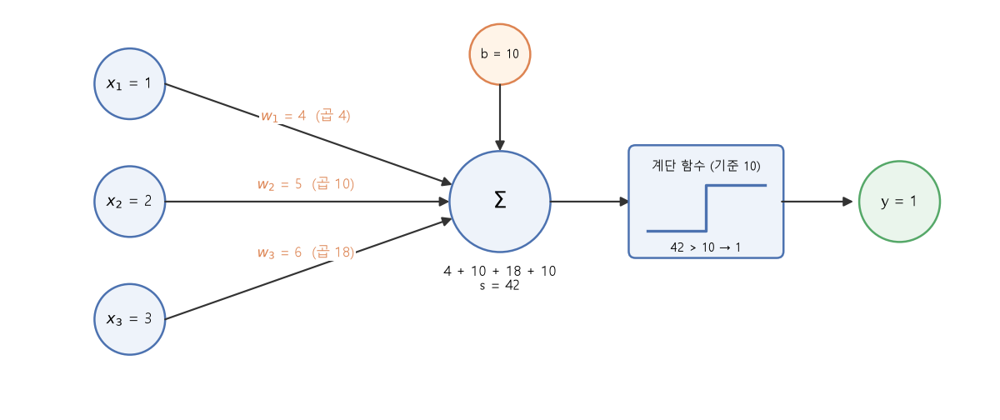
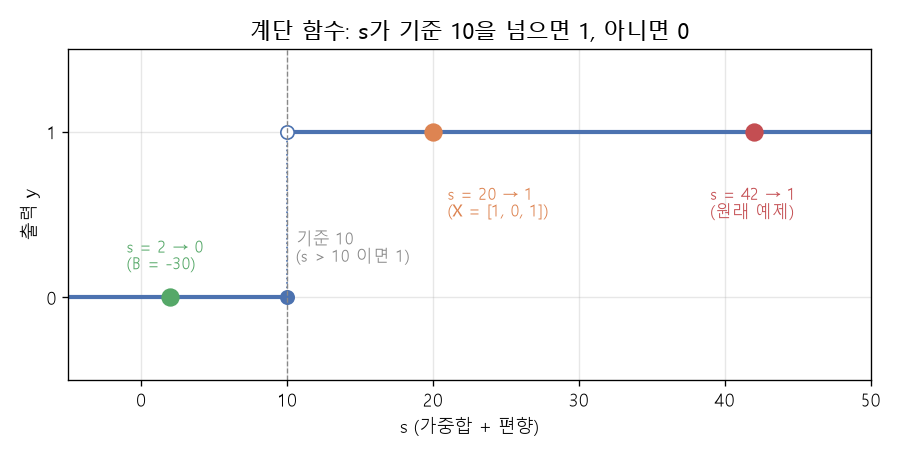

# 퍼셉트론 (EX\_01)

[목차로 돌아가기](../00_%EB%94%A5%EB%9F%AC%EB%8B%9D%EC%88%98%ED%95%99_MOC.md) · 예제: `01_ML_DL_Basic/EX_01_Perceptron.ipynb` · 코드 풀이: [E01_퍼셉트론_예제](../03_%EC%98%88%EC%A0%9C%ED%92%80%EC%9D%B4/E01_%ED%8D%BC%EC%85%89%ED%8A%B8%EB%A1%A0_%EC%98%88%EC%A0%9C.md)

> [!NOTE]
> **3줄 요약**
> - [퍼셉트론](../00_%EB%94%A5%EB%9F%AC%EB%8B%9D_%EC%9A%A9%EC%96%B4%EC%82%AC%EC%A0%84.md#perceptron-%ED%8D%BC%EC%85%89%ED%8A%B8%EB%A1%A0)은 입력마다 중요도([가중치](../00_%EB%94%A5%EB%9F%AC%EB%8B%9D_%EC%9A%A9%EC%96%B4%EC%82%AC%EC%A0%84.md#weight-%EA%B0%80%EC%A4%91%EC%B9%98), weight)를 곱해 더하고([가중합](../00_%EB%94%A5%EB%9F%AC%EB%8B%9D_%EC%9A%A9%EC%96%B4%EC%82%AC%EC%A0%84.md#weighted-sum-%EA%B0%80%EC%A4%91%ED%95%A9)), 그 합이 기준을 넘으면 1, 아니면 0을 내는 가장 단순한 인공 뉴런이다.
> - 필요한 수학: 함수, Σ(같은 자리끼리 곱해서 더하기)
> - 예제에서는 `[1, 2, 3]`과 `[4, 5, 6]`을 곱해 더하고 10을 더한 **42**가 기준 10을 넘어서 **1**이 나온다.

## 1. 개념 설명

여러 신호를 받아서 "켤까, 말까"를 정한다.

> 비유: 합격 판정. 과목 점수(입력)에 과목별 반영 비율([가중치](../00_%EB%94%A5%EB%9F%AC%EB%8B%9D_%EC%9A%A9%EC%96%B4%EC%82%AC%EC%A0%84.md#weight-%EA%B0%80%EC%A4%91%EC%B9%98))을 곱해 더하고, 기본 점수([편향](../00_%EB%94%A5%EB%9F%AC%EB%8B%9D_%EC%9A%A9%EC%96%B4%EC%82%AC%EC%A0%84.md#bias-%ED%8E%B8%ED%96%A5), bias)를 얹은 뒤, 커트라인을 넘으면 합격(1), 아니면 불합격(0).

정확히 말하면 [퍼셉트론](../00_%EB%94%A5%EB%9F%AC%EB%8B%9D_%EC%9A%A9%EC%96%B4%EC%82%AC%EC%A0%84.md#perceptron-%ED%8D%BC%EC%85%89%ED%8A%B8%EB%A1%A0)은 "입력마다 [가중치](../00_%EB%94%A5%EB%9F%AC%EB%8B%9D_%EC%9A%A9%EC%96%B4%EC%82%AC%EC%A0%84.md#weight-%EA%B0%80%EC%A4%91%EC%B9%98)를 곱해 더한 값([가중합](../00_%EB%94%A5%EB%9F%AC%EB%8B%9D_%EC%9A%A9%EC%96%B4%EC%82%AC%EC%A0%84.md#weighted-sum-%EA%B0%80%EC%A4%91%ED%95%A9))에 [편향](../00_%EB%94%A5%EB%9F%AC%EB%8B%9D_%EC%9A%A9%EC%96%B4%EC%82%AC%EC%A0%84.md#bias-%ED%8E%B8%ED%96%A5)을 더한 값 s"가 기준을 넘으면 1, 넘지 못하면 0을 출력하는 함수다.

## 2. 필요한 이유

모든 입력을 똑같은 비중으로 더하거나 첫 번째 입력만 보는 식의 **고정된 규칙**으로는 "과목마다 중요도가 다른" 상황을 담지 못한다. [가중합](../00_%EB%94%A5%EB%9F%AC%EB%8B%9D_%EC%9A%A9%EC%96%B4%EC%82%AC%EC%A0%84.md#weighted-sum-%EA%B0%80%EC%A4%91%ED%95%A9)과 기준을 쓰면 계산 틀은 그대로 두고 [가중치](../00_%EB%94%A5%EB%9F%AC%EB%8B%9D_%EC%9A%A9%EC%96%B4%EC%82%AC%EC%A0%84.md#weight-%EA%B0%80%EC%A4%91%EC%B9%98)와 [편향](../00_%EB%94%A5%EB%9F%AC%EB%8B%9D_%EC%9A%A9%EC%96%B4%EC%82%AC%EC%A0%84.md#bias-%ED%8E%B8%ED%96%A5)이라는 숫자만 바꿔서 다른 판정 규칙을 만들 수 있다. 이 숫자를 데이터에 맞게 정하는 일이 [학습](../00_%EB%94%A5%EB%9F%AC%EB%8B%9D_%EC%9A%A9%EC%96%B4%EC%82%AC%EC%A0%84.md#training-%ED%95%99%EC%8A%B5)이다([D02_경사하강법으로_직선찾기](../01_%EA%B0%9C%EB%85%90%EB%85%B8%ED%8A%B8/D02_%EA%B2%BD%EC%82%AC%ED%95%98%EA%B0%95%EB%B2%95%EC%9C%BC%EB%A1%9C_%EC%A7%81%EC%84%A0%EC%B0%BE%EA%B8%B0.md)).

## 3. 필요한 수학 개념

| 수학 개념  | 이 개념에서 쓰이는 곳                        | 자세히              |
| ------ | ----------------------------------- | ---------------- |
| 함수     | 계단 함수는 "넣으면 0 또는 1이 나오는" 함수다        | [M01_함수와_일차함수](../02_%EC%88%98%ED%95%99%EB%85%B8%ED%8A%B8/M01_%ED%95%A8%EC%88%98%EC%99%80_%EC%9D%BC%EC%B0%A8%ED%95%A8%EC%88%98.md) |
| 시그마(Σ) | $\sum w_i x_i$는 같은 번호끼리 곱해서 전부 더하기다 | [M02_시그마와_평균](../02_%EC%88%98%ED%95%99%EB%85%B8%ED%8A%B8/M02_%EC%8B%9C%EA%B7%B8%EB%A7%88%EC%99%80_%ED%8F%89%EA%B7%A0.md)  |

<details><summary>미니 복습: Σ</summary>

$\sum_{i=1}^{3} w_i x_i = w_1x_1 + w_2x_2 + w_3x_3$
for문으로 i = 1, 2, 3을 돌며 곱해서 더한 것이다. 자세히: [M02_시그마와_평균](../02_%EC%88%98%ED%95%99%EB%85%B8%ED%8A%B8/M02_%EC%8B%9C%EA%B7%B8%EB%A7%88%EC%99%80_%ED%8F%89%EA%B7%A0.md)

</details>

<details><summary>미니 복습: 함수</summary>

넣는 값 하나 → 나오는 값 하나. 계단 함수는 기준을 넘으면 1, 아니면 0이다. 자세히: [M01_함수와_일차함수](../02_%EC%88%98%ED%95%99%EB%85%B8%ED%8A%B8/M01_%ED%95%A8%EC%88%98%EC%99%80_%EC%9D%BC%EC%B0%A8%ED%95%A8%EC%88%98.md)

</details>

## 4. 계산 과정 (숫자 → 식 → 코드)

### 숫자

입력 `[1, 2, 3]`과 [가중치](../00_%EB%94%A5%EB%9F%AC%EB%8B%9D_%EC%9A%A9%EC%96%B4%EC%82%AC%EC%A0%84.md#weight-%EA%B0%80%EC%A4%91%EC%B9%98) `[4, 5, 6]`을 같은 번호끼리 곱해서 모두 더한다.

| i | 입력 $x_i$ | [가중치](../00_%EB%94%A5%EB%9F%AC%EB%8B%9D_%EC%9A%A9%EC%96%B4%EC%82%AC%EC%A0%84.md#weight-%EA%B0%80%EC%A4%91%EC%B9%98) $w_i$ | 곱 |
|---|---|---|---|
| 1 | 1 | 4 | 4 |
| 2 | 2 | 5 | 10 |
| 3 | 3 | 6 | 18 |
| | | 합 | **32** |

32 + [편향](../00_%EB%94%A5%EB%9F%AC%EB%8B%9D_%EC%9A%A9%EC%96%B4%EC%82%AC%EC%A0%84.md#bias-%ED%8E%B8%ED%96%A5) 10 = **42** → 42 > 기준 10 → 출력 **1**

(기준을 0이 아니라 10으로 잡은 이유는 아래 "⚠ 기준값이 10인 이유"에서 설명한다.)



### 식

말로 하면 "입력마다 [가중치](../00_%EB%94%A5%EB%9F%AC%EB%8B%9D_%EC%9A%A9%EC%96%B4%EC%82%AC%EC%A0%84.md#weight-%EA%B0%80%EC%A4%91%EC%B9%98)를 곱해 전부 더하고, [편향](../00_%EB%94%A5%EB%9F%AC%EB%8B%9D_%EC%9A%A9%EC%96%B4%EC%82%AC%EC%A0%84.md#bias-%ED%8E%B8%ED%96%A5)을 더한 뒤, 그 값을 [활성화 함수](../00_%EB%94%A5%EB%9F%AC%EB%8B%9D_%EC%9A%A9%EC%96%B4%EC%82%AC%EC%A0%84.md#activation-function-%ED%99%9C%EC%84%B1%ED%99%94-%ED%95%A8%EC%88%98)에 넣는다"이다. 노트북 맨 위의 식은 다음과 같다.

$$y = \sigma\left(\sum_{i=1}^{3} w_i x_i + b\right)$$

괄호 안 전체를 s라고 부르자. 즉 s = Σwx + b = 32 + 10 = 42이고, [편향](../00_%EB%94%A5%EB%9F%AC%EB%8B%9D_%EC%9A%A9%EC%96%B4%EC%82%AC%EC%A0%84.md#bias-%ED%8E%B8%ED%96%A5) b는 이 s 안에 **한 번만** 들어 있다. 아래 표의 "s"는 이 값이다.

<details><summary>기호 풀이</summary>

| 기호 | 읽는 법 | 뜻 | 예제 값 |
| -------- | --- | --------------------------------------------------------------- | ---------------- |
| $x_i$ | 엑스 아이 | i번째 입력                                                   이 | 1, 2, 3 |
| $w_i$ | 더블유 아이 | i번째 [가중치](../00_%EB%94%A5%EB%9F%AC%EB%8B%9D_%EC%9A%A9%EC%96%B4%EC%82%AC%EC%A0%84.md#weight-%EA%B0%80%EC%A4%91%EC%B9%98)(중요도) | 4, 5, 6 |
| $b$ | 비 | [편향](../00_%EB%94%A5%EB%9F%AC%EB%8B%9D_%EC%9A%A9%EC%96%B4%EC%82%AC%EC%A0%84.md#bias-%ED%8E%B8%ED%96%A5)(기본 점수) | 10 |
| $s$ | 에스 | 괄호 안 전체([가중합](../00_%EB%94%A5%EB%9F%AC%EB%8B%9D_%EC%9A%A9%EC%96%B4%EC%82%AC%EC%A0%84.md#weighted-sum-%EA%B0%80%EC%A4%91%ED%95%A9) + [편향](../00_%EB%94%A5%EB%9F%AC%EB%8B%9D_%EC%9A%A9%EC%96%B4%EC%82%AC%EC%A0%84.md#bias-%ED%8E%B8%ED%96%A5)) | 42 |
| $\sigma$ | 시그마 | [활성화 함수](../00_%EB%94%A5%EB%9F%AC%EB%8B%9D_%EC%9A%A9%EC%96%B4%EC%82%AC%EC%A0%84.md#activation-function-%ED%99%9C%EC%84%B1%ED%99%94-%ED%95%A8%EC%88%98)(activation function). 여기서는 계단 함수 | s > 10이면 1 |
| $y$ | 와이 | 출력읽 | 1 |
| $\sum$ | 시그마(합) | 뒤에 오는 값을 i = 1부터 3까지 모두 더함 | 4 + 10 + 18 = 32 |

</details>

> [!WARNING]
> **⚠ σ 기호가 두 뜻으로 쓰인다**
> 이 노트북은 σ를 "[활성화 함수](../00_%EB%94%A5%EB%9F%AC%EB%8B%9D_%EC%9A%A9%EC%96%B4%EC%82%AC%EC%A0%84.md#activation-function-%ED%99%9C%EC%84%B1%ED%99%94-%ED%95%A8%EC%88%98)"라는 넓은 뜻으로 썼다. 뒤의 EX\_05부터는 σ가 보통 **[시그모이드](../00_%EB%94%A5%EB%9F%AC%EB%8B%9D_%EC%9A%A9%EC%96%B4%EC%82%AC%EC%A0%84.md#sigmoid-%EC%8B%9C%EA%B7%B8%EB%AA%A8%EC%9D%B4%EB%93%9C)**([D04_시그모이드와_이진분류](../01_%EA%B0%9C%EB%85%90%EB%85%B8%ED%8A%B8/D04_%EC%8B%9C%EA%B7%B8%EB%AA%A8%EC%9D%B4%EB%93%9C%EC%99%80_%EC%9D%B4%EC%A7%84%EB%B6%84%EB%A5%98.md))라는 특정 함수를 가리킨다. 문맥으로 구분한다.

> [!WARNING]
> **⚠ 기준값이 10인 이유**
> 교과서의 [퍼셉트론](../00_%EB%94%A5%EB%9F%AC%EB%8B%9D_%EC%9A%A9%EC%96%B4%EC%82%AC%EC%A0%84.md#perceptron-%ED%8D%BC%EC%85%89%ED%8A%B8%EB%A1%A0)은 보통 "합이 **0**보다 크면 1"이다. 이 예제 코드는 `s > 10`으로 기준을 10으로 잡았다.
> s > 10은 (s − 10) > 0과 같다. 즉 [편향](../00_%EB%94%A5%EB%9F%AC%EB%8B%9D_%EC%9A%A9%EC%96%B4%EC%82%AC%EC%A0%84.md#bias-%ED%8E%B8%ED%96%A5) b를 10 줄이고 기준을 0으로 둔 것과 똑같다. **기준을 어디에 두느냐는 [편향](../00_%EB%94%A5%EB%9F%AC%EB%8B%9D_%EC%9A%A9%EC%96%B4%EC%82%AC%EC%A0%84.md#bias-%ED%8E%B8%ED%96%A5) b로 조절할 수 있다.**



### 코드

```python
X = np.array([1,2,3])   # 입력
W = np.array([4,5,6])   # 가중치
B = 10                  # 편향

mul = W * X             # 같은 자리끼리 곱 → [ 4 10 18]
s = np.sum(mul) + B     # Σ w_i x_i + b → 42
y = np.float32(s > 10)  # 계단 함수: True → 1.0, False → 0.0
```

**실행 결과** (노트북 기록, 이 PC에서 다시 돌려도 같음):

```
mul = W * X : [ 4 10 18]
s = 42
y = 1.0
```

`np.float32(s > 10)`은 비교 결과(True/False)를 1.0/0.0으로 바꾼다.

## 5. 개념 재확인

<details><summary>1. X = <code>[1, 0, 1]</code>, W = <code>[4, 5, 6]</code>, B = 10이면 s와 y는?</summary>

| 단계 | 하는 일 | 코드 | 계산 | 결과 |
|---|---|---|---|---|
| 1 | 같은 자리끼리 곱하기 | `W * X` | 4×1, 5×0, 6×1 | `[4, 0, 6]` |
| 2 | 모두 더하기 | `np.sum(...)` | 4 + 0 + 6 | 10 |
| 3 | [편향](../00_%EB%94%A5%EB%9F%AC%EB%8B%9D_%EC%9A%A9%EC%96%B4%EC%82%AC%EC%A0%84.md#bias-%ED%8E%B8%ED%96%A5) 더하기 | `+ B` | 10 + 10 | s = 20 |
| 4 | 기준과 비교 | `s > 10` | 20 > 10 → 참 | y = 1 |

**① 쓰는 코드**
```python
X = np.array([1, 0, 1])  # ① 입력 (원래 [1,2,3]에서 바꿈)
W = np.array([4, 5, 6])  # ① 가중치
B = 10                   # ① 편향

mul = W * X              # ② 같은 자리끼리 곱하기
s = np.sum(mul) + B      # ③ 모두 더하고 ④ 편향 더하기
y = np.float32(s > 10)   # ⑤ 기준과 비교 (참이면 1.0, 거짓이면 0.0)
```

**② 같은 자리끼리 곱하기** (`W * X`)
- 4 × 1 = 4
- 5 × 0 = 0
- 6 × 1 = 6
- 결과: `[4, 0, 6]`

**③ 모두 더하기** (`np.sum(mul)`)
- 4 + 0 + 6 = 10

**④ [편향](../00_%EB%94%A5%EB%9F%AC%EB%8B%9D_%EC%9A%A9%EC%96%B4%EC%82%AC%EC%A0%84.md#bias-%ED%8E%B8%ED%96%A5) 더하기** (`+ B`)
- 10 + 10 = 20 → s = 20

**⑤ 기준과 비교** (`np.float32(s > 10)`)
- 20 > 10은 참(True)
- True를 실수로 바꾸면 1.0 → y = 1

**답**: s = **20**, y = **1**

</details>

<details><summary>2. 원래 예제에서 B만 −30으로 바꾸면?</summary>

| 단계 | 하는 일 | 코드 | 계산 | 결과 |
|---|---|---|---|---|
| 1 | 곱한 값 (B와 무관) | `mul` | 원래 예제 그대로 | `[4, 10, 18]` |
| 2 | 모두 더하기 | `np.sum(mul)` | 4 + 10 + 18 | 32 |
| 3 | [편향](../00_%EB%94%A5%EB%9F%AC%EB%8B%9D_%EC%9A%A9%EC%96%B4%EC%82%AC%EC%A0%84.md#bias-%ED%8E%B8%ED%96%A5) 더하기 | `+ B` | 32 + (−30) | s = 2 |
| 4 | 기준과 비교 | `s > 10` | 2 > 10 → 거짓 | y = 0 |

**① 쓰는 코드**
```python
X = np.array([1, 2, 3])  # ① 입력 (원래 그대로)
W = np.array([4, 5, 6])  # ① 가중치 (원래 그대로)
B = -30                  # ① 편향 (10 → -30)

mul = W * X              # ② 같은 자리끼리 곱하기
s = np.sum(mul) + B      # ③ 모두 더하고 ④ 편향 더하기
y = np.float32(s > 10)   # ⑤ 기준과 비교 (참이면 1.0, 거짓이면 0.0)
```

**② 같은 자리끼리 곱하기** (`W * X`)
- 4 × 1 = 4
- 5 × 2 = 10
- 6 × 3 = 18
- 결과: `[4, 10, 18]` (B를 바꿔도 곱은 그대로)

**③ 모두 더하기** (`np.sum(mul)`)
- 4 + 10 + 18 = 32

**④ [편향](../00_%EB%94%A5%EB%9F%AC%EB%8B%9D_%EC%9A%A9%EC%96%B4%EC%82%AC%EC%A0%84.md#bias-%ED%8E%B8%ED%96%A5) 더하기** (`+ B`)
- 32 + (−30) = 2 → s = 2

**⑤ 기준과 비교** (`np.float32(s > 10)`)
- 2 > 10은 거짓(False)
- False를 실수로 바꾸면 0.0 → y = 0

**답**: s = **2**, y = **0**

</details>

<details><summary>3. 가중치가 큰 입력은 결과에 어떤 영향을 주나?</summary>

| 단계 | 하는 일 | 코드 | 계산 | 결과 |
|---|---|---|---|---|
| 1 | 기준 합 (w = `[4, 5, 6]`) | `np.sum(W * X)` | 4 + 10 + 18 | s = 32 |
| 2 | x₁을 1 올림 | `W[0] * X[0]` | 4 × 1 | s가 4 늘어남 (32 → 36) |
| 3 | x₃을 1 올림 | `W[2] * X[2]` | 6 × 1 | s가 6 늘어남 (32 → 38) |
| 4 | 두 경우 비교 | - | 6 > 4 | w가 큰 입력이 s를 더 크게 흔듦 |

**① 쓰는 코드**
```python
X = np.array([1, 2, 3])  # ① 입력 (기준)
W = np.array([4, 5, 6])  # ① 가중치

s0 = np.sum(W * X)       # ② 기준 합 구하기 (32)
X1 = np.array([2, 2, 3]) # ③ x₁만 1 올림 (1 → 2)
s1 = np.sum(W * X1)      # ③ x₁을 올린 합 (36)
X3 = np.array([1, 2, 4]) # ④ x₃만 1 올림 (3 → 4)
s3 = np.sum(W * X3)      # ④ x₃을 올린 합 (38)
# ⑤ s1 - s0 = 4, s3 - s0 = 6을 비교
```

**② 기준 합 구하기** (`np.sum(W * X)`)
- 4 × 1 = 4
- 5 × 2 = 10
- 6 × 3 = 18
- 4 + 10 + 18 = 32 → s = 32

**③ x₁을 1 올리기** (`W[0] * X[0]`)
- 4 × 2 = 8 (원래 4 × 1 = 4)
- 8 − 4 = 4가 늘어남
- 새 합: 8 + 10 + 18 = 36 (32 → 36)

**④ x₃을 1 올리기** (`W[2] * X[2]`)
- 6 × 4 = 24 (원래 6 × 3 = 18)
- 24 − 18 = 6이 늘어남
- 새 합: 4 + 10 + 24 = 38 (32 → 38)

**⑤ 두 경우 비교**
- 늘어난 양은 입력을 1 올릴 때 그 입력의 [가중치](../00_%EB%94%A5%EB%9F%AC%EB%8B%9D_%EC%9A%A9%EC%96%B4%EC%82%AC%EC%A0%84.md#weight-%EA%B0%80%EC%A4%91%EC%B9%98)와 같다
- 6 > 4이므로 [가중치](../00_%EB%94%A5%EB%9F%AC%EB%8B%9D_%EC%9A%A9%EC%96%B4%EC%82%AC%EC%A0%84.md#weight-%EA%B0%80%EC%A4%91%EC%B9%98)가 큰 x₃이 합을 더 크게 흔듦

[학습](../00_%EB%94%A5%EB%9F%AC%EB%8B%9D_%EC%9A%A9%EC%96%B4%EC%82%AC%EC%A0%84.md#training-%ED%95%99%EC%8A%B5)은 이 [가중치](../00_%EB%94%A5%EB%9F%AC%EB%8B%9D_%EC%9A%A9%EC%96%B4%EC%82%AC%EC%A0%84.md#weight-%EA%B0%80%EC%A4%91%EC%B9%98)를 데이터에 맞게 정하는 일이다([D02_경사하강법으로_직선찾기](../01_%EA%B0%9C%EB%85%90%EB%85%B8%ED%8A%B8/D02_%EA%B2%BD%EC%82%AC%ED%95%98%EA%B0%95%EB%B2%95%EC%9C%BC%EB%A1%9C_%EC%A7%81%EC%84%A0%EC%B0%BE%EA%B8%B0.md)).

**답**: [가중치](../00_%EB%94%A5%EB%9F%AC%EB%8B%9D_%EC%9A%A9%EC%96%B4%EC%82%AC%EC%A0%84.md#weight-%EA%B0%80%EC%A4%91%EC%B9%98)가 큰 입력은 조금만 변해도 합이 크게 변하므로 **더 중요한 입력**이다.

</details>

<details><summary>내 이해</summary>


</details>
