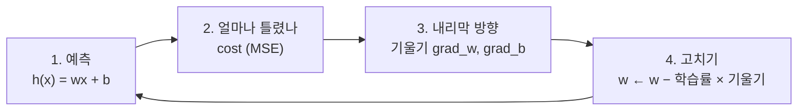

# 경사하강법으로 직선 찾기 (EX\_02, EX\_03)

[목차로 돌아가기](../00_%EB%94%A5%EB%9F%AC%EB%8B%9D%EC%88%98%ED%95%99_MOC.md) · 예제: `EX_02_Optimize_Hypothesis.ipynb`, `EX_03_Blood_Pressure_Linear_Regression.ipynb` · 코드 풀이: [E02_가설최적화_예제](../03_%EC%98%88%EC%A0%9C%ED%92%80%EC%9D%B4/E02_%EA%B0%80%EC%84%A4%EC%B5%9C%EC%A0%81%ED%99%94_%EC%98%88%EC%A0%9C.md), [E03_혈압_선형회귀_예제](../03_%EC%98%88%EC%A0%9C%ED%92%80%EC%9D%B4/E03_%ED%98%88%EC%95%95_%EC%84%A0%ED%98%95%ED%9A%8C%EA%B7%80_%EC%98%88%EC%A0%9C.md) · [비용 함수](../00_%EB%94%A5%EB%9F%AC%EB%8B%9D_%EC%9A%A9%EC%96%B4%EC%82%AC%EC%A0%84.md#%EC%86%90%EC%8B%A4-%ED%95%A8%EC%88%98) 자세히: [D09_오차와_비용함수](D09_%EC%98%A4%EC%B0%A8%EC%99%80_%EB%B9%84%EC%9A%A9%ED%95%A8%EC%88%98.md)

> [!NOTE]
> **3줄 요약**
> - 모델은 직선 $h(x) = wx + b$이고, 데이터에 가장 잘 맞는 w와 b를 찾는 것이 목표다.
> - 얼마나 틀렸는지는 비용 함수([MSE](../00_%EB%94%A5%EB%9F%AC%EB%8B%9D_%EC%9A%A9%EC%96%B4%EC%82%AC%EC%A0%84.md#mse))로 재고, 비용이 줄어드는 방향([기울기](../00_%EB%94%A5%EB%9F%AC%EB%8B%9D_%EC%9A%A9%EC%96%B4%EC%82%AC%EC%A0%84.md#%EA%B8%B0%EC%9A%B8%EA%B8%B0)의 반대)으로 w와 b를 조금씩 고친다. 이것이 **경사하강법**이다.
> - 학습률이 너무 크면 비용이 오히려 폭발한다. EX\_03 주석에서 학습률을 계속 줄여 본 이유다.

## 1. 이게 하는 일 (말로)

점들(데이터)을 보고, 그 점들을 가장 잘 지나는 직선을 찾는다.

- EX\_02: x = 1~10, 정답 = 3~21 (사실은 $y = 2x + 1$)
- EX\_03: 나이 → 혈압 (실제 데이터 18개)

찾는 방법은 아래 4단계를 수천 번 반복하는 것이다.



> 비유: 눈을 가리고 산(비용) 아래로 내려간다. 발밑 경사(기울기)를 느끼고, 내리막 쪽으로 보폭(학습률)만큼 한 발씩 간다.

## 2. 필요한 수학 체크리스트

- [ ] [M01_함수와_일차함수](../02_%EC%88%98%ED%95%99%EB%85%B8%ED%8A%B8/M01_%ED%95%A8%EC%88%98%EC%99%80_%EC%9D%BC%EC%B0%A8%ED%95%A8%EC%88%98.md) — 가설 $h(x) = wx + b$
- [ ] [M02_시그마와_평균](../02_%EC%88%98%ED%95%99%EB%85%B8%ED%8A%B8/M02_%EC%8B%9C%EA%B7%B8%EB%A7%88%EC%99%80_%ED%8F%89%EA%B7%A0.md) — 비용 함수 MSE
- [ ] [M03_미분_기울기](../02_%EC%88%98%ED%95%99%EB%85%B8%ED%8A%B8/M03_%EB%AF%B8%EB%B6%84_%EA%B8%B0%EC%9A%B8%EA%B8%B0.md) — 어느 쪽이 내리막인가
- [ ] [M04_편미분](../02_%EC%88%98%ED%95%99%EB%85%B8%ED%8A%B8/M04_%ED%8E%B8%EB%AF%B8%EB%B6%84.md) — w와 b를 따로 고치기

## 3. 수학 하나씩 풀기

<details><summary>미니 복습: 일차함수</summary>

$y = wx + b$. w는 기울기([가중치](../00_%EB%94%A5%EB%9F%AC%EB%8B%9D_%EC%9A%A9%EC%96%B4%EC%82%AC%EC%A0%84.md#%EA%B0%80%EC%A4%91%EC%B9%98)), b는 절편([편향](../00_%EB%94%A5%EB%9F%AC%EB%8B%9D_%EC%9A%A9%EC%96%B4%EC%82%AC%EC%A0%84.md#%ED%8E%B8%ED%96%A5)). 자세히: [M01_함수와_일차함수](../02_%EC%88%98%ED%95%99%EB%85%B8%ED%8A%B8/M01_%ED%95%A8%EC%88%98%EC%99%80_%EC%9D%BC%EC%B0%A8%ED%95%A8%EC%88%98.md)

</details>

<details><summary>미니 복습: MSE</summary>

데이터마다 (예측 − 정답)을 제곱해서 평균. 작을수록 잘 맞는다. 자세히: [M02_시그마와_평균](../02_%EC%88%98%ED%95%99%EB%85%B8%ED%8A%B8/M02_%EC%8B%9C%EA%B7%B8%EB%A7%88%EC%99%80_%ED%8F%89%EA%B7%A0.md)

</details>

<details><summary>미니 복습: 미분</summary>

조금 움직였을 때 얼마나 변하나. 양수면 오르막, 음수면 내리막. 줄이려면 반대로 간다. 자세히: [M03_미분_기울기](../02_%EC%88%98%ED%95%99%EB%85%B8%ED%8A%B8/M03_%EB%AF%B8%EB%B6%84_%EA%B8%B0%EC%9A%B8%EA%B8%B0.md)

</details>

<details><summary>미니 복습: 편미분</summary>

w만 움직였을 때의 기울기, b만 움직였을 때의 기울기를 따로 구한다. 자세히: [M04_편미분](../02_%EC%88%98%ED%95%99%EB%85%B8%ED%8A%B8/M04_%ED%8E%B8%EB%AF%B8%EB%B6%84.md)

</details>

## 4. 다시 합치기: 숫자 → 식 → 코드

### 4.1 노트북 식 읽기

| 노트북 식 | 말로 | 코드 |
|---|---|---|
| $h(x) = wx + b$ | 직선으로 예측 | `W*x + B` |
| $\text{cost}(w,b) = \frac{1}{m}\sum_{i=1}^{m}(h(x_i) - y_i)^2$ | [오차](../00_%EB%94%A5%EB%9F%AC%EB%8B%9D_%EC%9A%A9%EC%96%B4%EC%82%AC%EC%A0%84.md#%EC%98%A4%EC%B0%A8) 제곱의 평균 | `np.mean((Hypothesis(x_input) - labels)**2)` |
| $\frac{\partial}{\partial w}\text{cost}(w,b)$ | w 방향 기울기 | `np.mean(x*(x*W+(B-y)))` |
| $\frac{\partial}{\partial b}\text{cost}(w,b)$ | b 방향 기울기 | `np.mean((W*x-y+B))` |
| $w = w - \mu\frac{\partial}{\partial w}\text{cost}(w,b)$ | 기울기 반대로 μ배만큼 이동 | `W -= learning_rate * grad_w` |

- $\mu$(뮤) = 학습률(learning rate). 한 번에 얼마나 크게 움직일지 정하는 보폭이다.
- 노트북의 기울기 식에는 정식 식의 2가 빠져 있다. 방향은 같아서 학습에는 문제없다([M04_편미분](../02_%EC%88%98%ED%95%99%EB%85%B8%ED%8A%B8/M04_%ED%8E%B8%EB%AF%B8%EB%B6%84.md) 6절).

### 4.2 첫 걸음 손계산 (EX\_02)

노트북은 W와 B를 무작위(`np.random.normal()`)로 시작하지만, 손계산을 위해 **W = 0, B = 0**에서 시작한다. 학습률은 노트북과 같은 0.005.

1. 예측: W·x + B = 0 → 모든 예측이 0
2. 비용: (3² + 5² + … + 21²) ÷ 10 = 1770 ÷ 10 = **177**
3. 기울기: grad\_w = **−82.5**, grad\_b = **−12.0** (둘 다 음수 → 둘 다 올려야 함)
4. 고치기:
   - W = 0 − 0.005 × (−82.5) = **0.4125**
   - B = 0 − 0.005 × (−12.0) = **0.06**
5. 다시 비용을 재면 **114.32** → 177에서 줄었다.

### 4.3 반복하면

같은 코드를 numpy로 5000번 돌린 결과(W = 0, B = 0에서 시작):

| 반복 | cost | W | B |
|---|---|---|---|
| 0 | 177 | 0.0000 | 0.0000 |
| 1 | 114.324 | 0.4125 | 0.0600 |
| 2 | 73.8551 | 0.7439 | 0.1084 |
| 10 | 2.33064 | 1.8635 | 0.2751 |
| 100 | 0.084703 | 2.0903 | 0.3713 |
| 1000 | 0.0127863 | 2.0351 | 0.7557 |
| 5000 | 0.00000287 | 2.0005 | 0.9963 |

- 정답 규칙 w = 2, b = 1에 다가간다. 노트북 기록(무작위 시작)도 5000번째에 W = 2.0, B = 0.9974다.
- **W는 금방 2 근처로 가는데 B는 천천히 1로 간다.** W 쪽 기울기가 훨씬 크기 때문이다(−82.5 vs −12).
- W가 잠깐 2를 넘었다가(100번째 2.0903) 돌아온다. B가 아직 작을 때 W가 그 몫까지 떠맡았다가, B가 커지면서 제자리로 오는 것이다.

### 4.4 학습률이 너무 크면 (EX\_02, 학습률 0.06)

| 반복 | cost | W |
|---|---|---|
| 0 | 177 | 0.0000 |
| 1 | 326.039 | 4.9500 |
| 2 | 600.65 | −1.7721 |
| 3 | 1106.64 | 7.3496 |
| 5 | 3756.73 | 11.7730 |

W가 정답 2를 사이에 두고 양쪽으로 점점 크게 튄다. 보폭이 너무 커서 골짜기 바닥을 지나 반대편 벽으로 뛰어오르는 것이다. 비용이 줄지 않고 커지면 학습률부터 의심한다.

### 4.5 EX\_03: 실제 데이터 (나이 → 혈압)

- 데이터: 나이 25~73세, 혈압 118~138 mmHg, 18개
- 노트북 주석: 학습률을 0.005, 0.001, 0.0005, 0.0003처럼 줄여 가며 시험했다. 결국 **0.0005**, 반복 **200000번**을 썼다.

왜 이렇게 작은 학습률이 필요했을까? 나이 값이 커서(평균 약 50) w 방향 기울기가 매우 크기 때문이다. 학습률 0.001만 돼도 폭발한다.

| 반복 | cost (학습률 0.001) |
|---|---|
| 0 | 15949.2 |
| 1 | 45571.8 |
| 2 | 135591 |
| 5 | 3766670 |

학습률 0.0005로 200000번 돌린 결과(W = 0, B = 0에서 시작):

| 반복 | cost | W | B |
|---|---|---|---|
| 0 | 15949.2 | 0.0000 | 0.0000 |
| 10000 | 530.894 | 1.4560 | 46.6978 |
| 50000 | 26.3144 | 0.3345 | 108.6162 |
| 100000 | 17.1328 | 0.1750 | 117.4263 |
| 200000 | 17.0722 | 0.1622 | 118.1312 |

- 노트북 기록도 W = 0.1622, B = 118.1이다.
- 50세 예측: 0.1622 × 50 + 118.13 ≈ **126.2 mmHg** (노트북 기록 126.2와 같다)
- 수학으로 한 번에 푼 정답(`np.polyfit`, 최소제곱법)은 w = 0.1608, b = 118.207이다. 20만 번을 돌려도 아직 조금 덜 갔다.

> [!WARNING]
> **⚠ 입력 값이 크면 학습이 느리고 불안정하다**
> 나이(25~73)처럼 큰 값이 그대로 들어가면 학습률을 아주 작게 해야 하고, 그만큼 오래 걸린다.
> 이 문제를 푸는 방법이 EX\_04의 **Min-Max [정규화](../00_%EB%94%A5%EB%9F%AC%EB%8B%9D_%EC%9A%A9%EC%96%B4%EC%82%AC%EC%A0%84.md#%EC%A0%95%EA%B7%9C%ED%99%94)**(입력을 0~1 사이로 줄이기)다 → [D03_Dense층과_정규화](D03_Dense%EC%B8%B5%EA%B3%BC_%EC%A0%95%EA%B7%9C%ED%99%94.md) 4.4절.

### 4.6 코드 (학습 부분)

```python
epochs = 5000
learning_rate = 0.005

for cnt in range(0, epochs+1):
    if cnt % (epochs//20) == 0:                     # 250번마다 진행 상황 출력
        print("[{:>5}] cost = {:>10.4}, W = {:>7.4}, B = {:>7.4}".format(cnt, Cost(), W, B))

    grad_w, grad_b = Gradient(x_input, labels)      # 3. 기울기 (w 방향, b 방향)
    W -= learning_rate * grad_w                      # 4. 기울기 반대로 학습률만큼 이동
    B -= learning_rate * grad_b
```

- `epochs`: 4단계를 몇 번 반복할지
- `W -= ...`는 `W = W - ...`의 줄임이다(C의 `-=`와 같다).

## 5. 스스로 확인

<details><summary>1. grad_w = +10, 학습률 0.01이면 W는 어떻게 바뀌나?</summary>

W − 0.01 × 10 = W − 0.1 → **0.1 줄어든다.**

</details>

<details><summary>2. 반복할수록 cost가 커진다면 무엇부터 의심하나?</summary>

**학습률이 너무 크다.** 4.4절처럼 바닥을 지나쳐 튀고 있다.

</details>

<details><summary>3. EX_03에서 EX_02보다 훨씬 작은 학습률이 필요했던 이유는?</summary>

입력(나이)이 커서 기울기가 크기 때문이다. 해결책은 입력을 0~1로 줄이는 정규화(EX\_04, [D03_Dense층과_정규화](D03_Dense%EC%B8%B5%EA%B3%BC_%EC%A0%95%EA%B7%9C%ED%99%94.md)).

</details>

