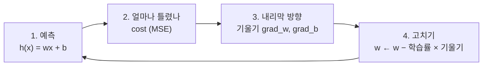
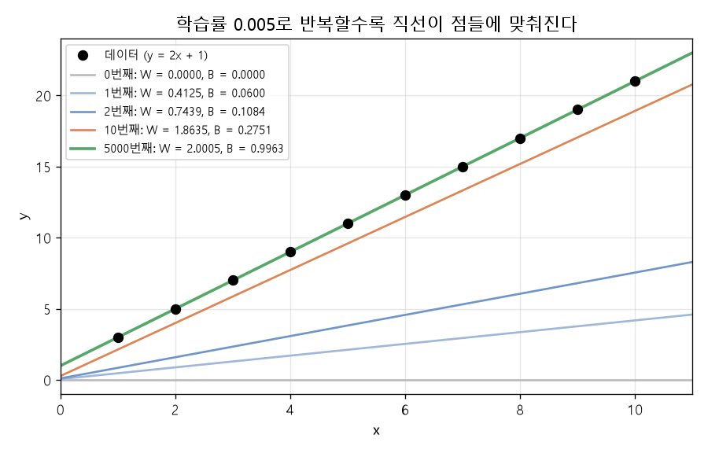
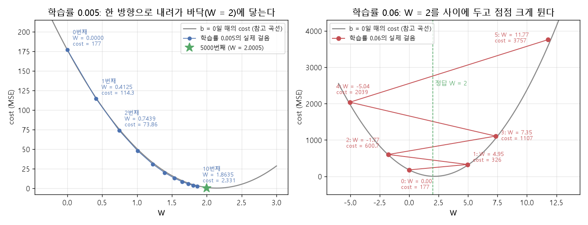

# 경사하강법으로 직선 찾기 (EX\_02, EX\_03)

[목차로 돌아가기](../00_%EB%94%A5%EB%9F%AC%EB%8B%9D%EC%88%98%ED%95%99_MOC.md) · 예제: `EX_02_Optimize_Hypothesis.ipynb`, `EX_03_Blood_Pressure_Linear_Regression.ipynb` · 코드 풀이: [E02_가설최적화_예제](../03_%EC%98%88%EC%A0%9C%ED%92%80%EC%9D%B4/E02_%EA%B0%80%EC%84%A4%EC%B5%9C%EC%A0%81%ED%99%94_%EC%98%88%EC%A0%9C.md), [E03_혈압_선형회귀_예제](../03_%EC%98%88%EC%A0%9C%ED%92%80%EC%9D%B4/E03_%ED%98%88%EC%95%95_%EC%84%A0%ED%98%95%ED%9A%8C%EA%B7%80_%EC%98%88%EC%A0%9C.md) · [손실 함수](../00_%EB%94%A5%EB%9F%AC%EB%8B%9D_%EC%9A%A9%EC%96%B4%EC%82%AC%EC%A0%84.md#loss-function-%EC%86%90%EC%8B%A4-%ED%95%A8%EC%88%98) 자세히: [D09_오차와_비용함수](../01_%EA%B0%9C%EB%85%90%EB%85%B8%ED%8A%B8/D09_%EC%98%A4%EC%B0%A8%EC%99%80_%EB%B9%84%EC%9A%A9%ED%95%A8%EC%88%98.md)

> [!NOTE]
> **3줄 요약**
> - 모델은 직선 $h(x) = wx + b$이고, 데이터에 가장 잘 맞는 w와 b를 찾는 것이 목표다.
> - 얼마나 틀렸는지는 [손실 함수](../00_%EB%94%A5%EB%9F%AC%EB%8B%9D_%EC%9A%A9%EC%96%B4%EC%82%AC%EC%A0%84.md#loss-function-%EC%86%90%EC%8B%A4-%ED%95%A8%EC%88%98)([MSE](../00_%EB%94%A5%EB%9F%AC%EB%8B%9D_%EC%9A%A9%EC%96%B4%EC%82%AC%EC%A0%84.md#mse-mean-squared-error-%ED%8F%89%EA%B7%A0-%EC%A0%9C%EA%B3%B1-%EC%98%A4%EC%B0%A8))로 재고, [손실](../00_%EB%94%A5%EB%9F%AC%EB%8B%9D_%EC%9A%A9%EC%96%B4%EC%82%AC%EC%A0%84.md#loss-function-%EC%86%90%EC%8B%A4-%ED%95%A8%EC%88%98)이 줄어드는 방향([기울기](../00_%EB%94%A5%EB%9F%AC%EB%8B%9D_%EC%9A%A9%EC%96%B4%EC%82%AC%EC%A0%84.md#gradient-%EA%B8%B0%EC%9A%B8%EA%B8%B0)의 반대)으로 w와 b를 조금씩 고친다. 이것이 **[경사하강법](../00_%EB%94%A5%EB%9F%AC%EB%8B%9D_%EC%9A%A9%EC%96%B4%EC%82%AC%EC%A0%84.md#gradient-descent-%EA%B2%BD%EC%82%AC%ED%95%98%EA%B0%95%EB%B2%95)**이다.
> - [학습률](../00_%EB%94%A5%EB%9F%AC%EB%8B%9D_%EC%9A%A9%EC%96%B4%EC%82%AC%EC%A0%84.md#learning-rate-%ED%95%99%EC%8A%B5%EB%A5%A0)이 너무 크면 [손실](../00_%EB%94%A5%EB%9F%AC%EB%8B%9D_%EC%9A%A9%EC%96%B4%EC%82%AC%EC%A0%84.md#loss-function-%EC%86%90%EC%8B%A4-%ED%95%A8%EC%88%98)이 오히려 폭발한다. EX\_03 주석에서 [학습률](../00_%EB%94%A5%EB%9F%AC%EB%8B%9D_%EC%9A%A9%EC%96%B4%EC%82%AC%EC%A0%84.md#learning-rate-%ED%95%99%EC%8A%B5%EB%A5%A0)을 계속 줄여 본 이유다.

## 1. 개념 설명

점들(데이터)을 보고, 그 점들을 가장 잘 지나는 직선을 찾는다.

- EX\_02: x = 1~10, [정답](../00_%EB%94%A5%EB%9F%AC%EB%8B%9D_%EC%9A%A9%EC%96%B4%EC%82%AC%EC%A0%84.md#label-%EC%A0%95%EB%8B%B5) = 3~21 (사실은 $y = 2x + 1$)
- EX\_03: 나이 → 혈압 (실제 데이터 18개)

> 비유: 눈을 가리고 산([손실](../00_%EB%94%A5%EB%9F%AC%EB%8B%9D_%EC%9A%A9%EC%96%B4%EC%82%AC%EC%A0%84.md#loss-function-%EC%86%90%EC%8B%A4-%ED%95%A8%EC%88%98)) 아래로 내려간다. 발밑 경사([기울기](../00_%EB%94%A5%EB%9F%AC%EB%8B%9D_%EC%9A%A9%EC%96%B4%EC%82%AC%EC%A0%84.md#gradient-%EA%B8%B0%EC%9A%B8%EA%B8%B0))를 느끼고, 내리막 쪽으로 보폭([학습률](../00_%EB%94%A5%EB%9F%AC%EB%8B%9D_%EC%9A%A9%EC%96%B4%EC%82%AC%EC%A0%84.md#learning-rate-%ED%95%99%EC%8A%B5%EB%A5%A0))만큼 한 발씩 간다.

정확히 말하면 [경사하강법](../00_%EB%94%A5%EB%9F%AC%EB%8B%9D_%EC%9A%A9%EC%96%B4%EC%82%AC%EC%A0%84.md#gradient-descent-%EA%B2%BD%EC%82%AC%ED%95%98%EA%B0%95%EB%B2%95)은 [손실 함수](../00_%EB%94%A5%EB%9F%AC%EB%8B%9D_%EC%9A%A9%EC%96%B4%EC%82%AC%EC%A0%84.md#loss-function-%EC%86%90%EC%8B%A4-%ED%95%A8%EC%88%98)(예측이 [정답](../00_%EB%94%A5%EB%9F%AC%EB%8B%9D_%EC%9A%A9%EC%96%B4%EC%82%AC%EC%A0%84.md#label-%EC%A0%95%EB%8B%B5)에서 얼마나 벗어났는지를 숫자 하나로 나타낸 값)가 줄어드는 방향으로 w와 b를 조금씩 고치는 일을 반복해서, [손실](../00_%EB%94%A5%EB%9F%AC%EB%8B%9D_%EC%9A%A9%EC%96%B4%EC%82%AC%EC%A0%84.md#loss-function-%EC%86%90%EC%8B%A4-%ED%95%A8%EC%88%98)이 가장 작은 w와 b를 찾는 방법이다. 아래 4단계를 수천 번 반복한다.



## 2. 필요한 이유

[D01_퍼셉트론](../01_%EA%B0%9C%EB%85%90%EB%85%B8%ED%8A%B8/D01_%ED%8D%BC%EC%85%89%ED%8A%B8%EB%A1%A0.md)에서는 [가중치](../00_%EB%94%A5%EB%9F%AC%EB%8B%9D_%EC%9A%A9%EC%96%B4%EC%82%AC%EC%A0%84.md#weight-%EA%B0%80%EC%A4%91%EC%B9%98)를 우리가 `[4, 5, 6]`처럼 정해서 넣었다. 하지만 데이터에 맞는 w와 b는 미리 알 수 없고, 값을 찍어 보며 맞추려면 조합이 끝없이 많다. [경사하강법](../00_%EB%94%A5%EB%9F%AC%EB%8B%9D_%EC%9A%A9%EC%96%B4%EC%82%AC%EC%A0%84.md#gradient-descent-%EA%B2%BD%EC%82%AC%ED%95%98%EA%B0%95%EB%B2%95)은 "지금 값에서 어느 쪽으로, 얼마나 고치면 [손실](../00_%EB%94%A5%EB%9F%AC%EB%8B%9D_%EC%9A%A9%EC%96%B4%EC%82%AC%EC%A0%84.md#loss-function-%EC%86%90%EC%8B%A4-%ED%95%A8%EC%88%98)이 줄어드는가"를 계산으로 알려 주므로 w와 b를 자동으로 찾을 수 있다.

## 3. 필요한 수학 개념

| 수학 개념 | 이 개념에서 쓰이는 곳 | 자세히 |
|---|---|---|
| 일차함수 | [가설](../00_%EB%94%A5%EB%9F%AC%EB%8B%9D_%EC%9A%A9%EC%96%B4%EC%82%AC%EC%A0%84.md#hypothesis-%EA%B0%80%EC%84%A4) $h(x) = wx + b$ | [M01_함수와_일차함수](../02_%EC%88%98%ED%95%99%EB%85%B8%ED%8A%B8/M01_%ED%95%A8%EC%88%98%EC%99%80_%EC%9D%BC%EC%B0%A8%ED%95%A8%EC%88%98.md) |
| 시그마와 평균 | [손실 함수](../00_%EB%94%A5%EB%9F%AC%EB%8B%9D_%EC%9A%A9%EC%96%B4%EC%82%AC%EC%A0%84.md#loss-function-%EC%86%90%EC%8B%A4-%ED%95%A8%EC%88%98) [MSE](../00_%EB%94%A5%EB%9F%AC%EB%8B%9D_%EC%9A%A9%EC%96%B4%EC%82%AC%EC%A0%84.md#mse-mean-squared-error-%ED%8F%89%EA%B7%A0-%EC%A0%9C%EA%B3%B1-%EC%98%A4%EC%B0%A8) | [M02_시그마와_평균](../02_%EC%88%98%ED%95%99%EB%85%B8%ED%8A%B8/M02_%EC%8B%9C%EA%B7%B8%EB%A7%88%EC%99%80_%ED%8F%89%EA%B7%A0.md) |
| [미분](../00_%EB%94%A5%EB%9F%AC%EB%8B%9D_%EC%9A%A9%EC%96%B4%EC%82%AC%EC%A0%84.md#derivative-%EB%AF%B8%EB%B6%84)([기울기](../00_%EB%94%A5%EB%9F%AC%EB%8B%9D_%EC%9A%A9%EC%96%B4%EC%82%AC%EC%A0%84.md#gradient-%EA%B8%B0%EC%9A%B8%EA%B8%B0)) | 어느 쪽이 내리막인가 | [M03_미분_기울기](../02_%EC%88%98%ED%95%99%EB%85%B8%ED%8A%B8/M03_%EB%AF%B8%EB%B6%84_%EA%B8%B0%EC%9A%B8%EA%B8%B0.md) |
| [편미분](../00_%EB%94%A5%EB%9F%AC%EB%8B%9D_%EC%9A%A9%EC%96%B4%EC%82%AC%EC%A0%84.md#partial-derivative-%ED%8E%B8%EB%AF%B8%EB%B6%84) | w와 b를 따로 고치기 | [M04_편미분](../02_%EC%88%98%ED%95%99%EB%85%B8%ED%8A%B8/M04_%ED%8E%B8%EB%AF%B8%EB%B6%84.md) |

<details><summary>미니 복습: 일차함수</summary>

$y = wx + b$. w는 직선의 [기울기](../00_%EB%94%A5%EB%9F%AC%EB%8B%9D_%EC%9A%A9%EC%96%B4%EC%82%AC%EC%A0%84.md#gradient-%EA%B8%B0%EC%9A%B8%EA%B8%B0)([가중치](../00_%EB%94%A5%EB%9F%AC%EB%8B%9D_%EC%9A%A9%EC%96%B4%EC%82%AC%EC%A0%84.md#weight-%EA%B0%80%EC%A4%91%EC%B9%98), weight), b는 절편([편향](../00_%EB%94%A5%EB%9F%AC%EB%8B%9D_%EC%9A%A9%EC%96%B4%EC%82%AC%EC%A0%84.md#bias-%ED%8E%B8%ED%96%A5)). 자세히: [M01_함수와_일차함수](../02_%EC%88%98%ED%95%99%EB%85%B8%ED%8A%B8/M01_%ED%95%A8%EC%88%98%EC%99%80_%EC%9D%BC%EC%B0%A8%ED%95%A8%EC%88%98.md)

</details>

<details><summary>미니 복습: MSE</summary>

데이터마다 (예측 − [정답](../00_%EB%94%A5%EB%9F%AC%EB%8B%9D_%EC%9A%A9%EC%96%B4%EC%82%AC%EC%A0%84.md#label-%EC%A0%95%EB%8B%B5))을 제곱해서 평균. 작을수록 잘 맞는다. 자세히: [M02_시그마와_평균](../02_%EC%88%98%ED%95%99%EB%85%B8%ED%8A%B8/M02_%EC%8B%9C%EA%B7%B8%EB%A7%88%EC%99%80_%ED%8F%89%EA%B7%A0.md)

</details>

<details><summary>미니 복습: 미분</summary>

조금 움직였을 때 얼마나 변하나. 양수면 오르막, 음수면 내리막. 줄이려면 반대로 간다. 자세히: [M03_미분_기울기](../02_%EC%88%98%ED%95%99%EB%85%B8%ED%8A%B8/M03_%EB%AF%B8%EB%B6%84_%EA%B8%B0%EC%9A%B8%EA%B8%B0.md)

</details>

<details><summary>미니 복습: 편미분</summary>

w만 움직였을 때의 [기울기](../00_%EB%94%A5%EB%9F%AC%EB%8B%9D_%EC%9A%A9%EC%96%B4%EC%82%AC%EC%A0%84.md#gradient-%EA%B8%B0%EC%9A%B8%EA%B8%B0), b만 움직였을 때의 [기울기](../00_%EB%94%A5%EB%9F%AC%EB%8B%9D_%EC%9A%A9%EC%96%B4%EC%82%AC%EC%A0%84.md#gradient-%EA%B8%B0%EC%9A%B8%EA%B8%B0)를 따로 구한다. 자세히: [M04_편미분](../02_%EC%88%98%ED%95%99%EB%85%B8%ED%8A%B8/M04_%ED%8E%B8%EB%AF%B8%EB%B6%84.md)

</details>

## 4. 계산 과정 (숫자 → 식 → 코드)

### 숫자

이 절의 표에서 cost 열은 모두 [손실 함수](../00_%EB%94%A5%EB%9F%AC%EB%8B%9D_%EC%9A%A9%EC%96%B4%EC%82%AC%EC%A0%84.md#loss-function-%EC%86%90%EC%8B%A4-%ED%95%A8%EC%88%98) 값([MSE](../00_%EB%94%A5%EB%9F%AC%EB%8B%9D_%EC%9A%A9%EC%96%B4%EC%82%AC%EC%A0%84.md#mse-mean-squared-error-%ED%8F%89%EA%B7%A0-%EC%A0%9C%EA%B3%B1-%EC%98%A4%EC%B0%A8))이다. 계산 방법(식)은 바로 다음 "식" 절에 정리했다.

#### 첫 걸음 손계산 (EX\_02)

노트북은 W와 B를 무작위(`np.random.normal()`)로 시작하지만, 손계산을 위해 **W = 0, B = 0**에서 시작한다. [학습률](../00_%EB%94%A5%EB%9F%AC%EB%8B%9D_%EC%9A%A9%EC%96%B4%EC%82%AC%EC%A0%84.md#learning-rate-%ED%95%99%EC%8A%B5%EB%A5%A0)(한 번에 움직이는 보폭)은 노트북과 같은 0.005.

1. 예측: W·x + B = 0 → 모든 예측이 0
2. [손실](../00_%EB%94%A5%EB%9F%AC%EB%8B%9D_%EC%9A%A9%EC%96%B4%EC%82%AC%EC%A0%84.md#loss-function-%EC%86%90%EC%8B%A4-%ED%95%A8%EC%88%98): (3² + 5² + … + 21²) ÷ 10 = 1770 ÷ 10 = **177**
3. [기울기](../00_%EB%94%A5%EB%9F%AC%EB%8B%9D_%EC%9A%A9%EC%96%B4%EC%82%AC%EC%A0%84.md#gradient-%EA%B8%B0%EC%9A%B8%EA%B8%B0)(gradient):
   - 예측이 모두 0이므로 (예측 − [정답](../00_%EB%94%A5%EB%9F%AC%EB%8B%9D_%EC%9A%A9%EC%96%B4%EC%82%AC%EC%A0%84.md#label-%EC%A0%95%EB%8B%B5)) = −[정답](../00_%EB%94%A5%EB%9F%AC%EB%8B%9D_%EC%9A%A9%EC%96%B4%EC%82%AC%EC%A0%84.md#label-%EC%A0%95%EB%8B%B5)이다.
   - grad\_w = x × (예측 − [정답](../00_%EB%94%A5%EB%9F%AC%EB%8B%9D_%EC%9A%A9%EC%96%B4%EC%82%AC%EC%A0%84.md#label-%EC%A0%95%EB%8B%B5))의 평균 = −(1·3 + 2·5 + … + 10·21) ÷ 10 = −825 ÷ 10 = **−82.5**
   - grad\_b = (예측 − [정답](../00_%EB%94%A5%EB%9F%AC%EB%8B%9D_%EC%9A%A9%EC%96%B4%EC%82%AC%EC%A0%84.md#label-%EC%A0%95%EB%8B%B5))의 평균 = −(3 + 5 + … + 21) ÷ 10 = −120 ÷ 10 = **−12.0**
   - 둘 다 음수 → 값을 올리면 [손실](../00_%EB%94%A5%EB%9F%AC%EB%8B%9D_%EC%9A%A9%EC%96%B4%EC%82%AC%EC%A0%84.md#loss-function-%EC%86%90%EC%8B%A4-%ED%95%A8%EC%88%98)이 줄어드는 내리막이므로 둘 다 올려야 한다.
4. 고치기:
   - W = 0 − 0.005 × (−82.5) = **0.4125**
   - B = 0 − 0.005 × (−12.0) = **0.06**
5. 다시 [손실](../00_%EB%94%A5%EB%9F%AC%EB%8B%9D_%EC%9A%A9%EC%96%B4%EC%82%AC%EC%A0%84.md#loss-function-%EC%86%90%EC%8B%A4-%ED%95%A8%EC%88%98)을 재면 **114.32** → 177에서 줄었다.

#### 반복한 결과

같은 코드를 numpy로 5000번 돌린 결과(W = 0, B = 0에서 시작):

| 반복 | cost | W | B |
|---|---|---|---|
| 0 | 177 | 0.0000 | 0.0000 |
| 1 | 114.324 | 0.4125 | 0.0600 |
| 2 | 73.8551 | 0.7439 | 0.1084 |
| 10 | 2.33064 | 1.8635 | 0.2751 |
| 100 | 0.084703 | 2.0903 | 0.3713 |
| 1000 | 0.0127863 | 2.0351 | 0.7557 |
| 5000 | 0.00000287 | 2.0005 | 0.9963 |

- [정답](../00_%EB%94%A5%EB%9F%AC%EB%8B%9D_%EC%9A%A9%EC%96%B4%EC%82%AC%EC%A0%84.md#label-%EC%A0%95%EB%8B%B5) 규칙 w = 2, b = 1에 다가간다. 노트북 기록(무작위 시작)도 5000번째에 W = 2.0, B = 0.9974다.
- **W는 금방 2 근처로 가는데 B는 천천히 1로 간다.** W 쪽 [기울기](../00_%EB%94%A5%EB%9F%AC%EB%8B%9D_%EC%9A%A9%EC%96%B4%EC%82%AC%EC%A0%84.md#gradient-%EA%B8%B0%EC%9A%B8%EA%B8%B0)가 훨씬 크기 때문이다(−82.5 vs −12).
- W가 잠깐 2를 넘었다가(100번째 2.0903) 돌아온다. B가 아직 작을 때는 W가 B의 몫까지 떠맡기 때문이다. B가 커지면 W는 제자리로 돌아온다.



#### 학습률이 너무 클 때 (EX\_02, 학습률 0.06)

| 반복 | cost | W |
|---|---|---|
| 0 | 177 | 0.0000 |
| 1 | 326.039 | 4.9500 |
| 2 | 600.65 | −1.7721 |
| 3 | 1106.64 | 7.3496 |
| 5 | 3756.73 | 11.7730 |

W가 [정답](../00_%EB%94%A5%EB%9F%AC%EB%8B%9D_%EC%9A%A9%EC%96%B4%EC%82%AC%EC%A0%84.md#label-%EC%A0%95%EB%8B%B5) 2를 사이에 두고 양쪽으로 점점 크게 튄다. 보폭이 너무 커서 골짜기 바닥을 지나 반대편 벽으로 뛰어오르는 것이다. [손실](../00_%EB%94%A5%EB%9F%AC%EB%8B%9D_%EC%9A%A9%EC%96%B4%EC%82%AC%EC%A0%84.md#loss-function-%EC%86%90%EC%8B%A4-%ED%95%A8%EC%88%98)이 줄지 않고 커지면 [학습률](../00_%EB%94%A5%EB%9F%AC%EB%8B%9D_%EC%9A%A9%EC%96%B4%EC%82%AC%EC%A0%84.md#learning-rate-%ED%95%99%EC%8A%B5%EB%A5%A0)부터 의심한다.



#### 실제 데이터 (EX\_03, 나이 → 혈압)

- 데이터: 나이 25~73세, 혈압 118~138 mmHg, 18개
- 노트북 주석: [학습률](../00_%EB%94%A5%EB%9F%AC%EB%8B%9D_%EC%9A%A9%EC%96%B4%EC%82%AC%EC%A0%84.md#learning-rate-%ED%95%99%EC%8A%B5%EB%A5%A0)을 0.005, 0.001, 0.0005, 0.0003처럼 줄여 가며 시험했다. 결국 **0.0005**, 반복 **200000번**을 썼다.

왜 이렇게 작은 [학습률](../00_%EB%94%A5%EB%9F%AC%EB%8B%9D_%EC%9A%A9%EC%96%B4%EC%82%AC%EC%A0%84.md#learning-rate-%ED%95%99%EC%8A%B5%EB%A5%A0)이 필요했을까? 나이 값이 커서(평균 약 50) w 방향 [기울기](../00_%EB%94%A5%EB%9F%AC%EB%8B%9D_%EC%9A%A9%EC%96%B4%EC%82%AC%EC%A0%84.md#gradient-%EA%B8%B0%EC%9A%B8%EA%B8%B0)가 매우 크기 때문이다. [학습률](../00_%EB%94%A5%EB%9F%AC%EB%8B%9D_%EC%9A%A9%EC%96%B4%EC%82%AC%EC%A0%84.md#learning-rate-%ED%95%99%EC%8A%B5%EB%A5%A0) 0.001만 돼도 폭발한다.

| 반복 | cost ([학습률](../00_%EB%94%A5%EB%9F%AC%EB%8B%9D_%EC%9A%A9%EC%96%B4%EC%82%AC%EC%A0%84.md#learning-rate-%ED%95%99%EC%8A%B5%EB%A5%A0) 0.001) |
|---|---|
| 0 | 15949.2 |
| 1 | 45571.8 |
| 2 | 135591 |
| 5 | 3766670 |

[학습률](../00_%EB%94%A5%EB%9F%AC%EB%8B%9D_%EC%9A%A9%EC%96%B4%EC%82%AC%EC%A0%84.md#learning-rate-%ED%95%99%EC%8A%B5%EB%A5%A0) 0.0005로 200000번 돌린 결과(W = 0, B = 0에서 시작):

| 반복 | cost | W | B |
|---|---|---|---|
| 0 | 15949.2 | 0.0000 | 0.0000 |
| 10000 | 530.894 | 1.4560 | 46.6978 |
| 50000 | 26.3144 | 0.3345 | 108.6162 |
| 100000 | 17.1328 | 0.1750 | 117.4263 |
| 200000 | 17.0722 | 0.1622 | 118.1312 |

- 노트북 기록도 W = 0.1622, B = 118.1이다.
- 50세 예측: 0.1622 × 50 + 118.13 ≈ **126.2 mmHg** (노트북 기록 126.2와 같다)
- 반복 없이 한 번에 푼 [정답](../00_%EB%94%A5%EB%9F%AC%EB%8B%9D_%EC%9A%A9%EC%96%B4%EC%82%AC%EC%A0%84.md#label-%EC%A0%95%EB%8B%B5)은 `np.polyfit`으로 얻으며 w = 0.1608, b = 118.207이다. `np.polyfit`은 직선을 한 번에 계산해 주는 함수로, 최소제곱법([손실](../00_%EB%94%A5%EB%9F%AC%EB%8B%9D_%EC%9A%A9%EC%96%B4%EC%82%AC%EC%A0%84.md#loss-function-%EC%86%90%EC%8B%A4-%ED%95%A8%EC%88%98) [MSE](../00_%EB%94%A5%EB%9F%AC%EB%8B%9D_%EC%9A%A9%EC%96%B4%EC%82%AC%EC%A0%84.md#mse-mean-squared-error-%ED%8F%89%EA%B7%A0-%EC%A0%9C%EA%B3%B1-%EC%98%A4%EC%B0%A8)가 가장 작은 직선을 수식으로 바로 구하는 방법)을 쓴다. 20만 번을 돌려도 아직 조금 덜 갔다.

> [!WARNING]
> **⚠ 입력 값이 크면 [학습](../00_%EB%94%A5%EB%9F%AC%EB%8B%9D_%EC%9A%A9%EC%96%B4%EC%82%AC%EC%A0%84.md#training-%ED%95%99%EC%8A%B5)이 느리고 불안정하다**
> 나이(25~73)처럼 큰 값이 그대로 들어가면 [학습률](../00_%EB%94%A5%EB%9F%AC%EB%8B%9D_%EC%9A%A9%EC%96%B4%EC%82%AC%EC%A0%84.md#learning-rate-%ED%95%99%EC%8A%B5%EB%A5%A0)을 아주 작게 해야 하고, 그만큼 오래 걸린다.
> 이 문제를 푸는 방법이 EX\_04의 **Min-Max [정규화](../00_%EB%94%A5%EB%9F%AC%EB%8B%9D_%EC%9A%A9%EC%96%B4%EC%82%AC%EC%A0%84.md#normalization-%EC%A0%95%EA%B7%9C%ED%99%94)**(입력을 0~1 사이로 줄이기)다 → [D03_Dense층과_정규화](../01_%EA%B0%9C%EB%85%90%EB%85%B8%ED%8A%B8/D03_Dense%EC%B8%B5%EA%B3%BC_%EC%A0%95%EA%B7%9C%ED%99%94.md)의 "Min-Max [정규화](../00_%EB%94%A5%EB%9F%AC%EB%8B%9D_%EC%9A%A9%EC%96%B4%EC%82%AC%EC%A0%84.md#normalization-%EC%A0%95%EA%B7%9C%ED%99%94)" 절.

### 식

| 노트북 식 | 말로 | 코드 |
|---|---|---|
| $h(x) = wx + b$ | 직선으로 예측 | `W*x + B` |
| $\text{cost}(w,b) = \frac{1}{m}\sum_{i=1}^{m}(h(x_i) - y_i)^2$ | [오차](../00_%EB%94%A5%EB%9F%AC%EB%8B%9D_%EC%9A%A9%EC%96%B4%EC%82%AC%EC%A0%84.md#error-%EC%98%A4%EC%B0%A8) 제곱의 평균 | `np.mean((Hypothesis(x_input) - labels)**2)` |
| $\frac{\partial}{\partial w}\text{cost}(w,b)$ | w 방향 [기울기](../00_%EB%94%A5%EB%9F%AC%EB%8B%9D_%EC%9A%A9%EC%96%B4%EC%82%AC%EC%A0%84.md#gradient-%EA%B8%B0%EC%9A%B8%EA%B8%B0) | `np.mean(x*(x*W+(B-y)))` |
| $\frac{\partial}{\partial b}\text{cost}(w,b)$ | b 방향 [기울기](../00_%EB%94%A5%EB%9F%AC%EB%8B%9D_%EC%9A%A9%EC%96%B4%EC%82%AC%EC%A0%84.md#gradient-%EA%B8%B0%EC%9A%B8%EA%B8%B0) | `np.mean((W*x-y+B))` |
| $w = w - \mu\frac{\partial}{\partial w}\text{cost}(w,b)$ | [기울기](../00_%EB%94%A5%EB%9F%AC%EB%8B%9D_%EC%9A%A9%EC%96%B4%EC%82%AC%EC%A0%84.md#gradient-%EA%B8%B0%EC%9A%B8%EA%B8%B0) 반대로 μ배만큼 이동 | `W -= learning_rate * grad_w` |

<details><summary>기호 풀이</summary>

| 기호 | 읽는 법 | 뜻 | 예제 값 |
| --- | --- | --- | --- |
| $w$ | 더블유 | 직선의 [기울기](../00_%EB%94%A5%EB%9F%AC%EB%8B%9D_%EC%9A%A9%EC%96%B4%EC%82%AC%EC%A0%84.md#gradient-%EA%B8%B0%EC%9A%B8%EA%B8%B0)([가중치](../00_%EB%94%A5%EB%9F%AC%EB%8B%9D_%EC%9A%A9%EC%96%B4%EC%82%AC%EC%A0%84.md#weight-%EA%B0%80%EC%A4%91%EC%B9%98)) | [정답](../00_%EB%94%A5%EB%9F%AC%EB%8B%9D_%EC%9A%A9%EC%96%B4%EC%82%AC%EC%A0%84.md#label-%EC%A0%95%EB%8B%B5) 규칙에서 2 |
| $b$ | 비 | 절편([편향](../00_%EB%94%A5%EB%9F%AC%EB%8B%9D_%EC%9A%A9%EC%96%B4%EC%82%AC%EC%A0%84.md#bias-%ED%8E%B8%ED%96%A5)) | [정답](../00_%EB%94%A5%EB%9F%AC%EB%8B%9D_%EC%9A%A9%EC%96%B4%EC%82%AC%EC%A0%84.md#label-%EC%A0%95%EB%8B%B5) 규칙에서 1 |
| $h(x)$ | 에이치 엑스 | 입력 x에 대한 직선의 예측 | 시작할 때 0 |
| $m$ | 엠 | 데이터 개수 | 10 |
| $x_i,\ y_i$ | 엑스 아이, 와이 아이 | i번째 입력, i번째 [정답](../00_%EB%94%A5%EB%9F%AC%EB%8B%9D_%EC%9A%A9%EC%96%B4%EC%82%AC%EC%A0%84.md#label-%EC%A0%95%EB%8B%B5) | x = 1~10, y = 3~21 |
| $\text{cost}$ | 코스트 | [손실 함수](../00_%EB%94%A5%EB%9F%AC%EB%8B%9D_%EC%9A%A9%EC%96%B4%EC%82%AC%EC%A0%84.md#loss-function-%EC%86%90%EC%8B%A4-%ED%95%A8%EC%88%98) 값([MSE](../00_%EB%94%A5%EB%9F%AC%EB%8B%9D_%EC%9A%A9%EC%96%B4%EC%82%AC%EC%A0%84.md#mse-mean-squared-error-%ED%8F%89%EA%B7%A0-%EC%A0%9C%EA%B3%B1-%EC%98%A4%EC%B0%A8)) | 시작할 때 177 |
| $\partial$ | 라운드 디 | [편미분](../00_%EB%94%A5%EB%9F%AC%EB%8B%9D_%EC%9A%A9%EC%96%B4%EC%82%AC%EC%A0%84.md#partial-derivative-%ED%8E%B8%EB%AF%B8%EB%B6%84) 기호. 다른 값은 고정하고 하나만 움직일 때의 변화 |  |
| $\mu$ | 뮤 | [학습률](../00_%EB%94%A5%EB%9F%AC%EB%8B%9D_%EC%9A%A9%EC%96%B4%EC%82%AC%EC%A0%84.md#learning-rate-%ED%95%99%EC%8A%B5%EB%A5%A0)(learning rate). 한 번에 얼마나 크게 움직일지 정하는 보폭 | 0.005 |

</details>

- 노트북의 [기울기](../00_%EB%94%A5%EB%9F%AC%EB%8B%9D_%EC%9A%A9%EC%96%B4%EC%82%AC%EC%A0%84.md#gradient-%EA%B8%B0%EC%9A%B8%EA%B8%B0) 식은 정식 [편미분](../00_%EB%94%A5%EB%9F%AC%EB%8B%9D_%EC%9A%A9%EC%96%B4%EC%82%AC%EC%A0%84.md#partial-derivative-%ED%8E%B8%EB%AF%B8%EB%B6%84)의 절반이다. 정식 식에 있는 2가 빠져 있기 때문이다([M04_편미분](../02_%EC%88%98%ED%95%99%EB%85%B8%ED%8A%B8/M04_%ED%8E%B8%EB%AF%B8%EB%B6%84.md) 6절). 2를 곱한 정식 값이면 −165, −24다. 방향은 같아서 [학습](../00_%EB%94%A5%EB%9F%AC%EB%8B%9D_%EC%9A%A9%EC%96%B4%EC%82%AC%EC%A0%84.md#training-%ED%95%99%EC%8A%B5)에는 문제없다.

### 코드

```python
epochs = 5000
learning_rate = 0.005

for cnt in range(0, epochs+1):
    if cnt % (epochs//20) == 0:                     # 250번마다 진행 상황 출력
        print("[{:>5}] cost = {:>10.4}, W = {:>7.4}, B = {:>7.4}".format(cnt, Cost(), W, B))

    grad_w, grad_b = Gradient(x_input, labels)      # 3. 기울기 (w 방향, b 방향)
    W -= learning_rate * grad_w                      # 4. 기울기 반대로 학습률만큼 이동
    B -= learning_rate * grad_b
```

- `epochs`: [에폭](../00_%EB%94%A5%EB%9F%AC%EB%8B%9D_%EC%9A%A9%EC%96%B4%EC%82%AC%EC%A0%84.md#epoch-%EC%97%90%ED%8F%AD)(epoch). 위 4단계를 몇 번 반복할지 정하는 값이다.
- `W -= ...`는 `W = W - ...`의 줄임이다.

## 5. 개념 재확인

<details><summary>1. grad\_w = +10, 학습률 0.01이면 W는 어떻게 바뀌나?</summary>

| 단계 | 하는 일 | 코드 | 계산 | 결과 |
|---|---|---|---|---|
| 1 | [기울기](../00_%EB%94%A5%EB%9F%AC%EB%8B%9D_%EC%9A%A9%EC%96%B4%EC%82%AC%EC%A0%84.md#gradient-%EA%B8%B0%EC%9A%B8%EA%B8%B0) 부호 보기 | `grad_w` | +10 | 양수: W를 늘리면 [손실](../00_%EB%94%A5%EB%9F%AC%EB%8B%9D_%EC%9A%A9%EC%96%B4%EC%82%AC%EC%A0%84.md#loss-function-%EC%86%90%EC%8B%A4-%ED%95%A8%EC%88%98)도 늘어남 |
| 2 | 이동량 구하기 | `learning_rate * grad_w` | 0.01 × 10 | 0.1 |
| 3 | 반대 방향으로 이동 | `W -= ...` | W − 0.1 | W가 0.1 줄어듦 |

**① 쓰는 코드**
```python
learning_rate = 0.01                  # ① 학습률 (0.005 → 0.01)
grad_w = 10                           # ② 기울기 부호 보기 (문제에서 준 값)
W -= learning_rate * grad_w           # ③ 이동량 구하고 ④ 반대 방향으로 이동 (W = W - 학습률 × 기울기)
```

**② [기울기](../00_%EB%94%A5%EB%9F%AC%EB%8B%9D_%EC%9A%A9%EC%96%B4%EC%82%AC%EC%A0%84.md#gradient-%EA%B8%B0%EC%9A%B8%EA%B8%B0) 부호 보기** (`grad_w`)
- grad_w = +10은 양수
- 양수는 W를 늘리면 [손실](../00_%EB%94%A5%EB%9F%AC%EB%8B%9D_%EC%9A%A9%EC%96%B4%EC%82%AC%EC%A0%84.md#loss-function-%EC%86%90%EC%8B%A4-%ED%95%A8%EC%88%98)도 늘어난다는 뜻 → 줄이려면 W를 반대로 줄여야 함

**③ 이동량 구하기** (`learning_rate * grad_w`)
- 0.01 × 10 = 0.1

**④ 반대 방향으로 이동** (`W -= ...`)
- W = W − 0.1
- 예: W가 3.0이었다면 3.0 − 0.1 = 2.9

**답**: W는 **0.1 줄어든다**

</details>

<details><summary>2. 반복할수록 cost가 커진다면 무엇부터 의심하나?</summary>

| 단계 | 하는 일 | 코드 | 계산 | 결과 |
|---|---|---|---|---|
| 1 | [학습률](../00_%EB%94%A5%EB%9F%AC%EB%8B%9D_%EC%9A%A9%EC%96%B4%EC%82%AC%EC%A0%84.md#learning-rate-%ED%95%99%EC%8A%B5%EB%A5%A0) 0.06의 이동량 (W = 0, grad\_w = −82.5) | `learning_rate * grad_w` | 0.06 × 82.5 | 4.95 ([정답](../00_%EB%94%A5%EB%9F%AC%EB%8B%9D_%EC%9A%A9%EC%96%B4%EC%82%AC%EC%A0%84.md#label-%EC%A0%95%EB%8B%B5) W = 2를 지나침) |
| 2 | 한 걸음 뒤 cost | `cost` | 177 → 326.039 | 커짐 |
| 3 | 다음 걸음들 | - | 600.65 → 1106.64 → … | 점점 커짐 |
| 4 | [학습률](../00_%EB%94%A5%EB%9F%AC%EB%8B%9D_%EC%9A%A9%EC%96%B4%EC%82%AC%EC%A0%84.md#learning-rate-%ED%95%99%EC%8A%B5%EB%A5%A0) 0.005의 이동량 | `learning_rate * grad_w` | 0.005 × 82.5 | 0.4125 |
| 5 | 한 걸음 뒤 cost | `cost` | 177 → 114.324 | 줄어듦 |

보폭이 골짜기 폭보다 크면 바닥을 지나쳐 반대편 벽으로 뛰어오른다.

**① 쓰는 코드**
```python
learning_rate = 0.06                  # ① 학습률 (0.005 → 0.06, 너무 큰 값)
W, B = 0, 0                           # ① 손계산 시작점 (노트북은 무작위 시작)

grad_w, grad_b = Gradient(x_input, labels)   # ② 기울기 (첫 걸음: -82.5, -12.0)
W -= learning_rate * grad_w                  # ② 기울기 반대로 이동 (W = 4.95)
B -= learning_rate * grad_b                  # ② b도 같은 방식으로 이동 (B = 0.72)
# ③ Cost()로 다시 재면 177 → 326.039
# ④ 같은 걸음을 반복하면 cost가 600.65 → 1106.64로 계속 커짐
# ⑤ learning_rate를 0.005로 바꾸면 W = 0.4125, B = 0.06
# ⑥ 그때 Cost()는 177 → 114.324
```

**② [학습률](../00_%EB%94%A5%EB%9F%AC%EB%8B%9D_%EC%9A%A9%EC%96%B4%EC%82%AC%EC%A0%84.md#learning-rate-%ED%95%99%EC%8A%B5%EB%A5%A0) 0.06의 첫 걸음** (`learning_rate * grad_w`)
- 0.06 × 82.5 = 4.95
- W = 0 − 0.06 × (−82.5) = 4.95
- B = 0 − 0.06 × (−12.0) = 0.72
- [정답](../00_%EB%94%A5%EB%9F%AC%EB%8B%9D_%EC%9A%A9%EC%96%B4%EC%82%AC%EC%A0%84.md#label-%EC%A0%95%EB%8B%B5) W = 2를 훨씬 지나쳐 4.95까지 감

**③ 한 걸음 뒤 cost** (`cost`)
- 177 → 326.039로 커짐

**④ 다음 걸음들**
- 2번째 [기울기](../00_%EB%94%A5%EB%9F%AC%EB%8B%9D_%EC%9A%A9%EC%96%B4%EC%82%AC%EC%A0%84.md#gradient-%EA%B8%B0%EC%9A%B8%EA%B8%B0)는 +112.035: W = 4.95 − 0.06 × 112.035 = −1.7721 → cost 600.65
- 3번째 걸음 뒤 W = 7.3496 → cost 1106.64
- W가 2의 양쪽으로 점점 크게 튀면서 cost가 계속 커짐

**⑤ [학습률](../00_%EB%94%A5%EB%9F%AC%EB%8B%9D_%EC%9A%A9%EC%96%B4%EC%82%AC%EC%A0%84.md#learning-rate-%ED%95%99%EC%8A%B5%EB%A5%A0) 0.005의 첫 걸음** (`learning_rate * grad_w`)
- 0.005 × 82.5 = 0.4125
- W = 0 − 0.005 × (−82.5) = 0.4125, B = 0 − 0.005 × (−12.0) = 0.06

**⑥ 한 걸음 뒤 cost** (`cost`)
- 177 → 114.324로 줄어듦
- 같은 기울기라도 보폭만 작으면 바닥 쪽으로 내려감

**답**: **[학습률](../00_%EB%94%A5%EB%9F%AC%EB%8B%9D_%EC%9A%A9%EC%96%B4%EC%82%AC%EC%A0%84.md#learning-rate-%ED%95%99%EC%8A%B5%EB%A5%A0)이 너무 크다**. 바닥을 지나쳐 튀고 있으니 [학습률](../00_%EB%94%A5%EB%9F%AC%EB%8B%9D_%EC%9A%A9%EC%96%B4%EC%82%AC%EC%A0%84.md#learning-rate-%ED%95%99%EC%8A%B5%EB%A5%A0)부터 줄인다.

</details>

<details><summary>3. EX\_03에서 EX\_02보다 훨씬 작은 학습률이 필요했던 이유는?</summary>

| 단계 | 하는 일 | 코드 | 계산 | 결과 |
|---|---|---|---|---|
| 1 | EX\_02의 x × [오차](../00_%EB%94%A5%EB%9F%AC%EB%8B%9D_%EC%9A%A9%EC%96%B4%EC%82%AC%EC%A0%84.md#error-%EC%98%A4%EC%B0%A8) (x는 1~10) | `x*(x*W+(B-y))` | 1 × (−3) | −3 |
| 2 | EX\_03의 x × [오차](../00_%EB%94%A5%EB%9F%AC%EB%8B%9D_%EC%9A%A9%EC%96%B4%EC%82%AC%EC%A0%84.md#error-%EC%98%A4%EC%B0%A8) (나이 약 50) | `x*(x*W+(B-y))` | 50 × (−3) | −150 ([기울기](../00_%EB%94%A5%EB%9F%AC%EB%8B%9D_%EC%9A%A9%EC%96%B4%EC%82%AC%EC%A0%84.md#gradient-%EA%B8%B0%EC%9A%B8%EA%B8%B0) 50배) |
| 3 | [학습률](../00_%EB%94%A5%EB%9F%AC%EB%8B%9D_%EC%9A%A9%EC%96%B4%EC%82%AC%EC%A0%84.md#learning-rate-%ED%95%99%EC%8A%B5%EB%A5%A0) 0.005의 이동량 | `learning_rate * grad_w` | 0.005 × 150 | 0.75 (너무 크게 튐) |
| 4 | [학습률](../00_%EB%94%A5%EB%9F%AC%EB%8B%9D_%EC%9A%A9%EC%96%B4%EC%82%AC%EC%A0%84.md#learning-rate-%ED%95%99%EC%8A%B5%EB%A5%A0) 0.0005의 이동량 | `learning_rate * grad_w` | 0.0005 × 150 | 0.075 (안전한 걸음) |

**① 쓰는 코드**
```python
grad_w = np.mean(x*(x*W+(B-y)))       # ② x가 1~10이면 x × 오차가 작고, ③ 나이(약 50)면 50배 큼
W -= learning_rate * grad_w           # ④ 학습률 0.005면 0.75 이동, ⑤ 0.0005면 0.075 이동
# ⑥ 학습률 0.001이면 cost가 15949.2 → 45571.8로 폭발
```

**② EX\_02의 x × [오차](../00_%EB%94%A5%EB%9F%AC%EB%8B%9D_%EC%9A%A9%EC%96%B4%EC%82%AC%EC%A0%84.md#error-%EC%98%A4%EC%B0%A8)** (`x*(x*W+(B-y))`, x는 1~10)
- x = 1, [오차](../00_%EB%94%A5%EB%9F%AC%EB%8B%9D_%EC%9A%A9%EC%96%B4%EC%82%AC%EC%A0%84.md#error-%EC%98%A4%EC%B0%A8) = −3이면 1 × (−3) = −3

**③ EX\_03의 x × [오차](../00_%EB%94%A5%EB%9F%AC%EB%8B%9D_%EC%9A%A9%EC%96%B4%EC%82%AC%EC%A0%84.md#error-%EC%98%A4%EC%B0%A8)** (`x*(x*W+(B-y))`, 나이 약 50)
- x = 50, [오차](../00_%EB%94%A5%EB%9F%AC%EB%8B%9D_%EC%9A%A9%EC%96%B4%EC%82%AC%EC%A0%84.md#error-%EC%98%A4%EC%B0%A8) = −3이면 50 × (−3) = −150
- 150 ÷ 3 = 50 → 같은 [오차](../00_%EB%94%A5%EB%9F%AC%EB%8B%9D_%EC%9A%A9%EC%96%B4%EC%82%AC%EC%A0%84.md#error-%EC%98%A4%EC%B0%A8)에서 [기울기](../00_%EB%94%A5%EB%9F%AC%EB%8B%9D_%EC%9A%A9%EC%96%B4%EC%82%AC%EC%A0%84.md#gradient-%EA%B8%B0%EC%9A%B8%EA%B8%B0)가 50배 큼

**④ [학습률](../00_%EB%94%A5%EB%9F%AC%EB%8B%9D_%EC%9A%A9%EC%96%B4%EC%82%AC%EC%A0%84.md#learning-rate-%ED%95%99%EC%8A%B5%EB%A5%A0) 0.005의 이동량** (`learning_rate * grad_w`)
- 0.005 × 150 = 0.75 → 한 번에 0.75씩 움직여 너무 크게 튐

**⑤ [학습률](../00_%EB%94%A5%EB%9F%AC%EB%8B%9D_%EC%9A%A9%EC%96%B4%EC%82%AC%EC%A0%84.md#learning-rate-%ED%95%99%EC%8A%B5%EB%A5%A0) 0.0005의 이동량** (`learning_rate * grad_w`)
- 0.0005 × 150 = 0.075 → 안전한 걸음
- [학습률](../00_%EB%94%A5%EB%9F%AC%EB%8B%9D_%EC%9A%A9%EC%96%B4%EC%82%AC%EC%A0%84.md#learning-rate-%ED%95%99%EC%8A%B5%EB%A5%A0)을 10분의 1로 줄이면 이동량도 10분의 1이 됨

**⑥ [학습률](../00_%EB%94%A5%EB%9F%AC%EB%8B%9D_%EC%9A%A9%EC%96%B4%EC%82%AC%EC%A0%84.md#learning-rate-%ED%95%99%EC%8A%B5%EB%A5%A0) 0.001은 이미 폭발**
- cost가 15949.2 → 45571.8로 커짐

[학습률](../00_%EB%94%A5%EB%9F%AC%EB%8B%9D_%EC%9A%A9%EC%96%B4%EC%82%AC%EC%A0%84.md#learning-rate-%ED%95%99%EC%8A%B5%EB%A5%A0) 0.001에서도 cost가 15949.2 → 45571.8로 폭발한다. 해결책은 입력을 0~1로 줄이는 [정규화](../00_%EB%94%A5%EB%9F%AC%EB%8B%9D_%EC%9A%A9%EC%96%B4%EC%82%AC%EC%A0%84.md#normalization-%EC%A0%95%EA%B7%9C%ED%99%94)(EX\_04, [D03_Dense층과_정규화](../01_%EA%B0%9C%EB%85%90%EB%85%B8%ED%8A%B8/D03_Dense%EC%B8%B5%EA%B3%BC_%EC%A0%95%EA%B7%9C%ED%99%94.md))다.

**답**: 입력(나이)이 커서 w 방향 [기울기](../00_%EB%94%A5%EB%9F%AC%EB%8B%9D_%EC%9A%A9%EC%96%B4%EC%82%AC%EC%A0%84.md#gradient-%EA%B8%B0%EC%9A%B8%EA%B8%B0)가 크기 때문이다. [정규화](../00_%EB%94%A5%EB%9F%AC%EB%8B%9D_%EC%9A%A9%EC%96%B4%EC%82%AC%EC%A0%84.md#normalization-%EC%A0%95%EA%B7%9C%ED%99%94)로 입력을 0~1로 줄이면 큰 [학습률](../00_%EB%94%A5%EB%9F%AC%EB%8B%9D_%EC%9A%A9%EC%96%B4%EC%82%AC%EC%A0%84.md#learning-rate-%ED%95%99%EC%8A%B5%EB%A5%A0)을 쓸 수 있다.

</details>

<details><summary>내 이해</summary>


</details>
