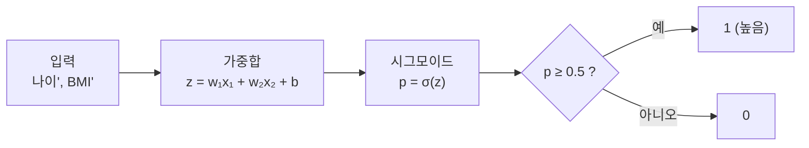

# 시그모이드와 이진 분류 (EX\_05)

[목차로 돌아가기](../00_%EB%94%A5%EB%9F%AC%EB%8B%9D%EC%88%98%ED%95%99_MOC.md) · 예제: `EX_05_Blood_Pressure_Logistic_Regression.ipynb` · 코드 풀이: [E05_혈압_로지스틱회귀_예제](../03_%EC%98%88%EC%A0%9C%ED%92%80%EC%9D%B4/E05_%ED%98%88%EC%95%95_%EB%A1%9C%EC%A7%80%EC%8A%A4%ED%8B%B1%ED%9A%8C%EA%B7%80_%EC%98%88%EC%A0%9C.md)

> [!NOTE]
> **3줄 요약**
> - [가중합](../00_%EB%94%A5%EB%9F%AC%EB%8B%9D_%EC%9A%A9%EC%96%B4%EC%82%AC%EC%A0%84.md#%EA%B0%80%EC%A4%91%ED%95%A9) z를 **시그모이드** $\sigma(z) = \frac{1}{1+e^{-z}}$에 넣어 0~1 [확률](../00_%EB%94%A5%EB%9F%AC%EB%8B%9D_%EC%9A%A9%EC%96%B4%EC%82%AC%EC%A0%84.md#%ED%99%95%EB%A5%A0)로 바꾸고, **0.5 이상이면 1**로 판정한다. 시그모이드가 0.5인 곳은 z = 0이라서, 결정 경계는 "가중합 = 0"인 선이다.
> - [비용](../00_%EB%94%A5%EB%9F%AC%EB%8B%9D_%EC%9A%A9%EC%96%B4%EC%82%AC%EC%A0%84.md#%EC%86%90%EC%8B%A4-%ED%95%A8%EC%88%98)은 **binary [cross-entropy](../00_%EB%94%A5%EB%9F%AC%EB%8B%9D_%EC%9A%A9%EC%96%B4%EC%82%AC%EC%A0%84.md#cross-entropy)**: 정답에 준 확률 p에 대해 벌점 $-\ln p$의 평균.
> - 노트북에 찍힌 18명의 확률로 이 평균을 직접 계산하면 **0.4469**로, 노트북의 마지막 loss와 같다.

## 1. 이게 하는 일 (말로)

"혈압이 높은 쪽인가(1), 아닌가(0)"를 맞힌다. 그냥 0/1을 찍지 않고 **"1일 확률"** 을 말한 다음 0.5를 기준으로 판정한다.

> 비유: 일기예보가 "비 온다/안 온다" 대신 "강수확률 70%"라고 말하고, 우리는 50%가 넘으면 우산을 챙긴다.

## 2. 필요한 수학 체크리스트

- [ ] [M06_지수와_e](../02_%EC%88%98%ED%95%99%EB%85%B8%ED%8A%B8/M06_%EC%A7%80%EC%88%98%EC%99%80_e.md) — 시그모이드 안의 $e^{-z}$
- [ ] [M07_로그](../02_%EC%88%98%ED%95%99%EB%85%B8%ED%8A%B8/M07_%EB%A1%9C%EA%B7%B8.md) — 벌점 $-\ln p$
- [ ] [M08_확률_기초](../02_%EC%88%98%ED%95%99%EB%85%B8%ED%8A%B8/M08_%ED%99%95%EB%A5%A0_%EA%B8%B0%EC%B4%88.md) — p와 1 − p, 합이 1
- [ ] [D03_Dense층과_정규화](D03_Dense%EC%B8%B5%EA%B3%BC_%EC%A0%95%EA%B7%9C%ED%99%94.md) — 가중합 z를 만드는 [Dense](../00_%EB%94%A5%EB%9F%AC%EB%8B%9D_%EC%9A%A9%EC%96%B4%EC%82%AC%EC%A0%84.md#dense-%EC%B8%B5)(1)
- [ ] [M10_엔트로피](../02_%EC%88%98%ED%95%99%EB%85%B8%ED%8A%B8/M10_%EC%97%94%ED%8A%B8%EB%A1%9C%ED%94%BC.md) — cross-entropy라는 이름의 뜻, 첫 loss가 0.69 근처인 이유
- [ ] [M09_최솟값과_볼록함수](../02_%EC%88%98%ED%95%99%EB%85%B8%ED%8A%B8/M09_%EC%B5%9C%EC%86%9F%EA%B0%92%EA%B3%BC_%EB%B3%BC%EB%A1%9D%ED%95%A8%EC%88%98.md) — [MSE](../00_%EB%94%A5%EB%9F%AC%EB%8B%9D_%EC%9A%A9%EC%96%B4%EC%82%AC%EC%A0%84.md#mse) 대신 cross-entropy를 쓰면 비용이 그릇 모양([볼록](../00_%EB%94%A5%EB%9F%AC%EB%8B%9D_%EC%9A%A9%EC%96%B4%EC%82%AC%EC%A0%84.md#%EB%B3%BC%EB%A1%9D-%ED%95%A8%EC%88%98))이 된다

## 3. 수학 하나씩 풀기

<details><summary>미니 복습: $e^x$</summary>

항상 양수. x = 0이면 1, 커지면 폭발, 작아지면 0에 가까움. 자세히: [M06_지수와_e](../02_%EC%88%98%ED%95%99%EB%85%B8%ED%8A%B8/M06_%EC%A7%80%EC%88%98%EC%99%80_e.md)

</details>

<details><summary>미니 복습: $-\ln p$</summary>

p = 1이면 0, p = 0.5면 0.693, p = 0.1이면 2.303. 정답에 낮은 확률을 줄수록 크게 벌준다. 자세히: [M07_로그](../02_%EC%88%98%ED%95%99%EB%85%B8%ED%8A%B8/M07_%EB%A1%9C%EA%B7%B8.md)

</details>

<details><summary>미니 복습: 확률</summary>

0~1 사이. 1일 확률이 p면 0일 확률은 1 − p. 자세히: [M08_확률_기초](../02_%EC%88%98%ED%95%99%EB%85%B8%ED%8A%B8/M08_%ED%99%95%EB%A5%A0_%EA%B8%B0%EC%B4%88.md)

</details>

## 4. 다시 합치기: 숫자 → 식 → 코드

### 4.1 전체 흐름



### 4.2 시그모이드

$$\sigma(z) = \frac{1}{1 + e^{-z}}$$

| z | −3 | −1 | −0.1 | **0** | 0.1 | 1 | 3 |
|---|---|---|---|---|---|---|---|
| σ(z) | 0.0474 | 0.2689 | 0.475 | **0.5** | 0.525 | 0.7311 | 0.9526 |

- z가 **음수면 0.5 미만**, **양수면 0.5 초과**, 0이면 정확히 0.5다.
- 그래서 "p ≥ 0.5"는 "z ≥ 0"과 같은 말이다. 확률을 계산하지 않아도 가중합의 **부호**만 보면 판정이 나온다.
- 입력이 2개(나이', BMI')일 때 $w_1x_1 + w_2x_2 + b = 0$은 평면 위의 **직선**이다. 이 직선 한쪽은 1, 반대쪽은 0으로 판정된다. 이 선을 **결정 경계**라고 한다.

손계산 (z = 2): $e^{-2}$ = 0.1353 → 1 + 0.1353 = 1.1353 → 1 ÷ 1.1353 = **0.8808**

### 4.3 binary cross-entropy

정답 y가 1이면 p를, 0이면 1 − p를 "정답에 준 확률"로 본다.

$$L = -\big[\,y \ln p + (1 - y)\ln(1 - p)\,\big]$$

| 정답 y | 식이 줄어든 모양 | 뜻 |
|---|---|---|
| 1 | $-\ln p$ | 1일 확률 p가 클수록 벌점 작음 |
| 0 | $-\ln(1 - p)$ | 0일 확률 1 − p가 클수록 벌점 작음 |

y는 0 아니면 1이라서, 대괄호 안의 두 항 중 **하나는 항상 0**이 되어 사라진다. 한 줄로 두 경우를 쓰려는 요령이다.

### 4.4 노트북 결과로 직접 계산해 보기

[E05_혈압_로지스틱회귀_예제](../03_%EC%98%88%EC%A0%9C%ED%92%80%EC%9D%B4/E05_%ED%98%88%EC%95%95_%EB%A1%9C%EC%A7%80%EC%8A%A4%ED%8B%B1%ED%9A%8C%EA%B7%80_%EC%98%88%EC%A0%9C.md) 1-7에 찍힌 18명의 p로 벌점을 계산하면:

| 사람 | p | 정답 | 정답에 준 확률 | 벌점 |
|---|---|---|---|---|
| 25세, BMI 22 | 0.0707 | 0 | 0.9293 | 0.073 |
| 25세, BMI 30 | 0.605 | 1 | 0.605 | 0.503 |
| 35세, BMI 26 | 0.3508 | 1 | 0.3508 | **1.048** (틀림) |
| 35세, BMI 30 | 0.708 | 0 | 0.292 | **1.231** (틀림) |
| 73세, BMI 30 | 0.9328 | 1 | 0.9328 | 0.070 |

```python
import numpy as np
labels = np.array([0,0,1,0,1,0,0,0,1,0,0,1,1,1,1,0,1,1])     # 정답 18개
p = np.array([0.07072,0.2545,0.605,0.1075,0.3508,0.708,0.1601,0.461,0.7933,
              0.2318,0.5751,0.8586,0.3232,0.6818,0.9058,0.4081,0.7557,0.9328])   # 노트북에 찍힌 확률
bce = -(labels*np.log(p) + (1-labels)*np.log(1-p))    # 사람마다 벌점
print(bce.mean())                                     # 평균 = binary cross-entropy
print(((p >= 0.5) == labels).mean())                  # 정확도
```

**실행 결과**:

```
0.44686103146124456
0.7777777777777778
```

- 노트북 마지막 loss **0.4469**, [정확도](../00_%EB%94%A5%EB%9F%AC%EB%8B%9D_%EC%9A%A9%EC%96%B4%EC%82%AC%EC%A0%84.md#%EC%A0%95%ED%99%95%EB%8F%84) **0.7778**과 같다. Keras가 하는 계산이 정말 이 식이라는 확인이다.
- 틀린 사람(1.048, 1.231)의 벌점이 가장 크다. 학습은 이 큰 벌점을 줄이는 쪽으로 [가중치](../00_%EB%94%A5%EB%9F%AC%EB%8B%9D_%EC%9A%A9%EC%96%B4%EC%82%AC%EC%A0%84.md#%EA%B0%80%EC%A4%91%EC%B9%98)를 고친다.

> [!WARNING]
> **⚠ 왜 MSE를 안 쓰나**
> 확률과 정답(0/1)의 차이는 최대 1이라 제곱해도 최대 1이다. 확신을 갖고 틀려도(정답 1에 p = 0.01) 벌점이 0.98에 그친다. cross-entropy는 같은 경우 4.6으로 훨씬 세게 벌준다. 그리고 시그모이드와 함께 쓰면 [기울기](../00_%EB%94%A5%EB%9F%AC%EB%8B%9D_%EC%9A%A9%EC%96%B4%EC%82%AC%EC%A0%84.md#%EA%B8%B0%EC%9A%B8%EA%B8%B0) 식이 단순해져 학습이 잘 된다.

## 5. 스스로 확인

<details><summary>1. 가중합 z = −1이면 판정은?</summary>

σ(−1) = 0.2689 < 0.5 → **0**. (z가 음수라는 것만 봐도 된다)

</details>

<details><summary>2. 정답 0인 사람에게 p = 0.9를 줬다. 벌점은?</summary>

정답에 준 확률 = 1 − 0.9 = 0.1 → −ln 0.1 = **2.303**

</details>

<details><summary>3. 결정 경계에서 시그모이드 값은?</summary>

**0.5** (z = 0)

</details>

