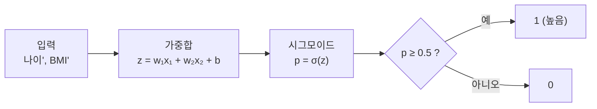

# 시그모이드와 이진 분류 (EX\_05)

[목차로 돌아가기](../00_%EB%94%A5%EB%9F%AC%EB%8B%9D%EC%88%98%ED%95%99_MOC.md) · 예제: `EX_05_Blood_Pressure_Logistic_Regression.ipynb` · 코드 풀이: [E05_혈압_로지스틱회귀_예제](../03_%EC%98%88%EC%A0%9C%ED%92%80%EC%9D%B4/E05_%ED%98%88%EC%95%95_%EB%A1%9C%EC%A7%80%EC%8A%A4%ED%8B%B1%ED%9A%8C%EA%B7%80_%EC%98%88%EC%A0%9C.md)

> [!NOTE]
> **3줄 요약**
> - [가중합](../00_%EB%94%A5%EB%9F%AC%EB%8B%9D_%EC%9A%A9%EC%96%B4%EC%82%AC%EC%A0%84.md#weighted-sum-%EA%B0%80%EC%A4%91%ED%95%A9) z를 **[시그모이드](../00_%EB%94%A5%EB%9F%AC%EB%8B%9D_%EC%9A%A9%EC%96%B4%EC%82%AC%EC%A0%84.md#sigmoid-%EC%8B%9C%EA%B7%B8%EB%AA%A8%EC%9D%B4%EB%93%9C)** $\sigma(z) = \frac{1}{1+e^{-z}}$에 넣어 0~1 [확률](../00_%EB%94%A5%EB%9F%AC%EB%8B%9D_%EC%9A%A9%EC%96%B4%EC%82%AC%EC%A0%84.md#probability-%ED%99%95%EB%A5%A0)로 바꾸고, **0.5 이상이면 1**로 판정한다. [시그모이드](../00_%EB%94%A5%EB%9F%AC%EB%8B%9D_%EC%9A%A9%EC%96%B4%EC%82%AC%EC%A0%84.md#sigmoid-%EC%8B%9C%EA%B7%B8%EB%AA%A8%EC%9D%B4%EB%93%9C)가 0.5인 곳은 z = 0이라서, [결정 경계](../00_%EB%94%A5%EB%9F%AC%EB%8B%9D_%EC%9A%A9%EC%96%B4%EC%82%AC%EC%A0%84.md#decision-boundary-%EA%B2%B0%EC%A0%95-%EA%B2%BD%EA%B3%84)는 "[가중합](../00_%EB%94%A5%EB%9F%AC%EB%8B%9D_%EC%9A%A9%EC%96%B4%EC%82%AC%EC%A0%84.md#weighted-sum-%EA%B0%80%EC%A4%91%ED%95%A9) = 0"인 선이다.
> - [손실](../00_%EB%94%A5%EB%9F%AC%EB%8B%9D_%EC%9A%A9%EC%96%B4%EC%82%AC%EC%A0%84.md#loss-function-%EC%86%90%EC%8B%A4-%ED%95%A8%EC%88%98)은 **이진 [교차 엔트로피](../00_%EB%94%A5%EB%9F%AC%EB%8B%9D_%EC%9A%A9%EC%96%B4%EC%82%AC%EC%A0%84.md#cross-entropy-%EA%B5%90%EC%B0%A8-%EC%97%94%ED%8A%B8%EB%A1%9C%ED%94%BC)**: [정답](../00_%EB%94%A5%EB%9F%AC%EB%8B%9D_%EC%9A%A9%EC%96%B4%EC%82%AC%EC%A0%84.md#label-%EC%A0%95%EB%8B%B5)에 준 [확률](../00_%EB%94%A5%EB%9F%AC%EB%8B%9D_%EC%9A%A9%EC%96%B4%EC%82%AC%EC%A0%84.md#probability-%ED%99%95%EB%A5%A0) p에 대해 벌점 $-\ln p$의 평균.
> - 노트북에 찍힌 18명의 [확률](../00_%EB%94%A5%EB%9F%AC%EB%8B%9D_%EC%9A%A9%EC%96%B4%EC%82%AC%EC%A0%84.md#probability-%ED%99%95%EB%A5%A0)로 이 평균을 직접 계산하면 **0.4469**로, 노트북의 마지막 [손실](../00_%EB%94%A5%EB%9F%AC%EB%8B%9D_%EC%9A%A9%EC%96%B4%EC%82%AC%EC%A0%84.md#loss-function-%EC%86%90%EC%8B%A4-%ED%95%A8%EC%88%98)과 같다.

## 1. 개념 설명

"혈압이 높은 쪽인가(1), 아닌가(0)"를 맞힌다. 0/1을 바로 내지 않고 **"1일 [확률](../00_%EB%94%A5%EB%9F%AC%EB%8B%9D_%EC%9A%A9%EC%96%B4%EC%82%AC%EC%A0%84.md#probability-%ED%99%95%EB%A5%A0)"** 을 말한 다음 0.5를 기준으로 판정한다.

> 비유: 일기예보가 "비 온다/안 온다" 대신 "강수확률 70%"라고 말하고, 우리는 50%가 넘으면 우산을 챙긴다.

정확히 말하면 [시그모이드](../00_%EB%94%A5%EB%9F%AC%EB%8B%9D_%EC%9A%A9%EC%96%B4%EC%82%AC%EC%A0%84.md#sigmoid-%EC%8B%9C%EA%B7%B8%EB%AA%A8%EC%9D%B4%EB%93%9C)(sigmoid)는 [가중합](../00_%EB%94%A5%EB%9F%AC%EB%8B%9D_%EC%9A%A9%EC%96%B4%EC%82%AC%EC%A0%84.md#weighted-sum-%EA%B0%80%EC%A4%91%ED%95%A9) z를 0~1 사이의 값으로 바꿔 주는 함수다. 이 값을 "1일 [확률](../00_%EB%94%A5%EB%9F%AC%EB%8B%9D_%EC%9A%A9%EC%96%B4%EC%82%AC%EC%A0%84.md#probability-%ED%99%95%EB%A5%A0)" p로 보고, p가 0.5 이상이면 1, 아니면 0으로 판정하는 것이 [이진 분류](../00_%EB%94%A5%EB%9F%AC%EB%8B%9D_%EC%9A%A9%EC%96%B4%EC%82%AC%EC%A0%84.md#binary-classification-%EC%9D%B4%EC%A7%84-%EB%B6%84%EB%A5%98)(둘 중 하나를 고르는 [분류](../00_%EB%94%A5%EB%9F%AC%EB%8B%9D_%EC%9A%A9%EC%96%B4%EC%82%AC%EC%A0%84.md#regression-classification-%ED%9A%8C%EA%B7%80%EC%99%80-%EB%B6%84%EB%A5%98))다.

전체 흐름은 다음과 같다.



## 2. 필요한 이유

[D03_Dense층과_정규화](../01_%EA%B0%9C%EB%85%90%EB%85%B8%ED%8A%B8/D03_Dense%EC%B8%B5%EA%B3%BC_%EC%A0%95%EA%B7%9C%ED%99%94.md)의 [덴스 층](../00_%EB%94%A5%EB%9F%AC%EB%8B%9D_%EC%9A%A9%EC%96%B4%EC%82%AC%EC%A0%84.md#dense-layer-%EB%8D%B4%EC%8A%A4-%EC%B8%B5)이 내는 [가중합](../00_%EB%94%A5%EB%9F%AC%EB%8B%9D_%EC%9A%A9%EC%96%B4%EC%82%AC%EC%A0%84.md#weighted-sum-%EA%B0%80%EC%A4%91%ED%95%A9)은 직선 출력이라 z = 3이든 z = −3이든 어떤 값도 될 수 있고, 이 값은 0~1 범위의 [확률](../00_%EB%94%A5%EB%9F%AC%EB%8B%9D_%EC%9A%A9%EC%96%B4%EC%82%AC%EC%A0%84.md#probability-%ED%99%95%EB%A5%A0)로 읽을 수 없다. "혈압이 높은가 아닌가" 같은 예/아니오 문제에는 직선 출력을 0~1 사이로 눌러 주는 함수([시그모이드](../00_%EB%94%A5%EB%9F%AC%EB%8B%9D_%EC%9A%A9%EC%96%B4%EC%82%AC%EC%A0%84.md#sigmoid-%EC%8B%9C%EA%B7%B8%EB%AA%A8%EC%9D%B4%EB%93%9C))가 필요하다. 또 [정답](../00_%EB%94%A5%EB%9F%AC%EB%8B%9D_%EC%9A%A9%EC%96%B4%EC%82%AC%EC%A0%84.md#label-%EC%A0%95%EB%8B%B5)이 숫자가 아니라 0/1이므로, 이에 맞는 [손실](../00_%EB%94%A5%EB%9F%AC%EB%8B%9D_%EC%9A%A9%EC%96%B4%EC%82%AC%EC%A0%84.md#loss-function-%EC%86%90%EC%8B%A4-%ED%95%A8%EC%88%98)로 [교차 엔트로피](../00_%EB%94%A5%EB%9F%AC%EB%8B%9D_%EC%9A%A9%EC%96%B4%EC%82%AC%EC%A0%84.md#cross-entropy-%EA%B5%90%EC%B0%A8-%EC%97%94%ED%8A%B8%EB%A1%9C%ED%94%BC)를 쓴다.

## 3. 필요한 수학 개념

| 수학 개념 | 이 개념에서 쓰이는 곳 | 자세히 |
|---|---|---|
| [지수](../00_%EB%94%A5%EB%9F%AC%EB%8B%9D_%EC%9A%A9%EC%96%B4%EC%82%AC%EC%A0%84.md#e-exponent-e%EC%99%80-%EC%A7%80%EC%88%98)와 e | [시그모이드](../00_%EB%94%A5%EB%9F%AC%EB%8B%9D_%EC%9A%A9%EC%96%B4%EC%82%AC%EC%A0%84.md#sigmoid-%EC%8B%9C%EA%B7%B8%EB%AA%A8%EC%9D%B4%EB%93%9C) 안의 $e^{-z}$ | [M06_지수와_e](../02_%EC%88%98%ED%95%99%EB%85%B8%ED%8A%B8/M06_%EC%A7%80%EC%88%98%EC%99%80_e.md) |
| [로그](../00_%EB%94%A5%EB%9F%AC%EB%8B%9D_%EC%9A%A9%EC%96%B4%EC%82%AC%EC%A0%84.md#log-ln-%EB%A1%9C%EA%B7%B8) | 벌점 $-\ln p$ | [M07_로그](../02_%EC%88%98%ED%95%99%EB%85%B8%ED%8A%B8/M07_%EB%A1%9C%EA%B7%B8.md) |
| [확률](../00_%EB%94%A5%EB%9F%AC%EB%8B%9D_%EC%9A%A9%EC%96%B4%EC%82%AC%EC%A0%84.md#probability-%ED%99%95%EB%A5%A0) 기초 | p와 1 − p, 합이 1 | [M08_확률_기초](../02_%EC%88%98%ED%95%99%EB%85%B8%ED%8A%B8/M08_%ED%99%95%EB%A5%A0_%EA%B8%B0%EC%B4%88.md) |
| [덴스 층](../00_%EB%94%A5%EB%9F%AC%EB%8B%9D_%EC%9A%A9%EC%96%B4%EC%82%AC%EC%A0%84.md#dense-layer-%EB%8D%B4%EC%8A%A4-%EC%B8%B5)과 [정규화](../00_%EB%94%A5%EB%9F%AC%EB%8B%9D_%EC%9A%A9%EC%96%B4%EC%82%AC%EC%A0%84.md#normalization-%EC%A0%95%EA%B7%9C%ED%99%94) | [가중합](../00_%EB%94%A5%EB%9F%AC%EB%8B%9D_%EC%9A%A9%EC%96%B4%EC%82%AC%EC%A0%84.md#weighted-sum-%EA%B0%80%EC%A4%91%ED%95%A9) z를 만드는 Dense(1) | [D03_Dense층과_정규화](../01_%EA%B0%9C%EB%85%90%EB%85%B8%ED%8A%B8/D03_Dense%EC%B8%B5%EA%B3%BC_%EC%A0%95%EA%B7%9C%ED%99%94.md) |
| [엔트로피](../00_%EB%94%A5%EB%9F%AC%EB%8B%9D_%EC%9A%A9%EC%96%B4%EC%82%AC%EC%A0%84.md#entropy-%EC%97%94%ED%8A%B8%EB%A1%9C%ED%94%BC) | [교차 엔트로피](../00_%EB%94%A5%EB%9F%AC%EB%8B%9D_%EC%9A%A9%EC%96%B4%EC%82%AC%EC%A0%84.md#cross-entropy-%EA%B5%90%EC%B0%A8-%EC%97%94%ED%8A%B8%EB%A1%9C%ED%94%BC)라는 이름의 뜻, 첫 [손실](../00_%EB%94%A5%EB%9F%AC%EB%8B%9D_%EC%9A%A9%EC%96%B4%EC%82%AC%EC%A0%84.md#loss-function-%EC%86%90%EC%8B%A4-%ED%95%A8%EC%88%98)이 0.69 근처인 이유 | [M10_엔트로피](../02_%EC%88%98%ED%95%99%EB%85%B8%ED%8A%B8/M10_%EC%97%94%ED%8A%B8%EB%A1%9C%ED%94%BC.md) |
| 최솟값과 볼록함수 | [MSE](../00_%EB%94%A5%EB%9F%AC%EB%8B%9D_%EC%9A%A9%EC%96%B4%EC%82%AC%EC%A0%84.md#mse-mean-squared-error-%ED%8F%89%EA%B7%A0-%EC%A0%9C%EA%B3%B1-%EC%98%A4%EC%B0%A8) 대신 [교차 엔트로피](../00_%EB%94%A5%EB%9F%AC%EB%8B%9D_%EC%9A%A9%EC%96%B4%EC%82%AC%EC%A0%84.md#cross-entropy-%EA%B5%90%EC%B0%A8-%EC%97%94%ED%8A%B8%EB%A1%9C%ED%94%BC)를 쓰면 [손실](../00_%EB%94%A5%EB%9F%AC%EB%8B%9D_%EC%9A%A9%EC%96%B4%EC%82%AC%EC%A0%84.md#loss-function-%EC%86%90%EC%8B%A4-%ED%95%A8%EC%88%98)이 그릇 모양(볼록)이 된다 | [M09_최솟값과_볼록함수](../02_%EC%88%98%ED%95%99%EB%85%B8%ED%8A%B8/M09_%EC%B5%9C%EC%86%9F%EA%B0%92%EA%B3%BC_%EB%B3%BC%EB%A1%9D%ED%95%A8%EC%88%98.md) |

<details><summary>미니 복습: $e^x$</summary>

e는 약 2.718인 특별한 수다. $e^x$는 항상 양수. x = 0이면 1이고, x가 커지면 $e^x$도 커진다(폭발). x가 작아져 큰 음수가 되면 0에 가까워진다. 자세히: [M06_지수와_e](../02_%EC%88%98%ED%95%99%EB%85%B8%ED%8A%B8/M06_%EC%A7%80%EC%88%98%EC%99%80_e.md)

</details>

<details><summary>미니 복습: $-\ln p$</summary>

ln은 "e를 몇 번 곱해야 그 수가 되나"를 거꾸로 묻는 것이다. 예: $e^{0.693} = 2$이므로 ln 2 ≈ 0.693.
p = 1이면 0, p = 0.5면 0.693, p = 0.1이면 2.303. [정답](../00_%EB%94%A5%EB%9F%AC%EB%8B%9D_%EC%9A%A9%EC%96%B4%EC%82%AC%EC%A0%84.md#label-%EC%A0%95%EB%8B%B5)에 낮은 [확률](../00_%EB%94%A5%EB%9F%AC%EB%8B%9D_%EC%9A%A9%EC%96%B4%EC%82%AC%EC%A0%84.md#probability-%ED%99%95%EB%A5%A0)을 줄수록 크게 벌준다.
[학습](../00_%EB%94%A5%EB%9F%AC%EB%8B%9D_%EC%9A%A9%EC%96%B4%EC%82%AC%EC%A0%84.md#training-%ED%95%99%EC%8A%B5) 전에는 z가 0 근처라 모든 p가 약 0.5이고, 벌점이 −ln 0.5 = ln 2 ≈ 0.693이다. 그래서 첫 [손실](../00_%EB%94%A5%EB%9F%AC%EB%8B%9D_%EC%9A%A9%EC%96%B4%EC%82%AC%EC%A0%84.md#loss-function-%EC%86%90%EC%8B%A4-%ED%95%A8%EC%88%98)이 0.69 근처다. 자세히: [M07_로그](../02_%EC%88%98%ED%95%99%EB%85%B8%ED%8A%B8/M07_%EB%A1%9C%EA%B7%B8.md)

</details>

<details><summary>미니 복습: 확률</summary>

0~1 사이. 1일 [확률](../00_%EB%94%A5%EB%9F%AC%EB%8B%9D_%EC%9A%A9%EC%96%B4%EC%82%AC%EC%A0%84.md#probability-%ED%99%95%EB%A5%A0)이 p면 0일 [확률](../00_%EB%94%A5%EB%9F%AC%EB%8B%9D_%EC%9A%A9%EC%96%B4%EC%82%AC%EC%A0%84.md#probability-%ED%99%95%EB%A5%A0)은 1 − p. 자세히: [M08_확률_기초](../02_%EC%88%98%ED%95%99%EB%85%B8%ED%8A%B8/M08_%ED%99%95%EB%A5%A0_%EA%B8%B0%EC%B4%88.md)

</details>

## 4. 계산 과정 (숫자 → 식 → 코드)

### 숫자

#### 시그모이드 값

[시그모이드](../00_%EB%94%A5%EB%9F%AC%EB%8B%9D_%EC%9A%A9%EC%96%B4%EC%82%AC%EC%A0%84.md#sigmoid-%EC%8B%9C%EA%B7%B8%EB%AA%A8%EC%9D%B4%EB%93%9C)는 z로 $e^{-z}$를 구해 1을 더하고, 1을 그 값으로 나눈다(공식은 아래 "식" 절).

| z | −3 | −1 | −0.1 | **0** | 0.1 | 1 | 3 |
|---|---|---|---|---|---|---|---|
| σ(z) | 0.0474 | 0.2689 | 0.475 | **0.5** | 0.525 | 0.7311 | 0.9526 |

- z가 **음수면 0.5 미만**, **양수면 0.5 초과**, 0이면 정확히 0.5다.
- 왜 0~1을 벗어나지 않나: z가 크면 $e^{-z}$는 0에 가까워져서 σ = 1 ÷ (1 + 0) ≈ 1이다(z = 3이면 $e^{-3}$ = 0.0498 → 0.9526).
- z가 큰 음수면 $e^{-z}$가 아주 커져서 σ = 1 ÷ (1 + 아주 큰 수) ≈ 0이다(z = −3이면 $e^{3}$ = 20.09 → 1 ÷ 21.09 = 0.0474).

손계산 (z = 2): $e^{-2}$ = 0.1353 → 1 + 0.1353 = 1.1353 → 1 ÷ 1.1353 = **0.8808**

#### 판정과 결정 경계

- "p ≥ 0.5"는 "z ≥ 0"과 같은 말이다. [확률](../00_%EB%94%A5%EB%9F%AC%EB%8B%9D_%EC%9A%A9%EC%96%B4%EC%82%AC%EC%A0%84.md#probability-%ED%99%95%EB%A5%A0)을 계산하지 않아도 [가중합](../00_%EB%94%A5%EB%9F%AC%EB%8B%9D_%EC%9A%A9%EC%96%B4%EC%82%AC%EC%A0%84.md#weighted-sum-%EA%B0%80%EC%A4%91%ED%95%A9)의 **부호**만 보면 판정이 나온다.
- 입력이 2개(나이', BMI')일 때 $w_1x_1 + w_2x_2 + b = 0$은 평면 위의 **직선**이다. 이 직선 한쪽은 1, 반대쪽은 0으로 판정된다. 이 선을 **[결정 경계](../00_%EB%94%A5%EB%9F%AC%EB%8B%9D_%EC%9A%A9%EC%96%B4%EC%82%AC%EC%A0%84.md#decision-boundary-%EA%B2%B0%EC%A0%95-%EA%B2%BD%EA%B3%84)**라고 한다.

#### 노트북 결과로 벌점 계산

[E05_혈압_로지스틱회귀_예제](../03_%EC%98%88%EC%A0%9C%ED%92%80%EC%9D%B4/E05_%ED%98%88%EC%95%95_%EB%A1%9C%EC%A7%80%EC%8A%A4%ED%8B%B1%ED%9A%8C%EA%B7%80_%EC%98%88%EC%A0%9C.md)의 1-7절("[학습 데이터](../00_%EB%94%A5%EB%9F%AC%EB%8B%9D_%EC%9A%A9%EC%96%B4%EC%82%AC%EC%A0%84.md#training-data-test-data-%ED%95%99%EC%8A%B5-%EB%8D%B0%EC%9D%B4%ED%84%B0%EC%99%80-%EC%8B%9C%ED%97%98-%EB%8D%B0%EC%9D%B4%ED%84%B0)로 확인")에 찍힌 18명의 p로 벌점을 계산하면 다음과 같다. 벌점은 "[정답](../00_%EB%94%A5%EB%9F%AC%EB%8B%9D_%EC%9A%A9%EC%96%B4%EC%82%AC%EC%A0%84.md#label-%EC%A0%95%EB%8B%B5)에 준 [확률](../00_%EB%94%A5%EB%9F%AC%EB%8B%9D_%EC%9A%A9%EC%96%B4%EC%82%AC%EC%A0%84.md#probability-%ED%99%95%EB%A5%A0)"에 −ln을 취한 값이다(공식은 아래 "식" 절).

| 사람 | p | [정답](../00_%EB%94%A5%EB%9F%AC%EB%8B%9D_%EC%9A%A9%EC%96%B4%EC%82%AC%EC%A0%84.md#label-%EC%A0%95%EB%8B%B5) | [정답](../00_%EB%94%A5%EB%9F%AC%EB%8B%9D_%EC%9A%A9%EC%96%B4%EC%82%AC%EC%A0%84.md#label-%EC%A0%95%EB%8B%B5)에 준 [확률](../00_%EB%94%A5%EB%9F%AC%EB%8B%9D_%EC%9A%A9%EC%96%B4%EC%82%AC%EC%A0%84.md#probability-%ED%99%95%EB%A5%A0) | 벌점 |
|---|---|---|---|---|
| 25세, BMI 22 | 0.0707 | 0 | 0.9293 | 0.073 |
| 25세, BMI 30 | 0.605 | 1 | 0.605 | 0.503 |
| 35세, BMI 26 | 0.3508 | 1 | 0.3508 | **1.048** (틀림) |
| 35세, BMI 30 | 0.708 | 0 | 0.292 | **1.231** (틀림) |
| 73세, BMI 30 | 0.9328 | 1 | 0.9328 | 0.070 |

### 식

#### 시그모이드

[가중합](../00_%EB%94%A5%EB%9F%AC%EB%8B%9D_%EC%9A%A9%EC%96%B4%EC%82%AC%EC%A0%84.md#weighted-sum-%EA%B0%80%EC%A4%91%ED%95%A9) z를 0~1 사이의 값으로 바꾼다.

$$\sigma(z) = \frac{1}{1 + e^{-z}}$$

<details><summary>기호 풀이</summary>

| 기호 | 읽는 법 | 뜻 | 예제 값 |
| --- | --- | --- | --- |
| $\sigma$ | 시그마 | [시그모이드](../00_%EB%94%A5%EB%9F%AC%EB%8B%9D_%EC%9A%A9%EC%96%B4%EC%82%AC%EC%A0%84.md#sigmoid-%EC%8B%9C%EA%B7%B8%EB%AA%A8%EC%9D%B4%EB%93%9C) 함수 | σ(2) = 0.8808 |
| $z$ | 지 | [가중합](../00_%EB%94%A5%EB%9F%AC%EB%8B%9D_%EC%9A%A9%EC%96%B4%EC%82%AC%EC%A0%84.md#weighted-sum-%EA%B0%80%EC%A4%91%ED%95%A9) | 2 |
| $e$ | 이(자연상수) | 약 2.718인 특별한 수 | $e^{-2}$ = 0.1353 |

</details>

#### 이진 교차 엔트로피

[정답](../00_%EB%94%A5%EB%9F%AC%EB%8B%9D_%EC%9A%A9%EC%96%B4%EC%82%AC%EC%A0%84.md#label-%EC%A0%95%EB%8B%B5) y가 1이면 p를, 0이면 1 − p를 "[정답](../00_%EB%94%A5%EB%9F%AC%EB%8B%9D_%EC%9A%A9%EC%96%B4%EC%82%AC%EC%A0%84.md#label-%EC%A0%95%EB%8B%B5)에 준 [확률](../00_%EB%94%A5%EB%9F%AC%EB%8B%9D_%EC%9A%A9%EC%96%B4%EC%82%AC%EC%A0%84.md#probability-%ED%99%95%EB%A5%A0)"로 본다. 벌점은 이 [확률](../00_%EB%94%A5%EB%9F%AC%EB%8B%9D_%EC%9A%A9%EC%96%B4%EC%82%AC%EC%A0%84.md#probability-%ED%99%95%EB%A5%A0)에 −ln을 취해 만든다.

$$L = -\big[\,y \ln p + (1 - y)\ln(1 - p)\,\big]$$

<details><summary>기호 풀이</summary>

| 기호 | 읽는 법 | 뜻 | 예제 값 |
| --- | --- | --- | --- |
| $L$ | 엘 | 한 사람의 벌점([손실](../00_%EB%94%A5%EB%9F%AC%EB%8B%9D_%EC%9A%A9%EC%96%B4%EC%82%AC%EC%A0%84.md#loss-function-%EC%86%90%EC%8B%A4-%ED%95%A8%EC%88%98)) | 0.503 |
| $y$ | 와이 | [정답](../00_%EB%94%A5%EB%9F%AC%EB%8B%9D_%EC%9A%A9%EC%96%B4%EC%82%AC%EC%A0%84.md#label-%EC%A0%95%EB%8B%B5) (0 또는 1) | 1 |
| $p$ | 피 | 모델이 말한 "1일 [확률](../00_%EB%94%A5%EB%9F%AC%EB%8B%9D_%EC%9A%A9%EC%96%B4%EC%82%AC%EC%A0%84.md#probability-%ED%99%95%EB%A5%A0)" | 0.605 |
| $\ln$ | 엘엔(자연로그) | e를 몇 번 곱해야 그 수가 되는지 | ln 0.605 ≈ −0.503 |

</details>

| [정답](../00_%EB%94%A5%EB%9F%AC%EB%8B%9D_%EC%9A%A9%EC%96%B4%EC%82%AC%EC%A0%84.md#label-%EC%A0%95%EB%8B%B5) y | 식이 줄어든 모양 | 뜻 |
|---|---|---|
| 1 | $-\ln p$ | 1일 [확률](../00_%EB%94%A5%EB%9F%AC%EB%8B%9D_%EC%9A%A9%EC%96%B4%EC%82%AC%EC%A0%84.md#probability-%ED%99%95%EB%A5%A0) p가 클수록 벌점 작음 |
| 0 | $-\ln(1 - p)$ | 0일 [확률](../00_%EB%94%A5%EB%9F%AC%EB%8B%9D_%EC%9A%A9%EC%96%B4%EC%82%AC%EC%A0%84.md#probability-%ED%99%95%EB%A5%A0) 1 − p가 클수록 벌점 작음 |

y는 0 아니면 1이라서, 대괄호 안의 두 항 중 **하나는 항상 0**이 되어 사라진다. 한 줄로 두 경우를 쓰려는 요령이다.

### 코드

```python
import numpy as np
labels = np.array([0,0,1,0,1,0,0,0,1,0,0,1,1,1,1,0,1,1])     # 정답 18개
p = np.array([0.07072,0.2545,0.605,0.1075,0.3508,0.708,0.1601,0.461,0.7933,
              0.2318,0.5751,0.8586,0.3232,0.6818,0.9058,0.4081,0.7557,0.9328])   # 노트북에 찍힌 확률
bce = -(labels*np.log(p) + (1-labels)*np.log(1-p))    # 사람마다 벌점
print(bce.mean())                                     # 평균 = binary cross-entropy
print(((p >= 0.5) == labels).mean())                  # 정확도
```

**실행 결과**:

```text
0.44686103146124456
0.7777777777777778
```

- 노트북 마지막 [손실](../00_%EB%94%A5%EB%9F%AC%EB%8B%9D_%EC%9A%A9%EC%96%B4%EC%82%AC%EC%A0%84.md#loss-function-%EC%86%90%EC%8B%A4-%ED%95%A8%EC%88%98) **0.4469**, [정확도](../00_%EB%94%A5%EB%9F%AC%EB%8B%9D_%EC%9A%A9%EC%96%B4%EC%82%AC%EC%A0%84.md#accuracy-%EC%A0%95%ED%99%95%EB%8F%84) **0.7778**과 같다. Keras가 하는 계산이 정말 이 식이라는 확인이다.
- 틀린 사람(1.048, 1.231)의 벌점이 가장 크다. [학습](../00_%EB%94%A5%EB%9F%AC%EB%8B%9D_%EC%9A%A9%EC%96%B4%EC%82%AC%EC%A0%84.md#training-%ED%95%99%EC%8A%B5)은 이 큰 벌점을 줄이는 쪽으로 [가중치](../00_%EB%94%A5%EB%9F%AC%EB%8B%9D_%EC%9A%A9%EC%96%B4%EC%82%AC%EC%A0%84.md#weight-%EA%B0%80%EC%A4%91%EC%B9%98)를 고친다.

> [!WARNING]
> **⚠ [MSE](../00_%EB%94%A5%EB%9F%AC%EB%8B%9D_%EC%9A%A9%EC%96%B4%EC%82%AC%EC%A0%84.md#mse-mean-squared-error-%ED%8F%89%EA%B7%A0-%EC%A0%9C%EA%B3%B1-%EC%98%A4%EC%B0%A8)를 쓰지 않는 이유**
> [확률](../00_%EB%94%A5%EB%9F%AC%EB%8B%9D_%EC%9A%A9%EC%96%B4%EC%82%AC%EC%A0%84.md#probability-%ED%99%95%EB%A5%A0)과 [정답](../00_%EB%94%A5%EB%9F%AC%EB%8B%9D_%EC%9A%A9%EC%96%B4%EC%82%AC%EC%A0%84.md#label-%EC%A0%95%EB%8B%B5)(0/1)의 차이는 최대 1이라 제곱해도 최대 1이다. 확신을 갖고 틀려도([정답](../00_%EB%94%A5%EB%9F%AC%EB%8B%9D_%EC%9A%A9%EC%96%B4%EC%82%AC%EC%A0%84.md#label-%EC%A0%95%EB%8B%B5) 1에 p = 0.01) 벌점이 0.98에 그친다. [교차 엔트로피](../00_%EB%94%A5%EB%9F%AC%EB%8B%9D_%EC%9A%A9%EC%96%B4%EC%82%AC%EC%A0%84.md#cross-entropy-%EA%B5%90%EC%B0%A8-%EC%97%94%ED%8A%B8%EB%A1%9C%ED%94%BC)는 같은 경우 4.6으로 훨씬 세게 벌준다.
>
> 더 큰 이유는 [학습](../00_%EB%94%A5%EB%9F%AC%EB%8B%9D_%EC%9A%A9%EC%96%B4%EC%82%AC%EC%A0%84.md#training-%ED%95%99%EC%8A%B5)이 멈추는 것이다. [MSE](../00_%EB%94%A5%EB%9F%AC%EB%8B%9D_%EC%9A%A9%EC%96%B4%EC%82%AC%EC%A0%84.md#mse-mean-squared-error-%ED%8F%89%EA%B7%A0-%EC%A0%9C%EA%B3%B1-%EC%98%A4%EC%B0%A8)에 [시그모이드](../00_%EB%94%A5%EB%9F%AC%EB%8B%9D_%EC%9A%A9%EC%96%B4%EC%82%AC%EC%A0%84.md#sigmoid-%EC%8B%9C%EA%B7%B8%EB%AA%A8%EC%9D%B4%EB%93%9C)를 함께 쓰면, 확신을 갖고 틀린 곳(p가 0이나 1 근처)에서는 [시그모이드](../00_%EB%94%A5%EB%9F%AC%EB%8B%9D_%EC%9A%A9%EC%96%B4%EC%82%AC%EC%A0%84.md#sigmoid-%EC%8B%9C%EA%B7%B8%EB%AA%A8%EC%9D%B4%EB%93%9C) 곡선이 거의 평평하다. 그래서 [기울기](../00_%EB%94%A5%EB%9F%AC%EB%8B%9D_%EC%9A%A9%EC%96%B4%EC%82%AC%EC%A0%84.md#gradient-%EA%B8%B0%EC%9A%B8%EA%B8%B0)가 거의 0이 된다. [기울기](../00_%EB%94%A5%EB%9F%AC%EB%8B%9D_%EC%9A%A9%EC%96%B4%EC%82%AC%EC%A0%84.md#gradient-%EA%B8%B0%EC%9A%B8%EA%B8%B0)가 0이면 w를 고칠 수 없어 [학습](../00_%EB%94%A5%EB%9F%AC%EB%8B%9D_%EC%9A%A9%EC%96%B4%EC%82%AC%EC%A0%84.md#training-%ED%95%99%EC%8A%B5)이 멈춘다. 또 이 조합은 [손실](../00_%EB%94%A5%EB%9F%AC%EB%8B%9D_%EC%9A%A9%EC%96%B4%EC%82%AC%EC%A0%84.md#loss-function-%EC%86%90%EC%8B%A4-%ED%95%A8%EC%88%98) 모양이 그릇(볼록)이 아니다.
> [교차 엔트로피](../00_%EB%94%A5%EB%9F%AC%EB%8B%9D_%EC%9A%A9%EC%96%B4%EC%82%AC%EC%A0%84.md#cross-entropy-%EA%B5%90%EC%B0%A8-%EC%97%94%ED%8A%B8%EB%A1%9C%ED%94%BC)는 [기울기](../00_%EB%94%A5%EB%9F%AC%EB%8B%9D_%EC%9A%A9%EC%96%B4%EC%82%AC%EC%A0%84.md#gradient-%EA%B8%B0%EC%9A%B8%EA%B8%B0) 식이 간단히 (p − y)가 된다. 많이 틀릴수록 [기울기](../00_%EB%94%A5%EB%9F%AC%EB%8B%9D_%EC%9A%A9%EC%96%B4%EC%82%AC%EC%A0%84.md#gradient-%EA%B8%B0%EC%9A%B8%EA%B8%B0)가 커서 빨리 고쳐진다.

## 5. 개념 재확인

<details><summary>1. 가중합 z = −1이면 판정은?</summary>

| 단계 | 하는 일 | 코드 | 계산 | 결과 |
|---|---|---|---|---|
| 1 | [지수](../00_%EB%94%A5%EB%9F%AC%EB%8B%9D_%EC%9A%A9%EC%96%B4%EC%82%AC%EC%A0%84.md#e-exponent-e%EC%99%80-%EC%A7%80%EC%88%98) 구하기 | `np.exp(-z)` | e^(−(−1)) = e¹ | 2.718 |
| 2 | 분모 만들기 | `1 + np.exp(-z)` | 1 + 2.718 | 3.718 |
| 3 | [시그모이드](../00_%EB%94%A5%EB%9F%AC%EB%8B%9D_%EC%9A%A9%EC%96%B4%EC%82%AC%EC%A0%84.md#sigmoid-%EC%8B%9C%EA%B7%B8%EB%AA%A8%EC%9D%B4%EB%93%9C) 값 | `1 / (1 + np.exp(-z))` | 1 ÷ 3.718 | p = 0.2689 |
| 4 | 기준과 비교 | `p >= 0.5` | 0.2689 ≥ 0.5 → 거짓 | 판정 0 |

**① 쓰는 코드**
```python
import numpy as np            # ① 준비
z = -1                          # ① 가중합 (문제에서 준 값)
p = 1 / (1 + np.exp(-z))        # ② 지수 구하고 ③ 분모 만들어 ④ 시그모이드 값 구함
print(p >= 0.5)                 # ⑤ 기준과 비교 (0.5 이상이면 1, 아니면 0)
```

**② [지수](../00_%EB%94%A5%EB%9F%AC%EB%8B%9D_%EC%9A%A9%EC%96%B4%EC%82%AC%EC%A0%84.md#e-exponent-e%EC%99%80-%EC%A7%80%EC%88%98) 구하기** (`np.exp(-z)`)
- −z = −(−1) = 1
- e¹ = 2.718

**③ 분모 만들기** (`1 + np.exp(-z)`)
- 1 + 2.718 = 3.718

**④ [시그모이드](../00_%EB%94%A5%EB%9F%AC%EB%8B%9D_%EC%9A%A9%EC%96%B4%EC%82%AC%EC%A0%84.md#sigmoid-%EC%8B%9C%EA%B7%B8%EB%AA%A8%EC%9D%B4%EB%93%9C) 값** (`1 / (1 + np.exp(-z))`)
- 1 ÷ 3.718 = 0.2689 → p = 0.2689

**⑤ 기준과 비교** (`p >= 0.5`)
- 0.2689 ≥ 0.5는 거짓(False) → 판정 0

**답**: p = 0.2689이므로 판정은 **0**. (z가 음수면 계산하지 않아도 p < 0.5다)

</details>

<details><summary>2. 정답 0인 사람에게 p = 0.9를 줬다. 벌점은?</summary>

| 단계 | 하는 일 | 코드 | 계산 | 결과 |
|---|---|---|---|---|
| 1 | 첫 항 (y = 0) | `y * np.log(p)` | 0 × ln 0.9 | 0 (사라짐) |
| 2 | [정답](../00_%EB%94%A5%EB%9F%AC%EB%8B%9D_%EC%9A%A9%EC%96%B4%EC%82%AC%EC%A0%84.md#label-%EC%A0%95%EB%8B%B5) 0에 준 [확률](../00_%EB%94%A5%EB%9F%AC%EB%8B%9D_%EC%9A%A9%EC%96%B4%EC%82%AC%EC%A0%84.md#probability-%ED%99%95%EB%A5%A0) | `1 - p` | 1 − 0.9 | 0.1 |
| 3 | 둘째 항 | `(1-y) * np.log(1-p)` | 1 × ln 0.1 | −2.303 |
| 4 | 부호 뒤집기 | `-(...)` | −(0 + (−2.303)) | L = 2.303 |

**① 쓰는 코드**
```python
y = 0                                                  # ① 정답 (문제에서 준 값)
p = 0.9                                                # ① 모델이 말한 1일 확률 (문제에서 준 값)
bce = -(y*np.log(p) + (1-y)*np.log(1-p))               # ② 첫 항, ③ 1-p, ④ 둘째 항을 구해 ⑤ 더하고 부호 뒤집기
```

**② 첫 항** (`y * np.log(p)`)
- y = 0이므로 0 × ln 0.9 = 0
- [정답](../00_%EB%94%A5%EB%9F%AC%EB%8B%9D_%EC%9A%A9%EC%96%B4%EC%82%AC%EC%A0%84.md#label-%EC%A0%95%EB%8B%B5)이 0이면 첫 항은 사라짐

**③ [정답](../00_%EB%94%A5%EB%9F%AC%EB%8B%9D_%EC%9A%A9%EC%96%B4%EC%82%AC%EC%A0%84.md#label-%EC%A0%95%EB%8B%B5) 0에 준 [확률](../00_%EB%94%A5%EB%9F%AC%EB%8B%9D_%EC%9A%A9%EC%96%B4%EC%82%AC%EC%A0%84.md#probability-%ED%99%95%EB%A5%A0)** (`1 - p`)
- 1 − 0.9 = 0.1

**④ 둘째 항** (`(1-y) * np.log(1-p)`)
- 1 − y = 1 − 0 = 1
- e^(−2.303) = 0.1이므로 ln 0.1 = −2.303 (1보다 작은 수의 ln은 음수)
- 1 × (−2.303) = −2.303

**⑤ 부호 뒤집기** (`-(...)`)
- 0 + (−2.303) = −2.303
- −(−2.303) = 2.303 → L = 2.303

**답**: 벌점 = **2.303** ([정답](../00_%EB%94%A5%EB%9F%AC%EB%8B%9D_%EC%9A%A9%EC%96%B4%EC%82%AC%EC%A0%84.md#label-%EC%A0%95%EB%8B%B5)에 [확률](../00_%EB%94%A5%EB%9F%AC%EB%8B%9D_%EC%9A%A9%EC%96%B4%EC%82%AC%EC%A0%84.md#probability-%ED%99%95%EB%A5%A0) 0.1만 줬으니 크게 벌 받는다)

</details>

<details><summary>3. 결정 경계에서 시그모이드 값은?</summary>

| 단계 | 하는 일 | 코드 | 계산 | 결과 |
|---|---|---|---|---|
| 1 | 경계의 z 값 | `w1*x1 + w2*x2 + b` | = 0 인 곳 | z = 0 |
| 2 | [지수](../00_%EB%94%A5%EB%9F%AC%EB%8B%9D_%EC%9A%A9%EC%96%B4%EC%82%AC%EC%A0%84.md#e-exponent-e%EC%99%80-%EC%A7%80%EC%88%98) 구하기 | `np.exp(-z)` | e⁰ | 1 |
| 3 | 분모 만들기 | `1 + np.exp(-z)` | 1 + 1 | 2 |
| 4 | [시그모이드](../00_%EB%94%A5%EB%9F%AC%EB%8B%9D_%EC%9A%A9%EC%96%B4%EC%82%AC%EC%A0%84.md#sigmoid-%EC%8B%9C%EA%B7%B8%EB%AA%A8%EC%9D%B4%EB%93%9C) 값 | `1 / (1 + np.exp(-z))` | 1 ÷ 2 | 0.5 |

**① 쓰는 코드**
```python
# ② 가중합 z = w1*x1 + w2*x2 + b 는 결정 경계 위에서 0이다
z = 0                           # ② 경계 위의 점이므로 z = 0
p = 1 / (1 + np.exp(-z))        # ③ 지수 구하고 ④ 분모 만들어 ⑤ 시그모이드 값 구함
```

**② 경계의 z 값** (`w1*x1 + w2*x2 + b`)
- [결정 경계](../00_%EB%94%A5%EB%9F%AC%EB%8B%9D_%EC%9A%A9%EC%96%B4%EC%82%AC%EC%A0%84.md#decision-boundary-%EA%B2%B0%EC%A0%95-%EA%B2%BD%EA%B3%84)는 이 식이 0인 곳이라는 정의
- z = 0

**③ [지수](../00_%EB%94%A5%EB%9F%AC%EB%8B%9D_%EC%9A%A9%EC%96%B4%EC%82%AC%EC%A0%84.md#e-exponent-e%EC%99%80-%EC%A7%80%EC%88%98) 구하기** (`np.exp(-z)`)
- −z = −0 = 0
- e⁰ = 1 (어떤 수든 0번 곱하면 1)

**④ 분모 만들기** (`1 + np.exp(-z)`)
- 1 + 1 = 2

**⑤ [시그모이드](../00_%EB%94%A5%EB%9F%AC%EB%8B%9D_%EC%9A%A9%EC%96%B4%EC%82%AC%EC%A0%84.md#sigmoid-%EC%8B%9C%EA%B7%B8%EB%AA%A8%EC%9D%B4%EB%93%9C) 값** (`1 / (1 + np.exp(-z))`)
- 1 ÷ 2 = 0.5

0.5는 1일 [확률](../00_%EB%94%A5%EB%9F%AC%EB%8B%9D_%EC%9A%A9%EC%96%B4%EC%82%AC%EC%A0%84.md#probability-%ED%99%95%EB%A5%A0)과 0일 [확률](../00_%EB%94%A5%EB%9F%AC%EB%8B%9D_%EC%9A%A9%EC%96%B4%EC%82%AC%EC%A0%84.md#probability-%ED%99%95%EB%A5%A0)이 같아 어느 쪽도 아닌 경계다.

**답**: **0.5**

</details>

<details><summary>내 이해</summary>


</details>
