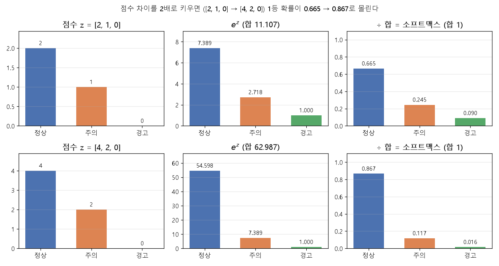

# 소프트맥스와 다중 분류 (EX\_06)

[목차로 돌아가기](../00_%EB%94%A5%EB%9F%AC%EB%8B%9D%EC%88%98%ED%95%99_MOC.md) · 예제: `EX_06_Blood_Pressure_Softmax_Classification.ipynb` · 코드 풀이: [E06_혈압_소프트맥스분류_예제](../03_%EC%98%88%EC%A0%9C%ED%92%80%EC%9D%B4/E06_%ED%98%88%EC%95%95_%EC%86%8C%ED%94%84%ED%8A%B8%EB%A7%A5%EC%8A%A4%EB%B6%84%EB%A5%98_%EC%98%88%EC%A0%9C.md)

> 참고: [다중 분류](../00_%EB%94%A5%EB%9F%AC%EB%8B%9D_%EC%9A%A9%EC%96%B4%EC%82%AC%EC%A0%84.md#multinomial-classification-%EB%8B%A4%EC%A4%91-%EB%B6%84%EB%A5%98)를 이진 분류기 여러 개로 하면 생기는 문제는 [D10_이진분류기에서_소프트맥스로](../01_%EA%B0%9C%EB%85%90%EB%85%B8%ED%8A%B8/D10_%EC%9D%B4%EC%A7%84%EB%B6%84%EB%A5%98%EA%B8%B0%EC%97%90%EC%84%9C_%EC%86%8C%ED%94%84%ED%8A%B8%EB%A7%A5%EC%8A%A4%EB%A1%9C.md), 점수 z([로짓](../00_%EB%94%A5%EB%9F%AC%EB%8B%9D_%EC%9A%A9%EC%96%B4%EC%82%AC%EC%A0%84.md#logit-%EB%A1%9C%EC%A7%93))가 [확률](../00_%EB%94%A5%EB%9F%AC%EB%8B%9D_%EC%9A%A9%EC%96%B4%EC%82%AC%EC%A0%84.md#probability-%ED%99%95%EB%A5%A0)과 어떻게 이어지는지는 [M11_오즈와_로짓](../02_%EC%88%98%ED%95%99%EB%85%B8%ED%8A%B8/M11_%EC%98%A4%EC%A6%88%EC%99%80_%EB%A1%9C%EC%A7%93.md)

> [!NOTE]
> **3줄 요약**
> - 등급마다 점수([가중합](../00_%EB%94%A5%EB%9F%AC%EB%8B%9D_%EC%9A%A9%EC%96%B4%EC%82%AC%EC%A0%84.md#weighted-sum-%EA%B0%80%EC%A4%91%ED%95%A9))를 하나씩 내고, **[소프트맥스](../00_%EB%94%A5%EB%9F%AC%EB%8B%9D_%EC%9A%A9%EC%96%B4%EC%82%AC%EC%A0%84.md#softmax-%EC%86%8C%ED%94%84%ED%8A%B8%EB%A7%A5%EC%8A%A4)** $p_k = \frac{e^{z_k}}{\sum_j e^{z_j}}$로 "합이 1인 [확률](../00_%EB%94%A5%EB%9F%AC%EB%8B%9D_%EC%9A%A9%EC%96%B4%EC%82%AC%EC%A0%84.md#probability-%ED%99%95%EB%A5%A0)"로 바꾼 뒤, 가장 큰 칸(**[argmax](../00_%EB%94%A5%EB%9F%AC%EB%8B%9D_%EC%9A%A9%EC%96%B4%EC%82%AC%EC%A0%84.md#argmax-%EC%B5%9C%EB%8C%93%EA%B0%92-%EC%9C%84%EC%B9%98)**)을 답으로 고른다.
> - [손실](../00_%EB%94%A5%EB%9F%AC%EB%8B%9D_%EC%9A%A9%EC%96%B4%EC%82%AC%EC%A0%84.md#loss-function-%EC%86%90%EC%8B%A4-%ED%95%A8%EC%88%98)은 **범주형 [교차 엔트로피](../00_%EB%94%A5%EB%9F%AC%EB%8B%9D_%EC%9A%A9%EC%96%B4%EC%82%AC%EC%A0%84.md#cross-entropy-%EA%B5%90%EC%B0%A8-%EC%97%94%ED%8A%B8%EB%A1%9C%ED%94%BC)** = [정답](../00_%EB%94%A5%EB%9F%AC%EB%8B%9D_%EC%9A%A9%EC%96%B4%EC%82%AC%EC%A0%84.md#label-%EC%A0%95%EB%8B%B5) 칸 [확률](../00_%EB%94%A5%EB%9F%AC%EB%8B%9D_%EC%9A%A9%EC%96%B4%EC%82%AC%EC%A0%84.md#probability-%ED%99%95%EB%A5%A0)의 $-\ln$ 평균. 노트북 [확률](../00_%EB%94%A5%EB%9F%AC%EB%8B%9D_%EC%9A%A9%EC%96%B4%EC%82%AC%EC%A0%84.md#probability-%ED%99%95%EB%A5%A0)로 직접 계산하면 0.7290으로, 노트북 [손실](../00_%EB%94%A5%EB%9F%AC%EB%8B%9D_%EC%9A%A9%EC%96%B4%EC%82%AC%EC%A0%84.md#loss-function-%EC%86%90%EC%8B%A4-%ED%95%A8%EC%88%98) 0.7291과 거의 같다(0.0001 차이. 이유는 "코드" 절의 결과 설명).
> - [시그모이드](../00_%EB%94%A5%EB%9F%AC%EB%8B%9D_%EC%9A%A9%EC%96%B4%EC%82%AC%EC%A0%84.md#sigmoid-%EC%8B%9C%EA%B7%B8%EB%AA%A8%EC%9D%B4%EB%93%9C)는 사실 "등급 2개짜리 [소프트맥스](../00_%EB%94%A5%EB%9F%AC%EB%8B%9D_%EC%9A%A9%EC%96%B4%EC%82%AC%EC%A0%84.md#softmax-%EC%86%8C%ED%94%84%ED%8A%B8%EB%A7%A5%EC%8A%A4)"다.

## 1. 개념 설명

정상·주의·경고 세 등급 중 하나를 고른다. 등급마다 "이 등급다움 점수"를 매기고, 점수를 [확률](../00_%EB%94%A5%EB%9F%AC%EB%8B%9D_%EC%9A%A9%EC%96%B4%EC%82%AC%EC%A0%84.md#probability-%ED%99%95%EB%A5%A0)로 바꿔 가장 높은 등급을 답한다.

> 비유: 오디션 심사위원 3명이 각자 점수를 낸다([가중합](../00_%EB%94%A5%EB%9F%AC%EB%8B%9D_%EC%9A%A9%EC%96%B4%EC%82%AC%EC%A0%84.md#weighted-sum-%EA%B0%80%EC%A4%91%ED%95%A9) 3개). 점수를 "득표율"로 바꾸면 합이 100%가 되고, 득표율 1위가 합격이다.

정확히 말하면 [소프트맥스](../00_%EB%94%A5%EB%9F%AC%EB%8B%9D_%EC%9A%A9%EC%96%B4%EC%82%AC%EC%A0%84.md#softmax-%EC%86%8C%ED%94%84%ED%8A%B8%EB%A7%A5%EC%8A%A4)(softmax)는 등급마다의 점수 $z_k$에 $e^{z_k}$를 씌워 양수로 만든 뒤 전체 합으로 나눠, 합이 1인 [확률](../00_%EB%94%A5%EB%9F%AC%EB%8B%9D_%EC%9A%A9%EC%96%B4%EC%82%AC%EC%A0%84.md#probability-%ED%99%95%EB%A5%A0)로 바꾸는 함수다. 그다음 가장 큰 [확률](../00_%EB%94%A5%EB%9F%AC%EB%8B%9D_%EC%9A%A9%EC%96%B4%EC%82%AC%EC%A0%84.md#probability-%ED%99%95%EB%A5%A0)이 있는 칸의 번호를 찾는 것([argmax](../00_%EB%94%A5%EB%9F%AC%EB%8B%9D_%EC%9A%A9%EC%96%B4%EC%82%AC%EC%A0%84.md#argmax-%EC%B5%9C%EB%8C%93%EA%B0%92-%EC%9C%84%EC%B9%98))이 최종 답이다.

## 2. 필요한 이유

[D04_시그모이드와_이진분류](../01_%EA%B0%9C%EB%85%90%EB%85%B8%ED%8A%B8/D04_%EC%8B%9C%EA%B7%B8%EB%AA%A8%EC%9D%B4%EB%93%9C%EC%99%80_%EC%9D%B4%EC%A7%84%EB%B6%84%EB%A5%98.md)의 [시그모이드](../00_%EB%94%A5%EB%9F%AC%EB%8B%9D_%EC%9A%A9%EC%96%B4%EC%82%AC%EC%A0%84.md#sigmoid-%EC%8B%9C%EA%B7%B8%EB%AA%A8%EC%9D%B4%EB%93%9C)는 "1일 [확률](../00_%EB%94%A5%EB%9F%AC%EB%8B%9D_%EC%9A%A9%EC%96%B4%EC%82%AC%EC%A0%84.md#probability-%ED%99%95%EB%A5%A0)" 하나만 내므로 예/아니오 두 가지만 가를 수 있다. 정상·주의·경고처럼 등급이 3개 이상이면 등급마다 [확률](../00_%EB%94%A5%EB%9F%AC%EB%8B%9D_%EC%9A%A9%EC%96%B4%EC%82%AC%EC%A0%84.md#probability-%ED%99%95%EB%A5%A0) 칸이 필요하고, 그 [확률](../00_%EB%94%A5%EB%9F%AC%EB%8B%9D_%EC%9A%A9%EC%96%B4%EC%82%AC%EC%A0%84.md#probability-%ED%99%95%EB%A5%A0)들의 합이 1이어야 득표율처럼 서로 비교할 수 있다. [시그모이드](../00_%EB%94%A5%EB%9F%AC%EB%8B%9D_%EC%9A%A9%EC%96%B4%EC%82%AC%EC%A0%84.md#sigmoid-%EC%8B%9C%EA%B7%B8%EB%AA%A8%EC%9D%B4%EB%93%9C)를 등급마다 따로 쓰면 합이 1이 된다는 보장이 없다.

## 3. 필요한 수학 개념

| 수학 개념 | 이 개념에서 쓰이는 곳 | 자세히 |
|---|---|---|
| [지수](../00_%EB%94%A5%EB%9F%AC%EB%8B%9D_%EC%9A%A9%EC%96%B4%EC%82%AC%EC%A0%84.md#e-exponent-e%EC%99%80-%EC%A7%80%EC%88%98)와 e | 점수에 $e^{(\cdot)}$를 씌우는 이유 | [M06_지수와_e](../02_%EC%88%98%ED%95%99%EB%85%B8%ED%8A%B8/M06_%EC%A7%80%EC%88%98%EC%99%80_e.md) |
| 시그마와 평균 | 분모의 Σ, "전체 중 비율" | [M02_시그마와_평균](../02_%EC%88%98%ED%95%99%EB%85%B8%ED%8A%B8/M02_%EC%8B%9C%EA%B7%B8%EB%A7%88%EC%99%80_%ED%8F%89%EA%B7%A0.md) |
| [로그](../00_%EB%94%A5%EB%9F%AC%EB%8B%9D_%EC%9A%A9%EC%96%B4%EC%82%AC%EC%A0%84.md#log-ln-%EB%A1%9C%EA%B7%B8) | 벌점 $-\ln p$ | [M07_로그](../02_%EC%88%98%ED%95%99%EB%85%B8%ED%8A%B8/M07_%EB%A1%9C%EA%B7%B8.md) |
| [확률](../00_%EB%94%A5%EB%9F%AC%EB%8B%9D_%EC%9A%A9%EC%96%B4%EC%82%AC%EC%A0%84.md#probability-%ED%99%95%EB%A5%A0) 기초 | 합이 1, [원-핫](../00_%EB%94%A5%EB%9F%AC%EB%8B%9D_%EC%9A%A9%EC%96%B4%EC%82%AC%EC%A0%84.md#one-hot-encoding-%EC%9B%90-%ED%95%AB-%EC%9D%B8%EC%BD%94%EB%94%A9) = [확률](../00_%EB%94%A5%EB%9F%AC%EB%8B%9D_%EC%9A%A9%EC%96%B4%EC%82%AC%EC%A0%84.md#probability-%ED%99%95%EB%A5%A0) 분포 | [M08_확률_기초](../02_%EC%88%98%ED%95%99%EB%85%B8%ED%8A%B8/M08_%ED%99%95%EB%A5%A0_%EA%B8%B0%EC%B4%88.md) |
| [시그모이드](../00_%EB%94%A5%EB%9F%AC%EB%8B%9D_%EC%9A%A9%EC%96%B4%EC%82%AC%EC%A0%84.md#sigmoid-%EC%8B%9C%EA%B7%B8%EB%AA%A8%EC%9D%B4%EB%93%9C)와 [이진 분류](../00_%EB%94%A5%EB%9F%AC%EB%8B%9D_%EC%9A%A9%EC%96%B4%EC%82%AC%EC%A0%84.md#binary-classification-%EC%9D%B4%EC%A7%84-%EB%B6%84%EB%A5%98) | 2등급 버전 | [D04_시그모이드와_이진분류](../01_%EA%B0%9C%EB%85%90%EB%85%B8%ED%8A%B8/D04_%EC%8B%9C%EA%B7%B8%EB%AA%A8%EC%9D%B4%EB%93%9C%EC%99%80_%EC%9D%B4%EC%A7%84%EB%B6%84%EB%A5%98.md) |
| [엔트로피](../00_%EB%94%A5%EB%9F%AC%EB%8B%9D_%EC%9A%A9%EC%96%B4%EC%82%AC%EC%A0%84.md#entropy-%EC%97%94%ED%8A%B8%EB%A1%9C%ED%94%BC) | 첫 [손실](../00_%EB%94%A5%EB%9F%AC%EB%8B%9D_%EC%9A%A9%EC%96%B4%EC%82%AC%EC%A0%84.md#loss-function-%EC%86%90%EC%8B%A4-%ED%95%A8%EC%88%98)이 ln 3 ≈ 1.1 근처인 이유 | [M10_엔트로피](../02_%EC%88%98%ED%95%99%EB%85%B8%ED%8A%B8/M10_%EC%97%94%ED%8A%B8%EB%A1%9C%ED%94%BC.md) |

<details><summary>미니 복습: $e^x$</summary>

항상 양수이고, x가 1 커질 때마다 약 2.718배. 큰 점수를 더 크게 벌린다. 자세히: [M06_지수와_e](../02_%EC%88%98%ED%95%99%EB%85%B8%ED%8A%B8/M06_%EC%A7%80%EC%88%98%EC%99%80_e.md)

</details>

<details><summary>미니 복습: 비율</summary>

각 값 ÷ 전체 합 → 합이 1. 자세히: [M02_시그마와_평균](../02_%EC%88%98%ED%95%99%EB%85%B8%ED%8A%B8/M02_%EC%8B%9C%EA%B7%B8%EB%A7%88%EC%99%80_%ED%8F%89%EA%B7%A0.md), [M08_확률_기초](../02_%EC%88%98%ED%95%99%EB%85%B8%ED%8A%B8/M08_%ED%99%95%EB%A5%A0_%EA%B8%B0%EC%B4%88.md)

</details>

## 4. 계산 과정 (숫자 → 식 → 코드)

### 숫자

#### 소프트맥스 손계산

점수마다 $e^z$를 구하고, 그 값을 전체 합으로 나눈다(공식은 아래 "식" 절). 점수 `[2, 1, 0]`으로 계산하면:

| 단계 | 정상 | 주의 | 경고 | 합 |
|---|---|---|---|---|
| 점수 z | 2 | 1 | 0 | |
| $e^z$ | 7.389 | 2.718 | 1 | 11.107 |
| ÷ 합 | **0.665** | **0.245** | **0.090** | 1 |

- 점수 차이를 2배로 키운 `[4, 2, 0]`은 `[0.867, 0.117, 0.016]`이 되어 1등에게 훨씬 몰린다. $e^x$가 차이를 **벌려 주기** 때문이다.
- [argmax](../00_%EB%94%A5%EB%9F%AC%EB%8B%9D_%EC%9A%A9%EC%96%B4%EC%82%AC%EC%A0%84.md#argmax-%EC%B5%9C%EB%8C%93%EA%B0%92-%EC%9C%84%EC%B9%98)는 1등만 1, 나머지는 0으로 딱 잘라 고른다. [소프트맥스](../00_%EB%94%A5%EB%9F%AC%EB%8B%9D_%EC%9A%A9%EC%96%B4%EC%82%AC%EC%A0%84.md#softmax-%EC%86%8C%ED%94%84%ED%8A%B8%EB%A7%A5%EC%8A%A4)는 그것을 부드럽게 만든 버전이라 "부드러운(soft) 최댓값(max)"이라는 이름이 붙었다.



#### 벌점 손계산

[정답](../00_%EB%94%A5%EB%9F%AC%EB%8B%9D_%EC%9A%A9%EC%96%B4%EC%82%AC%EC%A0%84.md#label-%EC%A0%95%EB%8B%B5) 칸에 준 [확률](../00_%EB%94%A5%EB%9F%AC%EB%8B%9D_%EC%9A%A9%EC%96%B4%EC%82%AC%EC%A0%84.md#probability-%ED%99%95%EB%A5%A0)에 $-\ln$을 취한 값이 벌점이다(공식은 아래 "식" 절).

예: [정답](../00_%EB%94%A5%EB%9F%AC%EB%8B%9D_%EC%9A%A9%EC%96%B4%EC%82%AC%EC%A0%84.md#label-%EC%A0%95%EB%8B%B5) 정상 `[1, 0, 0]`, 모델 `[0.783, 0.206, 0.010]` → $-\ln 0.7834$ = **0.244** (노트북 [확률](../00_%EB%94%A5%EB%9F%AC%EB%8B%9D_%EC%9A%A9%EC%96%B4%EC%82%AC%EC%A0%84.md#probability-%ED%99%95%EB%A5%A0) 0.78338로 계산)

- 아무것도 모를 때(세 칸 모두 1/3) 벌점은 $-\ln \frac{1}{3}$ = 1.099. EX\_06의 첫 [손실](../00_%EB%94%A5%EB%9F%AC%EB%8B%9D_%EC%9A%A9%EC%96%B4%EC%82%AC%EC%A0%84.md#loss-function-%EC%86%90%EC%8B%A4-%ED%95%A8%EC%88%98) 1.1564가 이 근처인 이유다.

### 식

#### 소프트맥스

각 점수에 $e^{z}$를 씌워 양수로 만들고, 그 값을 전체 합으로 나눠 비율로 만든다.

$$p_k = \frac{e^{z_k}}{\sum_{j=1}^{K} e^{z_j}}$$

<details><summary>기호 풀이</summary>

| 기호 | 읽는 법 | 뜻 | 예제 값 |
| --- | --- | --- | --- |
| $K$ | 케이 | 등급 수 | 3 |
| $z_k$ | 지 케이 | k번째 등급의 점수([가중합](../00_%EB%94%A5%EB%9F%AC%EB%8B%9D_%EC%9A%A9%EC%96%B4%EC%82%AC%EC%A0%84.md#weighted-sum-%EA%B0%80%EC%A4%91%ED%95%A9)) | Dense(3)의 출력 3개. 손계산에서는 2, 1, 0 |
| $e^{z_k}$ | 이의 지 케이 제곱 | 점수를 양수로 | 7.389, 2.718, 1 |
| $\sum_j e^{z_j}$ | 시그마(합) | 그 양수들의 합 | 11.107 |
| $p_k$ | 피 케이 | k번째 등급의 [확률](../00_%EB%94%A5%EB%9F%AC%EB%8B%9D_%EC%9A%A9%EC%96%B4%EC%82%AC%EC%A0%84.md#probability-%ED%99%95%EB%A5%A0) | 0.665, 0.245, 0.090 |

</details>

#### 점수에 같은 수를 더해도 결과가 같다

`[12, 11, 10]`으로 계산해도 `[0.665, 0.245, 0.090]`으로 같다. 이유는 다음과 같다.

- 점수가 모두 10씩 커지면 $e^{z+10} = e^{z} \cdot e^{10}$이므로, 모든 $e^z$에 똑같이 $e^{10}$이 곱해진다([M06_지수와_e](../02_%EC%88%98%ED%95%99%EB%85%B8%ED%8A%B8/M06_%EC%A7%80%EC%88%98%EC%99%80_e.md)의 [지수](../00_%EB%94%A5%EB%9F%AC%EB%8B%9D_%EC%9A%A9%EC%96%B4%EC%82%AC%EC%A0%84.md#e-exponent-e%EC%99%80-%EC%A7%80%EC%88%98) 규칙 $e^{a+b} = e^a e^b$).
- 분자에도, 분모(합) 안의 모든 항에도 $e^{10}$이 곱해지므로 약분되어 사라진다.

→ 점수가 `[1000, 999, 998]`처럼 커서 $e^{1000}$이 넘칠 때는 **가장 큰 점수를 빼고** `[0, −1, −2]`로 계산하면 된다. 대부분의 구현은 이렇게 한다.

#### 시그모이드는 2등급 소프트맥스

점수 [z, 0]으로 [소프트맥스](../00_%EB%94%A5%EB%9F%AC%EB%8B%9D_%EC%9A%A9%EC%96%B4%EC%82%AC%EC%A0%84.md#softmax-%EC%86%8C%ED%94%84%ED%8A%B8%EB%A7%A5%EC%8A%A4)를 하면 첫 칸은 $\frac{e^z}{e^z + e^0}$이다. $e^0 = 1$이므로 $\frac{e^z}{e^z + 1}$이고, 분자와 분모를 $e^z$로 나누면 다음과 같다.

$$\frac{e^z}{e^z + 1} = \frac{1}{1 + e^{-z}} = \sigma(z)$$

숫자로: [소프트맥스](../00_%EB%94%A5%EB%9F%AC%EB%8B%9D_%EC%9A%A9%EC%96%B4%EC%82%AC%EC%A0%84.md#softmax-%EC%86%8C%ED%94%84%ED%8A%B8%EB%A7%A5%EC%8A%A4)(`[2, 0]`) = `[0.8808, 0.1192]`, σ(2) = 0.8808 ✓

그래서 [D04_시그모이드와_이진분류](../01_%EA%B0%9C%EB%85%90%EB%85%B8%ED%8A%B8/D04_%EC%8B%9C%EA%B7%B8%EB%AA%A8%EC%9D%B4%EB%93%9C%EC%99%80_%EC%9D%B4%EC%A7%84%EB%B6%84%EB%A5%98.md)는 "출력 1개 + [시그모이드](../00_%EB%94%A5%EB%9F%AC%EB%8B%9D_%EC%9A%A9%EC%96%B4%EC%82%AC%EC%A0%84.md#sigmoid-%EC%8B%9C%EA%B7%B8%EB%AA%A8%EC%9D%B4%EB%93%9C)", EX\_06은 "출력 3개 + [소프트맥스](../00_%EB%94%A5%EB%9F%AC%EB%8B%9D_%EC%9A%A9%EC%96%B4%EC%82%AC%EC%A0%84.md#softmax-%EC%86%8C%ED%94%84%ED%8A%B8%EB%A7%A5%EC%8A%A4)"로 같은 일을 등급 수만 다르게 한 것이다.

#### 범주형 교차 엔트로피

[정답](../00_%EB%94%A5%EB%9F%AC%EB%8B%9D_%EC%9A%A9%EC%96%B4%EC%82%AC%EC%A0%84.md#label-%EC%A0%95%EB%8B%B5) 칸의 [확률](../00_%EB%94%A5%EB%9F%AC%EB%8B%9D_%EC%9A%A9%EC%96%B4%EC%82%AC%EC%A0%84.md#probability-%ED%99%95%EB%A5%A0)이 클수록 벌점이 작도록, 모든 칸의 $y_k \ln p_k$를 더해 부호를 뒤집는다.

$$L = -\sum_{k=1}^{K} y_k \ln p_k$$

<details><summary>기호 풀이</summary>

| 기호 | 읽는 법 | 뜻 | 예제 값 |
| --- | --- | --- | --- |
| $L$ | 엘 | 한 사람의 벌점([손실](../00_%EB%94%A5%EB%9F%AC%EB%8B%9D_%EC%9A%A9%EC%96%B4%EC%82%AC%EC%A0%84.md#loss-function-%EC%86%90%EC%8B%A4-%ED%95%A8%EC%88%98)) | 0.244 |
| $K$ | 케이 | 등급 수 | 3 |
| $y_k$ | 와이 케이 | k번째 칸의 [정답](../00_%EB%94%A5%EB%9F%AC%EB%8B%9D_%EC%9A%A9%EC%96%B4%EC%82%AC%EC%A0%84.md#label-%EC%A0%95%EB%8B%B5)([원-핫](../00_%EB%94%A5%EB%9F%AC%EB%8B%9D_%EC%9A%A9%EC%96%B4%EC%82%AC%EC%A0%84.md#one-hot-encoding-%EC%9B%90-%ED%95%AB-%EC%9D%B8%EC%BD%94%EB%94%A9)이라 0 또는 1) | `[1, 0, 0]` |
| $p_k$ | 피 케이 | k번째 등급의 [확률](../00_%EB%94%A5%EB%9F%AC%EB%8B%9D_%EC%9A%A9%EC%96%B4%EC%82%AC%EC%A0%84.md#probability-%ED%99%95%EB%A5%A0) | `[0.783, 0.206, 0.010]` |
| $\ln$ | 엘엔(자연로그) | e를 몇 번 곱해야 그 수가 되는지 | ln 0.7834 ≈ −0.244 |
| $\sum$ | 시그마(합) | k = 1부터 K까지 모두 더함 | 3칸의 합 |

</details>

[정답](../00_%EB%94%A5%EB%9F%AC%EB%8B%9D_%EC%9A%A9%EC%96%B4%EC%82%AC%EC%A0%84.md#label-%EC%A0%95%EB%8B%B5) $y$가 [원-핫](../00_%EB%94%A5%EB%9F%AC%EB%8B%9D_%EC%9A%A9%EC%96%B4%EC%82%AC%EC%A0%84.md#one-hot-encoding-%EC%9B%90-%ED%95%AB-%EC%9D%B8%EC%BD%94%EB%94%A9)이라 [정답](../00_%EB%94%A5%EB%9F%AC%EB%8B%9D_%EC%9A%A9%EC%96%B4%EC%82%AC%EC%A0%84.md#label-%EC%A0%95%EB%8B%B5) 칸만 1이고 나머지는 0이다. 그래서 Σ 안에서 **[정답](../00_%EB%94%A5%EB%9F%AC%EB%8B%9D_%EC%9A%A9%EC%96%B4%EC%82%AC%EC%A0%84.md#label-%EC%A0%95%EB%8B%B5) 칸 하나만 남는다**:

$$L = -\ln p_{\text{정답}}$$

### 코드

#### argmax

`np.argmax([0.358, 0.443, 0.199])` = **1** → 가장 큰 값의 자리 번호. [확률](../00_%EB%94%A5%EB%9F%AC%EB%8B%9D_%EC%9A%A9%EC%96%B4%EC%82%AC%EC%A0%84.md#probability-%ED%99%95%EB%A5%A0)을 계산하지 않고 점수 z의 [argmax](../00_%EB%94%A5%EB%9F%AC%EB%8B%9D_%EC%9A%A9%EC%96%B4%EC%82%AC%EC%A0%84.md#argmax-%EC%B5%9C%EB%8C%93%EA%B0%92-%EC%9C%84%EC%B9%98)를 봐도 답은 같다($e^x$는 큰 수일수록 크므로 순서가 안 바뀐다).

#### 노트북 결과로 직접 계산해 보기

```python
import numpy as np
P = np.array([[0.78338385,0.20631845,0.01029762],[0.6014961,0.32550704,0.0729968],[0.30936924,0.34400824,0.34662253],
              [0.7022972,0.27652046,0.02118231],[0.479042,0.3875645,0.1333935],[0.19108751,0.31766313,0.49124932],
              [0.6031927,0.3550628,0.04174442],[0.35106853,0.42462453,0.22430705],[0.10656394,0.2648425,0.6285936],
              [0.49048164,0.43163306,0.07788522],[0.23395847,0.42305303,0.34298858],[0.05479377,0.20358758,0.7416187],
              [0.37313625,0.4909104,0.13595329],[0.14150004,0.3825212,0.4759787],[0.02658846,0.14769171,0.82571983],
              [0.2838529,0.5151603,0.20098683],[0.08876073,0.3310046,0.5802347],[0.01448969,0.11102898,0.8744813]])  # 노트북에 찍힌 확률
labels = np.array([0,1,2,0,1,0,0,0,1,0,1,2,1,2,2,1,2,2])   # 정답 번호 (원-핫의 argmax)
Y = np.eye(3)[labels]                                      # 번호 → 원-핫 (3×3 단위행렬에서 줄을 골라옴)
print((-(Y * np.log(P)).sum(axis=1)).mean())               # Σ y·ln p 를 사람마다 → 평균
print((np.argmax(P, axis=1) == labels).mean())             # 정확도
```

**실행 결과**:

```text
0.7289930693822264
0.7222222222222222
```

노트북 마지막 [손실](../00_%EB%94%A5%EB%9F%AC%EB%8B%9D_%EC%9A%A9%EC%96%B4%EC%82%AC%EC%A0%84.md#loss-function-%EC%86%90%EC%8B%A4-%ED%95%A8%EC%88%98) **0.7291**, [정확도](../00_%EB%94%A5%EB%9F%AC%EB%8B%9D_%EC%9A%A9%EC%96%B4%EC%82%AC%EC%A0%84.md#accuracy-%EC%A0%95%ED%99%95%EB%8F%84) **0.7222**와 거의 같다. [손실](../00_%EB%94%A5%EB%9F%AC%EB%8B%9D_%EC%9A%A9%EC%96%B4%EC%82%AC%EC%A0%84.md#loss-function-%EC%86%90%EC%8B%A4-%ED%95%A8%EC%88%98)은 0.0001 차이가 나는데, [fit](../00_%EB%94%A5%EB%9F%AC%EB%8B%9D_%EC%9A%A9%EC%96%B4%EC%82%AC%EC%A0%84.md#fit-%ED%95%99%EC%8A%B5-%EC%8B%A4%ED%96%89)이 보여 주는 [손실](../00_%EB%94%A5%EB%9F%AC%EB%8B%9D_%EC%9A%A9%EC%96%B4%EC%82%AC%EC%A0%84.md#loss-function-%EC%86%90%EC%8B%A4-%ED%95%A8%EC%88%98)은 그 [에폭](../00_%EB%94%A5%EB%9F%AC%EB%8B%9D_%EC%9A%A9%EC%96%B4%EC%82%AC%EC%A0%84.md#epoch-%EC%97%90%ED%8F%AD) 동안의 평균이라 마지막 [가중치](../00_%EB%94%A5%EB%9F%AC%EB%8B%9D_%EC%9A%A9%EC%96%B4%EC%82%AC%EC%A0%84.md#weight-%EA%B0%80%EC%A4%91%EC%B9%98)로 다시 잰 값과 조금 다를 수 있기 때문이다. [정확도](../00_%EB%94%A5%EB%9F%AC%EB%8B%9D_%EC%9A%A9%EC%96%B4%EC%82%AC%EC%A0%84.md#accuracy-%EC%A0%95%ED%99%95%EB%8F%84)는 정확히 같다.

## 5. 개념 재확인

<details><summary>1. 점수 <code>[0, 0, 0]</code>의 소프트맥스는?</summary>

| 단계 | 하는 일 | 코드 | 계산 | 결과 |
|---|---|---|---|---|
| 1 | 점수에 [지수](../00_%EB%94%A5%EB%9F%AC%EB%8B%9D_%EC%9A%A9%EC%96%B4%EC%82%AC%EC%A0%84.md#e-exponent-e%EC%99%80-%EC%A7%80%EC%88%98) 씌우기 | `np.exp(z)` | e⁰, e⁰, e⁰ | `[1, 1, 1]` |
| 2 | 분모 (전체 합) | `np.sum(...)` | 1 + 1 + 1 | 3 |
| 3 | 칸마다 나누기 | `np.exp(z) / 합` | 1 ÷ 3 | 0.333 |

**① 쓰는 코드**
```python
import numpy as np              # ① 준비
z = np.array([0, 0, 0])         # ① 점수 3개 (문제에서 준 값)
e = np.exp(z)                   # ② 점수마다 e의 z제곱 → 양수로 바꿈
p = e / np.sum(e)               # ③ 전체 합을 구해 ④ 칸마다 나눠 비율(확률)로 만듦
```

**② 점수에 [지수](../00_%EB%94%A5%EB%9F%AC%EB%8B%9D_%EC%9A%A9%EC%96%B4%EC%82%AC%EC%A0%84.md#e-exponent-e%EC%99%80-%EC%A7%80%EC%88%98) 씌우기** (`np.exp(z)`)
- e⁰ = 1 (칸 1)
- e⁰ = 1 (칸 2)
- e⁰ = 1 (칸 3)
- 결과: `[1, 1, 1]`

**③ 분모 만들기** (`np.sum(e)`)
- 1 + 1 + 1 = 3

**④ 칸마다 나누기** (`e / np.sum(e)`)
- 1 ÷ 3 = 0.333 (칸 1)
- 1 ÷ 3 = 0.333 (칸 2)
- 1 ÷ 3 = 0.333 (칸 3)
- 합: 0.333 × 3 ≈ 1 ([확률](../00_%EB%94%A5%EB%9F%AC%EB%8B%9D_%EC%9A%A9%EC%96%B4%EC%82%AC%EC%A0%84.md#probability-%ED%99%95%EB%A5%A0)의 합은 항상 1)

**답**: **`[0.333, 0.333, 0.333]`** (점수가 같으면 득표율도 같다)

</details>

<details><summary>2. 정답이 경고(2번)이고 모델이 <code>[0.1, 0.2, 0.7]</code>이면 벌점은?</summary>

| 단계 | 하는 일 | 코드 | 계산 | 결과 |
|---|---|---|---|---|
| 1 | [정답](../00_%EB%94%A5%EB%9F%AC%EB%8B%9D_%EC%9A%A9%EC%96%B4%EC%82%AC%EC%A0%84.md#label-%EC%A0%95%EB%8B%B5)을 [원-핫](../00_%EB%94%A5%EB%9F%AC%EB%8B%9D_%EC%9A%A9%EC%96%B4%EC%82%AC%EC%A0%84.md#one-hot-encoding-%EC%9B%90-%ED%95%AB-%EC%9D%B8%EC%BD%94%EB%94%A9)으로 | - | [정답](../00_%EB%94%A5%EB%9F%AC%EB%8B%9D_%EC%9A%A9%EC%96%B4%EC%82%AC%EC%A0%84.md#label-%EC%A0%95%EB%8B%B5) 칸만 1 | y = `[0, 0, 1]` |
| 2 | 칸마다 곱하기 | `y * np.log(p)` | 0×ln 0.1, 0×ln 0.2, 1×ln 0.7 | ln 0.7 = −0.357 |
| 3 | 부호 뒤집기 | `-np.sum(...)` | −(−0.357) | L = 0.357 |

**① 쓰는 코드**
```python
p = np.array([0.1, 0.2, 0.7])   # ① 모델이 낸 확률 (문제에서 준 값)
y = np.array([0, 0, 1])         # ② 정답 2번을 원-핫으로 (정답 칸만 1)
L = -np.sum(y * np.log(p))      # ③ 칸마다 곱하고 ④ 모두 더해 부호를 뒤집음
```

**② [정답](../00_%EB%94%A5%EB%9F%AC%EB%8B%9D_%EC%9A%A9%EC%96%B4%EC%82%AC%EC%A0%84.md#label-%EC%A0%95%EB%8B%B5)을 [원-핫](../00_%EB%94%A5%EB%9F%AC%EB%8B%9D_%EC%9A%A9%EC%96%B4%EC%82%AC%EC%A0%84.md#one-hot-encoding-%EC%9B%90-%ED%95%AB-%EC%9D%B8%EC%BD%94%EB%94%A9)으로** (`y`)
- [정답](../00_%EB%94%A5%EB%9F%AC%EB%8B%9D_%EC%9A%A9%EC%96%B4%EC%82%AC%EC%A0%84.md#label-%EC%A0%95%EB%8B%B5)이 2번(0, 1, 2 중 마지막 칸)이므로 3번째 칸만 1
- 결과: `[0, 0, 1]`

**③ 칸마다 곱하기** (`y * np.log(p)`)
- 0 × ln 0.1 = 0 × (−2.303) = 0
- 0 × ln 0.2 = 0 × (−1.609) = 0
- 1 × ln 0.7 = 1 × (−0.357) = −0.357
- 결과: `[0, 0, -0.357]` ([정답](../00_%EB%94%A5%EB%9F%AC%EB%8B%9D_%EC%9A%A9%EC%96%B4%EC%82%AC%EC%A0%84.md#label-%EC%A0%95%EB%8B%B5) 칸 하나만 남음)

**④ 모두 더하고 부호 뒤집기** (`-np.sum(...)`)
- 0 + 0 + (−0.357) = −0.357
- −(−0.357) = 0.357 → L = 0.357

**답**: 벌점 = **0.357** ([정답](../00_%EB%94%A5%EB%9F%AC%EB%8B%9D_%EC%9A%A9%EC%96%B4%EC%82%AC%EC%A0%84.md#label-%EC%A0%95%EB%8B%B5) 칸의 [확률](../00_%EB%94%A5%EB%9F%AC%EB%8B%9D_%EC%9A%A9%EC%96%B4%EC%82%AC%EC%A0%84.md#probability-%ED%99%95%EB%A5%A0) 0.7만 본다)

</details>

<details><summary>3. 점수 <code>[5, 3, 1]</code>과 <code>[105, 103, 101]</code>의 소프트맥스 결과는 같은가?</summary>

| 단계 | 하는 일 | 코드 | 계산 | 결과 |
|---|---|---|---|---|
| 1 | `[5, 3, 1]`에 [지수](../00_%EB%94%A5%EB%9F%AC%EB%8B%9D_%EC%9A%A9%EC%96%B4%EC%82%AC%EC%A0%84.md#e-exponent-e%EC%99%80-%EC%A7%80%EC%88%98) 씌우기 | `np.exp(z)` | e⁵, e³, e¹ | `[148.4, 20.09, 2.718]` |
| 2 | 전체 합으로 나누기 | `exp / np.sum(exp)` | 148.4 ÷ 171.2 등 | `[0.867, 0.117, 0.016]` |
| 3 | `[105, 103, 101]`은 100을 더한 것 | `z + 100` | e^(z+100) = e^z × e¹⁰⁰ | 모든 칸에 e¹⁰⁰이 곱해짐 |
| 4 | 분자·분모의 e¹⁰⁰ 약분 | `exp / np.sum(exp)` | e¹⁰⁰ ÷ e¹⁰⁰ = 1 | `[0.867, 0.117, 0.016]` |

**① 쓰는 코드**
```python
z = np.array([5, 3, 1])         # ① 점수 (문제에서 준 값)
e = np.exp(z)                   # ② 점수마다 e의 z제곱
p = e / np.sum(e)               # ③ 전체 합으로 나눔

z2 = z + 100                    # ④ 점수 전체에 100을 더함 → [105, 103, 101]
                                # ⑤ 모든 칸에 e¹⁰⁰이 곱해져 약분되므로 p2는 p와 같음
z2 = z2 - np.max(z2)            # ⑥ 넘침 방지: 가장 큰 점수를 뺌 → [0, -2, -4]
e2 = np.exp(z2)                 # ⑥ 작은 수로 지수 계산
p2 = e2 / np.sum(e2)            # ⑥ 전체 합으로 나눔 (결과는 p와 같음)
```

**② `[5, 3, 1]`에 [지수](../00_%EB%94%A5%EB%9F%AC%EB%8B%9D_%EC%9A%A9%EC%96%B4%EC%82%AC%EC%A0%84.md#e-exponent-e%EC%99%80-%EC%A7%80%EC%88%98) 씌우기** (`np.exp(z)`)
- e⁵ = 148.4
- e³ = 20.09
- e¹ = 2.718

**③ 전체 합으로 나누기** (`e / np.sum(e)`)
- 합: 148.4 + 20.09 + 2.718 = 171.2
- 148.4 ÷ 171.2 = 0.867
- 20.09 ÷ 171.2 = 0.117
- 2.718 ÷ 171.2 = 0.016
- 결과: `[0.867, 0.117, 0.016]`

**④ `[105, 103, 101]`은 100을 더한 것** (`z + 100`)
- 105 = 5 + 100, 103 = 3 + 100, 101 = 1 + 100
- e^(z+100) = e^z × e¹⁰⁰이므로 모든 칸에 같은 e¹⁰⁰이 곱해짐

**⑤ 분자·분모의 e¹⁰⁰ 약분** (`e / np.sum(e)`)
- 분자: e^z × e¹⁰⁰, 분모: (e^z의 합) × e¹⁰⁰
- e¹⁰⁰ ÷ e¹⁰⁰ = 1 → 약분되어 사라짐
- 그래서 결과는 ③과 같은 `[0.867, 0.117, 0.016]`

**⑥ 실제 구현: 가장 큰 점수 빼기** (`z2 - np.max(z2)`)
- 가장 큰 점수는 105 → 105 − 105 = 0, 103 − 105 = −2, 101 − 105 = −4
- e⁰ = 1, e⁻² = 0.1353, e⁻⁴ = 0.0183
- 합: 1 + 0.1353 + 0.0183 = 1.1537
- 1 ÷ 1.1537 = 0.867, 0.1353 ÷ 1.1537 = 0.117, 0.0183 ÷ 1.1537 = 0.016
- 같은 결과이고 e¹⁰⁵처럼 큰 수가 나오지 않음

실제 구현은 e¹⁰⁵가 너무 커서 넘칠 수 있으니 가장 큰 점수를 빼서 `[0, −2, −4]`로 계산한다. 결과는 같다.

**답**: **같다** (둘 다 `[0.867, 0.117, 0.016]`). 점수 전체에 같은 수를 더하면 약분되어 사라진다.

</details>

<details><summary>내 이해</summary>


</details>
