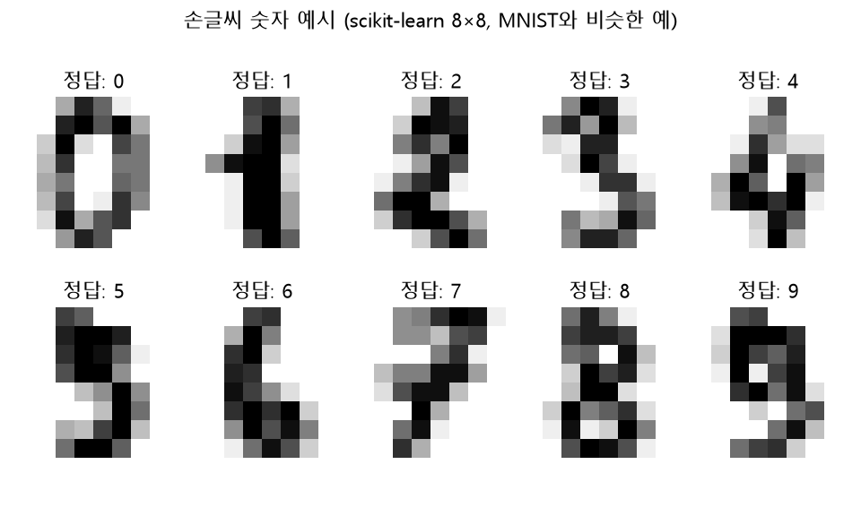
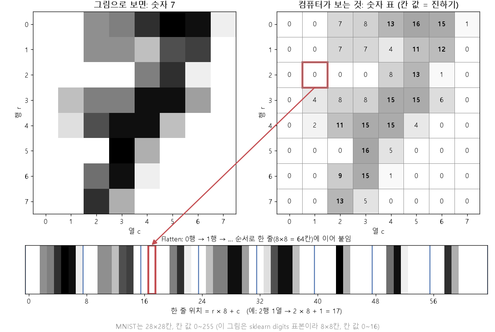

# 이미지 분류와 MNIST (EX\_07)

[목차로 돌아가기](../00_%EB%94%A5%EB%9F%AC%EB%8B%9D%EC%88%98%ED%95%99_MOC.md) · 예제: `EX_07_MNIST_Classification.ipynb` · 코드 풀이: [E07_MNIST_분류_예제](../03_%EC%98%88%EC%A0%9C%ED%92%80%EC%9D%B4/E07_MNIST_%EB%B6%84%EB%A5%98_%EC%98%88%EC%A0%9C.md)

> 참고: [학습](../00_%EB%94%A5%EB%9F%AC%EB%8B%9D_%EC%9A%A9%EC%96%B4%EC%82%AC%EC%A0%84.md#training-%ED%95%99%EC%8A%B5)·[검증](../00_%EB%94%A5%EB%9F%AC%EB%8B%9D_%EC%9A%A9%EC%96%B4%EC%82%AC%EC%A0%84.md#validation-data-%EA%B2%80%EC%A6%9D-%EB%8D%B0%EC%9D%B4%ED%84%B0)·[시험 데이터](../00_%EB%94%A5%EB%9F%AC%EB%8B%9D_%EC%9A%A9%EC%96%B4%EC%82%AC%EC%A0%84.md#training-data-test-data-%ED%95%99%EC%8A%B5-%EB%8D%B0%EC%9D%B4%ED%84%B0%EC%99%80-%EC%8B%9C%ED%97%98-%EB%8D%B0%EC%9D%B4%ED%84%B0) 나누기와 배치·[미니배치](../00_%EB%94%A5%EB%9F%AC%EB%8B%9D_%EC%9A%A9%EC%96%B4%EC%82%AC%EC%A0%84.md#mini-batch-%EB%AF%B8%EB%8B%88%EB%B0%B0%EC%B9%98)·[에폭](../00_%EB%94%A5%EB%9F%AC%EB%8B%9D_%EC%9A%A9%EC%96%B4%EC%82%AC%EC%A0%84.md#epoch-%EC%97%90%ED%8F%AD)의 관계는 [D13_데이터나누기와_과적합](../01_%EA%B0%9C%EB%85%90%EB%85%B8%ED%8A%B8/D13_%EB%8D%B0%EC%9D%B4%ED%84%B0%EB%82%98%EB%88%84%EA%B8%B0%EC%99%80_%EA%B3%BC%EC%A0%81%ED%95%A9.md)

> [!NOTE]
> **3줄 요약**
> - 컴퓨터에게 그림은 **숫자 표**다. 28×28 표를 한 줄(784칸)로 펴면 [D05_소프트맥스와_다중분류](../01_%EA%B0%9C%EB%85%90%EB%85%B8%ED%8A%B8/D05_%EC%86%8C%ED%94%84%ED%8A%B8%EB%A7%A5%EC%8A%A4%EC%99%80_%EB%8B%A4%EC%A4%91%EB%B6%84%EB%A5%98.md)와 똑같은 10등급 [분류](../00_%EB%94%A5%EB%9F%AC%EB%8B%9D_%EC%9A%A9%EC%96%B4%EC%82%AC%EC%A0%84.md#regression-classification-%ED%9A%8C%EA%B7%80%EC%99%80-%EB%B6%84%EB%A5%98) 문제가 된다.
> - 6만 장을 **32장씩 묶어**([미니배치](../00_%EB%94%A5%EB%9F%AC%EB%8B%9D_%EC%9A%A9%EC%96%B4%EC%82%AC%EC%A0%84.md#mini-batch-%EB%AF%B8%EB%8B%88%EB%B0%B0%EC%B9%98)) 묶음마다 [가중치](../00_%EB%94%A5%EB%9F%AC%EB%8B%9D_%EC%9A%A9%EC%96%B4%EC%82%AC%EC%A0%84.md#weight-%EA%B0%80%EC%A4%91%EC%B9%98)를 고친다. 한 [에폭](../00_%EB%94%A5%EB%9F%AC%EB%8B%9D_%EC%9A%A9%EC%96%B4%EC%82%AC%EC%A0%84.md#epoch-%EC%97%90%ED%8F%AD)에 1875번 고친다.
> - 실력은 [학습](../00_%EB%94%A5%EB%9F%AC%EB%8B%9D_%EC%9A%A9%EC%96%B4%EC%82%AC%EC%A0%84.md#training-%ED%95%99%EC%8A%B5)에 안 쓴 **[시험 데이터](../00_%EB%94%A5%EB%9F%AC%EB%8B%9D_%EC%9A%A9%EC%96%B4%EC%82%AC%EC%A0%84.md#training-data-test-data-%ED%95%99%EC%8A%B5-%EB%8D%B0%EC%9D%B4%ED%84%B0%EC%99%80-%EC%8B%9C%ED%97%98-%EB%8D%B0%EC%9D%B4%ED%84%B0)**로 잰다. [학습](../00_%EB%94%A5%EB%9F%AC%EB%8B%9D_%EC%9A%A9%EC%96%B4%EC%82%AC%EC%A0%84.md#training-%ED%95%99%EC%8A%B5) 92.72%, 시험 92.57%로 비슷하면 외운 게 아니라 일반 규칙을 배운 것이다.

## 1. 개념 설명

손글씨 숫자 그림을 보고 0~9 중 무엇인지 맞힌다.

> 비유: 모눈종이 28×28칸에 연필로 숫자를 쓰고, 칸마다 얼마나 진한지 0~255로 적은 표를 컴퓨터에 준다. 컴퓨터는 "이 칸들이 진하면 7일 가능성이 높다" 같은 규칙을 칸마다 배운다.

정확히 말하면, 이미지 [분류](../00_%EB%94%A5%EB%9F%AC%EB%8B%9D_%EC%9A%A9%EC%96%B4%EC%82%AC%EC%A0%84.md#regression-classification-%ED%9A%8C%EA%B7%80%EC%99%80-%EB%B6%84%EB%A5%98)는 그림의 칸 값(28×28개, 각각 0~255)을 입력받아 0~9 열 가지 등급 중 하나를 고르는 [분류](../00_%EB%94%A5%EB%9F%AC%EB%8B%9D_%EC%9A%A9%EC%96%B4%EC%82%AC%EC%A0%84.md#regression-classification-%ED%9A%8C%EA%B7%80%EC%99%80-%EB%B6%84%EB%A5%98) 문제다. [MNIST](../00_%EB%94%A5%EB%9F%AC%EB%8B%9D_%EC%9A%A9%EC%96%B4%EC%82%AC%EC%A0%84.md#mnist-%EC%86%90%EA%B8%80%EC%94%A8-%EC%88%AB%EC%9E%90-%EB%8D%B0%EC%9D%B4%ED%84%B0%EC%85%8B)는 이런 손글씨 숫자 그림을 모아 둔 데이터 묶음이고, 학습용 6만 장과 시험용 1만 장으로 나뉘어 있다.



## 2. 필요한 이유

컴퓨터는 그림을 볼 수 없어서, 그림을 먼저 숫자로 바꿔야 [D05_소프트맥스와_다중분류](../01_%EA%B0%9C%EB%85%90%EB%85%B8%ED%8A%B8/D05_%EC%86%8C%ED%94%84%ED%8A%B8%EB%A7%A5%EC%8A%A4%EC%99%80_%EB%8B%A4%EC%A4%91%EB%B6%84%EB%A5%98.md)의 방법을 쓸 수 있다. 또 데이터 전체를 한 번 보고 한 번 고치는 방식은 10개짜리 EX\_02에서는 괜찮았지만, 6만 장에서는 한 번 고치는 데 너무 오래 걸린다. 그래서 32장씩 묶어 자주 고친다(4.4절).

## 3. 필요한 수학 개념

| 수학 개념 | 이 개념에서 쓰이는 곳 | 자세히 |
|---|---|---|
| 벡터와 행렬 | shape, [Flatten](../00_%EB%94%A5%EB%9F%AC%EB%8B%9D_%EC%9A%A9%EC%96%B4%EC%82%AC%EC%A0%84.md#flatten-%ED%8F%89%ED%83%84%ED%99%94), 784 × 10 [가중치](../00_%EB%94%A5%EB%9F%AC%EB%8B%9D_%EC%9A%A9%EC%96%B4%EC%82%AC%EC%A0%84.md#weight-%EA%B0%80%EC%A4%91%EC%B9%98) 행렬 | [M05_벡터와_행렬](../02_%EC%88%98%ED%95%99%EB%85%B8%ED%8A%B8/M05_%EB%B2%A1%ED%84%B0%EC%99%80_%ED%96%89%EB%A0%AC.md) |
| 시그마와 평균 | 묶음(배치) 안의 [손실](../00_%EB%94%A5%EB%9F%AC%EB%8B%9D_%EC%9A%A9%EC%96%B4%EC%82%AC%EC%A0%84.md#loss-function-%EC%86%90%EC%8B%A4-%ED%95%A8%EC%88%98) 평균 | [M02_시그마와_평균](../02_%EC%88%98%ED%95%99%EB%85%B8%ED%8A%B8/M02_%EC%8B%9C%EA%B7%B8%EB%A7%88%EC%99%80_%ED%8F%89%EA%B7%A0.md) |
| [확률](../00_%EB%94%A5%EB%9F%AC%EB%8B%9D_%EC%9A%A9%EC%96%B4%EC%82%AC%EC%A0%84.md#probability-%ED%99%95%EB%A5%A0) 기초 | [정확도](../00_%EB%94%A5%EB%9F%AC%EB%8B%9D_%EC%9A%A9%EC%96%B4%EC%82%AC%EC%A0%84.md#accuracy-%EC%A0%95%ED%99%95%EB%8F%84) = 맞힌 비율 | [M08_확률_기초](../02_%EC%88%98%ED%95%99%EB%85%B8%ED%8A%B8/M08_%ED%99%95%EB%A5%A0_%EA%B8%B0%EC%B4%88.md) |
| [소프트맥스](../00_%EB%94%A5%EB%9F%AC%EB%8B%9D_%EC%9A%A9%EC%96%B4%EC%82%AC%EC%A0%84.md#softmax-%EC%86%8C%ED%94%84%ED%8A%B8%EB%A7%A5%EC%8A%A4)와 다중분류 | 10등급 [소프트맥스](../00_%EB%94%A5%EB%9F%AC%EB%8B%9D_%EC%9A%A9%EC%96%B4%EC%82%AC%EC%A0%84.md#softmax-%EC%86%8C%ED%94%84%ED%8A%B8%EB%A7%A5%EC%8A%A4) | [D05_소프트맥스와_다중분류](../01_%EA%B0%9C%EB%85%90%EB%85%B8%ED%8A%B8/D05_%EC%86%8C%ED%94%84%ED%8A%B8%EB%A7%A5%EC%8A%A4%EC%99%80_%EB%8B%A4%EC%A4%91%EB%B6%84%EB%A5%98.md) |

<details><summary>미니 복습: shape</summary>

(60000, 28, 28) = 28×28 표가 6만 장. 자세히: [M05_벡터와_행렬](../02_%EC%88%98%ED%95%99%EB%85%B8%ED%8A%B8/M05_%EB%B2%A1%ED%84%B0%EC%99%80_%ED%96%89%EB%A0%AC.md)

</details>

<details><summary>미니 복습: 소프트맥스</summary>

점수 10개 → 합이 1인 [확률](../00_%EB%94%A5%EB%9F%AC%EB%8B%9D_%EC%9A%A9%EC%96%B4%EC%82%AC%EC%A0%84.md#probability-%ED%99%95%EB%A5%A0) 10개 → 가장 큰 칸이 답. 자세히: [D05_소프트맥스와_다중분류](../01_%EA%B0%9C%EB%85%90%EB%85%B8%ED%8A%B8/D05_%EC%86%8C%ED%94%84%ED%8A%B8%EB%A7%A5%EC%8A%A4%EC%99%80_%EB%8B%A4%EC%A4%91%EB%B6%84%EB%A5%98.md)

</details>

## 4. 계산 과정 (숫자 → 식 → 코드)

### 4.1 그림을 숫자 표로 보기

- 한 칸 값: 0(빈 곳) ~ 255(가장 진한 획)
- 모든 값을 255로 나눠 0~1 사이로 맞춘다. [D03_Dense층과_정규화](../01_%EA%B0%9C%EB%85%90%EB%85%B8%ED%8A%B8/D03_Dense%EC%B8%B5%EA%B3%BC_%EC%A0%95%EA%B7%9C%ED%99%94.md)의 Min-Max [정규화](../00_%EB%94%A5%EB%9F%AC%EB%8B%9D_%EC%9A%A9%EC%96%B4%EC%82%AC%EC%A0%84.md#normalization-%EC%A0%95%EA%B7%9C%ED%99%94)에서 min = 0, max = 255인 경우다.

### 4.2 Flatten: 표를 한 줄로 펴기

4×4 표로 예를 들면(행·열·위치 모두 **0부터** 센다):

```text
[[ 0  1  2  3]
 [ 4  5  6  7]          →   [ 0  1  2  3  4  5  6  7  8  9 10 11 12 13 14 15]
 [ 8  9 10 11]
 [12 13 14 15]]
```

(r행, c열) 칸은 한 줄에서 **r × 4 + c** 위치가 된다. 예: (2행, 1열) → 2 × 4 + 1 = 0부터 센 위치 9 (값 9) ✓

28×28이면 r × 28 + c, 총 784칸이다.



### 4.3 덴스 층(출력 10개)과 소프트맥스

점수 10개는 펴 놓은 그림 784칸에 [가중치](../00_%EB%94%A5%EB%9F%AC%EB%8B%9D_%EC%9A%A9%EC%96%B4%EC%82%AC%EC%A0%84.md#weight-%EA%B0%80%EC%A4%91%EC%B9%98)를 곱해 더하고, [편향](../00_%EB%94%A5%EB%9F%AC%EB%8B%9D_%EC%9A%A9%EC%96%B4%EC%82%AC%EC%A0%84.md#bias-%ED%8E%B8%ED%96%A5)을 더해서 만든다. [소프트맥스](../00_%EB%94%A5%EB%9F%AC%EB%8B%9D_%EC%9A%A9%EC%96%B4%EC%82%AC%EC%A0%84.md#softmax-%EC%86%8C%ED%94%84%ED%8A%B8%EB%A7%A5%EC%8A%A4)는 이 점수를 [확률](../00_%EB%94%A5%EB%9F%AC%EB%8B%9D_%EC%9A%A9%EC%96%B4%EC%82%AC%EC%A0%84.md#probability-%ED%99%95%EB%A5%A0)로 바꾼다.

$$\underbrace{\text{점수}}_{1 \times 10} = \underbrace{x}_{1 \times 784}\;\underbrace{W}_{784 \times 10} + \underbrace{b}_{10}$$

<details><summary>기호 풀이</summary>

| 기호 | 읽는 법 | 뜻 | 예제 값 |
| --- | --- | --- | --- |
| $x$ | 엑스 | 한 줄로 편 그림 한 장 | 1 × 784 |
| $W$ | 더블유 | [가중치](../00_%EB%94%A5%EB%9F%AC%EB%8B%9D_%EC%9A%A9%EC%96%B4%EC%82%AC%EC%A0%84.md#weight-%EA%B0%80%EC%A4%91%EC%B9%98) 행렬 | 784 × 10 |
| $b$ | 비 | [편향](../00_%EB%94%A5%EB%9F%AC%EB%8B%9D_%EC%9A%A9%EC%96%B4%EC%82%AC%EC%A0%84.md#bias-%ED%8E%B8%ED%96%A5)(등급마다 하나) | 10개 |

</details>

- W의 **열 하나 = 숫자 하나를 알아보는 [가중치](../00_%EB%94%A5%EB%9F%AC%EB%8B%9D_%EC%9A%A9%EC%96%B4%EC%82%AC%EC%A0%84.md#weight-%EA%B0%80%EC%A4%91%EC%B9%98) 784개**. 그 숫자의 획이 지나가는 칸에는 양수, 지나가지 않는 칸에는 음수 [가중치](../00_%EB%94%A5%EB%9F%AC%EB%8B%9D_%EC%9A%A9%EC%96%B4%EC%82%AC%EC%A0%84.md#weight-%EA%B0%80%EC%A4%91%EC%B9%98)가 생기는 식으로 배운다.
- [파라미터](../00_%EB%94%A5%EB%9F%AC%EB%8B%9D_%EC%9A%A9%EC%96%B4%EC%82%AC%EC%A0%84.md#parameter-%ED%8C%8C%EB%9D%BC%EB%AF%B8%ED%84%B0) 수([가중치](../00_%EB%94%A5%EB%9F%AC%EB%8B%9D_%EC%9A%A9%EC%96%B4%EC%82%AC%EC%A0%84.md#weight-%EA%B0%80%EC%A4%91%EC%B9%98) + [편향](../00_%EB%94%A5%EB%9F%AC%EB%8B%9D_%EC%9A%A9%EC%96%B4%EC%82%AC%EC%A0%84.md#bias-%ED%8E%B8%ED%96%A5)) = 784 × 10 + 10 = **7,850**

### 4.4 미니배치: 32장씩 묶어 고치기

| 방식 | 한 번 고칠 때 보는 데이터 | 한 [에폭](../00_%EB%94%A5%EB%9F%AC%EB%8B%9D_%EC%9A%A9%EC%96%B4%EC%82%AC%EC%A0%84.md#epoch-%EC%97%90%ED%8F%AD)에 고치는 횟수 |
|---|---|---|
| EX\_02 (직접 짠 [경사하강법](../00_%EB%94%A5%EB%9F%AC%EB%8B%9D_%EC%9A%A9%EC%96%B4%EC%82%AC%EC%A0%84.md#gradient-descent-%EA%B2%BD%EC%82%AC%ED%95%98%EA%B0%95%EB%B2%95)) | 전체 10개 | 1번 |
| EX\_07 (Keras 기본) | **32장** | 60000 ÷ 32 = **1875번** |

- 6만 장을 다 보고 한 번 고치면 너무 느리다. 32장의 [손실](../00_%EB%94%A5%EB%9F%AC%EB%8B%9D_%EC%9A%A9%EC%96%B4%EC%82%AC%EC%A0%84.md#loss-function-%EC%86%90%EC%8B%A4-%ED%95%A8%EC%88%98) 평균으로 [기울기](../00_%EB%94%A5%EB%9F%AC%EB%8B%9D_%EC%9A%A9%EC%96%B4%EC%82%AC%EC%A0%84.md#gradient-%EA%B8%B0%EC%9A%B8%EA%B8%B0)를 어림잡아 자주 고친다.
- 32장만 보니 [기울기](../00_%EB%94%A5%EB%9F%AC%EB%8B%9D_%EC%9A%A9%EC%96%B4%EC%82%AC%EC%A0%84.md#gradient-%EA%B8%B0%EC%9A%B8%EA%B8%B0)가 조금씩 흔들리지만(무작위성), 대체로 맞는 방향이라 훨씬 빨리 배운다.
- 이 방식은 엄밀히는 [미니배치](../00_%EB%94%A5%EB%9F%AC%EB%8B%9D_%EC%9A%A9%EC%96%B4%EC%82%AC%EC%A0%84.md#mini-batch-%EB%AF%B8%EB%8B%88%EB%B0%B0%EC%B9%98) [경사하강법](../00_%EB%94%A5%EB%9F%AC%EB%8B%9D_%EC%9A%A9%EC%96%B4%EC%82%AC%EC%A0%84.md#gradient-descent-%EA%B2%BD%EC%82%AC%ED%95%98%EA%B0%95%EB%B2%95)이다. 흔히 SGD(확률적 [경사하강법](../00_%EB%94%A5%EB%9F%AC%EB%8B%9D_%EC%9A%A9%EC%96%B4%EC%82%AC%EC%A0%84.md#gradient-descent-%EA%B2%BD%EC%82%AC%ED%95%98%EA%B0%95%EB%B2%95), Stochastic Gradient Descent)라고도 부른다.
- EX\_07은 여기에 [Adam](../00_%EB%94%A5%EB%9F%AC%EB%8B%9D_%EC%9A%A9%EC%96%B4%EC%82%AC%EC%A0%84.md#adam-%EC%95%84%EB%8B%B4-%EC%98%B5%ED%8B%B0%EB%A7%88%EC%9D%B4%EC%A0%80)이라는 개선판을 쓴다(다음 절).

### 4.5 Adam

`optimizer='adam'`은 [경사하강법](../00_%EB%94%A5%EB%9F%AC%EB%8B%9D_%EC%9A%A9%EC%96%B4%EC%82%AC%EC%A0%84.md#gradient-descent-%EA%B2%BD%EC%82%AC%ED%95%98%EA%B0%95%EB%B2%95)의 개선판이다. 두 가지를 더한다.

1. **관성**: 지난 [기울기](../00_%EB%94%A5%EB%9F%AC%EB%8B%9D_%EC%9A%A9%EC%96%B4%EC%82%AC%EC%A0%84.md#gradient-%EA%B8%B0%EC%9A%B8%EA%B8%B0)들의 평균 방향을 기억해서, 흔들려도 꾸준히 가던 쪽으로 간다.
2. **보폭 자동 조절**: [가중치](../00_%EB%94%A5%EB%9F%AC%EB%8B%9D_%EC%9A%A9%EC%96%B4%EC%82%AC%EC%A0%84.md#weight-%EA%B0%80%EC%A4%91%EC%B9%98)마다 [기울기](../00_%EB%94%A5%EB%9F%AC%EB%8B%9D_%EC%9A%A9%EC%96%B4%EC%82%AC%EC%A0%84.md#gradient-%EA%B8%B0%EC%9A%B8%EA%B8%B0) 크기에 맞춰 보폭을 따로 정한다. 그래서 [학습률](../00_%EB%94%A5%EB%9F%AC%EB%8B%9D_%EC%9A%A9%EC%96%B4%EC%82%AC%EC%A0%84.md#learning-rate-%ED%95%99%EC%8A%B5%EB%A5%A0)을 일일이 맞추는 수고가 줄어든다(EX\_03처럼 0.0005까지 줄여 가며 시험할 필요가 적다).

### 4.6 학습 데이터와 시험 데이터

| | [학습](../00_%EB%94%A5%EB%9F%AC%EB%8B%9D_%EC%9A%A9%EC%96%B4%EC%82%AC%EC%A0%84.md#training-%ED%95%99%EC%8A%B5)(train) | 시험(test) |
|---|---|---|
| 개수 | 60,000 | 10,000 |
| 용도 | [가중치](../00_%EB%94%A5%EB%9F%AC%EB%8B%9D_%EC%9A%A9%EC%96%B4%EC%82%AC%EC%A0%84.md#weight-%EA%B0%80%EC%A4%91%EC%B9%98) 고치기 | 실력 재기 ([가중치](../00_%EB%94%A5%EB%9F%AC%EB%8B%9D_%EC%9A%A9%EC%96%B4%EC%82%AC%EC%A0%84.md#weight-%EA%B0%80%EC%A4%91%EC%B9%98)는 안 고침) |
| EX\_07 [정확도](../00_%EB%94%A5%EB%9F%AC%EB%8B%9D_%EC%9A%A9%EC%96%B4%EC%82%AC%EC%A0%84.md#accuracy-%EC%A0%95%ED%99%95%EB%8F%84) | 0.9272 | 0.9257 |

- 둘이 비슷하다 → 처음 보는 그림에도 통하는 규칙을 배웠다(**[일반화](../00_%EB%94%A5%EB%9F%AC%EB%8B%9D_%EC%9A%A9%EC%96%B4%EC%82%AC%EC%A0%84.md#generalization-%EC%9D%BC%EB%B0%98%ED%99%94)**, generalization).
- [학습](../00_%EB%94%A5%EB%9F%AC%EB%8B%9D_%EC%9A%A9%EC%96%B4%EC%82%AC%EC%A0%84.md#training-%ED%95%99%EC%8A%B5)만 높고 시험이 낮으면 → [학습](../00_%EB%94%A5%EB%9F%AC%EB%8B%9D_%EC%9A%A9%EC%96%B4%EC%82%AC%EC%A0%84.md#training-%ED%95%99%EC%8A%B5) 그림을 외운 것(**[과적합](../00_%EB%94%A5%EB%9F%AC%EB%8B%9D_%EC%9A%A9%EC%96%B4%EC%82%AC%EC%A0%84.md#overfitting-%EA%B3%BC%EC%A0%81%ED%95%A9)**). → [D08_ReLU와_드롭아웃](../01_%EA%B0%9C%EB%85%90%EB%85%B8%ED%8A%B8/D08_ReLU%EC%99%80_%EB%93%9C%EB%A1%AD%EC%95%84%EC%9B%83.md)에서 다룬다.

## 5. 개념 재확인

<details><summary>1. 28×28 그림에서 (10행, 5열) 칸은 Flatten 후 몇 번째인가?</summary>

| 단계 | 하는 일 | 코드 | 계산 | 결과 |
|---|---|---|---|---|
| 1 | 앞쪽 행의 칸 수 (0~9행, 28칸씩) | `Flatten()` | 10 × 28 | 280 |
| 2 | 10행 안에서 간 칸 수 | `Flatten()` | 열 번호 5 | 5 |
| 3 | 한 줄 위치 | `r * 28 + c` | 280 + 5 | 285 |

**① 쓰는 식**

본문 4.2절의 식이다. 한 줄 위치 = $r \times 28 + c$ (r은 행 번호, c는 열 번호, 28은 한 행의 칸 수).
넣을 값은 r = 10, c = 5이다. 행·열·위치 모두 0부터 센다.

**② 앞쪽 행의 칸 수 세기** (`Flatten()`)
- 0행부터 9행까지 10개 행이 이 칸보다 앞에 있음
- 한 행에 28칸이므로 10 × 28 = 280

**③ 10행 안에서 간 칸 수 세기**
- 10행의 맨 앞(0열)에서 5열까지 가려면 앞의 5칸을 지남
- 열 번호 그대로 5

**④ 한 줄 위치 구하기** (`r * 28 + c`)
- 280 + 5 = 285
- 0부터 센 위치이므로 사람이 세는 순서로는 285 + 1 = 286번째 칸

행·열·위치 모두 0부터 세므로 285는 "0부터 센 위치"이고, 사람이 세는 순서로는 286번째 칸이다.

**답**: **285** (0부터 센 위치)

</details>

<details><summary>2. batch를 100장으로 하면 한 에폭에 몇 번 고치나?</summary>

| 단계 | 하는 일 | 코드 | 계산 | 결과 |
|---|---|---|---|---|
| 1 | batch 32일 때 (비교용) | `batch_size=32` | 60000 ÷ 32 | 1875번 |
| 2 | batch 100일 때 | `batch_size=100` | 60000 ÷ 100 | 600번 |
| 3 | 두 경우 비교 | - | 1875 → 600 | 묶음이 클수록 고치는 횟수가 줄어듦 |

**① 쓰는 식**

본문 4.4절의 식이다. 한 [에폭](../00_%EB%94%A5%EB%9F%AC%EB%8B%9D_%EC%9A%A9%EC%96%B4%EC%82%AC%EC%A0%84.md#epoch-%EC%97%90%ED%8F%AD)에 고치는 횟수 = [학습](../00_%EB%94%A5%EB%9F%AC%EB%8B%9D_%EC%9A%A9%EC%96%B4%EC%82%AC%EC%A0%84.md#training-%ED%95%99%EC%8A%B5) 그림 수 ÷ batch 크기. 코드에서는 `batch_size` 값이다.
[학습](../00_%EB%94%A5%EB%9F%AC%EB%8B%9D_%EC%9A%A9%EC%96%B4%EC%82%AC%EC%A0%84.md#training-%ED%95%99%EC%8A%B5) 그림은 60000장이고, batch\_size만 32에서 100으로 바꾼다.

**② batch 32일 때 (비교용)** (`batch_size=32`)
- 60000 ÷ 32 = 1875번

**③ batch 100일 때** (`batch_size=100`)
- 60000 ÷ 100 = 600번

**④ 두 경우 비교**
- 1875 → 600으로 줄어듦
- 한 묶음마다 [가중치](../00_%EB%94%A5%EB%9F%AC%EB%8B%9D_%EC%9A%A9%EC%96%B4%EC%82%AC%EC%A0%84.md#weight-%EA%B0%80%EC%A4%91%EC%B9%98)를 한 번 고치므로, 묶음이 클수록 고치는 횟수가 줄어듦

묶음 하나마다 [가중치](../00_%EB%94%A5%EB%9F%AC%EB%8B%9D_%EC%9A%A9%EC%96%B4%EC%82%AC%EC%A0%84.md#weight-%EA%B0%80%EC%A4%91%EC%B9%98)를 한 번 고친다.

**답**: **600번**

</details>

<details><summary>3. 시험 정확도 0.9257은 1만 장 중 몇 장을 맞힌 것인가?</summary>

| 단계 | 하는 일 | 코드 | 계산 | 결과 |
|---|---|---|---|---|
| 1 | 식 거꾸로 쓰기 | `정확도 × 전체 장 수` | 맞힌 장 수 = [정확도](../00_%EB%94%A5%EB%9F%AC%EB%8B%9D_%EC%9A%A9%EC%96%B4%EC%82%AC%EC%A0%84.md#accuracy-%EC%A0%95%ED%99%95%EB%8F%84) × 전체 | - |
| 2 | 맞힌 장 수 구하기 | `model.evaluate(...)` | 0.9257 × 10000 | 9257 |
| 3 | 확인 | - | 9257 ÷ 10000 | 0.9257 ([정확도](../00_%EB%94%A5%EB%9F%AC%EB%8B%9D_%EC%9A%A9%EC%96%B4%EC%82%AC%EC%A0%84.md#accuracy-%EC%A0%95%ED%99%95%EB%8F%84)와 같음) |

**① 쓰는 식**

[정확도](../00_%EB%94%A5%EB%9F%AC%EB%8B%9D_%EC%9A%A9%EC%96%B4%EC%82%AC%EC%A0%84.md#accuracy-%EC%A0%95%ED%99%95%EB%8F%84)는 맞힌 비율이다. [정확도](../00_%EB%94%A5%EB%9F%AC%EB%8B%9D_%EC%9A%A9%EC%96%B4%EC%82%AC%EC%A0%84.md#accuracy-%EC%A0%95%ED%99%95%EB%8F%84) = 맞힌 장 수 ÷ 전체 장 수이므로, 거꾸로 맞힌 장 수 = [정확도](../00_%EB%94%A5%EB%9F%AC%EB%8B%9D_%EC%9A%A9%EC%96%B4%EC%82%AC%EC%A0%84.md#accuracy-%EC%A0%95%ED%99%95%EB%8F%84) × 전체 장 수이다.
넣을 값은 [정확도](../00_%EB%94%A5%EB%9F%AC%EB%8B%9D_%EC%9A%A9%EC%96%B4%EC%82%AC%EC%A0%84.md#accuracy-%EC%A0%95%ED%99%95%EB%8F%84) 0.9257, 시험 그림 10000장이다(4.6절). [정확도](../00_%EB%94%A5%EB%9F%AC%EB%8B%9D_%EC%9A%A9%EC%96%B4%EC%82%AC%EC%A0%84.md#accuracy-%EC%A0%95%ED%99%95%EB%8F%84)는 `model.evaluate(...)`가 알려 준다.

**② 식 거꾸로 쓰기**
- [정확도](../00_%EB%94%A5%EB%9F%AC%EB%8B%9D_%EC%9A%A9%EC%96%B4%EC%82%AC%EC%A0%84.md#accuracy-%EC%A0%95%ED%99%95%EB%8F%84) = 맞힌 장 수 ÷ 전체 장 수
- 양변에 전체 장 수를 곱하면 맞힌 장 수 = [정확도](../00_%EB%94%A5%EB%9F%AC%EB%8B%9D_%EC%9A%A9%EC%96%B4%EC%82%AC%EC%A0%84.md#accuracy-%EC%A0%95%ED%99%95%EB%8F%84) × 전체 장 수

**③ 맞힌 장 수 구하기** (`model.evaluate(...)`의 [정확도](../00_%EB%94%A5%EB%9F%AC%EB%8B%9D_%EC%9A%A9%EC%96%B4%EC%82%AC%EC%A0%84.md#accuracy-%EC%A0%95%ED%99%95%EB%8F%84) × 10000)
- 0.9257 × 10000 = 9257

**④ 확인**
- 9257 ÷ 10000 = 0.9257 → [정확도](../00_%EB%94%A5%EB%9F%AC%EB%8B%9D_%EC%9A%A9%EC%96%B4%EC%82%AC%EC%A0%84.md#accuracy-%EC%A0%95%ED%99%95%EB%8F%84)와 같음

**답**: **9257장**

</details>

<details><summary>내 이해</summary>


</details>
