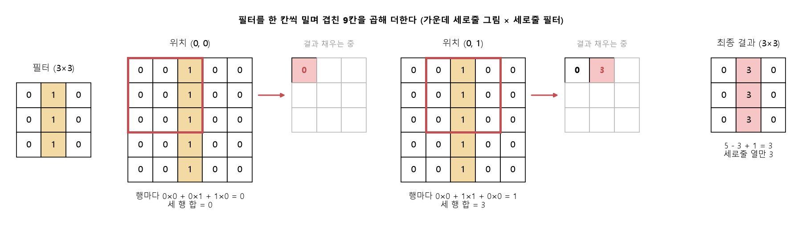
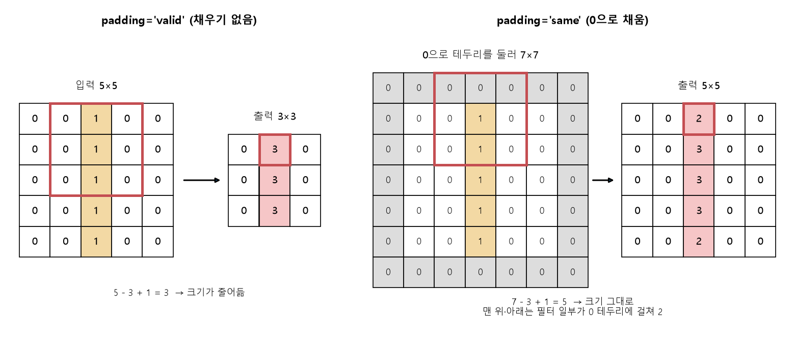
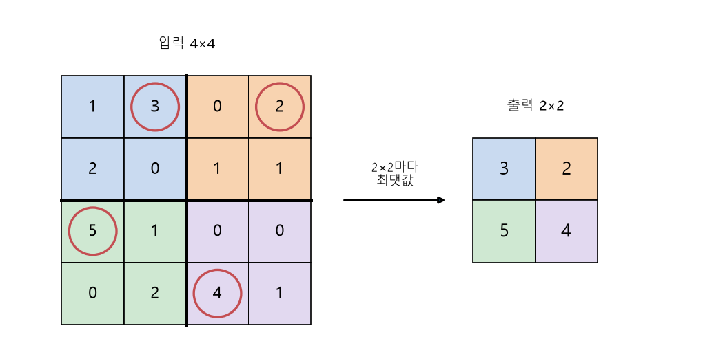

# 합성곱과 풀링 (CNN EX\_01, EX\_02)

[목차로 돌아가기](../00_%EB%94%A5%EB%9F%AC%EB%8B%9D%EC%88%98%ED%95%99_MOC.md) · 코드 풀이: [E08_CNN_1Conv_MNIST_예제](../03_%EC%98%88%EC%A0%9C%ED%92%80%EC%9D%B4/E08_CNN_1Conv_MNIST_%EC%98%88%EC%A0%9C.md), [E09_CNN_3Conv_MNIST_예제](../03_%EC%98%88%EC%A0%9C%ED%92%80%EC%9D%B4/E09_CNN_3Conv_MNIST_%EC%98%88%EC%A0%9C.md)

> 참고: 왜 [Flatten](../00_%EB%94%A5%EB%9F%AC%EB%8B%9D_%EC%9A%A9%EC%96%B4%EC%82%AC%EC%A0%84.md#flatten-%ED%8F%89%ED%83%84%ED%99%94)만으로는 부족하고 [합성곱](../00_%EB%94%A5%EB%9F%AC%EB%8B%9D_%EC%9A%A9%EC%96%B4%EC%82%AC%EC%A0%84.md#convolution-%ED%95%A9%EC%84%B1%EA%B3%B1)이 필요한지는 [D14_CNN이_필요한_이유](../01_%EA%B0%9C%EB%85%90%EB%85%B8%ED%8A%B8/D14_CNN%EC%9D%B4_%ED%95%84%EC%9A%94%ED%95%9C_%EC%9D%B4%EC%9C%A0.md)에서 먼저 본다.

> [!NOTE]
> **3줄 요약**
> - **[합성곱](../00_%EB%94%A5%EB%9F%AC%EB%8B%9D_%EC%9A%A9%EC%96%B4%EC%82%AC%EC%A0%84.md#convolution-%ED%95%A9%EC%84%B1%EA%B3%B1)**: 작은 [필터](../00_%EB%94%A5%EB%9F%AC%EB%8B%9D_%EC%9A%A9%EC%96%B4%EC%82%AC%EC%A0%84.md#filter-%ED%95%84%ED%84%B0)(3×3)를 그림 위에서 한 칸씩 밀며 겹친 칸끼리 곱해 더한다. [D01_퍼셉트론](../01_%EA%B0%9C%EB%85%90%EB%85%B8%ED%8A%B8/D01_%ED%8D%BC%EC%85%89%ED%8A%B8%EB%A1%A0.md)의 [가중합](../00_%EB%94%A5%EB%9F%AC%EB%8B%9D_%EC%9A%A9%EC%96%B4%EC%82%AC%EC%A0%84.md#weighted-sum-%EA%B0%80%EC%A4%91%ED%95%A9)을 그림의 모든 위치에서 **같은 [가중치](../00_%EB%94%A5%EB%9F%AC%EB%8B%9D_%EC%9A%A9%EC%96%B4%EC%82%AC%EC%A0%84.md#weight-%EA%B0%80%EC%A4%91%EC%B9%98)로** 반복하는 것이다.
> - **[맥스 풀링](../00_%EB%94%A5%EB%9F%AC%EB%8B%9D_%EC%9A%A9%EC%96%B4%EC%82%AC%EC%A0%84.md#max-pooling-%EB%A7%A5%EC%8A%A4-%ED%92%80%EB%A7%81)**: 2×2마다 가장 큰 값만 남겨 크기를 절반으로 줄인다.
> - 같은 [필터](../00_%EB%94%A5%EB%9F%AC%EB%8B%9D_%EC%9A%A9%EC%96%B4%EC%82%AC%EC%A0%84.md#filter-%ED%95%84%ED%84%B0)를 재사용하므로 [파라미터](../00_%EB%94%A5%EB%9F%AC%EB%8B%9D_%EC%9A%A9%EC%96%B4%EC%82%AC%EC%A0%84.md#parameter-%ED%8C%8C%EB%9D%BC%EB%AF%B8%ED%84%B0)가 아주 적다. 28×28×32 출력을 [덴스 층](../00_%EB%94%A5%EB%9F%AC%EB%8B%9D_%EC%9A%A9%EC%96%B4%EC%82%AC%EC%A0%84.md#dense-layer-%EB%8D%B4%EC%8A%A4-%EC%B8%B5)으로 만들려면 [가중치](../00_%EB%94%A5%EB%9F%AC%EB%8B%9D_%EC%9A%A9%EC%96%B4%EC%82%AC%EC%A0%84.md#weight-%EA%B0%80%EC%A4%91%EC%B9%98)만 약 1967만 개가 필요한데 [합성곱](../00_%EB%94%A5%EB%9F%AC%EB%8B%9D_%EC%9A%A9%EC%96%B4%EC%82%AC%EC%A0%84.md#convolution-%ED%95%A9%EC%84%B1%EA%B3%B1)은 [파라미터](../00_%EB%94%A5%EB%9F%AC%EB%8B%9D_%EC%9A%A9%EC%96%B4%EC%82%AC%EC%A0%84.md#parameter-%ED%8C%8C%EB%9D%BC%EB%AF%B8%ED%84%B0) **320개**([가중치](../00_%EB%94%A5%EB%9F%AC%EB%8B%9D_%EC%9A%A9%EC%96%B4%EC%82%AC%EC%A0%84.md#weight-%EA%B0%80%EC%A4%91%EC%B9%98)+[편향](../00_%EB%94%A5%EB%9F%AC%EB%8B%9D_%EC%9A%A9%EC%96%B4%EC%82%AC%EC%A0%84.md#bias-%ED%8E%B8%ED%96%A5))로 된다.

## 1. 개념 설명

그림에서 세로줄·가로줄·모서리 같은 **작은 무늬**를 찾고([합성곱](../00_%EB%94%A5%EB%9F%AC%EB%8B%9D_%EC%9A%A9%EC%96%B4%EC%82%AC%EC%A0%84.md#convolution-%ED%95%A9%EC%84%B1%EA%B3%B1)), 위치를 대충 뭉개며 크기를 줄인다([맥스 풀링](../00_%EB%94%A5%EB%9F%AC%EB%8B%9D_%EC%9A%A9%EC%96%B4%EC%82%AC%EC%A0%84.md#max-pooling-%EB%A7%A5%EC%8A%A4-%ED%92%80%EB%A7%81)). 이걸 여러 번 쌓으면 작은 무늬 → 큰 무늬(동그라미, 꺾임) → 숫자 모양 순으로 알아본다.

> 비유: 돋보기([필터](../00_%EB%94%A5%EB%9F%AC%EB%8B%9D_%EC%9A%A9%EC%96%B4%EC%82%AC%EC%A0%84.md#filter-%ED%95%84%ED%84%B0))로 그림을 구석구석 훑으며 "여기 세로줄 있다"를 표시한 지도를 만든다. 돋보기마다 찾는 무늬가 달라서, 돋보기 32개면 지도도 32장이다.

정확히 말하면, [합성곱](../00_%EB%94%A5%EB%9F%AC%EB%8B%9D_%EC%9A%A9%EC%96%B4%EC%82%AC%EC%A0%84.md#convolution-%ED%95%A9%EC%84%B1%EA%B3%B1)(convolution)은 작은 숫자 표인 [필터](../00_%EB%94%A5%EB%9F%AC%EB%8B%9D_%EC%9A%A9%EC%96%B4%EC%82%AC%EC%A0%84.md#filter-%ED%95%84%ED%84%B0)를 그림 위에서 한 칸씩 옮기며, [필터](../00_%EB%94%A5%EB%9F%AC%EB%8B%9D_%EC%9A%A9%EC%96%B4%EC%82%AC%EC%A0%84.md#filter-%ED%95%84%ED%84%B0)와 겹친 칸끼리 곱해서 모두 더하는 계산이다. 풀링(pooling)은 2×2 같은 작은 구역마다 값 하나만 남겨 그림 크기를 줄이는 계산이고, [맥스 풀링](../00_%EB%94%A5%EB%9F%AC%EB%8B%9D_%EC%9A%A9%EC%96%B4%EC%82%AC%EC%A0%84.md#max-pooling-%EB%A7%A5%EC%8A%A4-%ED%92%80%EB%A7%81)은 그중 가장 큰 값을 남기는 방식이다.

## 2. 필요한 이유

[D06_이미지분류와_MNIST](../01_%EA%B0%9C%EB%85%90%EB%85%B8%ED%8A%B8/D06_%EC%9D%B4%EB%AF%B8%EC%A7%80%EB%B6%84%EB%A5%98%EC%99%80_MNIST.md)의 [Flatten](../00_%EB%94%A5%EB%9F%AC%EB%8B%9D_%EC%9A%A9%EC%96%B4%EC%82%AC%EC%A0%84.md#flatten-%ED%8F%89%ED%83%84%ED%99%94)은 그림을 한 줄로 펴기 때문에, "이 칸의 위·아래 칸"처럼 이웃한 칸의 위치·모양 정보가 흐려진다. 그림 전체를 [덴스 층](../00_%EB%94%A5%EB%9F%AC%EB%8B%9D_%EC%9A%A9%EC%96%B4%EC%82%AC%EC%A0%84.md#dense-layer-%EB%8D%B4%EC%8A%A4-%EC%B8%B5)으로 이으려면 [가중치](../00_%EB%94%A5%EB%9F%AC%EB%8B%9D_%EC%9A%A9%EC%96%B4%EC%82%AC%EC%A0%84.md#weight-%EA%B0%80%EC%A4%91%EC%B9%98)도 아주 많이 필요하다(28×28×32 출력이면 약 1967만 개, 4.4절). [합성곱](../00_%EB%94%A5%EB%9F%AC%EB%8B%9D_%EC%9A%A9%EC%96%B4%EC%82%AC%EC%A0%84.md#convolution-%ED%95%A9%EC%84%B1%EA%B3%B1)은 작은 [필터](../00_%EB%94%A5%EB%9F%AC%EB%8B%9D_%EC%9A%A9%EC%96%B4%EC%82%AC%EC%A0%84.md#filter-%ED%95%84%ED%84%B0)를 그림 위로 밀며 이웃한 칸을 함께 보고, 같은 [필터](../00_%EB%94%A5%EB%9F%AC%EB%8B%9D_%EC%9A%A9%EC%96%B4%EC%82%AC%EC%A0%84.md#filter-%ED%95%84%ED%84%B0)를 모든 위치에서 다시 쓰므로 [파라미터](../00_%EB%94%A5%EB%9F%AC%EB%8B%9D_%EC%9A%A9%EC%96%B4%EC%82%AC%EC%A0%84.md#parameter-%ED%8C%8C%EB%9D%BC%EB%AF%B8%ED%84%B0)가 320개면 된다.

## 3. 필요한 수학 개념

| 수학 개념 | 이 개념에서 쓰이는 곳 | 자세히 |
|---|---|---|
| 시그마와 평균 | 겹친 칸끼리 곱해 더하기(Σ) | [M02_시그마와_평균](../02_%EC%88%98%ED%95%99%EB%85%B8%ED%8A%B8/M02_%EC%8B%9C%EA%B7%B8%EB%A7%88%EC%99%80_%ED%8F%89%EA%B7%A0.md) |
| 벡터와 행렬 | [필터](../00_%EB%94%A5%EB%9F%AC%EB%8B%9D_%EC%9A%A9%EC%96%B4%EC%82%AC%EC%A0%84.md#filter-%ED%95%84%ED%84%B0)는 작은 행렬, shape 읽기 | [M05_벡터와_행렬](../02_%EC%88%98%ED%95%99%EB%85%B8%ED%8A%B8/M05_%EB%B2%A1%ED%84%B0%EC%99%80_%ED%96%89%EB%A0%AC.md) |
| 나누기·내림 | 7 ÷ 2 = 3 (`7 // 2`) | — |

<details><summary>미니 복습: 같은 자리끼리 곱해 더하기</summary>

[M05_벡터와_행렬](../02_%EC%88%98%ED%95%99%EB%85%B8%ED%8A%B8/M05_%EB%B2%A1%ED%84%B0%EC%99%80_%ED%96%89%EB%A0%AC.md)에서 본, 같은 자리끼리 곱해서 모두 더하는 계산을 표(2차원)에 한 것이다. 3×3 [필터](../00_%EB%94%A5%EB%9F%AC%EB%8B%9D_%EC%9A%A9%EC%96%B4%EC%82%AC%EC%A0%84.md#filter-%ED%95%84%ED%84%B0)와 3×3 그림 조각의 9칸을 짝지어 곱하고 다 더한다.

</details>

## 4. 계산 과정 (숫자 → 식 → 코드)

### 4.1 숫자: 합성곱 손계산

5×5 그림에 세로줄이 있고, 세로줄 [필터](../00_%EB%94%A5%EB%9F%AC%EB%8B%9D_%EC%9A%A9%EC%96%B4%EC%82%AC%EC%A0%84.md#filter-%ED%95%84%ED%84%B0)로 훑는다.

```text
그림 (5×5)        필터 (3×3)
0 0 1 0 0         0 1 0
0 0 1 0 0         0 1 0
0 0 1 0 0         0 1 0
0 0 1 0 0
0 0 1 0 0
```

[필터](../00_%EB%94%A5%EB%9F%AC%EB%8B%9D_%EC%9A%A9%EC%96%B4%EC%82%AC%EC%A0%84.md#filter-%ED%95%84%ED%84%B0)를 왼쪽 위에 대고 9칸을 곱해 더한 뒤, 한 칸씩 오른쪽·아래로 민다. [필터](../00_%EB%94%A5%EB%9F%AC%EB%8B%9D_%EC%9A%A9%EC%96%B4%EC%82%AC%EC%A0%84.md#filter-%ED%95%84%ED%84%B0)가 들어갈 수 있는 위치는 가로 3 × 세로 3이라 결과는 3×3이다(5 − 3 + 1 = 3).

- 왼쪽 위 자리: 각 행이 0×0 + 0×1 + 1×0 = 0이고, 세 행 모두 같으므로 합은 **0**
- 오른쪽으로 한 칸 민 자리: 각 행이 0×0 + 1×1 + 0×0 = 1이고, 세 행을 더하면 **3**



| | 결과 |
|---|---|
| 세로줄 그림 | `[[0,3,0],[0,3,0],[0,3,0]]` — 줄이 있는 가운데 열만 3 |
| 가로줄 그림 (같은 [필터](../00_%EB%94%A5%EB%9F%AC%EB%8B%9D_%EC%9A%A9%EC%96%B4%EC%82%AC%EC%A0%84.md#filter-%ED%95%84%ED%84%B0), 아래 입력) | `[[1,1,1],[1,1,1],[1,1,1]]` — 어디서나 1 |

가로줄 그림의 입력은 가운데 행이 전부 1인 5×5 표다.

```text
0 0 0 0 0
0 0 0 0 0
1 1 1 1 1
0 0 0 0 0
0 0 0 0 0
```

[필터](../00_%EB%94%A5%EB%9F%AC%EB%8B%9D_%EC%9A%A9%EC%96%B4%EC%82%AC%EC%A0%84.md#filter-%ED%95%84%ED%84%B0)의 가운데 열(세로 3칸)은 어느 위치에서든 이 가로줄과 딱 한 칸만 겹친다. 그래서 결과가 어디서나 1이다.

세로줄 [필터](../00_%EB%94%A5%EB%9F%AC%EB%8B%9D_%EC%9A%A9%EC%96%B4%EC%82%AC%EC%A0%84.md#filter-%ED%95%84%ED%84%B0)는 세로줄 위에서 크게(3) 반응한다. 이 결과 지도가 **[특징 맵](../00_%EB%94%A5%EB%9F%AC%EB%8B%9D_%EC%9A%A9%EC%96%B4%EC%82%AC%EC%A0%84.md#feature-map-%ED%8A%B9%EC%A7%95-%EB%A7%B5)**이다.

### 4.2 식: 합성곱 계산식

결과 지도의 한 칸 = [필터](../00_%EB%94%A5%EB%9F%AC%EB%8B%9D_%EC%9A%A9%EC%96%B4%EC%82%AC%EC%A0%84.md#filter-%ED%95%84%ED%84%B0)와 겹친 3×3 그림 조각의 같은 자리끼리 곱해서 모두 더한 값 + [편향](../00_%EB%94%A5%EB%9F%AC%EB%8B%9D_%EC%9A%A9%EC%96%B4%EC%82%AC%EC%A0%84.md#bias-%ED%8E%B8%ED%96%A5)이다.

$$\text{출력}(i, j) = \sum_{p=0}^{2}\sum_{q=0}^{2} \text{필터}(p, q) \times \text{입력}(i + p,\; j + q) + b$$

<details><summary>기호 풀이</summary>

| 기호 | 읽는 법 | 뜻 | 예제 값 |
| --- | --- | --- | --- |
| $(i, j)$ | 아이, 제이 | 결과 지도의 행·열 | 0~2 (5×5 그림, 3×3 [필터](../00_%EB%94%A5%EB%9F%AC%EB%8B%9D_%EC%9A%A9%EC%96%B4%EC%82%AC%EC%A0%84.md#filter-%ED%95%84%ED%84%B0)) |
| $(p, q)$ | 피, 큐 | [필터](../00_%EB%94%A5%EB%9F%AC%EB%8B%9D_%EC%9A%A9%EC%96%B4%EC%82%AC%EC%A0%84.md#filter-%ED%95%84%ED%84%B0) 안의 행·열 | 0~2 |
| $b$ | 비 | [편향](../00_%EB%94%A5%EB%9F%AC%EB%8B%9D_%EC%9A%A9%EC%96%B4%EC%82%AC%EC%A0%84.md#bias-%ED%8E%B8%ED%96%A5) ([필터](../00_%EB%94%A5%EB%9F%AC%EB%8B%9D_%EC%9A%A9%EC%96%B4%EC%82%AC%EC%A0%84.md#filter-%ED%95%84%ED%84%B0)마다 하나) | 위 손계산에서는 생략 |
| 이중 Σ | 시그마 | 3×3 = 9칸 전부 더하기 (for문 두 겹) | 9칸 |

</details>

[필터](../00_%EB%94%A5%EB%9F%AC%EB%8B%9D_%EC%9A%A9%EC%96%B4%EC%82%AC%EC%A0%84.md#filter-%ED%95%84%ED%84%B0)의 (p, q)칸과 겹치는 그림 칸이 입력(i + p, j + q)이다. 예를 들어 결과 (0, 1)은 그림의 0~2행, 1~3열 조각에서 나온다.

입력이 여러 겹([채널](../00_%EB%94%A5%EB%9F%AC%EB%8B%9D_%EC%9A%A9%EC%96%B4%EC%82%AC%EC%A0%84.md#channel-%EC%B1%84%EB%84%90) C개, 예: 컬러 사진은 빨강·초록·파랑 3겹)이면 [필터](../00_%EB%94%A5%EB%9F%AC%EB%8B%9D_%EC%9A%A9%EC%96%B4%EC%82%AC%EC%A0%84.md#filter-%ED%95%84%ED%84%B0)도 3×3×C로 두껍고, C겹 전부를 곱해 더한다.

### 4.3 padding='same'과 테두리 채우기

그림 테두리에 0을 한 줄 둘러 5×5 → 7×7로 만든 뒤 훑으면 결과가 **5×5 그대로** 나온다(7 − 3 + 1 = 5). 아래는 세로줄 그림에 같은 [필터](../00_%EB%94%A5%EB%9F%AC%EB%8B%9D_%EC%9A%A9%EC%96%B4%EC%82%AC%EC%A0%84.md#filter-%ED%95%84%ED%84%B0)를 쓴 결과다.

```text
[[0 0 2 0 0]
 [0 0 3 0 0]
 [0 0 3 0 0]
 [0 0 3 0 0]
 [0 0 2 0 0]]
```

맨 위·아래 칸은 [필터](../00_%EB%94%A5%EB%9F%AC%EB%8B%9D_%EC%9A%A9%EC%96%B4%EC%82%AC%EC%A0%84.md#filter-%ED%95%84%ED%84%B0) 일부가 0(테두리)에 걸쳐서 2가 된다. 예제의 [Conv2D](../00_%EB%94%A5%EB%9F%AC%EB%8B%9D_%EC%9A%A9%EC%96%B4%EC%82%AC%EC%A0%84.md#conv2d-2%EC%B0%A8%EC%9B%90-%ED%95%A9%EC%84%B1%EA%B3%B1-%EC%B8%B5)가 28×28 → 28×28인 이유다.



### 4.4 파라미터 수

한 [층](../00_%EB%94%A5%EB%9F%AC%EB%8B%9D_%EC%9A%A9%EC%96%B4%EC%82%AC%EC%A0%84.md#layer-%EC%B8%B5)의 [파라미터](../00_%EB%94%A5%EB%9F%AC%EB%8B%9D_%EC%9A%A9%EC%96%B4%EC%82%AC%EC%A0%84.md#parameter-%ED%8C%8C%EB%9D%BC%EB%AF%B8%ED%84%B0) 수는 ([필터](../00_%EB%94%A5%EB%9F%AC%EB%8B%9D_%EC%9A%A9%EC%96%B4%EC%82%AC%EC%A0%84.md#filter-%ED%95%84%ED%84%B0) 한 장의 [가중치](../00_%EB%94%A5%EB%9F%AC%EB%8B%9D_%EC%9A%A9%EC%96%B4%EC%82%AC%EC%A0%84.md#weight-%EA%B0%80%EC%A4%91%EC%B9%98) 칸 수 + [편향](../00_%EB%94%A5%EB%9F%AC%EB%8B%9D_%EC%9A%A9%EC%96%B4%EC%82%AC%EC%A0%84.md#bias-%ED%8E%B8%ED%96%A5) 1개) × [필터](../00_%EB%94%A5%EB%9F%AC%EB%8B%9D_%EC%9A%A9%EC%96%B4%EC%82%AC%EC%A0%84.md#filter-%ED%95%84%ED%84%B0) 수다.

$$\text{Param \#} = (k \times k \times C_{\text{입력}} + 1) \times C_{\text{출력}}$$

<details><summary>기호 풀이</summary>

| 기호 | 읽는 법 | 뜻 | 예제 값 |
| --- | --- | --- | --- |
| Param # | 파람 넘버 | [파라미터](../00_%EB%94%A5%EB%9F%AC%EB%8B%9D_%EC%9A%A9%EC%96%B4%EC%82%AC%EC%A0%84.md#parameter-%ED%8C%8C%EB%9D%BC%EB%AF%B8%ED%84%B0) 수([가중치](../00_%EB%94%A5%EB%9F%AC%EB%8B%9D_%EC%9A%A9%EC%96%B4%EC%82%AC%EC%A0%84.md#weight-%EA%B0%80%EC%A4%91%EC%B9%98)+[편향](../00_%EB%94%A5%EB%9F%AC%EB%8B%9D_%EC%9A%A9%EC%96%B4%EC%82%AC%EC%A0%84.md#bias-%ED%8E%B8%ED%96%A5)) | 320 (E08 conv) |
| $k$ | 케이 | [필터](../00_%EB%94%A5%EB%9F%AC%EB%8B%9D_%EC%9A%A9%EC%96%B4%EC%82%AC%EC%A0%84.md#filter-%ED%95%84%ED%84%B0) 한 변의 칸 수 | 3 |
| $C_{\text{입력}}$ | 씨 입력 | 입력 [채널](../00_%EB%94%A5%EB%9F%AC%EB%8B%9D_%EC%9A%A9%EC%96%B4%EC%82%AC%EC%A0%84.md#channel-%EC%B1%84%EB%84%90) 수 | 1 |
| $C_{\text{출력}}$ | 씨 출력 | [필터](../00_%EB%94%A5%EB%9F%AC%EB%8B%9D_%EC%9A%A9%EC%96%B4%EC%82%AC%EC%A0%84.md#filter-%ED%95%84%ED%84%B0) 수(= 출력 [채널](../00_%EB%94%A5%EB%9F%AC%EB%8B%9D_%EC%9A%A9%EC%96%B4%EC%82%AC%EC%A0%84.md#channel-%EC%B1%84%EB%84%90) 수) | 32 |

</details>

식의 + 1이 [필터](../00_%EB%94%A5%EB%9F%AC%EB%8B%9D_%EC%9A%A9%EC%96%B4%EC%82%AC%EC%A0%84.md#filter-%ED%95%84%ED%84%B0)마다 하나씩 있는 [편향](../00_%EB%94%A5%EB%9F%AC%EB%8B%9D_%EC%9A%A9%EC%96%B4%EC%82%AC%EC%A0%84.md#bias-%ED%8E%B8%ED%96%A5)이다.

| [층](../00_%EB%94%A5%EB%9F%AC%EB%8B%9D_%EC%9A%A9%EC%96%B4%EC%82%AC%EC%A0%84.md#layer-%EC%B8%B5) | k | 입력 [채널](../00_%EB%94%A5%EB%9F%AC%EB%8B%9D_%EC%9A%A9%EC%96%B4%EC%82%AC%EC%A0%84.md#channel-%EC%B1%84%EB%84%90) | [필터](../00_%EB%94%A5%EB%9F%AC%EB%8B%9D_%EC%9A%A9%EC%96%B4%EC%82%AC%EC%A0%84.md#filter-%ED%95%84%ED%84%B0) 수 | 계산 | [파라미터](../00_%EB%94%A5%EB%9F%AC%EB%8B%9D_%EC%9A%A9%EC%96%B4%EC%82%AC%EC%A0%84.md#parameter-%ED%8C%8C%EB%9D%BC%EB%AF%B8%ED%84%B0) 수 |
|---|---|---|---|---|---|
| E08 conv | 3 | 1 | 32 | (9 + 1) × 32 | 320 |
| E09 conv (1번째) | 3 | 1 | 64 | (9 + 1) × 64 | 640 |
| E09 conv (2·3번째) | 3 | 64 | 64 | (576 + 1) × 64 | 36,928 |

(576 = 3 × 3 × 64)

**[덴스 층](../00_%EB%94%A5%EB%9F%AC%EB%8B%9D_%EC%9A%A9%EC%96%B4%EC%82%AC%EC%A0%84.md#dense-layer-%EB%8D%B4%EC%8A%A4-%EC%B8%B5)과 비교**

- [덴스 층](../00_%EB%94%A5%EB%9F%AC%EB%8B%9D_%EC%9A%A9%EC%96%B4%EC%82%AC%EC%A0%84.md#dense-layer-%EB%8D%B4%EC%8A%A4-%EC%B8%B5)으로 만들 때: 784칸 입력에서 28×28×32 = 25,088칸 출력을 만들려면 784 × 25,088 = **19,668,992**개([편향](../00_%EB%94%A5%EB%9F%AC%EB%8B%9D_%EC%9A%A9%EC%96%B4%EC%82%AC%EC%A0%84.md#bias-%ED%8E%B8%ED%96%A5) 빼고)의 [가중치](../00_%EB%94%A5%EB%9F%AC%EB%8B%9D_%EC%9A%A9%EC%96%B4%EC%82%AC%EC%A0%84.md#weight-%EA%B0%80%EC%A4%91%EC%B9%98)가 필요하다.
- [합성곱](../00_%EB%94%A5%EB%9F%AC%EB%8B%9D_%EC%9A%A9%EC%96%B4%EC%82%AC%EC%A0%84.md#convolution-%ED%95%A9%EC%84%B1%EA%B3%B1)으로 만들 때: 3×3 [필터](../00_%EB%94%A5%EB%9F%AC%EB%8B%9D_%EC%9A%A9%EC%96%B4%EC%82%AC%EC%A0%84.md#filter-%ED%95%84%ED%84%B0) 32개를 **모든 위치에서 같이 쓰므로** [가중치](../00_%EB%94%A5%EB%9F%AC%EB%8B%9D_%EC%9A%A9%EC%96%B4%EC%82%AC%EC%A0%84.md#weight-%EA%B0%80%EC%A4%91%EC%B9%98) 288개 + [편향](../00_%EB%94%A5%EB%9F%AC%EB%8B%9D_%EC%9A%A9%EC%96%B4%EC%82%AC%EC%A0%84.md#bias-%ED%8E%B8%ED%96%A5) 32개 = [파라미터](../00_%EB%94%A5%EB%9F%AC%EB%8B%9D_%EC%9A%A9%EC%96%B4%EC%82%AC%EC%A0%84.md#parameter-%ED%8C%8C%EB%9D%BC%EB%AF%B8%ED%84%B0) 320개면 된다.
- 이렇게 같은 [필터](../00_%EB%94%A5%EB%9F%AC%EB%8B%9D_%EC%9A%A9%EC%96%B4%EC%82%AC%EC%A0%84.md#filter-%ED%95%84%ED%84%B0)를 여러 위치에서 다시 쓰는 것을 [가중치 공유](../00_%EB%94%A5%EB%9F%AC%EB%8B%9D_%EC%9A%A9%EC%96%B4%EC%82%AC%EC%A0%84.md#weight-sharing-%EA%B0%80%EC%A4%91%EC%B9%98-%EA%B3%B5%EC%9C%A0)라고 한다. 같은 무늬가 그림 어디에 있든 같은 [필터](../00_%EB%94%A5%EB%9F%AC%EB%8B%9D_%EC%9A%A9%EC%96%B4%EC%82%AC%EC%A0%84.md#filter-%ED%95%84%ED%84%B0)로 찾을 수 있다는 장점도 생긴다.

### 4.5 맥스 풀링과 크기 계산

2×2 구역마다 최댓값 하나만 남긴다:

```text
[[1 3 | 0 2]
 [2 0 | 1 1]        →    [[3 2]
 ------+-----               [5 4]]
 [5 1 | 0 0]
 [0 2 | 4 1]]
```



[맥스 풀링](../00_%EB%94%A5%EB%9F%AC%EB%8B%9D_%EC%9A%A9%EC%96%B4%EC%82%AC%EC%A0%84.md#max-pooling-%EB%A7%A5%EC%8A%A4-%ED%92%80%EB%A7%81)을 거칠 때마다 크기가 절반으로 줄고, 나누어떨어지지 않으면 남는 줄은 버린다.

| 단계 | 크기 | 계산 |
|---|---|---|
| 입력 | 28 | |
| 1번째 [맥스 풀링](../00_%EB%94%A5%EB%9F%AC%EB%8B%9D_%EC%9A%A9%EC%96%B4%EC%82%AC%EC%A0%84.md#max-pooling-%EB%A7%A5%EC%8A%A4-%ED%92%80%EB%A7%81) | 14 | 28 // 2 |
| 2번째 [맥스 풀링](../00_%EB%94%A5%EB%9F%AC%EB%8B%9D_%EC%9A%A9%EC%96%B4%EC%82%AC%EC%A0%84.md#max-pooling-%EB%A7%A5%EC%8A%A4-%ED%92%80%EB%A7%81) | 7 | 14 // 2 |
| 3번째 [맥스 풀링](../00_%EB%94%A5%EB%9F%AC%EB%8B%9D_%EC%9A%A9%EC%96%B4%EC%82%AC%EC%A0%84.md#max-pooling-%EB%A7%A5%EC%8A%A4-%ED%92%80%EB%A7%81) | 3 | 7 // 2 (남는 1줄은 버림) |
| [Flatten](../00_%EB%94%A5%EB%9F%AC%EB%8B%9D_%EC%9A%A9%EC%96%B4%EC%82%AC%EC%A0%84.md#flatten-%ED%8F%89%ED%83%84%ED%99%94) (E09) | 576 | 3 × 3 × 64 |

### 4.6 코드: numpy로 합성곱 구현

```python
import numpy as np
img = np.array([[0,0,1,0,0]] * 5)          # 가운데 세로줄이 있는 5×5 그림
F = np.array([[0,1,0]] * 3)                # 세로줄 필터 3×3
out = np.array([[np.sum(img[i:i+3, j:j+3] * F)   # (i,j)에서 3×3 조각을 잘라 필터와 곱해 더함
                 for j in range(3)]               # 가로 위치 3곳
                for i in range(3)])               # 세로 위치 3곳
print(out)
```

**실행 결과**:

```text
[[0 3 0]
 [0 3 0]
 [0 3 0]]
```

- `img[i:i+3, j:j+3]`: i~i+2행, j~j+2열을 잘라낸 3×3 조각
- Keras의 [Conv2D](../00_%EB%94%A5%EB%9F%AC%EB%8B%9D_%EC%9A%A9%EC%96%B4%EC%82%AC%EC%A0%84.md#conv2d-2%EC%B0%A8%EC%9B%90-%ED%95%A9%EC%84%B1%EA%B3%B1-%EC%B8%B5)는 이걸 [필터](../00_%EB%94%A5%EB%9F%AC%EB%8B%9D_%EC%9A%A9%EC%96%B4%EC%82%AC%EC%A0%84.md#filter-%ED%95%84%ED%84%B0) 32개(또는 64개)·그림 6만 장에 대해 빠르게 한다.

## 5. 개념 재확인

<details><summary>1. 5×5 그림에 3×3 필터를 padding 없이 쓰면 결과 크기는?</summary>

| 단계 | 하는 일 | 코드 | 계산 | 결과 |
|---|---|---|---|---|
| 1 | 더 밀 수 있는 칸 | `kernel_size=3` | 5 − 3 | 2칸 |
| 2 | 처음 자리까지 세기 | - | 2 + 1 | 가로 3곳 |
| 3 | 세로도 같음 | `padding='valid'` | 5 − 3 + 1 | 세로 3곳 |
| 4 | 결과 크기 | - | (5, 5) → (3, 3) | 3×3 (크기가 줄어듦) |

**① 쓰는 코드**
```python
img = np.array([[0,0,1,0,0]] * 5)          # ① 가운데 세로줄이 있는 5×5 그림
F = np.array([[0,1,0]] * 3)                # ① 세로줄 필터 3×3 (kernel_size=3)
out = np.array([[np.sum(img[i:i+3, j:j+3] * F)   # ② (i,j)에서 3×3 조각을 잘라 필터와 곱해 더함
                 for j in range(3)]               # ③ 가로 위치 3곳 (5 - 3 + 1 = 3)
                for i in range(3)])               # ④ 세로 위치 3곳 (5 - 3 + 1 = 3)
print(out.shape)                           # ⑤ 결과 크기 → (3, 3)
```

**② 가로로 더 밀 수 있는 칸 세기** (`kernel_size=3`)
- [필터](../00_%EB%94%A5%EB%9F%AC%EB%8B%9D_%EC%9A%A9%EC%96%B4%EC%82%AC%EC%A0%84.md#filter-%ED%95%84%ED%84%B0)가 3칸이라 그림 5칸 중 처음 자리에서 시작함
- 남은 칸: 5 − 3 = 2칸 더 밀 수 있음

**③ 가로로 놓을 수 있는 자리 세기**
- 처음 자리 1곳 + 민 자리 2곳: 2 + 1 = 3곳
- 코드의 `j in range(3)`, 곧 j = 0, 1, 2

**④ 세로도 같음** (`padding='valid'`, 테두리를 안 채우는 기본 방식)
- 5 − 3 + 1 = 3곳 (`i in range(3)`, 곧 i = 0, 1, 2)
- i = 3이면 조각이 3~5행이 되는데 그림에는 0~4행뿐이라 불가능

**⑤ 결과 크기**
- 가로 3 × 세로 3
- (5, 5) → (3, 3)이므로 크기가 줄어듦

**답**: **3×3**

</details>

<details><summary>2. 컬러 사진(채널 3)에 3×3 필터 16개를 쓰면 파라미터 수는?</summary>

| 단계 | 하는 일 | 코드 | 계산 | 결과 |
|---|---|---|---|---|
| 1 | [필터](../00_%EB%94%A5%EB%9F%AC%EB%8B%9D_%EC%9A%A9%EC%96%B4%EC%82%AC%EC%A0%84.md#filter-%ED%95%84%ED%84%B0) 하나의 [가중치](../00_%EB%94%A5%EB%9F%AC%EB%8B%9D_%EC%9A%A9%EC%96%B4%EC%82%AC%EC%A0%84.md#weight-%EA%B0%80%EC%A4%91%EC%B9%98) | `kernel_size=3` | 3 × 3 × 3 | 27 |
| 2 | [편향](../00_%EB%94%A5%EB%9F%AC%EB%8B%9D_%EC%9A%A9%EC%96%B4%EC%82%AC%EC%A0%84.md#bias-%ED%8E%B8%ED%96%A5) 더하기 | `use_bias=True` | 27 + 1 | 28 |
| 3 | [필터](../00_%EB%94%A5%EB%9F%AC%EB%8B%9D_%EC%9A%A9%EC%96%B4%EC%82%AC%EC%A0%84.md#filter-%ED%95%84%ED%84%B0) 수만큼 곱하기 | `Conv2D(16, ...)` | 28 × 16 | 448 |
| 4 | 확인 ([가중치](../00_%EB%94%A5%EB%9F%AC%EB%8B%9D_%EC%9A%A9%EC%96%B4%EC%82%AC%EC%A0%84.md#weight-%EA%B0%80%EC%A4%91%EC%B9%98) + [편향](../00_%EB%94%A5%EB%9F%AC%EB%8B%9D_%EC%9A%A9%EC%96%B4%EC%82%AC%EC%A0%84.md#bias-%ED%8E%B8%ED%96%A5)) | `model.summary()` | 27 × 16 + 16 | 448 |

**① 쓰는 식**

본문 4.4절의 식이다. $\text{Param \#} = (k \times k \times C_{\text{입력}} + 1) \times C_{\text{출력}}$
넣을 값은 k = 3, 입력 [채널](../00_%EB%94%A5%EB%9F%AC%EB%8B%9D_%EC%9A%A9%EC%96%B4%EC%82%AC%EC%A0%84.md#channel-%EC%B1%84%EB%84%90) $C_{\text{입력}}$ = 3(빨강·초록·파랑), [필터](../00_%EB%94%A5%EB%9F%AC%EB%8B%9D_%EC%9A%A9%EC%96%B4%EC%82%AC%EC%A0%84.md#filter-%ED%95%84%ED%84%B0) 수 $C_{\text{출력}}$ = 16이다.

**② [필터](../00_%EB%94%A5%EB%9F%AC%EB%8B%9D_%EC%9A%A9%EC%96%B4%EC%82%AC%EC%A0%84.md#filter-%ED%95%84%ED%84%B0) 하나의 [가중치](../00_%EB%94%A5%EB%9F%AC%EB%8B%9D_%EC%9A%A9%EC%96%B4%EC%82%AC%EC%A0%84.md#weight-%EA%B0%80%EC%A4%91%EC%B9%98) 세기** (`kernel_size=3`)
- [필터](../00_%EB%94%A5%EB%9F%AC%EB%8B%9D_%EC%9A%A9%EC%96%B4%EC%82%AC%EC%A0%84.md#filter-%ED%95%84%ED%84%B0)는 3×3×3 모양 (3겹 전부를 곱해야 하므로)
- 3 × 3 × 3 = 27칸

**③ [편향](../00_%EB%94%A5%EB%9F%AC%EB%8B%9D_%EC%9A%A9%EC%96%B4%EC%82%AC%EC%A0%84.md#bias-%ED%8E%B8%ED%96%A5) 더하기** (`use_bias=True`)
- [편향](../00_%EB%94%A5%EB%9F%AC%EB%8B%9D_%EC%9A%A9%EC%96%B4%EC%82%AC%EC%A0%84.md#bias-%ED%8E%B8%ED%96%A5)은 [필터](../00_%EB%94%A5%EB%9F%AC%EB%8B%9D_%EC%9A%A9%EC%96%B4%EC%82%AC%EC%A0%84.md#filter-%ED%95%84%ED%84%B0)마다 1개
- 27 + 1 = 28

**④ [필터](../00_%EB%94%A5%EB%9F%AC%EB%8B%9D_%EC%9A%A9%EC%96%B4%EC%82%AC%EC%A0%84.md#filter-%ED%95%84%ED%84%B0) 수만큼 곱하기** (`Conv2D(16, ...)`)
- [필터](../00_%EB%94%A5%EB%9F%AC%EB%8B%9D_%EC%9A%A9%EC%96%B4%EC%82%AC%EC%A0%84.md#filter-%ED%95%84%ED%84%B0)가 16장이고 장마다 28개씩
- 28 × 16 = 448

**⑤ [가중치](../00_%EB%94%A5%EB%9F%AC%EB%8B%9D_%EC%9A%A9%EC%96%B4%EC%82%AC%EC%A0%84.md#weight-%EA%B0%80%EC%A4%91%EC%B9%98)와 [편향](../00_%EB%94%A5%EB%9F%AC%EB%8B%9D_%EC%9A%A9%EC%96%B4%EC%82%AC%EC%A0%84.md#bias-%ED%8E%B8%ED%96%A5)을 따로 세어 확인** (`model.summary()`)
- [가중치](../00_%EB%94%A5%EB%9F%AC%EB%8B%9D_%EC%9A%A9%EC%96%B4%EC%82%AC%EC%A0%84.md#weight-%EA%B0%80%EC%A4%91%EC%B9%98): 27 × 16 = 432
- [편향](../00_%EB%94%A5%EB%9F%AC%EB%8B%9D_%EC%9A%A9%EC%96%B4%EC%82%AC%EC%A0%84.md#bias-%ED%8E%B8%ED%96%A5): 16
- 432 + 16 = 448 → ④와 같음

[필터](../00_%EB%94%A5%EB%9F%AC%EB%8B%9D_%EC%9A%A9%EC%96%B4%EC%82%AC%EC%A0%84.md#filter-%ED%95%84%ED%84%B0) 한 장은 빨강·초록·파랑 3겹을 모두 곱하므로 [가중치](../00_%EB%94%A5%EB%9F%AC%EB%8B%9D_%EC%9A%A9%EC%96%B4%EC%82%AC%EC%A0%84.md#weight-%EA%B0%80%EC%A4%91%EC%B9%98)가 27칸이다.

**답**: **448개**

</details>

<details><summary>3. 14×14에 2×2 맥스 풀링을 두 번 하면?</summary>

| 단계 | 하는 일 | 코드 | 계산 | 결과 |
|---|---|---|---|---|
| 1 | 첫 번째 [맥스 풀링](../00_%EB%94%A5%EB%9F%AC%EB%8B%9D_%EC%9A%A9%EC%96%B4%EC%82%AC%EC%A0%84.md#max-pooling-%EB%A7%A5%EC%8A%A4-%ED%92%80%EB%A7%81) | `MaxPooling2D(2)` | 14 ÷ 2 | 7 (나누어떨어짐) |
| 2 | 두 번째 [맥스 풀링](../00_%EB%94%A5%EB%9F%AC%EB%8B%9D_%EC%9A%A9%EC%96%B4%EC%82%AC%EC%A0%84.md#max-pooling-%EB%A7%A5%EC%8A%A4-%ED%92%80%EB%A7%81) | `MaxPooling2D(2)` | 7 ÷ 2 = 3.5 | 3 (소수점 아래 버림) |
| 3 | 크기 변화 | - | (14, 14) → (7, 7) → (3, 3) | 3×3 |

**① 쓰는 식**

본문 4.5절 표의 계산이다. [맥스 풀링](../00_%EB%94%A5%EB%9F%AC%EB%8B%9D_%EC%9A%A9%EC%96%B4%EC%82%AC%EC%A0%84.md#max-pooling-%EB%A7%A5%EC%8A%A4-%ED%92%80%EB%A7%81) 한 번을 거친 크기 = 이전 크기 // 2 (`//`는 몫만 남기는 나눗셈).
```python
size = 14           # ① 처음 크기
size = size // 2    # ② 첫 번째 맥스 풀링 → 7
size = size // 2    # ③ 두 번째 맥스 풀링 → 3 (나머지 1은 버림)
print(size)         # ④ 크기 변화의 끝: 14 → 7 → 3
```

**② 첫 번째 [맥스 풀링](../00_%EB%94%A5%EB%9F%AC%EB%8B%9D_%EC%9A%A9%EC%96%B4%EC%82%AC%EC%A0%84.md#max-pooling-%EB%A7%A5%EC%8A%A4-%ED%92%80%EB%A7%81)** (`MaxPooling2D(2)`)
- 14 ÷ 2 = 7
- 나머지 없이 나누어떨어짐 → 7×7

**③ 두 번째 [맥스 풀링](../00_%EB%94%A5%EB%9F%AC%EB%8B%9D_%EC%9A%A9%EC%96%B4%EC%82%AC%EC%A0%84.md#max-pooling-%EB%A7%A5%EC%8A%A4-%ED%92%80%EB%A7%81)** (`MaxPooling2D(2)`)
- 7 ÷ 2 = 3.5
- 2칸짜리 구역은 3개(0~1행, 2~3행, 4~5행)만 만들어지고, 6행은 짝이 없어 버려짐
- 소수점 아래를 버려 3 (7 // 2 = 3)

**④ 크기 변화**
- (14, 14) → (7, 7) → (3, 3)

마지막 1줄은 2×2 구역을 못 채워 버려진다.

**답**: **3×3** (14 → 7 → 3)

</details>

<details><summary>내 이해</summary>


</details>
