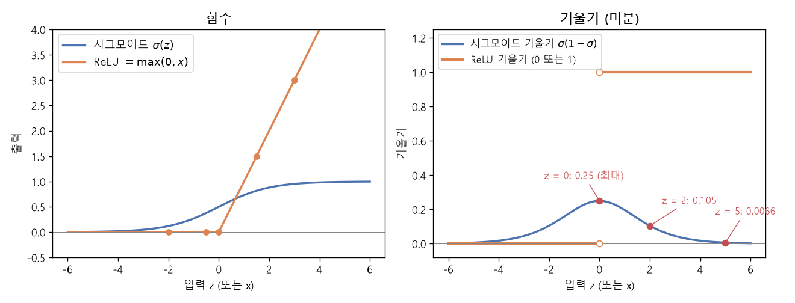
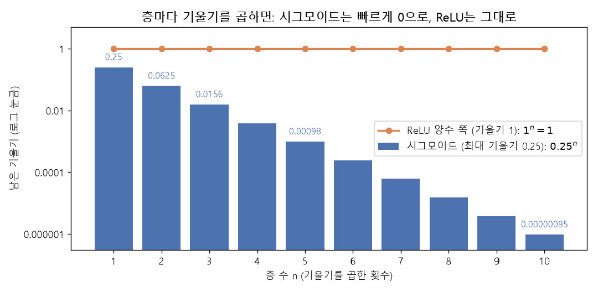
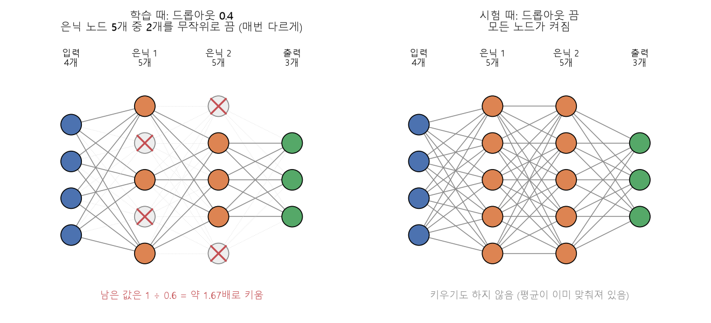

# ReLU와 드롭아웃 (CNN EX\_03)

[목차로 돌아가기](../00_%EB%94%A5%EB%9F%AC%EB%8B%9D%EC%88%98%ED%95%99_MOC.md) · 예제: `02_CNN/EX_03_MNIST_ReLU_Dropout.ipynb` · 코드 풀이: [E10_CNN_ReLU_Dropout_예제](../03_%EC%98%88%EC%A0%9C%ED%92%80%EC%9D%B4/E10_CNN_ReLU_Dropout_%EC%98%88%EC%A0%9C.md)

> 참고: [과적합](../00_%EB%94%A5%EB%9F%AC%EB%8B%9D_%EC%9A%A9%EC%96%B4%EC%82%AC%EC%A0%84.md#overfitting-%EA%B3%BC%EC%A0%81%ED%95%A9)이 무엇인지는 [D13_데이터나누기와_과적합](../01_%EA%B0%9C%EB%85%90%EB%85%B8%ED%8A%B8/D13_%EB%8D%B0%EC%9D%B4%ED%84%B0%EB%82%98%EB%88%84%EA%B8%B0%EC%99%80_%EA%B3%BC%EC%A0%81%ED%95%A9.md), [시그모이드](../00_%EB%94%A5%EB%9F%AC%EB%8B%9D_%EC%9A%A9%EC%96%B4%EC%82%AC%EC%A0%84.md#sigmoid-%EC%8B%9C%EA%B7%B8%EB%AA%A8%EC%9D%B4%EB%93%9C) [은닉층](../00_%EB%94%A5%EB%9F%AC%EB%8B%9D_%EC%9A%A9%EC%96%B4%EC%82%AC%EC%A0%84.md#hidden-layer-%EC%9D%80%EB%8B%89%EC%B8%B5)을 2개와 5개로 쌓아 비교한 [기울기 소실](../00_%EB%94%A5%EB%9F%AC%EB%8B%9D_%EC%9A%A9%EC%96%B4%EC%82%AC%EC%A0%84.md#vanishing-gradient-%EA%B8%B0%EC%9A%B8%EA%B8%B0-%EC%86%8C%EC%8B%A4) 예시는 [E11_MNIST_은닉층_예제](../03_%EC%98%88%EC%A0%9C%ED%92%80%EC%9D%B4/E11_MNIST_%EC%9D%80%EB%8B%89%EC%B8%B5_%EC%98%88%EC%A0%9C.md)

> [!NOTE]
> **3줄 요약**
> - **[ReLU](../00_%EB%94%A5%EB%9F%AC%EB%8B%9D_%EC%9A%A9%EC%96%B4%EC%82%AC%EC%A0%84.md#relu-%EB%A0%90%EB%A3%A8)** $= \max(0, x)$: 음수는 0, 양수는 그대로. 양수 쪽 [기울기](../00_%EB%94%A5%EB%9F%AC%EB%8B%9D_%EC%9A%A9%EC%96%B4%EC%82%AC%EC%A0%84.md#gradient-%EA%B8%B0%EC%9A%B8%EA%B8%B0)가 항상 1이라, [층](../00_%EB%94%A5%EB%9F%AC%EB%8B%9D_%EC%9A%A9%EC%96%B4%EC%82%AC%EC%A0%84.md#layer-%EC%B8%B5)을 쌓아도 [활성화 함수](../00_%EB%94%A5%EB%9F%AC%EB%8B%9D_%EC%9A%A9%EC%96%B4%EC%82%AC%EC%A0%84.md#activation-function-%ED%99%9C%EC%84%B1%ED%99%94-%ED%95%A8%EC%88%98) 때문에 [기울기](../00_%EB%94%A5%EB%9F%AC%EB%8B%9D_%EC%9A%A9%EC%96%B4%EC%82%AC%EC%A0%84.md#gradient-%EA%B8%B0%EC%9A%B8%EA%B8%B0)가 줄지는 않는다(단, 음수 쪽은 [기울기](../00_%EB%94%A5%EB%9F%AC%EB%8B%9D_%EC%9A%A9%EC%96%B4%EC%82%AC%EC%A0%84.md#gradient-%EA%B8%B0%EC%9A%B8%EA%B8%B0)가 0이라 아예 [학습](../00_%EB%94%A5%EB%9F%AC%EB%8B%9D_%EC%9A%A9%EC%96%B4%EC%82%AC%EC%A0%84.md#training-%ED%95%99%EC%8A%B5)이 멈추는 칸이 생길 수 있다).
> - [시그모이드](../00_%EB%94%A5%EB%9F%AC%EB%8B%9D_%EC%9A%A9%EC%96%B4%EC%82%AC%EC%A0%84.md#sigmoid-%EC%8B%9C%EA%B7%B8%EB%AA%A8%EC%9D%B4%EB%93%9C)의 [기울기](../00_%EB%94%A5%EB%9F%AC%EB%8B%9D_%EC%9A%A9%EC%96%B4%EC%82%AC%EC%A0%84.md#gradient-%EA%B8%B0%EC%9A%B8%EA%B8%B0)는 최대 0.25라서 [층](../00_%EB%94%A5%EB%9F%AC%EB%8B%9D_%EC%9A%A9%EC%96%B4%EC%82%AC%EC%A0%84.md#layer-%EC%B8%B5)마다 곱해지면 3층에 0.0156, 10층에 약 0.000001로 줄어든다(**[기울기 소실](../00_%EB%94%A5%EB%9F%AC%EB%8B%9D_%EC%9A%A9%EC%96%B4%EC%82%AC%EC%A0%84.md#vanishing-gradient-%EA%B8%B0%EC%9A%B8%EA%B8%B0-%EC%86%8C%EC%8B%A4)**).
> - **[드롭아웃](../00_%EB%94%A5%EB%9F%AC%EB%8B%9D_%EC%9A%A9%EC%96%B4%EC%82%AC%EC%A0%84.md#dropout-%EB%93%9C%EB%A1%AD%EC%95%84%EC%9B%83)(0.4)**: [학습](../00_%EB%94%A5%EB%9F%AC%EB%8B%9D_%EC%9A%A9%EC%96%B4%EC%82%AC%EC%A0%84.md#training-%ED%95%99%EC%8A%B5) 중에만 값의 40%를 무작위로 끄고 남은 값을 1.67배 키운다. 몇몇 값에만 기대지 못하게 해서 **[과적합](../00_%EB%94%A5%EB%9F%AC%EB%8B%9D_%EC%9A%A9%EC%96%B4%EC%82%AC%EC%A0%84.md#overfitting-%EA%B3%BC%EC%A0%81%ED%95%A9)**을 줄인다.

## 1. 개념 설명

- **[ReLU](../00_%EB%94%A5%EB%9F%AC%EB%8B%9D_%EC%9A%A9%EC%96%B4%EC%82%AC%EC%A0%84.md#relu-%EB%A0%90%EB%A3%A8)**: "음수면 0, 아니면 그대로"라는 아주 단순한 [활성화 함수](../00_%EB%94%A5%EB%9F%AC%EB%8B%9D_%EC%9A%A9%EC%96%B4%EC%82%AC%EC%A0%84.md#activation-function-%ED%99%9C%EC%84%B1%ED%99%94-%ED%95%A8%EC%88%98). [시그모이드](../00_%EB%94%A5%EB%9F%AC%EB%8B%9D_%EC%9A%A9%EC%96%B4%EC%82%AC%EC%A0%84.md#sigmoid-%EC%8B%9C%EA%B7%B8%EB%AA%A8%EC%9D%B4%EB%93%9C) 대신 쓰면 깊은 모델이 훨씬 빨리 배운다.
- **[드롭아웃](../00_%EB%94%A5%EB%9F%AC%EB%8B%9D_%EC%9A%A9%EC%96%B4%EC%82%AC%EC%A0%84.md#dropout-%EB%93%9C%EB%A1%AD%EC%95%84%EC%9B%83)**: 학습할 때마다 일부를 무작위로 빼고 연습시킨다.

> 비유([드롭아웃](../00_%EB%94%A5%EB%9F%AC%EB%8B%9D_%EC%9A%A9%EC%96%B4%EC%82%AC%EC%A0%84.md#dropout-%EB%93%9C%EB%A1%AD%EC%95%84%EC%9B%83)): 축구팀이 연습 때마다 무작위로 4할을 벤치에 앉히고 경기한다. 특정 에이스에게만 공을 주는 습관이 사라지고 누구나 제 몫을 하게 된다. 실제 경기(시험)에는 전원이 뛴다.

정확히 말하면, [ReLU](../00_%EB%94%A5%EB%9F%AC%EB%8B%9D_%EC%9A%A9%EC%96%B4%EC%82%AC%EC%A0%84.md#relu-%EB%A0%90%EB%A3%A8)(Rectified Linear Unit)는 입력 x와 0 중 큰 쪽을 내보내는 [활성화 함수](../00_%EB%94%A5%EB%9F%AC%EB%8B%9D_%EC%9A%A9%EC%96%B4%EC%82%AC%EC%A0%84.md#activation-function-%ED%99%9C%EC%84%B1%ED%99%94-%ED%95%A8%EC%88%98)다. [드롭아웃](../00_%EB%94%A5%EB%9F%AC%EB%8B%9D_%EC%9A%A9%EC%96%B4%EC%82%AC%EC%A0%84.md#dropout-%EB%93%9C%EB%A1%AD%EC%95%84%EC%9B%83)(dropout)은 [학습](../00_%EB%94%A5%EB%9F%AC%EB%8B%9D_%EC%9A%A9%EC%96%B4%EC%82%AC%EC%A0%84.md#training-%ED%95%99%EC%8A%B5) 중에 각 값을 정해진 [확률](../00_%EB%94%A5%EB%9F%AC%EB%8B%9D_%EC%9A%A9%EC%96%B4%EC%82%AC%EC%A0%84.md#probability-%ED%99%95%EB%A5%A0)(0.4)로 0으로 만들고, 남은 값을 키워 평균을 맞추는 기법이다.

## 2. 필요한 이유

[시그모이드](../00_%EB%94%A5%EB%9F%AC%EB%8B%9D_%EC%9A%A9%EC%96%B4%EC%82%AC%EC%A0%84.md#sigmoid-%EC%8B%9C%EA%B7%B8%EB%AA%A8%EC%9D%B4%EB%93%9C)는 [기울기](../00_%EB%94%A5%EB%9F%AC%EB%8B%9D_%EC%9A%A9%EC%96%B4%EC%82%AC%EC%A0%84.md#gradient-%EA%B8%B0%EC%9A%B8%EA%B8%B0)가 최대 0.25라서, [층](../00_%EB%94%A5%EB%9F%AC%EB%8B%9D_%EC%9A%A9%EC%96%B4%EC%82%AC%EC%A0%84.md#layer-%EC%B8%B5)을 깊게 쌓으면 [기울기](../00_%EB%94%A5%EB%9F%AC%EB%8B%9D_%EC%9A%A9%EC%96%B4%EC%82%AC%EC%A0%84.md#gradient-%EA%B8%B0%EC%9A%B8%EA%B8%B0)가 [층](../00_%EB%94%A5%EB%9F%AC%EB%8B%9D_%EC%9A%A9%EC%96%B4%EC%82%AC%EC%A0%84.md#layer-%EC%B8%B5)마다 곱해지며 거의 0이 된다. 그러면 앞쪽 [층](../00_%EB%94%A5%EB%9F%AC%EB%8B%9D_%EC%9A%A9%EC%96%B4%EC%82%AC%EC%A0%84.md#layer-%EC%B8%B5)이 배우지 못한다([기울기 소실](../00_%EB%94%A5%EB%9F%AC%EB%8B%9D_%EC%9A%A9%EC%96%B4%EC%82%AC%EC%A0%84.md#vanishing-gradient-%EA%B8%B0%EC%9A%B8%EA%B8%B0-%EC%86%8C%EC%8B%A4), 4.2절). 또 모델이 [학습](../00_%EB%94%A5%EB%9F%AC%EB%8B%9D_%EC%9A%A9%EC%96%B4%EC%82%AC%EC%A0%84.md#training-%ED%95%99%EC%8A%B5) 그림만 외우면 처음 보는 그림에서 틀린다([과적합](../00_%EB%94%A5%EB%9F%AC%EB%8B%9D_%EC%9A%A9%EC%96%B4%EC%82%AC%EC%A0%84.md#overfitting-%EA%B3%BC%EC%A0%81%ED%95%A9), [D06_이미지분류와_MNIST](../01_%EA%B0%9C%EB%85%90%EB%85%B8%ED%8A%B8/D06_%EC%9D%B4%EB%AF%B8%EC%A7%80%EB%B6%84%EB%A5%98%EC%99%80_MNIST.md) 4.6절). [ReLU](../00_%EB%94%A5%EB%9F%AC%EB%8B%9D_%EC%9A%A9%EC%96%B4%EC%82%AC%EC%A0%84.md#relu-%EB%A0%90%EB%A3%A8)는 앞의 문제를, [드롭아웃](../00_%EB%94%A5%EB%9F%AC%EB%8B%9D_%EC%9A%A9%EC%96%B4%EC%82%AC%EC%A0%84.md#dropout-%EB%93%9C%EB%A1%AD%EC%95%84%EC%9B%83)은 뒤의 문제를 줄인다.

## 3. 필요한 수학 개념

| 수학 개념 | 이 개념에서 쓰이는 곳 | 자세히 |
|---|---|---|
| 함수와 일차함수 | [ReLU](../00_%EB%94%A5%EB%9F%AC%EB%8B%9D_%EC%9A%A9%EC%96%B4%EC%82%AC%EC%A0%84.md#relu-%EB%A0%90%EB%A3%A8)도 "넣으면 나오는" 함수 | [M01_함수와_일차함수](../02_%EC%88%98%ED%95%99%EB%85%B8%ED%8A%B8/M01_%ED%95%A8%EC%88%98%EC%99%80_%EC%9D%BC%EC%B0%A8%ED%95%A8%EC%88%98.md) |
| [미분](../00_%EB%94%A5%EB%9F%AC%EB%8B%9D_%EC%9A%A9%EC%96%B4%EC%82%AC%EC%A0%84.md#derivative-%EB%AF%B8%EB%B6%84)과 [기울기](../00_%EB%94%A5%EB%9F%AC%EB%8B%9D_%EC%9A%A9%EC%96%B4%EC%82%AC%EC%A0%84.md#gradient-%EA%B8%B0%EC%9A%B8%EA%B8%B0) | [기울기](../00_%EB%94%A5%EB%9F%AC%EB%8B%9D_%EC%9A%A9%EC%96%B4%EC%82%AC%EC%A0%84.md#gradient-%EA%B8%B0%EC%9A%B8%EA%B8%B0)가 작으면 [학습](../00_%EB%94%A5%EB%9F%AC%EB%8B%9D_%EC%9A%A9%EC%96%B4%EC%82%AC%EC%A0%84.md#training-%ED%95%99%EC%8A%B5)이 느리다 | [M03_미분_기울기](../02_%EC%88%98%ED%95%99%EB%85%B8%ED%8A%B8/M03_%EB%AF%B8%EB%B6%84_%EA%B8%B0%EC%9A%B8%EA%B8%B0.md) |
| [편미분](../00_%EB%94%A5%EB%9F%AC%EB%8B%9D_%EC%9A%A9%EC%96%B4%EC%82%AC%EC%A0%84.md#partial-derivative-%ED%8E%B8%EB%AF%B8%EB%B6%84) | [기울기](../00_%EB%94%A5%EB%9F%AC%EB%8B%9D_%EC%9A%A9%EC%96%B4%EC%82%AC%EC%A0%84.md#gradient-%EA%B8%B0%EC%9A%B8%EA%B8%B0)가 [층](../00_%EB%94%A5%EB%9F%AC%EB%8B%9D_%EC%9A%A9%EC%96%B4%EC%82%AC%EC%A0%84.md#layer-%EC%B8%B5)마다 곱해지는 이유(겉 [미분](../00_%EB%94%A5%EB%9F%AC%EB%8B%9D_%EC%9A%A9%EC%96%B4%EC%82%AC%EC%A0%84.md#derivative-%EB%AF%B8%EB%B6%84) × 속 [미분](../00_%EB%94%A5%EB%9F%AC%EB%8B%9D_%EC%9A%A9%EC%96%B4%EC%82%AC%EC%A0%84.md#derivative-%EB%AF%B8%EB%B6%84)) | [M04_편미분](../02_%EC%88%98%ED%95%99%EB%85%B8%ED%8A%B8/M04_%ED%8E%B8%EB%AF%B8%EB%B6%84.md) |
| [확률](../00_%EB%94%A5%EB%9F%AC%EB%8B%9D_%EC%9A%A9%EC%96%B4%EC%82%AC%EC%A0%84.md#probability-%ED%99%95%EB%A5%A0) 기초 | 40% [확률](../00_%EB%94%A5%EB%9F%AC%EB%8B%9D_%EC%9A%A9%EC%96%B4%EC%82%AC%EC%A0%84.md#probability-%ED%99%95%EB%A5%A0)로 끄기, 평균 맞추기 | [M08_확률_기초](../02_%EC%88%98%ED%95%99%EB%85%B8%ED%8A%B8/M08_%ED%99%95%EB%A5%A0_%EA%B8%B0%EC%B4%88.md) |

<details><summary>미니 복습: 겉 미분 × 속 미분</summary>

함수가 두 겹이면 [기울기](../00_%EB%94%A5%EB%9F%AC%EB%8B%9D_%EC%9A%A9%EC%96%B4%EC%82%AC%EC%A0%84.md#gradient-%EA%B8%B0%EC%9A%B8%EA%B8%B0) = 겉의 [기울기](../00_%EB%94%A5%EB%9F%AC%EB%8B%9D_%EC%9A%A9%EC%96%B4%EC%82%AC%EC%A0%84.md#gradient-%EA%B8%B0%EC%9A%B8%EA%B8%B0) × 속의 [기울기](../00_%EB%94%A5%EB%9F%AC%EB%8B%9D_%EC%9A%A9%EC%96%B4%EC%82%AC%EC%A0%84.md#gradient-%EA%B8%B0%EC%9A%B8%EA%B8%B0). [층](../00_%EB%94%A5%EB%9F%AC%EB%8B%9D_%EC%9A%A9%EC%96%B4%EC%82%AC%EC%A0%84.md#layer-%EC%B8%B5)이 n개면 [기울기](../00_%EB%94%A5%EB%9F%AC%EB%8B%9D_%EC%9A%A9%EC%96%B4%EC%82%AC%EC%A0%84.md#gradient-%EA%B8%B0%EC%9A%B8%EA%B8%B0) n개를 곱한다. 자세히: [M04_편미분](../02_%EC%88%98%ED%95%99%EB%85%B8%ED%8A%B8/M04_%ED%8E%B8%EB%AF%B8%EB%B6%84.md) 5절

</details>

<details><summary>미니 복습: 곱하면 작아진다</summary>

1보다 작은 수를 여러 번 곱하면 빠르게 0에 가까워진다. 0.5를 10번 곱하면 약 0.001. 자세히: [M08_확률_기초](../02_%EC%88%98%ED%95%99%EB%85%B8%ED%8A%B8/M08_%ED%99%95%EB%A5%A0_%EA%B8%B0%EC%B4%88.md) 3절

</details>

## 4. 계산 과정 (숫자 → 식 → 코드)

### 4.1 ReLU와 그 기울기

[ReLU](../00_%EB%94%A5%EB%9F%AC%EB%8B%9D_%EC%9A%A9%EC%96%B4%EC%82%AC%EC%A0%84.md#relu-%EB%A0%90%EB%A3%A8)는 x와 0 중 큰 쪽을 고른다.

$$\text{ReLU}(x) = \max(0, x)$$

<details><summary>기호 풀이</summary>

| 기호 | 읽는 법 | 뜻 | 예제 값 |
| --- | --- | --- | --- |
| $x$ | 엑스 | [활성화 함수](../00_%EB%94%A5%EB%9F%AC%EB%8B%9D_%EC%9A%A9%EC%96%B4%EC%82%AC%EC%A0%84.md#activation-function-%ED%99%9C%EC%84%B1%ED%99%94-%ED%95%A8%EC%88%98)에 들어오는 값 | −2, 3 |
| $\max(a, b)$ | 맥스 | a, b 중 큰 값 | max(0, −2) = 0 |
| $\text{ReLU}(x)$ | [렐루](../00_%EB%94%A5%EB%9F%AC%EB%8B%9D_%EC%9A%A9%EC%96%B4%EC%82%AC%EC%A0%84.md#relu-%EB%A0%90%EB%A3%A8) | 0 이하면 0, 양수면 그대로 | [ReLU](../00_%EB%94%A5%EB%9F%AC%EB%8B%9D_%EC%9A%A9%EC%96%B4%EC%82%AC%EC%A0%84.md#relu-%EB%A0%90%EB%A3%A8)(3) = 3 |

</details>

| x | −2 | −0.5 | 0 | 1.5 | 3 |
|---|---|---|---|---|---|
| [ReLU](../00_%EB%94%A5%EB%9F%AC%EB%8B%9D_%EC%9A%A9%EC%96%B4%EC%82%AC%EC%A0%84.md#relu-%EB%A0%90%EB%A3%A8)(x) | 0 | 0 | 0 | 1.5 | 3 |
| [기울기](../00_%EB%94%A5%EB%9F%AC%EB%8B%9D_%EC%9A%A9%EC%96%B4%EC%82%AC%EC%A0%84.md#gradient-%EA%B8%B0%EC%9A%B8%EA%B8%B0) | 0 | 0 | — | **1** | **1** |

- 양수 쪽은 직선 $y = x$라서 [기울기](../00_%EB%94%A5%EB%9F%AC%EB%8B%9D_%EC%9A%A9%EC%96%B4%EC%82%AC%EC%A0%84.md#gradient-%EA%B8%B0%EC%9A%B8%EA%B8%B0) 1([M03_미분_기울기](../02_%EC%88%98%ED%95%99%EB%85%B8%ED%8A%B8/M03_%EB%AF%B8%EB%B6%84_%EA%B8%B0%EC%9A%B8%EA%B8%B0.md)의 $(ax)' = a$에서 a = 1).
- 음수 쪽은 수평선 $y = 0$이라서 [기울기](../00_%EB%94%A5%EB%9F%AC%EB%8B%9D_%EC%9A%A9%EC%96%B4%EC%82%AC%EC%A0%84.md#gradient-%EA%B8%B0%EC%9A%B8%EA%B8%B0) 0.

### 4.2 시그모이드의 기울기와 기울기 소실

[시그모이드](../00_%EB%94%A5%EB%9F%AC%EB%8B%9D_%EC%9A%A9%EC%96%B4%EC%82%AC%EC%A0%84.md#sigmoid-%EC%8B%9C%EA%B7%B8%EB%AA%A8%EC%9D%B4%EB%93%9C)의 [기울기](../00_%EB%94%A5%EB%9F%AC%EB%8B%9D_%EC%9A%A9%EC%96%B4%EC%82%AC%EC%A0%84.md#gradient-%EA%B8%B0%EC%9A%B8%EA%B8%B0)는 "출력 σ(z)와 (1 − σ(z))를 곱한 값"이다. σ(z)는 [시그모이드](../00_%EB%94%A5%EB%9F%AC%EB%8B%9D_%EC%9A%A9%EC%96%B4%EC%82%AC%EC%A0%84.md#sigmoid-%EC%8B%9C%EA%B7%B8%EB%AA%A8%EC%9D%B4%EB%93%9C)의 출력(0~1 사이 값)이고, z는 거기에 들어가는 값이다.

$$\sigma(z)(1 - \sigma(z))$$

유도는 생략하고 숫자로 확인한다.

| z | 0 | 2 | 5 |
|---|---|---|---|
| σ(z) | 0.5 | 0.881 | 0.993 |
| [기울기](../00_%EB%94%A5%EB%9F%AC%EB%8B%9D_%EC%9A%A9%EC%96%B4%EC%82%AC%EC%A0%84.md#gradient-%EA%B8%B0%EC%9A%B8%EA%B8%B0) σ(1 − σ) | **0.25** (최대) | 0.105 | 0.0066 |



[학습](../00_%EB%94%A5%EB%9F%AC%EB%8B%9D_%EC%9A%A9%EC%96%B4%EC%82%AC%EC%A0%84.md#training-%ED%95%99%EC%8A%B5) 신호([기울기](../00_%EB%94%A5%EB%9F%AC%EB%8B%9D_%EC%9A%A9%EC%96%B4%EC%82%AC%EC%A0%84.md#gradient-%EA%B8%B0%EC%9A%B8%EA%B8%B0))는 출력 쪽에서 입력 쪽으로, [층](../00_%EB%94%A5%EB%9F%AC%EB%8B%9D_%EC%9A%A9%EC%96%B4%EC%82%AC%EC%A0%84.md#layer-%EC%B8%B5)을 하나씩 거슬러 전달된다(**[역전파](../00_%EB%94%A5%EB%9F%AC%EB%8B%9D_%EC%9A%A9%EC%96%B4%EC%82%AC%EC%A0%84.md#backpropagation-%EC%97%AD%EC%A0%84%ED%8C%8C)**). 이때 [층](../00_%EB%94%A5%EB%9F%AC%EB%8B%9D_%EC%9A%A9%EC%96%B4%EC%82%AC%EC%A0%84.md#layer-%EC%B8%B5)마다 그 [층](../00_%EB%94%A5%EB%9F%AC%EB%8B%9D_%EC%9A%A9%EC%96%B4%EC%82%AC%EC%A0%84.md#layer-%EC%B8%B5)의 [시그모이드](../00_%EB%94%A5%EB%9F%AC%EB%8B%9D_%EC%9A%A9%EC%96%B4%EC%82%AC%EC%A0%84.md#sigmoid-%EC%8B%9C%EA%B7%B8%EB%AA%A8%EC%9D%B4%EB%93%9C) [기울기](../00_%EB%94%A5%EB%9F%AC%EB%8B%9D_%EC%9A%A9%EC%96%B4%EC%82%AC%EC%A0%84.md#gradient-%EA%B8%B0%EC%9A%B8%EA%B8%B0)가 곱해진다. 실제로는 [가중치](../00_%EB%94%A5%EB%9F%AC%EB%8B%9D_%EC%9A%A9%EC%96%B4%EC%82%AC%EC%A0%84.md#weight-%EA%B0%80%EC%A4%91%EC%B9%98)도 함께 곱해지지만, [시그모이드](../00_%EB%94%A5%EB%9F%AC%EB%8B%9D_%EC%9A%A9%EC%96%B4%EC%82%AC%EC%A0%84.md#sigmoid-%EC%8B%9C%EA%B7%B8%EB%AA%A8%EC%9D%B4%EB%93%9C) 몫만 떼어 보자. 가장 좋은 경우(0.25)만 곱해도:

| [층](../00_%EB%94%A5%EB%9F%AC%EB%8B%9D_%EC%9A%A9%EC%96%B4%EC%82%AC%EC%A0%84.md#layer-%EC%B8%B5) 수 | 1 | 2 | 3 | 5 | 10 |
|---|---|---|---|---|---|
| $0.25^n$ | 0.25 | 0.0625 | 0.0156 | 0.00098 | 0.00000095 |

앞쪽 [층](../00_%EB%94%A5%EB%9F%AC%EB%8B%9D_%EC%9A%A9%EC%96%B4%EC%82%AC%EC%A0%84.md#layer-%EC%B8%B5)은 [기울기](../00_%EB%94%A5%EB%9F%AC%EB%8B%9D_%EC%9A%A9%EC%96%B4%EC%82%AC%EC%A0%84.md#gradient-%EA%B8%B0%EC%9A%B8%EA%B8%B0)가 거의 0이라 [가중치](../00_%EB%94%A5%EB%9F%AC%EB%8B%9D_%EC%9A%A9%EC%96%B4%EC%82%AC%EC%A0%84.md#weight-%EA%B0%80%EC%A4%91%EC%B9%98)가 거의 안 바뀐다. 이것이 **[기울기 소실](../00_%EB%94%A5%EB%9F%AC%EB%8B%9D_%EC%9A%A9%EC%96%B4%EC%82%AC%EC%A0%84.md#vanishing-gradient-%EA%B8%B0%EC%9A%B8%EA%B8%B0-%EC%86%8C%EC%8B%A4)**이다.

[ReLU](../00_%EB%94%A5%EB%9F%AC%EB%8B%9D_%EC%9A%A9%EC%96%B4%EC%82%AC%EC%A0%84.md#relu-%EB%A0%90%EB%A3%A8)는 양수 쪽에서 1을 곱하므로 [활성화 함수](../00_%EB%94%A5%EB%9F%AC%EB%8B%9D_%EC%9A%A9%EC%96%B4%EC%82%AC%EC%A0%84.md#activation-function-%ED%99%9C%EC%84%B1%ED%99%94-%ED%95%A8%EC%88%98) 때문에 [기울기](../00_%EB%94%A5%EB%9F%AC%EB%8B%9D_%EC%9A%A9%EC%96%B4%EC%82%AC%EC%A0%84.md#gradient-%EA%B8%B0%EC%9A%B8%EA%B8%B0)가 줄지는 않는다(단, 음수 쪽은 [기울기](../00_%EB%94%A5%EB%9F%AC%EB%8B%9D_%EC%9A%A9%EC%96%B4%EC%82%AC%EC%A0%84.md#gradient-%EA%B8%B0%EC%9A%B8%EA%B8%B0)가 0이라 아예 [학습](../00_%EB%94%A5%EB%9F%AC%EB%8B%9D_%EC%9A%A9%EC%96%B4%EC%82%AC%EC%A0%84.md#training-%ED%95%99%EC%8A%B5)이 멈추는 칸이 생길 수 있다).



**예제에서 확인**: E09([시그모이드](../00_%EB%94%A5%EB%9F%AC%EB%8B%9D_%EC%9A%A9%EC%96%B4%EC%82%AC%EC%A0%84.md#sigmoid-%EC%8B%9C%EA%B7%B8%EB%AA%A8%EC%9D%B4%EB%93%9C))와 E10([ReLU](../00_%EB%94%A5%EB%9F%AC%EB%8B%9D_%EC%9A%A9%EC%96%B4%EC%82%AC%EC%A0%84.md#relu-%EB%A0%90%EB%A3%A8))의 1번째 [에폭](../00_%EB%94%A5%EB%9F%AC%EB%8B%9D_%EC%9A%A9%EC%96%B4%EC%82%AC%EC%A0%84.md#epoch-%EC%97%90%ED%8F%AD) [학습](../00_%EB%94%A5%EB%9F%AC%EB%8B%9D_%EC%9A%A9%EC%96%B4%EC%82%AC%EC%A0%84.md#training-%ED%95%99%EC%8A%B5) [정확도](../00_%EB%94%A5%EB%9F%AC%EB%8B%9D_%EC%9A%A9%EC%96%B4%EC%82%AC%EC%A0%84.md#accuracy-%EC%A0%95%ED%99%95%EB%8F%84)

| | E09 [시그모이드](../00_%EB%94%A5%EB%9F%AC%EB%8B%9D_%EC%9A%A9%EC%96%B4%EC%82%AC%EC%A0%84.md#sigmoid-%EC%8B%9C%EA%B7%B8%EB%AA%A8%EC%9D%B4%EB%93%9C) | E10 [ReLU](../00_%EB%94%A5%EB%9F%AC%EB%8B%9D_%EC%9A%A9%EC%96%B4%EC%82%AC%EC%A0%84.md#relu-%EB%A0%90%EB%A3%A8) |
|---|---|---|
| 1번째 [에폭](../00_%EB%94%A5%EB%9F%AC%EB%8B%9D_%EC%9A%A9%EC%96%B4%EC%82%AC%EC%A0%84.md#epoch-%EC%97%90%ED%8F%AD) [학습](../00_%EB%94%A5%EB%9F%AC%EB%8B%9D_%EC%9A%A9%EC%96%B4%EC%82%AC%EC%A0%84.md#training-%ED%95%99%EC%8A%B5) [정확도](../00_%EB%94%A5%EB%9F%AC%EB%8B%9D_%EC%9A%A9%EC%96%B4%EC%82%AC%EC%A0%84.md#accuracy-%EC%A0%95%ED%99%95%EB%8F%84) | 0.4930 | **0.8756** |

주의: E09와 E10은 [활성화 함수](../00_%EB%94%A5%EB%9F%AC%EB%8B%9D_%EC%9A%A9%EC%96%B4%EC%82%AC%EC%A0%84.md#activation-function-%ED%99%9C%EC%84%B1%ED%99%94-%ED%95%A8%EC%88%98)([시그모이드](../00_%EB%94%A5%EB%9F%AC%EB%8B%9D_%EC%9A%A9%EC%96%B4%EC%82%AC%EC%A0%84.md#sigmoid-%EC%8B%9C%EA%B7%B8%EB%AA%A8%EC%9D%B4%EB%93%9C) → [ReLU](../00_%EB%94%A5%EB%9F%AC%EB%8B%9D_%EC%9A%A9%EC%96%B4%EC%82%AC%EC%A0%84.md#relu-%EB%A0%90%EB%A3%A8))와 [드롭아웃](../00_%EB%94%A5%EB%9F%AC%EB%8B%9D_%EC%9A%A9%EC%96%B4%EC%82%AC%EC%A0%84.md#dropout-%EB%93%9C%EB%A1%AD%EC%95%84%EC%9B%83)이 **둘 다** 다르다. 그래서 이 차이를 [ReLU](../00_%EB%94%A5%EB%9F%AC%EB%8B%9D_%EC%9A%A9%EC%96%B4%EC%82%AC%EC%A0%84.md#relu-%EB%A0%90%EB%A3%A8) 하나의 효과라고 단정할 수는 없다. 다만 [기울기 소실](../00_%EB%94%A5%EB%9F%AC%EB%8B%9D_%EC%9A%A9%EC%96%B4%EC%82%AC%EC%A0%84.md#vanishing-gradient-%EA%B8%B0%EC%9A%B8%EA%B8%B0-%EC%86%8C%EC%8B%A4)이 [학습](../00_%EB%94%A5%EB%9F%AC%EB%8B%9D_%EC%9A%A9%EC%96%B4%EC%82%AC%EC%A0%84.md#training-%ED%95%99%EC%8A%B5) 속도에 영향을 준다는 설명과는 방향이 맞는다.

### 4.3 드롭아웃

[학습](../00_%EB%94%A5%EB%9F%AC%EB%8B%9D_%EC%9A%A9%EC%96%B4%EC%82%AC%EC%A0%84.md#training-%ED%95%99%EC%8A%B5) 중에는 값 하나하나를 [확률](../00_%EB%94%A5%EB%9F%AC%EB%8B%9D_%EC%9A%A9%EC%96%B4%EC%82%AC%EC%A0%84.md#probability-%ED%99%95%EB%A5%A0) 0.4로 0으로 만든다(끈다). 남은 값은 $\frac{1}{1 - 0.4}$ = 1 ÷ 0.6 ≈ 1.667배 키운다. 키우는 이유는 평균을 지키기 위해서다. 값이 1이라면 60%는 남아 1.667이 되고, 40%는 0이 되므로 평균은 다음과 같다.

$$\text{평균} = 0.6 × 1.667 + 0.4 × 0 = 1.0$$

평균이 그대로 유지되므로 시험 때([드롭아웃](../00_%EB%94%A5%EB%9F%AC%EB%8B%9D_%EC%9A%A9%EC%96%B4%EC%82%AC%EC%A0%84.md#dropout-%EB%93%9C%EB%A1%AD%EC%95%84%EC%9B%83) 끔) 값의 크기가 [학습](../00_%EB%94%A5%EB%9F%AC%EB%8B%9D_%EC%9A%A9%EC%96%B4%EC%82%AC%EC%A0%84.md#training-%ED%95%99%EC%8A%B5) 때와 맞는다. numpy 시뮬레이션: [M08_확률_기초](../02_%EC%88%98%ED%95%99%EB%85%B8%ED%8A%B8/M08_%ED%99%95%EB%A5%A0_%EA%B8%B0%EC%B4%88.md) 6절 (꺼진 비율 0.399, 평균 1.002).



**과적합과의 관계** (E09 → E10):

| | E09 ([드롭아웃](../00_%EB%94%A5%EB%9F%AC%EB%8B%9D_%EC%9A%A9%EC%96%B4%EC%82%AC%EC%A0%84.md#dropout-%EB%93%9C%EB%A1%AD%EC%95%84%EC%9B%83) 없음) | E10 ([드롭아웃](../00_%EB%94%A5%EB%9F%AC%EB%8B%9D_%EC%9A%A9%EC%96%B4%EC%82%AC%EC%A0%84.md#dropout-%EB%93%9C%EB%A1%AD%EC%95%84%EC%9B%83) 0.4) |
|---|---|---|
| 10번째 [학습](../00_%EB%94%A5%EB%9F%AC%EB%8B%9D_%EC%9A%A9%EC%96%B4%EC%82%AC%EC%A0%84.md#training-%ED%95%99%EC%8A%B5) [정확도](../00_%EB%94%A5%EB%9F%AC%EB%8B%9D_%EC%9A%A9%EC%96%B4%EC%82%AC%EC%A0%84.md#accuracy-%EC%A0%95%ED%99%95%EB%8F%84) | 0.9947 | 0.9904 |
| 10번째 시험 [정확도](../00_%EB%94%A5%EB%9F%AC%EB%8B%9D_%EC%9A%A9%EC%96%B4%EC%82%AC%EC%A0%84.md#accuracy-%EC%A0%95%ED%99%95%EB%8F%84) | 0.9889 | **0.9915** |
| [학습](../00_%EB%94%A5%EB%9F%AC%EB%8B%9D_%EC%9A%A9%EC%96%B4%EC%82%AC%EC%A0%84.md#training-%ED%95%99%EC%8A%B5) − 시험 | +0.0058 | **−0.0011** |

- E09는 [학습](../00_%EB%94%A5%EB%9F%AC%EB%8B%9D_%EC%9A%A9%EC%96%B4%EC%82%AC%EC%A0%84.md#training-%ED%95%99%EC%8A%B5) [정확도](../00_%EB%94%A5%EB%9F%AC%EB%8B%9D_%EC%9A%A9%EC%96%B4%EC%82%AC%EC%A0%84.md#accuracy-%EC%A0%95%ED%99%95%EB%8F%84)가 시험보다 높다([학습 데이터](../00_%EB%94%A5%EB%9F%AC%EB%8B%9D_%EC%9A%A9%EC%96%B4%EC%82%AC%EC%A0%84.md#training-data-test-data-%ED%95%99%EC%8A%B5-%EB%8D%B0%EC%9D%B4%ED%84%B0%EC%99%80-%EC%8B%9C%ED%97%98-%EB%8D%B0%EC%9D%B4%ED%84%B0)에 더 맞춤).
- E10은 오히려 시험이 더 높다. [학습](../00_%EB%94%A5%EB%9F%AC%EB%8B%9D_%EC%9A%A9%EC%96%B4%EC%82%AC%EC%A0%84.md#training-%ED%95%99%EC%8A%B5) 때는 40%를 끈 채 어렵게 풀고, 시험 때는 전부 켜고 풀기 때문이다.
- 각각 한 번씩 돌린 결과라 차이가 작다(시험 [정확도](../00_%EB%94%A5%EB%9F%AC%EB%8B%9D_%EC%9A%A9%EC%96%B4%EC%82%AC%EC%A0%84.md#accuracy-%EC%A0%95%ED%99%95%EB%8F%84) 0.0026 차이). 참고용으로만 본다.

### 4.4 코드

```python
model.add(tf.keras.layers.Conv2D(filters=64, kernel_size=3, padding='same', activation='relu'))  # 가중합 → ReLU
model.add(tf.keras.layers.Dropout(rate=0.4))     # 학습 때만 40% 끄기 (가중치 없음)
model.add(tf.keras.layers.MaxPool2D(pool_size=2, strides=2))
```

[ReLU](../00_%EB%94%A5%EB%9F%AC%EB%8B%9D_%EC%9A%A9%EC%96%B4%EC%82%AC%EC%A0%84.md#relu-%EB%A0%90%EB%A3%A8)를 numpy로:

```python
import numpy as np
x = np.array([-2, -0.5, 0, 1.5, 3])
print(np.maximum(0, x))       # 칸마다 0과 비교해 큰 쪽
```

**실행 결과**:

```text
[0.  0.  0.  1.5 3. ]
```

> [!WARNING]
> **⚠ [분류](../00_%EB%94%A5%EB%9F%AC%EB%8B%9D_%EC%9A%A9%EC%96%B4%EC%82%AC%EC%A0%84.md#regression-classification-%ED%9A%8C%EA%B7%80%EC%99%80-%EB%B6%84%EB%A5%98) [출력층](../00_%EB%94%A5%EB%9F%AC%EB%8B%9D_%EC%9A%A9%EC%96%B4%EC%82%AC%EC%A0%84.md#output-layer-%EC%B6%9C%EB%A0%A5%EC%B8%B5)에는 [ReLU](../00_%EB%94%A5%EB%9F%AC%EB%8B%9D_%EC%9A%A9%EC%96%B4%EC%82%AC%EC%A0%84.md#relu-%EB%A0%90%EB%A3%A8)를 쓰지 않는다**
> 예제에서도 마지막 [덴스 층](../00_%EB%94%A5%EB%9F%AC%EB%8B%9D_%EC%9A%A9%EC%96%B4%EC%82%AC%EC%A0%84.md#dense-layer-%EB%8D%B4%EC%8A%A4-%EC%B8%B5)은 `softmax`다. [ReLU](../00_%EB%94%A5%EB%9F%AC%EB%8B%9D_%EC%9A%A9%EC%96%B4%EC%82%AC%EC%A0%84.md#relu-%EB%A0%90%EB%A3%A8)는 중간층에서 무늬를 걸러 내는 용도다. [확률](../00_%EB%94%A5%EB%9F%AC%EB%8B%9D_%EC%9A%A9%EC%96%B4%EC%82%AC%EC%A0%84.md#probability-%ED%99%95%EB%A5%A0)을 내야 하는 [분류](../00_%EB%94%A5%EB%9F%AC%EB%8B%9D_%EC%9A%A9%EC%96%B4%EC%82%AC%EC%A0%84.md#regression-classification-%ED%9A%8C%EA%B7%80%EC%99%80-%EB%B6%84%EB%A5%98) [출력층](../00_%EB%94%A5%EB%9F%AC%EB%8B%9D_%EC%9A%A9%EC%96%B4%EC%82%AC%EC%A0%84.md#output-layer-%EC%B6%9C%EB%A0%A5%EC%B8%B5)에는 [시그모이드](../00_%EB%94%A5%EB%9F%AC%EB%8B%9D_%EC%9A%A9%EC%96%B4%EC%82%AC%EC%A0%84.md#sigmoid-%EC%8B%9C%EA%B7%B8%EB%AA%A8%EC%9D%B4%EB%93%9C)나 [소프트맥스](../00_%EB%94%A5%EB%9F%AC%EB%8B%9D_%EC%9A%A9%EC%96%B4%EC%82%AC%EC%A0%84.md#softmax-%EC%86%8C%ED%94%84%ED%8A%B8%EB%A7%A5%EC%8A%A4)를 쓴다.

## 5. 개념 재확인

<details><summary>1. ReLU(−3), ReLU(0.7)은?</summary>

| 단계 | 하는 일 | 코드 | 계산 | 결과 |
|---|---|---|---|---|
| 1 | x = −3일 때 큰 쪽 고르기 | `np.maximum(0, -3)` | max(0, −3) | 0 (음수는 0이 됨) |
| 2 | x = 0.7일 때 큰 쪽 고르기 | `np.maximum(0, 0.7)` | max(0, 0.7) | 0.7 (양수는 그대로) |

**① 쓰는 코드**
```python
import numpy as np                 # ① 준비
x = np.array([-3, 0.7])            # ① 입력 (본문은 [-2, -0.5, 0, 1.5, 3])
print(np.maximum(0, x))            # ② -3은 0과 비교해 0, ③ 0.7은 0.7 → [0.  0.7]
```

**② x = −3일 때 큰 쪽 고르기** (`np.maximum(0, -3)`)
- 0과 −3을 비교
- max(0, −3) = 0 (음수는 0이 됨)

**③ x = 0.7일 때 큰 쪽 고르기** (`np.maximum(0, 0.7)`)
- 0과 0.7을 비교
- max(0, 0.7) = 0.7 (양수는 그대로)

**답**: [ReLU](../00_%EB%94%A5%EB%9F%AC%EB%8B%9D_%EC%9A%A9%EC%96%B4%EC%82%AC%EC%A0%84.md#relu-%EB%A0%90%EB%A3%A8)(−3) = **0**, [ReLU](../00_%EB%94%A5%EB%9F%AC%EB%8B%9D_%EC%9A%A9%EC%96%B4%EC%82%AC%EC%A0%84.md#relu-%EB%A0%90%EB%A3%A8)(0.7) = **0.7**

</details>

<details><summary>2. 기울기 0.25를 4층 곱하면?</summary>

| 단계 | 하는 일 | 코드 | 계산 | 결과 |
|---|---|---|---|---|
| 1 | 1층 | `0.25 ** 1` | 0.25 | 0.25 |
| 2 | 2층 | `0.25 ** 2` | 0.25 × 0.25 | 0.0625 |
| 3 | 3층 | `0.25 ** 3` | 0.0625 × 0.25 | 0.015625 |
| 4 | 4층 | `0.25 ** 4` | 0.015625 × 0.25 | 0.00390625 |

**① 쓰는 코드**
```python
for n in range(1, 5):              # ① 층 수 n = 1, 2, 3, 4를 차례로
    print(0.25 ** n)               # ② 1층 0.25 → ③ 2층 0.0625 → ④ 3층 0.015625 → ⑤ 4층 0.00390625
```

**② 1층** (`0.25 ** 1`)
- 0.25가 한 번 곱해진 것: 0.25

**③ 2층** (`0.25 ** 2`)
- 0.25 × 0.25 = 0.0625

**④ 3층** (`0.25 ** 3`)
- 0.0625 × 0.25 = 0.015625

**⑤ 4층** (`0.25 ** 4`)
- 0.015625 × 0.25 = 0.00390625

**⑥ 소수 넷째 자리에서 반올림**
- 0.00390625 → 0.0039

한 [층](../00_%EB%94%A5%EB%9F%AC%EB%8B%9D_%EC%9A%A9%EC%96%B4%EC%82%AC%EC%A0%84.md#layer-%EC%B8%B5) 늘 때마다 4분의 1로 줄어든다. 소수 넷째 자리에서 반올림하면 0.0039이다.

**답**: 0.25⁴ = **0.0039**

</details>

<details><summary>3. Dropout(rate=0.2)면 남은 값을 몇 배 하나?</summary>

| 단계 | 하는 일 | 코드 | 계산 | 결과 |
|---|---|---|---|---|
| 1 | 남는 비율 | `Dropout(rate=0.2)` | 1 − 0.2 | 0.8 |
| 2 | 배수 구하기 | - | 1 ÷ 0.8 | 1.25 |
| 3 | 평균 확인 (값 1) | - | 0.8 × 1.25 + 0.2 × 0 | 1.0 ([학습](../00_%EB%94%A5%EB%9F%AC%EB%8B%9D_%EC%9A%A9%EC%96%B4%EC%82%AC%EC%A0%84.md#training-%ED%95%99%EC%8A%B5)·시험 평균 같음) |

**① 쓰는 식**

본문 4.3절의 식이다. 남은 값에 곱하는 배수는 $\frac{1}{1 - \text{rate}}$이다. 계산을 코드로 쓰면 다음과 같다.
```python
rate = 0.2                         # ① Dropout(rate=0.2) (본문은 0.4)
keep = 1 - rate                    # ② 남는 비율
scale = 1 / keep                   # ③ 남은 값에 곱할 배수
print(keep * scale + rate * 0)     # ④ 평균 확인 (값이 1일 때)
```

**② 남는 비율 구하기** (`Dropout(rate=0.2)`)
- rate = 0.2는 20%를 끈다는 뜻
- 남는 비율: 1 − 0.2 = 0.8

**③ 배수 구하기**
- 1 ÷ 0.8 = 1.25

**④ 평균 확인** (값이 1이라면)
- 80%는 남아 1 × 1.25 = 1.25가 되고, 20%는 0이 됨
- 0.8 × 1.25 = 1.0
- 0.2 × 0 = 0
- 1.0 + 0 = 1.0 → 원래 값 1과 같음

**답**: **1.25배**

</details>

<details><summary>내 이해</summary>


</details>
