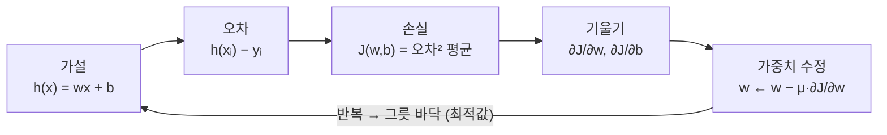

# 오차와 손실 함수 — 오차에서 최적값까지

[목차로 돌아가기](../00_%EB%94%A5%EB%9F%AC%EB%8B%9D%EC%88%98%ED%95%99_MOC.md) · 함께 볼 것: [D02_경사하강법으로_직선찾기](../01_%EA%B0%9C%EB%85%90%EB%85%B8%ED%8A%B8/D02_%EA%B2%BD%EC%82%AC%ED%95%98%EA%B0%95%EB%B2%95%EC%9C%BC%EB%A1%9C_%EC%A7%81%EC%84%A0%EC%B0%BE%EA%B8%B0.md) · 용어: [00_딥러닝_용어사전](../00_%EB%94%A5%EB%9F%AC%EB%8B%9D_%EC%9A%A9%EC%96%B4%EC%82%AC%EC%A0%84.md#error-%EC%98%A4%EC%B0%A8)

> [!NOTE]
> **3줄 요약**
> - **[오차](../00_%EB%94%A5%EB%9F%AC%EB%8B%9D_%EC%9A%A9%EC%96%B4%EC%82%AC%EC%A0%84.md#error-%EC%98%A4%EC%B0%A8)**(error)는 데이터 하나에서 "예측 − [정답](../00_%EB%94%A5%EB%9F%AC%EB%8B%9D_%EC%9A%A9%EC%96%B4%EC%82%AC%EC%A0%84.md#label-%EC%A0%95%EB%8B%B5)"이다. 그냥 평균을 내면(**[평균 오차](../00_%EB%94%A5%EB%9F%AC%EB%8B%9D_%EC%9A%A9%EC%96%B4%EC%82%AC%EC%A0%84.md#average-error-%ED%8F%89%EA%B7%A0-%EC%98%A4%EC%B0%A8)**) +와 −가 서로 지워져서 쓸 수 없다.
>   그래서 제곱([MSE](../00_%EB%94%A5%EB%9F%AC%EB%8B%9D_%EC%9A%A9%EC%96%B4%EC%82%AC%EC%A0%84.md#mse-mean-squared-error-%ED%8F%89%EA%B7%A0-%EC%A0%9C%EA%B3%B1-%EC%98%A4%EC%B0%A8))이나 절댓값(MAE)의 평균을 쓴다.
> - **[손실 함수](../00_%EB%94%A5%EB%9F%AC%EB%8B%9D_%EC%9A%A9%EC%96%B4%EC%82%AC%EC%A0%84.md#loss-function-%EC%86%90%EC%8B%A4-%ED%95%A8%EC%88%98)** $J(w, b)$는 "[가중치](../00_%EB%94%A5%EB%9F%AC%EB%8B%9D_%EC%9A%A9%EC%96%B4%EC%82%AC%EC%A0%84.md#weight-%EA%B0%80%EC%A4%91%EC%B9%98)를 이렇게 정하면 전체적으로 얼마나 틀리나"를 재는 **w, b의 함수**다(일부 교재는 비용 함수라고도 부른다). EX\_02에서는 w를 가로축으로 그리면 그릇 모양이 된다.
> - 그릇의 바닥이 **[최적값](../00_%EB%94%A5%EB%9F%AC%EB%8B%9D_%EC%9A%A9%EC%96%B4%EC%82%AC%EC%A0%84.md#optimal-value-%EC%B5%9C%EC%A0%81%EA%B0%92)**(optimal)이고, 바닥을 찾아가는 일이 **최적화**다.
>   [가설](../00_%EB%94%A5%EB%9F%AC%EB%8B%9D_%EC%9A%A9%EC%96%B4%EC%82%AC%EC%A0%84.md#hypothesis-%EA%B0%80%EC%84%A4)의 w, b를 [최적값](../00_%EB%94%A5%EB%9F%AC%EB%8B%9D_%EC%9A%A9%EC%96%B4%EC%82%AC%EC%A0%84.md#optimal-value-%EC%B5%9C%EC%A0%81%EA%B0%92)으로 맞추는 이 일이 EX\_02의 제목인 **[가설 최적화](../00_%EB%94%A5%EB%9F%AC%EB%8B%9D_%EC%9A%A9%EC%96%B4%EC%82%AC%EC%A0%84.md#hypothesis-optimization-%EA%B0%80%EC%84%A4-%EC%B5%9C%EC%A0%81%ED%99%94)**(Optimize Hypothesis)다.

## 1. 개념 설명

> 비유: 양궁 점수. 화살 하나가 과녁 중심에서 벗어난 정도(방향 포함)가 **[오차](../00_%EB%94%A5%EB%9F%AC%EB%8B%9D_%EC%9A%A9%EC%96%B4%EC%82%AC%EC%A0%84.md#error-%EC%98%A4%EC%B0%A8)**, 한 세트(여러 발)의 벗어난 정도를 모은 점수가 **[손실](../00_%EB%94%A5%EB%9F%AC%EB%8B%9D_%EC%9A%A9%EC%96%B4%EC%82%AC%EC%A0%84.md#loss-function-%EC%86%90%EC%8B%A4-%ED%95%A8%EC%88%98)**이다. 자세를 고쳐([가중치](../00_%EB%94%A5%EB%9F%AC%EB%8B%9D_%EC%9A%A9%EC%96%B4%EC%82%AC%EC%A0%84.md#weight-%EA%B0%80%EC%A4%91%EC%B9%98) 조절) 그 점수를 가장 좋게 만드는 자세가 **[최적값](../00_%EB%94%A5%EB%9F%AC%EB%8B%9D_%EC%9A%A9%EC%96%B4%EC%82%AC%EC%A0%84.md#optimal-value-%EC%B5%9C%EC%A0%81%EA%B0%92)**이다.

정확히 말하면, [오차](../00_%EB%94%A5%EB%9F%AC%EB%8B%9D_%EC%9A%A9%EC%96%B4%EC%82%AC%EC%A0%84.md#error-%EC%98%A4%EC%B0%A8)는 데이터 하나에서 (예측 − [정답](../00_%EB%94%A5%EB%9F%AC%EB%8B%9D_%EC%9A%A9%EC%96%B4%EC%82%AC%EC%A0%84.md#label-%EC%A0%95%EB%8B%B5))이고, [손실](../00_%EB%94%A5%EB%9F%AC%EB%8B%9D_%EC%9A%A9%EC%96%B4%EC%82%AC%EC%A0%84.md#loss-function-%EC%86%90%EC%8B%A4-%ED%95%A8%EC%88%98)은 그 [오차](../00_%EB%94%A5%EB%9F%AC%EB%8B%9D_%EC%9A%A9%EC%96%B4%EC%82%AC%EC%A0%84.md#error-%EC%98%A4%EC%B0%A8)로 만든 "틀린 정도"를 나타내는 숫자다. [손실 함수](../00_%EB%94%A5%EB%9F%AC%EB%8B%9D_%EC%9A%A9%EC%96%B4%EC%82%AC%EC%A0%84.md#loss-function-%EC%86%90%EC%8B%A4-%ED%95%A8%EC%88%98) $J(w, b)$는 w, b를 넣으면 전체 데이터에서 틀린 정도([오차](../00_%EB%94%A5%EB%9F%AC%EB%8B%9D_%EC%9A%A9%EC%96%B4%EC%82%AC%EC%A0%84.md#error-%EC%98%A4%EC%B0%A8) 제곱의 평균)를 돌려주는 함수이고, 이 값을 가장 작게 만드는 w, b가 [최적값](../00_%EB%94%A5%EB%9F%AC%EB%8B%9D_%EC%9A%A9%EC%96%B4%EC%82%AC%EC%A0%84.md#optimal-value-%EC%B5%9C%EC%A0%81%EA%B0%92)이다.

### 용어 한 줄 정리

| 용어 | 영어 | 뜻 | 범위 |
|---|---|---|---|
| [가설](../00_%EB%94%A5%EB%9F%AC%EB%8B%9D_%EC%9A%A9%EC%96%B4%EC%82%AC%EC%A0%84.md#hypothesis-%EA%B0%80%EC%84%A4) | hypothesis | 모델이 세운 함수 $h(x) = wx + b$ | 모델 전체 |
| [정답](../00_%EB%94%A5%EB%9F%AC%EB%8B%9D_%EC%9A%A9%EC%96%B4%EC%82%AC%EC%A0%84.md#label-%EC%A0%95%EB%8B%B5) | label | 맞혀야 하는 값 y | 데이터 하나 |
| [오차](../00_%EB%94%A5%EB%9F%AC%EB%8B%9D_%EC%9A%A9%EC%96%B4%EC%82%AC%EC%A0%84.md#error-%EC%98%A4%EC%B0%A8) | error | $h(x_i) - y_i$ | 데이터 하나 |
| [손실](../00_%EB%94%A5%EB%9F%AC%EB%8B%9D_%EC%9A%A9%EC%96%B4%EC%82%AC%EC%A0%84.md#loss-function-%EC%86%90%EC%8B%A4-%ED%95%A8%EC%88%98) | loss | 데이터 하나의 벌점. 예: $(h(x_i) - y_i)^2$ | 데이터 하나 |
| 비용 | cost | (일부 교재에서) [손실](../00_%EB%94%A5%EB%9F%AC%EB%8B%9D_%EC%9A%A9%EC%96%B4%EC%82%AC%EC%A0%84.md#loss-function-%EC%86%90%EC%8B%A4-%ED%95%A8%EC%88%98)의 평균을 부르는 이름. 예: $\frac{1}{m}\sum(h(x_i) - y_i)^2$ (Σ는 3절 미니 복습). 이 노트에서는 평균도 [손실](../00_%EB%94%A5%EB%9F%AC%EB%8B%9D_%EC%9A%A9%EC%96%B4%EC%82%AC%EC%A0%84.md#loss-function-%EC%86%90%EC%8B%A4-%ED%95%A8%EC%88%98)이라 부른다 | 데이터 전체 |
| [최적값](../00_%EB%94%A5%EB%9F%AC%EB%8B%9D_%EC%9A%A9%EC%96%B4%EC%82%AC%EC%A0%84.md#optimal-value-%EC%B5%9C%EC%A0%81%EA%B0%92) | optimal | [손실](../00_%EB%94%A5%EB%9F%AC%EB%8B%9D_%EC%9A%A9%EC%96%B4%EC%82%AC%EC%A0%84.md#loss-function-%EC%86%90%EC%8B%A4-%ED%95%A8%EC%88%98)을 가장 작게 만드는 w, b | |
| 최적화 | optimization | [최적값](../00_%EB%94%A5%EB%9F%AC%EB%8B%9D_%EC%9A%A9%EC%96%B4%EC%82%AC%EC%A0%84.md#optimal-value-%EC%B5%9C%EC%A0%81%EA%B0%92)을 찾아가는 과정([경사하강법](../00_%EB%94%A5%EB%9F%AC%EB%8B%9D_%EC%9A%A9%EC%96%B4%EC%82%AC%EC%A0%84.md#gradient-descent-%EA%B2%BD%EC%82%AC%ED%95%98%EA%B0%95%EB%B2%95) 등) | |

> [!NOTE]
> **[손실](../00_%EB%94%A5%EB%9F%AC%EB%8B%9D_%EC%9A%A9%EC%96%B4%EC%82%AC%EC%A0%84.md#loss-function-%EC%86%90%EC%8B%A4-%ED%95%A8%EC%88%98)과 비용**
> 교재에 따라 "데이터 하나의 벌점 = [손실](../00_%EB%94%A5%EB%9F%AC%EB%8B%9D_%EC%9A%A9%EC%96%B4%EC%82%AC%EC%A0%84.md#loss-function-%EC%86%90%EC%8B%A4-%ED%95%A8%EC%88%98)(loss), 전체 평균 = 비용(cost)"으로 나눠 부르기도 하고, 둘을 섞어 쓰기도 한다.
> 이 노트들과 Keras는 둘 다 [손실](../00_%EB%94%A5%EB%9F%AC%EB%8B%9D_%EC%9A%A9%EC%96%B4%EC%82%AC%EC%A0%84.md#loss-function-%EC%86%90%EC%8B%A4-%ED%95%A8%EC%88%98)(loss)이라고 부른다(`loss='mean_squared_error'`, [학습 기록](../00_%EB%94%A5%EB%9F%AC%EB%8B%9D_%EC%9A%A9%EC%96%B4%EC%82%AC%EC%A0%84.md#history-%ED%95%99%EC%8A%B5-%EA%B8%B0%EB%A1%9D)(log)의 `loss: 5.3598`). 노트북 코드의 `cost` = [손실](../00_%EB%94%A5%EB%9F%AC%EB%8B%9D_%EC%9A%A9%EC%96%B4%EC%82%AC%EC%A0%84.md#loss-function-%EC%86%90%EC%8B%A4-%ED%95%A8%EC%88%98)이다.
> 그래서 4.3절의 $J(w, b)$는 [D02_경사하강법으로_직선찾기](../01_%EA%B0%9C%EB%85%90%EB%85%B8%ED%8A%B8/D02_%EA%B2%BD%EC%82%AC%ED%95%98%EA%B0%95%EB%B2%95%EC%9C%BC%EB%A1%9C_%EC%A7%81%EC%84%A0%EC%B0%BE%EA%B8%B0.md)의 $\text{cost}(w, b)$와 같은 함수다.

## 2. 필요한 이유

직선 후보가 여러 개일 때, 모델이 얼마나 틀렸는지를 **숫자 하나**로 만들어야 "더 좋아졌다/나빠졌다"를 비교하고, 줄이는 방향([기울기](../00_%EB%94%A5%EB%9F%AC%EB%8B%9D_%EC%9A%A9%EC%96%B4%EC%82%AC%EC%A0%84.md#gradient-%EA%B8%B0%EC%9A%B8%EA%B8%B0))을 계산할 수 있다. 그 숫자를 만드는 단계가 [오차](../00_%EB%94%A5%EB%9F%AC%EB%8B%9D_%EC%9A%A9%EC%96%B4%EC%82%AC%EC%A0%84.md#error-%EC%98%A4%EC%B0%A8) → [손실](../00_%EB%94%A5%EB%9F%AC%EB%8B%9D_%EC%9A%A9%EC%96%B4%EC%82%AC%EC%A0%84.md#loss-function-%EC%86%90%EC%8B%A4-%ED%95%A8%EC%88%98)이다. 다만 [오차](../00_%EB%94%A5%EB%9F%AC%EB%8B%9D_%EC%9A%A9%EC%96%B4%EC%82%AC%EC%A0%84.md#error-%EC%98%A4%EC%B0%A8)를 그냥 평균 내면 +와 −가 지워져 쓸 수 없으므로 제곱 같은 처리가 필요하다(4.2절).

## 3. 필요한 수학 개념

| 수학 개념 | 이 개념에서 쓰이는 곳 | 자세히 |
|---|---|---|
| 함수와 일차함수 | [가설](../00_%EB%94%A5%EB%9F%AC%EB%8B%9D_%EC%9A%A9%EC%96%B4%EC%82%AC%EC%A0%84.md#hypothesis-%EA%B0%80%EC%84%A4) $h(x) = wx + b$, 그리고 "[손실](../00_%EB%94%A5%EB%9F%AC%EB%8B%9D_%EC%9A%A9%EC%96%B4%EC%82%AC%EC%A0%84.md#loss-function-%EC%86%90%EC%8B%A4-%ED%95%A8%EC%88%98)도 w의 함수" | [M01_함수와_일차함수](../02_%EC%88%98%ED%95%99%EB%85%B8%ED%8A%B8/M01_%ED%95%A8%EC%88%98%EC%99%80_%EC%9D%BC%EC%B0%A8%ED%95%A8%EC%88%98.md) |
| 시그마와 평균 | 평균, [MSE](../00_%EB%94%A5%EB%9F%AC%EB%8B%9D_%EC%9A%A9%EC%96%B4%EC%82%AC%EC%A0%84.md#mse-mean-squared-error-%ED%8F%89%EA%B7%A0-%EC%A0%9C%EA%B3%B1-%EC%98%A4%EC%B0%A8) | [M02_시그마와_평균](../02_%EC%88%98%ED%95%99%EB%85%B8%ED%8A%B8/M02_%EC%8B%9C%EA%B7%B8%EB%A7%88%EC%99%80_%ED%8F%89%EA%B7%A0.md) |
| [미분](../00_%EB%94%A5%EB%9F%AC%EB%8B%9D_%EC%9A%A9%EC%96%B4%EC%82%AC%EC%A0%84.md#derivative-%EB%AF%B8%EB%B6%84)과 [기울기](../00_%EB%94%A5%EB%9F%AC%EB%8B%9D_%EC%9A%A9%EC%96%B4%EC%82%AC%EC%A0%84.md#gradient-%EA%B8%B0%EC%9A%B8%EA%B8%B0) | 바닥에서 [기울기](../00_%EB%94%A5%EB%9F%AC%EB%8B%9D_%EC%9A%A9%EC%96%B4%EC%82%AC%EC%A0%84.md#gradient-%EA%B8%B0%EC%9A%B8%EA%B8%B0)가 0 | [M03_미분_기울기](../02_%EC%88%98%ED%95%99%EB%85%B8%ED%8A%B8/M03_%EB%AF%B8%EB%B6%84_%EA%B8%B0%EC%9A%B8%EA%B8%B0.md) |
| 최솟값과 볼록함수 | 바닥이 하나인가 여러 개인가 | [M09_최솟값과_볼록함수](../02_%EC%88%98%ED%95%99%EB%85%B8%ED%8A%B8/M09_%EC%B5%9C%EC%86%9F%EA%B0%92%EA%B3%BC_%EB%B3%BC%EB%A1%9D%ED%95%A8%EC%88%98.md) |

<details><summary>미니 복습: Σ</summary>

$\sum_{i=1}^{m} f(i)$는 i = 1부터 m까지 f(i)를 for문처럼 하나씩 더한 값이다. 앞에 $\frac{1}{m}$을 곱하면 개수로 나누니 평균이 된다.
예: m = 3이고 [오차](../00_%EB%94%A5%EB%9F%AC%EB%8B%9D_%EC%9A%A9%EC%96%B4%EC%82%AC%EC%A0%84.md#error-%EC%98%A4%EC%B0%A8) 제곱이 4, 0, 4이면 $\frac{1}{3}(4 + 0 + 4) = 2.667$. 자세히: [M02_시그마와_평균](../02_%EC%88%98%ED%95%99%EB%85%B8%ED%8A%B8/M02_%EC%8B%9C%EA%B7%B8%EB%A7%88%EC%99%80_%ED%8F%89%EA%B7%A0.md)

</details>

## 4. 계산 과정 (숫자 → 식 → 코드)

### 4.1 오차 계산

데이터 3개 (1, 3), (2, 5), (3, 7)에 [가설](../00_%EB%94%A5%EB%9F%AC%EB%8B%9D_%EC%9A%A9%EC%96%B4%EC%82%AC%EC%A0%84.md#hypothesis-%EA%B0%80%EC%84%A4) $h(x) = 5$ (w = 0, b = 5)를 써 보면:

| x | 예측 h(x) | [정답](../00_%EB%94%A5%EB%9F%AC%EB%8B%9D_%EC%9A%A9%EC%96%B4%EC%82%AC%EC%A0%84.md#label-%EC%A0%95%EB%8B%B5) y | [오차](../00_%EB%94%A5%EB%9F%AC%EB%8B%9D_%EC%9A%A9%EC%96%B4%EC%82%AC%EC%A0%84.md#error-%EC%98%A4%EC%B0%A8) h(x) − y |
|---|---|---|---|
| 1 | 5 | 3 | **+2** (높게 예측) |
| 2 | 5 | 5 | 0 |
| 3 | 5 | 7 | **−2** (낮게 예측) |

- [오차](../00_%EB%94%A5%EB%9F%AC%EB%8B%9D_%EC%9A%A9%EC%96%B4%EC%82%AC%EC%A0%84.md#error-%EC%98%A4%EC%B0%A8)의 **부호**는 방향(높게/낮게), **크기**는 얼마나 틀렸나를 뜻한다.

### 4.2 평균 오차를 쓸 수 없는 이유

| 방법 | 계산 | 값 | 문제 |
|---|---|---|---|
| [평균 오차](../00_%EB%94%A5%EB%9F%AC%EB%8B%9D_%EC%9A%A9%EC%96%B4%EC%82%AC%EC%A0%84.md#average-error-%ED%8F%89%EA%B7%A0-%EC%98%A4%EC%B0%A8) | (2 + 0 − 2) ÷ 3 | **0** | 분명히 틀렸는데 "[오차](../00_%EB%94%A5%EB%9F%AC%EB%8B%9D_%EC%9A%A9%EC%96%B4%EC%82%AC%EC%A0%84.md#error-%EC%98%A4%EC%B0%A8) 없음"이 된다 |
| 평균 절대 [오차](../00_%EB%94%A5%EB%9F%AC%EB%8B%9D_%EC%9A%A9%EC%96%B4%EC%82%AC%EC%A0%84.md#error-%EC%98%A4%EC%B0%A8) (MAE) | (2 + 0 + 2) ÷ 3 | 1.333 | 쓸 수 있다 |
| [평균 제곱 오차](../00_%EB%94%A5%EB%9F%AC%EB%8B%9D_%EC%9A%A9%EC%96%B4%EC%82%AC%EC%A0%84.md#mse-mean-squared-error-%ED%8F%89%EA%B7%A0-%EC%A0%9C%EA%B3%B1-%EC%98%A4%EC%B0%A8) ([MSE](../00_%EB%94%A5%EB%9F%AC%EB%8B%9D_%EC%9A%A9%EC%96%B4%EC%82%AC%EC%A0%84.md#mse-mean-squared-error-%ED%8F%89%EA%B7%A0-%EC%A0%9C%EA%B3%B1-%EC%98%A4%EC%B0%A8)) | (4 + 0 + 4) ÷ 3 | 2.667 | 쓸 수 있다. 예제가 쓰는 것 |

- **[평균 오차](../00_%EB%94%A5%EB%9F%AC%EB%8B%9D_%EC%9A%A9%EC%96%B4%EC%82%AC%EC%A0%84.md#average-error-%ED%8F%89%EA%B7%A0-%EC%98%A4%EC%B0%A8)**는 높게 틀린 것과 낮게 틀린 것이 서로 지워진다. 그래서 [손실](../00_%EB%94%A5%EB%9F%AC%EB%8B%9D_%EC%9A%A9%EC%96%B4%EC%82%AC%EC%A0%84.md#loss-function-%EC%86%90%EC%8B%A4-%ED%95%A8%EC%88%98)로 쓰지 않는다.
- **[MSE](../00_%EB%94%A5%EB%9F%AC%EB%8B%9D_%EC%9A%A9%EC%96%B4%EC%82%AC%EC%A0%84.md#mse-mean-squared-error-%ED%8F%89%EA%B7%A0-%EC%A0%9C%EA%B3%B1-%EC%98%A4%EC%B0%A8)**는 큰 [오차](../00_%EB%94%A5%EB%9F%AC%EB%8B%9D_%EC%9A%A9%EC%96%B4%EC%82%AC%EC%A0%84.md#error-%EC%98%A4%EC%B0%A8)를 더 크게 벌주고, 미분하기 쉬워서([M04_편미분](../02_%EC%88%98%ED%95%99%EB%85%B8%ED%8A%B8/M04_%ED%8E%B8%EB%AF%B8%EB%B6%84.md)) [회귀](../00_%EB%94%A5%EB%9F%AC%EB%8B%9D_%EC%9A%A9%EC%96%B4%EC%82%AC%EC%A0%84.md#regression-classification-%ED%9A%8C%EA%B7%80%EC%99%80-%EB%B6%84%EB%A5%98)의 기본 [손실](../00_%EB%94%A5%EB%9F%AC%EB%8B%9D_%EC%9A%A9%EC%96%B4%EC%82%AC%EC%A0%84.md#loss-function-%EC%86%90%EC%8B%A4-%ED%95%A8%EC%88%98)이 됐다.
- 참고로 [정답](../00_%EB%94%A5%EB%9F%AC%EB%8B%9D_%EC%9A%A9%EC%96%B4%EC%82%AC%EC%A0%84.md#label-%EC%A0%95%EB%8B%B5) 규칙 $h(x) = 2x + 1$이면 [오차](../00_%EB%94%A5%EB%9F%AC%EB%8B%9D_%EC%9A%A9%EC%96%B4%EC%82%AC%EC%A0%84.md#error-%EC%98%A4%EC%B0%A8)가 `[0, 0, 0]`이라 세 방법 모두 0이다.

### 4.3 식: 손실 함수 J(w, b)

말로 하면, 데이터마다 (예측 − [정답](../00_%EB%94%A5%EB%9F%AC%EB%8B%9D_%EC%9A%A9%EC%96%B4%EC%82%AC%EC%A0%84.md#label-%EC%A0%95%EB%8B%B5))을 제곱해 모두 더하고, 데이터 개수로 나눈다(평균). w, b를 넣으면 "얼마나 틀리나"가 나오는 함수다. Σ가 낯설면 3절의 미니 복습을 본다.

$$J(w, b) = \frac{1}{m}\sum_{i=1}^{m}\big(\underbrace{w x_i + b}_{\text{가설}} - \underbrace{y_i}_{\text{레이블}}\big)^2$$

<details><summary>기호 풀이</summary>

| 기호 | 읽는 법 | 뜻 | 예제 값 |
| --- | --- | --- | --- |
| $J(w, b)$ | 제이 | [손실 함수](../00_%EB%94%A5%EB%9F%AC%EB%8B%9D_%EC%9A%A9%EC%96%B4%EC%82%AC%EC%A0%84.md#loss-function-%EC%86%90%EC%8B%A4-%ED%95%A8%EC%88%98). w, b를 넣으면 틀린 정도가 나온다 | 4.1절 데이터에서 J(0, 5) = 2.667 |
| $m$ | 엠 | 데이터 개수 | 3 |
| $\sum_{i=1}^{m}$ | 시그마 | i = 1부터 m까지 전부 더한다 | 4 + 0 + 4 |
| $x_i,\ y_i$ | 엑스 아이, 와이 아이 | i번째 입력과 [정답](../00_%EB%94%A5%EB%9F%AC%EB%8B%9D_%EC%9A%A9%EC%96%B4%EC%82%AC%EC%A0%84.md#label-%EC%A0%95%EB%8B%B5) | (3, 7) |
| $w,\ b$ | 더블유, 비 | 직선의 [기울기](../00_%EB%94%A5%EB%9F%AC%EB%8B%9D_%EC%9A%A9%EC%96%B4%EC%82%AC%EC%A0%84.md#gradient-%EA%B8%B0%EC%9A%B8%EA%B8%B0)와 절편(고칠 값) | 0, 5 |

</details>

여기서 **데이터 $x_i, y_i$는 고정**이고 **변하는 것은 w, b**다. 즉 [손실](../00_%EB%94%A5%EB%9F%AC%EB%8B%9D_%EC%9A%A9%EC%96%B4%EC%82%AC%EC%A0%84.md#loss-function-%EC%86%90%EC%8B%A4-%ED%95%A8%EC%88%98)은 [가중치](../00_%EB%94%A5%EB%9F%AC%EB%8B%9D_%EC%9A%A9%EC%96%B4%EC%82%AC%EC%A0%84.md#weight-%EA%B0%80%EC%A4%91%EC%B9%98)의 함수다. 이 관점 전환이 핵심이다.

| 관점 | 넣는 값 | 나오는 값 |
|---|---|---|
| [가설](../00_%EB%94%A5%EB%9F%AC%EB%8B%9D_%EC%9A%A9%EC%96%B4%EC%82%AC%EC%A0%84.md#hypothesis-%EA%B0%80%EC%84%A4) $h(x)$ | 입력 x (w, b는 고정) | 예측 |
| [손실](../00_%EB%94%A5%EB%9F%AC%EB%8B%9D_%EC%9A%A9%EC%96%B4%EC%82%AC%EC%A0%84.md#loss-function-%EC%86%90%EC%8B%A4-%ED%95%A8%EC%88%98) $J(w, b)$ | [가중치](../00_%EB%94%A5%EB%9F%AC%EB%8B%9D_%EC%9A%A9%EC%96%B4%EC%82%AC%EC%A0%84.md#weight-%EA%B0%80%EC%A4%91%EC%B9%98) w, b (데이터는 고정) | 틀린 정도 |

### 4.4 EX\_02 데이터로 손실 그려 보기

EX\_02(x = 1~10, y = 2x + 1)에서 b = 1로 고정하고 w만 바꾸면:

| w | 0 | 1 | 1.5 | **2** | 2.5 | 3 | 4 |
|---|---|---|---|---|---|---|---|
| J(w, 1) | 154 | 38.5 | 9.625 | **0** | 9.625 | 38.5 | 154 |

- w = 2에서 가장 작고(0), 양쪽으로 똑같이 커진다. **그릇(포물선) 모양**이다.
- 실제로 $J(w, 1) = 38.5 \times (w - 2)^2$이다. [M03_미분_기울기](../02_%EC%88%98%ED%95%99%EB%85%B8%ED%8A%B8/M03_%EB%AF%B8%EB%B6%84_%EA%B8%B0%EC%9A%B8%EA%B8%B0.md)의 $x^2$ 그래프를 옆으로 옮기고 세로로 늘린 모양이다.

왜 38.5인지 한 줄씩 보면:

- 예측 − [정답](../00_%EB%94%A5%EB%9F%AC%EB%8B%9D_%EC%9A%A9%EC%96%B4%EC%82%AC%EC%A0%84.md#label-%EC%A0%95%EB%8B%B5) = (wx + 1) − (2x + 1) = (w − 2)x  (b = 1이라 두 1이 서로 지워짐)
- 제곱하면 (w − 2)²x²  (곱의 제곱은 각각 제곱)
- 평균을 내면 (w − 2)² × (x²의 평균)  ((w − 2)²는 모든 데이터에서 같은 값이라 평균 밖으로 나옴)
- x²의 평균 = (1 + 4 + 9 + … + 100) ÷ 10 = 385 ÷ 10 = 38.5
- 그래서 J(w, 1) = 38.5(w − 2)²  (예: w = 0이면 38.5 × 4 = 154로 표와 같다)

w = 2로 고정하고 b만 바꾸면:

| b | −1 | 0 | **1** | 2 | 3 |
|---|---|---|---|---|---|
| J(2, b) | 4 | 1 | **0** | 1 | 4 |

w = 2이면 예측 − [정답](../00_%EB%94%A5%EB%9F%AC%EB%8B%9D_%EC%9A%A9%EC%96%B4%EC%82%AC%EC%A0%84.md#label-%EC%A0%95%EB%8B%B5) = (2x + b) − (2x + 1) = b − 1이 모든 데이터에서 똑같다. 그래서 J(2, b) = (b − 1)²이고, 표의 값과 같다(b = −1이면 (−2)² = 4).

w와 b를 함께 그리면 바닥이 (w = 2, b = 1) 한 점인 **그릇 모양 곡면**이 된다. 이 바닥이 **[최적값](../00_%EB%94%A5%EB%9F%AC%EB%8B%9D_%EC%9A%A9%EC%96%B4%EC%82%AC%EC%A0%84.md#optimal-value-%EC%B5%9C%EC%A0%81%EA%B0%92)**이다.

### 4.5 최적화: 그릇 바닥 찾아가기

아래 순서를 반복하면 w, b가 그릇 바닥([최적값](../00_%EB%94%A5%EB%9F%AC%EB%8B%9D_%EC%9A%A9%EC%96%B4%EC%82%AC%EC%A0%84.md#optimal-value-%EC%B5%9C%EC%A0%81%EA%B0%92))에 가까워진다.



μ(뮤)는 [학습률](../00_%EB%94%A5%EB%9F%AC%EB%8B%9D_%EC%9A%A9%EC%96%B4%EC%82%AC%EC%A0%84.md#learning-rate-%ED%95%99%EC%8A%B5%EB%A5%A0)(한 번에 움직이는 크기), ∂J/∂w는 w를 조금 바꿀 때 J가 얼마나 변하는지를 나타내는 [기울기](../00_%EB%94%A5%EB%9F%AC%EB%8B%9D_%EC%9A%A9%EC%96%B4%EC%82%AC%EC%A0%84.md#gradient-%EA%B8%B0%EC%9A%B8%EA%B8%B0)다. 자세히: [D02_경사하강법으로_직선찾기](../01_%EA%B0%9C%EB%85%90%EB%85%B8%ED%8A%B8/D02_%EA%B2%BD%EC%82%AC%ED%95%98%EA%B0%95%EB%B2%95%EC%9C%BC%EB%A1%9C_%EC%A7%81%EC%84%A0%EC%B0%BE%EA%B8%B0.md)

- 바닥에서는 [기울기](../00_%EB%94%A5%EB%9F%AC%EB%8B%9D_%EC%9A%A9%EC%96%B4%EC%82%AC%EC%A0%84.md#gradient-%EA%B8%B0%EC%9A%B8%EA%B8%B0)가 0이다([M03_미분_기울기](../02_%EC%88%98%ED%95%99%EB%85%B8%ED%8A%B8/M03_%EB%AF%B8%EB%B6%84_%EA%B8%B0%EC%9A%B8%EA%B8%B0.md) 6절). 그래서 바닥 근처에 가면 w, b가 거의 안 움직인다(**[수렴](../00_%EB%94%A5%EB%9F%AC%EB%8B%9D_%EC%9A%A9%EC%96%B4%EC%82%AC%EC%A0%84.md#convergence-%EC%88%98%EB%A0%B4)**, [E03_혈압_선형회귀_예제](../03_%EC%98%88%EC%A0%9C%ED%92%80%EC%9D%B4/E03_%ED%98%88%EC%95%95_%EC%84%A0%ED%98%95%ED%9A%8C%EA%B7%80_%EC%98%88%EC%A0%9C.md)의 15만 번째 이후).
- EX\_02는 [정답](../00_%EB%94%A5%EB%9F%AC%EB%8B%9D_%EC%9A%A9%EC%96%B4%EC%82%AC%EC%A0%84.md#label-%EC%A0%95%EB%8B%B5)을 y = 2x + 1로 직접 만든 데이터라서 바닥의 [손실](../00_%EB%94%A5%EB%9F%AC%EB%8B%9D_%EC%9A%A9%EC%96%B4%EC%82%AC%EC%A0%84.md#loss-function-%EC%86%90%EC%8B%A4-%ED%95%A8%EC%88%98)이 0이다. EX\_03 같은 실제 데이터는 바닥에서도 [손실](../00_%EB%94%A5%EB%9F%AC%EB%8B%9D_%EC%9A%A9%EC%96%B4%EC%82%AC%EC%A0%84.md#loss-function-%EC%86%90%EC%8B%A4-%ED%95%A8%EC%88%98)이 0이 아니다(17.07). "**가장 덜 틀리는**" 곳이 [최적값](../00_%EB%94%A5%EB%9F%AC%EB%8B%9D_%EC%9A%A9%EC%96%B4%EC%82%AC%EC%A0%84.md#optimal-value-%EC%B5%9C%EC%A0%81%EA%B0%92)이다.
- [선형 회귀](../00_%EB%94%A5%EB%9F%AC%EB%8B%9D_%EC%9A%A9%EC%96%B4%EC%82%AC%EC%A0%84.md#linear-regression-%EC%84%A0%ED%98%95-%ED%9A%8C%EA%B7%80)의 [MSE](../00_%EB%94%A5%EB%9F%AC%EB%8B%9D_%EC%9A%A9%EC%96%B4%EC%82%AC%EC%A0%84.md#mse-mean-squared-error-%ED%8F%89%EA%B7%A0-%EC%A0%9C%EA%B3%B1-%EC%98%A4%EC%B0%A8) [손실](../00_%EB%94%A5%EB%9F%AC%EB%8B%9D_%EC%9A%A9%EC%96%B4%EC%82%AC%EC%A0%84.md#loss-function-%EC%86%90%EC%8B%A4-%ED%95%A8%EC%88%98)은 바닥이 하나뿐인 그릇([볼록 함수](../00_%EB%94%A5%EB%9F%AC%EB%8B%9D_%EC%9A%A9%EC%96%B4%EC%82%AC%EC%A0%84.md#convex-function-%EB%B3%BC%EB%A1%9D-%ED%95%A8%EC%88%98))이라, 어디서 출발해도 같은 바닥에 도착한다. 바닥이 여러 개인 경우는 [M09_최솟값과_볼록함수](../02_%EC%88%98%ED%95%99%EB%85%B8%ED%8A%B8/M09_%EC%B5%9C%EC%86%9F%EA%B0%92%EA%B3%BC_%EB%B3%BC%EB%A1%9D%ED%95%A8%EC%88%98.md).

### 4.6 코드: 손실 표 만들기

```python
import numpy as np
x = np.arange(1, 11.)                        # 1, 2, ..., 10 (실수)
y = 2*x + 1                                  # EX_02의 정답
J = lambda w, b: np.mean((w*x + b - y)**2)   # 손실 함수 J(w, b): w, b를 넣으면 MSE가 나옴
for w in [0, 1, 1.5, 2, 2.5, 3, 4]:
    print(w, J(w, 1))                        # b = 1로 고정하고 w만 바꿈
```

**실행 결과**:

```text
0 154.0
1 38.5
1.5 9.625
2 0.0
2.5 9.625
3 38.5
4 154.0
```

- `lambda w, b: ...`는 한 줄짜리 함수 정의다(파이썬 강의노트 7장).

## 5. 개념 재확인

<details><summary>1. 오차가 <code>[3, −1, −2]</code>일 때 평균 오차, MAE, MSE는?</summary>

| 단계 | 하는 일 | 코드 | 계산 | 결과 |
|---|---|---|---|---|
| 1 | [오차](../00_%EB%94%A5%EB%9F%AC%EB%8B%9D_%EC%9A%A9%EC%96%B4%EC%82%AC%EC%A0%84.md#error-%EC%98%A4%EC%B0%A8) 그대로 더하기 | `np.sum(e)` | 3 + (−1) + (−2) | 0 |
| 2 | [평균 오차](../00_%EB%94%A5%EB%9F%AC%EB%8B%9D_%EC%9A%A9%EC%96%B4%EC%82%AC%EC%A0%84.md#average-error-%ED%8F%89%EA%B7%A0-%EC%98%A4%EC%B0%A8) | `np.mean(e)` | 0 ÷ 3 | 0 (+3이 −1, −2와 지워짐) |
| 3 | MAE (절댓값의 평균) | `np.mean(np.abs(e))` | (3 + 1 + 2) ÷ 3 | 2 |
| 4 | [MSE](../00_%EB%94%A5%EB%9F%AC%EB%8B%9D_%EC%9A%A9%EC%96%B4%EC%82%AC%EC%A0%84.md#mse-mean-squared-error-%ED%8F%89%EA%B7%A0-%EC%A0%9C%EA%B3%B1-%EC%98%A4%EC%B0%A8) (제곱의 평균) | `np.mean(e**2)` | (9 + 1 + 4) ÷ 3 | 4.667 |

**① 쓰는 코드**
```python
import numpy as np                   # ① 준비
e = np.array([3, -1, -2])            # ① 오차 (문제에서 준 값)
print(np.sum(e))                     # ② 오차 그대로 더하기 → 0
print(np.mean(e))                    # ③ 평균 오차 (더한 값 ÷ 개수) → 0.0
print(np.mean(np.abs(e)))            # ④ MAE: 절댓값으로 바꾼 뒤 평균 → 2.0
print(np.mean(e**2))                 # ⑤ MSE: 제곱한 뒤 평균 → 4.666...
```

**② [오차](../00_%EB%94%A5%EB%9F%AC%EB%8B%9D_%EC%9A%A9%EC%96%B4%EC%82%AC%EC%A0%84.md#error-%EC%98%A4%EC%B0%A8) 그대로 더하기** (`np.sum(e)`)
- 3 + (−1) + (−2) = 0

**③ [평균 오차](../00_%EB%94%A5%EB%9F%AC%EB%8B%9D_%EC%9A%A9%EC%96%B4%EC%82%AC%EC%A0%84.md#average-error-%ED%8F%89%EA%B7%A0-%EC%98%A4%EC%B0%A8)** (`np.mean(e)`)
- 0 ÷ 3 = 0
- +3이 −1, −2와 서로 지워져 "[오차](../00_%EB%94%A5%EB%9F%AC%EB%8B%9D_%EC%9A%A9%EC%96%B4%EC%82%AC%EC%A0%84.md#error-%EC%98%A4%EC%B0%A8) 없음"처럼 보임

**④ MAE (절댓값의 평균)** (`np.mean(np.abs(e))`)
- 절댓값: |3| = 3, |−1| = 1, |−2| = 2 → `[3, 1, 2]`
- 3 + 1 + 2 = 6
- 6 ÷ 3 = 2

**⑤ [MSE](../00_%EB%94%A5%EB%9F%AC%EB%8B%9D_%EC%9A%A9%EC%96%B4%EC%82%AC%EC%A0%84.md#mse-mean-squared-error-%ED%8F%89%EA%B7%A0-%EC%A0%9C%EA%B3%B1-%EC%98%A4%EC%B0%A8) (제곱의 평균)** (`np.mean(e**2)`)
- 제곱: 3² = 9, (−1)² = 1, (−2)² = 4 → `[9, 1, 4]`
- 9 + 1 + 4 = 14
- 14 ÷ 3 = 4.667

제곱하면 음수도 양수가 되고 큰 [오차](../00_%EB%94%A5%EB%9F%AC%EB%8B%9D_%EC%9A%A9%EC%96%B4%EC%82%AC%EC%A0%84.md#error-%EC%98%A4%EC%B0%A8)(3)가 더 크게 반영된다.

**답**: [평균 오차](../00_%EB%94%A5%EB%9F%AC%EB%8B%9D_%EC%9A%A9%EC%96%B4%EC%82%AC%EC%A0%84.md#average-error-%ED%8F%89%EA%B7%A0-%EC%98%A4%EC%B0%A8) **0**, MAE **2**, [MSE](../00_%EB%94%A5%EB%9F%AC%EB%8B%9D_%EC%9A%A9%EC%96%B4%EC%82%AC%EC%A0%84.md#mse-mean-squared-error-%ED%8F%89%EA%B7%A0-%EC%A0%9C%EA%B3%B1-%EC%98%A4%EC%B0%A8) **4.667**

</details>

<details><summary>2. 손실 함수에서 "넣는 값"은 무엇인가?</summary>

| 단계 | 하는 일 | 코드 | 계산 | 결과 |
|---|---|---|---|---|
| 1 | 데이터는 고정 | `x, y` | (1, 3), (2, 5), (3, 7) | 주어진 값 |
| 2 | J(0, 5)를 넣기 | `J(0, 5)` | (4 + 0 + 4) ÷ 3 | 2.667 |
| 3 | J(2, 1)을 넣기 | `J(2, 1)` | (0 + 0 + 0) ÷ 3 | 0 |
| 4 | [가설](../00_%EB%94%A5%EB%9F%AC%EB%8B%9D_%EC%9A%A9%EC%96%B4%EC%82%AC%EC%A0%84.md#hypothesis-%EA%B0%80%EC%84%A4) h(x)와 비교 | `h(x)` | w, b 고정, x를 넣음 | 넣는 값이 반대 |

**① 쓰는 코드**
```python
import numpy as np                           # ① 준비
x = np.array([1, 2, 3])                      # ② 데이터는 고정 (4.1절 데이터)
y = np.array([3, 5, 7])                      # ② 정답도 고정
J = lambda w, b: np.mean((w*x + b - y)**2)   # ① 손실 함수: w, b를 넣으면 MSE가 나옴
print(J(0, 5))                               # ③ w = 0, b = 5를 넣음 → 2.667
print(J(2, 1))                               # ④ w = 2, b = 1을 넣음 → 0.0
h = lambda x: 0*x + 5                        # ⑤ 가설 h(x): w, b는 고정하고 x를 넣음
```

**② 데이터는 고정**
- (x, y) = (1, 3), (2, 5), (3, 7)
- 이 값들은 J(w, b)를 부를 때 바뀌지 않음

**③ J(0, 5)를 넣기** (`J(0, 5)`)
- 예측 − [정답](../00_%EB%94%A5%EB%9F%AC%EB%8B%9D_%EC%9A%A9%EC%96%B4%EC%82%AC%EC%A0%84.md#label-%EC%A0%95%EB%8B%B5): (0×1 + 5) − 3 = 2, (0×2 + 5) − 5 = 0, (0×3 + 5) − 7 = −2
- 제곱: 2² = 4, 0² = 0, (−2)² = 4
- (4 + 0 + 4) ÷ 3 = 2.667

**④ J(2, 1)을 넣기** (`J(2, 1)`)
- 예측 − [정답](../00_%EB%94%A5%EB%9F%AC%EB%8B%9D_%EC%9A%A9%EC%96%B4%EC%82%AC%EC%A0%84.md#label-%EC%A0%95%EB%8B%B5): (2×1 + 1) − 3 = 0, (2×2 + 1) − 5 = 0, (2×3 + 1) − 7 = 0
- 제곱: 0, 0, 0
- (0 + 0 + 0) ÷ 3 = 0

**⑤ [가설](../00_%EB%94%A5%EB%9F%AC%EB%8B%9D_%EC%9A%A9%EC%96%B4%EC%82%AC%EC%A0%84.md#hypothesis-%EA%B0%80%EC%84%A4) h(x)와 비교** (`h(x)`)
- [가설](../00_%EB%94%A5%EB%9F%AC%EB%8B%9D_%EC%9A%A9%EC%96%B4%EC%82%AC%EC%A0%84.md#hypothesis-%EA%B0%80%EC%84%A4) h(x)는 w, b를 고정하고 x를 넣어 예측을 얻음
- [손실](../00_%EB%94%A5%EB%9F%AC%EB%8B%9D_%EC%9A%A9%EC%96%B4%EC%82%AC%EC%A0%84.md#loss-function-%EC%86%90%EC%8B%A4-%ED%95%A8%EC%88%98) J(w, b)는 데이터를 고정하고 w, b를 넣어 틀린 정도를 얻음
- 넣는 값이 반대

[손실 함수](../00_%EB%94%A5%EB%9F%AC%EB%8B%9D_%EC%9A%A9%EC%96%B4%EC%82%AC%EC%A0%84.md#loss-function-%EC%86%90%EC%8B%A4-%ED%95%A8%EC%88%98) J(w, b)에서 바뀌는 것은 w, b뿐이다.

**답**: 데이터가 아니라 **[가중치](../00_%EB%94%A5%EB%9F%AC%EB%8B%9D_%EC%9A%A9%EC%96%B4%EC%82%AC%EC%A0%84.md#weight-%EA%B0%80%EC%A4%91%EC%B9%98) w, b**다. 데이터는 고정이다.

</details>

<details><summary>3. 실제 데이터에서 최적값의 손실이 0이 아닌 이유는?</summary>

| 단계 | 하는 일 | 코드 | 계산 | 결과 |
|---|---|---|---|---|
| 1 | 직접 만든 데이터 EX\_02 | `y = 2*x + 1` | w = 2, b = 1이면 [오차](../00_%EB%94%A5%EB%9F%AC%EB%8B%9D_%EC%9A%A9%EC%96%B4%EC%82%AC%EC%A0%84.md#error-%EC%98%A4%EC%B0%A8) 모두 0 | J = 0 |
| 2 | 실제 데이터 EX\_03 (같은 x에 y가 118, 122) | - | 직선은 한 x에 값을 하나만 냄 | 둘 중 하나 이상 [오차](../00_%EB%94%A5%EB%9F%AC%EB%8B%9D_%EC%9A%A9%EC%96%B4%EC%82%AC%EC%A0%84.md#error-%EC%98%A4%EC%B0%A8)가 남음 |
| 3 | 예측을 118로 맞추면 | `w*x + b - y` | 118 − 118, 118 − 122 | [오차](../00_%EB%94%A5%EB%9F%AC%EB%8B%9D_%EC%9A%A9%EC%96%B4%EC%82%AC%EC%A0%84.md#error-%EC%98%A4%EC%B0%A8) 0, −4 |
| 4 | 예측을 122로 맞추면 | `w*x + b - y` | 122 − 118, 122 − 122 | [오차](../00_%EB%94%A5%EB%9F%AC%EB%8B%9D_%EC%9A%A9%EC%96%B4%EC%82%AC%EC%A0%84.md#error-%EC%98%A4%EC%B0%A8) 4, 0 |
| 5 | [오차](../00_%EB%94%A5%EB%9F%AC%EB%8B%9D_%EC%9A%A9%EC%96%B4%EC%82%AC%EC%A0%84.md#error-%EC%98%A4%EC%B0%A8)가 남으면 | `np.mean(e**2)` | 제곱의 평균 > 0 | EX\_03 최솟값 17.07 |

**① 쓰는 코드**
```python
x = np.arange(1, 11.)                 # ② EX_02: x = 1~10
y = 2*x + 1                           # ② 직접 만든 정답 → w = 2, b = 1이면 오차 모두 0, J = 0
y3 = np.array([118, 122])             # ③ EX_03처럼 같은 x에 정답이 두 개
e118 = 118 - y3                       # ④ 예측을 118로 맞춤 → [0, -4]
e122 = 122 - y3                       # ⑤ 예측을 122로 맞춤 → [4, 0]
print(np.mean(e118**2))               # ⑥ 오차가 남으니 제곱의 평균 > 0 → 8.0
```

**② 직접 만든 데이터 EX\_02** (`y = 2*x + 1`)
- [정답](../00_%EB%94%A5%EB%9F%AC%EB%8B%9D_%EC%9A%A9%EC%96%B4%EC%82%AC%EC%A0%84.md#label-%EC%A0%95%EB%8B%B5)이 w = 2, b = 1인 직선 위에 있음
- 이 직선으로 예측하면 [오차](../00_%EB%94%A5%EB%9F%AC%EB%8B%9D_%EC%9A%A9%EC%96%B4%EC%82%AC%EC%A0%84.md#error-%EC%98%A4%EC%B0%A8)가 모두 0, J = 0

**③ 실제 데이터 EX\_03** (같은 x에 y가 118, 122)
- 직선은 한 x에 값을 하나만 냄
- 118과 122를 동시에 맞출 수 없어 둘 중 하나 이상은 [오차](../00_%EB%94%A5%EB%9F%AC%EB%8B%9D_%EC%9A%A9%EC%96%B4%EC%82%AC%EC%A0%84.md#error-%EC%98%A4%EC%B0%A8)가 남음

**④ 예측을 118로 맞추면** (`w*x + b - y`)
- 118 − 118 = 0
- 118 − 122 = −4
- [오차](../00_%EB%94%A5%EB%9F%AC%EB%8B%9D_%EC%9A%A9%EC%96%B4%EC%82%AC%EC%A0%84.md#error-%EC%98%A4%EC%B0%A8): `[0, -4]`

**⑤ 예측을 122로 맞추면** (`w*x + b - y`)
- 122 − 118 = 4
- 122 − 122 = 0
- [오차](../00_%EB%94%A5%EB%9F%AC%EB%8B%9D_%EC%9A%A9%EC%96%B4%EC%82%AC%EC%A0%84.md#error-%EC%98%A4%EC%B0%A8): `[4, 0]`

**⑥ [오차](../00_%EB%94%A5%EB%9F%AC%EB%8B%9D_%EC%9A%A9%EC%96%B4%EC%82%AC%EC%A0%84.md#error-%EC%98%A4%EC%B0%A8)가 남으면 제곱의 평균이 0보다 큼** (`np.mean(e**2)`)
- 118로 맞출 때: 0² = 0, (−4)² = 16 → (0 + 16) ÷ 2 = 8
- 122로 맞출 때: 4² = 16, 0² = 0 → (16 + 0) ÷ 2 = 8
- 둘 사이 120으로 맞춰도 [오차](../00_%EB%94%A5%EB%9F%AC%EB%8B%9D_%EC%9A%A9%EC%96%B4%EC%82%AC%EC%A0%84.md#error-%EC%98%A4%EC%B0%A8) 2, −2 → (4 + 4) ÷ 2 = 4로 0이 아님
- 그래서 실제 데이터의 최솟값은 0이 아님 (EX\_03은 17.07)

**답**: 직선 하나로 모든 점을 지날 수 없기 때문이다. [최적값](../00_%EB%94%A5%EB%9F%AC%EB%8B%9D_%EC%9A%A9%EC%96%B4%EC%82%AC%EC%A0%84.md#optimal-value-%EC%B5%9C%EC%A0%81%EA%B0%92)은 "**가장 덜 틀리는**" 값이다.

</details>

<details><summary>내 이해</summary>


</details>
