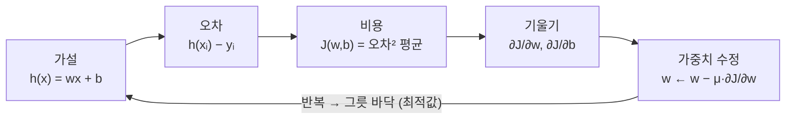

# 오차와 비용 함수 — 오차에서 최적값까지

[목차로 돌아가기](../00_%EB%94%A5%EB%9F%AC%EB%8B%9D%EC%88%98%ED%95%99_MOC.md) · 함께 볼 것: [D02_경사하강법으로_직선찾기](D02_%EA%B2%BD%EC%82%AC%ED%95%98%EA%B0%95%EB%B2%95%EC%9C%BC%EB%A1%9C_%EC%A7%81%EC%84%A0%EC%B0%BE%EA%B8%B0.md) · 용어: [오차](../00_%EB%94%A5%EB%9F%AC%EB%8B%9D_%EC%9A%A9%EC%96%B4%EC%82%AC%EC%A0%84.md#%EC%98%A4%EC%B0%A8)

> [!NOTE]
> **3줄 요약**
> - **오차**(error)는 데이터 하나에서 "예측 − 정답"이다. 그냥 평균을 내면(**평균 오차**) +와 −가 서로 지워져서 쓸 수 없다. 그래서 제곱([MSE](../00_%EB%94%A5%EB%9F%AC%EB%8B%9D_%EC%9A%A9%EC%96%B4%EC%82%AC%EC%A0%84.md#mse))이나 절댓값(MAE)의 평균을 쓴다.
> - **비용 함수** $J(w, b)$는 "[가중치](../00_%EB%94%A5%EB%9F%AC%EB%8B%9D_%EC%9A%A9%EC%96%B4%EC%82%AC%EC%A0%84.md#%EA%B0%80%EC%A4%91%EC%B9%98)를 이렇게 정하면 전체적으로 얼마나 틀리나"를 재는 **w, b의 함수**다. EX_02에서는 w를 가로축으로 그리면 그릇 모양이 된다.
> - 그릇의 바닥이 **최적값**(optimal)이고, 바닥을 찾아가는 일이 **최적화**, [가설](../00_%EB%94%A5%EB%9F%AC%EB%8B%9D_%EC%9A%A9%EC%96%B4%EC%82%AC%EC%A0%84.md#%EA%B0%80%EC%84%A4)의 w, b를 최적값으로 맞추는 것이 EX_02의 제목인 **[가설 최적화](../00_%EB%94%A5%EB%9F%AC%EB%8B%9D_%EC%9A%A9%EC%96%B4%EC%82%AC%EC%A0%84.md#%EA%B0%80%EC%84%A4-%EC%B5%9C%EC%A0%81%ED%99%94)**(Optimize Hypothesis)다.

## 1. 이게 하는 일 (말로)

모델이 얼마나 틀렸는지를 **숫자 하나**로 만들어야 "더 좋아졌다/나빠졌다"를 비교하고, 줄이는 방향([기울기](../00_%EB%94%A5%EB%9F%AC%EB%8B%9D_%EC%9A%A9%EC%96%B4%EC%82%AC%EC%A0%84.md#%EA%B8%B0%EC%9A%B8%EA%B8%B0))을 계산할 수 있다. 그 숫자를 만드는 단계가 오차 → 비용이다.

> 비유: 양궁 점수. 화살 하나가 과녁 중심에서 벗어난 거리가 **오차**, 한 세트(여러 발)의 벗어난 정도를 모은 점수가 **비용**이다. 자세를 고쳐(가중치 조절) 그 점수를 가장 좋게 만드는 자세가 **최적값**이다.

## 2. 필요한 수학 체크리스트

- [ ] [M01_함수와_일차함수](../02_%EC%88%98%ED%95%99%EB%85%B8%ED%8A%B8/M01_%ED%95%A8%EC%88%98%EC%99%80_%EC%9D%BC%EC%B0%A8%ED%95%A8%EC%88%98.md) — 가설 $h(x) = wx + b$, 그리고 "비용도 w의 함수"
- [ ] [M02_시그마와_평균](../02_%EC%88%98%ED%95%99%EB%85%B8%ED%8A%B8/M02_%EC%8B%9C%EA%B7%B8%EB%A7%88%EC%99%80_%ED%8F%89%EA%B7%A0.md) — 평균, MSE
- [ ] [M03_미분_기울기](../02_%EC%88%98%ED%95%99%EB%85%B8%ED%8A%B8/M03_%EB%AF%B8%EB%B6%84_%EA%B8%B0%EC%9A%B8%EA%B8%B0.md) — 바닥에서 기울기가 0
- [ ] [M09_최솟값과_볼록함수](../02_%EC%88%98%ED%95%99%EB%85%B8%ED%8A%B8/M09_%EC%B5%9C%EC%86%9F%EA%B0%92%EA%B3%BC_%EB%B3%BC%EB%A1%9D%ED%95%A8%EC%88%98.md) — 바닥이 하나인가 여러 개인가

## 3. 용어 한 줄 정리

| 용어 | 영어 | 뜻 | 범위 |
|---|---|---|---|
| 가설 | hypothesis | 모델이 세운 함수 $h(x) = wx + b$ | 모델 전체 |
| [레이블](../00_%EB%94%A5%EB%9F%AC%EB%8B%9D_%EC%9A%A9%EC%96%B4%EC%82%AC%EC%A0%84.md#%EB%A0%88%EC%9D%B4%EB%B8%94) | label | 정답 y | 데이터 하나 |
| 오차 | error | $h(x_i) - y_i$ | 데이터 하나 |
| 손실 | loss | 데이터 하나의 벌점. 예: $(h(x_i) - y_i)^2$ | 데이터 하나 |
| 비용 | cost | 손실의 평균. 예: $\frac{1}{m}\sum(h(x_i) - y_i)^2$ | 데이터 전체 |
| 최적값 | optimal | 비용을 가장 작게 만드는 w, b | |
| 최적화 | optimization | 최적값을 찾아가는 과정([경사하강법](../00_%EB%94%A5%EB%9F%AC%EB%8B%9D_%EC%9A%A9%EC%96%B4%EC%82%AC%EC%A0%84.md#%EA%B2%BD%EC%82%AC%ED%95%98%EA%B0%95%EB%B2%95) 등) | |

> [!NOTE]
> **loss와 cost**
> 교재에 따라 "데이터 하나의 벌점 = loss, 전체 평균 = cost"로 나눠 부르기도 하고, 둘을 섞어 쓰기도 한다. Keras는 전체 평균도 `loss`라고 부른다(`loss='mean_squared_error'`, 학습 [로그](../00_%EB%94%A5%EB%9F%AC%EB%8B%9D_%EC%9A%A9%EC%96%B4%EC%82%AC%EC%A0%84.md#%EB%A1%9C%EA%B7%B8-ln)의 `loss: 5.3598`). 이 노트에서는 비용 = 손실의 평균으로 쓴다.

## 4. 다시 합치기: 숫자 → 식 → 코드

### 4.1 오차

데이터 3개 (1, 3), (2, 5), (3, 7)에 가설 $h(x) = 5$ (w = 0, b = 5)를 써 보면:

| x | 예측 h(x) | 정답 y | 오차 h(x) − y |
|---|---|---|---|
| 1 | 5 | 3 | **+2** (높게 예측) |
| 2 | 5 | 5 | 0 |
| 3 | 5 | 7 | **−2** (낮게 예측) |

- 오차의 **부호**는 방향(높게/낮게), **크기**는 얼마나 틀렸나를 뜻한다.

### 4.2 평균 오차가 안 되는 이유

| 방법 | 계산 | 값 | 문제 |
|---|---|---|---|
| 평균 오차 | (2 + 0 − 2) ÷ 3 | **0** | 분명히 틀렸는데 "오차 없음"이 된다 |
| 평균 절대 오차 (MAE) | (2 + 0 + 2) ÷ 3 | 1.333 | 쓸 수 있다 |
| 평균 제곱 오차 (MSE) | (4 + 0 + 4) ÷ 3 | 2.667 | 쓸 수 있다. 예제가 쓰는 것 |

- **평균 오차**는 높게 틀린 것과 낮게 틀린 것이 서로 지워진다. 그래서 비용으로 쓰지 않는다.
- **MSE**는 큰 오차를 더 크게 벌주고, [미분](../00_%EB%94%A5%EB%9F%AC%EB%8B%9D_%EC%9A%A9%EC%96%B4%EC%82%AC%EC%A0%84.md#%EB%AF%B8%EB%B6%84)하기 쉬워서([M04_편미분](../02_%EC%88%98%ED%95%99%EB%85%B8%ED%8A%B8/M04_%ED%8E%B8%EB%AF%B8%EB%B6%84.md)) [회귀](../00_%EB%94%A5%EB%9F%AC%EB%8B%9D_%EC%9A%A9%EC%96%B4%EC%82%AC%EC%A0%84.md#%ED%9A%8C%EA%B7%80%EC%99%80-%EB%B6%84%EB%A5%98)의 기본 비용이 됐다.
- 반면 정답 규칙 $h(x) = 2x + 1$이면 오차가 [0, 0, 0]이라 세 방법 모두 0이다.

### 4.3 비용 함수 = w, b를 넣으면 "얼마나 틀리나"가 나오는 함수

$$J(w, b) = \frac{1}{m}\sum_{i=1}^{m}\big(\underbrace{w x_i + b}_{\text{가설}} - \underbrace{y_i}_{\text{레이블}}\big)^2$$

여기서 **데이터 $x_i, y_i$는 고정**이고 **변하는 것은 w, b**다. 즉 비용은 가중치의 함수다. 이 관점 전환이 핵심이다.

| 관점 | 넣는 값 | 나오는 값 |
|---|---|---|
| 가설 $h(x)$ | 입력 x (w, b는 고정) | 예측 |
| 비용 $J(w, b)$ | 가중치 w, b (데이터는 고정) | 틀린 정도 |

### 4.4 EX_02 데이터로 비용 그려 보기

EX_02(x = 1~10, y = 2x + 1)에서 b = 1로 고정하고 w만 바꾸면:

| w | 0 | 1 | 1.5 | **2** | 2.5 | 3 | 4 |
|---|---|---|---|---|---|---|---|
| J(w, 1) | 154 | 38.5 | 9.625 | **0** | 9.625 | 38.5 | 154 |

- w = 2에서 가장 작고(0), 양쪽으로 똑같이 커진다. **그릇(포물선) 모양**이다.
- 실제로 $J(w, 1) = 38.5 × (w - 2)^2$이다(38.5는 x²의 평균). [M03_미분_기울기](../02_%EC%88%98%ED%95%99%EB%85%B8%ED%8A%B8/M03_%EB%AF%B8%EB%B6%84_%EA%B8%B0%EC%9A%B8%EA%B8%B0.md)의 $x^2$ 그래프를 옆으로 옮기고 세로로 늘린 모양이다.

w = 2로 고정하고 b만 바꾸면:

| b | −1 | 0 | **1** | 2 | 3 |
|---|---|---|---|---|---|
| J(2, b) | 4 | 1 | **0** | 1 | 4 |

w와 b를 함께 그리면 바닥이 (w = 2, b = 1) 한 점인 **그릇 모양 곡면**이 된다. 이 바닥이 **최적값**이다.

### 4.5 최적화 = 그릇 바닥 찾아가기



- 바닥에서는 기울기가 0이다([M03_미분_기울기](../02_%EC%88%98%ED%95%99%EB%85%B8%ED%8A%B8/M03_%EB%AF%B8%EB%B6%84_%EA%B8%B0%EC%9A%B8%EA%B8%B0.md) 6절). 그래서 바닥 근처에 가면 W, B가 거의 안 움직인다(**[수렴](../00_%EB%94%A5%EB%9F%AC%EB%8B%9D_%EC%9A%A9%EC%96%B4%EC%82%AC%EC%A0%84.md#%EC%88%98%EB%A0%B4)**, [E03_혈압_선형회귀_예제](../03_%EC%98%88%EC%A0%9C%ED%92%80%EC%9D%B4/E03_%ED%98%88%EC%95%95_%EC%84%A0%ED%98%95%ED%9A%8C%EA%B7%80_%EC%98%88%EC%A0%9C.md)의 15만 번째 이후).
- EX_02는 실제 데이터가 아니라서 바닥의 비용이 0이다. EX_03 같은 실제 데이터는 바닥에서도 비용이 0이 아니다(17.07). "**가장 덜 틀리는**" 곳이 최적값이다.
- [선형 회귀](../00_%EB%94%A5%EB%9F%AC%EB%8B%9D_%EC%9A%A9%EC%96%B4%EC%82%AC%EC%A0%84.md#%EC%84%A0%ED%98%95-%ED%9A%8C%EA%B7%80)의 MSE 비용은 바닥이 하나뿐인 그릇([볼록 함수](../00_%EB%94%A5%EB%9F%AC%EB%8B%9D_%EC%9A%A9%EC%96%B4%EC%82%AC%EC%A0%84.md#%EB%B3%BC%EB%A1%9D-%ED%95%A8%EC%88%98))이라, 어디서 출발해도 같은 바닥에 도착한다. 바닥이 여러 개인 경우는 [M09_최솟값과_볼록함수](../02_%EC%88%98%ED%95%99%EB%85%B8%ED%8A%B8/M09_%EC%B5%9C%EC%86%9F%EA%B0%92%EA%B3%BC_%EB%B3%BC%EB%A1%9D%ED%95%A8%EC%88%98.md).

### 4.6 코드로 비용 표 만들기

```python
import numpy as np
x = np.arange(1, 11.)                        # 1, 2, ..., 10 (실수)
y = 2*x + 1                                  # EX_02의 정답
J = lambda w, b: np.mean((w*x + b - y)**2)   # 비용 함수: w, b를 넣으면 MSE가 나옴
for w in [0, 1, 1.5, 2, 2.5, 3, 4]:
    print(w, J(w, 1))                        # b = 1로 고정하고 w만 바꿈
```

**실행 결과**:

```
0 154.0
1 38.5
1.5 9.625
2 0.0
2.5 9.625
3 38.5
4 154.0
```

- `lambda w, b: ...`는 한 줄짜리 함수 정의다(파이썬 강의노트 7장).

## 5. 스스로 확인

<details><summary>1. 오차가 [3, −1, −2]일 때 평균 오차, MAE, MSE는?</summary>

평균 오차 0 ÷ 3 = **0**, MAE 6 ÷ 3 = **2**, MSE (9 + 1 + 4) ÷ 3 = **4.667**

</details>

<details><summary>2. 비용 함수에서 "넣는 값"은 무엇인가?</summary>

데이터가 아니라 **가중치 w, b**. 데이터는 고정이다.

</details>

<details><summary>3. 실제 데이터에서 최적값의 비용이 0이 아닌 이유는?</summary>

같은 입력에도 정답이 제각각이라 직선 하나로 모든 점을 지날 수 없기 때문이다. 최적값은 "**가장 덜 틀리는**" 값이다.

</details>

