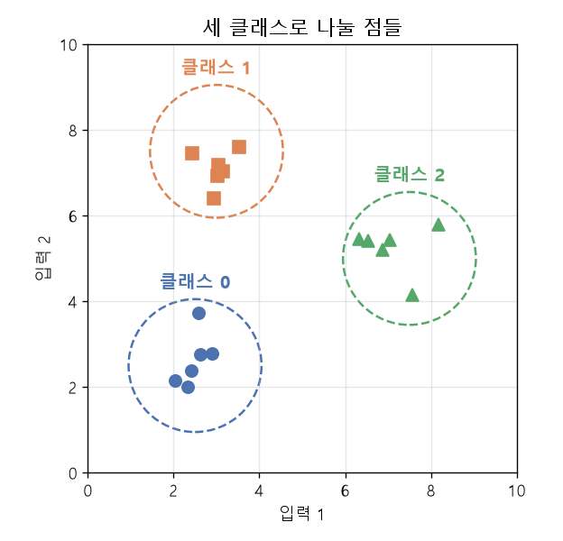
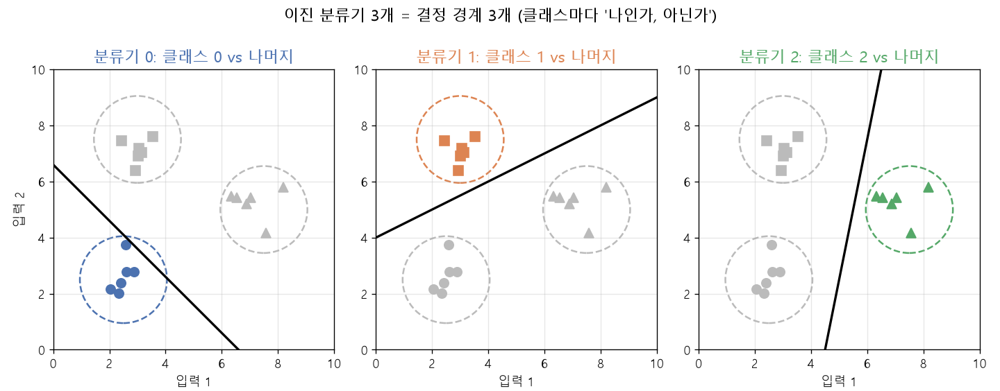
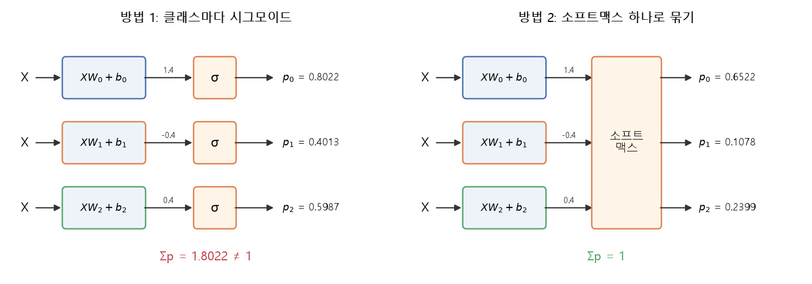
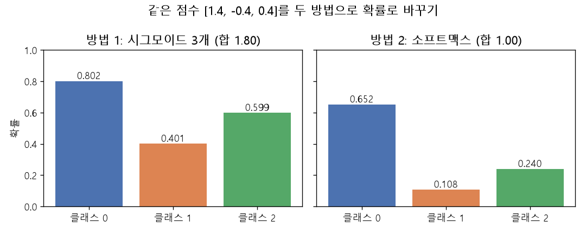
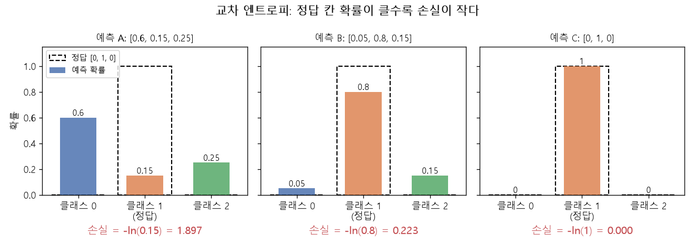
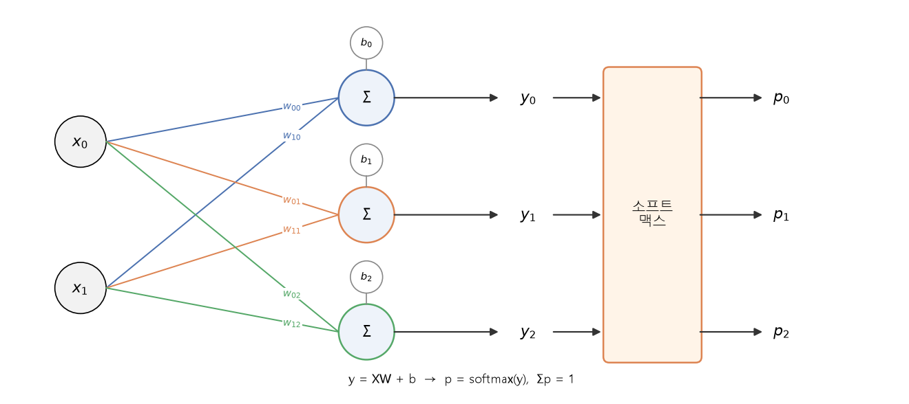
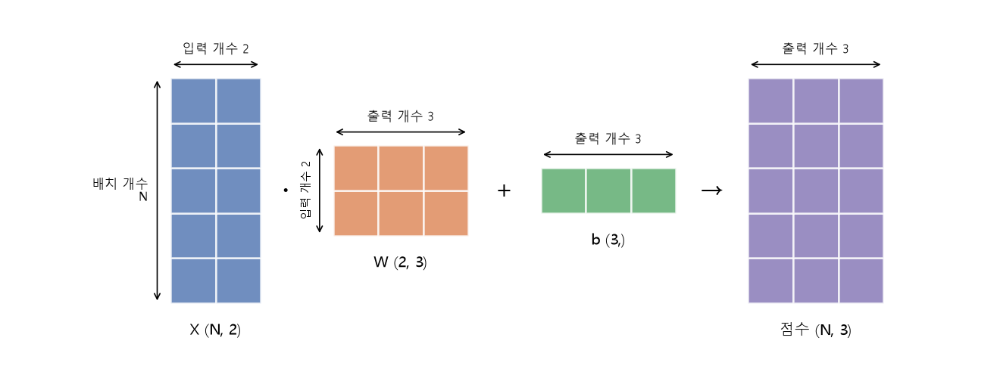

# 이진 분류기에서 소프트맥스로 (EX\_06)

[목차로 돌아가기](../00_%EB%94%A5%EB%9F%AC%EB%8B%9D%EC%88%98%ED%95%99_MOC.md) · 예제: `01_ML_DL_Basic/EX_06_Softmax_Classification.ipynb` · 앞 노트: [D04_시그모이드와_이진분류](../01_%EA%B0%9C%EB%85%90%EB%85%B8%ED%8A%B8/D04_%EC%8B%9C%EA%B7%B8%EB%AA%A8%EC%9D%B4%EB%93%9C%EC%99%80_%EC%9D%B4%EC%A7%84%EB%B6%84%EB%A5%98.md), [D05_소프트맥스와_다중분류](../01_%EA%B0%9C%EB%85%90%EB%85%B8%ED%8A%B8/D05_%EC%86%8C%ED%94%84%ED%8A%B8%EB%A7%A5%EC%8A%A4%EC%99%80_%EB%8B%A4%EC%A4%91%EB%B6%84%EB%A5%98.md) · 코드 풀이: [E06_혈압_소프트맥스분류_예제](../03_%EC%98%88%EC%A0%9C%ED%92%80%EC%9D%B4/E06_%ED%98%88%EC%95%95_%EC%86%8C%ED%94%84%ED%8A%B8%EB%A7%A5%EC%8A%A4%EB%B6%84%EB%A5%98_%EC%98%88%EC%A0%9C.md) · 수학: [M11_오즈와_로짓](../02_%EC%88%98%ED%95%99%EB%85%B8%ED%8A%B8/M11_%EC%98%A4%EC%A6%88%EC%99%80_%EB%A1%9C%EC%A7%93.md)

> [!NOTE]
> **3줄 요약**
> - 3개 이상을 가르는 첫 생각은 "클래스마다 이진 분류기([시그모이드](../00_%EB%94%A5%EB%9F%AC%EB%8B%9D_%EC%9A%A9%EC%96%B4%EC%82%AC%EC%A0%84.md#sigmoid-%EC%8B%9C%EA%B7%B8%EB%AA%A8%EC%9D%B4%EB%93%9C))를 하나씩 두고, [확률](../00_%EB%94%A5%EB%9F%AC%EB%8B%9D_%EC%9A%A9%EC%96%B4%EC%82%AC%EC%A0%84.md#probability-%ED%99%95%EB%A5%A0)이 가장 큰 클래스를 고르기"다. 문제는 세 [확률](../00_%EB%94%A5%EB%9F%AC%EB%8B%9D_%EC%9A%A9%EC%96%B4%EC%82%AC%EC%A0%84.md#probability-%ED%99%95%EB%A5%A0)이 서로 상관없이 나와서 합이 1이 아니라는 점이다(예: `[0.8, 0.4, 0.6]`).
> - 해결은 세 점수를 **[소프트맥스](../00_%EB%94%A5%EB%9F%AC%EB%8B%9D_%EC%9A%A9%EC%96%B4%EC%82%AC%EC%A0%84.md#softmax-%EC%86%8C%ED%94%84%ED%8A%B8%EB%A7%A5%EC%8A%A4)**로 한꺼번에 바꿔 합이 1인 [확률](../00_%EB%94%A5%EB%9F%AC%EB%8B%9D_%EC%9A%A9%EC%96%B4%EC%82%AC%EC%A0%84.md#probability-%ED%99%95%EB%A5%A0)로 만드는 것이다. 모양은 `(N,2)·(2,3)+(3,) → (N,3)`.
> - 점수 `[1.4, -0.4, 0.4]`의 [시그모이드](../00_%EB%94%A5%EB%9F%AC%EB%8B%9D_%EC%9A%A9%EC%96%B4%EC%82%AC%EC%A0%84.md#sigmoid-%EC%8B%9C%EA%B7%B8%EB%AA%A8%EC%9D%B4%EB%93%9C)는 `[0.8022, 0.4013, 0.5987]`(합 1.8022), [소프트맥스](../00_%EB%94%A5%EB%9F%AC%EB%8B%9D_%EC%9A%A9%EC%96%B4%EC%82%AC%EC%A0%84.md#softmax-%EC%86%8C%ED%94%84%ED%8A%B8%EB%A7%A5%EC%8A%A4)는 `[0.6522, 0.1078, 0.2399]`(합 1)다.

## 1. 개념 설명

비유: 반장 후보가 3명이다. 학생마다 "후보 A에게 찬성이냐 아니냐", "후보 B에게 찬성이냐 아니냐", "후보 C에게 찬성이냐 아니냐"를 따로 따로 물으면, 한 학생이 세 명 모두에게 찬성할 수도 있다. 그래서 표를 모두 모아도 100%가 안 된다. 반면 "한 사람에게만 한 표"로 투표하면 득표율의 합이 100%가 된다.

정확히 말하면 다음과 같다.

- **방법 1 (이진 분류기 여러 개)**: 클래스 k마다 "클래스 k인가, 아닌가"를 묻는 이진 분류기를 하나씩 만든다. 각 분류기는 점수 $y_k = XW_k + b_k$를 내고 [시그모이드](../00_%EB%94%A5%EB%9F%AC%EB%8B%9D_%EC%9A%A9%EC%96%B4%EC%82%AC%EC%A0%84.md#sigmoid-%EC%8B%9C%EA%B7%B8%EB%AA%A8%EC%9D%B4%EB%93%9C)를 거쳐 [확률](../00_%EB%94%A5%EB%9F%AC%EB%8B%9D_%EC%9A%A9%EC%96%B4%EC%82%AC%EC%A0%84.md#probability-%ED%99%95%EB%A5%A0) $p_k$를 낸다. 가장 큰 $p_k$의 클래스를 답으로 고른다.
- **방법 2 ([소프트맥스](../00_%EB%94%A5%EB%9F%AC%EB%8B%9D_%EC%9A%A9%EC%96%B4%EC%82%AC%EC%A0%84.md#softmax-%EC%86%8C%ED%94%84%ED%8A%B8%EB%A7%A5%EC%8A%A4))**: 세 점수를 따로 [시그모이드](../00_%EB%94%A5%EB%9F%AC%EB%8B%9D_%EC%9A%A9%EC%96%B4%EC%82%AC%EC%A0%84.md#sigmoid-%EC%8B%9C%EA%B7%B8%EB%AA%A8%EC%9D%B4%EB%93%9C)에 넣지 않고 [소프트맥스](../00_%EB%94%A5%EB%9F%AC%EB%8B%9D_%EC%9A%A9%EC%96%B4%EC%82%AC%EC%A0%84.md#softmax-%EC%86%8C%ED%94%84%ED%8A%B8%EB%A7%A5%EC%8A%A4) 한 번에 묶어서 넣는다. 결과의 합이 1이 된다.







## 2. 필요한 이유

방법 1에서 각 [시그모이드](../00_%EB%94%A5%EB%9F%AC%EB%8B%9D_%EC%9A%A9%EC%96%B4%EC%82%AC%EC%A0%84.md#sigmoid-%EC%8B%9C%EA%B7%B8%EB%AA%A8%EC%9D%B4%EB%93%9C)는 자기 점수만 본다. 다른 클래스 점수가 어떻든 상관이 없어서 [확률](../00_%EB%94%A5%EB%9F%AC%EB%8B%9D_%EC%9A%A9%EC%96%B4%EC%82%AC%EC%A0%84.md#probability-%ED%99%95%EB%A5%A0)의 합이 1이라는 보장이 없다. 예를 들어 `[0.8, 0.4, 0.6]`이 나왔다면 "클래스 0이 80%, 클래스 1이 40%, 클래스 2가 60%"라는 뜻인데, [확률](../00_%EB%94%A5%EB%9F%AC%EB%8B%9D_%EC%9A%A9%EC%96%B4%EC%82%AC%EC%A0%84.md#probability-%ED%99%95%EB%A5%A0)을 모두 더하면 180%라서 말이 안 된다. 1등을 고르는 것은 되지만, [정답](../00_%EB%94%A5%EB%9F%AC%EB%8B%9D_%EC%9A%A9%EC%96%B4%EC%82%AC%EC%A0%84.md#label-%EC%A0%95%EB%8B%B5)과 비교해 [손실](../00_%EB%94%A5%EB%9F%AC%EB%8B%9D_%EC%9A%A9%EC%96%B4%EC%82%AC%EC%A0%84.md#loss-function-%EC%86%90%EC%8B%A4-%ED%95%A8%EC%88%98)을 잴 때 "[확률](../00_%EB%94%A5%EB%9F%AC%EB%8B%9D_%EC%9A%A9%EC%96%B4%EC%82%AC%EC%A0%84.md#probability-%ED%99%95%EB%A5%A0) 분포"가 아니라서 곤란하다. [소프트맥스](../00_%EB%94%A5%EB%9F%AC%EB%8B%9D_%EC%9A%A9%EC%96%B4%EC%82%AC%EC%A0%84.md#softmax-%EC%86%8C%ED%94%84%ED%8A%B8%EB%A7%A5%EC%8A%A4)는 이 문제를 풀어서 클래스끼리 서로 [확률](../00_%EB%94%A5%EB%9F%AC%EB%8B%9D_%EC%9A%A9%EC%96%B4%EC%82%AC%EC%A0%84.md#probability-%ED%99%95%EB%A5%A0)을 나눠 갖게 만든다. 이 노트는 [D05_소프트맥스와_다중분류](../01_%EA%B0%9C%EB%85%90%EB%85%B8%ED%8A%B8/D05_%EC%86%8C%ED%94%84%ED%8A%B8%EB%A7%A5%EC%8A%A4%EC%99%80_%EB%8B%A4%EC%A4%91%EB%B6%84%EB%A5%98.md)에서 바로 "[소프트맥스](../00_%EB%94%A5%EB%9F%AC%EB%8B%9D_%EC%9A%A9%EC%96%B4%EC%82%AC%EC%A0%84.md#softmax-%EC%86%8C%ED%94%84%ED%8A%B8%EB%A7%A5%EC%8A%A4)"로 들어가기 전에, 이진 분류기에서 왜 그쪽으로 옮겨 가는지를 이어 주는 다리다.

## 3. 필요한 수학 개념

| 수학 개념 | 이 개념에서 쓰이는 곳 | 자세히 |
|---|---|---|
| [시그모이드](../00_%EB%94%A5%EB%9F%AC%EB%8B%9D_%EC%9A%A9%EC%96%B4%EC%82%AC%EC%A0%84.md#sigmoid-%EC%8B%9C%EA%B7%B8%EB%AA%A8%EC%9D%B4%EB%93%9C) | 점수 하나를 0~1 사이 [확률](../00_%EB%94%A5%EB%9F%AC%EB%8B%9D_%EC%9A%A9%EC%96%B4%EC%82%AC%EC%A0%84.md#probability-%ED%99%95%EB%A5%A0)로 바꾸는 이진 분류기 | [D04_시그모이드와_이진분류](../01_%EA%B0%9C%EB%85%90%EB%85%B8%ED%8A%B8/D04_%EC%8B%9C%EA%B7%B8%EB%AA%A8%EC%9D%B4%EB%93%9C%EC%99%80_%EC%9D%B4%EC%A7%84%EB%B6%84%EB%A5%98.md) |
| [지수](../00_%EB%94%A5%EB%9F%AC%EB%8B%9D_%EC%9A%A9%EC%96%B4%EC%82%AC%EC%A0%84.md#e-exponent-e%EC%99%80-%EC%A7%80%EC%88%98)와 e | [소프트맥스](../00_%EB%94%A5%EB%9F%AC%EB%8B%9D_%EC%9A%A9%EC%96%B4%EC%82%AC%EC%A0%84.md#softmax-%EC%86%8C%ED%94%84%ED%8A%B8%EB%A7%A5%EC%8A%A4)가 점수에 $e^{y}$를 씌우는 이유 | [M06_지수와_e](../02_%EC%88%98%ED%95%99%EB%85%B8%ED%8A%B8/M06_%EC%A7%80%EC%88%98%EC%99%80_e.md) |
| [오즈](../00_%EB%94%A5%EB%9F%AC%EB%8B%9D_%EC%9A%A9%EC%96%B4%EC%82%AC%EC%A0%84.md#odds-%EC%98%A4%EC%A6%88)와 [로짓](../00_%EB%94%A5%EB%9F%AC%EB%8B%9D_%EC%9A%A9%EC%96%B4%EC%82%AC%EC%A0%84.md#logit-%EB%A1%9C%EC%A7%93) | 점수 $y$를 [로짓](../00_%EB%94%A5%EB%9F%AC%EB%8B%9D_%EC%9A%A9%EC%96%B4%EC%82%AC%EC%A0%84.md#logit-%EB%A1%9C%EC%A7%93)으로 보면 $e^{y}$가 [오즈](../00_%EB%94%A5%EB%9F%AC%EB%8B%9D_%EC%9A%A9%EC%96%B4%EC%82%AC%EC%A0%84.md#odds-%EC%98%A4%EC%A6%88) | [M11_오즈와_로짓](../02_%EC%88%98%ED%95%99%EB%85%B8%ED%8A%B8/M11_%EC%98%A4%EC%A6%88%EC%99%80_%EB%A1%9C%EC%A7%93.md) |
| 벡터와 행렬 | `(N,2)·(2,3)+(3,)`의 모양 계산 | [M05_벡터와_행렬](../02_%EC%88%98%ED%95%99%EB%85%B8%ED%8A%B8/M05_%EB%B2%A1%ED%84%B0%EC%99%80_%ED%96%89%EB%A0%AC.md) |
| [확률](../00_%EB%94%A5%EB%9F%AC%EB%8B%9D_%EC%9A%A9%EC%96%B4%EC%82%AC%EC%A0%84.md#probability-%ED%99%95%EB%A5%A0) 기초 | 합이 1인 [확률](../00_%EB%94%A5%EB%9F%AC%EB%8B%9D_%EC%9A%A9%EC%96%B4%EC%82%AC%EC%A0%84.md#probability-%ED%99%95%EB%A5%A0) | [M08_확률_기초](../02_%EC%88%98%ED%95%99%EB%85%B8%ED%8A%B8/M08_%ED%99%95%EB%A5%A0_%EA%B8%B0%EC%B4%88.md) |

<details><summary>미니 복습: 행렬 곱의 모양</summary>

`(N,2)·(2,3)`에서 안쪽 두 수(2와 2)가 같아야 곱할 수 있고, 바깥쪽 수 `N`과 `3`이 결과 모양 `(N,3)`이 된다. 한 줄의 결과 칸은 "입력 한 행과 [가중치](../00_%EB%94%A5%EB%9F%AC%EB%8B%9D_%EC%9A%A9%EC%96%B4%EC%82%AC%EC%A0%84.md#weight-%EA%B0%80%EC%A4%91%EC%B9%98) 한 열을 같은 자리끼리 곱해 더한 것"이다. 예: 입력 `[2, 1]`, [가중치](../00_%EB%94%A5%EB%9F%AC%EB%8B%9D_%EC%9A%A9%EC%96%B4%EC%82%AC%EC%A0%84.md#weight-%EA%B0%80%EC%A4%91%EC%B9%98) 한 열 `[0.5, 0.4]` → 2×0.5 + 1×0.4 = 1.4. 자세히: [M05_벡터와_행렬](../02_%EC%88%98%ED%95%99%EB%85%B8%ED%8A%B8/M05_%EB%B2%A1%ED%84%B0%EC%99%80_%ED%96%89%EB%A0%AC.md)

</details>

<details><summary>미니 복습: $e^x$</summary>

항상 양수이고, x가 1 커질 때마다 약 2.718배가 된다. 그래서 점수 차이를 더 크게 벌려 준다. 예: $e^{1} = 2.718$, $e^{0} = 1$, $e^{-1} = 0.368$. 자세히: [M06_지수와_e](../02_%EC%88%98%ED%95%99%EB%85%B8%ED%8A%B8/M06_%EC%A7%80%EC%88%98%EC%99%80_e.md)

</details>

## 4. 계산 과정 (숫자 → 식 → 코드)

### 숫자

#### 1) 점수 만들기 (입력 한 행)

입력이 2개, 클래스가 3개인 작은 예다. 입력 한 행 `x = [2, 1]`, [가중치](../00_%EB%94%A5%EB%9F%AC%EB%8B%9D_%EC%9A%A9%EC%96%B4%EC%82%AC%EC%A0%84.md#weight-%EA%B0%80%EC%A4%91%EC%B9%98) `W`는 `(2,3)`, [편향](../00_%EB%94%A5%EB%9F%AC%EB%8B%9D_%EC%9A%A9%EC%96%B4%EC%82%AC%EC%A0%84.md#bias-%ED%8E%B8%ED%96%A5) `b`는 `(3,)`이다.

| | 클래스 0 | 클래스 1 | 클래스 2 |
|---|---|---|---|
| [가중치](../00_%EB%94%A5%EB%9F%AC%EB%8B%9D_%EC%9A%A9%EC%96%B4%EC%82%AC%EC%A0%84.md#weight-%EA%B0%80%EC%A4%91%EC%B9%98) (첫째 입력용) | 0.5 | -0.5 | 0 |
| [가중치](../00_%EB%94%A5%EB%9F%AC%EB%8B%9D_%EC%9A%A9%EC%96%B4%EC%82%AC%EC%A0%84.md#weight-%EA%B0%80%EC%A4%91%EC%B9%98) (둘째 입력용) | 0.4 | 0.2 | 0.4 |
| [편향](../00_%EB%94%A5%EB%9F%AC%EB%8B%9D_%EC%9A%A9%EC%96%B4%EC%82%AC%EC%A0%84.md#bias-%ED%8E%B8%ED%96%A5) | 0 | 0.4 | 0 |

- 클래스 0: 2×0.5 + 1×0.4 + 0 = 1 + 0.4 = **1.4** (같은 자리끼리 곱하고 더한 뒤 [편향](../00_%EB%94%A5%EB%9F%AC%EB%8B%9D_%EC%9A%A9%EC%96%B4%EC%82%AC%EC%A0%84.md#bias-%ED%8E%B8%ED%96%A5)을 더함)
- 클래스 1: 2×(-0.5) + 1×0.2 + 0.4 = -1 + 0.2 + 0.4 = **-0.4**
- 클래스 2: 2×0 + 1×0.4 + 0 = **0.4**

점수는 `[1.4, -0.4, 0.4]`이고 모양은 `(1,3)`이다. 입력 행이 N개면 모양이 `(N,3)`이 된다.

#### 2) 방법 1: 점수마다 시그모이드

[시그모이드](../00_%EB%94%A5%EB%9F%AC%EB%8B%9D_%EC%9A%A9%EC%96%B4%EC%82%AC%EC%A0%84.md#sigmoid-%EC%8B%9C%EA%B7%B8%EB%AA%A8%EC%9D%B4%EB%93%9C)는 $\sigma(y) = \frac{1}{1 + e^{-y}}$다.

| | 클래스 0 | 클래스 1 | 클래스 2 | 합 |
|---|---|---|---|---|
| 점수 y | 1.4 | -0.4 | 0.4 | |
| $e^{-y}$ | 0.2466 | 1.4918 | 0.6703 | |
| $\sigma(y) = 1 \div (1 + e^{-y})$ | **0.8022** | **0.4013** | **0.5987** | 1.8022 |

- 가장 큰 쪽은 클래스 0이라 답은 맞게 나온다. 하지만 합이 1.8022라서 [확률](../00_%EB%94%A5%EB%9F%AC%EB%8B%9D_%EC%9A%A9%EC%96%B4%EC%82%AC%EC%A0%84.md#probability-%ED%99%95%EB%A5%A0)이라 부르기 어렵다.

#### 3) 방법 2: 소프트맥스

같은 점수에 $e^{y}$를 씌우고 전체 합으로 나눈다.

| | 클래스 0 | 클래스 1 | 클래스 2 | 합 |
|---|---|---|---|---|
| 점수 y | 1.4 | -0.4 | 0.4 | |
| $e^{y}$ | 4.0552 | 0.6703 | 1.4918 | 6.2173 |
| $e^{y}$ ÷ 합 | **0.6522** | **0.1078** | **0.2399** | 1 |

- 합이 1이 되어 득표율처럼 읽을 수 있다. 클래스 0이 약 65%다.
- 가장 큰 칸이 클래스 0인 것은 방법 1과 같다. [소프트맥스](../00_%EB%94%A5%EB%9F%AC%EB%8B%9D_%EC%9A%A9%EC%96%B4%EC%82%AC%EC%A0%84.md#softmax-%EC%86%8C%ED%94%84%ED%8A%B8%EB%A7%A5%EC%8A%A4)를 해도 큰 점수는 큰 [확률](../00_%EB%94%A5%EB%9F%AC%EB%8B%9D_%EC%9A%A9%EC%96%B4%EC%82%AC%EC%A0%84.md#probability-%ED%99%95%EB%A5%A0)로 남기 때문이다(순서가 안 바뀐다).



#### 4) 왜 $e^{y}$를 쓰나

점수를 그냥 합으로 나누면 되지 않을까? 같은 점수로 해 보면 이렇다.

- `[1.4, -0.4, 0.4]`의 합은 1.4 + (-0.4) + 0.4 = 1.4. 각 점수를 합으로 나누면 `[1, -0.2857, 0.2857]`이다. 음수가 나오고 1도 나와서 [확률](../00_%EB%94%A5%EB%9F%AC%EB%8B%9D_%EC%9A%A9%EC%96%B4%EC%82%AC%EC%A0%84.md#probability-%ED%99%95%EB%A5%A0)이 아니다. 점수가 음수일 수 있는 것이 문제다.
- $e^{y}$는 y가 어떤 수여도 항상 양수다. 점수 -0.4도 $e^{-0.4} = 0.6703$이 되어 문제없다.
- 점수가 모두 양수여도 차이는 벌어져야 한다. 점수 `[3, 2, 1]`로 비교한다.

| | 클래스 0 | 클래스 1 | 클래스 2 |
|---|---|---|---|
| 점수를 합(6)으로 나눔 | 0.5 | 0.3333 | 0.1667 |
| [소프트맥스](../00_%EB%94%A5%EB%9F%AC%EB%8B%9D_%EC%9A%A9%EC%96%B4%EC%82%AC%EC%A0%84.md#softmax-%EC%86%8C%ED%94%84%ED%8A%B8%EB%A7%A5%EC%8A%A4) ($e^3, e^2, e^1$ = 20.086, 7.389, 2.718, 합 30.193) | 0.6652 | 0.2447 | 0.0900 |

- 점수가 1 차이 나면 $e^{y}$는 약 2.718배 차이가 난다. 큰 점수가 [확률](../00_%EB%94%A5%EB%9F%AC%EB%8B%9D_%EC%9A%A9%EC%96%B4%EC%82%AC%EC%A0%84.md#probability-%ED%99%95%EB%A5%A0)을 더 많이 가져가서 1등이 뚜렷해진다.
- [학습](../00_%EB%94%A5%EB%9F%AC%EB%8B%9D_%EC%9A%A9%EC%96%B4%EC%82%AC%EC%A0%84.md#training-%ED%95%99%EC%8A%B5) 때도 [정답](../00_%EB%94%A5%EB%9F%AC%EB%8B%9D_%EC%9A%A9%EC%96%B4%EC%82%AC%EC%A0%84.md#label-%EC%A0%95%EB%8B%B5) 칸에 [확률](../00_%EB%94%A5%EB%9F%AC%EB%8B%9D_%EC%9A%A9%EC%96%B4%EC%82%AC%EC%A0%84.md#probability-%ED%99%95%EB%A5%A0)이 몰려 있으면 [손실](../00_%EB%94%A5%EB%9F%AC%EB%8B%9D_%EC%9A%A9%EC%96%B4%EC%82%AC%EC%A0%84.md#loss-function-%EC%86%90%EC%8B%A4-%ED%95%A8%EC%88%98)이 작고, 틀리면 [손실](../00_%EB%94%A5%EB%9F%AC%EB%8B%9D_%EC%9A%A9%EC%96%B4%EC%82%AC%EC%A0%84.md#loss-function-%EC%86%90%EC%8B%A4-%ED%95%A8%EC%88%98)이 크게 벌어져서 고치기 쉽다.

#### 5) 손실 한 번 재 보기

[정답](../00_%EB%94%A5%EB%9F%AC%EB%8B%9D_%EC%9A%A9%EC%96%B4%EC%82%AC%EC%A0%84.md#label-%EC%A0%95%EB%8B%B5)이 클래스 1이라고 하자. [정답](../00_%EB%94%A5%EB%9F%AC%EB%8B%9D_%EC%9A%A9%EC%96%B4%EC%82%AC%EC%A0%84.md#label-%EC%A0%95%EB%8B%B5)은 [원-핫](../00_%EB%94%A5%EB%9F%AC%EB%8B%9D_%EC%9A%A9%EC%96%B4%EC%82%AC%EC%A0%84.md#one-hot-encoding-%EC%9B%90-%ED%95%AB-%EC%9D%B8%EC%BD%94%EB%94%A9)으로 `[0, 1, 0]`이다. [교차 엔트로피](../00_%EB%94%A5%EB%9F%AC%EB%8B%9D_%EC%9A%A9%EC%96%B4%EC%82%AC%EC%A0%84.md#cross-entropy-%EA%B5%90%EC%B0%A8-%EC%97%94%ED%8A%B8%EB%A1%9C%ED%94%BC)는 [정답](../00_%EB%94%A5%EB%9F%AC%EB%8B%9D_%EC%9A%A9%EC%96%B4%EC%82%AC%EC%A0%84.md#label-%EC%A0%95%EB%8B%B5) 칸 [확률](../00_%EB%94%A5%EB%9F%AC%EB%8B%9D_%EC%9A%A9%EC%96%B4%EC%82%AC%EC%A0%84.md#probability-%ED%99%95%EB%A5%A0)의 $-\ln$이다.

- [소프트맥스](../00_%EB%94%A5%EB%9F%AC%EB%8B%9D_%EC%9A%A9%EC%96%B4%EC%82%AC%EC%A0%84.md#softmax-%EC%86%8C%ED%94%84%ED%8A%B8%EB%A7%A5%EC%8A%A4) 결과 `[0.6522, 0.1078, 0.2399]` → $-\ln 0.1078 = 2.2273$
- [정답](../00_%EB%94%A5%EB%9F%AC%EB%8B%9D_%EC%9A%A9%EC%96%B4%EC%82%AC%EC%A0%84.md#label-%EC%A0%95%EB%8B%B5)에 낮은 [확률](../00_%EB%94%A5%EB%9F%AC%EB%8B%9D_%EC%9A%A9%EC%96%B4%EC%82%AC%EC%A0%84.md#probability-%ED%99%95%EB%A5%A0)(0.1078)을 줬으니 [손실](../00_%EB%94%A5%EB%9F%AC%EB%8B%9D_%EC%9A%A9%EC%96%B4%EC%82%AC%EC%A0%84.md#loss-function-%EC%86%90%EC%8B%A4-%ED%95%A8%EC%88%98)이 크다.
- 참고로 `[0.6, 0.15, 0.25]`처럼 [정답](../00_%EB%94%A5%EB%9F%AC%EB%8B%9D_%EC%9A%A9%EC%96%B4%EC%82%AC%EC%A0%84.md#label-%EC%A0%95%EB%8B%B5) 칸에 0.15를 주면 $-\ln 0.15 = 1.8971$, `[0.05, 0.8, 0.15]`처럼 0.8을 주면 $-\ln 0.8 = 0.2231$, [정답](../00_%EB%94%A5%EB%9F%AC%EB%8B%9D_%EC%9A%A9%EC%96%B4%EC%82%AC%EC%A0%84.md#label-%EC%A0%95%EB%8B%B5) 칸에 1을 주면 $-\ln 1 = 0$이다. [정답](../00_%EB%94%A5%EB%9F%AC%EB%8B%9D_%EC%9A%A9%EC%96%B4%EC%82%AC%EC%A0%84.md#label-%EC%A0%95%EB%8B%B5) 칸 [확률](../00_%EB%94%A5%EB%9F%AC%EB%8B%9D_%EC%9A%A9%EC%96%B4%EC%82%AC%EC%A0%84.md#probability-%ED%99%95%EB%A5%A0)이 클수록 [손실](../00_%EB%94%A5%EB%9F%AC%EB%8B%9D_%EC%9A%A9%EC%96%B4%EC%82%AC%EC%A0%84.md#loss-function-%EC%86%90%EC%8B%A4-%ED%95%A8%EC%88%98)이 작다.



### 식

#### 방법 1: 클래스마다 이진 분류기

$$y_k = XW_k + b_k, \qquad p_k = \sigma(y_k) = \frac{1}{1 + e^{-y_k}}$$

#### 방법 2: 소프트맥스

$$p_k = \frac{e^{y_k}}{\sum_{j=1}^{K} e^{y_j}}$$



<details><summary>기호 풀이</summary>

| 기호 | 읽는 법 | 뜻 | 예제 값 |
| --- | --- | --- | --- |
| $X$ | 엑스 | 입력 (한 행이면 2개 값) | `[2, 1]` |
| $W_k$ | 더블유 케이 | 클래스 k용 [가중치](../00_%EB%94%A5%EB%9F%AC%EB%8B%9D_%EC%9A%A9%EC%96%B4%EC%82%AC%EC%A0%84.md#weight-%EA%B0%80%EC%A4%91%EC%B9%98) 한 열 | `[0.5, 0.4]` (k=0) |
| $b_k$ | 비 케이 | 클래스 k용 [편향](../00_%EB%94%A5%EB%9F%AC%EB%8B%9D_%EC%9A%A9%EC%96%B4%EC%82%AC%EC%A0%84.md#bias-%ED%8E%B8%ED%96%A5) | 0 (k=0) |
| $y_k$ | 와이 케이 | 클래스 k의 점수 | 1.4, -0.4, 0.4 |
| $\sigma$ | 시그마 | [시그모이드](../00_%EB%94%A5%EB%9F%AC%EB%8B%9D_%EC%9A%A9%EC%96%B4%EC%82%AC%EC%A0%84.md#sigmoid-%EC%8B%9C%EA%B7%B8%EB%AA%A8%EC%9D%B4%EB%93%9C) (점수를 0~1로) | σ(1.4) = 0.8022 |
| $p_k$ | 피 케이 | 클래스 k의 [확률](../00_%EB%94%A5%EB%9F%AC%EB%8B%9D_%EC%9A%A9%EC%96%B4%EC%82%AC%EC%A0%84.md#probability-%ED%99%95%EB%A5%A0) | 0.6522, 0.1078, 0.2399 |
| $K$ | 케이 | 클래스 수 | 3 |
| $\sum_j e^{y_j}$ | 시그마(합) | 모든 클래스의 $e^{y}$를 더한 것 | 6.2173 |

</details>

#### 모양 계산

$$(N, 2) \cdot (2, 3) + (3,) \;\rightarrow\; (N, 3)$$

- `(N,2)`: 입력 N행, 입력 값 2개
- `(2,3)`: [가중치](../00_%EB%94%A5%EB%9F%AC%EB%8B%9D_%EC%9A%A9%EC%96%B4%EC%82%AC%EC%A0%84.md#weight-%EA%B0%80%EC%A4%91%EC%B9%98). 입력 값 2개 × 클래스 3개
- `(3,)`: [편향](../00_%EB%94%A5%EB%9F%AC%EB%8B%9D_%EC%9A%A9%EC%96%B4%EC%82%AC%EC%A0%84.md#bias-%ED%8E%B8%ED%96%A5). 클래스마다 1개. 곱한 결과 `(N,3)`의 모든 행에 똑같이 더해진다
- `(N,3)`: 행마다 클래스 3개의 점수



[파라미터](../00_%EB%94%A5%EB%9F%AC%EB%8B%9D_%EC%9A%A9%EC%96%B4%EC%82%AC%EC%A0%84.md#parameter-%ED%8C%8C%EB%9D%BC%EB%AF%B8%ED%84%B0) 수([학습](../00_%EB%94%A5%EB%9F%AC%EB%8B%9D_%EC%9A%A9%EC%96%B4%EC%82%AC%EC%A0%84.md#training-%ED%95%99%EC%8A%B5)으로 바뀌는 값의 개수)는 [가중치](../00_%EB%94%A5%EB%9F%AC%EB%8B%9D_%EC%9A%A9%EC%96%B4%EC%82%AC%EC%A0%84.md#weight-%EA%B0%80%EC%A4%91%EC%B9%98) 2×3 = 6, [편향](../00_%EB%94%A5%EB%9F%AC%EB%8B%9D_%EC%9A%A9%EC%96%B4%EC%82%AC%EC%A0%84.md#bias-%ED%8E%B8%ED%96%A5) 3으로 합해 **9**개다. Keras의 [덴스 층](../00_%EB%94%A5%EB%9F%AC%EB%8B%9D_%EC%9A%A9%EC%96%B4%EC%82%AC%EC%A0%84.md#dense-layer-%EB%8D%B4%EC%8A%A4-%EC%B8%B5)(`Dense(3, activation='softmax')`)이 이 모양과 개수를 자동으로 만든다.

### 코드

```python
import numpy as np

x = np.array([[2, 1]])                              # 입력 1행: 모양 (1, 2)
W = np.array([[0.5, -0.5, 0.0],
              [0.4,  0.2, 0.4]])                    # 가중치: 모양 (2, 3)
b = np.array([0.0, 0.4, 0.0])                       # 편향: 모양 (3,)

z = x @ W + b                                       # 행렬 곱 + 편향 → 점수 (1, 3)
print(z.shape, z)                                   # 모양과 점수 확인

sigmoid = 1 / (1 + np.exp(-z))                      # 방법 1: 칸마다 따로 0~1
softmax = np.exp(z) / np.sum(np.exp(z), axis=1, keepdims=True)   # 방법 2: 전체 합으로 나눔 (합이 1)

print(np.round(sigmoid, 4), np.sum(sigmoid).round(4))   # 시그모이드 결과와 합
print(np.round(softmax, 4), np.sum(softmax).round(4))   # 소프트맥스 결과와 합
print(np.argmax(sigmoid, axis=1), np.argmax(softmax, axis=1))  # 가장 큰 칸의 번호
print(-np.log(softmax[0, 1]).round(4))              # 정답이 클래스 1일 때 손실
```

**실행 결과**:

```text
(1, 3) [[ 1.4 -0.4  0.4]]
[[0.8022 0.4013 0.5987]] 1.8022
[[0.6522 0.1078 0.2399]] 1.0
[0] [0]
2.2273
```

> [!WARNING]
> **⚠ 주의**
> - [시그모이드](../00_%EB%94%A5%EB%9F%AC%EB%8B%9D_%EC%9A%A9%EC%96%B4%EC%82%AC%EC%A0%84.md#sigmoid-%EC%8B%9C%EA%B7%B8%EB%AA%A8%EC%9D%B4%EB%93%9C) 방식은 "각자 따로"라서 합이 1이 아니고, [소프트맥스](../00_%EB%94%A5%EB%9F%AC%EB%8B%9D_%EC%9A%A9%EC%96%B4%EC%82%AC%EC%A0%84.md#softmax-%EC%86%8C%ED%94%84%ED%8A%B8%EB%A7%A5%EC%8A%A4) 방식은 "서로 나눠 갖는" 구조라서 합이 1이다. 둘 다 가장 큰 칸이 같을 수는 있지만 확률로서의 의미가 다르다.
> - 클래스가 딱 2개일 때는 [시그모이드](../00_%EB%94%A5%EB%9F%AC%EB%8B%9D_%EC%9A%A9%EC%96%B4%EC%82%AC%EC%A0%84.md#sigmoid-%EC%8B%9C%EA%B7%B8%EB%AA%A8%EC%9D%B4%EB%93%9C) 하나(출력 1개)가 [소프트맥스](../00_%EB%94%A5%EB%9F%AC%EB%8B%9D_%EC%9A%A9%EC%96%B4%EC%82%AC%EC%A0%84.md#softmax-%EC%86%8C%ED%94%84%ED%8A%B8%EB%A7%A5%EC%8A%A4)(출력 2개)와 같다. 자세히: [D05_소프트맥스와_다중분류](../01_%EA%B0%9C%EB%85%90%EB%85%B8%ED%8A%B8/D05_%EC%86%8C%ED%94%84%ED%8A%B8%EB%A7%A5%EC%8A%A4%EC%99%80_%EB%8B%A4%EC%A4%91%EB%B6%84%EB%A5%98.md)
> - 한 사람에게 여러 라벨을 동시에 붙일 수 있는 문제(예: 사진에 고양이와 강아지가 같이 있음)는 일부러 클래스마다 [시그모이드](../00_%EB%94%A5%EB%9F%AC%EB%8B%9D_%EC%9A%A9%EC%96%B4%EC%82%AC%EC%A0%84.md#sigmoid-%EC%8B%9C%EA%B7%B8%EB%AA%A8%EC%9D%B4%EB%93%9C)를 쓴다. 이 노트의 [소프트맥스](../00_%EB%94%A5%EB%9F%AC%EB%8B%9D_%EC%9A%A9%EC%96%B4%EC%82%AC%EC%A0%84.md#softmax-%EC%86%8C%ED%94%84%ED%8A%B8%EB%A7%A5%EC%8A%A4)는 "딱 하나만 [정답](../00_%EB%94%A5%EB%9F%AC%EB%8B%9D_%EC%9A%A9%EC%96%B4%EC%82%AC%EC%A0%84.md#label-%EC%A0%95%EB%8B%B5)"인 문제용이다.

## 5. 개념 재확인

<details><summary>1. 점수 <code>[0, 0, 0]</code>을 시그모이드와 소프트맥스에 각각 넣으면 어떻게 되나?</summary>

| 단계 | 하는 일 | 코드 | 계산 | 결과 |
|---|---|---|---|---|
| 1 | [시그모이드](../00_%EB%94%A5%EB%9F%AC%EB%8B%9D_%EC%9A%A9%EC%96%B4%EC%82%AC%EC%A0%84.md#sigmoid-%EC%8B%9C%EA%B7%B8%EB%AA%A8%EC%9D%B4%EB%93%9C) (칸마다) | `1 / (1 + np.exp(-z))` | 1 ÷ (1 + e⁰) = 1 ÷ 2 | `[0.5, 0.5, 0.5]` |
| 2 | [시그모이드](../00_%EB%94%A5%EB%9F%AC%EB%8B%9D_%EC%9A%A9%EC%96%B4%EC%82%AC%EC%A0%84.md#sigmoid-%EC%8B%9C%EA%B7%B8%EB%AA%A8%EC%9D%B4%EB%93%9C) 합 | `np.sum(sig)` | 0.5 + 0.5 + 0.5 | 1.5 |
| 3 | [소프트맥스](../00_%EB%94%A5%EB%9F%AC%EB%8B%9D_%EC%9A%A9%EC%96%B4%EC%82%AC%EC%A0%84.md#softmax-%EC%86%8C%ED%94%84%ED%8A%B8%EB%A7%A5%EC%8A%A4) [지수](../00_%EB%94%A5%EB%9F%AC%EB%8B%9D_%EC%9A%A9%EC%96%B4%EC%82%AC%EC%A0%84.md#e-exponent-e%EC%99%80-%EC%A7%80%EC%88%98) 씌우기 | `np.exp(z)` | e⁰, e⁰, e⁰ | `[1, 1, 1]` |
| 4 | [소프트맥스](../00_%EB%94%A5%EB%9F%AC%EB%8B%9D_%EC%9A%A9%EC%96%B4%EC%82%AC%EC%A0%84.md#softmax-%EC%86%8C%ED%94%84%ED%8A%B8%EB%A7%A5%EC%8A%A4) 나누기 | `e / np.sum(e)` | 1 ÷ 3 | `[0.3333, 0.3333, 0.3333]` |

**① 쓰는 코드**
```python
import numpy as np                    # ① 준비
z = np.array([0, 0, 0])               # ① 점수 3개 (문제에서 준 값)
sig = 1 / (1 + np.exp(-z))            # ② 칸마다 시그모이드
print(sig, np.sum(sig))               # ③ 합 확인 → 1.5
e = np.exp(z)                         # ④ 소프트맥스: 점수마다 e의 z제곱
sm = e / np.sum(e)                    # ⑤ 전체 합으로 나눔
print(sm, np.sum(sm))                 # ⑤ 합 확인 → 1
```

**② [시그모이드](../00_%EB%94%A5%EB%9F%AC%EB%8B%9D_%EC%9A%A9%EC%96%B4%EC%82%AC%EC%A0%84.md#sigmoid-%EC%8B%9C%EA%B7%B8%EB%AA%A8%EC%9D%B4%EB%93%9C) (칸마다)** (`1 / (1 + np.exp(-z))`)
- e⁰ = 1 (세 칸 모두)
- 1 ÷ (1 + 1) = 0.5
- 결과: `[0.5, 0.5, 0.5]`

**③ [시그모이드](../00_%EB%94%A5%EB%9F%AC%EB%8B%9D_%EC%9A%A9%EC%96%B4%EC%82%AC%EC%A0%84.md#sigmoid-%EC%8B%9C%EA%B7%B8%EB%AA%A8%EC%9D%B4%EB%93%9C) 합** (`np.sum(sig)`)
- 0.5 + 0.5 + 0.5 = 1.5
- 1이 아니므로 [확률](../00_%EB%94%A5%EB%9F%AC%EB%8B%9D_%EC%9A%A9%EC%96%B4%EC%82%AC%EC%A0%84.md#probability-%ED%99%95%EB%A5%A0) 분포가 아니다.

**④ [소프트맥스](../00_%EB%94%A5%EB%9F%AC%EB%8B%9D_%EC%9A%A9%EC%96%B4%EC%82%AC%EC%A0%84.md#softmax-%EC%86%8C%ED%94%84%ED%8A%B8%EB%A7%A5%EC%8A%A4) [지수](../00_%EB%94%A5%EB%9F%AC%EB%8B%9D_%EC%9A%A9%EC%96%B4%EC%82%AC%EC%A0%84.md#e-exponent-e%EC%99%80-%EC%A7%80%EC%88%98) 씌우기** (`np.exp(z)`)
- e⁰ = 1 (세 칸 모두)
- 결과: `[1, 1, 1]`

**⑤ 전체 합으로 나누기** (`e / np.sum(e)`)
- 합: 1 + 1 + 1 = 3
- 1 ÷ 3 = 0.3333 (세 칸 모두)
- 합: 0.3333 × 3 ≈ 1

**답**: [시그모이드](../00_%EB%94%A5%EB%9F%AC%EB%8B%9D_%EC%9A%A9%EC%96%B4%EC%82%AC%EC%A0%84.md#sigmoid-%EC%8B%9C%EA%B7%B8%EB%AA%A8%EC%9D%B4%EB%93%9C)는 `[0.5, 0.5, 0.5]` (합 **1.5**), [소프트맥스](../00_%EB%94%A5%EB%9F%AC%EB%8B%9D_%EC%9A%A9%EC%96%B4%EC%82%AC%EC%A0%84.md#softmax-%EC%86%8C%ED%94%84%ED%8A%B8%EB%A7%A5%EC%8A%A4)는 `[0.3333, 0.3333, 0.3333]` (합 **1**)

</details>

<details><summary>2. 입력 값 2개, 클래스 3개인 덴스 층에 5행을 넣으면 출력 모양과 파라미터 수는?</summary>

| 단계 | 하는 일 | 코드 | 계산 | 결과 |
|---|---|---|---|---|
| 1 | 입력 모양 | `x.shape` | 행 5, 값 2 | `(5, 2)` |
| 2 | [가중치](../00_%EB%94%A5%EB%9F%AC%EB%8B%9D_%EC%9A%A9%EC%96%B4%EC%82%AC%EC%A0%84.md#weight-%EA%B0%80%EC%A4%91%EC%B9%98) 모양 | `W.shape` | 입력 2 × 클래스 3 | `(2, 3)` |
| 3 | 곱한 결과 | `x @ W` | `(5,2)·(2,3)`: 안쪽 2=2, 바깥쪽 5와 3 | `(5, 3)` |
| 4 | [편향](../00_%EB%94%A5%EB%9F%AC%EB%8B%9D_%EC%9A%A9%EC%96%B4%EC%82%AC%EC%A0%84.md#bias-%ED%8E%B8%ED%96%A5) 더하기 | `+ b` | `(3,)`가 5행에 모두 더해짐 | `(5, 3)` |
| 5 | [파라미터](../00_%EB%94%A5%EB%9F%AC%EB%8B%9D_%EC%9A%A9%EC%96%B4%EC%82%AC%EC%A0%84.md#parameter-%ED%8C%8C%EB%9D%BC%EB%AF%B8%ED%84%B0) 수 | `W.size + b.size` | 6 + 3 | 9 |

**① 쓰는 코드**
```python
import numpy as np                       # ① 준비
x = np.zeros((5, 2))                     # ① 입력 5행 × 값 2개 (값은 모양 확인용이라 0)
W = np.zeros((2, 3))                     # ② 가중치 모양 (2, 3)
b = np.zeros(3)                          # ④ 편향 모양 (3,)
out = x @ W + b                          # ③ 행렬 곱 → ④ 편향 더하기
print(out.shape, W.size + b.size)        # ⑤ 출력 모양과 파라미터 수
```

**② [가중치](../00_%EB%94%A5%EB%9F%AC%EB%8B%9D_%EC%9A%A9%EC%96%B4%EC%82%AC%EC%A0%84.md#weight-%EA%B0%80%EC%A4%91%EC%B9%98) 모양** (`W.shape`)
- 입력 값 2개가 클래스 3개마다 연결되므로 2 × 3
- 결과: `(2, 3)`

**③ [행렬 곱](../00_%EB%94%A5%EB%9F%AC%EB%8B%9D_%EC%9A%A9%EC%96%B4%EC%82%AC%EC%A0%84.md#matrix-multiplication-%ED%96%89%EB%A0%AC-%EA%B3%B1)** (`x @ W`)
- `(5, 2)·(2, 3)`에서 안쪽 두 수 2와 2가 같아서 곱할 수 있다.
- 바깥쪽 5와 3이 남는다 → `(5, 3)`

**④ [편향](../00_%EB%94%A5%EB%9F%AC%EB%8B%9D_%EC%9A%A9%EC%96%B4%EC%82%AC%EC%A0%84.md#bias-%ED%8E%B8%ED%96%A5) 더하기** (`+ b`)
- [편향](../00_%EB%94%A5%EB%9F%AC%EB%8B%9D_%EC%9A%A9%EC%96%B4%EC%82%AC%EC%A0%84.md#bias-%ED%8E%B8%ED%96%A5)은 클래스마다 1개씩, 모양 `(3,)`이다.
- 5행 모두에 같은 3개 값이 더해진다. 모양은 그대로 `(5, 3)`.

**⑤ [파라미터](../00_%EB%94%A5%EB%9F%AC%EB%8B%9D_%EC%9A%A9%EC%96%B4%EC%82%AC%EC%A0%84.md#parameter-%ED%8C%8C%EB%9D%BC%EB%AF%B8%ED%84%B0) 수** (`W.size + b.size`)
- [가중치](../00_%EB%94%A5%EB%9F%AC%EB%8B%9D_%EC%9A%A9%EC%96%B4%EC%82%AC%EC%A0%84.md#weight-%EA%B0%80%EC%A4%91%EC%B9%98): 2 × 3 = 6
- [편향](../00_%EB%94%A5%EB%9F%AC%EB%8B%9D_%EC%9A%A9%EC%96%B4%EC%82%AC%EC%A0%84.md#bias-%ED%8E%B8%ED%96%A5): 3
- 6 + 3 = 9

**답**: 출력 모양 **`(5, 3)`**, [파라미터](../00_%EB%94%A5%EB%9F%AC%EB%8B%9D_%EC%9A%A9%EC%96%B4%EC%82%AC%EC%A0%84.md#parameter-%ED%8C%8C%EB%9D%BC%EB%AF%B8%ED%84%B0) 수 **9**

</details>

<details><summary>3. 점수 <code>[3, 2, 1]</code>의 소프트맥스를 구하고, 정답이 클래스 1일 때 손실은?</summary>

| 단계 | 하는 일 | 코드 | 계산 | 결과 |
|---|---|---|---|---|
| 1 | 점수에 [지수](../00_%EB%94%A5%EB%9F%AC%EB%8B%9D_%EC%9A%A9%EC%96%B4%EC%82%AC%EC%A0%84.md#e-exponent-e%EC%99%80-%EC%A7%80%EC%88%98) 씌우기 | `np.exp(z)` | e³, e², e¹ | `[20.086, 7.389, 2.718]` |
| 2 | 전체 합 | `np.sum(e)` | 20.086 + 7.389 + 2.718 | 30.193 |
| 3 | 합으로 나누기 | `e / np.sum(e)` | 20.086 ÷ 30.193 등 | `[0.6652, 0.2447, 0.0900]` |
| 4 | [정답](../00_%EB%94%A5%EB%9F%AC%EB%8B%9D_%EC%9A%A9%EC%96%B4%EC%82%AC%EC%A0%84.md#label-%EC%A0%95%EB%8B%B5) 칸 [확률](../00_%EB%94%A5%EB%9F%AC%EB%8B%9D_%EC%9A%A9%EC%96%B4%EC%82%AC%EC%A0%84.md#probability-%ED%99%95%EB%A5%A0) | `p[1]` | 클래스 1 | 0.2447 |
| 5 | [손실](../00_%EB%94%A5%EB%9F%AC%EB%8B%9D_%EC%9A%A9%EC%96%B4%EC%82%AC%EC%A0%84.md#loss-function-%EC%86%90%EC%8B%A4-%ED%95%A8%EC%88%98) | `-np.log(p[1])` | $-\ln 0.2447$ | 1.4076 |

**① 쓰는 코드**
```python
import numpy as np                  # ① 준비
z = np.array([3, 2, 1])             # ① 점수 (문제에서 준 값)
e = np.exp(z)                       # ② 점수마다 e의 z제곱
p = e / np.sum(e)                   # ③ 합을 구해 ④ 칸마다 나눠 확률로 만듦
print(p.round(4))                   # ④ 결과 확인
print(-np.log(p[1]).round(4))       # ⑤ 정답 칸(클래스 1) 확률의 -ln → 손실
```

**② 점수에 [지수](../00_%EB%94%A5%EB%9F%AC%EB%8B%9D_%EC%9A%A9%EC%96%B4%EC%82%AC%EC%A0%84.md#e-exponent-e%EC%99%80-%EC%A7%80%EC%88%98) 씌우기** (`np.exp(z)`)
- e³ = 20.086
- e² = 7.389
- e¹ = 2.718

**③ 전체 합** (`np.sum(e)`)
- 20.086 + 7.389 + 2.718 = 30.193

**④ 합으로 나누기** (`e / np.sum(e)`)
- 20.086 ÷ 30.193 = 0.6652
- 7.389 ÷ 30.193 = 0.2447
- 2.718 ÷ 30.193 = 0.0900
- 합: 0.6652 + 0.2447 + 0.0900 ≈ 1

**⑤ [손실](../00_%EB%94%A5%EB%9F%AC%EB%8B%9D_%EC%9A%A9%EC%96%B4%EC%82%AC%EC%A0%84.md#loss-function-%EC%86%90%EC%8B%A4-%ED%95%A8%EC%88%98)** (`-np.log(p[1])`)
- [정답](../00_%EB%94%A5%EB%9F%AC%EB%8B%9D_%EC%9A%A9%EC%96%B4%EC%82%AC%EC%A0%84.md#label-%EC%A0%95%EB%8B%B5)이 클래스 1이므로 [정답](../00_%EB%94%A5%EB%9F%AC%EB%8B%9D_%EC%9A%A9%EC%96%B4%EC%82%AC%EC%A0%84.md#label-%EC%A0%95%EB%8B%B5) 칸 [확률](../00_%EB%94%A5%EB%9F%AC%EB%8B%9D_%EC%9A%A9%EC%96%B4%EC%82%AC%EC%A0%84.md#probability-%ED%99%95%EB%A5%A0)은 0.2447
- $-\ln 0.2447 = 1.4076$

**답**: [소프트맥스](../00_%EB%94%A5%EB%9F%AC%EB%8B%9D_%EC%9A%A9%EC%96%B4%EC%82%AC%EC%A0%84.md#softmax-%EC%86%8C%ED%94%84%ED%8A%B8%EB%A7%A5%EC%8A%A4) **`[0.6652, 0.2447, 0.0900]`**, [정답](../00_%EB%94%A5%EB%9F%AC%EB%8B%9D_%EC%9A%A9%EC%96%B4%EC%82%AC%EC%A0%84.md#label-%EC%A0%95%EB%8B%B5)이 클래스 1일 때 [손실](../00_%EB%94%A5%EB%9F%AC%EB%8B%9D_%EC%9A%A9%EC%96%B4%EC%82%AC%EC%A0%84.md#loss-function-%EC%86%90%EC%8B%A4-%ED%95%A8%EC%88%98) **1.4076**

</details>

<details><summary>내 이해</summary>


</details>
