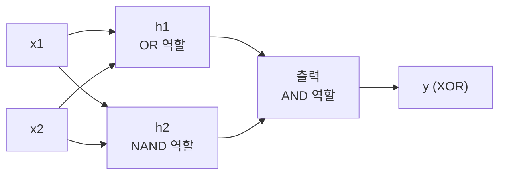
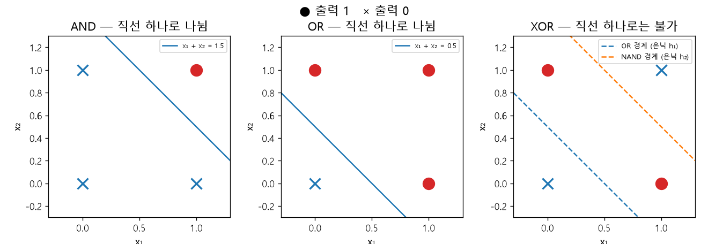
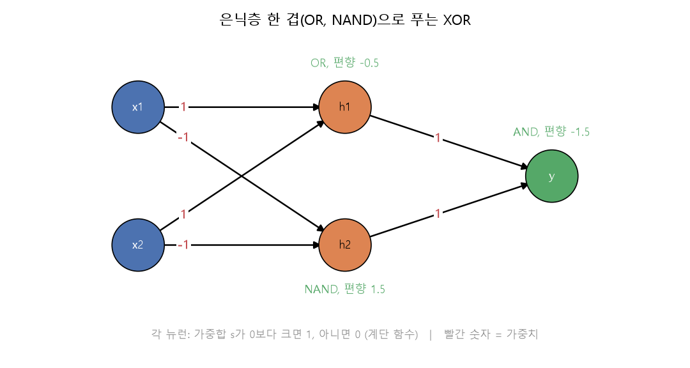
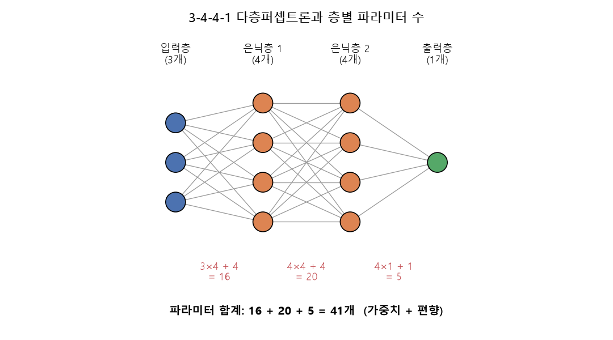

# 다층퍼셉트론과 XOR

[목차로 돌아가기](../00_%EB%94%A5%EB%9F%AC%EB%8B%9D%EC%88%98%ED%95%99_MOC.md) · 앞 노트: [D01_퍼셉트론](../01_%EA%B0%9C%EB%85%90%EB%85%B8%ED%8A%B8/D01_%ED%8D%BC%EC%85%89%ED%8A%B8%EB%A1%A0.md) · [층](../00_%EB%94%A5%EB%9F%AC%EB%8B%9D_%EC%9A%A9%EC%96%B4%EC%82%AC%EC%A0%84.md#layer-%EC%B8%B5) 쌓기: [D03_Dense층과_정규화](../01_%EA%B0%9C%EB%85%90%EB%85%B8%ED%8A%B8/D03_Dense%EC%B8%B5%EA%B3%BC_%EC%A0%95%EA%B7%9C%ED%99%94.md) · 다음 노트: [D12_역전파와_계산그래프](../01_%EA%B0%9C%EB%85%90%EB%85%B8%ED%8A%B8/D12_%EC%97%AD%EC%A0%84%ED%8C%8C%EC%99%80_%EA%B3%84%EC%82%B0%EA%B7%B8%EB%9E%98%ED%94%84.md) · 코드 풀이: [E11_MNIST_은닉층_예제](../03_%EC%98%88%EC%A0%9C%ED%92%80%EC%9D%B4/E11_MNIST_%EC%9D%80%EB%8B%89%EC%B8%B5_%EC%98%88%EC%A0%9C.md)

> [!NOTE]
> **3줄 요약**
> - [퍼셉트론](../00_%EB%94%A5%EB%9F%AC%EB%8B%9D_%EC%9A%A9%EC%96%B4%EC%82%AC%EC%A0%84.md#perceptron-%ED%8D%BC%EC%85%89%ED%8A%B8%EB%A1%A0) 하나는 평면에 **직선 하나**를 긋는 일밖에 못 해서, XOR(두 입력이 다를 때만 1)은 풀 수 없다.
> - [퍼셉트론](../00_%EB%94%A5%EB%9F%AC%EB%8B%9D_%EC%9A%A9%EC%96%B4%EC%82%AC%EC%A0%84.md#perceptron-%ED%8D%BC%EC%85%89%ED%8A%B8%EB%A1%A0)을 **[은닉층](../00_%EB%94%A5%EB%9F%AC%EB%8B%9D_%EC%9A%A9%EC%96%B4%EC%82%AC%EC%A0%84.md#hidden-layer-%EC%9D%80%EB%8B%89%EC%B8%B5)(중간층)**으로 한 겹 더 쌓으면 직선 두 개를 합칠 수 있어서 XOR이 풀린다. 이것이 다층퍼셉트론(MLP, Multi Layer Perceptron)이다.
> - [층](../00_%EB%94%A5%EB%9F%AC%EB%8B%9D_%EC%9A%A9%EC%96%B4%EC%82%AC%EC%A0%84.md#layer-%EC%B8%B5)이 하나 늘 때마다 [파라미터](../00_%EB%94%A5%EB%9F%AC%EB%8B%9D_%EC%9A%A9%EC%96%B4%EC%82%AC%EC%A0%84.md#parameter-%ED%8C%8C%EB%9D%BC%EB%AF%B8%ED%84%B0) 수는 `입력 수 × 출력 수 + 출력 수`씩 늘어난다. 3-4-4-1 구조는 16 + 20 + 5 = **41**개다.

## 1. 개념 설명

> 비유: 심사위원 한 명은 "이 점수 이상이면 합격"처럼 선 하나로만 가른다. 하지만 "A 심사위원은 통과시키고 B 심사위원도 통과시킨 사람만 최종 합격"처럼 심사위원 두 명의 의견을 한 번 더 모으는 심사위원장을 두면 훨씬 복잡한 기준도 만들 수 있다.

정확히 말하면 **다층퍼셉트론**은 [퍼셉트론](../00_%EB%94%A5%EB%9F%AC%EB%8B%9D_%EC%9A%A9%EC%96%B4%EC%82%AC%EC%A0%84.md#perceptron-%ED%8D%BC%EC%85%89%ED%8A%B8%EB%A1%A0)(입력에 [가중치](../00_%EB%94%A5%EB%9F%AC%EB%8B%9D_%EC%9A%A9%EC%96%B4%EC%82%AC%EC%A0%84.md#weight-%EA%B0%80%EC%A4%91%EC%B9%98)를 곱해 더하고 기준과 비교하는 뉴런)을 여러 [층](../00_%EB%94%A5%EB%9F%AC%EB%8B%9D_%EC%9A%A9%EC%96%B4%EC%82%AC%EC%A0%84.md#layer-%EC%B8%B5)으로 쌓은 구조다. 입력과 출력 사이에 끼는 [층](../00_%EB%94%A5%EB%9F%AC%EB%8B%9D_%EC%9A%A9%EC%96%B4%EC%82%AC%EC%A0%84.md#layer-%EC%B8%B5)을 **[은닉층](../00_%EB%94%A5%EB%9F%AC%EB%8B%9D_%EC%9A%A9%EC%96%B4%EC%82%AC%EC%A0%84.md#hidden-layer-%EC%9D%80%EB%8B%89%EC%B8%B5)(중간층, hidden layer)**이라 하고, 앞 [층](../00_%EB%94%A5%EB%9F%AC%EB%8B%9D_%EC%9A%A9%EC%96%B4%EC%82%AC%EC%A0%84.md#layer-%EC%B8%B5)의 출력이 다음 [층](../00_%EB%94%A5%EB%9F%AC%EB%8B%9D_%EC%9A%A9%EC%96%B4%EC%82%AC%EC%A0%84.md#layer-%EC%B8%B5)의 입력이 된다.

XOR은 "두 입력이 서로 다르면 1, 같으면 0"인 논리 연산이다. 입력이 `[0, 0]`, `[0, 1]`, `[1, 0]`, `[1, 1]` 네 가지뿐이다.



## 2. 필요한 이유

[D01_퍼셉트론](../01_%EA%B0%9C%EB%85%90%EB%85%B8%ED%8A%B8/D01_%ED%8D%BC%EC%85%89%ED%8A%B8%EB%A1%A0.md) 하나로 만든 판정은 "[가중합](../00_%EB%94%A5%EB%9F%AC%EB%8B%9D_%EC%9A%A9%EC%96%B4%EC%82%AC%EC%A0%84.md#weighted-sum-%EA%B0%80%EC%A4%91%ED%95%A9)이 기준을 넘나?"뿐이라서, 점들을 **직선 하나**로 갈라 놓을 수 있을 때만 풀 수 있다. 직선 하나로는 갈라지지 않는 문제(XOR이 대표적이다)가 나오면 [가중치](../00_%EB%94%A5%EB%9F%AC%EB%8B%9D_%EC%9A%A9%EC%96%B4%EC%82%AC%EC%A0%84.md#weight-%EA%B0%80%EC%A4%91%EC%B9%98)와 [편향](../00_%EB%94%A5%EB%9F%AC%EB%8B%9D_%EC%9A%A9%EC%96%B4%EC%82%AC%EC%A0%84.md#bias-%ED%8E%B8%ED%96%A5)을 아무리 바꿔도 소용이 없다. [퍼셉트론](../00_%EB%94%A5%EB%9F%AC%EB%8B%9D_%EC%9A%A9%EC%96%B4%EC%82%AC%EC%A0%84.md#perceptron-%ED%8D%BC%EC%85%89%ED%8A%B8%EB%A1%A0)을 [층](../00_%EB%94%A5%EB%9F%AC%EB%8B%9D_%EC%9A%A9%EC%96%B4%EC%82%AC%EC%A0%84.md#layer-%EC%B8%B5)으로 쌓으면 직선 여러 개의 결과를 다시 합칠 수 있어서 이런 문제도 풀린다. 이 한계가 1969년에 지적되었고, [층](../00_%EB%94%A5%EB%9F%AC%EB%8B%9D_%EC%9A%A9%EC%96%B4%EC%82%AC%EC%A0%84.md#layer-%EC%B8%B5)을 쌓는 대신 [학습](../00_%EB%94%A5%EB%9F%AC%EB%8B%9D_%EC%9A%A9%EC%96%B4%EC%82%AC%EC%A0%84.md#training-%ED%95%99%EC%8A%B5)이 어려워지는 문제는 1980년대의 [역전파](../00_%EB%94%A5%EB%9F%AC%EB%8B%9D_%EC%9A%A9%EC%96%B4%EC%82%AC%EC%A0%84.md#backpropagation-%EC%97%AD%EC%A0%84%ED%8C%8C)([D12_역전파와_계산그래프](../01_%EA%B0%9C%EB%85%90%EB%85%B8%ED%8A%B8/D12_%EC%97%AD%EC%A0%84%ED%8C%8C%EC%99%80_%EA%B3%84%EC%82%B0%EA%B7%B8%EB%9E%98%ED%94%84.md))로 풀렸다.

## 3. 필요한 수학 개념

| 수학 개념 | 이 개념에서 쓰이는 곳 | 자세히 |
|---|---|---|
| 함수 | 계단 함수와 각 뉴런은 "넣으면 0 또는 1이 나오는" 함수다 | [M01_함수와_일차함수](../02_%EC%88%98%ED%95%99%EB%85%B8%ED%8A%B8/M01_%ED%95%A8%EC%88%98%EC%99%80_%EC%9D%BC%EC%B0%A8%ED%95%A8%EC%88%98.md) |
| 일차식과 부등식 | $w_1 x_1 + w_2 x_2 + b > 0$이 "직선의 한쪽 면"을 뜻한다 | [M01_함수와_일차함수](../02_%EC%88%98%ED%95%99%EB%85%B8%ED%8A%B8/M01_%ED%95%A8%EC%88%98%EC%99%80_%EC%9D%BC%EC%B0%A8%ED%95%A8%EC%88%98.md) |
| 시그마(Σ) | [가중합](../00_%EB%94%A5%EB%9F%AC%EB%8B%9D_%EC%9A%A9%EC%96%B4%EC%82%AC%EC%A0%84.md#weighted-sum-%EA%B0%80%EC%A4%91%ED%95%A9) $\sum w_i x_i$ | [M02_시그마와_평균](../02_%EC%88%98%ED%95%99%EB%85%B8%ED%8A%B8/M02_%EC%8B%9C%EA%B7%B8%EB%A7%88%EC%99%80_%ED%8F%89%EA%B7%A0.md) |

<details><summary>미니 복습: 직선 하나가 점들을 가르는 방법</summary>

$s = x_1 + x_2 - 1.5$처럼 점마다 s를 계산해서 s가 0보다 크면 1, 아니면 0으로 정한다.
예: 점 `[1, 1]`은 s = 0.5라서 1, 점 `[0, 1]`은 s = −0.5라서 0이다. s = 0이 되는 점들이 이어진 것이 "경계선"이고, 경계선의 한쪽은 1, 반대쪽은 0이다.

</details>

<details><summary>미니 복습: 부등식</summary>

"b ≤ 0"은 b가 0이거나 0보다 작다는 뜻이다. 두 부등식의 양변을 더해도 방향은 유지된다. 예: 3 > 1이고 2 > 0이면 3 + 2 > 1 + 0이다. 아래 4절의 "XOR이 안 되는 이유"에서 이 성질을 쓴다.

</details>

## 4. 계산 과정 (숫자 → 식 → 코드)

### 숫자

#### 4.1 직선 하나로 되는 것: AND와 OR

네 점의 정답표다.

| x1 | x2 | AND | OR | XOR |
|---|---|---|---|---|
| 0 | 0 | 0 | 0 | 0 |
| 0 | 1 | 0 | 1 | 1 |
| 1 | 0 | 0 | 1 | 1 |
| 1 | 1 | 1 | 1 | 0 |

[퍼셉트론](../00_%EB%94%A5%EB%9F%AC%EB%8B%9D_%EC%9A%A9%EC%96%B4%EC%82%AC%EC%A0%84.md#perceptron-%ED%8D%BC%EC%85%89%ED%8A%B8%EB%A1%A0)은 `s = w1·x1 + w2·x2 + b`를 구해 **s > 0이면 1, 아니면 0**을 낸다(앞 노트의 기준을 0으로 옮기고 [편향](../00_%EB%94%A5%EB%9F%AC%EB%8B%9D_%EC%9A%A9%EC%96%B4%EC%82%AC%EC%A0%84.md#bias-%ED%8E%B8%ED%96%A5)이 그 역할을 맡게 한 것).

- AND: [가중치](../00_%EB%94%A5%EB%9F%AC%EB%8B%9D_%EC%9A%A9%EC%96%B4%EC%82%AC%EC%A0%84.md#weight-%EA%B0%80%EC%A4%91%EC%B9%98) `[1, 1]`, [편향](../00_%EB%94%A5%EB%9F%AC%EB%8B%9D_%EC%9A%A9%EC%96%B4%EC%82%AC%EC%A0%84.md#bias-%ED%8E%B8%ED%96%A5) −1.5

| x1 | x2 | s = x1 + x2 − 1.5 | 출력 |
|---|---|---|---|
| 0 | 0 | −1.5 | 0 |
| 0 | 1 | −0.5 | 0 |
| 1 | 0 | −0.5 | 0 |
| 1 | 1 | 0.5 | 1 |

- OR: [가중치](../00_%EB%94%A5%EB%9F%AC%EB%8B%9D_%EC%9A%A9%EC%96%B4%EC%82%AC%EC%A0%84.md#weight-%EA%B0%80%EC%A4%91%EC%B9%98) `[1, 1]`, [편향](../00_%EB%94%A5%EB%9F%AC%EB%8B%9D_%EC%9A%A9%EC%96%B4%EC%82%AC%EC%A0%84.md#bias-%ED%8E%B8%ED%96%A5) −0.5

| x1 | x2 | s = x1 + x2 − 0.5 | 출력 |
|---|---|---|---|
| 0 | 0 | −0.5 | 0 |
| 0 | 1 | 0.5 | 1 |
| 1 | 0 | 0.5 | 1 |
| 1 | 1 | 1.5 | 1 |

AND와 OR은 둘 다 정답표와 일치한다. 즉 직선 하나로 풀린다.

#### 4.2 직선 하나로 안 되는 것: XOR

같은 [가중치](../00_%EB%94%A5%EB%9F%AC%EB%8B%9D_%EC%9A%A9%EC%96%B4%EC%82%AC%EC%A0%84.md#weight-%EA%B0%80%EC%A4%91%EC%B9%98) `[1, 1]`로 [편향](../00_%EB%94%A5%EB%9F%AC%EB%8B%9D_%EC%9A%A9%EC%96%B4%EC%82%AC%EC%A0%84.md#bias-%ED%8E%B8%ED%96%A5) b만 바꿔 본다.

- b = −0.5이면 출력이 `[0, 1, 1, 1]`이라 마지막 점 `[1, 1]`이 틀린다([정답](../00_%EB%94%A5%EB%9F%AC%EB%8B%9D_%EC%9A%A9%EC%96%B4%EC%82%AC%EC%A0%84.md#label-%EC%A0%95%EB%8B%B5) 0).
- b = −1.5이면 출력이 `[0, 0, 0, 1]`이라 가운데 두 점이 틀린다([정답](../00_%EB%94%A5%EB%9F%AC%EB%8B%9D_%EC%9A%A9%EC%96%B4%EC%82%AC%EC%A0%84.md#label-%EC%A0%95%EB%8B%B5) 1).

그 사이 값도 안 된다. 이유는 네 점이 요구하는 조건을 적어 보면 보인다([가중치](../00_%EB%94%A5%EB%9F%AC%EB%8B%9D_%EC%9A%A9%EC%96%B4%EC%82%AC%EC%A0%84.md#weight-%EA%B0%80%EC%A4%91%EC%B9%98)는 `[w1, w2]`, [편향](../00_%EB%94%A5%EB%9F%AC%EB%8B%9D_%EC%9A%A9%EC%96%B4%EC%82%AC%EC%A0%84.md#bias-%ED%8E%B8%ED%96%A5)은 b).

1. 점 `[0, 0]`은 0이어야 한다 → b ≤ 0
2. 점 `[1, 0]`은 1이어야 한다 → w1 + b > 0
3. 점 `[0, 1]`은 1이어야 한다 → w2 + b > 0
4. 점 `[1, 1]`은 0이어야 한다 → w1 + w2 + b ≤ 0

2번과 3번 양변을 더한다 → w1 + w2 + 2b > 0 ← 큰 것끼리 더해도 방향은 유지됨

4번을 옮기면 w1 + w2 ≤ −b다 ← 양변에서 b를 뺌. 그러면 w1 + w2 + 2b는 −b + 2b = b 이하다. 위에서 이 값이 0보다 크다고 했으니 0 < b, 곧 b > 0이다. 그런데 1번은 b ≤ 0이라 서로 부딪친다. **어떤 w1, w2, b로도 네 조건을 동시에 만족할 수 없다.**

컴퓨터로도 확인했다. 각 값을 −5부터 5까지 0.5씩 건너뛰며 만든 9261개 조합을 모두 써 봤더니, AND는 220개 조합이 정답표를 맞혔고 XOR은 **0개**였다.



#### 4.3 은닉층 한 겹으로 푸는 법

아이디어: XOR은 "OR이면서 동시에 NAND(AND의 반대)"이다. 두 입력이 다르면 둘 중 하나 이상은 1이니 OR이 1이고, 둘이 동시에 1은 아니니 NAND도 1이다. 둘 다 1일 때만 최종 1이 나오게 AND로 모으면 된다.

| 뉴런 | 역할 | [가중치](../00_%EB%94%A5%EB%9F%AC%EB%8B%9D_%EC%9A%A9%EC%96%B4%EC%82%AC%EC%A0%84.md#weight-%EA%B0%80%EC%A4%91%EC%B9%98) | [편향](../00_%EB%94%A5%EB%9F%AC%EB%8B%9D_%EC%9A%A9%EC%96%B4%EC%82%AC%EC%A0%84.md#bias-%ED%8E%B8%ED%96%A5) |
|---|---|---|---|
| h1 | OR | `[1, 1]` | −0.5 |
| h2 | NAND | `[-1, -1]` | 1.5 |
| 출력 | AND | `[1, 1]` (입력은 h1, h2) | −1.5 |

네 점을 차례로 계산한다.

| x1 | x2 | h1의 s | h1 | h2의 s | h2 | 출력의 s | 출력 y | [정답](../00_%EB%94%A5%EB%9F%AC%EB%8B%9D_%EC%9A%A9%EC%96%B4%EC%82%AC%EC%A0%84.md#label-%EC%A0%95%EB%8B%B5) |
|---|---|---|---|---|---|---|---|---|
| 0 | 0 | −0.5 | 0 | 1.5 | 1 | −0.5 | 0 | 0 |
| 0 | 1 | 0.5 | 1 | 0.5 | 1 | 0.5 | 1 | 1 |
| 1 | 0 | 0.5 | 1 | 0.5 | 1 | 0.5 | 1 | 1 |
| 1 | 1 | 1.5 | 1 | −0.5 | 0 | −0.5 | 0 | 0 |

네 줄 모두 [정답](../00_%EB%94%A5%EB%9F%AC%EB%8B%9D_%EC%9A%A9%EC%96%B4%EC%82%AC%EC%A0%84.md#label-%EC%A0%95%EB%8B%B5)과 같다. [은닉층](../00_%EB%94%A5%EB%9F%AC%EB%8B%9D_%EC%9A%A9%EC%96%B4%EC%82%AC%EC%A0%84.md#hidden-layer-%EC%9D%80%EB%8B%89%EC%B8%B5)이 입력 `[x1, x2]`를 `[h1, h2]`라는 새 좌표로 바꿔 주면, 새 좌표에서는 직선 하나로 가를 수 있게 된다.



#### 4.4 파라미터 수 세기

[파라미터](../00_%EB%94%A5%EB%9F%AC%EB%8B%9D_%EC%9A%A9%EC%96%B4%EC%82%AC%EC%A0%84.md#parameter-%ED%8C%8C%EB%9D%BC%EB%AF%B8%ED%84%B0)([학습](../00_%EB%94%A5%EB%9F%AC%EB%8B%9D_%EC%9A%A9%EC%96%B4%EC%82%AC%EC%A0%84.md#training-%ED%95%99%EC%8A%B5)으로 정해지는 값)는 **[가중치](../00_%EB%94%A5%EB%9F%AC%EB%8B%9D_%EC%9A%A9%EC%96%B4%EC%82%AC%EC%A0%84.md#weight-%EA%B0%80%EC%A4%91%EC%B9%98)와 [편향](../00_%EB%94%A5%EB%9F%AC%EB%8B%9D_%EC%9A%A9%EC%96%B4%EC%82%AC%EC%A0%84.md#bias-%ED%8E%B8%ED%96%A5)**이다. [층](../00_%EB%94%A5%EB%9F%AC%EB%8B%9D_%EC%9A%A9%EC%96%B4%EC%82%AC%EC%A0%84.md#layer-%EC%B8%B5) 하나의 개수는 다음과 같다.

- [가중치](../00_%EB%94%A5%EB%9F%AC%EB%8B%9D_%EC%9A%A9%EC%96%B4%EC%82%AC%EC%A0%84.md#weight-%EA%B0%80%EC%A4%91%EC%B9%98): 입력 수 × 출력 수 (입력 하나하나가 출력 뉴런 하나하나와 선으로 이어지므로)
- [편향](../00_%EB%94%A5%EB%9F%AC%EB%8B%9D_%EC%9A%A9%EC%96%B4%EC%82%AC%EC%A0%84.md#bias-%ED%8E%B8%ED%96%A5): 출력 수 (뉴런마다 하나씩)

3-4-4-1 구조([층](../00_%EB%94%A5%EB%9F%AC%EB%8B%9D_%EC%9A%A9%EC%96%B4%EC%82%AC%EC%A0%84.md#layer-%EC%B8%B5) 사이를 (3,4), (4,4), (4,1)로 부름)는 한 줄에 한 층씩 센다.

| [층](../00_%EB%94%A5%EB%9F%AC%EB%8B%9D_%EC%9A%A9%EC%96%B4%EC%82%AC%EC%A0%84.md#layer-%EC%B8%B5) | [가중치](../00_%EB%94%A5%EB%9F%AC%EB%8B%9D_%EC%9A%A9%EC%96%B4%EC%82%AC%EC%A0%84.md#weight-%EA%B0%80%EC%A4%91%EC%B9%98) | [편향](../00_%EB%94%A5%EB%9F%AC%EB%8B%9D_%EC%9A%A9%EC%96%B4%EC%82%AC%EC%A0%84.md#bias-%ED%8E%B8%ED%96%A5) | 합 |
|---|---|---|---|
| (3,4) | 3 × 4 = 12 | 4 | 16 |
| (4,4) | 4 × 4 = 16 | 4 | 20 |
| (4,1) | 4 × 1 = 4 | 1 | 5 |
| 전체 | 32 | 9 | 16 + 20 + 5 = **41** |



위 XOR 구조(2-2-1)는 (2×2 + 2) + (2×1 + 1) = 6 + 3 = **9**개다.

#### 4.5 짧은 역사

1969년 마빈 민스키와 시모어 페퍼트가 "[퍼셉트론](../00_%EB%94%A5%EB%9F%AC%EB%8B%9D_%EC%9A%A9%EC%96%B4%EC%82%AC%EC%A0%84.md#perceptron-%ED%8D%BC%EC%85%89%ED%8A%B8%EB%A1%A0) 하나로는 XOR도 못 푼다"고 보였고, 이후 신경망 연구가 10년 넘게 잠잠해진 시기를 흔히 "AI의 겨울"이라 부른다. 1980년대에 [역전파](../00_%EB%94%A5%EB%9F%AC%EB%8B%9D_%EC%9A%A9%EC%96%B4%EC%82%AC%EC%A0%84.md#backpropagation-%EC%97%AD%EC%A0%84%ED%8C%8C)가 알려지면서 여러 층짜리 신경망을 학습시킬 길이 열렸다.

### 식

[층](../00_%EB%94%A5%EB%9F%AC%EB%8B%9D_%EC%9A%A9%EC%96%B4%EC%82%AC%EC%A0%84.md#layer-%EC%B8%B5) 하나는 "[가중치](../00_%EB%94%A5%EB%9F%AC%EB%8B%9D_%EC%9A%A9%EC%96%B4%EC%82%AC%EC%A0%84.md#weight-%EA%B0%80%EC%A4%91%EC%B9%98)를 곱해 더하고 [편향](../00_%EB%94%A5%EB%9F%AC%EB%8B%9D_%EC%9A%A9%EC%96%B4%EC%82%AC%EC%A0%84.md#bias-%ED%8E%B8%ED%96%A5)을 더한 뒤 계단 함수에 넣는다"이다. [은닉층](../00_%EB%94%A5%EB%9F%AC%EB%8B%9D_%EC%9A%A9%EC%96%B4%EC%82%AC%EC%A0%84.md#hidden-layer-%EC%9D%80%EB%8B%89%EC%B8%B5)과 [출력층](../00_%EB%94%A5%EB%9F%AC%EB%8B%9D_%EC%9A%A9%EC%96%B4%EC%82%AC%EC%A0%84.md#output-layer-%EC%B6%9C%EB%A0%A5%EC%B8%B5)을 이어 쓰면 다음과 같다.

$$h = \sigma(W_1 x + b_1), \qquad y = \sigma(W_2 h + b_2)$$

[파라미터](../00_%EB%94%A5%EB%9F%AC%EB%8B%9D_%EC%9A%A9%EC%96%B4%EC%82%AC%EC%A0%84.md#parameter-%ED%8C%8C%EB%9D%BC%EB%AF%B8%ED%84%B0) 수는 다음 식으로 센다.

$$\text{파라미터 수} = \sum_{\text{각 층}} \left( n_{\text{입력}} \times n_{\text{출력}} + n_{\text{출력}} \right)$$

<details><summary>기호 풀이</summary>

| 기호 | 읽는 법 | 뜻 | 예제 값 |
| --- | --- | --- | --- |
| $x$ | 엑스 | 입력 `[x1, x2]` | `[1, 1]` |
| $h$ | 에이치 | [은닉층](../00_%EB%94%A5%EB%9F%AC%EB%8B%9D_%EC%9A%A9%EC%96%B4%EC%82%AC%EC%A0%84.md#hidden-layer-%EC%9D%80%EB%8B%89%EC%B8%B5)의 출력 `[h1, h2]` | `[1, 0]` |
| $W_1$ | 더블유 원 | [은닉층](../00_%EB%94%A5%EB%9F%AC%EB%8B%9D_%EC%9A%A9%EC%96%B4%EC%82%AC%EC%A0%84.md#hidden-layer-%EC%9D%80%EB%8B%89%EC%B8%B5) [가중치](../00_%EB%94%A5%EB%9F%AC%EB%8B%9D_%EC%9A%A9%EC%96%B4%EC%82%AC%EC%A0%84.md#weight-%EA%B0%80%EC%A4%91%EC%B9%98) | h1용 `[1, 1]`, h2용 `[-1, -1]` |
| $b_1$ | 비 원 | [은닉층](../00_%EB%94%A5%EB%9F%AC%EB%8B%9D_%EC%9A%A9%EC%96%B4%EC%82%AC%EC%A0%84.md#hidden-layer-%EC%9D%80%EB%8B%89%EC%B8%B5) [편향](../00_%EB%94%A5%EB%9F%AC%EB%8B%9D_%EC%9A%A9%EC%96%B4%EC%82%AC%EC%A0%84.md#bias-%ED%8E%B8%ED%96%A5) | `[-0.5, 1.5]` |
| $W_2$ | 더블유 투 | [출력층](../00_%EB%94%A5%EB%9F%AC%EB%8B%9D_%EC%9A%A9%EC%96%B4%EC%82%AC%EC%A0%84.md#output-layer-%EC%B6%9C%EB%A0%A5%EC%B8%B5) [가중치](../00_%EB%94%A5%EB%9F%AC%EB%8B%9D_%EC%9A%A9%EC%96%B4%EC%82%AC%EC%A0%84.md#weight-%EA%B0%80%EC%A4%91%EC%B9%98) | `[1, 1]` |
| $b_2$ | 비 투 | [출력층](../00_%EB%94%A5%EB%9F%AC%EB%8B%9D_%EC%9A%A9%EC%96%B4%EC%82%AC%EC%A0%84.md#output-layer-%EC%B6%9C%EB%A0%A5%EC%B8%B5) [편향](../00_%EB%94%A5%EB%9F%AC%EB%8B%9D_%EC%9A%A9%EC%96%B4%EC%82%AC%EC%A0%84.md#bias-%ED%8E%B8%ED%96%A5) | −1.5 |
| $\sigma$ | 시그마 | 계단 함수: s > 0이면 1, 아니면 0 | s = 1.5 → 1 |
| $\sum$ | 시그마(합) | 모든 [층](../00_%EB%94%A5%EB%9F%AC%EB%8B%9D_%EC%9A%A9%EC%96%B4%EC%82%AC%EC%A0%84.md#layer-%EC%B8%B5)에 대해 더함 | 16 + 20 + 5 |

</details>

### 코드

```python
import numpy as np

def step(s):
    return (s > 0).astype(int)                    # 0보다 크면 1, 아니면 0

X = np.array([[0, 0], [0, 1], [1, 0], [1, 1]])   # 입력 네 점
W1 = np.array([[1, -1], [1, -1]])                 # 열 하나가 은닉 뉴런 하나 (h1: [1,1], h2: [-1,-1])
B1 = np.array([-0.5, 1.5])                        # 은닉층 편향
W2 = np.array([1, 1])                             # 출력층 가중치
B2 = -1.5                                         # 출력층 편향

s1 = X @ W1 + B1                                  # 은닉층의 s (@는 행렬 곱: 같은 자리끼리 곱해 더하기)
h = step(s1)                                      # 은닉층 출력
s2 = h @ W2 + B2                                  # 출력층의 s
y = step(s2)                                      # 최종 출력

print("s1 =", s1.tolist())
print("h  =", h.tolist())
print("s2 =", s2.tolist())
print("y  =", y.tolist())
print("파라미터 수 =", W1.size + B1.size + W2.size + 1)   # 4 + 2 + 2 + 1
```

**실행 결과**:

```text
s1 = [[-0.5, 1.5], [0.5, 0.5], [0.5, 0.5], [1.5, -0.5]]
h  = [[0, 1], [1, 1], [1, 1], [1, 0]]
s2 = [-0.5, 0.5, 0.5, -0.5]
y  = [0, 1, 1, 0]
파라미터 수 = 9
```

`y = [0, 1, 1, 0]`이 XOR의 정답표와 같다.

> [!WARNING]
> **⚠ [은닉층](../00_%EB%94%A5%EB%9F%AC%EB%8B%9D_%EC%9A%A9%EC%96%B4%EC%82%AC%EC%A0%84.md#hidden-layer-%EC%9D%80%EB%8B%89%EC%B8%B5)에도 계단 함수 같은 비선형 함수가 필요하다**
> [은닉층](../00_%EB%94%A5%EB%9F%AC%EB%8B%9D_%EC%9A%A9%EC%96%B4%EC%82%AC%EC%A0%84.md#hidden-layer-%EC%9D%80%EB%8B%89%EC%B8%B5)에서 계단 함수 없이 s를 그대로 다음 [층](../00_%EB%94%A5%EB%9F%AC%EB%8B%9D_%EC%9A%A9%EC%96%B4%EC%82%AC%EC%A0%84.md#layer-%EC%B8%B5)에 넘기면, [층](../00_%EB%94%A5%EB%9F%AC%EB%8B%9D_%EC%9A%A9%EC%96%B4%EC%82%AC%EC%A0%84.md#layer-%EC%B8%B5)을 몇 겹 쌓아도 결국 일차식 하나로 합쳐져서 직선 하나짜리와 같아진다. [층](../00_%EB%94%A5%EB%9F%AC%EB%8B%9D_%EC%9A%A9%EC%96%B4%EC%82%AC%EC%A0%84.md#layer-%EC%B8%B5) 사이에 0/1로 꺾는 함수([활성화 함수](../00_%EB%94%A5%EB%9F%AC%EB%8B%9D_%EC%9A%A9%EC%96%B4%EC%82%AC%EC%A0%84.md#activation-function-%ED%99%9C%EC%84%B1%ED%99%94-%ED%95%A8%EC%88%98))가 있어야 쌓은 보람이 있다.

> [!WARNING]
> **⚠ 이 [가중치](../00_%EB%94%A5%EB%9F%AC%EB%8B%9D_%EC%9A%A9%EC%96%B4%EC%82%AC%EC%A0%84.md#weight-%EA%B0%80%EC%A4%91%EC%B9%98)는 손으로 정한 값이다**
> 위 [가중치](../00_%EB%94%A5%EB%9F%AC%EB%8B%9D_%EC%9A%A9%EC%96%B4%EC%82%AC%EC%A0%84.md#weight-%EA%B0%80%EC%A4%91%EC%B9%98)는 설명을 위해 직접 고른 값이다. 실제로는 [D12_역전파와_계산그래프](../01_%EA%B0%9C%EB%85%90%EB%85%B8%ED%8A%B8/D12_%EC%97%AD%EC%A0%84%ED%8C%8C%EC%99%80_%EA%B3%84%EC%82%B0%EA%B7%B8%EB%9E%98%ED%94%84.md)처럼 [손실](../00_%EB%94%A5%EB%9F%AC%EB%8B%9D_%EC%9A%A9%EC%96%B4%EC%82%AC%EC%A0%84.md#loss-function-%EC%86%90%EC%8B%A4-%ED%95%A8%EC%88%98)의 [기울기](../00_%EB%94%A5%EB%9F%AC%EB%8B%9D_%EC%9A%A9%EC%96%B4%EC%82%AC%EC%A0%84.md#gradient-%EA%B8%B0%EC%9A%B8%EA%B8%B0)를 구해서 [학습](../00_%EB%94%A5%EB%9F%AC%EB%8B%9D_%EC%9A%A9%EC%96%B4%EC%82%AC%EC%A0%84.md#training-%ED%95%99%EC%8A%B5)으로 정한다.

## 5. 개념 재확인

<details><summary>1. 입력 <code>[1, 1]</code>을 위 XOR 신경망에 넣으면 h1, h2, y는?</summary>

| 단계 | 하는 일 | 코드 | 계산 | 결과 |
|---|---|---|---|---|
| 1 | h1의 s 구하기 | `np.sum(W_or * x) + B_or` | 1×1 + 1×1 − 0.5 | 1.5 |
| 2 | h2의 s 구하기 | `np.sum(W_nand * x) + B_nand` | (−1)×1 + (−1)×1 + 1.5 | −0.5 |
| 3 | 계단 함수 | `step(s)` | 1.5 > 0 참, −0.5 > 0 거짓 | h = `[1, 0]` |
| 4 | 출력의 s 구하기 | `np.sum(W2 * h) + B2` | 1×1 + 1×0 − 1.5 | −0.5 |
| 5 | 계단 함수 | `step(s)` | −0.5 > 0 거짓 | y = 0 |

**① 쓰는 코드**
```python
import numpy as np
def step(s): return int(s > 0)          # ① 계단 함수 (s > 0이면 1, 아니면 0)
x = np.array([1, 1])                    # ① 입력
W_or, B_or = np.array([1, 1]), -0.5     # ① h1(OR)의 가중치와 편향
W_nand, B_nand = np.array([-1, -1]), 1.5  # ① h2(NAND)의 가중치와 편향
W2, B2 = np.array([1, 1]), -1.5         # ① 출력(AND)의 가중치와 편향

s_h1 = np.sum(W_or * x) + B_or          # ② h1의 s
s_h2 = np.sum(W_nand * x) + B_nand      # ③ h2의 s
h = np.array([step(s_h1), step(s_h2)])  # ④ 계단 함수에 넣어 h 만들기
s_o = np.sum(W2 * h) + B2               # ⑤ 출력의 s
y = step(s_o)                           # ⑥ 계단 함수에 넣어 y 만들기
```

**② h1의 s 구하기** (`np.sum(W_or * x) + B_or`)
- 1 × 1 = 1
- 1 × 1 = 1
- 1 + 1 − 0.5 = 1.5 → s = 1.5

**③ h2의 s 구하기** (`np.sum(W_nand * x) + B_nand`)
- (−1) × 1 = −1
- (−1) × 1 = −1
- −1 + (−1) + 1.5 = −0.5 → s = −0.5

**④ 계단 함수에 넣어 h 만들기** (`step(s)`)
- 1.5 > 0은 참 → h1 = 1
- −0.5 > 0은 거짓 → h2 = 0
- h = `[1, 0]`

**⑤ 출력의 s** (`np.sum(W2 * h) + B2`)
- 1 × 1 = 1
- 1 × 0 = 0
- 1 + 0 − 1.5 = −0.5 → s = −0.5

**⑥ 계단 함수에 넣어 y 만들기** (`step(s_o)`)
- −0.5 > 0은 거짓 → y = 0 (XOR에서 같은 두 입력이면 0이므로 [정답](../00_%EB%94%A5%EB%9F%AC%EB%8B%9D_%EC%9A%A9%EC%96%B4%EC%82%AC%EC%A0%84.md#label-%EC%A0%95%EB%8B%B5))

**답**: h = `[1, 0]`, y = **0**

</details>

<details><summary>2. 입력 2개 → 은닉층 3개 → 출력 1개인 구조의 파라미터 수는?</summary>

| 단계 | 하는 일 | 코드 | 계산 | 결과 |
|---|---|---|---|---|
| 1 | 첫 [층](../00_%EB%94%A5%EB%9F%AC%EB%8B%9D_%EC%9A%A9%EC%96%B4%EC%82%AC%EC%A0%84.md#layer-%EC%B8%B5) [가중치](../00_%EB%94%A5%EB%9F%AC%EB%8B%9D_%EC%9A%A9%EC%96%B4%EC%82%AC%EC%A0%84.md#weight-%EA%B0%80%EC%A4%91%EC%B9%98) | `2 * 3` | 2 × 3 | 6 |
| 2 | 첫 [층](../00_%EB%94%A5%EB%9F%AC%EB%8B%9D_%EC%9A%A9%EC%96%B4%EC%82%AC%EC%A0%84.md#layer-%EC%B8%B5) [편향](../00_%EB%94%A5%EB%9F%AC%EB%8B%9D_%EC%9A%A9%EC%96%B4%EC%82%AC%EC%A0%84.md#bias-%ED%8E%B8%ED%96%A5) | `3` | 뉴런 3개 | 3 |
| 3 | 둘째 [층](../00_%EB%94%A5%EB%9F%AC%EB%8B%9D_%EC%9A%A9%EC%96%B4%EC%82%AC%EC%A0%84.md#layer-%EC%B8%B5) [가중치](../00_%EB%94%A5%EB%9F%AC%EB%8B%9D_%EC%9A%A9%EC%96%B4%EC%82%AC%EC%A0%84.md#weight-%EA%B0%80%EC%A4%91%EC%B9%98) | `3 * 1` | 3 × 1 | 3 |
| 4 | 둘째 [층](../00_%EB%94%A5%EB%9F%AC%EB%8B%9D_%EC%9A%A9%EC%96%B4%EC%82%AC%EC%A0%84.md#layer-%EC%B8%B5) [편향](../00_%EB%94%A5%EB%9F%AC%EB%8B%9D_%EC%9A%A9%EC%96%B4%EC%82%AC%EC%A0%84.md#bias-%ED%8E%B8%ED%96%A5) | `1` | 뉴런 1개 | 1 |
| 5 | 전체 | `6 + 3 + 3 + 1` | 9 + 4 | 13 |

**① 쓰는 코드**
```python
n_in, n_hidden, n_out = 2, 3, 1          # ① 층마다 뉴런 수

w1 = n_in * n_hidden                     # ② 첫 층 가중치 (입력 수 × 출력 수)
b1 = n_hidden                            # ③ 첫 층 편향 (출력 수)
w2 = n_hidden * n_out                    # ④ 둘째 층 가중치
b2 = n_out                               # ⑤ 둘째 층 편향
total = w1 + b1 + w2 + b2                # ⑥ 전체 합
```

**② 첫 [층](../00_%EB%94%A5%EB%9F%AC%EB%8B%9D_%EC%9A%A9%EC%96%B4%EC%82%AC%EC%A0%84.md#layer-%EC%B8%B5) [가중치](../00_%EB%94%A5%EB%9F%AC%EB%8B%9D_%EC%9A%A9%EC%96%B4%EC%82%AC%EC%A0%84.md#weight-%EA%B0%80%EC%A4%91%EC%B9%98)** (`n_in * n_hidden`)
- 2 × 3 = 6

**③ 첫 [층](../00_%EB%94%A5%EB%9F%AC%EB%8B%9D_%EC%9A%A9%EC%96%B4%EC%82%AC%EC%A0%84.md#layer-%EC%B8%B5) [편향](../00_%EB%94%A5%EB%9F%AC%EB%8B%9D_%EC%9A%A9%EC%96%B4%EC%82%AC%EC%A0%84.md#bias-%ED%8E%B8%ED%96%A5)** (`n_hidden`)
- 뉴런이 3개이므로 3

**④ 둘째 [층](../00_%EB%94%A5%EB%9F%AC%EB%8B%9D_%EC%9A%A9%EC%96%B4%EC%82%AC%EC%A0%84.md#layer-%EC%B8%B5) [가중치](../00_%EB%94%A5%EB%9F%AC%EB%8B%9D_%EC%9A%A9%EC%96%B4%EC%82%AC%EC%A0%84.md#weight-%EA%B0%80%EC%A4%91%EC%B9%98)** (`n_hidden * n_out`)
- 3 × 1 = 3

**⑤ 둘째 [층](../00_%EB%94%A5%EB%9F%AC%EB%8B%9D_%EC%9A%A9%EC%96%B4%EC%82%AC%EC%A0%84.md#layer-%EC%B8%B5) [편향](../00_%EB%94%A5%EB%9F%AC%EB%8B%9D_%EC%9A%A9%EC%96%B4%EC%82%AC%EC%A0%84.md#bias-%ED%8E%B8%ED%96%A5)** (`n_out`)
- 뉴런이 1개이므로 1

**⑥ 전체 합** (`w1 + b1 + w2 + b2`)
- (6 + 3) + (3 + 1) = 9 + 4 = 13

**답**: [파라미터](../00_%EB%94%A5%EB%9F%AC%EB%8B%9D_%EC%9A%A9%EC%96%B4%EC%82%AC%EC%A0%84.md#parameter-%ED%8C%8C%EB%9D%BC%EB%AF%B8%ED%84%B0) **13**개

</details>

<details><summary>3. 가중치 <code>[1, 1]</code> 퍼셉트론 하나에서 편향을 정해 XOR을 맞힐 수 없는 이유를 숫자로 설명하면?</summary>

| 단계 | 하는 일 | 코드 | 계산 | 결과 |
|---|---|---|---|---|
| 1 | `[0, 1]`이 1이 될 조건 | `1 + b > 0` | 1 + b > 0 | b > −1 |
| 2 | `[1, 1]`이 0이 될 조건 | `2 + b <= 0` | 2 + b ≤ 0 | b ≤ −2 |
| 3 | 두 조건 겹치기 | - | b > −1이면서 b ≤ −2 | 불가능 |
| 4 | 실제로 시험 | `step(X @ w + b)` | b = −0.5, −1.5 | `[0,1,1,1]`, `[0,0,0,1]` |

**① 쓰는 코드**
```python
import numpy as np
def step(s): return (s > 0).astype(int)   # ① 계단 함수
X = np.array([[0, 0], [0, 1], [1, 0], [1, 1]])   # ① 네 점
w = np.array([1, 1])                       # ① 가중치 (고정)

# ② 점 [0, 1]: s = 1 + b가 0보다 커야 함 → b > -1
# ③ 점 [1, 1]: s = 2 + b가 0 이하여야 함 → b <= -2
# ④ b > -1이면서 b <= -2인 수는 없음
print(step(X @ w + (-0.5)).tolist())       # ⑤ b = -0.5로 시험
print(step(X @ w + (-1.5)).tolist())       # ⑤ b = -1.5로 시험
```

**② 점 `[0, 1]`이 1이 되려면** (`1 + b > 0`)
- s = 1 × 0 + 1 × 1 + b = 1 + b
- 1 + b > 0 → b > −1

**③ 점 `[1, 1]`이 0이 되려면** (`2 + b <= 0`)
- s = 1 × 1 + 1 × 1 + b = 2 + b
- 2 + b ≤ 0 → b ≤ −2

**④ 두 조건 겹치기**
- b는 −1보다 커야 하고 동시에 −2 이하여야 한다. 그런 수는 없다.

**⑤ 실제로 시험** (`step(X @ w + b)`)
- b = −0.5이면 s는 `[-0.5, 0.5, 0.5, 1.5]` → 출력 `[0, 1, 1, 1]` (마지막이 틀림)
- b = −1.5이면 s는 `[-1.5, -0.5, -0.5, 0.5]` → 출력 `[0, 0, 0, 1]` (가운데 둘이 틀림)

**답**: 두 조건이 동시에 만족될 수 없어서 **직선 하나로는 XOR이 안 된다**. [은닉층](../00_%EB%94%A5%EB%9F%AC%EB%8B%9D_%EC%9A%A9%EC%96%B4%EC%82%AC%EC%A0%84.md#hidden-layer-%EC%9D%80%EB%8B%89%EC%B8%B5)을 쌓아야 한다.

</details>

<details><summary>내 이해</summary>


</details>
