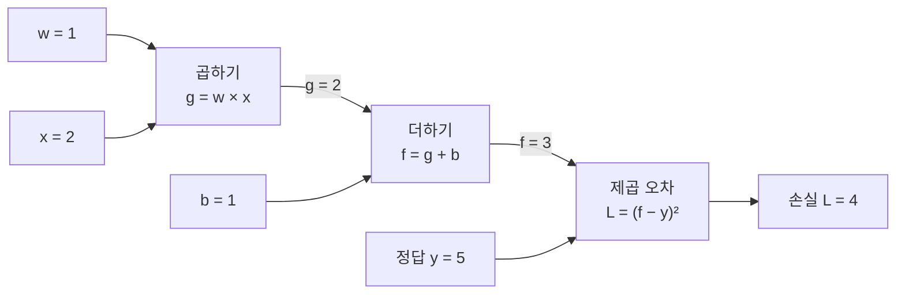
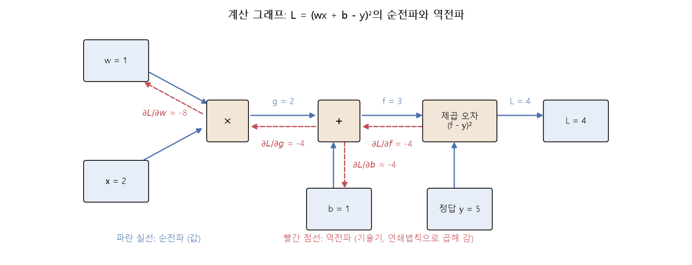
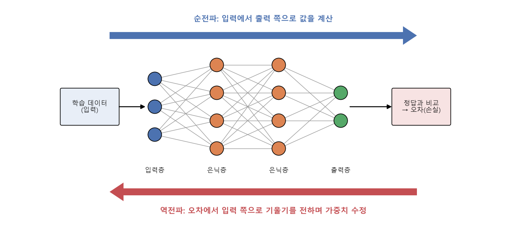

# 역전파와 계산 그래프

[목차로 돌아가기](../00_%EB%94%A5%EB%9F%AC%EB%8B%9D%EC%88%98%ED%95%99_MOC.md) · 앞 노트: [D11_다층퍼셉트론과_XOR](../01_%EA%B0%9C%EB%85%90%EB%85%B8%ED%8A%B8/D11_%EB%8B%A4%EC%B8%B5%ED%8D%BC%EC%85%89%ED%8A%B8%EB%A1%A0%EA%B3%BC_XOR.md) · [기울기](../00_%EB%94%A5%EB%9F%AC%EB%8B%9D_%EC%9A%A9%EC%96%B4%EC%82%AC%EC%A0%84.md#gradient-%EA%B8%B0%EC%9A%B8%EA%B8%B0)와 [학습률](../00_%EB%94%A5%EB%9F%AC%EB%8B%9D_%EC%9A%A9%EC%96%B4%EC%82%AC%EC%A0%84.md#learning-rate-%ED%95%99%EC%8A%B5%EB%A5%A0): [D02_경사하강법으로_직선찾기](../01_%EA%B0%9C%EB%85%90%EB%85%B8%ED%8A%B8/D02_%EA%B2%BD%EC%82%AC%ED%95%98%EA%B0%95%EB%B2%95%EC%9C%BC%EB%A1%9C_%EC%A7%81%EC%84%A0%EC%B0%BE%EA%B8%B0.md) · 수학: [M04_편미분](../02_%EC%88%98%ED%95%99%EB%85%B8%ED%8A%B8/M04_%ED%8E%B8%EB%AF%B8%EB%B6%84.md)

> [!NOTE]
> **3줄 요약**
> - 계산을 작은 상자(곱하기, 더하기, 제곱 [오차](../00_%EB%94%A5%EB%9F%AC%EB%8B%9D_%EC%9A%A9%EC%96%B4%EC%82%AC%EC%A0%84.md#error-%EC%98%A4%EC%B0%A8))로 쪼갠 그림이 **[계산 그래프](../00_%EB%94%A5%EB%9F%AC%EB%8B%9D_%EC%9A%A9%EC%96%B4%EC%82%AC%EC%A0%84.md#computational-graph-%EA%B3%84%EC%82%B0-%EA%B7%B8%EB%9E%98%ED%94%84)**이고, 앞에서 뒤로 값을 구하는 것이 **[순전파](../00_%EB%94%A5%EB%9F%AC%EB%8B%9D_%EC%9A%A9%EC%96%B4%EC%82%AC%EC%A0%84.md#feed-forward-%EC%88%9C%EC%A0%84%ED%8C%8C)**, 뒤에서 앞으로 [기울기](../00_%EB%94%A5%EB%9F%AC%EB%8B%9D_%EC%9A%A9%EC%96%B4%EC%82%AC%EC%A0%84.md#gradient-%EA%B8%B0%EC%9A%B8%EA%B8%B0)를 구하는 것이 **[역전파](../00_%EB%94%A5%EB%9F%AC%EB%8B%9D_%EC%9A%A9%EC%96%B4%EC%82%AC%EC%A0%84.md#backpropagation-%EC%97%AD%EC%A0%84%ED%8C%8C)**다.
> - [역전파](../00_%EB%94%A5%EB%9F%AC%EB%8B%9D_%EC%9A%A9%EC%96%B4%EC%82%AC%EC%A0%84.md#backpropagation-%EC%97%AD%EC%A0%84%ED%8C%8C)는 상자마다 아주 간단한 [기울기](../00_%EB%94%A5%EB%9F%AC%EB%8B%9D_%EC%9A%A9%EC%96%B4%EC%82%AC%EC%A0%84.md#gradient-%EA%B8%B0%EC%9A%B8%EA%B8%B0)를 구해 **[연쇄법칙](../00_%EB%94%A5%EB%9F%AC%EB%8B%9D_%EC%9A%A9%EC%96%B4%EC%82%AC%EC%A0%84.md#chain-rule-%EC%97%B0%EC%87%84%EB%B2%95%EC%B9%99)**으로 곱해 나간다. 앞 상자들이 공통으로 쓰는 값은 한 번만 계산해서 재사용하므로, [가중치](../00_%EB%94%A5%EB%9F%AC%EB%8B%9D_%EC%9A%A9%EC%96%B4%EC%82%AC%EC%A0%84.md#weight-%EA%B0%80%EC%A4%91%EC%B9%98)가 많을수록 일이 줄어든다.
> - w = 1, x = 2, b = 1, [정답](../00_%EB%94%A5%EB%9F%AC%EB%8B%9D_%EC%9A%A9%EC%96%B4%EC%82%AC%EC%A0%84.md#label-%EC%A0%95%EB%8B%B5) y = 5, [학습률](../00_%EB%94%A5%EB%9F%AC%EB%8B%9D_%EC%9A%A9%EC%96%B4%EC%82%AC%EC%A0%84.md#learning-rate-%ED%95%99%EC%8A%B5%EB%A5%A0) 0.01이면 w의 [기울기](../00_%EB%94%A5%EB%9F%AC%EB%8B%9D_%EC%9A%A9%EC%96%B4%EC%82%AC%EC%A0%84.md#gradient-%EA%B8%B0%EC%9A%B8%EA%B8%B0)는 −8이고 w = **1.08**이 된다. 식을 통째로 펼쳐 구해도 똑같이 1.08이다.

## 1. 개념 설명

> 비유: 공장 조립 라인. 완제품 검사에서 "치수가 4만큼 틀렸다"는 결과를 받으면, 마지막 공정부터 거꾸로 "이 공정이 치수를 얼마나 흔드나"를 곱해 가며 어느 공정의 나사를 얼마나 돌려야 할지 알아낸다.

정확히 말하면 **[계산 그래프](../00_%EB%94%A5%EB%9F%AC%EB%8B%9D_%EC%9A%A9%EC%96%B4%EC%82%AC%EC%A0%84.md#computational-graph-%EA%B3%84%EC%82%B0-%EA%B7%B8%EB%9E%98%ED%94%84)**는 하나의 긴 식을 곱하기·더하기 같은 **작은 연산 상자**로 쪼개 화살표로 이은 그림이다. 입력에서 [손실](../00_%EB%94%A5%EB%9F%AC%EB%8B%9D_%EC%9A%A9%EC%96%B4%EC%82%AC%EC%A0%84.md#loss-function-%EC%86%90%EC%8B%A4-%ED%95%A8%EC%88%98)까지 값을 차례로 구하는 것이 **[순전파](../00_%EB%94%A5%EB%9F%AC%EB%8B%9D_%EC%9A%A9%EC%96%B4%EC%82%AC%EC%A0%84.md#feed-forward-%EC%88%9C%EC%A0%84%ED%8C%8C)**(forward)이고, [손실](../00_%EB%94%A5%EB%9F%AC%EB%8B%9D_%EC%9A%A9%EC%96%B4%EC%82%AC%EC%A0%84.md#loss-function-%EC%86%90%EC%8B%A4-%ED%95%A8%EC%88%98)에서 입력 쪽으로 각 값이 [손실](../00_%EB%94%A5%EB%9F%AC%EB%8B%9D_%EC%9A%A9%EC%96%B4%EC%82%AC%EC%A0%84.md#loss-function-%EC%86%90%EC%8B%A4-%ED%95%A8%EC%88%98)에 미치는 영향([기울기](../00_%EB%94%A5%EB%9F%AC%EB%8B%9D_%EC%9A%A9%EC%96%B4%EC%82%AC%EC%A0%84.md#gradient-%EA%B8%B0%EC%9A%B8%EA%B8%B0))을 차례로 구하는 것이 **[역전파](../00_%EB%94%A5%EB%9F%AC%EB%8B%9D_%EC%9A%A9%EC%96%B4%EC%82%AC%EC%A0%84.md#backpropagation-%EC%97%AD%EC%A0%84%ED%8C%8C)**(backpropagation)다.

이 노트의 예: 직선 $wx + b$로 예측하고 [손실](../00_%EB%94%A5%EB%9F%AC%EB%8B%9D_%EC%9A%A9%EC%96%B4%EC%82%AC%EC%A0%84.md#loss-function-%EC%86%90%EC%8B%A4-%ED%95%A8%EC%88%98)은 (예측 − [정답](../00_%EB%94%A5%EB%9F%AC%EB%8B%9D_%EC%9A%A9%EC%96%B4%EC%82%AC%EC%A0%84.md#label-%EC%A0%95%EB%8B%B5))²이다. 상자는 셋이다.





## 2. 필요한 이유

[D02_경사하강법으로_직선찾기](../01_%EA%B0%9C%EB%85%90%EB%85%B8%ED%8A%B8/D02_%EA%B2%BD%EC%82%AC%ED%95%98%EA%B0%95%EB%B2%95%EC%9C%BC%EB%A1%9C_%EC%A7%81%EC%84%A0%EC%B0%BE%EA%B8%B0.md)에서는 [손실](../00_%EB%94%A5%EB%9F%AC%EB%8B%9D_%EC%9A%A9%EC%96%B4%EC%82%AC%EC%A0%84.md#loss-function-%EC%86%90%EC%8B%A4-%ED%95%A8%EC%88%98)을 w, b에 대한 식으로 전부 펼친 뒤 한 번에 미분했다. [가중치](../00_%EB%94%A5%EB%9F%AC%EB%8B%9D_%EC%9A%A9%EC%96%B4%EC%82%AC%EC%A0%84.md#weight-%EA%B0%80%EC%A4%91%EC%B9%98)가 두 개일 때는 괜찮았지만, [D11_다층퍼셉트론과_XOR](../01_%EA%B0%9C%EB%85%90%EB%85%B8%ED%8A%B8/D11_%EB%8B%A4%EC%B8%B5%ED%8D%BC%EC%85%89%ED%8A%B8%EB%A1%A0%EA%B3%BC_XOR.md)처럼 [층](../00_%EB%94%A5%EB%9F%AC%EB%8B%9D_%EC%9A%A9%EC%96%B4%EC%82%AC%EC%A0%84.md#layer-%EC%B8%B5)이 쌓이면 [가중치](../00_%EB%94%A5%EB%9F%AC%EB%8B%9D_%EC%9A%A9%EC%96%B4%EC%82%AC%EC%A0%84.md#weight-%EA%B0%80%EC%A4%91%EC%B9%98)가 수십~수백만 개가 되고 식도 한없이 길어져서 [가중치](../00_%EB%94%A5%EB%9F%AC%EB%8B%9D_%EC%9A%A9%EC%96%B4%EC%82%AC%EC%A0%84.md#weight-%EA%B0%80%EC%A4%91%EC%B9%98)마다 처음부터 펼쳐 미분하는 방법은 현실적이지 않다. [역전파](../00_%EB%94%A5%EB%9F%AC%EB%8B%9D_%EC%9A%A9%EC%96%B4%EC%82%AC%EC%A0%84.md#backpropagation-%EC%97%AD%EC%A0%84%ED%8C%8C)는 식을 상자로 쪼개 **상자 하나의 간단한 [기울기](../00_%EB%94%A5%EB%9F%AC%EB%8B%9D_%EC%9A%A9%EC%96%B4%EC%82%AC%EC%A0%84.md#gradient-%EA%B8%B0%EC%9A%B8%EA%B8%B0)를 곱해 나가는** 방식이라, [층](../00_%EB%94%A5%EB%9F%AC%EB%8B%9D_%EC%9A%A9%EC%96%B4%EC%82%AC%EC%A0%84.md#layer-%EC%B8%B5)이 아무리 깊어도 같은 규칙을 반복하면 된다. 게다가 뒤쪽에서 이미 구한 값을 앞쪽 [가중치](../00_%EB%94%A5%EB%9F%AC%EB%8B%9D_%EC%9A%A9%EC%96%B4%EC%82%AC%EC%A0%84.md#weight-%EA%B0%80%EC%A4%91%EC%B9%98)들이 같이 써서 계산이 크게 줄어든다.



## 3. 필요한 수학 개념

| 수학 개념 | 이 개념에서 쓰이는 곳 | 자세히 |
|---|---|---|
| [연쇄법칙](../00_%EB%94%A5%EB%9F%AC%EB%8B%9D_%EC%9A%A9%EC%96%B4%EC%82%AC%EC%A0%84.md#chain-rule-%EC%97%B0%EC%87%84%EB%B2%95%EC%B9%99) | 상자별 [기울기](../00_%EB%94%A5%EB%9F%AC%EB%8B%9D_%EC%9A%A9%EC%96%B4%EC%82%AC%EC%A0%84.md#gradient-%EA%B8%B0%EC%9A%B8%EA%B8%B0)를 곱해서 w의 [기울기](../00_%EB%94%A5%EB%9F%AC%EB%8B%9D_%EC%9A%A9%EC%96%B4%EC%82%AC%EC%A0%84.md#gradient-%EA%B8%B0%EC%9A%B8%EA%B8%B0)를 얻는다 | [M04_편미분](../02_%EC%88%98%ED%95%99%EB%85%B8%ED%8A%B8/M04_%ED%8E%B8%EB%AF%B8%EB%B6%84.md) |
| [편미분](../00_%EB%94%A5%EB%9F%AC%EB%8B%9D_%EC%9A%A9%EC%96%B4%EC%82%AC%EC%A0%84.md#partial-derivative-%ED%8E%B8%EB%AF%B8%EB%B6%84) | w만 움직일 때 [손실](../00_%EB%94%A5%EB%9F%AC%EB%8B%9D_%EC%9A%A9%EC%96%B4%EC%82%AC%EC%A0%84.md#loss-function-%EC%86%90%EC%8B%A4-%ED%95%A8%EC%88%98)이 얼마나 변하는지 구한다 | [M04_편미분](../02_%EC%88%98%ED%95%99%EB%85%B8%ED%8A%B8/M04_%ED%8E%B8%EB%AF%B8%EB%B6%84.md) |
| 함수 | 상자 하나하나가 "넣으면 나오는" 함수다 | [M01_함수와_일차함수](../02_%EC%88%98%ED%95%99%EB%85%B8%ED%8A%B8/M01_%ED%95%A8%EC%88%98%EC%99%80_%EC%9D%BC%EC%B0%A8%ED%95%A8%EC%88%98.md) |

<details><summary>미니 복습: 연쇄법칙</summary>

식이 두 단계로 이어져 있으면 [기울기](../00_%EB%94%A5%EB%9F%AC%EB%8B%9D_%EC%9A%A9%EC%96%B4%EC%82%AC%EC%A0%84.md#gradient-%EA%B8%B0%EC%9A%B8%EA%B8%B0)를 단계별로 곱한다. 예: g = 3x, L = g². x = 1이면 g = 3, L = 9다.
- g에 대한 L의 [기울기](../00_%EB%94%A5%EB%9F%AC%EB%8B%9D_%EC%9A%A9%EC%96%B4%EC%82%AC%EC%A0%84.md#gradient-%EA%B8%B0%EC%9A%B8%EA%B8%B0): 2g = 2 × 3 = 6
- x에 대한 g의 [기울기](../00_%EB%94%A5%EB%9F%AC%EB%8B%9D_%EC%9A%A9%EC%96%B4%EC%82%AC%EC%A0%84.md#gradient-%EA%B8%B0%EC%9A%B8%EA%B8%B0): 3
- 곱하면 x에 대한 L의 [기울기](../00_%EB%94%A5%EB%9F%AC%EB%8B%9D_%EC%9A%A9%EC%96%B4%EC%82%AC%EC%A0%84.md#gradient-%EA%B8%B0%EC%9A%B8%EA%B8%B0): 6 × 3 = 18
확인: L = 9x²이므로 [기울기](../00_%EB%94%A5%EB%9F%AC%EB%8B%9D_%EC%9A%A9%EC%96%B4%EC%82%AC%EC%A0%84.md#gradient-%EA%B8%B0%EC%9A%B8%EA%B8%B0)는 18x = 18이다. 같다. 자세히: [M04_편미분](../02_%EC%88%98%ED%95%99%EB%85%B8%ED%8A%B8/M04_%ED%8E%B8%EB%AF%B8%EB%B6%84.md)

</details>

<details><summary>미니 복습: 기울기(미분)의 뜻</summary>

"입력을 아주 조금 움직이면 출력이 얼마나 변하나"의 비율이다. f = g + b에서 g를 1 올리면 f도 1 올라가므로 g에 대한 f의 [기울기](../00_%EB%94%A5%EB%9F%AC%EB%8B%9D_%EC%9A%A9%EC%96%B4%EC%82%AC%EC%A0%84.md#gradient-%EA%B8%B0%EC%9A%B8%EA%B8%B0)는 1이다. g = w × x에서 w를 1 올리면 g는 x만큼 올라가므로 w에 대한 g의 [기울기](../00_%EB%94%A5%EB%9F%AC%EB%8B%9D_%EC%9A%A9%EC%96%B4%EC%82%AC%EC%A0%84.md#gradient-%EA%B8%B0%EC%9A%B8%EA%B8%B0)는 x다.

</details>

## 4. 계산 과정 (숫자 → 식 → 코드)

### 숫자

값: w = 1, x = 2, b = 1, [정답](../00_%EB%94%A5%EB%9F%AC%EB%8B%9D_%EC%9A%A9%EC%96%B4%EC%82%AC%EC%A0%84.md#label-%EC%A0%95%EB%8B%B5) y = 5([정답](../00_%EB%94%A5%EB%9F%AC%EB%8B%9D_%EC%9A%A9%EC%96%B4%EC%82%AC%EC%A0%84.md#label-%EC%A0%95%EB%8B%B5) 규칙은 y = 2x + 1), [학습률](../00_%EB%94%A5%EB%9F%AC%EB%8B%9D_%EC%9A%A9%EC%96%B4%EC%82%AC%EC%A0%84.md#learning-rate-%ED%95%99%EC%8A%B5%EB%A5%A0) μ = 0.01.

#### 4.1 순전파: 앞에서 뒤로 값 구하기

| 단계 | 상자 | 계산 | 결과 |
|---|---|---|---|
| 1 | 곱하기 | g = w × x = 1 × 2 | g = 2 |
| 2 | 더하기 | f = g + b = 2 + 1 | f = 3 |
| 3 | 제곱 [오차](../00_%EB%94%A5%EB%9F%AC%EB%8B%9D_%EC%9A%A9%EC%96%B4%EC%82%AC%EC%A0%84.md#error-%EC%98%A4%EC%B0%A8) | L = (f − y)² = (3 − 5)² = (−2)² | L = 4 |

예측 3이 [정답](../00_%EB%94%A5%EB%9F%AC%EB%8B%9D_%EC%9A%A9%EC%96%B4%EC%82%AC%EC%A0%84.md#label-%EC%A0%95%EB%8B%B5) 5에 못 미쳐 [손실](../00_%EB%94%A5%EB%9F%AC%EB%8B%9D_%EC%9A%A9%EC%96%B4%EC%82%AC%EC%A0%84.md#loss-function-%EC%86%90%EC%8B%A4-%ED%95%A8%EC%88%98)이 4다.

#### 4.2 상자별 기울기 (지역 기울기)

각 상자는 **자기 입력이 조금 변할 때 자기 출력이 얼마나 변하나**만 따로 구한다.

| 상자 | 식 | 구하는 [기울기](../00_%EB%94%A5%EB%9F%AC%EB%8B%9D_%EC%9A%A9%EC%96%B4%EC%82%AC%EC%A0%84.md#gradient-%EA%B8%B0%EC%9A%B8%EA%B8%B0) | 값 |
|---|---|---|---|
| 곱하기 | g = w × x | w가 변할 때 g (∂g/∂w) | x = 2 |
| 더하기 | f = g + b | g가 변할 때 f (∂f/∂g) | 1 |
| 더하기 | f = g + b | b가 변할 때 f (∂f/∂b) | 1 |
| 제곱 [오차](../00_%EB%94%A5%EB%9F%AC%EB%8B%9D_%EC%9A%A9%EC%96%B4%EC%82%AC%EC%A0%84.md#error-%EC%98%A4%EC%B0%A8) | L = (f − y)² | f가 변할 때 L (∂L/∂f) | 2 × (f − y) = 2 × (3 − 5) = −4 |

#### 4.3 역전파: 뒤에서 앞으로 곱하기 (w의 기울기)

구하고 싶은 것은 w가 변할 때 L이 얼마나 변하나(∂L/∂w)다. [연쇄법칙](../00_%EB%94%A5%EB%9F%AC%EB%8B%9D_%EC%9A%A9%EC%96%B4%EC%82%AC%EC%A0%84.md#chain-rule-%EC%97%B0%EC%87%84%EB%B2%95%EC%B9%99)으로 w에서 L까지 이어진 상자들의 [기울기](../00_%EB%94%A5%EB%9F%AC%EB%8B%9D_%EC%9A%A9%EC%96%B4%EC%82%AC%EC%A0%84.md#gradient-%EA%B8%B0%EC%9A%B8%EA%B8%B0)를 곱한다. 한 줄에 한 상자씩 거슬러 간다.

1. 제일 뒤 상자: ∂L/∂f = −4 ← 4.2의 값. f가 1 오르면 L이 4 줄어든다는 뜻
2. 더하기 상자를 지난다: ∂L/∂g = ∂f/∂g × ∂L/∂f = 1 × (−4) = −4 ← g의 변화는 f에 그대로 전해짐
3. 곱하기 상자를 지난다: ∂L/∂w = ∂g/∂w × ∂L/∂g = 2 × (−4) = −8 ← w의 변화는 g에 x배로 전해짐

따라서 ∂L/∂w = x × 1 × 2(f − y) = 2 × 1 × (−4) = **−8**이다. 음수이므로 w를 올리면 [손실](../00_%EB%94%A5%EB%9F%AC%EB%8B%9D_%EC%9A%A9%EC%96%B4%EC%82%AC%EC%A0%84.md#loss-function-%EC%86%90%EC%8B%A4-%ED%95%A8%EC%88%98)이 준다.

#### 4.4 w 고치기

- 이동량: [학습률](../00_%EB%94%A5%EB%9F%AC%EB%8B%9D_%EC%9A%A9%EC%96%B4%EC%82%AC%EC%A0%84.md#learning-rate-%ED%95%99%EC%8A%B5%EB%A5%A0) × [기울기](../00_%EB%94%A5%EB%9F%AC%EB%8B%9D_%EC%9A%A9%EC%96%B4%EC%82%AC%EC%A0%84.md#gradient-%EA%B8%B0%EC%9A%B8%EA%B8%B0) = 0.01 × (−8) = −0.08
- w = w − 이동량 = 1 − (−0.08) = **1.08**

#### 4.5 b의 기울기와 b 고치기

b는 더하기 상자에 바로 들어온다. 뒤쪽 −4는 이미 구했으니 재사용한다.

1. ∂L/∂f = −4 ← 4.3의 1번에서 이미 구함
2. ∂L/∂b = ∂f/∂b × ∂L/∂f = 1 × (−4) = **−4**
3. 이동량: 0.01 × (−4) = −0.04
4. b = 1 − (−0.04) = **1.04**

고친 뒤 확인: w = 1.08, b = 1.04이면 f = 1.08 × 2 + 1.04 = 3.2, [손실](../00_%EB%94%A5%EB%9F%AC%EB%8B%9D_%EC%9A%A9%EC%96%B4%EC%82%AC%EC%A0%84.md#loss-function-%EC%86%90%EC%8B%A4-%ED%95%A8%EC%88%98) L = (3.2 − 5)² = 3.24다. 4에서 3.24로 줄었다.

#### 4.6 펼친 식으로 구해도 같을까

[손실](../00_%EB%94%A5%EB%9F%AC%EB%8B%9D_%EC%9A%A9%EC%96%B4%EC%82%AC%EC%A0%84.md#loss-function-%EC%86%90%EC%8B%A4-%ED%95%A8%EC%88%98)을 w에 대한 식으로 전부 펼친다. 기호가 헷갈리면 (b − y) = 1 − 5 = −4를 먼저 계산해 두자.

1. 처음 식: L = (wx + b − y)²
2. 제곱을 푼다: L = w²x² + 2(b − y)wx + (b − y)² ← (A + B)² = A² + 2AB + B²에서 A = wx, B = b − y
3. 숫자를 넣어 확인: 1 × 4 + 2 × (−4) × 1 × 2 + (−4)² = 4 − 16 + 16 = 4 ← [순전파](../00_%EB%94%A5%EB%9F%AC%EB%8B%9D_%EC%9A%A9%EC%96%B4%EC%82%AC%EC%A0%84.md#feed-forward-%EC%88%9C%EC%A0%84%ED%8C%8C)의 L = 4와 같다
4. w로 편미분한다. 항마다 w가 들어 있나 본다.
   - w²x²: x²는 숫자 취급 → 2x²w ← w²의 [기울기](../00_%EB%94%A5%EB%9F%AC%EB%8B%9D_%EC%9A%A9%EC%96%B4%EC%82%AC%EC%A0%84.md#gradient-%EA%B8%B0%EC%9A%B8%EA%B8%B0)는 2w
   - 2(b − y)wx: w 앞의 숫자는 2(b − y)x → 2x(b − y)
   - (b − y)²: w가 없다 → 0
5. 합친다: ∂L/∂w = 2x²w + 2x(b − y)
6. 숫자를 넣는다: 2 × 4 × 1 = 8, 2 × 2 × (−4) = −16 → 8 + (−16) = **−8** ← 4.3과 같다
7. w를 고친다: w = 1 − 0.01 × (−8) = 1 + 0.08 = **1.08** ← 4.4와 같다

두 방법은 같은 결과(−8, 1.08)를 낸다. [연쇄법칙](../00_%EB%94%A5%EB%9F%AC%EB%8B%9D_%EC%9A%A9%EC%96%B4%EC%82%AC%EC%A0%84.md#chain-rule-%EC%97%B0%EC%87%84%EB%B2%95%EC%B9%99)이 펼친 식의 [미분](../00_%EB%94%A5%EB%9F%AC%EB%8B%9D_%EC%9A%A9%EC%96%B4%EC%82%AC%EC%A0%84.md#derivative-%EB%AF%B8%EB%B6%84)과 같은 값을 주기 때문이다.

#### 4.7 왜 역전파가 일을 줄이나

펼친 식 방법은 [가중치](../00_%EB%94%A5%EB%9F%AC%EB%8B%9D_%EC%9A%A9%EC%96%B4%EC%82%AC%EC%A0%84.md#weight-%EA%B0%80%EC%A4%91%EC%B9%98)마다 "식 전개 → [미분](../00_%EB%94%A5%EB%9F%AC%EB%8B%9D_%EC%9A%A9%EC%96%B4%EC%82%AC%EC%A0%84.md#derivative-%EB%AF%B8%EB%B6%84) → 정리"를 처음부터 다시 한다. [역전파](../00_%EB%94%A5%EB%9F%AC%EB%8B%9D_%EC%9A%A9%EC%96%B4%EC%82%AC%EC%A0%84.md#backpropagation-%EC%97%AD%EC%A0%84%ED%8C%8C)는 다르다.

- ∂L/∂f = −4는 w의 [기울기](../00_%EB%94%A5%EB%9F%AC%EB%8B%9D_%EC%9A%A9%EC%96%B4%EC%82%AC%EC%A0%84.md#gradient-%EA%B8%B0%EC%9A%B8%EA%B8%B0)에도, b의 [기울기](../00_%EB%94%A5%EB%9F%AC%EB%8B%9D_%EC%9A%A9%EC%96%B4%EC%82%AC%EC%A0%84.md#gradient-%EA%B8%B0%EC%9A%B8%EA%B8%B0)에도 쓰인다. **한 번만 구해 재사용**한다.
- [가중치](../00_%EB%94%A5%EB%9F%AC%EB%8B%9D_%EC%9A%A9%EC%96%B4%EC%82%AC%EC%A0%84.md#weight-%EA%B0%80%EC%A4%91%EC%B9%98)가 늘어도 뒤쪽 상자의 [기울기](../00_%EB%94%A5%EB%9F%AC%EB%8B%9D_%EC%9A%A9%EC%96%B4%EC%82%AC%EC%A0%84.md#gradient-%EA%B8%B0%EC%9A%B8%EA%B8%B0)는 이미 구한 것을 이어 쓴다. 새로 하는 일은 그 [가중치](../00_%EB%94%A5%EB%9F%AC%EB%8B%9D_%EC%9A%A9%EC%96%B4%EC%82%AC%EC%A0%84.md#weight-%EA%B0%80%EC%A4%91%EC%B9%98)가 붙은 상자 하나의 간단한 [기울기](../00_%EB%94%A5%EB%9F%AC%EB%8B%9D_%EC%9A%A9%EC%96%B4%EC%82%AC%EC%A0%84.md#gradient-%EA%B8%B0%EC%9A%B8%EA%B8%B0)를 곱하는 것뿐이다.
- 뒤에서 앞으로 한 번 훑으면 모든 [가중치](../00_%EB%94%A5%EB%9F%AC%EB%8B%9D_%EC%9A%A9%EC%96%B4%EC%82%AC%EC%A0%84.md#weight-%EA%B0%80%EC%A4%91%EC%B9%98)의 [기울기](../00_%EB%94%A5%EB%9F%AC%EB%8B%9D_%EC%9A%A9%EC%96%B4%EC%82%AC%EC%A0%84.md#gradient-%EA%B8%B0%EC%9A%B8%EA%B8%B0)가 한꺼번에 나온다.

작은 숫자로 보면: w₁, w₂ 두 개가 있고 f = w₁x₁ + w₂x₂ + b이면 ∂L/∂f는 한 번, 그다음 w₁은 ×x₁, w₂는 ×x₂, b는 ×1만 곱하면 된다(5절 3번 문제에서 직접 계산한다).

### 식

말로 하면 "w가 변할 때 L이 변하는 비율은, w→g, g→f, f→L 세 걸음의 비율을 곱한 값"이다.

$$g = wx,\qquad f = g + b,\qquad L = (f - y)^2$$

$$\frac{\partial L}{\partial w} = \frac{\partial g}{\partial w}\cdot\frac{\partial f}{\partial g}\cdot\frac{\partial L}{\partial f} = x \cdot 1 \cdot 2(f - y)$$

$$\frac{\partial L}{\partial b} = \frac{\partial f}{\partial b}\cdot\frac{\partial L}{\partial f} = 1 \cdot 2(f - y)$$

$$w \leftarrow w - \mu\cdot 2(f - y)\,x,\qquad b \leftarrow b - \mu\cdot 2(f - y)$$

펼친 식 방법은 $\frac{\partial L}{\partial w} = 2x^2 w + 2x(b - y)$이고, 숫자를 넣으면 두 방법이 같다.

<details><summary>기호 풀이</summary>

| 기호 | 읽는 법 | 뜻 | 예제 값 |
| --- | --- | --- | --- |
| $w$ | 더블유 | [가중치](../00_%EB%94%A5%EB%9F%AC%EB%8B%9D_%EC%9A%A9%EC%96%B4%EC%82%AC%EC%A0%84.md#weight-%EA%B0%80%EC%A4%91%EC%B9%98) | 1 |
| $x$ | 엑스 | 입력 | 2 |
| $b$ | 비 | [편향](../00_%EB%94%A5%EB%9F%AC%EB%8B%9D_%EC%9A%A9%EC%96%B4%EC%82%AC%EC%A0%84.md#bias-%ED%8E%B8%ED%96%A5) | 1 |
| $y$ | 와이 | [정답](../00_%EB%94%A5%EB%9F%AC%EB%8B%9D_%EC%9A%A9%EC%96%B4%EC%82%AC%EC%A0%84.md#label-%EC%A0%95%EB%8B%B5) | 5 |
| $g$ | 지 | 곱하기 상자의 출력 $wx$ | 2 |
| $f$ | 에프 | 더하기 상자의 출력(예측) $g + b$ | 3 |
| $L$ | 엘 | [손실](../00_%EB%94%A5%EB%9F%AC%EB%8B%9D_%EC%9A%A9%EC%96%B4%EC%82%AC%EC%A0%84.md#loss-function-%EC%86%90%EC%8B%A4-%ED%95%A8%EC%88%98). 여기서는 $(f - y)^2$ | 4 |
| $\partial$ | 라운드 디 | [편미분](../00_%EB%94%A5%EB%9F%AC%EB%8B%9D_%EC%9A%A9%EC%96%B4%EC%82%AC%EC%A0%84.md#partial-derivative-%ED%8E%B8%EB%AF%B8%EB%B6%84) 기호. 다른 값은 고정하고 하나만 움직일 때의 변화 | |
| $\frac{\partial L}{\partial w}$ | 엘을 w로 [편미분](../00_%EB%94%A5%EB%9F%AC%EB%8B%9D_%EC%9A%A9%EC%96%B4%EC%82%AC%EC%A0%84.md#partial-derivative-%ED%8E%B8%EB%AF%B8%EB%B6%84) | w가 변할 때 L이 변하는 비율([기울기](../00_%EB%94%A5%EB%9F%AC%EB%8B%9D_%EC%9A%A9%EC%96%B4%EC%82%AC%EC%A0%84.md#gradient-%EA%B8%B0%EC%9A%B8%EA%B8%B0)) | −8 |
| $\mu$ | 뮤 | [학습률](../00_%EB%94%A5%EB%9F%AC%EB%8B%9D_%EC%9A%A9%EC%96%B4%EC%82%AC%EC%A0%84.md#learning-rate-%ED%95%99%EC%8A%B5%EB%A5%A0) | 0.01 |

</details>

### 코드

```python
w, x, b, y = 1.0, 2.0, 1.0, 5.0
mu = 0.01                                   # 학습률

# 순전파: 앞에서 뒤로
g = w * x                                   # 곱하기 상자
f = g + b                                   # 더하기 상자
L = (f - y) ** 2                            # 제곱 오차 상자
print(f"forward: g = {g}, f = {f}, L = {L}")

# 역전파: 뒤에서 앞으로 (상자별 기울기를 곱한다)
dL_df = 2 * (f - y)                         # 제곱 오차 상자의 기울기
df_dg = 1.0                                 # 더하기 상자: g쪽 기울기
df_db = 1.0                                 # 더하기 상자: b쪽 기울기
dg_dw = x                                   # 곱하기 상자: w쪽 기울기
dL_dw = dg_dw * df_dg * dL_df               # 연쇄법칙: 세 기울기를 곱함
dL_db = df_db * dL_df                       # b도 같은 방법 (dL_df를 재사용)
print(f"backward: dL/df = {dL_df}, dL/dw = {dL_dw}, dL/db = {dL_db}")

w_new = w - mu * dL_dw                      # 기울기 반대로 학습률만큼 이동
b_new = b - mu * dL_db
print(f"updated: w = {w_new:.2f}, b = {b_new:.2f}")

# 비교: 펼친 식으로 구한 w의 기울기
dL_dw_expanded = 2 * x**2 * w + 2 * x * (b - y)
w_expanded = w - mu * dL_dw_expanded
print(f"expanded: dL/dw = {dL_dw_expanded}, w = {w_expanded:.2f}")

f_new = w_new * x + b_new                   # 고친 값으로 다시 예측
print(f"new loss = {(f_new - y) ** 2:.2f}")
```

**실행 결과**:

```text
forward: g = 2.0, f = 3.0, L = 4.0
backward: dL/df = -4.0, dL/dw = -8.0, dL/db = -4.0
updated: w = 1.08, b = 1.04
expanded: dL/dw = -8.0, w = 1.08
new loss = 3.24
```

> [!WARNING]
> **⚠ 이 노트의 [기울기](../00_%EB%94%A5%EB%9F%AC%EB%8B%9D_%EC%9A%A9%EC%96%B4%EC%82%AC%EC%A0%84.md#gradient-%EA%B8%B0%EC%9A%B8%EA%B8%B0)는 정식 값이다**
> [D02_경사하강법으로_직선찾기](../01_%EA%B0%9C%EB%85%90%EB%85%B8%ED%8A%B8/D02_%EA%B2%BD%EC%82%AC%ED%95%98%EA%B0%95%EB%B2%95%EC%9C%BC%EB%A1%9C_%EC%A7%81%EC%84%A0%EC%B0%BE%EA%B8%B0.md)의 코드는 [기울기](../00_%EB%94%A5%EB%9F%AC%EB%8B%9D_%EC%9A%A9%EC%96%B4%EC%82%AC%EC%A0%84.md#gradient-%EA%B8%B0%EC%9A%B8%EA%B8%B0) 식에서 2를 뺀 절반 값을 썼다. 이 노트는 책의 식대로 2를 넣은 정식 [기울기](../00_%EB%94%A5%EB%9F%AC%EB%8B%9D_%EC%9A%A9%EC%96%B4%EC%82%AC%EC%A0%84.md#gradient-%EA%B8%B0%EC%9A%B8%EA%B8%B0)(−8)를 쓴다. 방향은 같고 크기만 2배 차이다([M04_편미분](../02_%EC%88%98%ED%95%99%EB%85%B8%ED%8A%B8/M04_%ED%8E%B8%EB%AF%B8%EB%B6%84.md) 6절).

> [!WARNING]
> **⚠ 데이터가 1개일 때의 계산이다**
> 여기서는 데이터 하나(x = 2, y = 5)로 [손실](../00_%EB%94%A5%EB%9F%AC%EB%8B%9D_%EC%9A%A9%EC%96%B4%EC%82%AC%EC%A0%84.md#loss-function-%EC%86%90%EC%8B%A4-%ED%95%A8%EC%88%98)을 계산했다. 데이터가 여러 개이면 데이터마다 같은 계산을 해서 [기울기](../00_%EB%94%A5%EB%9F%AC%EB%8B%9D_%EC%9A%A9%EC%96%B4%EC%82%AC%EC%A0%84.md#gradient-%EA%B8%B0%EC%9A%B8%EA%B8%B0)를 평균 낸다.

## 5. 개념 재확인

<details><summary>1. w = 2, x = 3, b = 1, 정답 y = 10, 학습률 0.01이면 w와 b는 얼마가 되나?</summary>

| 단계 | 하는 일 | 코드 | 계산 | 결과 |
|---|---|---|---|---|
| 1 | [순전파](../00_%EB%94%A5%EB%9F%AC%EB%8B%9D_%EC%9A%A9%EC%96%B4%EC%82%AC%EC%A0%84.md#feed-forward-%EC%88%9C%EC%A0%84%ED%8C%8C) | `g = w * x`, `f = g + b` | 2 × 3 = 6, 6 + 1 | g = 6, f = 7 |
| 2 | [손실](../00_%EB%94%A5%EB%9F%AC%EB%8B%9D_%EC%9A%A9%EC%96%B4%EC%82%AC%EC%A0%84.md#loss-function-%EC%86%90%EC%8B%A4-%ED%95%A8%EC%88%98) | `(f - y) ** 2` | (7 − 10)² | L = 9 |
| 3 | 제곱 [오차](../00_%EB%94%A5%EB%9F%AC%EB%8B%9D_%EC%9A%A9%EC%96%B4%EC%82%AC%EC%A0%84.md#error-%EC%98%A4%EC%B0%A8) 상자 [기울기](../00_%EB%94%A5%EB%9F%AC%EB%8B%9D_%EC%9A%A9%EC%96%B4%EC%82%AC%EC%A0%84.md#gradient-%EA%B8%B0%EC%9A%B8%EA%B8%B0) | `2 * (f - y)` | 2 × (7 − 10) | −6 |
| 4 | w의 [기울기](../00_%EB%94%A5%EB%9F%AC%EB%8B%9D_%EC%9A%A9%EC%96%B4%EC%82%AC%EC%A0%84.md#gradient-%EA%B8%B0%EC%9A%B8%EA%B8%B0) | `dg_dw * df_dg * dL_df` | 3 × 1 × (−6) | −18 |
| 5 | b의 [기울기](../00_%EB%94%A5%EB%9F%AC%EB%8B%9D_%EC%9A%A9%EC%96%B4%EC%82%AC%EC%A0%84.md#gradient-%EA%B8%B0%EC%9A%B8%EA%B8%B0) | `df_db * dL_df` | 1 × (−6) | −6 |
| 6 | w, b 고치기 | `w - mu * dL_dw` | 2 + 0.18, 1 + 0.06 | w = 2.18, b = 1.06 |

**① 쓰는 코드**
```python
w, x, b, y = 2.0, 3.0, 1.0, 10.0   # ① 값 (원래 예제에서 바꿈)
mu = 0.01                           # ① 학습률

g = w * x                           # ② 순전파: 곱하기 상자
f = g + b                           # ② 순전파: 더하기 상자
L = (f - y) ** 2                    # ③ 손실
dL_df = 2 * (f - y)                 # ④ 제곱 오차 상자의 기울기
dL_dw = x * 1.0 * dL_df             # ⑤ w의 기울기 (dg/dw = x, df/dg = 1)
dL_db = 1.0 * dL_df                 # ⑥ b의 기울기 (df/db = 1)
w_new = w - mu * dL_dw              # ⑦ w 고치기
b_new = b - mu * dL_db              # ⑦ b 고치기
```

**② [순전파](../00_%EB%94%A5%EB%9F%AC%EB%8B%9D_%EC%9A%A9%EC%96%B4%EC%82%AC%EC%A0%84.md#feed-forward-%EC%88%9C%EC%A0%84%ED%8C%8C)** (`g = w * x`, `f = g + b`)
- g = 2 × 3 = 6
- f = 6 + 1 = 7

**③ [손실](../00_%EB%94%A5%EB%9F%AC%EB%8B%9D_%EC%9A%A9%EC%96%B4%EC%82%AC%EC%A0%84.md#loss-function-%EC%86%90%EC%8B%A4-%ED%95%A8%EC%88%98)** (`(f - y) ** 2`)
- f − y = 7 − 10 = −3
- (−3)² = 9 → L = 9

**④ 제곱 [오차](../00_%EB%94%A5%EB%9F%AC%EB%8B%9D_%EC%9A%A9%EC%96%B4%EC%82%AC%EC%A0%84.md#error-%EC%98%A4%EC%B0%A8) 상자의 [기울기](../00_%EB%94%A5%EB%9F%AC%EB%8B%9D_%EC%9A%A9%EC%96%B4%EC%82%AC%EC%A0%84.md#gradient-%EA%B8%B0%EC%9A%B8%EA%B8%B0)** (`2 * (f - y)`)
- 2 × (−3) = −6

**⑤ w의 [기울기](../00_%EB%94%A5%EB%9F%AC%EB%8B%9D_%EC%9A%A9%EC%96%B4%EC%82%AC%EC%A0%84.md#gradient-%EA%B8%B0%EC%9A%B8%EA%B8%B0)** (`x * 1.0 * dL_df`)
- 곱하기 상자의 [기울기](../00_%EB%94%A5%EB%9F%AC%EB%8B%9D_%EC%9A%A9%EC%96%B4%EC%82%AC%EC%A0%84.md#gradient-%EA%B8%B0%EC%9A%B8%EA%B8%B0)는 x = 3, 더하기 상자는 1
- 3 × 1 = 3
- 3 × (−6) = −18 → ∂L/∂w = −18

**⑥ b의 [기울기](../00_%EB%94%A5%EB%9F%AC%EB%8B%9D_%EC%9A%A9%EC%96%B4%EC%82%AC%EC%A0%84.md#gradient-%EA%B8%B0%EC%9A%B8%EA%B8%B0)** (`1.0 * dL_df`)
- 1 × (−6) = −6 → ∂L/∂b = −6

**⑦ 고치기** (`w - mu * dL_dw`)
- w = 2 − 0.01 × (−18) = 2 + 0.18 = 2.18
- b = 1 − 0.01 × (−6) = 1 + 0.06 = 1.06

**답**: w = **2.18**, b = **1.06**

</details>

<details><summary>2. 원래 예제(w = 1, x = 2, b = 1, y = 5)에서 ∂L/∂b를 역전파와 펼친 식 두 방법으로 구하면?</summary>

| 단계 | 하는 일 | 코드 | 계산 | 결과 |
|---|---|---|---|---|
| 1 | [역전파](../00_%EB%94%A5%EB%9F%AC%EB%8B%9D_%EC%9A%A9%EC%96%B4%EC%82%AC%EC%A0%84.md#backpropagation-%EC%97%AD%EC%A0%84%ED%8C%8C): 뒤쪽 [기울기](../00_%EB%94%A5%EB%9F%AC%EB%8B%9D_%EC%9A%A9%EC%96%B4%EC%82%AC%EC%A0%84.md#gradient-%EA%B8%B0%EC%9A%B8%EA%B8%B0) | `2 * (f - y)` | 2 × (3 − 5) | −4 |
| 2 | [역전파](../00_%EB%94%A5%EB%9F%AC%EB%8B%9D_%EC%9A%A9%EC%96%B4%EC%82%AC%EC%A0%84.md#backpropagation-%EC%97%AD%EC%A0%84%ED%8C%8C): b의 [기울기](../00_%EB%94%A5%EB%9F%AC%EB%8B%9D_%EC%9A%A9%EC%96%B4%EC%82%AC%EC%A0%84.md#gradient-%EA%B8%B0%EC%9A%B8%EA%B8%B0) | `df_db * dL_df` | 1 × (−4) | −4 |
| 3 | 펼친 식의 b [기울기](../00_%EB%94%A5%EB%9F%AC%EB%8B%9D_%EC%9A%A9%EC%96%B4%EC%82%AC%EC%A0%84.md#gradient-%EA%B8%B0%EC%9A%B8%EA%B8%B0) | `2 * w * x + 2 * (b - y)` | 2 × 1 × 2 + 2 × (1 − 5) | −4 |
| 4 | b 고치기 | `b - mu * dL_db` | 1 − 0.01 × (−4) | 1.04 |

**① 쓰는 코드**
```python
w, x, b, y = 1.0, 2.0, 1.0, 5.0         # ① 원래 값
mu = 0.01                                # ① 학습률
f = w * x + b                            # ② 순전파로 예측 구하기 (f = 3)

dL_df = 2 * (f - y)                      # ② 역전파: 뒤쪽 기울기
dL_db = 1.0 * dL_df                      # ③ 역전파: b의 기울기
dL_db_expanded = 2 * w * x + 2 * (b - y) # ④ 펼친 식으로 구한 b의 기울기
b_new = b - mu * dL_db                   # ⑤ b 고치기
```

**② [역전파](../00_%EB%94%A5%EB%9F%AC%EB%8B%9D_%EC%9A%A9%EC%96%B4%EC%82%AC%EC%A0%84.md#backpropagation-%EC%97%AD%EC%A0%84%ED%8C%8C): 뒤쪽 [기울기](../00_%EB%94%A5%EB%9F%AC%EB%8B%9D_%EC%9A%A9%EC%96%B4%EC%82%AC%EC%A0%84.md#gradient-%EA%B8%B0%EC%9A%B8%EA%B8%B0)** (`2 * (f - y)`)
- f = 1 × 2 + 1 = 3
- 2 × (3 − 5) = −4

**③ [역전파](../00_%EB%94%A5%EB%9F%AC%EB%8B%9D_%EC%9A%A9%EC%96%B4%EC%82%AC%EC%A0%84.md#backpropagation-%EC%97%AD%EC%A0%84%ED%8C%8C): b의 [기울기](../00_%EB%94%A5%EB%9F%AC%EB%8B%9D_%EC%9A%A9%EC%96%B4%EC%82%AC%EC%A0%84.md#gradient-%EA%B8%B0%EC%9A%B8%EA%B8%B0)** (`1.0 * dL_df`)
- 더하기 상자에서 b쪽 [기울기](../00_%EB%94%A5%EB%9F%AC%EB%8B%9D_%EC%9A%A9%EC%96%B4%EC%82%AC%EC%A0%84.md#gradient-%EA%B8%B0%EC%9A%B8%EA%B8%B0)는 1
- 1 × (−4) = −4

**④ 펼친 식으로 구하기** (`2 * w * x + 2 * (b - y)`)
- L = w²x² + 2(b − y)wx + (b − y)²에서 b가 들어 있는 항만 본다.
- w²x²: b가 없다 → 0
- 2(b − y)wx: b 앞의 숫자는 2wx → 2wx = 2 × 1 × 2 = 4
- (b − y)²: b의 [기울기](../00_%EB%94%A5%EB%9F%AC%EB%8B%9D_%EC%9A%A9%EC%96%B4%EC%82%AC%EC%A0%84.md#gradient-%EA%B8%B0%EC%9A%B8%EA%B8%B0)는 2(b − y) = 2 × (−4) = −8
- 4 + (−8) = −4

**⑤ b 고치기** (`b - mu * dL_db`)
- b = 1 − 0.01 × (−4) = 1 + 0.04 = 1.04

**답**: 두 방법 모두 ∂L/∂b = **−4**, 고친 b = **1.04**

</details>

<details><summary>3. 가중치가 둘인 f = w₁x₁ + w₂x₂ + b에서 역전파의 재사용을 숫자로 보이면?</summary>

| 단계 | 하는 일 | 코드 | 계산 | 결과 |
|---|---|---|---|---|
| 1 | [순전파](../00_%EB%94%A5%EB%9F%AC%EB%8B%9D_%EC%9A%A9%EC%96%B4%EC%82%AC%EC%A0%84.md#feed-forward-%EC%88%9C%EC%A0%84%ED%8C%8C) | `f = w1*x1 + w2*x2 + b` | 1×2 + 3×1 + 0 | f = 5 |
| 2 | [손실](../00_%EB%94%A5%EB%9F%AC%EB%8B%9D_%EC%9A%A9%EC%96%B4%EC%82%AC%EC%A0%84.md#loss-function-%EC%86%90%EC%8B%A4-%ED%95%A8%EC%88%98) | `(f - y) ** 2` | (5 − 9)² | L = 16 |
| 3 | 뒤쪽 [기울기](../00_%EB%94%A5%EB%9F%AC%EB%8B%9D_%EC%9A%A9%EC%96%B4%EC%82%AC%EC%A0%84.md#gradient-%EA%B8%B0%EC%9A%B8%EA%B8%B0) (한 번만) | `2 * (f - y)` | 2 × (5 − 9) | −8 |
| 4 | w₁의 [기울기](../00_%EB%94%A5%EB%9F%AC%EB%8B%9D_%EC%9A%A9%EC%96%B4%EC%82%AC%EC%A0%84.md#gradient-%EA%B8%B0%EC%9A%B8%EA%B8%B0) | `x1 * dL_df` | 2 × (−8) | −16 |
| 5 | w₂의 [기울기](../00_%EB%94%A5%EB%9F%AC%EB%8B%9D_%EC%9A%A9%EC%96%B4%EC%82%AC%EC%A0%84.md#gradient-%EA%B8%B0%EC%9A%B8%EA%B8%B0) | `x2 * dL_df` | 1 × (−8) | −8 |
| 6 | b의 [기울기](../00_%EB%94%A5%EB%9F%AC%EB%8B%9D_%EC%9A%A9%EC%96%B4%EC%82%AC%EC%A0%84.md#gradient-%EA%B8%B0%EC%9A%B8%EA%B8%B0) | `1.0 * dL_df` | 1 × (−8) | −8 |
| 7 | 고치기 (μ = 0.01) | `w - mu * grad` | 1 + 0.16, 3 + 0.08, 0 + 0.08 | w₁ = 1.16, w₂ = 3.08, b = 0.08 |

**① 쓰는 코드**
```python
w1, x1, w2, x2, b, y = 1.0, 2.0, 3.0, 1.0, 0.0, 9.0   # ① 값
mu = 0.01                                              # ① 학습률

f = w1 * x1 + w2 * x2 + b      # ② 순전파
L = (f - y) ** 2               # ③ 손실
dL_df = 2 * (f - y)            # ④ 뒤쪽 기울기 (한 번만 구함)
dL_dw1 = x1 * dL_df            # ⑤ w1의 기울기 (④ 재사용)
dL_dw2 = x2 * dL_df            # ⑥ w2의 기울기 (④ 재사용)
dL_db = 1.0 * dL_df            # ⑦ b의 기울기 (④ 재사용)
w1 = w1 - mu * dL_dw1          # ⑧ 고치기
w2 = w2 - mu * dL_dw2          # ⑧ 고치기
b = b - mu * dL_db             # ⑧ 고치기
```

**② [순전파](../00_%EB%94%A5%EB%9F%AC%EB%8B%9D_%EC%9A%A9%EC%96%B4%EC%82%AC%EC%A0%84.md#feed-forward-%EC%88%9C%EC%A0%84%ED%8C%8C)** (`w1 * x1 + w2 * x2 + b`)
- 1 × 2 = 2
- 3 × 1 = 3
- 2 + 3 + 0 = 5 → f = 5

**③ [손실](../00_%EB%94%A5%EB%9F%AC%EB%8B%9D_%EC%9A%A9%EC%96%B4%EC%82%AC%EC%A0%84.md#loss-function-%EC%86%90%EC%8B%A4-%ED%95%A8%EC%88%98)** (`(f - y) ** 2`)
- 5 − 9 = −4
- (−4)² = 16 → L = 16

**④ 뒤쪽 [기울기](../00_%EB%94%A5%EB%9F%AC%EB%8B%9D_%EC%9A%A9%EC%96%B4%EC%82%AC%EC%A0%84.md#gradient-%EA%B8%B0%EC%9A%B8%EA%B8%B0)** (`2 * (f - y)`)
- 2 × (−4) = −8 ← 이 값을 아래 세 곳에서 그대로 쓴다

**⑤ w₁의 [기울기](../00_%EB%94%A5%EB%9F%AC%EB%8B%9D_%EC%9A%A9%EC%96%B4%EC%82%AC%EC%A0%84.md#gradient-%EA%B8%B0%EC%9A%B8%EA%B8%B0)** (`x1 * dL_df`)
- 2 × (−8) = −16

**⑥ w₂의 [기울기](../00_%EB%94%A5%EB%9F%AC%EB%8B%9D_%EC%9A%A9%EC%96%B4%EC%82%AC%EC%A0%84.md#gradient-%EA%B8%B0%EC%9A%B8%EA%B8%B0)** (`x2 * dL_df`)
- 1 × (−8) = −8

**⑦ b의 [기울기](../00_%EB%94%A5%EB%9F%AC%EB%8B%9D_%EC%9A%A9%EC%96%B4%EC%82%AC%EC%A0%84.md#gradient-%EA%B8%B0%EC%9A%B8%EA%B8%B0)** (`1.0 * dL_df`)
- 1 × (−8) = −8

**⑧ 고치기** (`w - mu * grad`)
- w₁ = 1 − 0.01 × (−16) = 1.16
- w₂ = 3 − 0.01 × (−8) = 3.08
- b = 0 − 0.01 × (−8) = 0.08

**답**: 뒤쪽 [기울기](../00_%EB%94%A5%EB%9F%AC%EB%8B%9D_%EC%9A%A9%EC%96%B4%EC%82%AC%EC%A0%84.md#gradient-%EA%B8%B0%EC%9A%B8%EA%B8%B0) −8은 **한 번만** 계산해서 세 곳에 재사용한다. [가중치](../00_%EB%94%A5%EB%9F%AC%EB%8B%9D_%EC%9A%A9%EC%96%B4%EC%82%AC%EC%A0%84.md#weight-%EA%B0%80%EC%A4%91%EC%B9%98)가 하나 늘 때마다 곱셈 한 번만 더 하면 된다.

</details>

<details><summary>내 이해</summary>


</details>
