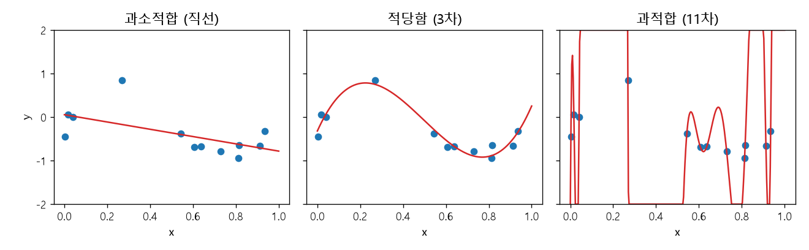
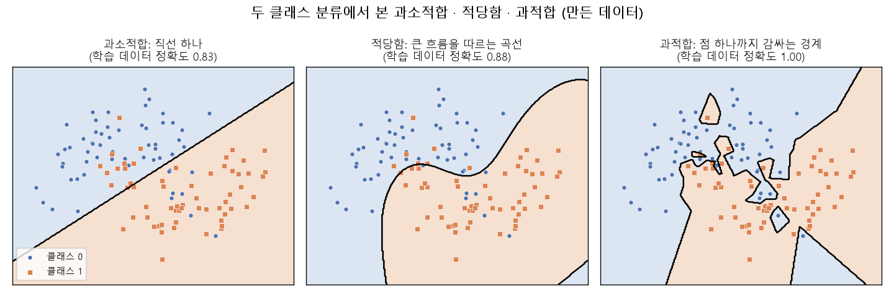
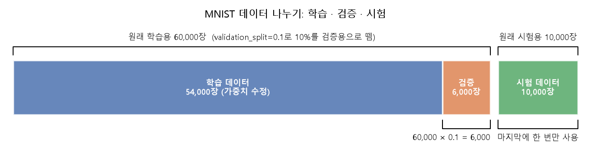
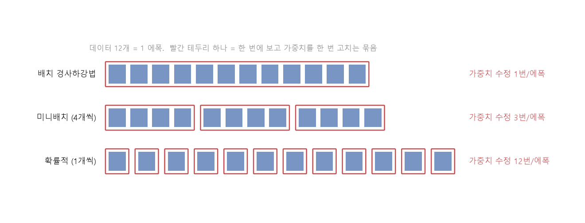
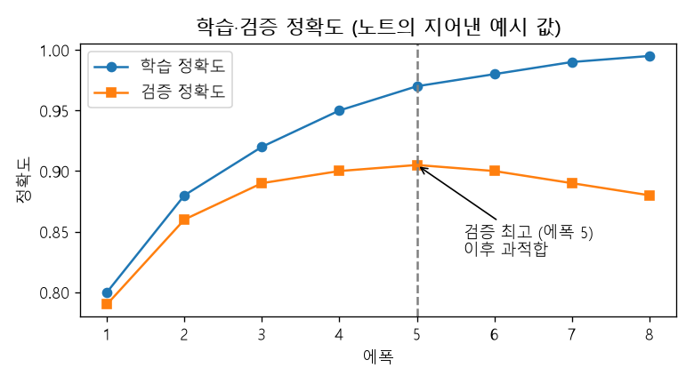

# 데이터 나누기와 과적합 (학습·검증·시험, 에폭과 미니배치)

[목차로 돌아가기](../00_%EB%94%A5%EB%9F%AC%EB%8B%9D%EC%88%98%ED%95%99_MOC.md) · 예제: `01_ML_DL_Basic/EX_07_MNIST.ipynb` · 코드 풀이: [E11_MNIST_은닉층_예제](../03_%EC%98%88%EC%A0%9C%ED%92%80%EC%9D%B4/E11_MNIST_%EC%9D%80%EB%8B%89%EC%B8%B5_%EC%98%88%EC%A0%9C.md)

> [!NOTE]
> **3줄 요약**
> - 데이터는 **[학습 데이터](../00_%EB%94%A5%EB%9F%AC%EB%8B%9D_%EC%9A%A9%EC%96%B4%EC%82%AC%EC%A0%84.md#training-data-test-data-%ED%95%99%EC%8A%B5-%EB%8D%B0%EC%9D%B4%ED%84%B0%EC%99%80-%EC%8B%9C%ED%97%98-%EB%8D%B0%EC%9D%B4%ED%84%B0)**(배우는 문제), **[검증](../00_%EB%94%A5%EB%9F%AC%EB%8B%9D_%EC%9A%A9%EC%96%B4%EC%82%AC%EC%A0%84.md#validation-data-%EA%B2%80%EC%A6%9D-%EB%8D%B0%EC%9D%B4%ED%84%B0) 데이터**(공부 중 모의고사), **[시험 데이터](../00_%EB%94%A5%EB%9F%AC%EB%8B%9D_%EC%9A%A9%EC%96%B4%EC%82%AC%EC%A0%84.md#training-data-test-data-%ED%95%99%EC%8A%B5-%EB%8D%B0%EC%9D%B4%ED%84%B0%EC%99%80-%EC%8B%9C%ED%97%98-%EB%8D%B0%EC%9D%B4%ED%84%B0)**(마지막에 한 번 보는 진짜 시험)로 나눈다. [학습 데이터](../00_%EB%94%A5%EB%9F%AC%EB%8B%9D_%EC%9A%A9%EC%96%B4%EC%82%AC%EC%A0%84.md#training-data-test-data-%ED%95%99%EC%8A%B5-%EB%8D%B0%EC%9D%B4%ED%84%B0%EC%99%80-%EC%8B%9C%ED%97%98-%EB%8D%B0%EC%9D%B4%ED%84%B0)로 채점하면 외운 것인지 이해한 것인지 알 수 없기 때문이다.
> - [학습](../00_%EB%94%A5%EB%9F%AC%EB%8B%9D_%EC%9A%A9%EC%96%B4%EC%82%AC%EC%A0%84.md#training-%ED%95%99%EC%8A%B5) 점수는 계속 오르는데 [검증](../00_%EB%94%A5%EB%9F%AC%EB%8B%9D_%EC%9A%A9%EC%96%B4%EC%82%AC%EC%A0%84.md#validation-data-%EA%B2%80%EC%A6%9D-%EB%8D%B0%EC%9D%B4%ED%84%B0) 점수가 내려가기 시작하면 **[과적합](../00_%EB%94%A5%EB%9F%AC%EB%8B%9D_%EC%9A%A9%EC%96%B4%EC%82%AC%EC%A0%84.md#overfitting-%EA%B3%BC%EC%A0%81%ED%95%A9)**(외우기)이다. 둘 다 낮으면 **[과소적합](../00_%EB%94%A5%EB%9F%AC%EB%8B%9D_%EC%9A%A9%EC%96%B4%EC%82%AC%EC%A0%84.md#underfitting-%EA%B3%BC%EC%86%8C%EC%A0%81%ED%95%A9)**(덜 배움)이다. 필요한 수학은 나눗셈과 올림, 평균 정도다.
> - [MNIST](../00_%EB%94%A5%EB%9F%AC%EB%8B%9D_%EC%9A%A9%EC%96%B4%EC%82%AC%EC%A0%84.md#mnist-%EC%86%90%EA%B8%80%EC%94%A8-%EC%88%AB%EC%9E%90-%EB%8D%B0%EC%9D%B4%ED%84%B0%EC%85%8B) 6만 장을 32장씩 묶으면([미니배치](../00_%EB%94%A5%EB%9F%AC%EB%8B%9D_%EC%9A%A9%EC%96%B4%EC%82%AC%EC%A0%84.md#mini-batch-%EB%AF%B8%EB%8B%88%EB%B0%B0%EC%B9%98)) 한 [에폭](../00_%EB%94%A5%EB%9F%AC%EB%8B%9D_%EC%9A%A9%EC%96%B4%EC%82%AC%EC%A0%84.md#epoch-%EC%97%90%ED%8F%AD)에 60,000 ÷ 32 = **1875번** [가중치](../00_%EB%94%A5%EB%9F%AC%EB%8B%9D_%EC%9A%A9%EC%96%B4%EC%82%AC%EC%A0%84.md#weight-%EA%B0%80%EC%A4%91%EC%B9%98)를 고친다. 한 장씩이면 60,000번, 전체를 한 묶음으로 하면 1번이다.

## 1. 개념 설명

시험을 준비하는 학생을 떠올려 보자. 문제집으로 공부하고([학습](../00_%EB%94%A5%EB%9F%AC%EB%8B%9D_%EC%9A%A9%EC%96%B4%EC%82%AC%EC%A0%84.md#training-%ED%95%99%EC%8A%B5)), 중간중간 모의고사로 실력을 점검하고([검증](../00_%EB%94%A5%EB%9F%AC%EB%8B%9D_%EC%9A%A9%EC%96%B4%EC%82%AC%EC%A0%84.md#validation-data-%EA%B2%80%EC%A6%9D-%EB%8D%B0%EC%9D%B4%ED%84%B0)), 마지막에 수능을 한 번 본다(시험). 문제집 문제를 풀어 보고 "나 만점이야"라고 해도, 답을 외웠는지 이해했는지는 알 수 없다. 처음 보는 문제를 풀어야 진짜 실력이 드러난다.

정확히 말하면 다음과 같다.

| 이름 | 영어 | 하는 일 | [정답](../00_%EB%94%A5%EB%9F%AC%EB%8B%9D_%EC%9A%A9%EC%96%B4%EC%82%AC%EC%A0%84.md#label-%EC%A0%95%EB%8B%B5)을 보며 [가중치](../00_%EB%94%A5%EB%9F%AC%EB%8B%9D_%EC%9A%A9%EC%96%B4%EC%82%AC%EC%A0%84.md#weight-%EA%B0%80%EC%A4%91%EC%B9%98)를 고치나 | 몇 번 쓰나 |
|---|---|---|---|---|
| [학습 데이터](../00_%EB%94%A5%EB%9F%AC%EB%8B%9D_%EC%9A%A9%EC%96%B4%EC%82%AC%EC%A0%84.md#training-data-test-data-%ED%95%99%EC%8A%B5-%EB%8D%B0%EC%9D%B4%ED%84%B0%EC%99%80-%EC%8B%9C%ED%97%98-%EB%8D%B0%EC%9D%B4%ED%84%B0) | training data | [가중치](../00_%EB%94%A5%EB%9F%AC%EB%8B%9D_%EC%9A%A9%EC%96%B4%EC%82%AC%EC%A0%84.md#weight-%EA%B0%80%EC%A4%91%EC%B9%98)를 고치는 데 쓴다 | 예 | [에폭](../00_%EB%94%A5%EB%9F%AC%EB%8B%9D_%EC%9A%A9%EC%96%B4%EC%82%AC%EC%A0%84.md#epoch-%EC%97%90%ED%8F%AD)마다 계속 |
| [검증](../00_%EB%94%A5%EB%9F%AC%EB%8B%9D_%EC%9A%A9%EC%96%B4%EC%82%AC%EC%A0%84.md#validation-data-%EA%B2%80%EC%A6%9D-%EB%8D%B0%EC%9D%B4%ED%84%B0) 데이터 | validation data | [학습](../00_%EB%94%A5%EB%9F%AC%EB%8B%9D_%EC%9A%A9%EC%96%B4%EC%82%AC%EC%A0%84.md#training-%ED%95%99%EC%8A%B5) 도중 [과적합](../00_%EB%94%A5%EB%9F%AC%EB%8B%9D_%EC%9A%A9%EC%96%B4%EC%82%AC%EC%A0%84.md#overfitting-%EA%B3%BC%EC%A0%81%ED%95%A9)이 시작됐는지 확인한다 | 아니오 (점수만 잰다) | [에폭](../00_%EB%94%A5%EB%9F%AC%EB%8B%9D_%EC%9A%A9%EC%96%B4%EC%82%AC%EC%A0%84.md#epoch-%EC%97%90%ED%8F%AD)마다 |
| [시험 데이터](../00_%EB%94%A5%EB%9F%AC%EB%8B%9D_%EC%9A%A9%EC%96%B4%EC%82%AC%EC%A0%84.md#training-data-test-data-%ED%95%99%EC%8A%B5-%EB%8D%B0%EC%9D%B4%ED%84%B0%EC%99%80-%EC%8B%9C%ED%97%98-%EB%8D%B0%EC%9D%B4%ED%84%B0) | test data | [학습](../00_%EB%94%A5%EB%9F%AC%EB%8B%9D_%EC%9A%A9%EC%96%B4%EC%82%AC%EC%A0%84.md#training-%ED%95%99%EC%8A%B5)이 끝난 뒤 최종 실력을 잰다 | 아니오 | 마지막에 한 번 |

- **[과소적합](../00_%EB%94%A5%EB%9F%AC%EB%8B%9D_%EC%9A%A9%EC%96%B4%EC%82%AC%EC%A0%84.md#underfitting-%EA%B3%BC%EC%86%8C%EC%A0%81%ED%95%A9)**(underfitting): 모델이 너무 단순하거나 덜 배워서 [학습 데이터](../00_%EB%94%A5%EB%9F%AC%EB%8B%9D_%EC%9A%A9%EC%96%B4%EC%82%AC%EC%A0%84.md#training-data-test-data-%ED%95%99%EC%8A%B5-%EB%8D%B0%EC%9D%B4%ED%84%B0%EC%99%80-%EC%8B%9C%ED%97%98-%EB%8D%B0%EC%9D%B4%ED%84%B0)에서도 점수가 낮은 상태. 곡선으로 퍼진 점들을 직선 하나로 설명하려는 경우가 그렇다.
- **[과적합](../00_%EB%94%A5%EB%9F%AC%EB%8B%9D_%EC%9A%A9%EC%96%B4%EC%82%AC%EC%A0%84.md#overfitting-%EA%B3%BC%EC%A0%81%ED%95%A9)**(overfitting): [학습 데이터](../00_%EB%94%A5%EB%9F%AC%EB%8B%9D_%EC%9A%A9%EC%96%B4%EC%82%AC%EC%A0%84.md#training-data-test-data-%ED%95%99%EC%8A%B5-%EB%8D%B0%EC%9D%B4%ED%84%B0%EC%99%80-%EC%8B%9C%ED%97%98-%EB%8D%B0%EC%9D%B4%ED%84%B0)는 잘 맞히지만 처음 보는 데이터에서는 점수가 크게 떨어지는 상태. 점 하나하나를 지나가려고 선이 꼬불꼬불해진 경우다. [분류](../00_%EB%94%A5%EB%9F%AC%EB%8B%9D_%EC%9A%A9%EC%96%B4%EC%82%AC%EC%A0%84.md#regression-classification-%ED%9A%8C%EA%B7%80%EC%99%80-%EB%B6%84%EB%A5%98)에서는 경계선이 이상치 하나까지 감싸며 구불구불해진다.
- 적당히 배운 상태는 곡선의 큰 흐름만 따라가서, [학습 데이터](../00_%EB%94%A5%EB%9F%AC%EB%8B%9D_%EC%9A%A9%EC%96%B4%EC%82%AC%EC%A0%84.md#training-data-test-data-%ED%95%99%EC%8A%B5-%EB%8D%B0%EC%9D%B4%ED%84%B0%EC%99%80-%EC%8B%9C%ED%97%98-%EB%8D%B0%EC%9D%B4%ED%84%B0)와 처음 보는 데이터 모두에서 비슷한 점수가 나온다.

또 하나, **[에폭](../00_%EB%94%A5%EB%9F%AC%EB%8B%9D_%EC%9A%A9%EC%96%B4%EC%82%AC%EC%A0%84.md#epoch-%EC%97%90%ED%8F%AD)**(epoch)은 [학습 데이터](../00_%EB%94%A5%EB%9F%AC%EB%8B%9D_%EC%9A%A9%EC%96%B4%EC%82%AC%EC%A0%84.md#training-data-test-data-%ED%95%99%EC%8A%B5-%EB%8D%B0%EC%9D%B4%ED%84%B0%EC%99%80-%EC%8B%9C%ED%97%98-%EB%8D%B0%EC%9D%B4%ED%84%B0) 전체를 한 번 다 보는 것이다. 그리고 한 번 고칠 때 몇 장을 보느냐에 따라 세 가지 방식이 있다.

| 방식 | 영어 | 한 번 고칠 때 보는 데이터 | 특징 |
|---|---|---|---|
| [배치 경사하강법](../00_%EB%94%A5%EB%9F%AC%EB%8B%9D_%EC%9A%A9%EC%96%B4%EC%82%AC%EC%A0%84.md#batch-gradient-descent-%EB%B0%B0%EC%B9%98-%EA%B2%BD%EC%82%AC%ED%95%98%EA%B0%95%EB%B2%95) | batch gradient descent | 전체를 한 묶음으로 | 안정적이지만 한 번 고치기까지 오래 걸린다 |
| [미니배치](../00_%EB%94%A5%EB%9F%AC%EB%8B%9D_%EC%9A%A9%EC%96%B4%EC%82%AC%EC%A0%84.md#mini-batch-%EB%AF%B8%EB%8B%88%EB%B0%B0%EC%B9%98) [경사하강법](../00_%EB%94%A5%EB%9F%AC%EB%8B%9D_%EC%9A%A9%EC%96%B4%EC%82%AC%EC%A0%84.md#gradient-descent-%EA%B2%BD%EC%82%AC%ED%95%98%EA%B0%95%EB%B2%95) | mini-batch gradient descent | 일정한 개수씩 묶어서 (예: 32장) | 속도와 안정성의 중간. 실제로 가장 많이 쓴다 |
| [확률적 경사하강법](../00_%EB%94%A5%EB%9F%AC%EB%8B%9D_%EC%9A%A9%EC%96%B4%EC%82%AC%EC%A0%84.md#stochastic-gradient-descent-%ED%99%95%EB%A5%A0%EC%A0%81-%EA%B2%BD%EC%82%AC%ED%95%98%EA%B0%95%EB%B2%95) | stochastic gradient descent (SGD) | 한 장씩 | 자주 고치지만 들쭉날쭉하다 |





## 2. 필요한 이유

학습 데이터로만 점수를 재면 "외웠는지, 이해했는지" 구분이 안 된다. [D06_이미지분류와_MNIST](../01_%EA%B0%9C%EB%85%90%EB%85%B8%ED%8A%B8/D06_%EC%9D%B4%EB%AF%B8%EC%A7%80%EB%B6%84%EB%A5%98%EC%99%80_MNIST.md)에서는 [시험 데이터](../00_%EB%94%A5%EB%9F%AC%EB%8B%9D_%EC%9A%A9%EC%96%B4%EC%82%AC%EC%A0%84.md#training-data-test-data-%ED%95%99%EC%8A%B5-%EB%8D%B0%EC%9D%B4%ED%84%B0%EC%99%80-%EC%8B%9C%ED%97%98-%EB%8D%B0%EC%9D%B4%ED%84%B0)를 따로 두어 이 문제를 풀었다. 그런데 [층](../00_%EB%94%A5%EB%9F%AC%EB%8B%9D_%EC%9A%A9%EC%96%B4%EC%82%AC%EC%A0%84.md#layer-%EC%B8%B5)을 늘리고 칸 수를 키우면서 모델을 여러 번 바꿔 보면, [시험 데이터](../00_%EB%94%A5%EB%9F%AC%EB%8B%9D_%EC%9A%A9%EC%96%B4%EC%82%AC%EC%A0%84.md#training-data-test-data-%ED%95%99%EC%8A%B5-%EB%8D%B0%EC%9D%B4%ED%84%B0%EC%99%80-%EC%8B%9C%ED%97%98-%EB%8D%B0%EC%9D%B4%ED%84%B0)로 계속 점수를 보며 고르게 되고 결국 [시험 데이터](../00_%EB%94%A5%EB%9F%AC%EB%8B%9D_%EC%9A%A9%EC%96%B4%EC%82%AC%EC%A0%84.md#training-data-test-data-%ED%95%99%EC%8A%B5-%EB%8D%B0%EC%9D%B4%ED%84%B0%EC%99%80-%EC%8B%9C%ED%97%98-%EB%8D%B0%EC%9D%B4%ED%84%B0)에도 눈치껏 맞추게 된다. 그래서 **공부 중 점검용 [검증](../00_%EB%94%A5%EB%9F%AC%EB%8B%9D_%EC%9A%A9%EC%96%B4%EC%82%AC%EC%A0%84.md#validation-data-%EA%B2%80%EC%A6%9D-%EB%8D%B0%EC%9D%B4%ED%84%B0) 데이터**가 따로 필요하다. [과적합](../00_%EB%94%A5%EB%9F%AC%EB%8B%9D_%EC%9A%A9%EC%96%B4%EC%82%AC%EC%A0%84.md#overfitting-%EA%B3%BC%EC%A0%81%ED%95%A9)이 보이면 [D08_ReLU와_드롭아웃](../01_%EA%B0%9C%EB%85%90%EB%85%B8%ED%8A%B8/D08_ReLU%EC%99%80_%EB%93%9C%EB%A1%AD%EC%95%84%EC%9B%83.md)의 [드롭아웃](../00_%EB%94%A5%EB%9F%AC%EB%8B%9D_%EC%9A%A9%EC%96%B4%EC%82%AC%EC%A0%84.md#dropout-%EB%93%9C%EB%A1%AD%EC%95%84%EC%9B%83)이나 조기 종료로 막는다.

또 6만 장 전체를 한 번 보고서야 한 번 고치면, 한 [에폭](../00_%EB%94%A5%EB%9F%AC%EB%8B%9D_%EC%9A%A9%EC%96%B4%EC%82%AC%EC%A0%84.md#epoch-%EC%97%90%ED%8F%AD)에 고치는 횟수가 1번뿐이라 느리다. 묶음으로 나누면 한 [에폭](../00_%EB%94%A5%EB%9F%AC%EB%8B%9D_%EC%9A%A9%EC%96%B4%EC%82%AC%EC%A0%84.md#epoch-%EC%97%90%ED%8F%AD)에 여러 번 고쳐서 빨리 배운다([E11_MNIST_은닉층_예제](../03_%EC%98%88%EC%A0%9C%ED%92%80%EC%9D%B4/E11_MNIST_%EC%9D%80%EB%8B%89%EC%B8%B5_%EC%98%88%EC%A0%9C.md)에서 확인).

## 3. 필요한 수학 개념

| 수학 개념 | 이 개념에서 쓰이는 곳 | 자세히 |
|---|---|---|
| 몫과 올림 | 60,000 ÷ 32 = 1875, 나누어떨어지지 않으면 올림 | |
| 평균과 시그마(Σ) | [미니배치](../00_%EB%94%A5%EB%9F%AC%EB%8B%9D_%EC%9A%A9%EC%96%B4%EC%82%AC%EC%A0%84.md#mini-batch-%EB%AF%B8%EB%8B%88%EB%B0%B0%EC%B9%98) 안 [손실](../00_%EB%94%A5%EB%9F%AC%EB%8B%9D_%EC%9A%A9%EC%96%B4%EC%82%AC%EC%A0%84.md#loss-function-%EC%86%90%EC%8B%A4-%ED%95%A8%EC%88%98)의 평균 | [M02_시그마와_평균](../02_%EC%88%98%ED%95%99%EB%85%B8%ED%8A%B8/M02_%EC%8B%9C%EA%B7%B8%EB%A7%88%EC%99%80_%ED%8F%89%EA%B7%A0.md) |
| 비율과 [확률](../00_%EB%94%A5%EB%9F%AC%EB%8B%9D_%EC%9A%A9%EC%96%B4%EC%82%AC%EC%A0%84.md#probability-%ED%99%95%EB%A5%A0) 기초 | [정확도](../00_%EB%94%A5%EB%9F%AC%EB%8B%9D_%EC%9A%A9%EC%96%B4%EC%82%AC%EC%A0%84.md#accuracy-%EC%A0%95%ED%99%95%EB%8F%84) = 맞힌 비율, 오류율 = 1 − [정확도](../00_%EB%94%A5%EB%9F%AC%EB%8B%9D_%EC%9A%A9%EC%96%B4%EC%82%AC%EC%A0%84.md#accuracy-%EC%A0%95%ED%99%95%EB%8F%84) | [M08_확률_기초](../02_%EC%88%98%ED%95%99%EB%85%B8%ED%8A%B8/M08_%ED%99%95%EB%A5%A0_%EA%B8%B0%EC%B4%88.md) |

<details><summary>미니 복습: 올림 ⌈ ⌉</summary>

$\lceil x \rceil$는 x보다 작지 않은 가장 작은 정수다. 예: $\lceil 937.5 \rceil = 938$, $\lceil 1875.0 \rceil = 1875$.
그림 100장을 [미니배치](../00_%EB%94%A5%EB%9F%AC%EB%8B%9D_%EC%9A%A9%EC%96%B4%EC%82%AC%EC%A0%84.md#mini-batch-%EB%AF%B8%EB%8B%88%EB%B0%B0%EC%B9%98) 30장씩 묶으면 30 + 30 + 30 + 10으로 묶음이 4개다. 100 ÷ 30 = 3.33…을 올림한 4와 같다. 마지막 묶음은 모자라도 하나로 센다.

</details>

<details><summary>미니 복습: 시그마(Σ)와 평균</summary>

$\sum_{i=1}^{3} \ell_i$는 "$\ell_1 + \ell_2 + \ell_3$를 더하라"는 뜻이다. [손실](../00_%EB%94%A5%EB%9F%AC%EB%8B%9D_%EC%9A%A9%EC%96%B4%EC%82%AC%EC%A0%84.md#loss-function-%EC%86%90%EC%8B%A4-%ED%95%A8%EC%88%98)이 `[0.2, 0.4, 0.6]`이면 합은 1.2, 개수 3으로 나눈 평균은 0.4다. [미니배치](../00_%EB%94%A5%EB%9F%AC%EB%8B%9D_%EC%9A%A9%EC%96%B4%EC%82%AC%EC%A0%84.md#mini-batch-%EB%AF%B8%EB%8B%88%EB%B0%B0%EC%B9%98)에서는 묶음 안의 [손실](../00_%EB%94%A5%EB%9F%AC%EB%8B%9D_%EC%9A%A9%EC%96%B4%EC%82%AC%EC%A0%84.md#loss-function-%EC%86%90%EC%8B%A4-%ED%95%A8%EC%88%98)을 이렇게 평균해서 [기울기](../00_%EB%94%A5%EB%9F%AC%EB%8B%9D_%EC%9A%A9%EC%96%B4%EC%82%AC%EC%A0%84.md#gradient-%EA%B8%B0%EC%9A%B8%EA%B8%B0)를 구한다. 자세히: [M02_시그마와_평균](../02_%EC%88%98%ED%95%99%EB%85%B8%ED%8A%B8/M02_%EC%8B%9C%EA%B7%B8%EB%A7%88%EC%99%80_%ED%8F%89%EA%B7%A0.md)

</details>

## 4. 계산 과정 (숫자 → 식 → 코드)

### 숫자

**① 데이터 나누기** ([MNIST](../00_%EB%94%A5%EB%9F%AC%EB%8B%9D_%EC%9A%A9%EC%96%B4%EC%82%AC%EC%A0%84.md#mnist-%EC%86%90%EA%B8%80%EC%94%A8-%EC%88%AB%EC%9E%90-%EB%8D%B0%EC%9D%B4%ED%84%B0%EC%85%8B) 학습용 60,000장, 시험용 10,000장은 이미 나뉘어 있다)

| 구분 | 장 수 | 계산 |
|---|---|---|
| 학습용 전체 | 60,000 | 원래 주어진 값 |
| 그중 검증용 10% | 6,000 | 60,000 × 0.1 (`validation_split=0.1`) |
| 그중 학습용 90% | 54,000 | 60,000 − 6,000 |
| 시험용 | 10,000 | 따로 보관, 마지막에 한 번 |



**② 에폭당 고치는 횟수** ([학습](../00_%EB%94%A5%EB%9F%AC%EB%8B%9D_%EC%9A%A9%EC%96%B4%EC%82%AC%EC%A0%84.md#training-%ED%95%99%EC%8A%B5) 60,000장, 한 번에 보는 장 수를 B로 두면)

| 방식 | B | 계산 | 한 [에폭](../00_%EB%94%A5%EB%9F%AC%EB%8B%9D_%EC%9A%A9%EC%96%B4%EC%82%AC%EC%A0%84.md#epoch-%EC%97%90%ED%8F%AD)에 고치는 횟수 |
|---|---|---|---|
| 배치 | 60,000 | 60,000 ÷ 60,000 | 1 |
| [미니배치](../00_%EB%94%A5%EB%9F%AC%EB%8B%9D_%EC%9A%A9%EC%96%B4%EC%82%AC%EC%A0%84.md#mini-batch-%EB%AF%B8%EB%8B%88%EB%B0%B0%EC%B9%98) | 32 | 60,000 ÷ 32 | **1875** |
| 확률적 | 1 | 60,000 ÷ 1 | 60,000 |

- Keras `fit`은 `batch_size`를 안 쓰면 32를 쓴다. 그래서 [E11_MNIST_은닉층_예제](../03_%EC%98%88%EC%A0%9C%ED%92%80%EC%9D%B4/E11_MNIST_%EC%9D%80%EB%8B%89%EC%B8%B5_%EC%98%88%EC%A0%9C.md)의 한 [에폭](../00_%EB%94%A5%EB%9F%AC%EB%8B%9D_%EC%9A%A9%EC%96%B4%EC%82%AC%EC%A0%84.md#epoch-%EC%97%90%ED%8F%AD)은 1875번 고치는 것이다.
- 검증용 10%를 떼면 [학습](../00_%EB%94%A5%EB%9F%AC%EB%8B%9D_%EC%9A%A9%EC%96%B4%EC%82%AC%EC%A0%84.md#training-%ED%95%99%EC%8A%B5) 54,000장이다. 54,000 ÷ 32 = 1687.5이므로 올림해서 1688번이다.



**③ [학습](../00_%EB%94%A5%EB%9F%AC%EB%8B%9D_%EC%9A%A9%EC%96%B4%EC%82%AC%EC%A0%84.md#training-%ED%95%99%EC%8A%B5)과 [검증](../00_%EB%94%A5%EB%9F%AC%EB%8B%9D_%EC%9A%A9%EC%96%B4%EC%82%AC%EC%A0%84.md#validation-data-%EA%B2%80%EC%A6%9D-%EB%8D%B0%EC%9D%B4%ED%84%B0) 점수가 갈라지는 모습** (아래 표는 **설명을 위해 지어낸 값**이고 실제 실험 결과가 아니다)

| [에폭](../00_%EB%94%A5%EB%9F%AC%EB%8B%9D_%EC%9A%A9%EC%96%B4%EC%82%AC%EC%A0%84.md#epoch-%EC%97%90%ED%8F%AD) | [학습](../00_%EB%94%A5%EB%9F%AC%EB%8B%9D_%EC%9A%A9%EC%96%B4%EC%82%AC%EC%A0%84.md#training-%ED%95%99%EC%8A%B5) [정확도](../00_%EB%94%A5%EB%9F%AC%EB%8B%9D_%EC%9A%A9%EC%96%B4%EC%82%AC%EC%A0%84.md#accuracy-%EC%A0%95%ED%99%95%EB%8F%84) | [검증](../00_%EB%94%A5%EB%9F%AC%EB%8B%9D_%EC%9A%A9%EC%96%B4%EC%82%AC%EC%A0%84.md#validation-data-%EA%B2%80%EC%A6%9D-%EB%8D%B0%EC%9D%B4%ED%84%B0) [정확도](../00_%EB%94%A5%EB%9F%AC%EB%8B%9D_%EC%9A%A9%EC%96%B4%EC%82%AC%EC%A0%84.md#accuracy-%EC%A0%95%ED%99%95%EB%8F%84) | 차이 ([학습](../00_%EB%94%A5%EB%9F%AC%EB%8B%9D_%EC%9A%A9%EC%96%B4%EC%82%AC%EC%A0%84.md#training-%ED%95%99%EC%8A%B5) − [검증](../00_%EB%94%A5%EB%9F%AC%EB%8B%9D_%EC%9A%A9%EC%96%B4%EC%82%AC%EC%A0%84.md#validation-data-%EA%B2%80%EC%A6%9D-%EB%8D%B0%EC%9D%B4%ED%84%B0)) |
|---|---|---|---|
| 1 | 0.800 | 0.790 | 0.010 |
| 2 | 0.880 | 0.860 | 0.020 |
| 3 | 0.920 | 0.890 | 0.030 |
| 4 | 0.950 | 0.900 | 0.050 |
| **5** | 0.970 | **0.905** | 0.065 |
| 6 | 0.980 | 0.900 | 0.080 |
| 7 | 0.990 | 0.890 | 0.100 |
| 8 | 0.995 | 0.880 | 0.115 |

- [학습](../00_%EB%94%A5%EB%9F%AC%EB%8B%9D_%EC%9A%A9%EC%96%B4%EC%82%AC%EC%A0%84.md#training-%ED%95%99%EC%8A%B5) [정확도](../00_%EB%94%A5%EB%9F%AC%EB%8B%9D_%EC%9A%A9%EC%96%B4%EC%82%AC%EC%A0%84.md#accuracy-%EC%A0%95%ED%99%95%EB%8F%84)는 [에폭](../00_%EB%94%A5%EB%9F%AC%EB%8B%9D_%EC%9A%A9%EC%96%B4%EC%82%AC%EC%A0%84.md#epoch-%EC%97%90%ED%8F%AD)마다 계속 오른다.
- [검증](../00_%EB%94%A5%EB%9F%AC%EB%8B%9D_%EC%9A%A9%EC%96%B4%EC%82%AC%EC%A0%84.md#validation-data-%EA%B2%80%EC%A6%9D-%EB%8D%B0%EC%9D%B4%ED%84%B0) [정확도](../00_%EB%94%A5%EB%9F%AC%EB%8B%9D_%EC%9A%A9%EC%96%B4%EC%82%AC%EC%A0%84.md#accuracy-%EC%A0%95%ED%99%95%EB%8F%84)는 5에폭에서 가장 높고(0.905), 그 뒤로 내려간다. 이 지점이 **전환점**이다.
- 5에폭 이후에는 [학습](../00_%EB%94%A5%EB%9F%AC%EB%8B%9D_%EC%9A%A9%EC%96%B4%EC%82%AC%EC%A0%84.md#training-%ED%95%99%EC%8A%B5) 점수만 오르고 [검증](../00_%EB%94%A5%EB%9F%AC%EB%8B%9D_%EC%9A%A9%EC%96%B4%EC%82%AC%EC%A0%84.md#validation-data-%EA%B2%80%EC%A6%9D-%EB%8D%B0%EC%9D%B4%ED%84%B0) 점수는 내린다. 차이가 0.065 → 0.115로 벌어지는 것이 [과적합](../00_%EB%94%A5%EB%9F%AC%EB%8B%9D_%EC%9A%A9%EC%96%B4%EC%82%AC%EC%A0%84.md#overfitting-%EA%B3%BC%EC%A0%81%ED%95%A9)의 신호다.
- [과소적합](../00_%EB%94%A5%EB%9F%AC%EB%8B%9D_%EC%9A%A9%EC%96%B4%EC%82%AC%EC%A0%84.md#underfitting-%EA%B3%BC%EC%86%8C%EC%A0%81%ED%95%A9)은 [에폭](../00_%EB%94%A5%EB%9F%AC%EB%8B%9D_%EC%9A%A9%EC%96%B4%EC%82%AC%EC%A0%84.md#epoch-%EC%97%90%ED%8F%AD) 1~2처럼 [학습](../00_%EB%94%A5%EB%9F%AC%EB%8B%9D_%EC%9A%A9%EC%96%B4%EC%82%AC%EC%A0%84.md#training-%ED%95%99%EC%8A%B5) 점수 자체가 아직 낮고 둘 다 낮은 상태다.

진단 기준을 표로 줄이면 다음과 같다(숫자는 역시 설명용).

| [학습](../00_%EB%94%A5%EB%9F%AC%EB%8B%9D_%EC%9A%A9%EC%96%B4%EC%82%AC%EC%A0%84.md#training-%ED%95%99%EC%8A%B5) 점수 | [검증](../00_%EB%94%A5%EB%9F%AC%EB%8B%9D_%EC%9A%A9%EC%96%B4%EC%82%AC%EC%A0%84.md#validation-data-%EA%B2%80%EC%A6%9D-%EB%8D%B0%EC%9D%B4%ED%84%B0) 점수 | 상태 | 대처 |
|---|---|---|---|
| 낮음 (0.70) | 낮음 (0.69) | [과소적합](../00_%EB%94%A5%EB%9F%AC%EB%8B%9D_%EC%9A%A9%EC%96%B4%EC%82%AC%EC%A0%84.md#underfitting-%EA%B3%BC%EC%86%8C%EC%A0%81%ED%95%A9) | [층](../00_%EB%94%A5%EB%9F%AC%EB%8B%9D_%EC%9A%A9%EC%96%B4%EC%82%AC%EC%A0%84.md#layer-%EC%B8%B5)·칸 수 늘리기, 더 오래 [학습](../00_%EB%94%A5%EB%9F%AC%EB%8B%9D_%EC%9A%A9%EC%96%B4%EC%82%AC%EC%A0%84.md#training-%ED%95%99%EC%8A%B5) |
| 높음 (0.995) | 훨씬 낮음 (0.880) | [과적합](../00_%EB%94%A5%EB%9F%AC%EB%8B%9D_%EC%9A%A9%EC%96%B4%EC%82%AC%EC%A0%84.md#overfitting-%EA%B3%BC%EC%A0%81%ED%95%A9) | [드롭아웃](../00_%EB%94%A5%EB%9F%AC%EB%8B%9D_%EC%9A%A9%EC%96%B4%EC%82%AC%EC%A0%84.md#dropout-%EB%93%9C%EB%A1%AD%EC%95%84%EC%9B%83)([D08_ReLU와_드롭아웃](../01_%EA%B0%9C%EB%85%90%EB%85%B8%ED%8A%B8/D08_ReLU%EC%99%80_%EB%93%9C%EB%A1%AD%EC%95%84%EC%9B%83.md)), 조기 종료, 데이터 늘리기, 모델 줄이기 |
| 높음 (0.97) | 비슷 (0.95) | 적당 | 그대로 |



### 식

[에폭](../00_%EB%94%A5%EB%9F%AC%EB%8B%9D_%EC%9A%A9%EC%96%B4%EC%82%AC%EC%A0%84.md#epoch-%EC%97%90%ED%8F%AD)마다 [가중치](../00_%EB%94%A5%EB%9F%AC%EB%8B%9D_%EC%9A%A9%EC%96%B4%EC%82%AC%EC%A0%84.md#weight-%EA%B0%80%EC%A4%91%EC%B9%98)를 고치는 횟수는 "전체 장 수를 한 번에 보는 장 수로 나눈 값을 올림"한 것이다.

$$\text{steps} = \left\lceil \frac{n}{B} \right\rceil$$

[미니배치](../00_%EB%94%A5%EB%9F%AC%EB%8B%9D_%EC%9A%A9%EC%96%B4%EC%82%AC%EC%A0%84.md#mini-batch-%EB%AF%B8%EB%8B%88%EB%B0%B0%EC%B9%98) 하나의 [손실](../00_%EB%94%A5%EB%9F%AC%EB%8B%9D_%EC%9A%A9%EC%96%B4%EC%82%AC%EC%A0%84.md#loss-function-%EC%86%90%EC%8B%A4-%ED%95%A8%EC%88%98)은 그 안의 장마다 구한 [손실](../00_%EB%94%A5%EB%9F%AC%EB%8B%9D_%EC%9A%A9%EC%96%B4%EC%82%AC%EC%A0%84.md#loss-function-%EC%86%90%EC%8B%A4-%ED%95%A8%EC%88%98)의 평균이다.

$$L_{\text{batch}} = \frac{1}{B}\sum_{i=1}^{B} \ell_i$$

오류율은 [정확도](../00_%EB%94%A5%EB%9F%AC%EB%8B%9D_%EC%9A%A9%EC%96%B4%EC%82%AC%EC%A0%84.md#accuracy-%EC%A0%95%ED%99%95%EB%8F%84)의 반대편이다.

$$\text{오류율} = 1 - \text{정확도}$$

<details><summary>기호 풀이</summary>

| 기호 | 읽는 법 | 뜻 | 예제 값 |
| --- | --- | --- | --- |
| $n$ | 엔 | [학습](../00_%EB%94%A5%EB%9F%AC%EB%8B%9D_%EC%9A%A9%EC%96%B4%EC%82%AC%EC%A0%84.md#training-%ED%95%99%EC%8A%B5)에 쓰는 데이터 장 수 | 60,000 |
| $B$ | 비 | 한 번 고칠 때 보는 장 수 (배치 크기) | 32 |
| $\lceil\ \rceil$ | 올림 | 소수점 이하가 있으면 다음 정수로 | $\lceil 1687.5 \rceil = 1688$ |
| $\text{steps}$ | 스텝스 | 한 [에폭](../00_%EB%94%A5%EB%9F%AC%EB%8B%9D_%EC%9A%A9%EC%96%B4%EC%82%AC%EC%A0%84.md#epoch-%EC%97%90%ED%8F%AD) 동안 [가중치](../00_%EB%94%A5%EB%9F%AC%EB%8B%9D_%EC%9A%A9%EC%96%B4%EC%82%AC%EC%A0%84.md#weight-%EA%B0%80%EC%A4%91%EC%B9%98)를 고치는 횟수 | 1875 |
| $\ell_i$ | 엘 아이 | i번째 그림 한 장의 [손실](../00_%EB%94%A5%EB%9F%AC%EB%8B%9D_%EC%9A%A9%EC%96%B4%EC%82%AC%EC%A0%84.md#loss-function-%EC%86%90%EC%8B%A4-%ED%95%A8%EC%88%98) | 0.2 |
| $L_{\text{batch}}$ | 엘 배치 | 묶음 하나의 평균 [손실](../00_%EB%94%A5%EB%9F%AC%EB%8B%9D_%EC%9A%A9%EC%96%B4%EC%82%AC%EC%A0%84.md#loss-function-%EC%86%90%EC%8B%A4-%ED%95%A8%EC%88%98) | 0.4 ([손실](../00_%EB%94%A5%EB%9F%AC%EB%8B%9D_%EC%9A%A9%EC%96%B4%EC%82%AC%EC%A0%84.md#loss-function-%EC%86%90%EC%8B%A4-%ED%95%A8%EC%88%98) 0.2, 0.4, 0.6의 평균) |
| $\sum_{i=1}^{B}$ | 시그마 | i = 1부터 B까지 더하기 | 0.2 + 0.4 + 0.6 = 1.2 |

</details>

### 코드

```python
import math

n = 60000                                       # 학습 데이터 장 수
for name, bs in [("배치", 60000), ("미니배치", 32), ("확률적", 1)]:
    print(name, bs, math.ceil(n / bs))          # 한 에폭에 고치는 횟수 = 올림(n / B)

train_acc = [0.80, 0.88, 0.92, 0.95, 0.97, 0.98, 0.99, 0.995]   # 지어낸 값 (설명용)
val_acc   = [0.79, 0.86, 0.89, 0.90, 0.905, 0.90, 0.89, 0.88]   # 지어낸 값 (설명용)
best = val_acc.index(max(val_acc)) + 1          # 검증 정확도가 가장 높은 에폭 (0부터 세므로 + 1)
print("best epoch:", best)
print("gap at best:", round(train_acc[best - 1] - val_acc[best - 1], 3))
```

**실행 결과**:

```text
배치 60000 1
미니배치 32 1875
확률적 1 60000
best epoch: 5
gap at best: 0.065
```

Keras에서는 [검증](../00_%EB%94%A5%EB%9F%AC%EB%8B%9D_%EC%9A%A9%EC%96%B4%EC%82%AC%EC%A0%84.md#validation-data-%EA%B2%80%EC%A6%9D-%EB%8D%B0%EC%9D%B4%ED%84%B0) 데이터를 이렇게 쓴다(여기서는 실행하지 않은 코드 틀이다).

```python
# 학습 데이터의 10%를 검증용으로 떼어 학습에서 제외한다
history = model.fit(train_data, train_labels, epochs=20, validation_split=0.1)
# EarlyStopping을 함께 쓰면 검증 손실이 더 안 좋아질 때 멈춘다 (callbacks=[early], 아래 주의 참고)
```

조기 종료의 전체 코드는 [K02_Keras_예제모음](../04_Keras/K02_Keras_%EC%98%88%EC%A0%9C%EB%AA%A8%EC%9D%8C.md) 5절에 있다.

> [!WARNING]
> **⚠ 주의**
> - 교재의 [MNIST](../00_%EB%94%A5%EB%9F%AC%EB%8B%9D_%EC%9A%A9%EC%96%B4%EC%82%AC%EC%A0%84.md#mnist-%EC%86%90%EA%B8%80%EC%94%A8-%EC%88%AB%EC%9E%90-%EB%8D%B0%EC%9D%B4%ED%84%B0%EC%85%8B) 예제는 [시험 데이터](../00_%EB%94%A5%EB%9F%AC%EB%8B%9D_%EC%9A%A9%EC%96%B4%EC%82%AC%EC%A0%84.md#training-data-test-data-%ED%95%99%EC%8A%B5-%EB%8D%B0%EC%9D%B4%ED%84%B0%EC%99%80-%EC%8B%9C%ED%97%98-%EB%8D%B0%EC%9D%B4%ED%84%B0)를 `validation_data`로 넣어서 [에폭](../00_%EB%94%A5%EB%9F%AC%EB%8B%9D_%EC%9A%A9%EC%96%B4%EC%82%AC%EC%A0%84.md#epoch-%EC%97%90%ED%8F%AD)마다 보는 경우가 있다. 이러면 [시험 데이터](../00_%EB%94%A5%EB%9F%AC%EB%8B%9D_%EC%9A%A9%EC%96%B4%EC%82%AC%EC%A0%84.md#training-data-test-data-%ED%95%99%EC%8A%B5-%EB%8D%B0%EC%9D%B4%ED%84%B0%EC%99%80-%EC%8B%9C%ED%97%98-%EB%8D%B0%EC%9D%B4%ED%84%B0)가 사실상 [검증](../00_%EB%94%A5%EB%9F%AC%EB%8B%9D_%EC%9A%A9%EC%96%B4%EC%82%AC%EC%A0%84.md#validation-data-%EA%B2%80%EC%A6%9D-%EB%8D%B0%EC%9D%B4%ED%84%B0) 역할을 해서, 마지막 점수가 실제보다 조금 낙관적이다. 정석은 [학습 데이터](../00_%EB%94%A5%EB%9F%AC%EB%8B%9D_%EC%9A%A9%EC%96%B4%EC%82%AC%EC%A0%84.md#training-data-test-data-%ED%95%99%EC%8A%B5-%EB%8D%B0%EC%9D%B4%ED%84%B0%EC%99%80-%EC%8B%9C%ED%97%98-%EB%8D%B0%EC%9D%B4%ED%84%B0)에서 검증용을 떼고(`validation_split`), [시험 데이터](../00_%EB%94%A5%EB%9F%AC%EB%8B%9D_%EC%9A%A9%EC%96%B4%EC%82%AC%EC%A0%84.md#training-data-test-data-%ED%95%99%EC%8A%B5-%EB%8D%B0%EC%9D%B4%ED%84%B0%EC%99%80-%EC%8B%9C%ED%97%98-%EB%8D%B0%EC%9D%B4%ED%84%B0)는 마지막에 한 번만 쓰는 것이다. 조기 종료와 함께 쓰는 예: [K02_Keras_예제모음](../04_Keras/K02_Keras_%EC%98%88%EC%A0%9C%EB%AA%A8%EC%9D%8C.md)
> - 3번 표의 숫자는 지어낸 값이다. 실제로는 [검증](../00_%EB%94%A5%EB%9F%AC%EB%8B%9D_%EC%9A%A9%EC%96%B4%EC%82%AC%EC%A0%84.md#validation-data-%EA%B2%80%EC%A6%9D-%EB%8D%B0%EC%9D%B4%ED%84%B0) 점수가 들쭉날쭉해서, 한 번 내려갔다고 바로 [과적합](../00_%EB%94%A5%EB%9F%AC%EB%8B%9D_%EC%9A%A9%EC%96%B4%EC%82%AC%EC%A0%84.md#overfitting-%EA%B3%BC%EC%A0%81%ED%95%A9)이라고 판단하지 말고 몇 [에폭](../00_%EB%94%A5%EB%9F%AC%EB%8B%9D_%EC%9A%A9%EC%96%B4%EC%82%AC%EC%A0%84.md#epoch-%EC%97%90%ED%8F%AD) 더 지켜본다(조기 종료의 `patience`).
> - [드롭아웃](../00_%EB%94%A5%EB%9F%AC%EB%8B%9D_%EC%9A%A9%EC%96%B4%EC%82%AC%EC%A0%84.md#dropout-%EB%93%9C%EB%A1%AD%EC%95%84%EC%9B%83)을 쓰면([D08_ReLU와_드롭아웃](../01_%EA%B0%9C%EB%85%90%EB%85%B8%ED%8A%B8/D08_ReLU%EC%99%80_%EB%93%9C%EB%A1%AD%EC%95%84%EC%9B%83.md)) [학습](../00_%EB%94%A5%EB%9F%AC%EB%8B%9D_%EC%9A%A9%EC%96%B4%EC%82%AC%EC%A0%84.md#training-%ED%95%99%EC%8A%B5) 점수가 시험 점수보다 낮게 나올 수 있다. [학습](../00_%EB%94%A5%EB%9F%AC%EB%8B%9D_%EC%9A%A9%EC%96%B4%EC%82%AC%EC%A0%84.md#training-%ED%95%99%EC%8A%B5) 때만 일부를 끄기 때문이지 과소적합이라서가 아니다.

## 5. 개념 재확인

<details><summary>1. 학습 데이터 60,000장을 미니배치 64장씩 묶으면 한 에폭에 몇 번 고치나?</summary>

| 단계 | 하는 일 | 코드 | 계산 | 결과 |
|---|---|---|---|---|
| 1 | 나누기 | `n / bs` | 60000 ÷ 64 | 937.5 |
| 2 | 올림 | `math.ceil(n / bs)` | ⌈937.5⌉ | 938 |

**① 쓰는 코드**
```python
import math                      # ① 준비
n, bs = 60000, 64                # ① 학습 장 수와 미니배치 크기
print(n / bs)                    # ② 나누기: 937.5
print(math.ceil(n / bs))         # ③ 올림: 938
```

**② 나누기** (`n / bs`)
- 60000 ÷ 64 = 937.5
- 937개의 묶음이 꽉 차고 남는 그림이 있다는 뜻

**③ 올림** (`math.ceil(n / bs)`)
- ⌈937.5⌉ = 938
- 확인: 937 × 64 = 59968, 남는 그림 60000 − 59968 = 32장이 마지막 묶음 하나가 된다

**답**: **938번** (마지막 묶음은 32장)

</details>

<details><summary>2. <code>validation_split=0.2</code>로 60,000장 중 20%를 검증용으로 떼면, 학습은 몇 장이고 한 에폭에 (미니배치 32장) 몇 번 고치나?</summary>

| 단계 | 하는 일 | 코드 | 계산 | 결과 |
|---|---|---|---|---|
| 1 | 검증용 장 수 | `n_val = int(n * split)` | 60000 × 0.2 | 12000 |
| 2 | 학습용 장 수 | `n_train = n - n_val` | 60000 − 12000 | 48000 |
| 3 | 고치는 횟수 | `n_train // 32` | 48000 ÷ 32 | 1500 |

**① 쓰는 코드**
```python
n, split = 60000, 0.2            # ① 전체 장 수와 검증 비율
n_val = int(n * split)           # ② 검증용 장 수
n_train = n - n_val              # ③ 학습용 장 수
print(n_val, n_train)            # ② ③ 12000 48000
print(n_train // 32)             # ④ 에폭당 고치는 횟수 (딱 나누어떨어져서 // 로 충분)
```

**② 검증용 장 수** (`n_val = int(n * split)`)
- 60000 × 0.2 = 12000

**③ 학습용 장 수** (`n_train = n - n_val`)
- 60000 − 12000 = 48000

**④ 고치는 횟수** (`n_train // 32`)
- 48000 ÷ 32 = 1500 (나머지 0이라 올림이 필요 없다)

**답**: [학습](../00_%EB%94%A5%EB%9F%AC%EB%8B%9D_%EC%9A%A9%EC%96%B4%EC%82%AC%EC%A0%84.md#training-%ED%95%99%EC%8A%B5) **48,000장**, 한 [에폭](../00_%EB%94%A5%EB%9F%AC%EB%8B%9D_%EC%9A%A9%EC%96%B4%EC%82%AC%EC%A0%84.md#epoch-%EC%97%90%ED%8F%AD)에 **1500번**

</details>

<details><summary>3. 본문 3번 표(지어낸 값)에서 <code>patience=2</code>인 조기 종료는 몇 에폭에서 멈추고, 어느 에폭의 가중치로 돌아가나?</summary>

| 단계 | 하는 일 | 코드 | 계산 | 결과 |
|---|---|---|---|---|
| 1 | [검증](../00_%EB%94%A5%EB%9F%AC%EB%8B%9D_%EC%9A%A9%EC%96%B4%EC%82%AC%EC%A0%84.md#validation-data-%EA%B2%80%EC%A6%9D-%EB%8D%B0%EC%9D%B4%ED%84%B0) [정확도](../00_%EB%94%A5%EB%9F%AC%EB%8B%9D_%EC%9A%A9%EC%96%B4%EC%82%AC%EC%A0%84.md#accuracy-%EC%A0%95%ED%99%95%EB%8F%84) 최고 [에폭](../00_%EB%94%A5%EB%9F%AC%EB%8B%9D_%EC%9A%A9%EC%96%B4%EC%82%AC%EC%A0%84.md#epoch-%EC%97%90%ED%8F%AD) | `val_acc.index(max(val_acc)) + 1` | 최대 0.905 | 5에폭 |
| 2 | 6에폭 확인 | `0.900 > 0.905?` | 아니오 (못 넘음 1번째) | 계속 |
| 3 | 7에폭 확인 | `0.890 > 0.905?` | 아니오 (못 넘음 2번째) | 멈춤 |
| 4 | 돌아갈 [가중치](../00_%EB%94%A5%EB%9F%AC%EB%8B%9D_%EC%9A%A9%EC%96%B4%EC%82%AC%EC%A0%84.md#weight-%EA%B0%80%EC%A4%91%EC%B9%98) | `restore_best_weights=True` | 최고였던 [에폭](../00_%EB%94%A5%EB%9F%AC%EB%8B%9D_%EC%9A%A9%EC%96%B4%EC%82%AC%EC%A0%84.md#epoch-%EC%97%90%ED%8F%AD) | 5에폭 |

**① 쓰는 코드**
```python
val_acc = [0.79, 0.86, 0.89, 0.90, 0.905, 0.90, 0.89, 0.88]   # ① 지어낸 검증 정확도
patience = 2                              # ① 못 넘겨도 참는 횟수
best, wait = 0, 0                         # ① 최고 기록과 못 넘긴 횟수
for epoch, acc in enumerate(val_acc, 1):  # ② 에폭 번호를 1부터 센다
    if acc > best:                        # ② 최고 기록을 넘으면
        best, best_epoch, wait = acc, epoch, 0   # ② 기록 갱신, 센 횟수 초기화
    else:                                 # ③ 못 넘으면
        wait += 1                         # ③ 횟수를 센다
        if wait == patience:              # ④ 참을 만큼 참았으면
            print(epoch, best_epoch)      # ④ 멈추는 에폭, 돌아갈 에폭
            break
```

**② [검증](../00_%EB%94%A5%EB%9F%AC%EB%8B%9D_%EC%9A%A9%EC%96%B4%EC%82%AC%EC%A0%84.md#validation-data-%EA%B2%80%EC%A6%9D-%EB%8D%B0%EC%9D%B4%ED%84%B0) [정확도](../00_%EB%94%A5%EB%9F%AC%EB%8B%9D_%EC%9A%A9%EC%96%B4%EC%82%AC%EC%A0%84.md#accuracy-%EC%A0%95%ED%99%95%EB%8F%84) 최고 [에폭](../00_%EB%94%A5%EB%9F%AC%EB%8B%9D_%EC%9A%A9%EC%96%B4%EC%82%AC%EC%A0%84.md#epoch-%EC%97%90%ED%8F%AD) 찾기**
- [에폭](../00_%EB%94%A5%EB%9F%AC%EB%8B%9D_%EC%9A%A9%EC%96%B4%EC%82%AC%EC%A0%84.md#epoch-%EC%97%90%ED%8F%AD) 1~4는 0.79 → 0.86 → 0.89 → 0.90으로 계속 최고 기록을 넘는다
- [에폭](../00_%EB%94%A5%EB%9F%AC%EB%8B%9D_%EC%9A%A9%EC%96%B4%EC%82%AC%EC%A0%84.md#epoch-%EC%97%90%ED%8F%AD) 5의 0.905가 최고 기록, 센 횟수는 0으로 초기화

**③ 6에폭 확인**
- 0.900은 0.905를 넘지 못한다 → 못 넘긴 횟수 1

**④ 7에폭 확인과 멈춤**
- 0.890은 0.905를 넘지 못한다 → 못 넘긴 횟수 2 = patience → 7에폭에서 멈춤
- `restore_best_weights=True`이면 최고였던 5에폭의 [가중치](../00_%EB%94%A5%EB%9F%AC%EB%8B%9D_%EC%9A%A9%EC%96%B4%EC%82%AC%EC%A0%84.md#weight-%EA%B0%80%EC%A4%91%EC%B9%98)로 되돌린다
- 참고: 이때 [학습](../00_%EB%94%A5%EB%9F%AC%EB%8B%9D_%EC%9A%A9%EC%96%B4%EC%82%AC%EC%A0%84.md#training-%ED%95%99%EC%8A%B5) − [검증](../00_%EB%94%A5%EB%9F%AC%EB%8B%9D_%EC%9A%A9%EC%96%B4%EC%82%AC%EC%A0%84.md#validation-data-%EA%B2%80%EC%A6%9D-%EB%8D%B0%EC%9D%B4%ED%84%B0) 차이는 5에폭 0.970 − 0.905 = 0.065, 7에폭 0.990 − 0.890 = 0.100이다

**답**: **7에폭**에서 멈추고 **5에폭**의 [가중치](../00_%EB%94%A5%EB%9F%AC%EB%8B%9D_%EC%9A%A9%EC%96%B4%EC%82%AC%EC%A0%84.md#weight-%EA%B0%80%EC%A4%91%EC%B9%98)로 돌아간다

</details>

<details><summary>내 이해</summary>


</details>
