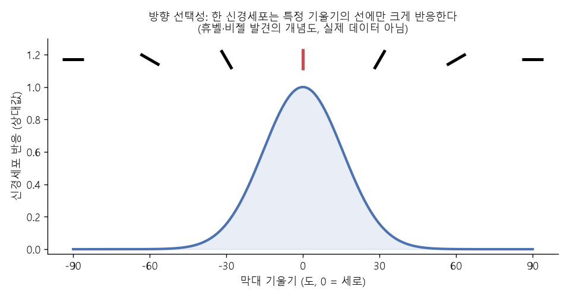
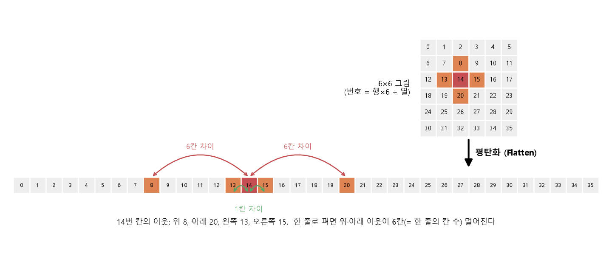
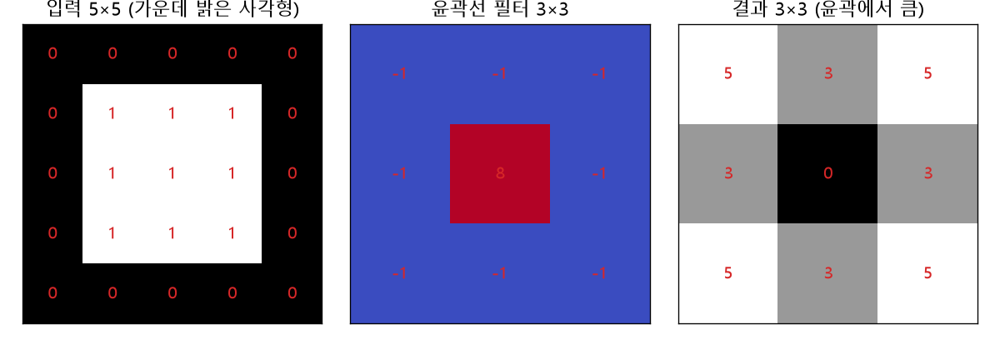
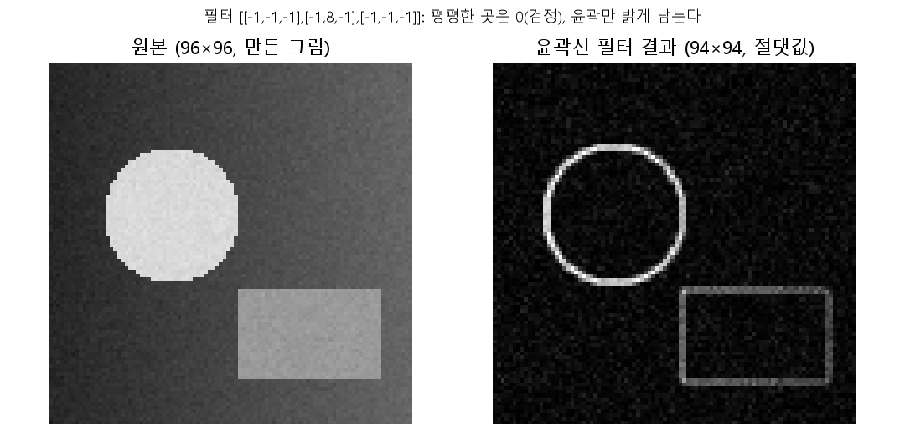
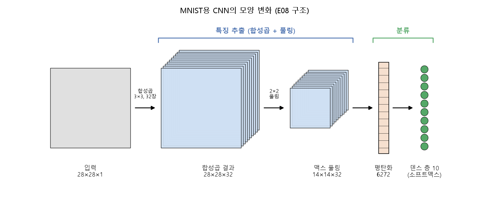

# CNN이 필요한 이유 (CNN 개요)

[목차로 돌아가기](../00_%EB%94%A5%EB%9F%AC%EB%8B%9D%EC%88%98%ED%95%99_MOC.md) · 예제: `02_CNN/CNN_EX_01.ipynb` · 코드 풀이: [E08_CNN_1Conv_MNIST_예제](../03_%EC%98%88%EC%A0%9C%ED%92%80%EC%9D%B4/E08_CNN_1Conv_MNIST_%EC%98%88%EC%A0%9C.md) · 이어서: [D07_합성곱과_풀링](../01_%EA%B0%9C%EB%85%90%EB%85%B8%ED%8A%B8/D07_%ED%95%A9%EC%84%B1%EA%B3%B1%EA%B3%BC_%ED%92%80%EB%A7%81.md)

> [!NOTE]
> **3줄 요약**
> - [CNN](../00_%EB%94%A5%EB%9F%AC%EB%8B%9D_%EC%9A%A9%EC%96%B4%EC%82%AC%EC%A0%84.md#cnn-convolutional-neural-network-%ED%95%A9%EC%84%B1%EA%B3%B1-%EC%8B%A0%EA%B2%BD%EB%A7%9D)([합성곱](../00_%EB%94%A5%EB%9F%AC%EB%8B%9D_%EC%9A%A9%EC%96%B4%EC%82%AC%EC%A0%84.md#convolution-%ED%95%A9%EC%84%B1%EA%B3%B1) 신경망)은 **특징을 뽑는 앞부분**([합성곱](../00_%EB%94%A5%EB%9F%AC%EB%8B%9D_%EC%9A%A9%EC%96%B4%EC%82%AC%EC%A0%84.md#convolution-%ED%95%A9%EC%84%B1%EA%B3%B1) + 풀링)과 **답을 고르는 뒷부분**([덴스 층](../00_%EB%94%A5%EB%9F%AC%EB%8B%9D_%EC%9A%A9%EC%96%B4%EC%82%AC%EC%A0%84.md#dense-layer-%EB%8D%B4%EC%8A%A4-%EC%B8%B5))을 이어 붙인 모양이다.
> - 그림을 한 줄로 펴면([평탄화](../00_%EB%94%A5%EB%9F%AC%EB%8B%9D_%EC%9A%A9%EC%96%B4%EC%82%AC%EC%A0%84.md#flatten-%ED%8F%89%ED%83%84%ED%99%94)) "누가 누구 옆인지"를 알 수 없고, [덴스 층](../00_%EB%94%A5%EB%9F%AC%EB%8B%9D_%EC%9A%A9%EC%96%B4%EC%82%AC%EC%A0%84.md#dense-layer-%EB%8D%B4%EC%8A%A4-%EC%B8%B5)은 [파라미터](../00_%EB%94%A5%EB%9F%AC%EB%8B%9D_%EC%9A%A9%EC%96%B4%EC%82%AC%EC%A0%84.md#parameter-%ED%8C%8C%EB%9D%BC%EB%AF%B8%ED%84%B0)도 너무 많이 든다. 28×28을 128칸으로 잇는 [덴스 층](../00_%EB%94%A5%EB%9F%AC%EB%8B%9D_%EC%9A%A9%EC%96%B4%EC%82%AC%EC%A0%84.md#dense-layer-%EB%8D%B4%EC%8A%A4-%EC%B8%B5)은 **100,480개**, 3×3 [필터](../00_%EB%94%A5%EB%9F%AC%EB%8B%9D_%EC%9A%A9%EC%96%B4%EC%82%AC%EC%A0%84.md#filter-%ED%95%84%ED%84%B0) 32개짜리 [합성곱](../00_%EB%94%A5%EB%9F%AC%EB%8B%9D_%EC%9A%A9%EC%96%B4%EC%82%AC%EC%A0%84.md#convolution-%ED%95%A9%EC%84%B1%EA%B3%B1)은 **320개**다.
> - 가장자리용 [필터](../00_%EB%94%A5%EB%9F%AC%EB%8B%9D_%EC%9A%A9%EC%96%B4%EC%82%AC%EC%A0%84.md#filter-%ED%95%84%ED%84%B0) `[[-1,-1,-1],[-1,8,-1],[-1,-1,-1]]`을 5×5 그림에 대면 평평한 곳은 **0**, 테두리 쪽은 **5나 3**이 나온다.

## 1. 개념 설명

고양이 뇌를 조사한 휴벨과 비젤의 실험(1959·1962년)에서, 시각을 맡은 신경세포는 시야의 **좁은 구역** 안에서 **특정 방향의 선**이 보일 때만 반응했다. [CNN](../00_%EB%94%A5%EB%9F%AC%EB%8B%9D_%EC%9A%A9%EC%96%B4%EC%82%AC%EC%A0%84.md#cnn-convolutional-neural-network-%ED%95%A9%EC%84%B1%EA%B3%B1-%EC%8B%A0%EA%B2%BD%EB%A7%9D)은 이 발상을 빌렸다. 그림 전체를 한꺼번에 보지 않고, 작은 구역을 보고 거기서 선·모서리를 찾는 부품을 앞에 둔다.



> 비유: 우표만 한 구멍이 뚫린 종이를 사진 위에 올리고 한 칸씩 옮기며 "이 구멍 안에 세로선이 있나?"를 적는다. 구멍 안만 보니 이웃한 칸의 관계는 자연히 남는다.

정확히 말하면, [CNN](../00_%EB%94%A5%EB%9F%AC%EB%8B%9D_%EC%9A%A9%EC%96%B4%EC%82%AC%EC%A0%84.md#cnn-convolutional-neural-network-%ED%95%A9%EC%84%B1%EA%B3%B1-%EC%8B%A0%EA%B2%BD%EB%A7%9D)(Convolutional Neural Network, [합성곱](../00_%EB%94%A5%EB%9F%AC%EB%8B%9D_%EC%9A%A9%EC%96%B4%EC%82%AC%EC%A0%84.md#convolution-%ED%95%A9%EC%84%B1%EA%B3%B1) 신경망)은 두 부분으로 이루어진 [다층 신경망](../01_%EA%B0%9C%EB%85%90%EB%85%B8%ED%8A%B8/D11_%EB%8B%A4%EC%B8%B5%ED%8D%BC%EC%85%89%ED%8A%B8%EB%A1%A0%EA%B3%BC_XOR.md)의 한 종류다.

- **특징 추출 부분**: [합성곱](../00_%EB%94%A5%EB%9F%AC%EB%8B%9D_%EC%9A%A9%EC%96%B4%EC%82%AC%EC%A0%84.md#convolution-%ED%95%A9%EC%84%B1%EA%B3%B1) → ([활성화 함수](../00_%EB%94%A5%EB%9F%AC%EB%8B%9D_%EC%9A%A9%EC%96%B4%EC%82%AC%EC%A0%84.md#activation-function-%ED%99%9C%EC%84%B1%ED%99%94-%ED%95%A8%EC%88%98)) → [서브샘플링](../00_%EB%94%A5%EB%9F%AC%EB%8B%9D_%EC%9A%A9%EC%96%B4%EC%82%AC%EC%A0%84.md#subsampling-%EC%84%9C%EB%B8%8C%EC%83%98%ED%94%8C%EB%A7%81)([맥스 풀링](../00_%EB%94%A5%EB%9F%AC%EB%8B%9D_%EC%9A%A9%EC%96%B4%EC%82%AC%EC%A0%84.md#max-pooling-%EB%A7%A5%EC%8A%A4-%ED%92%80%EB%A7%81)으로 크기 줄이기)을 여러 번 반복한다. 결과물은 선·모서리·모양을 표시한 **[특징 맵](../00_%EB%94%A5%EB%9F%AC%EB%8B%9D_%EC%9A%A9%EC%96%B4%EC%82%AC%EC%A0%84.md#feature-map-%ED%8A%B9%EC%A7%95-%EB%A7%B5)** 묶음이다.
- **[분류](../00_%EB%94%A5%EB%9F%AC%EB%8B%9D_%EC%9A%A9%EC%96%B4%EC%82%AC%EC%A0%84.md#regression-classification-%ED%9A%8C%EA%B7%80%EC%99%80-%EB%B6%84%EB%A5%98) 부분**: [특징 맵](../00_%EB%94%A5%EB%9F%AC%EB%8B%9D_%EC%9A%A9%EC%96%B4%EC%82%AC%EC%A0%84.md#feature-map-%ED%8A%B9%EC%A7%95-%EB%A7%B5)을 [평탄화](../00_%EB%94%A5%EB%9F%AC%EB%8B%9D_%EC%9A%A9%EC%96%B4%EC%82%AC%EC%A0%84.md#flatten-%ED%8F%89%ED%83%84%ED%99%94)([Flatten](../00_%EB%94%A5%EB%9F%AC%EB%8B%9D_%EC%9A%A9%EC%96%B4%EC%82%AC%EC%A0%84.md#flatten-%ED%8F%89%ED%83%84%ED%99%94))해 한 줄로 만든 뒤 [덴스 층](../00_%EB%94%A5%EB%9F%AC%EB%8B%9D_%EC%9A%A9%EC%96%B4%EC%82%AC%EC%A0%84.md#dense-layer-%EB%8D%B4%EC%8A%A4-%EC%B8%B5)으로 등급을 고른다([D06_이미지분류와_MNIST](../01_%EA%B0%9C%EB%85%90%EB%85%B8%ED%8A%B8/D06_%EC%9D%B4%EB%AF%B8%EC%A7%80%EB%B6%84%EB%A5%98%EC%99%80_MNIST.md)의 뒷부분과 같다).

[합성곱](../00_%EB%94%A5%EB%9F%AC%EB%8B%9D_%EC%9A%A9%EC%96%B4%EC%82%AC%EC%A0%84.md#convolution-%ED%95%A9%EC%84%B1%EA%B3%B1)과 풀링의 자세한 계산은 [D07_합성곱과_풀링](../01_%EA%B0%9C%EB%85%90%EB%85%B8%ED%8A%B8/D07_%ED%95%A9%EC%84%B1%EA%B3%B1%EA%B3%BC_%ED%92%80%EB%A7%81.md)에 있다. 이 노트는 "왜 이런 구조가 필요한가"에 집중한다.

## 2. 필요한 이유

[D06_이미지분류와_MNIST](../01_%EA%B0%9C%EB%85%90%EB%85%B8%ED%8A%B8/D06_%EC%9D%B4%EB%AF%B8%EC%A7%80%EB%B6%84%EB%A5%98%EC%99%80_MNIST.md)는 28×28 그림을 평탄화해 784칸 한 줄로 만든 뒤 [덴스 층](../00_%EB%94%A5%EB%9F%AC%EB%8B%9D_%EC%9A%A9%EC%96%B4%EC%82%AC%EC%A0%84.md#dense-layer-%EB%8D%B4%EC%8A%A4-%EC%B8%B5)에 넣었다. 이 방법에는 문제가 두 가지 있다.

**문제 1. 이웃 관계가 사라진다.** 표의 칸 (행 r, 열 c)은 평탄화하면 `r × (한 줄의 칸 수) + c`번이 된다(0부터 센다). 3×3 표로 보면 이렇다.

```text
[[0 1 2]
 [3 4 5]       가운데 칸 4의 이웃: 위 1, 왼쪽 3, 오른쪽 5, 아래 7
 [6 7 8]]
```

왼쪽·오른쪽 이웃은 번호가 1 차이로 가깝지만, 위·아래 이웃은 3(= 한 줄의 칸 수) 차이로 멀어진다. 28×28이면 위·아래 이웃이 28칸 떨어진다. 그런데 [덴스 층](../00_%EB%94%A5%EB%9F%AC%EB%8B%9D_%EC%9A%A9%EC%96%B4%EC%82%AC%EC%A0%84.md#dense-layer-%EB%8D%B4%EC%8A%A4-%EC%B8%B5)은 번호가 가깝다는 것도, 멀다는 것도 모른다. 칸마다 [가중치](../00_%EB%94%A5%EB%9F%AC%EB%8B%9D_%EC%9A%A9%EC%96%B4%EC%82%AC%EC%A0%84.md#weight-%EA%B0%80%EC%A4%91%EC%B9%98)를 따로 가질 뿐이다. 그 증거로, 입력 칸과 [가중치](../00_%EB%94%A5%EB%9F%AC%EB%8B%9D_%EC%9A%A9%EC%96%B4%EC%82%AC%EC%A0%84.md#weight-%EA%B0%80%EC%A4%91%EC%B9%98)를 **같은 순서로 섞어도** 결과는 똑같다.

```python
import numpy as np
x = np.arange(9)                         # 입력 9칸: 0, 1, ..., 8
W = np.arange(1, 10)                     # 가중치 9개: 1, 2, ..., 9
p = np.array([4, 0, 7, 2, 8, 1, 5, 3, 6])   # 섞는 순서 (아무 순서나 가능)
print(x @ W, x[p] @ W[p])                # 원래 순서 vs 같은 순서로 섞은 것
```

```text
240 240
```

그림을 뒤죽박죽 섞어서 보여 줘도 [덴스 층](../00_%EB%94%A5%EB%9F%AC%EB%8B%9D_%EC%9A%A9%EC%96%B4%EC%82%AC%EC%A0%84.md#dense-layer-%EB%8D%B4%EC%8A%A4-%EC%B8%B5)은 ([가중치](../00_%EB%94%A5%EB%9F%AC%EB%8B%9D_%EC%9A%A9%EC%96%B4%EC%82%AC%EC%A0%84.md#weight-%EA%B0%80%EC%A4%91%EC%B9%98)만 같이 섞으면) 똑같이 푼다는 뜻이다. 사람은 "눈 옆에 눈썹이 있다" 같은 **옆 칸의 관계**로 그림을 알아보는데, [덴스 층](../00_%EB%94%A5%EB%9F%AC%EB%8B%9D_%EC%9A%A9%EC%96%B4%EC%82%AC%EC%A0%84.md#dense-layer-%EB%8D%B4%EC%8A%A4-%EC%B8%B5)은 이걸 처음부터 포기한 채 시작한다.



**문제 2. [파라미터](../00_%EB%94%A5%EB%9F%AC%EB%8B%9D_%EC%9A%A9%EC%96%B4%EC%82%AC%EC%A0%84.md#parameter-%ED%8C%8C%EB%9D%BC%EB%AF%B8%ED%84%B0)가 너무 많다.** 28×28 = 784칸을 128칸으로 잇는 [덴스 층](../00_%EB%94%A5%EB%9F%AC%EB%8B%9D_%EC%9A%A9%EC%96%B4%EC%82%AC%EC%A0%84.md#dense-layer-%EB%8D%B4%EC%8A%A4-%EC%B8%B5)은 [가중치](../00_%EB%94%A5%EB%9F%AC%EB%8B%9D_%EC%9A%A9%EC%96%B4%EC%82%AC%EC%A0%84.md#weight-%EA%B0%80%EC%A4%91%EC%B9%98) 784 × 128 = 100,352개에 [편향](../00_%EB%94%A5%EB%9F%AC%EB%8B%9D_%EC%9A%A9%EC%96%B4%EC%82%AC%EC%A0%84.md#bias-%ED%8E%B8%ED%96%A5) 128개를 더해 **100,480개**다. 그림이 커지면 더 폭발한다. 반면 3×3 [필터](../00_%EB%94%A5%EB%9F%AC%EB%8B%9D_%EC%9A%A9%EC%96%B4%EC%82%AC%EC%A0%84.md#filter-%ED%95%84%ED%84%B0) 32장을 쓰는 [합성곱](../00_%EB%94%A5%EB%9F%AC%EB%8B%9D_%EC%9A%A9%EC%96%B4%EC%82%AC%EC%A0%84.md#convolution-%ED%95%A9%EC%84%B1%EA%B3%B1)은 그림 크기와 상관없이 (9 + 1) × 32 = **320개**다. [필터](../00_%EB%94%A5%EB%9F%AC%EB%8B%9D_%EC%9A%A9%EC%96%B4%EC%82%AC%EC%A0%84.md#filter-%ED%95%84%ED%84%B0) 하나를 그림의 모든 위치에서 되풀이해 쓰기 때문이다.

[합성곱](../00_%EB%94%A5%EB%9F%AC%EB%8B%9D_%EC%9A%A9%EC%96%B4%EC%82%AC%EC%A0%84.md#convolution-%ED%95%A9%EC%84%B1%EA%B3%B1)은 이 두 문제를 한꺼번에 푼다. [필터](../00_%EB%94%A5%EB%9F%AC%EB%8B%9D_%EC%9A%A9%EC%96%B4%EC%82%AC%EC%A0%84.md#filter-%ED%95%84%ED%84%B0)가 3×3 이웃을 함께 보니 이웃 관계가 계산에 들어가고, 같은 [필터](../00_%EB%94%A5%EB%9F%AC%EB%8B%9D_%EC%9A%A9%EC%96%B4%EC%82%AC%EC%A0%84.md#filter-%ED%95%84%ED%84%B0)를 재사용하니 [파라미터](../00_%EB%94%A5%EB%9F%AC%EB%8B%9D_%EC%9A%A9%EC%96%B4%EC%82%AC%EC%A0%84.md#parameter-%ED%8C%8C%EB%9D%BC%EB%AF%B8%ED%84%B0)가 적다.

> [!NOTE]
> **무엇을 남기고 무엇을 버리나**
> 옷 사진으로 "셔츠인가 재킷인가"를 가리려면 옷 색이나 로고 무늬보다 **윤곽과 모양**이 중요하다. [합성곱](../00_%EB%94%A5%EB%9F%AC%EB%8B%9D_%EC%9A%A9%EC%96%B4%EC%82%AC%EC%A0%84.md#convolution-%ED%95%A9%EC%84%B1%EA%B3%B1) [필터](../00_%EB%94%A5%EB%9F%AC%EB%8B%9D_%EC%9A%A9%EC%96%B4%EC%82%AC%EC%A0%84.md#filter-%ED%95%84%ED%84%B0)는 이런 윤곽(밝기가 갑자기 바뀌는 곳)을 뽑아내고 평평한 부분은 0 근처로 지운다. 아래 4장에서 직접 확인한다.

## 3. 필요한 수학 개념

| 수학 개념 | 이 개념에서 쓰이는 곳 | 자세히 |
|---|---|---|
| 벡터와 행렬 | 그림 = 숫자 표, [필터](../00_%EB%94%A5%EB%9F%AC%EB%8B%9D_%EC%9A%A9%EC%96%B4%EC%82%AC%EC%A0%84.md#filter-%ED%95%84%ED%84%B0) = 작은 표, shape 읽기 | [M05_벡터와_행렬](../02_%EC%88%98%ED%95%99%EB%85%B8%ED%8A%B8/M05_%EB%B2%A1%ED%84%B0%EC%99%80_%ED%96%89%EB%A0%AC.md) |
| 시그마와 평균 | 겹친 9칸을 곱해 모두 더하기(Σ) | [M02_시그마와_평균](../02_%EC%88%98%ED%95%99%EB%85%B8%ED%8A%B8/M02_%EC%8B%9C%EA%B7%B8%EB%A7%88%EC%99%80_%ED%8F%89%EA%B7%A0.md) |
| 몫과 나머지 | [평탄화](../00_%EB%94%A5%EB%9F%AC%EB%8B%9D_%EC%9A%A9%EC%96%B4%EC%82%AC%EC%A0%84.md#flatten-%ED%8F%89%ED%83%84%ED%99%94) 번호 `r × W + c`, 번호에서 행·열 되찾기(`//`, `%`) | — |
| 곱셈으로 개수 세기 | [파라미터](../00_%EB%94%A5%EB%9F%AC%EB%8B%9D_%EC%9A%A9%EC%96%B4%EC%82%AC%EC%A0%84.md#parameter-%ED%8C%8C%EB%9D%BC%EB%AF%B8%ED%84%B0) 수 `(3×3×입력 채널 + 1) × 필터 수` | — |

<details><summary>미니 복습: Σ (시그마)</summary>

Σ는 "뒤에 오는 것을 전부 더하라"는 기호다. [필터](../00_%EB%94%A5%EB%9F%AC%EB%8B%9D_%EC%9A%A9%EC%96%B4%EC%82%AC%EC%A0%84.md#filter-%ED%95%84%ED%84%B0)와 그림 조각의 9칸에서 같은 자리끼리 곱한 값 9개를 더하는 계산을 Σ로 쓴다. 예를 들어 곱이 `[1, 0, 2]`이면 합은 1 + 0 + 2 = 3이다. 자세히: [M02_시그마와_평균](../02_%EC%88%98%ED%95%99%EB%85%B8%ED%8A%B8/M02_%EC%8B%9C%EA%B7%B8%EB%A7%88%EC%99%80_%ED%8F%89%EA%B7%A0.md)

</details>

<details><summary>미니 복습: 번호 계산 <code>r × W + c</code></summary>

한 줄에 W칸이 있는 표에서 r번째 줄(0부터)의 c번째 칸은 앞의 r줄(r × W칸)을 지난 뒤 c칸을 더 간 곳이다. W = 3이면 (1, 2)번 칸은 1 × 3 + 2 = 5번이다. 거꾸로 번호 5에서 줄은 `5 // 3 = 1`, 칸은 `5 % 3 = 2`다.

</details>

## 4. 계산 과정 (숫자 → 식 → 코드)

### 숫자

**① 가장자리 [필터](../00_%EB%94%A5%EB%9F%AC%EB%8B%9D_%EC%9A%A9%EC%96%B4%EC%82%AC%EC%A0%84.md#filter-%ED%95%84%ED%84%B0)를 손으로 대 보기.** 5×5 그림에 밝은 3×3 사각형(값 1)이 가운데 있고 나머지는 어두운 곳(값 0)이다. [필터](../00_%EB%94%A5%EB%9F%AC%EB%8B%9D_%EC%9A%A9%EC%96%B4%EC%82%AC%EC%A0%84.md#filter-%ED%95%84%ED%84%B0)는 가운데가 8이고 나머지 8칸이 -1이다. [필터](../00_%EB%94%A5%EB%9F%AC%EB%8B%9D_%EC%9A%A9%EC%96%B4%EC%82%AC%EC%A0%84.md#filter-%ED%95%84%ED%84%B0) 9칸의 합은 8 - 8 = 0이라, 그림이 전부 같은 값이면 결과가 0이 된다.

```text
그림 (5×5)         필터 (3×3)
0 0 0 0 0          -1 -1 -1
0 1 1 1 0          -1  8 -1
0 1 1 1 0          -1 -1 -1
0 1 1 1 0
0 0 0 0 0
```

- **평평한 자리** (사각형 한가운데, 결과 (1, 1)): 그림 조각이 9칸 모두 1이다.
  - 가운데 칸: 8 × 1 = 8
  - 둘레 8칸: (-1) × 1을 8번 더함 = -8
  - 합: 8 + (-8) = **0**
- **가장자리 자리** (결과 (0, 0), 그림의 0~2행·0~2열 조각 `[[0,0,0],[0,1,1],[0,1,1]]`): 
  - 가운데 칸 값은 1이므로 8 × 1 = 8
  - 둘레 8칸 중 1인 칸이 3개 → (-1) × 3 = -3
  - 합: 8 + (-3) = **5**
- **변의 가운데 자리** (결과 (0, 1), 조각 `[[0,0,0],[1,1,1],[1,1,1]]`): 가운데 8 × 1 = 8, 둘레의 1이 5개라서 -5, 합은 **3**이다.

사각형 한가운데는 0으로 지워지고, 윤곽 근처는 0이 아닌 값이 남는다. 이 값들을 모은 표가 [특징 맵](../00_%EB%94%A5%EB%9F%AC%EB%8B%9D_%EC%9A%A9%EC%96%B4%EC%82%AC%EC%A0%84.md#feature-map-%ED%8A%B9%EC%A7%95-%EB%A7%B5)이다.

**② [평탄화](../00_%EB%94%A5%EB%9F%AC%EB%8B%9D_%EC%9A%A9%EC%96%B4%EC%82%AC%EC%A0%84.md#flatten-%ED%8F%89%ED%83%84%ED%99%94) 번호 세기.** 위 3×3 표의 (1, 1)칸은 1 × 3 + 1 = 4번이고, 위 이웃 (0, 1)은 0 × 3 + 1 = 1번, 아래 이웃 (2, 1)은 2 × 3 + 1 = 7번이다. 이웃인데 번호는 3 차이다.

**③ [파라미터](../00_%EB%94%A5%EB%9F%AC%EB%8B%9D_%EC%9A%A9%EC%96%B4%EC%82%AC%EC%A0%84.md#parameter-%ED%8C%8C%EB%9D%BC%EB%AF%B8%ED%84%B0) 세기.**

| 방식 | 계산 | 개수 |
|---|---|---|
| [덴스 층](../00_%EB%94%A5%EB%9F%AC%EB%8B%9D_%EC%9A%A9%EC%96%B4%EC%82%AC%EC%A0%84.md#dense-layer-%EB%8D%B4%EC%8A%A4-%EC%B8%B5) (784 → 128) | 784 × 128 + 128 | 100,480 |
| [합성곱](../00_%EB%94%A5%EB%9F%AC%EB%8B%9D_%EC%9A%A9%EC%96%B4%EC%82%AC%EC%A0%84.md#convolution-%ED%95%A9%EC%84%B1%EA%B3%B1) (3×3, [필터](../00_%EB%94%A5%EB%9F%AC%EB%8B%9D_%EC%9A%A9%EC%96%B4%EC%82%AC%EC%A0%84.md#filter-%ED%95%84%ED%84%B0) 32장, 입력 [채널](../00_%EB%94%A5%EB%9F%AC%EB%8B%9D_%EC%9A%A9%EC%96%B4%EC%82%AC%EC%A0%84.md#channel-%EC%B1%84%EB%84%90) 1) | (3 × 3 × 1 + 1) × 32 | 320 |
| 비율 | 100,480 ÷ 320 | 314배 |





### 식

[필터](../00_%EB%94%A5%EB%9F%AC%EB%8B%9D_%EC%9A%A9%EC%96%B4%EC%82%AC%EC%A0%84.md#filter-%ED%95%84%ED%84%B0) K와 그림 I로 만든 [특징 맵](../00_%EB%94%A5%EB%9F%AC%EB%8B%9D_%EC%9A%A9%EC%96%B4%EC%82%AC%EC%A0%84.md#feature-map-%ED%8A%B9%EC%A7%95-%EB%A7%B5)의 한 칸은 같은 자리끼리 곱해서 모두 더한 값이다. [평탄화](../00_%EB%94%A5%EB%9F%AC%EB%8B%9D_%EC%9A%A9%EC%96%B4%EC%82%AC%EC%A0%84.md#flatten-%ED%8F%89%ED%83%84%ED%99%94) 번호와 [파라미터](../00_%EB%94%A5%EB%9F%AC%EB%8B%9D_%EC%9A%A9%EC%96%B4%EC%82%AC%EC%A0%84.md#parameter-%ED%8C%8C%EB%9D%BC%EB%AF%B8%ED%84%B0) 수도 식으로 쓴다.

$$\text{출력}(i, j) = \sum_{p=0}^{2}\sum_{q=0}^{2} K(p, q) \times I(i + p,\; j + q)$$

$$\text{번호} = r \times W + c \qquad\qquad \text{Param \#} = (k \times k \times C_{\text{입력}} + 1) \times C_{\text{출력}}$$

<details><summary>기호 풀이</summary>

| 기호 | 읽는 법 | 뜻 | 예제 값 |
| --- | --- | --- | --- |
| $K(p, q)$ | 케이 | [필터](../00_%EB%94%A5%EB%9F%AC%EB%8B%9D_%EC%9A%A9%EC%96%B4%EC%82%AC%EC%A0%84.md#filter-%ED%95%84%ED%84%B0)의 p행 q열 값 | 가운데 $K(1,1) = 8$ |
| $I(i+p,\; j+q)$ | 아이 | 그림에서 [필터](../00_%EB%94%A5%EB%9F%AC%EB%8B%9D_%EC%9A%A9%EC%96%B4%EC%82%AC%EC%A0%84.md#filter-%ED%95%84%ED%84%B0)와 겹친 칸 | 결과 (0, 0)이면 0~2행·0~2열 |
| $(i, j)$ | 아이, 제이 | [특징 맵](../00_%EB%94%A5%EB%9F%AC%EB%8B%9D_%EC%9A%A9%EC%96%B4%EC%82%AC%EC%A0%84.md#feature-map-%ED%8A%B9%EC%A7%95-%EB%A7%B5)의 행·열 | 0~2 (5×5 그림, 3×3 [필터](../00_%EB%94%A5%EB%9F%AC%EB%8B%9D_%EC%9A%A9%EC%96%B4%EC%82%AC%EC%A0%84.md#filter-%ED%95%84%ED%84%B0)) |
| $r,\ c$ | 알, 씨 | 그림 칸의 행·열 | (1, 1) |
| $W$ | 더블유 | 그림 한 줄의 칸 수(가로 크기) | 3 (표), 28 ([MNIST](../00_%EB%94%A5%EB%9F%AC%EB%8B%9D_%EC%9A%A9%EC%96%B4%EC%82%AC%EC%A0%84.md#mnist-%EC%86%90%EA%B8%80%EC%94%A8-%EC%88%AB%EC%9E%90-%EB%8D%B0%EC%9D%B4%ED%84%B0%EC%85%8B)) |
| $k,\ C_{\text{입력}},\ C_{\text{출력}}$ | 케이, 씨 입력, 씨 출력 | [필터](../00_%EB%94%A5%EB%9F%AC%EB%8B%9D_%EC%9A%A9%EC%96%B4%EC%82%AC%EC%A0%84.md#filter-%ED%95%84%ED%84%B0) 한 변, 입력 [채널](../00_%EB%94%A5%EB%9F%AC%EB%8B%9D_%EC%9A%A9%EC%96%B4%EC%82%AC%EC%A0%84.md#channel-%EC%B1%84%EB%84%90) 수, [필터](../00_%EB%94%A5%EB%9F%AC%EB%8B%9D_%EC%9A%A9%EC%96%B4%EC%82%AC%EC%A0%84.md#filter-%ED%95%84%ED%84%B0) 수 | 3, 1, 32 |

</details>

### 코드

**가장자리 [필터](../00_%EB%94%A5%EB%9F%AC%EB%8B%9D_%EC%9A%A9%EC%96%B4%EC%82%AC%EC%A0%84.md#filter-%ED%95%84%ED%84%B0)**를 5×5 그림에 모든 위치에서 대고([패딩](../00_%EB%94%A5%EB%9F%AC%EB%8B%9D_%EC%9A%A9%EC%96%B4%EC%82%AC%EC%A0%84.md#padding-%ED%8C%A8%EB%94%A9) 없이), 3×3 [특징 맵](../00_%EB%94%A5%EB%9F%AC%EB%8B%9D_%EC%9A%A9%EC%96%B4%EC%82%AC%EC%A0%84.md#feature-map-%ED%8A%B9%EC%A7%95-%EB%A7%B5)을 만든다. 식과 코드 줄이 이렇게 짝지어진다.

| 식 | 코드 |
|---|---|
| $I$ (밝은 사각형 그림) | `img[1:4, 1:4] = 1` |
| $K$ (가장자리 [필터](../00_%EB%94%A5%EB%9F%AC%EB%8B%9D_%EC%9A%A9%EC%96%B4%EC%82%AC%EC%A0%84.md#filter-%ED%95%84%ED%84%B0)) | `K = np.array(...)` |
| $\sum\sum K \times I$ | `np.sum(img[i:i+3, j:j+3] * K)` |

```python
import numpy as np
img = np.zeros((5, 5), dtype=int)       # 5×5 어두운 그림
img[1:4, 1:4] = 1                       # 가운데 3×3을 밝게 (1:4 = 1, 2, 3행)
K = np.array([[-1, -1, -1],
              [-1,  8, -1],
              [-1, -1, -1]])            # 가장자리 필터
out = np.array([[np.sum(img[i:i+3, j:j+3] * K)   # (i,j)에서 3×3 조각을 잘라 필터와 곱해 더함
                 for j in range(3)]              # 가로 위치 3곳 (5 - 3 + 1)
                for i in range(3)])              # 세로 위치 3곳
print(img)
print("kernel sum:", K.sum())           # 필터 9칸의 합 = 0
print(out)
```

**실행 결과**:

```text
[[0 0 0 0 0]
 [0 1 1 1 0]
 [0 1 1 1 0]
 [0 1 1 1 0]
 [0 0 0 0 0]]
kernel sum: 0
[[5 3 5]
 [3 0 3]
 [5 3 5]]
```

손계산과 같다. 가운데 (1, 1)은 0, (0, 0)은 5, (0, 1)은 3이다. 네 모서리 자리는 5, 변의 가운데 자리는 3이고, 사각형 안쪽은 0이다.

**[MNIST](../00_%EB%94%A5%EB%9F%AC%EB%8B%9D_%EC%9A%A9%EC%96%B4%EC%82%AC%EC%A0%84.md#mnist-%EC%86%90%EA%B8%80%EC%94%A8-%EC%88%AB%EC%9E%90-%EB%8D%B0%EC%9D%B4%ED%84%B0%EC%85%8B)용 [CNN](../00_%EB%94%A5%EB%9F%AC%EB%8B%9D_%EC%9A%A9%EC%96%B4%EC%82%AC%EC%A0%84.md#cnn-convolutional-neural-network-%ED%95%A9%EC%84%B1%EA%B3%B1-%EC%8B%A0%EA%B2%BD%EB%A7%9D)의 모양 따라가기** ([E08_CNN_1Conv_MNIST_예제](../03_%EC%98%88%EC%A0%9C%ED%92%80%EC%9D%B4/E08_CNN_1Conv_MNIST_%EC%98%88%EC%A0%9C.md)와 같은 구조). 각 [층](../00_%EB%94%A5%EB%9F%AC%EB%8B%9D_%EC%9A%A9%EC%96%B4%EC%82%AC%EC%A0%84.md#layer-%EC%B8%B5)을 지날 때 크기가 어떻게 바뀌는지 계산만 해 본다.

| [층](../00_%EB%94%A5%EB%9F%AC%EB%8B%9D_%EC%9A%A9%EC%96%B4%EC%82%AC%EC%A0%84.md#layer-%EC%B8%B5)                           | 하는 일                                         | 출력 모양    | 계산                   | [파라미터](../00_%EB%94%A5%EB%9F%AC%EB%8B%9D_%EC%9A%A9%EC%96%B4%EC%82%AC%EC%A0%84.md#parameter-%ED%8C%8C%EB%9D%BC%EB%AF%B8%ED%84%B0) |
| ------------------------------------------------------ | -------------------------------------------- | -------- | -------------------- | -------------------------------------- |
| 입력                                                     | 흑백 그림                                        | 28×28×1  |                      | 0                                      |
| [Conv2D](../00_%EB%94%A5%EB%9F%AC%EB%8B%9D_%EC%9A%A9%EC%96%B4%EC%82%AC%EC%A0%84.md#conv2d-2%EC%B0%A8%EC%9B%90-%ED%95%A9%EC%84%B1%EA%B3%B1-%EC%B8%B5) ([필터](../00_%EB%94%A5%EB%9F%AC%EB%8B%9D_%EC%9A%A9%EC%96%B4%EC%82%AC%EC%A0%84.md#filter-%ED%95%84%ED%84%B0) 32, 3×3, same) | [특징 맵](../00_%EB%94%A5%EB%9F%AC%EB%8B%9D_%EC%9A%A9%EC%96%B4%EC%82%AC%EC%A0%84.md#feature-map-%ED%8A%B9%EC%A7%95-%EB%A7%B5) 32장 | 28×28×32 | (3 × 3 × 1 + 1) × 32 | 320                                    |
| [MaxPool2D](../00_%EB%94%A5%EB%9F%AC%EB%8B%9D_%EC%9A%A9%EC%96%B4%EC%82%AC%EC%A0%84.md#maxpool2d-%EB%A7%A5%EC%8A%A4-%ED%92%80%EB%A7%81-%EC%B8%B5) (2×2)                                        | 크기 절반                                        | 14×14×32 | 28 // 2 = 14         | 0                                      |
| [Flatten](../00_%EB%94%A5%EB%9F%AC%EB%8B%9D_%EC%9A%A9%EC%96%B4%EC%82%AC%EC%A0%84.md#flatten-%ED%8F%89%ED%83%84%ED%99%94)                 | 한 줄로 펴기                                      | 6272     | 14 × 14 × 32         | 0                                      |
| Dense (10, [소프트맥스](../00_%EB%94%A5%EB%9F%AC%EB%8B%9D_%EC%9A%A9%EC%96%B4%EC%82%AC%EC%A0%84.md#softmax-%EC%86%8C%ED%94%84%ED%8A%B8%EB%A7%A5%EC%8A%A4))     | 10등급 [확률](../00_%EB%94%A5%EB%9F%AC%EB%8B%9D_%EC%9A%A9%EC%96%B4%EC%82%AC%EC%A0%84.md#probability-%ED%99%95%EB%A5%A0)    | 10       | 6272 × 10 + 10       | 62,730                                 |
| 합계                                                     |                                              |          | 320 + 62,730         | 63,050                                 |

[Conv2D](../00_%EB%94%A5%EB%9F%AC%EB%8B%9D_%EC%9A%A9%EC%96%B4%EC%82%AC%EC%A0%84.md#conv2d-2%EC%B0%A8%EC%9B%90-%ED%95%A9%EC%84%B1%EA%B3%B1-%EC%B8%B5)와 [MaxPool2D](../00_%EB%94%A5%EB%9F%AC%EB%8B%9D_%EC%9A%A9%EC%96%B4%EC%82%AC%EC%A0%84.md#maxpool2d-%EB%A7%A5%EC%8A%A4-%ED%92%80%EB%A7%81-%EC%B8%B5)가 특징 추출 부분이고, [Flatten](../00_%EB%94%A5%EB%9F%AC%EB%8B%9D_%EC%9A%A9%EC%96%B4%EC%82%AC%EC%A0%84.md#flatten-%ED%8F%89%ED%83%84%ED%99%94)부터 Dense까지가 [분류](../00_%EB%94%A5%EB%9F%AC%EB%8B%9D_%EC%9A%A9%EC%96%B4%EC%82%AC%EC%A0%84.md#regression-classification-%ED%9A%8C%EA%B7%80%EC%99%80-%EB%B6%84%EB%A5%98) 부분이다.



```python
h = w = 28; c = 1                        # 입력 28×28×1
n_filters = 32
conv_params = (3 * 3 * c + 1) * n_filters   # 합성곱 파라미터: (9 + 1) × 32
c = n_filters                            # same 패딩이라 28×28 그대로, 채널만 32장
print("conv", (h, w, c), conv_params)
h, w = h // 2, w // 2                    # 맥스 풀링 2×2: 가로·세로 절반
print("pool", (h, w, c), 0)
flat = h * w * c                         # 평탄화: 모든 칸을 한 줄로
print("flatten", flat, 0)
dense_params = flat * 10 + 10            # 덴스 층: 가중치 6272×10 + 편향 10
print("dense", 10, dense_params)
print("total", conv_params + dense_params)
```

```text
conv (28, 28, 32) 320
pool (14, 14, 32) 0
flatten 6272 0
dense 10 62730
total 63050
```

> [!WARNING]
> **⚠ 주의**
> - 가장자리 [필터](../00_%EB%94%A5%EB%9F%AC%EB%8B%9D_%EC%9A%A9%EC%96%B4%EC%82%AC%EC%A0%84.md#filter-%ED%95%84%ED%84%B0)는 **[필터](../00_%EB%94%A5%EB%9F%AC%EB%8B%9D_%EC%9A%A9%EC%96%B4%EC%82%AC%EC%A0%84.md#filter-%ED%95%84%ED%84%B0) 9칸의 합이 0**이라 평평한 곳을 0으로 만든다. [학습](../00_%EB%94%A5%EB%9F%AC%EB%8B%9D_%EC%9A%A9%EC%96%B4%EC%82%AC%EC%A0%84.md#training-%ED%95%99%EC%8A%B5)으로 얻는 [필터](../00_%EB%94%A5%EB%9F%AC%EB%8B%9D_%EC%9A%A9%EC%96%B4%EC%82%AC%EC%A0%84.md#filter-%ED%95%84%ED%84%B0)는 이렇게 사람이 정한 값이 아니라 데이터에서 배운 값이다. 가장자리 [필터](../00_%EB%94%A5%EB%9F%AC%EB%8B%9D_%EC%9A%A9%EC%96%B4%EC%82%AC%EC%A0%84.md#filter-%ED%95%84%ED%84%B0)는 "[합성곱](../00_%EB%94%A5%EB%9F%AC%EB%8B%9D_%EC%9A%A9%EC%96%B4%EC%82%AC%EC%A0%84.md#convolution-%ED%95%A9%EC%84%B1%EA%B3%B1)이 무엇을 하는지" 보여 주는 예일 뿐이다.
> - 위 코드는 [패딩](../00_%EB%94%A5%EB%9F%AC%EB%8B%9D_%EC%9A%A9%EC%96%B4%EC%82%AC%EC%A0%84.md#padding-%ED%8C%A8%EB%94%A9) 없이(`valid`) 5×5를 3×3으로 줄였다. E08의 `padding='same'`은 테두리에 0을 둘러서 28×28을 그대로 유지한다([D07_합성곱과_풀링](../01_%EA%B0%9C%EB%85%90%EB%85%B8%ED%8A%B8/D07_%ED%95%A9%EC%84%B1%EA%B3%B1%EA%B3%BC_%ED%92%80%EB%A7%81.md) 참고).
> - [맥스 풀링](../00_%EB%94%A5%EB%9F%AC%EB%8B%9D_%EC%9A%A9%EC%96%B4%EC%82%AC%EC%A0%84.md#max-pooling-%EB%A7%A5%EC%8A%A4-%ED%92%80%EB%A7%81)은 크기를 줄이는 대신 "정확히 어느 칸이었는지"라는 위치 정보를 조금 잃는다.

## 5. 개념 재확인

<details><summary>1. 28×28 그림의 (5, 7)칸을 평탄화하면 몇 번이고, 오른쪽·아래 이웃은 각각 몇 번인가?</summary>

| 단계 | 하는 일 | 코드 | 계산 | 결과 |
|---|---|---|---|---|
| 1 | 칸 번호 | `idx = r * W + c` | 5 × 28 + 7 | 147 |
| 2 | 오른쪽 이웃 번호 | `r * W + (c + 1)` | 5 × 28 + 8 | 148 |
| 3 | 아래 이웃 번호 | `(r + 1) * W + c` | 6 × 28 + 7 | 175 |
| 4 | 번호 차이 비교 | `below - idx` | 175 - 147 | 28 |

**① 쓰는 코드**
```python
import numpy as np
W = 28                                    # ① 한 줄의 칸 수
r, c = 5, 7                               # ① 칸의 행·열 (0부터 센다)
idx = r * W + c                           # ② 평탄화한 번호
right = r * W + (c + 1)                   # ③ 오른쪽 이웃 번호
below = (r + 1) * W + c                   # ④ 아래 이웃 번호
print(idx, right, below, below - idx)     # ④ 147 148 175 28
flat = np.arange(784).reshape(28, 28)     # ⑤ 확인용: 번호표를 28×28로 접기
print(flat[5, 7])                         # ⑤ (5, 7)칸의 번호 → 147
```

**② 칸 번호** (`r * W + c`)
- 앞의 5줄: 5 × 28 = 140칸
- 그 줄에서 7칸 더: 140 + 7 = 147

**③ 오른쪽 이웃** (`r * W + (c + 1)`)
- 같은 줄의 다음 칸: 140 + 8 = 148 (번호 차이 1)

**④ 아래 이웃** (`(r + 1) * W + c`)
- 앞의 6줄: 6 × 28 = 168칸, 7칸 더: 168 + 7 = 175
- 175 - 147 = 28 (번호 차이 = 한 줄의 칸 수)

**⑤ 확인** (`np.arange(784).reshape(28, 28)[5, 7]`)
- 0~783 번호를 28×28로 접었을 때 (5, 7)칸의 값이 147이다.

**답**: 번호 **147**, 오른쪽 이웃 **148**, 아래 이웃 **175** (아래 이웃은 28칸 떨어짐)

</details>

<details><summary>2. 13×13 컬러 그림(채널 3)을 덴스 층 10칸에 이으면 파라미터는? 3×3 필터 8장짜리 합성곱은?</summary>

| 단계 | 하는 일 | 코드 | 계산 | 결과 |
|---|---|---|---|---|
| 1 | 평탄화한 칸 수 | `H * W * C` | 13 × 13 × 3 | 507 |
| 2 | [덴스 층](../00_%EB%94%A5%EB%9F%AC%EB%8B%9D_%EC%9A%A9%EC%96%B4%EC%82%AC%EC%A0%84.md#dense-layer-%EB%8D%B4%EC%8A%A4-%EC%B8%B5) [파라미터](../00_%EB%94%A5%EB%9F%AC%EB%8B%9D_%EC%9A%A9%EC%96%B4%EC%82%AC%EC%A0%84.md#parameter-%ED%8C%8C%EB%9D%BC%EB%AF%B8%ED%84%B0) | `flat * 10 + 10` | 507 × 10 + 10 | 5,080 |
| 3 | [필터](../00_%EB%94%A5%EB%9F%AC%EB%8B%9D_%EC%9A%A9%EC%96%B4%EC%82%AC%EC%A0%84.md#filter-%ED%95%84%ED%84%B0) 한 장의 [가중치](../00_%EB%94%A5%EB%9F%AC%EB%8B%9D_%EC%9A%A9%EC%96%B4%EC%82%AC%EC%A0%84.md#weight-%EA%B0%80%EC%A4%91%EC%B9%98) | `3 * 3 * C` | 3 × 3 × 3 | 27 |
| 4 | [합성곱](../00_%EB%94%A5%EB%9F%AC%EB%8B%9D_%EC%9A%A9%EC%96%B4%EC%82%AC%EC%A0%84.md#convolution-%ED%95%A9%EC%84%B1%EA%B3%B1) [파라미터](../00_%EB%94%A5%EB%9F%AC%EB%8B%9D_%EC%9A%A9%EC%96%B4%EC%82%AC%EC%A0%84.md#parameter-%ED%8C%8C%EB%9D%BC%EB%AF%B8%ED%84%B0) | `(27 + 1) * 8` | 28 × 8 | 224 |

**① 쓰는 코드**
```python
H, W, C = 13, 13, 3                       # ① 그림 크기와 채널 수
flat = H * W * C                          # ② 평탄화한 칸 수
dense = flat * 10 + 10                    # ③ 덴스 층 파라미터 (가중치 + 편향 10개)
k_weights = 3 * 3 * C                     # ④ 필터 한 장의 가중치
conv = (k_weights + 1) * 8                # ⑤ 합성곱 파라미터 (필터마다 편향 1개씩)
print(flat, dense, k_weights, conv)       # ⑤ 507 5080 27 224
```

**② 평탄화한 칸 수** (`H * W * C`)
- 13 × 13 = 169칸이 3겹
- 169 × 3 = 507

**③ [덴스 층](../00_%EB%94%A5%EB%9F%AC%EB%8B%9D_%EC%9A%A9%EC%96%B4%EC%82%AC%EC%A0%84.md#dense-layer-%EB%8D%B4%EC%8A%A4-%EC%B8%B5) [파라미터](../00_%EB%94%A5%EB%9F%AC%EB%8B%9D_%EC%9A%A9%EC%96%B4%EC%82%AC%EC%A0%84.md#parameter-%ED%8C%8C%EB%9D%BC%EB%AF%B8%ED%84%B0)** (`flat * 10 + 10`)
- [가중치](../00_%EB%94%A5%EB%9F%AC%EB%8B%9D_%EC%9A%A9%EC%96%B4%EC%82%AC%EC%A0%84.md#weight-%EA%B0%80%EC%A4%91%EC%B9%98): 507 × 10 = 5,070
- [편향](../00_%EB%94%A5%EB%9F%AC%EB%8B%9D_%EC%9A%A9%EC%96%B4%EC%82%AC%EC%A0%84.md#bias-%ED%8E%B8%ED%96%A5) 10개를 더함: 5,070 + 10 = 5,080

**④ [필터](../00_%EB%94%A5%EB%9F%AC%EB%8B%9D_%EC%9A%A9%EC%96%B4%EC%82%AC%EC%A0%84.md#filter-%ED%95%84%ED%84%B0) 한 장의 [가중치](../00_%EB%94%A5%EB%9F%AC%EB%8B%9D_%EC%9A%A9%EC%96%B4%EC%82%AC%EC%A0%84.md#weight-%EA%B0%80%EC%A4%91%EC%B9%98)** (`3 * 3 * C`)
- [필터](../00_%EB%94%A5%EB%9F%AC%EB%8B%9D_%EC%9A%A9%EC%96%B4%EC%82%AC%EC%A0%84.md#filter-%ED%95%84%ED%84%B0)는 3겹 모두를 곱하므로 3 × 3 × 3 = 27칸

**⑤ [합성곱](../00_%EB%94%A5%EB%9F%AC%EB%8B%9D_%EC%9A%A9%EC%96%B4%EC%82%AC%EC%A0%84.md#convolution-%ED%95%A9%EC%84%B1%EA%B3%B1) [파라미터](../00_%EB%94%A5%EB%9F%AC%EB%8B%9D_%EC%9A%A9%EC%96%B4%EC%82%AC%EC%A0%84.md#parameter-%ED%8C%8C%EB%9D%BC%EB%AF%B8%ED%84%B0)** (`(k_weights + 1) * 8`)
- [필터](../00_%EB%94%A5%EB%9F%AC%EB%8B%9D_%EC%9A%A9%EC%96%B4%EC%82%AC%EC%A0%84.md#filter-%ED%95%84%ED%84%B0) 한 장: [가중치](../00_%EB%94%A5%EB%9F%AC%EB%8B%9D_%EC%9A%A9%EC%96%B4%EC%82%AC%EC%A0%84.md#weight-%EA%B0%80%EC%A4%91%EC%B9%98) 27 + [편향](../00_%EB%94%A5%EB%9F%AC%EB%8B%9D_%EC%9A%A9%EC%96%B4%EC%82%AC%EC%A0%84.md#bias-%ED%8E%B8%ED%96%A5) 1 = 28
- 8장: 28 × 8 = 224

이 그림은 아주 작아서 [덴스 층](../00_%EB%94%A5%EB%9F%AC%EB%8B%9D_%EC%9A%A9%EC%96%B4%EC%82%AC%EC%A0%84.md#dense-layer-%EB%8D%B4%EC%8A%A4-%EC%B8%B5)도 5,080개로 끝난다. 그림이 커질수록 [덴스 층](../00_%EB%94%A5%EB%9F%AC%EB%8B%9D_%EC%9A%A9%EC%96%B4%EC%82%AC%EC%A0%84.md#dense-layer-%EB%8D%B4%EC%8A%A4-%EC%B8%B5)만 크게 불어난다.

**답**: [덴스 층](../00_%EB%94%A5%EB%9F%AC%EB%8B%9D_%EC%9A%A9%EC%96%B4%EC%82%AC%EC%A0%84.md#dense-layer-%EB%8D%B4%EC%8A%A4-%EC%B8%B5) **5,080개**, [합성곱](../00_%EB%94%A5%EB%9F%AC%EB%8B%9D_%EC%9A%A9%EC%96%B4%EC%82%AC%EC%A0%84.md#convolution-%ED%95%A9%EC%84%B1%EA%B3%B1) **224개**

</details>

<details><summary>3. E08에서 필터를 64장으로 바꾸면 Flatten 칸 수와 전체 파라미터는?</summary>

| 단계 | 하는 일 | 코드 | 계산 | 결과 |
|---|---|---|---|---|
| 1 | [합성곱](../00_%EB%94%A5%EB%9F%AC%EB%8B%9D_%EC%9A%A9%EC%96%B4%EC%82%AC%EC%A0%84.md#convolution-%ED%95%A9%EC%84%B1%EA%B3%B1) [파라미터](../00_%EB%94%A5%EB%9F%AC%EB%8B%9D_%EC%9A%A9%EC%96%B4%EC%82%AC%EC%A0%84.md#parameter-%ED%8C%8C%EB%9D%BC%EB%AF%B8%ED%84%B0) | `(3*3*1 + 1) * 64` | 10 × 64 | 640 |
| 2 | [맥스 풀링](../00_%EB%94%A5%EB%9F%AC%EB%8B%9D_%EC%9A%A9%EC%96%B4%EC%82%AC%EC%A0%84.md#max-pooling-%EB%A7%A5%EC%8A%A4-%ED%92%80%EB%A7%81) 후 크기 | `28 // 2` | 28 ÷ 2 | 14×14×64 |
| 3 | [평탄화](../00_%EB%94%A5%EB%9F%AC%EB%8B%9D_%EC%9A%A9%EC%96%B4%EC%82%AC%EC%A0%84.md#flatten-%ED%8F%89%ED%83%84%ED%99%94) 칸 수 | `14 * 14 * 64` | 196 × 64 | 12,544 |
| 4 | 덴스 [파라미터](../00_%EB%94%A5%EB%9F%AC%EB%8B%9D_%EC%9A%A9%EC%96%B4%EC%82%AC%EC%A0%84.md#parameter-%ED%8C%8C%EB%9D%BC%EB%AF%B8%ED%84%B0) | `flat * 10 + 10` | 12,544 × 10 + 10 | 125,450 |
| 5 | 전체 | `conv + dense` | 640 + 125,450 | 126,090 |

**① 쓰는 코드**
```python
n_filters = 64                            # ① 필터 수 (E08의 32에서 변경)
conv = (3 * 3 * 1 + 1) * n_filters        # ② 합성곱 파라미터
size = 28 // 2                            # ③ 맥스 풀링 2×2 뒤의 한 변 (same 패딩이라 합성곱은 28 그대로)
flat = size * size * n_filters            # ④ 평탄화한 칸 수
dense = flat * 10 + 10                    # ⑤ 덴스 층 파라미터
print(conv, flat, dense, conv + dense)    # ⑥ 640 12544 125450 126090
```

**② [합성곱](../00_%EB%94%A5%EB%9F%AC%EB%8B%9D_%EC%9A%A9%EC%96%B4%EC%82%AC%EC%A0%84.md#convolution-%ED%95%A9%EC%84%B1%EA%B3%B1) [파라미터](../00_%EB%94%A5%EB%9F%AC%EB%8B%9D_%EC%9A%A9%EC%96%B4%EC%82%AC%EC%A0%84.md#parameter-%ED%8C%8C%EB%9D%BC%EB%AF%B8%ED%84%B0)** (`(3*3*1 + 1) * n_filters`)
- [필터](../00_%EB%94%A5%EB%9F%AC%EB%8B%9D_%EC%9A%A9%EC%96%B4%EC%82%AC%EC%A0%84.md#filter-%ED%95%84%ED%84%B0) 한 장: [가중치](../00_%EB%94%A5%EB%9F%AC%EB%8B%9D_%EC%9A%A9%EC%96%B4%EC%82%AC%EC%A0%84.md#weight-%EA%B0%80%EC%A4%91%EC%B9%98) 9 + [편향](../00_%EB%94%A5%EB%9F%AC%EB%8B%9D_%EC%9A%A9%EC%96%B4%EC%82%AC%EC%A0%84.md#bias-%ED%8E%B8%ED%96%A5) 1 = 10
- 64장: 10 × 64 = 640

**③ [맥스 풀링](../00_%EB%94%A5%EB%9F%AC%EB%8B%9D_%EC%9A%A9%EC%96%B4%EC%82%AC%EC%A0%84.md#max-pooling-%EB%A7%A5%EC%8A%A4-%ED%92%80%EB%A7%81) 뒤 크기** (`28 // 2`)
- same [패딩](../00_%EB%94%A5%EB%9F%AC%EB%8B%9D_%EC%9A%A9%EC%96%B4%EC%82%AC%EC%A0%84.md#padding-%ED%8C%A8%EB%94%A9)이라 [합성곱](../00_%EB%94%A5%EB%9F%AC%EB%8B%9D_%EC%9A%A9%EC%96%B4%EC%82%AC%EC%A0%84.md#convolution-%ED%95%A9%EC%84%B1%EA%B3%B1) 뒤에도 28×28×64
- 2×2 [맥스 풀링](../00_%EB%94%A5%EB%9F%AC%EB%8B%9D_%EC%9A%A9%EC%96%B4%EC%82%AC%EC%A0%84.md#max-pooling-%EB%A7%A5%EC%8A%A4-%ED%92%80%EB%A7%81)으로 28 ÷ 2 = 14 → 14×14×64

**④ [평탄화](../00_%EB%94%A5%EB%9F%AC%EB%8B%9D_%EC%9A%A9%EC%96%B4%EC%82%AC%EC%A0%84.md#flatten-%ED%8F%89%ED%83%84%ED%99%94)** (`size * size * n_filters`)
- 14 × 14 = 196
- 196 × 64 = 12,544

**⑤ [덴스 층](../00_%EB%94%A5%EB%9F%AC%EB%8B%9D_%EC%9A%A9%EC%96%B4%EC%82%AC%EC%A0%84.md#dense-layer-%EB%8D%B4%EC%8A%A4-%EC%B8%B5) [파라미터](../00_%EB%94%A5%EB%9F%AC%EB%8B%9D_%EC%9A%A9%EC%96%B4%EC%82%AC%EC%A0%84.md#parameter-%ED%8C%8C%EB%9D%BC%EB%AF%B8%ED%84%B0)** (`flat * 10 + 10`)
- [가중치](../00_%EB%94%A5%EB%9F%AC%EB%8B%9D_%EC%9A%A9%EC%96%B4%EC%82%AC%EC%A0%84.md#weight-%EA%B0%80%EC%A4%91%EC%B9%98) 12,544 × 10 = 125,440
- [편향](../00_%EB%94%A5%EB%9F%AC%EB%8B%9D_%EC%9A%A9%EC%96%B4%EC%82%AC%EC%A0%84.md#bias-%ED%8E%B8%ED%96%A5) 10을 더함: 125,450

**⑥ 전체**
- 640 + 125,450 = 126,090
- [필터](../00_%EB%94%A5%EB%9F%AC%EB%8B%9D_%EC%9A%A9%EC%96%B4%EC%82%AC%EC%A0%84.md#filter-%ED%95%84%ED%84%B0)가 32 → 64로 2배가 되면 [Flatten](../00_%EB%94%A5%EB%9F%AC%EB%8B%9D_%EC%9A%A9%EC%96%B4%EC%82%AC%EC%A0%84.md#flatten-%ED%8F%89%ED%83%84%ED%99%94) 칸 수가 6,272 → 12,544로 2배가 되어, [덴스 층](../00_%EB%94%A5%EB%9F%AC%EB%8B%9D_%EC%9A%A9%EC%96%B4%EC%82%AC%EC%A0%84.md#dense-layer-%EB%8D%B4%EC%8A%A4-%EC%B8%B5) [파라미터](../00_%EB%94%A5%EB%9F%AC%EB%8B%9D_%EC%9A%A9%EC%96%B4%EC%82%AC%EC%A0%84.md#parameter-%ED%8C%8C%EB%9D%BC%EB%AF%B8%ED%84%B0)가 62,730 → 125,450으로 거의 2배 늘어난다.

**답**: [Flatten](../00_%EB%94%A5%EB%9F%AC%EB%8B%9D_%EC%9A%A9%EC%96%B4%EC%82%AC%EC%A0%84.md#flatten-%ED%8F%89%ED%83%84%ED%99%94) **12,544칸**, 전체 [파라미터](../00_%EB%94%A5%EB%9F%AC%EB%8B%9D_%EC%9A%A9%EC%96%B4%EC%82%AC%EC%A0%84.md#parameter-%ED%8C%8C%EB%9D%BC%EB%AF%B8%ED%84%B0) **126,090개**

</details>

<details><summary>내 이해</summary>


</details>
