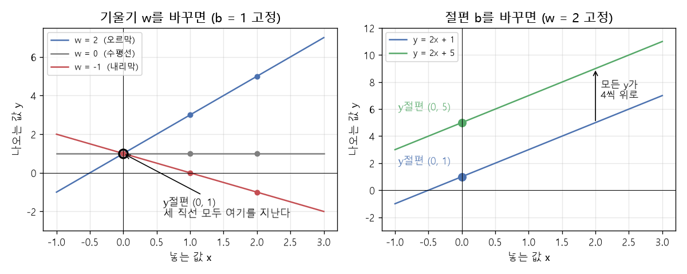

# 함수와 일차함수

[목차로 돌아가기](../00_%EB%94%A5%EB%9F%AC%EB%8B%9D%EC%88%98%ED%95%99_MOC.md)

> [!NOTE]
> **3줄 요약**
> - 함수는 **값을 넣으면 정해진 규칙대로 값 하나가 나오는 기계**다.
> - 일차함수 $y = wx + b$는 그래프가 **직선**이다. $w$는 [기울기](../00_%EB%94%A5%EB%9F%AC%EB%8B%9D_%EC%9A%A9%EC%96%B4%EC%82%AC%EC%A0%84.md#gradient-%EA%B8%B0%EC%9A%B8%EA%B8%B0)(얼마나 가파른가), $b$는 y절편(x가 0일 때의 y)이다.
> - 예제 EX\_02·EX\_03의 `Hypothesis(x)`가 바로 이 일차함수이고, EX\_01의 계단 함수도 함수다.
>
> (참고: $w = 0$이면 수평선(상수함수)이라 엄밀히는 일차함수가 아니지만, 같은 식으로 쓴다.)

## 1. 개념 설명

함수 = 입력 하나를 넣으면 출력 하나가 나오는 규칙.

## 2. 필요한 이유

딥러닝 모델은 통째로 하나의 큰 함수다. 손글씨 사진(입력)을 넣으면 "이건 7"(출력)이 나온다. 이 큰 함수는 작은 함수를 여러 개 이어 붙여서 만든다. 그 가장 작은 부품이 일차함수다.

## 3. 숫자로 보기

규칙: "2를 곱하고 1을 더한다"

| 넣는 값 x | 계산 | 나오는 값 y |
|---|---|---|
| 0 | 2×0 + 1 | 1 |
| 1 | 2×1 + 1 | 3 |
| 2 | 2×2 + 1 | 5 |
| 3 | 2×3 + 1 | 7 |
| 4 | 2×4 + 1 | 9 |

- x가 1 늘 때마다 y는 항상 **2씩** 는다. 이 2가 **[기울기](../00_%EB%94%A5%EB%9F%AC%EB%8B%9D_%EC%9A%A9%EC%96%B4%EC%82%AC%EC%A0%84.md#gradient-%EA%B8%B0%EC%9A%B8%EA%B8%B0)**다.
- x가 0일 때 y는 **1**이다. 이 1이 **y절편**(x가 0일 때의 y)이다.

> [!NOTE]
> **예제와 연결**
> EX\_02의 데이터가 정확히 이 규칙이다. x = 1~10, [정답](../00_%EB%94%A5%EB%9F%AC%EB%8B%9D_%EC%9A%A9%EC%96%B4%EC%82%AC%EC%A0%84.md#label-%EC%A0%95%EB%8B%B5)(labels) = 3, 5, 7, …, 21 → $y = 2x + 1$.
> 모델은 이 규칙(w = 2, b = 1)을 모르는 채로 데이터만 보고 찾아내야 한다. 그 과정이 [D02_경사하강법으로_직선찾기](../01_%EA%B0%9C%EB%85%90%EB%85%B8%ED%8A%B8/D02_%EA%B2%BD%EC%82%AC%ED%95%98%EA%B0%95%EB%B2%95%EC%9C%BC%EB%A1%9C_%EC%A7%81%EC%84%A0%EC%B0%BE%EA%B8%B0.md)다.

## 4. 기호와 식

말로 먼저: "넣는 값에 $w$를 곱하고 $b$를 더하면 나오는 값이 된다."

$$y = wx + b$$

아래 표의 예 열은 위 숫자표에서 x = 3일 때의 값이다.

<details><summary>기호 풀이</summary>

| 기호 | 읽는 법 | 뜻 | 예 |
| --- | --- | --- | --- |
| $x$ | 엑스 | 넣는 값(입력) | 3 |
| $w$ | 더블유 | [기울기](../00_%EB%94%A5%EB%9F%AC%EB%8B%9D_%EC%9A%A9%EC%96%B4%EC%82%AC%EC%A0%84.md#gradient-%EA%B8%B0%EC%9A%B8%EA%B8%B0). 딥러닝에서는 **[가중치](../00_%EB%94%A5%EB%9F%AC%EB%8B%9D_%EC%9A%A9%EC%96%B4%EC%82%AC%EC%A0%84.md#weight-%EA%B0%80%EC%A4%91%EC%B9%98)**(weight) | 2 |
| $b$ | 비 | y절편. 딥러닝에서는 **[편향](../00_%EB%94%A5%EB%9F%AC%EB%8B%9D_%EC%9A%A9%EC%96%B4%EC%82%AC%EC%A0%84.md#bias-%ED%8E%B8%ED%96%A5)**(bias) | 1 |
| $y$ | 와이 | 나오는 값(출력) | 7 |

</details>

- 함수에 이름을 붙이면 $f(x) = 2x + 1$로 쓰고 "에프 오브 엑스"라고 읽는다.
- $f(3) = 7$은 "f에 3을 넣으면 7이 나온다"는 뜻이다.
- 예제 코드에서는 `Hypothesis(x)`라는 이름이고, 줄여서 h(x)라 쓴다. h는 hypothesis([가설](../00_%EB%94%A5%EB%9F%AC%EB%8B%9D_%EC%9A%A9%EC%96%B4%EC%82%AC%EC%A0%84.md#hypothesis-%EA%B0%80%EC%84%A4)), 곧 "아마 이런 직선일 것이다"라는 뜻이다.

### 기울기 w의 영향

(b = 1일 때)

| w | x=0 | x=1 | x=2 | 모양 |
|---|---|---|---|---|
| 0 | 1 | 1 | 1 | 수평선 |
| 2 | 1 | 3 | 5 | 오르막 |
| -1 | 1 | 0 | -1 | 내리막 |

### 절편 b의 영향

[기울기](../00_%EB%94%A5%EB%9F%AC%EB%8B%9D_%EC%9A%A9%EC%96%B4%EC%82%AC%EC%A0%84.md#gradient-%EA%B8%B0%EC%9A%B8%EA%B8%B0)는 그대로이고 직선 전체가 위아래로 평행 이동한다. b = 1 → b = 5로 바꾸면 모든 y가 4씩 커진다.



### 그래프 읽는 법

- 가로축(x축) = 넣는 값, 세로축(y축) = 나오는 값
- 점 (2, 5) = "2를 넣으면 5가 나온다"
- 위 표의 점들을 이으면 직선이 된다. 그래서 "일차함수 = 직선"이다.

## 5. 함수의 조건

> [!WARNING]
> **⚠ 같은 입력, 같은 출력**
> 수학의 함수는 **같은 입력에는 항상 같은 출력**이 나온다. 난수(`random`)를 쓰는 코드처럼 부를 때마다 다른 값이 나오면 수학에서는 함수라고 하지 않는다.

## 6. 예제 코드에서 쓰이는 곳

### EX\_02, EX\_03: 가설

```python
def Hypothesis(x):
    return W*x + B      # 일차함수 y = wx + b
```

### EX\_01: 계단 함수

```python
y = np.float32(s > 10)  # s가 10보다 크면 1.0, 아니면 0.0
```

계단 함수도 함수다. 넣는 값은 s, 나오는 값은 0 또는 1이다. 그래프를 그리면 10에서 뚝 올라가는 계단 모양이다.

| s | 5 | 10 | 10.1 | 42 |
|---|---|---|---|---|
| y | 0 | 0 | 1 | 1 |

> 뒤에 나올 [시그모이드](../00_%EB%94%A5%EB%9F%AC%EB%8B%9D_%EC%9A%A9%EC%96%B4%EC%82%AC%EC%A0%84.md#sigmoid-%EC%8B%9C%EA%B7%B8%EB%AA%A8%EC%9D%B4%EB%93%9C)([D04_시그모이드와_이진분류](../01_%EA%B0%9C%EB%85%90%EB%85%B8%ED%8A%B8/D04_%EC%8B%9C%EA%B7%B8%EB%AA%A8%EC%9D%B4%EB%93%9C%EC%99%80_%EC%9D%B4%EC%A7%84%EB%B6%84%EB%A5%98.md))와 [ReLU](../00_%EB%94%A5%EB%9F%AC%EB%8B%9D_%EC%9A%A9%EC%96%B4%EC%82%AC%EC%A0%84.md#relu-%EB%A0%90%EB%A3%A8)([D08_ReLU와_드롭아웃](../01_%EA%B0%9C%EB%85%90%EB%85%B8%ED%8A%B8/D08_ReLU%EC%99%80_%EB%93%9C%EB%A1%AD%EC%95%84%EC%9B%83.md))도 모두 "넣으면 나오는" 함수다. 모양만 다르다.

## 7. 개념 재확인

<details><summary>1. $y = 3x - 2$에서 x = 4이면?</summary>

| 단계 | 하는 일 | 식 | 계산 | 결과 |
|---|---|---|---|---|
| 1 | w, b 읽기 | $y = wx + b$ | $3x - 2$와 비교 | w = 3, b = −2 |
| 2 | x에 4 넣고 곱하기 | $wx$ | 3 × 4 | 12 |
| 3 | b 더하기 | $wx + b$ | 12 − 2 | 10 |

**① 쓰는 식**
$$y = wx + b$$
- 위 식 ← ② ($w$, $b$ 읽기), ③ ($wx$ 곱하기), ④ ($+ b$ 더하기)
- $x$는 넣는 값, $w$는 곱하는 수([기울기](../00_%EB%94%A5%EB%9F%AC%EB%8B%9D_%EC%9A%A9%EC%96%B4%EC%82%AC%EC%A0%84.md#gradient-%EA%B8%B0%EC%9A%B8%EA%B8%B0)), $b$는 더하는 수(y절편), $y$는 나오는 값이다.
- 이 문제의 식은 $y = 3x - 2$이다.

**② w, b 읽기** ($y = wx + b$와 $y = 3x - 2$ 비교)
- $x$ 바로 앞에 붙은 수가 $w$이다: $w = 3$
- 뒤에 붙은 수가 $b$이다: $b = -2$ (빼기 2는 "−2를 더한다"와 같다)

**③ x에 4 넣고 곱하기** ($wx$)
- 식의 $x$ 자리에 4를 넣는다: $3 \times 4$
- $3 \times 4 = 12$

**④ b 더하기** ($wx + b$)
- $12 + (-2)$, 곧 $12 - 2$
- $12 - 2 = 10$ → y = 10

**답**: y = **10**

</details>

<details><summary>2. $y = wx + b$에 x = 0을 넣으면 항상 무엇이 나오나?</summary>

| 단계 | 하는 일 | 식 | 계산 | 결과 |
|---|---|---|---|---|
| 1 | x에 0 넣기 | $y = w \times 0 + b$ | - | $0 + b$ |
| 2 | 0 더하기 | $0 + b$ | - | $b$ |
| 3 | 숫자로 확인 | $y = 2x + 1$ | 2 × 0 + 1 | 1 (= b) |

**① 쓰는 식**
$$y = wx + b$$
- 위 식 ← ② ($x$에 0 넣기), ③ ($0 + b$ 정리), ④ (숫자 확인)
- $x$는 넣는 값, $w$는 곱하는 수([기울기](../00_%EB%94%A5%EB%9F%AC%EB%8B%9D_%EC%9A%A9%EC%96%B4%EC%82%AC%EC%A0%84.md#gradient-%EA%B8%B0%EC%9A%B8%EA%B8%B0)), $b$는 더하는 수(y절편)이다. $w$와 $b$는 어떤 수여도 된다.

**② x에 0 넣기** ($y = w \times 0 + b$)
- 식의 $x$ 자리에 0을 넣는다: $y = w \times 0 + b$
- 어떤 수에 0을 곱하면 0이다: $w \times 0 = 0$ ($w$가 3이든 −5든 같다)
- 그래서 $y = 0 + b$

**③ 0 더하기** ($0 + b$)
- 0을 더해도 값은 변하지 않는다: $0 + b = b$
- 그러므로 $y = b$이다.

**④ 숫자로 확인** ($y = 2x + 1$, 위 숫자표의 규칙)
- $x = 0$을 넣는다: $2 \times 0 + 1$
- $2 \times 0 = 0$
- $0 + 1 = 1$ → y = 1, 이 식의 $b$도 1이다.

**답**: 항상 **b**가 나온다. 그래서 b를 y절편(직선이 세로축과 만나는 곳)이라 부른다.

</details>

<details><summary>3. EX\_01의 계단 함수에 s = 10을 넣으면?</summary>

| 단계 | 하는 일 | 식 | 계산 | 결과 |
|---|---|---|---|---|
| 1 | 기준과 비교 | `s > 10` | 10 > 10 | 거짓 (같으면 거짓) |
| 2 | 숫자로 바꾸기 | `np.float32(False)` | 거짓은 0, 참은 1 | 0.0 |
| 3 | 바로 위 값과 비교 | `s > 10` | s = 10.1 | 참 → y = 1 |

**① 쓰는 코드** (EX\_01의 계단 함수)
```python
y = np.float32(s > 10)  # ② s > 10 비교 → ③ 참이면 1.0, 거짓이면 0.0으로 바꿈 (④는 s = 10.1일 때)
```
- `s`는 넣는 값, `y`는 나오는 값, `>`는 "왼쪽이 오른쪽보다 크다"를 묻는 비교다.

**② 기준과 비교** (`s > 10`)
- s에 10을 넣는다: `10 > 10`
- 10은 10보다 크지 않다(같다). "크다"만 참이므로 결과는 거짓(False)

**③ 숫자로 바꾸기** (`np.float32(False)`)
- 거짓(False)은 0, 참(True)은 1로 바꾼다.
- False → 0.0 → y = 0

**④ 바로 위 값과 비교** (s = 10.1일 때)
- `10.1 > 10`: 10.1은 10보다 0.1 크다 → 참(True)
- True → 1.0 → y = 1
- 그래서 계단은 s = 10에서 뚝 올라가지 않고, 10을 막 넘는 순간부터 1이 된다.

**답**: y = **0**

</details>

<details><summary>내 이해</summary>


</details>
