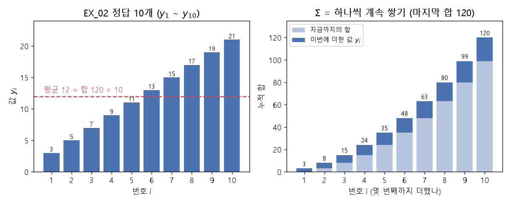

# 시그마(Σ)와 평균

[목차로 돌아가기](../00_%EB%94%A5%EB%9F%AC%EB%8B%9D%EC%88%98%ED%95%99_MOC.md)

> [!NOTE]
> **3줄 요약**
> - Σ(시그마)는 "**전부 더해라**"를 짧게 쓴 기호다. for문 하나와 같다.
> - 평균은 전부 더해서 개수로 나눈 값이고, 식으로는 $\frac{1}{m}\sum$로 쓴다.
> - EX\_01의 [가중합](../00_%EB%94%A5%EB%9F%AC%EB%8B%9D_%EC%9A%A9%EC%96%B4%EC%82%AC%EC%A0%84.md#weighted-sum-%EA%B0%80%EC%A4%91%ED%95%A9)과 EX\_02의 [손실 함수](../00_%EB%94%A5%EB%9F%AC%EB%8B%9D_%EC%9A%A9%EC%96%B4%EC%82%AC%EC%A0%84.md#loss-function-%EC%86%90%EC%8B%A4-%ED%95%A8%EC%88%98)([MSE](../00_%EB%94%A5%EB%9F%AC%EB%8B%9D_%EC%9A%A9%EC%96%B4%EC%82%AC%EC%A0%84.md#mse-mean-squared-error-%ED%8F%89%EA%B7%A0-%EC%A0%9C%EA%B3%B1-%EC%98%A4%EC%B0%A8))가 Σ로 쓰여 있다.

## 1. 개념 설명

$\sum$ = 번호를 1부터 끝까지 바꿔 가며 안에 있는 것을 전부 더한다.

## 2. 필요한 이유

데이터가 10개면 `+`를 9번 쓰면 되지만, [MNIST](../00_%EB%94%A5%EB%9F%AC%EB%8B%9D_%EC%9A%A9%EC%96%B4%EC%82%AC%EC%A0%84.md#mnist-%EC%86%90%EA%B8%80%EC%94%A8-%EC%88%AB%EC%9E%90-%EB%8D%B0%EC%9D%B4%ED%84%B0%EC%85%8B)처럼 6만 개면 다 쓸 수 없다. 그래서 "1번부터 m번까지 전부 더해라"를 기호 하나로 줄여 쓴다.

## 3. 숫자로 보기

1부터 10까지 더하기:

$$1 + 2 + 3 + \cdots + 10 = 55$$

같은 걸 Σ로 쓰면:

$$\sum_{i=1}^{10} i = 55$$

## 4. 기호표

<details><summary>기호 풀이</summary>

| 기호 | 읽는 법 | 뜻 | 예 |
| --- | --- | --- | --- |
| $\sum$ | 시그마(합) | 전부 더해라 |  |
| $i$ | 아이 | 번호(몇 번째). for문의 `i` | 1, 2, …, 10 |
| 아래쪽 $i=1$ | 아이 이퀄 일 | 1번부터 시작 | 1 |
| 위쪽 숫자 (10, $m$) | 위쪽 숫자 | 여기까지 | 10 |
| $m$ | 엠 | 데이터 개수 (평균 식에서 "몇 개로 나누나") | 위 예에서는 10, EX\_02 [정답](../00_%EB%94%A5%EB%9F%AC%EB%8B%9D_%EC%9A%A9%EC%96%B4%EC%82%AC%EC%A0%84.md#label-%EC%A0%95%EB%8B%B5)은 10개 |
| $x_i$ | 엑스 아이 | i번째 x | $x_3$ = 세 번째 값 |
| $y_i$ | 와이 아이 | i번째 값([정답](../00_%EB%94%A5%EB%9F%AC%EB%8B%9D_%EC%9A%A9%EC%96%B4%EC%82%AC%EC%A0%84.md#label-%EC%A0%95%EB%8B%B5)) | $y_3$ = 세 번째 값 |

</details>

## 5. Σ와 for문

```python
total = 0
for i in range(1, 11):   # i = 1, 2, ..., 10  (Σ 아래·위 숫자)
    total += i           # Σ 안에 있는 것을 계속 더함
print(total)
```

**실행 결과**:

```text
55
```

numpy에서는 `np.sum(배열)` 한 줄이다.

## 6. 평균

말로 먼저: 전부 더하고($\sum$) 개수 $m$으로 나눈다. $\frac{1}{m}$을 곱하는 것은 $m$으로 나누는 것과 같다.

$$\text{평균} = \frac{1}{m}\sum_{i=1}^{m} y_i$$

EX\_02의 [정답](../00_%EB%94%A5%EB%9F%AC%EB%8B%9D_%EC%9A%A9%EC%96%B4%EC%82%AC%EC%A0%84.md#label-%EC%A0%95%EB%8B%B5)(labels) 3, 5, 7, …, 21은 합이 120, 개수가 10이다.

- 합 ÷ 개수 = 120 ÷ 10 = **12** (평균)

```python
labels = np.array([3,5,7,9,11,13,15,17,19,21], dtype=np.float32)
print(np.sum(labels), np.mean(labels))
```

**실행 결과**:

```text
120.0 12.0
```



## 7. 예제에서 쓰이는 곳

### 7.1 EX\_01: 가중합

말로 먼저: 같은 번호끼리 곱해서 전부 더하고, 마지막에 b를 더한다. 이 값 $s$를 [가중합](../00_%EB%94%A5%EB%9F%AC%EB%8B%9D_%EC%9A%A9%EC%96%B4%EC%82%AC%EC%A0%84.md#weighted-sum-%EA%B0%80%EC%A4%91%ED%95%A9)이라 부른다.

$$s = \sum_{i=1}^{3} w_i x_i + b$$

| i | $w_i$ | $x_i$ | $w_i \times x_i$ |
|---|---|---|---|
| 1 | 4 | 1 | 4 |
| 2 | 5 | 2 | 10 |
| 3 | 6 | 3 | 18 |
| | | 합 | **32** |

32 + b(10) = **42**

```python
mul = W * X          # 같은 자리끼리 곱하기 → [ 4 10 18]
s = np.sum(mul) + B  # Σ 하고 b 더하기   → 42
```

> [!WARNING]
> **⚠ numpy 배열에서만 되는 `W * X`**
> numpy 배열끼리 `*`는 "같은 자리끼리 곱하기"(원소별 곱)다.
> 파이썬 리스트로 `[4,5,6] * [1,2,3]`을 하면 오류가 난다:
> `TypeError: can't multiply sequence by non-int of type 'list'`

### 7.2 EX\_02: 손실 함수 MSE (평균 제곱 오차)

말로 먼저: 데이터마다 "예측 − [정답](../00_%EB%94%A5%EB%9F%AC%EB%8B%9D_%EC%9A%A9%EC%96%B4%EC%82%AC%EC%A0%84.md#label-%EC%A0%95%EB%8B%B5)"([오차](../00_%EB%94%A5%EB%9F%AC%EB%8B%9D_%EC%9A%A9%EC%96%B4%EC%82%AC%EC%A0%84.md#error-%EC%98%A4%EC%B0%A8))을 구하고, **제곱**하고, **평균**을 낸다.

$$\text{cost}(w, b) = \frac{1}{m}\sum_{i=1}^{m}\left(h(x_i) - y_i\right)^2$$

<details><summary>기호 풀이</summary>

| 기호 | 읽는 법 | 뜻 | 예 |
| --- | --- | --- | --- |
| cost | 코스트 | [손실 함수](../00_%EB%94%A5%EB%9F%AC%EB%8B%9D_%EC%9A%A9%EC%96%B4%EC%82%AC%EC%A0%84.md#loss-function-%EC%86%90%EC%8B%A4-%ED%95%A8%EC%88%98)의 값(코드의 `cost`) | 177 (W = 0, B = 0일 때) |
| $h(x_i)$ | 에이치 엑스 아이 | i번째 예측 | 아래 3개짜리 예에서 4, 4, 8 |
| $y_i$ | 와이 아이 | i번째 [정답](../00_%EB%94%A5%EB%9F%AC%EB%8B%9D_%EC%9A%A9%EC%96%B4%EC%82%AC%EC%A0%84.md#label-%EC%A0%95%EB%8B%B5) | 3, 5, 7 |
| $m$ | 엠 | 데이터 개수 | 3 |

</details>

데이터 3개짜리 작은 예:

| i | 예측 $h(x_i)$ | [정답](../00_%EB%94%A5%EB%9F%AC%EB%8B%9D_%EC%9A%A9%EC%96%B4%EC%82%AC%EC%A0%84.md#label-%EC%A0%95%EB%8B%B5) $y_i$ | [오차](../00_%EB%94%A5%EB%9F%AC%EB%8B%9D_%EC%9A%A9%EC%96%B4%EC%82%AC%EC%A0%84.md#error-%EC%98%A4%EC%B0%A8) | [오차](../00_%EB%94%A5%EB%9F%AC%EB%8B%9D_%EC%9A%A9%EC%96%B4%EC%82%AC%EC%A0%84.md#error-%EC%98%A4%EC%B0%A8)² |
|---|---|---|---|---|
| 1 | 4 | 3 | 1 | 1 |
| 2 | 4 | 5 | -1 | 1 |
| 3 | 8 | 7 | 1 | 1 |

평균 = (1 + 1 + 1) ÷ 3 = **1**

<details><summary>제곱하는 이유</summary>

- [오차](../00_%EB%94%A5%EB%9F%AC%EB%8B%9D_%EC%9A%A9%EC%96%B4%EC%82%AC%EC%A0%84.md#error-%EC%98%A4%EC%B0%A8) +1과 −1을 그냥 더하면 0이 되어 "하나도 안 틀렸다"처럼 보인다. 제곱하면 둘 다 1이 되어 틀린 만큼 쌓인다.
- 큰 [오차](../00_%EB%94%A5%EB%9F%AC%EB%8B%9D_%EC%9A%A9%EC%96%B4%EC%82%AC%EC%A0%84.md#error-%EC%98%A4%EC%B0%A8)를 더 크게 벌준다. [오차](../00_%EB%94%A5%EB%9F%AC%EB%8B%9D_%EC%9A%A9%EC%96%B4%EC%82%AC%EC%A0%84.md#error-%EC%98%A4%EC%B0%A8) 1 → 1, [오차](../00_%EB%94%A5%EB%9F%AC%EB%8B%9D_%EC%9A%A9%EC%96%B4%EC%82%AC%EC%A0%84.md#error-%EC%98%A4%EC%B0%A8) 3 → 9.

</details>

```python
def Cost():
    return np.mean((Hypothesis(x_input) - labels)**2)
    #      평균    (    예측           -  정답 )제곱
```

EX\_02를 W = 0, B = 0에서 시작하면 예측이 전부 0이라 [오차](../00_%EB%94%A5%EB%9F%AC%EB%8B%9D_%EC%9A%A9%EC%96%B4%EC%82%AC%EC%A0%84.md#error-%EC%98%A4%EC%B0%A8)는 −[정답](../00_%EB%94%A5%EB%9F%AC%EB%8B%9D_%EC%9A%A9%EC%96%B4%EC%82%AC%EC%A0%84.md#label-%EC%A0%95%EB%8B%B5)이다. 제곱하면 [정답](../00_%EB%94%A5%EB%9F%AC%EB%8B%9D_%EC%9A%A9%EC%96%B4%EC%82%AC%EC%A0%84.md#label-%EC%A0%95%EB%8B%B5)², 곧 3², 5², …, 21²이다.

- [오차](../00_%EB%94%A5%EB%9F%AC%EB%8B%9D_%EC%9A%A9%EC%96%B4%EC%82%AC%EC%A0%84.md#error-%EC%98%A4%EC%B0%A8)² 합 = 9 + 25 + … + 441 = 1770
- 평균 = 1770 ÷ 10 = **177**

### 7.3 쓰이는 곳

| 노트 | 쓰이는 곳 |
|---|---|
| [D03_Dense층과_정규화](../01_%EA%B0%9C%EB%85%90%EB%85%B8%ED%8A%B8/D03_Dense%EC%B8%B5%EA%B3%BC_%EC%A0%95%EA%B7%9C%ED%99%94.md)의 '출력이 2개일 때의 [MSE](../00_%EB%94%A5%EB%9F%AC%EB%8B%9D_%EC%9A%A9%EC%96%B4%EC%82%AC%EC%A0%84.md#mse-mean-squared-error-%ED%8F%89%EA%B7%A0-%EC%A0%9C%EA%B3%B1-%EC%98%A4%EC%B0%A8)' | 출력이 여러 개일 때의 [MSE](../00_%EB%94%A5%EB%9F%AC%EB%8B%9D_%EC%9A%A9%EC%96%B4%EC%82%AC%EC%A0%84.md#mse-mean-squared-error-%ED%8F%89%EA%B7%A0-%EC%A0%9C%EA%B3%B1-%EC%98%A4%EC%B0%A8) 평균 |
| [D05_소프트맥스와_다중분류](../01_%EA%B0%9C%EB%85%90%EB%85%B8%ED%8A%B8/D05_%EC%86%8C%ED%94%84%ED%8A%B8%EB%A7%A5%EC%8A%A4%EC%99%80_%EB%8B%A4%EC%A4%91%EB%B6%84%EB%A5%98.md) | [소프트맥스](../00_%EB%94%A5%EB%9F%AC%EB%8B%9D_%EC%9A%A9%EC%96%B4%EC%82%AC%EC%A0%84.md#softmax-%EC%86%8C%ED%94%84%ED%8A%B8%EB%A7%A5%EC%8A%A4) 분모의 Σ ("전체 중 비율") |
| [D06_이미지분류와_MNIST](../01_%EA%B0%9C%EB%85%90%EB%85%B8%ED%8A%B8/D06_%EC%9D%B4%EB%AF%B8%EC%A7%80%EB%B6%84%EB%A5%98%EC%99%80_MNIST.md) 4.4절 | 32장 묶음([미니배치](../00_%EB%94%A5%EB%9F%AC%EB%8B%9D_%EC%9A%A9%EC%96%B4%EC%82%AC%EC%A0%84.md#mini-batch-%EB%AF%B8%EB%8B%88%EB%B0%B0%EC%B9%98))의 [손실](../00_%EB%94%A5%EB%9F%AC%EB%8B%9D_%EC%9A%A9%EC%96%B4%EC%82%AC%EC%A0%84.md#loss-function-%EC%86%90%EC%8B%A4-%ED%95%A8%EC%88%98) 평균 |
| [D07_합성곱과_풀링](../01_%EA%B0%9C%EB%85%90%EB%85%B8%ED%8A%B8/D07_%ED%95%A9%EC%84%B1%EA%B3%B1%EA%B3%BC_%ED%92%80%EB%A7%81.md) 4.2절 | [합성곱](../00_%EB%94%A5%EB%9F%AC%EB%8B%9D_%EC%9A%A9%EC%96%B4%EC%82%AC%EC%A0%84.md#convolution-%ED%95%A9%EC%84%B1%EA%B3%B1)의 이중 Σ (3×3칸 곱해 더하기) |

## 8. 개념 재확인

<details><summary>1. $\sum_{i=1}^{4} 2i$는?</summary>

| 단계 | 하는 일 | 식 | 계산 | 결과 |
|---|---|---|---|---|
| 1 | i = 1, 2, 3, 4 넣기 | $2i$ | 2×1, 2×2, 2×3, 2×4 | 2, 4, 6, 8 |
| 2 | 전부 더하기 | $\sum$ | 2 + 4 + 6 + 8 | 20 |
| 3 | 코드로 확인 | `range(1, 5)`, `total += 2 * i` | i = 1부터 4까지 | 20 |

**① 쓰는 식**
$$\sum_{i=1}^{4} 2i$$
- 위 식 ← ② ($2i$에 $i$ 넣기), ③ ($\sum$ 전부 더하기)
- $\sum$은 "전부 더해라", $i$는 번호, 아래 $i=1$은 1번부터 시작, 위쪽 4는 4번까지, $2i$는 번호마다 더할 값(번호의 2배)이다.
```python
total = 0               # ④ 합계를 0으로 시작
for i in range(1, 5):   # ② i = 1, 2, 3, 4 (range의 끝 5는 포함 안 됨)
    total += 2 * i      # ③ 2i를 계속 더함 (④에서 하나씩 따라가 본다)
```

**② i에 1, 2, 3, 4를 차례로 넣기** ($2i$)
- $i = 1$: $2 \times 1 = 2$
- $i = 2$: $2 \times 2 = 4$
- $i = 3$: $2 \times 3 = 6$
- $i = 4$: $2 \times 4 = 8$

**③ 전부 더하기** ($\sum$)
- $2 + 4 = 6$
- $6 + 6 = 12$
- $12 + 8 = 20$

**④ 코드로 확인** (`total += 2 * i`)
- total = 0에서 시작
- i = 1: $0 + 2 = 2$
- i = 2: $2 + 4 = 6$
- i = 3: $6 + 6 = 12$
- i = 4: $12 + 8 = 20$ → 식으로 구한 값과 같다.

**답**: **20**

</details>

<details><summary>2. 오차가 <code>[2, −2]</code>이면 MSE는?</summary>

| 단계 | 하는 일 | 식 | 계산 | 결과 |
|---|---|---|---|---|
| 1 | [오차](../00_%EB%94%A5%EB%9F%AC%EB%8B%9D_%EC%9A%A9%EC%96%B4%EC%82%AC%EC%A0%84.md#error-%EC%98%A4%EC%B0%A8) 제곱하기 | $e^2$ | $2^2$, $(-2)^2$ | 4, 4 |
| 2 | 전부 더하기 | $\sum e^2$ | 4 + 4 | 8 |
| 3 | 개수 m으로 나누기 | $\frac{1}{m}\sum$ | 8 ÷ 2 | 4 |
| 4 | 코드로 확인 | `np.mean(np.array([2, -2])**2)` | - | 4.0 |

**① 쓰는 식**
$$\text{MSE} = \frac{1}{m}\sum_{i=1}^{m} e_i^2$$
- 위 식 ← ② ($e_i^2$ 제곱), ③ ($\sum$ 전부 더하기), ④ ($\frac{1}{m}$ 개수로 나누기)
- $e_i$는 i번째 [오차](../00_%EB%94%A5%EB%9F%AC%EB%8B%9D_%EC%9A%A9%EC%96%B4%EC%82%AC%EC%A0%84.md#error-%EC%98%A4%EC%B0%A8)(예측 − [정답](../00_%EB%94%A5%EB%9F%AC%EB%8B%9D_%EC%9A%A9%EC%96%B4%EC%82%AC%EC%A0%84.md#label-%EC%A0%95%EB%8B%B5)), $m$은 데이터 개수, $\sum$은 전부 더하기, $\frac{1}{m}$을 곱하는 것은 $m$으로 나누는 것(평균)이다.
- 여기서는 [오차](../00_%EB%94%A5%EB%9F%AC%EB%8B%9D_%EC%9A%A9%EC%96%B4%EC%82%AC%EC%A0%84.md#error-%EC%98%A4%EC%B0%A8)가 `[2, -2]`이므로 $e_1 = 2$, $e_2 = -2$, $m = 2$이다.
```python
np.mean(np.array([2, -2])**2)   # ② 오차 제곱 → ③ 더하기 → ④ 개수로 나누기 (⑤에서 확인)
```

**② [오차](../00_%EB%94%A5%EB%9F%AC%EB%8B%9D_%EC%9A%A9%EC%96%B4%EC%82%AC%EC%A0%84.md#error-%EC%98%A4%EC%B0%A8) 제곱하기** ($e^2$)
- $e_1^2 = 2^2 = 2 \times 2 = 4$
- $e_2^2 = (-2)^2 = (-2) \times (-2) = 4$ (음수끼리 곱하면 양수가 된다)
- 제곱한 값: `[4, 4]`

**③ 전부 더하기** ($\sum e^2$)
- $4 + 4 = 8$

**④ 개수 m으로 나누기** ($\frac{1}{m}\sum$)
- 개수는 2개이므로 $m = 2$
- $8 \div 2 = 4$

**⑤ 코드로 확인** (`np.mean(...)`)
- `np.array([2, -2])**2`는 `[4, 4]`
- 평균은 $(4 + 4) \div 2 = 4.0$ → ④와 같다.

**답**: [MSE](../00_%EB%94%A5%EB%9F%AC%EB%8B%9D_%EC%9A%A9%EC%96%B4%EC%82%AC%EC%A0%84.md#mse-mean-squared-error-%ED%8F%89%EA%B7%A0-%EC%A0%9C%EA%B3%B1-%EC%98%A4%EC%B0%A8) = **4**

</details>

<details><summary>3. Σ를 파이썬으로 바꾸면 어떤 문법인가?</summary>

| 단계 | 하는 일 | 식 | 계산 | 결과 |
|---|---|---|---|---|
| 1 | 합계 0으로 시작 | `total = 0` | - | 0 |
| 2 | 한 칸씩 더하기 | `for i in range(1, 11): total += i` | 0+1, 1+2, … | i = 10까지 가면 55 |
| 3 | 한 줄로 줄이기 | `np.sum(배열)`, `sum(...)` | - | 같은 합계 |

Σ의 아래·위 숫자가 `range`, Σ 안의 것이 `+=`로 더하는 값이다.

**① 쓰는 식**
$$\sum_{i=1}^{10} i = 55$$
- 위 식 ← ② (합계 시작), ③ (한 칸씩 더하기), ④ (한 줄로 줄이기)
- 번호 $i$를 1부터 10까지 바꿔 가며 $i$ 자체를 전부 더한다.
```python
total = 0                # ② 합계를 0으로 시작
for i in range(1, 11):   # ③ i = 1, 2, ..., 10 (Σ 아래·위 숫자)
    total += i           # ③ Σ 안에 있는 것을 계속 더함
print(total)             # ③ 마지막 합계 55를 출력 (④는 이 반복을 한 줄로 줄인 것)
```

**② 합계 0으로 시작** (`total = 0`)
- 아직 아무것도 더하지 않았으므로 0이다. 덧셈에서 0은 값을 바꾸지 않는다.

**③ 한 칸씩 더하기** (`total += i`)
- `total += i`는 "total에 i를 더해서 다시 total에 넣는다"는 뜻이다.
- i = 1: $0 + 1 = 1$
- i = 2: $1 + 2 = 3$
- i = 3: $3 + 3 = 6$
- i = 4: $6 + 4 = 10$
- i = 5: $10 + 5 = 15$
- i = 6: $15 + 6 = 21$
- i = 7: $21 + 7 = 28$
- i = 8: $28 + 8 = 36$
- i = 9: $36 + 9 = 45$
- i = 10: $45 + 10 = 55$

**④ 한 줄로 줄이기** (`np.sum(배열)`, `sum(...)`)
- 반복문 없이 배열의 값을 전부 더해 주는 함수이다. 같은 합계 55가 나온다.

**답**: **for문 + 누적 더하기(`total += …`)**. 짧게는 `sum()`, numpy면 `np.sum()`을 쓴다.

</details>

<details><summary>내 이해</summary>


</details>
