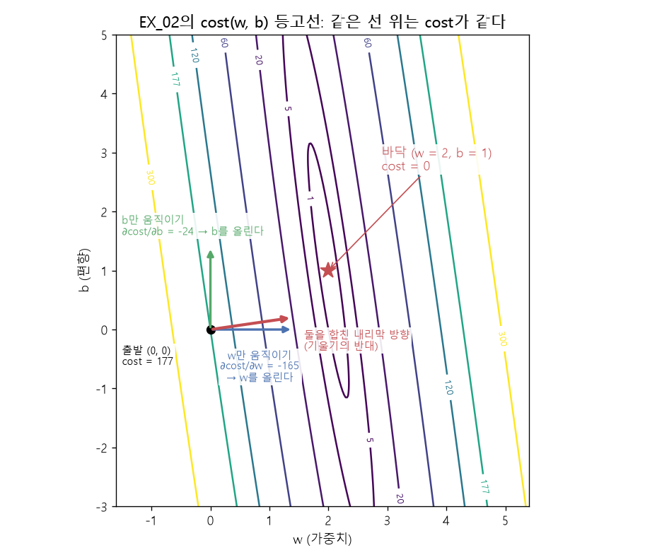

# 편미분 — 하나만 움직이기

[목차로 돌아가기](../00_%EB%94%A5%EB%9F%AC%EB%8B%9D%EC%88%98%ED%95%99_MOC.md) · 먼저 볼 것: [M03_미분_기울기](../02_%EC%88%98%ED%95%99%EB%85%B8%ED%8A%B8/M03_%EB%AF%B8%EB%B6%84_%EA%B8%B0%EC%9A%B8%EA%B8%B0.md)

> 참고: [연쇄법칙](../00_%EB%94%A5%EB%9F%AC%EB%8B%9D_%EC%9A%A9%EC%96%B4%EC%82%AC%EC%A0%84.md#chain-rule-%EC%97%B0%EC%87%84%EB%B2%95%EC%B9%99)(겉 [미분](../00_%EB%94%A5%EB%9F%AC%EB%8B%9D_%EC%9A%A9%EC%96%B4%EC%82%AC%EC%A0%84.md#derivative-%EB%AF%B8%EB%B6%84) × 속 [미분](../00_%EB%94%A5%EB%9F%AC%EB%8B%9D_%EC%9A%A9%EC%96%B4%EC%82%AC%EC%A0%84.md#derivative-%EB%AF%B8%EB%B6%84))을 [계산 그래프](../00_%EB%94%A5%EB%9F%AC%EB%8B%9D_%EC%9A%A9%EC%96%B4%EC%82%AC%EC%A0%84.md#computational-graph-%EA%B3%84%EC%82%B0-%EA%B7%B8%EB%9E%98%ED%94%84)로 따라가며 [가중치](../00_%EB%94%A5%EB%9F%AC%EB%8B%9D_%EC%9A%A9%EC%96%B4%EC%82%AC%EC%A0%84.md#weight-%EA%B0%80%EC%A4%91%EC%B9%98) [기울기](../00_%EB%94%A5%EB%9F%AC%EB%8B%9D_%EC%9A%A9%EC%96%B4%EC%82%AC%EC%A0%84.md#gradient-%EA%B8%B0%EC%9A%B8%EA%B8%B0)를 구하는 과정은 [D12_역전파와_계산그래프](../01_%EA%B0%9C%EB%85%90%EB%85%B8%ED%8A%B8/D12_%EC%97%AD%EC%A0%84%ED%8C%8C%EC%99%80_%EA%B3%84%EC%82%B0%EA%B7%B8%EB%9E%98%ED%94%84.md)

> [!NOTE]
> **3줄 요약**
> - 입력이 여러 개(w와 b)일 때, **하나만 움직이고 나머지는 고정**한 채 구하는 [기울기](../00_%EB%94%A5%EB%9F%AC%EB%8B%9D_%EC%9A%A9%EC%96%B4%EC%82%AC%EC%A0%84.md#gradient-%EA%B8%B0%EC%9A%B8%EA%B8%B0)가 [편미분](../00_%EB%94%A5%EB%9F%AC%EB%8B%9D_%EC%9A%A9%EC%96%B4%EC%82%AC%EC%A0%84.md#partial-derivative-%ED%8E%B8%EB%AF%B8%EB%B6%84)이다.
> - 기호는 d 대신 ∂를 쓴다. $\frac{\partial\, \text{cost}}{\partial w}$ = "b는 그대로 두고 w만 조금 움직였을 때 cost가 변하는 비율".
> - EX\_02의 `Gradient()`가 돌려주는 두 값이 w 방향, b 방향 [편미분](../00_%EB%94%A5%EB%9F%AC%EB%8B%9D_%EC%9A%A9%EC%96%B4%EC%82%AC%EC%A0%84.md#partial-derivative-%ED%8E%B8%EB%AF%B8%EB%B6%84)이다.

## 1. 개념 설명

[편미분](../00_%EB%94%A5%EB%9F%AC%EB%8B%9D_%EC%9A%A9%EC%96%B4%EC%82%AC%EC%A0%84.md#partial-derivative-%ED%8E%B8%EB%AF%B8%EB%B6%84) = 여러 손잡이 중 **하나만** 돌려 보고 결과가 얼마나 변하는지 재는 것.

## 2. 필요한 이유

EX\_02의 [손실](../00_%EB%94%A5%EB%9F%AC%EB%8B%9D_%EC%9A%A9%EC%96%B4%EC%82%AC%EC%A0%84.md#loss-function-%EC%86%90%EC%8B%A4-%ED%95%A8%EC%88%98)(코드의 cost)은 w와 b 두 값에 따라 달라진다. 둘 다 고치려면 "w를 움직이면 어떻게 되나"와 "b를 움직이면 어떻게 되나"를 **따로** 알아야 한다.

> 비유: 샤워기의 온수·냉수 손잡이. 둘을 한꺼번에 돌리면 무엇 때문에 온도가 바뀌었는지 모른다. 하나씩 돌려 보며 변화를 확인한다.

## 3. 숫자로 보기 (데이터 1개)

데이터: x = 2, [정답](../00_%EB%94%A5%EB%9F%AC%EB%8B%9D_%EC%9A%A9%EC%96%B4%EC%82%AC%EC%A0%84.md#label-%EC%A0%95%EB%8B%B5) y = 5. 지금 w = 1, b = 0.

- 예측 = 1×2 + 0 = 2
- [오차](../00_%EB%94%A5%EB%9F%AC%EB%8B%9D_%EC%9A%A9%EC%96%B4%EC%82%AC%EC%A0%84.md#error-%EC%98%A4%EC%B0%A8) = 2 − 5 = −3
- cost = (−3)² = **9**

이제 하나씩 0.001만 움직여 본다.

| 움직인 것 | 새 예측 | 새 cost | cost 변화 ÷ 0.001 |
|---|---|---|---|
| w만 1 → 1.001 (b 고정) | 2.002 | 8.988004 | 약 **−12** |
| b만 0 → 0.001 (w 고정) | 2.001 | 8.994001 | 약 **−6** |

- 둘 다 음수 → w를 올려도, b를 올려도 cost가 준다. 둘 다 올려야 한다.
- w 쪽이 2배 더 민감하다(−12 vs −6). x = 2가 w에 곱해지기 때문이다.

## 4. 기호

<details><summary>기호 풀이</summary>

| 기호 | 읽는 법 | 뜻 | 예 |
| --- | --- | --- | --- |
| $\partial$ | 라운드 디([편미분](../00_%EB%94%A5%EB%9F%AC%EB%8B%9D_%EC%9A%A9%EC%96%B4%EC%82%AC%EC%A0%84.md#partial-derivative-%ED%8E%B8%EB%AF%B8%EB%B6%84) 기호) | 여러 입력 중 **이것만** 움직인다 |  |
| $\frac{\partial\, \text{cost}}{\partial w}$ | 코스트를 w로 [편미분](../00_%EB%94%A5%EB%9F%AC%EB%8B%9D_%EC%9A%A9%EC%96%B4%EC%82%AC%EC%A0%84.md#partial-derivative-%ED%8E%B8%EB%AF%B8%EB%B6%84) | w 방향 [기울기](../00_%EB%94%A5%EB%9F%AC%EB%8B%9D_%EC%9A%A9%EC%96%B4%EC%82%AC%EC%A0%84.md#gradient-%EA%B8%B0%EC%9A%B8%EA%B8%B0) | 위 표에서 −12 |
| $\frac{\partial\, \text{cost}}{\partial b}$ | 코스트를 b로 [편미분](../00_%EB%94%A5%EB%9F%AC%EB%8B%9D_%EC%9A%A9%EC%96%B4%EC%82%AC%EC%A0%84.md#partial-derivative-%ED%8E%B8%EB%AF%B8%EB%B6%84) | b 방향 [기울기](../00_%EB%94%A5%EB%9F%AC%EB%8B%9D_%EC%9A%A9%EC%96%B4%EC%82%AC%EC%A0%84.md#gradient-%EA%B8%B0%EC%9A%B8%EA%B8%B0) | 위 표에서 −6 |

</details>

계산 방법은 [M03_미분_기울기](../02_%EC%88%98%ED%95%99%EB%85%B8%ED%8A%B8/M03_%EB%AF%B8%EB%B6%84_%EA%B8%B0%EC%9A%B8%EA%B8%B0.md)의 [미분](../00_%EB%94%A5%EB%9F%AC%EB%8B%9D_%EC%9A%A9%EC%96%B4%EC%82%AC%EC%A0%84.md#derivative-%EB%AF%B8%EB%B6%84)과 똑같다. **움직이지 않는 변수는 그냥 숫자(상수)처럼 취급**하면 된다.

## 5. 공식 유도 (한 줄에 한 동작)

데이터 1개의 cost:

$$\text{cost} = (wx + b - y)^2$$

괄호 안($wx + b - y$, 곧 예측 − [정답](../00_%EB%94%A5%EB%9F%AC%EB%8B%9D_%EC%9A%A9%EC%96%B4%EC%82%AC%EC%A0%84.md#label-%EC%A0%95%EB%8B%B5))을 [오차](../00_%EB%94%A5%EB%9F%AC%EB%8B%9D_%EC%9A%A9%EC%96%B4%EC%82%AC%EC%A0%84.md#error-%EC%98%A4%EC%B0%A8) $e$라고 부르면 cost = $e^2$이다. 이렇게 **겉**($e^2$)과 **속**($wx + b - y$) 두 겹으로 생긴 식은 "**겉 [미분](../00_%EB%94%A5%EB%9F%AC%EB%8B%9D_%EC%9A%A9%EC%96%B4%EC%82%AC%EC%A0%84.md#derivative-%EB%AF%B8%EB%B6%84) × 속 [미분](../00_%EB%94%A5%EB%9F%AC%EB%8B%9D_%EC%9A%A9%EC%96%B4%EC%82%AC%EC%A0%84.md#derivative-%EB%AF%B8%EB%B6%84)**"으로 미분한다.

이 규칙의 이름은 **[연쇄법칙](../00_%EB%94%A5%EB%9F%AC%EB%8B%9D_%EC%9A%A9%EC%96%B4%EC%82%AC%EC%A0%84.md#chain-rule-%EC%97%B0%EC%87%84%EB%B2%95%EC%B9%99)**(chain rule)이다.

참고: [층](../00_%EB%94%A5%EB%9F%AC%EB%8B%9D_%EC%9A%A9%EC%96%B4%EC%82%AC%EC%A0%84.md#layer-%EC%B8%B5)이 여러 겹이면 [기울기](../00_%EB%94%A5%EB%9F%AC%EB%8B%9D_%EC%9A%A9%EC%96%B4%EC%82%AC%EC%A0%84.md#gradient-%EA%B8%B0%EC%9A%B8%EA%B8%B0)가 [층](../00_%EB%94%A5%EB%9F%AC%EB%8B%9D_%EC%9A%A9%EC%96%B4%EC%82%AC%EC%A0%84.md#layer-%EC%B8%B5)마다 곱해지며 전달된다([역전파](../00_%EB%94%A5%EB%9F%AC%EB%8B%9D_%EC%9A%A9%EC%96%B4%EC%82%AC%EC%A0%84.md#backpropagation-%EC%97%AD%EC%A0%84%ED%8C%8C)). 그 바탕이 바로 이 규칙이다([D08_ReLU와_드롭아웃](../01_%EA%B0%9C%EB%85%90%EB%85%B8%ED%8A%B8/D08_ReLU%EC%99%80_%EB%93%9C%EB%A1%AD%EC%95%84%EC%9B%83.md) 4.2절).

### w로 편미분 (b, x, y는 숫자 취급)

1. 겉 $e^2$을 [미분](../00_%EB%94%A5%EB%9F%AC%EB%8B%9D_%EC%9A%A9%EC%96%B4%EC%82%AC%EC%A0%84.md#derivative-%EB%AF%B8%EB%B6%84) → $2e$ ← 공식 $x^2 \to 2x$
2. 속 $wx + b - y$를 w로 [미분](../00_%EB%94%A5%EB%9F%AC%EB%8B%9D_%EC%9A%A9%EC%96%B4%EC%82%AC%EC%A0%84.md#derivative-%EB%AF%B8%EB%B6%84) → $x$ ← w만 변수. $ax \to a$에서 a 자리가 x
3. 곱한다 → $2e \cdot x = 2(wx + b - y)\,x$

### b로 편미분 (w, x, y는 숫자 취급)

1. 겉 → $2e$
2. 속을 b로 [미분](../00_%EB%94%A5%EB%9F%AC%EB%8B%9D_%EC%9A%A9%EC%96%B4%EC%82%AC%EC%A0%84.md#derivative-%EB%AF%B8%EB%B6%84) → $1$ ← b만 변수
3. 곱한다 → $2(wx + b - y)$

### 숫자로 확인 (x = 2, y = 5, w = 1, b = 0, e = −3)

- $\frac{\partial\, \text{cost}}{\partial w}$ = 2 × (−3) × 2 = **−12** ✓ 3절과 같다
- $\frac{\partial\, \text{cost}}{\partial b}$ = 2 × (−3) = **−6** ✓

### 데이터 m개의 경우

데이터마다 구해서 평균을 낸다([M02_시그마와_평균](../02_%EC%88%98%ED%95%99%EB%85%B8%ED%8A%B8/M02_%EC%8B%9C%EA%B7%B8%EB%A7%88%EC%99%80_%ED%8F%89%EA%B7%A0.md)).

$$\frac{\partial\, \text{cost}}{\partial w} = \frac{1}{m}\sum_{i=1}^{m} 2(wx_i + b - y_i)\,x_i$$

$$\frac{\partial\, \text{cost}}{\partial b} = \frac{1}{m}\sum_{i=1}^{m} 2(wx_i + b - y_i)$$

## 6. 예제 코드와 비교

```python
def Gradient(x, y):
    return np.mean(x*(x*W+(B-y))), np.mean((W*x-y+B))
    #      ∂cost/∂w                ∂cost/∂b
```

`x*(x*W+(B-y))`를 풀면 $x(wx + b - y)$다. 위 공식과 같은데 **앞의 2가 없다.** b 쪽 `np.mean((W*x-y+B))`도 마찬가지로 2가 없다.

> [!WARNING]
> **⚠ 노트북 식에서 빠진 2**
> 노트북의 [기울기](../00_%EB%94%A5%EB%9F%AC%EB%8B%9D_%EC%9A%A9%EC%96%B4%EC%82%AC%EC%A0%84.md#gradient-%EA%B8%B0%EC%9A%B8%EA%B8%B0) 식은 $\frac{1}{m}\sum x_i(x_i w + b - y_i)$로, 정식 [MSE](../00_%EB%94%A5%EB%9F%AC%EB%8B%9D_%EC%9A%A9%EC%96%B4%EC%82%AC%EC%A0%84.md#mse-mean-squared-error-%ED%8F%89%EA%B7%A0-%EC%A0%9C%EA%B3%B1-%EC%98%A4%EC%B0%A8) [기울기](../00_%EB%94%A5%EB%9F%AC%EB%8B%9D_%EC%9A%A9%EC%96%B4%EC%82%AC%EC%A0%84.md#gradient-%EA%B8%B0%EC%9A%B8%EA%B8%B0)의 절반이다. w 쪽도 b 쪽도 둘 다 절반이다(아래 실행 결과 −82.5 = −165 ÷ 2, −12 = −24 ÷ 2).
> 2를 빼면 **방향은 그대로**이고 크기만 절반이 된다. 이것은 정식 식에 [학습률](../00_%EB%94%A5%EB%9F%AC%EB%8B%9D_%EC%9A%A9%EC%96%B4%EC%82%AC%EC%A0%84.md#learning-rate-%ED%95%99%EC%8A%B5%EB%A5%A0)을 절반으로 쓴 것과 같다. [학습률](../00_%EB%94%A5%EB%9F%AC%EB%8B%9D_%EC%9A%A9%EC%96%B4%EC%82%AC%EC%A0%84.md#learning-rate-%ED%95%99%EC%8A%B5%EB%A5%A0)을 알맞게 고르면 [학습](../00_%EB%94%A5%EB%9F%AC%EB%8B%9D_%EC%9A%A9%EC%96%B4%EC%82%AC%EC%A0%84.md#training-%ED%95%99%EC%8A%B5)은 똑같이 된다. 식을 단순하게 하려고 뺀 것으로 보인다.

EX\_02 데이터에서 W = 0, B = 0일 때 두 [기울기](../00_%EB%94%A5%EB%9F%AC%EB%8B%9D_%EC%9A%A9%EC%96%B4%EC%82%AC%EC%A0%84.md#gradient-%EA%B8%B0%EC%9A%B8%EA%B8%B0):

```python
x_input = np.array([1,2,3,4,5,6,7,8,9,10], dtype=np.float32)
labels  = np.array([3,5,7,9,11,13,15,17,19,21], dtype=np.float32)
W, B = 0.0, 0.0
print(np.mean(x_input*(x_input*W+(B-labels))), np.mean(W*x_input-labels+B))
```

**실행 결과**:

```text
-82.5 -12.0
```

- 둘 다 음수 → W와 B를 둘 다 올려야 cost가 준다.
- W 쪽이 훨씬 크다(−82.5 vs −12). x 값(1~10)이 W에 곱해지기 때문이다. 그래서 [학습](../00_%EB%94%A5%EB%9F%AC%EB%8B%9D_%EC%9A%A9%EC%96%B4%EC%82%AC%EC%A0%84.md#training-%ED%95%99%EC%8A%B5) 초반에 W가 B보다 훨씬 빨리 움직인다([D02_경사하강법으로_직선찾기](../01_%EA%B0%9C%EB%85%90%EB%85%B8%ED%8A%B8/D02_%EA%B2%BD%EC%82%AC%ED%95%98%EA%B0%95%EB%B2%95%EC%9C%BC%EB%A1%9C_%EC%A7%81%EC%84%A0%EC%B0%BE%EA%B8%B0.md)의 '반복한 결과').



## 7. 개념 재확인

<details><summary>1. cost = (wx + b − y)²에서 x = 1, y = 3, w = 0, b = 0이면 두 편미분은?</summary>

| 단계 | 하는 일 | 식 | 계산 | 결과 |
|---|---|---|---|---|
| 1 | [오차](../00_%EB%94%A5%EB%9F%AC%EB%8B%9D_%EC%9A%A9%EC%96%B4%EC%82%AC%EC%A0%84.md#error-%EC%98%A4%EC%B0%A8) e 구하기 | $e = wx + b - y$ | 0 × 1 + 0 − 3 | −3 |
| 2 | w [편미분](../00_%EB%94%A5%EB%9F%AC%EB%8B%9D_%EC%9A%A9%EC%96%B4%EC%82%AC%EC%A0%84.md#partial-derivative-%ED%8E%B8%EB%AF%B8%EB%B6%84) 구하기 | $2e \cdot x$ | 2 × (−3) × 1 | −6 |
| 3 | b [편미분](../00_%EB%94%A5%EB%9F%AC%EB%8B%9D_%EC%9A%A9%EC%96%B4%EC%82%AC%EC%A0%84.md#partial-derivative-%ED%8E%B8%EB%AF%B8%EB%B6%84) 구하기 | $2e$ | 2 × (−3) | −6 |
| 4 | w를 0.001 올려 확인 | $\frac{\Delta\,\text{cost}}{\Delta w}$ | (8.994001 − 9) ÷ 0.001 | 약 −6 |

**① 쓰는 식**
$$\text{cost} = (wx + b - y)^2,\quad e = wx + b - y$$
$$\frac{\partial\, \text{cost}}{\partial w} = 2e \cdot x,\qquad \frac{\partial\, \text{cost}}{\partial b} = 2e$$
- 위 첫 줄 ← ② ($e$ 구하기), 둘째 줄의 $2e \cdot x$ ← ③, $2e$ ← ④, 확인 ← ⑤
- $e$는 [오차](../00_%EB%94%A5%EB%9F%AC%EB%8B%9D_%EC%9A%A9%EC%96%B4%EC%82%AC%EC%A0%84.md#error-%EC%98%A4%EC%B0%A8)(예측 − [정답](../00_%EB%94%A5%EB%9F%AC%EB%8B%9D_%EC%9A%A9%EC%96%B4%EC%82%AC%EC%A0%84.md#label-%EC%A0%95%EB%8B%B5)), $x$는 넣는 값, $y$는 [정답](../00_%EB%94%A5%EB%9F%AC%EB%8B%9D_%EC%9A%A9%EC%96%B4%EC%82%AC%EC%A0%84.md#label-%EC%A0%95%EB%8B%B5), $w$는 [가중치](../00_%EB%94%A5%EB%9F%AC%EB%8B%9D_%EC%9A%A9%EC%96%B4%EC%82%AC%EC%A0%84.md#weight-%EA%B0%80%EC%A4%91%EC%B9%98), $b$는 [편향](../00_%EB%94%A5%EB%9F%AC%EB%8B%9D_%EC%9A%A9%EC%96%B4%EC%82%AC%EC%A0%84.md#bias-%ED%8E%B8%ED%96%A5)이다.
- $\frac{\partial\, \text{cost}}{\partial w}$는 "b는 그대로 두고 w만 조금 움직일 때 cost가 변하는 비율"이다. b도 같은 방식이다.
- 이 문제의 값: $x = 1$, $y = 3$, $w = 0$, $b = 0$

**② [오차](../00_%EB%94%A5%EB%9F%AC%EB%8B%9D_%EC%9A%A9%EC%96%B4%EC%82%AC%EC%A0%84.md#error-%EC%98%A4%EC%B0%A8) e 구하기** ($e = wx + b - y$)
- 숫자를 넣는다: $0 \times 1 + 0 - 3$
- $0 \times 1 = 0$
- $0 + 0 = 0$
- $0 - 3 = -3$ → $e = -3$

**③ w [편미분](../00_%EB%94%A5%EB%9F%AC%EB%8B%9D_%EC%9A%A9%EC%96%B4%EC%82%AC%EC%A0%84.md#partial-derivative-%ED%8E%B8%EB%AF%B8%EB%B6%84) 구하기** ($2e \cdot x$)
- 숫자를 넣는다: $2 \times (-3) \times 1$
- $2 \times (-3) = -6$
- $-6 \times 1 = -6$ → w [편미분](../00_%EB%94%A5%EB%9F%AC%EB%8B%9D_%EC%9A%A9%EC%96%B4%EC%82%AC%EC%A0%84.md#partial-derivative-%ED%8E%B8%EB%AF%B8%EB%B6%84) = −6

**④ b [편미분](../00_%EB%94%A5%EB%9F%AC%EB%8B%9D_%EC%9A%A9%EC%96%B4%EC%82%AC%EC%A0%84.md#partial-derivative-%ED%8E%B8%EB%AF%B8%EB%B6%84) 구하기** ($2e$)
- 숫자를 넣는다: $2 \times (-3)$
- $2 \times (-3) = -6$ → b [편미분](../00_%EB%94%A5%EB%9F%AC%EB%8B%9D_%EC%9A%A9%EC%96%B4%EC%82%AC%EC%A0%84.md#partial-derivative-%ED%8E%B8%EB%AF%B8%EB%B6%84) = −6

**⑤ w를 0.001 올려 확인** (직접 재 보기)
- 처음 cost: $e^2 = (-3)^2 = 9$
- w를 0.001로 올리면 예측은 $0.001 \times 1 + 0 = 0.001$
- 새 [오차](../00_%EB%94%A5%EB%9F%AC%EB%8B%9D_%EC%9A%A9%EC%96%B4%EC%82%AC%EC%A0%84.md#error-%EC%98%A4%EC%B0%A8): $0.001 - 3 = -2.999$
- 새 cost: $(-2.999)^2 = 8.994001$
- cost가 변한 양: $8.994001 - 9 = -0.005999$
- 움직인 양으로 나눈다: $-0.005999 \div 0.001 = -5.999$ → 약 −6, ③과 같다.

**답**: $\frac{\partial\, \text{cost}}{\partial w}$ = **−6**, $\frac{\partial\, \text{cost}}{\partial b}$ = **−6**

</details>

<details><summary>2. 편미분할 때 "움직이지 않는 변수"는 어떻게 다루나?</summary>

| 단계 | 하는 일 | 식 | 계산 | 결과 |
|---|---|---|---|---|
| 1 | 안 움직이는 값 숫자로 보기 | $wx$ | 1 × 2 | 2 (상수) |
| 2 | 속 식 정리하기 | $wx + b - y$ | 2 + b − 5 | $b - 3$ |
| 3 | b를 0.001 움직이기 | $b - 3$ | −3에서 −2.999로 | 0.001 변함 |
| 4 | 변한 양 ÷ 움직인 양 | 속의 b [미분](../00_%EB%94%A5%EB%9F%AC%EB%8B%9D_%EC%9A%A9%EC%96%B4%EC%82%AC%EC%A0%84.md#derivative-%EB%AF%B8%EB%B6%84) | 0.001 ÷ 0.001 | 1 |

상수 2는 b를 움직여도 안 변하므로 미분하면 0이고, b 자리만 1이 남는다.

**① 쓰는 식**
$$\text{속} = wx + b - y$$
- 위 식 ← ② ($wx$를 상수로 보기), ③ (속 정리), ④ (b를 움직이기), ⑤ (변한 양 ÷ 움직인 양)
- 속은 cost = (속)² 에서 괄호 안 식이다. 여기서는 b로 편미분하므로 b만 움직이고 $w$, $x$, $y$는 고정이다.
- 이 문제의 값: $x = 2$, $y = 5$, $w = 1$ (3절 숫자 예와 같다)

**② 안 움직이는 값 숫자로 보기** ($wx$)
- $w \times x = 1 \times 2 = 2$
- 이 2는 b를 움직여도 변하지 않는 상수(고정된 숫자)이다.

**③ 속 식 정리하기** ($wx + b - y$)
- 숫자를 넣는다: $2 + b - 5$
- 숫자끼리 계산한다: $2 - 5 = -3$
- 그래서 속 $= b - 3$

**④ b를 0.001 움직이기** ($b - 3$)
- $b = 0$일 때: $0 - 3 = -3$
- $b = 0.001$일 때: $0.001 - 3 = -2.999$
- 변한 양: $-2.999 - (-3) = 0.001$

**⑤ 변한 양 ÷ 움직인 양** (속을 b로 [미분](../00_%EB%94%A5%EB%9F%AC%EB%8B%9D_%EC%9A%A9%EC%96%B4%EC%82%AC%EC%A0%84.md#derivative-%EB%AF%B8%EB%B6%84))
- $0.001 \div 0.001 = 1$
- b를 1만큼 움직이면 속도 1만큼 움직인다. 상수 2는 0만큼 변하므로 아무 영향이 없다.

**답**: 움직이지 않는 변수는 **숫자(상수)처럼** 취급한다. 그래서 b로 미분할 때 wx는 상수이고 미분하면 0이다.

</details>

<details><summary>3. 노트북 기울기 식에 2가 없어도 학습이 되는 이유는?</summary>

| 단계 | 하는 일 | 식 | 계산 | 결과 |
|---|---|---|---|---|
| 1 | [오차](../00_%EB%94%A5%EB%9F%AC%EB%8B%9D_%EC%9A%A9%EC%96%B4%EC%82%AC%EC%A0%84.md#error-%EC%98%A4%EC%B0%A8) e 구하기 | $e = wx + b - y$ | 1 × 2 + 0 − 5 | −3 |
| 2 | 정식 [기울기](../00_%EB%94%A5%EB%9F%AC%EB%8B%9D_%EC%9A%A9%EC%96%B4%EC%82%AC%EC%A0%84.md#gradient-%EA%B8%B0%EC%9A%B8%EA%B8%B0) | $2e \cdot x$ | 2 × (−3) × 2 | −12 |
| 3 | 노트북 [기울기](../00_%EB%94%A5%EB%9F%AC%EB%8B%9D_%EC%9A%A9%EC%96%B4%EC%82%AC%EC%A0%84.md#gradient-%EA%B8%B0%EC%9A%B8%EA%B8%B0) (2 없음) | `x*(x*W+(B-y))` | 2 × (−3) | −6 (정식의 절반) |
| 4 | 노트북 한 걸음 ([학습률](../00_%EB%94%A5%EB%9F%AC%EB%8B%9D_%EC%9A%A9%EC%96%B4%EC%82%AC%EC%A0%84.md#learning-rate-%ED%95%99%EC%8A%B5%EB%A5%A0) 0.1) | `learning_rate * grad_w` | 0.1 × (−6) | −0.6 |
| 5 | 정식 한 걸음 ([학습률](../00_%EB%94%A5%EB%9F%AC%EB%8B%9D_%EC%9A%A9%EC%96%B4%EC%82%AC%EC%A0%84.md#learning-rate-%ED%95%99%EC%8A%B5%EB%A5%A0) 0.05) | `learning_rate * grad_w` | 0.05 × (−12) | −0.6 |

둘 다 음수라 방향이 같고, 한 걸음 크기도 같다.

**① 쓰는 식**
$$e = wx + b - y,\qquad \text{정식 기울기} = 2e \cdot x,\qquad \text{노트북 기울기} = e \cdot x$$
$$\text{한 걸음} = \text{학습률} \times \text{기울기}$$
- 위 첫 줄 ← ② ($e$), ③ (정식 [기울기](../00_%EB%94%A5%EB%9F%AC%EB%8B%9D_%EC%9A%A9%EC%96%B4%EC%82%AC%EC%A0%84.md#gradient-%EA%B8%B0%EC%9A%B8%EA%B8%B0) $2e \cdot x$), ④ (노트북 [기울기](../00_%EB%94%A5%EB%9F%AC%EB%8B%9D_%EC%9A%A9%EC%96%B4%EC%82%AC%EC%A0%84.md#gradient-%EA%B8%B0%EC%9A%B8%EA%B8%B0) $e \cdot x$) / 둘째 줄 ← ⑤ (노트북 한 걸음), ⑥ (정식 한 걸음)
- 정식 [기울기](../00_%EB%94%A5%EB%9F%AC%EB%8B%9D_%EC%9A%A9%EC%96%B4%EC%82%AC%EC%A0%84.md#gradient-%EA%B8%B0%EC%9A%B8%EA%B8%B0)는 앞에 2가 있고, 노트북 [기울기](../00_%EB%94%A5%EB%9F%AC%EB%8B%9D_%EC%9A%A9%EC%96%B4%EC%82%AC%EC%A0%84.md#gradient-%EA%B8%B0%EC%9A%B8%EA%B8%B0)는 2가 없다. 노트북 코드는 `x*(x*W+(B-y))`이다.
- 이 문제의 값: $x = 2$, $y = 5$, $w = 1$, $b = 0$
```python
W -= learning_rate * grad_w   # ⑤ 학습률 × 기울기가 한 걸음, W에서 뺌 (⑥도 같은 식)
```

**② [오차](../00_%EB%94%A5%EB%9F%AC%EB%8B%9D_%EC%9A%A9%EC%96%B4%EC%82%AC%EC%A0%84.md#error-%EC%98%A4%EC%B0%A8) e 구하기** ($e = wx + b - y$)
- 숫자를 넣는다: $1 \times 2 + 0 - 5$
- $1 \times 2 = 2$
- $2 + 0 - 5 = -3$ → $e = -3$

**③ 정식 [기울기](../00_%EB%94%A5%EB%9F%AC%EB%8B%9D_%EC%9A%A9%EC%96%B4%EC%82%AC%EC%A0%84.md#gradient-%EA%B8%B0%EC%9A%B8%EA%B8%B0)** ($2e \cdot x$)
- 숫자를 넣는다: $2 \times (-3) \times 2$
- $2 \times (-3) = -6$
- $-6 \times 2 = -12$

**④ 노트북 [기울기](../00_%EB%94%A5%EB%9F%AC%EB%8B%9D_%EC%9A%A9%EC%96%B4%EC%82%AC%EC%A0%84.md#gradient-%EA%B8%B0%EC%9A%B8%EA%B8%B0)** (2 없음, `x*(x*W+(B-y))`)
- 괄호 안: $x \cdot w + (b - y) = 2 \times 1 + (0 - 5) = 2 - 5 = -3$
- 바깥 x를 곱한다: $2 \times (-3) = -6$
- 정식 −12의 절반이다: $-12 \div 2 = -6$

**⑤ 노트북 한 걸음** ([학습률](../00_%EB%94%A5%EB%9F%AC%EB%8B%9D_%EC%9A%A9%EC%96%B4%EC%82%AC%EC%A0%84.md#learning-rate-%ED%95%99%EC%8A%B5%EB%A5%A0) 0.1)
- $0.1 \times (-6) = -0.6$

**⑥ 정식 한 걸음** ([학습률](../00_%EB%94%A5%EB%9F%AC%EB%8B%9D_%EC%9A%A9%EC%96%B4%EC%82%AC%EC%A0%84.md#learning-rate-%ED%95%99%EC%8A%B5%EB%A5%A0) 0.05)
- $0.05 \times (-12) = -0.6$
- ⑤와 같다. [기울기](../00_%EB%94%A5%EB%9F%AC%EB%8B%9D_%EC%9A%A9%EC%96%B4%EC%82%AC%EC%A0%84.md#gradient-%EA%B8%B0%EC%9A%B8%EA%B8%B0)가 2배 큰 만큼 [학습률](../00_%EB%94%A5%EB%9F%AC%EB%8B%9D_%EC%9A%A9%EC%96%B4%EC%82%AC%EC%A0%84.md#learning-rate-%ED%95%99%EC%8A%B5%EB%A5%A0)을 절반으로 줄이면 한 걸음이 똑같아진다.

**답**: 방향은 같고 크기만 절반이라, **[학습률](../00_%EB%94%A5%EB%9F%AC%EB%8B%9D_%EC%9A%A9%EC%96%B4%EC%82%AC%EC%A0%84.md#learning-rate-%ED%95%99%EC%8A%B5%EB%A5%A0)을 알맞게 고르면 정식 식과 같은 [학습](../00_%EB%94%A5%EB%9F%AC%EB%8B%9D_%EC%9A%A9%EC%96%B4%EC%82%AC%EC%A0%84.md#training-%ED%95%99%EC%8A%B5)**이 된다.

</details>

<details><summary>내 이해</summary>


</details>
