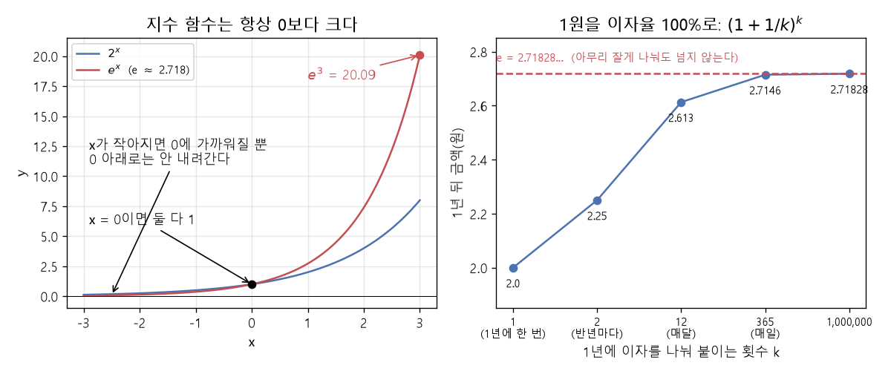

# 지수와 e

[목차로 돌아가기](../00_%EB%94%A5%EB%9F%AC%EB%8B%9D%EC%88%98%ED%95%99_MOC.md) · 다음: [M07_로그](../02_%EC%88%98%ED%95%99%EB%85%B8%ED%8A%B8/M07_%EB%A1%9C%EA%B7%B8.md)

> [!NOTE]
> **3줄 요약**
> - $2^3$은 "2를 3번 곱한 것" = 8이다. 위에 작게 쓴 숫자(3)가 **[지수](../00_%EB%94%A5%EB%9F%AC%EB%8B%9D_%EC%9A%A9%EC%96%B4%EC%82%AC%EC%A0%84.md#e-exponent-e%EC%99%80-%EC%A7%80%EC%88%98)**다.
> - $e$는 약 2.718인 특별한 수다. $e^x$는 **항상 0보다 크고**, x가 커지면 폭발적으로 커지고, x가 작아지면 0에 가까워진다.
> - [시그모이드](../00_%EB%94%A5%EB%9F%AC%EB%8B%9D_%EC%9A%A9%EC%96%B4%EC%82%AC%EC%A0%84.md#sigmoid-%EC%8B%9C%EA%B7%B8%EB%AA%A8%EC%9D%B4%EB%93%9C)와 [소프트맥스](../00_%EB%94%A5%EB%9F%AC%EB%8B%9D_%EC%9A%A9%EC%96%B4%EC%82%AC%EC%A0%84.md#softmax-%EC%86%8C%ED%94%84%ED%8A%B8%EB%A7%A5%EC%8A%A4) 안에 $e^x$가 들어 있다. "아무 숫자나 양수로 바꾸는" 역할이다.

## 1. 개념 설명

$a^n$ = a를 n번 곱한 것. a를 **밑**, n을 **[지수](../00_%EB%94%A5%EB%9F%AC%EB%8B%9D_%EC%9A%A9%EC%96%B4%EC%82%AC%EC%A0%84.md#e-exponent-e%EC%99%80-%EC%A7%80%EC%88%98)**라고 한다.

## 2. 필요한 이유

[E05_혈압_로지스틱회귀_예제](../03_%EC%98%88%EC%A0%9C%ED%92%80%EC%9D%B4/E05_%ED%98%88%EC%95%95_%EB%A1%9C%EC%A7%80%EC%8A%A4%ED%8B%B1%ED%9A%8C%EA%B7%80_%EC%98%88%EC%A0%9C.md)의 [시그모이드](../00_%EB%94%A5%EB%9F%AC%EB%8B%9D_%EC%9A%A9%EC%96%B4%EC%82%AC%EC%A0%84.md#sigmoid-%EC%8B%9C%EA%B7%B8%EB%AA%A8%EC%9D%B4%EB%93%9C) $\frac{1}{1+e^{-z}}$와 [E06_혈압_소프트맥스분류_예제](../03_%EC%98%88%EC%A0%9C%ED%92%80%EC%9D%B4/E06_%ED%98%88%EC%95%95_%EC%86%8C%ED%94%84%ED%8A%B8%EB%A7%A5%EC%8A%A4%EB%B6%84%EB%A5%98_%EC%98%88%EC%A0%9C.md)의 [소프트맥스](../00_%EB%94%A5%EB%9F%AC%EB%8B%9D_%EC%9A%A9%EC%96%B4%EC%82%AC%EC%A0%84.md#softmax-%EC%86%8C%ED%94%84%ED%8A%B8%EB%A7%A5%EC%8A%A4) 안에 $e^{(\cdot)}$가 들어 있다. $e^{(\cdot)}$는 [지수](../00_%EB%94%A5%EB%9F%AC%EB%8B%9D_%EC%9A%A9%EC%96%B4%EC%82%AC%EC%A0%84.md#e-exponent-e%EC%99%80-%EC%A7%80%EC%88%98) 자리의 괄호 안에 어떤 수가 들어간다는 뜻이다. 이 함수들이 왜 0~1 값을 내는지 알려면 $e^x$의 성질을 알아야 한다.

## 3. 숫자로 보기: 2의 거듭제곱

| n | −2 | −1 | 0 | 1 | 2 | 3 | 4 | 8 | 10 |
|---|---|---|---|---|---|---|---|---|---|
| $2^n$ | 0.25 | 0.5 | **1** | 2 | 4 | 8 | 16 | 256 | 1024 |

- 오른쪽으로 한 칸 갈 때마다 **2배**, 왼쪽으로 갈 때마다 **절반**이 된다.
- 그래서 $2^1$ = 2를 반으로 나누면 $2^0$ = **1**, $2^0$ = 1을 반으로 나누면 $2^{-1}$ = **0.5**다. 0번 곱한 게 1인 이유다.

> [!TIP]
> **[지수](../00_%EB%94%A5%EB%9F%AC%EB%8B%9D_%EC%9A%A9%EC%96%B4%EC%82%AC%EC%A0%84.md#e-exponent-e%EC%99%80-%EC%A7%80%EC%88%98) 규칙 하나만**
> 같은 밑끼리 곱하면 지수끼리 더한다: $2^2 × 2^3 = 4 × 8 = 32 = 2^5$
> 그리고 $a^{-n} = \frac{1}{a^n}$ (음수 [지수](../00_%EB%94%A5%EB%9F%AC%EB%8B%9D_%EC%9A%A9%EC%96%B4%EC%82%AC%EC%A0%84.md#e-exponent-e%EC%99%80-%EC%A7%80%EC%88%98) = 나누기). 예: $2^{-2} = \frac{1}{4} = 0.25$

## 4. 특별한 수 e ≈ 2.718

**은행 이자 예시**: 1원을 1년 동안 이자율 100%로 맡긴다. 이자를 1년에 몇 번 나눠 붙이느냐에 따라 1년 뒤 금액이 달라진다.

횟수를 k라 하자. k번으로 나누면 한 번에 $\frac{1}{k}$씩 이자가 붙고, 붙은 이자에도 다시 이자가 붙는다(복리). 예를 들어 k = 2이면 반년 뒤 1 × 1.5 = 1.5원, 다시 반년 뒤 1.5 × 1.5 = 2.25원이다. 그래서 k번 나누면 $(1 + \frac{1}{k})$를 k번 곱한 $(1 + \frac{1}{k})^k$이 된다.

| 나눠 붙이는 횟수 k | 계산 $(1 + \frac{1}{k})^k$ | 1년 뒤 금액 |
|---|---|---|
| 1 (1년에 한 번) | $2^1$ | 2.0 |
| 2 (반년마다) | $1.5^2$ | 2.25 |
| 12 (매달) | | 2.613 |
| 365 (매일) | | 2.7146 |
| 1,000,000 | | 2.71828 |

아무리 잘게 나눠도 **2.71828…** 을 넘지 않는다. 이 수가 $e$다. 성장·변화를 다루는 계산에서 가장 자연스럽게 나오는 수라서 딥러닝에서도 기본 밑으로 쓴다.

## 5. $e^x$의 모양

| x | −3 | −2 | −1 | 0 | 1 | 2 | 3 |
|---|---|---|---|---|---|---|---|
| $e^x$ | 0.0498 | 0.1353 | 0.3679 | **1** | 2.7183 | 7.3891 | 20.0855 |

1. **항상 양수**다. x가 −100이어도 0보다 크다(0에 아주 가까울 뿐).
2. x = 0이면 1이다.
3. x가 1 늘 때마다 약 **2.718배** 커진다. 그래서 큰 x에서는 폭발적으로 커진다.



> [!WARNING]
> **⚠ 너무 큰 [지수](../00_%EB%94%A5%EB%9F%AC%EB%8B%9D_%EC%9A%A9%EC%96%B4%EC%82%AC%EC%A0%84.md#e-exponent-e%EC%99%80-%EC%A7%80%EC%88%98)는 넘친다(오버플로)**
> $e^{1000}$은 컴퓨터가 담을 수 있는 수보다 커서:
> - numpy: `np.exp(1000.0)` → `inf` (경고: `overflow encountered in exp`)
> - math: `math.exp(1000)` → `OverflowError: math range error`
>
> 그래서 [소프트맥스](../00_%EB%94%A5%EB%9F%AC%EB%8B%9D_%EC%9A%A9%EC%96%B4%EC%82%AC%EC%A0%84.md#softmax-%EC%86%8C%ED%94%84%ED%8A%B8%EB%A7%A5%EC%8A%A4)를 직접 짤 때는 점수에서 가장 큰 값을 먼저 빼고 계산한다. 결과는 같다([D05_소프트맥스와_다중분류](../01_%EA%B0%9C%EB%85%90%EB%85%B8%ED%8A%B8/D05_%EC%86%8C%ED%94%84%ED%8A%B8%EB%A7%A5%EC%8A%A4%EC%99%80_%EB%8B%A4%EC%A4%91%EB%B6%84%EB%A5%98.md) 4절).

## 6. 코드로 확인

```python
import math
import numpy as np

print(2 ** 10)                       # 거듭제곱: ** 연산자 → 1024
print(math.e)                        # e → 2.718281828459045
print(math.exp(1), math.exp(-2))     # e^1, e^-2
print(np.exp(np.array([-1, 0, 1])))  # 배열 전체에 한 번에
```

**실행 결과**:

```text
1024
2.718281828459045
2.718281828459045 0.1353352832366127
[0.36787944 1.         2.71828183]
```

> [!WARNING]
> **⚠ `^`는 거듭제곱이 아니다**
> 파이썬의 `^`는 거듭제곱이 아니라 비트 연산(XOR)이다. 거듭제곱은 `**`를 쓴다.

## 7. 쓰이는 곳

### 시그모이드 (EX\_05)

말로 먼저: 입력 점수 z에서 $e^{-z}$를 만들고, 거기에 1을 더한 값으로 1을 나눈다.

$$\sigma(z) = \frac{1}{1 + e^{-z}}$$

<details><summary>기호 풀이</summary>

| 기호 | 읽는 법 | 뜻 | 예 |
| --- | --- | --- | --- |
| $\sigma(z)$ | 시그마 지 | [시그모이드](../00_%EB%94%A5%EB%9F%AC%EB%8B%9D_%EC%9A%A9%EC%96%B4%EC%82%AC%EC%A0%84.md#sigmoid-%EC%8B%9C%EA%B7%B8%EB%AA%A8%EC%9D%B4%EB%93%9C) 함수의 출력 | 0.8808 |
| $z$ | 지 | 입력 점수 | 2 |
| $e^{-z}$ | 이의 마이너스 지 제곱 | $\frac{1}{e^z}$과 같다(음수 [지수](../00_%EB%94%A5%EB%9F%AC%EB%8B%9D_%EC%9A%A9%EC%96%B4%EC%82%AC%EC%A0%84.md#e-exponent-e%EC%99%80-%EC%A7%80%EC%88%98) = 나누기). z가 크면 0에 가까움 | 0.1353 |

</details>

z = 2일 때 한 단계씩:

1. $e^{-2}$ = 0.1353 ← 위 표
2. 1 + 0.1353 = 1.1353
3. 1 ÷ 1.1353 = **0.8808**

$e^{-z}$가 항상 양수라서 분모(1 + 양수)는 항상 1보다 크다 → 결과는 항상 **1보다 작은 양수**. 그래서 0~1 사이 값이 나온다. 자세히: [D04_시그모이드와_이진분류](../01_%EA%B0%9C%EB%85%90%EB%85%B8%ED%8A%B8/D04_%EC%8B%9C%EA%B7%B8%EB%AA%A8%EC%9D%B4%EB%93%9C%EC%99%80_%EC%9D%B4%EC%A7%84%EB%B6%84%EB%A5%98.md)

### 소프트맥스 (EX\_06)

점수 `[2, 1, 0]`에 $e^{(\cdot)}$를 씌우면 `[7.389, 2.718, 1]` — 음수 점수도 양수가 되고, 큰 점수는 더 크게 벌어진다. 자세히: [D05_소프트맥스와_다중분류](../01_%EA%B0%9C%EB%85%90%EB%85%B8%ED%8A%B8/D05_%EC%86%8C%ED%94%84%ED%8A%B8%EB%A7%A5%EC%8A%A4%EC%99%80_%EB%8B%A4%EC%A4%91%EB%B6%84%EB%A5%98.md)

## 8. 개념 재확인

<details><summary>1. $3^0$, $3^2$, $3^{-1}$은?</summary>

| 단계 | 하는 일 | 식 | 계산 | 결과 |
|---|---|---|---|---|
| 1 | 3을 2번 곱하기 | $3^2$ | 3 × 3 | 9 |
| 2 | [지수](../00_%EB%94%A5%EB%9F%AC%EB%8B%9D_%EC%9A%A9%EC%96%B4%EC%82%AC%EC%A0%84.md#e-exponent-e%EC%99%80-%EC%A7%80%EC%88%98) 1 줄이기 | $3^1$ | 9 ÷ 3 | 3 |
| 3 | [지수](../00_%EB%94%A5%EB%9F%AC%EB%8B%9D_%EC%9A%A9%EC%96%B4%EC%82%AC%EC%A0%84.md#e-exponent-e%EC%99%80-%EC%A7%80%EC%88%98) 0 구하기 | $3^0$ | 3 ÷ 3 | 1 |
| 4 | 음수 [지수](../00_%EB%94%A5%EB%9F%AC%EB%8B%9D_%EC%9A%A9%EC%96%B4%EC%82%AC%EC%A0%84.md#e-exponent-e%EC%99%80-%EC%A7%80%EC%88%98) 풀기 | $3^{-1} = \frac{1}{3^1}$ | 1 ÷ 3 | 약 0.333 |

[지수](../00_%EB%94%A5%EB%9F%AC%EB%8B%9D_%EC%9A%A9%EC%96%B4%EC%82%AC%EC%A0%84.md#e-exponent-e%EC%99%80-%EC%A7%80%EC%88%98)가 1 줄 때마다 3으로 한 번 나눈다.

**① 쓰는 식**
$$a^n = \underbrace{a \times a \times \cdots \times a}_{n\text{번}},\qquad a^{-n} = \frac{1}{a^n}$$
- 위 첫 식 ← ② ($3^2$), ③ ($3^1$), ④ ($3^0$) / 둘째 식 $a^{-n} = \frac{1}{a^n}$ ← ⑤ ($3^{-1}$)
- $a$는 밑(곱하는 수), $n$은 [지수](../00_%EB%94%A5%EB%9F%AC%EB%8B%9D_%EC%9A%A9%EC%96%B4%EC%82%AC%EC%A0%84.md#e-exponent-e%EC%99%80-%EC%A7%80%EC%88%98)(몇 번 곱하나)이다. 여기서는 밑이 3이다.
- 음수 [지수](../00_%EB%94%A5%EB%9F%AC%EB%8B%9D_%EC%9A%A9%EC%96%B4%EC%82%AC%EC%A0%84.md#e-exponent-e%EC%99%80-%EC%A7%80%EC%88%98)는 "나누기"를 뜻한다.
```python
print(3 ** 2)     # ② 3을 2번 곱하기: 거듭제곱은 ** (^ 가 아니다) → 9
```

**② 3을 2번 곱하기** ($3^2$)
- $3 \times 3 = 9$

**③ [지수](../00_%EB%94%A5%EB%9F%AC%EB%8B%9D_%EC%9A%A9%EC%96%B4%EC%82%AC%EC%A0%84.md#e-exponent-e%EC%99%80-%EC%A7%80%EC%88%98)를 1 줄이기** ($3^1$)
- [지수](../00_%EB%94%A5%EB%9F%AC%EB%8B%9D_%EC%9A%A9%EC%96%B4%EC%82%AC%EC%A0%84.md#e-exponent-e%EC%99%80-%EC%A7%80%EC%88%98)가 1 줄면 밑 3으로 한 번 나눈다: $9 \div 3 = 3$
- 확인: 3을 1번 곱한 것은 3 자신이다.

**④ [지수](../00_%EB%94%A5%EB%9F%AC%EB%8B%9D_%EC%9A%A9%EC%96%B4%EC%82%AC%EC%A0%84.md#e-exponent-e%EC%99%80-%EC%A7%80%EC%88%98) 0 구하기** ($3^0$)
- 여기서 [지수](../00_%EB%94%A5%EB%9F%AC%EB%8B%9D_%EC%9A%A9%EC%96%B4%EC%82%AC%EC%A0%84.md#e-exponent-e%EC%99%80-%EC%A7%80%EC%88%98)를 또 1 줄이면 한 번 더 3으로 나눈다: $3 \div 3 = 1$
- 그래서 $3^0 = 1$이다. 0번 곱하면 아무것도 안 곱한 상태인 1이 남는다.

**⑤ 음수 [지수](../00_%EB%94%A5%EB%9F%AC%EB%8B%9D_%EC%9A%A9%EC%96%B4%EC%82%AC%EC%A0%84.md#e-exponent-e%EC%99%80-%EC%A7%80%EC%88%98) 풀기** ($3^{-1}$)
- [지수](../00_%EB%94%A5%EB%9F%AC%EB%8B%9D_%EC%9A%A9%EC%96%B4%EC%82%AC%EC%A0%84.md#e-exponent-e%EC%99%80-%EC%A7%80%EC%88%98)를 한 번 더 줄이면 또 3으로 나눈다: $1 \div 3 = 0.333\ldots$
- 공식으로도 같다: $3^{-1} = \frac{1}{3^1} = \frac{1}{3}$ (분수로 쓰면 1/3, 소수로는 약 0.333)

**답**: $3^0$ = **1**, $3^2$ = **9**, $3^{-1}$ = **1/3**

</details>

<details><summary>2. $e^x$가 0이나 음수가 될 수 있나?</summary>

| 단계 | 하는 일 | 식 | 계산 | 결과 |
|---|---|---|---|---|
| 1 | x가 양수일 때 | $e^x$ | e ≈ 2.718을 거듭 곱함 | 항상 양수 |
| 2 | x가 음수일 때 | $e^{-3} = \frac{1}{e^3}$ | 1 ÷ 20.0855 | 0.0498 |
| 3 | 더 작은 x로 확인 | $e^{-100} = \frac{1}{e^{100}}$ | 1 ÷ (아주 큰 양수) | 약 $3.7 \times 10^{-44}$ |

1을 어떤 양수로 나눈 값은 아무리 작아도 0이 되지 않는다.

**① 쓰는 식**
$$e^x,\qquad e \approx 2.718,\qquad e^{-x} = \frac{1}{e^x}$$
- 위 식 ← $e^x$는 ②(양수 x), $e^{-x} = \frac{1}{e^x}$는 ③④(음수 x), 결론은 ⑤
- $e$는 약 2.718인 특별한 수, $x$는 [지수](../00_%EB%94%A5%EB%9F%AC%EB%8B%9D_%EC%9A%A9%EC%96%B4%EC%82%AC%EC%A0%84.md#e-exponent-e%EC%99%80-%EC%A7%80%EC%88%98)(e를 몇 번 곱하나)이다.
```python
print(math.exp(1), math.exp(-2))   # ② e^1 (양수 지수), ③ e^-2 (음수 지수는 나누기)
```

**② x가 양수일 때** ($e^x$)
- 5절 표 값: $e^1 \approx 2.7183$, $e^2 \approx 7.3891$, $e^3 \approx 20.0855$
- x가 1 늘 때마다 앞 값에 e(약 2.718)를 한 번 더 곱한 것이다. 양수에 양수를 계속 곱하면 항상 양수이고, 곱할수록 커진다.

**③ x가 음수일 때** ($e^{-3}$)
- 음수 [지수](../00_%EB%94%A5%EB%9F%AC%EB%8B%9D_%EC%9A%A9%EC%96%B4%EC%82%AC%EC%A0%84.md#e-exponent-e%EC%99%80-%EC%A7%80%EC%88%98)는 나누기이다: $e^{-3} = \frac{1}{e^3}$
- $e^3 = 20.0855$이므로 $1 \div 20.0855 = 0.0498$
- 양수로 1을 나눈 값이므로 양수이다.

**④ 더 작은 x로 확인** ($e^{-100}$)
- $e^{-100} = \frac{1}{e^{100}}$
- $e^{100}$은 아주 큰 양수이다.
- 1을 아주 큰 양수로 나누면 아주 작지만 양수이다: 약 $3.7 \times 10^{-44}$ (소수점 아래 0이 43개 이어진 뒤 37이 나오는 수)
- 0에 아주 가까울 뿐 0은 아니다.

**⑤ 결론**
- x가 양수여도 음수여도 0이어도($e^0 = 1$) 결과는 항상 0보다 크다.

**답**: **없다.** 항상 0보다 크다. 그래서 [확률](../00_%EB%94%A5%EB%9F%AC%EB%8B%9D_%EC%9A%A9%EC%96%B4%EC%82%AC%EC%A0%84.md#probability-%ED%99%95%EB%A5%A0)을 만드는 데 쓴다.

</details>

<details><summary>3. 시그모이드에 z = 0을 넣으면?</summary>

| 단계 | 하는 일 | 식 | 계산 | 결과 |
|---|---|---|---|---|
| 1 | $e^{-z}$ 구하기 | $e^{-0} = e^0$ | 0번 곱하면 1 | 1 |
| 2 | 분모 만들기 | $1 + e^{-z}$ | 1 + 1 | 2 |
| 3 | 1을 분모로 나누기 | $\sigma(z) = \frac{1}{1 + e^{-z}}$ | 1 ÷ 2 | 0.5 |

**① 쓰는 식**
$$\sigma(z) = \frac{1}{1 + e^{-z}}$$
- 위 식 ← $e^{-z}$는 ②, 분모 $1 + e^{-z}$는 ③, 분수 $\frac{1}{\cdots}$는 ④
- $z$는 입력 점수, $e^{-z}$는 e를 −z번 곱한 값, $\sigma(z)$는 0~1 사이로 바뀐 출력이다. 여기서는 $z = 0$을 넣는다.

**② $e^{-z}$ 구하기** ($e^{-0}$)
- $z = 0$이므로 $-z = -0 = 0$
- $e^{-0} = e^0$
- 어떤 수든 0번 곱하면 1이다: $e^0 = 1$

**③ 분모 만들기** ($1 + e^{-z}$)
- $1 + 1 = 2$

**④ 1을 분모로 나누기** ($\frac{1}{2}$)
- $1 \div 2 = 0.5$ → $\sigma(0) = 0.5$

**답**: $\sigma(0)$ = **0.5**

</details>

<details><summary>내 이해</summary>


</details>
