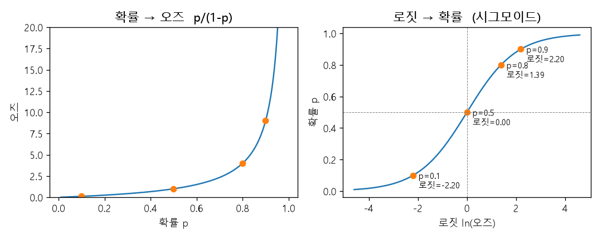
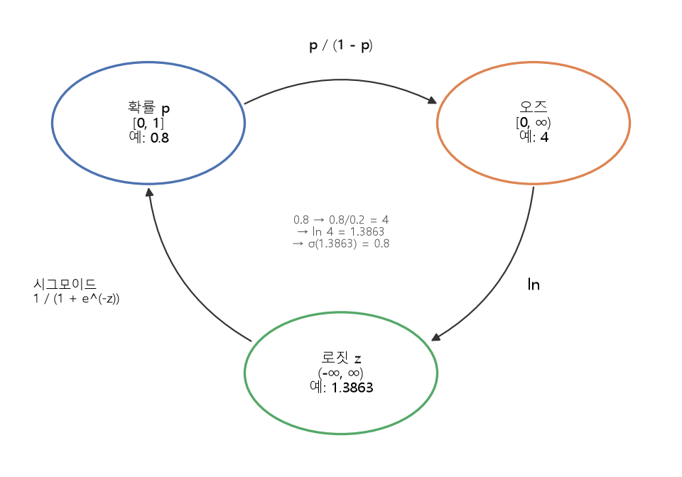

# 오즈와 로짓 (Odds, Logit)

[목차로 돌아가기](../00_%EB%94%A5%EB%9F%AC%EB%8B%9D%EC%88%98%ED%95%99_MOC.md) · 먼저 볼 것: [M06_지수와_e](../02_%EC%88%98%ED%95%99%EB%85%B8%ED%8A%B8/M06_%EC%A7%80%EC%88%98%EC%99%80_e.md), [M07_로그](../02_%EC%88%98%ED%95%99%EB%85%B8%ED%8A%B8/M07_%EB%A1%9C%EA%B7%B8.md), [M08_확률_기초](../02_%EC%88%98%ED%95%99%EB%85%B8%ED%8A%B8/M08_%ED%99%95%EB%A5%A0_%EA%B8%B0%EC%B4%88.md)

> [!NOTE]
> **3줄 요약**
> - **[오즈](../00_%EB%94%A5%EB%9F%AC%EB%8B%9D_%EC%9A%A9%EC%96%B4%EC%82%AC%EC%A0%84.md#odds-%EC%98%A4%EC%A6%88)**는 "일어날 몫 ÷ 안 일어날 몫" = $\frac{p}{1-p}$다. [확률](../00_%EB%94%A5%EB%9F%AC%EB%8B%9D_%EC%9A%A9%EC%96%B4%EC%82%AC%EC%A0%84.md#probability-%ED%99%95%EB%A5%A0) p는 0~1 사이지만 [오즈](../00_%EB%94%A5%EB%9F%AC%EB%8B%9D_%EC%9A%A9%EC%96%B4%EC%82%AC%EC%A0%84.md#odds-%EC%98%A4%EC%A6%88)는 0 이상의 모든 수(0 ~ ∞)가 된다. 예: p = 0.8이면 [오즈](../00_%EB%94%A5%EB%9F%AC%EB%8B%9D_%EC%9A%A9%EC%96%B4%EC%82%AC%EC%A0%84.md#odds-%EC%98%A4%EC%A6%88) 4.
> - **[로짓](../00_%EB%94%A5%EB%9F%AC%EB%8B%9D_%EC%9A%A9%EC%96%B4%EC%82%AC%EC%A0%84.md#logit-%EB%A1%9C%EC%A7%93)**은 [오즈](../00_%EB%94%A5%EB%9F%AC%EB%8B%9D_%EC%9A%A9%EC%96%B4%EC%82%AC%EC%A0%84.md#odds-%EC%98%A4%EC%A6%88)에 $\ln$을 씌운 값이다. 어떤 수(−∞ ~ ∞)도 될 수 있다. p = 0.8이면 [로짓](../00_%EB%94%A5%EB%9F%AC%EB%8B%9D_%EC%9A%A9%EC%96%B4%EC%82%AC%EC%A0%84.md#logit-%EB%A1%9C%EC%A7%93) $\ln 4 = 1.3863$.
> - **[시그모이드](../00_%EB%94%A5%EB%9F%AC%EB%8B%9D_%EC%9A%A9%EC%96%B4%EC%82%AC%EC%A0%84.md#sigmoid-%EC%8B%9C%EA%B7%B8%EB%AA%A8%EC%9D%B4%EB%93%9C)**는 [로짓](../00_%EB%94%A5%EB%9F%AC%EB%8B%9D_%EC%9A%A9%EC%96%B4%EC%82%AC%EC%A0%84.md#logit-%EB%A1%9C%EC%A7%93)을 다시 [확률](../00_%EB%94%A5%EB%9F%AC%EB%8B%9D_%EC%9A%A9%EC%96%B4%EC%82%AC%EC%A0%84.md#probability-%ED%99%95%EB%A5%A0)로 되돌린다. $\sigma(1.3863) = 0.8$. 그래서 [로지스틱 회귀](../00_%EB%94%A5%EB%9F%AC%EB%8B%9D_%EC%9A%A9%EC%96%B4%EC%82%AC%EC%A0%84.md#logistic-regression-%EB%A1%9C%EC%A7%80%EC%8A%A4%ED%8B%B1-%ED%9A%8C%EA%B7%80)의 [가중합](../00_%EB%94%A5%EB%9F%AC%EB%8B%9D_%EC%9A%A9%EC%96%B4%EC%82%AC%EC%A0%84.md#weighted-sum-%EA%B0%80%EC%A4%91%ED%95%A9) z는 "[로짓](../00_%EB%94%A5%EB%9F%AC%EB%8B%9D_%EC%9A%A9%EC%96%B4%EC%82%AC%EC%A0%84.md#logit-%EB%A1%9C%EC%A7%93)"이다.

## 1. 개념 설명

비유: 승부 예상을 말할 때 "이길 [확률](../00_%EB%94%A5%EB%9F%AC%EB%8B%9D_%EC%9A%A9%EC%96%B4%EC%82%AC%EC%A0%84.md#probability-%ED%99%95%EB%A5%A0) 80%"라고도 하고, "이기는 쪽 8 : 지는 쪽 2"라고도 한다. 뒤의 말이 [오즈](../00_%EB%94%A5%EB%9F%AC%EB%8B%9D_%EC%9A%A9%EC%96%B4%EC%82%AC%EC%A0%84.md#odds-%EC%98%A4%EC%A6%88)다. 8 : 2를 줄이면 4 : 1이라서 **[오즈](../00_%EB%94%A5%EB%9F%AC%EB%8B%9D_%EC%9A%A9%EC%96%B4%EC%82%AC%EC%A0%84.md#odds-%EC%98%A4%EC%A6%88) = 4**이고, 이기는 쪽이 지는 쪽보다 4배 더 일어날 만하다는 뜻이다.

정확히 말하면 다음과 같다.

- [확률](../00_%EB%94%A5%EB%9F%AC%EB%8B%9D_%EC%9A%A9%EC%96%B4%EC%82%AC%EC%A0%84.md#probability-%ED%99%95%EB%A5%A0) $p$: 일어날 몫 ÷ 전체. 0~1 사이.
- [오즈](../00_%EB%94%A5%EB%9F%AC%EB%8B%9D_%EC%9A%A9%EC%96%B4%EC%82%AC%EC%A0%84.md#odds-%EC%98%A4%EC%A6%88): 일어날 몫 ÷ **안** 일어날 몫 = $\frac{p}{1-p}$. 0 이상.
- [로짓](../00_%EB%94%A5%EB%9F%AC%EB%8B%9D_%EC%9A%A9%EC%96%B4%EC%82%AC%EC%A0%84.md#logit-%EB%A1%9C%EC%A7%93): [오즈](../00_%EB%94%A5%EB%9F%AC%EB%8B%9D_%EC%9A%A9%EC%96%B4%EC%82%AC%EC%A0%84.md#odds-%EC%98%A4%EC%A6%88)에 자연로그를 씌운 값 = $\ln\frac{p}{1-p}$. 모든 실수(음수 포함).

세 가지는 같은 사실을 다른 자로 잰 것이어서, 한 값을 알면 나머지를 계산할 수 있다.

## 2. 필요한 이유

- **[D04_시그모이드와_이진분류](../01_%EA%B0%9C%EB%85%90%EB%85%B8%ED%8A%B8/D04_%EC%8B%9C%EA%B7%B8%EB%AA%A8%EC%9D%B4%EB%93%9C%EC%99%80_%EC%9D%B4%EC%A7%84%EB%B6%84%EB%A5%98.md)**: [이진 분류](../00_%EB%94%A5%EB%9F%AC%EB%8B%9D_%EC%9A%A9%EC%96%B4%EC%82%AC%EC%A0%84.md#binary-classification-%EC%9D%B4%EC%A7%84-%EB%B6%84%EB%A5%98)에서 [시그모이드](../00_%EB%94%A5%EB%9F%AC%EB%8B%9D_%EC%9A%A9%EC%96%B4%EC%82%AC%EC%A0%84.md#sigmoid-%EC%8B%9C%EA%B7%B8%EB%AA%A8%EC%9D%B4%EB%93%9C)가 [가중합](../00_%EB%94%A5%EB%9F%AC%EB%8B%9D_%EC%9A%A9%EC%96%B4%EC%82%AC%EC%A0%84.md#weighted-sum-%EA%B0%80%EC%A4%91%ED%95%A9) z를 0~1 [확률](../00_%EB%94%A5%EB%9F%AC%EB%8B%9D_%EC%9A%A9%EC%96%B4%EC%82%AC%EC%A0%84.md#probability-%ED%99%95%EB%A5%A0)로 바꾼다. 거꾸로 "[확률](../00_%EB%94%A5%EB%9F%AC%EB%8B%9D_%EC%9A%A9%EC%96%B4%EC%82%AC%EC%A0%84.md#probability-%ED%99%95%EB%A5%A0)에서 z로" 가는 길이 [로짓](../00_%EB%94%A5%EB%9F%AC%EB%8B%9D_%EC%9A%A9%EC%96%B4%EC%82%AC%EC%A0%84.md#logit-%EB%A1%9C%EC%A7%93)이다. 둘이 서로 역함수 관계라서 [시그모이드](../00_%EB%94%A5%EB%9F%AC%EB%8B%9D_%EC%9A%A9%EC%96%B4%EC%82%AC%EC%A0%84.md#sigmoid-%EC%8B%9C%EA%B7%B8%EB%AA%A8%EC%9D%B4%EB%93%9C)가 왜 그런 모양인지 설명된다.
- **[D05_소프트맥스와_다중분류](../01_%EA%B0%9C%EB%85%90%EB%85%B8%ED%8A%B8/D05_%EC%86%8C%ED%94%84%ED%8A%B8%EB%A7%A5%EC%8A%A4%EC%99%80_%EB%8B%A4%EC%A4%91%EB%B6%84%EB%A5%98.md)**, **[D10_이진분류기에서_소프트맥스로](../01_%EA%B0%9C%EB%85%90%EB%85%B8%ED%8A%B8/D10_%EC%9D%B4%EC%A7%84%EB%B6%84%EB%A5%98%EA%B8%B0%EC%97%90%EC%84%9C_%EC%86%8C%ED%94%84%ED%8A%B8%EB%A7%A5%EC%8A%A4%EB%A1%9C.md)**: [소프트맥스](../00_%EB%94%A5%EB%9F%AC%EB%8B%9D_%EC%9A%A9%EC%96%B4%EC%82%AC%EC%A0%84.md#softmax-%EC%86%8C%ED%94%84%ED%8A%B8%EB%A7%A5%EC%8A%A4)가 점수에 $e^{y}$를 씌우는 것은 "점수를 [로짓](../00_%EB%94%A5%EB%9F%AC%EB%8B%9D_%EC%9A%A9%EC%96%B4%EC%82%AC%EC%A0%84.md#logit-%EB%A1%9C%EC%A7%93)으로 보고 [오즈](../00_%EB%94%A5%EB%9F%AC%EB%8B%9D_%EC%9A%A9%EC%96%B4%EC%82%AC%EC%A0%84.md#odds-%EC%98%A4%EC%A6%88)로 바꾸는 것"이다. 그 [오즈](../00_%EB%94%A5%EB%9F%AC%EB%8B%9D_%EC%9A%A9%EC%96%B4%EC%82%AC%EC%A0%84.md#odds-%EC%98%A4%EC%A6%88)들을 전체 합으로 나누면 합이 1인 [확률](../00_%EB%94%A5%EB%9F%AC%EB%8B%9D_%EC%9A%A9%EC%96%B4%EC%82%AC%EC%A0%84.md#probability-%ED%99%95%EB%A5%A0)이 된다.
- [확률](../00_%EB%94%A5%EB%9F%AC%EB%8B%9D_%EC%9A%A9%EC%96%B4%EC%82%AC%EC%A0%84.md#probability-%ED%99%95%EB%A5%A0)은 0과 1에 막혀 있어 숫자를 마음대로 더하고 곱하기 불편하다. [로짓](../00_%EB%94%A5%EB%9F%AC%EB%8B%9D_%EC%9A%A9%EC%96%B4%EC%82%AC%EC%A0%84.md#logit-%EB%A1%9C%EC%A7%93)은 막힘 없이 −∞ ~ ∞를 쓸 수 있어서 [가중합](../00_%EB%94%A5%EB%9F%AC%EB%8B%9D_%EC%9A%A9%EC%96%B4%EC%82%AC%EC%A0%84.md#weighted-sum-%EA%B0%80%EC%A4%91%ED%95%A9) 같은 선형 계산과 잘 맞는다.

## 3. 확률에서 오즈로

p = 0.8로 손계산한다.

- 10번 중 8번 일어남, 2번 안 일어남
- [오즈](../00_%EB%94%A5%EB%9F%AC%EB%8B%9D_%EC%9A%A9%EC%96%B4%EC%82%AC%EC%A0%84.md#odds-%EC%98%A4%EC%A6%88) = 8 ÷ 2 = 4 (식으로는 $\frac{0.8}{1-0.8} = \frac{0.8}{0.2} = 4$)

| [확률](../00_%EB%94%A5%EB%9F%AC%EB%8B%9D_%EC%9A%A9%EC%96%B4%EC%82%AC%EC%A0%84.md#probability-%ED%99%95%EB%A5%A0) p | 안 일어날 몫 1−p | [오즈](../00_%EB%94%A5%EB%9F%AC%EB%8B%9D_%EC%9A%A9%EC%96%B4%EC%82%AC%EC%A0%84.md#odds-%EC%98%A4%EC%A6%88) $\frac{p}{1-p}$ | 읽는 법 |
|---|---|---|---|
| 0.1 | 0.9 | 0.1 ÷ 0.9 = **0.1111** | 일어나는 쪽이 1 : 9 |
| 0.5 | 0.5 | 0.5 ÷ 0.5 = **1** | 반반 |
| 0.8 | 0.2 | 0.8 ÷ 0.2 = **4** | 4 : 1 |
| 0.9 | 0.1 | 0.9 ÷ 0.1 = **9** | 9 : 1 |

- p가 0에 가까우면 [오즈](../00_%EB%94%A5%EB%9F%AC%EB%8B%9D_%EC%9A%A9%EC%96%B4%EC%82%AC%EC%A0%84.md#odds-%EC%98%A4%EC%A6%88)는 0에 가깝고, p가 1에 가까우면 [오즈](../00_%EB%94%A5%EB%9F%AC%EB%8B%9D_%EC%9A%A9%EC%96%B4%EC%82%AC%EC%A0%84.md#odds-%EC%98%A4%EC%A6%88)는 끝없이 커진다. 그래서 [오즈](../00_%EB%94%A5%EB%9F%AC%EB%8B%9D_%EC%9A%A9%EC%96%B4%EC%82%AC%EC%A0%84.md#odds-%EC%98%A4%EC%A6%88)의 범위는 **0 ~ ∞**다.
- [오즈](../00_%EB%94%A5%EB%9F%AC%EB%8B%9D_%EC%9A%A9%EC%96%B4%EC%82%AC%EC%A0%84.md#odds-%EC%98%A4%EC%A6%88) 1이 "반반"의 기준이다. 1보다 작으면 일어날 쪽이 불리하고, 1보다 크면 유리하다.
- 문제 하나: [오즈](../00_%EB%94%A5%EB%9F%AC%EB%8B%9D_%EC%9A%A9%EC%96%B4%EC%82%AC%EC%A0%84.md#odds-%EC%98%A4%EC%A6%88)는 0.1111(1/9)과 9처럼 한쪽은 0~1에 눌려 있고 반대쪽은 끝없이 늘어서, 서로 반대인 두 상황이 대칭이 아니다. [로그](../00_%EB%94%A5%EB%9F%AC%EB%8B%9D_%EC%9A%A9%EC%96%B4%EC%82%AC%EC%A0%84.md#log-ln-%EB%A1%9C%EA%B7%B8)가 이것을 고친다.

## 4. 오즈에서 로짓으로

[오즈](../00_%EB%94%A5%EB%9F%AC%EB%8B%9D_%EC%9A%A9%EC%96%B4%EC%82%AC%EC%A0%84.md#odds-%EC%98%A4%EC%A6%88)에 $\ln$을 씌운다. 말로 하면 "e를 몇 번 곱해야 이 [오즈](../00_%EB%94%A5%EB%9F%AC%EB%8B%9D_%EC%9A%A9%EC%96%B4%EC%82%AC%EC%A0%84.md#odds-%EC%98%A4%EC%A6%88)가 되나?"다.

<details><summary>미니 복습: ln</summary>

$\ln x$는 "e(약 2.718)를 몇 번 곱해야 x가 되나?"다. 1은 0번 곱한 것이라 $\ln 1 = 0$. 1보다 큰 수의 ln은 양수, 0~1 사이 수의 ln은 음수. $\ln 4 = 1.3863$이라는 말은 $e^{1.3863} \approx 4$라는 뜻이다. 또 $\ln\frac{1}{9} = -\ln 9$처럼, 분수의 ln은 분모의 ln에 마이너스를 붙인 것이다. 자세히: [M07_로그](../02_%EC%88%98%ED%95%99%EB%85%B8%ED%8A%B8/M07_%EB%A1%9C%EA%B7%B8.md)

</details>

| [확률](../00_%EB%94%A5%EB%9F%AC%EB%8B%9D_%EC%9A%A9%EC%96%B4%EC%82%AC%EC%A0%84.md#probability-%ED%99%95%EB%A5%A0) p | [오즈](../00_%EB%94%A5%EB%9F%AC%EB%8B%9D_%EC%9A%A9%EC%96%B4%EC%82%AC%EC%A0%84.md#odds-%EC%98%A4%EC%A6%88) | [로짓](../00_%EB%94%A5%EB%9F%AC%EB%8B%9D_%EC%9A%A9%EC%96%B4%EC%82%AC%EC%A0%84.md#logit-%EB%A1%9C%EC%A7%93) $\ln(\text{오즈})$ | 읽는 법 |
|---|---|---|---|
| 0.1 | 0.1111 | **−2.1972** | [오즈](../00_%EB%94%A5%EB%9F%AC%EB%8B%9D_%EC%9A%A9%EC%96%B4%EC%82%AC%EC%A0%84.md#odds-%EC%98%A4%EC%A6%88) 1/9 → $-\ln 9$ |
| 0.5 | 1 | **0** | 반반이면 [로짓](../00_%EB%94%A5%EB%9F%AC%EB%8B%9D_%EC%9A%A9%EC%96%B4%EC%82%AC%EC%A0%84.md#logit-%EB%A1%9C%EC%A7%93) 0 ($\ln 1 = 0$) |
| 0.8 | 4 | **1.3863** | $\ln 4$ |
| 0.9 | 9 | **2.1972** | $\ln 9$ |

- p = 0.1과 p = 0.9는 서로 거울이다. [로짓](../00_%EB%94%A5%EB%9F%AC%EB%8B%9D_%EC%9A%A9%EC%96%B4%EC%82%AC%EC%A0%84.md#logit-%EB%A1%9C%EC%A7%93)은 −2.1972와 +2.1972로 **부호만 반대**다. [오즈](../00_%EB%94%A5%EB%9F%AC%EB%8B%9D_%EC%9A%A9%EC%96%B4%EC%82%AC%EC%A0%84.md#odds-%EC%98%A4%EC%A6%88)로는 1/9과 9라서 안 보이던 대칭이 [로그](../00_%EB%94%A5%EB%9F%AC%EB%8B%9D_%EC%9A%A9%EC%96%B4%EC%82%AC%EC%A0%84.md#log-ln-%EB%A1%9C%EA%B7%B8)를 씌우면 보인다.
- [로짓](../00_%EB%94%A5%EB%9F%AC%EB%8B%9D_%EC%9A%A9%EC%96%B4%EC%82%AC%EC%A0%84.md#logit-%EB%A1%9C%EC%A7%93)은 p가 0.5보다 작으면 음수, 0.5보다 크면 양수다.
- p가 0이나 1에 가까울수록 [로짓](../00_%EB%94%A5%EB%9F%AC%EB%8B%9D_%EC%9A%A9%EC%96%B4%EC%82%AC%EC%A0%84.md#logit-%EB%A1%9C%EC%A7%93)의 절댓값이 커져서, 범위는 **−∞ ~ ∞** 전체가 된다.

범위를 한 줄로 정리하면 다음과 같다.

| 이름 | 범위 | 중심(반반) |
|---|---|---|
| [확률](../00_%EB%94%A5%EB%9F%AC%EB%8B%9D_%EC%9A%A9%EC%96%B4%EC%82%AC%EC%A0%84.md#probability-%ED%99%95%EB%A5%A0) p | 0 ~ 1 | 0.5 |
| [오즈](../00_%EB%94%A5%EB%9F%AC%EB%8B%9D_%EC%9A%A9%EC%96%B4%EC%82%AC%EC%A0%84.md#odds-%EC%98%A4%EC%A6%88) | 0 ~ ∞ | 1 |
| [로짓](../00_%EB%94%A5%EB%9F%AC%EB%8B%9D_%EC%9A%A9%EC%96%B4%EC%82%AC%EC%A0%84.md#logit-%EB%A1%9C%EC%A7%93) | −∞ ~ ∞ | 0 |

## 5. 로짓에서 확률로: 시그모이드

[로짓](../00_%EB%94%A5%EB%9F%AC%EB%8B%9D_%EC%9A%A9%EC%96%B4%EC%82%AC%EC%A0%84.md#logit-%EB%A1%9C%EC%A7%93) z를 알 때 [확률](../00_%EB%94%A5%EB%9F%AC%EB%8B%9D_%EC%9A%A9%EC%96%B4%EC%82%AC%EC%A0%84.md#probability-%ED%99%95%EB%A5%A0) p를 거꾸로 구한다. 한 줄에 한 동작씩 쓴다.

- [로짓](../00_%EB%94%A5%EB%9F%AC%EB%8B%9D_%EC%9A%A9%EC%96%B4%EC%82%AC%EC%A0%84.md#logit-%EB%A1%9C%EC%A7%93)의 정의: $z = \ln\frac{p}{1-p}$
- [오즈](../00_%EB%94%A5%EB%9F%AC%EB%8B%9D_%EC%9A%A9%EC%96%B4%EC%82%AC%EC%A0%84.md#odds-%EC%98%A4%EC%A6%88)로 돌아가기: 양변에 e의 거듭제곱을 취하면 $e^{z} = \frac{p}{1-p}$ (ln을 풀어 주려고)
- 분모 없애기: $e^{z}(1-p) = p$ (양변에 $1-p$를 곱함)
- 괄호 풀기: $e^{z} - e^{z}p = p$ (분배)
- p 모으기: $e^{z} = p + e^{z}p = p(1 + e^{z})$ (좌변의 $e^{z}p$를 오른쪽으로 옮겨 p로 묶음)
- p 구하기: $p = \frac{e^{z}}{1 + e^{z}}$ (양변을 $1 + e^{z}$로 나눔)
- 분자·분모를 $e^{z}$로 나누기: $p = \frac{1}{e^{-z} + 1} = \frac{1}{1 + e^{-z}}$

마지막 식이 [시그모이드](../00_%EB%94%A5%EB%9F%AC%EB%8B%9D_%EC%9A%A9%EC%96%B4%EC%82%AC%EC%A0%84.md#sigmoid-%EC%8B%9C%EA%B7%B8%EB%AA%A8%EC%9D%B4%EB%93%9C) $\sigma(z)$다.

$$\sigma(z) = \frac{1}{1 + e^{-z}}$$

숫자로 확인한다. z = 1.3863이면 $e^{z} \approx 4$이므로 $p = \frac{4}{1 + 4} = 0.8$이다. 처음 p = 0.8로 돌아왔다.

| [로짓](../00_%EB%94%A5%EB%9F%AC%EB%8B%9D_%EC%9A%A9%EC%96%B4%EC%82%AC%EC%A0%84.md#logit-%EB%A1%9C%EC%A7%93) z | $e^{z}$ ([오즈](../00_%EB%94%A5%EB%9F%AC%EB%8B%9D_%EC%9A%A9%EC%96%B4%EC%82%AC%EC%A0%84.md#odds-%EC%98%A4%EC%A6%88)) | $\frac{e^{z}}{1+e^{z}}$ | $\sigma(z)$ |
|---|---|---|---|
| −2.1972 | 0.1111 | 0.1111 ÷ 1.1111 = 0.1 | **0.1** |
| 0 | 1 | 1 ÷ 2 = 0.5 | **0.5** |
| 1.3863 | 4 | 4 ÷ 5 = 0.8 | **0.8** |
| 2.1972 | 9 | 9 ÷ 10 = 0.9 | **0.9** |

<details><summary>기호 풀이</summary>

| 기호 | 읽는 법 | 뜻 | 예제 값 |
| --- | --- | --- | --- |
| $p$ | 피 | [확률](../00_%EB%94%A5%EB%9F%AC%EB%8B%9D_%EC%9A%A9%EC%96%B4%EC%82%AC%EC%A0%84.md#probability-%ED%99%95%EB%A5%A0) | 0.8 |
| $\frac{p}{1-p}$ | 피 나누기 일 빼기 피 | [오즈](../00_%EB%94%A5%EB%9F%AC%EB%8B%9D_%EC%9A%A9%EC%96%B4%EC%82%AC%EC%A0%84.md#odds-%EC%98%A4%EC%A6%88) (일어날 몫 ÷ 안 일어날 몫) | 4 |
| $\ln$ | 엘엔 | 자연로그 (밑이 e) | $\ln 4 = 1.3863$ |
| $z$ | 지 | [로짓](../00_%EB%94%A5%EB%9F%AC%EB%8B%9D_%EC%9A%A9%EC%96%B4%EC%82%AC%EC%A0%84.md#logit-%EB%A1%9C%EC%A7%93) (= [오즈](../00_%EB%94%A5%EB%9F%AC%EB%8B%9D_%EC%9A%A9%EC%96%B4%EC%82%AC%EC%A0%84.md#odds-%EC%98%A4%EC%A6%88)의 ln) | 1.3863 |
| $e^{z}$ | 이의 지 제곱 | [로짓](../00_%EB%94%A5%EB%9F%AC%EB%8B%9D_%EC%9A%A9%EC%96%B4%EC%82%AC%EC%A0%84.md#logit-%EB%A1%9C%EC%A7%93)을 [오즈](../00_%EB%94%A5%EB%9F%AC%EB%8B%9D_%EC%9A%A9%EC%96%B4%EC%82%AC%EC%A0%84.md#odds-%EC%98%A4%EC%A6%88)로 되돌린 값 | 4 |
| $\sigma(z)$ | 시그마 오브 지 | [시그모이드](../00_%EB%94%A5%EB%9F%AC%EB%8B%9D_%EC%9A%A9%EC%96%B4%EC%82%AC%EC%A0%84.md#sigmoid-%EC%8B%9C%EA%B7%B8%EB%AA%A8%EC%9D%B4%EB%93%9C). [로짓](../00_%EB%94%A5%EB%9F%AC%EB%8B%9D_%EC%9A%A9%EC%96%B4%EC%82%AC%EC%A0%84.md#logit-%EB%A1%9C%EC%A7%93)을 [확률](../00_%EB%94%A5%EB%9F%AC%EB%8B%9D_%EC%9A%A9%EC%96%B4%EC%82%AC%EC%A0%84.md#probability-%ED%99%95%EB%A5%A0)로 바꿈 | 0.8 |

</details>





## 6. 딥러닝과의 연결

- [로지스틱 회귀](../00_%EB%94%A5%EB%9F%AC%EB%8B%9D_%EC%9A%A9%EC%96%B4%EC%82%AC%EC%A0%84.md#logistic-regression-%EB%A1%9C%EC%A7%80%EC%8A%A4%ED%8B%B1-%ED%9A%8C%EA%B7%80)([이진 분류](../00_%EB%94%A5%EB%9F%AC%EB%8B%9D_%EC%9A%A9%EC%96%B4%EC%82%AC%EC%A0%84.md#binary-classification-%EC%9D%B4%EC%A7%84-%EB%B6%84%EB%A5%98))에서 입력에 [가중치](../00_%EB%94%A5%EB%9F%AC%EB%8B%9D_%EC%9A%A9%EC%96%B4%EC%82%AC%EC%A0%84.md#weight-%EA%B0%80%EC%A4%91%EC%B9%98)를 곱해 더한 **[가중합](../00_%EB%94%A5%EB%9F%AC%EB%8B%9D_%EC%9A%A9%EC%96%B4%EC%82%AC%EC%A0%84.md#weighted-sum-%EA%B0%80%EC%A4%91%ED%95%A9) $z = XW + b$**는 어떤 실수든 될 수 있다. 이 값을 곧 "[로짓](../00_%EB%94%A5%EB%9F%AC%EB%8B%9D_%EC%9A%A9%EC%96%B4%EC%82%AC%EC%A0%84.md#logit-%EB%A1%9C%EC%A7%93)"으로 읽고, [시그모이드](../00_%EB%94%A5%EB%9F%AC%EB%8B%9D_%EC%9A%A9%EC%96%B4%EC%82%AC%EC%A0%84.md#sigmoid-%EC%8B%9C%EA%B7%B8%EB%AA%A8%EC%9D%B4%EB%93%9C)로 [확률](../00_%EB%94%A5%EB%9F%AC%EB%8B%9D_%EC%9A%A9%EC%96%B4%EC%82%AC%EC%A0%84.md#probability-%ED%99%95%EB%A5%A0) p를 만든다. 그래서 [학습](../00_%EB%94%A5%EB%9F%AC%EB%8B%9D_%EC%9A%A9%EC%96%B4%EC%82%AC%EC%A0%84.md#training-%ED%95%99%EC%8A%B5)이 끝난 뒤 z가 +이면 p가 0.5보다 크고, −이면 0.5보다 작고, 0이면 정확히 0.5다.
- 같은 z에서 $e^{z}$는 그 입력이 "일어날" [오즈](../00_%EB%94%A5%EB%9F%AC%EB%8B%9D_%EC%9A%A9%EC%96%B4%EC%82%AC%EC%A0%84.md#odds-%EC%98%A4%EC%A6%88)다. z가 1 커지면 [오즈](../00_%EB%94%A5%EB%9F%AC%EB%8B%9D_%EC%9A%A9%EC%96%B4%EC%82%AC%EC%A0%84.md#odds-%EC%98%A4%EC%A6%88)가 약 2.718배가 된다.
- [소프트맥스](../00_%EB%94%A5%EB%9F%AC%EB%8B%9D_%EC%9A%A9%EC%96%B4%EC%82%AC%EC%A0%84.md#softmax-%EC%86%8C%ED%94%84%ED%8A%B8%EB%A7%A5%EC%8A%A4)는 클래스마다 점수 $y_k$에 $e^{y_k}$를 씌워(= 점수를 [로짓](../00_%EB%94%A5%EB%9F%AC%EB%8B%9D_%EC%9A%A9%EC%96%B4%EC%82%AC%EC%A0%84.md#logit-%EB%A1%9C%EC%A7%93)으로 보고 [오즈](../00_%EB%94%A5%EB%9F%AC%EB%8B%9D_%EC%9A%A9%EC%96%B4%EC%82%AC%EC%A0%84.md#odds-%EC%98%A4%EC%A6%88)로 바꿔) 합으로 나눈다. 클래스가 2개일 때는 [시그모이드](../00_%EB%94%A5%EB%9F%AC%EB%8B%9D_%EC%9A%A9%EC%96%B4%EC%82%AC%EC%A0%84.md#sigmoid-%EC%8B%9C%EA%B7%B8%EB%AA%A8%EC%9D%B4%EB%93%9C)와 같다. 자세히: [D05_소프트맥스와_다중분류](../01_%EA%B0%9C%EB%85%90%EB%85%B8%ED%8A%B8/D05_%EC%86%8C%ED%94%84%ED%8A%B8%EB%A7%A5%EC%8A%A4%EC%99%80_%EB%8B%A4%EC%A4%91%EB%B6%84%EB%A5%98.md), [D10_이진분류기에서_소프트맥스로](../01_%EA%B0%9C%EB%85%90%EB%85%B8%ED%8A%B8/D10_%EC%9D%B4%EC%A7%84%EB%B6%84%EB%A5%98%EA%B8%B0%EC%97%90%EC%84%9C_%EC%86%8C%ED%94%84%ED%8A%B8%EB%A7%A5%EC%8A%A4%EB%A1%9C.md)
- 정리하는 길: [확률](../00_%EB%94%A5%EB%9F%AC%EB%8B%9D_%EC%9A%A9%EC%96%B4%EC%82%AC%EC%A0%84.md#probability-%ED%99%95%EB%A5%A0) → (÷ 안 일어날 몫) [오즈](../00_%EB%94%A5%EB%9F%AC%EB%8B%9D_%EC%9A%A9%EC%96%B4%EC%82%AC%EC%A0%84.md#odds-%EC%98%A4%EC%A6%88) → (ln) [로짓](../00_%EB%94%A5%EB%9F%AC%EB%8B%9D_%EC%9A%A9%EC%96%B4%EC%82%AC%EC%A0%84.md#logit-%EB%A1%9C%EC%A7%93) → ([시그모이드](../00_%EB%94%A5%EB%9F%AC%EB%8B%9D_%EC%9A%A9%EC%96%B4%EC%82%AC%EC%A0%84.md#sigmoid-%EC%8B%9C%EA%B7%B8%EB%AA%A8%EC%9D%B4%EB%93%9C)) [확률](../00_%EB%94%A5%EB%9F%AC%EB%8B%9D_%EC%9A%A9%EC%96%B4%EC%82%AC%EC%A0%84.md#probability-%ED%99%95%EB%A5%A0).

## 7. 코드로 확인

```python
import numpy as np

p = np.array([0.1, 0.5, 0.8, 0.9])     # 확률
odds = p / (1 - p)                     # 오즈: 일어날 몫 / 안 일어날 몫
logit = np.log(odds)                   # 로짓: 오즈의 ln (np.log = ln)
back = 1 / (1 + np.exp(-logit))        # 시그모이드로 확률 복원

print(np.round(odds, 4))               # 오즈
print(np.round(logit, 4))              # 로짓
print(np.round(back, 4))               # 확률로 되돌린 값
```

**실행 결과**:

```text
[0.1111 1.     4.     9.    ]
[-2.1972  0.      1.3863  2.1972]
[0.1 0.5 0.8 0.9]
```

> [!WARNING]
> **⚠ 주의**
> - p = 0이면 [오즈](../00_%EB%94%A5%EB%9F%AC%EB%8B%9D_%EC%9A%A9%EC%96%B4%EC%82%AC%EC%A0%84.md#odds-%EC%98%A4%EC%A6%88)가 0이라 $\ln 0$이 정의되지 않고, p = 1이면 $1-p = 0$으로 나눌 수 없다. [로짓](../00_%EB%94%A5%EB%9F%AC%EB%8B%9D_%EC%9A%A9%EC%96%B4%EC%82%AC%EC%A0%84.md#logit-%EB%A1%9C%EC%A7%93)은 p가 0과 1 사이(0, 1 제외)일 때만 구한다.
> - [오즈](../00_%EB%94%A5%EB%9F%AC%EB%8B%9D_%EC%9A%A9%EC%96%B4%EC%82%AC%EC%A0%84.md#odds-%EC%98%A4%EC%A6%88)(odds)는 [확률](../00_%EB%94%A5%EB%9F%AC%EB%8B%9D_%EC%9A%A9%EC%96%B4%EC%82%AC%EC%A0%84.md#probability-%ED%99%95%EB%A5%A0)이 아니다. "[오즈](../00_%EB%94%A5%EB%9F%AC%EB%8B%9D_%EC%9A%A9%EC%96%B4%EC%82%AC%EC%A0%84.md#odds-%EC%98%A4%EC%A6%88) 4"는 "[확률](../00_%EB%94%A5%EB%9F%AC%EB%8B%9D_%EC%9A%A9%EC%96%B4%EC%82%AC%EC%A0%84.md#probability-%ED%99%95%EB%A5%A0) 4"가 아니라 "4 : 1", 곧 [확률](../00_%EB%94%A5%EB%9F%AC%EB%8B%9D_%EC%9A%A9%EC%96%B4%EC%82%AC%EC%A0%84.md#probability-%ED%99%95%EB%A5%A0) 0.8이다.

## 8. 개념 재확인

<details><summary>1. p = 0.75이면 오즈와 로짓은?</summary>

| 단계 | 하는 일 | 식 | 계산 | 결과 |
|---|---|---|---|---|
| 1 | 안 일어날 몫 | $1 - p$ | 1 − 0.75 | 0.25 |
| 2 | [오즈](../00_%EB%94%A5%EB%9F%AC%EB%8B%9D_%EC%9A%A9%EC%96%B4%EC%82%AC%EC%A0%84.md#odds-%EC%98%A4%EC%A6%88) | $\frac{p}{1-p}$ | 0.75 ÷ 0.25 | 3 |
| 3 | [로짓](../00_%EB%94%A5%EB%9F%AC%EB%8B%9D_%EC%9A%A9%EC%96%B4%EC%82%AC%EC%A0%84.md#logit-%EB%A1%9C%EC%A7%93) | $\ln 3$ | e를 몇 번 곱해야 3 | 1.0986 |
| 4 | 확인 | $\frac{3}{1+3}$ | 3 ÷ 4 | 0.75 |

**① 쓰는 식**
$$\text{오즈} = \frac{p}{1-p}, \qquad \text{로짓} = \ln(\text{오즈})$$
- 위 식 ← [오즈](../00_%EB%94%A5%EB%9F%AC%EB%8B%9D_%EC%9A%A9%EC%96%B4%EC%82%AC%EC%A0%84.md#odds-%EC%98%A4%EC%A6%88)는 ② (안 일어날 몫)와 ③ ([오즈](../00_%EB%94%A5%EB%9F%AC%EB%8B%9D_%EC%9A%A9%EC%96%B4%EC%82%AC%EC%A0%84.md#odds-%EC%98%A4%EC%A6%88) 계산), [로짓](../00_%EB%94%A5%EB%9F%AC%EB%8B%9D_%EC%9A%A9%EC%96%B4%EC%82%AC%EC%A0%84.md#logit-%EB%A1%9C%EC%A7%93)은 ④ (ln 계산), 되돌려 확인하는 것은 ⑤
- $p$는 [확률](../00_%EB%94%A5%EB%9F%AC%EB%8B%9D_%EC%9A%A9%EC%96%B4%EC%82%AC%EC%A0%84.md#probability-%ED%99%95%EB%A5%A0)(0~1 사이), [오즈](../00_%EB%94%A5%EB%9F%AC%EB%8B%9D_%EC%9A%A9%EC%96%B4%EC%82%AC%EC%A0%84.md#odds-%EC%98%A4%EC%A6%88)는 "일어날 몫 ÷ 안 일어날 몫", $\ln$은 "e를 몇 번 곱해야 하나"를 묻는 것이다.
```python
p = 0.75                      # ① 확률 (문제에서 준 값)
odds = p / (1 - p)            # ②③ 안 일어날 몫(1-p)으로 나눠 오즈 → 3
logit = np.log(odds)          # ④ 오즈의 ln → 1.0986
print(odds, logit)            # ④ 확인
print(odds / (1 + odds))      # ⑤ 오즈에서 확률로 되돌리기 → 0.75
```

**② 안 일어날 몫**
- 1 − 0.75 = 0.25

**③ [오즈](../00_%EB%94%A5%EB%9F%AC%EB%8B%9D_%EC%9A%A9%EC%96%B4%EC%82%AC%EC%A0%84.md#odds-%EC%98%A4%EC%A6%88)**
- 0.75 ÷ 0.25 = 3 (3 : 1)

**④ [로짓](../00_%EB%94%A5%EB%9F%AC%EB%8B%9D_%EC%9A%A9%EC%96%B4%EC%82%AC%EC%A0%84.md#logit-%EB%A1%9C%EC%A7%93)**
- $\ln 3$ = e를 몇 번 곱해야 3이 되나? $e^{1.0986} \approx 3$
- [로짓](../00_%EB%94%A5%EB%9F%AC%EB%8B%9D_%EC%9A%A9%EC%96%B4%EC%82%AC%EC%A0%84.md#logit-%EB%A1%9C%EC%A7%93) = 1.0986 ([오즈](../00_%EB%94%A5%EB%9F%AC%EB%8B%9D_%EC%9A%A9%EC%96%B4%EC%82%AC%EC%A0%84.md#odds-%EC%98%A4%EC%A6%88)가 1보다 크므로 양수)

**⑤ 되돌려 확인**
- $\frac{\text{오즈}}{1+\text{오즈}} = \frac{3}{1+3} = \frac{3}{4} = 0.75$ ✓

**답**: [오즈](../00_%EB%94%A5%EB%9F%AC%EB%8B%9D_%EC%9A%A9%EC%96%B4%EC%82%AC%EC%A0%84.md#odds-%EC%98%A4%EC%A6%88) **3**, [로짓](../00_%EB%94%A5%EB%9F%AC%EB%8B%9D_%EC%9A%A9%EC%96%B4%EC%82%AC%EC%A0%84.md#logit-%EB%A1%9C%EC%A7%93) **1.0986**

</details>

<details><summary>2. p = 0.2이면 로짓은? p = 0.8의 로짓과 어떤 관계인가?</summary>

| 단계 | 하는 일 | 식 | 계산 | 결과 |
|---|---|---|---|---|
| 1 | p = 0.2의 [오즈](../00_%EB%94%A5%EB%9F%AC%EB%8B%9D_%EC%9A%A9%EC%96%B4%EC%82%AC%EC%A0%84.md#odds-%EC%98%A4%EC%A6%88) | $\frac{0.2}{0.8}$ | 0.2 ÷ 0.8 | 0.25 |
| 2 | p = 0.2의 [로짓](../00_%EB%94%A5%EB%9F%AC%EB%8B%9D_%EC%9A%A9%EC%96%B4%EC%82%AC%EC%A0%84.md#logit-%EB%A1%9C%EC%A7%93) | $\ln 0.25$ | $-\ln 4$ | −1.3863 |
| 3 | p = 0.8의 [로짓](../00_%EB%94%A5%EB%9F%AC%EB%8B%9D_%EC%9A%A9%EC%96%B4%EC%82%AC%EC%A0%84.md#logit-%EB%A1%9C%EC%A7%93) | $\ln 4$ | 앞의 표 값 | 1.3863 |
| 4 | 둘을 비교 | −1.3863과 1.3863 | 부호만 반대 | 대칭 |

**① 쓰는 식**
$$\text{로짓}(p) = \ln\frac{p}{1-p}, \qquad \text{로짓}(1-p) = -\text{로짓}(p)$$
- 위 식 ← 왼쪽 식은 ② (p = 0.2의 [오즈](../00_%EB%94%A5%EB%9F%AC%EB%8B%9D_%EC%9A%A9%EC%96%B4%EC%82%AC%EC%A0%84.md#odds-%EC%98%A4%EC%A6%88))와 ③ (p = 0.2의 [로짓](../00_%EB%94%A5%EB%9F%AC%EB%8B%9D_%EC%9A%A9%EC%96%B4%EC%82%AC%EC%A0%84.md#logit-%EB%A1%9C%EC%A7%93)), ④ (p = 0.8의 [로짓](../00_%EB%94%A5%EB%9F%AC%EB%8B%9D_%EC%9A%A9%EC%96%B4%EC%82%AC%EC%A0%84.md#logit-%EB%A1%9C%EC%A7%93))에서 쓰고, 오른쪽 식은 ⑤ (대칭 확인)에서 확인한다.
- $1-p$는 "반대쪽 [확률](../00_%EB%94%A5%EB%9F%AC%EB%8B%9D_%EC%9A%A9%EC%96%B4%EC%82%AC%EC%A0%84.md#probability-%ED%99%95%EB%A5%A0)"이다. p = 0.2의 반대쪽은 0.8이다.
```python
p = np.array([0.2, 0.8])                      # ① 확률 두 개 (문제에서 준 값)
logit = np.log(p / (1 - p))                   # ②③④ 오즈를 구하고 ln을 씌움
print(logit.round(4))                         # ⑤ [-1.3863  1.3863] → 부호만 반대
```

**② p = 0.2의 [오즈](../00_%EB%94%A5%EB%9F%AC%EB%8B%9D_%EC%9A%A9%EC%96%B4%EC%82%AC%EC%A0%84.md#odds-%EC%98%A4%EC%A6%88)**
- 안 일어날 몫: 1 − 0.2 = 0.8
- 0.2 ÷ 0.8 = 0.25 (1 : 4)

**③ p = 0.2의 [로짓](../00_%EB%94%A5%EB%9F%AC%EB%8B%9D_%EC%9A%A9%EC%96%B4%EC%82%AC%EC%A0%84.md#logit-%EB%A1%9C%EC%A7%93)**
- $\ln 0.25 = \ln\frac{1}{4} = -\ln 4$
- 앞의 표에서 $\ln 4 = 1.3863$이므로 −1.3863

**④ p = 0.8의 [로짓](../00_%EB%94%A5%EB%9F%AC%EB%8B%9D_%EC%9A%A9%EC%96%B4%EC%82%AC%EC%A0%84.md#logit-%EB%A1%9C%EC%A7%93)**
- 앞의 표에서 $\ln 4 = 1.3863$

**⑤ 둘을 비교**
- 0.2와 0.8은 서로 반대쪽 [확률](../00_%EB%94%A5%EB%9F%AC%EB%8B%9D_%EC%9A%A9%EC%96%B4%EC%82%AC%EC%A0%84.md#probability-%ED%99%95%EB%A5%A0)(합이 1)이다.
- [로짓](../00_%EB%94%A5%EB%9F%AC%EB%8B%9D_%EC%9A%A9%EC%96%B4%EC%82%AC%EC%A0%84.md#logit-%EB%A1%9C%EC%A7%93)은 −1.3863과 +1.3863, 부호만 반대

**답**: p = 0.2의 [로짓](../00_%EB%94%A5%EB%9F%AC%EB%8B%9D_%EC%9A%A9%EC%96%B4%EC%82%AC%EC%A0%84.md#logit-%EB%A1%9C%EC%A7%93)은 **−1.3863**이고, p = 0.8의 [로짓](../00_%EB%94%A5%EB%9F%AC%EB%8B%9D_%EC%9A%A9%EC%96%B4%EC%82%AC%EC%A0%84.md#logit-%EB%A1%9C%EC%A7%93)(1.3863)과 **부호만 반대**다.

</details>

<details><summary>3. 로지스틱 회귀의 가중합이 z = 1.5이면 확률과 오즈는?</summary>

| 단계 | 하는 일 | 식 | 계산 | 결과 |
|---|---|---|---|---|
| 1 | z를 [로짓](../00_%EB%94%A5%EB%9F%AC%EB%8B%9D_%EC%9A%A9%EC%96%B4%EC%82%AC%EC%A0%84.md#logit-%EB%A1%9C%EC%A7%93)으로 읽기 | $z = 1.5$ | 양수이므로 p는 0.5보다 큼 | - |
| 2 | [오즈](../00_%EB%94%A5%EB%9F%AC%EB%8B%9D_%EC%9A%A9%EC%96%B4%EC%82%AC%EC%A0%84.md#odds-%EC%98%A4%EC%A6%88) 구하기 | $e^{z}$ | $e^{1.5}$ | 4.4817 |
| 3 | [확률](../00_%EB%94%A5%EB%9F%AC%EB%8B%9D_%EC%9A%A9%EC%96%B4%EC%82%AC%EC%A0%84.md#probability-%ED%99%95%EB%A5%A0) 구하기 | $\frac{\text{오즈}}{1+\text{오즈}}$ | 4.4817 ÷ 5.4817 | 0.8176 |
| 4 | [시그모이드](../00_%EB%94%A5%EB%9F%AC%EB%8B%9D_%EC%9A%A9%EC%96%B4%EC%82%AC%EC%A0%84.md#sigmoid-%EC%8B%9C%EA%B7%B8%EB%AA%A8%EC%9D%B4%EB%93%9C)로 확인 | $\sigma(1.5)$ | $\frac{1}{1+e^{-1.5}}$ = 1 ÷ 1.2231 | 0.8176 |

**① 쓰는 식**
$$\text{오즈} = e^{z}, \qquad p = \frac{e^{z}}{1 + e^{z}} = \frac{1}{1 + e^{-z}} = \sigma(z)$$
- 위 식 ← 왼쪽 식은 ③ ([오즈](../00_%EB%94%A5%EB%9F%AC%EB%8B%9D_%EC%9A%A9%EC%96%B4%EC%82%AC%EC%A0%84.md#odds-%EC%98%A4%EC%A6%88) 구하기), 가운데 식은 ④ ([확률](../00_%EB%94%A5%EB%9F%AC%EB%8B%9D_%EC%9A%A9%EC%96%B4%EC%82%AC%EC%A0%84.md#probability-%ED%99%95%EB%A5%A0) 구하기), 오른쪽 식은 ⑤ ([시그모이드](../00_%EB%94%A5%EB%9F%AC%EB%8B%9D_%EC%9A%A9%EC%96%B4%EC%82%AC%EC%A0%84.md#sigmoid-%EC%8B%9C%EA%B7%B8%EB%AA%A8%EC%9D%B4%EB%93%9C)로 확인)에서 쓴다.
- $z$는 [가중합](../00_%EB%94%A5%EB%9F%AC%EB%8B%9D_%EC%9A%A9%EC%96%B4%EC%82%AC%EC%A0%84.md#weighted-sum-%EA%B0%80%EC%A4%91%ED%95%A9)(= [로짓](../00_%EB%94%A5%EB%9F%AC%EB%8B%9D_%EC%9A%A9%EC%96%B4%EC%82%AC%EC%A0%84.md#logit-%EB%A1%9C%EC%A7%93)), $e^{z}$는 그것을 [오즈](../00_%EB%94%A5%EB%9F%AC%EB%8B%9D_%EC%9A%A9%EC%96%B4%EC%82%AC%EC%A0%84.md#odds-%EC%98%A4%EC%A6%88)로 되돌린 값, $\sigma$는 [시그모이드](../00_%EB%94%A5%EB%9F%AC%EB%8B%9D_%EC%9A%A9%EC%96%B4%EC%82%AC%EC%A0%84.md#sigmoid-%EC%8B%9C%EA%B7%B8%EB%AA%A8%EC%9D%B4%EB%93%9C)다.
```python
z = 1.5                                # ① 가중합 = 로짓 (문제에서 준 값)
odds = np.exp(z)                       # ③ 오즈 = e의 z제곱 → 4.4817
p = odds / (1 + odds)                  # ④ 오즈에서 확률로 → 0.8176
sig = 1 / (1 + np.exp(-z))             # ⑤ 시그모이드로 같은 값 확인 → 0.8176
print(round(odds, 4), round(p, 4), round(sig, 4))
```

**② z를 [로짓](../00_%EB%94%A5%EB%9F%AC%EB%8B%9D_%EC%9A%A9%EC%96%B4%EC%82%AC%EC%A0%84.md#logit-%EB%A1%9C%EC%A7%93)으로 읽기**
- z = 1.5는 양수이다. [로짓](../00_%EB%94%A5%EB%9F%AC%EB%8B%9D_%EC%9A%A9%EC%96%B4%EC%82%AC%EC%A0%84.md#logit-%EB%A1%9C%EC%A7%93)이 양수이면 [오즈](../00_%EB%94%A5%EB%9F%AC%EB%8B%9D_%EC%9A%A9%EC%96%B4%EC%82%AC%EC%A0%84.md#odds-%EC%98%A4%EC%A6%88)가 1보다 크고, [확률](../00_%EB%94%A5%EB%9F%AC%EB%8B%9D_%EC%9A%A9%EC%96%B4%EC%82%AC%EC%A0%84.md#probability-%ED%99%95%EB%A5%A0)은 0.5보다 크다.

**③ [오즈](../00_%EB%94%A5%EB%9F%AC%EB%8B%9D_%EC%9A%A9%EC%96%B4%EC%82%AC%EC%A0%84.md#odds-%EC%98%A4%EC%A6%88) 구하기** ($e^{z}$)
- $e^{1.5} = 4.4817$ (e를 1.5번 곱한 값)
- [오즈](../00_%EB%94%A5%EB%9F%AC%EB%8B%9D_%EC%9A%A9%EC%96%B4%EC%82%AC%EC%A0%84.md#odds-%EC%98%A4%EC%A6%88) 4.4817 : 1

**④ [확률](../00_%EB%94%A5%EB%9F%AC%EB%8B%9D_%EC%9A%A9%EC%96%B4%EC%82%AC%EC%A0%84.md#probability-%ED%99%95%EB%A5%A0) 구하기**
- 1 + 4.4817 = 5.4817
- 4.4817 ÷ 5.4817 = 0.8176

**⑤ [시그모이드](../00_%EB%94%A5%EB%9F%AC%EB%8B%9D_%EC%9A%A9%EC%96%B4%EC%82%AC%EC%A0%84.md#sigmoid-%EC%8B%9C%EA%B7%B8%EB%AA%A8%EC%9D%B4%EB%93%9C)로 확인** ($\sigma(1.5)$)
- $e^{-1.5} = 0.2231$
- 1 + 0.2231 = 1.2231
- 1 ÷ 1.2231 = 0.8176 ✓ (④와 같다)

**답**: [확률](../00_%EB%94%A5%EB%9F%AC%EB%8B%9D_%EC%9A%A9%EC%96%B4%EC%82%AC%EC%A0%84.md#probability-%ED%99%95%EB%A5%A0) **0.8176**, [오즈](../00_%EB%94%A5%EB%9F%AC%EB%8B%9D_%EC%9A%A9%EC%96%B4%EC%82%AC%EC%A0%84.md#odds-%EC%98%A4%EC%A6%88) **4.4817**

</details>

<details><summary>내 이해</summary>


</details>
