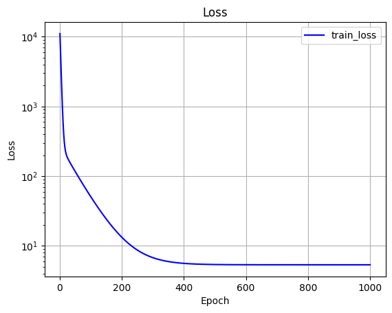

# EX\_04 예제 풀이 — 입력 2개·출력 2개 회귀 (Keras)

[목차](../00_%EB%94%A5%EB%9F%AC%EB%8B%9D%EC%88%98%ED%95%99_MOC.md) · 개념: [D03_Dense층과_정규화](../01_%EA%B0%9C%EB%85%90%EB%85%B8%ED%8A%B8/D03_Dense%EC%B8%B5%EA%B3%BC_%EC%A0%95%EA%B7%9C%ED%99%94.md) · Keras 정리: [K01_Keras_기본개념](../04_Keras/K01_Keras_%EA%B8%B0%EB%B3%B8%EA%B0%9C%EB%85%90.md) · 이전: [E03_혈압_선형회귀_예제](../03_%EC%98%88%EC%A0%9C%ED%92%80%EC%9D%B4/E03_%ED%98%88%EC%95%95_%EC%84%A0%ED%98%95%ED%9A%8C%EA%B7%80_%EC%98%88%EC%A0%9C.md) · 다음: [E05_혈압_로지스틱회귀_예제](../03_%EC%98%88%EC%A0%9C%ED%92%80%EC%9D%B4/E05_%ED%98%88%EC%95%95_%EB%A1%9C%EC%A7%80%EC%8A%A4%ED%8B%B1%ED%9A%8C%EA%B7%80_%EC%98%88%EC%A0%9C.md)

> [!NOTE]
> **3줄 요약**
> - 입력 2개(나이, BMI)로 출력 2개(수축기·이완기 혈압)를 한 번에 예측한다. BMI는 체질량지수(몸무게 ÷ 키²)다.
> - [E03_혈압_선형회귀_예제](../03_%EC%98%88%EC%A0%9C%ED%92%80%EC%9D%B4/E03_%ED%98%88%EC%95%95_%EC%84%A0%ED%98%95%ED%9A%8C%EA%B7%80_%EC%98%88%EC%A0%9C.md)에서 손으로 짠 [가설](../00_%EB%94%A5%EB%9F%AC%EB%8B%9D_%EC%9A%A9%EC%96%B4%EC%82%AC%EC%A0%84.md#hypothesis-%EA%B0%80%EC%84%A4)·[손실](../00_%EB%94%A5%EB%9F%AC%EB%8B%9D_%EC%9A%A9%EC%96%B4%EC%82%AC%EC%A0%84.md#loss-function-%EC%86%90%EC%8B%A4-%ED%95%A8%EC%88%98)·[기울기](../00_%EB%94%A5%EB%9F%AC%EB%8B%9D_%EC%9A%A9%EC%96%B4%EC%82%AC%EC%A0%84.md#gradient-%EA%B8%B0%EC%9A%B8%EA%B8%B0)·반복을 **Keras가 대신 해 준다**(`Dense`, `compile`, `fit`).
> - 입력을 0~1로 줄이는 **Min-Max [정규화](../00_%EB%94%A5%EB%9F%AC%EB%8B%9D_%EC%9A%A9%EC%96%B4%EC%82%AC%EC%A0%84.md#normalization-%EC%A0%95%EA%B7%9C%ED%99%94)** 덕분에 [학습률](../00_%EB%94%A5%EB%9F%AC%EB%8B%9D_%EC%9A%A9%EC%96%B4%EC%82%AC%EC%A0%84.md#learning-rate-%ED%95%99%EC%8A%B5%EB%A5%A0) 0.1, 1000번이면 충분하다(EX\_03은 0.0005, 200000번).

## 0. 예제 개요

| 항목 | 내용 |
|---|---|
| 입력 | 나이, BMI (2개) × 18명 |
| [정답](../00_%EB%94%A5%EB%9F%AC%EB%8B%9D_%EC%9A%A9%EC%96%B4%EC%82%AC%EC%A0%84.md#label-%EC%A0%95%EB%8B%B5) | 수축기(HIGH), 이완기(LOW) 혈압 (2개) |
| 전처리 | Min-Max [정규화](../00_%EB%94%A5%EB%9F%AC%EB%8B%9D_%EC%9A%A9%EC%96%B4%EC%82%AC%EC%A0%84.md#normalization-%EC%A0%95%EA%B7%9C%ED%99%94) (입력을 0~1로) |
| 모델 | `Dense(2)` — 직선 식 2개, [파라미터](../00_%EB%94%A5%EB%9F%AC%EB%8B%9D_%EC%9A%A9%EC%96%B4%EC%82%AC%EC%A0%84.md#parameter-%ED%8C%8C%EB%9D%BC%EB%AF%B8%ED%84%B0) 수([가중치](../00_%EB%94%A5%EB%9F%AC%EB%8B%9D_%EC%9A%A9%EC%96%B4%EC%82%AC%EC%A0%84.md#weight-%EA%B0%80%EC%A4%91%EC%B9%98)+[편향](../00_%EB%94%A5%EB%9F%AC%EB%8B%9D_%EC%9A%A9%EC%96%B4%EC%82%AC%EC%A0%84.md#bias-%ED%8E%B8%ED%96%A5)) 6 |
| [손실](../00_%EB%94%A5%EB%9F%AC%EB%8B%9D_%EC%9A%A9%EC%96%B4%EC%82%AC%EC%A0%84.md#loss-function-%EC%86%90%EC%8B%A4-%ED%95%A8%EC%88%98) | [MSE](../00_%EB%94%A5%EB%9F%AC%EB%8B%9D_%EC%9A%A9%EC%96%B4%EC%82%AC%EC%A0%84.md#mse-mean-squared-error-%ED%8F%89%EA%B7%A0-%EC%A0%9C%EA%B3%B1-%EC%98%A4%EC%B0%A8) (`mean_squared_error`) |
| [학습](../00_%EB%94%A5%EB%9F%AC%EB%8B%9D_%EC%9A%A9%EC%96%B4%EC%82%AC%EC%A0%84.md#training-%ED%95%99%EC%8A%B5) | SGD(확률적 [경사하강법](../00_%EB%94%A5%EB%9F%AC%EB%8B%9D_%EC%9A%A9%EC%96%B4%EC%82%AC%EC%A0%84.md#gradient-descent-%EA%B2%BD%EC%82%AC%ED%95%98%EA%B0%95%EB%B2%95)), [학습률](../00_%EB%94%A5%EB%9F%AC%EB%8B%9D_%EC%9A%A9%EC%96%B4%EC%82%AC%EC%A0%84.md#learning-rate-%ED%95%99%EC%8A%B5%EB%A5%A0) 0.1, 1000번. 18개 전체가 한 묶음이라(1-6절) 일반 [경사하강법](../00_%EB%94%A5%EB%9F%AC%EB%8B%9D_%EC%9A%A9%EC%96%B4%EC%82%AC%EC%A0%84.md#gradient-descent-%EA%B2%BD%EC%82%AC%ED%95%98%EA%B0%95%EB%B2%95)과 같다 |
| 결과 | [손실](../00_%EB%94%A5%EB%9F%AC%EB%8B%9D_%EC%9A%A9%EC%96%B4%EC%82%AC%EC%A0%84.md#loss-function-%EC%86%90%EC%8B%A4-%ED%95%A8%EC%88%98) 11027.59 → 5.36, 50세·BMI 25 → 125.2 / 78.72 |

### EX\_03과의 비교

|                    | EX\_03 (손으로)                        | EX\_04 (Keras)                                                       |
| ------------------ | ----------------------------------- | -------------------------------------------------------------------- |
| [가설](../00_%EB%94%A5%EB%9F%AC%EB%8B%9D_%EC%9A%A9%EC%96%B4%EC%82%AC%EC%A0%84.md#hypothesis-%EA%B0%80%EC%84%A4)                 | `def Hypothesis(x): return W*x + B` | `tf.keras.layers.Dense(2)`                                           |
| [손실](../00_%EB%94%A5%EB%9F%AC%EB%8B%9D_%EC%9A%A9%EC%96%B4%EC%82%AC%EC%A0%84.md#loss-function-%EC%86%90%EC%8B%A4-%ED%95%A8%EC%88%98) (코드의 cost = [손실](../00_%EB%94%A5%EB%9F%AC%EB%8B%9D_%EC%9A%A9%EC%96%B4%EC%82%AC%EC%A0%84.md#loss-function-%EC%86%90%EC%8B%A4-%ED%95%A8%EC%88%98)) | `def Cost(): ...`                   | `loss='mean_squared_error'`                                          |
| [기울기](../00_%EB%94%A5%EB%9F%AC%EB%8B%9D_%EC%9A%A9%EC%96%B4%EC%82%AC%EC%A0%84.md#gradient-%EA%B8%B0%EC%9A%B8%EA%B8%B0)                | `def Gradient(x, y): ...`           | Keras가 자동으로 계산                                                       |
| 반복                 | `for cnt in range(...)`             | `model.fit(..., epochs=1000)` — [에폭](../00_%EB%94%A5%EB%9F%AC%EB%8B%9D_%EC%9A%A9%EC%96%B4%EC%82%AC%EC%A0%84.md#epoch-%EC%97%90%ED%8F%AD)(epoch, 전체 데이터를 한 바퀴 다 보는 것) 1000번 |
| [학습률](../00_%EB%94%A5%EB%9F%AC%EB%8B%9D_%EC%9A%A9%EC%96%B4%EC%82%AC%EC%A0%84.md#learning-rate-%ED%95%99%EC%8A%B5%EB%A5%A0)                | `learning_rate = 0.0005`            | `SGD(learning_rate=0.1)`                                             |

## 1. 셀별 풀이

### 1-1. 모듈 불러오기

```python
import numpy as np                 # 배열 계산
import tensorflow as tf            # 딥러닝 라이브러리 (Keras가 이 안에 들어 있음)
import matplotlib.pyplot as plt    # 그래프 그리기

print("NumPy Version :{}".format(np.__version__))
print("TensorFlow Version :{}".format(tf.__version__))
print("Matplotlib Version :{}".format(plt.matplotlib.__version__))
```

**실행 결과**:

```text
NumPy Version :2.0.2
TensorFlow Version :2.19.0
Matplotlib Version :3.10.0
```

### 1-2. 입력과 정답

```python
#Input(AGE, BMI) and Labels(HIGH, LOW)
x_input = tf.constant([[25,22],[25,26],[25,30],[35,22],[35,26],[35,30],[45,22],[45,26],[45,30],
                       [55,22],[55,26],[55,30],[65,22],[65,26],[65,30],[73,22],[73,26],[73,30]],
                      dtype= tf.float32)   # 18행 × 2열: 한 행 = 한 사람 [나이, BMI]
labels = tf.constant([[118,72],[125,80],[130,80],[118,76],[126,75],[123,79],[120,80],[124,85],[130,83],
                      [122,78],[125,80],[130,81],[127,75],[130,79],[130,81],[125.5,80],[130,80],[138,82]],
                     dtype= tf.float32)    # 18행 × 2열: 한 행 = 한 사람 [수축기, 이완기]
```

- `tf.constant(...)`: TensorFlow용 배열([텐서](../00_%EB%94%A5%EB%9F%AC%EB%8B%9D_%EC%9A%A9%EC%96%B4%EC%82%AC%EC%A0%84.md#tensor-%ED%85%90%EC%84%9C)). numpy 배열과 거의 같다고 보면 된다.
- 이제 데이터가 **표 모양(행렬)**이다. 행 = 사람, 열 = 항목. 모양(shape)은 (18, 2).

### 1-3. Min-Max 정규화

Min-Max [정규화](../00_%EB%94%A5%EB%9F%AC%EB%8B%9D_%EC%9A%A9%EC%96%B4%EC%82%AC%EC%A0%84.md#normalization-%EC%A0%95%EA%B7%9C%ED%99%94)는 한 항목(열)의 최솟값을 0, 최댓값을 1로 두고, 나머지 값을 그 사이로 옮기는 일이다. 값에서 최솟값을 빼고, 범위(최댓값 − 최솟값)로 나눈다.

$$x' = \frac{x - \min}{\max - \min}$$

x'('엑스 프라임')은 정규화한 값이고, min과 max는 그 열의 최솟값과 최댓값이다.

```python
x_input_org = x_input                                      # 원래 값을 따로 보관 (나중에 결과 출력용)
x_min, x_max = np.min(x_input, axis=0), np.max(x_input, axis=0)   # 열마다 최솟값·최댓값
x_input = (x_input-x_min)/(x_max-x_min)                    # 모든 값을 0~1 사이로 바꿈
```

- `axis=0`: **세로 방향(열마다)** 계산하라는 뜻. 나이 열의 최솟값, BMI 열의 최솟값을 따로 구한다.
  - x\_min = `[25, 22]`, x\_max = `[73, 30]`

| 원래 값 | 계산 | [정규화](../00_%EB%94%A5%EB%9F%AC%EB%8B%9D_%EC%9A%A9%EC%96%B4%EC%82%AC%EC%A0%84.md#normalization-%EC%A0%95%EA%B7%9C%ED%99%94) 값 |
|---|---|---|
| 나이 25 | (25 − 25) ÷ (73 − 25) | 0 |
| 나이 50 | (50 − 25) ÷ 48 | 0.5208 |
| 나이 73 | (73 − 25) ÷ 48 | 1 |
| BMI 22 | (22 − 22) ÷ (30 − 22) | 0 |
| BMI 25 | (25 − 22) ÷ 8 | 0.375 |
| BMI 30 | (30 − 22) ÷ 8 | 1 |

> [!TIP]
> **왜 정규화하나**
> EX\_03에서 나이(25~73)가 그대로 들어가니 [기울기](../00_%EB%94%A5%EB%9F%AC%EB%8B%9D_%EC%9A%A9%EC%96%B4%EC%82%AC%EC%A0%84.md#gradient-%EA%B8%B0%EC%9A%B8%EA%B8%B0)가 커서 [학습률](../00_%EB%94%A5%EB%9F%AC%EB%8B%9D_%EC%9A%A9%EC%96%B4%EC%82%AC%EC%A0%84.md#learning-rate-%ED%95%99%EC%8A%B5%EB%A5%A0)을 0.0005까지 줄여야 했다. 입력을 0~1로 줄이면 [기울기](../00_%EB%94%A5%EB%9F%AC%EB%8B%9D_%EC%9A%A9%EC%96%B4%EC%82%AC%EC%A0%84.md#gradient-%EA%B8%B0%EC%9A%B8%EA%B8%B0) 크기가 적당해져서 **큰 [학습률](../00_%EB%94%A5%EB%9F%AC%EB%8B%9D_%EC%9A%A9%EC%96%B4%EC%82%AC%EC%A0%84.md#learning-rate-%ED%95%99%EC%8A%B5%EB%A5%A0)(0.1)로 빨리** 학습할 수 있다. 나이와 BMI처럼 범위가 다른 항목의 크기도 맞춰진다.

### 1-4. 모델 정의

```python
model = tf.keras.models.Sequential([     # Sequential: 층을 순서대로 쌓는 모델
  tf.keras.Input(shape=(2,)),            # 입력 한 개가 숫자 2개짜리 (나이, BMI)
  tf.keras.layers.Dense(2)               # 출력 2개짜리 층 (수축기, 이완기), 활성화 함수 없음 = 직선 그대로
])

model.summary()                          # 모델 구조와 파라미터 수(가중치+편향) 출력
```

**실행 결과** (일부):

```text
Model: "sequential"
┏━━━━━━━━━━━━━━━━━━━━━━━━━━━━━━━━━┳━━━━━━━━━━━━━━━━━━━━━━━━┳━━━━━━━━━━━━━━━┓
┃ Layer (type)                    ┃ Output Shape           ┃       Param # ┃
┡━━━━━━━━━━━━━━━━━━━━━━━━━━━━━━━━━╇━━━━━━━━━━━━━━━━━━━━━━━━╇━━━━━━━━━━━━━━━┩
│ dense (Dense)                   │ (None, 2)              │             6 │
└─────────────────────────────────┴────────────────────────┴───────────────┘
 Total params: 6 (24.00 B)
```

`Dense(2)`는 직선 식 **2개**를 한꺼번에 만든다.

$$\text{수축기} = w_{1} \cdot \text{나이}' + w_{2} \cdot \text{BMI}' + b_1$$
$$\text{이완기} = w_{3} \cdot \text{나이}' + w_{4} \cdot \text{BMI}' + b_2$$

- 식의 w₁~w₄는 [가중치](../00_%EB%94%A5%EB%9F%AC%EB%8B%9D_%EC%9A%A9%EC%96%B4%EC%82%AC%EC%A0%84.md#weight-%EA%B0%80%EC%A4%91%EC%B9%98), b₁·b₂는 [편향](../00_%EB%94%A5%EB%9F%AC%EB%8B%9D_%EC%9A%A9%EC%96%B4%EC%82%AC%EC%A0%84.md#bias-%ED%8E%B8%ED%96%A5)이다. 나이'와 BMI'의 작은따옴표는 정규화한 값이라는 표시다.
- [파라미터](../00_%EB%94%A5%EB%9F%AC%EB%8B%9D_%EC%9A%A9%EC%96%B4%EC%82%AC%EC%A0%84.md#parameter-%ED%8C%8C%EB%9D%BC%EB%AF%B8%ED%84%B0) 수([가중치](../00_%EB%94%A5%EB%9F%AC%EB%8B%9D_%EC%9A%A9%EC%96%B4%EC%82%AC%EC%A0%84.md#weight-%EA%B0%80%EC%A4%91%EC%B9%98)+[편향](../00_%EB%94%A5%EB%9F%AC%EB%8B%9D_%EC%9A%A9%EC%96%B4%EC%82%AC%EC%A0%84.md#bias-%ED%8E%B8%ED%96%A5)) = [가중치](../00_%EB%94%A5%EB%9F%AC%EB%8B%9D_%EC%9A%A9%EC%96%B4%EC%82%AC%EC%A0%84.md#weight-%EA%B0%80%EC%A4%91%EC%B9%98) 4개(입력 2 × 출력 2) + [편향](../00_%EB%94%A5%EB%9F%AC%EB%8B%9D_%EC%9A%A9%EC%96%B4%EC%82%AC%EC%A0%84.md#bias-%ED%8E%B8%ED%96%A5) 2개(출력마다 1개) = **6** → `Param # 6`과 같다.
- `Output Shape (None, 2)`: None은 "사람 수는 아직 정해지지 않음", 2는 출력 2개.
- 각 식은 [D01_퍼셉트론](../01_%EA%B0%9C%EB%85%90%EB%85%B8%ED%8A%B8/D01_%ED%8D%BC%EC%85%89%ED%8A%B8%EB%A1%A0.md)의 [가중합](../00_%EB%94%A5%EB%9F%AC%EB%8B%9D_%EC%9A%A9%EC%96%B4%EC%82%AC%EC%A0%84.md#weighted-sum-%EA%B0%80%EC%A4%91%ED%95%A9)(곱해서 더하고 b)과 같은 계산이다. 이걸 여러 개 한 번에 하는 계산이 **[행렬 곱](../00_%EB%94%A5%EB%9F%AC%EB%8B%9D_%EC%9A%A9%EC%96%B4%EC%82%AC%EC%A0%84.md#matrix-multiplication-%ED%96%89%EB%A0%AC-%EA%B3%B1)**이다([M05_벡터와_행렬](../02_%EC%88%98%ED%95%99%EB%85%B8%ED%8A%B8/M05_%EB%B2%A1%ED%84%B0%EC%99%80_%ED%96%89%EB%A0%AC.md)).

### 1-5. 컴파일 (학습 방법 정하기)

```python
model.compile(optimizer= tf.keras.optimizers.SGD(learning_rate=0.1),   # 확률적 경사하강법(SGD), 학습률 0.1
              loss='mean_squared_error')                               # 손실 함수: MSE
```

- **optimizer**(최적화 방법): W, B를 어떻게 고칠지. SGD = 확률적 [경사하강법](../00_%EB%94%A5%EB%9F%AC%EB%8B%9D_%EC%9A%A9%EC%96%B4%EC%82%AC%EC%A0%84.md#gradient-descent-%EA%B2%BD%EC%82%AC%ED%95%98%EA%B0%95%EB%B2%95). 여기서는 18개가 한 묶음(1/1)이라 일반 [경사하강법](../00_%EB%94%A5%EB%9F%AC%EB%8B%9D_%EC%9A%A9%EC%96%B4%EC%82%AC%EC%A0%84.md#gradient-descent-%EA%B2%BD%EC%82%AC%ED%95%98%EA%B0%95%EB%B2%95)과 같다. EX\_02의 `W -= learning_rate * grad_w`를 Keras가 해 준다.
- **loss**([손실](../00_%EB%94%A5%EB%9F%AC%EB%8B%9D_%EC%9A%A9%EC%96%B4%EC%82%AC%EC%A0%84.md#loss-function-%EC%86%90%EC%8B%A4-%ED%95%A8%EC%88%98)): 얼마나 틀렸는지 재는 방법. EX\_02의 `Cost()`와 같은 [MSE](../00_%EB%94%A5%EB%9F%AC%EB%8B%9D_%EC%9A%A9%EC%96%B4%EC%82%AC%EC%A0%84.md#mse-mean-squared-error-%ED%8F%89%EA%B7%A0-%EC%A0%9C%EA%B3%B1-%EC%98%A4%EC%B0%A8).

### 1-6. 학습

```python
%%time
history = model.fit(x_input, labels, epochs=1000)   # 입력·정답을 주고 1000번 반복 학습, 기록을 history에 저장
```

**실행 결과** (노트북 기록, 일부):

```text
Epoch 1/1000
1/1 ━━━━━━━━━━━━━━━━━━━━ 0s 333ms/step - loss: 11027.5918
Epoch 2/1000
1/1 ━━━━━━━━━━━━━━━━━━━━ 0s 43ms/step - loss: 7920.6816
...
Epoch 1000/1000
1/1 ━━━━━━━━━━━━━━━━━━━━ 0s 116ms/step - loss: 5.3598
```

| Epoch | loss |
|---|---|
| 1 | 11027.59 |
| 2 | 7920.68 |
| 10 | 739.40 |
| 100 | 50.91 |
| 500 | 5.41 |
| 1000 | 5.36 |

- `1/1`: 데이터를 몇 묶음으로 나눠 학습했나. Keras는 기본으로 32개씩 묶는데 데이터가 18개뿐이라 한 묶음이다.
- [손실](../00_%EB%94%A5%EB%9F%AC%EB%8B%9D_%EC%9A%A9%EC%96%B4%EC%82%AC%EC%A0%84.md#loss-function-%EC%86%90%EC%8B%A4-%ED%95%A8%EC%88%98)이 처음에 매우 큰 이유: 처음 [가중치](../00_%EB%94%A5%EB%9F%AC%EB%8B%9D_%EC%9A%A9%EC%96%B4%EC%82%AC%EC%A0%84.md#weight-%EA%B0%80%EC%A4%91%EC%B9%98)는 작은 무작위 값이고 [편향](../00_%EB%94%A5%EB%9F%AC%EB%8B%9D_%EC%9A%A9%EC%96%B4%EC%82%AC%EC%A0%84.md#bias-%ED%8E%B8%ED%96%A5)은 0이다(Keras 기본값). 그래서 혈압을 0 근처로 예측한다.
- [정답](../00_%EB%94%A5%EB%9F%AC%EB%8B%9D_%EC%9A%A9%EC%96%B4%EC%82%AC%EC%A0%84.md#label-%EC%A0%95%EB%8B%B5)의 평균은 수축기 약 126, 이완기 약 79다. 예측이 0이면 [오차](../00_%EB%94%A5%EB%9F%AC%EB%8B%9D_%EC%9A%A9%EC%96%B4%EC%82%AC%EC%A0%84.md#error-%EC%98%A4%EC%B0%A8) 제곱 평균이 (126² + 79²) ÷ 2 ≈ 11000 정도가 된다.

### 1-7. 손실 그래프

```python
# loss 그래프 출력
loss = history.history['loss']                 # 1000번 동안의 loss 기록 (리스트)
epochs = range(1, len(loss)+1)                 # 가로축: 1, 2, ..., 1000
plt.title('Loss')
plt.plot(epochs, history.history['loss'], 'b', label='train_loss')   # 'b' = 파란 선
plt.grid(True)                                 # 격자
plt.xlabel('Epoch')
plt.ylabel('Loss')
plt.legend(loc='best')                         # 범례를 알아서 좋은 위치에
plt.semilogy()                                 # 세로축 눈금을 1, 10, 100, 1000처럼 10배 간격으로
plt.show()
```



> `plt.semilogy()`: [손실](../00_%EB%94%A5%EB%9F%AC%EB%8B%9D_%EC%9A%A9%EC%96%B4%EC%82%AC%EC%A0%84.md#loss-function-%EC%86%90%EC%8B%A4-%ED%95%A8%EC%88%98)이 11027에서 5까지 너무 크게 변해서 보통 눈금이면 뒷부분이 바닥에 붙어 안 보인다. 눈금을 10배 간격으로 바꾸면 작은 값의 변화도 보인다. 이 눈금을 "[로그](../00_%EB%94%A5%EB%9F%AC%EB%8B%9D_%EC%9A%A9%EC%96%B4%EC%82%AC%EC%A0%84.md#log-ln-%EB%A1%9C%EA%B7%B8) 눈금"이라 부른다. [로그](../00_%EB%94%A5%EB%9F%AC%EB%8B%9D_%EC%9A%A9%EC%96%B4%EC%82%AC%EC%A0%84.md#log-ln-%EB%A1%9C%EA%B7%B8)는 [M07_로그](../02_%EC%88%98%ED%95%99%EB%85%B8%ED%8A%B8/M07_%EB%A1%9C%EA%B7%B8.md)를 참고한다.

### 1-8. 학습 데이터로 확인

```python
H_x = model.predict(x_input)                       # 18명 모두 예측 → (18, 2) 배열
for x,h,l in zip(x_input_org, H_x, labels):         # zip: 세 배열에서 같은 번호끼리 하나씩 꺼냄
  print("Age:{}, BMI:{}=>BP:{:>7.4},{:>7.4} [label => {}]".format(x[0],x[1],h[0], h[1],l))
  #           원래 나이, BMI        예측 수축기, 이완기        정답
```

**실행 결과** (일부):

```text
Age:25.0, BMI:22.0=>BP:  118.0,  75.78 [label => [118.  72.]]
Age:25.0, BMI:30.0=>BP:  126.4,  79.95 [label => [130.  80.]]
Age:45.0, BMI:26.0=>BP:  125.4,  78.97 [label => [124.  85.]]
Age:73.0, BMI:30.0=>BP:  134.2,  82.59 [label => [138.  82.]]
```

- 출력할 때는 [정규화](../00_%EB%94%A5%EB%9F%AC%EB%8B%9D_%EC%9A%A9%EC%96%B4%EC%82%AC%EC%A0%84.md#normalization-%EC%A0%95%EA%B7%9C%ED%99%94) 전 값(`x_input_org`)을 써서 사람이 읽기 좋게 했다.

### 1-9. 새 사람 예측

```python
def predict(x):
  return model.predict((x-x_min)/(x_max-x_min))     # ⚠ 새 입력도 학습 때와 같은 min, max로 정규화해서 넣는다

x_test = tf.constant([[50.0, 25.0]], dtype= tf.float32)   # 50세, BMI 25 한 명 (2차원 모양 (1, 2)로)
H_x = predict(x_test)
print("Age : {}, BMI : {} = > BP : {:>7.4}, {:>7.4}".format(x_test[0,0],x_test[0,1],H_x[0,0],H_x[0,1]))
```

**실행 결과**:

```text
Age : 50.0, BMI : 25.0 = > BP :   125.2,   78.72
```

> [!WARNING]
> **⚠ 예측할 때도 [정규화](../00_%EB%94%A5%EB%9F%AC%EB%8B%9D_%EC%9A%A9%EC%96%B4%EC%82%AC%EC%A0%84.md#normalization-%EC%A0%95%EA%B7%9C%ED%99%94)**
> 모델은 0~1 값만 보고 배웠다. 50을 그대로 넣으면 엉뚱한 답이 나온다. 반드시 **[학습 데이터](../00_%EB%94%A5%EB%9F%AC%EB%8B%9D_%EC%9A%A9%EC%96%B4%EC%82%AC%EC%A0%84.md#training-data-test-data-%ED%95%99%EC%8A%B5-%EB%8D%B0%EC%9D%B4%ED%84%B0%EC%99%80-%EC%8B%9C%ED%97%98-%EB%8D%B0%EC%9D%B4%ED%84%B0)의 min, max**로 바꿔서 넣는다: 50 → 0.5208, 25 → 0.375.

## 2. 새로 나온 개념

| 이름 | 뜻 | 관련 노트 |
|---|---|---|
| `tf.constant` | TensorFlow 배열([텐서](../00_%EB%94%A5%EB%9F%AC%EB%8B%9D_%EC%9A%A9%EC%96%B4%EC%82%AC%EC%A0%84.md#tensor-%ED%85%90%EC%84%9C)) | |
| Min-Max [정규화](../00_%EB%94%A5%EB%9F%AC%EB%8B%9D_%EC%9A%A9%EC%96%B4%EC%82%AC%EC%A0%84.md#normalization-%EC%A0%95%EA%B7%9C%ED%99%94) | (x − min) ÷ (max − min)으로 0~1 만들기 | |
| `axis=0` | 열마다(세로 방향) 계산 | |
| `Sequential`, `Input`, `Dense` | [층](../00_%EB%94%A5%EB%9F%AC%EB%8B%9D_%EC%9A%A9%EC%96%B4%EC%82%AC%EC%A0%84.md#layer-%EC%B8%B5)을 쌓아 모델 만들기 | |
| Param # | [파라미터](../00_%EB%94%A5%EB%9F%AC%EB%8B%9D_%EC%9A%A9%EC%96%B4%EC%82%AC%EC%A0%84.md#parameter-%ED%8C%8C%EB%9D%BC%EB%AF%B8%ED%84%B0) 수([가중치](../00_%EB%94%A5%EB%9F%AC%EB%8B%9D_%EC%9A%A9%EC%96%B4%EC%82%AC%EC%A0%84.md#weight-%EA%B0%80%EC%A4%91%EC%B9%98)+[편향](../00_%EB%94%A5%EB%9F%AC%EB%8B%9D_%EC%9A%A9%EC%96%B4%EC%82%AC%EC%A0%84.md#bias-%ED%8E%B8%ED%96%A5)) | [M05_벡터와_행렬](../02_%EC%88%98%ED%95%99%EB%85%B8%ED%8A%B8/M05_%EB%B2%A1%ED%84%B0%EC%99%80_%ED%96%89%EB%A0%AC.md), [D03_Dense층과_정규화](../01_%EA%B0%9C%EB%85%90%EB%85%B8%ED%8A%B8/D03_Dense%EC%B8%B5%EA%B3%BC_%EC%A0%95%EA%B7%9C%ED%99%94.md) |
| `compile(optimizer, loss)` | [학습](../00_%EB%94%A5%EB%9F%AC%EB%8B%9D_%EC%9A%A9%EC%96%B4%EC%82%AC%EC%A0%84.md#training-%ED%95%99%EC%8A%B5) 방법·[손실 함수](../00_%EB%94%A5%EB%9F%AC%EB%8B%9D_%EC%9A%A9%EC%96%B4%EC%82%AC%EC%A0%84.md#loss-function-%EC%86%90%EC%8B%A4-%ED%95%A8%EC%88%98) 정하기 | [D02_경사하강법으로_직선찾기](../01_%EA%B0%9C%EB%85%90%EB%85%B8%ED%8A%B8/D02_%EA%B2%BD%EC%82%AC%ED%95%98%EA%B0%95%EB%B2%95%EC%9C%BC%EB%A1%9C_%EC%A7%81%EC%84%A0%EC%B0%BE%EA%B8%B0.md) |
| `fit(x, y, epochs)` | [학습 실행](../00_%EB%94%A5%EB%9F%AC%EB%8B%9D_%EC%9A%A9%EC%96%B4%EC%82%AC%EC%A0%84.md#fit-%ED%95%99%EC%8A%B5-%EC%8B%A4%ED%96%89) | |
| `history.history['loss']` | 에폭별 [손실](../00_%EB%94%A5%EB%9F%AC%EB%8B%9D_%EC%9A%A9%EC%96%B4%EC%82%AC%EC%A0%84.md#loss-function-%EC%86%90%EC%8B%A4-%ED%95%A8%EC%88%98) 기록 | |
| `predict` | 예측 | |

## 3. 개념 재확인

<details><summary>1. 입력이 3개, 출력이 2개인 덴스 층의 파라미터 수는?</summary>

| 단계 | 하는 일 | 코드 | 계산 | 결과 |
|---|---|---|---|---|
| 1 | 입력 개수 바꾸기 | `shape=(3,)` | 원래 (2,) → (3,) | 입력 3 |
| 2 | [가중치](../00_%EB%94%A5%EB%9F%AC%EB%8B%9D_%EC%9A%A9%EC%96%B4%EC%82%AC%EC%A0%84.md#weight-%EA%B0%80%EC%A4%91%EC%B9%98) 세기 | `Dense(2)` | 입력 3 × 출력 2 | 6 |
| 3 | [편향](../00_%EB%94%A5%EB%9F%AC%EB%8B%9D_%EC%9A%A9%EC%96%B4%EC%82%AC%EC%A0%84.md#bias-%ED%8E%B8%ED%96%A5) 세기 | `Dense(2)` | 출력마다 1개 | 2 |
| 4 | 합치기 | - | 6 + 2 | 8 |

원래 예제는 4 + 2 = 6이 `Param # 6`으로 나왔고, [편향](../00_%EB%94%A5%EB%9F%AC%EB%8B%9D_%EC%9A%A9%EC%96%B4%EC%82%AC%EC%A0%84.md#bias-%ED%8E%B8%ED%96%A5)은 입력 개수와 상관없다.

**① 바꿀 코드**
```python
model = tf.keras.models.Sequential([     # ① 층을 순서대로 쌓는 모델
  tf.keras.Input(shape=(3,)),            # ③ 입력 한 개가 숫자 3개짜리 (2 → 3)
  tf.keras.layers.Dense(2)               # ②③④ 출력 2개짜리 층 (그대로)
])                                       # ① 모델 정의 끝
model.summary()                          # ⑤ Param # 로 파라미터 수 확인 (6 + 2 = 8)
```

**② 출력 모양**
- `Dense(2)`이므로 출력 2개 → `Output Shape (None, 2)`

**③ [가중치](../00_%EB%94%A5%EB%9F%AC%EB%8B%9D_%EC%9A%A9%EC%96%B4%EC%82%AC%EC%A0%84.md#weight-%EA%B0%80%EC%A4%91%EC%B9%98) 세기** (입력 × 출력)
- 출력 1개는 입력 3개를 각각 곱하므로 [가중치](../00_%EB%94%A5%EB%9F%AC%EB%8B%9D_%EC%9A%A9%EC%96%B4%EC%82%AC%EC%A0%84.md#weight-%EA%B0%80%EC%A4%91%EC%B9%98) 3개
- 출력이 2개이므로 3 × 2 = 6
- 식으로 쓰면 w₁·x₁ + w₂·x₂ + w₃·x₃ 와 w₄·x₁ + w₅·x₂ + w₆·x₃ 두 줄

**④ [편향](../00_%EB%94%A5%EB%9F%AC%EB%8B%9D_%EC%9A%A9%EC%96%B4%EC%82%AC%EC%A0%84.md#bias-%ED%8E%B8%ED%96%A5) 세기** (출력마다 1개)
- 출력 2개이므로 [편향](../00_%EB%94%A5%EB%9F%AC%EB%8B%9D_%EC%9A%A9%EC%96%B4%EC%82%AC%EC%A0%84.md#bias-%ED%8E%B8%ED%96%A5) 2개 (입력이 몇 개든 같다)

**⑤ 합치기**
- 6 + 2 = 8
- 비교: 원래 예제는 2 × 2 + 2 = 6 (`Param # 6`)

**답**: [파라미터](../00_%EB%94%A5%EB%9F%AC%EB%8B%9D_%EC%9A%A9%EC%96%B4%EC%82%AC%EC%A0%84.md#parameter-%ED%8C%8C%EB%9D%BC%EB%AF%B8%ED%84%B0) 수는 **8**

</details>

<details><summary>2. 나이 61세를 정규화하면?</summary>

| 단계 | 하는 일 | 코드 | 계산 | 결과 |
|---|---|---|---|---|
| 1 | 최소·최대 찾기 | `np.min(x_input, axis=0)` | 나이 열의 가장 작은 값과 큰 값 | x_min = 25, x_max = 73 |
| 2 | 분자 구하기 | `x - x_min` | 61 − 25 | 36 |
| 3 | 분모 구하기 | `x_max - x_min` | 73 − 25 | 48 |
| 4 | 나누기 | `(x-x_min)/(x_max-x_min)` | 36 ÷ 48 | 0.75 |

**① 쓰는 코드**
```python
x_min, x_max = np.min(x_input, axis=0), np.max(x_input, axis=0)   # ②④ 열마다 최솟값·최댓값 (나이 열: 25, 73)
x_input = (x_input-x_min)/(x_max-x_min)                           # ③④⑤ 모든 값을 0~1 사이로 바꿈
# 61세 한 명만 계산하면: (61 - 25) / (73 - 25)                      # ③④⑤ 분자 36, 분모 48, 36 ÷ 48
```

**② 최솟값·최댓값** (`np.min(x_input, axis=0)`, `np.max(x_input, axis=0)`)
- 나이 열은 25, 35, 45, 55, 65, 73이므로 가장 작은 값 25, 가장 큰 값 73
- [정규화](../00_%EB%94%A5%EB%9F%AC%EB%8B%9D_%EC%9A%A9%EC%96%B4%EC%82%AC%EC%A0%84.md#normalization-%EC%A0%95%EA%B7%9C%ED%99%94)에 쓰는 min, max는 [학습 데이터](../00_%EB%94%A5%EB%9F%AC%EB%8B%9D_%EC%9A%A9%EC%96%B4%EC%82%AC%EC%A0%84.md#training-data-test-data-%ED%95%99%EC%8A%B5-%EB%8D%B0%EC%9D%B4%ED%84%B0%EC%99%80-%EC%8B%9C%ED%97%98-%EB%8D%B0%EC%9D%B4%ED%84%B0)의 것이라 61세가 데이터에 없어도 25, 73을 쓴다

**③ 분자** (`x - x_min`)
- 61 − 25 = 36

**④ 분모** (`x_max - x_min`)
- 73 − 25 = 48 (나이의 전체 범위)

**⑤ 나누기** (`(x-x_min)/(x_max-x_min)`)
- 36 ÷ 48 = 0.75 (범위의 3/4 지점)
- 확인: 25세는 0, 73세는 1이고 61세는 그 사이이므로 0과 1 사이가 맞다

**답**: 61세의 [정규화](../00_%EB%94%A5%EB%9F%AC%EB%8B%9D_%EC%9A%A9%EC%96%B4%EC%82%AC%EC%A0%84.md#normalization-%EC%A0%95%EA%B7%9C%ED%99%94) 값은 **0.75**

</details>

<details><summary>3. EX\_03보다 학습률을 200배(0.0005 → 0.1) 키울 수 있었던 이유는?</summary>

| 단계 | 하는 일 | 코드 | 계산 | 결과 |
|---|---|---|---|---|
| 1 | [정규화](../00_%EB%94%A5%EB%9F%AC%EB%8B%9D_%EC%9A%A9%EC%96%B4%EC%82%AC%EC%A0%84.md#normalization-%EC%A0%95%EA%B7%9C%ED%99%94) 전 나이² 평균 | - | 나이가 25~73 | 2742.3 |
| 2 | [정규화](../00_%EB%94%A5%EB%9F%AC%EB%8B%9D_%EC%9A%A9%EC%96%B4%EC%82%AC%EC%A0%84.md#normalization-%EC%A0%95%EA%B7%9C%ED%99%94) 후 나이² 평균 | `(x_input-x_min)/(x_max-x_min)` | 나이가 0~1 | 0.384 |
| 3 | [기울기](../00_%EB%94%A5%EB%9F%AC%EB%8B%9D_%EC%9A%A9%EC%96%B4%EC%82%AC%EC%A0%84.md#gradient-%EA%B8%B0%EC%9A%B8%EA%B8%B0) 크기 비교 | - | 2742.3 ÷ 0.384 | 약 7000배 작아짐 |
| 4 | [정규화](../00_%EB%94%A5%EB%9F%AC%EB%8B%9D_%EC%9A%A9%EC%96%B4%EC%82%AC%EC%A0%84.md#normalization-%EC%A0%95%EA%B7%9C%ED%99%94) 전 [학습률](../00_%EB%94%A5%EB%9F%AC%EB%8B%9D_%EC%9A%A9%EC%96%B4%EC%82%AC%EC%A0%84.md#learning-rate-%ED%95%99%EC%8A%B5%EB%A5%A0) | `learning_rate=0.001` | EX\_03에서는 이 값만으로도 [손실](../00_%EB%94%A5%EB%9F%AC%EB%8B%9D_%EC%9A%A9%EC%96%B4%EC%82%AC%EC%A0%84.md#loss-function-%EC%86%90%EC%8B%A4-%ED%95%A8%EC%88%98) 폭발 | 한 걸음이 너무 큼 |
| 5 | [정규화](../00_%EB%94%A5%EB%9F%AC%EB%8B%9D_%EC%9A%A9%EC%96%B4%EC%82%AC%EC%A0%84.md#normalization-%EC%A0%95%EA%B7%9C%ED%99%94) 후 [학습률](../00_%EB%94%A5%EB%9F%AC%EB%8B%9D_%EC%9A%A9%EC%96%B4%EC%82%AC%EC%A0%84.md#learning-rate-%ED%95%99%EC%8A%B5%EB%A5%A0) | `SGD(learning_rate=0.1)` | 0.1 ÷ 0.0005 | 200배 키워도 안정 |

[학습](../00_%EB%94%A5%EB%9F%AC%EB%8B%9D_%EC%9A%A9%EC%96%B4%EC%82%AC%EC%A0%84.md#training-%ED%95%99%EC%8A%B5)은 `가중치 -= 학습률 × 기울기`이고 나이 [가중치](../00_%EB%94%A5%EB%9F%AC%EB%8B%9D_%EC%9A%A9%EC%96%B4%EC%82%AC%EC%A0%84.md#weight-%EA%B0%80%EC%A4%91%EC%B9%98)의 [기울기](../00_%EB%94%A5%EB%9F%AC%EB%8B%9D_%EC%9A%A9%EC%96%B4%EC%82%AC%EC%A0%84.md#gradient-%EA%B8%B0%EC%9A%B8%EA%B8%B0)에는 입력(나이)이 곱해져 있어서, 입력이 작아지면 같은 [학습률](../00_%EB%94%A5%EB%9F%AC%EB%8B%9D_%EC%9A%A9%EC%96%B4%EC%82%AC%EC%A0%84.md#learning-rate-%ED%95%99%EC%8A%B5%EB%A5%A0)의 한 걸음도 짧아진다 ([E03_혈압_선형회귀_예제](../03_%EC%98%88%EC%A0%9C%ED%92%80%EC%9D%B4/E03_%ED%98%88%EC%95%95_%EC%84%A0%ED%98%95%ED%9A%8C%EA%B7%80_%EC%98%88%EC%A0%9C.md)).

**① 바꿀 코드**
```python
x_input = (x_input-x_min)/(x_max-x_min)                   # ②③④ 입력을 0~1로 정규화 (이 한 줄이 핵심)
model.compile(optimizer= tf.keras.optimizers.SGD(learning_rate=0.1),   # ⑥ 0.0005 → 0.1 (200배)
              loss='mean_squared_error')                  # ① 손실 함수: MSE (그대로)
# 비교: EX_03은 정규화 없이 learning_rate = 0.0005, 200000번            # ⑤ 정규화 전에는 학습률을 못 키움
```

**② [정규화](../00_%EB%94%A5%EB%9F%AC%EB%8B%9D_%EC%9A%A9%EC%96%B4%EC%82%AC%EC%A0%84.md#normalization-%EC%A0%95%EA%B7%9C%ED%99%94) 전 나이² 평균**
- 나이 25~73, 제곱의 평균 = 2742.3
- 이 수가 클수록 [가중치](../00_%EB%94%A5%EB%9F%AC%EB%8B%9D_%EC%9A%A9%EC%96%B4%EC%82%AC%EC%A0%84.md#weight-%EA%B0%80%EC%A4%91%EC%B9%98)를 조금만 옮겨도 [기울기](../00_%EB%94%A5%EB%9F%AC%EB%8B%9D_%EC%9A%A9%EC%96%B4%EC%82%AC%EC%A0%84.md#gradient-%EA%B8%B0%EC%9A%B8%EA%B8%B0)가 크게 변한다

**③ [정규화](../00_%EB%94%A5%EB%9F%AC%EB%8B%9D_%EC%9A%A9%EC%96%B4%EC%82%AC%EC%A0%84.md#normalization-%EC%A0%95%EA%B7%9C%ED%99%94) 후 나이² 평균** (`(x_input-x_min)/(x_max-x_min)`)
- 나이가 0~1이 되었으므로 제곱의 평균 = 0.384

**④ 비교**
- 2742.3 ÷ 0.384 ≈ 7147 → 약 7000배 작아짐

**⑤ [정규화](../00_%EB%94%A5%EB%9F%AC%EB%8B%9D_%EC%9A%A9%EC%96%B4%EC%82%AC%EC%A0%84.md#normalization-%EC%A0%95%EA%B7%9C%ED%99%94) 전에는 [학습률](../00_%EB%94%A5%EB%9F%AC%EB%8B%9D_%EC%9A%A9%EC%96%B4%EC%82%AC%EC%A0%84.md#learning-rate-%ED%95%99%EC%8A%B5%EB%A5%A0)을 못 키운다**
- EX_03 기준 안전한 한계는 2 ÷ 2742.3 ≈ 0.00073
- [학습률](../00_%EB%94%A5%EB%9F%AC%EB%8B%9D_%EC%9A%A9%EC%96%B4%EC%82%AC%EC%A0%84.md#learning-rate-%ED%95%99%EC%8A%B5%EB%A5%A0) 0.001만 돼도 한 걸음이 너무 커서 [손실](../00_%EB%94%A5%EB%9F%AC%EB%8B%9D_%EC%9A%A9%EC%96%B4%EC%82%AC%EC%A0%84.md#loss-function-%EC%86%90%EC%8B%A4-%ED%95%A8%EC%88%98)이 폭발 (E03 개념 재확인 3번)
- 그래서 0.0005까지 줄이고 200000번 반복해야 했다

**⑥ [정규화](../00_%EB%94%A5%EB%9F%AC%EB%8B%9D_%EC%9A%A9%EC%96%B4%EC%82%AC%EC%A0%84.md#normalization-%EC%A0%95%EA%B7%9C%ED%99%94) 후에는 키울 수 있다**
- 같은 방식의 어림 한계 = 2 ÷ 0.384 ≈ 5.2 ([정규화](../00_%EB%94%A5%EB%9F%AC%EB%8B%9D_%EC%9A%A9%EC%96%B4%EC%82%AC%EC%A0%84.md#normalization-%EC%A0%95%EA%B7%9C%ED%99%94) 전 0.00073의 약 7000배)
- 0.1은 그 안쪽이라 걸음이 안정적으로 줄어든다 (실제로 [손실](../00_%EB%94%A5%EB%9F%AC%EB%8B%9D_%EC%9A%A9%EC%96%B4%EC%82%AC%EC%A0%84.md#loss-function-%EC%86%90%EC%8B%A4-%ED%95%A8%EC%88%98)이 11027.59 → 5.36으로 내려감)
- 0.1 ÷ 0.0005 = 200배

**답**: 입력을 0~1로 **정규화해서 [기울기](../00_%EB%94%A5%EB%9F%AC%EB%8B%9D_%EC%9A%A9%EC%96%B4%EC%82%AC%EC%A0%84.md#gradient-%EA%B8%B0%EC%9A%B8%EA%B8%B0)가 작아졌고**, 안전한 [학습률](../00_%EB%94%A5%EB%9F%AC%EB%8B%9D_%EC%9A%A9%EC%96%B4%EC%82%AC%EC%A0%84.md#learning-rate-%ED%95%99%EC%8A%B5%EB%A5%A0) 한계가 커졌기 때문에 200배 큰 0.1을 쓸 수 있다.

</details>

<details><summary>내 이해</summary>


</details>
