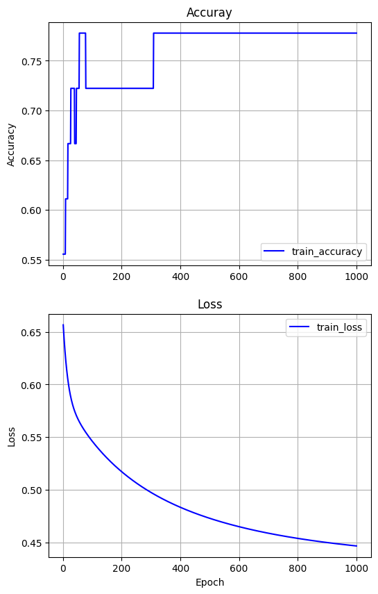

# EX\_05 예제 풀이 — 혈압 높음/낮음 분류 (로지스틱 회귀)

[목차](../00_%EB%94%A5%EB%9F%AC%EB%8B%9D%EC%88%98%ED%95%99_MOC.md) · 개념: [D04_시그모이드와_이진분류](../01_%EA%B0%9C%EB%85%90%EB%85%B8%ED%8A%B8/D04_%EC%8B%9C%EA%B7%B8%EB%AA%A8%EC%9D%B4%EB%93%9C%EC%99%80_%EC%9D%B4%EC%A7%84%EB%B6%84%EB%A5%98.md) · 이전: [E04_다변수_다출력_회귀_예제](E04_%EB%8B%A4%EB%B3%80%EC%88%98_%EB%8B%A4%EC%B6%9C%EB%A0%A5_%ED%9A%8C%EA%B7%80_%EC%98%88%EC%A0%9C.md) · 다음: [E06_혈압_소프트맥스분류_예제](E06_%ED%98%88%EC%95%95_%EC%86%8C%ED%94%84%ED%8A%B8%EB%A7%A5%EC%8A%A4%EB%B6%84%EB%A5%98_%EC%98%88%EC%A0%9C.md)

> [!NOTE]
> **3줄 요약**
> - 이번엔 혈압 **숫자**가 아니라 "높다(1) / 아니다(0)"를 맞히는 **분류** 문제다.
> - EX\_04와 거의 같은데 두 군데만 바뀐다: `Dense(1, activation='sigmoid')`(출력을 0~1 확률로)와 `loss='binary_crossentropy'`(분류용 비용).
> - 결과: 18명 중 14명을 맞혔다(정확도 0.7778). 50세·BMI 25는 0.4251 → 0.5 미만이라 "높지 않음".

## 0. 한눈에 보기

| 항목 | 내용 |
|---|---|
| 입력 | 나이, BMI (2개) × 18명 |
| 정답 | 0 또는 1 (1 = 혈압이 높은 쪽) |
| 전처리 | Min-Max 정규화 |
| 모델 | `Dense(1, activation='sigmoid')` — 가중합 1개 → 시그모이드 |
| 비용 | binary cross-entropy |
| 학습 | SGD, 학습률 0.1, 1000번 |
| 결과 | loss 0.6566 → 0.4469, 정확도 0.5556 → 0.7778 |

### EX\_04와 비교

| | EX\_04 (회귀) | EX\_05 (분류) |
|---|---|---|
| 맞힐 것 | 혈압 숫자 (118, 72 …) | 0 또는 1 |
| 출력층 | `Dense(2)` | `Dense(1, activation='sigmoid')` |
| 비용 | `mean_squared_error` | `binary_crossentropy` |
| 추가 지표 | 없음 | `metrics=['accuracy']` (정확도) |

## 1. 셀별 풀이

### 1-1. 입력과 정답

```python
#Input(AGE, BMI) and Labels(BP)
x_input = tf.constant([[25,22],[25,26],[25,30],[35,22],[35,26],[35,30],[45,22],[45,26],[45,30],
                       [55,22],[55,26],[55,30],[65,22],[65,26],[65,30],[73,22],[73,26],[73,30]],
                      dtype= tf.float32)          # EX_04와 같은 18명 [나이, BMI]
labels = tf.constant([[0],[0],[1],[0],[1],[0],[0],[0],[1],[0],[0],[1],[1],[1],[1],[0],[1],[1]],
                     dtype= tf.float32)           # 사람마다 0 또는 1 (18행 × 1열)
```

> [!NOTE]
> **정답 0/1의 뜻**
> 노트북 주석은 `Labels(BP)`뿐이다. 같은 18명의 EX\_04 수축기 혈압과 비교하면 **1인 사람은 126 이상, 0인 사람은 125.5 이하**다. 즉 1 = "혈압이 높은 쪽"으로 보면 된다.

### 1-2. Min-Max 정규화

```python
x_input_org = x_input                                             # 원래 값 보관
x_min, x_max = np.min(x_input, axis=0), np.max(x_input, axis=0)   # 열마다 최소·최대
x_input = (x_input-x_min)/(x_max-x_min)                           # 0~1로
```

[E04_다변수_다출력_회귀_예제](E04_%EB%8B%A4%EB%B3%80%EC%88%98_%EB%8B%A4%EC%B6%9C%EB%A0%A5_%ED%9A%8C%EA%B7%80_%EC%98%88%EC%A0%9C.md) 1-3과 같다.

### 1-3. 모델 정의

```python
model = tf.keras.models.Sequential([
  tf.keras.Input(shape=(2,)),                     # 입력: 나이, BMI
  tf.keras.layers.Dense(1, activation='sigmoid')  # 출력 1개, 가중합 결과를 시그모이드에 통과시킴
])

model.summary()
```

**실행 결과**:

```
│ dense (Dense)                   │ (None, 1)              │             3 │
 Total params: 3 (12.00 B)
```

- Param 3 = 가중치 2개(나이, BMI) + 편향 1개

> [!TIP]
> **시그모이드: 아무 숫자나 0~1로 눌러 담는 함수**
> 가중합(w₁·나이' + w₂·BMI' + b)은 −100이든 +100이든 아무 값이나 나온다. 확률처럼 쓰려면 0~1 사이여야 한다. 시그모이드가 그 일을 한다.
>
> | 넣는 값 | −5 | −2 | 0 | 2 | 5 |
> |---|---|---|---|---|---|
> | 시그모이드 결과 | 0.0067 | 0.1192 | **0.5** | 0.8808 | 0.9933 |
>
> - 0을 넣으면 정확히 0.5, 클수록 1에 가깝고, 작을수록 0에 가깝다. 0이나 1에 닿지는 않는다.
> - 식은 $\sigma(z) = \frac{1}{1 + e^{-z}}$이다. 여기 나오는 $e$(약 2.718)와 지수는 [M06_지수와_e](../02_%EC%88%98%ED%95%99%EB%85%B8%ED%8A%B8/M06_%EC%A7%80%EC%88%98%EC%99%80_e.md)에 정리했다. 지금은 위 표처럼 "S자로 0~1에 담는다"만 알면 된다.

### 1-4. 컴파일

```python
model.compile(optimizer= tf.keras.optimizers.SGD(learning_rate=0.1),   # 경사하강법, 학습률 0.1
              loss='binary_crossentropy',                              # 0/1 분류용 비용
              metrics=['accuracy'])                                    # 학습 중에 정확도도 같이 보여 달라
```

> [!TIP]
> **binary cross-entropy: 확신하고 틀리면 크게 벌주는 비용**
> 정답이 1인 사람에게 모델이 "1일 확률 p"를 냈을 때의 벌점:
>
> | 모델이 낸 p | 1.0 | 0.9 | 0.5 | 0.1 | 0.01 |
> |---|---|---|---|---|---|
> | 벌점 | 0 | 0.105 | 0.693 | 2.303 | 4.605 |
>
> - 맞게 확신(0.9)하면 벌점이 거의 없고, 틀리게 확신(0.1, 0.01)하면 벌점이 급격히 커진다.
> - 정답이 0인 사람은 반대로 "0일 확률(1 − p)"로 같은 표를 쓴다.
> - 이 벌점을 만드는 계산이 **로그**($-\ln p$)다. 로그는 [M07_로그](../02_%EC%88%98%ED%95%99%EB%85%B8%ED%8A%B8/M07_%EB%A1%9C%EA%B7%B8.md)에 정리했다.
> - 왜 MSE를 안 쓰나: 확률(0~1)끼리의 오차는 아무리 커도 1이라, 제곱해도 벌이 약하다. 이 비용은 틀릴수록 벌을 훨씬 세게 준다.

- **metrics=['accuracy']**: 정확도 = 맞힌 사람 수 ÷ 전체. 학습에는 안 쓰고 사람이 보기 위한 숫자다.

### 1-5. 학습

```python
%%time
history = model.fit(x_input, labels, epochs=1000)   # 1000번 학습
```

**실행 결과** (노트북 기록, 일부):

```
Epoch 1/1000
1/1 ━━━━━━━━━━━━━━━━━━━━ 1s 576ms/step - accuracy: 0.5556 - loss: 0.6566
...
Epoch 1000/1000
1/1 ━━━━━━━━━━━━━━━━━━━━ 0s 68ms/step - accuracy: 0.7778 - loss: 0.4469
```

| Epoch | accuracy | loss |
|---|---|---|
| 1 | 0.5556 (10/18) | 0.6566 |
| 10 | 0.6111 (11/18) | 0.6217 |
| 100 | 0.7222 (13/18) | 0.5462 |
| 500 | 0.7778 (14/18) | 0.4731 |
| 1000 | 0.7778 (14/18) | 0.4469 |

- 첫 loss 0.6566은 위 표의 "p = 0.5일 때 벌점 0.693" 근처다. 처음엔 모델이 누구에게나 0.5 근처를 말하기 때문이다.

### 1-6. 그래프

```python
# accuray, loss 그래프 출력
loss = history.history['loss']
epochs = range(1, len(loss)+1)

plt.figure(figsize=(6, 10))          # 가로 6, 세로 10 크기의 그림판
plt.subplot(2, 1, 1)                 # 2행 1열 중 첫 번째 칸 (위)
plt.title('Accuray')
plt.plot(epochs, history.history['accuracy'], 'b', label='train_accuracy')   # 정확도 기록
plt.grid(True)
plt.ylabel('Accuracy')
plt.legend(loc='best')

plt.subplot(2, 1, 2)                 # 두 번째 칸 (아래)
plt.title('Loss')
plt.plot(epochs, history.history['loss'], 'b', label='train_loss')           # loss 기록
plt.grid(True)
plt.xlabel('Epoch')
plt.ylabel('Loss')
plt.legend(loc='best')
plt.show()
```



- 정확도는 계단처럼 뛴다(한 사람을 더 맞힐 때마다 1/18씩). loss는 부드럽게 내려간다.

### 1-7. 학습 데이터로 확인

```python
H_x = model.predict(x_input)                         # 18명의 확률 p
for x,h,l in zip(x_input_org, H_x, labels):
  print("Age:{}, BMI:{:>7.4} => Result:{:>7.4} [label => {}]".format(x[0],x[1],h[0],l))
```

**실행 결과** (틀린 4명 표시):

```
Age:25.0, BMI:   22.0 => Result:0.07072 [label => [0.]]
Age:25.0, BMI:   26.0 => Result: 0.2545 [label => [0.]]
Age:25.0, BMI:   30.0 => Result:  0.605 [label => [1.]]
Age:35.0, BMI:   22.0 => Result: 0.1075 [label => [0.]]
Age:35.0, BMI:   26.0 => Result: 0.3508 [label => [1.]]   ← 틀림 (0.5 미만 → 0이라고 함)
Age:35.0, BMI:   30.0 => Result:  0.708 [label => [0.]]   ← 틀림 (0.5 이상 → 1이라고 함)
Age:45.0, BMI:   22.0 => Result: 0.1601 [label => [0.]]
Age:45.0, BMI:   26.0 => Result:  0.461 [label => [0.]]
Age:45.0, BMI:   30.0 => Result: 0.7933 [label => [1.]]
Age:55.0, BMI:   22.0 => Result: 0.2318 [label => [0.]]
Age:55.0, BMI:   26.0 => Result: 0.5751 [label => [0.]]   ← 틀림
Age:55.0, BMI:   30.0 => Result: 0.8586 [label => [1.]]
Age:65.0, BMI:   22.0 => Result: 0.3232 [label => [1.]]   ← 틀림
Age:65.0, BMI:   26.0 => Result: 0.6818 [label => [1.]]
Age:65.0, BMI:   30.0 => Result: 0.9058 [label => [1.]]
Age:73.0, BMI:   22.0 => Result: 0.4081 [label => [0.]]
Age:73.0, BMI:   26.0 => Result: 0.7557 [label => [1.]]
Age:73.0, BMI:   30.0 => Result: 0.9328 [label => [1.]]
```

- 판정 기준: **p ≥ 0.5이면 1**, 아니면 0. 이 기준선이 결정 경계다.
- 18명 중 4명이 틀려서 14 ÷ 18 = **0.7778** → 마지막 accuracy와 같다.
- 나이·BMI가 클수록 p가 커진다. 모델이 "나이 많고 BMI 높으면 혈압이 높다"는 경향을 배웠다.

### 1-8. 새 사람 예측

```python
def predict(x):
  return model.predict((x-x_min)/(x_max-x_min))   # 학습 때와 같은 min, max로 정규화

x_test = tf.constant([[50.0, 25.0]], dtype= tf.float32)
H_x = predict(x_test)
print("Age : {}, BMI : {} => Result : {:>7.4}".format(x_test[0,0],x_test[0,1],H_x[0,0]))
```

**실행 결과**:

```
Age : 50.0, BMI : 25.0 => Result :  0.4251
```

0.4251 < 0.5 → **0 (혈압이 높은 쪽은 아님)**. 다만 0.5에 가까워서 확신은 약하다.

## 2. 이 예제에서 새로 나온 것

| 이름 | 뜻 | 관련 노트 |
|---|---|---|
| 분류 | 숫자 대신 0/1 같은 종류를 맞히기 | |
| `activation='sigmoid'` | 가중합을 0~1로 바꾸기 | [M06_지수와_e](../02_%EC%88%98%ED%95%99%EB%85%B8%ED%8A%B8/M06_%EC%A7%80%EC%88%98%EC%99%80_e.md), [D04_시그모이드와_이진분류](../01_%EA%B0%9C%EB%85%90%EB%85%B8%ED%8A%B8/D04_%EC%8B%9C%EA%B7%B8%EB%AA%A8%EC%9D%B4%EB%93%9C%EC%99%80_%EC%9D%B4%EC%A7%84%EB%B6%84%EB%A5%98.md) |
| `binary_crossentropy` | 0/1 분류용 비용, 틀린 확신에 큰 벌 | [M07_로그](../02_%EC%88%98%ED%95%99%EB%85%B8%ED%8A%B8/M07_%EB%A1%9C%EA%B7%B8.md), [D04_시그모이드와_이진분류](../01_%EA%B0%9C%EB%85%90%EB%85%B8%ED%8A%B8/D04_%EC%8B%9C%EA%B7%B8%EB%AA%A8%EC%9D%B4%EB%93%9C%EC%99%80_%EC%9D%B4%EC%A7%84%EB%B6%84%EB%A5%98.md) |
| `metrics=['accuracy']` | 정확도 표시 | |
| 결정 경계 | p = 0.5를 기준으로 0/1 나누기 | |
| `plt.subplot(행, 열, 번호)` | 그림 여러 개를 한 판에 | |

## 3. 스스로 확인

<details><summary>1. 시그모이드에 0을 넣으면?</summary>

**0.5**. 그래서 가중합이 0인 곳이 결정 경계가 된다.

</details>

<details><summary>2. 정답이 1인데 모델이 0.1이라고 했다. 0.9라고 했을 때보다 벌점이 몇 배 정도인가?</summary>

2.303 ÷ 0.105 ≈ **22배**

</details>

<details><summary>3. 정확도 0.7778은 18명 중 몇 명을 맞힌 것인가?</summary>

0.7778 × 18 = **14명**

</details>

