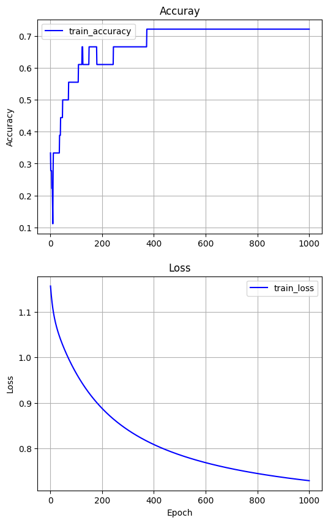

# EX\_06 예제 풀이 — 혈압 3단계 분류 (소프트맥스)

[목차](../00_%EB%94%A5%EB%9F%AC%EB%8B%9D%EC%88%98%ED%95%99_MOC.md) · 개념: [D05_소프트맥스와_다중분류](../01_%EA%B0%9C%EB%85%90%EB%85%B8%ED%8A%B8/D05_%EC%86%8C%ED%94%84%ED%8A%B8%EB%A7%A5%EC%8A%A4%EC%99%80_%EB%8B%A4%EC%A4%91%EB%B6%84%EB%A5%98.md) · 이전: [E05_혈압_로지스틱회귀_예제](E05_%ED%98%88%EC%95%95_%EB%A1%9C%EC%A7%80%EC%8A%A4%ED%8B%B1%ED%9A%8C%EA%B7%80_%EC%98%88%EC%A0%9C.md) · 다음: [E07_MNIST_분류_예제](E07_MNIST_%EB%B6%84%EB%A5%98_%EC%98%88%EC%A0%9C.md)

> [!NOTE]
> **3줄 요약**
> - 0/1 두 가지가 아니라 **정상(0)·주의(1)·경고(2) 세 가지** 중 하나를 맞힌다.
> - 출력층이 `Dense(3, activation='softmax')`로 바뀌어 세 등급의 확률(합이 1)을 내고, 비용은 `categorical_crossentropy`를 쓴다.
> - 결과: 18명 중 13명을 맞혔다(정확도 0.7222). 50세·BMI 25는 [0.358, 0.443, 0.199] → 가장 큰 1번, **주의**.

## 0. 한눈에 보기

| 항목 | 내용 |
|---|---|
| 입력 | 나이, BMI (2개) × 18명 |
| 정답 | 0: 정상, 1: 주의, 2: 경고 (원-핫 인코딩으로 저장) |
| 전처리 | Min-Max 정규화 |
| 모델 | `Dense(3, activation='softmax')` — 가중합 3개 → 소프트맥스 |
| 비용 | categorical cross-entropy |
| 학습 | SGD, 학습률 0.1, 1000번 |
| 결과 | loss 1.1564 → 0.7291, 정확도 0.3333 → 0.7222 |

### EX\_05와 비교

| | EX\_05 (2가지) | EX\_06 (3가지) |
|---|---|---|
| 정답 모양 | `[1]` 또는 `[0]` | `[1,0,0]`, `[0,1,0]`, `[0,0,1]` |
| 출력층 | `Dense(1, activation='sigmoid')` | `Dense(3, activation='softmax')` |
| 출력 | 1일 확률 하나 | 세 등급의 확률 (합 = 1) |
| 비용 | `binary_crossentropy` | `categorical_crossentropy` |
| 판정 | p ≥ 0.5이면 1 | 가장 큰 확률의 번호 (`argmax`) |

## 1. 셀별 풀이

### 1-1. 입력과 정답 (원-핫 인코딩)

```python
#Input(AGE, BMI) and Labels(0: 정상, 1: 주의, 2: 경고)
x_input = tf.constant([[25,22],[25,26],[25,30],[35,22],[35,26],[35,30],[45,22],[45,26],[45,30],
                       [55,22],[55,26],[55,30],[65,22],[65,26],[65,30],[73,22],[73,26],[73,30]],
                      dtype= tf.float32)                       # 같은 18명
labels = tf.constant([[1,0,0],[0,1,0],[0,0,1],[1,0,0],[0,1,0],[1,0,0],[1,0,0],[1,0,0],[0,1,0],
                      [1,0,0],[0,1,0],[0,0,1],[0,1,0],[0,0,1],[0,0,1],[0,1,0],[0,0,1],[0,0,1]],
                     dtype= tf.float32)                        # 사람마다 칸 3개 중 정답 칸만 1
```

> [!TIP]
> **원-핫 인코딩: 정답 칸에만 1을 켜기**
> | 등급 | 원-핫 |
> |---|---|
> | 0 정상 | `[1, 0, 0]` |
> | 1 주의 | `[0, 1, 0]` |
> | 2 경고 | `[0, 0, 1]` |
>
> "2"를 숫자 그대로 쓰면 "2는 1보다 두 배 크다"처럼 크기 관계가 생겨 버린다. 등급은 크기가 아니라 **종류**라서 칸을 나눠 표시한다.

같은 사람들의 EX\_04 수축기 혈압과 비교하면 정상은 118~124, 주의는 125~130, 경고는 130~138이다.

### 1-2. Min-Max 정규화

[E04_다변수_다출력_회귀_예제](E04_%EB%8B%A4%EB%B3%80%EC%88%98_%EB%8B%A4%EC%B6%9C%EB%A0%A5_%ED%9A%8C%EA%B7%80_%EC%98%88%EC%A0%9C.md) 1-3과 같은 코드다.

### 1-3. 모델 정의

```python
model = tf.keras.models.Sequential([
  tf.keras.Input(shape=(2,)),                     # 입력: 나이, BMI
  tf.keras.layers.Dense(3, activation='softmax')  # 출력 3개(등급별 점수) → 소프트맥스로 확률 3개
])

model.summary()
```

**실행 결과**:

```
│ dense (Dense)                   │ (None, 3)              │             9 │
 Total params: 9 (36.00 B)
```

- Param 9 = 가중치 2 × 3 + 편향 3

> [!TIP]
> **소프트맥스: 점수 여러 개를 "합이 1인 확률"로 바꾸는 함수**
> 가중합 3개가 [2, 1, 0]으로 나왔다고 하자.
>
> | 단계 | 정상 | 주의 | 경고 | 합 |
> |---|---|---|---|---|
> | 가중합(점수) | 2 | 1 | 0 | |
> | ① $e^{\text{점수}}$ (모두 양수로) | 7.389 | 2.718 | 1 | 11.107 |
> | ② 합으로 나누기 | **0.665** | **0.245** | **0.090** | 1 |
>
> - ①은 점수를 모두 양수로 바꾸면서 큰 점수를 더 크게 벌린다. $e$와 지수는 [M06_지수와_e](../02_%EC%88%98%ED%95%99%EB%85%B8%ED%8A%B8/M06_%EC%A7%80%EC%88%98%EC%99%80_e.md).
> - ②는 [M02_시그마와_평균](../02_%EC%88%98%ED%95%99%EB%85%B8%ED%8A%B8/M02_%EC%8B%9C%EA%B7%B8%EB%A7%88%EC%99%80_%ED%8F%89%EA%B7%A0.md)의 "전체 중 비율" 계산과 같다. 그래서 합이 항상 1이다.
> - 점수가 가장 큰 칸이 확률도 가장 크다.

### 1-4. 컴파일

```python
model.compile(optimizer= tf.keras.optimizers.SGD(learning_rate=0.1),
              loss='categorical_crossentropy',        # 여러 등급 분류용 비용 (정답이 원-핫일 때)
              metrics=['accuracy'])
```

> [!TIP]
> **categorical cross-entropy**
> [E05_혈압_로지스틱회귀_예제](E05_%ED%98%88%EC%95%95_%EB%A1%9C%EC%A7%80%EC%8A%A4%ED%8B%B1%ED%9A%8C%EA%B7%80_%EC%98%88%EC%A0%9C.md)의 binary cross-entropy와 같은 벌점표를 쓴다. 다만 **정답 칸의 확률만** 본다.
> 예: 정답이 정상([1,0,0])이고 모델이 [0.783, 0.206, 0.010]이면 0.783만 보고 벌점 ≈ 0.244.

### 1-5. 학습

```python
%%time
history = model.fit(x_input, labels, epochs=1000)
```

| Epoch | accuracy | loss |
|---|---|---|
| 1 | 0.3333 (6/18) | 1.1564 |
| 2 | 0.2778 (5/18) | 1.1490 |
| 10 | 0.1111 (2/18) | 1.1070 |
| 100 | 0.5556 (10/18) | 0.9651 |
| 500 | 0.7222 (13/18) | 0.7857 |
| 1000 | 0.7222 (13/18) | 0.7291 |

- 처음 loss 1.16은 "세 칸에 모두 약 1/3씩"을 말할 때의 벌점(약 1.10) 근처다. 아직 아무것도 모른다는 뜻이다.
- 10번째에 정확도가 0.1111까지 **떨어졌다가** 올라간다. loss는 그동안에도 계속 줄고 있다. 정확도는 "가장 큰 칸이 맞았나"만 보는 거친 숫자라, 확률이 조금씩 바뀌는 동안 잠깐 나빠 보일 수 있다.

### 1-6. 그래프

[E05_혈압_로지스틱회귀_예제](E05_%ED%98%88%EC%95%95_%EB%A1%9C%EC%A7%80%EC%8A%A4%ED%8B%B1%ED%9A%8C%EA%B7%80_%EC%98%88%EC%A0%9C.md) 1-6과 같은 코드다.



### 1-7. 학습 데이터로 확인

```python
H_x = model.predict(x_input)                     # 18명 × 확률 3개
for x,h,l in zip(x_input_org, H_x, labels):
  print("Age:{},BMI:{} [label:{}]=>class:{}: {}".format(x[0],x[1],np.argmax(l), np.argmax(h),h))
  #                         정답 번호            예측 번호     확률 3개
```

- `np.argmax(배열)`: 배열에서 **가장 큰 값이 있는 자리 번호**. 원-핫 `[0,1,0]`의 argmax는 1, 확률 `[0.36, 0.44, 0.20]`의 argmax도 1.

**실행 결과** (틀린 5명 표시):

```
Age:25.0,BMI:22.0 [label:0]=>class:0: [0.78338385 0.20631845 0.01029762]
Age:25.0,BMI:26.0 [label:1]=>class:0: [0.6014961  0.32550704 0.0729968 ]   ← 틀림
Age:25.0,BMI:30.0 [label:2]=>class:2: [0.30936924 0.34400824 0.34662253]   ← 맞았지만 아슬아슬
Age:35.0,BMI:22.0 [label:0]=>class:0: [0.7022972  0.27652046 0.02118231]
Age:35.0,BMI:26.0 [label:1]=>class:0: [0.479042  0.3875645 0.1333935]      ← 틀림
Age:35.0,BMI:30.0 [label:0]=>class:2: [0.19108751 0.31766313 0.49124932]   ← 틀림
Age:45.0,BMI:22.0 [label:0]=>class:0: [0.6031927  0.3550628  0.04174442]
Age:45.0,BMI:26.0 [label:0]=>class:1: [0.35106853 0.42462453 0.22430705]   ← 틀림
Age:45.0,BMI:30.0 [label:1]=>class:2: [0.10656394 0.2648425  0.6285936 ]   ← 틀림
Age:55.0,BMI:22.0 [label:0]=>class:0: [0.49048164 0.43163306 0.07788522]
Age:55.0,BMI:26.0 [label:1]=>class:1: [0.23395847 0.42305303 0.34298858]
Age:55.0,BMI:30.0 [label:2]=>class:2: [0.05479377 0.20358758 0.7416187 ]
Age:65.0,BMI:22.0 [label:1]=>class:1: [0.37313625 0.4909104  0.13595329]
Age:65.0,BMI:26.0 [label:2]=>class:2: [0.14150004 0.3825212  0.4759787 ]
Age:65.0,BMI:30.0 [label:2]=>class:2: [0.02658846 0.14769171 0.82571983]
Age:73.0,BMI:22.0 [label:1]=>class:1: [0.2838529  0.5151603  0.20098683]
Age:73.0,BMI:26.0 [label:2]=>class:2: [0.08876073 0.3310046  0.5802347 ]
Age:73.0,BMI:30.0 [label:2]=>class:2: [0.01448969 0.11102898 0.8744813 ]
```

- 한 줄의 확률 3개를 더하면 1이다(0.783 + 0.206 + 0.010 ≈ 1).
- 18명 중 5명이 틀려서 13 ÷ 18 = **0.7222**.

### 1-8. 새 사람 예측

```python
def predict(x):
  return model.predict((x-x_min)/(x_max-x_min))     # 같은 min, max로 정규화

x_test = tf.constant([[50.0, 25.0]], dtype= tf.float32)
H_x = predict(x_test)
print("Age : {}, BMI : {} => Class: {}".format(x_test[0,0],x_test[0,1],np.argmax(H_x[0])),H_x[0])
```

**실행 결과**:

```
Age : 50.0, BMI : 25.0 => Class: 1 [0.3583661  0.44266024 0.19897369]
```

가장 큰 확률은 0.443(1번) → **주의**.

## 2. 이 예제에서 새로 나온 것

| 이름 | 뜻 | 관련 노트 |
|---|---|---|
| 다중 분류 | 3가지 이상 중 하나 맞히기 | |
| 원-핫 인코딩 | 정답 칸에만 1 | |
| `activation='softmax'` | 점수들을 합이 1인 확률로 | [M06_지수와_e](../02_%EC%88%98%ED%95%99%EB%85%B8%ED%8A%B8/M06_%EC%A7%80%EC%88%98%EC%99%80_e.md), [D05_소프트맥스와_다중분류](../01_%EA%B0%9C%EB%85%90%EB%85%B8%ED%8A%B8/D05_%EC%86%8C%ED%94%84%ED%8A%B8%EB%A7%A5%EC%8A%A4%EC%99%80_%EB%8B%A4%EC%A4%91%EB%B6%84%EB%A5%98.md) |
| `categorical_crossentropy` | 정답 칸 확률로 벌점 | [M07_로그](../02_%EC%88%98%ED%95%99%EB%85%B8%ED%8A%B8/M07_%EB%A1%9C%EA%B7%B8.md), [D05_소프트맥스와_다중분류](../01_%EA%B0%9C%EB%85%90%EB%85%B8%ED%8A%B8/D05_%EC%86%8C%ED%94%84%ED%8A%B8%EB%A7%A5%EC%8A%A4%EC%99%80_%EB%8B%A4%EC%A4%91%EB%B6%84%EB%A5%98.md) |
| `np.argmax` | 가장 큰 값의 자리 번호 | |

## 3. 스스로 확인

<details><summary>1. 등급이 5개면 `Dense` 층과 원-핫은 어떻게 바뀌나?</summary>

`Dense(5, activation='softmax')`, 원-핫은 칸 5개(예: 3번 등급 = `[0,0,0,1,0]`). Param #는 2 × 5 + 5 = **15**

</details>

<details><summary>2. 확률 [0.2, 0.5, 0.3]의 argmax는?</summary>

가장 큰 0.5가 1번 자리 → **1**

</details>

<details><summary>3. 소프트맥스 출력의 합은 항상 얼마인가?</summary>

**1** (각 값을 전체 합으로 나눴기 때문)

</details>

