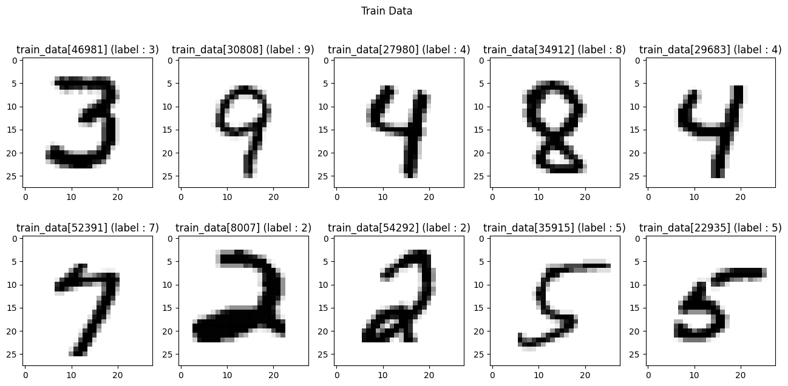

# EX\_07 예제 풀이 — 손글씨 숫자 분류 (MNIST)

[목차](../00_%EB%94%A5%EB%9F%AC%EB%8B%9D%EC%88%98%ED%95%99_MOC.md) · 개념: [D06_이미지분류와_MNIST](../01_%EA%B0%9C%EB%85%90%EB%85%B8%ED%8A%B8/D06_%EC%9D%B4%EB%AF%B8%EC%A7%80%EB%B6%84%EB%A5%98%EC%99%80_MNIST.md) · 이전: [E06_혈압_소프트맥스분류_예제](../03_%EC%98%88%EC%A0%9C%ED%92%80%EC%9D%B4/E06_%ED%98%88%EC%95%95_%EC%86%8C%ED%94%84%ED%8A%B8%EB%A7%A5%EC%8A%A4%EB%B6%84%EB%A5%98_%EC%98%88%EC%A0%9C.md) · 다음: [E08_CNN_1Conv_MNIST_예제](../03_%EC%98%88%EC%A0%9C%ED%92%80%EC%9D%B4/E08_CNN_1Conv_MNIST_%EC%98%88%EC%A0%9C.md)

> [!NOTE]
> **3줄 요약**
> - 28×28 손글씨 그림 6만 장으로 0~9 숫자를 맞히는 모델을 만든다. [E06_혈압_소프트맥스분류_예제](../03_%EC%98%88%EC%A0%9C%ED%92%80%EC%9D%B4/E06_%ED%98%88%EC%95%95_%EC%86%8C%ED%94%84%ED%8A%B8%EB%A7%A5%EC%8A%A4%EB%B6%84%EB%A5%98_%EC%98%88%EC%A0%9C.md)의 3등급 [분류](../00_%EB%94%A5%EB%9F%AC%EB%8B%9D_%EC%9A%A9%EC%96%B4%EC%82%AC%EC%A0%84.md#regression-classification-%ED%9A%8C%EA%B7%80%EC%99%80-%EB%B6%84%EB%A5%98)가 **10등급**이 된 것이다.
> - 그림을 한 줄(784칸)로 펴서(`Flatten`) `Dense(10, softmax)`에 넣는다. 입력이 2개에서 784개로 늘었을 뿐 구조는 같다.
> - 결과: 5번 [학습](../00_%EB%94%A5%EB%9F%AC%EB%8B%9D_%EC%9A%A9%EC%96%B4%EC%82%AC%EC%A0%84.md#training-%ED%95%99%EC%8A%B5) 후 처음 보는 시험 그림 1만 장에서 [정확도](../00_%EB%94%A5%EB%9F%AC%EB%8B%9D_%EC%9A%A9%EC%96%B4%EC%82%AC%EC%A0%84.md#accuracy-%EC%A0%95%ED%99%95%EB%8F%84) **92.57%**.

## 0. 예제 개요

| 항목 | 내용 |
|---|---|
| 데이터 | [MNIST](../00_%EB%94%A5%EB%9F%AC%EB%8B%9D_%EC%9A%A9%EC%96%B4%EC%82%AC%EC%A0%84.md#mnist-%EC%86%90%EA%B8%80%EC%94%A8-%EC%88%AB%EC%9E%90-%EB%8D%B0%EC%9D%B4%ED%84%B0%EC%85%8B): 학습용 60000장, 시험용 10000장, 각 28×28 흑백 |
| [정답](../00_%EB%94%A5%EB%9F%AC%EB%8B%9D_%EC%9A%A9%EC%96%B4%EC%82%AC%EC%A0%84.md#label-%EC%A0%95%EB%8B%B5) | 0~9 숫자 ([원-핫](../00_%EB%94%A5%EB%9F%AC%EB%8B%9D_%EC%9A%A9%EC%96%B4%EC%82%AC%EC%A0%84.md#one-hot-encoding-%EC%9B%90-%ED%95%AB-%EC%9D%B8%EC%BD%94%EB%94%A9)이 아니라 숫자 그대로) |
| 전처리 | 픽셀 값 0~255를 0~1로 (÷ 255) |
| 모델 | `Flatten` → `Dense(10, activation='softmax')`, [파라미터](../00_%EB%94%A5%EB%9F%AC%EB%8B%9D_%EC%9A%A9%EC%96%B4%EC%82%AC%EC%A0%84.md#parameter-%ED%8C%8C%EB%9D%BC%EB%AF%B8%ED%84%B0) 수([가중치](../00_%EB%94%A5%EB%9F%AC%EB%8B%9D_%EC%9A%A9%EC%96%B4%EC%82%AC%EC%A0%84.md#weight-%EA%B0%80%EC%A4%91%EC%B9%98)+[편향](../00_%EB%94%A5%EB%9F%AC%EB%8B%9D_%EC%9A%A9%EC%96%B4%EC%82%AC%EC%A0%84.md#bias-%ED%8E%B8%ED%96%A5)) 7,850개 |
| [손실 함수](../00_%EB%94%A5%EB%9F%AC%EB%8B%9D_%EC%9A%A9%EC%96%B4%EC%82%AC%EC%A0%84.md#loss-function-%EC%86%90%EC%8B%A4-%ED%95%A8%EC%88%98) | `sparse_categorical_crossentropy` |
| [학습](../00_%EB%94%A5%EB%9F%AC%EB%8B%9D_%EC%9A%A9%EC%96%B4%EC%82%AC%EC%A0%84.md#training-%ED%95%99%EC%8A%B5) | [Adam](../00_%EB%94%A5%EB%9F%AC%EB%8B%9D_%EC%9A%A9%EC%96%B4%EC%82%AC%EC%A0%84.md#adam-%EC%95%84%EB%8B%B4-%EC%98%B5%ED%8B%B0%EB%A7%88%EC%9D%B4%EC%A0%80), 5번 |
| 결과 | [시험 데이터](../00_%EB%94%A5%EB%9F%AC%EB%8B%9D_%EC%9A%A9%EC%96%B4%EC%82%AC%EC%A0%84.md#training-data-test-data-%ED%95%99%EC%8A%B5-%EB%8D%B0%EC%9D%B4%ED%84%B0%EC%99%80-%EC%8B%9C%ED%97%98-%EB%8D%B0%EC%9D%B4%ED%84%B0) [손실](../00_%EB%94%A5%EB%9F%AC%EB%8B%9D_%EC%9A%A9%EC%96%B4%EC%82%AC%EC%A0%84.md#loss-function-%EC%86%90%EC%8B%A4-%ED%95%A8%EC%88%98) 0.267, [정확도](../00_%EB%94%A5%EB%9F%AC%EB%8B%9D_%EC%9A%A9%EC%96%B4%EC%82%AC%EC%A0%84.md#accuracy-%EC%A0%95%ED%99%95%EB%8F%84) 0.9257 |

### EX\_06과의 비교

| | EX\_06 | EX\_07 |
|---|---|---|
| 입력 | 숫자 2개 | 그림 28×28 = 784개 |
| 등급 수 | 3 | 10 |
| [정답](../00_%EB%94%A5%EB%9F%AC%EB%8B%9D_%EC%9A%A9%EC%96%B4%EC%82%AC%EC%A0%84.md#label-%EC%A0%95%EB%8B%B5) 모양 | [원-핫](../00_%EB%94%A5%EB%9F%AC%EB%8B%9D_%EC%9A%A9%EC%96%B4%EC%82%AC%EC%A0%84.md#one-hot-encoding-%EC%9B%90-%ED%95%AB-%EC%9D%B8%EC%BD%94%EB%94%A9) `[0,1,0]` | 숫자 그대로 `7` |
| [손실 함수](../00_%EB%94%A5%EB%9F%AC%EB%8B%9D_%EC%9A%A9%EC%96%B4%EC%82%AC%EC%A0%84.md#loss-function-%EC%86%90%EC%8B%A4-%ED%95%A8%EC%88%98) | `categorical_crossentropy` | `sparse_categorical_crossentropy` |
| 최적화 | SGD | [Adam](../00_%EB%94%A5%EB%9F%AC%EB%8B%9D_%EC%9A%A9%EC%96%B4%EC%82%AC%EC%A0%84.md#adam-%EC%95%84%EB%8B%B4-%EC%98%B5%ED%8B%B0%EB%A7%88%EC%9D%B4%EC%A0%80) |
| 확인 방법 | [학습 데이터](../00_%EB%94%A5%EB%9F%AC%EB%8B%9D_%EC%9A%A9%EC%96%B4%EC%82%AC%EC%A0%84.md#training-data-test-data-%ED%95%99%EC%8A%B5-%EB%8D%B0%EC%9D%B4%ED%84%B0%EC%99%80-%EC%8B%9C%ED%97%98-%EB%8D%B0%EC%9D%B4%ED%84%B0)로 확인 | **처음 보는 [시험 데이터](../00_%EB%94%A5%EB%9F%AC%EB%8B%9D_%EC%9A%A9%EC%96%B4%EC%82%AC%EC%A0%84.md#training-data-test-data-%ED%95%99%EC%8A%B5-%EB%8D%B0%EC%9D%B4%ED%84%B0%EC%99%80-%EC%8B%9C%ED%97%98-%EB%8D%B0%EC%9D%B4%ED%84%B0)**로 확인 |

## 1. 셀별 풀이

### 1-1. 모듈 불러오기

```python
import numpy as np
import tensorflow as tf
import matplotlib.pyplot as plt
from tensorflow.keras.datasets import mnist     # Keras에 들어 있는 MNIST 데이터 불러오기 도구
```

### 1-2. MNIST 데이터 불러오기

```python
(train_data, train_labels), (test_data, test_labels) = mnist.load_data()
# 학습용(그림, 정답)과 시험용(그림, 정답) 네 덩어리를 한 번에 받음 (처음 실행 땐 인터넷에서 내려받음)

print("Type : {}".format(type(train_data)))      # 자료형
print("Shape : {}".format(train_data.shape))     # 모양
print("Type : {}".format(type(test_data)))
print("Shape : {}".format(test_data.shape))
print("Type : {}".format(type(train_labels)))
print("Shape : {}".format(train_labels.shape))
print("Type : {}".format(type(test_labels)))
print("Shape : {}".format(test_labels.shape))
```

<details><summary>실행 결과 (Type/Shape가 4쌍 반복된다)</summary>

```text
Type : <class 'numpy.ndarray'>
Shape : (60000, 28, 28)
Type : <class 'numpy.ndarray'>
Shape : (10000, 28, 28)
Type : <class 'numpy.ndarray'>
Shape : (60000,)
Type : <class 'numpy.ndarray'>
Shape : (10000,)
```

</details>

네 덩어리 모두 `numpy.ndarray`(숫자 배열)이고, 모양은 아래 표와 같다.

| 이름 | 모양 | 뜻 |
|---|---|---|
| train\_data | (60000, 28, 28) | 그림 6만 장, 각각 가로 28 × 세로 28칸 |
| test\_data | (10000, 28, 28) | 시험용 그림 1만 장 |
| train\_labels | (60000,) | 그림마다 [정답](../00_%EB%94%A5%EB%9F%AC%EB%8B%9D_%EC%9A%A9%EC%96%B4%EC%82%AC%EC%A0%84.md#label-%EC%A0%95%EB%8B%B5) 숫자 하나 (예: 5) |
| test\_labels | (10000,) | 시험용 [정답](../00_%EB%94%A5%EB%9F%AC%EB%8B%9D_%EC%9A%A9%EC%96%B4%EC%82%AC%EC%A0%84.md#label-%EC%A0%95%EB%8B%B5) |

- 그림 한 장 = 28×28 숫자 표. 각 칸은 0(배경, 빈 곳) ~ 255(가장 진한 획)의 값이다.
- **학습용과 시험용을 나누는 이유**: [학습](../00_%EB%94%A5%EB%9F%AC%EB%8B%9D_%EC%9A%A9%EC%96%B4%EC%82%AC%EC%A0%84.md#training-%ED%95%99%EC%8A%B5)에 쓴 문제로 시험을 보면 외워서 맞힐 수 있다. 처음 보는 그림을 맞혀야 진짜 실력이다.

### 1-3. 그림 10장 보기

```python
idx_show = np.arange(0, train_data.shape[0])     # [0, 1, 2, ..., 59999]
np.random.shuffle(idx_show)                      # 순서를 무작위로 섞음
idx_show = idx_show[0:10]                        # 앞에서 10개만 → 무작위 그림 번호 10개
fig_train, ax_train = plt.subplots(2,5,figsize=(16, 7))   # 2행 5열짜리 그림판
fig_train.suptitle("Train Data")                 # 전체 제목
for idx in range(10):
    ax_train[idx//5, idx%5].imshow(train_data[idx_show[idx]],cmap="binary")   # idx//5 = 행, idx%5 = 열
    ax_train[idx//5, idx%5].set_title("train_data[{}] (label : {})".format(idx_show[idx], train_labels[idx_show[idx]]))
```



- `idx//5`, `idx%5`: idx = 7이면 7//5 = 1행, 7%5 = 2열. **몫과 나머지로 행·열을 구하는 방법**이다(파이썬 강의노트의 `//`, `%`).
- `cmap="binary"`: 0은 흰색, 큰 값일수록 검게 그리기. 그래서 흰 바탕에 검은 글씨로 보인다.

### 1-4. 픽셀 값의 0~1 변환

```python
train_data, test_data = train_data / 255.0, test_data / 255.0   # 픽셀 값 0~255를 0~1로
```

- 0 → 0.0, 128 → 0.502, 255 → 1.0
- [E04_다변수_다출력_회귀_예제](../03_%EC%98%88%EC%A0%9C%ED%92%80%EC%9D%B4/E04_%EB%8B%A4%EB%B3%80%EC%88%98_%EB%8B%A4%EC%B6%9C%EB%A0%A5_%ED%9A%8C%EA%B7%80_%EC%98%88%EC%A0%9C.md)의 Min-Max [정규화](../00_%EB%94%A5%EB%9F%AC%EB%8B%9D_%EC%9A%A9%EC%96%B4%EC%82%AC%EC%A0%84.md#normalization-%EC%A0%95%EA%B7%9C%ED%99%94)와 같은 목적이다. 픽셀의 최솟값이 0, 최댓값이 255라서 255로 나누기만 하면 된다.

> [!WARNING]
> **⚠ 주의**
> [시험 데이터](../00_%EB%94%A5%EB%9F%AC%EB%8B%9D_%EC%9A%A9%EC%96%B4%EC%82%AC%EC%A0%84.md#training-data-test-data-%ED%95%99%EC%8A%B5-%EB%8D%B0%EC%9D%B4%ED%84%B0%EC%99%80-%EC%8B%9C%ED%97%98-%EB%8D%B0%EC%9D%B4%ED%84%B0)도 반드시 똑같이 ÷255 한다. 안 하면 [정확도](../00_%EB%94%A5%EB%9F%AC%EB%8B%9D_%EC%9A%A9%EC%96%B4%EC%82%AC%EC%A0%84.md#accuracy-%EC%A0%95%ED%99%95%EB%8F%84)가 크게 떨어진다. 위 코드는 `train_data, test_data`를 한 줄에서 함께 나눈다.

### 1-5. 모델 정의

```python
model = tf.keras.models.Sequential([
    tf.keras.Input(shape=(28,28)),                     # 입력: 28×28 그림 한 장
    tf.keras.layers.Flatten(),                         # 28×28 표를 한 줄 784칸으로 펴기
    # tf.keras.layers.Dense(256, activation='sigmoid'),   ← 중간층(주석 처리됨): 켜면 층이 깊어짐
    # tf.keras.layers.Dense(256, activation='sigmoid'),
    tf.keras.layers.Dense(10, activation='softmax')    # 출력 10개 = 숫자 0~9의 확률
])

model.summary()
```

**실행 결과**:

```text
│ flatten (Flatten)               │ (None, 784)            │             0 │
│ dense (Dense)                   │ (None, 10)             │         7,850 │
 Total params: 7,850 (30.66 KB)
```

- **[Flatten](../00_%EB%94%A5%EB%9F%AC%EB%8B%9D_%EC%9A%A9%EC%96%B4%EC%82%AC%EC%A0%84.md#flatten-%ED%8F%89%ED%83%84%ED%99%94)**: 2차원 표를 1차원 줄로 편다. 28 × 28 = 784. [가중치](../00_%EB%94%A5%EB%9F%AC%EB%8B%9D_%EC%9A%A9%EC%96%B4%EC%82%AC%EC%A0%84.md#weight-%EA%B0%80%EC%A4%91%EC%B9%98)가 없어서 [파라미터](../00_%EB%94%A5%EB%9F%AC%EB%8B%9D_%EC%9A%A9%EC%96%B4%EC%82%AC%EC%A0%84.md#parameter-%ED%8C%8C%EB%9D%BC%EB%AF%B8%ED%84%B0) 수는 0이다.
- **Dense(10)**: [파라미터](../00_%EB%94%A5%EB%9F%AC%EB%8B%9D_%EC%9A%A9%EC%96%B4%EC%82%AC%EC%A0%84.md#parameter-%ED%8C%8C%EB%9D%BC%EB%AF%B8%ED%84%B0) 수([가중치](../00_%EB%94%A5%EB%9F%AC%EB%8B%9D_%EC%9A%A9%EC%96%B4%EC%82%AC%EC%A0%84.md#weight-%EA%B0%80%EC%A4%91%EC%B9%98)+[편향](../00_%EB%94%A5%EB%9F%AC%EB%8B%9D_%EC%9A%A9%EC%96%B4%EC%82%AC%EC%A0%84.md#bias-%ED%8E%B8%ED%96%A5)) = [가중치](../00_%EB%94%A5%EB%9F%AC%EB%8B%9D_%EC%9A%A9%EC%96%B4%EC%82%AC%EC%A0%84.md#weight-%EA%B0%80%EC%A4%91%EC%B9%98) 784 × 10 = 7840 + [편향](../00_%EB%94%A5%EB%9F%AC%EB%8B%9D_%EC%9A%A9%EC%96%B4%EC%82%AC%EC%A0%84.md#bias-%ED%8E%B8%ED%96%A5) 10 = **7850**.
- 784개 픽셀 하나하나에 숫자별 [가중치](../00_%EB%94%A5%EB%9F%AC%EB%8B%9D_%EC%9A%A9%EC%96%B4%EC%82%AC%EC%A0%84.md#weight-%EA%B0%80%EC%A4%91%EC%B9%98)를 곱해 더하는 것이다. "이 칸이 진하면(값이 크면) 7일 가능성이 올라간다" 같은 것을 배운다.

> [!NOTE]
> **주석 처리된 두 줄**
> `Dense(256, activation='sigmoid')`를 중간에 넣으면 784 → 256 → 256 → 10으로 [층](../00_%EB%94%A5%EB%9F%AC%EB%8B%9D_%EC%9A%A9%EC%96%B4%EC%82%AC%EC%A0%84.md#layer-%EC%B8%B5)이 깊어진다(심층 신경망). 주석을 풀면 한 층짜리 모델과 [정확도](../00_%EB%94%A5%EB%9F%AC%EB%8B%9D_%EC%9A%A9%EC%96%B4%EC%82%AC%EC%A0%84.md#accuracy-%EC%A0%95%ED%99%95%EB%8F%84)를 비교해 볼 수 있다.

### 1-6. 컴파일

```python
model.compile(optimizer='adam',                          # Adam: 학습률을 알아서 조절하는 경사하강법
              loss='sparse_categorical_crossentropy',    # 정답이 원-핫이 아니라 숫자(7)일 때 쓰는 버전
              metrics=['accuracy'])
```

- **[Adam](../00_%EB%94%A5%EB%9F%AC%EB%8B%9D_%EC%9A%A9%EC%96%B4%EC%82%AC%EC%A0%84.md#adam-%EC%95%84%EB%8B%B4-%EC%98%B5%ED%8B%B0%EB%A7%88%EC%9D%B4%EC%A0%80)**: [경사하강법](../00_%EB%94%A5%EB%9F%AC%EB%8B%9D_%EC%9A%A9%EC%96%B4%EC%82%AC%EC%A0%84.md#gradient-descent-%EA%B2%BD%EC%82%AC%ED%95%98%EA%B0%95%EB%B2%95)의 개선판. [가중치](../00_%EB%94%A5%EB%9F%AC%EB%8B%9D_%EC%9A%A9%EC%96%B4%EC%82%AC%EC%A0%84.md#weight-%EA%B0%80%EC%A4%91%EC%B9%98)마다 보폭을 자동으로 조절해서 [학습률](../00_%EB%94%A5%EB%9F%AC%EB%8B%9D_%EC%9A%A9%EC%96%B4%EC%82%AC%EC%A0%84.md#learning-rate-%ED%95%99%EC%8A%B5%EB%A5%A0)을 직접 맞추는 수고가 줄어든다.
- **sparse\_categorical\_crossentropy**: [E06_혈압_소프트맥스분류_예제](../03_%EC%98%88%EC%A0%9C%ED%92%80%EC%9D%B4/E06_%ED%98%88%EC%95%95_%EC%86%8C%ED%94%84%ED%8A%B8%EB%A7%A5%EC%8A%A4%EB%B6%84%EB%A5%98_%EC%98%88%EC%A0%9C.md)의 `categorical_crossentropy`와 계산은 같다. [정답](../00_%EB%94%A5%EB%9F%AC%EB%8B%9D_%EC%9A%A9%EC%96%B4%EC%82%AC%EC%A0%84.md#label-%EC%A0%95%EB%8B%B5)을 `[0,0,0,0,0,0,0,1,0,0]` 대신 `7`로 줘도 되게 한 것이다.

### 1-7. 학습

```python
history = model.fit(train_data, train_labels, epochs=5)   # 6만 장을 5에폭
```

| Epoch | accuracy | loss |
|---|---|---|
| 1 | 0.8150 | 0.7134 |
| 2 | 0.9145 | 0.3099 |
| 3 | 0.9221 | 0.2837 |
| 4 | 0.9249 | 0.2718 |
| 5 | 0.9272 | 0.2578 |

- [에폭](../00_%EB%94%A5%EB%9F%AC%EB%8B%9D_%EC%9A%A9%EC%96%B4%EC%82%AC%EC%A0%84.md#epoch-%EC%97%90%ED%8F%AD)(epoch, 전체 데이터를 한 번 다 보는 것) 한 번에 6만 장을 모두 본다.
- `batch_size`를 지정하지 않으면 기본값 32장씩 묶어서 본다. 묶음 하나를 볼 때마다 [가중치](../00_%EB%94%A5%EB%9F%AC%EB%8B%9D_%EC%9A%A9%EC%96%B4%EC%82%AC%EC%A0%84.md#weight-%EA%B0%80%EC%A4%91%EC%B9%98)를 한 번 고친다.
- 그래서 1에폭에 60000 ÷ 32 = **1875번** 고친다. 5에폭이면 1875 × 5 = 9375번이라, 이 단순한 모델은 충분히 배운다.

### 1-8. 시험 데이터로 평가

```python
%%time
model.evaluate(test_data,  test_labels)    # 처음 보는 1만 장으로 시험 → [loss, accuracy]
```

**실행 결과**:

```text
[0.2670372426509857, 0.9257000088691711]
```

- 시험 [정확도](../00_%EB%94%A5%EB%9F%AC%EB%8B%9D_%EC%9A%A9%EC%96%B4%EC%82%AC%EC%A0%84.md#accuracy-%EC%A0%95%ED%99%95%EB%8F%84) **92.57%**: 1만 장 중 약 9257장을 맞혔다.
- [학습](../00_%EB%94%A5%EB%9F%AC%EB%8B%9D_%EC%9A%A9%EC%96%B4%EC%82%AC%EC%A0%84.md#training-%ED%95%99%EC%8A%B5) [정확도](../00_%EB%94%A5%EB%9F%AC%EB%8B%9D_%EC%9A%A9%EC%96%B4%EC%82%AC%EC%A0%84.md#accuracy-%EC%A0%95%ED%99%95%EB%8F%84)(92.72%)와 비슷하다. 학습 데이터에만 과하게 맞춘 상태([과적합](../00_%EB%94%A5%EB%9F%AC%EB%8B%9D_%EC%9A%A9%EC%96%B4%EC%82%AC%EC%A0%84.md#overfitting-%EA%B3%BC%EC%A0%81%ED%95%A9))가 아니라는 뜻이다.
- 외운 게 아니라 일반적인 규칙을 배웠다.
- 이 단순한 모델([층](../00_%EB%94%A5%EB%9F%AC%EB%8B%9D_%EC%9A%A9%EC%96%B4%EC%82%AC%EC%A0%84.md#layer-%EC%B8%B5) 1개)의 한계가 여기다. 다음 [CNN](../00_%EB%94%A5%EB%9F%AC%EB%8B%9D_%EC%9A%A9%EC%96%B4%EC%82%AC%EC%A0%84.md#cnn-convolutional-neural-network-%ED%95%A9%EC%84%B1%EA%B3%B1-%EC%8B%A0%EA%B2%BD%EB%A7%9D) 예제들이 이 숫자를 어디까지 올리는지 비교해 본다.

## 2. 새로 나온 개념

| 이름 | 뜻 | 관련 노트 |
|---|---|---|
| [MNIST](../00_%EB%94%A5%EB%9F%AC%EB%8B%9D_%EC%9A%A9%EC%96%B4%EC%82%AC%EC%A0%84.md#mnist-%EC%86%90%EA%B8%80%EC%94%A8-%EC%88%AB%EC%9E%90-%EB%8D%B0%EC%9D%B4%ED%84%B0%EC%85%8B) | 손글씨 숫자 그림 데이터 | |
| [학습](../00_%EB%94%A5%EB%9F%AC%EB%8B%9D_%EC%9A%A9%EC%96%B4%EC%82%AC%EC%A0%84.md#training-%ED%95%99%EC%8A%B5)/[시험 데이터](../00_%EB%94%A5%EB%9F%AC%EB%8B%9D_%EC%9A%A9%EC%96%B4%EC%82%AC%EC%A0%84.md#training-data-test-data-%ED%95%99%EC%8A%B5-%EB%8D%B0%EC%9D%B4%ED%84%B0%EC%99%80-%EC%8B%9C%ED%97%98-%EB%8D%B0%EC%9D%B4%ED%84%B0) | 배우는 데이터와 확인용 데이터를 나눔 | |
| shape (60000, 28, 28) | 그림 수 × 세로 × 가로 | [M05_벡터와_행렬](../02_%EC%88%98%ED%95%99%EB%85%B8%ED%8A%B8/M05_%EB%B2%A1%ED%84%B0%EC%99%80_%ED%96%89%EB%A0%AC.md), [D06_이미지분류와_MNIST](../01_%EA%B0%9C%EB%85%90%EB%85%B8%ED%8A%B8/D06_%EC%9D%B4%EB%AF%B8%EC%A7%80%EB%B6%84%EB%A5%98%EC%99%80_MNIST.md) |
| ÷ 255 | 픽셀 값을 0~1로 | [E04_다변수_다출력_회귀_예제](../03_%EC%98%88%EC%A0%9C%ED%92%80%EC%9D%B4/E04_%EB%8B%A4%EB%B3%80%EC%88%98_%EB%8B%A4%EC%B6%9C%EB%A0%A5_%ED%9A%8C%EA%B7%80_%EC%98%88%EC%A0%9C.md) |
| `Flatten` | 표를 한 줄로 펴기 | |
| `optimizer='adam'` | 보폭을 자동 조절하는 [경사하강법](../00_%EB%94%A5%EB%9F%AC%EB%8B%9D_%EC%9A%A9%EC%96%B4%EC%82%AC%EC%A0%84.md#gradient-descent-%EA%B2%BD%EC%82%AC%ED%95%98%EA%B0%95%EB%B2%95) | [D02_경사하강법으로_직선찾기](../01_%EA%B0%9C%EB%85%90%EB%85%B8%ED%8A%B8/D02_%EA%B2%BD%EC%82%AC%ED%95%98%EA%B0%95%EB%B2%95%EC%9C%BC%EB%A1%9C_%EC%A7%81%EC%84%A0%EC%B0%BE%EA%B8%B0.md) |
| `sparse_categorical_crossentropy` | [정답](../00_%EB%94%A5%EB%9F%AC%EB%8B%9D_%EC%9A%A9%EC%96%B4%EC%82%AC%EC%A0%84.md#label-%EC%A0%95%EB%8B%B5)이 숫자일 때의 [분류](../00_%EB%94%A5%EB%9F%AC%EB%8B%9D_%EC%9A%A9%EC%96%B4%EC%82%AC%EC%A0%84.md#regression-classification-%ED%9A%8C%EA%B7%80%EC%99%80-%EB%B6%84%EB%A5%98) [손실 함수](../00_%EB%94%A5%EB%9F%AC%EB%8B%9D_%EC%9A%A9%EC%96%B4%EC%82%AC%EC%A0%84.md#loss-function-%EC%86%90%EC%8B%A4-%ED%95%A8%EC%88%98) | |
| `model.evaluate` | [시험 데이터](../00_%EB%94%A5%EB%9F%AC%EB%8B%9D_%EC%9A%A9%EC%96%B4%EC%82%AC%EC%A0%84.md#training-data-test-data-%ED%95%99%EC%8A%B5-%EB%8D%B0%EC%9D%B4%ED%84%B0%EC%99%80-%EC%8B%9C%ED%97%98-%EB%8D%B0%EC%9D%B4%ED%84%B0)로 [손실](../00_%EB%94%A5%EB%9F%AC%EB%8B%9D_%EC%9A%A9%EC%96%B4%EC%82%AC%EC%A0%84.md#loss-function-%EC%86%90%EC%8B%A4-%ED%95%A8%EC%88%98)과 [정확도](../00_%EB%94%A5%EB%9F%AC%EB%8B%9D_%EC%9A%A9%EC%96%B4%EC%82%AC%EC%A0%84.md#accuracy-%EC%A0%95%ED%99%95%EB%8F%84)를 계산 | |
| `plt.subplots(행, 열)` | 여러 그림 칸 만들기 | |

## 3. 개념 재확인

<details><summary>1. 그림이 32×32라면 Flatten 후 칸 수와 Dense(10)의 파라미터 수는?</summary>

| 단계 | 하는 일 | 코드 | 계산 | 결과 |
|---|---|---|---|---|
| 1 | 한 줄로 펴기 | `Flatten()` | 32 × 32 | 1024칸 |
| 2 | [가중치](../00_%EB%94%A5%EB%9F%AC%EB%8B%9D_%EC%9A%A9%EC%96%B4%EC%82%AC%EC%A0%84.md#weight-%EA%B0%80%EC%A4%91%EC%B9%98) 세기 | `Dense(10)` | 입력 1024 × 출력 10 | 10240 |
| 3 | [편향](../00_%EB%94%A5%EB%9F%AC%EB%8B%9D_%EC%9A%A9%EC%96%B4%EC%82%AC%EC%A0%84.md#bias-%ED%8E%B8%ED%96%A5) 세기 | `Dense(10)` | 출력 칸마다 1개 | 10 |
| 4 | 합치기 | - | 10240 + 10 | 10250 |

28×28일 때는 784 × 10 + 10 = 7850으로 같은 식이다.

**① 바꿀 코드**
```python
model = tf.keras.models.Sequential([                   # ① 층을 순서대로 쌓는 모델
    tf.keras.Input(shape=(32,32)),                     # ② 입력: 28×28 → 32×32 그림 한 장
    tf.keras.layers.Flatten(),                         # ② 32×32 표를 한 줄 1024칸으로 펴기
    tf.keras.layers.Dense(10, activation='softmax')    # ③④ 출력 10개 = 숫자 0~9의 확률 (그대로)
])                                                     # ① 모델 정의 끝
model.summary()                                        # ⑤ Output Shape와 Param # 확인 (10250)
```

**② 한 줄로 펴기** (`Flatten()`)
- 가로 32 × 세로 32 = 1024칸
- Output Shape는 `(None, 1024)`. [가중치](../00_%EB%94%A5%EB%9F%AC%EB%8B%9D_%EC%9A%A9%EC%96%B4%EC%82%AC%EC%A0%84.md#weight-%EA%B0%80%EC%A4%91%EC%B9%98)가 없어서 Param # 은 0

**③ [가중치](../00_%EB%94%A5%EB%9F%AC%EB%8B%9D_%EC%9A%A9%EC%96%B4%EC%82%AC%EC%A0%84.md#weight-%EA%B0%80%EC%A4%91%EC%B9%98) 세기** (`Dense(10)`)
- 출력 칸 하나마다 입력 1024개를 각각 곱하므로 [가중치](../00_%EB%94%A5%EB%9F%AC%EB%8B%9D_%EC%9A%A9%EC%96%B4%EC%82%AC%EC%A0%84.md#weight-%EA%B0%80%EC%A4%91%EC%B9%98) 1024개
- 출력 칸이 10개이므로 1024 × 10 = 10240

**④ [편향](../00_%EB%94%A5%EB%9F%AC%EB%8B%9D_%EC%9A%A9%EC%96%B4%EC%82%AC%EC%A0%84.md#bias-%ED%8E%B8%ED%96%A5) 세기** (출력 칸마다 1개)
- 출력 칸 10개 → 10

**⑤ 합치기**
- 10240 + 10 = 10250
- 비교: 28×28이면 784 × 10 + 10 = 7840 + 10 = 7850 (`Param # 7,850`)

**답**: [Flatten](../00_%EB%94%A5%EB%9F%AC%EB%8B%9D_%EC%9A%A9%EC%96%B4%EC%82%AC%EC%A0%84.md#flatten-%ED%8F%89%ED%83%84%ED%99%94) 후 **1024**칸, Dense(10)의 [파라미터](../00_%EB%94%A5%EB%9F%AC%EB%8B%9D_%EC%9A%A9%EC%96%B4%EC%82%AC%EC%A0%84.md#parameter-%ED%8C%8C%EB%9D%BC%EB%AF%B8%ED%84%B0) 수 **10250**

</details>

<details><summary>2. idx = 9일 때 <code>ax_train[idx//5, idx%5]</code>는 몇 행 몇 열인가?</summary>

| 단계 | 하는 일 | 코드 | 계산 | 결과 |
|---|---|---|---|---|
| 1 | 그림판 크기 확인 | `plt.subplots(2,5)` | 2행 5열 (한 줄에 5칸) | 5칸 |
| 2 | 행 번호 구하기 | `idx//5` | 9 // 5 (몫) | 1 |
| 3 | 열 번호 구하기 | `idx%5` | 9 % 5 (나머지) | 4 |
| 4 | 위치 읽기 | `ax_train[1, 4]` | 행·열 모두 0부터 센다 | 두 번째 줄의 맨 끝 칸 |

**① 쓰는 코드**
```python
fig_train, ax_train = plt.subplots(2,5,figsize=(16, 7))   # ② 2행 5열짜리 그림판 (칸 10개)
for idx in range(10):                                     # ⑤ idx = 0, 1, ..., 9
    ax_train[idx//5, idx%5].imshow(train_data[idx_show[idx]],cmap="binary")   # ③④⑤ idx//5 = 행, idx%5 = 열
```

**② 그림판 크기 확인** (`plt.subplots(2,5)`)
- 2행 5열이라 한 줄에 5칸씩, 줄이 2개
- idx가 0~4이면 첫 줄, 5~9이면 둘째 줄

**③ 행 번호** (`idx//5`, idx = 9)
- `//`는 몫만 남기는 나눗셈
- 9 ÷ 5 = 몫 1, 나머지 4 → 몫 1이 행 번호

**④ 열 번호** (`idx%5`, idx = 9)
- `%`는 나머지
- 9 ÷ 5의 나머지 4가 열 번호

**⑤ 위치 읽기** (`ax_train[1, 4]`)
- 행·열 모두 0부터 센다 → 행 1 = 두 번째 줄, 열 4 = 다섯 번째(맨 끝) 칸
- 확인: 첫 줄이 idx 0~4로 5칸을 쓰고, 둘째 줄의 첫 칸(열 0)이 idx 5, 맨 끝(열 4)이 5 + 4 = 9

**답**: **1행 4열** (0부터 센 번호, 즉 두 번째 줄의 맨 끝 칸)

</details>

<details><summary>3. 왜 학습 데이터가 아니라 시험 데이터로 평가하나?</summary>

| 단계 | 하는 일 | 코드 | 계산 | 결과 |
|---|---|---|---|---|
| 1 | [학습](../00_%EB%94%A5%EB%9F%AC%EB%8B%9D_%EC%9A%A9%EC%96%B4%EC%82%AC%EC%A0%84.md#training-%ED%95%99%EC%8A%B5)에 쓰는 데이터 | `model.fit(train_data, ...)` | 그림 6만 장으로 [가중치](../00_%EB%94%A5%EB%9F%AC%EB%8B%9D_%EC%9A%A9%EC%96%B4%EC%82%AC%EC%A0%84.md#weight-%EA%B0%80%EC%A4%91%EC%B9%98)를 고침 | [정답](../00_%EB%94%A5%EB%9F%AC%EB%8B%9D_%EC%9A%A9%EC%96%B4%EC%82%AC%EC%A0%84.md#label-%EC%A0%95%EB%8B%B5)을 이미 보면서 배움 |
| 2 | [학습 데이터](../00_%EB%94%A5%EB%9F%AC%EB%8B%9D_%EC%9A%A9%EC%96%B4%EC%82%AC%EC%A0%84.md#training-data-test-data-%ED%95%99%EC%8A%B5-%EB%8D%B0%EC%9D%B4%ED%84%B0%EC%99%80-%EC%8B%9C%ED%97%98-%EB%8D%B0%EC%9D%B4%ED%84%B0)로 채점하면 | - | 규칙을 못 배우고 외웠어도 점수가 높음 | 암기를 재게 됨 |
| 3 | [시험 데이터](../00_%EB%94%A5%EB%9F%AC%EB%8B%9D_%EC%9A%A9%EC%96%B4%EC%82%AC%EC%A0%84.md#training-data-test-data-%ED%95%99%EC%8A%B5-%EB%8D%B0%EC%9D%B4%ED%84%B0%EC%99%80-%EC%8B%9C%ED%97%98-%EB%8D%B0%EC%9D%B4%ED%84%B0)로 채점하면 | `model.evaluate(test_data, ...)` | [학습](../00_%EB%94%A5%EB%9F%AC%EB%8B%9D_%EC%9A%A9%EC%96%B4%EC%82%AC%EC%A0%84.md#training-%ED%95%99%EC%8A%B5)에 안 쓴 그림 1만 장 | 처음 보는 그림을 맞히는지 확인 |
| 4 | 이 노트의 결과 비교 | - | 시험 0.9257, [학습](../00_%EB%94%A5%EB%9F%AC%EB%8B%9D_%EC%9A%A9%EC%96%B4%EC%82%AC%EC%A0%84.md#training-%ED%95%99%EC%8A%B5) 0.9272 | 비슷하므로 규칙을 배운 것 |

**① 쓰는 코드**
```python
history = model.fit(train_data, train_labels, epochs=5)   # ②③ 학습용 6만 장으로 5에폭 학습 (정답을 보며 가중치를 고침)
model.evaluate(test_data,  test_labels)                   # ④⑤ 학습에 안 쓴 시험용 1만 장으로 채점 → [loss, accuracy]
```

**② [학습](../00_%EB%94%A5%EB%9F%AC%EB%8B%9D_%EC%9A%A9%EC%96%B4%EC%82%AC%EC%A0%84.md#training-%ED%95%99%EC%8A%B5)에 쓰는 데이터** (`model.fit(train_data, ...)`)
- 그림 6만 장과 그 [정답](../00_%EB%94%A5%EB%9F%AC%EB%8B%9D_%EC%9A%A9%EC%96%B4%EC%82%AC%EC%A0%84.md#label-%EC%A0%95%EB%8B%B5) 숫자를 함께 보면서 [가중치](../00_%EB%94%A5%EB%9F%AC%EB%8B%9D_%EC%9A%A9%EC%96%B4%EC%82%AC%EC%A0%84.md#weight-%EA%B0%80%EC%A4%91%EC%B9%98)를 고친다
- 이 그림들은 모델이 이미 [정답](../00_%EB%94%A5%EB%9F%AC%EB%8B%9D_%EC%9A%A9%EC%96%B4%EC%82%AC%EC%A0%84.md#label-%EC%A0%95%EB%8B%B5)을 보고 배운 문제

**③ [학습 데이터](../00_%EB%94%A5%EB%9F%AC%EB%8B%9D_%EC%9A%A9%EC%96%B4%EC%82%AC%EC%A0%84.md#training-data-test-data-%ED%95%99%EC%8A%B5-%EB%8D%B0%EC%9D%B4%ED%84%B0%EC%99%80-%EC%8B%9C%ED%97%98-%EB%8D%B0%EC%9D%B4%ED%84%B0)로 채점하면**
- 이미 [정답](../00_%EB%94%A5%EB%9F%AC%EB%8B%9D_%EC%9A%A9%EC%96%B4%EC%82%AC%EC%A0%84.md#label-%EC%A0%95%EB%8B%B5)을 본 문제라 규칙을 못 배우고 문제를 외우기만 했어도 점수가 높게 나온다
- 높은 점수가 "규칙을 배웠다"인지 "외웠다"인지 구분할 수 없다

**④ [시험 데이터](../00_%EB%94%A5%EB%9F%AC%EB%8B%9D_%EC%9A%A9%EC%96%B4%EC%82%AC%EC%A0%84.md#training-data-test-data-%ED%95%99%EC%8A%B5-%EB%8D%B0%EC%9D%B4%ED%84%B0%EC%99%80-%EC%8B%9C%ED%97%98-%EB%8D%B0%EC%9D%B4%ED%84%B0)로 채점하면** (`model.evaluate(test_data, ...)`)
- [학습](../00_%EB%94%A5%EB%9F%AC%EB%8B%9D_%EC%9A%A9%EC%96%B4%EC%82%AC%EC%A0%84.md#training-%ED%95%99%EC%8A%B5)에 한 번도 안 쓴 그림 1만 장
- 처음 보는 그림을 맞혀야 점수가 나오므로 실제로 쓸 수 있는 실력을 잰다

**⑤ 이 노트의 결과로 비교**
- 시험 [정확도](../00_%EB%94%A5%EB%9F%AC%EB%8B%9D_%EC%9A%A9%EC%96%B4%EC%82%AC%EC%A0%84.md#accuracy-%EC%A0%95%ED%99%95%EB%8F%84) 0.9257, [학습](../00_%EB%94%A5%EB%9F%AC%EB%8B%9D_%EC%9A%A9%EC%96%B4%EC%82%AC%EC%A0%84.md#training-%ED%95%99%EC%8A%B5) [정확도](../00_%EB%94%A5%EB%9F%AC%EB%8B%9D_%EC%9A%A9%EC%96%B4%EC%82%AC%EC%A0%84.md#accuracy-%EC%A0%95%ED%99%95%EB%8F%84) 0.9272 → 차이 0.9272 − 0.9257 = 0.0015
- 두 값이 거의 같으므로 외운 게 아니라 규칙을 배운 것
- 만약 [학습](../00_%EB%94%A5%EB%9F%AC%EB%8B%9D_%EC%9A%A9%EC%96%B4%EC%82%AC%EC%A0%84.md#training-%ED%95%99%EC%8A%B5) 0.99, 시험 0.80처럼 차이가 컸다면 외운 것 ([과적합](../00_%EB%94%A5%EB%9F%AC%EB%8B%9D_%EC%9A%A9%EC%96%B4%EC%82%AC%EC%A0%84.md#overfitting-%EA%B3%BC%EC%A0%81%ED%95%A9))

**답**: [학습](../00_%EB%94%A5%EB%9F%AC%EB%8B%9D_%EC%9A%A9%EC%96%B4%EC%82%AC%EC%A0%84.md#training-%ED%95%99%EC%8A%B5)에 쓴 그림은 외워서 맞힐 수 있으므로, **처음 보는 시험 그림**으로 재야 실제로 쓸 만한 모델인지 알 수 있다.

</details>

<details><summary>내 이해</summary>


</details>
