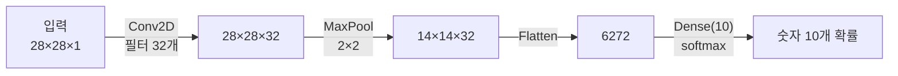
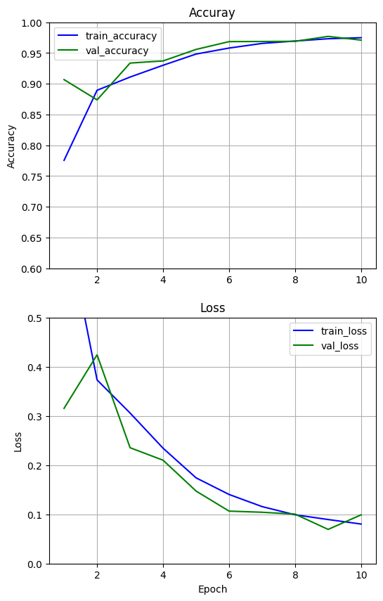
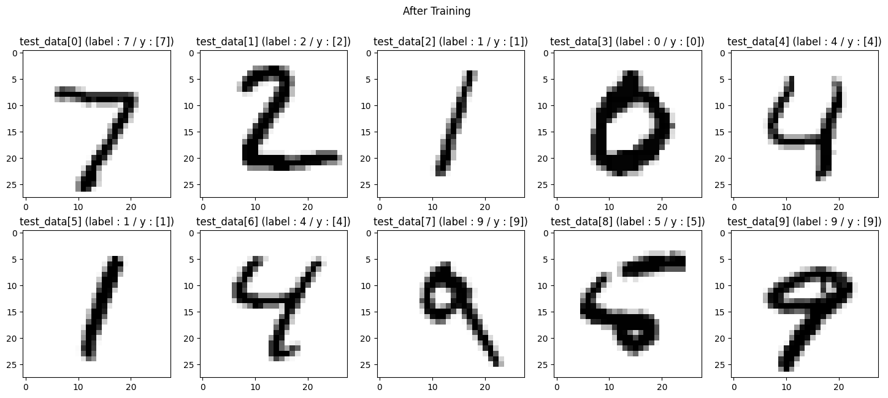

# CNN EX\_01 예제 풀이 — 합성곱 1층으로 MNIST 분류

[목차](../00_%EB%94%A5%EB%9F%AC%EB%8B%9D%EC%88%98%ED%95%99_MOC.md) · 개념: [D07_합성곱과_풀링](../01_%EA%B0%9C%EB%85%90%EB%85%B8%ED%8A%B8/D07_%ED%95%A9%EC%84%B1%EA%B3%B1%EA%B3%BC_%ED%92%80%EB%A7%81.md) · 이전: [E07_MNIST_분류_예제](E07_MNIST_%EB%B6%84%EB%A5%98_%EC%98%88%EC%A0%9C.md) · 다음: [E09_CNN_3Conv_MNIST_예제](E09_CNN_3Conv_MNIST_%EC%98%88%EC%A0%9C.md)

> [!NOTE]
> **3줄 요약**
> - [E07_MNIST_분류_예제](E07_MNIST_%EB%B6%84%EB%A5%98_%EC%98%88%EC%A0%9C.md)는 그림을 바로 한 줄로 폈다. 이번엔 먼저 **합성곱(Conv2D)** 으로 그림에서 선·모서리 같은 무늬를 찾고, **맥스 풀링**으로 크기를 줄인 뒤에 편다.
> - 합성곱은 3×3 필터를 그림 위에서 밀며 "겹친 9칸을 곱해서 더하는" 계산이다. [D01_퍼셉트론](../01_%EA%B0%9C%EB%85%90%EB%85%B8%ED%8A%B8/D01_%ED%8D%BC%EC%85%89%ED%8A%B8%EB%A1%A0.md)의 가중합과 같은 계산이다.
> - 결과: 10번 학습 후 시험 정확도 **97.10%** (EX\_07은 92.57%).

## 0. 한눈에 보기

| 항목 | 내용 |
|---|---|
| 데이터 | MNIST (EX\_07과 같음), 모양을 (28, 28, 1)로 바꿈 |
| 모델 | Conv2D(필터 32개, 3×3, sigmoid) → MaxPool(2×2) → Flatten → Dense(10, softmax) |
| 가중치 수 | 63,050개 |
| 비용·최적화 | sparse categorical cross-entropy, Adam |
| 학습 | 10번, 매번 시험 데이터로 확인(validation) |
| 결과 | 시험 정확도 0.9068(1번째) → 0.9710(10번째) |

### 그림 크기가 바뀌는 과정



## 1. 셀별 풀이

### 1-1. 데이터 불러오기와 모양 바꾸기

```python
(train_data, train_labels), (test_data, test_labels) = mnist.load_data()

train_data = train_data.astype(np.float32)          # 정수(0~255)를 실수로 바꿈
train_data = np.expand_dims(train_data, axis=-1)    # 맨 뒤에 칸 하나 추가: (60000,28,28) → (60000,28,28,1)
train_data = train_data / 255.0                     # 0~1로

test_data = test_data.astype(np.float32)            # 시험 데이터도 똑같이
test_data = np.expand_dims(test_data, axis=-1)
test_data = test_data / 255.0
```

- `astype(np.float32)`: 자료형 바꾸기. C의 `(float)x` 형변환과 같다.
- `np.expand_dims(..., axis=-1)`: 맨 끝(`-1`)에 크기 1짜리 칸을 붙인다. Conv2D는 그림을 **(세로, 가로, 채널)** 모양으로 받기 때문이다.

> [!TIP]
> **채널이란**
> 그림 한 장이 몇 겹으로 되어 있나. 컬러 사진은 빨강·초록·파랑 3겹(채널 3), 흑백은 1겹(채널 1)이다. MNIST는 흑백이라 1을 붙였다.

### 1-2. 모델 만들기

```python
model = tf.keras.models.Sequential()                       # 빈 모델을 만들고 층을 하나씩 add
model.add(tf.keras.Input(shape=(28, 28, 1)))               # 입력: 28×28 흑백 그림
model.add(tf.keras.layers.Conv2D(filters=32, kernel_size=3, padding='same',activation='sigmoid'))
#         합성곱: 3×3 필터 32개, 테두리를 채워 크기 유지, 결과에 시그모이드
model.add(tf.keras.layers.MaxPool2D(pool_size=2, strides=2))
#         2×2 칸마다 가장 큰 값만 남김, 2칸씩 이동 → 가로·세로 절반
model.add(tf.keras.layers.Flatten())                       # 한 줄로 펴기
model.add(tf.keras.layers.Dense(10, activation='softmax')) # 숫자 0~9 확률

model.summary()
```

**실행 결과**:

```
│ conv2d (Conv2D)                 │ (None, 28, 28, 32)     │           320 │
│ max_pooling2d (MaxPooling2D)    │ (None, 14, 14, 32)     │             0 │
│ flatten (Flatten)               │ (None, 6272)           │             0 │
│ dense (Dense)                   │ (None, 10)             │        62,730 │
 Total params: 63,050 (246.29 KB)
```

> [!TIP]
> **합성곱(Conv2D): 3×3 돋보기로 무늬 찾기**
> 3×3 필터(가중치 9개)를 그림 왼쪽 위부터 한 칸씩 밀면서, **겹친 9칸끼리 곱해서 더한다.** 결과 하나가 새 그림의 한 칸이 된다.
>
> 세로줄 필터 `[[0,1,0],[0,1,0],[0,1,0]]`로 해 보면:
>
> | 그림 조각 | 곱해서 더한 값 |
> |---|---|
> | 세로줄 `[[0,1,0],[0,1,0],[0,1,0]]` | 0+1+0 + 0+1+0 + 0+1+0 = **3** |
> | 가로줄 `[[0,0,0],[1,1,1],[0,0,0]]` | 0+0+0 + 0+1+0 + 0+0+0 = **1** |
>
> 세로줄이 있는 곳에서 값이 크게 나온다. 즉 이 필터는 "세로줄 탐지기"다. 학습은 이런 필터 32개의 숫자를 데이터에 맞게 정하는 일이다.

- **padding='same'**: 그림 테두리 바깥에 0을 한 줄 둘러서, 3×3 필터를 가장자리에도 댈 수 있게 한다. 그래서 크기가 28×28 그대로다.
- **filters=32**: 필터 32개 → 결과 그림도 32장 → (28, 28, 32)
- **Param 320**: 필터 하나 = 3×3×1 = 9개 가중치 + 편향 1 = 10, 그게 32개 → 10 × 32 = **320**

> [!TIP]
> **맥스 풀링: 2×2마다 가장 큰 값만 남기기**
> | 4×4 입력 | 2×2 결과 |
> |---|---|
> | `[1,3 / 2,0]` 구역 | 3 |
> | `[0,2 / 1,1]` 구역 | 2 |
> | `[5,1 / 0,2]` 구역 | 5 |
> | `[0,0 / 4,1]` 구역 | 4 |
>
> 4×4 = `[[1,3,0,2],[2,0,1,1],[5,1,0,0],[0,2,4,1]]` → `[[3,2],[5,4]]`
> 무늬가 "어딘가에 있었다"는 정보는 남기고 크기는 절반으로 줄인다. 가중치가 없어서 Param 0.

- **Flatten**: 14 × 14 × 32 = **6272**칸
- **Dense(10)**: 6272 × 10 + 10 = **62,730**. 전체 가중치의 대부분이 여기 있다.

### 1-3. 컴파일

```python
model.compile(optimizer='adam',
              loss='sparse_categorical_crossentropy',   # 정답이 숫자(0~9) 그대로
              metrics=['accuracy'])
```

[E07_MNIST_분류_예제](E07_MNIST_%EB%B6%84%EB%A5%98_%EC%98%88%EC%A0%9C.md) 1-6과 같다.

### 1-4. 결과 그림 함수

```python
def Make_Result_Plot(suptitle:str, data:np.ndarray, label:np.ndarray, y_max:np.ndarray):
    # suptitle:str 처럼 쓴 건 "이 인자는 문자열" 이라는 표시(타입 힌트). 실행에는 영향 없음
    fig_result, ax_result = plt.subplots(2,5,figsize=(18, 7))    # 2행 5열 그림판
    fig_result.suptitle(suptitle)                                 # 전체 제목
    for idx in range(10):                                         # 앞 10장만
        ax_result[idx//5,idx%5].imshow(data[idx].reshape((28,28)),cmap="binary")
        #   (28,28,1) 모양을 그림으로 그리기 위해 (28,28)로 되돌림
        ax_result[idx//5,idx%5].set_title("test_data[{}] (label : {} / y : {})".format(idx, label[idx], y_max[idx]))
        #   제목: 그림 번호, 정답(label), 모델 예측(y)
```

### 1-5. 학습 전 상황

```python
y_out = model.predict(test_data)                         # 1만 장 × 확률 10개 → (10000, 10)
y_max = np.argmax(y_out, axis=1).reshape((-1, 1))         # 줄마다 가장 큰 확률의 번호 = 예측 숫자
#       axis=1: 가로 방향(한 그림의 10개 확률 중)에서 최댓값 위치
#       reshape((-1,1)): 세로 한 줄 모양으로 (-1은 "개수는 알아서")
Make_Result_Plot("Before Training", test_data, test_labels, y_max)
```


- 학습 전에는 10장 모두 **1**이라고 예측한다. 가중치가 무작위라 어떤 그림을 넣어도 비슷한 확률이 나오고, 그중 우연히 1번 칸이 조금 크기 때문이다.

### 1-6. 학습

```python
%%time
history = model.fit(train_data, train_labels, shuffle=True,          # 매 바퀴마다 순서 섞기
                 epochs=10, validation_data=(test_data, test_labels)) # 바퀴마다 시험 데이터로 확인
```

| Epoch | 학습 정확도 | 학습 loss | 시험 정확도 (val) | 시험 loss (val) |
|---|---|---|---|---|
| 1 | 0.5935 | 1.2834 | 0.9068 | 0.3155 |
| 2 | 0.8866 | 0.3838 | 0.8739 | 0.4242 |
| 3 | 0.9048 | 0.3259 | 0.9337 | 0.2354 |
| 5 | 0.9464 | 0.1808 | 0.9559 | 0.1473 |
| 7 | 0.9664 | 0.1125 | 0.9688 | 0.1042 |
| 9 | 0.9730 | 0.0905 | 0.9771 | 0.0694 |
| 10 | 0.9761 | 0.0779 | 0.9710 | 0.0990 |

- **validation\_data**: 학습에는 쓰지 않고, 한 바퀴가 끝날 때마다 시험 데이터로 실력을 잰다. 표의 val 열이 그것이다.
- **shuffle=True**: 매 바퀴 그림 순서를 섞는다. 같은 순서로만 보면 순서에 맞춰 배우는 것을 막는다.
- 1번째 학습 정확도(0.5935)가 시험 정확도(0.9068)보다 낮은 이유: 학습 정확도는 **한 바퀴 동안의 평균**이라 처음의 엉망인 시기가 섞여 있고, 시험 정확도는 **바퀴가 끝난 뒤** 잰 값이다.

### 1-7. 그래프

```python
loss = history.history['loss']
epochs = range(1, len(loss)+1)

plt.figure(figsize=(6, 10))
plt.subplot(2, 1, 1)                                                          # 위: 정확도
plt.title('Accuray')
plt.plot(epochs, history.history['accuracy'], 'b', label='train_accuracy')   # 파랑: 학습
plt.plot(epochs, history.history['val_accuracy'], 'g', label='val_accuracy') # 초록: 시험
plt.ylim([0.6,1])                                                             # 세로축 범위 0.6~1
plt.grid(True)
plt.ylabel('Accuracy')
plt.legend(loc='best')

plt.subplot(2, 1, 2)                                                          # 아래: loss
plt.title('Loss')
plt.plot(epochs, history.history['loss'], 'b', label='train_loss')
plt.plot(epochs, history.history['val_loss'], 'g', label='val_loss')
plt.ylim([0,0.5])                                                             # 세로축 범위 0~0.5
plt.grid(True)
plt.xlabel('Epoch')
plt.ylabel('Loss')
plt.legend(loc='best')
plt.show()
```



- `plt.ylim([0.6, 1])`: 세로축 범위를 정한다. 첫 학습 정확도 0.5935는 범위(0.6) 밖이라 그래프에서 잘린다.

### 1-8. 학습 후

```python
y_out = model.predict(test_data)
y_max = np.argmax(y_out, axis=1).reshape((-1, 1))
Make_Result_Plot("After Training", test_data, test_labels, y_max)
```



- 앞 10장을 **모두 맞혔다**(label과 y가 같다).

## 2. 이 예제에서 새로 나온 것

| 이름 | 뜻 | 관련 노트 |
|---|---|---|
| `astype` | 자료형 바꾸기(형변환) | |
| `np.expand_dims(axis=-1)` | 채널 칸 추가 | |
| 채널 | 그림이 몇 겹인가 | |
| `Conv2D(filters, kernel_size, padding)` | 3×3 필터로 무늬 찾기 | [D01_퍼셉트론](../01_%EA%B0%9C%EB%85%90%EB%85%B8%ED%8A%B8/D01_%ED%8D%BC%EC%85%89%ED%8A%B8%EB%A1%A0.md) (가중합) |
| `MaxPool2D` | 2×2마다 최댓값 → 크기 절반 | |
| `validation_data` | 바퀴마다 시험 데이터로 확인 | |
| `np.argmax(axis=1)` | 그림마다 가장 큰 확률의 번호 | [E06_혈압_소프트맥스분류_예제](E06_%ED%98%88%EC%95%95_%EC%86%8C%ED%94%84%ED%8A%B8%EB%A7%A5%EC%8A%A4%EB%B6%84%EB%A5%98_%EC%98%88%EC%A0%9C.md) |
| `reshape` | 배열 모양 바꾸기 | |

## 3. 스스로 확인

<details><summary>1. filters=16이면 Conv2D의 Param #와 출력 모양은?</summary>

(3×3×1 + 1) × 16 = **160**, 출력 **(28, 28, 16)**

</details>

<details><summary>2. 맥스 풀링 후 크기가 14×14×32일 때 Flatten 칸 수는?</summary>

14 × 14 × 32 = **6272**

</details>

<details><summary>3. `[[4,1],[2,8]]`에 2×2 맥스 풀링을 하면?</summary>

가장 큰 값 **8**

</details>

