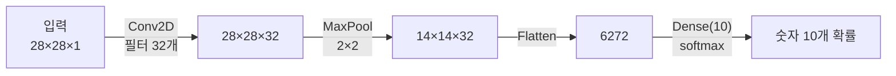

# CNN EX\_01 예제 풀이 — 합성곱 1층으로 MNIST 분류

[목차](../00_%EB%94%A5%EB%9F%AC%EB%8B%9D%EC%88%98%ED%95%99_MOC.md) · 개념: [D07_합성곱과_풀링](../01_%EA%B0%9C%EB%85%90%EB%85%B8%ED%8A%B8/D07_%ED%95%A9%EC%84%B1%EA%B3%B1%EA%B3%BC_%ED%92%80%EB%A7%81.md) · 이전: [E07_MNIST_분류_예제](../03_%EC%98%88%EC%A0%9C%ED%92%80%EC%9D%B4/E07_MNIST_%EB%B6%84%EB%A5%98_%EC%98%88%EC%A0%9C.md) · 다음: [E09_CNN_3Conv_MNIST_예제](../03_%EC%98%88%EC%A0%9C%ED%92%80%EC%9D%B4/E09_CNN_3Conv_MNIST_%EC%98%88%EC%A0%9C.md)

> [!NOTE]
> **3줄 요약**
> - [E07_MNIST_분류_예제](../03_%EC%98%88%EC%A0%9C%ED%92%80%EC%9D%B4/E07_MNIST_%EB%B6%84%EB%A5%98_%EC%98%88%EC%A0%9C.md)는 그림을 바로 한 줄로 폈다. 이번엔 먼저 **[합성곱](../00_%EB%94%A5%EB%9F%AC%EB%8B%9D_%EC%9A%A9%EC%96%B4%EC%82%AC%EC%A0%84.md#convolution-%ED%95%A9%EC%84%B1%EA%B3%B1)(Conv2D)** 으로 그림에서 선·모서리 같은 무늬를 찾고, **[맥스 풀링](../00_%EB%94%A5%EB%9F%AC%EB%8B%9D_%EC%9A%A9%EC%96%B4%EC%82%AC%EC%A0%84.md#max-pooling-%EB%A7%A5%EC%8A%A4-%ED%92%80%EB%A7%81)**으로 크기를 줄인 뒤에 편다.
> - [합성곱](../00_%EB%94%A5%EB%9F%AC%EB%8B%9D_%EC%9A%A9%EC%96%B4%EC%82%AC%EC%A0%84.md#convolution-%ED%95%A9%EC%84%B1%EA%B3%B1)은 3×3 [필터](../00_%EB%94%A5%EB%9F%AC%EB%8B%9D_%EC%9A%A9%EC%96%B4%EC%82%AC%EC%A0%84.md#filter-%ED%95%84%ED%84%B0)를 그림 위에서 밀며 "겹친 9칸을 곱해서 더하는" 계산이다. [D01_퍼셉트론](../01_%EA%B0%9C%EB%85%90%EB%85%B8%ED%8A%B8/D01_%ED%8D%BC%EC%85%89%ED%8A%B8%EB%A1%A0.md)의 [가중합](../00_%EB%94%A5%EB%9F%AC%EB%8B%9D_%EC%9A%A9%EC%96%B4%EC%82%AC%EC%A0%84.md#weighted-sum-%EA%B0%80%EC%A4%91%ED%95%A9)과 같은 계산이다.
> - 결과: 10번 [학습](../00_%EB%94%A5%EB%9F%AC%EB%8B%9D_%EC%9A%A9%EC%96%B4%EC%82%AC%EC%A0%84.md#training-%ED%95%99%EC%8A%B5) 후 시험 [정확도](../00_%EB%94%A5%EB%9F%AC%EB%8B%9D_%EC%9A%A9%EC%96%B4%EC%82%AC%EC%A0%84.md#accuracy-%EC%A0%95%ED%99%95%EB%8F%84) **97.10%** ([E07](../03_%EC%98%88%EC%A0%9C%ED%92%80%EC%9D%B4/E07_MNIST_%EB%B6%84%EB%A5%98_%EC%98%88%EC%A0%9C.md)은 92.57%).

## 0. 예제 개요

| 항목 | 내용 |
|---|---|
| 데이터 | MNIST ([E07](../03_%EC%98%88%EC%A0%9C%ED%92%80%EC%9D%B4/E07_MNIST_%EB%B6%84%EB%A5%98_%EC%98%88%EC%A0%9C.md)과 같음), 모양을 (28, 28, 1)로 바꿈 |
| 모델 | Conv2D([필터](../00_%EB%94%A5%EB%9F%AC%EB%8B%9D_%EC%9A%A9%EC%96%B4%EC%82%AC%EC%A0%84.md#filter-%ED%95%84%ED%84%B0) 32개, 3×3, [시그모이드](../00_%EB%94%A5%EB%9F%AC%EB%8B%9D_%EC%9A%A9%EC%96%B4%EC%82%AC%EC%A0%84.md#sigmoid-%EC%8B%9C%EA%B7%B8%EB%AA%A8%EC%9D%B4%EB%93%9C)) → MaxPool(2×2) → [Flatten](../00_%EB%94%A5%EB%9F%AC%EB%8B%9D_%EC%9A%A9%EC%96%B4%EC%82%AC%EC%A0%84.md#flatten-%ED%8F%89%ED%83%84%ED%99%94) → [덴스 층](../00_%EB%94%A5%EB%9F%AC%EB%8B%9D_%EC%9A%A9%EC%96%B4%EC%82%AC%EC%A0%84.md#dense-layer-%EB%8D%B4%EC%8A%A4-%EC%B8%B5)(10, [소프트맥스](../00_%EB%94%A5%EB%9F%AC%EB%8B%9D_%EC%9A%A9%EC%96%B4%EC%82%AC%EC%A0%84.md#softmax-%EC%86%8C%ED%94%84%ED%8A%B8%EB%A7%A5%EC%8A%A4)) |
| [파라미터](../00_%EB%94%A5%EB%9F%AC%EB%8B%9D_%EC%9A%A9%EC%96%B4%EC%82%AC%EC%A0%84.md#parameter-%ED%8C%8C%EB%9D%BC%EB%AF%B8%ED%84%B0) 수([가중치](../00_%EB%94%A5%EB%9F%AC%EB%8B%9D_%EC%9A%A9%EC%96%B4%EC%82%AC%EC%A0%84.md#weight-%EA%B0%80%EC%A4%91%EC%B9%98)+[편향](../00_%EB%94%A5%EB%9F%AC%EB%8B%9D_%EC%9A%A9%EC%96%B4%EC%82%AC%EC%A0%84.md#bias-%ED%8E%B8%ED%96%A5)) | 63,050개 |
| [손실 함수](../00_%EB%94%A5%EB%9F%AC%EB%8B%9D_%EC%9A%A9%EC%96%B4%EC%82%AC%EC%A0%84.md#loss-function-%EC%86%90%EC%8B%A4-%ED%95%A8%EC%88%98)·최적화 | 범주형 [교차 엔트로피](../00_%EB%94%A5%EB%9F%AC%EB%8B%9D_%EC%9A%A9%EC%96%B4%EC%82%AC%EC%A0%84.md#cross-entropy-%EA%B5%90%EC%B0%A8-%EC%97%94%ED%8A%B8%EB%A1%9C%ED%94%BC)(sparse 방식), [Adam](../00_%EB%94%A5%EB%9F%AC%EB%8B%9D_%EC%9A%A9%EC%96%B4%EC%82%AC%EC%A0%84.md#adam-%EC%95%84%EB%8B%B4-%EC%98%B5%ED%8B%B0%EB%A7%88%EC%9D%B4%EC%A0%80) |
| [학습](../00_%EB%94%A5%EB%9F%AC%EB%8B%9D_%EC%9A%A9%EC%96%B4%EC%82%AC%EC%A0%84.md#training-%ED%95%99%EC%8A%B5) | 10번, 매번 [시험 데이터](../00_%EB%94%A5%EB%9F%AC%EB%8B%9D_%EC%9A%A9%EC%96%B4%EC%82%AC%EC%A0%84.md#training-data-test-data-%ED%95%99%EC%8A%B5-%EB%8D%B0%EC%9D%B4%ED%84%B0%EC%99%80-%EC%8B%9C%ED%97%98-%EB%8D%B0%EC%9D%B4%ED%84%B0)로 확인(validation) |
| 결과 | 시험 [정확도](../00_%EB%94%A5%EB%9F%AC%EB%8B%9D_%EC%9A%A9%EC%96%B4%EC%82%AC%EC%A0%84.md#accuracy-%EC%A0%95%ED%99%95%EB%8F%84) 0.9068(1번째) → 0.9710(10번째) |

### 그림 크기의 변화 과정



## 1. 셀별 풀이

### 1-1. 데이터 불러오기와 모양 변경

```python
(train_data, train_labels), (test_data, test_labels) = mnist.load_data()

train_data = train_data.astype(np.float32)          # 정수(0~255)를 실수로 바꿈
train_data = np.expand_dims(train_data, axis=-1)    # 맨 뒤에 칸 하나 추가: (60000,28,28) → (60000,28,28,1)
train_data = train_data / 255.0                     # 0~1로

test_data = test_data.astype(np.float32)            # 시험 데이터도 똑같이
test_data = np.expand_dims(test_data, axis=-1)
test_data = test_data / 255.0
```

- `astype(np.float32)`: 자료형 바꾸기(정수 → 실수).
- `np.expand_dims(..., axis=-1)`: 맨 끝(`-1`)에 크기 1짜리 칸을 붙인다. Conv2D는 그림을 **(세로, 가로, [채널](../00_%EB%94%A5%EB%9F%AC%EB%8B%9D_%EC%9A%A9%EC%96%B4%EC%82%AC%EC%A0%84.md#channel-%EC%B1%84%EB%84%90))** 모양으로 받기 때문이다.

> [!TIP]
> **[채널](../00_%EB%94%A5%EB%9F%AC%EB%8B%9D_%EC%9A%A9%EC%96%B4%EC%82%AC%EC%A0%84.md#channel-%EC%B1%84%EB%84%90)이란**
> 그림 한 장이 몇 겹으로 되어 있나. 컬러 사진은 빨강·초록·파랑 3겹([채널](../00_%EB%94%A5%EB%9F%AC%EB%8B%9D_%EC%9A%A9%EC%96%B4%EC%82%AC%EC%A0%84.md#channel-%EC%B1%84%EB%84%90) 3), 흑백은 1겹([채널](../00_%EB%94%A5%EB%9F%AC%EB%8B%9D_%EC%9A%A9%EC%96%B4%EC%82%AC%EC%A0%84.md#channel-%EC%B1%84%EB%84%90) 1)이다. MNIST는 흑백이라 1을 붙였다.

> [!WARNING]
> **⚠ 주의**
> (28,28)을 그대로 넣으면 Conv2D가 오류를 낸다 → [채널](../00_%EB%94%A5%EB%9F%AC%EB%8B%9D_%EC%9A%A9%EC%96%B4%EC%82%AC%EC%A0%84.md#channel-%EC%B1%84%EB%84%90) 칸을 붙여 (28,28,1)로 만든다.

### 1-2. 모델 정의

```python
model = tf.keras.models.Sequential()                       # 빈 모델을 만들고 층을 하나씩 add
model.add(tf.keras.Input(shape=(28, 28, 1)))               # 입력: 28×28 흑백 그림
model.add(tf.keras.layers.Conv2D(filters=32, kernel_size=3, padding='same',activation='sigmoid'))
#         합성곱: 3×3 필터 32개, 테두리를 채워 크기 유지, 결과에 시그모이드
model.add(tf.keras.layers.MaxPool2D(pool_size=2, strides=2))
#         2×2 칸마다 가장 큰 값만 남김, 2칸씩 이동 → 가로·세로 절반
model.add(tf.keras.layers.Flatten())                       # 한 줄로 펴기
model.add(tf.keras.layers.Dense(10, activation='softmax')) # 숫자 0~9 확률

model.summary()
```

**실행 결과**:

```text
│ conv2d (Conv2D)                 │ (None, 28, 28, 32)     │           320 │
│ max_pooling2d (MaxPooling2D)    │ (None, 14, 14, 32)     │             0 │
│ flatten (Flatten)               │ (None, 6272)           │             0 │
│ dense (Dense)                   │ (None, 10)             │        62,730 │
 Total params: 63,050 (246.29 KB)
```

> [!TIP]
> **[합성곱](../00_%EB%94%A5%EB%9F%AC%EB%8B%9D_%EC%9A%A9%EC%96%B4%EC%82%AC%EC%A0%84.md#convolution-%ED%95%A9%EC%84%B1%EA%B3%B1)(Conv2D): 3×3 돋보기로 무늬 찾기**
> 3×3 [필터](../00_%EB%94%A5%EB%9F%AC%EB%8B%9D_%EC%9A%A9%EC%96%B4%EC%82%AC%EC%A0%84.md#filter-%ED%95%84%ED%84%B0)([가중치](../00_%EB%94%A5%EB%9F%AC%EB%8B%9D_%EC%9A%A9%EC%96%B4%EC%82%AC%EC%A0%84.md#weight-%EA%B0%80%EC%A4%91%EC%B9%98) 9개)를 그림 왼쪽 위부터 한 칸씩 밀면서, **겹친 9칸끼리 곱해서 더한다.** 결과 하나가 새 그림의 한 칸이 된다.
>
> 세로줄 [필터](../00_%EB%94%A5%EB%9F%AC%EB%8B%9D_%EC%9A%A9%EC%96%B4%EC%82%AC%EC%A0%84.md#filter-%ED%95%84%ED%84%B0) `[[0,1,0],[0,1,0],[0,1,0]]`로 해 보면:
>
> | 그림 조각 | 곱해서 더한 값 |
> |---|---|
> | 세로줄 `[[0,1,0],[0,1,0],[0,1,0]]` | 0+1+0 + 0+1+0 + 0+1+0 = **3** |
> | 가로줄 `[[0,0,0],[1,1,1],[0,0,0]]` | 0+0+0 + 0+1+0 + 0+0+0 = **1** |
>
> 세로줄이 있는 곳에서 값이 크게 나온다. 즉 이 [필터](../00_%EB%94%A5%EB%9F%AC%EB%8B%9D_%EC%9A%A9%EC%96%B4%EC%82%AC%EC%A0%84.md#filter-%ED%95%84%ED%84%B0)는 "세로줄 탐지기"다. [학습](../00_%EB%94%A5%EB%9F%AC%EB%8B%9D_%EC%9A%A9%EC%96%B4%EC%82%AC%EC%A0%84.md#training-%ED%95%99%EC%8A%B5)은 이런 [필터](../00_%EB%94%A5%EB%9F%AC%EB%8B%9D_%EC%9A%A9%EC%96%B4%EC%82%AC%EC%A0%84.md#filter-%ED%95%84%ED%84%B0) 32개의 숫자를 데이터에 맞게 정하는 일이다.

- **padding='same'**: 그림 테두리 바깥에 0을 한 줄 둘러서, 3×3 [필터](../00_%EB%94%A5%EB%9F%AC%EB%8B%9D_%EC%9A%A9%EC%96%B4%EC%82%AC%EC%A0%84.md#filter-%ED%95%84%ED%84%B0)를 가장자리에도 댈 수 있게 한다. 그래서 크기가 28×28 그대로다.
- **filters=32**: [필터](../00_%EB%94%A5%EB%9F%AC%EB%8B%9D_%EC%9A%A9%EC%96%B4%EC%82%AC%EC%A0%84.md#filter-%ED%95%84%ED%84%B0) 32개 → 결과 그림도 32장 → (28, 28, 32)
- **[파라미터](../00_%EB%94%A5%EB%9F%AC%EB%8B%9D_%EC%9A%A9%EC%96%B4%EC%82%AC%EC%A0%84.md#parameter-%ED%8C%8C%EB%9D%BC%EB%AF%B8%ED%84%B0) 수 320**: [필터](../00_%EB%94%A5%EB%9F%AC%EB%8B%9D_%EC%9A%A9%EC%96%B4%EC%82%AC%EC%A0%84.md#filter-%ED%95%84%ED%84%B0) 하나 = 3×3×1 = 9개 [가중치](../00_%EB%94%A5%EB%9F%AC%EB%8B%9D_%EC%9A%A9%EC%96%B4%EC%82%AC%EC%A0%84.md#weight-%EA%B0%80%EC%A4%91%EC%B9%98) + [편향](../00_%EB%94%A5%EB%9F%AC%EB%8B%9D_%EC%9A%A9%EC%96%B4%EC%82%AC%EC%A0%84.md#bias-%ED%8E%B8%ED%96%A5) 1 = 10, 그게 32개 → 10 × 32 = **320**

> [!TIP]
> **[맥스 풀링](../00_%EB%94%A5%EB%9F%AC%EB%8B%9D_%EC%9A%A9%EC%96%B4%EC%82%AC%EC%A0%84.md#max-pooling-%EB%A7%A5%EC%8A%A4-%ED%92%80%EB%A7%81): 2×2마다 가장 큰 값만 남기기**
> 4×4 입력을 2×2 구역 4개로 나눈다(세로선·가로선이 구역 경계).
>
> ```text
> 4×4 입력                  2×2 결과
> 1 3 | 0 2                 3 2
> 2 0 | 1 1       →         5 4
> ----+----
> 5 1 | 0 0
> 0 2 | 4 1
> ```
>
> | 구역 | 최댓값 |
> |---|---|
> | 왼쪽 위 `[1,3 / 2,0]` | 3 |
> | 오른쪽 위 `[0,2 / 1,1]` | 2 |
> | 왼쪽 아래 `[5,1 / 0,2]` | 5 |
> | 오른쪽 아래 `[0,0 / 4,1]` | 4 |
>
> 결과 2×2 = `[[3,2],[5,4]]`
>
> 무늬가 "어딘가에 있었다"는 정보는 남기고 크기는 절반으로 줄인다. [가중치](../00_%EB%94%A5%EB%9F%AC%EB%8B%9D_%EC%9A%A9%EC%96%B4%EC%82%AC%EC%A0%84.md#weight-%EA%B0%80%EC%A4%91%EC%B9%98)가 없어서 [파라미터](../00_%EB%94%A5%EB%9F%AC%EB%8B%9D_%EC%9A%A9%EC%96%B4%EC%82%AC%EC%A0%84.md#parameter-%ED%8C%8C%EB%9D%BC%EB%AF%B8%ED%84%B0) 수는 0이다.

- **[Flatten](../00_%EB%94%A5%EB%9F%AC%EB%8B%9D_%EC%9A%A9%EC%96%B4%EC%82%AC%EC%A0%84.md#flatten-%ED%8F%89%ED%83%84%ED%99%94)**: 14 × 14 × 32 = **6272**칸
- **Dense(10)**: 6272 × 10 + 10 = **62,730**. 전체 [파라미터](../00_%EB%94%A5%EB%9F%AC%EB%8B%9D_%EC%9A%A9%EC%96%B4%EC%82%AC%EC%A0%84.md#parameter-%ED%8C%8C%EB%9D%BC%EB%AF%B8%ED%84%B0)(63,050개)의 대부분이 여기 있다.

### 1-3. 컴파일

```python
model.compile(optimizer='adam',
              loss='sparse_categorical_crossentropy',   # 정답이 숫자(0~9) 그대로
              metrics=['accuracy'])
```

[E07_MNIST_분류_예제](../03_%EC%98%88%EC%A0%9C%ED%92%80%EC%9D%B4/E07_MNIST_%EB%B6%84%EB%A5%98_%EC%98%88%EC%A0%9C.md) 1-6과 같다.

### 1-4. 결과 그림 함수

```python
def Make_Result_Plot(suptitle:str, data:np.ndarray, label:np.ndarray, y_max:np.ndarray):
    # suptitle:str 처럼 쓴 건 "이 인자는 문자열" 이라는 표시(타입 힌트). 실행에는 영향 없음
    fig_result, ax_result = plt.subplots(2,5,figsize=(18, 7))    # 2행 5열 그림판
    fig_result.suptitle(suptitle)                                 # 전체 제목
    for idx in range(10):                                         # 앞 10장만
        ax_result[idx//5,idx%5].imshow(data[idx].reshape((28,28)),cmap="binary")
        #   (28,28,1) 모양을 그림으로 그리기 위해 (28,28)로 되돌림
        ax_result[idx//5,idx%5].set_title("test_data[{}] (label : {} / y : {})".format(idx, label[idx], y_max[idx]))
        #   제목: 그림 번호, 정답(label), 모델 예측(y)
```

### 1-5. 학습 전 예측

```python
y_out = model.predict(test_data)                         # 1만 장 × 확률 10개 → (10000, 10)
y_max = np.argmax(y_out, axis=1).reshape((-1, 1))         # 줄마다 가장 큰 확률의 번호 = 예측 숫자
#       axis=1: 가로 방향(한 그림의 10개 확률 중)에서 최댓값 위치
#       reshape((-1,1)): 세로 한 줄 모양으로 (-1은 "개수는 알아서")
Make_Result_Plot("Before Training", test_data, test_labels, y_max)
```


- [학습](../00_%EB%94%A5%EB%9F%AC%EB%8B%9D_%EC%9A%A9%EC%96%B4%EC%82%AC%EC%A0%84.md#training-%ED%95%99%EC%8A%B5) 전에는 10장 모두 **1**이라고 예측한다.
- [가중치](../00_%EB%94%A5%EB%9F%AC%EB%8B%9D_%EC%9A%A9%EC%96%B4%EC%82%AC%EC%A0%84.md#weight-%EA%B0%80%EC%A4%91%EC%B9%98)가 무작위라 어떤 그림을 넣어도 비슷한 [확률](../00_%EB%94%A5%EB%9F%AC%EB%8B%9D_%EC%9A%A9%EC%96%B4%EC%82%AC%EC%A0%84.md#probability-%ED%99%95%EB%A5%A0)이 나온다. 그중 우연히 1번 칸이 조금 크기 때문이다.

### 1-6. 학습

```python
%%time
history = model.fit(train_data, train_labels, shuffle=True,          # 매 에폭마다 순서 섞기 (Keras 기본값이 이미 True)
                 epochs=10, validation_data=(test_data, test_labels)) # 에폭마다 시험 데이터로 확인
```

| Epoch | [학습](../00_%EB%94%A5%EB%9F%AC%EB%8B%9D_%EC%9A%A9%EC%96%B4%EC%82%AC%EC%A0%84.md#training-%ED%95%99%EC%8A%B5) [정확도](../00_%EB%94%A5%EB%9F%AC%EB%8B%9D_%EC%9A%A9%EC%96%B4%EC%82%AC%EC%A0%84.md#accuracy-%EC%A0%95%ED%99%95%EB%8F%84) | [학습](../00_%EB%94%A5%EB%9F%AC%EB%8B%9D_%EC%9A%A9%EC%96%B4%EC%82%AC%EC%A0%84.md#training-%ED%95%99%EC%8A%B5) [손실](../00_%EB%94%A5%EB%9F%AC%EB%8B%9D_%EC%9A%A9%EC%96%B4%EC%82%AC%EC%A0%84.md#loss-function-%EC%86%90%EC%8B%A4-%ED%95%A8%EC%88%98) | 시험 [정확도](../00_%EB%94%A5%EB%9F%AC%EB%8B%9D_%EC%9A%A9%EC%96%B4%EC%82%AC%EC%A0%84.md#accuracy-%EC%A0%95%ED%99%95%EB%8F%84) (val) | 시험 [손실](../00_%EB%94%A5%EB%9F%AC%EB%8B%9D_%EC%9A%A9%EC%96%B4%EC%82%AC%EC%A0%84.md#loss-function-%EC%86%90%EC%8B%A4-%ED%95%A8%EC%88%98) (val) |
|---|---|---|---|---|
| 1 | 0.5935 | 1.2834 | 0.9068 | 0.3155 |
| 2 | 0.8866 | 0.3838 | 0.8739 | 0.4242 |
| 3 | 0.9048 | 0.3259 | 0.9337 | 0.2354 |
| 5 | 0.9464 | 0.1808 | 0.9559 | 0.1473 |
| 7 | 0.9664 | 0.1125 | 0.9688 | 0.1042 |
| 9 | 0.9730 | 0.0905 | 0.9771 | 0.0694 |
| 10 | 0.9761 | 0.0779 | 0.9710 | 0.0990 |

- **epochs=10**: [에폭](../00_%EB%94%A5%EB%9F%AC%EB%8B%9D_%EC%9A%A9%EC%96%B4%EC%82%AC%EC%A0%84.md#epoch-%EC%97%90%ED%8F%AD)(epoch, 전체 데이터를 한 번 다 보는 것)을 10번, 즉 6만 장을 10에폭 동안 본다.
- **validation\_data**: [학습](../00_%EB%94%A5%EB%9F%AC%EB%8B%9D_%EC%9A%A9%EC%96%B4%EC%82%AC%EC%A0%84.md#training-%ED%95%99%EC%8A%B5)에는 쓰지 않고, 한 [에폭](../00_%EB%94%A5%EB%9F%AC%EB%8B%9D_%EC%9A%A9%EC%96%B4%EC%82%AC%EC%A0%84.md#epoch-%EC%97%90%ED%8F%AD)이 끝날 때마다 [시험 데이터](../00_%EB%94%A5%EB%9F%AC%EB%8B%9D_%EC%9A%A9%EC%96%B4%EC%82%AC%EC%A0%84.md#training-data-test-data-%ED%95%99%EC%8A%B5-%EB%8D%B0%EC%9D%B4%ED%84%B0%EC%99%80-%EC%8B%9C%ED%97%98-%EB%8D%B0%EC%9D%B4%ED%84%B0)로 실력을 잰다. 표의 val 열이 그것이다.
- **shuffle=True**: 매 [에폭](../00_%EB%94%A5%EB%9F%AC%EB%8B%9D_%EC%9A%A9%EC%96%B4%EC%82%AC%EC%A0%84.md#epoch-%EC%97%90%ED%8F%AD) 그림 순서를 섞는다. 순서가 늘 같으면 모델이 그 순서 자체에 맞춰 배울 수 있어서 이를 막는다.
- 1번째 [학습](../00_%EB%94%A5%EB%9F%AC%EB%8B%9D_%EC%9A%A9%EC%96%B4%EC%82%AC%EC%A0%84.md#training-%ED%95%99%EC%8A%B5) [정확도](../00_%EB%94%A5%EB%9F%AC%EB%8B%9D_%EC%9A%A9%EC%96%B4%EC%82%AC%EC%A0%84.md#accuracy-%EC%A0%95%ED%99%95%EB%8F%84)(0.5935)가 시험 [정확도](../00_%EB%94%A5%EB%9F%AC%EB%8B%9D_%EC%9A%A9%EC%96%B4%EC%82%AC%EC%A0%84.md#accuracy-%EC%A0%95%ED%99%95%EB%8F%84)(0.9068)보다 낮은 이유는 재는 시점이 다르기 때문이다.
- [학습](../00_%EB%94%A5%EB%9F%AC%EB%8B%9D_%EC%9A%A9%EC%96%B4%EC%82%AC%EC%A0%84.md#training-%ED%95%99%EC%8A%B5) [정확도](../00_%EB%94%A5%EB%9F%AC%EB%8B%9D_%EC%9A%A9%EC%96%B4%EC%82%AC%EC%A0%84.md#accuracy-%EC%A0%95%ED%99%95%EB%8F%84)는 **한 [에폭](../00_%EB%94%A5%EB%9F%AC%EB%8B%9D_%EC%9A%A9%EC%96%B4%EC%82%AC%EC%A0%84.md#epoch-%EC%97%90%ED%8F%AD) 동안의 평균**이라 처음의 엉망인 시기가 섞여 있다. 시험 [정확도](../00_%EB%94%A5%EB%9F%AC%EB%8B%9D_%EC%9A%A9%EC%96%B4%EC%82%AC%EC%A0%84.md#accuracy-%EC%A0%95%ED%99%95%EB%8F%84)는 **[에폭](../00_%EB%94%A5%EB%9F%AC%EB%8B%9D_%EC%9A%A9%EC%96%B4%EC%82%AC%EC%A0%84.md#epoch-%EC%97%90%ED%8F%AD)이 끝난 뒤** 잰 값이다.

### 1-7. 그래프

```python
loss = history.history['loss']
epochs = range(1, len(loss)+1)

plt.figure(figsize=(6, 10))
plt.subplot(2, 1, 1)                                                          # 위: 정확도
plt.title('Accuray')                                                          # 노트북 원문 오타(Accuracy)
plt.plot(epochs, history.history['accuracy'], 'b', label='train_accuracy')   # 파랑: 학습
plt.plot(epochs, history.history['val_accuracy'], 'g', label='val_accuracy') # 초록: 시험
plt.ylim([0.6,1])                                                             # 세로축 범위 0.6~1
plt.grid(True)
plt.ylabel('Accuracy')
plt.legend(loc='best')

plt.subplot(2, 1, 2)                                                          # 아래: loss
plt.title('Loss')
plt.plot(epochs, history.history['loss'], 'b', label='train_loss')
plt.plot(epochs, history.history['val_loss'], 'g', label='val_loss')
plt.ylim([0,0.5])                                                             # 세로축 범위 0~0.5
plt.grid(True)
plt.xlabel('Epoch')
plt.ylabel('Loss')
plt.legend(loc='best')
plt.show()
```


- `plt.ylim([0.6, 1])`: 세로축 범위를 정한다. 첫 [학습](../00_%EB%94%A5%EB%9F%AC%EB%8B%9D_%EC%9A%A9%EC%96%B4%EC%82%AC%EC%A0%84.md#training-%ED%95%99%EC%8A%B5) [정확도](../00_%EB%94%A5%EB%9F%AC%EB%8B%9D_%EC%9A%A9%EC%96%B4%EC%82%AC%EC%A0%84.md#accuracy-%EC%A0%95%ED%99%95%EB%8F%84) 0.5935는 범위(0.6) 밖이라 그래프에서 잘린다.
- `plt.ylim([0, 0.5])`도 마찬가지로 첫 [에폭](../00_%EB%94%A5%EB%9F%AC%EB%8B%9D_%EC%9A%A9%EC%96%B4%EC%82%AC%EC%A0%84.md#epoch-%EC%97%90%ED%8F%AD)의 [학습](../00_%EB%94%A5%EB%9F%AC%EB%8B%9D_%EC%9A%A9%EC%96%B4%EC%82%AC%EC%A0%84.md#training-%ED%95%99%EC%8A%B5) [손실](../00_%EB%94%A5%EB%9F%AC%EB%8B%9D_%EC%9A%A9%EC%96%B4%EC%82%AC%EC%A0%84.md#loss-function-%EC%86%90%EC%8B%A4-%ED%95%A8%EC%88%98)(1.28)를 잘라 낸다.

### 1-8. 학습 후 예측

```python
y_out = model.predict(test_data)
y_max = np.argmax(y_out, axis=1).reshape((-1, 1))
Make_Result_Plot("After Training", test_data, test_labels, y_max)
```


- 앞 10장을 **모두 맞혔다**(label과 y가 같다).

## 2. 새로 나온 개념

| 이름 | 뜻 | 관련 노트 |
|---|---|---|
| `astype` | 자료형 바꾸기(형변환) | |
| `np.expand_dims(axis=-1)` | [채널](../00_%EB%94%A5%EB%9F%AC%EB%8B%9D_%EC%9A%A9%EC%96%B4%EC%82%AC%EC%A0%84.md#channel-%EC%B1%84%EB%84%90) 칸 추가 | |
| [채널](../00_%EB%94%A5%EB%9F%AC%EB%8B%9D_%EC%9A%A9%EC%96%B4%EC%82%AC%EC%A0%84.md#channel-%EC%B1%84%EB%84%90) | 그림이 몇 겹인가 | |
| `Conv2D(filters, kernel_size, padding)` | 3×3 [필터](../00_%EB%94%A5%EB%9F%AC%EB%8B%9D_%EC%9A%A9%EC%96%B4%EC%82%AC%EC%A0%84.md#filter-%ED%95%84%ED%84%B0)로 무늬 찾기 | [D01_퍼셉트론](../01_%EA%B0%9C%EB%85%90%EB%85%B8%ED%8A%B8/D01_%ED%8D%BC%EC%85%89%ED%8A%B8%EB%A1%A0.md) ([가중합](../00_%EB%94%A5%EB%9F%AC%EB%8B%9D_%EC%9A%A9%EC%96%B4%EC%82%AC%EC%A0%84.md#weighted-sum-%EA%B0%80%EC%A4%91%ED%95%A9)) |
| `MaxPool2D` | 2×2마다 최댓값 → 크기 절반 | |
| `validation_data` | [에폭](../00_%EB%94%A5%EB%9F%AC%EB%8B%9D_%EC%9A%A9%EC%96%B4%EC%82%AC%EC%A0%84.md#epoch-%EC%97%90%ED%8F%AD)마다 [시험 데이터](../00_%EB%94%A5%EB%9F%AC%EB%8B%9D_%EC%9A%A9%EC%96%B4%EC%82%AC%EC%A0%84.md#training-data-test-data-%ED%95%99%EC%8A%B5-%EB%8D%B0%EC%9D%B4%ED%84%B0%EC%99%80-%EC%8B%9C%ED%97%98-%EB%8D%B0%EC%9D%B4%ED%84%B0)로 확인 | |
| `np.argmax(axis=1)` | 그림마다 가장 큰 [확률](../00_%EB%94%A5%EB%9F%AC%EB%8B%9D_%EC%9A%A9%EC%96%B4%EC%82%AC%EC%A0%84.md#probability-%ED%99%95%EB%A5%A0)의 번호 | [E06_혈압_소프트맥스분류_예제](../03_%EC%98%88%EC%A0%9C%ED%92%80%EC%9D%B4/E06_%ED%98%88%EC%95%95_%EC%86%8C%ED%94%84%ED%8A%B8%EB%A7%A5%EC%8A%A4%EB%B6%84%EB%A5%98_%EC%98%88%EC%A0%9C.md) |
| `reshape` | 배열 모양 바꾸기 | |

## 3. 개념 재확인

<details><summary>1. filters=16이면 Conv2D의 파라미터 수와 출력 모양은?</summary>

| 단계 | 하는 일 | 코드 | 계산 | 결과 |
|---|---|---|---|---|
| 1 | 출력 모양 | `padding='same'` | (28,28,1) → (28,28,16) | (28, 28, 16) |
| 2 | [필터](../00_%EB%94%A5%EB%9F%AC%EB%8B%9D_%EC%9A%A9%EC%96%B4%EC%82%AC%EC%A0%84.md#filter-%ED%95%84%ED%84%B0) 하나의 [가중치](../00_%EB%94%A5%EB%9F%AC%EB%8B%9D_%EC%9A%A9%EC%96%B4%EC%82%AC%EC%A0%84.md#weight-%EA%B0%80%EC%A4%91%EC%B9%98) | `kernel_size=3` | 3 × 3 × 입력 [채널](../00_%EB%94%A5%EB%9F%AC%EB%8B%9D_%EC%9A%A9%EC%96%B4%EC%82%AC%EC%A0%84.md#channel-%EC%B1%84%EB%84%90) 1 | 9 |
| 3 | [편향](../00_%EB%94%A5%EB%9F%AC%EB%8B%9D_%EC%9A%A9%EC%96%B4%EC%82%AC%EC%A0%84.md#bias-%ED%8E%B8%ED%96%A5) 더하기 | - | 9 + 1 | 10 |
| 4 | [필터](../00_%EB%94%A5%EB%9F%AC%EB%8B%9D_%EC%9A%A9%EC%96%B4%EC%82%AC%EC%A0%84.md#filter-%ED%95%84%ED%84%B0) 수만큼 | `filters=16` | 10 × 16 | 160 |

[필터](../00_%EB%94%A5%EB%9F%AC%EB%8B%9D_%EC%9A%A9%EC%96%B4%EC%82%AC%EC%A0%84.md#filter-%ED%95%84%ED%84%B0)가 32개일 때는 10 × 32 = 320으로 같은 식이다.

**① 바꿀 코드**
```python
model.add(tf.keras.Input(shape=(28, 28, 1)))           # ②③ 28×28 흑백 1채널 (입력 채널 1)
model.add(tf.keras.layers.Conv2D(filters=16,           # ②③④ 32 → 16
                                 kernel_size=3,        # ③ 3×3 필터
                                 padding='same',       # ② 출력 모양 유지
                                 activation='sigmoid'))   # ① 활성화 함수 (그대로)
model.summary()                                        # ②④ Output Shape와 Param # 확인
```

**② 출력 모양**
- padding='same'이라 가로·세로는 그대로 28 × 28
- [채널](../00_%EB%94%A5%EB%9F%AC%EB%8B%9D_%EC%9A%A9%EC%96%B4%EC%82%AC%EC%A0%84.md#channel-%EC%B1%84%EB%84%90) 수 = [필터](../00_%EB%94%A5%EB%9F%AC%EB%8B%9D_%EC%9A%A9%EC%96%B4%EC%82%AC%EC%A0%84.md#filter-%ED%95%84%ED%84%B0) 수 = 16
- 출력 모양: (28, 28, 16)

**③ [필터](../00_%EB%94%A5%EB%9F%AC%EB%8B%9D_%EC%9A%A9%EC%96%B4%EC%82%AC%EC%A0%84.md#filter-%ED%95%84%ED%84%B0) 하나의 [파라미터](../00_%EB%94%A5%EB%9F%AC%EB%8B%9D_%EC%9A%A9%EC%96%B4%EC%82%AC%EC%A0%84.md#parameter-%ED%8C%8C%EB%9D%BC%EB%AF%B8%ED%84%B0)**
- [가중치](../00_%EB%94%A5%EB%9F%AC%EB%8B%9D_%EC%9A%A9%EC%96%B4%EC%82%AC%EC%A0%84.md#weight-%EA%B0%80%EC%A4%91%EC%B9%98): 3 × 3 칸 × 입력 [채널](../00_%EB%94%A5%EB%9F%AC%EB%8B%9D_%EC%9A%A9%EC%96%B4%EC%82%AC%EC%A0%84.md#channel-%EC%B1%84%EB%84%90) 1 = 9
- [편향](../00_%EB%94%A5%EB%9F%AC%EB%8B%9D_%EC%9A%A9%EC%96%B4%EC%82%AC%EC%A0%84.md#bias-%ED%8E%B8%ED%96%A5): 1
- 합계: 9 + 1 = 10

**④ 전체 [파라미터](../00_%EB%94%A5%EB%9F%AC%EB%8B%9D_%EC%9A%A9%EC%96%B4%EC%82%AC%EC%A0%84.md#parameter-%ED%8C%8C%EB%9D%BC%EB%AF%B8%ED%84%B0)**
- 10 × [필터](../00_%EB%94%A5%EB%9F%AC%EB%8B%9D_%EC%9A%A9%EC%96%B4%EC%82%AC%EC%A0%84.md#filter-%ED%95%84%ED%84%B0) 16개 = 160
- 비교: [필터](../00_%EB%94%A5%EB%9F%AC%EB%8B%9D_%EC%9A%A9%EC%96%B4%EC%82%AC%EC%A0%84.md#filter-%ED%95%84%ED%84%B0) 32개일 때 10 × 32 = 320 (`Param # 320`)

**답**: [파라미터](../00_%EB%94%A5%EB%9F%AC%EB%8B%9D_%EC%9A%A9%EC%96%B4%EC%82%AC%EC%A0%84.md#parameter-%ED%8C%8C%EB%9D%BC%EB%AF%B8%ED%84%B0) 수 **160**, 출력 모양 **(28, 28, 16)**

</details>

<details><summary>2. 맥스 풀링 후 크기가 14×14×32일 때 Flatten 칸 수는?</summary>

| 단계 | 하는 일 | 코드 | 계산 | 결과 |
|---|---|---|---|---|
| 1 | 입력 모양 확인 | `MaxPool2D(pool_size=2, strides=2)` | [맥스 풀링](../00_%EB%94%A5%EB%9F%AC%EB%8B%9D_%EC%9A%A9%EC%96%B4%EC%82%AC%EC%A0%84.md#max-pooling-%EB%A7%A5%EC%8A%A4-%ED%92%80%EB%A7%81) 출력 가로 14, 세로 14, [채널](../00_%EB%94%A5%EB%9F%AC%EB%8B%9D_%EC%9A%A9%EC%96%B4%EC%82%AC%EC%A0%84.md#channel-%EC%B1%84%EB%84%90) 32 | (14, 14, 32) |
| 2 | 한 장의 칸 수 | - | 14 × 14 | 196 |
| 3 | 32장 이어 붙이기 | `Flatten()` | 196 × 32 | 6272 |
| 4 | 실행 결과와 비교 | - | `flatten (Flatten) (None, 6272)` | 같음 |

[Flatten](../00_%EB%94%A5%EB%9F%AC%EB%8B%9D_%EC%9A%A9%EC%96%B4%EC%82%AC%EC%A0%84.md#flatten-%ED%8F%89%ED%83%84%ED%99%94)은 값을 버리지 않고 모양만 바꾼다.

**① 쓰는 코드**
```python
model.add(tf.keras.layers.Conv2D(filters=32, kernel_size=3, padding='same',activation='sigmoid'))   # ② 28×28×32 (그대로)
model.add(tf.keras.layers.MaxPool2D(pool_size=2, strides=2))   # ② 2×2마다 최댓값, 2칸씩 이동 → 가로·세로 절반
model.add(tf.keras.layers.Flatten())                           # ③④ 한 줄로 펴기
model.summary()                                                # ⑤ (None, 6272) 확인
```

**② [맥스 풀링](../00_%EB%94%A5%EB%9F%AC%EB%8B%9D_%EC%9A%A9%EC%96%B4%EC%82%AC%EC%A0%84.md#max-pooling-%EB%A7%A5%EC%8A%A4-%ED%92%80%EB%A7%81) 출력 모양** (`MaxPool2D(pool_size=2, strides=2)`)
- 가로·세로가 절반: 28 ÷ 2 = 14
- [채널](../00_%EB%94%A5%EB%9F%AC%EB%8B%9D_%EC%9A%A9%EC%96%B4%EC%82%AC%EC%A0%84.md#channel-%EC%B1%84%EB%84%90) 수는 그대로 32 (풀링은 [채널](../00_%EB%94%A5%EB%9F%AC%EB%8B%9D_%EC%9A%A9%EC%96%B4%EC%82%AC%EC%A0%84.md#channel-%EC%B1%84%EB%84%90)을 합치지 않는다)
- 모양: (14, 14, 32)

**③ 한 장의 칸 수**
- 14 × 14 = 196

**④ 32장 이어 붙이기** (`Flatten()`)
- 196 × 32 = 6272
- 값을 버리지 않고 모양만 (14, 14, 32) → 한 줄로 바꾼다

**⑤ 실행 결과와 비교**
- `flatten (Flatten) (None, 6272)` → 같다

**답**: **6272**칸

</details>

<details><summary>3. <code>[[4,1],[2,8]]</code>에 2×2 맥스 풀링을 하면?</summary>

| 단계 | 하는 일 | 코드 | 계산 | 결과 |
|---|---|---|---|---|
| 1 | 구역 수 세기 | `pool_size=2` | 2×2 입력에 2×2 구역 | 구역 1개 |
| 2 | 결과 크기 | `strides=2` | 2 ÷ 2 | 1×1 |
| 3 | 구역의 최댓값 | `MaxPool2D` | max(4, 1, 2, 8) | 8 |
| 4 | 결과 쓰기 | - | 나머지 4, 1, 2는 버림 | `[[8]]` |

**① 쓰는 코드**
```python
x = np.array([[4, 1], [2, 8]], dtype=np.float32).reshape((1, 2, 2, 1))   # ② 입력 2×2 (그림 1장, 채널 1 형식으로 맞춤)
pool = tf.keras.layers.MaxPool2D(pool_size=2, strides=2)                  # ②③ 2×2 구역, 2칸씩 이동
y = pool(x)                                                               # ④⑤ 구역마다 최댓값만 남김
```

**② 구역 수 세기** (`pool_size=2`)
- 구역 크기 2×2, 입력도 2×2 → 구역은 1개

**③ 결과 크기** (`strides=2`)
- 구역은 2칸씩 이동하고 입력이 2칸뿐이라 2 ÷ 2 = 1
- 결과 크기 1×1

**④ 구역의 최댓값** (`MaxPool2D`)
- 구역 안의 값: 4, 1, 2, 8
- 가장 큰 값: max(4, 1, 2, 8) = 8

**⑤ 결과 쓰기**
- 나머지 4, 1, 2는 버린다
- 결과: `[[8]]`

**답**: 가장 큰 값 **8** (결과 모양 1×1)

</details>

<details><summary>내 이해</summary>


</details>
