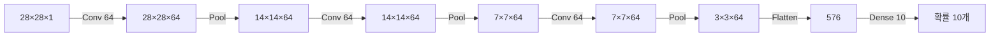
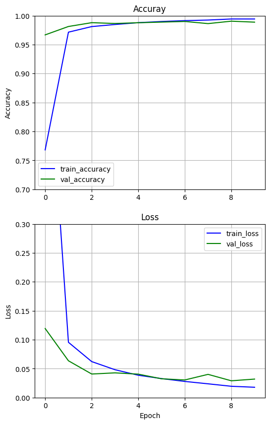
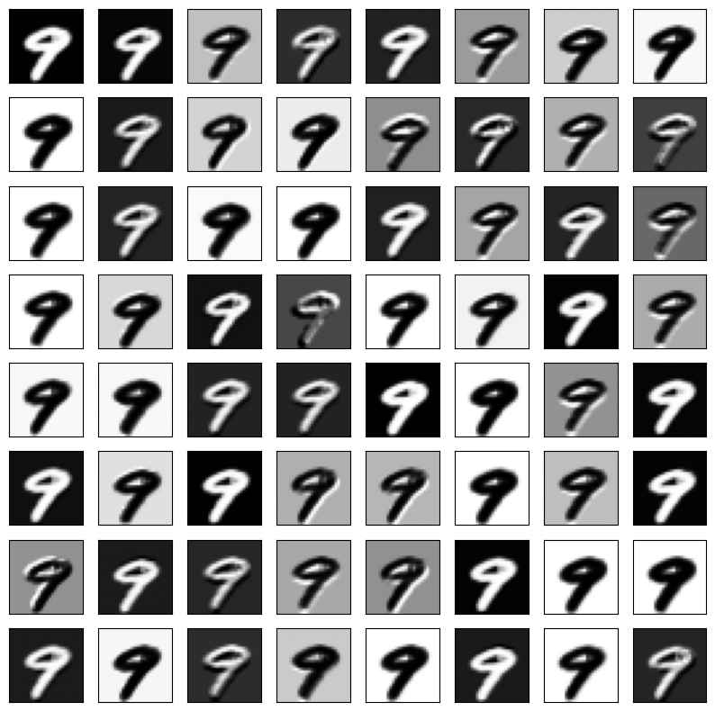
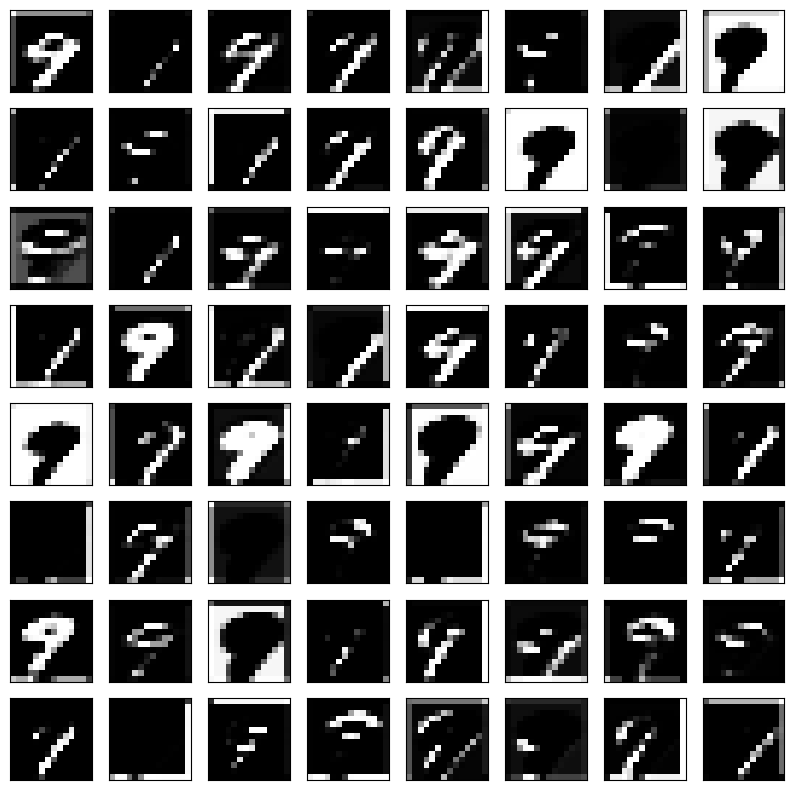
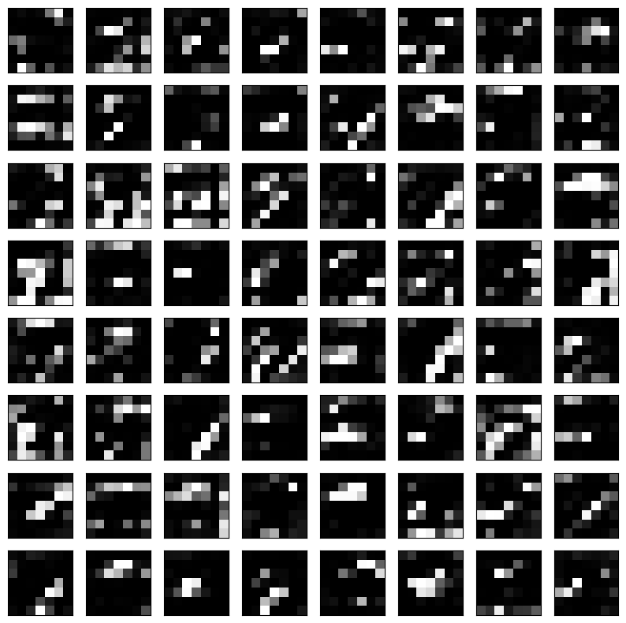

# CNN EX_02 예제 풀이 — 합성곱 3층으로 MNIST 분류

[목차](../00_%EB%94%A5%EB%9F%AC%EB%8B%9D%EC%88%98%ED%95%99_MOC.md) · 개념: [D07_합성곱과_풀링](../01_%EA%B0%9C%EB%85%90%EB%85%B8%ED%8A%B8/D07_%ED%95%A9%EC%84%B1%EA%B3%B1%EA%B3%BC_%ED%92%80%EB%A7%81.md) · 이전: [E08_CNN_1Conv_MNIST_예제](E08_CNN_1Conv_MNIST_%EC%98%88%EC%A0%9C.md) · 다음: [E10_CNN_ReLU_Dropout_예제](E10_CNN_ReLU_Dropout_%EC%98%88%EC%A0%9C.md)

> [!NOTE]
> **3줄 요약**
> - [E08_CNN_1Conv_MNIST_예제](E08_CNN_1Conv_MNIST_%EC%98%88%EC%A0%9C.md)의 "합성곱 → 맥스 풀링" 묶음을 **3번** 쌓고, 필터를 64개로 늘렸다.
> - 그림은 28 → 14 → 7 → 3으로 작아지고, 층마다 64장의 **특징 맵**(필터가 찾아낸 무늬 그림)이 나온다. 마지막에 그 특징 맵을 직접 그려 본다.
> - 결과: 시험 정확도 **98.89%** (1층일 때 97.10%).

## 0. 한눈에 보기

| 항목 | 내용 |
|---|---|
| 데이터 | MNIST, (28, 28, 1) |
| 모델 | [Conv2D(64, 3×3, sigmoid) → MaxPool] × 3 → Flatten → Dense(10, softmax) |
| 가중치 수 | 80,266개 |
| 학습 | Adam, 10번, validation |
| 결과 | 시험 정확도 0.9669(1번째) → 0.9889(10번째) |

### 그림 크기가 바뀌는 과정



## 1. 셀별 풀이

### 1-1. 데이터

[E08_CNN_1Conv_MNIST_예제](E08_CNN_1Conv_MNIST_%EC%98%88%EC%A0%9C.md) 1-1과 같다: 실수로 바꾸고, 채널 칸을 붙이고, 255로 나눈다.

### 1-2. 모델 만들기

```python
model = tf.keras.models.Sequential()
model.add(tf.keras.Input(shape=(28, 28, 1)))

# 1묶음: 28×28×1 → 28×28×64 → 14×14×64
model.add(tf.keras.layers.Conv2D(filters=64, kernel_size=3, padding='same',activation='sigmoid'))
model.add(tf.keras.layers.MaxPool2D(pool_size=2, strides=2))

# 2묶음: 14×14×64 → 14×14×64 → 7×7×64
model.add(tf.keras.layers.Conv2D(filters=64, kernel_size=3, padding='same',activation='sigmoid'))
model.add(tf.keras.layers.MaxPool2D(pool_size=2, strides=2))

# 3묶음: 7×7×64 → 7×7×64 → 3×3×64  (7을 2로 나누면 3.5 → 내림해서 3)
model.add(tf.keras.layers.Conv2D(filters=64, kernel_size=3, padding='same',activation='sigmoid'))
model.add(tf.keras.layers.MaxPool2D(pool_size=2, strides=2))

model.add(tf.keras.layers.Flatten())                       # 3×3×64 = 576칸
model.add(tf.keras.layers.Dense(10, activation='softmax'))

model.summary()
```

**실행 결과** (Param #만):

| 층 | 출력 모양 | Param # | 계산 |
|---|---|---|---|
| conv2d | (28, 28, 64) | 640 | (3×3×1 + 1) × 64 |
| max_pooling2d | (14, 14, 64) | 0 | |
| conv2d_1 | (14, 14, 64) | 36,928 | (3×3×**64** + 1) × 64 |
| max_pooling2d_1 | (7, 7, 64) | 0 | |
| conv2d_2 | (7, 7, 64) | 36,928 | (3×3×64 + 1) × 64 |
| max_pooling2d_2 | (3, 3, 64) | 0 | |
| flatten | (576) | 0 | 3 × 3 × 64 |
| dense | (10) | 5,770 | 576 × 10 + 10 |
| **합계** | | **80,266** | |

> [!TIP]
> **두 번째 합성곱부터 Param이 확 늘어나는 이유**
> 첫 합성곱의 입력은 1겹(흑백)이라 필터 하나가 3×3×1 = 9칸이다.
> 두 번째부터는 입력이 **64겹**(앞 층의 특징 맵 64장)이라 필터 하나가 3×3×64 = 576칸을 한꺼번에 본다. 그런 필터가 64개라 36,928개가 된다.

> [!WARNING]
> **⚠ 7 ÷ 2 = 3 (내림)**
> 맥스 풀링은 2×2 구역이 꽉 차지 않는 마지막 줄을 버린다. 7×7에서는 2칸씩 3구역만 만들고 7번째 줄은 버려서 3×3이 된다. 파이썬의 `7 // 2 = 3`과 같다.

- 층은 늘었는데 전체 가중치는 E08(63,050)과 비슷하다. 마지막 Dense의 입력이 6272 → 576으로 크게 줄었기 때문이다.

### 1-3. 컴파일·결과 함수·학습 전

[E08_CNN_1Conv_MNIST_예제](E08_CNN_1Conv_MNIST_%EC%98%88%EC%A0%9C.md) 1-3 ~ 1-5와 같은 코드다.


- 학습 전에는 10장 모두 **2**라고 예측한다(E08에서는 모두 1이었다). 무작위 가중치에서 우연히 큰 칸이 다를 뿐이다.

### 1-4. 학습

```python
%%time
history = model.fit(train_data, train_labels, shuffle=True,
                 epochs=10, validation_data=(test_data, test_labels))
```

| Epoch | 학습 정확도 | 학습 loss | 시험 정확도 (val) | 시험 loss (val) |
|---|---|---|---|---|
| 1 | 0.4930 | 1.3966 | 0.9669 | 0.1194 |
| 2 | 0.9678 | 0.1084 | 0.9814 | 0.0636 |
| 3 | 0.9799 | 0.0672 | 0.9880 | 0.0407 |
| 5 | 0.9871 | 0.0407 | 0.9879 | 0.0405 |
| 7 | 0.9923 | 0.0257 | 0.9901 | 0.0304 |
| 9 | 0.9951 | 0.0172 | 0.9906 | 0.0290 |
| 10 | 0.9947 | 0.0176 | 0.9889 | 0.0320 |

- 2번째 바퀴부터 시험 정확도가 98%를 넘는다. 1층(E08)은 10바퀴 돌아도 97%대였다.
- 뒤쪽에서는 학습 정확도(99.5%)가 계속 오르는데 시험 정확도(98.9~99.1%)는 제자리이고, 시험 loss는 0.0290 → 0.0320으로 살짝 오른다. 학습 데이터에만 지나치게 맞추기 시작하는 신호(**과적합**)일 수 있다. 다음 예제의 드롭아웃이 이것을 줄이는 방법이다.

### 1-5. 그래프

```python
plt.figure(figsize=(6, 10))
plt.subplot(2, 1, 1)
plt.title('Accuray')
plt.plot(history.history['accuracy'], 'b', label='train_accuracy')     # 가로축을 안 주면 0, 1, 2, ...로 자동
plt.plot(history.history['val_accuracy'], 'g', label='val_accuracy')
plt.ylim([0.7,1])
plt.grid(True)
plt.ylabel('Accuracy')
plt.legend(loc='best')

plt.subplot(2, 1, 2)
plt.title('Loss')
plt.plot(history.history['loss'], 'b', label='train_loss')
plt.plot(history.history['val_loss'], 'g', label='val_loss')
plt.ylim([0,0.3])
plt.grid(True)
plt.xlabel('Epoch')
plt.ylabel('Loss')
plt.legend(loc='best')
plt.show()
```



- E08과 달리 `plt.plot`에 epochs를 안 넘겼다. 그래서 가로축이 1~10이 아니라 **0~9**로 찍힌다.

### 1-6. 학습 후


앞 10장을 모두 맞혔다.

### 1-7. 특징 맵 그려 보기

```python
def square(imgs, n): # n x n 개의 그림 그리는 함수
  plt.figure(figsize=(10,10))
  for i in range(n):                 # 행
    for j in range(n):               # 열
      p_num = i * n + j              # (i, j) 칸의 순번: 0, 1, ..., n*n-1  (C의 2차원 → 1차원 인덱스와 같음)
      ax = plt.subplot(n, n, p_num+1)          # subplot 번호는 1부터라 +1
      ax.set_xticks([])                        # 눈금 숫자 숨기기
      ax.set_yticks([])
      plt.imshow(imgs[0, :, :, p_num], cmap='gray')   # 그림 0번의 p_num번째 채널(특징 맵) 한 장
  plt.show()
```

```python
ixs = [0, 2, 4]                                                # model.layers에서 합성곱 층의 번호 (0: conv, 1: pool, 2: conv, 3: pool, 4: conv)
outputs = [model.layers[i].output for i in ixs] # 다수의 output 설정
model_fm = tf.keras.models.Model(inputs=model.inputs, outputs=outputs) # 새로운 모델 생성: input은 동일, output은 다수
model_fm.summary()
feature_maps = model_fm.predict(test_data[9:10]) # 모델을 돌려 다수의 출력을 저장 (그림 9번 한 장, [9:10]은 모양을 유지하려고)
print(feature_maps[0].shape, feature_maps[1].shape, feature_maps[2].shape)
layers_names = model_fm.output_names # output의 이름을 저장
# feature_maps[0].shape

for i, fmap in enumerate(feature_maps): # output을 하나씩 그려줌, output은 곧 Feature map, 8x8=64개 채널만 그려줌
  print(layers_names[i])
  square(fmap, 8)
```

**실행 결과**:

```
(1, 28, 28, 64) (1, 14, 14, 64) (1, 7, 7, 64)
```

- 학습이 끝난 모델에서 **중간 층의 출력**만 꺼내 보는 새 모델(`model_fm`)을 만들었다. 가중치는 원래 모델 것을 그대로 쓴다.
- `test_data[9:10]`: 9번 그림 한 장. `test_data[9]`로 쓰면 (28,28,1)이 되어 "몇 장인지" 칸이 사라지므로, 범위로 꺼내 (1,28,28,1) 모양을 유지한다.

**1번째 합성곱 (28×28, 64장)**: 숫자 9의 모양이 그대로 보이고, 필터마다 밝기·테두리 강조가 다르다.



**2번째 합성곱 (14×14, 64장)**:



**3번째 합성곱 (7×7, 64장)**:



- 층이 깊어질수록 그림이 작아지고 사람 눈에는 알아보기 어려운 무늬가 된다. 앞 층은 선·테두리처럼 단순한 무늬를, 뒤 층은 그것들을 조합한 더 큰 무늬를 잡는 것으로 알려져 있다.

## 2. 이 예제에서 새로 나온 것

| 이름 | 뜻 | 관련 노트 |
|---|---|---|
| 층 쌓기 | 합성곱·풀링 묶음 반복 | |
| 특징 맵(feature map) | 필터 하나가 만든 결과 그림 | [E08_CNN_1Conv_MNIST_예제](E08_CNN_1Conv_MNIST_%EC%98%88%EC%A0%9C.md) |
| 과적합(overfitting) | 학습 데이터에만 지나치게 맞춤 | |
| `model.layers[i].output` | i번째 층의 출력 | |
| `tf.keras.models.Model(inputs, outputs)` | 입력·출력을 직접 지정해 모델 만들기 | |
| `enumerate` | 번호와 값을 함께 꺼내는 for문 | |

## 3. 스스로 확인

<details><summary>1. 맥스 풀링을 한 번 더 하면 3×3 → 몇×몇이 되나?</summary>

3 // 2 = **1** → 1×1

</details>

<details><summary>2. 두 번째 합성곱의 필터를 32개로 줄이면 Param #는?</summary>

(3×3×64 + 1) × 32 = 577 × 32 = **18,464**

</details>

<details><summary>3. `p_num = i * n + j`에서 n = 8, i = 2, j = 3이면?</summary>

2 × 8 + 3 = **19** (20번째 칸)

</details>

