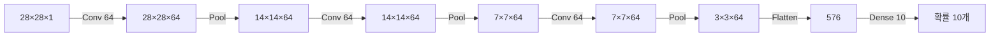

# CNN EX\_02 예제 풀이 — 합성곱 3층으로 MNIST 분류

[목차](../00_%EB%94%A5%EB%9F%AC%EB%8B%9D%EC%88%98%ED%95%99_MOC.md) · 개념: [D07_합성곱과_풀링](../01_%EA%B0%9C%EB%85%90%EB%85%B8%ED%8A%B8/D07_%ED%95%A9%EC%84%B1%EA%B3%B1%EA%B3%BC_%ED%92%80%EB%A7%81.md) · 이전: [E08_CNN_1Conv_MNIST_예제](../03_%EC%98%88%EC%A0%9C%ED%92%80%EC%9D%B4/E08_CNN_1Conv_MNIST_%EC%98%88%EC%A0%9C.md) · 다음: [E10_CNN_ReLU_Dropout_예제](../03_%EC%98%88%EC%A0%9C%ED%92%80%EC%9D%B4/E10_CNN_ReLU_Dropout_%EC%98%88%EC%A0%9C.md)

> [!NOTE]
> **3줄 요약**
> - [E08_CNN_1Conv_MNIST_예제](../03_%EC%98%88%EC%A0%9C%ED%92%80%EC%9D%B4/E08_CNN_1Conv_MNIST_%EC%98%88%EC%A0%9C.md)의 "[합성곱](../00_%EB%94%A5%EB%9F%AC%EB%8B%9D_%EC%9A%A9%EC%96%B4%EC%82%AC%EC%A0%84.md#convolution-%ED%95%A9%EC%84%B1%EA%B3%B1) → [맥스 풀링](../00_%EB%94%A5%EB%9F%AC%EB%8B%9D_%EC%9A%A9%EC%96%B4%EC%82%AC%EC%A0%84.md#max-pooling-%EB%A7%A5%EC%8A%A4-%ED%92%80%EB%A7%81)" 묶음을 **3번** 쌓고, [필터](../00_%EB%94%A5%EB%9F%AC%EB%8B%9D_%EC%9A%A9%EC%96%B4%EC%82%AC%EC%A0%84.md#filter-%ED%95%84%ED%84%B0)를 64개로 늘렸다.
> - 그림은 28 → 14 → 7 → 3으로 작아지고, [층](../00_%EB%94%A5%EB%9F%AC%EB%8B%9D_%EC%9A%A9%EC%96%B4%EC%82%AC%EC%A0%84.md#layer-%EC%B8%B5)마다 64장의 **[특징 맵](../00_%EB%94%A5%EB%9F%AC%EB%8B%9D_%EC%9A%A9%EC%96%B4%EC%82%AC%EC%A0%84.md#feature-map-%ED%8A%B9%EC%A7%95-%EB%A7%B5)**([필터](../00_%EB%94%A5%EB%9F%AC%EB%8B%9D_%EC%9A%A9%EC%96%B4%EC%82%AC%EC%A0%84.md#filter-%ED%95%84%ED%84%B0)가 찾아낸 무늬 그림)이 나온다. 마지막에 그 [특징 맵](../00_%EB%94%A5%EB%9F%AC%EB%8B%9D_%EC%9A%A9%EC%96%B4%EC%82%AC%EC%A0%84.md#feature-map-%ED%8A%B9%EC%A7%95-%EB%A7%B5)을 직접 그려 본다.
> - 결과: 시험 [정확도](../00_%EB%94%A5%EB%9F%AC%EB%8B%9D_%EC%9A%A9%EC%96%B4%EC%82%AC%EC%A0%84.md#accuracy-%EC%A0%95%ED%99%95%EB%8F%84) **98.89%** (1층일 때 97.10%).

## 0. 예제 개요

| 항목 | 내용 |
|---|---|
| 데이터 | [MNIST](../00_%EB%94%A5%EB%9F%AC%EB%8B%9D_%EC%9A%A9%EC%96%B4%EC%82%AC%EC%A0%84.md#mnist-%EC%86%90%EA%B8%80%EC%94%A8-%EC%88%AB%EC%9E%90-%EB%8D%B0%EC%9D%B4%ED%84%B0%EC%85%8B), (28, 28, 1) |
| 모델 | ([Conv2D](../00_%EB%94%A5%EB%9F%AC%EB%8B%9D_%EC%9A%A9%EC%96%B4%EC%82%AC%EC%A0%84.md#conv2d-2%EC%B0%A8%EC%9B%90-%ED%95%A9%EC%84%B1%EA%B3%B1-%EC%B8%B5)(64, 3×3, [시그모이드](../00_%EB%94%A5%EB%9F%AC%EB%8B%9D_%EC%9A%A9%EC%96%B4%EC%82%AC%EC%A0%84.md#sigmoid-%EC%8B%9C%EA%B7%B8%EB%AA%A8%EC%9D%B4%EB%93%9C)) → MaxPool) × 3 → [Flatten](../00_%EB%94%A5%EB%9F%AC%EB%8B%9D_%EC%9A%A9%EC%96%B4%EC%82%AC%EC%A0%84.md#flatten-%ED%8F%89%ED%83%84%ED%99%94) → [덴스 층](../00_%EB%94%A5%EB%9F%AC%EB%8B%9D_%EC%9A%A9%EC%96%B4%EC%82%AC%EC%A0%84.md#dense-layer-%EB%8D%B4%EC%8A%A4-%EC%B8%B5)(10, [소프트맥스](../00_%EB%94%A5%EB%9F%AC%EB%8B%9D_%EC%9A%A9%EC%96%B4%EC%82%AC%EC%A0%84.md#softmax-%EC%86%8C%ED%94%84%ED%8A%B8%EB%A7%A5%EC%8A%A4)) |
| [파라미터](../00_%EB%94%A5%EB%9F%AC%EB%8B%9D_%EC%9A%A9%EC%96%B4%EC%82%AC%EC%A0%84.md#parameter-%ED%8C%8C%EB%9D%BC%EB%AF%B8%ED%84%B0) 수([가중치](../00_%EB%94%A5%EB%9F%AC%EB%8B%9D_%EC%9A%A9%EC%96%B4%EC%82%AC%EC%A0%84.md#weight-%EA%B0%80%EC%A4%91%EC%B9%98)+[편향](../00_%EB%94%A5%EB%9F%AC%EB%8B%9D_%EC%9A%A9%EC%96%B4%EC%82%AC%EC%A0%84.md#bias-%ED%8E%B8%ED%96%A5)) | 80,266개 |
| [학습](../00_%EB%94%A5%EB%9F%AC%EB%8B%9D_%EC%9A%A9%EC%96%B4%EC%82%AC%EC%A0%84.md#training-%ED%95%99%EC%8A%B5) | [Adam](../00_%EB%94%A5%EB%9F%AC%EB%8B%9D_%EC%9A%A9%EC%96%B4%EC%82%AC%EC%A0%84.md#adam-%EC%95%84%EB%8B%B4-%EC%98%B5%ED%8B%B0%EB%A7%88%EC%9D%B4%EC%A0%80), 10번, validation |
| 결과 | 시험 [정확도](../00_%EB%94%A5%EB%9F%AC%EB%8B%9D_%EC%9A%A9%EC%96%B4%EC%82%AC%EC%A0%84.md#accuracy-%EC%A0%95%ED%99%95%EB%8F%84) 0.9669(1번째) → 0.9889(10번째) |

### 그림 크기의 변화 과정



## 1. 셀별 풀이

### 1-1. 데이터

[E08_CNN_1Conv_MNIST_예제](../03_%EC%98%88%EC%A0%9C%ED%92%80%EC%9D%B4/E08_CNN_1Conv_MNIST_%EC%98%88%EC%A0%9C.md) 1-1과 같다: 실수로 바꾸고, [채널](../00_%EB%94%A5%EB%9F%AC%EB%8B%9D_%EC%9A%A9%EC%96%B4%EC%82%AC%EC%A0%84.md#channel-%EC%B1%84%EB%84%90) 칸을 붙이고, 255로 나눈다.

### 1-2. 모델 정의

```python
model = tf.keras.models.Sequential()
model.add(tf.keras.Input(shape=(28, 28, 1)))

# 1묶음: 28×28×1 → 28×28×64 → 14×14×64
model.add(tf.keras.layers.Conv2D(filters=64, kernel_size=3, padding='same',activation='sigmoid'))
model.add(tf.keras.layers.MaxPool2D(pool_size=2, strides=2))

# 2묶음: 14×14×64 → 14×14×64 → 7×7×64
model.add(tf.keras.layers.Conv2D(filters=64, kernel_size=3, padding='same',activation='sigmoid'))
model.add(tf.keras.layers.MaxPool2D(pool_size=2, strides=2))

# 3묶음: 7×7×64 → 7×7×64 → 3×3×64  (7을 2로 나누면 3.5 → 내림해서 3)
model.add(tf.keras.layers.Conv2D(filters=64, kernel_size=3, padding='same',activation='sigmoid'))
model.add(tf.keras.layers.MaxPool2D(pool_size=2, strides=2))

model.add(tf.keras.layers.Flatten())                       # 3×3×64 = 576칸
model.add(tf.keras.layers.Dense(10, activation='softmax'))

model.summary()
```

**실행 결과** ([파라미터](../00_%EB%94%A5%EB%9F%AC%EB%8B%9D_%EC%9A%A9%EC%96%B4%EC%82%AC%EC%A0%84.md#parameter-%ED%8C%8C%EB%9D%BC%EB%AF%B8%ED%84%B0) 수만):

| [층](../00_%EB%94%A5%EB%9F%AC%EB%8B%9D_%EC%9A%A9%EC%96%B4%EC%82%AC%EC%A0%84.md#layer-%EC%B8%B5) | 출력 모양 | [파라미터](../00_%EB%94%A5%EB%9F%AC%EB%8B%9D_%EC%9A%A9%EC%96%B4%EC%82%AC%EC%A0%84.md#parameter-%ED%8C%8C%EB%9D%BC%EB%AF%B8%ED%84%B0) 수 | 계산 |
|---|---|---|---|
| conv2d | (None, 28, 28, 64) | 640 | (3×3×1 + 1) × 64 |
| max\_pooling2d | (None, 14, 14, 64) | 0 | |
| conv2d\_1 | (None, 14, 14, 64) | 36,928 | (3×3×**64** + 1) × 64 |
| max\_pooling2d\_1 | (None, 7, 7, 64) | 0 | |
| conv2d\_2 | (None, 7, 7, 64) | 36,928 | (3×3×64 + 1) × 64 |
| max\_pooling2d\_2 | (None, 3, 3, 64) | 0 | |
| flatten | (None, 576) | 0 | 3 × 3 × 64 |
| dense | (None, 10) | 5,770 | 576 × 10 + 10 |
| **합계** | | **80,266** | |

> [!TIP]
> **두 번째 [합성곱](../00_%EB%94%A5%EB%9F%AC%EB%8B%9D_%EC%9A%A9%EC%96%B4%EC%82%AC%EC%A0%84.md#convolution-%ED%95%A9%EC%84%B1%EA%B3%B1)부터 [파라미터](../00_%EB%94%A5%EB%9F%AC%EB%8B%9D_%EC%9A%A9%EC%96%B4%EC%82%AC%EC%A0%84.md#parameter-%ED%8C%8C%EB%9D%BC%EB%AF%B8%ED%84%B0) 수가 늘어나는 이유**
> 첫 [합성곱](../00_%EB%94%A5%EB%9F%AC%EB%8B%9D_%EC%9A%A9%EC%96%B4%EC%82%AC%EC%A0%84.md#convolution-%ED%95%A9%EC%84%B1%EA%B3%B1)의 입력은 1겹(흑백)이라 [필터](../00_%EB%94%A5%EB%9F%AC%EB%8B%9D_%EC%9A%A9%EC%96%B4%EC%82%AC%EC%A0%84.md#filter-%ED%95%84%ED%84%B0) 하나가 3×3×1 = 9칸이다.
> 두 번째부터는 입력이 **64겹**(앞 [층](../00_%EB%94%A5%EB%9F%AC%EB%8B%9D_%EC%9A%A9%EC%96%B4%EC%82%AC%EC%A0%84.md#layer-%EC%B8%B5)의 [특징 맵](../00_%EB%94%A5%EB%9F%AC%EB%8B%9D_%EC%9A%A9%EC%96%B4%EC%82%AC%EC%A0%84.md#feature-map-%ED%8A%B9%EC%A7%95-%EB%A7%B5) 64장)이라 [필터](../00_%EB%94%A5%EB%9F%AC%EB%8B%9D_%EC%9A%A9%EC%96%B4%EC%82%AC%EC%A0%84.md#filter-%ED%95%84%ED%84%B0) 하나가 3×3×64 = 576칸을 한꺼번에 본다. 그런 [필터](../00_%EB%94%A5%EB%9F%AC%EB%8B%9D_%EC%9A%A9%EC%96%B4%EC%82%AC%EC%A0%84.md#filter-%ED%95%84%ED%84%B0)가 64개라 (576 × 64) + [편향](../00_%EB%94%A5%EB%9F%AC%EB%8B%9D_%EC%9A%A9%EC%96%B4%EC%82%AC%EC%A0%84.md#bias-%ED%8E%B8%ED%96%A5) 64 = 36,928개가 된다.

> [!WARNING]
> **⚠ 7 ÷ 2 = 3 (내림)**
> [맥스 풀링](../00_%EB%94%A5%EB%9F%AC%EB%8B%9D_%EC%9A%A9%EC%96%B4%EC%82%AC%EC%A0%84.md#max-pooling-%EB%A7%A5%EC%8A%A4-%ED%92%80%EB%A7%81)은 2×2 구역이 꽉 차지 않는 마지막 줄을 버린다(padding='valid'가 기본값이라서). 7×7에서는 2칸씩 3구역만 만들고 7번째 줄은 버려서 3×3이 된다. 파이썬의 `7 // 2 = 3`과 같다.

- [합성곱](../00_%EB%94%A5%EB%9F%AC%EB%8B%9D_%EC%9A%A9%EC%96%B4%EC%82%AC%EC%A0%84.md#convolution-%ED%95%A9%EC%84%B1%EA%B3%B1) [층](../00_%EB%94%A5%EB%9F%AC%EB%8B%9D_%EC%9A%A9%EC%96%B4%EC%82%AC%EC%A0%84.md#layer-%EC%B8%B5)은 1개에서 3개로 늘었다. 그런데 전체 [파라미터](../00_%EB%94%A5%EB%9F%AC%EB%8B%9D_%EC%9A%A9%EC%96%B4%EC%82%AC%EC%A0%84.md#parameter-%ED%8C%8C%EB%9D%BC%EB%AF%B8%ED%84%B0) 수는 E08(63,050)보다 약 27% 늘었을 뿐이다(80,266).
- 마지막 [덴스 층](../00_%EB%94%A5%EB%9F%AC%EB%8B%9D_%EC%9A%A9%EC%96%B4%EC%82%AC%EC%A0%84.md#dense-layer-%EB%8D%B4%EC%8A%A4-%EC%B8%B5)의 입력이 6272 → 576으로 크게 줄었기 때문이다.

### 1-3. 컴파일·결과 함수·학습 전

[E08_CNN_1Conv_MNIST_예제](../03_%EC%98%88%EC%A0%9C%ED%92%80%EC%9D%B4/E08_CNN_1Conv_MNIST_%EC%98%88%EC%A0%9C.md) 1-3 ~ 1-5와 같은 코드다.


- [학습](../00_%EB%94%A5%EB%9F%AC%EB%8B%9D_%EC%9A%A9%EC%96%B4%EC%82%AC%EC%A0%84.md#training-%ED%95%99%EC%8A%B5) 전에는 10장 모두 **2**라고 예측한다(E08에서는 모두 1이었다). 무작위 [가중치](../00_%EB%94%A5%EB%9F%AC%EB%8B%9D_%EC%9A%A9%EC%96%B4%EC%82%AC%EC%A0%84.md#weight-%EA%B0%80%EC%A4%91%EC%B9%98)에서 우연히 큰 칸이 다를 뿐이다.

### 1-4. 학습

```python
%%time
history = model.fit(train_data, train_labels, shuffle=True,
                 epochs=10, validation_data=(test_data, test_labels))
```

| Epoch | [학습](../00_%EB%94%A5%EB%9F%AC%EB%8B%9D_%EC%9A%A9%EC%96%B4%EC%82%AC%EC%A0%84.md#training-%ED%95%99%EC%8A%B5) [정확도](../00_%EB%94%A5%EB%9F%AC%EB%8B%9D_%EC%9A%A9%EC%96%B4%EC%82%AC%EC%A0%84.md#accuracy-%EC%A0%95%ED%99%95%EB%8F%84) | [학습](../00_%EB%94%A5%EB%9F%AC%EB%8B%9D_%EC%9A%A9%EC%96%B4%EC%82%AC%EC%A0%84.md#training-%ED%95%99%EC%8A%B5) [손실](../00_%EB%94%A5%EB%9F%AC%EB%8B%9D_%EC%9A%A9%EC%96%B4%EC%82%AC%EC%A0%84.md#loss-function-%EC%86%90%EC%8B%A4-%ED%95%A8%EC%88%98) | 시험 [정확도](../00_%EB%94%A5%EB%9F%AC%EB%8B%9D_%EC%9A%A9%EC%96%B4%EC%82%AC%EC%A0%84.md#accuracy-%EC%A0%95%ED%99%95%EB%8F%84) (val) | 시험 [손실](../00_%EB%94%A5%EB%9F%AC%EB%8B%9D_%EC%9A%A9%EC%96%B4%EC%82%AC%EC%A0%84.md#loss-function-%EC%86%90%EC%8B%A4-%ED%95%A8%EC%88%98) (val) |
|---|---|---|---|---|
| 1 | 0.4930 | 1.3966 | 0.9669 | 0.1194 |
| 2 | 0.9678 | 0.1084 | 0.9814 | 0.0636 |
| 3 | 0.9799 | 0.0672 | 0.9880 | 0.0407 |
| 5 | 0.9871 | 0.0407 | 0.9879 | 0.0405 |
| 7 | 0.9923 | 0.0257 | 0.9901 | 0.0304 |
| 9 | 0.9951 | 0.0172 | 0.9906 | 0.0290 |
| 10 | 0.9947 | 0.0176 | 0.9889 | 0.0320 |

- `epochs=10`: [에폭](../00_%EB%94%A5%EB%9F%AC%EB%8B%9D_%EC%9A%A9%EC%96%B4%EC%82%AC%EC%A0%84.md#epoch-%EC%97%90%ED%8F%AD)(epoch, 전체 데이터를 한 번 다 보는 것)을 10번 돈다.
- 2번째 [에폭](../00_%EB%94%A5%EB%9F%AC%EB%8B%9D_%EC%9A%A9%EC%96%B4%EC%82%AC%EC%A0%84.md#epoch-%EC%97%90%ED%8F%AD)부터 시험 [정확도](../00_%EB%94%A5%EB%9F%AC%EB%8B%9D_%EC%9A%A9%EC%96%B4%EC%82%AC%EC%A0%84.md#accuracy-%EC%A0%95%ED%99%95%EB%8F%84)가 98%를 넘는다. 1층(E08)은 10에폭을 돌아도 97%대였다.
- 뒤쪽에서는 [학습](../00_%EB%94%A5%EB%9F%AC%EB%8B%9D_%EC%9A%A9%EC%96%B4%EC%82%AC%EC%A0%84.md#training-%ED%95%99%EC%8A%B5) [정확도](../00_%EB%94%A5%EB%9F%AC%EB%8B%9D_%EC%9A%A9%EC%96%B4%EC%82%AC%EC%A0%84.md#accuracy-%EC%A0%95%ED%99%95%EB%8F%84)가 99.5% 근처까지 오른다. 시험 [정확도](../00_%EB%94%A5%EB%9F%AC%EB%8B%9D_%EC%9A%A9%EC%96%B4%EC%82%AC%EC%A0%84.md#accuracy-%EC%A0%95%ED%99%95%EB%8F%84)(98.9~99.1%)는 제자리이고, 시험 [손실](../00_%EB%94%A5%EB%9F%AC%EB%8B%9D_%EC%9A%A9%EC%96%B4%EC%82%AC%EC%A0%84.md#loss-function-%EC%86%90%EC%8B%A4-%ED%95%A8%EC%88%98)은 0.0290 → 0.0320으로 살짝 오른다.
- 학습 데이터에만 지나치게 맞추기 시작하는 신호(**[과적합](../00_%EB%94%A5%EB%9F%AC%EB%8B%9D_%EC%9A%A9%EC%96%B4%EC%82%AC%EC%A0%84.md#overfitting-%EA%B3%BC%EC%A0%81%ED%95%A9)**)일 수 있다. 다음 예제의 [드롭아웃](../00_%EB%94%A5%EB%9F%AC%EB%8B%9D_%EC%9A%A9%EC%96%B4%EC%82%AC%EC%A0%84.md#dropout-%EB%93%9C%EB%A1%AD%EC%95%84%EC%9B%83)이 이것을 줄이는 방법이다.

### 1-5. 그래프

```python
plt.figure(figsize=(6, 10))
plt.subplot(2, 1, 1)
plt.title('Accuray')                                                   # 노트북 원문 오타(Accuracy)
plt.plot(history.history['accuracy'], 'b', label='train_accuracy')     # 가로축을 안 주면 0, 1, 2, ...로 자동
plt.plot(history.history['val_accuracy'], 'g', label='val_accuracy')
plt.ylim([0.7,1])
plt.grid(True)
plt.ylabel('Accuracy')
plt.legend(loc='best')

plt.subplot(2, 1, 2)
plt.title('Loss')
plt.plot(history.history['loss'], 'b', label='train_loss')
plt.plot(history.history['val_loss'], 'g', label='val_loss')
plt.ylim([0,0.3])
plt.grid(True)
plt.xlabel('Epoch')
plt.ylabel('Loss')
plt.legend(loc='best')
plt.show()
```


- E08과 달리 `plt.plot`에 epochs를 안 넘겼다. 그래서 가로축이 1~10이 아니라 **0~9**로 찍힌다.
- 첫 [에폭](../00_%EB%94%A5%EB%9F%AC%EB%8B%9D_%EC%9A%A9%EC%96%B4%EC%82%AC%EC%A0%84.md#epoch-%EC%97%90%ED%8F%AD)([학습](../00_%EB%94%A5%EB%9F%AC%EB%8B%9D_%EC%9A%A9%EC%96%B4%EC%82%AC%EC%A0%84.md#training-%ED%95%99%EC%8A%B5) [정확도](../00_%EB%94%A5%EB%9F%AC%EB%8B%9D_%EC%9A%A9%EC%96%B4%EC%82%AC%EC%A0%84.md#accuracy-%EC%A0%95%ED%99%95%EB%8F%84) 0.4930, [손실](../00_%EB%94%A5%EB%9F%AC%EB%8B%9D_%EC%9A%A9%EC%96%B4%EC%82%AC%EC%A0%84.md#loss-function-%EC%86%90%EC%8B%A4-%ED%95%A8%EC%88%98) 1.40)은 그래프 범위([정확도](../00_%EB%94%A5%EB%9F%AC%EB%8B%9D_%EC%9A%A9%EC%96%B4%EC%82%AC%EC%A0%84.md#accuracy-%EC%A0%95%ED%99%95%EB%8F%84) 0.7~1, [손실](../00_%EB%94%A5%EB%9F%AC%EB%8B%9D_%EC%9A%A9%EC%96%B4%EC%82%AC%EC%A0%84.md#loss-function-%EC%86%90%EC%8B%A4-%ED%95%A8%EC%88%98) 0~0.3) 밖이라 잘린다.

### 1-6. 학습 후 예측


앞 10장을 모두 맞혔다.

### 1-7. 특징 맵 시각화

```python
def square(imgs, n): # n x n 개의 그림 그리는 함수
  plt.figure(figsize=(10,10))
  for i in range(n):                 # 행
    for j in range(n):               # 열
      p_num = i * n + j              # (i, j) 칸의 순번: 0, 1, ..., n*n-1  (행·열 두 번호를 한 줄 번호로 바꾸는 식)
      ax = plt.subplot(n, n, p_num+1)          # subplot 번호는 1부터라 +1
      ax.set_xticks([])                        # 눈금 숫자 숨기기
      ax.set_yticks([])
      plt.imshow(imgs[0, :, :, p_num], cmap='gray')   # 그림 0번의 p_num번째 채널(특징 맵) 한 장
  plt.show()
```

```python
ixs = [0, 2, 4]   # model.layers에서 합성곱 층의 번호
                  # (0: conv, 1: pool, 2: conv, 3: pool, 4: conv)
outputs = [model.layers[i].output for i in ixs] # 다수의 output 설정
model_fm = tf.keras.models.Model(inputs=model.inputs, outputs=outputs) # 새로운 모델 생성: input은 동일, output은 다수
model_fm.summary()
feature_maps = model_fm.predict(test_data[9:10]) # 모델을 돌려 다수의 출력을 저장 (그림 9번 한 장, [9:10]은 모양을 유지하려고)
print(feature_maps[0].shape, feature_maps[1].shape, feature_maps[2].shape)
layers_names = model_fm.output_names # output의 이름을 저장
# feature_maps[0].shape

for i, fmap in enumerate(feature_maps): # output을 하나씩 그려줌, output은 곧 Feature map, 8x8=64개 채널만 그려줌
  print(layers_names[i])
  square(fmap, 8)
```

**실행 결과**:

```text
(1, 28, 28, 64) (1, 14, 14, 64) (1, 7, 7, 64)
```

- [학습](../00_%EB%94%A5%EB%9F%AC%EB%8B%9D_%EC%9A%A9%EC%96%B4%EC%82%AC%EC%A0%84.md#training-%ED%95%99%EC%8A%B5)이 끝난 모델에서 **중간 [층](../00_%EB%94%A5%EB%9F%AC%EB%8B%9D_%EC%9A%A9%EC%96%B4%EC%82%AC%EC%A0%84.md#layer-%EC%B8%B5)의 출력**만 꺼내 보는 새 모델(`model_fm`)을 만들었다. [가중치](../00_%EB%94%A5%EB%9F%AC%EB%8B%9D_%EC%9A%A9%EC%96%B4%EC%82%AC%EC%A0%84.md#weight-%EA%B0%80%EC%A4%91%EC%B9%98)는 원래 모델 것을 그대로 쓴다.
- `test_data[9:10]`: 9번 그림 한 장. `test_data[9]`로 쓰면 (28,28,1)이 되어 "몇 장인지" 칸이 사라지므로, 범위로 꺼내 (1,28,28,1) 모양을 유지한다.

**1번째 [합성곱](../00_%EB%94%A5%EB%9F%AC%EB%8B%9D_%EC%9A%A9%EC%96%B4%EC%82%AC%EC%A0%84.md#convolution-%ED%95%A9%EC%84%B1%EA%B3%B1) (28×28, 64장)**: 숫자 9의 모양이 그대로 보이고, [필터](../00_%EB%94%A5%EB%9F%AC%EB%8B%9D_%EC%9A%A9%EC%96%B4%EC%82%AC%EC%A0%84.md#filter-%ED%95%84%ED%84%B0)마다 밝기·테두리 강조가 다르다.


**2번째 [합성곱](../00_%EB%94%A5%EB%9F%AC%EB%8B%9D_%EC%9A%A9%EC%96%B4%EC%82%AC%EC%A0%84.md#convolution-%ED%95%A9%EC%84%B1%EA%B3%B1) (14×14, 64장)**:


**3번째 [합성곱](../00_%EB%94%A5%EB%9F%AC%EB%8B%9D_%EC%9A%A9%EC%96%B4%EC%82%AC%EC%A0%84.md#convolution-%ED%95%A9%EC%84%B1%EA%B3%B1) (7×7, 64장)**:


- [층](../00_%EB%94%A5%EB%9F%AC%EB%8B%9D_%EC%9A%A9%EC%96%B4%EC%82%AC%EC%A0%84.md#layer-%EC%B8%B5)이 깊어질수록 그림이 작아지고 사람 눈에는 알아보기 어려운 무늬가 된다. 앞 [층](../00_%EB%94%A5%EB%9F%AC%EB%8B%9D_%EC%9A%A9%EC%96%B4%EC%82%AC%EC%A0%84.md#layer-%EC%B8%B5)은 선·테두리처럼 단순한 무늬를, 뒤 [층](../00_%EB%94%A5%EB%9F%AC%EB%8B%9D_%EC%9A%A9%EC%96%B4%EC%82%AC%EC%A0%84.md#layer-%EC%B8%B5)은 그것들을 조합한 더 큰 무늬를 잡는 것으로 알려져 있다.

## 2. 새로 나온 개념

| 이름 | 뜻 | 관련 노트 |
|---|---|---|
| [층](../00_%EB%94%A5%EB%9F%AC%EB%8B%9D_%EC%9A%A9%EC%96%B4%EC%82%AC%EC%A0%84.md#layer-%EC%B8%B5) 쌓기 | [합성곱](../00_%EB%94%A5%EB%9F%AC%EB%8B%9D_%EC%9A%A9%EC%96%B4%EC%82%AC%EC%A0%84.md#convolution-%ED%95%A9%EC%84%B1%EA%B3%B1)·[맥스 풀링](../00_%EB%94%A5%EB%9F%AC%EB%8B%9D_%EC%9A%A9%EC%96%B4%EC%82%AC%EC%A0%84.md#max-pooling-%EB%A7%A5%EC%8A%A4-%ED%92%80%EB%A7%81) 묶음 반복 | |
| [특징 맵](../00_%EB%94%A5%EB%9F%AC%EB%8B%9D_%EC%9A%A9%EC%96%B4%EC%82%AC%EC%A0%84.md#feature-map-%ED%8A%B9%EC%A7%95-%EB%A7%B5)(feature map) | [필터](../00_%EB%94%A5%EB%9F%AC%EB%8B%9D_%EC%9A%A9%EC%96%B4%EC%82%AC%EC%A0%84.md#filter-%ED%95%84%ED%84%B0) 하나가 만든 결과 그림 | [E08_CNN_1Conv_MNIST_예제](../03_%EC%98%88%EC%A0%9C%ED%92%80%EC%9D%B4/E08_CNN_1Conv_MNIST_%EC%98%88%EC%A0%9C.md) |
| [과적합](../00_%EB%94%A5%EB%9F%AC%EB%8B%9D_%EC%9A%A9%EC%96%B4%EC%82%AC%EC%A0%84.md#overfitting-%EA%B3%BC%EC%A0%81%ED%95%A9)(overfitting) | 학습 데이터에만 지나치게 맞춤 | |
| `model.layers[i].output` | i번째 [층](../00_%EB%94%A5%EB%9F%AC%EB%8B%9D_%EC%9A%A9%EC%96%B4%EC%82%AC%EC%A0%84.md#layer-%EC%B8%B5)의 출력 | |
| `tf.keras.models.Model(inputs, outputs)` | 입력·출력을 직접 지정해 모델 만들기 | |
| `enumerate` | 번호와 값을 함께 꺼내는 for문 | |

## 3. 개념 재확인

<details><summary>1. 맥스 풀링을 한 번 더 하면 3×3 → 몇×몇이 되나?</summary>

| 단계 | 하는 일 | 코드 | 계산 | 결과 |
|---|---|---|---|---|
| 1 | 입력 모양 확인 | - | 3묶음 [맥스 풀링](../00_%EB%94%A5%EB%9F%AC%EB%8B%9D_%EC%9A%A9%EC%96%B4%EC%82%AC%EC%A0%84.md#max-pooling-%EB%A7%A5%EC%8A%A4-%ED%92%80%EB%A7%81) 출력 | (3, 3, 64) |
| 2 | 구역 수 세기 | `pool_size=2, strides=2` | 3칸 안에 2×2 구역 1개 (3번째 칸은 남아서 버림) | 구역 1개 |
| 3 | 가로세로 크기 | `strides=2` | 3 // 2 (몫만) | 1 |
| 4 | [채널](../00_%EB%94%A5%EB%9F%AC%EB%8B%9D_%EC%9A%A9%EC%96%B4%EC%82%AC%EC%A0%84.md#channel-%EC%B1%84%EB%84%90) 확인 | - | [맥스 풀링](../00_%EB%94%A5%EB%9F%AC%EB%8B%9D_%EC%9A%A9%EC%96%B4%EC%82%AC%EC%A0%84.md#max-pooling-%EB%A7%A5%EC%8A%A4-%ED%92%80%EB%A7%81)은 [채널](../00_%EB%94%A5%EB%9F%AC%EB%8B%9D_%EC%9A%A9%EC%96%B4%EC%82%AC%EC%A0%84.md#channel-%EC%B1%84%EB%84%90)을 안 건드림 | 64 유지 |
| 5 | 최종 모양 | - | (3, 3, 64) → (1, 1, 64) | (1, 1, 64) |

7 → 3으로 줄던 것(7 // 2 = 3)과 같은 규칙이다.

**① 바꿀 코드**
```python
model.add(tf.keras.Input(shape=(28, 28, 1)))   # ② 입력 28×28 흑백, 아래로 내려가며 크기 추적
model.add(tf.keras.layers.Conv2D(filters=64, kernel_size=3, padding='same',activation='sigmoid'))   # ② 1묶음 합성곱: 28×28×64
model.add(tf.keras.layers.MaxPool2D(pool_size=2, strides=2))   # ② 1묶음 맥스 풀링: 14×14×64
model.add(tf.keras.layers.Conv2D(filters=64, kernel_size=3, padding='same',activation='sigmoid'))   # ② 2묶음 합성곱: 14×14×64
model.add(tf.keras.layers.MaxPool2D(pool_size=2, strides=2))   # ② 2묶음 맥스 풀링: 7×7×64
model.add(tf.keras.layers.Conv2D(filters=64, kernel_size=3, padding='same',activation='sigmoid'))   # ② 3묶음 합성곱: 7×7×64
model.add(tf.keras.layers.MaxPool2D(pool_size=2, strides=2))   # ② 3묶음 맥스 풀링: 3×3×64
model.add(tf.keras.layers.MaxPool2D(pool_size=2, strides=2))   # ③④⑤⑥ 추가: 맥스 풀링 한 번 더
model.summary()                                                # ⑥ 출력 모양 확인
```

**② 입력 모양 확인** (3묶음 [맥스 풀링](../00_%EB%94%A5%EB%9F%AC%EB%8B%9D_%EC%9A%A9%EC%96%B4%EC%82%AC%EC%A0%84.md#max-pooling-%EB%A7%A5%EC%8A%A4-%ED%92%80%EB%A7%81) 출력)
- 1묶음: 28 ÷ 2 = 14 → (14, 14, 64)
- 2묶음: 14 ÷ 2 = 7 → (7, 7, 64)
- 3묶음: 7 // 2 = 3 → (3, 3, 64) (홀수라 남는 1줄은 버림)

**③ 구역 수 세기** (`pool_size=2, strides=2`)
- 구역은 2칸 크기, 2칸씩 이동
- 3칸 안에 2칸 구역은 1개만 들어가고, 남은 3번째 칸은 구역이 안 차서 버린다

**④ 가로세로 크기** (`strides=2`)
- 3 // 2 = 1 (`//`는 몫만 남기는 나눗셈, 3 ÷ 2의 몫 1)

**⑤ [채널](../00_%EB%94%A5%EB%9F%AC%EB%8B%9D_%EC%9A%A9%EC%96%B4%EC%82%AC%EC%A0%84.md#channel-%EC%B1%84%EB%84%90) 확인**
- [맥스 풀링](../00_%EB%94%A5%EB%9F%AC%EB%8B%9D_%EC%9A%A9%EC%96%B4%EC%82%AC%EC%A0%84.md#max-pooling-%EB%A7%A5%EC%8A%A4-%ED%92%80%EB%A7%81)은 [채널](../00_%EB%94%A5%EB%9F%AC%EB%8B%9D_%EC%9A%A9%EC%96%B4%EC%82%AC%EC%A0%84.md#channel-%EC%B1%84%EB%84%90)을 안 건드리므로 64 그대로

**⑥ 최종 모양**
- (3, 3, 64) → (1, 1, 64)

**답**: 3 // 2 = **1** → **1×1** ([채널](../00_%EB%94%A5%EB%9F%AC%EB%8B%9D_%EC%9A%A9%EC%96%B4%EC%82%AC%EC%A0%84.md#channel-%EC%B1%84%EB%84%90) 포함 1×1×64)

</details>

<details><summary>2. 두 번째 합성곱의 필터를 32개로 줄이면 파라미터 수는?</summary>

| 단계 | 하는 일 | 코드 | 계산 | 결과 |
|---|---|---|---|---|
| 1 | 입력 [채널](../00_%EB%94%A5%EB%9F%AC%EB%8B%9D_%EC%9A%A9%EC%96%B4%EC%82%AC%EC%A0%84.md#channel-%EC%B1%84%EB%84%90) 확인 | - | 1묶음 [맥스 풀링](../00_%EB%94%A5%EB%9F%AC%EB%8B%9D_%EC%9A%A9%EC%96%B4%EC%82%AC%EC%A0%84.md#max-pooling-%EB%A7%A5%EC%8A%A4-%ED%92%80%EB%A7%81) 출력 (14, 14, 64) | 입력 [채널](../00_%EB%94%A5%EB%9F%AC%EB%8B%9D_%EC%9A%A9%EC%96%B4%EC%82%AC%EC%A0%84.md#channel-%EC%B1%84%EB%84%90) 64 |
| 2 | [필터](../00_%EB%94%A5%EB%9F%AC%EB%8B%9D_%EC%9A%A9%EC%96%B4%EC%82%AC%EC%A0%84.md#filter-%ED%95%84%ED%84%B0) 하나의 [가중치](../00_%EB%94%A5%EB%9F%AC%EB%8B%9D_%EC%9A%A9%EC%96%B4%EC%82%AC%EC%A0%84.md#weight-%EA%B0%80%EC%A4%91%EC%B9%98) | `kernel_size=3` | 3 × 3 × 64 | 576 |
| 3 | [편향](../00_%EB%94%A5%EB%9F%AC%EB%8B%9D_%EC%9A%A9%EC%96%B4%EC%82%AC%EC%A0%84.md#bias-%ED%8E%B8%ED%96%A5) 더하기 | - | 576 + 1 | 577 |
| 4 | [필터](../00_%EB%94%A5%EB%9F%AC%EB%8B%9D_%EC%9A%A9%EC%96%B4%EC%82%AC%EC%A0%84.md#filter-%ED%95%84%ED%84%B0) 수만큼 | `filters=32` | 577 × 32 | 18,464 |

64개일 때는 577 × 64 = 36,928이다. 출력이 (14, 14, 32)가 되어 세 번째 [합성곱](../00_%EB%94%A5%EB%9F%AC%EB%8B%9D_%EC%9A%A9%EC%96%B4%EC%82%AC%EC%A0%84.md#convolution-%ED%95%A9%EC%84%B1%EA%B3%B1)은 (3×3×32 + 1) × 64 = 18,496으로 달라지지만, 이 문제는 두 번째 [합성곱](../00_%EB%94%A5%EB%9F%AC%EB%8B%9D_%EC%9A%A9%EC%96%B4%EC%82%AC%EC%A0%84.md#convolution-%ED%95%A9%EC%84%B1%EA%B3%B1) [층](../00_%EB%94%A5%EB%9F%AC%EB%8B%9D_%EC%9A%A9%EC%96%B4%EC%82%AC%EC%A0%84.md#layer-%EC%B8%B5)만 묻는다.

**① 바꿀 코드**
```python
model.add(tf.keras.layers.Conv2D(filters=64, kernel_size=3, padding='same',activation='sigmoid'))   # ② 1묶음 합성곱 (그대로)
model.add(tf.keras.layers.MaxPool2D(pool_size=2, strides=2))   # ② 1묶음 맥스 풀링 → 출력 (14, 14, 64)
model.add(tf.keras.layers.Conv2D(filters=32,                   # ②③④⑤⑥⑦ 64 → 32 (두 번째 합성곱)
                                 kernel_size=3,                # ③ 3×3 필터
                                 padding='same',activation='sigmoid'))   # ① 모양 유지, 활성화 함수 (그대로)
model.summary()                                                # ⑤⑦ Param # 확인
```

**② 입력 [채널](../00_%EB%94%A5%EB%9F%AC%EB%8B%9D_%EC%9A%A9%EC%96%B4%EC%82%AC%EC%A0%84.md#channel-%EC%B1%84%EB%84%90) 확인** (1묶음 [맥스 풀링](../00_%EB%94%A5%EB%9F%AC%EB%8B%9D_%EC%9A%A9%EC%96%B4%EC%82%AC%EC%A0%84.md#max-pooling-%EB%A7%A5%EC%8A%A4-%ED%92%80%EB%A7%81) 출력)
- 출력 모양 (14, 14, 64) → 두 번째 [합성곱](../00_%EB%94%A5%EB%9F%AC%EB%8B%9D_%EC%9A%A9%EC%96%B4%EC%82%AC%EC%A0%84.md#convolution-%ED%95%A9%EC%84%B1%EA%B3%B1)의 입력 [채널](../00_%EB%94%A5%EB%9F%AC%EB%8B%9D_%EC%9A%A9%EC%96%B4%EC%82%AC%EC%A0%84.md#channel-%EC%B1%84%EB%84%90)은 64

**③ [필터](../00_%EB%94%A5%EB%9F%AC%EB%8B%9D_%EC%9A%A9%EC%96%B4%EC%82%AC%EC%A0%84.md#filter-%ED%95%84%ED%84%B0) 하나의 [가중치](../00_%EB%94%A5%EB%9F%AC%EB%8B%9D_%EC%9A%A9%EC%96%B4%EC%82%AC%EC%A0%84.md#weight-%EA%B0%80%EC%A4%91%EC%B9%98)** (`kernel_size=3`)
- 3 × 3 × 입력 [채널](../00_%EB%94%A5%EB%9F%AC%EB%8B%9D_%EC%9A%A9%EC%96%B4%EC%82%AC%EC%A0%84.md#channel-%EC%B1%84%EB%84%90) 64 = 576

**④ [편향](../00_%EB%94%A5%EB%9F%AC%EB%8B%9D_%EC%9A%A9%EC%96%B4%EC%82%AC%EC%A0%84.md#bias-%ED%8E%B8%ED%96%A5) 더하기**
- 576 + 1 = 577 ([필터](../00_%EB%94%A5%EB%9F%AC%EB%8B%9D_%EC%9A%A9%EC%96%B4%EC%82%AC%EC%A0%84.md#filter-%ED%95%84%ED%84%B0) 하나의 [파라미터](../00_%EB%94%A5%EB%9F%AC%EB%8B%9D_%EC%9A%A9%EC%96%B4%EC%82%AC%EC%A0%84.md#parameter-%ED%8C%8C%EB%9D%BC%EB%AF%B8%ED%84%B0))

**⑤ [필터](../00_%EB%94%A5%EB%9F%AC%EB%8B%9D_%EC%9A%A9%EC%96%B4%EC%82%AC%EC%A0%84.md#filter-%ED%95%84%ED%84%B0) 수만큼** (`filters=32`)
- 577 × 32 = 18,464

**⑥ 비교: [필터](../00_%EB%94%A5%EB%9F%AC%EB%8B%9D_%EC%9A%A9%EC%96%B4%EC%82%AC%EC%A0%84.md#filter-%ED%95%84%ED%84%B0) 64개일 때**
- 577 × 64 = 36,928 (노트의 `conv2d_1` [파라미터](../00_%EB%94%A5%EB%9F%AC%EB%8B%9D_%EC%9A%A9%EC%96%B4%EC%82%AC%EC%A0%84.md#parameter-%ED%8C%8C%EB%9D%BC%EB%AF%B8%ED%84%B0) 수)

**⑦ 전체 합계가 달라지는 이유**
- 두 번째 [합성곱](../00_%EB%94%A5%EB%9F%AC%EB%8B%9D_%EC%9A%A9%EC%96%B4%EC%82%AC%EC%A0%84.md#convolution-%ED%95%A9%EC%84%B1%EA%B3%B1)의 출력이 (14, 14, 32)가 되어 세 번째 [합성곱](../00_%EB%94%A5%EB%9F%AC%EB%8B%9D_%EC%9A%A9%EC%96%B4%EC%82%AC%EC%A0%84.md#convolution-%ED%95%A9%EC%84%B1%EA%B3%B1)의 입력 [채널](../00_%EB%94%A5%EB%9F%AC%EB%8B%9D_%EC%9A%A9%EC%96%B4%EC%82%AC%EC%A0%84.md#channel-%EC%B1%84%EB%84%90)이 64 → 32
- 세 번째 [합성곱](../00_%EB%94%A5%EB%9F%AC%EB%8B%9D_%EC%9A%A9%EC%96%B4%EC%82%AC%EC%A0%84.md#convolution-%ED%95%A9%EC%84%B1%EA%B3%B1): (3 × 3 × 32 + 1) × 64 = 289 × 64 = 18,496
- 합계: 640 + 18,464 + 18,496 + 5,770 = 43,370 (첫 [합성곱](../00_%EB%94%A5%EB%9F%AC%EB%8B%9D_%EC%9A%A9%EC%96%B4%EC%82%AC%EC%A0%84.md#convolution-%ED%95%A9%EC%84%B1%EA%B3%B1) 640, [덴스 층](../00_%EB%94%A5%EB%9F%AC%EB%8B%9D_%EC%9A%A9%EC%96%B4%EC%82%AC%EC%A0%84.md#dense-layer-%EB%8D%B4%EC%8A%A4-%EC%B8%B5) 5,770은 그대로)

**답**: 두 번째 [합성곱](../00_%EB%94%A5%EB%9F%AC%EB%8B%9D_%EC%9A%A9%EC%96%B4%EC%82%AC%EC%A0%84.md#convolution-%ED%95%A9%EC%84%B1%EA%B3%B1)의 [파라미터](../00_%EB%94%A5%EB%9F%AC%EB%8B%9D_%EC%9A%A9%EC%96%B4%EC%82%AC%EC%A0%84.md#parameter-%ED%8C%8C%EB%9D%BC%EB%AF%B8%ED%84%B0) 수 **18,464** (전체 합계는 640 + 18,464 + 18,496 + 5,770 = 43,370으로 달라진다)

</details>

<details><summary>3. <code>p_num = i * n + j</code>에서 n = 8, i = 2, j = 3이면?</summary>

| 단계 | 하는 일 | 코드 | 계산 | 결과 |
|---|---|---|---|---|
| 1 | 지나간 줄의 칸 수 | `i * n` | 2 × 8 (0행, 1행에 8칸씩) | 16 |
| 2 | 현재 줄의 칸 더하기 | `+ j` | 16 + 3 | p_num = 19 |
| 3 | 몇 번째 칸인지 | `plt.subplot(n, n, p_num+1)` | 19 + 1 (subplot 번호는 1부터) | 20번째 칸 |

이 값으로 `imgs[0, :, :, p_num]`에서 19번째 [채널](../00_%EB%94%A5%EB%9F%AC%EB%8B%9D_%EC%9A%A9%EC%96%B4%EC%82%AC%EC%A0%84.md#channel-%EC%B1%84%EB%84%90)(0부터) [특징 맵](../00_%EB%94%A5%EB%9F%AC%EB%8B%9D_%EC%9A%A9%EC%96%B4%EC%82%AC%EC%A0%84.md#feature-map-%ED%8A%B9%EC%A7%95-%EB%A7%B5)을 고른다.

**① 쓰는 코드**
```python
n, i, j = 8, 2, 3                              # ② 질문의 값: 8×8 격자, 2행 3열
p_num = i * n + j                              # ②③ (i, j) 칸의 순번 (행·열 두 번호를 한 줄 번호로 바꾸는 식)
ax = plt.subplot(n, n, p_num+1)                # ④ subplot 번호는 1부터라 +1
plt.imshow(imgs[0, :, :, p_num], cmap='gray')  # ⑤ 그림 0번의 p_num번째 채널(특징 맵) 한 장
```

**② 지나간 줄의 칸 수** (`i * n`)
- i = 2이므로 0행, 1행이 이미 지나갔고 한 줄에 8칸씩
- 2 × 8 = 16

**③ 현재 줄의 칸 더하기** (`+ j`)
- 현재 줄에서 j = 3칸 더 간다
- 16 + 3 = 19 → p_num = 19 (0부터 센 순번)

**④ 몇 번째 칸인지** (`plt.subplot(n, n, p_num+1)`)
- `subplot` 번호는 1부터 시작하므로 19 + 1 = 20 → 20번째 칸

**⑤ 어떤 [특징 맵](../00_%EB%94%A5%EB%9F%AC%EB%8B%9D_%EC%9A%A9%EC%96%B4%EC%82%AC%EC%A0%84.md#feature-map-%ED%8A%B9%EC%A7%95-%EB%A7%B5)을 그리나** (`imgs[0, :, :, p_num]`)
- [채널](../00_%EB%94%A5%EB%9F%AC%EB%8B%9D_%EC%9A%A9%EC%96%B4%EC%82%AC%EC%A0%84.md#channel-%EC%B1%84%EB%84%90) 번호는 0부터 세므로 19번 [채널](../00_%EB%94%A5%EB%9F%AC%EB%8B%9D_%EC%9A%A9%EC%96%B4%EC%82%AC%EC%A0%84.md#channel-%EC%B1%84%EB%84%90) = 20번째 [특징 맵](../00_%EB%94%A5%EB%9F%AC%EB%8B%9D_%EC%9A%A9%EC%96%B4%EC%82%AC%EC%A0%84.md#feature-map-%ED%8A%B9%EC%A7%95-%EB%A7%B5)

**답**: **19** (0부터 센 순번, 20번째 칸)

</details>

<details><summary>내 이해</summary>


</details>
