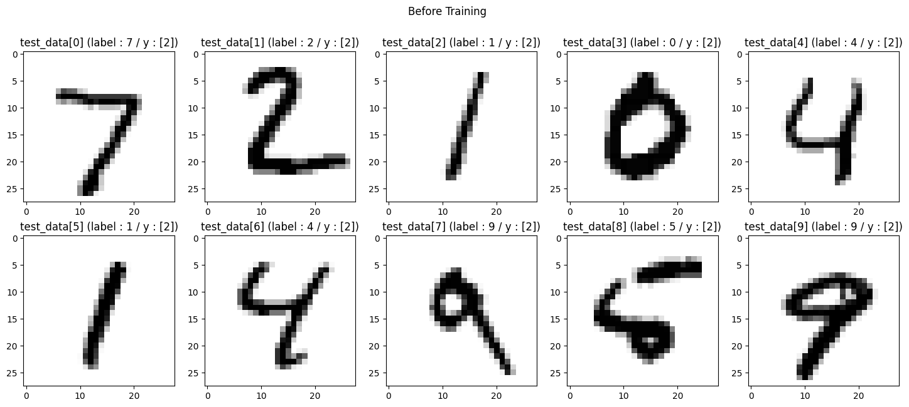
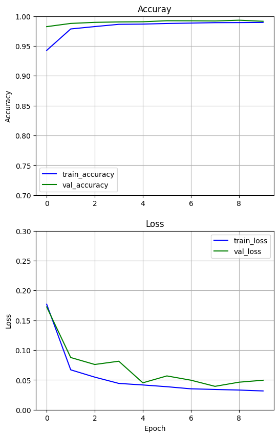

# CNN EX_03 예제 풀이 — ReLU와 드롭아웃 적용

[목차](../00_%EB%94%A5%EB%9F%AC%EB%8B%9D%EC%88%98%ED%95%99_MOC.md) · 개념: [D08_ReLU와_드롭아웃](../01_%EA%B0%9C%EB%85%90%EB%85%B8%ED%8A%B8/D08_ReLU%EC%99%80_%EB%93%9C%EB%A1%AD%EC%95%84%EC%9B%83.md) · 이전: [E09_CNN_3Conv_MNIST_예제](E09_CNN_3Conv_MNIST_%EC%98%88%EC%A0%9C.md)

> [!NOTE]
> **3줄 요약**
> - [E09_CNN_3Conv_MNIST_예제](E09_CNN_3Conv_MNIST_%EC%98%88%EC%A0%9C.md)와 구조는 같고 두 가지만 바꿨다: 활성화 함수를 시그모이드 → **ReLU**로, 합성곱 뒤마다 **Dropout(0.4)** 추가.
> - ReLU 덕분에 첫 바퀴부터 빨리 배우고(학습 정확도 49% → 88%), 드롭아웃 덕분에 학습 데이터에만 맞추는 것(과적합)이 줄어든다.
> - 결과: 시험 정확도 **99.15%** — MNIST 예제 4개 중 가장 높다.

## 0. 한눈에 보기

| 항목 | 내용 |
|---|---|
| 모델 | [Conv2D(64, 3×3, **relu**) → **Dropout(0.4)** → MaxPool] × 3 → Flatten → Dense(10, softmax) |
| 가중치 수 | 80,266개 (E09와 같음, 드롭아웃은 가중치가 없음) |
| 학습 | Adam, 10번, validation |
| 결과 | 시험 정확도 0.9825(1번째) → 0.9915(10번째) |

### E09와 바뀐 줄

```diff
- model.add(tf.keras.layers.Conv2D(filters=64, kernel_size=3, padding='same',activation='sigmoid'))
+ model.add(tf.keras.layers.Conv2D(filters=64, kernel_size=3, padding='same',activation='relu'))
+ model.add(tf.keras.layers.Dropout(rate=0.4))
  model.add(tf.keras.layers.MaxPool2D(pool_size=2, strides=2))
```

(이 묶음이 3번 반복된다. 나머지 코드는 E09와 같고, 특징 맵 그리기 셀만 없다.)

## 1. 셀별 풀이

### 1-1. 모델 만들기

```python
model = tf.keras.models.Sequential()
model.add(tf.keras.Input(shape=(28, 28, 1)))

# 1묶음
model.add(tf.keras.layers.Conv2D(filters=64, kernel_size=3, padding='same',activation='relu'))  # 활성화: ReLU
model.add(tf.keras.layers.Dropout(rate=0.4))                 # 학습 중에만 출력의 40%를 무작위로 0으로 끔
model.add(tf.keras.layers.MaxPool2D(pool_size=2, strides=2))

# 2묶음
model.add(tf.keras.layers.Conv2D(filters=64, kernel_size=3, padding='same',activation='relu'))
model.add(tf.keras.layers.Dropout(rate=0.4))
model.add(tf.keras.layers.MaxPool2D(pool_size=2, strides=2))

# 3묶음
model.add(tf.keras.layers.Conv2D(filters=64, kernel_size=3, padding='same',activation='relu'))
model.add(tf.keras.layers.Dropout(rate=0.4))
model.add(tf.keras.layers.MaxPool2D(pool_size=2, strides=2))

model.add(tf.keras.layers.Flatten())
model.add(tf.keras.layers.Dense(10, activation='softmax'))

model.summary()
```

**실행 결과** (일부):

```
│ conv2d (Conv2D)                 │ (None, 28, 28, 64)     │           640 │
│ dropout (Dropout)               │ (None, 28, 28, 64)     │             0 │
...
│ flatten (Flatten)               │ (None, 576)            │             0 │
│ dense (Dense)                   │ (None, 10)             │         5,770 │
 Total params: 80,266 (313.54 KB)
```

- Dropout 층은 모양을 바꾸지 않고(28, 28, 64 그대로) 가중치도 없다(Param 0).

> [!TIP]
> **ReLU: 음수는 0, 양수는 그대로**
> $\text{ReLU}(x) = \max(0, x)$
>
> | 넣는 값 | −2 | −0.5 | 0 | 1.5 | 3 |
> |---|---|---|---|---|---|
> | ReLU 결과 | 0 | 0 | 0 | 1.5 | 3 |
>
> C로 쓰면 `y = (x > 0) ? x : 0;` 한 줄이다. [M01_함수와_일차함수](../02_%EC%88%98%ED%95%99%EB%85%B8%ED%8A%B8/M01_%ED%95%A8%EC%88%98%EC%99%80_%EC%9D%BC%EC%B0%A8%ED%95%A8%EC%88%98.md)의 계단 함수처럼 "넣으면 나오는" 함수인데, 양수 쪽이 계단이 아니라 직선이다.

> [!TIP]
> **왜 시그모이드보다 빨리 배우나**
> 학습은 기울기([M03_미분_기울기](../02_%EC%88%98%ED%95%99%EB%85%B8%ED%8A%B8/M03_%EB%AF%B8%EB%B6%84_%EA%B8%B0%EC%9A%B8%EA%B8%B0.md))만큼 가중치를 고치는 일이다. 시그모이드는 S자의 양 끝이 평평해서 기울기가 작다.
>
> | 넣는 값 | 0 | 2 | 5 |
> |---|---|---|---|
> | 시그모이드의 기울기 | 0.25 | 0.105 | 0.0066 |
> | ReLU의 기울기 | (양수면 항상) 1 | 1 | 1 |
>
> 층을 여러 개 거치면 이 작은 기울기가 곱해지면서 더 작아진다(곱해지는 이유는 [M04_편미분](../02_%EC%88%98%ED%95%99%EB%85%B8%ED%8A%B8/M04_%ED%8E%B8%EB%AF%B8%EB%B6%84.md)의 "겉 미분 × 속 미분"). 그래서 시그모이드를 쌓으면 앞쪽 층이 잘 안 배운다. ReLU는 양수 쪽 기울기가 1이라 이 문제가 덜하다.

> [!TIP]
> **드롭아웃: 일부러 일부를 끄고 공부시키기**
> 학습할 때마다 출력의 40%를 무작위로 0으로 만든다. 모델이 특정 몇 개 값에만 기대지 못하고 여러 단서를 고루 쓰게 된다.
>
> 비유: 팀 과제에서 매번 무작위로 40%가 빠진다면, 남은 사람 누구라도 일을 할 수 있게 모두가 배워 둬야 한다.
>
> - **학습 때만** 끈다. 시험(`predict`, `evaluate`, validation) 때는 전부 켠다.
> - 끄는 동안 합이 줄어드는 걸 막으려고, 남은 값은 1 ÷ (1 − 0.4) ≈ 1.67배로 키워서 넘긴다(Keras가 자동으로 함).

### 1-2. 컴파일·결과 함수·학습 전

[E08_CNN_1Conv_MNIST_예제](E08_CNN_1Conv_MNIST_%EC%98%88%EC%A0%9C.md) 1-3 ~ 1-5와 같은 코드다.



학습 전에는 10장 모두 2라고 예측한다.

### 1-3. 학습

```python
%%time
history = model.fit(train_data, train_labels, shuffle=True,
                 epochs=10, validation_data=(test_data, test_labels))
```

| Epoch | 학습 정확도 | 학습 loss | 시험 정확도 (val) | 시험 loss (val) |
|---|---|---|---|---|
| 1 | 0.8756 | 0.3751 | 0.9825 | 0.1725 |
| 2 | 0.9765 | 0.0722 | 0.9879 | 0.0876 |
| 3 | 0.9823 | 0.0565 | 0.9897 | 0.0759 |
| 5 | 0.9872 | 0.0398 | 0.9907 | 0.0452 |
| 7 | 0.9891 | 0.0333 | 0.9923 | 0.0496 |
| 9 | 0.9891 | 0.0334 | 0.9933 | 0.0462 |
| 10 | 0.9904 | 0.0305 | 0.9915 | 0.0495 |

- 1번째 바퀴 학습 정확도: E09(시그모이드) 0.4930 → 이번(ReLU) **0.8756**. 처음부터 빨리 배운다.
- **모든 바퀴에서 시험 정확도가 학습 정확도보다 높다.** 학습 때는 40%를 끈 채로 풀고, 시험 때는 다 켜고 풀기 때문이다. 일부러 어렵게 연습한 셈이다.

### 1-4. 그래프

[E09_CNN_3Conv_MNIST_예제](E09_CNN_3Conv_MNIST_%EC%98%88%EC%A0%9C.md) 1-5와 같은 코드다.



### 1-5. 학습 후


앞 10장을 모두 맞혔다.

## 2. MNIST 예제 4개 비교

| 예제 | 모델 | 가중치 수 | 학습 | 시험 정확도 |
|---|---|---|---|---|
| [E07_MNIST_분류_예제](E07_MNIST_%EB%B6%84%EB%A5%98_%EC%98%88%EC%A0%9C.md) | Flatten → Dense(10) | 7,850 | 5번 | 0.9257 |
| [E08_CNN_1Conv_MNIST_예제](E08_CNN_1Conv_MNIST_%EC%98%88%EC%A0%9C.md) | 합성곱 1층(32, sigmoid) | 63,050 | 10번 | 0.9710 |
| [E09_CNN_3Conv_MNIST_예제](E09_CNN_3Conv_MNIST_%EC%98%88%EC%A0%9C.md) | 합성곱 3층(64, sigmoid) | 80,266 | 10번 | 0.9889 |
| **E10 (이 노트)** | 합성곱 3층(64, **ReLU + Dropout**) | 80,266 | 10번 | **0.9915** |

- 합성곱을 넣고(+4.5%p), 층을 쌓고(+1.8%p), ReLU·드롭아웃으로 다듬을수록(+0.3%p) 올라간다.
- E09와 E10은 가중치 수가 같다. **같은 크기의 모델도 활성화 함수와 학습 방식에 따라 결과가 달라진다.**

> E07만 5번 학습했으므로 완전히 같은 조건의 비교는 아니다.

## 3. 이 예제에서 새로 나온 것

| 이름 | 뜻 | 관련 노트 |
|---|---|---|
| `activation='relu'` | 음수는 0, 양수는 그대로 | [M01_함수와_일차함수](../02_%EC%88%98%ED%95%99%EB%85%B8%ED%8A%B8/M01_%ED%95%A8%EC%88%98%EC%99%80_%EC%9D%BC%EC%B0%A8%ED%95%A8%EC%88%98.md) |
| 기울기가 작아지는 문제 | 시그모이드를 쌓으면 앞쪽 층이 잘 안 배움 | [M03_미분_기울기](../02_%EC%88%98%ED%95%99%EB%85%B8%ED%8A%B8/M03_%EB%AF%B8%EB%B6%84_%EA%B8%B0%EC%9A%B8%EA%B8%B0.md), [M04_편미분](../02_%EC%88%98%ED%95%99%EB%85%B8%ED%8A%B8/M04_%ED%8E%B8%EB%AF%B8%EB%B6%84.md) |
| `Dropout(rate=0.4)` | 학습 중에만 40%를 무작위로 끔 | |
| 과적합 방지 | 학습 데이터에만 맞추는 것을 줄임 | [E09_CNN_3Conv_MNIST_예제](E09_CNN_3Conv_MNIST_%EC%98%88%EC%A0%9C.md) |

## 4. 스스로 확인

<details><summary>1. ReLU(−7)과 ReLU(4)는?</summary>

**0**과 **4**

</details>

<details><summary>2. Dropout(rate=0.5)면 남은 값은 몇 배로 키우나?</summary>

1 ÷ (1 − 0.5) = **2배**

</details>

<details><summary>3. 드롭아웃을 넣었더니 학습 정확도가 시험 정확도보다 낮아졌다. 문제인가?</summary>

아니다. 학습 때만 일부를 끄고 풀기 때문에 생기는 **정상적인 현상**이다.

</details>

