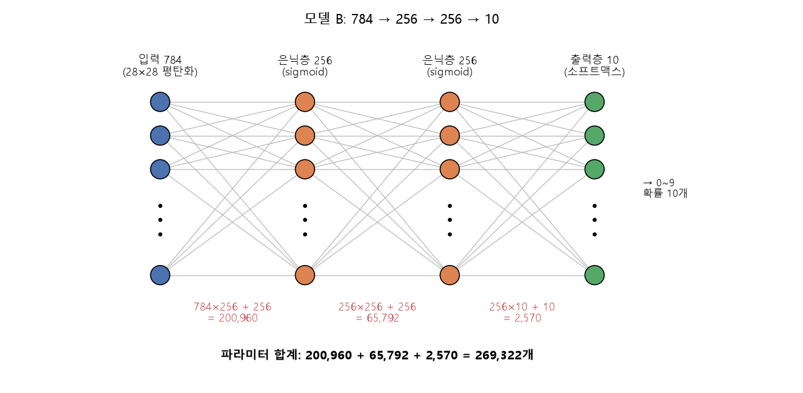
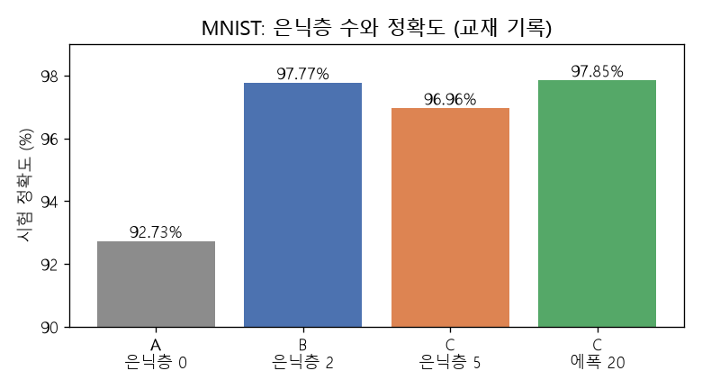

# EX\_07 변형 풀이 — 은닉층을 쌓은 MNIST 분류

[목차](../00_%EB%94%A5%EB%9F%AC%EB%8B%9D%EC%88%98%ED%95%99_MOC.md) · 개념: [D13_데이터나누기와_과적합](../01_%EA%B0%9C%EB%85%90%EB%85%B8%ED%8A%B8/D13_%EB%8D%B0%EC%9D%B4%ED%84%B0%EB%82%98%EB%88%84%EA%B8%B0%EC%99%80_%EA%B3%BC%EC%A0%81%ED%95%A9.md), [D06_이미지분류와_MNIST](../01_%EA%B0%9C%EB%85%90%EB%85%B8%ED%8A%B8/D06_%EC%9D%B4%EB%AF%B8%EC%A7%80%EB%B6%84%EB%A5%98%EC%99%80_MNIST.md) · 기본 예제: [E07_MNIST_분류_예제](../03_%EC%98%88%EC%A0%9C%ED%92%80%EC%9D%B4/E07_MNIST_%EB%B6%84%EB%A5%98_%EC%98%88%EC%A0%9C.md) · 다음에 볼 것: [E10_CNN_ReLU_Dropout_예제](../03_%EC%98%88%EC%A0%9C%ED%92%80%EC%9D%B4/E10_CNN_ReLU_Dropout_%EC%98%88%EC%A0%9C.md)

> [!NOTE]
> **3줄 요약**
> - EX\_07의 한 층짜리 모델([파라미터](../00_%EB%94%A5%EB%9F%AC%EB%8B%9D_%EC%9A%A9%EC%96%B4%EC%82%AC%EC%A0%84.md#parameter-%ED%8C%8C%EB%9D%BC%EB%AF%B8%ED%84%B0) 7,850개)에 [은닉층](../00_%EB%94%A5%EB%9F%AC%EB%8B%9D_%EC%9A%A9%EC%96%B4%EC%82%AC%EC%A0%84.md#hidden-layer-%EC%9D%80%EB%8B%89%EC%B8%B5)(중간층) `Dense(256, sigmoid)`를 2개 끼우면 [파라미터](../00_%EB%94%A5%EB%9F%AC%EB%8B%9D_%EC%9A%A9%EC%96%B4%EC%82%AC%EC%A0%84.md#parameter-%ED%8C%8C%EB%9D%BC%EB%AF%B8%ED%84%B0)가 **269,322개**가 되고, 교재에 기록된 시험 [정확도](../00_%EB%94%A5%EB%9F%AC%EB%8B%9D_%EC%9A%A9%EC%96%B4%EC%82%AC%EC%A0%84.md#accuracy-%EC%A0%95%ED%99%95%EB%8F%84)가 92.73% → **97.77%**로 오른다.
> - [은닉층](../00_%EB%94%A5%EB%9F%AC%EB%8B%9D_%EC%9A%A9%EC%96%B4%EC%82%AC%EC%A0%84.md#hidden-layer-%EC%9D%80%EB%8B%89%EC%B8%B5)을 5개로 늘리면([파라미터](../00_%EB%94%A5%EB%9F%AC%EB%8B%9D_%EC%9A%A9%EC%96%B4%EC%82%AC%EC%A0%84.md#parameter-%ED%8C%8C%EB%9D%BC%EB%AF%B8%ED%84%B0) **466,698개**) 같은 조건에서는 오히려 96.96%로 내려간다. [에폭](../00_%EB%94%A5%EB%9F%AC%EB%8B%9D_%EC%9A%A9%EC%96%B4%EC%82%AC%EC%A0%84.md#epoch-%EC%97%90%ED%8F%AD)을 5에서 20으로 늘려야 97.85%가 된다. [층](../00_%EB%94%A5%EB%9F%AC%EB%8B%9D_%EC%9A%A9%EC%96%B4%EC%82%AC%EC%A0%84.md#layer-%EC%B8%B5)을 쌓는다고 항상 좋아지는 것은 아니다.
> - 이 노트의 [학습](../00_%EB%94%A5%EB%9F%AC%EB%8B%9D_%EC%9A%A9%EC%96%B4%EC%82%AC%EC%A0%84.md#training-%ED%95%99%EC%8A%B5)·평가 숫자는 **교재에 기록된 결과**를 옮긴 것이고 여기서 직접 돌린 것이 아니다. [파라미터](../00_%EB%94%A5%EB%9F%AC%EB%8B%9D_%EC%9A%A9%EC%96%B4%EC%82%AC%EC%A0%84.md#parameter-%ED%8C%8C%EB%9D%BC%EB%AF%B8%ED%84%B0) 수와 비율은 직접 계산해 확인했다.

## 0. 예제 개요

| 항목 | 내용 |
|---|---|
| 데이터 | [MNIST](../00_%EB%94%A5%EB%9F%AC%EB%8B%9D_%EC%9A%A9%EC%96%B4%EC%82%AC%EC%A0%84.md#mnist-%EC%86%90%EA%B8%80%EC%94%A8-%EC%88%AB%EC%9E%90-%EB%8D%B0%EC%9D%B4%ED%84%B0%EC%85%8B): 학습용 60,000장, 시험용 10,000장, 각 28×28 흑백 ([E07_MNIST_분류_예제](../03_%EC%98%88%EC%A0%9C%ED%92%80%EC%9D%B4/E07_MNIST_%EB%B6%84%EB%A5%98_%EC%98%88%EC%A0%9C.md)와 같음) |
| 바꾼 것 | `Flatten`과 출력 `Dense(10, softmax)` 사이에 `Dense(256, sigmoid)` [은닉층](../00_%EB%94%A5%EB%9F%AC%EB%8B%9D_%EC%9A%A9%EC%96%B4%EC%82%AC%EC%A0%84.md#hidden-layer-%EC%9D%80%EB%8B%89%EC%B8%B5)을 넣는 개수 |
| [손실 함수](../00_%EB%94%A5%EB%9F%AC%EB%8B%9D_%EC%9A%A9%EC%96%B4%EC%82%AC%EC%A0%84.md#loss-function-%EC%86%90%EC%8B%A4-%ED%95%A8%EC%88%98) | `sparse_categorical_crossentropy` ([정답](../00_%EB%94%A5%EB%9F%AC%EB%8B%9D_%EC%9A%A9%EC%96%B4%EC%82%AC%EC%A0%84.md#label-%EC%A0%95%EB%8B%B5)이 숫자 그대로) |
| 최적화 | `adam` |
| 비교할 모델 | A: [은닉층](../00_%EB%94%A5%EB%9F%AC%EB%8B%9D_%EC%9A%A9%EC%96%B4%EC%82%AC%EC%A0%84.md#hidden-layer-%EC%9D%80%EB%8B%89%EC%B8%B5) 0개 / B: [은닉층](../00_%EB%94%A5%EB%9F%AC%EB%8B%9D_%EC%9A%A9%EC%96%B4%EC%82%AC%EC%A0%84.md#hidden-layer-%EC%9D%80%EB%8B%89%EC%B8%B5) 2개 / C: [은닉층](../00_%EB%94%A5%EB%9F%AC%EB%8B%9D_%EC%9A%A9%EC%96%B4%EC%82%AC%EC%A0%84.md#hidden-layer-%EC%9D%80%EB%8B%89%EC%B8%B5) 5개 (C는 [에폭](../00_%EB%94%A5%EB%9F%AC%EB%8B%9D_%EC%9A%A9%EC%96%B4%EC%82%AC%EC%A0%84.md#epoch-%EC%97%90%ED%8F%AD) 5와 20 두 번) |
| 결과 | 시험 [정확도](../00_%EB%94%A5%EB%9F%AC%EB%8B%9D_%EC%9A%A9%EC%96%B4%EC%82%AC%EC%A0%84.md#accuracy-%EC%A0%95%ED%99%95%EB%8F%84) A 92.73%, B 97.77%, C(5에폭) 96.96%, C(20에폭) 97.85% (모두 교재 기록) |

### 모델 구조 한눈에

| 모델 | [층](../00_%EB%94%A5%EB%9F%AC%EB%8B%9D_%EC%9A%A9%EC%96%B4%EC%82%AC%EC%A0%84.md#layer-%EC%B8%B5) 구성 | [파라미터](../00_%EB%94%A5%EB%9F%AC%EB%8B%9D_%EC%9A%A9%EC%96%B4%EC%82%AC%EC%A0%84.md#parameter-%ED%8C%8C%EB%9D%BC%EB%AF%B8%ED%84%B0) 수 |
|---|---|---|
| A | 784 → 10 | 7,850 |
| B | 784 → 256 → 256 → 10 | 269,322 |
| C | 784 → 256 → 256 → 256 → 256 → 256 → 10 | 466,698 |

> [!WARNING]
> **⚠ 이 노트의 숫자 출처**
> - **교재에 기록된 결과**: 모델 A·B·C의 `evaluate` 값, 모델 A의 에폭별 [정확도](../00_%EB%94%A5%EB%9F%AC%EB%8B%9D_%EC%9A%A9%EC%96%B4%EC%82%AC%EC%A0%84.md#accuracy-%EC%A0%95%ED%99%95%EB%8F%84)·[손실](../00_%EB%94%A5%EB%9F%AC%EB%8B%9D_%EC%9A%A9%EC%96%B4%EC%82%AC%EC%A0%84.md#loss-function-%EC%86%90%EC%8B%A4-%ED%95%A8%EC%88%98), 모델 B의 `summary` [파라미터](../00_%EB%94%A5%EB%9F%AC%EB%8B%9D_%EC%9A%A9%EC%96%B4%EC%82%AC%EC%A0%84.md#parameter-%ED%8C%8C%EB%9D%BC%EB%AF%B8%ED%84%B0) 수.
> - **직접 계산한 값**: [파라미터](../00_%EB%94%A5%EB%9F%AC%EB%8B%9D_%EC%9A%A9%EC%96%B4%EC%82%AC%EC%A0%84.md#parameter-%ED%8C%8C%EB%9D%BC%EB%AF%B8%ED%84%B0) 수 계산, 모델 C의 `summary` 예상표, 틀린 그림 수, 비율. [학습](../00_%EB%94%A5%EB%9F%AC%EB%8B%9D_%EC%9A%A9%EC%96%B4%EC%82%AC%EC%A0%84.md#training-%ED%95%99%EC%8A%B5)은 다시 돌리지 않았다.
> - [E07_MNIST_분류_예제](../03_%EC%98%88%EC%A0%9C%ED%92%80%EC%9D%B4/E07_MNIST_%EB%B6%84%EB%A5%98_%EC%98%88%EC%A0%9C.md)에는 따로 돌린 기록(시험 [정확도](../00_%EB%94%A5%EB%9F%AC%EB%8B%9D_%EC%9A%A9%EC%96%B4%EC%82%AC%EC%A0%84.md#accuracy-%EC%A0%95%ED%99%95%EB%8F%84) 92.57%)이 있고, 교재 기록(92.73%)과 조금 다르다. 초기 [가중치](../00_%EB%94%A5%EB%9F%AC%EB%8B%9D_%EC%9A%A9%EC%96%B4%EC%82%AC%EC%A0%84.md#weight-%EA%B0%80%EC%A4%91%EC%B9%98)와 섞는 순서가 매번 다르기 때문에 같은 코드도 돌릴 때마다 소수점 둘째 자리쯤은 흔들린다.

## 1. 셀별 풀이

### 1-1. 데이터 불러오기

```python
import numpy as np
import tensorflow as tf
from tensorflow.keras.datasets import mnist

(train_data, train_labels), (test_data, test_labels) = mnist.load_data()   # 학습용·시험용 (그림, 정답) 네 덩어리
print("Shape : {}".format(train_data.shape))      # 학습 그림
print("Shape : {}".format(test_labels.shape))     # 시험 정답
```

**교재에 기록된 결과** (그림 10장을 무작위로 보여 주는 셀이 이어진다):

```text
Shape : (60000, 28, 28)
Shape : (10000,)
```

- [학습](../00_%EB%94%A5%EB%9F%AC%EB%8B%9D_%EC%9A%A9%EC%96%B4%EC%82%AC%EC%A0%84.md#training-%ED%95%99%EC%8A%B5) 그림은 `(60000, 28, 28)`: 28×28 표가 6만 장이다.
- 시험 [정답](../00_%EB%94%A5%EB%9F%AC%EB%8B%9D_%EC%9A%A9%EC%96%B4%EC%82%AC%EC%A0%84.md#label-%EC%A0%95%EB%8B%B5)은 `(10000,)`: 숫자 하나씩 1만 개다. 이 1만 장은 [학습](../00_%EB%94%A5%EB%9F%AC%EB%8B%9D_%EC%9A%A9%EC%96%B4%EC%82%AC%EC%A0%84.md#training-%ED%95%99%EC%8A%B5)에 한 번도 쓰이지 않는다([D13_데이터나누기와_과적합](../01_%EA%B0%9C%EB%85%90%EB%85%B8%ED%8A%B8/D13_%EB%8D%B0%EC%9D%B4%ED%84%B0%EB%82%98%EB%88%84%EA%B8%B0%EC%99%80_%EA%B3%BC%EC%A0%81%ED%95%A9.md)의 [시험 데이터](../00_%EB%94%A5%EB%9F%AC%EB%8B%9D_%EC%9A%A9%EC%96%B4%EC%82%AC%EC%A0%84.md#training-data-test-data-%ED%95%99%EC%8A%B5-%EB%8D%B0%EC%9D%B4%ED%84%B0%EC%99%80-%EC%8B%9C%ED%97%98-%EB%8D%B0%EC%9D%B4%ED%84%B0)).
- 자세한 해설은 [E07_MNIST_분류_예제](../03_%EC%98%88%EC%A0%9C%ED%92%80%EC%9D%B4/E07_MNIST_%EB%B6%84%EB%A5%98_%EC%98%88%EC%A0%9C.md) 1-2절과 같다.

### 1-2. 픽셀 값을 0~1로 바꾸기

```python
train_data, test_data = train_data / 255.0, test_data / 255.0    # 0~255를 0~1로
```

- 0 → 0.0, 128 → 0.502, 255 → 1.0 (128 ÷ 255 = 0.50196…)
- [시험 데이터](../00_%EB%94%A5%EB%9F%AC%EB%8B%9D_%EC%9A%A9%EC%96%B4%EC%82%AC%EC%A0%84.md#training-data-test-data-%ED%95%99%EC%8A%B5-%EB%8D%B0%EC%9D%B4%ED%84%B0%EC%99%80-%EC%8B%9C%ED%97%98-%EB%8D%B0%EC%9D%B4%ED%84%B0)도 반드시 같이 나눈다. 안 나누면 [학습](../00_%EB%94%A5%EB%9F%AC%EB%8B%9D_%EC%9A%A9%EC%96%B4%EC%82%AC%EC%A0%84.md#training-%ED%95%99%EC%8A%B5) 때와 다른 크기의 숫자가 들어가서 점수가 크게 떨어진다.

### 1-3. 모델 A: EX\_07 기본 (은닉층 0개)

```python
model = tf.keras.models.Sequential([
    tf.keras.Input(shape=(28,28)),                     # 입력: 28×28 그림 한 장
    tf.keras.layers.Flatten(),                         # 한 줄 784칸으로 펴기
    tf.keras.layers.Dense(10, activation='softmax')    # 출력 10개 = 숫자 0~9의 확률
])
model.summary()

model.compile(optimizer='adam',
              loss='sparse_categorical_crossentropy',
              metrics=['accuracy'])
history = model.fit(train_data, train_labels, epochs=5)    # 6만 장을 5에폭
model.evaluate(test_data, test_labels)                     # 시험 1만 장 → [손실, 정확도]
```

**교재에 기록된 결과** (일부):

```text
│ flatten (Flatten)               │ (None, 784)            │             0 │
│ dense (Dense)                   │ (None, 10)             │         7,850 │
 Total params: 7,850 (30.66 KB)

Epoch 1/5   accuracy: 0.8166 - loss: 0.7188
Epoch 2/5   accuracy: 0.9155 - loss: 0.3067
...
Epoch 5/5   accuracy: 0.9274 - loss: 0.2566

[0.2661183476448059, 0.927299976348877]
```

- [파라미터](../00_%EB%94%A5%EB%9F%AC%EB%8B%9D_%EC%9A%A9%EC%96%B4%EC%82%AC%EC%A0%84.md#parameter-%ED%8C%8C%EB%9D%BC%EB%AF%B8%ED%84%B0) 수: [가중치](../00_%EB%94%A5%EB%9F%AC%EB%8B%9D_%EC%9A%A9%EC%96%B4%EC%82%AC%EC%A0%84.md#weight-%EA%B0%80%EC%A4%91%EC%B9%98) 784 × 10 = 7,840, [편향](../00_%EB%94%A5%EB%9F%AC%EB%8B%9D_%EC%9A%A9%EC%96%B4%EC%82%AC%EC%A0%84.md#bias-%ED%8E%B8%ED%96%A5) 10, 합계 **7,850**.
- 한 [에폭](../00_%EB%94%A5%EB%9F%AC%EB%8B%9D_%EC%9A%A9%EC%96%B4%EC%82%AC%EC%A0%84.md#epoch-%EC%97%90%ED%8F%AD)에 60,000 ÷ 32 = 1875번 고친다(`Epoch 1/5`의 `1875/1875`). 5에폭이면 1875 × 5 = 9,375번이다.
- `evaluate`가 돌려주는 값은 `[손실, 정확도]`다. 시험 [정확도](../00_%EB%94%A5%EB%9F%AC%EB%8B%9D_%EC%9A%A9%EC%96%B4%EC%82%AC%EC%A0%84.md#accuracy-%EC%A0%95%ED%99%95%EB%8F%84) 0.9273 = **92.73%**, 1만 장 중 9,273장을 맞혔고 727장 틀렸다.

### 1-4. 모델 B: 은닉층 2개 (`Dense(256, sigmoid)` × 2)

```python
model = tf.keras.models.Sequential([
    tf.keras.Input(shape=(28,28)),
    tf.keras.layers.Flatten(),
    tf.keras.layers.Dense(256, activation='sigmoid'),    # 은닉층 1: 784 → 256
    tf.keras.layers.Dense(256, activation='sigmoid'),    # 은닉층 2: 256 → 256
    tf.keras.layers.Dense(10, activation='softmax')      # 출력층: 256 → 10
])
model.summary()
# compile, fit(epochs=5), evaluate는 모델 A와 같다 (교재 기록상 5에폭으로 보인다)
```

**교재에 기록된 결과**:

```text
│ flatten (Flatten)               │ (None, 784)            │             0 │
│ dense (Dense)                   │ (None, 256)            │       200,960 │
│ dense_1 (Dense)                 │ (None, 256)            │        65,792 │
│ dense_2 (Dense)                 │ (None, 10)             │         2,570 │
 Total params: 269,322 (1.03 MB)

[0.07707995921373367, 0.9776999950408936]
```

[층](../00_%EB%94%A5%EB%9F%AC%EB%8B%9D_%EC%9A%A9%EC%96%B4%EC%82%AC%EC%A0%84.md#layer-%EC%B8%B5)마다 손으로 계산하면 `파라미터 수 = 입력 수 × 출력 수 + 출력 수`([가중치](../00_%EB%94%A5%EB%9F%AC%EB%8B%9D_%EC%9A%A9%EC%96%B4%EC%82%AC%EC%A0%84.md#weight-%EA%B0%80%EC%A4%91%EC%B9%98) + [편향](../00_%EB%94%A5%EB%9F%AC%EB%8B%9D_%EC%9A%A9%EC%96%B4%EC%82%AC%EC%A0%84.md#bias-%ED%8E%B8%ED%96%A5))다.

| [층](../00_%EB%94%A5%EB%9F%AC%EB%8B%9D_%EC%9A%A9%EC%96%B4%EC%82%AC%EC%A0%84.md#layer-%EC%B8%B5) | 입력 → 출력 | [가중치](../00_%EB%94%A5%EB%9F%AC%EB%8B%9D_%EC%9A%A9%EC%96%B4%EC%82%AC%EC%A0%84.md#weight-%EA%B0%80%EC%A4%91%EC%B9%98) | [편향](../00_%EB%94%A5%EB%9F%AC%EB%8B%9D_%EC%9A%A9%EC%96%B4%EC%82%AC%EC%A0%84.md#bias-%ED%8E%B8%ED%96%A5) | 합계 |
|---|---|---|---|---|
| dense | 784 → 256 | 784 × 256 = 200,704 | 256 | **200,960** |
| dense\_1 | 256 → 256 | 256 × 256 = 65,536 | 256 | **65,792** |
| dense\_2 | 256 → 10 | 256 × 10 = 2,560 | 10 | **2,570** |
| 합계 | | | | 200,960 + 65,792 + 2,570 = **269,322** |

- `summary`의 숫자와 같다. 원래 7,850개의 약 34.3배(269,322 ÷ 7,850 = 34.31)다.
- 시험 [정확도](../00_%EB%94%A5%EB%9F%AC%EB%8B%9D_%EC%9A%A9%EC%96%B4%EC%82%AC%EC%A0%84.md#accuracy-%EC%A0%95%ED%99%95%EB%8F%84) 0.9777 = **97.77%**, 틀린 그림은 223장이다. 모델 A(727장)보다 504장 적게 틀린다.



> [!NOTE]
> **97.76%와 97.77%**
> 교재 그림에는 `accuracy: 97.76%`라고 적혀 있다. `evaluate`가 돌려준 값은 `0.9776999950…`이라서 소수점 둘째 자리로 반올림하면 97.77%이고, 소수점 아래를 버리면 97.76%다. 표기 방식 차이로 보이고, 어느 쪽이든 1만 장 중 9,777장을 맞힌 것은 같다. 이 노트는 반올림해서 97.77%로 쓴다.

### 1-5. 모델 C: 은닉층 5개

```python
model = tf.keras.models.Sequential([
    tf.keras.Input(shape=(28,28)),
    tf.keras.layers.Flatten(),
    tf.keras.layers.Dense(256, activation='sigmoid'),    # 은닉층 1: 784 → 256
    tf.keras.layers.Dense(256, activation='sigmoid'),    # 은닉층 2
    tf.keras.layers.Dense(256, activation='sigmoid'),    # 은닉층 3
    tf.keras.layers.Dense(256, activation='sigmoid'),    # 은닉층 4
    tf.keras.layers.Dense(256, activation='sigmoid'),    # 은닉층 5
    tf.keras.layers.Dense(10, activation='softmax')      # 출력층: 256 → 10
])
```

[파라미터](../00_%EB%94%A5%EB%9F%AC%EB%8B%9D_%EC%9A%A9%EC%96%B4%EC%82%AC%EC%A0%84.md#parameter-%ED%8C%8C%EB%9D%BC%EB%AF%B8%ED%84%B0) 수는 교재에 기록이 없어서 직접 계산했다. [은닉층](../00_%EB%94%A5%EB%9F%AC%EB%8B%9D_%EC%9A%A9%EC%96%B4%EC%82%AC%EC%A0%84.md#hidden-layer-%EC%9D%80%EB%8B%89%EC%B8%B5) 2~5는 모두 `256 → 256`이라 65,792개씩이다.

| [층](../00_%EB%94%A5%EB%9F%AC%EB%8B%9D_%EC%9A%A9%EC%96%B4%EC%82%AC%EC%A0%84.md#layer-%EC%B8%B5) | 입력 → 출력 | 계산 | [파라미터](../00_%EB%94%A5%EB%9F%AC%EB%8B%9D_%EC%9A%A9%EC%96%B4%EC%82%AC%EC%A0%84.md#parameter-%ED%8C%8C%EB%9D%BC%EB%AF%B8%ED%84%B0) |
|---|---|---|---|
| dense | 784 → 256 | 784 × 256 + 256 | 200,960 |
| dense\_1 ~ dense\_4 | 256 → 256 (4개) | (256 × 256 + 256) × 4 = 65,792 × 4 | 263,168 |
| dense\_5 | 256 → 10 | 256 × 10 + 10 | 2,570 |
| 합계 | | 200,960 + 263,168 + 2,570 | **466,698** |

**계산으로 구한 `summary` 예상** (교재 기록이 아니다):

```text
│ flatten (Flatten)               │ (None, 784)            │             0 │
│ dense (Dense)                   │ (None, 256)            │       200,960 │
│ dense_1 (Dense)                 │ (None, 256)            │        65,792 │
│ dense_2 (Dense)                 │ (None, 256)            │        65,792 │
│ dense_3 (Dense)                 │ (None, 256)            │        65,792 │
│ dense_4 (Dense)                 │ (None, 256)            │        65,792 │
│ dense_5 (Dense)                 │ (None, 10)             │         2,570 │
 Total params: 466,698
```

- 모델 B(269,322개)보다 197,376개 많고(×1.73), 모델 A보다 약 59.5배(466,698 ÷ 7,850 = 59.45) 크다.
- **교재에 기록된 결과**: 시험 `[0.10346992313861847, 0.9696000218391418]` → [정확도](../00_%EB%94%A5%EB%9F%AC%EB%8B%9D_%EC%9A%A9%EC%96%B4%EC%82%AC%EC%A0%84.md#accuracy-%EC%A0%95%ED%99%95%EB%8F%84) **96.96%**, 틀린 그림 304장. 같은 5에폭 조건으로 보이는 모델 B(97.77%)보다 낮다.

### 1-6. 모델 C, 에폭 20으로 늘리기

교재는 "[학습](../00_%EB%94%A5%EB%9F%AC%EB%8B%9D_%EC%9A%A9%EC%96%B4%EC%82%AC%EC%A0%84.md#training-%ED%95%99%EC%8A%B5) 횟수가 부족한가?"라고 물으며 `epochs`만 20으로 늘렸다.

```python
history = model.fit(train_data, train_labels, epochs=20)     # 5 → 20에폭, 나머지는 같다
model.evaluate(test_data, test_labels)
```

**교재에 기록된 결과**:

```text
[0.13913984596729279, 0.9785000085830688]
```

- 시험 [정확도](../00_%EB%94%A5%EB%9F%AC%EB%8B%9D_%EC%9A%A9%EC%96%B4%EC%82%AC%EC%A0%84.md#accuracy-%EC%A0%95%ED%99%95%EB%8F%84) 0.9785 = **97.85%**, 틀린 그림은 215장이다.
- 고치는 횟수는 5에폭이면 1875 × 5 = 9,375번, 20에폭이면 1875 × 20 = 37,500번이다. 4배로 늘었다.
- [정확도](../00_%EB%94%A5%EB%9F%AC%EB%8B%9D_%EC%9A%A9%EC%96%B4%EC%82%AC%EC%A0%84.md#accuracy-%EC%A0%95%ED%99%95%EB%8F%84)는 96.96% → 97.85%로 0.89%p 올랐지만, 시험 **[손실](../00_%EB%94%A5%EB%9F%AC%EB%8B%9D_%EC%9A%A9%EC%96%B4%EC%82%AC%EC%A0%84.md#loss-function-%EC%86%90%EC%8B%A4-%ED%95%A8%EC%88%98)**은 0.1035 → 0.1391로 오히려 올랐다. [손실](../00_%EB%94%A5%EB%9F%AC%EB%8B%9D_%EC%9A%A9%EC%96%B4%EC%82%AC%EC%A0%84.md#loss-function-%EC%86%90%EC%8B%A4-%ED%95%A8%EC%88%98)과 [정확도](../00_%EB%94%A5%EB%9F%AC%EB%8B%9D_%EC%9A%A9%EC%96%B4%EC%82%AC%EC%A0%84.md#accuracy-%EC%A0%95%ED%99%95%EB%8F%84)가 같은 방향으로 움직이지 않을 수 있다. [손실](../00_%EB%94%A5%EB%9F%AC%EB%8B%9D_%EC%9A%A9%EC%96%B4%EC%82%AC%EC%A0%84.md#loss-function-%EC%86%90%EC%8B%A4-%ED%95%A8%EC%88%98)은 "[정답](../00_%EB%94%A5%EB%9F%AC%EB%8B%9D_%EC%9A%A9%EC%96%B4%EC%82%AC%EC%A0%84.md#label-%EC%A0%95%EB%8B%B5) [확률](../00_%EB%94%A5%EB%9F%AC%EB%8B%9D_%EC%9A%A9%EC%96%B4%EC%82%AC%EC%A0%84.md#probability-%ED%99%95%EB%A5%A0)을 얼마나 높게 줬는지"까지 반영하기 때문이다. [학습 기록](../00_%EB%94%A5%EB%9F%AC%EB%8B%9D_%EC%9A%A9%EC%96%B4%EC%82%AC%EC%A0%84.md#history-%ED%95%99%EC%8A%B5-%EA%B8%B0%EB%A1%9D)(에폭별 곡선)이 없어서 [과적합](../00_%EB%94%A5%EB%9F%AC%EB%8B%9D_%EC%9A%A9%EC%96%B4%EC%82%AC%EC%A0%84.md#overfitting-%EA%B3%BC%EC%A0%81%ED%95%A9) 때문인지는 이 기록만으로 단정할 수 없다([D13_데이터나누기와_과적합](../01_%EA%B0%9C%EB%85%90%EB%85%B8%ED%8A%B8/D13_%EB%8D%B0%EC%9D%B4%ED%84%B0%EB%82%98%EB%88%84%EA%B8%B0%EC%99%80_%EA%B3%BC%EC%A0%81%ED%95%A9.md)처럼 [검증](../00_%EB%94%A5%EB%9F%AC%EB%8B%9D_%EC%9A%A9%EC%96%B4%EC%82%AC%EC%A0%84.md#validation-data-%EA%B2%80%EC%A6%9D-%EB%8D%B0%EC%9D%B4%ED%84%B0) 데이터를 따로 두면 확인할 수 있다).

### 1-7. 네 결과 비교

| 모델 | [은닉층](../00_%EB%94%A5%EB%9F%AC%EB%8B%9D_%EC%9A%A9%EC%96%B4%EC%82%AC%EC%A0%84.md#hidden-layer-%EC%9D%80%EB%8B%89%EC%B8%B5) | [파라미터](../00_%EB%94%A5%EB%9F%AC%EB%8B%9D_%EC%9A%A9%EC%96%B4%EC%82%AC%EC%A0%84.md#parameter-%ED%8C%8C%EB%9D%BC%EB%AF%B8%ED%84%B0) 수 | [에폭](../00_%EB%94%A5%EB%9F%AC%EB%8B%9D_%EC%9A%A9%EC%96%B4%EC%82%AC%EC%A0%84.md#epoch-%EC%97%90%ED%8F%AD) | 시험 [손실](../00_%EB%94%A5%EB%9F%AC%EB%8B%9D_%EC%9A%A9%EC%96%B4%EC%82%AC%EC%A0%84.md#loss-function-%EC%86%90%EC%8B%A4-%ED%95%A8%EC%88%98) | 시험 [정확도](../00_%EB%94%A5%EB%9F%AC%EB%8B%9D_%EC%9A%A9%EC%96%B4%EC%82%AC%EC%A0%84.md#accuracy-%EC%A0%95%ED%99%95%EB%8F%84) | 틀린 그림 (1만 장 중) |
|---|---|---|---|---|---|---|
| A | 0개 | 7,850 | 5 | 0.2661 | 92.73% | 727 |
| B | 2개 | 269,322 | 5 (추정) | 0.0771 | 97.77% | 223 |
| C | 5개 | 466,698 | 5 (추정) | 0.1035 | 96.96% | 304 |
| C | 5개 | 466,698 | 20 | 0.1391 | 97.85% | 215 |

차이를 숫자로 보면 다음과 같다.

| 비교 | 계산 | 차이 |
|---|---|---|
| A → B ([은닉층](../00_%EB%94%A5%EB%9F%AC%EB%8B%9D_%EC%9A%A9%EC%96%B4%EC%82%AC%EC%A0%84.md#hidden-layer-%EC%9D%80%EB%8B%89%EC%B8%B5) 0 → 2) | 97.77 − 92.73 | **+5.04%p** (틀린 그림 727 → 223) |
| B → C (같은 [에폭](../00_%EB%94%A5%EB%9F%AC%EB%8B%9D_%EC%9A%A9%EC%96%B4%EC%82%AC%EC%A0%84.md#epoch-%EC%97%90%ED%8F%AD)에서 2 → 5층) | 96.96 − 97.77 | **−0.81%p** |
| C의 5에폭 → 20에폭 | 97.85 − 96.96 | +0.89%p |
| B(5에폭) vs C(20에폭) | 97.85 − 97.77 | +0.08%p (8장 차이) |



### 1-8. 해석

- **[은닉층](../00_%EB%94%A5%EB%9F%AC%EB%8B%9D_%EC%9A%A9%EC%96%B4%EC%82%AC%EC%A0%84.md#hidden-layer-%EC%9D%80%EB%8B%89%EC%B8%B5)을 넣으면 크게 좋아진다**: 0개 → 2개에서 +5.04%p. 한 층짜리는 784칸에 [가중치](../00_%EB%94%A5%EB%9F%AC%EB%8B%9D_%EC%9A%A9%EC%96%B4%EC%82%AC%EC%A0%84.md#weight-%EA%B0%80%EC%A4%91%EC%B9%98)를 곱해 더하는 것뿐이라 "이 칸이 진하면 7"처럼 단순한 규칙만 배운다. [은닉층](../00_%EB%94%A5%EB%9F%AC%EB%8B%9D_%EC%9A%A9%EC%96%B4%EC%82%AC%EC%A0%84.md#hidden-layer-%EC%9D%80%EB%8B%89%EC%B8%B5)이 있으면 칸들의 조합(가로줄이 있고 위가 둥글다 등)을 중간 단계로 만들 수 있다.
- **더 쌓는다고 계속 좋아지지는 않는다**: 같은 조건에서 5층이 2층보다 0.81%p 낮았다. [에폭](../00_%EB%94%A5%EB%9F%AC%EB%8B%9D_%EC%9A%A9%EC%96%B4%EC%82%AC%EC%A0%84.md#epoch-%EC%97%90%ED%8F%AD)을 20으로 늘려야 간신히 2층(5에폭) 수준을 넘었고, 그 차이도 8장(0.08%p)뿐이다. [층](../00_%EB%94%A5%EB%9F%AC%EB%8B%9D_%EC%9A%A9%EC%96%B4%EC%82%AC%EC%A0%84.md#layer-%EC%B8%B5)을 늘리면 학습해야 할 [파라미터](../00_%EB%94%A5%EB%9F%AC%EB%8B%9D_%EC%9A%A9%EC%96%B4%EC%82%AC%EC%A0%84.md#parameter-%ED%8C%8C%EB%9D%BC%EB%AF%B8%ED%84%B0)가 늘어서 같은 횟수로는 덜 배우고, 오래 돌려야 한다.
- **[시그모이드](../00_%EB%94%A5%EB%9F%AC%EB%8B%9D_%EC%9A%A9%EC%96%B4%EC%82%AC%EC%A0%84.md#sigmoid-%EC%8B%9C%EA%B7%B8%EB%AA%A8%EC%9D%B4%EB%93%9C) 때문일 수 있다**: [시그모이드](../00_%EB%94%A5%EB%9F%AC%EB%8B%9D_%EC%9A%A9%EC%96%B4%EC%82%AC%EC%A0%84.md#sigmoid-%EC%8B%9C%EA%B7%B8%EB%AA%A8%EC%9D%B4%EB%93%9C)의 [기울기](../00_%EB%94%A5%EB%9F%AC%EB%8B%9D_%EC%9A%A9%EC%96%B4%EC%82%AC%EC%A0%84.md#gradient-%EA%B8%B0%EC%9A%B8%EA%B8%B0)는 최대 0.25라서 [층](../00_%EB%94%A5%EB%9F%AC%EB%8B%9D_%EC%9A%A9%EC%96%B4%EC%82%AC%EC%A0%84.md#layer-%EC%B8%B5)마다 곱해지면 작아진다. [기울기 소실](../00_%EB%94%A5%EB%9F%AC%EB%8B%9D_%EC%9A%A9%EC%96%B4%EC%82%AC%EC%A0%84.md#vanishing-gradient-%EA%B8%B0%EC%9A%B8%EA%B8%B0-%EC%86%8C%EC%8B%A4)이다([D08_ReLU와_드롭아웃](../01_%EA%B0%9C%EB%85%90%EB%85%B8%ED%8A%B8/D08_ReLU%EC%99%80_%EB%93%9C%EB%A1%AD%EC%95%84%EC%9B%83.md)). 신호가 지나는 [시그모이드](../00_%EB%94%A5%EB%9F%AC%EB%8B%9D_%EC%9A%A9%EC%96%B4%EC%82%AC%EC%A0%84.md#sigmoid-%EC%8B%9C%EA%B7%B8%EB%AA%A8%EC%9D%B4%EB%93%9C)의 수를 세면 [은닉층](../00_%EB%94%A5%EB%9F%AC%EB%8B%9D_%EC%9A%A9%EC%96%B4%EC%82%AC%EC%A0%84.md#hidden-layer-%EC%9D%80%EB%8B%89%EC%B8%B5) 2개일 때 0.25² = 0.0625, 5개일 때 0.25⁵ = 0.00098이다([가중치](../00_%EB%94%A5%EB%9F%AC%EB%8B%9D_%EC%9A%A9%EC%96%B4%EC%82%AC%EC%A0%84.md#weight-%EA%B0%80%EC%A4%91%EC%B9%98)는 무시한 단순 계산이고, 5층은 2층의 1/64). 앞쪽 [층](../00_%EB%94%A5%EB%9F%AC%EB%8B%9D_%EC%9A%A9%EC%96%B4%EC%82%AC%EC%A0%84.md#layer-%EC%B8%B5)이 거의 안 배운다는 설명과 방향이 맞는다.
- **단정은 이르다**: 모델 B와 C는 [층](../00_%EB%94%A5%EB%9F%AC%EB%8B%9D_%EC%9A%A9%EC%96%B4%EC%82%AC%EC%A0%84.md#layer-%EC%B8%B5) 수 말고 다른 조건도 완전히 같다고 확인되지 않았고, 각각 한 번씩 돌린 결과다. [시그모이드](../00_%EB%94%A5%EB%9F%AC%EB%8B%9D_%EC%9A%A9%EC%96%B4%EC%82%AC%EC%A0%84.md#sigmoid-%EC%8B%9C%EA%B7%B8%EB%AA%A8%EC%9D%B4%EB%93%9C)가 원인이라고 확인하려면 [활성화 함수](../00_%EB%94%A5%EB%9F%AC%EB%8B%9D_%EC%9A%A9%EC%96%B4%EC%82%AC%EC%A0%84.md#activation-function-%ED%99%9C%EC%84%B1%ED%99%94-%ED%95%A8%EC%88%98)를 `'relu'`로 바꿔 같은 실험을 해 봐야 한다([K02_Keras_예제모음](../04_Keras/K02_Keras_%EC%98%88%EC%A0%9C%EB%AA%A8%EC%9D%8C.md) 2절의 "볼 것", 이 실험은 아직 안 돌렸다). [층](../00_%EB%94%A5%EB%9F%AC%EB%8B%9D_%EC%9A%A9%EC%96%B4%EC%82%AC%EC%A0%84.md#layer-%EC%B8%B5)을 깊게 쌓아 좋은 결과를 낸 예는 [E10_CNN_ReLU_Dropout_예제](../03_%EC%98%88%EC%A0%9C%ED%92%80%EC%9D%B4/E10_CNN_ReLU_Dropout_%EC%98%88%EC%A0%9C.md)에서 볼 수 있다.

## 2. 새로 나온 개념

| 이름 | 뜻 | 관련 노트 |
|---|---|---|
| [은닉층](../00_%EB%94%A5%EB%9F%AC%EB%8B%9D_%EC%9A%A9%EC%96%B4%EC%82%AC%EC%A0%84.md#hidden-layer-%EC%9D%80%EB%8B%89%EC%B8%B5)(중간층) | [입력층](../00_%EB%94%A5%EB%9F%AC%EB%8B%9D_%EC%9A%A9%EC%96%B4%EC%82%AC%EC%A0%84.md#input-layer-%EC%9E%85%EB%A0%A5%EC%B8%B5)과 [출력층](../00_%EB%94%A5%EB%9F%AC%EB%8B%9D_%EC%9A%A9%EC%96%B4%EC%82%AC%EC%A0%84.md#output-layer-%EC%B6%9C%EB%A0%A5%EC%B8%B5) 사이의 [덴스 층](../00_%EB%94%A5%EB%9F%AC%EB%8B%9D_%EC%9A%A9%EC%96%B4%EC%82%AC%EC%A0%84.md#dense-layer-%EB%8D%B4%EC%8A%A4-%EC%B8%B5) | [D06_이미지분류와_MNIST](../01_%EA%B0%9C%EB%85%90%EB%85%B8%ED%8A%B8/D06_%EC%9D%B4%EB%AF%B8%EC%A7%80%EB%B6%84%EB%A5%98%EC%99%80_MNIST.md) |
| `Dense(256, activation='sigmoid')` | 256칸짜리 [덴스 층](../00_%EB%94%A5%EB%9F%AC%EB%8B%9D_%EC%9A%A9%EC%96%B4%EC%82%AC%EC%A0%84.md#dense-layer-%EB%8D%B4%EC%8A%A4-%EC%B8%B5), 활성화는 [시그모이드](../00_%EB%94%A5%EB%9F%AC%EB%8B%9D_%EC%9A%A9%EC%96%B4%EC%82%AC%EC%A0%84.md#sigmoid-%EC%8B%9C%EA%B7%B8%EB%AA%A8%EC%9D%B4%EB%93%9C) | [D05_소프트맥스와_다중분류](../01_%EA%B0%9C%EB%85%90%EB%85%B8%ED%8A%B8/D05_%EC%86%8C%ED%94%84%ED%8A%B8%EB%A7%A5%EC%8A%A4%EC%99%80_%EB%8B%A4%EC%A4%91%EB%B6%84%EB%A5%98.md) |
| [층](../00_%EB%94%A5%EB%9F%AC%EB%8B%9D_%EC%9A%A9%EC%96%B4%EC%82%AC%EC%A0%84.md#layer-%EC%B8%B5) 하나의 [파라미터](../00_%EB%94%A5%EB%9F%AC%EB%8B%9D_%EC%9A%A9%EC%96%B4%EC%82%AC%EC%A0%84.md#parameter-%ED%8C%8C%EB%9D%BC%EB%AF%B8%ED%84%B0) 수 | 입력 수 × 출력 수 + 출력 수 | [E07_MNIST_분류_예제](../03_%EC%98%88%EC%A0%9C%ED%92%80%EC%9D%B4/E07_MNIST_%EB%B6%84%EB%A5%98_%EC%98%88%EC%A0%9C.md) |
| [에폭](../00_%EB%94%A5%EB%9F%AC%EB%8B%9D_%EC%9A%A9%EC%96%B4%EC%82%AC%EC%A0%84.md#epoch-%EC%97%90%ED%8F%AD) / [미니배치](../00_%EB%94%A5%EB%9F%AC%EB%8B%9D_%EC%9A%A9%EC%96%B4%EC%82%AC%EC%A0%84.md#mini-batch-%EB%AF%B8%EB%8B%88%EB%B0%B0%EC%B9%98) | 전체를 한 번 보는 것 / 32장씩 묶어 고치기. 1에폭 = 1875번 | [D13_데이터나누기와_과적합](../01_%EA%B0%9C%EB%85%90%EB%85%B8%ED%8A%B8/D13_%EB%8D%B0%EC%9D%B4%ED%84%B0%EB%82%98%EB%88%84%EA%B8%B0%EC%99%80_%EA%B3%BC%EC%A0%81%ED%95%A9.md) |
| `model.evaluate` | [시험 데이터](../00_%EB%94%A5%EB%9F%AC%EB%8B%9D_%EC%9A%A9%EC%96%B4%EC%82%AC%EC%A0%84.md#training-data-test-data-%ED%95%99%EC%8A%B5-%EB%8D%B0%EC%9D%B4%ED%84%B0%EC%99%80-%EC%8B%9C%ED%97%98-%EB%8D%B0%EC%9D%B4%ED%84%B0)로 `[손실, 정확도]` 계산 | [E07_MNIST_분류_예제](../03_%EC%98%88%EC%A0%9C%ED%92%80%EC%9D%B4/E07_MNIST_%EB%B6%84%EB%A5%98_%EC%98%88%EC%A0%9C.md) |
| [기울기 소실](../00_%EB%94%A5%EB%9F%AC%EB%8B%9D_%EC%9A%A9%EC%96%B4%EC%82%AC%EC%A0%84.md#vanishing-gradient-%EA%B8%B0%EC%9A%B8%EA%B8%B0-%EC%86%8C%EC%8B%A4) | [시그모이드](../00_%EB%94%A5%EB%9F%AC%EB%8B%9D_%EC%9A%A9%EC%96%B4%EC%82%AC%EC%A0%84.md#sigmoid-%EC%8B%9C%EA%B7%B8%EB%AA%A8%EC%9D%B4%EB%93%9C)를 깊이 쌓으면 앞쪽 [층](../00_%EB%94%A5%EB%9F%AC%EB%8B%9D_%EC%9A%A9%EC%96%B4%EC%82%AC%EC%A0%84.md#layer-%EC%B8%B5)이 거의 안 배움 | [D08_ReLU와_드롭아웃](../01_%EA%B0%9C%EB%85%90%EB%85%B8%ED%8A%B8/D08_ReLU%EC%99%80_%EB%93%9C%EB%A1%AD%EC%95%84%EC%9B%83.md) |
| [과소적합](../00_%EB%94%A5%EB%9F%AC%EB%8B%9D_%EC%9A%A9%EC%96%B4%EC%82%AC%EC%A0%84.md#underfitting-%EA%B3%BC%EC%86%8C%EC%A0%81%ED%95%A9) / [과적합](../00_%EB%94%A5%EB%9F%AC%EB%8B%9D_%EC%9A%A9%EC%96%B4%EC%82%AC%EC%A0%84.md#overfitting-%EA%B3%BC%EC%A0%81%ED%95%A9) | 덜 배움 / 외움 | [D13_데이터나누기와_과적합](../01_%EA%B0%9C%EB%85%90%EB%85%B8%ED%8A%B8/D13_%EB%8D%B0%EC%9D%B4%ED%84%B0%EB%82%98%EB%88%84%EA%B8%B0%EC%99%80_%EA%B3%BC%EC%A0%81%ED%95%A9.md) |

## 3. 개념 재확인

<details><summary>1. 은닉층 <code>Dense(256, sigmoid)</code>가 3개인 모델의 파라미터 수는? (입력 784, 출력 <code>Dense(10)</code>)</summary>

| 단계 | 하는 일 | 코드 | 계산 | 결과 |
|---|---|---|---|---|
| 1 | 첫 [은닉층](../00_%EB%94%A5%EB%9F%AC%EB%8B%9D_%EC%9A%A9%EC%96%B4%EC%82%AC%EC%A0%84.md#hidden-layer-%EC%9D%80%EB%8B%89%EC%B8%B5) | `Dense(256)` | 784 × 256 + 256 | 200,960 |
| 2 | 나머지 [은닉층](../00_%EB%94%A5%EB%9F%AC%EB%8B%9D_%EC%9A%A9%EC%96%B4%EC%82%AC%EC%A0%84.md#hidden-layer-%EC%9D%80%EB%8B%89%EC%B8%B5) 2개 | `Dense(256)` × 2 | (256 × 256 + 256) × 2 | 131,584 |
| 3 | [출력층](../00_%EB%94%A5%EB%9F%AC%EB%8B%9D_%EC%9A%A9%EC%96%B4%EC%82%AC%EC%A0%84.md#output-layer-%EC%B6%9C%EB%A0%A5%EC%B8%B5) | `Dense(10)` | 256 × 10 + 10 | 2,570 |
| 4 | 합치기 | - | 200,960 + 131,584 + 2,570 | 335,114 |

**① 쓰는 코드**
```python
def dense(n_in, n_out):                  # ① 층 하나의 파라미터 수 = 입력 × 출력 + 출력
    return n_in * n_out + n_out
first = dense(784, 256)                  # ② 첫 은닉층
middle = dense(256, 256) * 2             # ③ 나머지 은닉층 2개
last = dense(256, 10)                    # ④ 출력층
print(first + middle + last)             # ⑤ 합계
```

**② 첫 [은닉층](../00_%EB%94%A5%EB%9F%AC%EB%8B%9D_%EC%9A%A9%EC%96%B4%EC%82%AC%EC%A0%84.md#hidden-layer-%EC%9D%80%EB%8B%89%EC%B8%B5)** (`dense(784, 256)`)
- [가중치](../00_%EB%94%A5%EB%9F%AC%EB%8B%9D_%EC%9A%A9%EC%96%B4%EC%82%AC%EC%A0%84.md#weight-%EA%B0%80%EC%A4%91%EC%B9%98) 784 × 256 = 200,704, [편향](../00_%EB%94%A5%EB%9F%AC%EB%8B%9D_%EC%9A%A9%EC%96%B4%EC%82%AC%EC%A0%84.md#bias-%ED%8E%B8%ED%96%A5) 256
- 200,704 + 256 = 200,960

**③ 나머지 [은닉층](../00_%EB%94%A5%EB%9F%AC%EB%8B%9D_%EC%9A%A9%EC%96%B4%EC%82%AC%EC%A0%84.md#hidden-layer-%EC%9D%80%EB%8B%89%EC%B8%B5) 2개** (`dense(256, 256) * 2`)
- [층](../00_%EB%94%A5%EB%9F%AC%EB%8B%9D_%EC%9A%A9%EC%96%B4%EC%82%AC%EC%A0%84.md#layer-%EC%B8%B5) 하나: 256 × 256 + 256 = 65,536 + 256 = 65,792
- 2개: 65,792 × 2 = 131,584

**④ [출력층](../00_%EB%94%A5%EB%9F%AC%EB%8B%9D_%EC%9A%A9%EC%96%B4%EC%82%AC%EC%A0%84.md#output-layer-%EC%B6%9C%EB%A0%A5%EC%B8%B5)** (`dense(256, 10)`)
- 256 × 10 + 10 = 2,570

**⑤ 합치기**
- 200,960 + 131,584 = 332,544
- 332,544 + 2,570 = 335,114
- 비교: [은닉층](../00_%EB%94%A5%EB%9F%AC%EB%8B%9D_%EC%9A%A9%EC%96%B4%EC%82%AC%EC%A0%84.md#hidden-layer-%EC%9D%80%EB%8B%89%EC%B8%B5) 2개(269,322)보다 65,792개 많다. [은닉층](../00_%EB%94%A5%EB%9F%AC%EB%8B%9D_%EC%9A%A9%EC%96%B4%EC%82%AC%EC%A0%84.md#hidden-layer-%EC%9D%80%EB%8B%89%EC%B8%B5)이 하나 늘 때마다 65,792개씩 는다

**답**: **335,114개**

</details>

<details><summary>2. 교재 기록에서 모델 C의 시험 정확도가 0.9696(5에폭)에서 0.9785(20에폭)로 올랐다. 1만 장 중 맞힌 그림은 몇 장 늘었나?</summary>

| 단계 | 하는 일 | 코드 | 계산 | 결과 |
|---|---|---|---|---|
| 1 | 5에폭 맞힌 수 | `round(10000 * 0.9696)` | 10000 × 0.9696 | 9,696 |
| 2 | 20에폭 맞힌 수 | `round(10000 * 0.9785)` | 10000 × 0.9785 | 9,785 |
| 3 | 차이 | `after - before` | 9,785 − 9,696 | 89 |
| 4 | 틀린 수로 확인 | `10000 - 맞힌 수` | 304 → 215 | 89장 줄었다 |

**① 쓰는 코드**
```python
n_test = 10000                           # ① 시험 그림 수
before = round(n_test * 0.9696)          # ② 5에폭: 맞힌 그림 수
after = round(n_test * 0.9785)           # ③ 20에폭: 맞힌 그림 수
print(after - before)                    # ④ 더 맞힌 그림 수
print(n_test - before, n_test - after)   # ⑤ 틀린 그림 수 비교
```

**② 5에폭 맞힌 수** (`n_test * 0.9696`)
- 10000 × 0.9696 = 9,696장

**③ 20에폭 맞힌 수** (`n_test * 0.9785`)
- 10000 × 0.9785 = 9,785장

**④ 차이**
- 9,785 − 9,696 = 89장
- [정확도](../00_%EB%94%A5%EB%9F%AC%EB%8B%9D_%EC%9A%A9%EC%96%B4%EC%82%AC%EC%A0%84.md#accuracy-%EC%A0%95%ED%99%95%EB%8F%84) 차이 0.9785 − 0.9696 = 0.0089, 즉 0.89%p

**⑤ 틀린 수로 확인**
- 5에폭: 10000 − 9696 = 304장 틀림
- 20에폭: 10000 − 9785 = 215장 틀림
- 304 − 215 = 89 → 같은 답

**답**: **89장** 더 맞혔다

</details>

<details><summary>3. 시그모이드 기울기를 최대치 0.25로 놓고 은닉층 5개를 통과할 때 곱해지는 값은? 은닉층 2개일 때와 몇 배 차이인가?</summary>

| 단계 | 하는 일 | 코드 | 계산 | 결과 |
|---|---|---|---|---|
| 1 | 2개 통과 | `0.25 ** 2` | 0.25 × 0.25 | 0.0625 |
| 2 | 5개 통과 | `0.25 ** 5` | 0.25를 다섯 번 곱함 | 0.0009765625 |
| 3 | 배수 비교 | `a / b` | 0.0625 ÷ 0.0009765625 | 64 |

**① 쓰는 코드**
```python
g = 0.25                                 # ① 시그모이드 기울기의 최대값
two = g ** 2                             # ② 은닉층 2개를 통과
five = g ** 5                            # ③ 은닉층 5개를 통과
print(two, five)                         # ② ③ 0.0625 0.0009765625
print(two / five)                        # ④ 몇 배 차이인가: 64.0
```

**② 2개 통과** (`g ** 2`)
- 0.25 × 0.25 = 0.0625

**③ 5개 통과** (`g ** 5`)
- 0.25² = 0.0625 → ×0.25 = 0.015625 (3개) → ×0.25 = 0.00390625 (4개) → ×0.25 = 0.0009765625 (5개)
- 반올림하면 약 0.00098

**④ 배수 비교** (`two / five`)
- 0.0625 ÷ 0.0009765625 = 64
- 또는 0.25³ = 1/64이므로 [층](../00_%EB%94%A5%EB%9F%AC%EB%8B%9D_%EC%9A%A9%EC%96%B4%EC%82%AC%EC%A0%84.md#layer-%EC%B8%B5) 3개를 더 지나면 64분의 1이 된다
- [가중치](../00_%EB%94%A5%EB%9F%AC%EB%8B%9D_%EC%9A%A9%EC%96%B4%EC%82%AC%EC%A0%84.md#weight-%EA%B0%80%EC%A4%91%EC%B9%98)는 무시한 단순 계산이다. 실제 [기울기](../00_%EB%94%A5%EB%9F%AC%EB%8B%9D_%EC%9A%A9%EC%96%B4%EC%82%AC%EC%A0%84.md#gradient-%EA%B8%B0%EC%9A%B8%EA%B8%B0)는 [가중치](../00_%EB%94%A5%EB%9F%AC%EB%8B%9D_%EC%9A%A9%EC%96%B4%EC%82%AC%EC%A0%84.md#weight-%EA%B0%80%EC%A4%91%EC%B9%98)도 곱해져서 이 값 그대로는 아니다

**답**: 5개 통과 시 **약 0.00098**, 2개 통과(0.0625)의 **1/64**

</details>

<details><summary>내 이해</summary>


</details>
