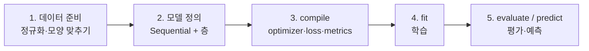

# Keras 기본 개념

[목차로 돌아가기](../00_%EB%94%A5%EB%9F%AC%EB%8B%9D%EC%88%98%ED%95%99_MOC.md) · 예제 모음: [K02_Keras_예제모음](../04_Keras/K02_Keras_%EC%98%88%EC%A0%9C%EB%AA%A8%EC%9D%8C.md) · 용어: [00_딥러닝_용어사전](../00_%EB%94%A5%EB%9F%AC%EB%8B%9D_%EC%9A%A9%EC%96%B4%EC%82%AC%EC%A0%84.md#sequential-%EC%88%9C%EC%B0%A8-%EB%AA%A8%EB%8D%B8)

> [!NOTE]
> **3줄 요약**
> - Keras는 EX\_02에서 손으로 짠 **[가설](../00_%EB%94%A5%EB%9F%AC%EB%8B%9D_%EC%9A%A9%EC%96%B4%EC%82%AC%EC%A0%84.md#hypothesis-%EA%B0%80%EC%84%A4)·[손실 함수](../00_%EB%94%A5%EB%9F%AC%EB%8B%9D_%EC%9A%A9%EC%96%B4%EC%82%AC%EC%A0%84.md#loss-function-%EC%86%90%EC%8B%A4-%ED%95%A8%EC%88%98)·[기울기](../00_%EB%94%A5%EB%9F%AC%EB%8B%9D_%EC%9A%A9%EC%96%B4%EC%82%AC%EC%A0%84.md#gradient-%EA%B8%B0%EC%9A%B8%EA%B8%B0)·반복**을 대신 해 주는 도구다. 사람은 "어떤 [층](../00_%EB%94%A5%EB%9F%AC%EB%8B%9D_%EC%9A%A9%EC%96%B4%EC%82%AC%EC%A0%84.md#layer-%EC%B8%B5)을 쌓을지, 어떤 [손실](../00_%EB%94%A5%EB%9F%AC%EB%8B%9D_%EC%9A%A9%EC%96%B4%EC%82%AC%EC%A0%84.md#loss-function-%EC%86%90%EC%8B%A4-%ED%95%A8%EC%88%98)로 배울지"만 정하면 된다.
> - 순서는 언제나 **데이터 준비 → 모델 정의 → [compile](../00_%EB%94%A5%EB%9F%AC%EB%8B%9D_%EC%9A%A9%EC%96%B4%EC%82%AC%EC%A0%84.md#compile-%EC%BB%B4%ED%8C%8C%EC%9D%BC) → [fit](../00_%EB%94%A5%EB%9F%AC%EB%8B%9D_%EC%9A%A9%EC%96%B4%EC%82%AC%EC%A0%84.md#fit-%ED%95%99%EC%8A%B5-%EC%8B%A4%ED%96%89) → [evaluate](../00_%EB%94%A5%EB%9F%AC%EB%8B%9D_%EC%9A%A9%EC%96%B4%EC%82%AC%EC%A0%84.md#predict-evaluate-%EC%98%88%EC%B8%A1%EA%B3%BC-%ED%8F%89%EA%B0%80)/[predict](../00_%EB%94%A5%EB%9F%AC%EB%8B%9D_%EC%9A%A9%EC%96%B4%EC%82%AC%EC%A0%84.md#predict-evaluate-%EC%98%88%EC%B8%A1%EA%B3%BC-%ED%8F%89%EA%B0%80)** 다섯 단계다.
> - 가장 자주 틀리는 곳은 **출력층·[손실 함수](../00_%EB%94%A5%EB%9F%AC%EB%8B%9D_%EC%9A%A9%EC%96%B4%EC%82%AC%EC%A0%84.md#loss-function-%EC%86%90%EC%8B%A4-%ED%95%A8%EC%88%98)·[정답](../00_%EB%94%A5%EB%9F%AC%EB%8B%9D_%EC%9A%A9%EC%96%B4%EC%82%AC%EC%A0%84.md#label-%EC%A0%95%EB%8B%B5) 모양의 짝**이다. 아래 4절 표 하나만 기억하면 된다.

## 1. 직접 짠 코드와 Keras의 대응

| EX\_02 (numpy로 직접) | Keras | 하는 일 |
|---|---|---|
| `def Hypothesis(x): return W*x + B` | `tf.keras.layers.Dense(1)` | [가설](../00_%EB%94%A5%EB%9F%AC%EB%8B%9D_%EC%9A%A9%EC%96%B4%EC%82%AC%EC%A0%84.md#hypothesis-%EA%B0%80%EC%84%A4)([가중합](../00_%EB%94%A5%EB%9F%AC%EB%8B%9D_%EC%9A%A9%EC%96%B4%EC%82%AC%EC%A0%84.md#weighted-sum-%EA%B0%80%EC%A4%91%ED%95%A9)) |
| `W = np.random.normal()` | [층](../00_%EB%94%A5%EB%9F%AC%EB%8B%9D_%EC%9A%A9%EC%96%B4%EC%82%AC%EC%A0%84.md#layer-%EC%B8%B5)을 만들 때 자동 | [가중치](../00_%EB%94%A5%EB%9F%AC%EB%8B%9D_%EC%9A%A9%EC%96%B4%EC%82%AC%EC%A0%84.md#weight-%EA%B0%80%EC%A4%91%EC%B9%98) 무작위 초기화 |
| `def Cost(): ...` | `loss='mean_squared_error'` | [손실 함수](../00_%EB%94%A5%EB%9F%AC%EB%8B%9D_%EC%9A%A9%EC%96%B4%EC%82%AC%EC%A0%84.md#loss-function-%EC%86%90%EC%8B%A4-%ED%95%A8%EC%88%98) (코드의 cost = [손실](../00_%EB%94%A5%EB%9F%AC%EB%8B%9D_%EC%9A%A9%EC%96%B4%EC%82%AC%EC%A0%84.md#loss-function-%EC%86%90%EC%8B%A4-%ED%95%A8%EC%88%98)) |
| `def Gradient(x, y): ...` | 자동 ([역전파](../00_%EB%94%A5%EB%9F%AC%EB%8B%9D_%EC%9A%A9%EC%96%B4%EC%82%AC%EC%A0%84.md#backpropagation-%EC%97%AD%EC%A0%84%ED%8C%8C): [기울기](../00_%EB%94%A5%EB%9F%AC%EB%8B%9D_%EC%9A%A9%EC%96%B4%EC%82%AC%EC%A0%84.md#gradient-%EA%B8%B0%EC%9A%B8%EA%B8%B0)를 출력 쪽부터 거꾸로 계산) | [기울기](../00_%EB%94%A5%EB%9F%AC%EB%8B%9D_%EC%9A%A9%EC%96%B4%EC%82%AC%EC%A0%84.md#gradient-%EA%B8%B0%EC%9A%B8%EA%B8%B0) 계산 |
| `W -= learning_rate * grad_w` | `optimizer=SGD(learning_rate=...)` | [가중치](../00_%EB%94%A5%EB%9F%AC%EB%8B%9D_%EC%9A%A9%EC%96%B4%EC%82%AC%EC%A0%84.md#weight-%EA%B0%80%EC%A4%91%EC%B9%98) 수정 |
| `for cnt in range(epochs):` | `model.fit(..., epochs=...)` | 반복 |
| `print(cost, W, B)` | [학습](../00_%EB%94%A5%EB%9F%AC%EB%8B%9D_%EC%9A%A9%EC%96%B4%EC%82%AC%EC%A0%84.md#training-%ED%95%99%EC%8A%B5) [로그](../00_%EB%94%A5%EB%9F%AC%EB%8B%9D_%EC%9A%A9%EC%96%B4%EC%82%AC%EC%A0%84.md#log-ln-%EB%A1%9C%EA%B7%B8), `history` | 진행 기록 |

자세히: [D02_경사하강법으로_직선찾기](../01_%EA%B0%9C%EB%85%90%EB%85%B8%ED%8A%B8/D02_%EA%B2%BD%EC%82%AC%ED%95%98%EA%B0%95%EB%B2%95%EC%9C%BC%EB%A1%9C_%EC%A7%81%EC%84%A0%EC%B0%BE%EA%B8%B0.md), [D09_오차와_비용함수](../01_%EA%B0%9C%EB%85%90%EB%85%B8%ED%8A%B8/D09_%EC%98%A4%EC%B0%A8%EC%99%80_%EB%B9%84%EC%9A%A9%ED%95%A8%EC%88%98.md)

## 2. 다섯 단계



| 단계 | 코드 (EX\_05 기준) | 주의 |
|---|---|---|
| 1. 데이터 | `x_input = (x_input-x_min)/(x_max-x_min)` | [정규화](../00_%EB%94%A5%EB%9F%AC%EB%8B%9D_%EC%9A%A9%EC%96%B4%EC%82%AC%EC%A0%84.md#normalization-%EC%A0%95%EA%B7%9C%ED%99%94), 모양(shape) |
| 2. 모델 | `Sequential([Input(shape=(2,)), Dense(1, activation='sigmoid')])` | 입력 모양 = 데이터 한 개의 모양 |
| 3. [compile](../00_%EB%94%A5%EB%9F%AC%EB%8B%9D_%EC%9A%A9%EC%96%B4%EC%82%AC%EC%A0%84.md#compile-%EC%BB%B4%ED%8C%8C%EC%9D%BC) | `compile(optimizer=SGD(learning_rate=0.1), loss='binary_crossentropy', metrics=['accuracy'])` | 출력층·[손실](../00_%EB%94%A5%EB%9F%AC%EB%8B%9D_%EC%9A%A9%EC%96%B4%EC%82%AC%EC%A0%84.md#loss-function-%EC%86%90%EC%8B%A4-%ED%95%A8%EC%88%98)·[정답](../00_%EB%94%A5%EB%9F%AC%EB%8B%9D_%EC%9A%A9%EC%96%B4%EC%82%AC%EC%A0%84.md#label-%EC%A0%95%EB%8B%B5) 짝 |
| 4. [fit](../00_%EB%94%A5%EB%9F%AC%EB%8B%9D_%EC%9A%A9%EC%96%B4%EC%82%AC%EC%A0%84.md#fit-%ED%95%99%EC%8A%B5-%EC%8B%A4%ED%96%89) | `history = model.fit(x_input, labels, epochs=1000)` | epochs = [에폭](../00_%EB%94%A5%EB%9F%AC%EB%8B%9D_%EC%9A%A9%EC%96%B4%EC%82%AC%EC%A0%84.md#epoch-%EC%97%90%ED%8F%AD)(epoch, 전체 데이터를 한 바퀴 다 보는 것) 수, batch\_size(8절) |
| 5. 예측 | `model.predict((x-x_min)/(x_max-x_min))` | 새 입력도 같은 기준으로 [정규화](../00_%EB%94%A5%EB%9F%AC%EB%8B%9D_%EC%9A%A9%EC%96%B4%EC%82%AC%EC%A0%84.md#normalization-%EC%A0%95%EA%B7%9C%ED%99%94) |

## 3. 모델 구성의 세 가지 방법

### 3.1 리스트로 쌓는 Sequential (EX\_04~07)

```python
model = tf.keras.models.Sequential([
  tf.keras.Input(shape=(2,)),                     # 입력 한 개의 모양 (데이터 개수는 빼고)
  tf.keras.layers.Dense(1, activation='sigmoid')  # 층을 순서대로 나열
])
```

### 3.2 add로 쌓는 Sequential (CNN 예제)

```python
model = tf.keras.models.Sequential()            # 빈 모델
model.add(tf.keras.Input(shape=(28, 28, 1)))
model.add(tf.keras.layers.Conv2D(filters=32, kernel_size=3, padding='same', activation='sigmoid'))
...
```

두 방법은 만들어지는 모델 구조가 같다(초기 [가중치](../00_%EB%94%A5%EB%9F%AC%EB%8B%9D_%EC%9A%A9%EC%96%B4%EC%82%AC%EC%A0%84.md#weight-%EA%B0%80%EC%A4%91%EC%B9%98)는 무작위라 [학습](../00_%EB%94%A5%EB%9F%AC%EB%8B%9D_%EC%9A%A9%EC%96%B4%EC%82%AC%EC%A0%84.md#training-%ED%95%99%EC%8A%B5) 결과는 조금씩 다를 수 있다). [층](../00_%EB%94%A5%EB%9F%AC%EB%8B%9D_%EC%9A%A9%EC%96%B4%EC%82%AC%EC%A0%84.md#layer-%EC%B8%B5)이 많으면 add가 읽기 편하다.

### 3.3 Functional API: 입력과 출력의 직접 연결 (CNN EX\_02의 특징 맵)

```python
x = tf.keras.Input(shape=(2,))                  # 입력 한 개의 모양을 정하고 입력 자리를 만든다
y = tf.keras.layers.Dense(2)(x)                 # 층을 함수처럼 쓴다: x를 넣으면 출력 y가 나온다
model = tf.keras.Model(inputs=x, outputs=y)     # 입력과 출력을 묶어 모델로 만든다
```

CNN EX\_02에서는 이미 만든 모델의 입력(`model.inputs`)과 중간 [층](../00_%EB%94%A5%EB%9F%AC%EB%8B%9D_%EC%9A%A9%EC%96%B4%EC%82%AC%EC%A0%84.md#layer-%EC%B8%B5) 출력 목록(`outputs`)을 묶어 "출력이 여러 개인 새 모델"을 만들었다. 코드는 `tf.keras.Model(inputs=model.inputs, outputs=outputs)`다.

- [층](../00_%EB%94%A5%EB%9F%AC%EB%8B%9D_%EC%9A%A9%EC%96%B4%EC%82%AC%EC%A0%84.md#layer-%EC%B8%B5)을 함수처럼 이어 붙여 `Model(inputs, outputs)`로 묶는다.
- 출력이 여러 개이거나, 중간 [층](../00_%EB%94%A5%EB%9F%AC%EB%8B%9D_%EC%9A%A9%EC%96%B4%EC%82%AC%EC%A0%84.md#layer-%EC%B8%B5)의 출력을 꺼내 보거나, 갈래가 나뉘는 모델에 쓴다. 예제: [E09_CNN_3Conv_MNIST_예제](../03_%EC%98%88%EC%A0%9C%ED%92%80%EC%9D%B4/E09_CNN_3Conv_MNIST_%EC%98%88%EC%A0%9C.md) 1-7절, 변형: [K02_Keras_예제모음](../04_Keras/K02_Keras_%EC%98%88%EC%A0%9C%EB%AA%A8%EC%9D%8C.md) 3절

## 4. 출력층 · 손실 함수 · 정답 모양의 짝 ★

| 문제 | 출력층 | [손실 함수](../00_%EB%94%A5%EB%9F%AC%EB%8B%9D_%EC%9A%A9%EC%96%B4%EC%82%AC%EC%A0%84.md#loss-function-%EC%86%90%EC%8B%A4-%ED%95%A8%EC%88%98) | [정답](../00_%EB%94%A5%EB%9F%AC%EB%8B%9D_%EC%9A%A9%EC%96%B4%EC%82%AC%EC%A0%84.md#label-%EC%A0%95%EB%8B%B5)(labels) 모양 | 예제 |
|---|---|---|---|---|
| [회귀](../00_%EB%94%A5%EB%9F%AC%EB%8B%9D_%EC%9A%A9%EC%96%B4%EC%82%AC%EC%A0%84.md#regression-classification-%ED%9A%8C%EA%B7%80%EC%99%80-%EB%B6%84%EB%A5%98) (숫자 맞히기) | `Dense(n)` (활성화 없음) | `'mean_squared_error'` | 숫자 `[118, 72]` | EX\_04 |
| [이진 분류](../00_%EB%94%A5%EB%9F%AC%EB%8B%9D_%EC%9A%A9%EC%96%B4%EC%82%AC%EC%A0%84.md#binary-classification-%EC%9D%B4%EC%A7%84-%EB%B6%84%EB%A5%98) | `Dense(1, activation='sigmoid')` | `'binary_crossentropy'` | `[0]` 또는 `[1]` | EX\_05 |
| 다중 [분류](../00_%EB%94%A5%EB%9F%AC%EB%8B%9D_%EC%9A%A9%EC%96%B4%EC%82%AC%EC%A0%84.md#regression-classification-%ED%9A%8C%EA%B7%80%EC%99%80-%EB%B6%84%EB%A5%98) ([원-핫](../00_%EB%94%A5%EB%9F%AC%EB%8B%9D_%EC%9A%A9%EC%96%B4%EC%82%AC%EC%A0%84.md#one-hot-encoding-%EC%9B%90-%ED%95%AB-%EC%9D%B8%EC%BD%94%EB%94%A9) [정답](../00_%EB%94%A5%EB%9F%AC%EB%8B%9D_%EC%9A%A9%EC%96%B4%EC%82%AC%EC%A0%84.md#label-%EC%A0%95%EB%8B%B5)) | `Dense(K, activation='softmax')` | `'categorical_crossentropy'` | `[0, 1, 0]` | EX\_06 |
| 다중 [분류](../00_%EB%94%A5%EB%9F%AC%EB%8B%9D_%EC%9A%A9%EC%96%B4%EC%82%AC%EC%A0%84.md#regression-classification-%ED%9A%8C%EA%B7%80%EC%99%80-%EB%B6%84%EB%A5%98) (번호 [정답](../00_%EB%94%A5%EB%9F%AC%EB%8B%9D_%EC%9A%A9%EC%96%B4%EC%82%AC%EC%A0%84.md#label-%EC%A0%95%EB%8B%B5)) | `Dense(K, activation='softmax')` | `'sparse_categorical_crossentropy'` | `1` | EX\_07, CNN |

[원-핫](../00_%EB%94%A5%EB%9F%AC%EB%8B%9D_%EC%9A%A9%EC%96%B4%EC%82%AC%EC%A0%84.md#one-hot-encoding-%EC%9B%90-%ED%95%AB-%EC%9D%B8%EC%BD%94%EB%94%A9)(one-hot)은 [정답](../00_%EB%94%A5%EB%9F%AC%EB%8B%9D_%EC%9A%A9%EC%96%B4%EC%82%AC%EC%A0%84.md#label-%EC%A0%95%EB%8B%B5) 칸만 1이고 나머지는 0인 표기다. 3등급에서 1번 등급이면 `[0, 1, 0]`이다.

> [!WARNING]
> **⚠ 짝이 안 맞으면**
> - [정답](../00_%EB%94%A5%EB%9F%AC%EB%8B%9D_%EC%9A%A9%EC%96%B4%EC%82%AC%EC%A0%84.md#label-%EC%A0%95%EB%8B%B5)이 번호(7)인데 `categorical_crossentropy`를 쓰면 모양이 안 맞아 오류가 난다 → `sparse_`를 붙인다.
> - 분류인데 출력층에 활성화를 빼먹으면 [확률](../00_%EB%94%A5%EB%9F%AC%EB%8B%9D_%EC%9A%A9%EC%96%B4%EC%82%AC%EC%A0%84.md#probability-%ED%99%95%EB%A5%A0)이 아닌 값이 나와 [학습](../00_%EB%94%A5%EB%9F%AC%EB%8B%9D_%EC%9A%A9%EC%96%B4%EC%82%AC%EC%A0%84.md#training-%ED%95%99%EC%8A%B5)이 이상해진다.
> - 등급 수 K와 `Dense(K)`의 숫자가 다르면 오류가 난다.

## 5. 층 정리

| [층](../00_%EB%94%A5%EB%9F%AC%EB%8B%9D_%EC%9A%A9%EC%96%B4%EC%82%AC%EC%A0%84.md#layer-%EC%B8%B5) | 예제 코드 | 하는 일 | 모양 변화 | [파라미터](../00_%EB%94%A5%EB%9F%AC%EB%8B%9D_%EC%9A%A9%EC%96%B4%EC%82%AC%EC%A0%84.md#parameter-%ED%8C%8C%EB%9D%BC%EB%AF%B8%ED%84%B0) 수 |
|---|---|---|---|---|
| `Input` | `Input(shape=(28,28,1))` | 입력 모양 알려 주기 | — | 0 |
| `Dense` | `Dense(10, activation='softmax')` | $XW + b$ (+ 활성화) | (n) → (m) | n × m + m |
| `Flatten` | `Flatten()` | 한 줄로 펴기 | (28, 28) → (784) | 0 |
| `Conv2D` | `Conv2D(filters=32, kernel_size=3, padding='same')` | [합성곱](../00_%EB%94%A5%EB%9F%AC%EB%8B%9D_%EC%9A%A9%EC%96%B4%EC%82%AC%EC%A0%84.md#convolution-%ED%95%A9%EC%84%B1%EA%B3%B1) | (28, 28, 1) → (28, 28, 32) | (k·k·C + 1) × [필터](../00_%EB%94%A5%EB%9F%AC%EB%8B%9D_%EC%9A%A9%EC%96%B4%EC%82%AC%EC%A0%84.md#filter-%ED%95%84%ED%84%B0) 수 |
| `MaxPool2D` | `MaxPool2D(pool_size=2, strides=2)` | 2×2 최댓값 | (28, 28, 32) → (14, 14, 32) | 0 |
| `Dropout` | `Dropout(rate=0.4)` | [학습](../00_%EB%94%A5%EB%9F%AC%EB%8B%9D_%EC%9A%A9%EC%96%B4%EC%82%AC%EC%A0%84.md#training-%ED%95%99%EC%8A%B5) 때만 40% 끄기 | 그대로 | 0 |

`Conv2D`의 [파라미터](../00_%EB%94%A5%EB%9F%AC%EB%8B%9D_%EC%9A%A9%EC%96%B4%EC%82%AC%EC%A0%84.md#parameter-%ED%8C%8C%EB%9D%BC%EB%AF%B8%ED%84%B0) 수에서 k는 커널([필터](../00_%EB%94%A5%EB%9F%AC%EB%8B%9D_%EC%9A%A9%EC%96%B4%EC%82%AC%EC%A0%84.md#filter-%ED%95%84%ED%84%B0)) 한 변의 크기(3×3이면 3), C는 입력 [채널](../00_%EB%94%A5%EB%9F%AC%EB%8B%9D_%EC%9A%A9%EC%96%B4%EC%82%AC%EC%A0%84.md#channel-%EC%B1%84%EB%84%90) 수(흑백 1, 컬러 3)다. 예: k = 3, C = 1, [필터](../00_%EB%94%A5%EB%9F%AC%EB%8B%9D_%EC%9A%A9%EC%96%B4%EC%82%AC%EC%A0%84.md#filter-%ED%95%84%ED%84%B0) 32개 → (3·3·1 + 1) × 32 = 320.

자세히: [D03_Dense층과_정규화](../01_%EA%B0%9C%EB%85%90%EB%85%B8%ED%8A%B8/D03_Dense%EC%B8%B5%EA%B3%BC_%EC%A0%95%EA%B7%9C%ED%99%94.md), [D07_합성곱과_풀링](../01_%EA%B0%9C%EB%85%90%EB%85%B8%ED%8A%B8/D07_%ED%95%A9%EC%84%B1%EA%B3%B1%EA%B3%BC_%ED%92%80%EB%A7%81.md), [D08_ReLU와_드롭아웃](../01_%EA%B0%9C%EB%85%90%EB%85%B8%ED%8A%B8/D08_ReLU%EC%99%80_%EB%93%9C%EB%A1%AD%EC%95%84%EC%9B%83.md)

## 6. 활성화 함수 (`activation=`)

| 값 | 함수 | 어디에 | 노트 |
|---|---|---|---|
| (안 씀) | 그대로 출력 | [회귀](../00_%EB%94%A5%EB%9F%AC%EB%8B%9D_%EC%9A%A9%EC%96%B4%EC%82%AC%EC%A0%84.md#regression-classification-%ED%9A%8C%EA%B7%80%EC%99%80-%EB%B6%84%EB%A5%98)의 출력층 | [D03_Dense층과_정규화](../01_%EA%B0%9C%EB%85%90%EB%85%B8%ED%8A%B8/D03_Dense%EC%B8%B5%EA%B3%BC_%EC%A0%95%EA%B7%9C%ED%99%94.md) |
| `'sigmoid'` | 0~1 | [이진 분류](../00_%EB%94%A5%EB%9F%AC%EB%8B%9D_%EC%9A%A9%EC%96%B4%EC%82%AC%EC%A0%84.md#binary-classification-%EC%9D%B4%EC%A7%84-%EB%B6%84%EB%A5%98) 출력층 | [D04_시그모이드와_이진분류](../01_%EA%B0%9C%EB%85%90%EB%85%B8%ED%8A%B8/D04_%EC%8B%9C%EA%B7%B8%EB%AA%A8%EC%9D%B4%EB%93%9C%EC%99%80_%EC%9D%B4%EC%A7%84%EB%B6%84%EB%A5%98.md) |
| `'softmax'` | 합이 1인 [확률](../00_%EB%94%A5%EB%9F%AC%EB%8B%9D_%EC%9A%A9%EC%96%B4%EC%82%AC%EC%A0%84.md#probability-%ED%99%95%EB%A5%A0) | 다중 [분류](../00_%EB%94%A5%EB%9F%AC%EB%8B%9D_%EC%9A%A9%EC%96%B4%EC%82%AC%EC%A0%84.md#regression-classification-%ED%9A%8C%EA%B7%80%EC%99%80-%EB%B6%84%EB%A5%98) 출력층 | [D05_소프트맥스와_다중분류](../01_%EA%B0%9C%EB%85%90%EB%85%B8%ED%8A%B8/D05_%EC%86%8C%ED%94%84%ED%8A%B8%EB%A7%A5%EC%8A%A4%EC%99%80_%EB%8B%A4%EC%A4%91%EB%B6%84%EB%A5%98.md) |
| `'relu'` | max(0, x) | 중간층 | [D08_ReLU와_드롭아웃](../01_%EA%B0%9C%EB%85%90%EB%85%B8%ED%8A%B8/D08_ReLU%EC%99%80_%EB%93%9C%EB%A1%AD%EC%95%84%EC%9B%83.md) |

## 7. compile의 세 가지 인자

| 인자 | 예제에서 쓴 값 | 뜻 |
|---|---|---|
| `optimizer` | `tf.keras.optimizers.SGD(learning_rate=0.1)`, `'adam'` | [가중치](../00_%EB%94%A5%EB%9F%AC%EB%8B%9D_%EC%9A%A9%EC%96%B4%EC%82%AC%EC%A0%84.md#weight-%EA%B0%80%EC%A4%91%EC%B9%98)를 고치는 방법. 문자열 `'adam'`은 기본 [학습률](../00_%EB%94%A5%EB%9F%AC%EB%8B%9D_%EC%9A%A9%EC%96%B4%EC%82%AC%EC%A0%84.md#learning-rate-%ED%95%99%EC%8A%B5%EB%A5%A0)(0.001)을 쓴다 |
| `loss` | 4절 표 | 줄일 대상([손실](../00_%EB%94%A5%EB%9F%AC%EB%8B%9D_%EC%9A%A9%EC%96%B4%EC%82%AC%EC%A0%84.md#loss-function-%EC%86%90%EC%8B%A4-%ED%95%A8%EC%88%98)) |
| `metrics` | `['accuracy']` | 학습엔 안 쓰고 사람이 보는 숫자 |

## 8. fit의 인자와 history

```python
history = model.fit(train_data, train_labels,
                    epochs=10,                                   # 에폭 수(전체 데이터를 몇 번 볼지)
                    batch_size=32,                               # 한 번 고칠 때 볼 개수 (안 쓰면 32)
                    shuffle=True,                                # 에폭마다 순서 섞기
                    validation_data=(test_data, test_labels))    # 에폭마다 검증
```

- **batch\_size**: 한 번 고칠 때 볼 데이터 개수.
  - 단계(step)는 [가중치](../00_%EB%94%A5%EB%9F%AC%EB%8B%9D_%EC%9A%A9%EC%96%B4%EC%82%AC%EC%A0%84.md#weight-%EA%B0%80%EC%A4%91%EC%B9%98)를 한 번 고치는 일이다.
  - 한 [에폭](../00_%EB%94%A5%EB%9F%AC%EB%8B%9D_%EC%9A%A9%EC%96%B4%EC%82%AC%EC%A0%84.md#epoch-%EC%97%90%ED%8F%AD)의 단계 수 = 데이터 수 ÷ batch\_size (올림)이다. 6만 장이면 32 → 1875, 64 → 938, 128 → 469.
- **history.history**: [에폭](../00_%EB%94%A5%EB%9F%AC%EB%8B%9D_%EC%9A%A9%EC%96%B4%EC%82%AC%EC%A0%84.md#epoch-%EC%97%90%ED%8F%AD)마다 기록된 숫자 사전. 키는 `'loss'`, `'accuracy'`, 그리고 [검증](../00_%EB%94%A5%EB%9F%AC%EB%8B%9D_%EC%9A%A9%EC%96%B4%EC%82%AC%EC%A0%84.md#validation-%EA%B2%80%EC%A6%9D)을 넣으면 `'val_loss'`, `'val_accuracy'`. 그래프 그릴 때 쓴다([E05_혈압_로지스틱회귀_예제](../03_%EC%98%88%EC%A0%9C%ED%92%80%EC%9D%B4/E05_%ED%98%88%EC%95%95_%EB%A1%9C%EC%A7%80%EC%8A%A4%ED%8B%B1%ED%9A%8C%EA%B7%80_%EC%98%88%EC%A0%9C.md) 1-6절).

## 9. 평가와 예측

| 함수                     | 넣는 것    | 돌려주는 것             | 예제                       |
| ---------------------- | ------- | ------------------ | ------------------------ |
| `model.evaluate(x, y)` | 입력 + [정답](../00_%EB%94%A5%EB%9F%AC%EB%8B%9D_%EC%9A%A9%EC%96%B4%EC%82%AC%EC%A0%84.md#label-%EC%A0%95%EB%8B%B5) | `[loss, accuracy]` | EX\_07: `[0.267, 0.9257]` |
| `model.predict(x)`     | 입력만     | 출력층 값 ([확률](../00_%EB%94%A5%EB%9F%AC%EB%8B%9D_%EC%9A%A9%EC%96%B4%EC%82%AC%EC%A0%84.md#probability-%ED%99%95%EB%A5%A0) 등)       | EX\_05: `0.4251`          |

- 둘 다 [가중치](../00_%EB%94%A5%EB%9F%AC%EB%8B%9D_%EC%9A%A9%EC%96%B4%EC%82%AC%EC%A0%84.md#weight-%EA%B0%80%EC%A4%91%EC%B9%98)를 고치지 않는다. [드롭아웃](../00_%EB%94%A5%EB%9F%AC%EB%8B%9D_%EC%9A%A9%EC%96%B4%EC%82%AC%EC%A0%84.md#dropout-%EB%93%9C%EB%A1%AD%EC%95%84%EC%9B%83)도 꺼진 상태로 계산한다.
- `predict` 결과가 [확률](../00_%EB%94%A5%EB%9F%AC%EB%8B%9D_%EC%9A%A9%EC%96%B4%EC%82%AC%EC%A0%84.md#probability-%ED%99%95%EB%A5%A0)이면 `np.argmax(..., axis=1)`로 예측 번호를 얻는다.

## 10. summary 읽기

```text
│ dense (Dense)                   │ (None, 10)             │         7,850 │
```

- **Layer (type)**: [층](../00_%EB%94%A5%EB%9F%AC%EB%8B%9D_%EC%9A%A9%EC%96%B4%EC%82%AC%EC%A0%84.md#layer-%EC%B8%B5) 이름과 종류
- **Output Shape**: 그 [층](../00_%EB%94%A5%EB%9F%AC%EB%8B%9D_%EC%9A%A9%EC%96%B4%EC%82%AC%EC%A0%84.md#layer-%EC%B8%B5)을 지난 뒤의 모양. `None`은 데이터 개수 자리(아직 안 정해짐)
- **Param #**: [파라미터](../00_%EB%94%A5%EB%9F%AC%EB%8B%9D_%EC%9A%A9%EC%96%B4%EC%82%AC%EC%A0%84.md#parameter-%ED%8C%8C%EB%9D%BC%EB%AF%B8%ED%84%B0) 수([가중치](../00_%EB%94%A5%EB%9F%AC%EB%8B%9D_%EC%9A%A9%EC%96%B4%EC%82%AC%EC%A0%84.md#weight-%EA%B0%80%EC%A4%91%EC%B9%98)+[편향](../00_%EB%94%A5%EB%9F%AC%EB%8B%9D_%EC%9A%A9%EC%96%B4%EC%82%AC%EC%A0%84.md#bias-%ED%8E%B8%ED%96%A5)). 손계산과 맞는지 확인하면 [층](../00_%EB%94%A5%EB%9F%AC%EB%8B%9D_%EC%9A%A9%EC%96%B4%EC%82%AC%EC%A0%84.md#layer-%EC%B8%B5)을 제대로 이해했는지 알 수 있다([M05_벡터와_행렬](../02_%EC%88%98%ED%95%99%EB%85%B8%ED%8A%B8/M05_%EB%B2%A1%ED%84%B0%EC%99%80_%ED%96%89%EB%A0%AC.md) 6절)

## 11. 개념 재확인

<details><summary>1. 정답이 <code>[3, 0, 7, ...]</code>처럼 번호인 10등급 분류의 출력층과 손실 함수는?</summary>

| 단계 | 하는 일 | 코드 | 계산 | 결과 |
|---|---|---|---|---|
| 1 | 출력 칸 수 정하기 | `Dense(10, ...)` | 등급 10개 | 칸 수 K = 10 |
| 2 | [확률](../00_%EB%94%A5%EB%9F%AC%EB%8B%9D_%EC%9A%A9%EC%96%B4%EC%82%AC%EC%A0%84.md#probability-%ED%99%95%EB%A5%A0)로 바꾸기 | `activation='softmax'` | 10개 [확률](../00_%EB%94%A5%EB%9F%AC%EB%8B%9D_%EC%9A%A9%EC%96%B4%EC%82%AC%EC%A0%84.md#probability-%ED%99%95%EB%A5%A0)의 합 | 1 |
| 3 | [정답](../00_%EB%94%A5%EB%9F%AC%EB%8B%9D_%EC%9A%A9%EC%96%B4%EC%82%AC%EC%A0%84.md#label-%EC%A0%95%EB%8B%B5) 모양 보기 | - | `3`, `0`, `7` | 번호 하나 ([원-핫](../00_%EB%94%A5%EB%9F%AC%EB%8B%9D_%EC%9A%A9%EC%96%B4%EC%82%AC%EC%A0%84.md#one-hot-encoding-%EC%9B%90-%ED%95%AB-%EC%9D%B8%EC%BD%94%EB%94%A9) 아님) |
| 4 | [손실 함수](../00_%EB%94%A5%EB%9F%AC%EB%8B%9D_%EC%9A%A9%EC%96%B4%EC%82%AC%EC%A0%84.md#loss-function-%EC%86%90%EC%8B%A4-%ED%95%A8%EC%88%98) 고르기 | `loss='sparse_categorical_crossentropy'` | 번호 [정답](../00_%EB%94%A5%EB%9F%AC%EB%8B%9D_%EC%9A%A9%EC%96%B4%EC%82%AC%EC%A0%84.md#label-%EC%A0%95%EB%8B%B5) → `sparse_` | 안 붙이면 모양이 안 맞아 오류 |

**① 쓰는 코드**
```python
model = tf.keras.models.Sequential([
  tf.keras.Input(shape=(784,)),                    # ① 입력 한 개의 모양 (28×28을 펴서 784칸)
  tf.keras.layers.Dense(10, activation='softmax')  # ② 출력 칸 10개(등급 수), ③ softmax로 확률의 합 1
])
model.compile(optimizer='adam',                    # ① 가중치를 고치는 방법 (이 문제와 무관)
              loss='sparse_categorical_crossentropy',  # ④ 정답이 번호 하나이므로 ⑤ sparse_를 붙임
              metrics=['accuracy'])                # ① 사람이 보는 숫자
```

**② 출력 칸 수 정하기** (`Dense(10, ...)`)
- 등급이 0~9로 10개
- 출력 칸 수 K = 10

**③ [확률](../00_%EB%94%A5%EB%9F%AC%EB%8B%9D_%EC%9A%A9%EC%96%B4%EC%82%AC%EC%A0%84.md#probability-%ED%99%95%EB%A5%A0)로 바꾸기** (`activation='softmax'`)
- 10개 칸의 점수를 [소프트맥스](../00_%EB%94%A5%EB%9F%AC%EB%8B%9D_%EC%9A%A9%EC%96%B4%EC%82%AC%EC%A0%84.md#softmax-%EC%86%8C%ED%94%84%ED%8A%B8%EB%A7%A5%EC%8A%A4)에 넣으면 [확률](../00_%EB%94%A5%EB%9F%AC%EB%8B%9D_%EC%9A%A9%EC%96%B4%EC%82%AC%EC%A0%84.md#probability-%ED%99%95%EB%A5%A0) 10개가 나옴
- 10개 [확률](../00_%EB%94%A5%EB%9F%AC%EB%8B%9D_%EC%9A%A9%EC%96%B4%EC%82%AC%EC%A0%84.md#probability-%ED%99%95%EB%A5%A0)의 합은 1

**④ [정답](../00_%EB%94%A5%EB%9F%AC%EB%8B%9D_%EC%9A%A9%EC%96%B4%EC%82%AC%EC%A0%84.md#label-%EC%A0%95%EB%8B%B5) 모양 보기**
- [정답](../00_%EB%94%A5%EB%9F%AC%EB%8B%9D_%EC%9A%A9%EC%96%B4%EC%82%AC%EC%A0%84.md#label-%EC%A0%95%EB%8B%B5)은 `3`, `0`, `7`처럼 번호 하나
- [원-핫](../00_%EB%94%A5%EB%9F%AC%EB%8B%9D_%EC%9A%A9%EC%96%B4%EC%82%AC%EC%A0%84.md#one-hot-encoding-%EC%9B%90-%ED%95%AB-%EC%9D%B8%EC%BD%94%EB%94%A9)(`[0, 0, 0, 1, ...]`)이 아님

**⑤ [손실 함수](../00_%EB%94%A5%EB%9F%AC%EB%8B%9D_%EC%9A%A9%EC%96%B4%EC%82%AC%EC%A0%84.md#loss-function-%EC%86%90%EC%8B%A4-%ED%95%A8%EC%88%98) 고르기** (`loss='sparse_categorical_crossentropy'`)
- [원-핫](../00_%EB%94%A5%EB%9F%AC%EB%8B%9D_%EC%9A%A9%EC%96%B4%EC%82%AC%EC%A0%84.md#one-hot-encoding-%EC%9B%90-%ED%95%AB-%EC%9D%B8%EC%BD%94%EB%94%A9) [정답](../00_%EB%94%A5%EB%9F%AC%EB%8B%9D_%EC%9A%A9%EC%96%B4%EC%82%AC%EC%A0%84.md#label-%EC%A0%95%EB%8B%B5)이면 `'categorical_crossentropy'`
- 번호 [정답](../00_%EB%94%A5%EB%9F%AC%EB%8B%9D_%EC%9A%A9%EC%96%B4%EC%82%AC%EC%A0%84.md#label-%EC%A0%95%EB%8B%B5)이면 `sparse_`를 붙여 `'sparse_categorical_crossentropy'`
- 안 붙이면 [정답](../00_%EB%94%A5%EB%9F%AC%EB%8B%9D_%EC%9A%A9%EC%96%B4%EC%82%AC%EC%A0%84.md#label-%EC%A0%95%EB%8B%B5) 모양이 안 맞아 오류

**답**: 출력층은 `Dense(10, activation='softmax')`, [손실 함수](../00_%EB%94%A5%EB%9F%AC%EB%8B%9D_%EC%9A%A9%EC%96%B4%EC%82%AC%EC%A0%84.md#loss-function-%EC%86%90%EC%8B%A4-%ED%95%A8%EC%88%98)는 `'sparse_categorical_crossentropy'`다.

</details>

<details><summary>2. EX\_02의 <code>W -= learning_rate * grad_w</code>에 해당하는 Keras 부분은?</summary>

| 단계 | 하는 일 | 코드 | 계산 | 결과 |
|---|---|---|---|---|
| 1 | 직접 짠 코드의 역할 | `W -= learning_rate * grad_w` | 5 − 0.1 × 20 | W = 3 ([기울기](../00_%EB%94%A5%EB%9F%AC%EB%8B%9D_%EC%9A%A9%EC%96%B4%EC%82%AC%EC%A0%84.md#gradient-%EA%B8%B0%EC%9A%B8%EA%B8%B0) 반대로 이동) |
| 2 | Keras의 대응 부분 | `optimizer=SGD(learning_rate=...)` | - | [가중치](../00_%EB%94%A5%EB%9F%AC%EB%8B%9D_%EC%9A%A9%EC%96%B4%EC%82%AC%EC%A0%84.md#weight-%EA%B0%80%EC%A4%91%EC%B9%98)를 어떻게 고칠지 정함 |
| 3 | 방법을 적는 곳 | `model.compile(optimizer=...)` | - | 방법만 정함 (고치지는 않음) |
| 4 | 실제로 고치는 곳 | `model.fit(...)` | batch마다 반복 | [가중치](../00_%EB%94%A5%EB%9F%AC%EB%8B%9D_%EC%9A%A9%EC%96%B4%EC%82%AC%EC%A0%84.md#weight-%EA%B0%80%EC%A4%91%EC%B9%98)가 고쳐짐 |

**① 쓰는 코드**
```python
W, grad_w, learning_rate = 5, 20, 0.1      # ① 표의 예: 가중치 5, 기울기 20, 학습률 0.1
W -= learning_rate * grad_w                # ② 직접 짠 코드: 5 − 0.1 × 20 = 3

model.compile(optimizer=tf.keras.optimizers.SGD(learning_rate=0.1),  # ③ Keras의 대응 부분
              loss='binary_crossentropy',  # ④ compile은 고치는 방법만 정함 (고치지는 않음)
              metrics=['accuracy'])
history = model.fit(x_input, labels, epochs=1000)   # ⑤ 실제로 가중치를 고치는 곳
```

**② 직접 짠 코드의 역할** (`W -= learning_rate * grad_w`)
- 이동량: 0.1 × 20 = 2
- W = 5 − 2 = 3
- [기울기](../00_%EB%94%A5%EB%9F%AC%EB%8B%9D_%EC%9A%A9%EC%96%B4%EC%82%AC%EC%A0%84.md#gradient-%EA%B8%B0%EC%9A%B8%EA%B8%B0)가 양수라서 반대 방향(줄이는 쪽)으로 이동

**③ Keras의 대응 부분** (`optimizer=SGD(learning_rate=...)`)
- `learning_rate * grad_w`로 이동하는 규칙이 optimizer 안에 들어 있음
- [가중치](../00_%EB%94%A5%EB%9F%AC%EB%8B%9D_%EC%9A%A9%EC%96%B4%EC%82%AC%EC%A0%84.md#weight-%EA%B0%80%EC%A4%91%EC%B9%98)를 어떻게 고칠지 정함

**④ 방법을 적는 곳** (`model.compile(optimizer=...)`)
- [compile](../00_%EB%94%A5%EB%9F%AC%EB%8B%9D_%EC%9A%A9%EC%96%B4%EC%82%AC%EC%A0%84.md#compile-%EC%BB%B4%ED%8C%8C%EC%9D%BC)은 방법만 적어 둠
- 이 줄에서는 [가중치](../00_%EB%94%A5%EB%9F%AC%EB%8B%9D_%EC%9A%A9%EC%96%B4%EC%82%AC%EC%A0%84.md#weight-%EA%B0%80%EC%A4%91%EC%B9%98)가 아직 안 고쳐짐

**⑤ 실제로 고치는 곳** (`model.fit(...)`)
- batch마다 [기울기](../00_%EB%94%A5%EB%9F%AC%EB%8B%9D_%EC%9A%A9%EC%96%B4%EC%82%AC%EC%A0%84.md#gradient-%EA%B8%B0%EC%9A%B8%EA%B8%B0)를 구하고 optimizer의 규칙대로 [가중치](../00_%EB%94%A5%EB%9F%AC%EB%8B%9D_%EC%9A%A9%EC%96%B4%EC%82%AC%EC%A0%84.md#weight-%EA%B0%80%EC%A4%91%EC%B9%98)를 고침
- 이 과정을 batch마다 반복

**답**: `compile`의 **optimizer**다. 실제 실행은 `fit`이 한다.

</details>

<details><summary>3. batch\_size를 64로 하면 MNIST 한 에폭에 몇 단계인가?</summary>

| 단계 | 하는 일 | 코드 | 계산 | 결과 |
|---|---|---|---|---|
| 1 | 묶음으로 나누기 | `batch_size=64` | 60000 ÷ 64 | 937.5 |
| 2 | 꽉 찬 묶음 수 | - | 937 × 64 | 59968장 (937번) |
| 3 | 남는 장 수 | - | 60000 − 59968 | 32장 |
| 4 | 남은 묶음도 쓰므로 올림 | `model.fit(...)` | 937 + 1 | 938 |

**① 쓰는 코드**
```python
import math                                     # ① 준비
history = model.fit(train_data, train_labels,
                    epochs=10,                  # ① 에폭 수 (이 문제와 무관)
                    batch_size=64)              # ② 한 번 고칠 때 64장씩 (32 → 64), 60000 ÷ 64 = 937.5
# ③ 꽉 찬 묶음 937개: 937 × 64 = 59968장
# ④ 남는 장 수: 60000 − 59968 = 32장
steps = math.ceil(60000 / 64)                   # ⑤ 남은 묶음도 쓰므로 올림 → 938
```

**② 묶음으로 나누기** (`batch_size=64`)
- 60000 ÷ 64 = 937.5
- 소수점이 나온 것은 마지막 묶음이 꽉 차지 않는다는 신호

**③ 꽉 찬 묶음 수**
- 937 × 64 = 59968장 (937번)

**④ 남는 장 수**
- 60000 − 59968 = 32장

**⑤ 남은 묶음도 쓰므로 올림** (`model.fit(...)`)
- 남은 32장도 묶음 하나로 쓰므로 937 + 1 = 938

마지막 묶음만 32장이고, [가중치](../00_%EB%94%A5%EB%9F%AC%EB%8B%9D_%EC%9A%A9%EC%96%B4%EC%82%AC%EC%A0%84.md#weight-%EA%B0%80%EC%A4%91%EC%B9%98)는 그 묶음으로도 한 번 고친다.

**답**: **938단계**

</details>

<details><summary>내 이해</summary>


</details>
