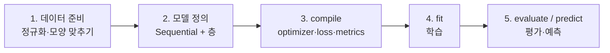

# Keras 기본 개념

[목차로 돌아가기](../00_%EB%94%A5%EB%9F%AC%EB%8B%9D%EC%88%98%ED%95%99_MOC.md) · 예제 모음: [K02_Keras_예제모음](K02_Keras_%EC%98%88%EC%A0%9C%EB%AA%A8%EC%9D%8C.md) · 용어: [Sequential](../00_%EB%94%A5%EB%9F%AC%EB%8B%9D_%EC%9A%A9%EC%96%B4%EC%82%AC%EC%A0%84.md#sequential)

> [!NOTE]
> **3줄 요약**
> - Keras는 EX\_02에서 손으로 짠 **가설·비용·기울기·반복**을 대신 해 주는 도구다. 우리는 "어떤 층을 쌓을지, 어떤 비용으로 배울지"만 정한다.
> - 순서는 언제나 **데이터 준비 → 모델 정의 → compile → fit → evaluate/predict** 다섯 단계다.
> - 가장 자주 틀리는 곳은 **출력층·손실 함수·정답 모양의 짝**이다. 아래 4절 표 하나만 기억하면 된다.

## 1. 손으로 짠 것과 Keras의 대응

| EX\_02 (numpy로 직접) | Keras | 하는 일 |
|---|---|---|
| `def Hypothesis(x): return W*x + B` | `tf.keras.layers.Dense(1)` | 가설(가중합) |
| `W = np.random.normal()` | 층을 만들 때 자동 | 가중치 무작위 초기화 |
| `def Cost(): ...` | `loss='mean_squared_error'` | 비용 함수 |
| `def Gradient(x, y): ...` | 자동 (역전파) | 기울기 계산 |
| `W -= learning_rate * grad_w` | `optimizer=SGD(learning_rate=...)` | 가중치 수정 |
| `for cnt in range(epochs):` | `model.fit(..., epochs=...)` | 반복 |
| `print(cost, W, B)` | 학습 로그, `history` | 진행 기록 |

자세히: [D02_경사하강법으로_직선찾기](../01_%EA%B0%9C%EB%85%90%EB%85%B8%ED%8A%B8/D02_%EA%B2%BD%EC%82%AC%ED%95%98%EA%B0%95%EB%B2%95%EC%9C%BC%EB%A1%9C_%EC%A7%81%EC%84%A0%EC%B0%BE%EA%B8%B0.md), [D09_오차와_비용함수](../01_%EA%B0%9C%EB%85%90%EB%85%B8%ED%8A%B8/D09_%EC%98%A4%EC%B0%A8%EC%99%80_%EB%B9%84%EC%9A%A9%ED%95%A8%EC%88%98.md)

## 2. 다섯 단계



| 단계 | 코드 (EX\_05 기준) | 주의 |
|---|---|---|
| 1. 데이터 | `x_input = (x_input-x_min)/(x_max-x_min)` | 정규화, 모양(shape) |
| 2. 모델 | `Sequential([Input(shape=(2,)), Dense(1, activation='sigmoid')])` | 입력 모양 = 데이터 한 개의 모양 |
| 3. compile | `compile(optimizer=SGD(learning_rate=0.1), loss='binary_crossentropy', metrics=['accuracy'])` | 출력층·loss·정답 짝 |
| 4. fit | `history = model.fit(x_input, labels, epochs=1000)` | epochs, batch\_size |
| 5. 예측 | `model.predict((x-x_min)/(x_max-x_min))` | 새 입력도 같은 기준으로 정규화 |

## 3. 모델 만들기 세 가지 방법

### 3.1 Sequential에 리스트로 (EX\_04~07)

```python
model = tf.keras.models.Sequential([
  tf.keras.Input(shape=(2,)),                     # 입력 한 개의 모양 (데이터 개수는 빼고)
  tf.keras.layers.Dense(1, activation='sigmoid')  # 층을 순서대로 나열
])
```

### 3.2 Sequential에 add로 한 줄씩 (CNN 예제)

```python
model = tf.keras.models.Sequential()            # 빈 모델
model.add(tf.keras.Input(shape=(28, 28, 1)))
model.add(tf.keras.layers.Conv2D(filters=32, kernel_size=3, padding='same', activation='sigmoid'))
...
```

두 방법은 결과가 같다. 층이 많으면 add가 읽기 편하다.

### 3.3 Functional API: 입력과 출력을 직접 연결 (CNN EX\_02의 특징 맵)

```python
model_fm = tf.keras.models.Model(inputs=model.inputs, outputs=outputs)   # 입력은 같고 출력이 여러 개인 새 모델
```

- 층을 함수처럼 이어 붙여 `Model(inputs, outputs)`로 묶는다.
- 출력이 여러 개이거나, 중간 층의 출력을 꺼내 보거나, 갈래가 나뉘는 모델에 쓴다. 예제: [E09_CNN_3Conv_MNIST_예제](../03_%EC%98%88%EC%A0%9C%ED%92%80%EC%9D%B4/E09_CNN_3Conv_MNIST_%EC%98%88%EC%A0%9C.md) 1-7절, 변형: [K02_Keras_예제모음](K02_Keras_%EC%98%88%EC%A0%9C%EB%AA%A8%EC%9D%8C.md) 3절

## 4. 출력층 · 손실 함수 · 정답 모양의 짝 ★

| 문제 | 출력층 | loss | 정답(labels) 모양 | 예제 |
|---|---|---|---|---|
| 회귀 (숫자 맞히기) | `Dense(n)` (활성화 없음) | `'mean_squared_error'` | 숫자 `[118, 72]` | EX\_04 |
| 이진 분류 | `Dense(1, activation='sigmoid')` | `'binary_crossentropy'` | `[0]` 또는 `[1]` | EX\_05 |
| 다중 분류 (원-핫 정답) | `Dense(K, activation='softmax')` | `'categorical_crossentropy'` | `[0, 1, 0]` | EX\_06 |
| 다중 분류 (번호 정답) | `Dense(K, activation='softmax')` | `'sparse_categorical_crossentropy'` | `1` | EX\_07, CNN |

> [!WARNING]
> **⚠ 짝이 안 맞으면**
> - 정답이 번호(7)인데 `categorical_crossentropy`를 쓰면 모양이 안 맞아 오류가 난다 → `sparse_`를 붙인다.
> - 분류인데 출력층에 활성화를 빼먹으면 확률이 아닌 값이 나와 학습이 이상해진다.
> - 등급 수 K와 `Dense(K)`의 숫자가 다르면 오류가 난다.

## 5. 층 정리

| 층 | 예제 코드 | 하는 일 | 모양 변화 | Param # |
|---|---|---|---|---|
| `Input` | `Input(shape=(28,28,1))` | 입력 모양 알려 주기 | — | 0 |
| `Dense` | `Dense(10, activation='softmax')` | $XW + b$ (+ 활성화) | (n) → (m) | n × m + m |
| `Flatten` | `Flatten()` | 한 줄로 펴기 | (28, 28) → (784) | 0 |
| `Conv2D` | `Conv2D(filters=32, kernel_size=3, padding='same')` | 합성곱 | (28, 28, 1) → (28, 28, 32) | (k·k·C + 1) × 필터 수 |
| `MaxPool2D` | `MaxPool2D(pool_size=2, strides=2)` | 2×2 최댓값 | (28, 28, 32) → (14, 14, 32) | 0 |
| `Dropout` | `Dropout(rate=0.4)` | 학습 때만 40% 끄기 | 그대로 | 0 |

자세히: [D03_Dense층과_정규화](../01_%EA%B0%9C%EB%85%90%EB%85%B8%ED%8A%B8/D03_Dense%EC%B8%B5%EA%B3%BC_%EC%A0%95%EA%B7%9C%ED%99%94.md), [D07_합성곱과_풀링](../01_%EA%B0%9C%EB%85%90%EB%85%B8%ED%8A%B8/D07_%ED%95%A9%EC%84%B1%EA%B3%B1%EA%B3%BC_%ED%92%80%EB%A7%81.md), [D08_ReLU와_드롭아웃](../01_%EA%B0%9C%EB%85%90%EB%85%B8%ED%8A%B8/D08_ReLU%EC%99%80_%EB%93%9C%EB%A1%AD%EC%95%84%EC%9B%83.md)

## 6. 활성화 함수 (`activation=`)

| 값 | 함수 | 어디에 | 노트 |
|---|---|---|---|
| (안 씀) | 그대로 출력 | 회귀의 출력층 | [D03_Dense층과_정규화](../01_%EA%B0%9C%EB%85%90%EB%85%B8%ED%8A%B8/D03_Dense%EC%B8%B5%EA%B3%BC_%EC%A0%95%EA%B7%9C%ED%99%94.md) |
| `'sigmoid'` | 0~1 | 이진 분류 출력층 | [D04_시그모이드와_이진분류](../01_%EA%B0%9C%EB%85%90%EB%85%B8%ED%8A%B8/D04_%EC%8B%9C%EA%B7%B8%EB%AA%A8%EC%9D%B4%EB%93%9C%EC%99%80_%EC%9D%B4%EC%A7%84%EB%B6%84%EB%A5%98.md) |
| `'softmax'` | 합이 1인 확률 | 다중 분류 출력층 | [D05_소프트맥스와_다중분류](../01_%EA%B0%9C%EB%85%90%EB%85%B8%ED%8A%B8/D05_%EC%86%8C%ED%94%84%ED%8A%B8%EB%A7%A5%EC%8A%A4%EC%99%80_%EB%8B%A4%EC%A4%91%EB%B6%84%EB%A5%98.md) |
| `'relu'` | max(0, x) | 중간층 | [D08_ReLU와_드롭아웃](../01_%EA%B0%9C%EB%85%90%EB%85%B8%ED%8A%B8/D08_ReLU%EC%99%80_%EB%93%9C%EB%A1%AD%EC%95%84%EC%9B%83.md) |

## 7. compile의 세 가지

| 인자 | 예제에서 쓴 값 | 뜻 |
|---|---|---|
| `optimizer` | `tf.keras.optimizers.SGD(learning_rate=0.1)`, `'adam'` | 가중치를 고치는 방법. 문자열 `'adam'`은 기본 학습률(0.001)을 쓴다 |
| `loss` | 4절 표 | 줄일 대상(비용) |
| `metrics` | `['accuracy']` | 학습엔 안 쓰고 사람이 보는 숫자 |

## 8. fit의 인자와 history

```python
history = model.fit(train_data, train_labels,
                    epochs=10,                                   # 전체 데이터를 몇 바퀴
                    batch_size=32,                               # 한 번 고칠 때 볼 개수 (안 쓰면 32)
                    shuffle=True,                                # 바퀴마다 순서 섞기
                    validation_data=(test_data, test_labels))    # 바퀴마다 검증
```

- **batch\_size**: 한 바퀴의 단계 수 = 데이터 수 ÷ batch\_size (올림). 6만 장이면 32 → 1875, 64 → 938, 128 → 469.
- **history.history**: 바퀴마다 기록된 숫자 사전. 키는 `'loss'`, `'accuracy'`, 그리고 검증을 넣으면 `'val_loss'`, `'val_accuracy'`. 그래프 그릴 때 쓴다([E05_혈압_로지스틱회귀_예제](../03_%EC%98%88%EC%A0%9C%ED%92%80%EC%9D%B4/E05_%ED%98%88%EC%95%95_%EB%A1%9C%EC%A7%80%EC%8A%A4%ED%8B%B1%ED%9A%8C%EA%B7%80_%EC%98%88%EC%A0%9C.md) 1-6절).

## 9. 평가와 예측

| 함수                     | 넣는 것    | 돌려주는 것             | 예제                       |
| ---------------------- | ------- | ------------------ | ------------------------ |
| `model.evaluate(x, y)` | 입력 + 정답 | `[loss, accuracy]` | EX\_07: `[0.267, 0.9257]` |
| `model.predict(x)`     | 입력만     | 출력층 값 (확률 등)       | EX\_05: `0.4251`          |

- 둘 다 가중치를 고치지 않는다. 드롭아웃도 꺼진 상태로 계산한다.
- `predict` 결과가 확률이면 `np.argmax(..., axis=1)`로 예측 번호를 얻는다.

## 10. summary 읽기

```
│ dense (Dense)                   │ (None, 10)             │         7,850 │
```

- **Layer (type)**: 층 이름과 종류
- **Output Shape**: 그 층을 지난 뒤의 모양. `None`은 데이터 개수 자리(아직 안 정해짐)
- **Param #**: 가중치 + 편향 개수. 손계산과 맞는지 확인하면 층을 제대로 이해했는지 알 수 있다([M05_벡터와_행렬](../02_%EC%88%98%ED%95%99%EB%85%B8%ED%8A%B8/M05_%EB%B2%A1%ED%84%B0%EC%99%80_%ED%96%89%EB%A0%AC.md) 6절)

## 11. 스스로 확인

<details><summary>1. 정답이 `[3, 0, 7, ...]`처럼 번호인 10등급 분류의 출력층과 loss는?</summary>

`Dense(10, activation='softmax')`, `loss='sparse_categorical_crossentropy'`

</details>

<details><summary>2. EX_02의 `W -= learning_rate * grad_w`에 해당하는 Keras 부분은?</summary>

`compile`의 **optimizer** (그리고 실제 실행은 `fit`)

</details>

<details><summary>3. batch_size를 64로 하면 MNIST 한 바퀴에 몇 단계인가?</summary>

60000 ÷ 64 = 937.5 → 올림 **938**

</details>

