# Lec 01. 딥러닝 소개 (Introduction to Deep Learning)

← 이전: 없음 · [목차](00_MIT%EB%94%A5%EB%9F%AC%EB%8B%9D_%EB%AA%A9%EC%B0%A8.md) · 다음: [Lec02_신경망_학습](Lec02_%EC%8B%A0%EA%B2%BD%EB%A7%9D_%ED%95%99%EC%8A%B5.md) →

> [!NOTE]
> **강의 정보**
> - **출처**: MIT OpenCourseWare, [Lec 01. Introduction to Deep Learning](https://www.youtube.com/watch?v=6FkRvTtUc-o) (61분, 2024년 가을 학기)
> - **강사**: Sara Beery
> - **라이선스**: 원 강의는 CC BY-NC-SA 4.0입니다. 이 노트는 영어 자막을 바탕으로 한국어로 옮겨 정리한 2차 저작물이며, 같은 조건(비영리·출처 표기·동일 조건 공유)을 따릅니다.
> - 각 절 제목 아래의 `▶ 영상` 시간을 누르면 영상의 해당 위치로 갑니다.
> - `📐 수학 개념` 줄은 그 절에 쓰인 수학을 정리한 노트로 연결됩니다. 전체 목록은 [00_MIT딥러닝_목차](00_MIT%EB%94%A5%EB%9F%AC%EB%8B%9D_%EB%AA%A9%EC%B0%A8.md).
> - 슬라이드 캡처는 원 강의(CC BY-NC-SA 4.0)에서 가져왔고, "직접 그린 그림"은 이 노트의 숫자로 새로 그렸습니다.

## 한눈에 보기

| 구분 | 내용 |
|---|---|
| 딥러닝의 두 기둥 | 신경망(Neural network) + [미분](00_%EB%94%A5%EB%9F%AC%EB%8B%9D_%EC%9A%A9%EC%96%B4%EC%82%AC%EC%A0%84.md#derivative-%EB%AF%B8%EB%B6%84) 가능 프로그래밍(Differentiable programming) |
| 역사 | [퍼셉트론](00_%EB%94%A5%EB%9F%AC%EB%8B%9D_%EC%9A%A9%EC%96%B4%EC%82%AC%EC%A0%84.md#perceptron-%ED%8D%BC%EC%85%89%ED%8A%B8%EB%A1%A0) 열풍(1958) → 침체(1970년대) → [역전파](00_%EB%94%A5%EB%9F%AC%EB%8B%9D_%EC%9A%A9%EC%96%B4%EC%82%AC%EC%A0%84.md#backpropagation-%EC%97%AD%EC%A0%84%ED%8C%8C)로 부활(1986) → [AI 겨울](00_%EB%94%A5%EB%9F%AC%EB%8B%9D_%EC%9A%A9%EC%96%B4%EC%82%AC%EC%A0%84.md#ai-winter-ai-%EA%B2%A8%EC%9A%B8)(2000년 무렵) → AlexNet(2012) 이후 지금까지 |
| 복습한 선수 지식 | [경사하강법](00_%EB%94%A5%EB%9F%AC%EB%8B%9D_%EC%9A%A9%EC%96%B4%EC%82%AC%EC%A0%84.md#gradient-descent-%EA%B2%BD%EC%82%AC%ED%95%98%EA%B0%95%EB%B2%95), [선형층](00_%EB%94%A5%EB%9F%AC%EB%8B%9D_%EC%9A%A9%EC%96%B4%EC%82%AC%EC%A0%84.md#linear-layer-%EC%84%A0%ED%98%95%EC%B8%B5), [활성화 함수](00_%EB%94%A5%EB%9F%AC%EB%8B%9D_%EC%9A%A9%EC%96%B4%EC%82%AC%EC%A0%84.md#activation-function-%ED%99%9C%EC%84%B1%ED%99%94-%ED%95%A8%EC%88%98)(계단·[tanh](00_%EB%94%A5%EB%9F%AC%EB%8B%9D_%EC%9A%A9%EC%96%B4%EC%82%AC%EC%A0%84.md#tanh-%EC%8C%8D%EA%B3%A1%ED%83%84%EC%A0%A0%ED%8A%B8)·[시그모이드](00_%EB%94%A5%EB%9F%AC%EB%8B%9D_%EC%9A%A9%EC%96%B4%EC%82%AC%EC%A0%84.md#sigmoid-%EC%8B%9C%EA%B7%B8%EB%AA%A8%EC%9D%B4%EB%93%9C)·[ReLU](00_%EB%94%A5%EB%9F%AC%EB%8B%9D_%EC%9A%A9%EC%96%B4%EC%82%AC%EC%A0%84.md#relu-%EB%A0%90%EB%A3%A8)), [층](00_%EB%94%A5%EB%9F%AC%EB%8B%9D_%EC%9A%A9%EC%96%B4%EC%82%AC%EC%A0%84.md#layer-%EC%B8%B5) 쌓기, [소프트맥스](00_%EB%94%A5%EB%9F%AC%EB%8B%9D_%EC%9A%A9%EC%96%B4%EC%82%AC%EC%A0%84.md#softmax-%EC%86%8C%ED%94%84%ED%8A%B8%EB%A7%A5%EC%8A%A4)·[교차 엔트로피](00_%EB%94%A5%EB%9F%AC%EB%8B%9D_%EC%9A%A9%EC%96%B4%EC%82%AC%EC%A0%84.md#cross-entropy-%EA%B5%90%EC%B0%A8-%EC%97%94%ED%8A%B8%EB%A1%9C%ED%94%BC), 배치와 [텐서](00_%EB%94%A5%EB%9F%AC%EB%8B%9D_%EC%9A%A9%EC%96%B4%EC%82%AC%EC%A0%84.md#tensor-%ED%85%90%EC%84%9C) |
| 앞으로 배울 것 | 근사 이론, 아키텍처([CNN](00_%EB%94%A5%EB%9F%AC%EB%8B%9D_%EC%9A%A9%EC%96%B4%EC%82%AC%EC%A0%84.md#cnn-convolutional-neural-network-%ED%95%A9%EC%84%B1%EA%B3%B1-%EC%8B%A0%EA%B2%BD%EB%A7%9D)·[GNN](00_%EB%94%A5%EB%9F%AC%EB%8B%9D_%EC%9A%A9%EC%96%B4%EC%82%AC%EC%A0%84.md#gnn-graph-neural-network-%EA%B7%B8%EB%9E%98%ED%94%84-%EC%8B%A0%EA%B2%BD%EB%A7%9D)·[트랜스포머](00_%EB%94%A5%EB%9F%AC%EB%8B%9D_%EC%9A%A9%EC%96%B4%EC%82%AC%EC%A0%84.md#transformer-%ED%8A%B8%EB%9E%9C%EC%8A%A4%ED%8F%AC%EB%A8%B8)·[RNN](00_%EB%94%A5%EB%9F%AC%EB%8B%9D_%EC%9A%A9%EC%96%B4%EC%82%AC%EC%A0%84.md#rnn-recurrent-neural-network-%EC%88%9C%ED%99%98-%EC%8B%A0%EA%B2%BD%EB%A7%9D)), [일반화](00_%EB%94%A5%EB%9F%AC%EB%8B%9D_%EC%9A%A9%EC%96%B4%EC%82%AC%EC%A0%84.md#generalization-%EC%9D%BC%EB%B0%98%ED%99%94), 표현 [학습](00_%EB%94%A5%EB%9F%AC%EB%8B%9D_%EC%9A%A9%EC%96%B4%EC%82%AC%EC%A0%84.md#training-%ED%95%99%EC%8A%B5), [생성 모델](00_%EB%94%A5%EB%9F%AC%EB%8B%9D_%EC%9A%A9%EC%96%B4%EC%82%AC%EC%A0%84.md#generative-model-%EC%83%9D%EC%84%B1-%EB%AA%A8%EB%8D%B8), 전이 [학습](00_%EB%94%A5%EB%9F%AC%EB%8B%9D_%EC%9A%A9%EC%96%B4%EC%82%AC%EC%A0%84.md#training-%ED%95%99%EC%8A%B5), 스케일링 |
| 수업의 관점 | 딥러닝의 발전은 **이론과 실습이 함께** 이끌어 왔다. 이 수업은 학부 입문이 아닌 **대학원 수준** 강의다 |

---

## 1. 딥러닝이란

▶ 영상 [01:10](https://youtu.be/6FkRvTtUc-o?t=70)

강사는 딥러닝을 두 요소의 결합으로 정의합니다.

1. **신경망(Neural network)**: 선형 변환을 여러 겹 쌓고, 그 사이사이에 원소별(pointwise) 비선형 함수를 끼워 넣은 머신러닝 구조입니다. 최근 생성형 AI, 3D 복원([NeRF](00_%EB%94%A5%EB%9F%AC%EB%8B%9D_%EC%9A%A9%EC%96%B4%EC%82%AC%EC%A0%84.md#nerf-%EC%8B%A0%EA%B2%BD-%EB%B0%A9%EC%82%AC%EC%9E%A5)), 바둑(AlphaGo), 코드 작성 보조 같은 성과의 기본 부품입니다.
2. **[미분](00_%EB%94%A5%EB%9F%AC%EB%8B%9D_%EC%9A%A9%EC%96%B4%EC%82%AC%EC%A0%84.md#derivative-%EB%AF%B8%EB%B6%84) 가능 프로그래밍(Differentiable programming)**: 프로그램의 일부를 [파라미터(Parameter)](00_%EB%94%A5%EB%9F%AC%EB%8B%9D_%EC%9A%A9%EC%96%B4%EC%82%AC%EC%A0%84.md#parameter-%ED%8C%8C%EB%9D%BC%EB%AF%B8%ED%84%B0)로 두고, [기울기(Gradient)](00_%EB%94%A5%EB%9F%AC%EB%8B%9D_%EC%9A%A9%EC%96%B4%EC%82%AC%EC%A0%84.md#gradient-%EA%B8%B0%EC%9A%B8%EA%B8%B0) 기반 최적화로 그 값을 조정해 프로그램을 최적(적어도 지역 최적)으로 만드는 프로그래밍 방식입니다.

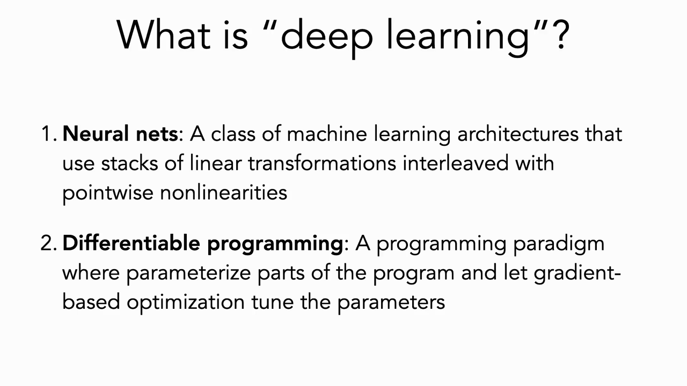
*▲ 강의 슬라이드 [01:50](https://youtu.be/6FkRvTtUc-o?t=110): 딥러닝의 두 요소*

수업 운영 안내 (요약) [02:20](https://youtu.be/6FkRvTtUc-o?t=140)

- **성적**: 과제(problem set) 65% + 기말 프로젝트 35%
- **과제**: 5개, 각 1~2주. 손 풀이(실제로는 Overleaf 등)와 코드 제출이 섞여 있음
- **기말 프로젝트**: 제안서를 먼저 내고, 최종 결과물은 **블로그 글** 형식. 새로운 실험과 시각화를 보여 줘야 함. 최대 2인 팀. 요즘 ML 논문은 블로그 글을 함께 쓰는 경우가 많아서, 기술적 깊이를 유지하면서 시각적으로 전달하는 능력을 기르려는 의도
- **계산 자원은 제공하지 않음**: 거대 모델을 큰 데이터로 돌려 최고 성능을 내는 주제는 피할 것. "크면 좋다"가 아닌 방식으로 의미 있는 연구를 하는 창의성이 오히려 중요한 역량
- **[PyTorch](00_%EB%94%A5%EB%9F%AC%EB%8B%9D_%EC%9A%A9%EC%96%B4%EC%82%AC%EC%A0%84.md#pytorch-%ED%8C%8C%EC%9D%B4%ED%86%A0%EC%B9%98) 튜토리얼**: 다음 주에 두 번 열림. 과제 코드가 [PyTorch](00_%EB%94%A5%EB%9F%AC%EB%8B%9D_%EC%9A%A9%EC%96%B4%EC%82%AC%EC%A0%84.md#pytorch-%ED%8C%8C%EC%9D%B4%ED%86%A0%EC%B9%98)로 짜여 있으므로 익숙하지 않으면 참석 권장
- **협업 규칙** [08:28](https://youtu.be/6FkRvTtUc-o?t=508): 내용 토론은 자유지만 제출물(코드 포함)은 각자 따로 작성. 함께 공부한 사람 이름은 과제 맨 위에 적기. "이 답 맞아?"라고 묻는 것도 금지
- **AI 도구 규칙** [10:08](https://youtu.be/6FkRvTtUc-o?t=608): ChatGPT 같은 AI는 **사람 협업자와 똑같이** 대함. 토론 상대로는 써도 되지만 답이나 코드를 대신 쓰게 하면 안 됨. 사용했다면 어떤 AI를 어떻게 썼는지 적기

---

## 2. 왜 딥러닝을 배우는가

▶ 영상 [11:48](https://youtu.be/6FkRvTtUc-o?t=708)

- 목표는 **현실 세계의 복잡한 현상을 모델링**하는 것입니다. 자연어, 이미지·영상, DNA, 생태계, 기후 변화가 모두 복잡한 현상입니다.
- 복잡한 현상을 모델링하기 어려운 이유는 말 그대로 복잡하기 때문입니다. 그런데 사람의 뇌는 이런 현상을 꽤 잘 모델링합니다. 강사는 이것을 "신경망 방식이 통할 수 있다는 존재 증명"으로 듭니다.

---

## 3. 신경망의 짧은 역사

▶ 영상 [13:31](https://youtu.be/6FkRvTtUc-o?t=811)

강사는 "신경망에 대한 열기"를 시간축에 놓고 오르내림으로 설명합니다.

| 연도 | 사건 | 열기 |
|---|---|---|
| 1958 | Rosenblatt가 [퍼셉트론(Perceptron)](00_%EB%94%A5%EB%9F%AC%EB%8B%9D_%EC%9A%A9%EC%96%B4%EC%82%AC%EC%A0%84.md#perceptron-%ED%8D%BC%EC%85%89%ED%8A%B8%EB%A1%A0) 발표. 픽셀 값을 가중합하고 비선형 함수를 거쳐 이미지를 [분류](00_%EB%94%A5%EB%9F%AC%EB%8B%9D_%EC%9A%A9%EC%96%B4%EC%82%AC%EC%A0%84.md#regression-classification-%ED%9A%8C%EA%B7%80%EC%99%80-%EB%B6%84%EB%A5%98). 지금도 대부분의 딥러닝, ChatGPT 내부까지 이 구조가 기본 부품 | ▲ 큰 관심 |
| 1970년대 | Minsky와 Papert의 책 *Perceptrons*가 [퍼셉트론](00_%EB%94%A5%EB%9F%AC%EB%8B%9D_%EC%9A%A9%EC%96%B4%EC%82%AC%EC%A0%84.md#perceptron-%ED%8D%BC%EC%85%89%ED%8A%B8%EB%A1%A0)이 표현할 수 있는 것의 한계를 수학적으로 엄밀하게 지적 (강의에서는 1972년이라 소개했고, 초판은 1969년) | ▼ 급락 |
| 1986 | *Parallel Distributed Processing*이 [역전파(Backpropagation)](00_%EB%94%A5%EB%9F%AC%EB%8B%9D_%EC%9A%A9%EC%96%B4%EC%82%AC%EC%A0%84.md#backpropagation-%EC%97%AD%EC%A0%84%ED%8C%8C)를 소개. 여러 [층](00_%EB%94%A5%EB%9F%AC%EB%8B%9D_%EC%9A%A9%EC%96%B4%EC%82%AC%EC%A0%84.md#layer-%EC%B8%B5)을 거쳐 [기울기](00_%EB%94%A5%EB%9F%AC%EB%8B%9D_%EC%9A%A9%EC%96%B4%EC%82%AC%EC%A0%84.md#gradient-%EA%B8%B0%EC%9A%B8%EA%B8%B0)를 전달할 수 있게 되면서 [다층 퍼셉트론(Multi-layer perceptron)](00_%EB%94%A5%EB%9F%AC%EB%8B%9D_%EC%9A%A9%EC%96%B4%EC%82%AC%EC%A0%84.md#multi-layer-perceptron-%EB%8B%A4%EC%B8%B5-%ED%8D%BC%EC%85%89%ED%8A%B8%EB%A1%A0)을 실제로 학습할 수 있게 됨. 선형으로 나눌 수 없는 [XOR 문제](00_%EB%94%A5%EB%9F%AC%EB%8B%9D_%EC%9A%A9%EC%96%B4%EC%82%AC%EC%A0%84.md#xor-problem-xor-%EB%AC%B8%EC%A0%9C)를 처음으로 풀 수 있게 됨 | ▲ 부활 |
| 1998 | Yann LeCun의 [합성곱 신경망(CNN)](00_%EB%94%A5%EB%9F%AC%EB%8B%9D_%EC%9A%A9%EC%96%B4%EC%82%AC%EC%A0%84.md#cnn-convolutional-neural-network-%ED%95%A9%EC%84%B1%EA%B3%B1-%EC%8B%A0%EA%B2%BD%EB%A7%9D) | — |
| 2000 무렵 | **[AI 겨울](00_%EB%94%A5%EB%9F%AC%EB%8B%9D_%EC%9A%A9%EC%96%B4%EC%82%AC%EC%A0%84.md#ai-winter-ai-%EA%B2%A8%EC%9A%B8)([AI winter](00_%EB%94%A5%EB%9F%AC%EB%8B%9D_%EC%9A%A9%EC%96%B4%EC%82%AC%EC%A0%84.md#ai-winter-ai-%EA%B2%A8%EC%9A%B8))**. 최고 학회인 NeurIPS 2000에서 논문 제목에 "belief propagation", "Gaussian"이 있으면 채택될 [확률](00_%EB%94%A5%EB%9F%AC%EB%8B%9D_%EC%9A%A9%EC%96%B4%EC%82%AC%EC%A0%84.md#probability-%ED%99%95%EB%A5%A0)이 높았고, "neural", "network"가 있으면 탈락할 [확률](00_%EB%94%A5%EB%9F%AC%EB%8B%9D_%EC%9A%A9%EC%96%B4%EC%82%AC%EC%A0%84.md#probability-%ED%99%95%EB%A5%A0)이 높았음. 이론과 부품은 있었지만 효율적으로 학습할 프로그래밍 방식과 하드웨어가 없었음 | ▼ 침체 |
| 2012 | Krizhevsky 등이 **AlexNet** 발표. 게임·그래픽용 대규모 병렬 곱셈 장치인 **[GPU](00_%EB%94%A5%EB%9F%AC%EB%8B%9D_%EC%9A%A9%EC%96%B4%EC%82%AC%EC%A0%84.md#device-gpu-%EC%9E%A5%EC%B9%98%EC%99%80-gpu)**를 신경망 [학습](00_%EB%94%A5%EB%9F%AC%EB%8B%9D_%EC%9A%A9%EC%96%B4%EC%82%AC%EC%A0%84.md#training-%ED%95%99%EC%8A%B5)에 쓰는 방법을 찾아냄. 최초의 초대형 데이터셋 **ImageNet**에서 다른 모든 방법을 앞지름 | ▲ 재부활 |

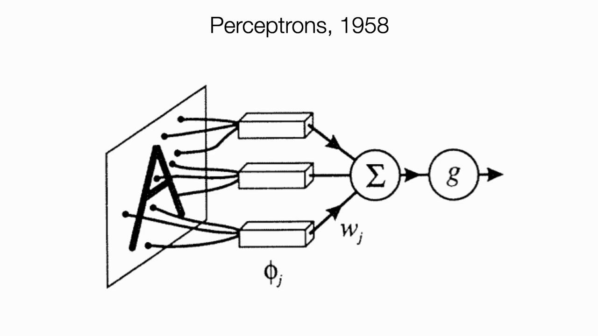
*▲ 강의 슬라이드 [14:30](https://youtu.be/6FkRvTtUc-o?t=870): Rosenblatt의 [퍼셉트론](00_%EB%94%A5%EB%9F%AC%EB%8B%9D_%EC%9A%A9%EC%96%B4%EC%82%AC%EC%A0%84.md#perceptron-%ED%8D%BC%EC%85%89%ED%8A%B8%EB%A1%A0) 구조*

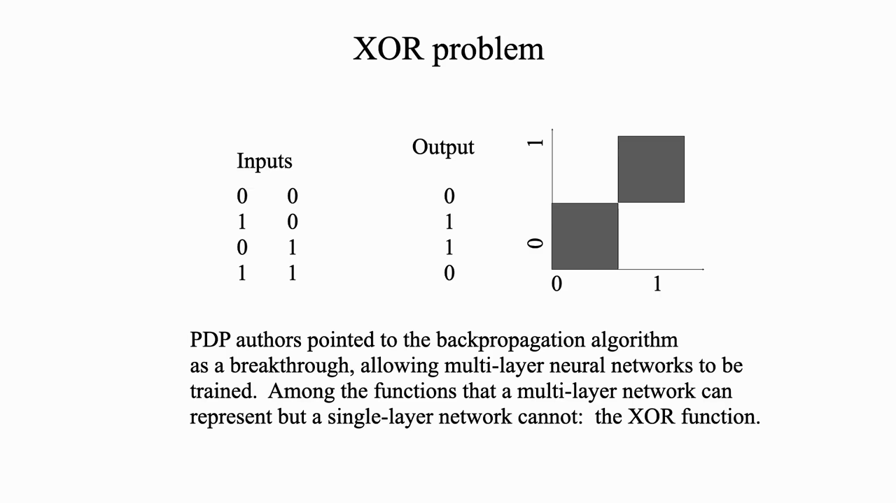
*▲ 강의 슬라이드 [16:20](https://youtu.be/6FkRvTtUc-o?t=980): [XOR 문제](00_%EB%94%A5%EB%9F%AC%EB%8B%9D_%EC%9A%A9%EC%96%B4%EC%82%AC%EC%A0%84.md#xor-problem-xor-%EB%AC%B8%EC%A0%9C), 한 [층](00_%EB%94%A5%EB%9F%AC%EB%8B%9D_%EC%9A%A9%EC%96%B4%EC%82%AC%EC%A0%84.md#layer-%EC%B8%B5)으로는 풀 수 없음*

> [!TIP]
> **강사가 꼽은 성공 요인**
> 이론과 프로그래밍(효율적인 [학습](00_%EB%94%A5%EB%9F%AC%EB%8B%9D_%EC%9A%A9%EC%96%B4%EC%82%AC%EC%A0%84.md#training-%ED%95%99%EC%8A%B5))만큼 중요한 것이 **데이터**입니다. 자기 지도 [학습](00_%EB%94%A5%EB%9F%AC%EB%8B%9D_%EC%9A%A9%EC%96%B4%EC%82%AC%EC%A0%84.md#training-%ED%95%99%EC%8A%B5)(Self-supervised learning)이 발전하고는 있지만, 머신러닝은 여전히 많은 경우 대규모로 정제되고 [정답(Label)](00_%EB%94%A5%EB%9F%AC%EB%8B%9D_%EC%9A%A9%EC%96%B4%EC%82%AC%EC%A0%84.md#label-%EC%A0%95%EB%8B%B5)이 달린 데이터 없이는 잘 동작하지 않습니다.

- 두 번의 열기 주기가 대략 **28년**이었다는 점을 들어 "2028년에는 어디에 있을까?"라고 묻습니다. 또 하나의 거품일 수도, 끝없이 치솟을 수도, 새 고원에 올랐다가 한계를 깨닫고 다시 출렁일 수도 있다고 봅니다. [19:50](https://youtu.be/6FkRvTtUc-o?t=1190)

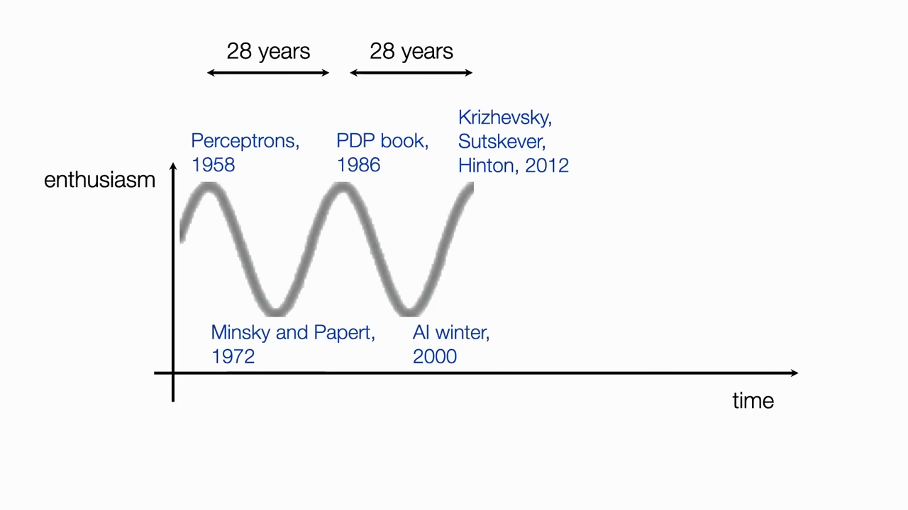
*▲ 강의 슬라이드 [19:55](https://youtu.be/6FkRvTtUc-o?t=1195): 신경망에 대한 열기의 오르내림*

> [!TIP]
> **🆕 2026 업데이트: "2028년에는 어디에?" 그 뒤 2년**
> - **강의(2024년 가을)**: 열기가 또 꺼질지, 계속 오를지 모른다며 2028년을 물었습니다.
> - **현재(2026년 10월)**: 강의 직후인 2024년 10월, 신경망 연구가 노벨상을 두 개 받았습니다. 물리학상은 Hopfield와 Hinton에게 "인공 신경망으로 머신러닝을 가능하게 한 기초 발견과 발명"으로, 화학상의 절반은 단백질 구조를 예측하는 신경망 AlphaFold를 만든 Hassabis와 Jumper에게 돌아갔습니다. 위 표의 1986년 [역전파](00_%EB%94%A5%EB%9F%AC%EB%8B%9D_%EC%9A%A9%EC%96%B4%EC%82%AC%EC%A0%84.md#backpropagation-%EC%97%AD%EC%A0%84%ED%8C%8C) 부활과 2012년 재부활을 이끈 사람이 바로 Hinton입니다. 최대 모델의 [학습](00_%EB%94%A5%EB%9F%AC%EB%8B%9D_%EC%9A%A9%EC%96%B4%EC%82%AC%EC%A0%84.md#training-%ED%95%99%EC%8A%B5) 비용과 계산량도 해마다 커지는 중입니다(아래 4절 업데이트). 다만 2028년에 [AI 겨울](00_%EB%94%A5%EB%9F%AC%EB%8B%9D_%EC%9A%A9%EC%96%B4%EC%82%AC%EC%A0%84.md#ai-winter-ai-%EA%B2%A8%EC%9A%B8)이 다시 올지는 아직 누구도 답할 수 없습니다.
> - **출처**: [The Nobel Prize in Physics 2024 – Press release (Nobel Prize, 2024)](https://www.nobelprize.org/prizes/physics/2024/press-release/) · [The Nobel Prize in Chemistry 2024 – Press release (Nobel Prize, 2024)](https://www.nobelprize.org/prizes/chemistry/2024/press-release/)

---

## 4. 오늘날의 딥러닝을 이루는 것

▶ 영상 [20:26](https://youtu.be/6FkRvTtUc-o?t=1226)

| 요소                                                                                     | 설명                                                                                                                                                    |
| -------------------------------------------------------------------------------------- | ----------------------------------------------------------------------------------------------------------------------------------------------------- |
| **자동 [미분](00_%EB%94%A5%EB%9F%AC%EB%8B%9D_%EC%9A%A9%EC%96%B4%EC%82%AC%EC%A0%84.md#derivative-%EB%AF%B8%EB%B6%84)([Autograd](00_%EB%94%A5%EB%9F%AC%EB%8B%9D_%EC%9A%A9%EC%96%B4%EC%82%AC%EC%A0%84.md#autograd-%EC%9E%90%EB%8F%99-%EB%AF%B8%EB%B6%84))** | [PyTorch](00_%EB%94%A5%EB%9F%AC%EB%8B%9D_%EC%9A%A9%EC%96%B4%EC%82%AC%EC%A0%84.md#pytorch-%ED%8C%8C%EC%9D%B4%ED%86%A0%EC%B9%98), TensorFlow 같은 도구가 [연쇄법칙(Chain rule)](00_%EB%94%A5%EB%9F%AC%EB%8B%9D_%EC%9A%A9%EC%96%B4%EC%82%AC%EC%A0%84.md#chain-rule-%EC%97%B0%EC%87%84%EB%B2%95%EC%B9%99)을 소프트웨어로 구현하고 하드웨어를 효율적으로 씀. 이제 Krizhevsky처럼 [GPU](00_%EB%94%A5%EB%9F%AC%EB%8B%9D_%EC%9A%A9%EC%96%B4%EC%82%AC%EC%A0%84.md#device-gpu-%EC%9E%A5%EC%B9%98%EC%99%80-gpu) 코드를 밑바닥부터 짜는 사람은 거의 없음 |
| **수십억 개 규모의 데이터셋**                                                                     | LAION 같은 데이터셋                                                                                                                                         |
| **수천 개 [GPU](00_%EB%94%A5%EB%9F%AC%EB%8B%9D_%EC%9A%A9%EC%96%B4%EC%82%AC%EC%A0%84.md#device-gpu-%EC%9E%A5%EC%B9%98%EC%99%80-gpu) 병렬 [학습](00_%EB%94%A5%EB%9F%AC%EB%8B%9D_%EC%9A%A9%EC%96%B4%EC%82%AC%EC%A0%84.md#training-%ED%95%99%EC%8A%B5)**                                      |                                                                                                                                                       |
| **수십억 개 이상의 [파라미터](00_%EB%94%A5%EB%9F%AC%EB%8B%9D_%EC%9A%A9%EC%96%B4%EC%82%AC%EC%A0%84.md#parameter-%ED%8C%8C%EB%9D%BC%EB%AF%B8%ED%84%B0)**                                   | 이 숫자는 계속 커지는 중                                                                                                                                        |
| **수백만 달러 이상의 [학습](00_%EB%94%A5%EB%9F%AC%EB%8B%9D_%EC%9A%A9%EC%96%B4%EC%82%AC%EC%A0%84.md#training-%ED%95%99%EC%8A%B5) 비용**                                    | [GPT](00_%EB%94%A5%EB%9F%AC%EB%8B%9D_%EC%9A%A9%EC%96%B4%EC%82%AC%EC%A0%84.md#gpt-%EC%83%9D%EC%84%B1%ED%98%95-%EC%82%AC%EC%A0%84%ED%95%99%EC%8A%B5-%ED%8A%B8%EB%9E%9C%EC%8A%A4%ED%8F%AC%EB%A8%B8)-4급 모델의 비용은 공개되지 않았지만 수백만 달러 이상으로 추정                                                                                                               |
| **놀라운 결과**                                                                             | 강사가 연구를 시작할 때는 평생 못 볼 줄 알았던 결과들                                                                                                                       |
| **오픈소스와 [모듈 재사용](00_%EB%94%A5%EB%9F%AC%EB%8B%9D_%EC%9A%A9%EC%96%B4%EC%82%AC%EC%A0%84.md#modular-reuse-%EB%AA%A8%EB%93%88-%EC%9E%AC%EC%82%AC%EC%9A%A9)(Modular reuse)**                | 남이 학습한 [가중치](00_%EB%94%A5%EB%9F%AC%EB%8B%9D_%EC%9A%A9%EC%96%B4%EC%82%AC%EC%A0%84.md#weight-%EA%B0%80%EC%A4%91%EC%B9%98)를 통째로 가져와 더 큰 시스템의 부품으로 씀. 다만 최근에는 API만 열고 [가중치](00_%EB%94%A5%EB%9F%AC%EB%8B%9D_%EC%9A%A9%EC%96%B4%EC%82%AC%EC%A0%84.md#weight-%EA%B0%80%EC%A4%91%EC%B9%98)와 구조는 공개하지 않는 경우가 늘고 있음           |

- **크다고 다 좋은 것은 아님** [22:40](https://youtu.be/6FkRvTtUc-o?t=1360): Stable Diffusion은 비교적 가벼운데도 영향력이 컸습니다. 강사가 연구하는 생물다양성 문제에서는 머신러닝이 도움을 주기도 하지만, 모델 [학습](00_%EB%94%A5%EB%9F%AC%EB%8B%9D_%EC%9A%A9%EC%96%B4%EC%82%AC%EC%A0%84.md#training-%ED%95%99%EC%8A%B5)의 **탄소 비용**이 오히려 해가 되기도 합니다.

> [!TIP]
> **🆕 2026 업데이트: [학습](00_%EB%94%A5%EB%9F%AC%EB%8B%9D_%EC%9A%A9%EC%96%B4%EC%82%AC%EC%A0%84.md#training-%ED%95%99%EC%8A%B5) 비용과 [학습](00_%EB%94%A5%EB%9F%AC%EB%8B%9D_%EC%9A%A9%EC%96%B4%EC%82%AC%EC%A0%84.md#training-%ED%95%99%EC%8A%B5) 규모**
> - **강의**: [GPT](00_%EB%94%A5%EB%9F%AC%EB%8B%9D_%EC%9A%A9%EC%96%B4%EC%82%AC%EC%A0%84.md#gpt-%EC%83%9D%EC%84%B1%ED%98%95-%EC%82%AC%EC%A0%84%ED%95%99%EC%8A%B5-%ED%8A%B8%EB%9E%9C%EC%8A%A4%ED%8F%AC%EB%A8%B8)-4급 모델의 [학습](00_%EB%94%A5%EB%9F%AC%EB%8B%9D_%EC%9A%A9%EC%96%B4%EC%82%AC%EC%A0%84.md#training-%ED%95%99%EC%8A%B5) 비용은 공개되지 않았고 "수백만 달러 이상"으로 추정된다고 했습니다.
> - **현재**: Epoch AI 연구진이 하드웨어 감가상각과 전기료로 계산한 마지막 [학습](00_%EB%94%A5%EB%9F%AC%EB%8B%9D_%EC%9A%A9%EC%96%B4%EC%82%AC%EC%A0%84.md#training-%ED%95%99%EC%8A%B5) 1회 비용은 [GPT](00_%EB%94%A5%EB%9F%AC%EB%8B%9D_%EC%9A%A9%EC%96%B4%EC%82%AC%EC%A0%84.md#gpt-%EC%83%9D%EC%84%B1%ED%98%95-%EC%82%AC%EC%A0%84%ED%95%99%EC%8A%B5-%ED%8A%B8%EB%9E%9C%EC%8A%A4%ED%8F%AC%EB%A8%B8)-4가 약 **4,000만 달러**, Gemini Ultra가 약 **3,000만 달러**입니다. 최상위 모델의 이 비용은 2016년 이후 **해마다 약 2.4배**씩 늘었고, 추세가 이어지면 2027년에는 1회에 10억 달러를 넘는다고 내다봤습니다. 계산량으로 보면 2025년 2월의 Grok-3가 처음으로 $10^{26}$ FLOP(부동소수점 연산 횟수)을 넘었고, 2027년 초에는 이런 모델이 30개 안팎이 될 것으로 추정됩니다.
> - **반대 방향의 사례**: DeepSeek-R1은 [기반 모델](00_%EB%94%A5%EB%9F%AC%EB%8B%9D_%EC%9A%A9%EC%96%B4%EC%82%AC%EC%A0%84.md#foundation-model-%EA%B8%B0%EB%B0%98-%EB%AA%A8%EB%8D%B8)에 약 600만 달러, 그 위에 [추론 모델](00_%EB%94%A5%EB%9F%AC%EB%8B%9D_%EC%9A%A9%EC%96%B4%EC%82%AC%EC%A0%84.md#reasoning-model-%EC%B6%94%EB%A1%A0-%EB%AA%A8%EB%8D%B8)로 만드는 강화 [학습](00_%EB%94%A5%EB%9F%AC%EB%8B%9D_%EC%9A%A9%EC%96%B4%EC%82%AC%EC%A0%84.md#training-%ED%95%99%EC%8A%B5)에 약 29만 4천 달러가 들었다고 2025년 Nature 논문 부록에서 밝혔습니다. 강사의 "크다고 다 좋은 것은 아님"과 이어지는 사례입니다.
> - **출처**: [The rising costs of training frontier AI models (Cottier 외, arXiv, 2024)](https://arxiv.org/abs/2405.21015) · [How many AI models will exceed compute thresholds? (Epoch AI, 2025)](https://epoch.ai/blog/model-counts-compute-thresholds) · [Secrets of DeepSeek AI model revealed in landmark paper (Nature 뉴스, 2025)](https://www.nature.com/articles/d41586-025-03015-6)

> [!TIP]
> **🆕 2026 업데이트: 공개 [가중치](00_%EB%94%A5%EB%9F%AC%EB%8B%9D_%EC%9A%A9%EC%96%B4%EC%82%AC%EC%A0%84.md#weight-%EA%B0%80%EC%A4%91%EC%B9%98)와 비공개 모델**
> - **강의**: 최근에는 API만 열고 [가중치](00_%EB%94%A5%EB%9F%AC%EB%8B%9D_%EC%9A%A9%EC%96%B4%EC%82%AC%EC%A0%84.md#weight-%EA%B0%80%EC%A4%91%EC%B9%98)와 구조는 공개하지 않는 경우가 늘고 있다고 했습니다.
> - **현재**: 비공개 흐름은 이어지지만, [가중치](00_%EB%94%A5%EB%9F%AC%EB%8B%9D_%EC%9A%A9%EC%96%B4%EC%82%AC%EC%A0%84.md#weight-%EA%B0%80%EC%A4%91%EC%B9%98)를 내려받을 수 있는 [공개 가중치 모델(Open-weight model)](00_%EB%94%A5%EB%9F%AC%EB%8B%9D_%EC%9A%A9%EC%96%B4%EC%82%AC%EC%A0%84.md#open-weight-model-%EA%B3%B5%EA%B0%9C-%EA%B0%80%EC%A4%91%EC%B9%98-%EB%AA%A8%EB%8D%B8)이 격차를 크게 좁혔습니다. 2025년 1월 DeepSeek-R1이 [가중치](00_%EB%94%A5%EB%9F%AC%EB%8B%9D_%EC%9A%A9%EC%96%B4%EC%82%AC%EC%A0%84.md#weight-%EA%B0%80%EC%A4%91%EC%B9%98)를 공개했고, 2025년 8월에는 비공개 진영의 대표였던 OpenAI도 gpt-oss-120b(전체 [파라미터](00_%EB%94%A5%EB%9F%AC%EB%8B%9D_%EC%9A%A9%EC%96%B4%EC%82%AC%EC%A0%84.md#parameter-%ED%8C%8C%EB%9D%BC%EB%AF%B8%ED%84%B0) 약 1,170억 개, [토큰](00_%EB%94%A5%EB%9F%AC%EB%8B%9D_%EC%9A%A9%EC%96%B4%EC%82%AC%EC%A0%84.md#token-%ED%86%A0%ED%81%B0)마다 쓰는 것은 약 51억 개)를 Apache 2.0 라이선스로 공개했습니다. Epoch AI의 종합 능력 지표로 재면 최고 [공개 가중치 모델](00_%EB%94%A5%EB%9F%AC%EB%8B%9D_%EC%9A%A9%EC%96%B4%EC%82%AC%EC%A0%84.md#open-weight-model-%EA%B3%B5%EA%B0%9C-%EA%B0%80%EC%A4%91%EC%B9%98-%EB%AA%A8%EB%8D%B8)은 최고 비공개 모델보다 평균 **약 3개월**(2025년 10월 분석), 2026년 1월 이후로는 **약 4개월** 뒤처져 있습니다. 강의 시점에 비하면 [모듈 재사용](00_%EB%94%A5%EB%9F%AC%EB%8B%9D_%EC%9A%A9%EC%96%B4%EC%82%AC%EC%A0%84.md#modular-reuse-%EB%AA%A8%EB%93%88-%EC%9E%AC%EC%82%AC%EC%9A%A9)의 재료는 오히려 많아졌습니다.
> - **출처**: [Open-weight models lag state-of-the-art by around 3 months on average (Epoch AI, 2025)](https://epoch.ai/data-insights/open-weights-vs-closed-weights-models) · [Open models lag state-of-the-art closed models by 4 months (Epoch AI, 2026)](https://epoch.ai/data-insights/open-closed-eci-gap) · [gpt-oss-120b & gpt-oss-20b Model Card (OpenAI, arXiv, 2025)](https://arxiv.org/abs/2508.10925)

---

## 5. 선수 지식 복습 (이미 알고 있어야 할 것)

강사는 슬라이드에 "되돌아보기(이미 봤을 것)"와 "내다보기(이 수업에서 다룰 것, 초록색)"를 구분해 표시합니다. 이 절은 **되돌아보기**에 해당합니다. 처음 보는 내용이 있으면 MIT OCW의 입문 강의 등으로 미리 보충해 오라고 합니다.

*▲ 강의 슬라이드 [24:00](https://youtu.be/6FkRvTtUc-o?t=1440): 왼쪽 화살표는 이미 알아야 할 것, 오른쪽 초록 화살표는 이 수업에서 다룰 것*

### 5.1 경사하강법

▶ 영상 [23:47](https://youtu.be/6FkRvTtUc-o?t=1427)

📐 **수학 개념**: [argmin](%EC%88%98%ED%95%99%EA%B0%9C%EB%85%90/02_%EB%AF%B8%EB%B6%84/MM01_argmin%EA%B3%BC_argmax.md) · [그래디언트 벡터(∇)](%EC%88%98%ED%95%99%EA%B0%9C%EB%85%90/02_%EB%AF%B8%EB%B6%84/MM02_%EA%B7%B8%EB%9E%98%EB%94%94%EC%96%B8%ED%8A%B8_%EB%B2%A1%ED%84%B0.md) · [미분](%EC%88%98%ED%95%99%EA%B0%9C%EB%85%90/02_%EB%AF%B8%EB%B6%84/M03_%EB%AF%B8%EB%B6%84_%EA%B8%B0%EC%9A%B8%EA%B8%B0.md) · [편미분](%EC%88%98%ED%95%99%EA%B0%9C%EB%85%90/02_%EB%AF%B8%EB%B6%84/M04_%ED%8E%B8%EB%AF%B8%EB%B6%84.md) · [최솟값](%EC%88%98%ED%95%99%EA%B0%9C%EB%85%90/02_%EB%AF%B8%EB%B6%84/M09_%EC%B5%9C%EC%86%9F%EA%B0%92%EA%B3%BC_%EB%B3%BC%EB%A1%9D%ED%95%A8%EC%88%98.md)
[손실 함수(Loss function)](00_%EB%94%A5%EB%9F%AC%EB%8B%9D_%EC%9A%A9%EC%96%B4%EC%82%AC%EC%A0%84.md#loss-function-%EC%86%90%EC%8B%A4-%ED%95%A8%EC%88%98) $J$를 모든 [학습 데이터](00_%EB%94%A5%EB%9F%AC%EB%8B%9D_%EC%9A%A9%EC%96%B4%EC%82%AC%EC%A0%84.md#training-data-test-data-%ED%95%99%EC%8A%B5-%EB%8D%B0%EC%9D%B4%ED%84%B0%EC%99%80-%EC%8B%9C%ED%97%98-%EB%8D%B0%EC%9D%B4%ED%84%B0)에 대해 최소로 만드는 최적 [파라미터](00_%EB%94%A5%EB%9F%AC%EB%8B%9D_%EC%9A%A9%EC%96%B4%EC%82%AC%EC%A0%84.md#parameter-%ED%8C%8C%EB%9D%BC%EB%AF%B8%ED%84%B0) $\theta^*$를 찾는 것이 목표입니다.

$$
\theta^* = \arg\min_\theta \frac{1}{N}\sum_{i=1}^{N} L\big(f_\theta(x_i),\, y_i\big)
$$

기호 풀이

| 기호 | 읽는 법 | 뜻 | 예제 값 |
| --- | --- | --- | --- |
| $\theta^*$ | 세타 스타 | 평균 [손실](00_%EB%94%A5%EB%9F%AC%EB%8B%9D_%EC%9A%A9%EC%96%B4%EC%82%AC%EC%A0%84.md#loss-function-%EC%86%90%EC%8B%A4-%ED%95%A8%EC%88%98)을 가장 작게 만드는 최적 [파라미터](00_%EB%94%A5%EB%9F%AC%EB%8B%9D_%EC%9A%A9%EC%96%B4%EC%82%AC%EC%A0%84.md#parameter-%ED%8C%8C%EB%9D%BC%EB%AF%B8%ED%84%B0) | 2 |
| $\arg\min_\theta$ | 아그민 세타 | 값이 가장 작아지는 θ의 위치를 고름 ([argmin](00_%EB%94%A5%EB%9F%AC%EB%8B%9D_%EC%9A%A9%EC%96%B4%EC%82%AC%EC%A0%84.md#argmin-%EC%B5%9C%EC%86%9F%EA%B0%92-%EC%9C%84%EC%B9%98)) | θ = 2 |
| $\theta$ | 세타 | 모델의 [파라미터](00_%EB%94%A5%EB%9F%AC%EB%8B%9D_%EC%9A%A9%EC%96%B4%EC%82%AC%EC%A0%84.md#parameter-%ED%8C%8C%EB%9D%BC%EB%AF%B8%ED%84%B0) (여기서는 숫자 하나) | 후보 2, 3 |
| $N$ | 엔 | [학습 데이터](00_%EB%94%A5%EB%9F%AC%EB%8B%9D_%EC%9A%A9%EC%96%B4%EC%82%AC%EC%A0%84.md#training-data-test-data-%ED%95%99%EC%8A%B5-%EB%8D%B0%EC%9D%B4%ED%84%B0%EC%99%80-%EC%8B%9C%ED%97%98-%EB%8D%B0%EC%9D%B4%ED%84%B0) 수 | 2 |
| $\sum_{i=1}^{N}$ | 시그마 아이는 1부터 엔까지 | i = 1, …, N 항을 모두 더함 | 2개 항의 합 |
| $\frac{1}{N}$ | 엔분의 일 | 합을 N으로 나눠 평균을 냄 | 1/2 |
| $L$ | 엘 | 데이터 하나의 벌점([손실](00_%EB%94%A5%EB%9F%AC%EB%8B%9D_%EC%9A%A9%EC%96%B4%EC%82%AC%EC%A0%84.md#loss-function-%EC%86%90%EC%8B%A4-%ED%95%A8%EC%88%98)) | (4 − 5)² = 1 |
| $f_\theta$ | 에프 세타 | θ로 정해지는 모델 | θx |
| $x_i$ | 엑스 아이 | i번째 입력 | $x_2 = 2$ |
| $y_i$ | 와이 아이 | i번째 [정답](00_%EB%94%A5%EB%9F%AC%EB%8B%9D_%EC%9A%A9%EC%96%B4%EC%82%AC%EC%A0%84.md#label-%EC%A0%95%EB%8B%B5) | $y_2 = 5$ |

예제와 풀이

**문제**: 입력 x로 [정답](00_%EB%94%A5%EB%9F%AC%EB%8B%9D_%EC%9A%A9%EC%96%B4%EC%82%AC%EC%A0%84.md#label-%EC%A0%95%EB%8B%B5) y를 맞히는 모델 $f_\theta(x) = \theta x$가 있고 벌점은 $L = (f_\theta(x) - y)^2$이다. 데이터 2개에 대한 평균 벌점이 가장 작은 θ를 후보 2와 3 중에서 고르면?

**주어진 값**:
- $N = 2$ (데이터 수)
- $x_1 = 1,\ y_1 = 2$ (첫째 데이터의 입력과 [정답](00_%EB%94%A5%EB%9F%AC%EB%8B%9D_%EC%9A%A9%EC%96%B4%EC%82%AC%EC%A0%84.md#label-%EC%A0%95%EB%8B%B5))
- $x_2 = 2,\ y_2 = 5$ (둘째 데이터의 입력과 [정답](00_%EB%94%A5%EB%9F%AC%EB%8B%9D_%EC%9A%A9%EC%96%B4%EC%82%AC%EC%A0%84.md#label-%EC%A0%95%EB%8B%B5))
- $\theta = 2$ 또는 $3$ ([파라미터](00_%EB%94%A5%EB%9F%AC%EB%8B%9D_%EC%9A%A9%EC%96%B4%EC%82%AC%EC%A0%84.md#parameter-%ED%8C%8C%EB%9D%BC%EB%AF%B8%ED%84%B0) 후보)

**풀이**
1. 식을 그대로 쓴다: $\theta^* = \arg\min_\theta \frac{1}{N}\sum_{i=1}^{N} L\big(f_\theta(x_i),\, y_i\big)$
2. 값을 대입한다 (Σ를 i = 1, 2 두 항으로 펼침): $\theta^* = \arg\min_\theta \frac{1}{2}\big[(\theta \times 1 - 2)^2 + (\theta \times 2 - 5)^2\big]$
3. θ = 2를 넣고 곱셈을 한다: 2 × 1 = 2, 2 × 2 = 4 이므로 $\frac{1}{2}\big[(2 - 2)^2 + (4 - 5)^2\big]$
4. 괄호 안 뺄셈을 한다: 2 − 2 = 0, 4 − 5 = −1 이므로 $\frac{1}{2}\big[0^2 + (-1)^2\big]$
5. 제곱을 한다: 0² = 0, (−1)² = 1 이므로 $\frac{1}{2}\big[0 + 1\big]$
6. 더한다: 0 + 1 = 1 이므로 $\frac{1}{2} \times 1$
7. 2로 나눈다: 1 ÷ 2 = 0.5 (θ = 2의 평균 벌점)
8. θ = 3을 넣고 곱셈을 한다: 3 × 1 = 3, 3 × 2 = 6 이므로 $\frac{1}{2}\big[(3 - 2)^2 + (6 - 5)^2\big]$
9. 괄호 안 뺄셈을 한다: 3 − 2 = 1, 6 − 5 = 1 이므로 $\frac{1}{2}\big[1^2 + 1^2\big]$
10. 제곱을 한다: 1² = 1 이므로 $\frac{1}{2}\big[1 + 1\big]$
11. 더한다: 1 + 1 = 2 이므로 $\frac{1}{2} \times 2$
12. 2로 나눈다: 2 ÷ 2 = 1 (θ = 3의 평균 벌점)
13. [argmin](00_%EB%94%A5%EB%9F%AC%EB%8B%9D_%EC%9A%A9%EC%96%B4%EC%82%AC%EC%A0%84.md#argmin-%EC%B5%9C%EC%86%9F%EA%B0%92-%EC%9C%84%EC%B9%98)은 값이 더 작은 쪽의 θ를 고른다: 0.5 < 1 이므로 θ = 2

**답**: θ* = 2 (평균 [손실](00_%EB%94%A5%EB%9F%AC%EB%8B%9D_%EC%9A%A9%EC%96%B4%EC%82%AC%EC%A0%84.md#loss-function-%EC%86%90%EC%8B%A4-%ED%95%A8%EC%88%98) 0.5)

내 이해

임의의 위치에서 출발해 [기울기](00_%EB%94%A5%EB%9F%AC%EB%8B%9D_%EC%9A%A9%EC%96%B4%EC%82%AC%EC%A0%84.md#gradient-%EA%B8%B0%EC%9A%B8%EA%B8%B0)를 계산하고, [기울기](00_%EB%94%A5%EB%9F%AC%EB%8B%9D_%EC%9A%A9%EC%96%B4%EC%82%AC%EC%A0%84.md#gradient-%EA%B8%B0%EC%9A%B8%EA%B8%B0)의 **반대 방향**으로 조금씩 이동하기를 반복합니다. 한 번의 갱신은 다음과 같고, $\eta$는 [학습률(Learning rate)](00_%EB%94%A5%EB%9F%AC%EB%8B%9D_%EC%9A%A9%EC%96%B4%EC%82%AC%EC%A0%84.md#learning-rate-%ED%95%99%EC%8A%B5%EB%A5%A0)입니다.

$$
\theta \leftarrow \theta - \eta\, \nabla_\theta J(\theta)
$$

기호 풀이

| 기호 | 읽는 법 | 뜻 | 예제 값 |
| --- | --- | --- | --- |
| $\theta$ | 세타 | 지금의 [파라미터](00_%EB%94%A5%EB%9F%AC%EB%8B%9D_%EC%9A%A9%EC%96%B4%EC%82%AC%EC%A0%84.md#parameter-%ED%8C%8C%EB%9D%BC%EB%AF%B8%ED%84%B0) | 1 |
| $\leftarrow$ | 갱신 | 오른쪽 값으로 바꿔 넣기 (코드의 `=`) | 1 → 1.4 |
| $\eta$ | 에타 | [학습률](00_%EB%94%A5%EB%9F%AC%EB%8B%9D_%EC%9A%A9%EC%96%B4%EC%82%AC%EC%A0%84.md#learning-rate-%ED%95%99%EC%8A%B5%EB%A5%A0), 한 걸음의 크기 | 0.1 |
| $\nabla_\theta$ | 나블라 세타 | θ에 대한 [기울기](00_%EB%94%A5%EB%9F%AC%EB%8B%9D_%EC%9A%A9%EC%96%B4%EC%82%AC%EC%A0%84.md#gradient-%EA%B8%B0%EC%9A%B8%EA%B8%B0)(그래디언트) | - |
| $J(\theta)$ | 제이 세타 | θ일 때의 [손실](00_%EB%94%A5%EB%9F%AC%EB%8B%9D_%EC%9A%A9%EC%96%B4%EC%82%AC%EC%A0%84.md#loss-function-%EC%86%90%EC%8B%A4-%ED%95%A8%EC%88%98) | 4 |
| $\nabla_\theta J(\theta)$ | 나블라 세타 제이 | [손실](00_%EB%94%A5%EB%9F%AC%EB%8B%9D_%EC%9A%A9%EC%96%B4%EC%82%AC%EC%A0%84.md#loss-function-%EC%86%90%EC%8B%A4-%ED%95%A8%EC%88%98)이 가장 가파르게 커지는 방향과 크기 | −4 |

예제와 풀이

**문제**: [손실](00_%EB%94%A5%EB%9F%AC%EB%8B%9D_%EC%9A%A9%EC%96%B4%EC%82%AC%EC%A0%84.md#loss-function-%EC%86%90%EC%8B%A4-%ED%95%A8%EC%88%98)이 $J(\theta) = (\theta - 3)^2$인 모델에서 지금 [파라미터](00_%EB%94%A5%EB%9F%AC%EB%8B%9D_%EC%9A%A9%EC%96%B4%EC%82%AC%EC%A0%84.md#parameter-%ED%8C%8C%EB%9D%BC%EB%AF%B8%ED%84%B0)가 1이고 [학습률](00_%EB%94%A5%EB%9F%AC%EB%8B%9D_%EC%9A%A9%EC%96%B4%EC%82%AC%EC%A0%84.md#learning-rate-%ED%95%99%EC%8A%B5%EB%A5%A0)이 0.1일 때, [경사하강법](00_%EB%94%A5%EB%9F%AC%EB%8B%9D_%EC%9A%A9%EC%96%B4%EC%82%AC%EC%A0%84.md#gradient-descent-%EA%B2%BD%EC%82%AC%ED%95%98%EA%B0%95%EB%B2%95)으로 한 번 갱신한 θ와 그때의 [손실](00_%EB%94%A5%EB%9F%AC%EB%8B%9D_%EC%9A%A9%EC%96%B4%EC%82%AC%EC%A0%84.md#loss-function-%EC%86%90%EC%8B%A4-%ED%95%A8%EC%88%98)은?

**주어진 값**:
- $\theta = 1$ (지금 [파라미터](00_%EB%94%A5%EB%9F%AC%EB%8B%9D_%EC%9A%A9%EC%96%B4%EC%82%AC%EC%A0%84.md#parameter-%ED%8C%8C%EB%9D%BC%EB%AF%B8%ED%84%B0))
- $\eta = 0.1$ ([학습률](00_%EB%94%A5%EB%9F%AC%EB%8B%9D_%EC%9A%A9%EC%96%B4%EC%82%AC%EC%A0%84.md#learning-rate-%ED%95%99%EC%8A%B5%EB%A5%A0), 한 걸음의 크기)
- $\nabla_\theta J(\theta) = 2(\theta - 3)$ ([손실](00_%EB%94%A5%EB%9F%AC%EB%8B%9D_%EC%9A%A9%EC%96%B4%EC%82%AC%EC%A0%84.md#loss-function-%EC%86%90%EC%8B%A4-%ED%95%A8%EC%88%98) $(\theta - 3)^2$를 θ로 미분한 [기울기](00_%EB%94%A5%EB%9F%AC%EB%8B%9D_%EC%9A%A9%EC%96%B4%EC%82%AC%EC%A0%84.md#gradient-%EA%B8%B0%EC%9A%B8%EA%B8%B0) 식)

**풀이**
1. 식을 그대로 쓴다: $\theta \leftarrow \theta - \eta\, \nabla_\theta J(\theta)$
2. 값을 대입한다: $\theta \leftarrow 1 - 0.1 \times 2(1 - 3)$
3. 괄호 안 뺄셈을 먼저 한다: 1 − 3 = −2 이므로 $\theta \leftarrow 1 - 0.1 \times 2 \times (-2)$
4. [기울기](00_%EB%94%A5%EB%9F%AC%EB%8B%9D_%EC%9A%A9%EC%96%B4%EC%82%AC%EC%A0%84.md#gradient-%EA%B8%B0%EC%9A%B8%EA%B8%B0) 곱셈을 한다: 2 × (−2) = −4 이므로 $\theta \leftarrow 1 - 0.1 \times (-4)$
5. [학습률](00_%EB%94%A5%EB%9F%AC%EB%8B%9D_%EC%9A%A9%EC%96%B4%EC%82%AC%EC%A0%84.md#learning-rate-%ED%95%99%EC%8A%B5%EB%A5%A0)을 곱한다: 0.1 × (−4) = −0.4 이므로 $\theta \leftarrow 1 - (-0.4)$
6. 음수를 빼는 것은 더하는 것과 같다: 1 + 0.4 = 1.4 이므로 θ = 1.4
7. 갱신 전 [손실](00_%EB%94%A5%EB%9F%AC%EB%8B%9D_%EC%9A%A9%EC%96%B4%EC%82%AC%EC%A0%84.md#loss-function-%EC%86%90%EC%8B%A4-%ED%95%A8%EC%88%98)을 구한다 (확인용): 1 − 3 = −2, (−2)² = 4
8. 갱신 후 [손실](00_%EB%94%A5%EB%9F%AC%EB%8B%9D_%EC%9A%A9%EC%96%B4%EC%82%AC%EC%A0%84.md#loss-function-%EC%86%90%EC%8B%A4-%ED%95%A8%EC%88%98)을 구한다 (확인용): 1.4 − 3 = −1.6, (−1.6)² = 2.56

**답**: θ = 1.4, J는 4에서 2.56으로 줄어든다

내 이해

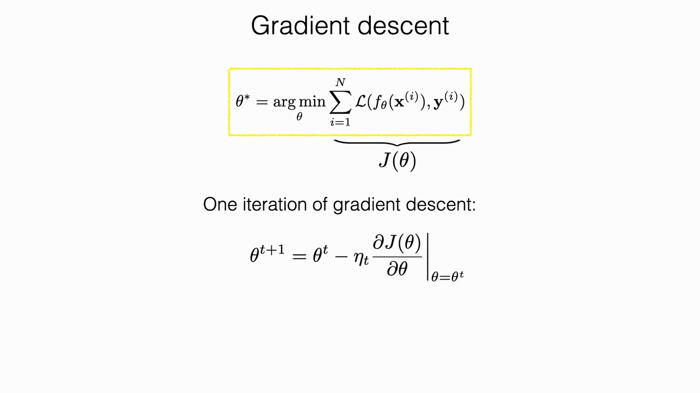
*▲ 강의 슬라이드 [25:50](https://youtu.be/6FkRvTtUc-o?t=1550): [학습](00_%EB%94%A5%EB%9F%AC%EB%8B%9D_%EC%9A%A9%EC%96%B4%EC%82%AC%EC%A0%84.md#training-%ED%95%99%EC%8A%B5) 목표 θ* = [argmin](00_%EB%94%A5%EB%9F%AC%EB%8B%9D_%EC%9A%A9%EC%96%B4%EC%82%AC%EC%A0%84.md#argmin-%EC%B5%9C%EC%86%9F%EA%B0%92-%EC%9C%84%EC%B9%98) J(θ)와 한 번의 경사하강 갱신*

> [!NOTE]
> **내다보기: 이 수업에서 다룰 것 [25:29](https://youtu.be/6FkRvTtUc-o?t=1529)**
> [경사하강법(Gradient descent)](00_%EB%94%A5%EB%9F%AC%EB%8B%9D_%EC%9A%A9%EC%96%B4%EC%82%AC%EC%A0%84.md#gradient-descent-%EA%B2%BD%EC%82%AC%ED%95%98%EA%B0%95%EB%B2%95)과 [확률적 경사하강법(SGD)](00_%EB%94%A5%EB%9F%AC%EB%8B%9D_%EC%9A%A9%EC%96%B4%EC%82%AC%EC%A0%84.md#stochastic-gradient-descent-%ED%99%95%EB%A5%A0%EC%A0%81-%EA%B2%BD%EC%82%AC%ED%95%98%EA%B0%95%EB%B2%95)의 세부 사항, [역전파](00_%EB%94%A5%EB%9F%AC%EB%8B%9D_%EC%9A%A9%EC%96%B4%EC%82%AC%EC%A0%84.md#backpropagation-%EC%97%AD%EC%A0%84%ED%8C%8C), 그리고 "최적화를 중심으로 프로그래밍 언어를 설계한다"는 [미분](00_%EB%94%A5%EB%9F%AC%EB%8B%9D_%EC%9A%A9%EC%96%B4%EC%82%AC%EC%A0%84.md#derivative-%EB%AF%B8%EB%B6%84) 가능 프로그래밍의 관점. 무엇을 최적화하고 [기울기](00_%EB%94%A5%EB%9F%AC%EB%8B%9D_%EC%9A%A9%EC%96%B4%EC%82%AC%EC%A0%84.md#gradient-%EA%B8%B0%EC%9A%B8%EA%B8%B0)를 어디까지 흘려보내는지가 핵심 질문입니다. 다음 강의에서 자세히 다룹니다.

### 5.2 선형층

▶ 영상 [26:35](https://youtu.be/6FkRvTtUc-o?t=1595)

📐 **수학 개념**: [벡터 표기와 전치](%EC%88%98%ED%95%99%EA%B0%9C%EB%85%90/03_%EC%84%A0%ED%98%95%EB%8C%80%EC%88%98/MM03_%EB%B2%A1%ED%84%B0_%ED%91%9C%EA%B8%B0%EC%99%80_%EC%A0%84%EC%B9%98.md) · [시그마(Σ)](%EC%88%98%ED%95%99%EA%B0%9C%EB%85%90/01_%EC%88%98%EC%99%80_%ED%95%A8%EC%88%98/M02_%EC%8B%9C%EA%B7%B8%EB%A7%88%EC%99%80_%ED%8F%89%EA%B7%A0.md) · [벡터와 행렬](%EC%88%98%ED%95%99%EA%B0%9C%EB%85%90/03_%EC%84%A0%ED%98%95%EB%8C%80%EC%88%98/M05_%EB%B2%A1%ED%84%B0%EC%99%80_%ED%96%89%EB%A0%AC.md)
신경망은 대체로 "벡터가 들어가서 벡터가 나오는" 계산이고, **같은 단순한 계산 단위를 반복해서 재사용**한다는 특징이 있습니다. 가장 기본 부품은 [선형층](00_%EB%94%A5%EB%9F%AC%EB%8B%9D_%EC%9A%A9%EC%96%B4%EC%82%AC%EC%A0%84.md#linear-layer-%EC%84%A0%ED%98%95%EC%B8%B5)입니다. 출력의 $j$번째 성분 $z_j$는 입력 성분마다 [가중치(Weight)](00_%EB%94%A5%EB%9F%AC%EB%8B%9D_%EC%9A%A9%EC%96%B4%EC%82%AC%EC%A0%84.md#weight-%EA%B0%80%EC%A4%91%EC%B9%98)를 곱해 더하고 [편향(Bias)](00_%EB%94%A5%EB%9F%AC%EB%8B%9D_%EC%9A%A9%EC%96%B4%EC%82%AC%EC%A0%84.md#bias-%ED%8E%B8%ED%96%A5)을 더한 값입니다. [편향](00_%EB%94%A5%EB%9F%AC%EB%8B%9D_%EC%9A%A9%EC%96%B4%EC%82%AC%EC%A0%84.md#bias-%ED%8E%B8%ED%96%A5)은 입력과 상관없이 더해지는 항입니다.

$$
z_j = \sum_i w_{ij}\, x_i + b_j = \mathbf{x}^\top \mathbf{w}_j + b_j
$$

기호 풀이

| 기호 | 읽는 법 | 뜻 | 예제 값 |
| --- | --- | --- | --- |
| $z_j$ | 지 제이 | 출력의 j번째 칸 | −1.7 |
| $\sum_i$ | 시그마 아이 | 입력 칸 i를 모두 돌며 더함 | 3개 항의 합 |
| $w_{ij}$ | 더블유 아이 제이 | 입력 i에서 출력 j로 가는 [가중치](00_%EB%94%A5%EB%9F%AC%EB%8B%9D_%EC%9A%A9%EC%96%B4%EC%82%AC%EC%A0%84.md#weight-%EA%B0%80%EC%A4%91%EC%B9%98) | $w_{3j} = 2$ |
| $x_i$ | 엑스 아이 | 입력의 i번째 칸 | $x_3 = -1$ |
| $b_j$ | 비 제이 | 출력 j칸의 [편향](00_%EB%94%A5%EB%9F%AC%EB%8B%9D_%EC%9A%A9%EC%96%B4%EC%82%AC%EC%A0%84.md#bias-%ED%8E%B8%ED%96%A5) | 0.3 |
| $\mathbf{x}$ | 굵은 엑스 | 입력 벡터 | (2, 1, −1) |
| $^\top$ | [전치](00_%EB%94%A5%EB%9F%AC%EB%8B%9D_%EC%9A%A9%EC%96%B4%EC%82%AC%EC%A0%84.md#transpose-%EC%A0%84%EC%B9%98) (트랜스포즈) | 행과 열을 맞바꿈 (세로 벡터를 눕힘) | - |
| $\mathbf{w}_j$ | 굵은 더블유 제이 | 출력 j칸의 [가중치](00_%EB%94%A5%EB%9F%AC%EB%8B%9D_%EC%9A%A9%EC%96%B4%EC%82%AC%EC%A0%84.md#weight-%EA%B0%80%EC%A4%91%EC%B9%98) 벡터 | (0.5, −1, 2) |

예제와 풀이

**문제**: 입력 3칸짜리 [선형층](00_%EB%94%A5%EB%9F%AC%EB%8B%9D_%EC%9A%A9%EC%96%B4%EC%82%AC%EC%A0%84.md#linear-layer-%EC%84%A0%ED%98%95%EC%B8%B5)에서 출력 j칸의 [가중치](00_%EB%94%A5%EB%9F%AC%EB%8B%9D_%EC%9A%A9%EC%96%B4%EC%82%AC%EC%A0%84.md#weight-%EA%B0%80%EC%A4%91%EC%B9%98)가 (0.5, −1, 2), [편향](00_%EB%94%A5%EB%9F%AC%EB%8B%9D_%EC%9A%A9%EC%96%B4%EC%82%AC%EC%A0%84.md#bias-%ED%8E%B8%ED%96%A5)이 0.3일 때 입력 (2, 1, −1)에 대한 출력 $z_j$는?

**주어진 값**:
- $\mathbf{x} = (x_1, x_2, x_3) = (2, 1, -1)$ (입력 벡터)
- $\mathbf{w}_j = (w_{1j}, w_{2j}, w_{3j}) = (0.5, -1, 2)$ (출력 j칸의 [가중치](00_%EB%94%A5%EB%9F%AC%EB%8B%9D_%EC%9A%A9%EC%96%B4%EC%82%AC%EC%A0%84.md#weight-%EA%B0%80%EC%A4%91%EC%B9%98))
- $b_j = 0.3$ (출력 j칸의 [편향](00_%EB%94%A5%EB%9F%AC%EB%8B%9D_%EC%9A%A9%EC%96%B4%EC%82%AC%EC%A0%84.md#bias-%ED%8E%B8%ED%96%A5))

**풀이**
1. 식을 그대로 쓴다: $z_j = \sum_i w_{ij}\, x_i + b_j = \mathbf{x}^\top \mathbf{w}_j + b_j$
2. 값을 대입한다 (Σ를 i = 1, 2, 3 세 항으로 펼침): $z_j = 0.5 \times 2 + (-1) \times 1 + 2 \times (-1) + 0.3$
3. 첫째 곱셈을 한다: 0.5 × 2 = 1 이므로 $z_j = 1 + (-1) \times 1 + 2 \times (-1) + 0.3$
4. 둘째 곱셈을 한다: (−1) × 1 = −1 이므로 $z_j = 1 + (-1) + 2 \times (-1) + 0.3$
5. 셋째 곱셈을 한다: 2 × (−1) = −2 이므로 $z_j = 1 + (-1) + (-2) + 0.3$
6. 왼쪽부터 더한다: 1 + (−1) = 0 이므로 $z_j = 0 + (-2) + 0.3$
7. 이어서 더한다: 0 + (−2) = −2 (이 값이 $\mathbf{x}^\top \mathbf{w}_j$) 이므로 $z_j = -2 + 0.3$
8. [편향](00_%EB%94%A5%EB%9F%AC%EB%8B%9D_%EC%9A%A9%EC%96%B4%EC%82%AC%EC%A0%84.md#bias-%ED%8E%B8%ED%96%A5)을 더한다: −2 + 0.3 = −1.7

**답**: $z_j = -1.7$

내 이해

모델의 [파라미터](00_%EB%94%A5%EB%9F%AC%EB%8B%9D_%EC%9A%A9%EC%96%B4%EC%82%AC%EC%A0%84.md#parameter-%ED%8C%8C%EB%9D%BC%EB%AF%B8%ED%84%B0) $\theta$는 모든 [가중치](00_%EB%94%A5%EB%9F%AC%EB%8B%9D_%EC%9A%A9%EC%96%B4%EC%82%AC%EC%A0%84.md#weight-%EA%B0%80%EC%A4%91%EC%B9%98)와 모든 [편향](00_%EB%94%A5%EB%9F%AC%EB%8B%9D_%EC%9A%A9%EC%96%B4%EC%82%AC%EC%A0%84.md#bias-%ED%8E%B8%ED%96%A5)의 모음입니다. 이 수업은 앞으로 이 표기법을 계속 씁니다.

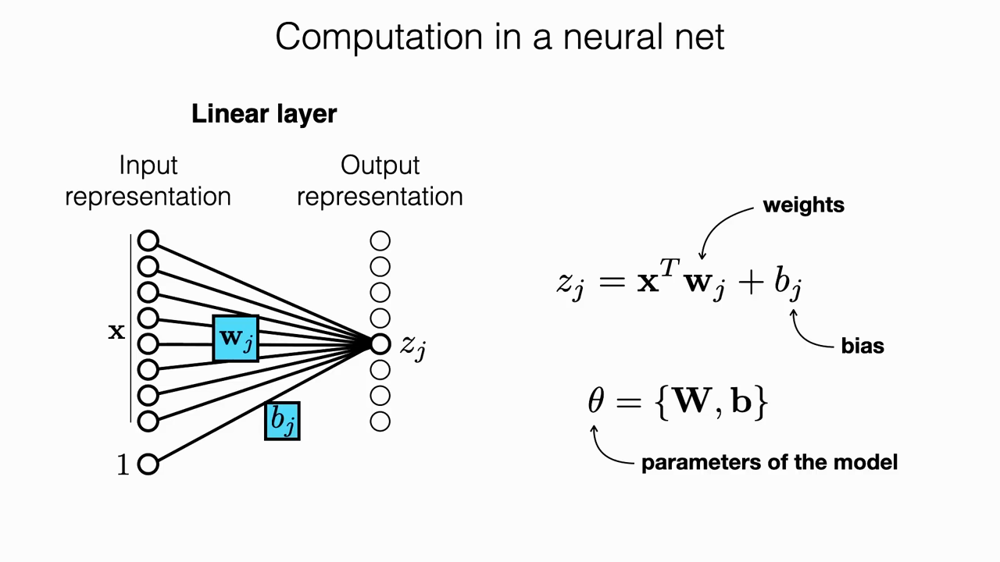
*▲ 강의 슬라이드 [27:40](https://youtu.be/6FkRvTtUc-o?t=1660): [선형층](00_%EB%94%A5%EB%9F%AC%EB%8B%9D_%EC%9A%A9%EC%96%B4%EC%82%AC%EC%A0%84.md#linear-layer-%EC%84%A0%ED%98%95%EC%B8%B5)과 [편향](00_%EB%94%A5%EB%9F%AC%EB%8B%9D_%EC%9A%A9%EC%96%B4%EC%82%AC%EC%A0%84.md#bias-%ED%8E%B8%ED%96%A5), [파라미터](00_%EB%94%A5%EB%9F%AC%EB%8B%9D_%EC%9A%A9%EC%96%B4%EC%82%AC%EC%A0%84.md#parameter-%ED%8C%8C%EB%9D%BC%EB%AF%B8%ED%84%B0) θ = {W, b}*

### 5.3 비선형 활성화 함수

▶ 영상 [27:46](https://youtu.be/6FkRvTtUc-o?t=1666)

📐 **수학 개념**: [활성화 함수의 미분](%EC%88%98%ED%95%99%EA%B0%9C%EB%85%90/05_%EC%8B%A0%EA%B2%BD%EB%A7%9D%EC%9D%98_%EA%B3%84%EC%82%B0/MM05_%ED%99%9C%EC%84%B1%ED%99%94_%ED%95%A8%EC%88%98%EC%9D%98_%EB%AF%B8%EB%B6%84.md) · [지수와 e](%EC%88%98%ED%95%99%EA%B0%9C%EB%85%90/01_%EC%88%98%EC%99%80_%ED%95%A8%EC%88%98/M06_%EC%A7%80%EC%88%98%EC%99%80_e.md) · [오즈와 로짓(시그모이드)](%EC%88%98%ED%95%99%EA%B0%9C%EB%85%90/04_%ED%99%95%EB%A5%A0%EA%B3%BC_%EC%A0%95%EB%B3%B4/M11_%EC%98%A4%EC%A6%88%EC%99%80_%EB%A1%9C%EC%A7%93.md)
선형 결합만으로는 신경망이 되지 않습니다. 출력에 **원소별 비선형 함수** $g$를 적용해야 합니다. 이것이 [활성화 함수(Activation function)](00_%EB%94%A5%EB%9F%AC%EB%8B%9D_%EC%9A%A9%EC%96%B4%EC%82%AC%EC%A0%84.md#activation-function-%ED%99%9C%EC%84%B1%ED%99%94-%ED%95%A8%EC%88%98)입니다.

| 함수 | 식 | 장점 | 단점 |
|---|---|---|---|
| 계단 함수(Step function) | $z>0$이면 1, 아니면 0 | 문턱값으로 [분류](00_%EB%94%A5%EB%9F%AC%EB%8B%9D_%EC%9A%A9%EC%96%B4%EC%82%AC%EC%A0%84.md#regression-classification-%ED%9A%8C%EA%B7%80%EC%99%80-%EB%B6%84%EB%A5%98)가 바로 됨 | **[미분](00_%EB%94%A5%EB%9F%AC%EB%8B%9D_%EC%9A%A9%EC%96%B4%EC%82%AC%EC%A0%84.md#derivative-%EB%AF%B8%EB%B6%84) 불가능**하고 거의 모든 곳에서 [기울기](00_%EB%94%A5%EB%9F%AC%EB%8B%9D_%EC%9A%A9%EC%96%B4%EC%82%AC%EC%A0%84.md#gradient-%EA%B8%B0%EC%9A%B8%EA%B8%B0)가 0이라 어느 쪽으로 가야 할지 알 수 없음 → [역전파](00_%EB%94%A5%EB%9F%AC%EB%8B%9D_%EC%9A%A9%EC%96%B4%EC%82%AC%EC%A0%84.md#backpropagation-%EC%97%AD%EC%A0%84%ED%8C%8C) 불가 |
| [tanh](00_%EB%94%A5%EB%9F%AC%EB%8B%9D_%EC%9A%A9%EC%96%B4%EC%82%AC%EC%A0%84.md#tanh-%EC%8C%8D%EA%B3%A1%ED%83%84%EC%A0%A0%ED%8A%B8) ([쌍곡탄젠트](00_%EB%94%A5%EB%9F%AC%EB%8B%9D_%EC%9A%A9%EC%96%B4%EC%82%AC%EC%A0%84.md#tanh-%EC%8C%8D%EA%B3%A1%ED%83%84%EC%A0%A0%ED%8A%B8)) | $\tanh(z) = 2\sigma(2z) - 1$ | 출력이 $-1$~$1$로 묶이고 **0을 중심**으로 분포 | 입력이 아주 크거나 작으면 [기울기](00_%EB%94%A5%EB%9F%AC%EB%8B%9D_%EC%9A%A9%EC%96%B4%EC%82%AC%EC%A0%84.md#gradient-%EA%B8%B0%EC%9A%B8%EA%B8%B0)가 0에 가까워짐([포화](00_%EB%94%A5%EB%9F%AC%EB%8B%9D_%EC%9A%A9%EC%96%B4%EC%82%AC%EC%A0%84.md#saturation-%ED%8F%AC%ED%99%94)) → [학습](00_%EB%94%A5%EB%9F%AC%EB%8B%9D_%EC%9A%A9%EC%96%B4%EC%82%AC%EC%A0%84.md#training-%ED%95%99%EC%8A%B5) 신호가 약해짐 |
| [시그모이드(Sigmoid)](00_%EB%94%A5%EB%9F%AC%EB%8B%9D_%EC%9A%A9%EC%96%B4%EC%82%AC%EC%A0%84.md#sigmoid-%EC%8B%9C%EA%B7%B8%EB%AA%A8%EC%9D%B4%EB%93%9C) | $\sigma(z) = \dfrac{1}{1+e^{-z}}$ | 출력이 0~1. 초기에는 뉴런의 발화율로 해석함 | [포화](00_%EB%94%A5%EB%9F%AC%EB%8B%9D_%EC%9A%A9%EC%96%B4%EC%82%AC%EC%A0%84.md#saturation-%ED%8F%AC%ED%99%94) 문제가 같고, 출력 중심이 0.5라 한쪽으로 치우침(조건이 나쁨). **실제로는 잘 쓰지 않음** |
| [ReLU(렐루)](00_%EB%94%A5%EB%9F%AC%EB%8B%9D_%EC%9A%A9%EC%96%B4%EC%82%AC%EC%A0%84.md#relu-%EB%A0%90%EB%A3%A8) | $\max(0, z)$ | 구현이 매우 효율적이고 도함수가 계단 함수. [수렴](00_%EB%94%A5%EB%9F%AC%EB%8B%9D_%EC%9A%A9%EC%96%B4%EC%82%AC%EC%A0%84.md#convergence-%EC%88%98%EB%A0%B4)이 빨라짐(AlexNet 논문에서 [tanh](00_%EB%94%A5%EB%9F%AC%EB%8B%9D_%EC%9A%A9%EC%96%B4%EC%82%AC%EC%A0%84.md#tanh-%EC%8C%8D%EA%B3%A1%ED%83%84%EC%A0%A0%ED%8A%B8)보다 약 6배 빠름) | 양수 쪽이 무한히 커질 수 있어 [기울기](00_%EB%94%A5%EB%9F%AC%EB%8B%9D_%EC%9A%A9%EC%96%B4%EC%82%AC%EC%A0%84.md#gradient-%EA%B8%B0%EC%9A%B8%EA%B8%B0) 폭발 가능. 음수 영역에 깊이 빠지면 [기울기](00_%EB%94%A5%EB%9F%AC%EB%8B%9D_%EC%9A%A9%EC%96%B4%EC%82%AC%EC%A0%84.md#gradient-%EA%B8%B0%EC%9A%B8%EA%B8%B0)가 0인 **[죽은 유닛](00_%EB%94%A5%EB%9F%AC%EB%8B%9D_%EC%9A%A9%EC%96%B4%EC%82%AC%EC%A0%84.md#dead-unit-%EC%A3%BD%EC%9D%80-%EC%9C%A0%EB%8B%9B)(dead unit)**이 됨 |

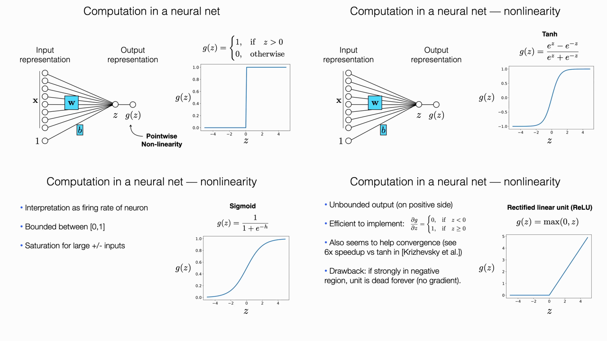
*▲ 강의 슬라이드 [29:10](https://youtu.be/6FkRvTtUc-o?t=1750): 계단, [tanh](00_%EB%94%A5%EB%9F%AC%EB%8B%9D_%EC%9A%A9%EC%96%B4%EC%82%AC%EC%A0%84.md#tanh-%EC%8C%8D%EA%B3%A1%ED%83%84%EC%A0%A0%ED%8A%B8), [시그모이드](00_%EB%94%A5%EB%9F%AC%EB%8B%9D_%EC%9A%A9%EC%96%B4%EC%82%AC%EC%A0%84.md#sigmoid-%EC%8B%9C%EA%B7%B8%EB%AA%A8%EC%9D%B4%EB%93%9C), [ReLU](00_%EB%94%A5%EB%9F%AC%EB%8B%9D_%EC%9A%A9%EC%96%B4%EC%82%AC%EC%A0%84.md#relu-%EB%A0%90%EB%A3%A8) (네 장면을 한 장으로 모음)*

> [!TIP]
> **현재 기본 선택은 [ReLU](00_%EB%94%A5%EB%9F%AC%EB%8B%9D_%EC%9A%A9%EC%96%B4%EC%82%AC%EC%A0%84.md#relu-%EB%A0%90%EB%A3%A8)**
> 약간씩 변형한 버전은 많지만 [ReLU](00_%EB%94%A5%EB%9F%AC%EB%8B%9D_%EC%9A%A9%EC%96%B4%EC%82%AC%EC%A0%84.md#relu-%EB%A0%90%EB%A3%A8)가 가장 널리 쓰입니다.

### 5.4 퍼셉트론과 선형 분류

▶ 영상 [29:26](https://youtu.be/6FkRvTtUc-o?t=1766)

📐 **수학 개념**: [평면과 결정 경계](%EC%88%98%ED%95%99%EA%B0%9C%EB%85%90/03_%EC%84%A0%ED%98%95%EB%8C%80%EC%88%98/MM04_%ED%8F%89%EB%A9%B4%EA%B3%BC_%EA%B2%B0%EC%A0%95_%EA%B2%BD%EA%B3%84.md) · [일차함수](%EC%88%98%ED%95%99%EA%B0%9C%EB%85%90/01_%EC%88%98%EC%99%80_%ED%95%A8%EC%88%98/M01_%ED%95%A8%EC%88%98%EC%99%80_%EC%9D%BC%EC%B0%A8%ED%95%A8%EC%88%98.md)
선형 입력에 원소별 비선형 함수를 붙인 것을 대략 [퍼셉트론](00_%EB%94%A5%EB%9F%AC%EB%8B%9D_%EC%9A%A9%EC%96%B4%EC%82%AC%EC%A0%84.md#perceptron-%ED%8D%BC%EC%85%89%ED%8A%B8%EB%A1%A0)이라 부릅니다. 입력이 2차원($x_1, x_2$)일 때를 생각합니다.

$$
z = \mathbf{x}^\top \mathbf{w} + b, \qquad y = g(z)
$$

기호 풀이

| 기호 | 읽는 법 | 뜻 | 예제 값 |
| --- | --- | --- | --- |
| $z$ | 지 | 선형 결합 값 (2차원 입력이면 평면의 높이) | −0.5 |
| $\mathbf{x}$ | 굵은 엑스 | 입력 벡터 $(x_1, x_2)$ | (1, 3) |
| $^\top$ | [전치](00_%EB%94%A5%EB%9F%AC%EB%8B%9D_%EC%9A%A9%EC%96%B4%EC%82%AC%EC%A0%84.md#transpose-%EC%A0%84%EC%B9%98) | 행과 열을 맞바꿈 | - |
| $\mathbf{w}$ | 굵은 더블유 | [가중치](00_%EB%94%A5%EB%9F%AC%EB%8B%9D_%EC%9A%A9%EC%96%B4%EC%82%AC%EC%A0%84.md#weight-%EA%B0%80%EC%A4%91%EC%B9%98) 벡터 | (2, −1) |
| $b$ | 비 | [편향](00_%EB%94%A5%EB%9F%AC%EB%8B%9D_%EC%9A%A9%EC%96%B4%EC%82%AC%EC%A0%84.md#bias-%ED%8E%B8%ED%96%A5) | 0.5 |
| $g$ | 지 (함수) | 원소별 비선형 함수 ([활성화 함수](00_%EB%94%A5%EB%9F%AC%EB%8B%9D_%EC%9A%A9%EC%96%B4%EC%82%AC%EC%A0%84.md#activation-function-%ED%99%9C%EC%84%B1%ED%99%94-%ED%95%A8%EC%88%98)), 여기서는 계단 함수 | z > 0이면 1, 아니면 0 |
| $y$ | 와이 | [퍼셉트론](00_%EB%94%A5%EB%9F%AC%EB%8B%9D_%EC%9A%A9%EC%96%B4%EC%82%AC%EC%A0%84.md#perceptron-%ED%8D%BC%EC%85%89%ED%8A%B8%EB%A1%A0)의 출력 | 0 |

예제와 풀이

**문제**: 입력 2개짜리 [퍼셉트론](00_%EB%94%A5%EB%9F%AC%EB%8B%9D_%EC%9A%A9%EC%96%B4%EC%82%AC%EC%A0%84.md#perceptron-%ED%8D%BC%EC%85%89%ED%8A%B8%EB%A1%A0)의 [가중치](00_%EB%94%A5%EB%9F%AC%EB%8B%9D_%EC%9A%A9%EC%96%B4%EC%82%AC%EC%A0%84.md#weight-%EA%B0%80%EC%A4%91%EC%B9%98)가 (2, −1), [편향](00_%EB%94%A5%EB%9F%AC%EB%8B%9D_%EC%9A%A9%EC%96%B4%EC%82%AC%EC%A0%84.md#bias-%ED%8E%B8%ED%96%A5)이 0.5이고 g가 계단 함수일 때, 입력 (1, 3)은 어느 클래스로 판정되나?

**주어진 값**:
- $\mathbf{x} = (1, 3)$ (입력 $x_1, x_2$)
- $\mathbf{w} = (2, -1)$ ([가중치](00_%EB%94%A5%EB%9F%AC%EB%8B%9D_%EC%9A%A9%EC%96%B4%EC%82%AC%EC%A0%84.md#weight-%EA%B0%80%EC%A4%91%EC%B9%98))
- $b = 0.5$ ([편향](00_%EB%94%A5%EB%9F%AC%EB%8B%9D_%EC%9A%A9%EC%96%B4%EC%82%AC%EC%A0%84.md#bias-%ED%8E%B8%ED%96%A5))
- $g$ = 계단 함수 (z > 0이면 1, 아니면 0)

**풀이**
1. 식을 그대로 쓴다: $z = \mathbf{x}^\top \mathbf{w} + b, \qquad y = g(z)$
2. 값을 대입한다 ($\mathbf{x}^\top \mathbf{w}$는 칸끼리 곱해 더한 것): $z = 1 \times 2 + 3 \times (-1) + 0.5, \qquad y = g(z)$
3. 첫째 곱셈을 한다: 1 × 2 = 2 이므로 $z = 2 + 3 \times (-1) + 0.5$
4. 둘째 곱셈을 한다: 3 × (−1) = −3 이므로 $z = 2 + (-3) + 0.5$
5. 왼쪽부터 더한다: 2 + (−3) = −1 이므로 $z = -1 + 0.5$
6. [편향](00_%EB%94%A5%EB%9F%AC%EB%8B%9D_%EC%9A%A9%EC%96%B4%EC%82%AC%EC%A0%84.md#bias-%ED%8E%B8%ED%96%A5)을 더한다: −1 + 0.5 = −0.5 이므로 z = −0.5
7. g에 넣는다: −0.5는 0보다 크지 않으므로 y = g(−0.5) = 0

**답**: z = −0.5, y = 0 (경계 아래쪽 클래스)

내 이해

- 2차원 입력에서 $z$는 기울어진 **평면**이 됩니다. 그래서 그래프가 매끄러운 경사로처럼 보입니다.
- 이 평면에 **문턱값**을 주면 바로 선형 분류기가 됩니다. 계단 함수가 하는 일이 바로 이 문턱 자르기입니다.
- 데이터가 **선형으로 나뉠 수 있으면** 한 층만으로도 [분류](00_%EB%94%A5%EB%9F%AC%EB%8B%9D_%EC%9A%A9%EC%96%B4%EC%82%AC%EC%A0%84.md#regression-classification-%ED%9A%8C%EA%B7%80%EC%99%80-%EB%B6%84%EB%A5%98)가 됩니다. 처음에는 오분류 7개인 나쁜 직선에서 시작해도 [경사하강법](00_%EB%94%A5%EB%9F%AC%EB%8B%9D_%EC%9A%A9%EC%96%B4%EC%82%AC%EC%A0%84.md#gradient-descent-%EA%B2%BD%EC%82%AC%ED%95%98%EA%B0%95%EB%B2%95)을 몇 번 거치면 오분류 0개인 좋은 [결정 경계(Decision boundary)](00_%EB%94%A5%EB%9F%AC%EB%8B%9D_%EC%9A%A9%EC%96%B4%EC%82%AC%EC%A0%84.md#decision-boundary-%EA%B2%B0%EC%A0%95-%EA%B2%BD%EA%B3%84)에 도달합니다. [오차(Error)](00_%EB%94%A5%EB%9F%AC%EB%8B%9D_%EC%9A%A9%EC%96%B4%EC%82%AC%EC%A0%84.md#error-%EC%98%A4%EC%B0%A8)가 큰 점일수록 [손실](00_%EB%94%A5%EB%9F%AC%EB%8B%9D_%EC%9A%A9%EC%96%B4%EC%82%AC%EC%A0%84.md#loss-function-%EC%86%90%EC%8B%A4-%ED%95%A8%EC%88%98) 값을 크게 만듭니다. [31:08](https://youtu.be/6FkRvTtUc-o?t=1868)

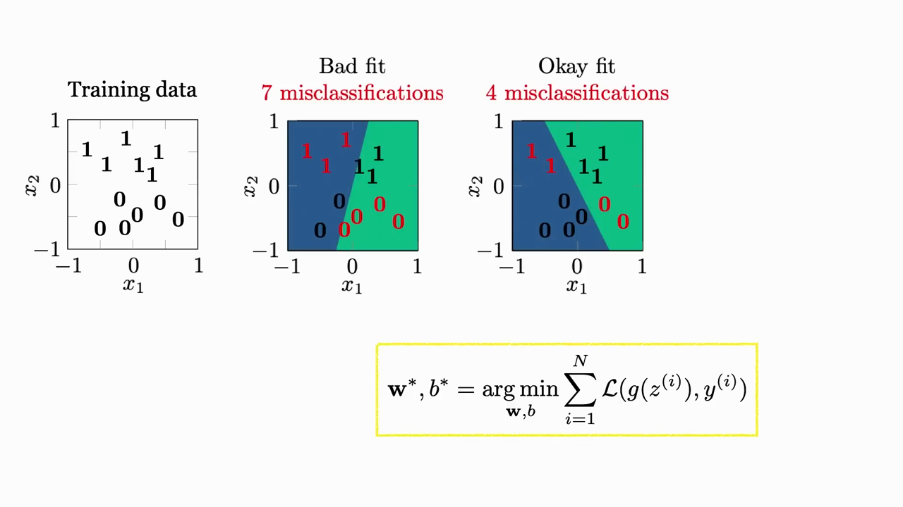
*▲ 강의 슬라이드 [31:50](https://youtu.be/6FkRvTtUc-o?t=1910): 나쁜 경계(오분류 7개)에서 괜찮은 경계(4개)로*

- 다만 계단 함수로는 [기울기](00_%EB%94%A5%EB%9F%AC%EB%8B%9D_%EC%9A%A9%EC%96%B4%EC%82%AC%EC%A0%84.md#gradient-%EA%B8%B0%EC%9A%B8%EA%B8%B0)가 없어서 실제 [학습](00_%EB%94%A5%EB%9F%AC%EB%8B%9D_%EC%9A%A9%EC%96%B4%EC%82%AC%EC%A0%84.md#training-%ED%95%99%EC%8A%B5)이 매우 어렵습니다. 그래서 [tanh](00_%EB%94%A5%EB%9F%AC%EB%8B%9D_%EC%9A%A9%EC%96%B4%EC%82%AC%EC%A0%84.md#tanh-%EC%8C%8D%EA%B3%A1%ED%83%84%EC%A0%A0%ED%8A%B8) 같은 매끄러운 함수를 씁니다.

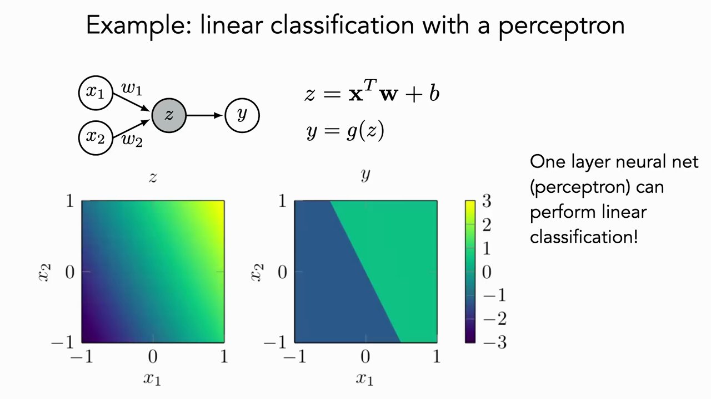
*▲ 강의 슬라이드 [39:18](https://youtu.be/6FkRvTtUc-o?t=2358): 입력 2개 [퍼셉트론](00_%EB%94%A5%EB%9F%AC%EB%8B%9D_%EC%9A%A9%EC%96%B4%EC%82%AC%EC%A0%84.md#perceptron-%ED%8D%BC%EC%85%89%ED%8A%B8%EB%A1%A0): z는 평면, 문턱을 주면 직선 경계*

### 5.5 층 쌓기

▶ 영상 [34:59](https://youtu.be/6FkRvTtUc-o?t=2099)

📐 **수학 개념**: [합성함수와 비선형성](%EC%88%98%ED%95%99%EA%B0%9C%EB%85%90/05_%EC%8B%A0%EA%B2%BD%EB%A7%9D%EC%9D%98_%EA%B3%84%EC%82%B0/MM06_%ED%95%A9%EC%84%B1%ED%95%A8%EC%88%98%EC%99%80_%EB%B9%84%EC%84%A0%ED%98%95%EC%84%B1.md) · [행렬 곱](%EC%88%98%ED%95%99%EA%B0%9C%EB%85%90/03_%EC%84%A0%ED%98%95%EB%8C%80%EC%88%98/M05_%EB%B2%A1%ED%84%B0%EC%99%80_%ED%96%89%EB%A0%AC.md)
선형 변환과 비선형 함수 한 쌍 위에 같은 구조를 하나 더 쌓을 수 있습니다. 중간값 $z$와 $h$는 입력에도 출력에도 드러나지 않으므로 은닉 유닛([은닉층(Hidden layer)](00_%EB%94%A5%EB%9F%AC%EB%8B%9D_%EC%9A%A9%EC%96%B4%EC%82%AC%EC%A0%84.md#hidden-layer-%EC%9D%80%EB%8B%89%EC%B8%B5)의 값)이라 부릅니다. 출력 성분마다 [가중치](00_%EB%94%A5%EB%9F%AC%EB%8B%9D_%EC%9A%A9%EC%96%B4%EC%82%AC%EC%A0%84.md#weight-%EA%B0%80%EC%A4%91%EC%B9%98)가 따로 있으므로 이를 모으면 [행렬 곱(Matrix multiplication)](00_%EB%94%A5%EB%9F%AC%EB%8B%9D_%EC%9A%A9%EC%96%B4%EC%82%AC%EC%A0%84.md#matrix-multiplication-%ED%96%89%EB%A0%AC-%EA%B3%B1)으로 깔끔하게 쓸 수 있습니다.

$$
\mathbf{h} = g(\mathbf{W}_1 \mathbf{x} + \mathbf{b}_1), \qquad
\mathbf{y} = g(\mathbf{W}_2 \mathbf{h} + \mathbf{b}_2), \qquad
\theta = \{\mathbf{W}_1, \mathbf{b}_1, \mathbf{W}_2, \mathbf{b}_2\}
$$

기호 풀이

| 기호 | 읽는 법 | 뜻 | 예제 값 |
| --- | --- | --- | --- |
| $\mathbf{x}$ | 굵은 엑스 | 입력 벡터 | (1, 2) |
| $\mathbf{W}_1$ | 굵은 대문자 더블유 일 | 첫째 [층](00_%EB%94%A5%EB%9F%AC%EB%8B%9D_%EC%9A%A9%EC%96%B4%EC%82%AC%EC%A0%84.md#layer-%EC%B8%B5)의 [가중치](00_%EB%94%A5%EB%9F%AC%EB%8B%9D_%EC%9A%A9%EC%96%B4%EC%82%AC%EC%A0%84.md#weight-%EA%B0%80%EC%A4%91%EC%B9%98) 행렬 (출력 칸마다 한 행) | 행 (1, −1), (2, 0) |
| $\mathbf{b}_1$ | 굵은 비 일 | 첫째 [층](00_%EB%94%A5%EB%9F%AC%EB%8B%9D_%EC%9A%A9%EC%96%B4%EC%82%AC%EC%A0%84.md#layer-%EC%B8%B5)의 [편향](00_%EB%94%A5%EB%9F%AC%EB%8B%9D_%EC%9A%A9%EC%96%B4%EC%82%AC%EC%A0%84.md#bias-%ED%8E%B8%ED%96%A5) 벡터 | (0, −1) |
| $g$ | 지 (함수) | 원소별 비선형 함수, 여기서는 [ReLU](00_%EB%94%A5%EB%9F%AC%EB%8B%9D_%EC%9A%A9%EC%96%B4%EC%82%AC%EC%A0%84.md#relu-%EB%A0%90%EB%A3%A8) | [ReLU](00_%EB%94%A5%EB%9F%AC%EB%8B%9D_%EC%9A%A9%EC%96%B4%EC%82%AC%EC%A0%84.md#relu-%EB%A0%90%EB%A3%A8)(−1) = 0 |
| $\mathbf{h}$ | 굵은 에이치 | 은닉 유닛 값 ([은닉층](00_%EB%94%A5%EB%9F%AC%EB%8B%9D_%EC%9A%A9%EC%96%B4%EC%82%AC%EC%A0%84.md#hidden-layer-%EC%9D%80%EB%8B%89%EC%B8%B5)의 출력) | (0, 1) |
| $\mathbf{W}_2$ | 굵은 대문자 더블유 이 | 둘째 [층](00_%EB%94%A5%EB%9F%AC%EB%8B%9D_%EC%9A%A9%EC%96%B4%EC%82%AC%EC%A0%84.md#layer-%EC%B8%B5)의 [가중치](00_%EB%94%A5%EB%9F%AC%EB%8B%9D_%EC%9A%A9%EC%96%B4%EC%82%AC%EC%A0%84.md#weight-%EA%B0%80%EC%A4%91%EC%B9%98) 행렬 | 행 (3, 2) |
| $\mathbf{b}_2$ | 굵은 비 이 | 둘째 [층](00_%EB%94%A5%EB%9F%AC%EB%8B%9D_%EC%9A%A9%EC%96%B4%EC%82%AC%EC%A0%84.md#layer-%EC%B8%B5)의 [편향](00_%EB%94%A5%EB%9F%AC%EB%8B%9D_%EC%9A%A9%EC%96%B4%EC%82%AC%EC%A0%84.md#bias-%ED%8E%B8%ED%96%A5) | (−1) |
| $\mathbf{y}$ | 굵은 와이 | 망의 출력 | (1) |
| $\theta$ | 세타 | 학습할 [파라미터](00_%EB%94%A5%EB%9F%AC%EB%8B%9D_%EC%9A%A9%EC%96%B4%EC%82%AC%EC%A0%84.md#parameter-%ED%8C%8C%EB%9D%BC%EB%AF%B8%ED%84%B0) 전체의 모음 | 숫자 9개 |

예제와 풀이

**문제**: 2층 망에서 입력 (1, 2)를 넣으면 은닉 유닛 값 $\mathbf{h}$와 출력 $\mathbf{y}$는 얼마이고, 학습할 숫자(θ)는 몇 개인가?

**주어진 값**:
- $\mathbf{x} = (1, 2)$ (입력)
- $\mathbf{W}_1$의 두 행 (1, −1), (2, 0) (첫째 [층](00_%EB%94%A5%EB%9F%AC%EB%8B%9D_%EC%9A%A9%EC%96%B4%EC%82%AC%EC%A0%84.md#layer-%EC%B8%B5) [가중치](00_%EB%94%A5%EB%9F%AC%EB%8B%9D_%EC%9A%A9%EC%96%B4%EC%82%AC%EC%A0%84.md#weight-%EA%B0%80%EC%A4%91%EC%B9%98), 은닉 칸마다 한 행)
- $\mathbf{b}_1 = (0, -1)$ (첫째 [층](00_%EB%94%A5%EB%9F%AC%EB%8B%9D_%EC%9A%A9%EC%96%B4%EC%82%AC%EC%A0%84.md#layer-%EC%B8%B5) [편향](00_%EB%94%A5%EB%9F%AC%EB%8B%9D_%EC%9A%A9%EC%96%B4%EC%82%AC%EC%A0%84.md#bias-%ED%8E%B8%ED%96%A5))
- $\mathbf{W}_2$의 한 행 (3, 2) (둘째 [층](00_%EB%94%A5%EB%9F%AC%EB%8B%9D_%EC%9A%A9%EC%96%B4%EC%82%AC%EC%A0%84.md#layer-%EC%B8%B5) [가중치](00_%EB%94%A5%EB%9F%AC%EB%8B%9D_%EC%9A%A9%EC%96%B4%EC%82%AC%EC%A0%84.md#weight-%EA%B0%80%EC%A4%91%EC%B9%98))
- $\mathbf{b}_2 = -1$ (둘째 [층](00_%EB%94%A5%EB%9F%AC%EB%8B%9D_%EC%9A%A9%EC%96%B4%EC%82%AC%EC%A0%84.md#layer-%EC%B8%B5) [편향](00_%EB%94%A5%EB%9F%AC%EB%8B%9D_%EC%9A%A9%EC%96%B4%EC%82%AC%EC%A0%84.md#bias-%ED%8E%B8%ED%96%A5))
- $g$ = [ReLU](00_%EB%94%A5%EB%9F%AC%EB%8B%9D_%EC%9A%A9%EC%96%B4%EC%82%AC%EC%A0%84.md#relu-%EB%A0%90%EB%A3%A8) (비선형 함수)

**풀이**
1. 식을 그대로 쓴다: $\mathbf{h} = g(\mathbf{W}_1 \mathbf{x} + \mathbf{b}_1), \quad \mathbf{y} = g(\mathbf{W}_2 \mathbf{h} + \mathbf{b}_2), \quad \theta = \{\mathbf{W}_1, \mathbf{b}_1, \mathbf{W}_2, \mathbf{b}_2\}$
2. 값을 대입한다: $\mathbf{h} = g\left(\begin{pmatrix} 1 & -1 \\ 2 & 0 \end{pmatrix}\begin{pmatrix} 1 \\ 2 \end{pmatrix} + \begin{pmatrix} 0 \\ -1 \end{pmatrix}\right), \quad \mathbf{y} = g\left(\begin{pmatrix} 3 & 2 \end{pmatrix}\mathbf{h} + (-1)\right)$
3. [행렬 곱](00_%EB%94%A5%EB%9F%AC%EB%8B%9D_%EC%9A%A9%EC%96%B4%EC%82%AC%EC%A0%84.md#matrix-multiplication-%ED%96%89%EB%A0%AC-%EA%B3%B1) 첫째 행을 칸끼리 곱한다: 1 × 1 = 1, (−1) × 2 = −2
4. 첫째 행을 더한다: 1 + (−2) = −1
5. [행렬 곱](00_%EB%94%A5%EB%9F%AC%EB%8B%9D_%EC%9A%A9%EC%96%B4%EC%82%AC%EC%A0%84.md#matrix-multiplication-%ED%96%89%EB%A0%AC-%EA%B3%B1) 둘째 행을 칸끼리 곱한다: 2 × 1 = 2, 0 × 2 = 0
6. 둘째 행을 더한다: 2 + 0 = 2 이므로 $\mathbf{W}_1\mathbf{x} = (-1, 2)$
7. [편향](00_%EB%94%A5%EB%9F%AC%EB%8B%9D_%EC%9A%A9%EC%96%B4%EC%82%AC%EC%A0%84.md#bias-%ED%8E%B8%ED%96%A5)을 칸끼리 더한다: −1 + 0 = −1, 2 + (−1) = 1 이므로 $\mathbf{h} = g\big((-1, 1)\big)$
8. g = [ReLU](00_%EB%94%A5%EB%9F%AC%EB%8B%9D_%EC%9A%A9%EC%96%B4%EC%82%AC%EC%A0%84.md#relu-%EB%A0%90%EB%A3%A8)는 음수면 0, 0 이상이면 그대로 두는 함수다: [ReLU](00_%EB%94%A5%EB%9F%AC%EB%8B%9D_%EC%9A%A9%EC%96%B4%EC%82%AC%EC%A0%84.md#relu-%EB%A0%90%EB%A3%A8)(z) = max(0, z). max(0, −1) = 0, max(0, 1) = 1 이므로 $\mathbf{h} = (0, 1)$
9. 둘째 [층](00_%EB%94%A5%EB%9F%AC%EB%8B%9D_%EC%9A%A9%EC%96%B4%EC%82%AC%EC%A0%84.md#layer-%EC%B8%B5) [행렬 곱](00_%EB%94%A5%EB%9F%AC%EB%8B%9D_%EC%9A%A9%EC%96%B4%EC%82%AC%EC%A0%84.md#matrix-multiplication-%ED%96%89%EB%A0%AC-%EA%B3%B1)을 칸끼리 곱한다: 3 × 0 = 0, 2 × 1 = 2
10. 더한다: 0 + 2 = 2 이므로 $\mathbf{y} = g(2 + (-1))$
11. [편향](00_%EB%94%A5%EB%9F%AC%EB%8B%9D_%EC%9A%A9%EC%96%B4%EC%82%AC%EC%A0%84.md#bias-%ED%8E%B8%ED%96%A5)을 더한다: 2 + (−1) = 1 이므로 $\mathbf{y} = g(1)$
12. [ReLU](00_%EB%94%A5%EB%9F%AC%EB%8B%9D_%EC%9A%A9%EC%96%B4%EC%82%AC%EC%A0%84.md#relu-%EB%A0%90%EB%A3%A8)를 적용한다: max(0, 1) = 1 이므로 $\mathbf{y} = 1$
13. θ의 숫자를 센다: $\mathbf{W}_1$ 4개 + $\mathbf{b}_1$ 2개 + $\mathbf{W}_2$ 2개 + $\mathbf{b}_2$ 1개 = 9

**답**: $\mathbf{h} = (0, 1)$, $\mathbf{y} = 1$, θ는 숫자 9개

내 이해

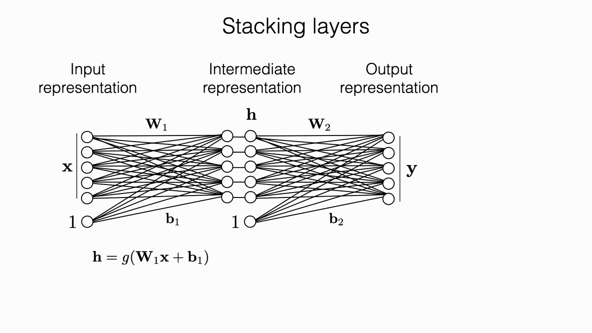
*▲ 강의 슬라이드 [36:10](https://youtu.be/6FkRvTtUc-o?t=2170): [층](00_%EB%94%A5%EB%9F%AC%EB%8B%9D_%EC%9A%A9%EC%96%B4%EC%82%AC%EC%A0%84.md#layer-%EC%B8%B5) 쌓기: h = g(W₁x + b₁), y = g(W₂h + b₂)*

**2층이면 비선형 [분류](00_%EB%94%A5%EB%9F%AC%EB%8B%9D_%EC%9A%A9%EC%96%B4%EC%82%AC%EC%A0%84.md#regression-classification-%ED%9A%8C%EA%B7%80%EC%99%80-%EB%B6%84%EB%A5%98)가 가능합니다** [39:29](https://youtu.be/6FkRvTtUc-o?t=2369). 첫째 [층](00_%EB%94%A5%EB%9F%AC%EB%8B%9D_%EC%9A%A9%EC%96%B4%EC%82%AC%EC%A0%84.md#layer-%EC%B8%B5)의 유닛들은 서로 다른 방향의 경사로를 하나씩 만듭니다. 이 경사로들을 비선형 함수를 거쳐 합치면 두 경사로가 만나는 곳이 솟아오른 **삼각뿔(피라미드) 모양**이 생깁니다. 여기에 문턱값을 주면 곡선이나 닫힌 영역 같은 비선형 [결정 경계](00_%EB%94%A5%EB%9F%AC%EB%8B%9D_%EC%9A%A9%EC%96%B4%EC%82%AC%EC%A0%84.md#decision-boundary-%EA%B2%B0%EC%A0%95-%EA%B2%BD%EA%B3%84)가 나옵니다. 선형 결합에 비선형 함수를 끼우면 왜 비선형 모델이 되는지 보여 주는 직관입니다.

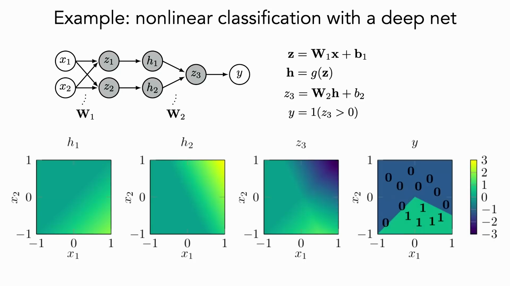
*▲ 강의 슬라이드 [40:10](https://youtu.be/6FkRvTtUc-o?t=2410): 2층 망: 두 경사로를 합쳐 비선형 경계를 만듦*

질의응답: 활성화 함수는 어떻게 고르나? [36:38](https://youtu.be/6FkRvTtUc-o?t=2198)

응용 분야별로 정해진 일반 규칙은 없습니다. 실제로는 [ReLU](00_%EB%94%A5%EB%9F%AC%EB%8B%9D_%EC%9A%A9%EC%96%B4%EC%82%AC%EC%A0%84.md#relu-%EB%A0%90%EB%A3%A8)를 많이 쓰고, 분야마다 실험적으로 잘 된 선택을 따라가는 경향이 있습니다. 강사는 이를 농담으로 "대학원생 [경사하강법](00_%EB%94%A5%EB%9F%AC%EB%8B%9D_%EC%9A%A9%EC%96%B4%EC%82%AC%EC%A0%84.md#gradient-descent-%EA%B2%BD%EC%82%AC%ED%95%98%EA%B0%95%EB%B2%95)(grad student gradient descent)"이라고 부릅니다. 공동 강사 Jeremy는 "엄밀한 과학은 아니고, 보통은 데이터를 모델링하려고 고른다기보다 **네트워크가 잘 학습되도록** 고른다"고 덧붙입니다. 예외로, 특징이 주기적(사인파 형태)이라는 걸 안다면 사인 [활성화 함수](00_%EB%94%A5%EB%9F%AC%EB%8B%9D_%EC%9A%A9%EC%96%B4%EC%82%AC%EC%A0%84.md#activation-function-%ED%99%9C%EC%84%B1%ED%99%94-%ED%95%A8%EC%88%98)가 맞을 수 있습니다. 이론적으로 더 잘 이해해야 할 영역입니다.

### 5.6 소프트맥스와 교차 엔트로피 손실

▶ 영상 [50:16](https://youtu.be/6FkRvTtUc-o?t=3016)

📐 **수학 개념**: [argmax](%EC%88%98%ED%95%99%EA%B0%9C%EB%85%90/02_%EB%AF%B8%EB%B6%84/MM01_argmin%EA%B3%BC_argmax.md) · [지수와 e](%EC%88%98%ED%95%99%EA%B0%9C%EB%85%90/01_%EC%88%98%EC%99%80_%ED%95%A8%EC%88%98/M06_%EC%A7%80%EC%88%98%EC%99%80_e.md) · [로그](%EC%88%98%ED%95%99%EA%B0%9C%EB%85%90/01_%EC%88%98%EC%99%80_%ED%95%A8%EC%88%98/M07_%EB%A1%9C%EA%B7%B8.md) · [확률](%EC%88%98%ED%95%99%EA%B0%9C%EB%85%90/04_%ED%99%95%EB%A5%A0%EA%B3%BC_%EC%A0%95%EB%B3%B4/M08_%ED%99%95%EB%A5%A0_%EA%B8%B0%EC%B4%88.md) · [엔트로피](%EC%88%98%ED%95%99%EA%B0%9C%EB%85%90/04_%ED%99%95%EB%A5%A0%EA%B3%BC_%EC%A0%95%EB%B3%B4/M10_%EC%97%94%ED%8A%B8%EB%A1%9C%ED%94%BC.md)
흰동가리(clownfish), 회색곰(grizzly bear) 같은 범주를 분류하는 모델을 예로 듭니다.

1. 마지막 [층](00_%EB%94%A5%EB%9F%AC%EB%8B%9D_%EC%9A%A9%EC%96%B4%EC%82%AC%EC%A0%84.md#layer-%EC%B8%B5)의 출력에서 가장 큰 값의 위치([argmax(최댓값 위치)](00_%EB%94%A5%EB%9F%AC%EB%8B%9D_%EC%9A%A9%EC%96%B4%EC%82%AC%EC%A0%84.md#argmax-%EC%B5%9C%EB%8C%93%EA%B0%92-%EC%9C%84%EC%B9%98))를 예측으로 삼습니다.
2. [손실 함수](00_%EB%94%A5%EB%9F%AC%EB%8B%9D_%EC%9A%A9%EC%96%B4%EC%82%AC%EC%A0%84.md#loss-function-%EC%86%90%EC%8B%A4-%ED%95%A8%EC%88%98)는 **틀리면 크게 벌하고, 맞으면 거의 벌하지 않아야** 합니다.
3. 출력을 [소프트맥스(Softmax)](00_%EB%94%A5%EB%9F%AC%EB%8B%9D_%EC%9A%A9%EC%96%B4%EC%82%AC%EC%A0%84.md#softmax-%EC%86%8C%ED%94%84%ED%8A%B8%EB%A7%A5%EC%8A%A4)로 정규화하면 범주들에 대한 [확률](00_%EB%94%A5%EB%9F%AC%EB%8B%9D_%EC%9A%A9%EC%96%B4%EC%82%AC%EC%A0%84.md#probability-%ED%99%95%EB%A5%A0) 분포처럼 다룰 수 있습니다.

$$
p_k = \frac{e^{z_k}}{\sum_j e^{z_j}}
$$

기호 풀이

| 기호 | 읽는 법 | 뜻 | 예제 값 |
| --- | --- | --- | --- |
| $p_k$ | 피 케이 | k번째 범주에 준 "[확률](00_%EB%94%A5%EB%9F%AC%EB%8B%9D_%EC%9A%A9%EC%96%B4%EC%82%AC%EC%A0%84.md#probability-%ED%99%95%EB%A5%A0)" ([소프트맥스](00_%EB%94%A5%EB%9F%AC%EB%8B%9D_%EC%9A%A9%EC%96%B4%EC%82%AC%EC%A0%84.md#softmax-%EC%86%8C%ED%94%84%ED%8A%B8%EB%A7%A5%EC%8A%A4) 출력) | $p_1 = 0.6652$ |
| $z_k$ | 지 케이 | k번째 범주의 점수 ([정규화](00_%EB%94%A5%EB%9F%AC%EB%8B%9D_%EC%9A%A9%EC%96%B4%EC%82%AC%EC%A0%84.md#normalization-%EC%A0%95%EA%B7%9C%ED%99%94) 전 출력) | $z_1 = 2$ |
| $e$ | 이(자연상수) | 약 2.718인 특별한 수 | $e^2 = 7.3891$ |
| $e^{z_k}$ | 이의 지 케이 제곱 | 점수를 항상 양수로 바꾼 값 | 7.3891 |
| $\sum_j$ | 시그마 제이 | 모든 범주 j에 대해 더함 | 3개 항의 합 |
| $\sum_j e^{z_j}$ | 시그마 이의 지 제이 제곱 | 나눠 줄 전체 합 (합이 1이 되게 함) | 11.1073 |

예제와 풀이

**문제**: 범주 3개(1번, 2번, 3번)에 대한 모델 점수가 2, 1, 0일 때 [소프트맥스](00_%EB%94%A5%EB%9F%AC%EB%8B%9D_%EC%9A%A9%EC%96%B4%EC%82%AC%EC%A0%84.md#softmax-%EC%86%8C%ED%94%84%ED%8A%B8%EB%A7%A5%EC%8A%A4)로 바꾼 범주별 "[확률](00_%EB%94%A5%EB%9F%AC%EB%8B%9D_%EC%9A%A9%EC%96%B4%EC%82%AC%EC%A0%84.md#probability-%ED%99%95%EB%A5%A0)" $p_1, p_2, p_3$은?

**주어진 값**:
- $z_1 = 2$ (1번 범주 점수)
- $z_2 = 1$ (2번 범주 점수)
- $z_3 = 0$ (3번 범주 점수)

**풀이**
1. 식을 그대로 쓴다: $p_k = \frac{e^{z_k}}{\sum_j e^{z_j}}$
2. 값을 대입한다 (k = 1, Σ를 j = 1, 2, 3 세 항으로 펼침): $p_1 = \frac{e^{2}}{e^{2} + e^{1} + e^{0}}$
3. e는 약 2.7183인 수이고, $e^{z}$는 e를 z번 곱한 값이다 ($e^0 = 1$). 값은 코드 `np.exp`로 구한다: $e^2 = 2.7183 \times 2.7183 = 7.3891$, $e^1 = 2.7183$, $e^0 = 1$ 이므로 $p_1 = \frac{7.3891}{7.3891 + 2.7183 + 1}$
4. 분모를 더한다: 7.3891 + 2.7183 + 1 = 11.1073 이므로 $p_1 = \frac{7.3891}{11.1073}$
5. 나눗셈을 한다: 7.3891 ÷ 11.1073 = 0.6652 이므로 $p_1 = 0.6652$
6. k = 2도 분모는 같다. 나눗셈을 한다: 2.7183 ÷ 11.1073 = 0.2447 이므로 $p_2 = 0.2447$
7. k = 3도 분모는 같다. 나눗셈을 한다: 1 ÷ 11.1073 = 0.0900 이므로 $p_3 = 0.0900$
8. 합이 1인지 확인한다: 0.6652 + 0.2447 + 0.0900 = 0.9999 (반올림 때문에 1에서 0.0001 모자람)

**답**: p = (0.6652, 0.2447, 0.0900)

내 이해

4. [정답](00_%EB%94%A5%EB%9F%AC%EB%8B%9D_%EC%9A%A9%EC%96%B4%EC%82%AC%EC%A0%84.md#label-%EC%A0%95%EB%8B%B5)은 [원-핫 인코딩(One-hot encoding)](00_%EB%94%A5%EB%9F%AC%EB%8B%9D_%EC%9A%A9%EC%96%B4%EC%82%AC%EC%A0%84.md#one-hot-encoding-%EC%9B%90-%ED%95%AB-%EC%9D%B8%EC%BD%94%EB%94%A9) 벡터 $\mathbf{y}$로 나타냅니다. [정답](00_%EB%94%A5%EB%9F%AC%EB%8B%9D_%EC%9A%A9%EC%96%B4%EC%82%AC%EC%A0%84.md#label-%EC%A0%95%EB%8B%B5) 자리만 1이고 나머지는 0인 벡터입니다. 모델이 믿는 분포와 실제 분포 사이의 거리를 재는 것이 [교차 엔트로피(Cross-entropy)](00_%EB%94%A5%EB%9F%AC%EB%8B%9D_%EC%9A%A9%EC%96%B4%EC%82%AC%EC%A0%84.md#cross-entropy-%EA%B5%90%EC%B0%A8-%EC%97%94%ED%8A%B8%EB%A1%9C%ED%94%BC) [손실](00_%EB%94%A5%EB%9F%AC%EB%8B%9D_%EC%9A%A9%EC%96%B4%EC%82%AC%EC%A0%84.md#loss-function-%EC%86%90%EC%8B%A4-%ED%95%A8%EC%88%98)입니다.

$$
L = -\sum_k y_k \log p_k = -\log p_{\text{정답}}
$$

기호 풀이

| 기호 | 읽는 법 | 뜻 | 예제 값 |
| --- | --- | --- | --- |
| $L$ | 엘 | [교차 엔트로피](00_%EB%94%A5%EB%9F%AC%EB%8B%9D_%EC%9A%A9%EC%96%B4%EC%82%AC%EC%A0%84.md#cross-entropy-%EA%B5%90%EC%B0%A8-%EC%97%94%ED%8A%B8%EB%A1%9C%ED%94%BC) [손실](00_%EB%94%A5%EB%9F%AC%EB%8B%9D_%EC%9A%A9%EC%96%B4%EC%82%AC%EC%A0%84.md#loss-function-%EC%86%90%EC%8B%A4-%ED%95%A8%EC%88%98) | 1.4076 |
| $\sum_k$ | 시그마 케이 | 모든 범주 k에 대해 더함 | 3개 항의 합 |
| $y_k$ | 와이 케이 | [원-핫](00_%EB%94%A5%EB%9F%AC%EB%8B%9D_%EC%9A%A9%EC%96%B4%EC%82%AC%EC%A0%84.md#one-hot-encoding-%EC%9B%90-%ED%95%AB-%EC%9D%B8%EC%BD%94%EB%94%A9) [정답](00_%EB%94%A5%EB%9F%AC%EB%8B%9D_%EC%9A%A9%EC%96%B4%EC%82%AC%EC%A0%84.md#label-%EC%A0%95%EB%8B%B5)의 k번째 칸 ([정답](00_%EB%94%A5%EB%9F%AC%EB%8B%9D_%EC%9A%A9%EC%96%B4%EC%82%AC%EC%A0%84.md#label-%EC%A0%95%EB%8B%B5) 자리만 1) | (0, 1, 0) |
| $\log$ | [로그](00_%EB%94%A5%EB%9F%AC%EB%8B%9D_%EC%9A%A9%EC%96%B4%EC%82%AC%EC%A0%84.md#log-ln-%EB%A1%9C%EA%B7%B8) (자연로그 ln) | e를 몇 번 곱해야 그 수가 되는지 | ln 0.2447 = −1.4076 |
| $p_k$ | 피 케이 | 모델이 k번째 범주에 준 [확률](00_%EB%94%A5%EB%9F%AC%EB%8B%9D_%EC%9A%A9%EC%96%B4%EC%82%AC%EC%A0%84.md#probability-%ED%99%95%EB%A5%A0) | (0.6652, 0.2447, 0.0900) |
| $p_{\text{정답}}$ | 피 [정답](00_%EB%94%A5%EB%9F%AC%EB%8B%9D_%EC%9A%A9%EC%96%B4%EC%82%AC%EC%A0%84.md#label-%EC%A0%95%EB%8B%B5) | [정답](00_%EB%94%A5%EB%9F%AC%EB%8B%9D_%EC%9A%A9%EC%96%B4%EC%82%AC%EC%A0%84.md#label-%EC%A0%95%EB%8B%B5) 범주에 준 [확률](00_%EB%94%A5%EB%9F%AC%EB%8B%9D_%EC%9A%A9%EC%96%B4%EC%82%AC%EC%A0%84.md#probability-%ED%99%95%EB%A5%A0) | 0.2447 |

예제와 풀이

**문제**: 모델이 범주 3개에 준 [확률](00_%EB%94%A5%EB%9F%AC%EB%8B%9D_%EC%9A%A9%EC%96%B4%EC%82%AC%EC%A0%84.md#probability-%ED%99%95%EB%A5%A0)이 (0.6652, 0.2447, 0.0900)이고 실제 [정답](00_%EB%94%A5%EB%9F%AC%EB%8B%9D_%EC%9A%A9%EC%96%B4%EC%82%AC%EC%A0%84.md#label-%EC%A0%95%EB%8B%B5)이 2번 범주일 때 [교차 엔트로피](00_%EB%94%A5%EB%9F%AC%EB%8B%9D_%EC%9A%A9%EC%96%B4%EC%82%AC%EC%A0%84.md#cross-entropy-%EA%B5%90%EC%B0%A8-%EC%97%94%ED%8A%B8%EB%A1%9C%ED%94%BC) [손실](00_%EB%94%A5%EB%9F%AC%EB%8B%9D_%EC%9A%A9%EC%96%B4%EC%82%AC%EC%A0%84.md#loss-function-%EC%86%90%EC%8B%A4-%ED%95%A8%EC%88%98) L은?

**주어진 값**:
- $p_1 = 0.6652,\ p_2 = 0.2447,\ p_3 = 0.0900$ (모델이 각 범주에 준 [확률](00_%EB%94%A5%EB%9F%AC%EB%8B%9D_%EC%9A%A9%EC%96%B4%EC%82%AC%EC%A0%84.md#probability-%ED%99%95%EB%A5%A0))
- $y_1 = 0,\ y_2 = 1,\ y_3 = 0$ ([원-핫](00_%EB%94%A5%EB%9F%AC%EB%8B%9D_%EC%9A%A9%EC%96%B4%EC%82%AC%EC%A0%84.md#one-hot-encoding-%EC%9B%90-%ED%95%AB-%EC%9D%B8%EC%BD%94%EB%94%A9) [정답](00_%EB%94%A5%EB%9F%AC%EB%8B%9D_%EC%9A%A9%EC%96%B4%EC%82%AC%EC%A0%84.md#label-%EC%A0%95%EB%8B%B5): [정답](00_%EB%94%A5%EB%9F%AC%EB%8B%9D_%EC%9A%A9%EC%96%B4%EC%82%AC%EC%A0%84.md#label-%EC%A0%95%EB%8B%B5) 자리인 2번만 1)

**풀이**
1. 식을 그대로 쓴다: $L = -\sum_k y_k \log p_k = -\log p_{\text{정답}}$
2. 값을 대입한다 (Σ를 k = 1, 2, 3 세 항으로 펼침): $L = -\big[0 \times \log 0.6652 + 1 \times \log 0.2447 + 0 \times \log 0.0900\big]$
3. log는 자연로그 ln이다. ln a는 "e를 몇 제곱해야 a가 되는가"이고, 1보다 작은 수의 ln은 음수다. 값은 코드 `np.log`로 구한다: ln 0.6652 = −0.4076, ln 0.2447 = −1.4076, ln 0.0900 = −2.4076 이므로 $L = -\big[0 \times (-0.4076) + 1 \times (-1.4076) + 0 \times (-2.4076)\big]$
4. 곱셈을 한다: 0 × (−0.4076) = 0, 1 × (−1.4076) = −1.4076, 0 × (−2.4076) = 0 이므로 $L = -\big[0 + (-1.4076) + 0\big]$
5. 괄호 안을 더한다: 0 + (−1.4076) + 0 = −1.4076 이므로 $L = -(-1.4076)$
6. 앞의 마이너스를 붙인다: −(−1.4076) = 1.4076
7. 지름길과 비교한다: $-\log p_{\text{정답}} = -\ln 0.2447 = 1.4076$ ([정답](00_%EB%94%A5%EB%9F%AC%EB%8B%9D_%EC%9A%A9%EC%96%B4%EC%82%AC%EC%A0%84.md#label-%EC%A0%95%EB%8B%B5) 자리 항만 남으므로 같다)

**답**: L = 1.4076

내 이해

- 이 [손실](00_%EB%94%A5%EB%9F%AC%EB%8B%9D_%EC%9A%A9%EC%96%B4%EC%82%AC%EC%A0%84.md#loss-function-%EC%86%90%EC%8B%A4-%ED%95%A8%EC%88%98)을 줄이는 것은 곧 **[학습 데이터](00_%EB%94%A5%EB%9F%AC%EB%8B%9D_%EC%9A%A9%EC%96%B4%EC%82%AC%EC%A0%84.md#training-data-test-data-%ED%95%99%EC%8A%B5-%EB%8D%B0%EC%9D%B4%ED%84%B0%EC%99%80-%EC%8B%9C%ED%97%98-%EB%8D%B0%EC%9D%B4%ED%84%B0)의 [확률](00_%EB%94%A5%EB%9F%AC%EB%8B%9D_%EC%9A%A9%EC%96%B4%EC%82%AC%EC%A0%84.md#probability-%ED%99%95%EB%A5%A0)을 최대화**하는 것입니다. 데이터가 충분하면 출력이 "이미지가 주어졌을 때 범주의 [확률](00_%EB%94%A5%EB%9F%AC%EB%8B%9D_%EC%9A%A9%EC%96%B4%EC%82%AC%EC%A0%84.md#probability-%ED%99%95%EB%A5%A0)"을 꽤 잘 나타내게 됩니다.
- [정답](00_%EB%94%A5%EB%9F%AC%EB%8B%9D_%EC%9A%A9%EC%96%B4%EC%82%AC%EC%A0%84.md#label-%EC%A0%95%EB%8B%B5) 범주에 준 [확률](00_%EB%94%A5%EB%9F%AC%EB%8B%9D_%EC%9A%A9%EC%96%B4%EC%82%AC%EC%A0%84.md#probability-%ED%99%95%EB%A5%A0)이 1에 못 미치는 만큼이 "더 잘할 수 있었던 몫"이고, 이것이 [기울기](00_%EB%94%A5%EB%9F%AC%EB%8B%9D_%EC%9A%A9%EC%96%B4%EC%82%AC%EC%A0%84.md#gradient-%EA%B8%B0%EC%9A%B8%EA%B8%B0)의 방향을 알려 줍니다. 카멜레온을 이구아나로 잘못 예측하면, [확률](00_%EB%94%A5%EB%9F%AC%EB%8B%9D_%EC%9A%A9%EC%96%B4%EC%82%AC%EC%A0%84.md#probability-%ED%99%95%EB%A5%A0)이 정규화되어 있으므로 [정답](00_%EB%94%A5%EB%9F%AC%EB%8B%9D_%EC%9A%A9%EC%96%B4%EC%82%AC%EC%A0%84.md#label-%EC%A0%95%EB%8B%B5)(카멜레온)에 남는 몫이 작아지고 [손실](00_%EB%94%A5%EB%9F%AC%EB%8B%9D_%EC%9A%A9%EC%96%B4%EC%82%AC%EC%A0%84.md#loss-function-%EC%86%90%EC%8B%A4-%ED%95%A8%EC%88%98)이 커집니다.

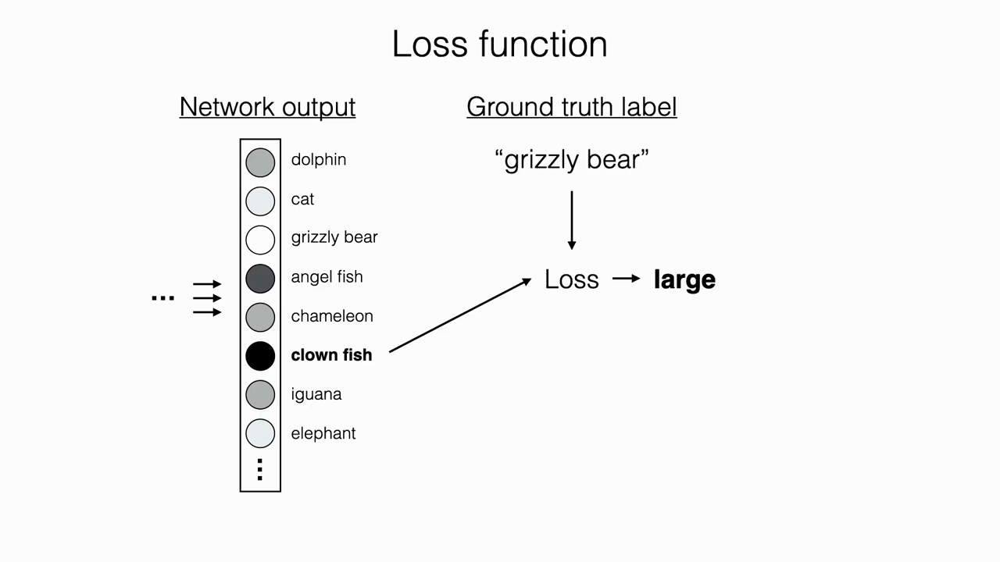
*▲ 강의 슬라이드 [51:10](https://youtu.be/6FkRvTtUc-o?t=3070): 틀리면 [손실](00_%EB%94%A5%EB%9F%AC%EB%8B%9D_%EC%9A%A9%EC%96%B4%EC%82%AC%EC%A0%84.md#loss-function-%EC%86%90%EC%8B%A4-%ED%95%A8%EC%88%98)이 커야 함*

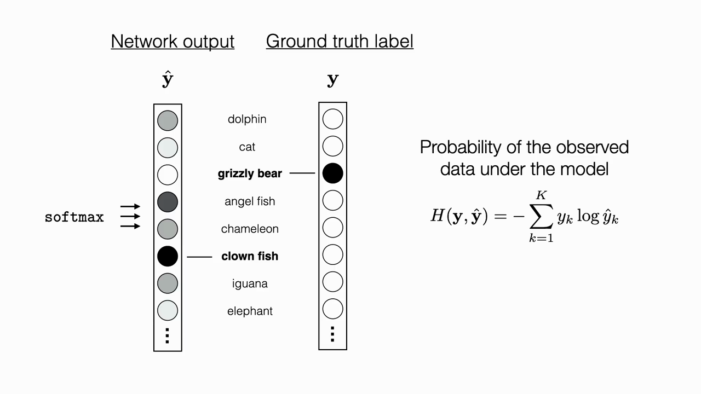
*▲ 강의 슬라이드 [52:00](https://youtu.be/6FkRvTtUc-o?t=3120): [소프트맥스](00_%EB%94%A5%EB%9F%AC%EB%8B%9D_%EC%9A%A9%EC%96%B4%EC%82%AC%EC%A0%84.md#softmax-%EC%86%8C%ED%94%84%ED%8A%B8%EB%A7%A5%EC%8A%A4) 출력과 [원-핫](00_%EB%94%A5%EB%9F%AC%EB%8B%9D_%EC%9A%A9%EC%96%B4%EC%82%AC%EC%A0%84.md#one-hot-encoding-%EC%9B%90-%ED%95%AB-%EC%9D%B8%EC%BD%94%EB%94%A9) [정답](00_%EB%94%A5%EB%9F%AC%EB%8B%9D_%EC%9A%A9%EC%96%B4%EC%82%AC%EC%A0%84.md#label-%EC%A0%95%EB%8B%B5), [교차 엔트로피](00_%EB%94%A5%EB%9F%AC%EB%8B%9D_%EC%9A%A9%EC%96%B4%EC%82%AC%EC%A0%84.md#cross-entropy-%EA%B5%90%EC%B0%A8-%EC%97%94%ED%8A%B8%EB%A1%9C%ED%94%BC)*

> [!WARNING]
> **[확률](00_%EB%94%A5%EB%9F%AC%EB%8B%9D_%EC%9A%A9%EC%96%B4%EC%82%AC%EC%A0%84.md#probability-%ED%99%95%EB%A5%A0)이 아니라 점수**
> 강사는 "[확률](00_%EB%94%A5%EB%9F%AC%EB%8B%9D_%EC%9A%A9%EC%96%B4%EC%82%AC%EC%A0%84.md#probability-%ED%99%95%EB%A5%A0)"에 따옴표를 붙입니다. [소프트맥스](00_%EB%94%A5%EB%9F%AC%EB%8B%9D_%EC%9A%A9%EC%96%B4%EC%82%AC%EC%A0%84.md#softmax-%EC%86%8C%ED%94%84%ED%8A%B8%EB%A7%A5%EC%8A%A4) 출력은 진짜 [확률](00_%EB%94%A5%EB%9F%AC%EB%8B%9D_%EC%9A%A9%EC%96%B4%EC%82%AC%EC%A0%84.md#probability-%ED%99%95%EB%A5%A0)이 아니라 **점수(score)**라는 점을 꼭 기억하라고 강조합니다.

딥러닝 [학습](00_%EB%94%A5%EB%9F%AC%EB%8B%9D_%EC%9A%A9%EC%96%B4%EC%82%AC%EC%A0%84.md#training-%ED%95%99%EC%8A%B5)을 한 문장으로 줄이면 이렇습니다. [학습 데이터](00_%EB%94%A5%EB%9F%AC%EB%8B%9D_%EC%9A%A9%EC%96%B4%EC%82%AC%EC%A0%84.md#training-data-test-data-%ED%95%99%EC%8A%B5-%EB%8D%B0%EC%9D%B4%ED%84%B0%EC%99%80-%EC%8B%9C%ED%97%98-%EB%8D%B0%EC%9D%B4%ED%84%B0)를 돌며 예측하고, [손실](00_%EB%94%A5%EB%9F%AC%EB%8B%9D_%EC%9A%A9%EC%96%B4%EC%82%AC%EC%A0%84.md#loss-function-%EC%86%90%EC%8B%A4-%ED%95%A8%EC%88%98)을 계산하고, 거대한 모델의 [가중치](00_%EB%94%A5%EB%9F%AC%EB%8B%9D_%EC%9A%A9%EC%96%B4%EC%82%AC%EC%A0%84.md#weight-%EA%B0%80%EC%A4%91%EC%B9%98)들을 조금씩 **흔들어(wiggle)** 원하는 출력에 맞춰 가는 일을 최대한 다 맞출 때까지 반복하는 것입니다. [53:06](https://youtu.be/6FkRvTtUc-o?t=3186)

### 5.7 배치 처리와 텐서

▶ 영상 [53:38](https://youtu.be/6FkRvTtUc-o?t=3218)

📐 **수학 개념**: [배치 행렬](%EC%88%98%ED%95%99%EA%B0%9C%EB%85%90/03_%EC%84%A0%ED%98%95%EB%8C%80%EC%88%98/MM03_%EB%B2%A1%ED%84%B0_%ED%91%9C%EA%B8%B0%EC%99%80_%EC%A0%84%EC%B9%98.md) · [행렬 곱과 모양](%EC%88%98%ED%95%99%EA%B0%9C%EB%85%90/03_%EC%84%A0%ED%98%95%EB%8C%80%EC%88%98/M05_%EB%B2%A1%ED%84%B0%EC%99%80_%ED%96%89%EB%A0%AC.md)
- 데이터마다의 [손실](00_%EB%94%A5%EB%9F%AC%EB%8B%9D_%EC%9A%A9%EC%96%B4%EC%82%AC%EC%A0%84.md#loss-function-%EC%86%90%EC%8B%A4-%ED%95%A8%EC%88%98)은 결국 다 더해지므로 **동시에(병렬로)** 계산할 수 있습니다. 여러 데이터를 묶은 것이 배치이고([미니배치(Mini-batch)](00_%EB%94%A5%EB%9F%AC%EB%8B%9D_%EC%9A%A9%EC%96%B4%EC%82%AC%EC%A0%84.md#mini-batch-%EB%AF%B8%EB%8B%88%EB%B0%B0%EC%B9%98) 참고), 같은 [층](00_%EB%94%A5%EB%9F%AC%EB%8B%9D_%EC%9A%A9%EC%96%B4%EC%82%AC%EC%A0%84.md#layer-%EC%B8%B5)을 여러 입력에 적용한 결과를 쌓으면 "특징 × 이미지" 행렬이 됩니다.
- [텐서(Tensor)](00_%EB%94%A5%EB%9F%AC%EB%8B%9D_%EC%9A%A9%EC%96%B4%EC%82%AC%EC%A0%84.md#tensor-%ED%85%90%EC%84%9C)는 다차원 배열이고, 모든 [층](00_%EB%94%A5%EB%9F%AC%EB%8B%9D_%EC%9A%A9%EC%96%B4%EC%82%AC%EC%A0%84.md#layer-%EC%B8%B5)의 값은 입력 데이터의 어떤 표현입니다. 사실상 **모든 것이 [텐서](00_%EB%94%A5%EB%9F%AC%EB%8B%9D_%EC%9A%A9%EC%96%B4%EC%82%AC%EC%A0%84.md#tensor-%ED%85%90%EC%84%9C)**입니다.
- 배치 크기가 $B$이고 입력 차원이 $d$일 때 입력 $\mathbf{X}$는 $B \times d$ 행렬이고, [순전파](00_%EB%94%A5%EB%9F%AC%EB%8B%9D_%EC%9A%A9%EC%96%B4%EC%82%AC%EC%A0%84.md#feed-forward-%EC%88%9C%EC%A0%84%ED%8C%8C) 전체가 [행렬 곱](00_%EB%94%A5%EB%9F%AC%EB%8B%9D_%EC%9A%A9%EC%96%B4%EC%82%AC%EC%A0%84.md#matrix-multiplication-%ED%96%89%EB%A0%AC-%EA%B3%B1)의 연속이 됩니다.

$$
\mathbf{Z}_1 = \mathbf{X}\mathbf{W}_1 + \mathbf{b}_1 \;\rightarrow\; \mathbf{H} = g(\mathbf{Z}_1) \;\rightarrow\; \mathbf{Z}_2 = \mathbf{H}\mathbf{W}_2 + \mathbf{b}_2 \;\rightarrow\; \mathbf{Y} = g(\mathbf{Z}_2)
$$

기호 풀이

| 기호 | 읽는 법 | 뜻 | 예제 값 |
| --- | --- | --- | --- |
| $\mathbf{X}$ | 굵은 대문자 엑스 | 입력을 행으로 쌓은 $B \times d$ 배치 행렬 | 행 (1, 2), (0, 1) |
| $\mathbf{W}_1$ | 굵은 대문자 더블유 일 | 첫째 [층](00_%EB%94%A5%EB%9F%AC%EB%8B%9D_%EC%9A%A9%EC%96%B4%EC%82%AC%EC%A0%84.md#layer-%EC%B8%B5) [가중치](00_%EB%94%A5%EB%9F%AC%EB%8B%9D_%EC%9A%A9%EC%96%B4%EC%82%AC%EC%A0%84.md#weight-%EA%B0%80%EC%A4%91%EC%B9%98) ($d \times$ 은닉 칸 수) | 행 (1, 0), (−1, 1) |
| $\mathbf{b}_1$ | 굵은 비 일 | 첫째 [층](00_%EB%94%A5%EB%9F%AC%EB%8B%9D_%EC%9A%A9%EC%96%B4%EC%82%AC%EC%A0%84.md#layer-%EC%B8%B5) [편향](00_%EB%94%A5%EB%9F%AC%EB%8B%9D_%EC%9A%A9%EC%96%B4%EC%82%AC%EC%A0%84.md#bias-%ED%8E%B8%ED%96%A5), 모든 행에 똑같이 더함 | (0, −1) |
| $\mathbf{Z}_1$ | 굵은 대문자 지 일 | 첫째 [층](00_%EB%94%A5%EB%9F%AC%EB%8B%9D_%EC%9A%A9%EC%96%B4%EC%82%AC%EC%A0%84.md#layer-%EC%B8%B5)의 선형 결합 결과 | 행 (−1, 1), (−1, 0) |
| $g$ | 지 (함수) | 원소별 비선형 함수, 여기서는 [ReLU](00_%EB%94%A5%EB%9F%AC%EB%8B%9D_%EC%9A%A9%EC%96%B4%EC%82%AC%EC%A0%84.md#relu-%EB%A0%90%EB%A3%A8) | [ReLU](00_%EB%94%A5%EB%9F%AC%EB%8B%9D_%EC%9A%A9%EC%96%B4%EC%82%AC%EC%A0%84.md#relu-%EB%A0%90%EB%A3%A8)(−1) = 0 |
| $\mathbf{H}$ | 굵은 대문자 에이치 | 은닉 유닛 값을 행으로 쌓은 행렬 | 행 (0, 1), (0, 0) |
| $\mathbf{W}_2$ | 굵은 대문자 더블유 이 | 둘째 [층](00_%EB%94%A5%EB%9F%AC%EB%8B%9D_%EC%9A%A9%EC%96%B4%EC%82%AC%EC%A0%84.md#layer-%EC%B8%B5) [가중치](00_%EB%94%A5%EB%9F%AC%EB%8B%9D_%EC%9A%A9%EC%96%B4%EC%82%AC%EC%A0%84.md#weight-%EA%B0%80%EC%A4%91%EC%B9%98) | 열 (2, 3) |
| $\mathbf{b}_2$ | 굵은 비 이 | 둘째 [층](00_%EB%94%A5%EB%9F%AC%EB%8B%9D_%EC%9A%A9%EC%96%B4%EC%82%AC%EC%A0%84.md#layer-%EC%B8%B5) [편향](00_%EB%94%A5%EB%9F%AC%EB%8B%9D_%EC%9A%A9%EC%96%B4%EC%82%AC%EC%A0%84.md#bias-%ED%8E%B8%ED%96%A5) | (1) |
| $\mathbf{Z}_2$ | 굵은 대문자 지 이 | 둘째 [층](00_%EB%94%A5%EB%9F%AC%EB%8B%9D_%EC%9A%A9%EC%96%B4%EC%82%AC%EC%A0%84.md#layer-%EC%B8%B5)의 선형 결합 결과 | 행 (4), (1) |
| $\mathbf{Y}$ | 굵은 대문자 와이 | 배치 전체의 출력 (입력마다 한 행) | 행 (4), (1) |
| $\rightarrow$ | 화살표 | 다음 계산으로 넘김 | - |

예제와 풀이

**문제**: 입력 2개(배치 크기 B = 2, 입력 차원 d = 2)를 2층 망에 한 번에 넣으면 출력 행렬 $\mathbf{Y}$는?

**주어진 값**:
- $\mathbf{X}$의 두 행 (1, 2), (0, 1) (입력 두 개를 행으로 쌓은 배치)
- $\mathbf{W}_1$의 두 행 (1, 0), (−1, 1) (첫째 [층](00_%EB%94%A5%EB%9F%AC%EB%8B%9D_%EC%9A%A9%EC%96%B4%EC%82%AC%EC%A0%84.md#layer-%EC%B8%B5) [가중치](00_%EB%94%A5%EB%9F%AC%EB%8B%9D_%EC%9A%A9%EC%96%B4%EC%82%AC%EC%A0%84.md#weight-%EA%B0%80%EC%A4%91%EC%B9%98), $d \times 2$)
- $\mathbf{b}_1 = (0, -1)$ (첫째 [층](00_%EB%94%A5%EB%9F%AC%EB%8B%9D_%EC%9A%A9%EC%96%B4%EC%82%AC%EC%A0%84.md#layer-%EC%B8%B5) [편향](00_%EB%94%A5%EB%9F%AC%EB%8B%9D_%EC%9A%A9%EC%96%B4%EC%82%AC%EC%A0%84.md#bias-%ED%8E%B8%ED%96%A5), 모든 행에 더함)
- $\mathbf{W}_2$는 한 열 (2, 3) (둘째 [층](00_%EB%94%A5%EB%9F%AC%EB%8B%9D_%EC%9A%A9%EC%96%B4%EC%82%AC%EC%A0%84.md#layer-%EC%B8%B5) [가중치](00_%EB%94%A5%EB%9F%AC%EB%8B%9D_%EC%9A%A9%EC%96%B4%EC%82%AC%EC%A0%84.md#weight-%EA%B0%80%EC%A4%91%EC%B9%98), $2 \times 1$)
- $\mathbf{b}_2 = 1$ (둘째 [층](00_%EB%94%A5%EB%9F%AC%EB%8B%9D_%EC%9A%A9%EC%96%B4%EC%82%AC%EC%A0%84.md#layer-%EC%B8%B5) [편향](00_%EB%94%A5%EB%9F%AC%EB%8B%9D_%EC%9A%A9%EC%96%B4%EC%82%AC%EC%A0%84.md#bias-%ED%8E%B8%ED%96%A5))
- $g$ = [ReLU](00_%EB%94%A5%EB%9F%AC%EB%8B%9D_%EC%9A%A9%EC%96%B4%EC%82%AC%EC%A0%84.md#relu-%EB%A0%90%EB%A3%A8) (비선형 함수)

**풀이**
1. 식을 그대로 쓴다: $\mathbf{Z}_1 = \mathbf{X}\mathbf{W}_1 + \mathbf{b}_1 \;\rightarrow\; \mathbf{H} = g(\mathbf{Z}_1) \;\rightarrow\; \mathbf{Z}_2 = \mathbf{H}\mathbf{W}_2 + \mathbf{b}_2 \;\rightarrow\; \mathbf{Y} = g(\mathbf{Z}_2)$
2. 값을 대입한다: $\mathbf{Z}_1 = \begin{pmatrix} 1 & 2 \\ 0 & 1 \end{pmatrix}\begin{pmatrix} 1 & 0 \\ -1 & 1 \end{pmatrix} + \begin{pmatrix} 0 & -1 \end{pmatrix} \;\rightarrow\; \mathbf{H} = g(\mathbf{Z}_1) \;\rightarrow\; \mathbf{Z}_2 = \mathbf{H}\begin{pmatrix} 2 \\ 3 \end{pmatrix} + 1 \;\rightarrow\; \mathbf{Y} = g(\mathbf{Z}_2)$
3. $\mathbf{X}\mathbf{W}_1$의 1행 1열 (X 1행과 W₁ 1열을 칸끼리 곱해 더함): 1 × 1 + 2 × (−1) = 1 + (−2) = −1
4. 1행 2열: 1 × 0 + 2 × 1 = 0 + 2 = 2
5. 2행 1열: 0 × 1 + 1 × (−1) = 0 + (−1) = −1
6. 2행 2열: 0 × 0 + 1 × 1 = 0 + 1 = 1 이므로 $\mathbf{X}\mathbf{W}_1$의 행은 (−1, 2), (−1, 1)
7. [편향](00_%EB%94%A5%EB%9F%AC%EB%8B%9D_%EC%9A%A9%EC%96%B4%EC%82%AC%EC%A0%84.md#bias-%ED%8E%B8%ED%96%A5)을 행마다 더한다: (−1 + 0, 2 + (−1)) = (−1, 1), (−1 + 0, 1 + (−1)) = (−1, 0) 이므로 $\mathbf{Z}_1$의 행은 (−1, 1), (−1, 0)
8. g = [ReLU](00_%EB%94%A5%EB%9F%AC%EB%8B%9D_%EC%9A%A9%EC%96%B4%EC%82%AC%EC%A0%84.md#relu-%EB%A0%90%EB%A3%A8)는 음수면 0, 0 이상이면 그대로 두는 함수다: [ReLU](00_%EB%94%A5%EB%9F%AC%EB%8B%9D_%EC%9A%A9%EC%96%B4%EC%82%AC%EC%A0%84.md#relu-%EB%A0%90%EB%A3%A8)(z) = max(0, z). 음수 −1은 0이 되므로 $\mathbf{H}$의 행은 (0, 1), (0, 0)
9. $\mathbf{H}\mathbf{W}_2$ 1행: 0 × 2 + 1 × 3 = 0 + 3 = 3
10. $\mathbf{H}\mathbf{W}_2$ 2행: 0 × 2 + 0 × 3 = 0 + 0 = 0
11. [편향](00_%EB%94%A5%EB%9F%AC%EB%8B%9D_%EC%9A%A9%EC%96%B4%EC%82%AC%EC%A0%84.md#bias-%ED%8E%B8%ED%96%A5)을 더한다: 3 + 1 = 4, 0 + 1 = 1 이므로 $\mathbf{Z}_2$의 행은 (4), (1)
12. [ReLU](00_%EB%94%A5%EB%9F%AC%EB%8B%9D_%EC%9A%A9%EC%96%B4%EC%82%AC%EC%A0%84.md#relu-%EB%A0%90%EB%A3%A8)를 적용한다: 4와 1은 0 이상이라 그대로이므로 $\mathbf{Y}$의 행은 (4), (1)

**답**: $\mathbf{Y}$의 행 (4), (1) (입력 두 개를 [행렬 곱](00_%EB%94%A5%EB%9F%AC%EB%8B%9D_%EC%9A%A9%EC%96%B4%EC%82%AC%EC%A0%84.md#matrix-multiplication-%ED%96%89%EB%A0%AC-%EA%B3%B1) 연속 한 번으로 처리)

내 이해

- 그래서 수많은 곱셈을 병렬로 처리하는 **[GPU](00_%EB%94%A5%EB%9F%AC%EB%8B%9D_%EC%9A%A9%EC%96%B4%EC%82%AC%EC%A0%84.md#device-gpu-%EC%9E%A5%EC%B9%98%EC%99%80-gpu)**가 결정적이었습니다.

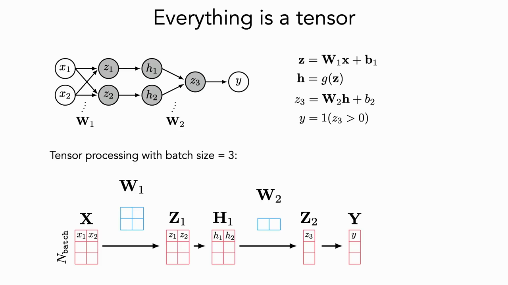
*▲ 강의 슬라이드 [55:00](https://youtu.be/6FkRvTtUc-o?t=3300): 배치 크기 3일 때 [텐서](00_%EB%94%A5%EB%9F%AC%EB%8B%9D_%EC%9A%A9%EC%96%B4%EC%82%AC%EC%A0%84.md#tensor-%ED%85%90%EC%84%9C) 처리*

---

## 6. 앞으로 배울 것 (내다보기)

### 6.1 근사 이론: 무엇을 표현할 수 있나

▶ 영상 [40:35](https://youtu.be/6FkRvTtUc-o?t=2435)

📐 **수학 개념**: [리만 합과 보편 근사](%EC%88%98%ED%95%99%EA%B0%9C%EB%85%90/06_%EA%B7%BC%EC%82%AC_%EC%9D%B4%EB%A1%A0/MM07_%EB%A6%AC%EB%A7%8C_%ED%95%A9%EA%B3%BC_%EB%B3%B4%ED%8E%B8_%EA%B7%BC%EC%82%AC.md) · [선형의 합성은 선형](%EC%88%98%ED%95%99%EA%B0%9C%EB%85%90/05_%EC%8B%A0%EA%B2%BD%EB%A7%9D%EC%9D%98_%EA%B3%84%EC%82%B0/MM06_%ED%95%A9%EC%84%B1%ED%95%A8%EC%88%98%EC%99%80_%EB%B9%84%EC%84%A0%ED%98%95%EC%84%B1.md)
| [층](00_%EB%94%A5%EB%9F%AC%EB%8B%9D_%EC%9A%A9%EC%96%B4%EC%82%AC%EC%A0%84.md#layer-%EC%B8%B5) 수 | [표현력](00_%EB%94%A5%EB%9F%AC%EB%8B%9D_%EC%9A%A9%EC%96%B4%EC%82%AC%EC%A0%84.md#representational-power-%ED%91%9C%ED%98%84%EB%A0%A5)(Representational power) |
|---|---|
| 1층 | 임의의 **선형** [결정 경계](00_%EB%94%A5%EB%9F%AC%EB%8B%9D_%EC%9A%A9%EC%96%B4%EC%82%AC%EC%A0%84.md#decision-boundary-%EA%B2%B0%EC%A0%95-%EA%B2%BD%EA%B3%84) |
| 2층 이상 | 이론적으로 **임의의 함수**를 근사 가능. 단, [층](00_%EB%94%A5%EB%9F%AC%EB%8B%9D_%EC%9A%A9%EC%96%B4%EC%82%AC%EC%A0%84.md#layer-%EC%B8%B5) 사이에 의미 있는 비선형 함수가 있어야 함 |

- 비선형 함수가 없으면 [선형층](00_%EB%94%A5%EB%9F%AC%EB%8B%9D_%EC%9A%A9%EC%96%B4%EC%82%AC%EC%A0%84.md#linear-layer-%EC%84%A0%ED%98%95%EC%B8%B5)을 아무리 쌓아도 결국 하나의 선형 변환입니다.
- 직관적으로는 **[리만 합](00_%EB%94%A5%EB%9F%AC%EB%8B%9D_%EC%9A%A9%EC%96%B4%EC%82%AC%EC%A0%84.md#riemann-sum-%EB%A6%AC%EB%A7%8C-%ED%95%A9)(Riemann sum)**과 같습니다. 좁은 막대를 충분히 많이 쓰면 어떤 곡선 아래 넓이든 근사할 수 있듯이, [용량](00_%EB%94%A5%EB%9F%AC%EB%8B%9D_%EC%9A%A9%EC%96%B4%EC%82%AC%EC%A0%84.md#capacity-%EC%9A%A9%EB%9F%89)(capacity)이 충분하면 어떤 함수든 근사할 수 있습니다.
- **효율 문제** [41:47](https://youtu.be/6FkRvTtUc-o?t=2507): 이론상으로는 충분히 **넓은** 2층 망(수천~수백만 차원)으로 무엇이든 근사할 수 있지만 실제로는 매우 비효율적입니다. **좁고 깊은** 망이 훨씬 적은 [파라미터](00_%EB%94%A5%EB%9F%AC%EB%8B%9D_%EC%9A%A9%EC%96%B4%EC%82%AC%EC%A0%84.md#parameter-%ED%8C%8C%EB%9D%BC%EB%AF%B8%ED%84%B0)로 같은 함수를 근사할 수 있고, 실제로도 [층](00_%EB%94%A5%EB%9F%AC%EB%8B%9D_%EC%9A%A9%EC%96%B4%EC%82%AC%EC%A0%84.md#layer-%EC%B8%B5)이 많을수록 도움이 됩니다. 3강(근사 이론)에서 다룹니다.

*▲ 직접 그린 그림: [리만 합](00_%EB%94%A5%EB%9F%AC%EB%8B%9D_%EC%9A%A9%EC%96%B4%EC%82%AC%EC%A0%84.md#riemann-sum-%EB%A6%AC%EB%A7%8C-%ED%95%A9)과 [ReLU](00_%EB%94%A5%EB%9F%AC%EB%8B%9D_%EC%9A%A9%EC%96%B4%EC%82%AC%EC%A0%84.md#relu-%EB%A0%90%EB%A3%A8) 근사 (자세히: [MM07_리만_합과_보편_근사](%EC%88%98%ED%95%99%EA%B0%9C%EB%85%90/06_%EA%B7%BC%EC%82%AC_%EC%9D%B4%EB%A1%A0/MM07_%EB%A6%AC%EB%A7%8C_%ED%95%A9%EA%B3%BC_%EB%B3%B4%ED%8E%B8_%EA%B7%BC%EC%82%AC.md))*

### 6.2 아키텍처

▶ 영상 [42:22](https://youtu.be/6FkRvTtUc-o?t=2542)

📐 **수학 개념**: [합성함수](%EC%88%98%ED%95%99%EA%B0%9C%EB%85%90/05_%EC%8B%A0%EA%B2%BD%EB%A7%9D%EC%9D%98_%EA%B3%84%EC%82%B0/MM06_%ED%95%A9%EC%84%B1%ED%95%A8%EC%88%98%EC%99%80_%EB%B9%84%EC%84%A0%ED%98%95%EC%84%B1.md)
- 딥러닝 모델은 대개 "선형 변환 + 비선형 함수"라는 단순한 계산을 연쇄적으로 반복한 것입니다.

$$
f(\mathbf{x}) = f_L\big(f_{L-1}(\cdots f_1(\mathbf{x})\cdots)\big)
$$

기호 풀이

| 기호 | 읽는 법 | 뜻 | 예제 값 |
| --- | --- | --- | --- |
| $f$ | 에프 | 망 전체를 하나로 본 함수 | f(1) = 16 |
| $\mathbf{x}$ | 굵은 엑스 | 입력 | 1 |
| $f_1$ | 에프 일 | 첫째 [층](00_%EB%94%A5%EB%9F%AC%EB%8B%9D_%EC%9A%A9%EC%96%B4%EC%82%AC%EC%A0%84.md#layer-%EC%B8%B5)이 하는 계산 (가장 먼저 적용) | x + 1 |
| $f_{L-1}$ | 에프 엘 빼기 일 | 마지막 바로 앞 [층](00_%EB%94%A5%EB%9F%AC%EB%8B%9D_%EC%9A%A9%EC%96%B4%EC%82%AC%EC%A0%84.md#layer-%EC%B8%B5)의 계산 | 2x |
| $f_L$ | 에프 엘 | 마지막 [층](00_%EB%94%A5%EB%9F%AC%EB%8B%9D_%EC%9A%A9%EC%96%B4%EC%82%AC%EC%A0%84.md#layer-%EC%B8%B5)의 계산 (가장 나중에 적용) | x² |
| $L$ | 엘 | [층](00_%EB%94%A5%EB%9F%AC%EB%8B%9D_%EC%9A%A9%EC%96%B4%EC%82%AC%EC%A0%84.md#layer-%EC%B8%B5) 수 (깊이) | 3 |
| $\cdots$ | 점점점 | 중간 [층](00_%EB%94%A5%EB%9F%AC%EB%8B%9D_%EC%9A%A9%EC%96%B4%EC%82%AC%EC%A0%84.md#layer-%EC%B8%B5)들을 생략 | - |

예제와 풀이

**문제**: [층](00_%EB%94%A5%EB%9F%AC%EB%8B%9D_%EC%9A%A9%EC%96%B4%EC%82%AC%EC%A0%84.md#layer-%EC%B8%B5) 3개가 차례로 "1 더하기", "2 곱하기", "제곱하기"를 하는 망에 1을 넣으면 출력 f(1)은?

**주어진 값**:
- $L = 3$ ([층](00_%EB%94%A5%EB%9F%AC%EB%8B%9D_%EC%9A%A9%EC%96%B4%EC%82%AC%EC%A0%84.md#layer-%EC%B8%B5) 수)
- $f_1(x) = x + 1$ (첫째 [층](00_%EB%94%A5%EB%9F%AC%EB%8B%9D_%EC%9A%A9%EC%96%B4%EC%82%AC%EC%A0%84.md#layer-%EC%B8%B5))
- $f_2(x) = 2x$ (둘째 [층](00_%EB%94%A5%EB%9F%AC%EB%8B%9D_%EC%9A%A9%EC%96%B4%EC%82%AC%EC%A0%84.md#layer-%EC%B8%B5), 여기서는 $f_{L-1}$)
- $f_3(x) = x^2$ (마지막 [층](00_%EB%94%A5%EB%9F%AC%EB%8B%9D_%EC%9A%A9%EC%96%B4%EC%82%AC%EC%A0%84.md#layer-%EC%B8%B5), 여기서는 $f_L$)
- $\mathbf{x} = 1$ (입력)

**풀이**
1. 식을 그대로 쓴다: $f(\mathbf{x}) = f_L\big(f_{L-1}(\cdots f_1(\mathbf{x})\cdots)\big)$
2. 값을 대입한다: $f(1) = f_3\big(f_2(f_1(1))\big)$
3. 가장 안쪽 [층](00_%EB%94%A5%EB%9F%AC%EB%8B%9D_%EC%9A%A9%EC%96%B4%EC%82%AC%EC%A0%84.md#layer-%EC%B8%B5)부터 계산한다: $f_1(1) = 1 + 1 = 2$ 이므로 $f(1) = f_3\big(f_2(2)\big)$
4. 다음 [층](00_%EB%94%A5%EB%9F%AC%EB%8B%9D_%EC%9A%A9%EC%96%B4%EC%82%AC%EC%A0%84.md#layer-%EC%B8%B5)에 넣는다: $f_2(2) = 2 \times 2 = 4$ 이므로 $f(1) = f_3(4)$
5. 마지막 [층](00_%EB%94%A5%EB%9F%AC%EB%8B%9D_%EC%9A%A9%EC%96%B4%EC%82%AC%EC%A0%84.md#layer-%EC%B8%B5)에 넣는다: $f_3(4) = 4 \times 4 = 16$

**답**: f(1) = 16

내 이해

- [층](00_%EB%94%A5%EB%9F%AC%EB%8B%9D_%EC%9A%A9%EC%96%B4%EC%82%AC%EC%A0%84.md#layer-%EC%B8%B5)이 깊어질수록 표현이 더 **추상화**되고 [용량](00_%EB%94%A5%EB%9F%AC%EB%8B%9D_%EC%9A%A9%EC%96%B4%EC%82%AC%EC%A0%84.md#capacity-%EC%9A%A9%EB%9F%89)이 커져 더 복잡한 계산이 가능합니다. 얕은 망은 가장자리(edge) 찾기 같은 단순한 일을 효율적으로 하지만, 깊은 망은 흰동가리 인식이나 영어→중국어 번역 같은 어려운 일을 효율적으로 합니다.
- 데이터의 구조와 문제에 맞춰 연결 방식을 다르게 설계합니다. 다룰 구조: **[CNN](00_%EB%94%A5%EB%9F%AC%EB%8B%9D_%EC%9A%A9%EC%96%B4%EC%82%AC%EC%A0%84.md#cnn-convolutional-neural-network-%ED%95%A9%EC%84%B1%EA%B3%B1-%EC%8B%A0%EA%B2%BD%EB%A7%9D)**([합성곱 신경망](00_%EB%94%A5%EB%9F%AC%EB%8B%9D_%EC%9A%A9%EC%96%B4%EC%82%AC%EC%A0%84.md#cnn-convolutional-neural-network-%ED%95%A9%EC%84%B1%EA%B3%B1-%EC%8B%A0%EA%B2%BD%EB%A7%9D)), **[GNN](00_%EB%94%A5%EB%9F%AC%EB%8B%9D_%EC%9A%A9%EC%96%B4%EC%82%AC%EC%A0%84.md#gnn-graph-neural-network-%EA%B7%B8%EB%9E%98%ED%94%84-%EC%8B%A0%EA%B2%BD%EB%A7%9D)**([그래프 신경망](00_%EB%94%A5%EB%9F%AC%EB%8B%9D_%EC%9A%A9%EC%96%B4%EC%82%AC%EC%A0%84.md#gnn-graph-neural-network-%EA%B7%B8%EB%9E%98%ED%94%84-%EC%8B%A0%EA%B2%BD%EB%A7%9D), [Graph](00_%EB%94%A5%EB%9F%AC%EB%8B%9D_%EC%9A%A9%EC%96%B4%EC%82%AC%EC%A0%84.md#graph-node-edge-%EA%B7%B8%EB%9E%98%ED%94%84-%EB%85%B8%EB%93%9C-%EC%97%A3%EC%A7%80) neural network), **[트랜스포머](00_%EB%94%A5%EB%9F%AC%EB%8B%9D_%EC%9A%A9%EC%96%B4%EC%82%AC%EC%A0%84.md#transformer-%ED%8A%B8%EB%9E%9C%EC%8A%A4%ED%8F%AC%EB%A8%B8)([Transformer](00_%EB%94%A5%EB%9F%AC%EB%8B%9D_%EC%9A%A9%EC%96%B4%EC%82%AC%EC%A0%84.md#transformer-%ED%8A%B8%EB%9E%9C%EC%8A%A4%ED%8F%AC%EB%A8%B8))**, **[RNN](00_%EB%94%A5%EB%9F%AC%EB%8B%9D_%EC%9A%A9%EC%96%B4%EC%82%AC%EC%A0%84.md#rnn-recurrent-neural-network-%EC%88%9C%ED%99%98-%EC%8B%A0%EA%B2%BD%EB%A7%9D)**([순환 신경망](00_%EB%94%A5%EB%9F%AC%EB%8B%9D_%EC%9A%A9%EC%96%B4%EC%82%AC%EC%A0%84.md#rnn-recurrent-neural-network-%EC%88%9C%ED%99%98-%EC%8B%A0%EA%B2%BD%EB%A7%9D), Recurrent neural network)

### 6.3 일반화: 왜 깊은 망은 외우지 않고 일반화하나

▶ 영상 [44:05](https://youtu.be/6FkRvTtUc-o?t=2645)

- 깊은 망은 [파라미터](00_%EB%94%A5%EB%9F%AC%EB%8B%9D_%EC%9A%A9%EC%96%B4%EC%82%AC%EC%A0%84.md#parameter-%ED%8C%8C%EB%9D%BC%EB%AF%B8%ED%84%B0)가 워낙 많아서 [학습 데이터](00_%EB%94%A5%EB%9F%AC%EB%8B%9D_%EC%9A%A9%EC%96%B4%EC%82%AC%EC%A0%84.md#training-data-test-data-%ED%95%99%EC%8A%B5-%EB%8D%B0%EC%9D%B4%ED%84%B0%EC%99%80-%EC%8B%9C%ED%97%98-%EB%8D%B0%EC%9D%B4%ED%84%B0)를 그대로 외우는 **조회표(lookup table)**처럼 동작할 수도 있습니다. 그런데 실제로는 [일반화(Generalization)](00_%EB%94%A5%EB%9F%AC%EB%8B%9D_%EC%9A%A9%EC%96%B4%EC%82%AC%EC%A0%84.md#generalization-%EC%9D%BC%EB%B0%98%ED%99%94)되는 규칙을 배웁니다. 이것은 고전 이론과 어긋납니다.
- **고전 이론**: [용량](00_%EB%94%A5%EB%9F%AC%EB%8B%9D_%EC%9A%A9%EC%96%B4%EC%82%AC%EC%A0%84.md#capacity-%EC%9A%A9%EB%9F%89)이 부족하면 [과소적합(Underfitting)](00_%EB%94%A5%EB%9F%AC%EB%8B%9D_%EC%9A%A9%EC%96%B4%EC%82%AC%EC%A0%84.md#underfitting-%EA%B3%BC%EC%86%8C%EC%A0%81%ED%95%A9), 너무 크면 [과적합(Overfitting)](00_%EB%94%A5%EB%9F%AC%EB%8B%9D_%EC%9A%A9%EC%96%B4%EC%82%AC%EC%A0%84.md#overfitting-%EA%B3%BC%EC%A0%81%ED%95%A9). 그래서 [오차](00_%EB%94%A5%EB%9F%AC%EB%8B%9D_%EC%9A%A9%EC%96%B4%EC%82%AC%EC%A0%84.md#error-%EC%98%A4%EC%B0%A8) 곡선이 U자 모양입니다.
- **[이중 하강](00_%EB%94%A5%EB%9F%AC%EB%8B%9D_%EC%9A%A9%EC%96%B4%EC%82%AC%EC%A0%84.md#double-descent-%EC%9D%B4%EC%A4%91-%ED%95%98%EA%B0%95)(Double descent)**: 실제로는 [용량](00_%EB%94%A5%EB%9F%AC%EB%8B%9D_%EC%9A%A9%EC%96%B4%EC%82%AC%EC%A0%84.md#capacity-%EC%9A%A9%EB%9F%89)을 계속 늘려 데이터 점들 사이를 [보간](00_%EB%94%A5%EB%9F%AC%EB%8B%9D_%EC%9A%A9%EC%96%B4%EC%82%AC%EC%A0%84.md#interpolation-%EB%B3%B4%EA%B0%84)(interpolation)할 수 있는 지점(**[보간](00_%EB%94%A5%EB%9F%AC%EB%8B%9D_%EC%9A%A9%EC%96%B4%EC%82%AC%EC%A0%84.md#interpolation-%EB%B3%B4%EA%B0%84) 문턱**)을 넘어서면, [파라미터](00_%EB%94%A5%EB%9F%AC%EB%8B%9D_%EC%9A%A9%EC%96%B4%EC%82%AC%EC%A0%84.md#parameter-%ED%8C%8C%EB%9D%BC%EB%AF%B8%ED%84%B0)가 과하게 많은데도 [오차](00_%EB%94%A5%EB%9F%AC%EB%8B%9D_%EC%9A%A9%EC%96%B4%EC%82%AC%EC%A0%84.md#error-%EC%98%A4%EC%B0%A8)가 **다시 내려가는** 현대적 [보간](00_%EB%94%A5%EB%9F%AC%EB%8B%9D_%EC%9A%A9%EC%96%B4%EC%82%AC%EC%A0%84.md#interpolation-%EB%B3%B4%EA%B0%84) 영역이 나타납니다.

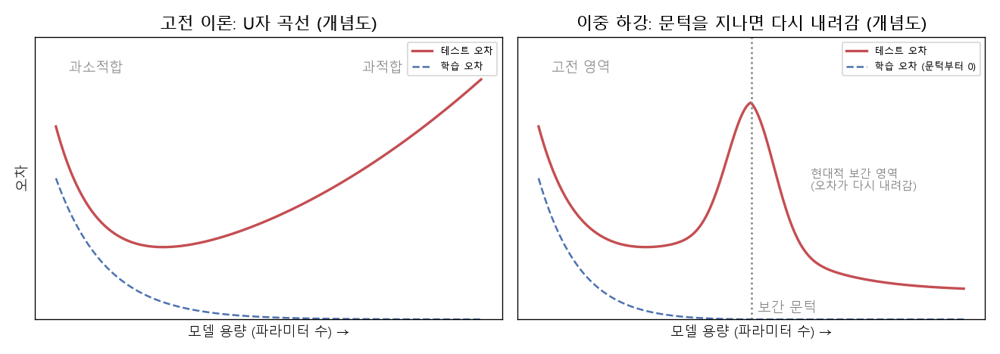
*▲ 직접 그린 그림: 고전 이론의 U자 곡선과 [이중 하강](00_%EB%94%A5%EB%9F%AC%EB%8B%9D_%EC%9A%A9%EC%96%B4%EC%82%AC%EC%A0%84.md#double-descent-%EC%9D%B4%EC%A4%91-%ED%95%98%EA%B0%95) (개념도, 실제 데이터 아님)*

- **단순성 [가설](00_%EB%94%A5%EB%9F%AC%EB%8B%9D_%EC%9A%A9%EC%96%B4%EC%82%AC%EC%A0%84.md#hypothesis-%EA%B0%80%EC%84%A4)**: 고전 이론은 "큰 모델은 복잡한 함수를 배워 과적합한다"고 봤습니다. 새로 떠오르는 이론은 "깊은 망은 실제로는 **단순한 함수**를 배우고, 그래서 일반화된다"고 봅니다. [49:40](https://youtu.be/6FkRvTtUc-o?t=2980)

질의응답 정리 [45:11](https://youtu.be/6FkRvTtUc-o?t=2711)

- **[용량](00_%EB%94%A5%EB%9F%AC%EB%8B%9D_%EC%9A%A9%EC%96%B4%EC%82%AC%EC%A0%84.md#capacity-%EC%9A%A9%EB%9F%89)(capacity)이란?** 모델의 [파라미터](00_%EB%94%A5%EB%9F%AC%EB%8B%9D_%EC%9A%A9%EC%96%B4%EC%82%AC%EC%A0%84.md#parameter-%ED%8C%8C%EB%9D%BC%EB%AF%B8%ED%84%B0) 수입니다. 너비와 깊이를 모두 포함합니다.
- **데이터 양과의 관계는?** 그래프의 축에는 없지만 밀접합니다. 데이터가 적으면 과적합하기 쉽고, 데이터 분포를 충분히 덮지 못하면 점들 사이를 보간하는 법도 배울 수 없습니다. 충분히 큰 데이터셋이 생기기 전까지 딥러닝이 안 됐던 이유 중 하나입니다.
- **[과적합](00_%EB%94%A5%EB%9F%AC%EB%8B%9D_%EC%9A%A9%EC%96%B4%EC%82%AC%EC%A0%84.md#overfitting-%EA%B3%BC%EC%A0%81%ED%95%A9)과 [과매개변수화](00_%EB%94%A5%EB%9F%AC%EB%8B%9D_%EC%9A%A9%EC%96%B4%EC%82%AC%EC%A0%84.md#overparameterization-%EA%B3%BC%EB%A7%A4%EA%B0%9C%EB%B3%80%EC%88%98%ED%99%94)([Overparameterization](00_%EB%94%A5%EB%9F%AC%EB%8B%9D_%EC%9A%A9%EC%96%B4%EC%82%AC%EC%A0%84.md#overparameterization-%EA%B3%BC%EB%A7%A4%EA%B0%9C%EB%B3%80%EC%88%98%ED%99%94))의 차이는?** [과적합](00_%EB%94%A5%EB%9F%AC%EB%8B%9D_%EC%9A%A9%EC%96%B4%EC%82%AC%EC%A0%84.md#overfitting-%EA%B3%BC%EC%A0%81%ED%95%A9)은 결과([일반화](00_%EB%94%A5%EB%9F%AC%EB%8B%9D_%EC%9A%A9%EC%96%B4%EC%82%AC%EC%A0%84.md#generalization-%EC%9D%BC%EB%B0%98%ED%99%94) 성능이 나빠짐)를 말합니다. 예를 들어 점 3개에 12차 함수를 맞추면 점은 다 지나가지만 들쭉날쭉해서 새 데이터에 맞지 않습니다. [과매개변수화](00_%EB%94%A5%EB%9F%AC%EB%8B%9D_%EC%9A%A9%EC%96%B4%EC%82%AC%EC%A0%84.md#overparameterization-%EA%B3%BC%EB%A7%A4%EA%B0%9C%EB%B3%80%EC%88%98%ED%99%94)는 [파라미터](00_%EB%94%A5%EB%9F%AC%EB%8B%9D_%EC%9A%A9%EC%96%B4%EC%82%AC%EC%A0%84.md#parameter-%ED%8C%8C%EB%9D%BC%EB%AF%B8%ED%84%B0) 수가 많다는 상태를 말합니다. 새 관점에서는 [과소적합](00_%EB%94%A5%EB%9F%AC%EB%8B%9D_%EC%9A%A9%EC%96%B4%EC%82%AC%EC%A0%84.md#underfitting-%EA%B3%BC%EC%86%8C%EC%A0%81%ED%95%A9)/[과적합](00_%EB%94%A5%EB%9F%AC%EB%8B%9D_%EC%9A%A9%EC%96%B4%EC%82%AC%EC%A0%84.md#overfitting-%EA%B3%BC%EC%A0%81%ED%95%A9) 대신 과소매개변수화/[과매개변수화](00_%EB%94%A5%EB%9F%AC%EB%8B%9D_%EC%9A%A9%EC%96%B4%EC%82%AC%EC%A0%84.md#overparameterization-%EA%B3%BC%EB%A7%A4%EA%B0%9C%EB%B3%80%EC%88%98%ED%99%94)로 구간을 나눕니다. 다만 이 관점은 **자원**을 고려하지 않습니다. 계산 자원이 무한하지 않으니 실제로는 성능과 자원이 균형을 이루는 지점을 찾아야 합니다.
- **넓은 2층 vs 좁고 깊은 망, 해석하기 쉬운 쪽은?** 둘 다 어렵습니다. 아주 고차원인 공간도, 아주 많이 쌓은 [층](00_%EB%94%A5%EB%9F%AC%EB%8B%9D_%EC%9A%A9%EC%96%B4%EC%82%AC%EC%A0%84.md#layer-%EC%B8%B5)도 해석하기 어렵습니다. 그래서 생태학처럼 해석이 중요한 분야는 여전히 [일반화](00_%EB%94%A5%EB%9F%AC%EB%8B%9D_%EC%9A%A9%EC%96%B4%EC%82%AC%EC%A0%84.md#generalization-%EC%9D%BC%EB%B0%98%ED%99%94) 가법 모델(GAM) 같은 단순한 모델을 많이 씁니다. Jeremy는 "너비와 깊이의 최적 비율은 OpenAI도 철저히 감추는 비밀이고, 과학적으로 답을 찾으면 거기 취직할 수 있다"고 덧붙입니다.

### 6.4 표현 학습: 깊은 망은 데이터를 어떻게 표현하나

▶ 영상 [55:18](https://youtu.be/6FkRvTtUc-o?t=3318)

- 깊은 망은 지식을 조회표보다 **압축적으로** 표현합니다. 여러 과제에 두루 쓸 수 있는 **저수준 부품**이 있다고 가정하고 그것을 조합합니다.
- **알파벳 T 예시** [55:51](https://youtu.be/6FkRvTtUc-o?t=3351): T만 알아보는 분류기를 따로 만들 수도 있습니다. 하지만 "선" 분류기를 하나 만들고 그것을 회전해 다시 쓴 뒤, 두 선이 만나는 지점만 이해하면 T를 알아볼 수 있습니다. 선 분류기는 재사용 가능한 부품입니다.
- 실제로 [CNN](00_%EB%94%A5%EB%9F%AC%EB%8B%9D_%EC%9A%A9%EC%96%B4%EC%82%AC%EC%A0%84.md#cnn-convolutional-neural-network-%ED%95%A9%EC%84%B1%EA%B3%B1-%EC%8B%A0%EA%B2%BD%EB%A7%9D)의 [층](00_%EB%94%A5%EB%9F%AC%EB%8B%9D_%EC%9A%A9%EC%96%B4%EC%82%AC%EC%A0%84.md#layer-%EC%B8%B5)을 사후 분석해 보면 **앞쪽 [층](00_%EB%94%A5%EB%9F%AC%EB%8B%9D_%EC%9A%A9%EC%96%B4%EC%82%AC%EC%A0%84.md#layer-%EC%B8%B5)은 저수준 표현**(밝고 어두운 경계의 방향 등)을, **뒤쪽 [층](00_%EB%94%A5%EB%9F%AC%EB%8B%9D_%EC%9A%A9%EC%96%B4%EC%82%AC%EC%A0%84.md#layer-%EC%B8%B5)은 이들을 조합한 고수준 개념**을 배웁니다. 앞쪽 [층](00_%EB%94%A5%EB%9F%AC%EB%8B%9D_%EC%9A%A9%EC%96%B4%EC%82%AC%EC%A0%84.md#layer-%EC%B8%B5)의 표현으로는 이미지가 범주별로 잘 모이지 않지만, 뒤쪽 [층](00_%EB%94%A5%EB%9F%AC%EB%8B%9D_%EC%9A%A9%EC%96%B4%EC%82%AC%EC%A0%84.md#layer-%EC%B8%B5)으로 갈수록 "물고기" 같은 범주별 군집이 생깁니다.
- 재구성(reconstruction) 기반, 유사도(similarity) 기반 방법과 표현 [학습](00_%EB%94%A5%EB%9F%AC%EB%8B%9D_%EC%9A%A9%EC%96%B4%EC%82%AC%EC%A0%84.md#training-%ED%95%99%EC%8A%B5) 이론을 다룹니다.

### 6.5 생성 모델

▶ 영상 [57:32](https://youtu.be/6FkRvTtUc-o?t=3452)

텍스트·이미지 생성. 기초, 표현 학습과의 관계, 조건부 모델(Conditional model)을 다룹니다.

### 6.6 가중치 재사용과 전이 학습

▶ 영상 [57:32](https://youtu.be/6FkRvTtUc-o?t=3452)

- 동물 사진을 분류하도록 학습한 모델의 초기 부품(선, 방향, 구조를 잡는 부분)은 위성 영상 [분류](00_%EB%94%A5%EB%9F%AC%EB%8B%9D_%EC%9A%A9%EC%96%B4%EC%82%AC%EC%A0%84.md#regression-classification-%ED%9A%8C%EA%B7%80%EC%99%80-%EB%B6%84%EB%A5%98)에도 쓸모가 있습니다.
- 무엇을 처음부터 배워야 하고 무엇은 일반적으로 쓸 수 있는지가 핵심 질문입니다. **큰 데이터나 큰 계산 자원이 없을 때** 특히 가치가 큽니다. 미리 만든 표현 위에서 학습하면 되기 때문입니다.
- 모델과 데이터 두 관점의 전이 [학습](00_%EB%94%A5%EB%9F%AC%EB%8B%9D_%EC%9A%A9%EC%96%B4%EC%82%AC%EC%A0%84.md#training-%ED%95%99%EC%8A%B5)(Transfer learning) 강의에서 다룹니다.

### 6.7 스케일링

▶ 영상 [58:36](https://youtu.be/6FkRvTtUc-o?t=3516)

뇌의 규모를 신경망의 값 개수에 빗대어 비교합니다(강의에서 든 수치).

| 생물 | 뉴런 수 |
|---|---|
| 예쁜꼬마선충 | 302개 |
| 초파리 | 15,000개 (최근 연구 추정은 약 14만 개) |
| 사람 | 약 1,000억 개 |
| 코끼리 | 약 2,500억 개 |

> [!TIP]
> **🆕 2026 업데이트: 뉴런 수의 최신 측정값**
> - **강의**: 초파리 15,000개, 사람 약 1,000억 개, 코끼리 약 2,500억 개로 소개했습니다.
> - **현재**: 사람 뇌를 녹여 세포핵을 직접 센 연구는 약 **860억 개**(±81억)를 얻었습니다. "1,000억 개"는 오래 쓰였지만 근거 논문이 없던 어림수입니다. 같은 방법으로 센 아프리카코끼리 뇌는 **2,570억 개**이고, 그중 97.5%가 소뇌에 있습니다. 2024년 FlyWire 컨소시엄은 성체 초파리 뇌 전체의 배선도를 완성해 뉴런 **139,255개**와 시냅스 약 5,450만 개를 확인했습니다. 강의의 15,000개는 이보다 열 배쯤 적습니다. 참고로 신경망의 [가중치](00_%EB%94%A5%EB%9F%AC%EB%8B%9D_%EC%9A%A9%EC%96%B4%EC%82%AC%EC%A0%84.md#weight-%EA%B0%80%EC%A4%91%EC%B9%98)는 뉴런보다 뉴런 사이의 연결(시냅스)에 더 가까우므로, [파라미터](00_%EB%94%A5%EB%9F%AC%EB%8B%9D_%EC%9A%A9%EC%96%B4%EC%82%AC%EC%A0%84.md#parameter-%ED%8C%8C%EB%9D%BC%EB%AF%B8%ED%84%B0) 수와 견줄 때는 시냅스 수를 함께 보는 편이 맞습니다.
> - **출처**: [Equal numbers of neuronal and nonneuronal cells make the human brain an isometrically scaled-up primate brain (Azevedo 외, J. Comp. Neurol., 2009)](https://pubmed.ncbi.nlm.nih.gov/19226510/) · [The elephant brain in numbers (Herculano-Houzel 외, Front. Neuroanat., 2014)](https://www.frontiersin.org/articles/10.3389/fnana.2014.00046/full) · [Neuronal wiring diagram of an adult brain (Dorkenwald 외, Nature, 2024)](https://pmc.ncbi.nlm.nih.gov/articles/PMC11446842/)

최적화에서의 스케일링 규칙, [스케일링 법칙](00_%EB%94%A5%EB%9F%AC%EB%8B%9D_%EC%9A%A9%EC%96%B4%EC%82%AC%EC%A0%84.md#scaling-laws-%EC%8A%A4%EC%BC%80%EC%9D%BC%EB%A7%81-%EB%B2%95%EC%B9%99)(Scaling laws), 모델 최적화를 자동으로 배우는 방법(자동 [경사하강법](00_%EB%94%A5%EB%9F%AC%EB%8B%9D_%EC%9A%A9%EC%96%B4%EC%82%AC%EC%A0%84.md#gradient-descent-%EA%B2%BD%EC%82%AC%ED%95%98%EA%B0%95%EB%B2%95))을 다룹니다.

> [!TIP]
> **🆕 2026 업데이트: [학습](00_%EB%94%A5%EB%9F%AC%EB%8B%9D_%EC%9A%A9%EC%96%B4%EC%82%AC%EC%A0%84.md#training-%ED%95%99%EC%8A%B5) 때만이 아니라 답할 때도 스케일링**
> - **강의**: [스케일링 법칙](00_%EB%94%A5%EB%9F%AC%EB%8B%9D_%EC%9A%A9%EC%96%B4%EC%82%AC%EC%A0%84.md#scaling-laws-%EC%8A%A4%EC%BC%80%EC%9D%BC%EB%A7%81-%EB%B2%95%EC%B9%99)을 모델·데이터·[학습](00_%EB%94%A5%EB%9F%AC%EB%8B%9D_%EC%9A%A9%EC%96%B4%EC%82%AC%EC%A0%84.md#training-%ED%95%99%EC%8A%B5) 계산량을 키우는 관점으로 소개했습니다.
> - **현재**: 이 강의가 열린 2024년 9월 OpenAI o1이 나오면서 **답할 때 쓰는 계산량**도 새 스케일링 축이 됐습니다. o1은 답하기 전에 긴 사고 과정을 거치도록 강화 [학습](00_%EB%94%A5%EB%9F%AC%EB%8B%9D_%EC%9A%A9%EC%96%B4%EC%82%AC%EC%A0%84.md#training-%ED%95%99%EC%8A%B5)으로 훈련되었고, 강화 [학습](00_%EB%94%A5%EB%9F%AC%EB%8B%9D_%EC%9A%A9%EC%96%B4%EC%82%AC%EC%A0%84.md#training-%ED%95%99%EC%8A%B5) 계산량([학습](00_%EB%94%A5%EB%9F%AC%EB%8B%9D_%EC%9A%A9%EC%96%B4%EC%82%AC%EC%A0%84.md#training-%ED%95%99%EC%8A%B5) 시점)을 늘려도, 생각하는 시간([테스트 시점 계산, Test-time compute](00_%EB%94%A5%EB%9F%AC%EB%8B%9D_%EC%9A%A9%EC%96%B4%EC%82%AC%EC%A0%84.md#test-time-compute-%ED%85%8C%EC%8A%A4%ED%8A%B8-%EC%8B%9C%EC%A0%90-%EA%B3%84%EC%82%B0))을 늘려도 수학 시험(AIME) [정확도](00_%EB%94%A5%EB%9F%AC%EB%8B%9D_%EC%9A%A9%EC%96%B4%EC%82%AC%EC%A0%84.md#accuracy-%EC%A0%95%ED%99%95%EB%8F%84)가 꾸준히 올랐습니다. 이렇게 만든 모델을 [추론 모델(Reasoning model)](00_%EB%94%A5%EB%9F%AC%EB%8B%9D_%EC%9A%A9%EC%96%B4%EC%82%AC%EC%A0%84.md#reasoning-model-%EC%B6%94%EB%A1%A0-%EB%AA%A8%EB%8D%B8)이라 부릅니다. 2025년 DeepSeek 연구진은 R1의 전 단계 모델(R1-Zero)에서 사람이 쓴 풀이 예시 없이 **최종 답이 맞았는지만 보상**하는 강화 [학습](00_%EB%94%A5%EB%9F%AC%EB%8B%9D_%EC%9A%A9%EC%96%B4%EC%82%AC%EC%A0%84.md#training-%ED%95%99%EC%8A%B5)으로도 이런 능력이 생긴다는 것을 보였고, 이 논문은 Nature 동료 심사를 거쳐 실렸습니다.
> - **출처**: [Learning to reason with LLMs (OpenAI, 2024)](https://openai.com/index/learning-to-reason-with-llms/) · [DeepSeek-R1 incentivizes reasoning in LLMs through reinforcement learning (Guo 외, Nature, 2025)](https://www.nature.com/articles/s41586-025-09422-z)

---

## 7. 용어 정리

용어사전에 있는 용어는 위 본문에 링크를 걸었습니다. 아래는 용어사전에 없는 이번 강의의 새 용어입니다.

| 용어 | 뜻 |
|---|---|
| [미분](00_%EB%94%A5%EB%9F%AC%EB%8B%9D_%EC%9A%A9%EC%96%B4%EC%82%AC%EC%A0%84.md#derivative-%EB%AF%B8%EB%B6%84) 가능 프로그래밍(Differentiable programming) | 프로그램의 일부를 [파라미터](00_%EB%94%A5%EB%9F%AC%EB%8B%9D_%EC%9A%A9%EC%96%B4%EC%82%AC%EC%A0%84.md#parameter-%ED%8C%8C%EB%9D%BC%EB%AF%B8%ED%84%B0)로 두고 [기울기](00_%EB%94%A5%EB%9F%AC%EB%8B%9D_%EC%9A%A9%EC%96%B4%EC%82%AC%EC%A0%84.md#gradient-%EA%B8%B0%EC%9A%B8%EA%B8%B0) 기반 최적화로 조정하는 프로그래밍 방식 |
| 자동 [미분](00_%EB%94%A5%EB%9F%AC%EB%8B%9D_%EC%9A%A9%EC%96%B4%EC%82%AC%EC%A0%84.md#derivative-%EB%AF%B8%EB%B6%84)([Autograd](00_%EB%94%A5%EB%9F%AC%EB%8B%9D_%EC%9A%A9%EC%96%B4%EC%82%AC%EC%A0%84.md#autograd-%EC%9E%90%EB%8F%99-%EB%AF%B8%EB%B6%84)) | [연쇄법칙](00_%EB%94%A5%EB%9F%AC%EB%8B%9D_%EC%9A%A9%EC%96%B4%EC%82%AC%EC%A0%84.md#chain-rule-%EC%97%B0%EC%87%84%EB%B2%95%EC%B9%99)을 소프트웨어로 자동 적용해 [기울기](00_%EB%94%A5%EB%9F%AC%EB%8B%9D_%EC%9A%A9%EC%96%B4%EC%82%AC%EC%A0%84.md#gradient-%EA%B8%B0%EC%9A%B8%EA%B8%B0)를 계산하는 기능 ([PyTorch](00_%EB%94%A5%EB%9F%AC%EB%8B%9D_%EC%9A%A9%EC%96%B4%EC%82%AC%EC%A0%84.md#pytorch-%ED%8C%8C%EC%9D%B4%ED%86%A0%EC%B9%98), TensorFlow) |
| [AI 겨울](00_%EB%94%A5%EB%9F%AC%EB%8B%9D_%EC%9A%A9%EC%96%B4%EC%82%AC%EC%A0%84.md#ai-winter-ai-%EA%B2%A8%EC%9A%B8)([AI winter](00_%EB%94%A5%EB%9F%AC%EB%8B%9D_%EC%9A%A9%EC%96%B4%EC%82%AC%EC%A0%84.md#ai-winter-ai-%EA%B2%A8%EC%9A%B8)) | 신경망 연구에 대한 관심과 지원이 크게 줄었던 시기 |
| 자기 지도 [학습](00_%EB%94%A5%EB%9F%AC%EB%8B%9D_%EC%9A%A9%EC%96%B4%EC%82%AC%EC%A0%84.md#training-%ED%95%99%EC%8A%B5)(Self-supervised learning) | 사람이 단 [정답](00_%EB%94%A5%EB%9F%AC%EB%8B%9D_%EC%9A%A9%EC%96%B4%EC%82%AC%EC%A0%84.md#label-%EC%A0%95%EB%8B%B5) 없이 데이터 자체에서 [학습](00_%EB%94%A5%EB%9F%AC%EB%8B%9D_%EC%9A%A9%EC%96%B4%EC%82%AC%EC%A0%84.md#training-%ED%95%99%EC%8A%B5) 신호를 만드는 방법 |
| [모듈 재사용](00_%EB%94%A5%EB%9F%AC%EB%8B%9D_%EC%9A%A9%EC%96%B4%EC%82%AC%EC%A0%84.md#modular-reuse-%EB%AA%A8%EB%93%88-%EC%9E%AC%EC%82%AC%EC%9A%A9)(Modular reuse) | 남이 학습한 모델이나 [가중치](00_%EB%94%A5%EB%9F%AC%EB%8B%9D_%EC%9A%A9%EC%96%B4%EC%82%AC%EC%A0%84.md#weight-%EA%B0%80%EC%A4%91%EC%B9%98)를 큰 시스템의 부품으로 가져다 쓰는 것 |
| [쌍곡탄젠트](00_%EB%94%A5%EB%9F%AC%EB%8B%9D_%EC%9A%A9%EC%96%B4%EC%82%AC%EC%A0%84.md#tanh-%EC%8C%8D%EA%B3%A1%ED%83%84%EC%A0%A0%ED%8A%B8)([tanh](00_%EB%94%A5%EB%9F%AC%EB%8B%9D_%EC%9A%A9%EC%96%B4%EC%82%AC%EC%A0%84.md#tanh-%EC%8C%8D%EA%B3%A1%ED%83%84%EC%A0%A0%ED%8A%B8)) | 출력이 $-1$~$1$이고 0을 중심으로 하는 [활성화 함수](00_%EB%94%A5%EB%9F%AC%EB%8B%9D_%EC%9A%A9%EC%96%B4%EC%82%AC%EC%A0%84.md#activation-function-%ED%99%9C%EC%84%B1%ED%99%94-%ED%95%A8%EC%88%98) |
| [포화](00_%EB%94%A5%EB%9F%AC%EB%8B%9D_%EC%9A%A9%EC%96%B4%EC%82%AC%EC%A0%84.md#saturation-%ED%8F%AC%ED%99%94)([Saturation](00_%EB%94%A5%EB%9F%AC%EB%8B%9D_%EC%9A%A9%EC%96%B4%EC%82%AC%EC%A0%84.md#saturation-%ED%8F%AC%ED%99%94)) | 입력이 아주 크거나 작을 때 [활성화 함수](00_%EB%94%A5%EB%9F%AC%EB%8B%9D_%EC%9A%A9%EC%96%B4%EC%82%AC%EC%A0%84.md#activation-function-%ED%99%9C%EC%84%B1%ED%99%94-%ED%95%A8%EC%88%98)의 [기울기](00_%EB%94%A5%EB%9F%AC%EB%8B%9D_%EC%9A%A9%EC%96%B4%EC%82%AC%EC%A0%84.md#gradient-%EA%B8%B0%EC%9A%B8%EA%B8%B0)가 0에 가까워지는 현상 |
| [죽은 유닛](00_%EB%94%A5%EB%9F%AC%EB%8B%9D_%EC%9A%A9%EC%96%B4%EC%82%AC%EC%A0%84.md#dead-unit-%EC%A3%BD%EC%9D%80-%EC%9C%A0%EB%8B%9B)([Dead unit](00_%EB%94%A5%EB%9F%AC%EB%8B%9D_%EC%9A%A9%EC%96%B4%EC%82%AC%EC%A0%84.md#dead-unit-%EC%A3%BD%EC%9D%80-%EC%9C%A0%EB%8B%9B)) | [ReLU](00_%EB%94%A5%EB%9F%AC%EB%8B%9D_%EC%9A%A9%EC%96%B4%EC%82%AC%EC%A0%84.md#relu-%EB%A0%90%EB%A3%A8)에서 입력이 계속 음수라 [기울기](00_%EB%94%A5%EB%9F%AC%EB%8B%9D_%EC%9A%A9%EC%96%B4%EC%82%AC%EC%A0%84.md#gradient-%EA%B8%B0%EC%9A%B8%EA%B8%B0)가 0이 되어 더 이상 학습되지 않는 유닛 |
| [표현력](00_%EB%94%A5%EB%9F%AC%EB%8B%9D_%EC%9A%A9%EC%96%B4%EC%82%AC%EC%A0%84.md#representational-power-%ED%91%9C%ED%98%84%EB%A0%A5)(Representational power) | 모델 구조가 나타낼 수 있는 함수의 범위 |
| [용량](00_%EB%94%A5%EB%9F%AC%EB%8B%9D_%EC%9A%A9%EC%96%B4%EC%82%AC%EC%A0%84.md#capacity-%EC%9A%A9%EB%9F%89)([Capacity](00_%EB%94%A5%EB%9F%AC%EB%8B%9D_%EC%9A%A9%EC%96%B4%EC%82%AC%EC%A0%84.md#capacity-%EC%9A%A9%EB%9F%89)) | 모델의 [파라미터](00_%EB%94%A5%EB%9F%AC%EB%8B%9D_%EC%9A%A9%EC%96%B4%EC%82%AC%EC%A0%84.md#parameter-%ED%8C%8C%EB%9D%BC%EB%AF%B8%ED%84%B0) 수(너비와 깊이) |
| [이중 하강](00_%EB%94%A5%EB%9F%AC%EB%8B%9D_%EC%9A%A9%EC%96%B4%EC%82%AC%EC%A0%84.md#double-descent-%EC%9D%B4%EC%A4%91-%ED%95%98%EA%B0%95)(Double descent) | [용량](00_%EB%94%A5%EB%9F%AC%EB%8B%9D_%EC%9A%A9%EC%96%B4%EC%82%AC%EC%A0%84.md#capacity-%EC%9A%A9%EB%9F%89)이 [보간](00_%EB%94%A5%EB%9F%AC%EB%8B%9D_%EC%9A%A9%EC%96%B4%EC%82%AC%EC%A0%84.md#interpolation-%EB%B3%B4%EA%B0%84) 문턱을 넘으면 테스트 [오차](00_%EB%94%A5%EB%9F%AC%EB%8B%9D_%EC%9A%A9%EC%96%B4%EC%82%AC%EC%A0%84.md#error-%EC%98%A4%EC%B0%A8)가 다시 줄어드는 현상 |
| [과매개변수화](00_%EB%94%A5%EB%9F%AC%EB%8B%9D_%EC%9A%A9%EC%96%B4%EC%82%AC%EC%A0%84.md#overparameterization-%EA%B3%BC%EB%A7%A4%EA%B0%9C%EB%B3%80%EC%88%98%ED%99%94)([Overparameterization](00_%EB%94%A5%EB%9F%AC%EB%8B%9D_%EC%9A%A9%EC%96%B4%EC%82%AC%EC%A0%84.md#overparameterization-%EA%B3%BC%EB%A7%A4%EA%B0%9C%EB%B3%80%EC%88%98%ED%99%94)) | [파라미터](00_%EB%94%A5%EB%9F%AC%EB%8B%9D_%EC%9A%A9%EC%96%B4%EC%82%AC%EC%A0%84.md#parameter-%ED%8C%8C%EB%9D%BC%EB%AF%B8%ED%84%B0) 수가 데이터를 완벽히 맞추는 데 필요한 것보다 많은 상태 |
| 표현 [학습](00_%EB%94%A5%EB%9F%AC%EB%8B%9D_%EC%9A%A9%EC%96%B4%EC%82%AC%EC%A0%84.md#training-%ED%95%99%EC%8A%B5)(Representation learning) | 여러 과제에 쓸 수 있는 데이터의 표현(특징)을 배우는 것 |
| 전이 [학습](00_%EB%94%A5%EB%9F%AC%EB%8B%9D_%EC%9A%A9%EC%96%B4%EC%82%AC%EC%A0%84.md#training-%ED%95%99%EC%8A%B5)(Transfer learning) | 한 과제에서 배운 모델이나 표현을 다른 과제에 옮겨 쓰는 것 |
| [스케일링 법칙](00_%EB%94%A5%EB%9F%AC%EB%8B%9D_%EC%9A%A9%EC%96%B4%EC%82%AC%EC%A0%84.md#scaling-laws-%EC%8A%A4%EC%BC%80%EC%9D%BC%EB%A7%81-%EB%B2%95%EC%B9%99)(Scaling laws) | 모델·데이터·계산량을 키울 때 성능이 어떻게 변하는지에 대한 경험 법칙 |
