# Lec 02. 신경망 학습 (How to Train a Neural Net)

← 이전: [Lec01_딥러닝_소개](Lec01_%EB%94%A5%EB%9F%AC%EB%8B%9D_%EC%86%8C%EA%B0%9C.md) · [목차](00_MIT%EB%94%A5%EB%9F%AC%EB%8B%9D_%EB%AA%A9%EC%B0%A8.md) · 다음: [Lec03_근사_이론](Lec03_%EA%B7%BC%EC%82%AC_%EC%9D%B4%EB%A1%A0.md) →

[목차로 돌아가기](00_MIT%EB%94%A5%EB%9F%AC%EB%8B%9D_%EB%AA%A9%EC%B0%A8.md) · 이전 강의: [Lec01_딥러닝_소개](Lec01_%EB%94%A5%EB%9F%AC%EB%8B%9D_%EC%86%8C%EA%B0%9C.md)

> [!NOTE]
> **강의 정보**
> - **출처**: MIT OpenCourseWare, [Lec 02. How to Train a Neural Net](https://www.youtube.com/watch?v=vidCX_dMCu0) (79분, 2024년 가을 학기)
> - **강사**: Sara Beery
> - **라이선스**: 원 강의는 CC BY-NC-SA 4.0입니다. 이 노트는 영어 자막을 바탕으로 한국어로 옮겨 정리한 2차 저작물이며, 같은 조건(비영리·출처 표기·동일 조건 공유)을 따릅니다.
> - 각 절 제목 아래의 `▶ 영상` 시간을 누르면 영상의 해당 위치로 갑니다.
> - `📐 수학 개념` 줄은 그 절에 쓰인 수학을 정리한 노트로 연결됩니다. 전체 목록은 [00_MIT딥러닝_목차](00_MIT%EB%94%A5%EB%9F%AC%EB%8B%9D_%EB%AA%A9%EC%B0%A8.md).
> - 슬라이드 캡처는 원 강의(CC BY-NC-SA 4.0)에서 가져왔고, "직접 그린 그림"은 이 노트의 숫자로 새로 그렸습니다.
> - `🆕 2026 업데이트` 칸은 강의(2024년) 이후 바뀐 내용을 2026년 10월 기준으로 덧붙인 것입니다.

## 한눈에 보기

| 구분 | 내용 |
|---|---|
| 최적화 복습 | [경사하강법](00_%EB%94%A5%EB%9F%AC%EB%8B%9D_%EC%9A%A9%EC%96%B4%EC%82%AC%EC%A0%84.md#gradient-descent-%EA%B2%BD%EC%82%AC%ED%95%98%EA%B0%95%EB%B2%95) → [확률적 경사하강법(SGD)](00_%EB%94%A5%EB%9F%AC%EB%8B%9D_%EC%9A%A9%EC%96%B4%EC%82%AC%EC%A0%84.md#stochastic-gradient-descent-%ED%99%95%EB%A5%A0%EC%A0%81-%EA%B2%BD%EC%82%AC%ED%95%98%EA%B0%95%EB%B2%95) → [모멘텀](00_%EB%94%A5%EB%9F%AC%EB%8B%9D_%EC%9A%A9%EC%96%B4%EC%82%AC%EC%A0%84.md#momentum-%EB%AA%A8%EB%A9%98%ED%85%80). 배치에서 구한 [기울기](00_%EB%94%A5%EB%9F%AC%EB%8B%9D_%EC%9A%A9%EC%96%B4%EC%82%AC%EC%A0%84.md#gradient-%EA%B8%B0%EC%9A%B8%EA%B8%B0)는 전체 [기울기](00_%EB%94%A5%EB%9F%AC%EB%8B%9D_%EC%9A%A9%EC%96%B4%EC%82%AC%EC%A0%84.md#gradient-%EA%B8%B0%EC%9A%B8%EA%B8%B0)의 잡음 섞인 근사다 |
| [손실 지형](00_%EB%94%A5%EB%9F%AC%EB%8B%9D_%EC%9A%A9%EC%96%B4%EC%82%AC%EC%A0%84.md#loss-landscape-%EC%86%90%EC%8B%A4-%EC%A7%80%ED%98%95) | 여러 [지역 최솟값](00_%EB%94%A5%EB%9F%AC%EB%8B%9D_%EC%9A%A9%EC%96%B4%EC%82%AC%EC%A0%84.md#local-minimum-%EC%A7%80%EC%97%AD-%EC%B5%9C%EC%86%9F%EA%B0%92), 평평한 곳([기울기 소실](00_%EB%94%A5%EB%9F%AC%EB%8B%9D_%EC%9A%A9%EC%96%B4%EC%82%AC%EC%A0%84.md#vanishing-gradient-%EA%B8%B0%EC%9A%B8%EA%B8%B0-%EC%86%8C%EC%8B%A4)), 뾰족한 곳([기울기 폭주](00_%EB%94%A5%EB%9F%AC%EB%8B%9D_%EC%9A%A9%EC%96%B4%EC%82%AC%EC%A0%84.md#exploding-gradient-%EA%B8%B0%EC%9A%B8%EA%B8%B0-%ED%8F%AD%EC%A3%BC))은 최적화를 어렵게 한다. 보완책: [진화 전략](00_%EB%94%A5%EB%9F%AC%EB%8B%9D_%EC%9A%A9%EC%96%B4%EC%82%AC%EC%A0%84.md#evolution-strategy-%EC%A7%84%ED%99%94-%EC%A0%84%EB%9E%B5), [그래디언트 클리핑](00_%EB%94%A5%EB%9F%AC%EB%8B%9D_%EC%9A%A9%EC%96%B4%EC%82%AC%EC%A0%84.md#gradient-clipping-%EA%B7%B8%EB%9E%98%EB%94%94%EC%96%B8%ED%8A%B8-%ED%81%B4%EB%A6%AC%ED%95%91) |
| 좋은 함수의 조건 | 어디서나 연속·[미분](00_%EB%94%A5%EB%9F%AC%EB%8B%9D_%EC%9A%A9%EC%96%B4%EC%82%AC%EC%A0%84.md#derivative-%EB%AF%B8%EB%B6%84) 가능·매끄러움. 그래서 [ReLU](00_%EB%94%A5%EB%9F%AC%EB%8B%9D_%EC%9A%A9%EC%96%B4%EC%82%AC%EC%A0%84.md#relu-%EB%A0%90%EB%A3%A8)보다 [GELU](00_%EB%94%A5%EB%9F%AC%EB%8B%9D_%EC%9A%A9%EC%96%B4%EC%82%AC%EC%A0%84.md#gelu-%EA%B2%94%EB%A3%A8) 쪽으로 옮겨 가는 흐름 |
| [계산 그래프](00_%EB%94%A5%EB%9F%AC%EB%8B%9D_%EC%9A%A9%EC%96%B4%EC%82%AC%EC%A0%84.md#computational-graph-%EA%B3%84%EC%82%B0-%EA%B7%B8%EB%9E%98%ED%94%84) | 딥러닝 모델은 [미분](00_%EB%94%A5%EB%9F%AC%EB%8B%9D_%EC%9A%A9%EC%96%B4%EC%82%AC%EC%A0%84.md#derivative-%EB%AF%B8%EB%B6%84) 가능한 노드로 이뤄진 [DAG](00_%EB%94%A5%EB%9F%AC%EB%8B%9D_%EC%9A%A9%EC%96%B4%EC%82%AC%EC%A0%84.md#dag-directed-acyclic-graph-%EB%B0%A9%ED%96%A5%EC%84%B1-%EB%B9%84%EC%88%9C%ED%99%98-%EA%B7%B8%EB%9E%98%ED%94%84)다 |
| [역전파](00_%EB%94%A5%EB%9F%AC%EB%8B%9D_%EC%9A%A9%EC%96%B4%EC%82%AC%EC%A0%84.md#backpropagation-%EC%97%AD%EC%A0%84%ED%8C%8C) | [연쇄법칙](00_%EB%94%A5%EB%9F%AC%EB%8B%9D_%EC%9A%A9%EC%96%B4%EC%82%AC%EC%A0%84.md#chain-rule-%EC%97%B0%EC%87%84%EB%B2%95%EC%B9%99)의 **공유 항을 한 번만 계산**하는 효율화 기법. [선형층](00_%EB%94%A5%EB%9F%AC%EB%8B%9D_%EC%9A%A9%EC%96%B4%EC%82%AC%EC%A0%84.md#linear-layer-%EC%84%A0%ED%98%95%EC%B8%B5)은 앞으로 $W$, 뒤로 $W^\top$를 곱하고, [ReLU](00_%EB%94%A5%EB%9F%AC%EB%8B%9D_%EC%9A%A9%EC%96%B4%EC%82%AC%EC%A0%84.md#relu-%EB%A0%90%EB%A3%A8)는 뒤로 갈 때 0/1 [게이트](00_%EB%94%A5%EB%9F%AC%EB%8B%9D_%EC%9A%A9%EC%96%B4%EC%82%AC%EC%A0%84.md#gate-%EA%B2%8C%EC%9D%B4%ED%8A%B8)가 된다 |
| [DAG](00_%EB%94%A5%EB%9F%AC%EB%8B%9D_%EC%9A%A9%EC%96%B4%EC%82%AC%EC%A0%84.md#dag-directed-acyclic-graph-%EB%B0%A9%ED%96%A5%EC%84%B1-%EB%B9%84%EC%88%9C%ED%99%98-%EA%B7%B8%EB%9E%98%ED%94%84)로 확장 | 합치기(merge)는 [기울기](00_%EB%94%A5%EB%9F%AC%EB%8B%9D_%EC%9A%A9%EC%96%B4%EC%82%AC%EC%A0%84.md#gradient-%EA%B8%B0%EC%9A%B8%EA%B8%B0)를 나눠 보내고, [가지치기](00_%EB%94%A5%EB%9F%AC%EB%8B%9D_%EC%9A%A9%EC%96%B4%EC%82%AC%EC%A0%84.md#pruning-%EA%B0%80%EC%A7%80%EC%B9%98%EA%B8%B0)(branch)는 [기울기](00_%EB%94%A5%EB%9F%AC%EB%8B%9D_%EC%9A%A9%EC%96%B4%EC%82%AC%EC%A0%84.md#gradient-%EA%B8%B0%EC%9A%B8%EA%B8%B0)를 **더한다**. [파라미터](00_%EB%94%A5%EB%9F%AC%EB%8B%9D_%EC%9A%A9%EC%96%B4%EC%82%AC%EC%A0%84.md#parameter-%ED%8C%8C%EB%9D%BC%EB%AF%B8%ED%84%B0) 공유도 [가지치기](00_%EB%94%A5%EB%9F%AC%EB%8B%9D_%EC%9A%A9%EC%96%B4%EC%82%AC%EC%A0%84.md#pruning-%EA%B0%80%EC%A7%80%EC%B9%98%EA%B8%B0)다 |
| [미분 가능 프로그래밍](00_%EB%94%A5%EB%9F%AC%EB%8B%9D_%EC%9A%A9%EC%96%B4%EC%82%AC%EC%A0%84.md#differentiable-programming-%EB%AF%B8%EB%B6%84-%EA%B0%80%EB%8A%A5-%ED%94%84%EB%A1%9C%EA%B7%B8%EB%9E%98%EB%B0%8D) | [미분](00_%EB%94%A5%EB%9F%AC%EB%8B%9D_%EC%9A%A9%EC%96%B4%EC%82%AC%EC%A0%84.md#derivative-%EB%AF%B8%EB%B6%84) 가능한 블록을 조립하고 어떤 노드든 어떤 스칼라 비용에 대해 최적화한다. [파라미터](00_%EB%94%A5%EB%9F%AC%EB%8B%9D_%EC%9A%A9%EC%96%B4%EC%82%AC%EC%A0%84.md#parameter-%ED%8C%8C%EB%9D%BC%EB%AF%B8%ED%84%B0) 대신 **입력**을 최적화하면 [특징 시각화](00_%EB%94%A5%EB%9F%AC%EB%8B%9D_%EC%9A%A9%EC%96%B4%EC%82%AC%EC%A0%84.md#feature-visualization-%ED%8A%B9%EC%A7%95-%EC%8B%9C%EA%B0%81%ED%99%94)나 텍스트→이미지 생성이 된다 |

---

## 1. 신경망 학습의 큰 그림

▶ 영상 [01:07](https://youtu.be/vidCX_dMCu0?t=67)

📐 **수학 개념**: [argmin](%EC%88%98%ED%95%99%EA%B0%9C%EB%85%90/02_%EB%AF%B8%EB%B6%84/MM01_argmin%EA%B3%BC_argmax.md) · [시그마(Σ)](%EC%88%98%ED%95%99%EA%B0%9C%EB%85%90/01_%EC%88%98%EC%99%80_%ED%95%A8%EC%88%98/M02_%EC%8B%9C%EA%B7%B8%EB%A7%88%EC%99%80_%ED%8F%89%EA%B7%A0.md)

오늘 다룰 순서는 [경사하강법](00_%EB%94%A5%EB%9F%AC%EB%8B%9D_%EC%9A%A9%EC%96%B4%EC%82%AC%EC%A0%84.md#gradient-descent-%EA%B2%BD%EC%82%AC%ED%95%98%EA%B0%95%EB%B2%95)·SGD 복습 → [계산 그래프](00_%EB%94%A5%EB%9F%AC%EB%8B%9D_%EC%9A%A9%EC%96%B4%EC%82%AC%EC%A0%84.md#computational-graph-%EA%B3%84%EC%82%B0-%EA%B7%B8%EB%9E%98%ED%94%84) → 사슬(chain)과 [MLP](00_%EB%94%A5%EB%9F%AC%EB%8B%9D_%EC%9A%A9%EC%96%B4%EC%82%AC%EC%A0%84.md#multi-layer-perceptron-%EB%8B%A4%EC%B8%B5-%ED%8D%BC%EC%85%89%ED%8A%B8%EB%A1%A0)의 [역전파](00_%EB%94%A5%EB%9F%AC%EB%8B%9D_%EC%9A%A9%EC%96%B4%EC%82%AC%EC%A0%84.md#backpropagation-%EC%97%AD%EC%A0%84%ED%8C%8C) → [DAG](00_%EB%94%A5%EB%9F%AC%EB%8B%9D_%EC%9A%A9%EC%96%B4%EC%82%AC%EC%A0%84.md#dag-directed-acyclic-graph-%EB%B0%A9%ED%96%A5%EC%84%B1-%EB%B9%84%EC%88%9C%ED%99%98-%EA%B7%B8%EB%9E%98%ED%94%84)의 [역전파](00_%EB%94%A5%EB%9F%AC%EB%8B%9D_%EC%9A%A9%EC%96%B4%EC%82%AC%EC%A0%84.md#backpropagation-%EC%97%AD%EC%A0%84%ED%8C%8C) → [미분 가능 프로그래밍](00_%EB%94%A5%EB%9F%AC%EB%8B%9D_%EC%9A%A9%EC%96%B4%EC%82%AC%EC%A0%84.md#differentiable-programming-%EB%AF%B8%EB%B6%84-%EA%B0%80%EB%8A%A5-%ED%94%84%EB%A1%9C%EA%B7%B8%EB%9E%98%EB%B0%8D)입니다.

신경망 [학습](00_%EB%94%A5%EB%9F%AC%EB%8B%9D_%EC%9A%A9%EC%96%B4%EC%82%AC%EC%A0%84.md#training-%ED%95%99%EC%8A%B5)의 구성은 다음과 같습니다.

- 입력 데이터 $x$와, 학습할 때 함께 주어지는 [정답](00_%EB%94%A5%EB%9F%AC%EB%8B%9D_%EC%9A%A9%EC%96%B4%EC%82%AC%EC%A0%84.md#label-%EC%A0%95%EB%8B%B5) $y$ (예: 사진 속 물고기의 종류 "흰동가리")
- 여러 블록([층](00_%EB%94%A5%EB%9F%AC%EB%8B%9D_%EC%9A%A9%EC%96%B4%EC%82%AC%EC%A0%84.md#layer-%EC%B8%B5))을 이은 모델. 블록마다 [파라미터](00_%EB%94%A5%EB%9F%AC%EB%8B%9D_%EC%9A%A9%EC%96%B4%EC%82%AC%EC%A0%84.md#parameter-%ED%8C%8C%EB%9D%BC%EB%AF%B8%ED%84%B0) $\theta$가 있다
- 모델의 예측과 [정답](00_%EB%94%A5%EB%9F%AC%EB%8B%9D_%EC%9A%A9%EC%96%B4%EC%82%AC%EC%A0%84.md#label-%EC%A0%95%EB%8B%B5)의 차이로 계산하는 [손실(Loss)](00_%EB%94%A5%EB%9F%AC%EB%8B%9D_%EC%9A%A9%EC%96%B4%EC%82%AC%EC%A0%84.md#loss-function-%EC%86%90%EC%8B%A4-%ED%95%A8%EC%88%98)

"학습한다"는 것은 [파라미터](00_%EB%94%A5%EB%9F%AC%EB%8B%9D_%EC%9A%A9%EC%96%B4%EC%82%AC%EC%A0%84.md#parameter-%ED%8C%8C%EB%9D%BC%EB%AF%B8%ED%84%B0) 값을 수치 공간에서 이리저리 움직여, 가진 데이터에 대해 적어도 꽤 최적에 가까운 값을 찾는다는 뜻입니다. [학습 데이터](00_%EB%94%A5%EB%9F%AC%EB%8B%9D_%EC%9A%A9%EC%96%B4%EC%82%AC%EC%A0%84.md#training-data-test-data-%ED%95%99%EC%8A%B5-%EB%8D%B0%EC%9D%B4%ED%84%B0%EC%99%80-%EC%8B%9C%ED%97%98-%EB%8D%B0%EC%9D%B4%ED%84%B0) 전체의 [손실](00_%EB%94%A5%EB%9F%AC%EB%8B%9D_%EC%9A%A9%EC%96%B4%EC%82%AC%EC%A0%84.md#loss-function-%EC%86%90%EC%8B%A4-%ED%95%A8%EC%88%98)을 더한 것을 [비용(Cost)](00_%EB%94%A5%EB%9F%AC%EB%8B%9D_%EC%9A%A9%EC%96%B4%EC%82%AC%EC%A0%84.md#cost-function-%EB%B9%84%EC%9A%A9-%ED%95%A8%EC%88%98) $J(\theta)$라 하고, 이것을 최소로 만드는 $\theta^*$를 찾습니다.

$$
\theta^* = \arg\min_\theta \sum_{i=1}^{N} \mathcal{L}\big(f_\theta(x^{(i)}),\, y^{(i)}\big) = \arg\min_\theta J(\theta)
$$

기호 풀이

| 기호 | 읽는 법 | 뜻 | 예제 값 |
| --- | --- | --- | --- |
| $\theta^*$ | 세타 스타 | 비용을 가장 작게 만드는 [파라미터](00_%EB%94%A5%EB%9F%AC%EB%8B%9D_%EC%9A%A9%EC%96%B4%EC%82%AC%EC%A0%84.md#parameter-%ED%8C%8C%EB%9D%BC%EB%AF%B8%ED%84%B0) | 2 |
| $\arg\min_\theta$ | 아그민 세타 | 값이 가장 작아지는 θ 자체를 돌려줌 | 후보 1, 2, 3 중 2 |
| $\sum_{i=1}^{N}$ | 시그마 i는 1부터 N까지 | 데이터 N개의 값을 모두 더함 | 2개를 더함 |
| $N$ | 엔 | 데이터 개수 | 2 |
| $\mathcal{L}$ | 엘 | 데이터 하나의 [손실](00_%EB%94%A5%EB%9F%AC%EB%8B%9D_%EC%9A%A9%EC%96%B4%EC%82%AC%EC%A0%84.md#loss-function-%EC%86%90%EC%8B%A4-%ED%95%A8%EC%88%98) | $(\hat y - y)^2$ |
| $f_\theta$ | 에프 세타 | [파라미터](00_%EB%94%A5%EB%9F%AC%EB%8B%9D_%EC%9A%A9%EC%96%B4%EC%82%AC%EC%A0%84.md#parameter-%ED%8C%8C%EB%9D%BC%EB%AF%B8%ED%84%B0)가 θ인 모델 | $f_\theta(x) = \theta x$ |
| $x^{(i)},\ y^{(i)}$ | 엑스 아이, 와이 아이 | i번째 입력과 [정답](00_%EB%94%A5%EB%9F%AC%EB%8B%9D_%EC%9A%A9%EC%96%B4%EC%82%AC%EC%A0%84.md#label-%EC%A0%95%EB%8B%B5) | (1, 2), (2, 3) |
| $J(\theta)$ | 제이 세타 | [비용](00_%EB%94%A5%EB%9F%AC%EB%8B%9D_%EC%9A%A9%EC%96%B4%EC%82%AC%EC%A0%84.md#cost-function-%EB%B9%84%EC%9A%A9-%ED%95%A8%EC%88%98), [손실](00_%EB%94%A5%EB%9F%AC%EB%8B%9D_%EC%9A%A9%EC%96%B4%EC%82%AC%EC%A0%84.md#loss-function-%EC%86%90%EC%8B%A4-%ED%95%A8%EC%88%98)의 합 | J(2) = 1 |

예제와 풀이

**문제**: 모델 $f_\theta(x) = \theta x$가 입력 $x$로 예측하고, [손실](00_%EB%94%A5%EB%9F%AC%EB%8B%9D_%EC%9A%A9%EC%96%B4%EC%82%AC%EC%A0%84.md#loss-function-%EC%86%90%EC%8B%A4-%ED%95%A8%EC%88%98)은 (예측 − [정답](00_%EB%94%A5%EB%9F%AC%EB%8B%9D_%EC%9A%A9%EC%96%B4%EC%82%AC%EC%A0%84.md#label-%EC%A0%95%EB%8B%B5))²이다. 후보 θ = 1, 2, 3 중 데이터 두 개의 [손실](00_%EB%94%A5%EB%9F%AC%EB%8B%9D_%EC%9A%A9%EC%96%B4%EC%82%AC%EC%A0%84.md#loss-function-%EC%86%90%EC%8B%A4-%ED%95%A8%EC%88%98) 합(비용)을 가장 작게 만드는 $\theta^*$는?

**주어진 값**:
- $x^{(1)} = 1,\ y^{(1)} = 2$ (첫 데이터의 입력과 [정답](00_%EB%94%A5%EB%9F%AC%EB%8B%9D_%EC%9A%A9%EC%96%B4%EC%82%AC%EC%A0%84.md#label-%EC%A0%95%EB%8B%B5))
- $x^{(2)} = 2,\ y^{(2)} = 3$ (둘째 데이터의 입력과 [정답](00_%EB%94%A5%EB%9F%AC%EB%8B%9D_%EC%9A%A9%EC%96%B4%EC%82%AC%EC%A0%84.md#label-%EC%A0%95%EB%8B%B5))
- $N = 2$ (데이터 개수)
- $\theta = 1, 2, 3$ (시험해 볼 [파라미터](00_%EB%94%A5%EB%9F%AC%EB%8B%9D_%EC%9A%A9%EC%96%B4%EC%82%AC%EC%A0%84.md#parameter-%ED%8C%8C%EB%9D%BC%EB%AF%B8%ED%84%B0) 후보)
- $\mathcal{L}(\hat y, y) = (\hat y - y)^2$ ([손실](00_%EB%94%A5%EB%9F%AC%EB%8B%9D_%EC%9A%A9%EC%96%B4%EC%82%AC%EC%A0%84.md#loss-function-%EC%86%90%EC%8B%A4-%ED%95%A8%EC%88%98): 예측과 [정답](00_%EB%94%A5%EB%9F%AC%EB%8B%9D_%EC%9A%A9%EC%96%B4%EC%82%AC%EC%A0%84.md#label-%EC%A0%95%EB%8B%B5) 차이의 제곱)

**풀이**
1. 식을 그대로 쓴다: $\theta^* = \arg\min_\theta \sum_{i=1}^{N} \mathcal{L}\big(f_\theta(x^{(i)}),\, y^{(i)}\big) = \arg\min_\theta J(\theta)$
2. 값을 대입한다 (Σ를 두 항으로 펼침): $J(\theta) = (\theta \times 1 - 2)^2 + (\theta \times 2 - 3)^2$
3. θ = 1을 넣고 괄호 안 곱셈을 한다: $J(1) = (1 - 2)^2 + (2 - 3)^2$
4. 괄호 안 뺄셈을 한다: $J(1) = (-1)^2 + (-1)^2$
5. 제곱해서 더한다: $J(1) = 1 + 1 = 2$
6. θ = 2를 넣고 괄호 안 곱셈을 한다: $J(2) = (2 - 2)^2 + (4 - 3)^2$
7. 괄호 안 뺄셈을 한다: $J(2) = 0^2 + 1^2$
8. 제곱해서 더한다: $J(2) = 0 + 1 = 1$
9. θ = 3을 넣고 괄호 안 곱셈을 한다: $J(3) = (3 - 2)^2 + (6 - 3)^2$
10. 괄호 안 뺄셈을 한다: $J(3) = 1^2 + 3^2$
11. 제곱해서 더한다: $J(3) = 1 + 9 = 10$
12. 세 비용을 비교한다: 2, 1, 10 중 가장 작은 것은 $J(2) = 1$
13. [argmin](00_%EB%94%A5%EB%9F%AC%EB%8B%9D_%EC%9A%A9%EC%96%B4%EC%82%AC%EC%A0%84.md#argmin-%EC%B5%9C%EC%86%9F%EA%B0%92-%EC%9C%84%EC%B9%98)은 그 비용을 낸 θ를 돌려준다: $\theta^* = 2$

**답**: $\theta^* = 2$ (그때 비용 $J = 1$)

내 이해

---

## 2. 경사하강법 복습

### 2.1 경사하강법

▶ 영상 [02:54](https://youtu.be/vidCX_dMCu0?t=174)

📐 **수학 개념**: [그래디언트 벡터(∇)](%EC%88%98%ED%95%99%EA%B0%9C%EB%85%90/02_%EB%AF%B8%EB%B6%84/MM02_%EA%B7%B8%EB%9E%98%EB%94%94%EC%96%B8%ED%8A%B8_%EB%B2%A1%ED%84%B0.md) · [미분](%EC%88%98%ED%95%99%EA%B0%9C%EB%85%90/02_%EB%AF%B8%EB%B6%84/M03_%EB%AF%B8%EB%B6%84_%EA%B8%B0%EC%9A%B8%EA%B8%B0.md) · [최솟값과 볼록함수](%EC%88%98%ED%95%99%EA%B0%9C%EB%85%90/02_%EB%AF%B8%EB%B6%84/M09_%EC%B5%9C%EC%86%9F%EA%B0%92%EA%B3%BC_%EB%B3%BC%EB%A1%9D%ED%95%A8%EC%88%98.md)

$J$에 대해 우리가 할 수 있는 일은 세 가지입니다.

| 할 수 있는 일 | 이름 | 실제로 쓰나 |
|---|---|---|
| 아무 $\theta$에서 $J(\theta)$ 값 계산 | 0차 정보 | [학습](00_%EB%94%A5%EB%9F%AC%EB%8B%9D_%EC%9A%A9%EC%96%B4%EC%82%AC%EC%A0%84.md#training-%ED%95%99%EC%8A%B5)·[시험 데이터](00_%EB%94%A5%EB%9F%AC%EB%8B%9D_%EC%9A%A9%EC%96%B4%EC%82%AC%EC%A0%84.md#training-data-test-data-%ED%95%99%EC%8A%B5-%EB%8D%B0%EC%9D%B4%ED%84%B0%EC%99%80-%EC%8B%9C%ED%97%98-%EB%8D%B0%EC%9D%B4%ED%84%B0)의 [손실](00_%EB%94%A5%EB%9F%AC%EB%8B%9D_%EC%9A%A9%EC%96%B4%EC%82%AC%EC%A0%84.md#loss-function-%EC%86%90%EC%8B%A4-%ED%95%A8%EC%88%98)을 잴 때 |
| $\nabla_\theta J(\theta)$ 계산 | 1차 최적화 | **주로 이것**. 한 점에서의 선형 근사 |
| 2차 도함수 행렬([헤세 행렬(Hessian)](00_%EB%94%A5%EB%9F%AC%EB%8B%9D_%EC%9A%A9%EC%96%B4%EC%82%AC%EC%A0%84.md#hessian-%ED%97%A4%EC%84%B8-%ED%96%89%EB%A0%AC)) 계산 | 2차 최적화 | 계산이 커서 잘 쓰지 않음 |

[경사하강법](00_%EB%94%A5%EB%9F%AC%EB%8B%9D_%EC%9A%A9%EC%96%B4%EC%82%AC%EC%A0%84.md#gradient-descent-%EA%B2%BD%EC%82%AC%ED%95%98%EA%B0%95%EB%B2%95)은 **[손실 지형](00_%EB%94%A5%EB%9F%AC%EB%8B%9D_%EC%9A%A9%EC%96%B4%EC%82%AC%EC%A0%84.md#loss-landscape-%EC%86%90%EC%8B%A4-%EC%A7%80%ED%98%95)([Loss landscape](00_%EB%94%A5%EB%9F%AC%EB%8B%9D_%EC%9A%A9%EC%96%B4%EC%82%AC%EC%A0%84.md#loss-landscape-%EC%86%90%EC%8B%A4-%EC%A7%80%ED%98%95))** 위의 어느 점에서 출발해 내리막 방향으로 한 걸음씩 옮겨 최솟값을 찾습니다. 강의에서는 "[기울기](00_%EB%94%A5%EB%9F%AC%EB%8B%9D_%EC%9A%A9%EC%96%B4%EC%82%AC%EC%A0%84.md#gradient-%EA%B8%B0%EC%9A%B8%EA%B8%B0) 방향으로 움직인다"고 말했지만, 정확히는 [기울기](00_%EB%94%A5%EB%9F%AC%EB%8B%9D_%EC%9A%A9%EC%96%B4%EC%82%AC%EC%A0%84.md#gradient-%EA%B8%B0%EC%9A%B8%EA%B8%B0)의 **반대** 방향입니다(식의 빼기). 한 번의 갱신은 다음과 같고, $\eta$는 [학습률](00_%EB%94%A5%EB%9F%AC%EB%8B%9D_%EC%9A%A9%EC%96%B4%EC%82%AC%EC%A0%84.md#learning-rate-%ED%95%99%EC%8A%B5%EB%A5%A0)입니다.

$$
\theta^{k+1} \leftarrow \theta^k - \eta\, \nabla_\theta J(\theta^k)
$$

기호 풀이

| 기호 | 읽는 법 | 뜻 | 예제 값 |
| --- | --- | --- | --- |
| $\theta^k$ | 세타 케이 | k번째 갱신 뒤의 [파라미터](00_%EB%94%A5%EB%9F%AC%EB%8B%9D_%EC%9A%A9%EC%96%B4%EC%82%AC%EC%A0%84.md#parameter-%ED%8C%8C%EB%9D%BC%EB%AF%B8%ED%84%B0) | $\theta^0 = 0$ |
| $\theta^{k+1}$ | 세타 케이 플러스 일 | 한 번 더 갱신한 [파라미터](00_%EB%94%A5%EB%9F%AC%EB%8B%9D_%EC%9A%A9%EC%96%B4%EC%82%AC%EC%A0%84.md#parameter-%ED%8C%8C%EB%9D%BC%EB%AF%B8%ED%84%B0) | $\theta^1 = 0.6$ |
| $\leftarrow$ | 갱신 | 오른쪽 값을 왼쪽에 새로 넣음 | - |
| $\eta$ | 에타 | [학습률](00_%EB%94%A5%EB%9F%AC%EB%8B%9D_%EC%9A%A9%EC%96%B4%EC%82%AC%EC%A0%84.md#learning-rate-%ED%95%99%EC%8A%B5%EB%A5%A0), 한 걸음의 크기 | 0.1 |
| $\nabla_\theta J(\theta^k)$ | 나블라 세타 제이 | θᵏ에서 잰 J의 [기울기](00_%EB%94%A5%EB%9F%AC%EB%8B%9D_%EC%9A%A9%EC%96%B4%EC%82%AC%EC%A0%84.md#gradient-%EA%B8%B0%EC%9A%B8%EA%B8%B0) | −6 |

예제와 풀이

**문제**: 비용 $J(\theta) = (\theta - 3)^2$의 바닥을 찾으려고, θ = 0에서 [학습률](00_%EB%94%A5%EB%9F%AC%EB%8B%9D_%EC%9A%A9%EC%96%B4%EC%82%AC%EC%A0%84.md#learning-rate-%ED%95%99%EC%8A%B5%EB%A5%A0) 0.1로 경사하강을 한 번 하면 새 θ는?

**주어진 값**:
- $\theta^0 = 0$ (지금 [파라미터](00_%EB%94%A5%EB%9F%AC%EB%8B%9D_%EC%9A%A9%EC%96%B4%EC%82%AC%EC%A0%84.md#parameter-%ED%8C%8C%EB%9D%BC%EB%AF%B8%ED%84%B0))
- $\eta = 0.1$ ([학습률](00_%EB%94%A5%EB%9F%AC%EB%8B%9D_%EC%9A%A9%EC%96%B4%EC%82%AC%EC%A0%84.md#learning-rate-%ED%95%99%EC%8A%B5%EB%A5%A0), 한 걸음의 크기)
- $\nabla_\theta J(\theta) = 2(\theta - 3)$ (비용의 [기울기](00_%EB%94%A5%EB%9F%AC%EB%8B%9D_%EC%9A%A9%EC%96%B4%EC%82%AC%EC%A0%84.md#gradient-%EA%B8%B0%EC%9A%B8%EA%B8%B0), $(\theta - 3)^2$을 θ로 미분한 것)

**풀이**
1. 식을 그대로 쓴다: $\theta^{k+1} \leftarrow \theta^k - \eta\, \nabla_\theta J(\theta^k)$
2. 값을 대입한다: $\theta^1 = 0 - 0.1 \times 2(0 - 3)$
3. 괄호 안 뺄셈을 한다: $0 - 3 = -3$ 이므로 $\theta^1 = 0 - 0.1 \times 2 \times (-3)$
4. [기울기](00_%EB%94%A5%EB%9F%AC%EB%8B%9D_%EC%9A%A9%EC%96%B4%EC%82%AC%EC%A0%84.md#gradient-%EA%B8%B0%EC%9A%B8%EA%B8%B0)를 곱한다: $2 \times (-3) = -6$ 이므로 $\theta^1 = 0 - 0.1 \times (-6)$
5. [학습률](00_%EB%94%A5%EB%9F%AC%EB%8B%9D_%EC%9A%A9%EC%96%B4%EC%82%AC%EC%A0%84.md#learning-rate-%ED%95%99%EC%8A%B5%EB%A5%A0)을 곱한다: $0.1 \times (-6) = -0.6$ 이므로 $\theta^1 = 0 - (-0.6)$
6. 음수를 빼는 것은 더하는 것과 같다: $\theta^1 = 0 + 0.6 = 0.6$

**답**: $\theta^1 = 0.6$ (바닥 θ = 3 쪽으로 움직였다)

내 이해

지형이 [볼록](00_%EB%94%A5%EB%9F%AC%EB%8B%9D_%EC%9A%A9%EC%96%B4%EC%82%AC%EC%A0%84.md#convex-function-%EB%B3%BC%EB%A1%9D-%ED%95%A8%EC%88%98)하지 않고 최솟값이 여러 개면, 도착한 곳이 [전역 최솟값](00_%EB%94%A5%EB%9F%AC%EB%8B%9D_%EC%9A%A9%EC%96%B4%EC%82%AC%EC%A0%84.md#global-minimum-%EC%A0%84%EC%97%AD-%EC%B5%9C%EC%86%9F%EA%B0%92)이 아닌 [지역 최솟값](00_%EB%94%A5%EB%9F%AC%EB%8B%9D_%EC%9A%A9%EC%96%B4%EC%82%AC%EC%A0%84.md#local-minimum-%EC%A7%80%EC%97%AD-%EC%B5%9C%EC%86%9F%EA%B0%92)일 수 있습니다. 그 [지역 최솟값](00_%EB%94%A5%EB%9F%AC%EB%8B%9D_%EC%9A%A9%EC%96%B4%EC%82%AC%EC%A0%84.md#local-minimum-%EC%A7%80%EC%97%AD-%EC%B5%9C%EC%86%9F%EA%B0%92)이 [전역 최솟값](00_%EB%94%A5%EB%9F%AC%EB%8B%9D_%EC%9A%A9%EC%96%B4%EC%82%AC%EC%A0%84.md#global-minimum-%EC%A0%84%EC%97%AD-%EC%B5%9C%EC%86%9F%EA%B0%92)보다 얼마나 나쁜지는 보통 알 수 없습니다.

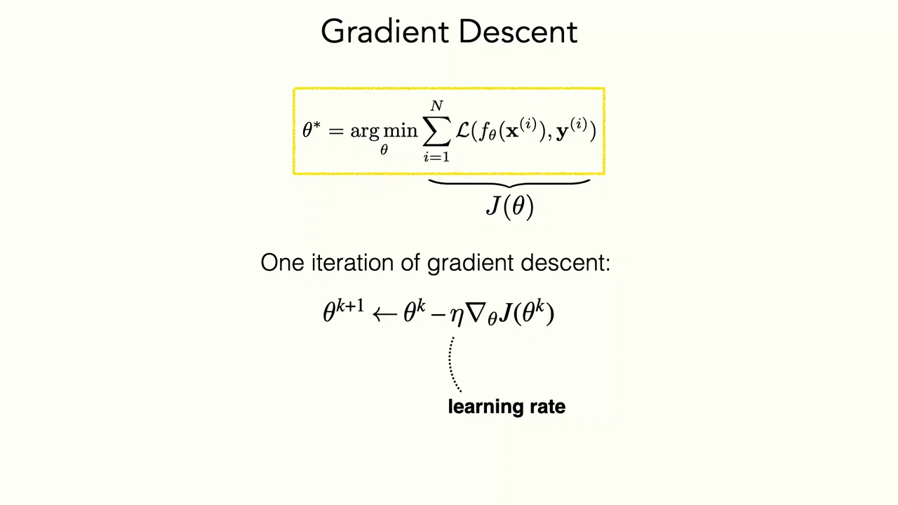
*▲ 강의 슬라이드 [05:30](https://youtu.be/vidCX_dMCu0?t=330): 목표 θ* = [argmin](00_%EB%94%A5%EB%9F%AC%EB%8B%9D_%EC%9A%A9%EC%96%B4%EC%82%AC%EC%A0%84.md#argmin-%EC%B5%9C%EC%86%9F%EA%B0%92-%EC%9C%84%EC%B9%98) J(θ)와 한 번의 경사하강 갱신*

### 2.2 확률적 경사하강법

▶ 영상 [05:42](https://youtu.be/vidCX_dMCu0?t=342)

📐 **수학 개념**: [미니배치 기울기와 모멘텀](%EC%88%98%ED%95%99%EA%B0%9C%EB%85%90/05_%EC%8B%A0%EA%B2%BD%EB%A7%9D%EC%9D%98_%EA%B3%84%EC%82%B0/MM08_SGD%EC%99%80_%EB%AA%A8%EB%A9%98%ED%85%80.md) · [평균](%EC%88%98%ED%95%99%EA%B0%9C%EB%85%90/01_%EC%88%98%EC%99%80_%ED%95%A8%EC%88%98/M02_%EC%8B%9C%EA%B7%B8%EB%A7%88%EC%99%80_%ED%8F%89%EA%B7%A0.md)

데이터 전체의 [기울기](00_%EB%94%A5%EB%9F%AC%EB%8B%9D_%EC%9A%A9%EC%96%B4%EC%82%AC%EC%A0%84.md#gradient-%EA%B8%B0%EC%9A%B8%EA%B8%B0)를 매번 구하는 것은 계산 시간 때문에 현실적이지 않습니다. 강사가 처음 연구를 시작할 때는 ImageNet(이미지 약 100만 장)만 해도 큰 데이터였지만, 지금은 이미지 데이터가 수십억 장, 텍스트는 그보다 더 큽니다.

[확률적 경사하강법(SGD)](00_%EB%94%A5%EB%9F%AC%EB%8B%9D_%EC%9A%A9%EC%96%B4%EC%82%AC%EC%A0%84.md#stochastic-gradient-descent-%ED%99%95%EB%A5%A0%EC%A0%81-%EA%B2%BD%EC%82%AC%ED%95%98%EA%B0%95%EB%B2%95)은 데이터의 일부([배치(batch)](00_%EB%94%A5%EB%9F%AC%EB%8B%9D_%EC%9A%A9%EC%96%B4%EC%82%AC%EC%A0%84.md#mini-batch-%EB%AF%B8%EB%8B%88%EB%B0%B0%EC%B9%98))에서 구한 [기울기](00_%EB%94%A5%EB%9F%AC%EB%8B%9D_%EC%9A%A9%EC%96%B4%EC%82%AC%EC%A0%84.md#gradient-%EA%B8%B0%EC%9A%B8%EA%B8%B0)가 전체 [기울기](00_%EB%94%A5%EB%9F%AC%EB%8B%9D_%EC%9A%A9%EC%96%B4%EC%82%AC%EC%A0%84.md#gradient-%EA%B8%B0%EC%9A%B8%EA%B8%B0)의 쓸 만한 근사라고 보고, 배치마다 [파라미터](00_%EB%94%A5%EB%9F%AC%EB%8B%9D_%EC%9A%A9%EC%96%B4%EC%82%AC%EC%A0%84.md#parameter-%ED%8C%8C%EB%9D%BC%EB%AF%B8%ED%84%B0)를 갱신합니다.

| 배치 크기 | 의미 |
|---|---|
| 1 | 예제 하나를 볼 때마다 갱신. 갱신이 너무 잦아 계산 면에서 비효율적 |
| N (전체) | 보통의 [경사하강법](00_%EB%94%A5%EB%9F%AC%EB%8B%9D_%EC%9A%A9%EC%96%B4%EC%82%AC%EC%A0%84.md#gradient-descent-%EA%B2%BD%EC%82%AC%ED%95%98%EA%B0%95%EB%B2%95). [GPU](00_%EB%94%A5%EB%9F%AC%EB%8B%9D_%EC%9A%A9%EC%96%B4%EC%82%AC%EC%A0%84.md#device-gpu-%EC%9E%A5%EC%B9%98%EC%99%80-gpu) 메모리에 다 안 들어가거나 너무 느릴 수 있음 |
| 그 사이 | 실제로 쓰는 방식 |

- **장점**: 빠르다. 작은 표본으로도 전체 [기울기](00_%EB%94%A5%EB%9F%AC%EB%8B%9D_%EC%9A%A9%EC%96%B4%EC%82%AC%EC%A0%84.md#gradient-%EA%B8%B0%EC%9A%B8%EA%B8%B0)를 잘 근사한다. [기울기](00_%EB%94%A5%EB%9F%AC%EB%8B%9D_%EC%9A%A9%EC%96%B4%EC%82%AC%EC%A0%84.md#gradient-%EA%B8%B0%EC%9A%B8%EA%B8%B0)의 **잡음이 [암묵적 규제](00_%EB%94%A5%EB%9F%AC%EB%8B%9D_%EC%9A%A9%EC%96%B4%EC%82%AC%EC%A0%84.md#implicit-regularization-%EC%95%94%EB%AC%B5%EC%A0%81-%EA%B7%9C%EC%A0%9C)(implicit regularizer)** 역할을 해서 [지역 최솟값](00_%EB%94%A5%EB%9F%AC%EB%8B%9D_%EC%9A%A9%EC%96%B4%EC%82%AC%EC%A0%84.md#local-minimum-%EC%A7%80%EC%97%AD-%EC%B5%9C%EC%86%9F%EA%B0%92)을 튀어나와 [전역 최솟값](00_%EB%94%A5%EB%9F%AC%EB%8B%9D_%EC%9A%A9%EC%96%B4%EC%82%AC%EC%A0%84.md#global-minimum-%EC%A0%84%EC%97%AD-%EC%B5%9C%EC%86%9F%EA%B0%92)에 더 가까이 가게 돕기도 한다.
- **단점**: [분산](00_%EB%94%A5%EB%9F%AC%EB%8B%9D_%EC%9A%A9%EC%96%B4%EC%82%AC%EC%A0%84.md#variance-%EB%B6%84%EC%82%B0)이 크고 갱신이 불안정할 수 있다. 강사의 경험으로는 **[클래스 불균형](00_%EB%94%A5%EB%9F%AC%EB%8B%9D_%EC%9A%A9%EC%96%B4%EC%82%AC%EC%A0%84.md#class-imbalance-%ED%81%B4%EB%9E%98%EC%8A%A4-%EB%B6%88%EA%B7%A0%ED%98%95)이 심할수록** 더 불안정하다. 드문 클래스가 여러 배치 동안 안 나오다가 갑자기 나오면 그때 [기울기](00_%EB%94%A5%EB%9F%AC%EB%8B%9D_%EC%9A%A9%EC%96%B4%EC%82%AC%EC%A0%84.md#gradient-%EA%B8%B0%EC%9A%B8%EA%B8%B0)가 크게 흔들리기 때문이다.

### 2.3 모멘텀

▶ 영상 [09:05](https://youtu.be/vidCX_dMCu0?t=545)

📐 **수학 개념**: [미니배치 기울기와 모멘텀](%EC%88%98%ED%95%99%EA%B0%9C%EB%85%90/05_%EC%8B%A0%EA%B2%BD%EB%A7%9D%EC%9D%98_%EA%B3%84%EC%82%B0/MM08_SGD%EC%99%80_%EB%AA%A8%EB%A9%98%ED%85%80.md)

[모멘텀(Momentum)](00_%EB%94%A5%EB%9F%AC%EB%8B%9D_%EC%9A%A9%EC%96%B4%EC%82%AC%EC%A0%84.md#momentum-%EB%AA%A8%EB%A9%98%ED%85%80)은 물리의 관성과 같은 생각입니다. 무거운 공을 비탈에 놓으면 굴러 내려가며 속도가 붙습니다. 경사하강에서는 **이전에 움직이던 방향을 계속 이어 가도록** 갱신에 치우침을 줍니다. 슬라이드는 이를 $\theta^{t+1} \leftarrow \theta^t - \eta\nabla f(\theta^t) - \alpha m^t$로 쓰는데, $m^t$는 과거 이동 방향을 담은 항이고 그 세기 $\alpha$는 [하이퍼파라미터](00_%EB%94%A5%EB%9F%AC%EB%8B%9D_%EC%9A%A9%EC%96%B4%EC%82%AC%EC%A0%84.md#hyperparameter-%ED%95%98%EC%9D%B4%ED%8D%BC%ED%8C%8C%EB%9D%BC%EB%AF%B8%ED%84%B0)입니다. 흔히 쓰는 형태는 "속도" $v$를 두는 방식입니다.

$$
v \leftarrow \alpha v - \eta \nabla J(\theta), \qquad \theta \leftarrow \theta + v
$$

기호 풀이

| 기호 | 읽는 법 | 뜻 | 예제 값 |
| --- | --- | --- | --- |
| $v$ | 브이, 속도 | 지금까지 쌓인 이동량 | −0.5 → −0.85 |
| $\alpha$ | 알파 | [모멘텀](00_%EB%94%A5%EB%9F%AC%EB%8B%9D_%EC%9A%A9%EC%96%B4%EC%82%AC%EC%A0%84.md#momentum-%EB%AA%A8%EB%A9%98%ED%85%80) 세기, 이전 속도를 남기는 비율 | 0.9 |
| $\eta$ | 에타 | [학습률](00_%EB%94%A5%EB%9F%AC%EB%8B%9D_%EC%9A%A9%EC%96%B4%EC%82%AC%EC%A0%84.md#learning-rate-%ED%95%99%EC%8A%B5%EB%A5%A0) | 0.1 |
| $\nabla J(\theta)$ | 나블라 제이 | 지금 θ에서의 [기울기](00_%EB%94%A5%EB%9F%AC%EB%8B%9D_%EC%9A%A9%EC%96%B4%EC%82%AC%EC%A0%84.md#gradient-%EA%B8%B0%EC%9A%B8%EA%B8%B0) | 4 |
| $\theta$ | 세타 | [파라미터](00_%EB%94%A5%EB%9F%AC%EB%8B%9D_%EC%9A%A9%EC%96%B4%EC%82%AC%EC%A0%84.md#parameter-%ED%8C%8C%EB%9D%BC%EB%AF%B8%ED%84%B0) | 2 → 1.15 |

예제와 풀이

**문제**: 비용 $J(\theta) = \theta^2$에서 지금 θ = 2이고 직전 속도가 −0.5일 때, [모멘텀](00_%EB%94%A5%EB%9F%AC%EB%8B%9D_%EC%9A%A9%EC%96%B4%EC%82%AC%EC%A0%84.md#momentum-%EB%AA%A8%EB%A9%98%ED%85%80) 세기 0.9, [학습률](00_%EB%94%A5%EB%9F%AC%EB%8B%9D_%EC%9A%A9%EC%96%B4%EC%82%AC%EC%A0%84.md#learning-rate-%ED%95%99%EC%8A%B5%EB%A5%A0) 0.1로 한 번 갱신하면 새 속도와 새 θ는?

**주어진 값**:
- $\theta = 2$ (지금 [파라미터](00_%EB%94%A5%EB%9F%AC%EB%8B%9D_%EC%9A%A9%EC%96%B4%EC%82%AC%EC%A0%84.md#parameter-%ED%8C%8C%EB%9D%BC%EB%AF%B8%ED%84%B0))
- $v = -0.5$ (직전까지 쌓인 속도)
- $\alpha = 0.9$ ([모멘텀](00_%EB%94%A5%EB%9F%AC%EB%8B%9D_%EC%9A%A9%EC%96%B4%EC%82%AC%EC%A0%84.md#momentum-%EB%AA%A8%EB%A9%98%ED%85%80) 세기: 직전 속도를 90% 남김)
- $\eta = 0.1$ ([학습률](00_%EB%94%A5%EB%9F%AC%EB%8B%9D_%EC%9A%A9%EC%96%B4%EC%82%AC%EC%A0%84.md#learning-rate-%ED%95%99%EC%8A%B5%EB%A5%A0))
- $\nabla J(\theta) = 2\theta$ ([기울기](00_%EB%94%A5%EB%9F%AC%EB%8B%9D_%EC%9A%A9%EC%96%B4%EC%82%AC%EC%A0%84.md#gradient-%EA%B8%B0%EC%9A%B8%EA%B8%B0), $\theta^2$을 θ로 미분한 것)

**풀이**
1. 식을 그대로 쓴다: $v \leftarrow \alpha v - \eta \nabla J(\theta), \qquad \theta \leftarrow \theta + v$
2. 값을 대입한다: $v = 0.9 \times (-0.5) - 0.1 \times (2 \times 2), \qquad \theta = 2 + v$
3. [기울기](00_%EB%94%A5%EB%9F%AC%EB%8B%9D_%EC%9A%A9%EC%96%B4%EC%82%AC%EC%A0%84.md#gradient-%EA%B8%B0%EC%9A%B8%EA%B8%B0)를 계산한다: $2 \times 2 = 4$ 이므로 $v = 0.9 \times (-0.5) - 0.1 \times 4$
4. 직전 속도에 α를 곱한다: $0.9 \times (-0.5) = -0.45$ 이므로 $v = -0.45 - 0.1 \times 4$
5. [기울기](00_%EB%94%A5%EB%9F%AC%EB%8B%9D_%EC%9A%A9%EC%96%B4%EC%82%AC%EC%A0%84.md#gradient-%EA%B8%B0%EC%9A%B8%EA%B8%B0)에 [학습률](00_%EB%94%A5%EB%9F%AC%EB%8B%9D_%EC%9A%A9%EC%96%B4%EC%82%AC%EC%A0%84.md#learning-rate-%ED%95%99%EC%8A%B5%EB%A5%A0)을 곱한다: $0.1 \times 4 = 0.4$ 이므로 $v = -0.45 - 0.4$
6. 뺄셈을 한다: $v = -0.85$
7. 새 속도만큼 움직인다: $\theta = 2 + (-0.85) = 1.15$

**답**: 새 속도 $v = -0.85$, 새 $\theta = 1.15$ ([기울기](00_%EB%94%A5%EB%9F%AC%EB%8B%9D_%EC%9A%A9%EC%96%B4%EC%82%AC%EC%A0%84.md#gradient-%EA%B8%B0%EC%9A%B8%EA%B8%B0)만 쓰면 1.6인데, 직전 속도가 더해져 더 멀리 갔다)

내 이해

[모멘텀](00_%EB%94%A5%EB%9F%AC%EB%8B%9D_%EC%9A%A9%EC%96%B4%EC%82%AC%EC%A0%84.md#momentum-%EB%AA%A8%EB%A9%98%ED%85%80)은 도움이 될 수도, 해가 될 수도 있습니다. 슬라이드의 예에서 [모멘텀](00_%EB%94%A5%EB%9F%AC%EB%8B%9D_%EC%9A%A9%EC%96%B4%EC%82%AC%EC%A0%84.md#momentum-%EB%AA%A8%EB%A9%98%ED%85%80) 0이면 꾸준히 내려가고, 0.5이면 절반쯤의 단계로 더 빨리 닿지만, 너무 크면(0.95) 바닥을 지나쳐 왔다 갔다 하느라 오히려 늦어집니다. 강사는 2017년 Distill 글 "Why [Momentum](00_%EB%94%A5%EB%9F%AC%EB%8B%9D_%EC%9A%A9%EC%96%B4%EC%82%AC%EC%A0%84.md#momentum-%EB%AA%A8%EB%A9%98%ED%85%80) Really Works"의 대화형 그림을 직관 쌓기에 추천합니다.

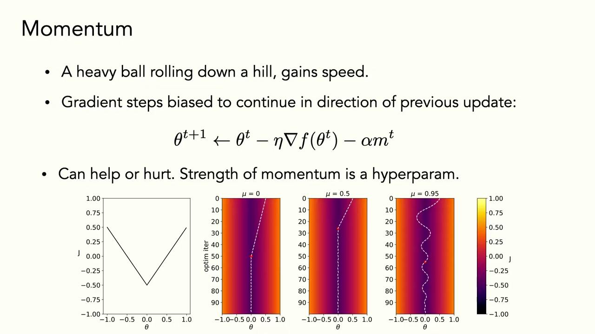
*▲ 강의 슬라이드 [10:40](https://youtu.be/vidCX_dMCu0?t=640): [모멘텀](00_%EB%94%A5%EB%9F%AC%EB%8B%9D_%EC%9A%A9%EC%96%B4%EC%82%AC%EC%A0%84.md#momentum-%EB%AA%A8%EB%A9%98%ED%85%80) 0, 0.5, 0.95일 때의 최적화 경로(아래 방향이 갱신 횟수)*

*▲ 직접 그린 그림: J(θ) = θ²/2, η = 0.1에서 α에 따라 |θ| < 0.01에 머물기까지 걸린 갱신 횟수 (0 → 44번, 0.5 → 15번, 0.9 → 81번). 계산은 [MM08_SGD와_모멘텀](%EC%88%98%ED%95%99%EA%B0%9C%EB%85%90/05_%EC%8B%A0%EA%B2%BD%EB%A7%9D%EC%9D%98_%EA%B3%84%EC%82%B0/MM08_SGD%EC%99%80_%EB%AA%A8%EB%A9%98%ED%85%80.md)*

강사는 [모멘텀](00_%EB%94%A5%EB%9F%AC%EB%8B%9D_%EC%9A%A9%EC%96%B4%EC%82%AC%EC%A0%84.md#momentum-%EB%AA%A8%EB%A9%98%ED%85%80)을 쓰는 널리 알려진 예로 [Adam](00_%EB%94%A5%EB%9F%AC%EB%8B%9D_%EC%9A%A9%EC%96%B4%EC%82%AC%EC%A0%84.md#adam-%EC%95%84%EB%8B%B4-%EC%98%B5%ED%8B%B0%EB%A7%88%EC%9D%B4%EC%A0%80)을 듭니다. ([Adam](00_%EB%94%A5%EB%9F%AC%EB%8B%9D_%EC%9A%A9%EC%96%B4%EC%82%AC%EC%A0%84.md#adam-%EC%95%84%EB%8B%B4-%EC%98%B5%ED%8B%B0%EB%A7%88%EC%9D%B4%EC%A0%80)은 [모멘텀](00_%EB%94%A5%EB%9F%AC%EB%8B%9D_%EC%9A%A9%EC%96%B4%EC%82%AC%EC%A0%84.md#momentum-%EB%AA%A8%EB%A9%98%ED%85%80)에 더해 [파라미터](00_%EB%94%A5%EB%9F%AC%EB%8B%9D_%EC%9A%A9%EC%96%B4%EC%82%AC%EC%A0%84.md#parameter-%ED%8C%8C%EB%9D%BC%EB%AF%B8%ED%84%B0)마다 보폭을 따로 조절하는 방법입니다.)

> [!TIP]
> **🆕 2026 업데이트: [옵티마이저](00_%EB%94%A5%EB%9F%AC%EB%8B%9D_%EC%9A%A9%EC%96%B4%EC%82%AC%EC%A0%84.md#optimizer-%EC%98%B5%ED%8B%B0%EB%A7%88%EC%9D%B4%EC%A0%80)**
> - **강의**: [모멘텀](00_%EB%94%A5%EB%9F%AC%EB%8B%9D_%EC%9A%A9%EC%96%B4%EC%82%AC%EC%A0%84.md#momentum-%EB%AA%A8%EB%A9%98%ED%85%80)의 대표 예로 [Adam](00_%EB%94%A5%EB%9F%AC%EB%8B%9D_%EC%9A%A9%EC%96%B4%EC%82%AC%EC%A0%84.md#adam-%EC%95%84%EB%8B%B4-%EC%98%B5%ED%8B%B0%EB%A7%88%EC%9D%B4%EC%A0%80)을 소개했다.
> - **현재**: 대형 모델 사전학습의 표준은 [가중치 감쇠](00_%EB%94%A5%EB%9F%AC%EB%8B%9D_%EC%9A%A9%EC%96%B4%EC%82%AC%EC%A0%84.md#weight-decay-%EA%B0%80%EC%A4%91%EC%B9%98-%EA%B0%90%EC%87%A0)를 분리한 **AdamW**다. 예를 들어 Llama 2는 AdamW(β1 = 0.9, β2 = 0.95), [가중치 감쇠](00_%EB%94%A5%EB%9F%AC%EB%8B%9D_%EC%9A%A9%EC%96%B4%EC%82%AC%EC%A0%84.md#weight-decay-%EA%B0%80%EC%A4%91%EC%B9%98-%EA%B0%90%EC%87%A0) 0.1, [그래디언트 클리핑](00_%EB%94%A5%EB%9F%AC%EB%8B%9D_%EC%9A%A9%EC%96%B4%EC%82%AC%EC%A0%84.md#gradient-clipping-%EA%B7%B8%EB%9E%98%EB%94%94%EC%96%B8%ED%8A%B8-%ED%81%B4%EB%A6%AC%ED%95%91) 1.0으로 학습했다. 2025년에는 [가중치](00_%EB%94%A5%EB%9F%AC%EB%8B%9D_%EC%9A%A9%EC%96%B4%EC%82%AC%EC%A0%84.md#weight-%EA%B0%80%EC%A4%91%EC%B9%98) 행렬의 갱신을 직교화하는 **[Muon](00_%EB%94%A5%EB%9F%AC%EB%8B%9D_%EC%9A%A9%EC%96%B4%EC%82%AC%EC%A0%84.md#muon-%EB%AE%A4%EC%98%A8-%EC%98%B5%ED%8B%B0%EB%A7%88%EC%9D%B4%EC%A0%80)**을 대형 [언어 모델](00_%EB%94%A5%EB%9F%AC%EB%8B%9D_%EC%9A%A9%EC%96%B4%EC%82%AC%EC%A0%84.md#language-model-%EC%96%B8%EC%96%B4-%EB%AA%A8%EB%8D%B8)에 확장한 결과가 나왔고, 계산 최적 [학습](00_%EB%94%A5%EB%9F%AC%EB%8B%9D_%EC%9A%A9%EC%96%B4%EC%82%AC%EC%A0%84.md#training-%ED%95%99%EC%8A%B5)에서 AdamW 대비 약 2배의 계산 효율을 보고했다(Moonshot AI의 Moonlight 모델).
> - **출처**: [Decoupled Weight Decay Regularization (Loshchilov & Hutter, ICLR 2019)](https://arxiv.org/abs/1711.05101) · [Llama 2: Open Foundation and Fine-Tuned Chat Models (Touvron et al., 2023)](https://arxiv.org/abs/2307.09288) · [Muon is Scalable for LLM Training (Kimi Team, 2025)](https://arxiv.org/abs/2502.16982)

---

## 3. 손실 지형

### 3.1 어떤 지형이 최적화하기 어려운가

▶ 영상 [10:50](https://youtu.be/vidCX_dMCu0?t=650)

📐 **수학 개념**: [미분과 기울기](%EC%88%98%ED%95%99%EA%B0%9C%EB%85%90/02_%EB%AF%B8%EB%B6%84/M03_%EB%AF%B8%EB%B6%84_%EA%B8%B0%EC%9A%B8%EA%B8%B0.md) · [최솟값과 볼록함수](%EC%88%98%ED%95%99%EA%B0%9C%EB%85%90/02_%EB%AF%B8%EB%B6%84/M09_%EC%B5%9C%EC%86%9F%EA%B0%92%EA%B3%BC_%EB%B3%BC%EB%A1%9D%ED%95%A8%EC%88%98.md) · [미분 불가능한 점(꺾임)](%EC%88%98%ED%95%99%EA%B0%9C%EB%85%90/05_%EC%8B%A0%EA%B2%BD%EB%A7%9D%EC%9D%98_%EA%B3%84%EC%82%B0/MM05_%ED%99%9C%EC%84%B1%ED%99%94_%ED%95%A8%EC%88%98%EC%9D%98_%EB%AF%B8%EB%B6%84.md)

강사는 여섯 가지 1차원 [손실 지형](00_%EB%94%A5%EB%9F%AC%EB%8B%9D_%EC%9A%A9%EC%96%B4%EC%82%AC%EC%A0%84.md#loss-landscape-%EC%86%90%EC%8B%A4-%EC%A7%80%ED%98%95)을 보여 주고 학생들에게 묻습니다.

1. **어느 것이 [미분](00_%EB%94%A5%EB%9F%AC%EB%8B%9D_%EC%9A%A9%EC%96%B4%EC%82%AC%EC%A0%84.md#derivative-%EB%AF%B8%EB%B6%84) 가능한가?** 매끄러운 그릇 모양과 완전히 평평한 직선(도함수 0)만 [미분](00_%EB%94%A5%EB%9F%AC%EB%8B%9D_%EC%9A%A9%EC%96%B4%EC%82%AC%EC%A0%84.md#derivative-%EB%AF%B8%EB%B6%84) 가능합니다.
2. **어느 것이 [PyTorch](00_%EB%94%A5%EB%9F%AC%EB%8B%9D_%EC%9A%A9%EC%96%B4%EC%82%AC%EC%A0%84.md#pytorch-%ED%8C%8C%EC%9D%B4%ED%86%A0%EC%B9%98)에서 [기울기](00_%EB%94%A5%EB%9F%AC%EB%8B%9D_%EC%9A%A9%EC%96%B4%EC%82%AC%EC%A0%84.md#gradient-%EA%B8%B0%EC%9A%B8%EA%B8%B0)가 정의되나?** 전부입니다. [PyTorch](00_%EB%94%A5%EB%9F%AC%EB%8B%9D_%EC%9A%A9%EC%96%B4%EC%82%AC%EC%A0%84.md#pytorch-%ED%8C%8C%EC%9D%B4%ED%86%A0%EC%B9%98)의 [자동 미분(Autograd)](00_%EB%94%A5%EB%9F%AC%EB%8B%9D_%EC%9A%A9%EC%96%B4%EC%82%AC%EC%A0%84.md#autograd-%EC%9E%90%EB%8F%99-%EB%AF%B8%EB%B6%84)은 끊긴 점이나 꺾인 점에서도 한쪽 방향 도함수 같은 규칙으로 값을 내 줍니다. 하지만 [기울기](00_%EB%94%A5%EB%9F%AC%EB%8B%9D_%EC%9A%A9%EC%96%B4%EC%82%AC%EC%A0%84.md#gradient-%EA%B8%B0%EC%9A%B8%EA%B8%B0)를 계산할 수 있다는 것과 최적화하기 쉽다는 것은 다릅니다. 평평한 곳에서는 [기울기](00_%EB%94%A5%EB%9F%AC%EB%8B%9D_%EC%9A%A9%EC%96%B4%EC%82%AC%EC%A0%84.md#gradient-%EA%B8%B0%EC%9A%B8%EA%B8%B0)가 계산되지만 그 값은 0입니다.
3. **어느 것이 최적화하기 어려운가?** 아래 표의 네 가지입니다.

| 지형 | 문제 | 결과 |
|---|---|---|
| 볼록, 최솟값 하나 | 없음. [기울기](00_%EB%94%A5%EB%9F%AC%EB%8B%9D_%EC%9A%A9%EC%96%B4%EC%82%AC%EC%A0%84.md#gradient-%EA%B8%B0%EC%9A%B8%EA%B8%B0)가 어디서나 최솟값을 가리키고 가까워질수록 0으로 줄어든다 | 이론가가 좋아하는 경우 |
| 끊겨 있지만 양쪽 도함수가 분명함 | [PyTorch](00_%EB%94%A5%EB%9F%AC%EB%8B%9D_%EC%9A%A9%EC%96%B4%EC%82%AC%EC%A0%84.md#pytorch-%ED%8C%8C%EC%9D%B4%ED%86%A0%EC%B9%98)에는 문제없음 | 쉬움 |
| [지역 최솟값](00_%EB%94%A5%EB%9F%AC%EB%8B%9D_%EC%9A%A9%EC%96%B4%EC%82%AC%EC%A0%84.md#local-minimum-%EC%A7%80%EC%97%AD-%EC%B5%9C%EC%86%9F%EA%B0%92) 여러 개 | 출발점에 따라 다른 곳에 도착 | 초기화가 중요 |
| 거의 평평함 | [기울기 소실](00_%EB%94%A5%EB%9F%AC%EB%8B%9D_%EC%9A%A9%EC%96%B4%EC%82%AC%EC%A0%84.md#vanishing-gradient-%EA%B8%B0%EC%9A%B8%EA%B8%B0-%EC%86%8C%EC%8B%A4). 진행이 느리고 배치 잡음이 신호를 덮음 | 어려움 |
| 완전히 평평함(계단) | [기울기](00_%EB%94%A5%EB%9F%AC%EB%8B%9D_%EC%9A%A9%EC%96%B4%EC%82%AC%EC%A0%84.md#gradient-%EA%B8%B0%EC%9A%B8%EA%B8%B0)가 어디서나 0. 어디로 갈지 정보가 없음 | [손실](00_%EB%94%A5%EB%9F%AC%EB%8B%9D_%EC%9A%A9%EC%96%B4%EC%82%AC%EC%A0%84.md#loss-function-%EC%86%90%EC%8B%A4-%ED%95%A8%EC%88%98)이 낮은 곳에 못 감 |
| 최솟값 근처가 뾰족함 | [기울기 폭주](00_%EB%94%A5%EB%9F%AC%EB%8B%9D_%EC%9A%A9%EC%96%B4%EC%82%AC%EC%A0%84.md#exploding-gradient-%EA%B8%B0%EC%9A%B8%EA%B8%B0-%ED%8F%AD%EC%A3%BC). 최솟값에 가까울수록 [기울기](00_%EB%94%A5%EB%9F%AC%EB%8B%9D_%EC%9A%A9%EC%96%B4%EC%82%AC%EC%A0%84.md#gradient-%EA%B8%B0%EC%9A%B8%EA%B8%B0)가 무한대로 커져 멀리 튕겨 나감 | 최솟값에 닿기 어려움 |

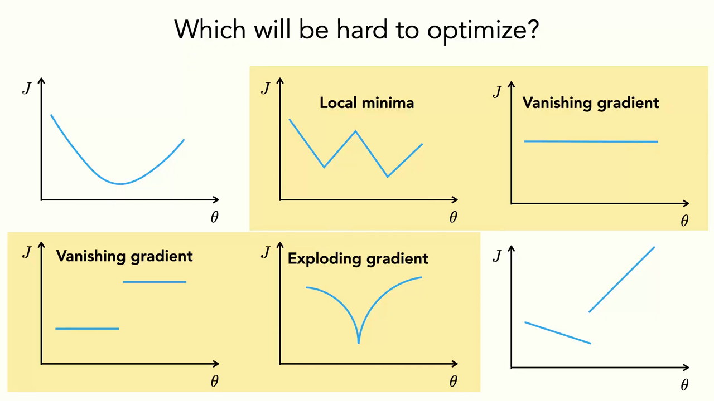
*▲ 강의 슬라이드 [14:10](https://youtu.be/vidCX_dMCu0?t=850): 최적화하기 어려운 지형(노란 칸): [지역 최솟값](00_%EB%94%A5%EB%9F%AC%EB%8B%9D_%EC%9A%A9%EC%96%B4%EC%82%AC%EC%A0%84.md#local-minimum-%EC%A7%80%EC%97%AD-%EC%B5%9C%EC%86%9F%EA%B0%92), [기울기 소실](00_%EB%94%A5%EB%9F%AC%EB%8B%9D_%EC%9A%A9%EC%96%B4%EC%82%AC%EC%A0%84.md#vanishing-gradient-%EA%B8%B0%EC%9A%B8%EA%B8%B0-%EC%86%8C%EC%8B%A4) 두 가지, [기울기 폭주](00_%EB%94%A5%EB%9F%AC%EB%8B%9D_%EC%9A%A9%EC%96%B4%EC%82%AC%EC%A0%84.md#exploding-gradient-%EA%B8%B0%EC%9A%B8%EA%B8%B0-%ED%8F%AD%EC%A3%BC)*

- **물 흐름 직관**: 어디서 물을 부어도 같은 바닥으로 모이면 최소화가 쉽다. 다만 이 직관은 "최솟값이 여러 개"인 경우만 걸러 낸다.
- 슬라이드 오른쪽 그림은 위에서 아래로 최적화 단계(0~100)를 따라 θ가 어떻게 움직이는지 보여 준다. 평평한 지형에서는 θ가 전혀 움직이지 않는다.
- **랜덤 시드 여러 개**: [지역 최솟값](00_%EB%94%A5%EB%9F%AC%EB%8B%9D_%EC%9A%A9%EC%96%B4%EC%82%AC%EC%A0%84.md#local-minimum-%EC%A7%80%EC%97%AD-%EC%B5%9C%EC%86%9F%EA%B0%92)이 많은 지형에 대응해 여러 시드로 학습해 보고 좋은 모델을 고르기도 한다. 시드에 따른 성능 차이가 크면 [손실 지형](00_%EB%94%A5%EB%9F%AC%EB%8B%9D_%EC%9A%A9%EC%96%B4%EC%82%AC%EC%A0%84.md#loss-landscape-%EC%86%90%EC%8B%A4-%EC%A7%80%ED%98%95)이 불안정하다는 신호다.

### 3.2 진화 전략과 그래디언트 클리핑

▶ 영상 [18:00](https://youtu.be/vidCX_dMCu0?t=1080)

📐 **수학 개념**: [그래디언트 클리핑 계산](%EC%88%98%ED%95%99%EA%B0%9C%EB%85%90/05_%EC%8B%A0%EA%B2%BD%EB%A7%9D%EC%9D%98_%EA%B3%84%EC%82%B0/MM08_SGD%EC%99%80_%EB%AA%A8%EB%A9%98%ED%85%80.md) · [확률(정규분포)](%EC%88%98%ED%95%99%EA%B0%9C%EB%85%90/04_%ED%99%95%EB%A5%A0%EA%B3%BC_%EC%A0%95%EB%B3%B4/M08_%ED%99%95%EB%A5%A0_%EA%B8%B0%EC%B4%88.md)

**[진화 전략(Evolution strategy)](00_%EB%94%A5%EB%9F%AC%EB%8B%9D_%EC%9A%A9%EC%96%B4%EC%82%AC%EC%A0%84.md#evolution-strategy-%EC%A7%84%ED%99%94-%EC%A0%84%EB%9E%B5)** 은 [기울기](00_%EB%94%A5%EB%9F%AC%EB%8B%9D_%EC%9A%A9%EC%96%B4%EC%82%AC%EC%A0%84.md#gradient-%EA%B8%B0%EC%9A%B8%EA%B8%B0)를 직접 쓰지 않는 "[기울기](00_%EB%94%A5%EB%9F%AC%EB%8B%9D_%EC%9A%A9%EC%96%B4%EC%82%AC%EC%A0%84.md#gradient-%EA%B8%B0%EC%9A%B8%EA%B8%B0) 비슷한" 방법입니다. 현재 [파라미터](00_%EB%94%A5%EB%9F%AC%EB%8B%9D_%EC%9A%A9%EC%96%B4%EC%82%AC%EC%A0%84.md#parameter-%ED%8C%8C%EB%9D%BC%EB%AF%B8%ED%84%B0) 주변에 작은 무작위 흔들림 $\epsilon_i$를 여러 개 뽑아 [손실](00_%EB%94%A5%EB%9F%AC%EB%8B%9D_%EC%9A%A9%EC%96%B4%EC%82%AC%EC%A0%84.md#loss-function-%EC%86%90%EC%8B%A4-%ED%95%A8%EC%88%98)을 재 보고, [손실](00_%EB%94%A5%EB%9F%AC%EB%8B%9D_%EC%9A%A9%EC%96%B4%EC%82%AC%EC%A0%84.md#loss-function-%EC%86%90%EC%8B%A4-%ED%95%A8%EC%88%98)이 낮았던 흔들림 쪽으로 움직입니다.

$$
\epsilon_i \sim \mathcal{N}(0, I),\quad s_i = J(\theta + \sigma\epsilon_i),\qquad \theta^{k+1} \leftarrow \theta^k - \eta \frac{1}{\sigma M}\sum_{i=1}^{M} s_i \epsilon_i
$$

기호 풀이

| 기호 | 읽는 법 | 뜻 | 예제 값 |
| --- | --- | --- | --- |
| $\epsilon_i$ | 엡실론 아이 | i번째 무작위 흔들림 방향 | $\epsilon_1 = 1,\ \epsilon_2 = -1$ |
| $\sim \mathcal{N}(0, I)$ | 표준정규분포를 따른다 | 평균 0, [분산](00_%EB%94%A5%EB%9F%AC%EB%8B%9D_%EC%9A%A9%EC%96%B4%EC%82%AC%EC%A0%84.md#variance-%EB%B6%84%EC%82%B0) 1인 [정규분포](00_%EB%94%A5%EB%9F%AC%EB%8B%9D_%EC%9A%A9%EC%96%B4%EC%82%AC%EC%A0%84.md#normal-distribution-%EC%A0%95%EA%B7%9C%EB%B6%84%ED%8F%AC)에서 뽑음 | - |
| $\sigma$ | 시그마 | 흔들림 크기 | 0.1 |
| $s_i$ | 에스 아이 | 흔든 자리에서 잰 비용 | $s_1 = 1.21$ |
| $M$ | 엠 | 뽑은 흔들림 개수 | 2 |
| $\sum_{i=1}^{M} s_i \epsilon_i$ | 시그마 에스 아이 엡실론 아이 | 비용으로 가중한 흔들림의 합 | 0.4 |
| $\frac{1}{\sigma M}$ | 시그마 엠 분의 일 | 합을 [기울기](00_%EB%94%A5%EB%9F%AC%EB%8B%9D_%EC%9A%A9%EC%96%B4%EC%82%AC%EC%A0%84.md#gradient-%EA%B8%B0%EC%9A%B8%EA%B8%B0) 크기로 맞추는 배율 | 5 |
| $\eta$ | 에타 | [학습률](00_%EB%94%A5%EB%9F%AC%EB%8B%9D_%EC%9A%A9%EC%96%B4%EC%82%AC%EC%A0%84.md#learning-rate-%ED%95%99%EC%8A%B5%EB%A5%A0) | 0.1 |

예제와 풀이

**문제**: 비용 $J(\theta) = \theta^2$에서 지금 θ = 1이다. [기울기](00_%EB%94%A5%EB%9F%AC%EB%8B%9D_%EC%9A%A9%EC%96%B4%EC%82%AC%EC%A0%84.md#gradient-%EA%B8%B0%EC%9A%B8%EA%B8%B0)를 쓰지 않고 θ를 0.1만큼 두 방향으로 흔들어 비용을 재 본 뒤, [학습률](00_%EB%94%A5%EB%9F%AC%EB%8B%9D_%EC%9A%A9%EC%96%B4%EC%82%AC%EC%A0%84.md#learning-rate-%ED%95%99%EC%8A%B5%EB%A5%A0) 0.1로 한 번 갱신하면 새 θ는?

**주어진 값**:
- $\theta^k = 1$ (지금 [파라미터](00_%EB%94%A5%EB%9F%AC%EB%8B%9D_%EC%9A%A9%EC%96%B4%EC%82%AC%EC%A0%84.md#parameter-%ED%8C%8C%EB%9D%BC%EB%AF%B8%ED%84%B0))
- $\sigma = 0.1$ (흔들림 크기)
- $M = 2$ (흔들어 볼 횟수)
- $\epsilon_1 = 1,\ \epsilon_2 = -1$ ([정규분포](00_%EB%94%A5%EB%9F%AC%EB%8B%9D_%EC%9A%A9%EC%96%B4%EC%82%AC%EC%A0%84.md#normal-distribution-%EC%A0%95%EA%B7%9C%EB%B6%84%ED%8F%AC)에서 뽑힌 흔들림 방향. 예제라 간단한 값으로 정함)
- $\eta = 0.1$ ([학습률](00_%EB%94%A5%EB%9F%AC%EB%8B%9D_%EC%9A%A9%EC%96%B4%EC%82%AC%EC%A0%84.md#learning-rate-%ED%95%99%EC%8A%B5%EB%A5%A0))

**풀이**
1. 식을 그대로 쓴다: $\epsilon_i \sim \mathcal{N}(0, I),\quad s_i = J(\theta + \sigma\epsilon_i),\qquad \theta^{k+1} \leftarrow \theta^k - \eta \frac{1}{\sigma M}\sum_{i=1}^{M} s_i \epsilon_i$
2. 값을 대입한다 (Σ를 두 항으로 펼침): $\theta^{k+1} = 1 - 0.1 \times \frac{1}{0.1 \times 2}\big(J(1 + 0.1 \times 1) \times 1 + J(1 + 0.1 \times (-1)) \times (-1)\big)$
3. 첫 흔든 자리를 계산한다: $1 + 0.1 \times 1 = 1.1$
4. 그 자리의 비용을 잰다: $s_1 = J(1.1) = 1.1^2 = 1.21$
5. 둘째 흔든 자리를 계산한다: $1 + 0.1 \times (-1) = 0.9$
6. 그 자리의 비용을 잰다: $s_2 = J(0.9) = 0.9^2 = 0.81$
7. Σ의 두 항을 곱한다: $1.21 \times 1 = 1.21$, $0.81 \times (-1) = -0.81$
8. 두 항을 더한다: $1.21 + (-0.81) = 0.4$
9. 배율의 분모를 곱한다: $0.1 \times 2 = 0.2$ 이므로 배율은 $\frac{1}{0.2} = 5$
10. 배율을 곱해 [기울기](00_%EB%94%A5%EB%9F%AC%EB%8B%9D_%EC%9A%A9%EC%96%B4%EC%82%AC%EC%A0%84.md#gradient-%EA%B8%B0%EC%9A%B8%EA%B8%B0) 추정값을 얻는다: $5 \times 0.4 = 2$ (실제 [기울기](00_%EB%94%A5%EB%9F%AC%EB%8B%9D_%EC%9A%A9%EC%96%B4%EC%82%AC%EC%A0%84.md#gradient-%EA%B8%B0%EC%9A%B8%EA%B8%B0) $2\theta = 2$와 같다)
11. [학습률](00_%EB%94%A5%EB%9F%AC%EB%8B%9D_%EC%9A%A9%EC%96%B4%EC%82%AC%EC%A0%84.md#learning-rate-%ED%95%99%EC%8A%B5%EB%A5%A0)을 곱한다: $0.1 \times 2 = 0.2$
12. 뺄셈을 한다: $\theta^{k+1} = 1 - 0.2 = 0.8$

**답**: $\theta^{k+1} = 0.8$

내 이해

주변을 흔들어 표본을 뽑기 때문에, 계단처럼 [기울기](00_%EB%94%A5%EB%9F%AC%EB%8B%9D_%EC%9A%A9%EC%96%B4%EC%82%AC%EC%A0%84.md#gradient-%EA%B8%B0%EC%9A%B8%EA%B8%B0)가 0인 지형에서도 더 낮은 쪽으로 넘어갈 수 있습니다. 강사는 [손실](00_%EB%94%A5%EB%9F%AC%EB%8B%9D_%EC%9A%A9%EC%96%B4%EC%82%AC%EC%A0%84.md#loss-function-%EC%86%90%EC%8B%A4-%ED%95%A8%EC%88%98)에 [규제](00_%EB%94%A5%EB%9F%AC%EB%8B%9D_%EC%9A%A9%EC%96%B4%EC%82%AC%EC%A0%84.md#regularization-%EA%B7%9C%EC%A0%9C)를 넣는 것과 비슷한 효과로 볼 수 있다고 덧붙입니다. 흔들림 크기 $\sigma$ 같은 값은 데이터와 구조마다 실험으로 정해야 하며, 강사의 조언은 "그 방법을 쓴 논문의 값에서 출발하라"입니다.

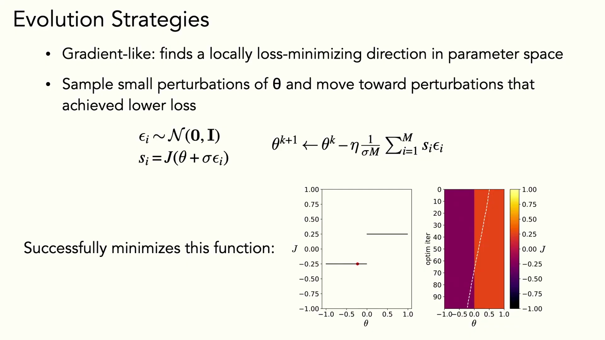
*▲ 강의 슬라이드 [26:15](https://youtu.be/vidCX_dMCu0?t=1575): [진화 전략](00_%EB%94%A5%EB%9F%AC%EB%8B%9D_%EC%9A%A9%EC%96%B4%EC%82%AC%EC%A0%84.md#evolution-strategy-%EC%A7%84%ED%99%94-%EC%A0%84%EB%9E%B5)의 갱신식과, 계단 모양 함수도 최소화하는 모습*

**[그래디언트 클리핑(Gradient clipping)](00_%EB%94%A5%EB%9F%AC%EB%8B%9D_%EC%9A%A9%EC%96%B4%EC%82%AC%EC%A0%84.md#gradient-clipping-%EA%B7%B8%EB%9E%98%EB%94%94%EC%96%B8%ED%8A%B8-%ED%81%B4%EB%A6%AC%ED%95%91)** 은 뾰족한 지형을 위한 간단하고 흔한 요령입니다. [기울기](00_%EB%94%A5%EB%9F%AC%EB%8B%9D_%EC%9A%A9%EC%96%B4%EC%82%AC%EC%A0%84.md#gradient-%EA%B8%B0%EC%9A%B8%EA%B8%B0)가 정한 크기 $m$을 넘으면 $m$으로 잘라 냅니다. 한 번에 너무 멀리 움직이지 못하게 해서 최솟값 양쪽을 왔다 갔다 하는 것을 막습니다.

$$
v = \nabla_\theta J(\theta^k),\qquad \theta^{k+1} \leftarrow \theta^k - \eta\,[\mathrm{clip}(v_1, -m, m), \dots, \mathrm{clip}(v_M, -m, m)]^\top
$$

기호 풀이

| 기호 | 읽는 법 | 뜻 | 예제 값 |
| --- | --- | --- | --- |
| $v$ | 브이 | θᵏ에서 잰 [기울기](00_%EB%94%A5%EB%9F%AC%EB%8B%9D_%EC%9A%A9%EC%96%B4%EC%82%AC%EC%A0%84.md#gradient-%EA%B8%B0%EC%9A%B8%EA%B8%B0) 벡터 | (0.5, −8) |
| $v_1, \dots, v_M$ | 브이 일부터 브이 엠까지 | [기울기](00_%EB%94%A5%EB%9F%AC%EB%8B%9D_%EC%9A%A9%EC%96%B4%EC%82%AC%EC%A0%84.md#gradient-%EA%B8%B0%EC%9A%B8%EA%B8%B0) 벡터의 각 칸 | $v_2 = -8$ |
| $M$ | 엠 | [파라미터](00_%EB%94%A5%EB%9F%AC%EB%8B%9D_%EC%9A%A9%EC%96%B4%EC%82%AC%EC%A0%84.md#parameter-%ED%8C%8C%EB%9D%BC%EB%AF%B8%ED%84%B0)(칸) 개수 | 2 |
| $\mathrm{clip}(v_j, -m, m)$ | [클립](00_%EB%94%A5%EB%9F%AC%EB%8B%9D_%EC%9A%A9%EC%96%B4%EC%82%AC%EC%A0%84.md#clip-%ED%81%B4%EB%A6%BD) | $v_j$를 −m ~ m 범위로 자름 | clip(−8, −1, 1) = −1 |
| $m$ | 엠 (소문자) | 자르는 한도 | 1 |
| $[\cdots]^\top$ | [전치](00_%EB%94%A5%EB%9F%AC%EB%8B%9D_%EC%9A%A9%EC%96%B4%EC%82%AC%EC%A0%84.md#transpose-%EC%A0%84%EC%B9%98) | 가로로 적은 값을 열벡터로 세움 | - |
| $\eta$ | 에타 | [학습률](00_%EB%94%A5%EB%9F%AC%EB%8B%9D_%EC%9A%A9%EC%96%B4%EC%82%AC%EC%A0%84.md#learning-rate-%ED%95%99%EC%8A%B5%EB%A5%A0) | 0.1 |

예제와 풀이

**문제**: [파라미터](00_%EB%94%A5%EB%9F%AC%EB%8B%9D_%EC%9A%A9%EC%96%B4%EC%82%AC%EC%A0%84.md#parameter-%ED%8C%8C%EB%9D%BC%EB%AF%B8%ED%84%B0) 두 칸이 θ = (2, 2)이고 [기울기](00_%EB%94%A5%EB%9F%AC%EB%8B%9D_%EC%9A%A9%EC%96%B4%EC%82%AC%EC%A0%84.md#gradient-%EA%B8%B0%EC%9A%B8%EA%B8%B0)가 (0.5, −8)로 둘째 칸이 크게 튈 때, 칸마다 한도 1로 자른 뒤 [학습률](00_%EB%94%A5%EB%9F%AC%EB%8B%9D_%EC%9A%A9%EC%96%B4%EC%82%AC%EC%A0%84.md#learning-rate-%ED%95%99%EC%8A%B5%EB%A5%A0) 0.1로 갱신하면 새 θ는?

**주어진 값**:
- $\theta^k = (2, 2)$ (지금 [파라미터](00_%EB%94%A5%EB%9F%AC%EB%8B%9D_%EC%9A%A9%EC%96%B4%EC%82%AC%EC%A0%84.md#parameter-%ED%8C%8C%EB%9D%BC%EB%AF%B8%ED%84%B0) 두 칸)
- $v = (0.5, -8)$ ([기울기](00_%EB%94%A5%EB%9F%AC%EB%8B%9D_%EC%9A%A9%EC%96%B4%EC%82%AC%EC%A0%84.md#gradient-%EA%B8%B0%EC%9A%B8%EA%B8%B0) 두 칸)
- $m = 1$ (자르는 한도: −1 ~ 1)
- $M = 2$ (칸 개수)
- $\eta = 0.1$ ([학습률](00_%EB%94%A5%EB%9F%AC%EB%8B%9D_%EC%9A%A9%EC%96%B4%EC%82%AC%EC%A0%84.md#learning-rate-%ED%95%99%EC%8A%B5%EB%A5%A0))

**풀이**
1. 식을 그대로 쓴다: $v = \nabla_\theta J(\theta^k),\qquad \theta^{k+1} \leftarrow \theta^k - \eta\,[\mathrm{clip}(v_1, -m, m), \dots, \mathrm{clip}(v_M, -m, m)]^\top$
2. 값을 대입한다: $\theta^{k+1} = (2, 2) - 0.1 \times [\mathrm{clip}(0.5, -1, 1),\ \mathrm{clip}(-8, -1, 1)]$
3. 첫 칸을 자른다: 0.5는 −1과 1 사이라 그대로 0.5
4. 둘째 칸을 자른다: −8은 −1보다 작아 −1이 된다. 그래서 자른 [기울기](00_%EB%94%A5%EB%9F%AC%EB%8B%9D_%EC%9A%A9%EC%96%B4%EC%82%AC%EC%A0%84.md#gradient-%EA%B8%B0%EC%9A%B8%EA%B8%B0)는 (0.5, −1)
5. 첫 칸에 [학습률](00_%EB%94%A5%EB%9F%AC%EB%8B%9D_%EC%9A%A9%EC%96%B4%EC%82%AC%EC%A0%84.md#learning-rate-%ED%95%99%EC%8A%B5%EB%A5%A0)을 곱한다: $0.1 \times 0.5 = 0.05$
6. 첫 칸을 뺀다: $2 - 0.05 = 1.95$
7. 둘째 칸에 [학습률](00_%EB%94%A5%EB%9F%AC%EB%8B%9D_%EC%9A%A9%EC%96%B4%EC%82%AC%EC%A0%84.md#learning-rate-%ED%95%99%EC%8A%B5%EB%A5%A0)을 곱한다: $0.1 \times (-1) = -0.1$
8. 둘째 칸을 뺀다: $2 - (-0.1) = 2.1$

**답**: $\theta^{k+1} = (1.95, 2.1)$ (자르지 않았다면 둘째 칸은 $2 - 0.1 \times (-8) = 2.8$까지 튕겨 나갔다)

내 이해

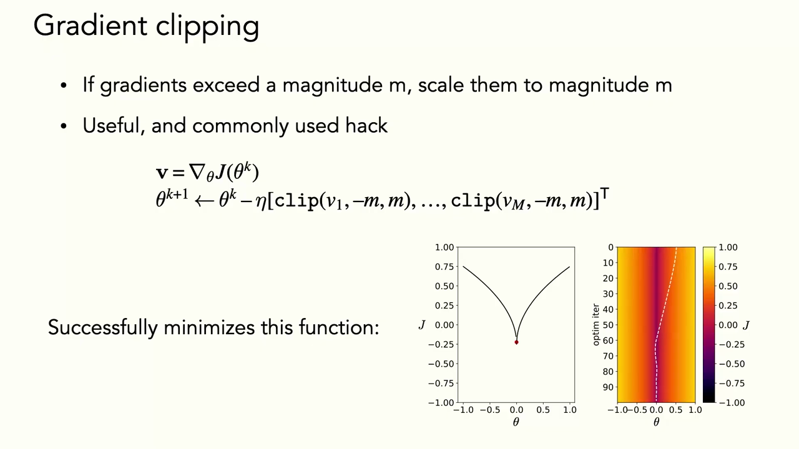
*▲ 강의 슬라이드 [20:05](https://youtu.be/vidCX_dMCu0?t=1205): [그래디언트 클리핑](00_%EB%94%A5%EB%9F%AC%EB%8B%9D_%EC%9A%A9%EC%96%B4%EC%82%AC%EC%A0%84.md#gradient-clipping-%EA%B7%B8%EB%9E%98%EB%94%94%EC%96%B8%ED%8A%B8-%ED%81%B4%EB%A6%AC%ED%95%91)으로 [기울기 폭주](00_%EB%94%A5%EB%9F%AC%EB%8B%9D_%EC%9A%A9%EC%96%B4%EC%82%AC%EC%A0%84.md#exploding-gradient-%EA%B8%B0%EC%9A%B8%EA%B8%B0-%ED%8F%AD%EC%A3%BC) 지형(뾰족한 V)도 최소화한다*

> [!TIP]
> **🆕 2026 업데이트: 클리핑은 이제 기본 설정**
> - **강의**: 클리핑을 "유용하고 흔히 쓰는 요령(hack)"으로 소개했고, 슬라이드는 칸마다 따로 자르는 방식이다.
> - **현재**: 대형 모델 [학습](00_%EB%94%A5%EB%9F%AC%EB%8B%9D_%EC%9A%A9%EC%96%B4%EC%82%AC%EC%A0%84.md#training-%ED%95%99%EC%8A%B5)에서는 **전체 [기울기](00_%EB%94%A5%EB%9F%AC%EB%8B%9D_%EC%9A%A9%EC%96%B4%EC%82%AC%EC%A0%84.md#gradient-%EA%B8%B0%EC%9A%B8%EA%B8%B0) 벡터의 [노름](00_%EB%94%A5%EB%9F%AC%EB%8B%9D_%EC%9A%A9%EC%96%B4%EC%82%AC%EC%A0%84.md#norm-%EB%85%B8%EB%A6%84)**을 재서 한꺼번에 줄이는 [노름](00_%EB%94%A5%EB%9F%AC%EB%8B%9D_%EC%9A%A9%EC%96%B4%EC%82%AC%EC%A0%84.md#norm-%EB%85%B8%EB%A6%84) 클리핑이 사실상 기본이다. 방향은 그대로 두고 길이만 줄인다는 점이 칸별 클리핑과 다르다. Llama 2는 [노름](00_%EB%94%A5%EB%9F%AC%EB%8B%9D_%EC%9A%A9%EC%96%B4%EC%82%AC%EC%A0%84.md#norm-%EB%85%B8%EB%A6%84) 1.0으로 클리핑했고, [PyTorch](00_%EB%94%A5%EB%9F%AC%EB%8B%9D_%EC%9A%A9%EC%96%B4%EC%82%AC%EC%A0%84.md#pytorch-%ED%8C%8C%EC%9D%B4%ED%86%A0%EC%B9%98)는 `clip_grad_norm_`으로 제공한다. 계산 예는 [MM08_SGD와_모멘텀](%EC%88%98%ED%95%99%EA%B0%9C%EB%85%90/05_%EC%8B%A0%EA%B2%BD%EB%A7%9D%EC%9D%98_%EA%B3%84%EC%82%B0/MM08_SGD%EC%99%80_%EB%AA%A8%EB%A9%98%ED%85%80.md) 3절.
> - **출처**: [Llama 2 (Touvron et al., 2023) 2.2절](https://arxiv.org/abs/2307.09288) · [PyTorch 문서: torch.nn.utils.clip_grad_norm_](https://docs.pytorch.org/docs/stable/generated/torch.nn.utils.clip_grad_norm_.html)

### 3.3 손실 함수와 활성화 함수가 갖추면 좋은 성질

▶ 영상 [19:44](https://youtu.be/vidCX_dMCu0?t=1184)

📐 **수학 개념**: [활성화 함수의 미분](%EC%88%98%ED%95%99%EA%B0%9C%EB%85%90/05_%EC%8B%A0%EA%B2%BD%EB%A7%9D%EC%9D%98_%EA%B3%84%EC%82%B0/MM05_%ED%99%9C%EC%84%B1%ED%99%94_%ED%95%A8%EC%88%98%EC%9D%98_%EB%AF%B8%EB%B6%84.md) · [확률(누적분포)](%EC%88%98%ED%95%99%EA%B0%9C%EB%85%90/04_%ED%99%95%EB%A5%A0%EA%B3%BC_%EC%A0%95%EB%B3%B4/M08_%ED%99%95%EB%A5%A0_%EA%B8%B0%EC%B4%88.md)

반드시 필요한 것은 아니지만 자주 보이는 성질 세 가지가 있습니다.

1. 어디서나 **연속**
2. 어디서나 **[미분](00_%EB%94%A5%EB%9F%AC%EB%8B%9D_%EC%9A%A9%EC%96%B4%EC%82%AC%EC%A0%84.md#derivative-%EB%AF%B8%EB%B6%84) 가능**
3. 어디서나 **매끄러움**(smooth, 도함수도 연속)

가장 많이 쓰는 비선형 함수 [ReLU](00_%EB%94%A5%EB%9F%AC%EB%8B%9D_%EC%9A%A9%EC%96%B4%EC%82%AC%EC%A0%84.md#relu-%EB%A0%90%EB%A3%A8)는 어디서나 연속이고 거의 어디서나 [미분](00_%EB%94%A5%EB%9F%AC%EB%8B%9D_%EC%9A%A9%EC%96%B4%EC%82%AC%EC%A0%84.md#derivative-%EB%AF%B8%EB%B6%84) 가능하지만, 0에서 꺾이므로 매끄럽지 않습니다. 최근에는 **[GELU(Gaussian error linear unit)](00_%EB%94%A5%EB%9F%AC%EB%8B%9D_%EC%9A%A9%EC%96%B4%EC%82%AC%EC%A0%84.md#gelu-%EA%B2%94%EB%A3%A8)** 를 많이 씁니다. $\Phi$는 표준정규분포의 누적분포함수입니다.

$$
\mathrm{GELU}(z) = z \cdot \Phi(z)
$$

기호 풀이

| 기호 | 읽는 법 | 뜻 | 예제 값 |
| --- | --- | --- | --- |
| $z$ | 제트 | [활성화 함수](00_%EB%94%A5%EB%9F%AC%EB%8B%9D_%EC%9A%A9%EC%96%B4%EC%82%AC%EC%A0%84.md#activation-function-%ED%99%9C%EC%84%B1%ED%99%94-%ED%95%A8%EC%88%98)에 들어오는 값 | 2 |
| $\Phi(z)$ | 대문자 파이 제트 | 표준정규분포에서 z 이하가 나올 [확률](00_%EB%94%A5%EB%9F%AC%EB%8B%9D_%EC%9A%A9%EC%96%B4%EC%82%AC%EC%A0%84.md#probability-%ED%99%95%EB%A5%A0)(누적분포함수) | Φ(2) = 0.97725 |
| $\mathrm{GELU}(z)$ | [겔루](00_%EB%94%A5%EB%9F%AC%EB%8B%9D_%EC%9A%A9%EC%96%B4%EC%82%AC%EC%A0%84.md#gelu-%EA%B2%94%EB%A3%A8) 제트 | z에 Φ(z)를 곱한 값 | 1.9545 |

예제와 풀이

**문제**: [활성화 함수](00_%EB%94%A5%EB%9F%AC%EB%8B%9D_%EC%9A%A9%EC%96%B4%EC%82%AC%EC%A0%84.md#activation-function-%ED%99%9C%EC%84%B1%ED%99%94-%ED%95%A8%EC%88%98) [GELU](00_%EB%94%A5%EB%9F%AC%EB%8B%9D_%EC%9A%A9%EC%96%B4%EC%82%AC%EC%A0%84.md#gelu-%EA%B2%94%EB%A3%A8)에 양수 2와 음수 −2를 넣으면 각각 얼마가 나오는가?

**주어진 값**:
- $z = 2$ (첫 입력)
- $z = -2$ (둘째 입력)

**풀이**
1. 식을 그대로 쓴다: $\mathrm{GELU}(z) = z \cdot \Phi(z)$
2. 값을 대입한다: $\mathrm{GELU}(2) = 2 \times \Phi(2)$
3. Φ의 뜻: Φ(z)는 표준정규분포(평균 0, 표준편차 1인 종 모양 분포)에서 z 이하의 값이 나올 [확률](00_%EB%94%A5%EB%9F%AC%EB%8B%9D_%EC%9A%A9%EC%96%B4%EC%82%AC%EC%A0%84.md#probability-%ED%99%95%EB%A5%A0)이다. 값은 정규분포표에서 읽거나 코드(`scipy.stats.norm.cdf`)로 구한다
4. 표에서 읽는다: $\Phi(2) = 0.97725$ 이므로 $\mathrm{GELU}(2) = 2 \times 0.97725$
5. 곱셈을 한다: $\mathrm{GELU}(2) = 1.9545$
6. 둘째 값을 대입한다: $\mathrm{GELU}(-2) = -2 \times \Phi(-2)$
7. [정규분포](00_%EB%94%A5%EB%9F%AC%EB%8B%9D_%EC%9A%A9%EC%96%B4%EC%82%AC%EC%A0%84.md#normal-distribution-%EC%A0%95%EA%B7%9C%EB%B6%84%ED%8F%AC)는 좌우 대칭이라 $\Phi(-2) = 1 - \Phi(2)$: $1 - 0.97725 = 0.02275$
8. 곱셈을 한다: $\mathrm{GELU}(-2) = -2 \times 0.02275 = -0.0455$

**답**: $\mathrm{GELU}(2) = 1.9545$, $\mathrm{GELU}(-2) = -0.0455$ ([ReLU](00_%EB%94%A5%EB%9F%AC%EB%8B%9D_%EC%9A%A9%EC%96%B4%EC%82%AC%EC%A0%84.md#relu-%EB%A0%90%EB%A3%A8)라면 2와 0. 양수는 거의 그대로, 음수는 0 가까이 눌린다)

내 이해

[GELU](00_%EB%94%A5%EB%9F%AC%EB%8B%9D_%EC%9A%A9%EC%96%B4%EC%82%AC%EC%A0%84.md#gelu-%EA%B2%94%EB%A3%A8)는 세 성질을 모두 갖습니다. 어떤 성질이 꼭 필요한지는 실험으로도 이론으로도 정확히 모르지만, 흐름은 세 가지를 다 갖춘 함수 쪽으로 가고 있다는 것이 강사의 요지입니다. 그렇다고 [GELU](00_%EB%94%A5%EB%9F%AC%EB%8B%9D_%EC%9A%A9%EC%96%B4%EC%82%AC%EC%A0%84.md#gelu-%EA%B2%94%EB%A3%A8)가 항상 [ReLU](00_%EB%94%A5%EB%9F%AC%EB%8B%9D_%EC%9A%A9%EC%96%B4%EC%82%AC%EC%A0%84.md#relu-%EB%A0%90%EB%A3%A8)보다 낫다는 뜻은 아닙니다.

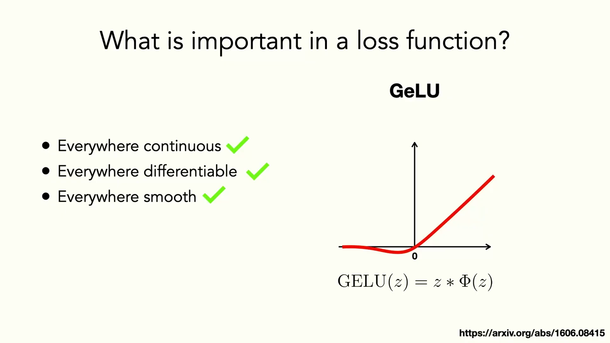
*▲ 강의 슬라이드 [21:18](https://youtu.be/vidCX_dMCu0?t=1278): [GELU](00_%EB%94%A5%EB%9F%AC%EB%8B%9D_%EC%9A%A9%EC%96%B4%EC%82%AC%EC%A0%84.md#gelu-%EA%B2%94%EB%A3%A8)는 어디서나 연속·[미분](00_%EB%94%A5%EB%9F%AC%EB%8B%9D_%EC%9A%A9%EC%96%B4%EC%82%AC%EC%A0%84.md#derivative-%EB%AF%B8%EB%B6%84) 가능·매끄럽다*

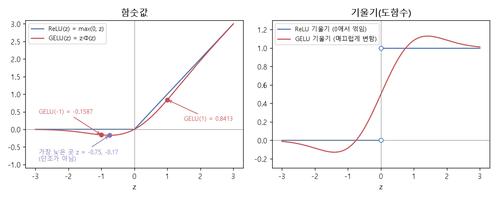
*▲ 직접 그린 그림: [ReLU](00_%EB%94%A5%EB%9F%AC%EB%8B%9D_%EC%9A%A9%EC%96%B4%EC%82%AC%EC%A0%84.md#relu-%EB%A0%90%EB%A3%A8)와 [GELU](00_%EB%94%A5%EB%9F%AC%EB%8B%9D_%EC%9A%A9%EC%96%B4%EC%82%AC%EC%A0%84.md#gelu-%EA%B2%94%EB%A3%A8)의 값(왼쪽)과 [기울기](00_%EB%94%A5%EB%9F%AC%EB%8B%9D_%EC%9A%A9%EC%96%B4%EC%82%AC%EC%A0%84.md#gradient-%EA%B8%B0%EC%9A%B8%EA%B8%B0)(오른쪽). [GELU](00_%EB%94%A5%EB%9F%AC%EB%8B%9D_%EC%9A%A9%EC%96%B4%EC%82%AC%EC%A0%84.md#gelu-%EA%B2%94%EB%A3%A8)(−1) = −0.1587, [GELU](00_%EB%94%A5%EB%9F%AC%EB%8B%9D_%EC%9A%A9%EC%96%B4%EC%82%AC%EC%A0%84.md#gelu-%EA%B2%94%EB%A3%A8)(1) = 0.8413, z = −0.75 근처에서 가장 낮은 값 −0.17. [ReLU](00_%EB%94%A5%EB%9F%AC%EB%8B%9D_%EC%9A%A9%EC%96%B4%EC%82%AC%EC%A0%84.md#relu-%EB%A0%90%EB%A3%A8)의 [기울기](00_%EB%94%A5%EB%9F%AC%EB%8B%9D_%EC%9A%A9%EC%96%B4%EC%82%AC%EC%A0%84.md#gradient-%EA%B8%B0%EC%9A%B8%EA%B8%B0)는 0에서 0→1로 뛰지만 [GELU](00_%EB%94%A5%EB%9F%AC%EB%8B%9D_%EC%9A%A9%EC%96%B4%EC%82%AC%EC%A0%84.md#gelu-%EA%B2%94%EB%A3%A8)의 [기울기](00_%EB%94%A5%EB%9F%AC%EB%8B%9D_%EC%9A%A9%EC%96%B4%EC%82%AC%EC%A0%84.md#gradient-%EA%B8%B0%EC%9A%B8%EA%B8%B0)는 이어진다*

질의응답 정리 [21:29](https://youtu.be/vidCX_dMCu0?t=1289)

- **이 기법들을 다 같이 쓰나?** 요즘은 "큰 수프 냄비"처럼 이것저것 섞는다. 서로 달라 보여도 실험 성능으로는 같은 효과를 내는 요령이 많다. 최고 성능 모델은 이런 요령을 많이 넣은 경우가 많지만, 데이터와 구조가 주어졌을 때 어떻게 최적화해야 하는지에 대한 정해진 비법은 없다.
- **[ReLU](00_%EB%94%A5%EB%9F%AC%EB%8B%9D_%EC%9A%A9%EC%96%B4%EC%82%AC%EC%A0%84.md#relu-%EB%A0%90%EB%A3%A8)와 [GELU](00_%EB%94%A5%EB%9F%AC%EB%8B%9D_%EC%9A%A9%EC%96%B4%EC%82%AC%EC%A0%84.md#gelu-%EA%B2%94%EB%A3%A8)는 손실 함수인가?** 아니다. [활성화 함수](00_%EB%94%A5%EB%9F%AC%EB%8B%9D_%EC%9A%A9%EC%96%B4%EC%82%AC%EC%A0%84.md#activation-function-%ED%99%9C%EC%84%B1%ED%99%94-%ED%95%A8%EC%88%98)다. 슬라이드 제목은 "[손실 함수](00_%EB%94%A5%EB%9F%AC%EB%8B%9D_%EC%9A%A9%EC%96%B4%EC%82%AC%EC%A0%84.md#loss-function-%EC%86%90%EC%8B%A4-%ED%95%A8%EC%88%98)"지만 여기서는 [활성화 함수](00_%EB%94%A5%EB%9F%AC%EB%8B%9D_%EC%9A%A9%EC%96%B4%EC%82%AC%EC%A0%84.md#activation-function-%ED%99%9C%EC%84%B1%ED%99%94-%ED%95%A8%EC%88%98)를 예로 든 것이다.
- **[손실](00_%EB%94%A5%EB%9F%AC%EB%8B%9D_%EC%9A%A9%EC%96%B4%EC%82%AC%EC%A0%84.md#loss-function-%EC%86%90%EC%8B%A4-%ED%95%A8%EC%88%98)은 음수가 되면 안 되나?** 설정하기 나름이다. 음수가 되는 [손실](00_%EB%94%A5%EB%9F%AC%EB%8B%9D_%EC%9A%A9%EC%96%B4%EC%82%AC%EC%A0%84.md#loss-function-%EC%86%90%EC%8B%A4-%ED%95%A8%EC%88%98)도 있다.
- **단조가 아닌 [활성화 함수](00_%EB%94%A5%EB%9F%AC%EB%8B%9D_%EC%9A%A9%EC%96%B4%EC%82%AC%EC%A0%84.md#activation-function-%ED%99%9C%EC%84%B1%ED%99%94-%ED%95%A8%EC%88%98)는 문제인가?** [GELU](00_%EB%94%A5%EB%9F%AC%EB%8B%9D_%EC%9A%A9%EC%96%B4%EC%82%AC%EC%A0%84.md#gelu-%EA%B2%94%EB%A3%A8)도 0 왼쪽에서 살짝 내려갔다 올라가므로 단조가 아니다. 매끄러움과 단조성 중 무엇이 더 중요한지는 아직 결론이 나지 않았다.

> [!TIP]
> **🆕 2026 업데이트: [활성화 함수](00_%EB%94%A5%EB%9F%AC%EB%8B%9D_%EC%9A%A9%EC%96%B4%EC%82%AC%EC%A0%84.md#activation-function-%ED%99%9C%EC%84%B1%ED%99%94-%ED%95%A8%EC%88%98)**
> - **강의**: [ReLU](00_%EB%94%A5%EB%9F%AC%EB%8B%9D_%EC%9A%A9%EC%96%B4%EC%82%AC%EC%A0%84.md#relu-%EB%A0%90%EB%A3%A8)에서 [GELU](00_%EB%94%A5%EB%9F%AC%EB%8B%9D_%EC%9A%A9%EC%96%B4%EC%82%AC%EC%A0%84.md#gelu-%EA%B2%94%EB%A3%A8) 쪽으로 옮겨 가는 흐름을 소개했다.
> - **현재**: 대형 [언어 모델](00_%EB%94%A5%EB%9F%AC%EB%8B%9D_%EC%9A%A9%EC%96%B4%EC%82%AC%EC%A0%84.md#language-model-%EC%96%B8%EC%96%B4-%EB%AA%A8%EB%8D%B8)의 [트랜스포머](00_%EB%94%A5%EB%9F%AC%EB%8B%9D_%EC%9A%A9%EC%96%B4%EC%82%AC%EC%A0%84.md#transformer-%ED%8A%B8%EB%9E%9C%EC%8A%A4%ED%8F%AC%EB%A8%B8) 피드포워드 [층](00_%EB%94%A5%EB%9F%AC%EB%8B%9D_%EC%9A%A9%EC%96%B4%EC%82%AC%EC%A0%84.md#layer-%EC%B8%B5)에서는 [GELU](00_%EB%94%A5%EB%9F%AC%EB%8B%9D_%EC%9A%A9%EC%96%B4%EC%82%AC%EC%A0%84.md#gelu-%EA%B2%94%EB%A3%A8)를 넘어 **[게이트](00_%EB%94%A5%EB%9F%AC%EB%8B%9D_%EC%9A%A9%EC%96%B4%EC%82%AC%EC%A0%84.md#gate-%EA%B2%8C%EC%9D%B4%ED%8A%B8)가 붙은 변형(GLU 계열)**, 특히 **SwiGLU**가 널리 쓰인다. SwiGLU는 Swish(= SiLU, $z\sigma(z)$) 활성화를 거친 값과 또 다른 선형 변환 값을 원소별로 곱한다. Llama 2가 SwiGLU를 쓴다. 세 성질(연속·[미분](00_%EB%94%A5%EB%9F%AC%EB%8B%9D_%EC%9A%A9%EC%96%B4%EC%82%AC%EC%A0%84.md#derivative-%EB%AF%B8%EB%B6%84) 가능·매끄러움)은 SwiGLU도 그대로 갖는다.
> - **출처**: [GLU Variants Improve Transformer (Shazeer, 2020)](https://arxiv.org/abs/2002.05202) · [Llama 2 (Touvron et al., 2023)](https://arxiv.org/abs/2307.09288) · [Gaussian Error Linear Units (Hendrycks & Gimpel, 2016)](https://arxiv.org/abs/1606.08415)

---

## 4. 계산 그래프

▶ 영상 [26:59](https://youtu.be/vidCX_dMCu0?t=1619)

📐 **수학 개념**: [합성함수](%EC%88%98%ED%95%99%EA%B0%9C%EB%85%90/05_%EC%8B%A0%EA%B2%BD%EB%A7%9D%EC%9D%98_%EA%B3%84%EC%82%B0/MM06_%ED%95%A9%EC%84%B1%ED%95%A8%EC%88%98%EC%99%80_%EB%B9%84%EC%84%A0%ED%98%95%EC%84%B1.md)

[계산 그래프(Computational graph)](00_%EB%94%A5%EB%9F%AC%EB%8B%9D_%EC%9A%A9%EC%96%B4%EC%82%AC%EC%A0%84.md#computational-graph-%EA%B3%84%EC%82%B0-%EA%B7%B8%EB%9E%98%ED%94%84)는 함수 변환을 노드로 두고 이어 붙여 쓸모 있는 계산을 하는 그래프입니다. 아주 단순한 예로, 강의실 찾아가기를 결정 트리로 그릴 수 있습니다. 45동에 들어가면 맞고 32동이면 틀리고, 45동에서는 엘리베이터와 계단 중 하나를 고르는 식입니다. 머신러닝에서는 노드 하나가 신경망의 [층](00_%EB%94%A5%EB%9F%AC%EB%8B%9D_%EC%9A%A9%EC%96%B4%EC%82%AC%EC%A0%84.md#layer-%EC%B8%B5) 하나일 수도, 신경망 전체일 수도 있고 크기에 제한이 없습니다.

- 딥러닝은 주로 **[DAG(방향성 비순환 그래프)](00_%EB%94%A5%EB%9F%AC%EB%8B%9D_%EC%9A%A9%EC%96%B4%EC%82%AC%EC%A0%84.md#dag-directed-acyclic-graph-%EB%B0%A9%ED%96%A5%EC%84%B1-%EB%B9%84%EC%88%9C%ED%99%98-%EA%B7%B8%EB%9E%98%ED%94%84)** 를 다룹니다. "방향성"은 각 간선에서 정보가 한 방향으로만 흐른다는 뜻이고, "비순환"은 고리가 없다는 뜻입니다.
- 모든 노드가 **[미분](00_%EB%94%A5%EB%9F%AC%EB%8B%9D_%EC%9A%A9%EC%96%B4%EC%82%AC%EC%A0%84.md#derivative-%EB%AF%B8%EB%B6%84) 가능**하다고 가정합니다. ([PyTorch](00_%EB%94%A5%EB%9F%AC%EB%8B%9D_%EC%9A%A9%EC%96%B4%EC%82%AC%EC%A0%84.md#pytorch-%ED%8C%8C%EC%9D%B4%ED%86%A0%EC%B9%98)가 거의 무엇이든 미분값을 내 주므로 엄격한 조건은 아닙니다.)
- Lec01의 MLP도 [계산 그래프](00_%EB%94%A5%EB%9F%AC%EB%8B%9D_%EC%9A%A9%EC%96%B4%EC%82%AC%EC%A0%84.md#computational-graph-%EA%B3%84%EC%82%B0-%EA%B7%B8%EB%9E%98%ED%94%84)입니다: $x$ → [선형층](00_%EB%94%A5%EB%9F%AC%EB%8B%9D_%EC%9A%A9%EC%96%B4%EC%82%AC%EC%A0%84.md#linear-layer-%EC%84%A0%ED%98%95%EC%B8%B5) → $z$ → [ReLU](00_%EB%94%A5%EB%9F%AC%EB%8B%9D_%EC%9A%A9%EC%96%B4%EC%82%AC%EC%A0%84.md#relu-%EB%A0%90%EB%A3%A8) → $h$ → [선형층](00_%EB%94%A5%EB%9F%AC%EB%8B%9D_%EC%9A%A9%EC%96%B4%EC%82%AC%EC%A0%84.md#linear-layer-%EC%84%A0%ED%98%95%EC%B8%B5) → $y$.

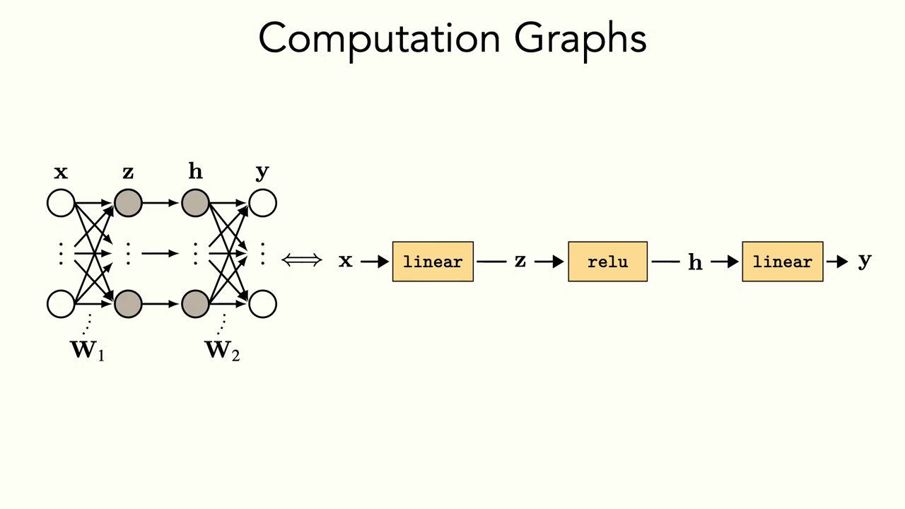
*▲ 강의 슬라이드 [29:50](https://youtu.be/vidCX_dMCu0?t=1790): MLP(왼쪽)를 [계산 그래프](00_%EB%94%A5%EB%9F%AC%EB%8B%9D_%EC%9A%A9%EC%96%B4%EC%82%AC%EC%A0%84.md#computational-graph-%EA%B3%84%EC%82%B0-%EA%B7%B8%EB%9E%98%ED%94%84)(오른쪽)로 나타낸 것*

**[순전파(Forward pass)](00_%EB%94%A5%EB%9F%AC%EB%8B%9D_%EC%9A%A9%EC%96%B4%EC%82%AC%EC%A0%84.md#feed-forward-%EC%88%9C%EC%A0%84%ED%8C%8C)**: 노드 하나는 입력 $x_{in}$과 자기 [파라미터](00_%EB%94%A5%EB%9F%AC%EB%8B%9D_%EC%9A%A9%EC%96%B4%EC%82%AC%EC%A0%84.md#parameter-%ED%8C%8C%EB%9D%BC%EB%AF%B8%ED%84%B0) $\theta$를 받아 $x_{out} = f(x_{in}, \theta)$를 냅니다. 여러 노드가 이어지면 한 노드의 출력이 다음 노드의 입력이 되고, 끝에서 [손실](00_%EB%94%A5%EB%9F%AC%EB%8B%9D_%EC%9A%A9%EC%96%B4%EC%82%AC%EC%A0%84.md#loss-function-%EC%86%90%EC%8B%A4-%ED%95%A8%EC%88%98) $\mathcal{L}$로 비용 $J$를 계산합니다.

**[학습](00_%EB%94%A5%EB%9F%AC%EB%8B%9D_%EC%9A%A9%EC%96%B4%EC%82%AC%EC%A0%84.md#training-%ED%95%99%EC%8A%B5)**은 비용 $J$를 모든 [파라미터](00_%EB%94%A5%EB%9F%AC%EB%8B%9D_%EC%9A%A9%EC%96%B4%EC%82%AC%EC%A0%84.md#parameter-%ED%8C%8C%EB%9D%BC%EB%AF%B8%ED%84%B0) $\theta_1, \dots, \theta_L$로 미분한 값을 구하는 일입니다. 모든 [층](00_%EB%94%A5%EB%9F%AC%EB%8B%9D_%EC%9A%A9%EC%96%B4%EC%82%AC%EC%A0%84.md#layer-%EC%B8%B5)이 입력에 대해 [미분](00_%EB%94%A5%EB%9F%AC%EB%8B%9D_%EC%9A%A9%EC%96%B4%EC%82%AC%EC%A0%84.md#derivative-%EB%AF%B8%EB%B6%84) 가능하도록 설계했으므로 이 계산이 가능합니다.

---

## 5. 행렬 미분 복습

### 5.1 도함수의 모양

▶ 영상 [31:35](https://youtu.be/vidCX_dMCu0?t=1895)

📐 **수학 개념**: [야코비안과 연쇄법칙](%EC%88%98%ED%95%99%EA%B0%9C%EB%85%90/05_%EC%8B%A0%EA%B2%BD%EB%A7%9D%EC%9D%98_%EA%B3%84%EC%82%B0/MM09_%EC%95%BC%EC%BD%94%EB%B9%84%EC%95%88%EA%B3%BC_%EC%97%B0%EC%87%84%EB%B2%95%EC%B9%99.md) · [벡터 표기와 전치](%EC%88%98%ED%95%99%EA%B0%9C%EB%85%90/03_%EC%84%A0%ED%98%95%EB%8C%80%EC%88%98/MM03_%EB%B2%A1%ED%84%B0_%ED%91%9C%EA%B8%B0%EC%99%80_%EC%A0%84%EC%B9%98.md) · [편미분](%EC%88%98%ED%95%99%EA%B0%9C%EB%85%90/02_%EB%AF%B8%EB%B6%84/M04_%ED%8E%B8%EB%AF%B8%EB%B6%84.md)

이 수업은 입력 $x$를 크기 $[n \times 1]$의 열벡터로 둡니다. $y = f(x)$일 때 도함수 $\partial y / \partial x$의 모양은 다음과 같습니다.

| $y$ | $x$ | $\partial y / \partial x$의 모양 | 원소 |
|---|---|---|---|
| 스칼라 | 열벡터 $[n \times 1]$ | 행벡터 $[1 \times n]$ | $\partial y / \partial x_j$ |
| 열벡터 $[m \times 1]$ | 열벡터 $[n \times 1]$ | 행렬 $[m \times n]$ ([야코비안](00_%EB%94%A5%EB%9F%AC%EB%8B%9D_%EC%9A%A9%EC%96%B4%EC%82%AC%EC%A0%84.md#jacobian-%EC%95%BC%EC%BD%94%EB%B9%84%EC%95%88)) | $\partial y_i / \partial x_j$ |
| 스칼라 | 행렬 $[n \times m]$ | 행렬 $[m \times n]$ (전치된 모양) | $\partial y / \partial x_{ji}$ |

벡터를 행렬로, 행렬을 벡터로, 행렬을 행렬로 미분하는 경우는 표기법이 널리 합의되지 않았고 이 수업에서도 쓰지 않습니다.

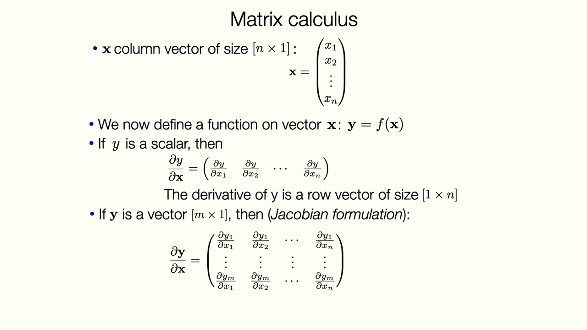
*▲ 강의 슬라이드 [33:05](https://youtu.be/vidCX_dMCu0?t=1985): 스칼라의 도함수는 행벡터, 벡터의 도함수는 [야코비안](00_%EB%94%A5%EB%9F%AC%EB%8B%9D_%EC%9A%A9%EC%96%B4%EC%82%AC%EC%A0%84.md#jacobian-%EC%95%BC%EC%BD%94%EB%B9%84%EC%95%88) 행렬*

### 5.2 연쇄법칙과 모양

▶ 영상 [33:45](https://youtu.be/vidCX_dMCu0?t=2025)

📐 **수학 개념**: [야코비안과 연쇄법칙](%EC%88%98%ED%95%99%EA%B0%9C%EB%85%90/05_%EC%8B%A0%EA%B2%BD%EB%A7%9D%EC%9D%98_%EA%B3%84%EC%82%B0/MM09_%EC%95%BC%EC%BD%94%EB%B9%84%EC%95%88%EA%B3%BC_%EC%97%B0%EC%87%84%EB%B2%95%EC%B9%99.md) · [합성함수](%EC%88%98%ED%95%99%EA%B0%9C%EB%85%90/05_%EC%8B%A0%EA%B2%BD%EB%A7%9D%EC%9D%98_%EA%B3%84%EC%82%B0/MM06_%ED%95%A9%EC%84%B1%ED%95%A8%EC%88%98%EC%99%80_%EB%B9%84%EC%84%A0%ED%98%95%EC%84%B1.md)

$h(x) = f(g(x))$의 도함수는 $h'(x) = f'(g(x))\,g'(x)$입니다([연쇄법칙](00_%EB%94%A5%EB%9F%AC%EB%8B%9D_%EC%9A%A9%EC%96%B4%EC%82%AC%EC%A0%84.md#chain-rule-%EC%97%B0%EC%87%84%EB%B2%95%EC%B9%99)). $u = g(x)$, $z = f(u)$로 쓰면 벡터에서는 [야코비안](00_%EB%94%A5%EB%9F%AC%EB%8B%9D_%EC%9A%A9%EC%96%B4%EC%82%AC%EC%A0%84.md#jacobian-%EC%95%BC%EC%BD%94%EB%B9%84%EC%95%88)의 **[행렬 곱](00_%EB%94%A5%EB%9F%AC%EB%8B%9D_%EC%9A%A9%EC%96%B4%EC%82%AC%EC%A0%84.md#matrix-multiplication-%ED%96%89%EB%A0%AC-%EA%B3%B1)**이 됩니다.

$$
\underbrace{\frac{\partial z}{\partial x}}_{[m \times n]} = \underbrace{\frac{\partial z}{\partial u}}_{[m \times p]}\ \underbrace{\frac{\partial u}{\partial x}}_{[p \times n]}, \qquad p = |u|,\ m = |z|,\ n = |x|
$$

기호 풀이

| 기호 | 읽는 법 | 뜻 | 예제 값 |
| --- | --- | --- | --- |
| $\frac{\partial z}{\partial x}$ | 파셜 제트 파셜 엑스 | x가 z에 주는 영향 전체 | (3, 3, −2) |
| $\frac{\partial z}{\partial u}$ | 파셜 제트 파셜 유 | 바깥 함수의 도함수 | (3, −1) |
| $\frac{\partial u}{\partial x}$ | 파셜 유 파셜 엑스 | 안쪽 함수의 [야코비안](00_%EB%94%A5%EB%9F%AC%EB%8B%9D_%EC%9A%A9%EC%96%B4%EC%82%AC%EC%A0%84.md#jacobian-%EC%95%BC%EC%BD%94%EB%B9%84%EC%95%88) | 2×3 행렬 |
| $[m \times n]$ | 엠 바이 엔 | m행 n열 모양 | [1×3] |
| $\|u\|$ | 유의 크기 | 벡터 u의 칸 수 | p = 2 |
| $m,\ n,\ p$ | 엠, 엔, 피 | z, x, u의 칸 수 | 1, 3, 2 |

예제와 풀이

**문제**: z가 u에 얼마나 민감한지 적은 1×2 행벡터 (3, −1)과, u가 x에 얼마나 민감한지 적은 2×3 [야코비안](00_%EB%94%A5%EB%9F%AC%EB%8B%9D_%EC%9A%A9%EC%96%B4%EC%82%AC%EC%A0%84.md#jacobian-%EC%95%BC%EC%BD%94%EB%B9%84%EC%95%88)이 주어질 때 $\partial z/\partial x$와 그 모양은?

**주어진 값**:
- $\frac{\partial z}{\partial u} = (3,\ -1)$ (바깥 함수의 도함수, 모양 [1×2])
- $\frac{\partial u}{\partial x} = \begin{pmatrix} 1 & 1 & 0 \\ 0 & 0 & 2 \end{pmatrix}$ (안쪽 함수의 [야코비안](00_%EB%94%A5%EB%9F%AC%EB%8B%9D_%EC%9A%A9%EC%96%B4%EC%82%AC%EC%A0%84.md#jacobian-%EC%95%BC%EC%BD%94%EB%B9%84%EC%95%88), 모양 [2×3])
- $m = 1,\ p = 2,\ n = 3$ (z, u, x의 칸 수)

**풀이**
1. 식을 그대로 쓴다: $\underbrace{\frac{\partial z}{\partial x}}_{[m \times n]} = \underbrace{\frac{\partial z}{\partial u}}_{[m \times p]}\ \underbrace{\frac{\partial u}{\partial x}}_{[p \times n]}, \qquad p = |u|,\ m = |z|,\ n = |x|$
2. 값을 대입한다: $\underbrace{\frac{\partial z}{\partial x}}_{[1 \times 3]} = \underbrace{(3,\ -1)}_{[1 \times 2]}\ \underbrace{\begin{pmatrix} 1 & 1 & 0 \\ 0 & 0 & 2 \end{pmatrix}}_{[2 \times 3]}$
3. 모양을 확인한다: 가운데 2가 같아 곱할 수 있고, 결과는 바깥 두 수 [1×3]
4. 1번째 칸: 행벡터와 1번째 열의 같은 자리끼리 곱한다: $3 \times 1 = 3$, $(-1) \times 0 = 0$
5. 1번째 칸: 더한다: $3 + 0 = 3$
6. 2번째 칸: 2번째 열과 곱한다: $3 \times 1 = 3$, $(-1) \times 0 = 0$
7. 2번째 칸: 더한다: $3 + 0 = 3$
8. 3번째 칸: 3번째 열과 곱한다: $3 \times 0 = 0$, $(-1) \times 2 = -2$
9. 3번째 칸: 더한다: $0 + (-2) = -2$

**답**: $\frac{\partial z}{\partial x} = (3, 3, -2)$, 모양 [1×3]

내 이해

슬라이드의 예처럼 $|z| = 1$, $|u| = 2$, $|x| = 4$이면 $[1 \times 4] = [1 \times 2]\,[2 \times 4]$입니다. 앞으로 [행렬 곱](00_%EB%94%A5%EB%9F%AC%EB%8B%9D_%EC%9A%A9%EC%96%B4%EC%82%AC%EC%A0%84.md#matrix-multiplication-%ED%96%89%EB%A0%AC-%EA%B3%B1)이 계속 나오므로 모양을 맞추는 연습이 중요합니다.

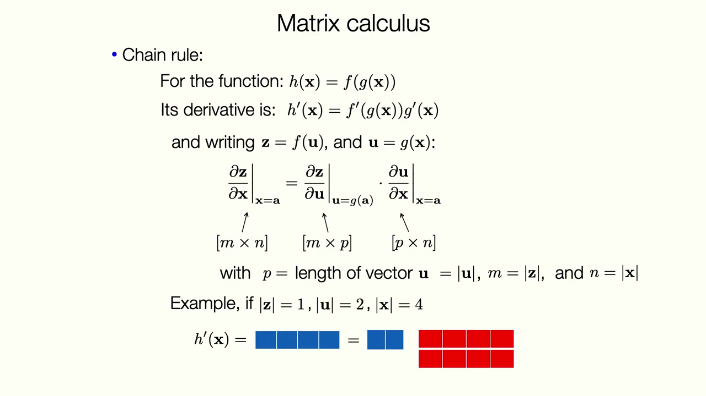
*▲ 강의 슬라이드 [36:50](https://youtu.be/vidCX_dMCu0?t=2210): [연쇄법칙](00_%EB%94%A5%EB%9F%AC%EB%8B%9D_%EC%9A%A9%EC%96%B4%EC%82%AC%EC%A0%84.md#chain-rule-%EC%97%B0%EC%87%84%EB%B2%95%EC%B9%99)의 각 항의 모양. 파란 1×4 = 파란 1×2 × 빨간 2×4*

---

## 6. 역전파

### 6.1 공유 항을 한 번만 계산하기

▶ 영상 [37:14](https://youtu.be/vidCX_dMCu0?t=2234)

📐 **수학 개념**: [연쇄법칙의 행렬 곱](%EC%88%98%ED%95%99%EA%B0%9C%EB%85%90/05_%EC%8B%A0%EA%B2%BD%EB%A7%9D%EC%9D%98_%EA%B3%84%EC%82%B0/MM09_%EC%95%BC%EC%BD%94%EB%B9%84%EC%95%88%EA%B3%BC_%EC%97%B0%EC%87%84%EB%B2%95%EC%B9%99.md) · [편미분](%EC%88%98%ED%95%99%EA%B0%9C%EB%85%90/02_%EB%AF%B8%EB%B6%84/M04_%ED%8E%B8%EB%AF%B8%EB%B6%84.md)

첫 [층](00_%EB%94%A5%EB%9F%AC%EB%8B%9D_%EC%9A%A9%EC%96%B4%EC%82%AC%EC%A0%84.md#layer-%EC%B8%B5)의 [파라미터](00_%EB%94%A5%EB%9F%AC%EB%8B%9D_%EC%9A%A9%EC%96%B4%EC%82%AC%EC%A0%84.md#parameter-%ED%8C%8C%EB%9D%BC%EB%AF%B8%ED%84%B0) $\theta_1$을 갱신하려면 $\partial J / \partial \theta_1$이 필요합니다. [연쇄법칙](00_%EB%94%A5%EB%9F%AC%EB%8B%9D_%EC%9A%A9%EC%96%B4%EC%82%AC%EC%A0%84.md#chain-rule-%EC%97%B0%EC%87%84%EB%B2%95%EC%B9%99)으로 풀면 [층](00_%EB%94%A5%EB%9F%AC%EB%8B%9D_%EC%9A%A9%EC%96%B4%EC%82%AC%EC%A0%84.md#layer-%EC%B8%B5)마다 곱이 이어지고, 둘째 [층](00_%EB%94%A5%EB%9F%AC%EB%8B%9D_%EC%9A%A9%EC%96%B4%EC%82%AC%EC%A0%84.md#layer-%EC%B8%B5)의 $\partial J / \partial \theta_2$를 풀어도 **앞부분(회색 칸)이 똑같습니다**.

$$
\frac{\partial J}{\partial \theta_1} = \boxed{\frac{\partial J}{\partial x_L}\frac{\partial x_L}{\partial x_{L-1}}\cdots\frac{\partial x_3}{\partial x_2}}\ \frac{\partial x_2}{\partial x_1}\frac{\partial x_1}{\partial \theta_1},\qquad
\frac{\partial J}{\partial \theta_2} = \boxed{\frac{\partial J}{\partial x_L}\frac{\partial x_L}{\partial x_{L-1}}\cdots\frac{\partial x_3}{\partial x_2}}\ \frac{\partial x_2}{\partial \theta_2}
$$

기호 풀이

| 기호 | 읽는 법 | 뜻 | 예제 값 |
| --- | --- | --- | --- |
| $\theta_1,\ \theta_2$ | 세타 일, 세타 이 | 1층, 2층의 [파라미터](00_%EB%94%A5%EB%9F%AC%EB%8B%9D_%EC%9A%A9%EC%96%B4%EC%82%AC%EC%A0%84.md#parameter-%ED%8C%8C%EB%9D%BC%EB%AF%B8%ED%84%B0) | 2, 3 |
| $x_1, \dots, x_L$ | 엑스 일부터 엑스 엘까지 | 각 [층](00_%EB%94%A5%EB%9F%AC%EB%8B%9D_%EC%9A%A9%EC%96%B4%EC%82%AC%EC%A0%84.md#layer-%EC%B8%B5)의 출력 | $x_1 = 2,\ x_2 = 6$ |
| $L$ | 엘 | [층](00_%EB%94%A5%EB%9F%AC%EB%8B%9D_%EC%9A%A9%EC%96%B4%EC%82%AC%EC%A0%84.md#layer-%EC%B8%B5) 개수 | 2 |
| $\frac{\partial x_2}{\partial x_1}$ | 파셜 엑스 이 파셜 엑스 일 | [층](00_%EB%94%A5%EB%9F%AC%EB%8B%9D_%EC%9A%A9%EC%96%B4%EC%82%AC%EC%A0%84.md#layer-%EC%B8%B5) 하나의 입력에 대한 도함수 | 3 |
| $\frac{\partial x_1}{\partial \theta_1}$ | 파셜 엑스 일 파셜 세타 일 | [층](00_%EB%94%A5%EB%9F%AC%EB%8B%9D_%EC%9A%A9%EC%96%B4%EC%82%AC%EC%A0%84.md#layer-%EC%B8%B5) 출력을 그 [층](00_%EB%94%A5%EB%9F%AC%EB%8B%9D_%EC%9A%A9%EC%96%B4%EC%82%AC%EC%A0%84.md#layer-%EC%B8%B5) [파라미터](00_%EB%94%A5%EB%9F%AC%EB%8B%9D_%EC%9A%A9%EC%96%B4%EC%82%AC%EC%A0%84.md#parameter-%ED%8C%8C%EB%9D%BC%EB%AF%B8%ED%84%B0)로 [미분](00_%EB%94%A5%EB%9F%AC%EB%8B%9D_%EC%9A%A9%EC%96%B4%EC%82%AC%EC%A0%84.md#derivative-%EB%AF%B8%EB%B6%84) | 1 |
| $\boxed{\cdots}$ | 네모 칸 | 두 식에 똑같이 들어 있는 공유 항 | $\partial J/\partial x_2 = 12$ |
| $\cdots$ | 점점점 | 중간 [층](00_%EB%94%A5%EB%9F%AC%EB%8B%9D_%EC%9A%A9%EC%96%B4%EC%82%AC%EC%A0%84.md#layer-%EC%B8%B5)들의 곱이 이어짐 | - |

예제와 풀이

**문제**: 두 층짜리 사슬 $x_1 = \theta_1 x_0$, $x_2 = \theta_2 x_1$, 비용 $J = x_2^2$에서 두 [층](00_%EB%94%A5%EB%9F%AC%EB%8B%9D_%EC%9A%A9%EC%96%B4%EC%82%AC%EC%A0%84.md#layer-%EC%B8%B5)의 [파라미터](00_%EB%94%A5%EB%9F%AC%EB%8B%9D_%EC%9A%A9%EC%96%B4%EC%82%AC%EC%A0%84.md#parameter-%ED%8C%8C%EB%9D%BC%EB%AF%B8%ED%84%B0) [기울기](00_%EB%94%A5%EB%9F%AC%EB%8B%9D_%EC%9A%A9%EC%96%B4%EC%82%AC%EC%A0%84.md#gradient-%EA%B8%B0%EC%9A%B8%EA%B8%B0) $\partial J/\partial\theta_1$, $\partial J/\partial\theta_2$는? 공유 항은 한 번만 계산한다.

**주어진 값**:
- $x_0 = 1$ (입력)
- $\theta_1 = 2,\ \theta_2 = 3$ (1층, 2층 [파라미터](00_%EB%94%A5%EB%9F%AC%EB%8B%9D_%EC%9A%A9%EC%96%B4%EC%82%AC%EC%A0%84.md#parameter-%ED%8C%8C%EB%9D%BC%EB%AF%B8%ED%84%B0))
- $x_1 = 2,\ x_2 = 6$ (순방향에서 구한 [층](00_%EB%94%A5%EB%9F%AC%EB%8B%9D_%EC%9A%A9%EC%96%B4%EC%82%AC%EC%A0%84.md#layer-%EC%B8%B5) 출력: $2 \times 1$, $3 \times 2$)
- $\frac{\partial J}{\partial x_2} = 2x_2$ ($x_2^2$을 미분한 것)
- $\frac{\partial x_2}{\partial x_1} = \theta_2$, $\frac{\partial x_2}{\partial \theta_2} = x_1$, $\frac{\partial x_1}{\partial \theta_1} = x_0$ (곱셈 [층](00_%EB%94%A5%EB%9F%AC%EB%8B%9D_%EC%9A%A9%EC%96%B4%EC%82%AC%EC%A0%84.md#layer-%EC%B8%B5)의 도함수)

**풀이**
1. 식을 그대로 쓴다: $\frac{\partial J}{\partial \theta_1} = \boxed{\frac{\partial J}{\partial x_L}\frac{\partial x_L}{\partial x_{L-1}}\cdots\frac{\partial x_3}{\partial x_2}}\ \frac{\partial x_2}{\partial x_1}\frac{\partial x_1}{\partial \theta_1},\qquad \frac{\partial J}{\partial \theta_2} = \boxed{\frac{\partial J}{\partial x_L}\frac{\partial x_L}{\partial x_{L-1}}\cdots\frac{\partial x_3}{\partial x_2}}\ \frac{\partial x_2}{\partial \theta_2}$
2. [층](00_%EB%94%A5%EB%9F%AC%EB%8B%9D_%EC%9A%A9%EC%96%B4%EC%82%AC%EC%A0%84.md#layer-%EC%B8%B5)이 2개라 L = 2다. 네모 칸의 사슬은 $\frac{\partial J}{\partial x_2}$ 하나로 줄어든다: $\frac{\partial J}{\partial \theta_1} = \boxed{\frac{\partial J}{\partial x_2}}\ \frac{\partial x_2}{\partial x_1}\frac{\partial x_1}{\partial \theta_1},\qquad \frac{\partial J}{\partial \theta_2} = \boxed{\frac{\partial J}{\partial x_2}}\ \frac{\partial x_2}{\partial \theta_2}$
3. 값을 대입한다: $\frac{\partial J}{\partial \theta_1} = \boxed{2 \times 6} \times 3 \times 1,\qquad \frac{\partial J}{\partial \theta_2} = \boxed{2 \times 6} \times 2$
4. 공유 항을 한 번만 계산한다: $2 \times 6 = 12$ 이므로 $\frac{\partial J}{\partial \theta_1} = 12 \times 3 \times 1$, $\frac{\partial J}{\partial \theta_2} = 12 \times 2$
5. $\theta_1$ 쪽 첫 곱셈: $12 \times 3 = 36$
6. $\theta_1$ 쪽 둘째 곱셈: $36 \times 1 = 36$
7. $\theta_2$ 쪽 곱셈: $12 \times 2 = 24$

**답**: $\frac{\partial J}{\partial \theta_1} = 36$, $\frac{\partial J}{\partial \theta_2} = 24$ (공유 항 12를 두 번 썼다)

내 이해

[미분](00_%EB%94%A5%EB%9F%AC%EB%8B%9D_%EC%9A%A9%EC%96%B4%EC%82%AC%EC%A0%84.md#derivative-%EB%AF%B8%EB%B6%84)을 하나하나 따로 계산할 수도 있지만, 공유되는 항은 **한 번만** 계산하면 됩니다. [역전파(Backpropagation)](00_%EB%94%A5%EB%9F%AC%EB%8B%9D_%EC%9A%A9%EC%96%B4%EC%82%AC%EC%A0%84.md#backpropagation-%EC%97%AD%EC%A0%84%ED%8C%8C)는 이 공유 항을 [계산 그래프](00_%EB%94%A5%EB%9F%AC%EB%8B%9D_%EC%9A%A9%EC%96%B4%EC%82%AC%EC%A0%84.md#computational-graph-%EA%B3%84%EC%82%B0-%EA%B7%B8%EB%9E%98%ED%94%84)를 따라 전달하는 간단한 알고리즘입니다. 본질은 효율화 요령이지만, 아주 큰 모델에서 [기울기](00_%EB%94%A5%EB%9F%AC%EB%8B%9D_%EC%9A%A9%EC%96%B4%EC%82%AC%EC%A0%84.md#gradient-%EA%B8%B0%EC%9A%B8%EA%B8%B0) 계산을 현실적으로 만들어 주는 핵심입니다(슬라이드 부제: 동적 계획법).

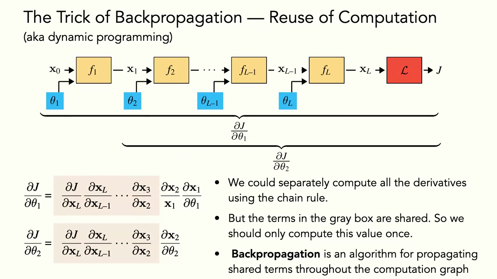
*▲ 강의 슬라이드 [38:42](https://youtu.be/vidCX_dMCu0?t=2322): [역전파](00_%EB%94%A5%EB%9F%AC%EB%8B%9D_%EC%9A%A9%EC%96%B4%EC%82%AC%EC%A0%84.md#backpropagation-%EC%97%AD%EC%A0%84%ED%8C%8C)의 요령은 회색 칸(공유 항)의 재사용*

- **순방향(Forward pass)**: 데이터를 앞으로 보내 출력과 [손실](00_%EB%94%A5%EB%9F%AC%EB%8B%9D_%EC%9A%A9%EC%96%B4%EC%82%AC%EC%A0%84.md#loss-function-%EC%86%90%EC%8B%A4-%ED%95%A8%EC%88%98)을 계산한다.
- **역방향(Backward pass)**: [오차](00_%EB%94%A5%EB%9F%AC%EB%8B%9D_%EC%9A%A9%EC%96%B4%EC%82%AC%EC%A0%84.md#error-%EC%98%A4%EC%B0%A8) 신호([기울기](00_%EB%94%A5%EB%9F%AC%EB%8B%9D_%EC%9A%A9%EC%96%B4%EC%82%AC%EC%A0%84.md#gradient-%EA%B8%B0%EC%9A%B8%EA%B8%B0))를 출력과 [손실](00_%EB%94%A5%EB%9F%AC%EB%8B%9D_%EC%9A%A9%EC%96%B4%EC%82%AC%EC%A0%84.md#loss-function-%EC%86%90%EC%8B%A4-%ED%95%A8%EC%88%98)에서 입력과 [파라미터](00_%EB%94%A5%EB%9F%AC%EB%8B%9D_%EC%9A%A9%EC%96%B4%EC%82%AC%EC%A0%84.md#parameter-%ED%8C%8C%EB%9D%BC%EB%AF%B8%ED%84%B0) 쪽으로 거꾸로 보낸다.

### 6.2 일반 층의 역방향 계산

▶ 영상 [39:01](https://youtu.be/vidCX_dMCu0?t=2341)

📐 **수학 개념**: [야코비안](%EC%88%98%ED%95%99%EA%B0%9C%EB%85%90/05_%EC%8B%A0%EA%B2%BD%EB%A7%9D%EC%9D%98_%EA%B3%84%EC%82%B0/MM09_%EC%95%BC%EC%BD%94%EB%B9%84%EC%95%88%EA%B3%BC_%EC%97%B0%EC%87%84%EB%B2%95%EC%B9%99.md) · [선형층과 ReLU의 역전파](%EC%88%98%ED%95%99%EA%B0%9C%EB%85%90/05_%EC%8B%A0%EA%B2%BD%EB%A7%9D%EC%9D%98_%EA%B3%84%EC%82%B0/MM10_%EC%84%A0%ED%98%95%EC%B8%B5%EA%B3%BC_ReLU%EC%9D%98_%EC%97%AD%EC%A0%84%ED%8C%8C.md)

[층](00_%EB%94%A5%EB%9F%AC%EB%8B%9D_%EC%9A%A9%EC%96%B4%EC%82%AC%EC%A0%84.md#layer-%EC%B8%B5) 하나 $x_{out} = f(x_{in}, \theta)$에 대해 두 종류의 [편미분](00_%EB%94%A5%EB%9F%AC%EB%8B%9D_%EC%9A%A9%EC%96%B4%EC%82%AC%EC%A0%84.md#partial-derivative-%ED%8E%B8%EB%AF%B8%EB%B6%84) 배열을 추적합니다.

| 기호 | 뜻 | 모양 |
|---|---|---|
| $\mathbf{L}$ | [층](00_%EB%94%A5%EB%9F%AC%EB%8B%9D_%EC%9A%A9%EC%96%B4%EC%82%AC%EC%A0%84.md#layer-%EC%B8%B5) 출력을 [층](00_%EB%94%A5%EB%9F%AC%EB%8B%9D_%EC%9A%A9%EC%96%B4%EC%82%AC%EC%A0%84.md#layer-%EC%B8%B5) 입력(과 [파라미터](00_%EB%94%A5%EB%9F%AC%EB%8B%9D_%EC%9A%A9%EC%96%B4%EC%82%AC%EC%A0%84.md#parameter-%ED%8C%8C%EB%9D%BC%EB%AF%B8%ED%84%B0))으로 미분한 것. $\mathbf{L}^x = \partial x_{out}/\partial x_{in}$, $\mathbf{L}^\theta = \partial x_{out}/\partial \theta$ | 행렬 ([야코비안](00_%EB%94%A5%EB%9F%AC%EB%8B%9D_%EC%9A%A9%EC%96%B4%EC%82%AC%EC%A0%84.md#jacobian-%EC%95%BC%EC%BD%94%EB%B9%84%EC%95%88)) |
| $\mathbf{g}$ | 비용을 그 위치의 값(활성값)으로 미분한 것. $\mathbf{g} = \partial J / \partial x$ | 행벡터 |

- **[파라미터](00_%EB%94%A5%EB%9F%AC%EB%8B%9D_%EC%9A%A9%EC%96%B4%EC%82%AC%EC%A0%84.md#parameter-%ED%8C%8C%EB%9D%BC%EB%AF%B8%ED%84%B0) 갱신**은 두 가지가 있으면 쉽습니다: $\dfrac{\partial J}{\partial \theta} = \mathbf{g}_{out}\,\mathbf{L}^\theta$, 그리고 $\theta \leftarrow \theta - \eta \left(\dfrac{\partial J}{\partial \theta}\right)^\top$.
- **$\mathbf{L}$** 은 [층](00_%EB%94%A5%EB%9F%AC%EB%8B%9D_%EC%9A%A9%EC%96%B4%EC%82%AC%EC%A0%84.md#layer-%EC%B8%B5)의 도함수 함수 $f'(x_{in}, \theta)$에서 나옵니다. [층](00_%EB%94%A5%EB%9F%AC%EB%8B%9D_%EC%9A%A9%EC%96%B4%EC%82%AC%EC%A0%84.md#layer-%EC%B8%B5)마다 이 함수가 주어져 있다고 가정합니다.
- **$\mathbf{g}$** 는 점화식으로 거꾸로 계산합니다: $\mathbf{g}_{in} = \mathbf{g}_{out}\,\mathbf{L}^x$. 이것이 "[오차](00_%EB%94%A5%EB%9F%AC%EB%8B%9D_%EC%9A%A9%EC%96%B4%EC%82%AC%EC%A0%84.md#error-%EC%98%A4%EC%B0%A8) 신호의 [역전파](00_%EB%94%A5%EB%9F%AC%EB%8B%9D_%EC%9A%A9%EC%96%B4%EC%82%AC%EC%A0%84.md#backpropagation-%EC%97%AD%EC%A0%84%ED%8C%8C)"입니다.

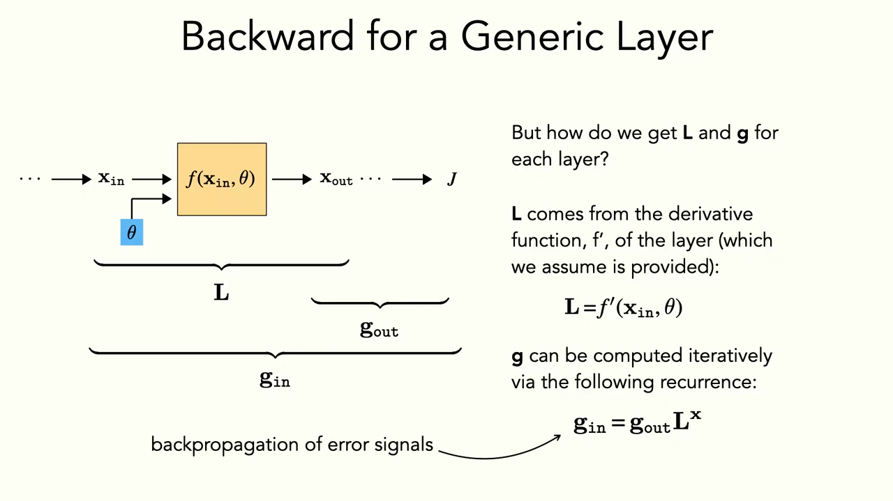
*▲ 강의 슬라이드 [41:05](https://youtu.be/vidCX_dMCu0?t=2465): L은 [층](00_%EB%94%A5%EB%9F%AC%EB%8B%9D_%EC%9A%A9%EC%96%B4%EC%82%AC%EC%A0%84.md#layer-%EC%B8%B5)의 도함수에서, g는 점화식 g_in = g_out·Lˣ로 얻는다*

### 6.3 전체 알고리즘과 배치

▶ 영상 [40:50](https://youtu.be/vidCX_dMCu0?t=2450)

📐 **수학 개념**: [평균](%EC%88%98%ED%95%99%EA%B0%9C%EB%85%90/01_%EC%88%98%EC%99%80_%ED%95%A8%EC%88%98/M02_%EC%8B%9C%EA%B7%B8%EB%A7%88%EC%99%80_%ED%8F%89%EA%B7%A0.md) · [미니배치 기울기](%EC%88%98%ED%95%99%EA%B0%9C%EB%85%90/05_%EC%8B%A0%EA%B2%BD%EB%A7%9D%EC%9D%98_%EA%B3%84%EC%82%B0/MM08_SGD%EC%99%80_%EB%AA%A8%EB%A9%98%ED%85%80.md)

1. **순방향**: 모든 [층](00_%EB%94%A5%EB%9F%AC%EB%8B%9D_%EC%9A%A9%EC%96%B4%EC%82%AC%EC%A0%84.md#layer-%EC%B8%B5)의 출력을 계산한다.
2. **역방향**: 맨 위([손실](00_%EB%94%A5%EB%9F%AC%EB%8B%9D_%EC%9A%A9%EC%96%B4%EC%82%AC%EC%A0%84.md#loss-function-%EC%86%90%EC%8B%A4-%ED%95%A8%EC%88%98), $\mathbf{g}_L = 1$)에서 아래로 [손실](00_%EB%94%A5%EB%9F%AC%EB%8B%9D_%EC%9A%A9%EC%96%B4%EC%82%AC%EC%A0%84.md#loss-function-%EC%86%90%EC%8B%A4-%ED%95%A8%EC%88%98) 도함수 $\mathbf{g}$를 차례로 계산한다.
3. **갱신**: 각 [층](00_%EB%94%A5%EB%9F%AC%EB%8B%9D_%EC%9A%A9%EC%96%B4%EC%82%AC%EC%A0%84.md#layer-%EC%B8%B5)의 $\partial J/\partial\theta$를 구해 모든 [가중치](00_%EB%94%A5%EB%9F%AC%EB%8B%9D_%EC%9A%A9%EC%96%B4%EC%82%AC%EC%A0%84.md#weight-%EA%B0%80%EC%A4%91%EC%B9%98)를 고친다.
4. 반복한다. 언제 멈출지는 보통 [검증 데이터](00_%EB%94%A5%EB%9F%AC%EB%8B%9D_%EC%9A%A9%EC%96%B4%EC%82%AC%EC%A0%84.md#validation-data-%EA%B2%80%EC%A6%9D-%EB%8D%B0%EC%9D%B4%ED%84%B0)의 성능이 더 나아지지 않는(정체하는) 시점을 본다.

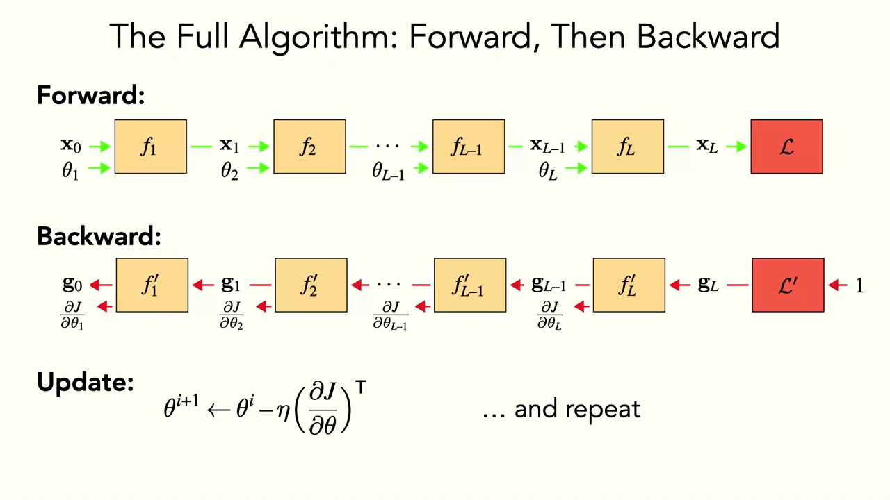
*▲ 강의 슬라이드 [41:35](https://youtu.be/vidCX_dMCu0?t=2495): 순방향 → 역방향 → 갱신 → 반복*

강사는 이후 슬라이드들을 구현할 때 다시 볼 "치트 시트"로 소개합니다. [층](00_%EB%94%A5%EB%9F%AC%EB%8B%9D_%EC%9A%A9%EC%96%B4%EC%82%AC%EC%A0%84.md#layer-%EC%B8%B5) $l$은 학습할 때 세 가지(이전 [층](00_%EB%94%A5%EB%9F%AC%EB%8B%9D_%EC%9A%A9%EC%96%B4%EC%82%AC%EC%A0%84.md#layer-%EC%B8%B5)의 출력 $x_{l-1}$, 다음 [층](00_%EB%94%A5%EB%9F%AC%EB%8B%9D_%EC%9A%A9%EC%96%B4%EC%82%AC%EC%A0%84.md#layer-%EC%B8%B5)에서 온 $\partial J/\partial x_l$, 현재 [파라미터](00_%EB%94%A5%EB%9F%AC%EB%8B%9D_%EC%9A%A9%EC%96%B4%EC%82%AC%EC%A0%84.md#parameter-%ED%8C%8C%EB%9D%BC%EB%AF%B8%ED%84%B0) $\theta_l$)를 받아 세 가지(출력 $x_l$, 이전 [층](00_%EB%94%A5%EB%9F%AC%EB%8B%9D_%EC%9A%A9%EC%96%B4%EC%82%AC%EC%A0%84.md#layer-%EC%B8%B5)으로 보낼 $\partial J / \partial x_{l-1}$, [파라미터](00_%EB%94%A5%EB%9F%AC%EB%8B%9D_%EC%9A%A9%EC%96%B4%EC%82%AC%EC%A0%84.md#parameter-%ED%8C%8C%EB%9D%BC%EB%AF%B8%ED%84%B0) 갱신량 $\partial J/\partial\theta_l$)를 냅니다.

**배치**: 실제로는 데이터 하나씩이 아니라 배치 단위로 합니다. 요즘 [GPU](00_%EB%94%A5%EB%9F%AC%EB%8B%9D_%EC%9A%A9%EC%96%B4%EC%82%AC%EC%A0%84.md#device-gpu-%EC%9E%A5%EC%B9%98%EC%99%80-gpu)에서는 배치가 수천 개일 수도 있습니다. 비용이 평균 $J = \frac{1}{N}\sum_i J_i$이므로, [미분](00_%EB%94%A5%EB%9F%AC%EB%8B%9D_%EC%9A%A9%EC%96%B4%EC%82%AC%EC%A0%84.md#derivative-%EB%AF%B8%EB%B6%84)이 합 안으로 들어가서 **전체 [기울기](00_%EB%94%A5%EB%9F%AC%EB%8B%9D_%EC%9A%A9%EC%96%B4%EC%82%AC%EC%A0%84.md#gradient-%EA%B8%B0%EC%9A%B8%EA%B8%B0)는 데이터별 [기울기](00_%EB%94%A5%EB%9F%AC%EB%8B%9D_%EC%9A%A9%EC%96%B4%EC%82%AC%EC%A0%84.md#gradient-%EA%B8%B0%EC%9A%B8%EA%B8%B0)의 평균**입니다.

$$
\frac{\partial J}{\partial \theta} = \frac{1}{N}\sum_{i=1}^{N}\frac{\partial J_i(x^i, \theta)}{\partial \theta}
$$

기호 풀이

| 기호 | 읽는 법 | 뜻 | 예제 값 |
| --- | --- | --- | --- |
| $\frac{\partial J}{\partial \theta}$ | 파셜 제이 파셜 세타 | 배치 전체 비용의 [기울기](00_%EB%94%A5%EB%9F%AC%EB%8B%9D_%EC%9A%A9%EC%96%B4%EC%82%AC%EC%A0%84.md#gradient-%EA%B8%B0%EC%9A%B8%EA%B8%B0) | −8 |
| $N$ | 엔 | 배치의 데이터 개수 | 3 |
| $\frac{1}{N}\sum_{i=1}^{N}$ | 엔분의 일 시그마 | N개 값의 평균 | −24 / 3 |
| $J_i(x^i, \theta)$ | 제이 아이 | 데이터 $x^i$ 하나의 비용 | $(\theta - x^i)^2$ |
| $x^i$ | 엑스 아이 | i번째 데이터 | 2, 4, 9 |

예제와 풀이

**문제**: 데이터 3개로 된 배치에서 데이터 하나의 비용이 $J_i = (\theta - x^i)^2$일 때, θ = 1에서 배치 전체의 [기울기](00_%EB%94%A5%EB%9F%AC%EB%8B%9D_%EC%9A%A9%EC%96%B4%EC%82%AC%EC%A0%84.md#gradient-%EA%B8%B0%EC%9A%B8%EA%B8%B0)는?

**주어진 값**:
- $x^1 = 2,\ x^2 = 4,\ x^3 = 9$ (배치의 데이터)
- $N = 3$ (배치 크기)
- $\theta = 1$ (지금 [파라미터](00_%EB%94%A5%EB%9F%AC%EB%8B%9D_%EC%9A%A9%EC%96%B4%EC%82%AC%EC%A0%84.md#parameter-%ED%8C%8C%EB%9D%BC%EB%AF%B8%ED%84%B0))
- $\frac{\partial J_i}{\partial \theta} = 2(\theta - x^i)$ (데이터 하나의 [기울기](00_%EB%94%A5%EB%9F%AC%EB%8B%9D_%EC%9A%A9%EC%96%B4%EC%82%AC%EC%A0%84.md#gradient-%EA%B8%B0%EC%9A%B8%EA%B8%B0))

**풀이**
1. 식을 그대로 쓴다: $\frac{\partial J}{\partial \theta} = \frac{1}{N}\sum_{i=1}^{N}\frac{\partial J_i(x^i, \theta)}{\partial \theta}$
2. 값을 대입한다 (Σ를 세 항으로 펼침): $\frac{\partial J}{\partial \theta} = \frac{1}{3}\big(2(1 - 2) + 2(1 - 4) + 2(1 - 9)\big)$
3. 괄호 안 뺄셈을 한다: $\frac{1}{3}\big(2 \times (-1) + 2 \times (-3) + 2 \times (-8)\big)$
4. 곱셈을 한다: $\frac{1}{3}\big((-2) + (-6) + (-16)\big)$
5. 더한다: $\frac{1}{3} \times (-24)$
6. 3으로 나눈다: $-8$

**답**: $\frac{\partial J}{\partial \theta} = -8$ (데이터별 [기울기](00_%EB%94%A5%EB%9F%AC%EB%8B%9D_%EC%9A%A9%EC%96%B4%EC%82%AC%EC%A0%84.md#gradient-%EA%B8%B0%EC%9A%B8%EA%B8%B0) −2, −6, −16의 평균)

내 이해

---

## 7. 선형층과 MLP의 역전파

### 7.1 선형층

▶ 영상 [44:44](https://youtu.be/vidCX_dMCu0?t=2684)

📐 **수학 개념**: [선형층과 ReLU의 역전파](%EC%88%98%ED%95%99%EA%B0%9C%EB%85%90/05_%EC%8B%A0%EA%B2%BD%EB%A7%9D%EC%9D%98_%EA%B3%84%EC%82%B0/MM10_%EC%84%A0%ED%98%95%EC%B8%B5%EA%B3%BC_ReLU%EC%9D%98_%EC%97%AD%EC%A0%84%ED%8C%8C.md) · [행렬 곱](%EC%88%98%ED%95%99%EA%B0%9C%EB%85%90/03_%EC%84%A0%ED%98%95%EB%8C%80%EC%88%98/M05_%EB%B2%A1%ED%84%B0%EC%99%80_%ED%96%89%EB%A0%AC.md) · [전치](%EC%88%98%ED%95%99%EA%B0%9C%EB%85%90/03_%EC%84%A0%ED%98%95%EB%8C%80%EC%88%98/MM03_%EB%B2%A1%ED%84%B0_%ED%91%9C%EA%B8%B0%EC%99%80_%EC%A0%84%EC%B9%98.md)

[선형층](00_%EB%94%A5%EB%9F%AC%EB%8B%9D_%EC%9A%A9%EC%96%B4%EC%82%AC%EC%A0%84.md#linear-layer-%EC%84%A0%ED%98%95%EC%B8%B5)에서는 모든 것이 아주 단순해집니다. [가중치](00_%EB%94%A5%EB%9F%AC%EB%8B%9D_%EC%9A%A9%EC%96%B4%EC%82%AC%EC%A0%84.md#weight-%EA%B0%80%EC%A4%91%EC%B9%98)가 행렬 $W$ 하나이기 때문입니다([편향](00_%EB%94%A5%EB%9F%AC%EB%8B%9D_%EC%9A%A9%EC%96%B4%EC%82%AC%EC%A0%84.md#bias-%ED%8E%B8%ED%96%A5)은 단순하게 하려고 뺐습니다).

| 방향 | 식 | 이유 |
|---|---|---|
| 순방향 | $x_{out} = W x_{in}$ | [행렬 곱](00_%EB%94%A5%EB%9F%AC%EB%8B%9D_%EC%9A%A9%EC%96%B4%EC%82%AC%EC%A0%84.md#matrix-multiplication-%ED%96%89%EB%A0%AC-%EA%B3%B1) |
| 입력으로 [역전파](00_%EB%94%A5%EB%9F%AC%EB%8B%9D_%EC%9A%A9%EC%96%B4%EC%82%AC%EC%A0%84.md#backpropagation-%EC%97%AD%EC%A0%84%ED%8C%8C) | $g_{in} = g_{out}\, W$ | $\partial x_{out,i} / \partial x_{in,j} = W_{ij}$이므로 $\mathbf{L}^x = W$ |
| [가중치](00_%EB%94%A5%EB%9F%AC%EB%8B%9D_%EC%9A%A9%EC%96%B4%EC%82%AC%EC%A0%84.md#weight-%EA%B0%80%EC%A4%91%EC%B9%98)로 [역전파](00_%EB%94%A5%EB%9F%AC%EB%8B%9D_%EC%9A%A9%EC%96%B4%EC%82%AC%EC%A0%84.md#backpropagation-%EC%97%AD%EC%A0%84%ED%8C%8C) | $\dfrac{\partial J}{\partial W} = x_{in}\, g_{out}$ | $W_{ij}$는 출력의 $i$번째 칸만 바꾸고, $\partial x_{out,i}/\partial W_{ij} = x_{in,j}$ |
| 갱신 | $W \leftarrow W - \eta \left(\dfrac{\partial J}{\partial W}\right)^\top$ | 경사하강 |

순방향과 역방향 모두 **[가중치](00_%EB%94%A5%EB%9F%AC%EB%8B%9D_%EC%9A%A9%EC%96%B4%EC%82%AC%EC%A0%84.md#weight-%EA%B0%80%EC%A4%91%EC%B9%98) 행렬을 곱할 뿐**이고 곱하는 순서만 다릅니다. [가중치](00_%EB%94%A5%EB%9F%AC%EB%8B%9D_%EC%9A%A9%EC%96%B4%EC%82%AC%EC%A0%84.md#weight-%EA%B0%80%EC%A4%91%EC%B9%98) 갱신량은 **입력과 출력 [기울기](00_%EB%94%A5%EB%9F%AC%EB%8B%9D_%EC%9A%A9%EC%96%B4%EC%82%AC%EC%A0%84.md#gradient-%EA%B8%B0%EC%9A%B8%EA%B8%B0)의 곱**입니다. (슬라이드의 갱신식은 $W^{k+1} \leftarrow W^k + \eta(\cdot)^\top$로 더하기로 적혀 있지만, 비용을 줄이려면 빼기가 맞습니다.)

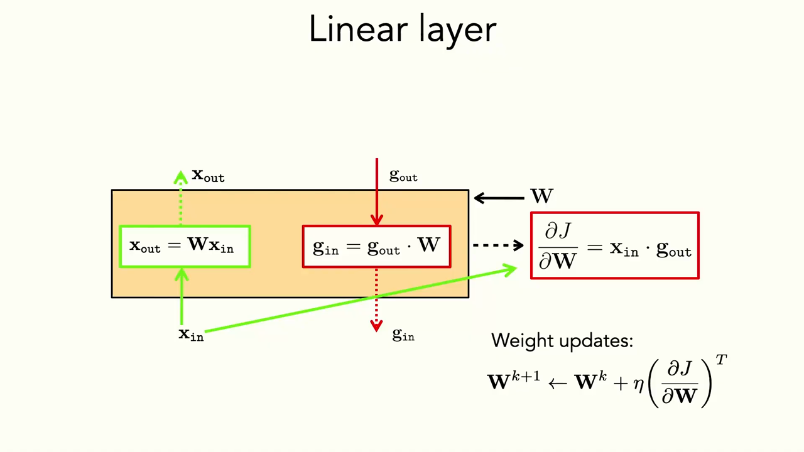
*▲ 강의 슬라이드 [49:05](https://youtu.be/vidCX_dMCu0?t=2945): [선형층](00_%EB%94%A5%EB%9F%AC%EB%8B%9D_%EC%9A%A9%EC%96%B4%EC%82%AC%EC%A0%84.md#linear-layer-%EC%84%A0%ED%98%95%EC%B8%B5) 치트 시트. 순방향 Wx_in, 역방향 g_out·W, [가중치](00_%EB%94%A5%EB%9F%AC%EB%8B%9D_%EC%9A%A9%EC%96%B4%EC%82%AC%EC%A0%84.md#weight-%EA%B0%80%EC%A4%91%EC%B9%98) [기울기](00_%EB%94%A5%EB%9F%AC%EB%8B%9D_%EC%9A%A9%EC%96%B4%EC%82%AC%EC%A0%84.md#gradient-%EA%B8%B0%EC%9A%B8%EA%B8%B0) x_in·g_out*

### 7.2 MLP와 ReLU 게이트

▶ 영상 [48:47](https://youtu.be/vidCX_dMCu0?t=2927)

📐 **수학 개념**: [선형층과 ReLU의 역전파](%EC%88%98%ED%95%99%EA%B0%9C%EB%85%90/05_%EC%8B%A0%EA%B2%BD%EB%A7%9D%EC%9D%98_%EA%B3%84%EC%82%B0/MM10_%EC%84%A0%ED%98%95%EC%B8%B5%EA%B3%BC_ReLU%EC%9D%98_%EC%97%AD%EC%A0%84%ED%8C%8C.md) · [ReLU의 미분](%EC%88%98%ED%95%99%EA%B0%9C%EB%85%90/05_%EC%8B%A0%EA%B2%BD%EB%A7%9D%EC%9D%98_%EA%B3%84%EC%82%B0/MM05_%ED%99%9C%EC%84%B1%ED%99%94_%ED%95%A8%EC%88%98%EC%9D%98_%EB%AF%B8%EB%B6%84.md) · [전치](%EC%88%98%ED%95%99%EA%B0%9C%EB%85%90/03_%EC%84%A0%ED%98%95%EB%8C%80%EC%88%98/MM03_%EB%B2%A1%ED%84%B0_%ED%91%9C%EA%B8%B0%EC%99%80_%EC%A0%84%EC%B9%98.md)

[선형층](00_%EB%94%A5%EB%9F%AC%EB%8B%9D_%EC%9A%A9%EC%96%B4%EC%82%AC%EC%A0%84.md#linear-layer-%EC%84%A0%ED%98%95%EC%B8%B5) → [ReLU](00_%EB%94%A5%EB%9F%AC%EB%8B%9D_%EC%9A%A9%EC%96%B4%EC%82%AC%EC%A0%84.md#relu-%EB%A0%90%EB%A3%A8) → [선형층](00_%EB%94%A5%EB%9F%AC%EB%8B%9D_%EC%9A%A9%EC%96%B4%EC%82%AC%EC%A0%84.md#linear-layer-%EC%84%A0%ED%98%95%EC%B8%B5) → L2 [손실](00_%EB%94%A5%EB%9F%AC%EB%8B%9D_%EC%9A%A9%EC%96%B4%EC%82%AC%EC%A0%84.md#loss-function-%EC%86%90%EC%8B%A4-%ED%95%A8%EC%88%98)로 된 MLP를 봅시다. 역방향을 보기 좋게 하려고 [기울기](00_%EB%94%A5%EB%9F%AC%EB%8B%9D_%EC%9A%A9%EC%96%B4%EC%82%AC%EC%A0%84.md#gradient-%EA%B8%B0%EC%9A%B8%EA%B8%B0)를 행벡터 대신 **전치한 열벡터**로 씁니다. $(AB)^\top = B^\top A^\top$에서

$$
g_{in}^\top = (g_{out} W)^\top = W^\top g_{out}^\top
$$

기호 풀이

| 기호 | 읽는 법 | 뜻 | 예제 값 |
| --- | --- | --- | --- |
| $g_{out}$ | 지 아웃 | [층](00_%EB%94%A5%EB%9F%AC%EB%8B%9D_%EC%9A%A9%EC%96%B4%EC%82%AC%EC%A0%84.md#layer-%EC%B8%B5) 출력 쪽 [기울기](00_%EB%94%A5%EB%9F%AC%EB%8B%9D_%EC%9A%A9%EC%96%B4%EC%82%AC%EC%A0%84.md#gradient-%EA%B8%B0%EC%9A%B8%EA%B8%B0) (행벡터) | (1, 3) |
| $g_{in}$ | 지 인 | [층](00_%EB%94%A5%EB%9F%AC%EB%8B%9D_%EC%9A%A9%EC%96%B4%EC%82%AC%EC%A0%84.md#layer-%EC%B8%B5) 입력 쪽으로 보낸 [기울기](00_%EB%94%A5%EB%9F%AC%EB%8B%9D_%EC%9A%A9%EC%96%B4%EC%82%AC%EC%A0%84.md#gradient-%EA%B8%B0%EC%9A%B8%EA%B8%B0) | (5, −3) |
| $W$ | 더블유 | [가중치](00_%EB%94%A5%EB%9F%AC%EB%8B%9D_%EC%9A%A9%EC%96%B4%EC%82%AC%EC%A0%84.md#weight-%EA%B0%80%EC%A4%91%EC%B9%98) 행렬 | 두 행 (2, 0), (1, −1) |
| $^\top$ | [전치](00_%EB%94%A5%EB%9F%AC%EB%8B%9D_%EC%9A%A9%EC%96%B4%EC%82%AC%EC%A0%84.md#transpose-%EC%A0%84%EC%B9%98) | [전치](00_%EB%94%A5%EB%9F%AC%EB%8B%9D_%EC%9A%A9%EC%96%B4%EC%82%AC%EC%A0%84.md#transpose-%EC%A0%84%EC%B9%98), 행과 열을 바꿈 | $W^\top$의 두 행 (2, 1), (0, −1) |

예제와 풀이

**문제**: [선형층](00_%EB%94%A5%EB%9F%AC%EB%8B%9D_%EC%9A%A9%EC%96%B4%EC%82%AC%EC%A0%84.md#linear-layer-%EC%84%A0%ED%98%95%EC%B8%B5)의 [가중치](00_%EB%94%A5%EB%9F%AC%EB%8B%9D_%EC%9A%A9%EC%96%B4%EC%82%AC%EC%A0%84.md#weight-%EA%B0%80%EC%A4%91%EC%B9%98) W와 출력 쪽 [기울기](00_%EB%94%A5%EB%9F%AC%EB%8B%9D_%EC%9A%A9%EC%96%B4%EC%82%AC%EC%A0%84.md#gradient-%EA%B8%B0%EC%9A%B8%EA%B8%B0) $g_{out}$이 주어질 때, 행벡터로 계산한 $(g_{out}W)^\top$과 열벡터로 계산한 $W^\top g_{out}^\top$이 같은지 확인하라.

**주어진 값**:
- $W = \begin{pmatrix} 2 & 0 \\ 1 & -1 \end{pmatrix}$ ([가중치](00_%EB%94%A5%EB%9F%AC%EB%8B%9D_%EC%9A%A9%EC%96%B4%EC%82%AC%EC%A0%84.md#weight-%EA%B0%80%EC%A4%91%EC%B9%98) 행렬)
- $g_{out} = (1,\ 3)$ ([층](00_%EB%94%A5%EB%9F%AC%EB%8B%9D_%EC%9A%A9%EC%96%B4%EC%82%AC%EC%A0%84.md#layer-%EC%B8%B5) 출력 쪽 [기울기](00_%EB%94%A5%EB%9F%AC%EB%8B%9D_%EC%9A%A9%EC%96%B4%EC%82%AC%EC%A0%84.md#gradient-%EA%B8%B0%EC%9A%B8%EA%B8%B0), 행벡터)

**풀이**
1. 식을 그대로 쓴다: $g_{in}^\top = (g_{out} W)^\top = W^\top g_{out}^\top$
2. 값을 대입한다: $g_{in}^\top = \left((1,\ 3)\begin{pmatrix} 2 & 0 \\ 1 & -1 \end{pmatrix}\right)^\top = \begin{pmatrix} 2 & 0 \\ 1 & -1 \end{pmatrix}^\top \begin{pmatrix} 1 \\ 3 \end{pmatrix}$
3. 가운데 식 1번째 칸: 행벡터와 1번째 열을 곱한다: $1 \times 2 = 2$, $3 \times 1 = 3$
4. 더한다: $2 + 3 = 5$
5. 가운데 식 2번째 칸: 2번째 열과 곱한다: $1 \times 0 = 0$, $3 \times (-1) = -3$
6. 더한다: $0 + (-3) = -3$. 그래서 $g_{out}W = (5, -3)$
7. 전치한다 (가로를 세로로 세움): $(5, -3)^\top = \begin{pmatrix} 5 \\ -3 \end{pmatrix}$
8. 오른쪽 식의 $W^\top$를 만든다 (행과 열을 바꿈): $W^\top = \begin{pmatrix} 2 & 1 \\ 0 & -1 \end{pmatrix}$
9. 오른쪽 식 1번째 칸: $W^\top$의 1행과 열벡터를 곱한다: $2 \times 1 = 2$, $1 \times 3 = 3$
10. 더한다: $2 + 3 = 5$
11. 오른쪽 식 2번째 칸: 2행과 곱한다: $0 \times 1 = 0$, $(-1) \times 3 = -3$
12. 더한다: $0 + (-3) = -3$

**답**: 두 방법 모두 $\begin{pmatrix} 5 \\ -3 \end{pmatrix}$ (가로로 쓰면 (5, −3)). 쓰는 방향만 다르고 값은 같다

내 이해

이 되므로, **[선형층](00_%EB%94%A5%EB%9F%AC%EB%8B%9D_%EC%9A%A9%EC%96%B4%EC%82%AC%EC%A0%84.md#linear-layer-%EC%84%A0%ED%98%95%EC%B8%B5)의 역방향은 [가중치](00_%EB%94%A5%EB%9F%AC%EB%8B%9D_%EC%9A%A9%EC%96%B4%EC%82%AC%EC%A0%84.md#weight-%EA%B0%80%EC%A4%91%EC%B9%98)를 전치한 순방향과 같은 연산**입니다.

- **[ReLU](00_%EB%94%A5%EB%9F%AC%EB%8B%9D_%EC%9A%A9%EC%96%B4%EC%82%AC%EC%A0%84.md#relu-%EB%A0%90%EB%A3%A8)는 역방향에서 [ReLU](00_%EB%94%A5%EB%9F%AC%EB%8B%9D_%EC%9A%A9%EC%96%B4%EC%82%AC%EC%A0%84.md#relu-%EB%A0%90%EB%A3%A8)가 아닙니다.** 순방향에서 받은 값(그림의 a, b, c)으로 만든 **대각 [게이트](00_%EB%94%A5%EB%9F%AC%EB%8B%9D_%EC%9A%A9%EC%96%B4%EC%82%AC%EC%A0%84.md#gate-%EA%B2%8C%EC%9D%B4%ED%8A%B8) 행렬** $H'$가 됩니다. 순방향에서 0 이하였던 칸은 0, 양수였던 칸은 1입니다. 순방향에서 꺼졌던 칸으로는 [기울기](00_%EB%94%A5%EB%9F%AC%EB%8B%9D_%EC%9A%A9%EC%96%B4%EC%82%AC%EC%A0%84.md#gradient-%EA%B8%B0%EC%9A%B8%EA%B8%B0)를 보내지 않습니다. 대각 행렬인 이유는 원소마다 따로 작용하기 때문입니다.
- 맨 위 L2 [손실](00_%EB%94%A5%EB%9F%AC%EB%8B%9D_%EC%9A%A9%EC%96%B4%EC%82%AC%EC%A0%84.md#loss-function-%EC%86%90%EC%8B%A4-%ED%95%A8%EC%88%98) $(\hat y - y)^2$에서 시작하는 [기울기](00_%EB%94%A5%EB%9F%AC%EB%8B%9D_%EC%9A%A9%EC%96%B4%EC%82%AC%EC%A0%84.md#gradient-%EA%B8%B0%EC%9A%B8%EA%B8%B0)는 $2(\hat y - y)$입니다.

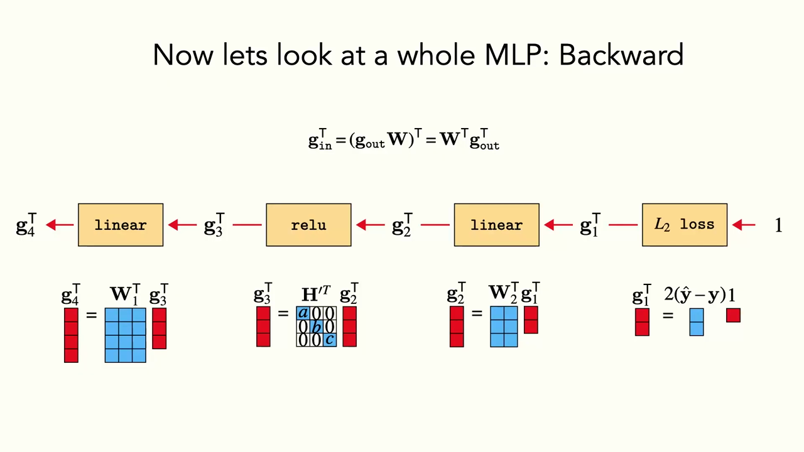
*▲ 강의 슬라이드 [52:20](https://youtu.be/vidCX_dMCu0?t=3140): MLP의 역방향. [선형층](00_%EB%94%A5%EB%9F%AC%EB%8B%9D_%EC%9A%A9%EC%96%B4%EC%82%AC%EC%A0%84.md#linear-layer-%EC%84%A0%ED%98%95%EC%B8%B5)은 Wᵀ, [ReLU](00_%EB%94%A5%EB%9F%AC%EB%8B%9D_%EC%9A%A9%EC%96%B4%EC%82%AC%EC%A0%84.md#relu-%EB%A0%90%EB%A3%A8)는 대각 [게이트](00_%EB%94%A5%EB%9F%AC%EB%8B%9D_%EC%9A%A9%EC%96%B4%EC%82%AC%EC%A0%84.md#gate-%EA%B2%8C%EC%9D%B4%ED%8A%B8) H′를 곱한다*

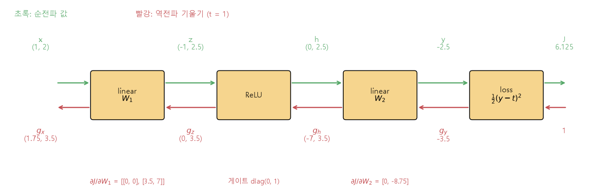
*▲ 직접 그린 그림: x = (1, 2), W₁의 두 행 (1, −1)과 (0.5, 1), W₂ = (2, −1), [정답](00_%EB%94%A5%EB%9F%AC%EB%8B%9D_%EC%9A%A9%EC%96%B4%EC%82%AC%EC%A0%84.md#label-%EC%A0%95%EB%8B%B5) t = 1인 2층 MLP의 [순전파](00_%EB%94%A5%EB%9F%AC%EB%8B%9D_%EC%9A%A9%EC%96%B4%EC%82%AC%EC%A0%84.md#feed-forward-%EC%88%9C%EC%A0%84%ED%8C%8C) 값(초록)과 [역전파](00_%EB%94%A5%EB%9F%AC%EB%8B%9D_%EC%9A%A9%EC%96%B4%EC%82%AC%EC%A0%84.md#backpropagation-%EC%97%AD%EC%A0%84%ED%8C%8C) [기울기](00_%EB%94%A5%EB%9F%AC%EB%8B%9D_%EC%9A%A9%EC%96%B4%EC%82%AC%EC%A0%84.md#gradient-%EA%B8%B0%EC%9A%B8%EA%B8%B0)(빨강). [ReLU](00_%EB%94%A5%EB%9F%AC%EB%8B%9D_%EC%9A%A9%EC%96%B4%EC%82%AC%EC%A0%84.md#relu-%EB%A0%90%EB%A3%A8) [게이트](00_%EB%94%A5%EB%9F%AC%EB%8B%9D_%EC%9A%A9%EC%96%B4%EC%82%AC%EC%A0%84.md#gate-%EA%B2%8C%EC%9D%B4%ED%8A%B8)가 첫 칸의 [기울기](00_%EB%94%A5%EB%9F%AC%EB%8B%9D_%EC%9A%A9%EC%96%B4%EC%82%AC%EC%A0%84.md#gradient-%EA%B8%B0%EC%9A%B8%EA%B8%B0)를 0으로 막는다. 계산은 [MM10_선형층과_ReLU의_역전파](%EC%88%98%ED%95%99%EA%B0%9C%EB%85%90/05_%EC%8B%A0%EA%B2%BD%EB%A7%9D%EC%9D%98_%EA%B3%84%EC%82%B0/MM10_%EC%84%A0%ED%98%95%EC%B8%B5%EA%B3%BC_ReLU%EC%9D%98_%EC%97%AD%EC%A0%84%ED%8C%8C.md)*

**역방향 계산은 선형입니다.** [ReLU](00_%EB%94%A5%EB%9F%AC%EB%8B%9D_%EC%9A%A9%EC%96%B4%EC%82%AC%EC%A0%84.md#relu-%EB%A0%90%EB%A3%A8)의 [게이트](00_%EB%94%A5%EB%9F%AC%EB%8B%9D_%EC%9A%A9%EC%96%B4%EC%82%AC%EC%A0%84.md#gate-%EA%B2%8C%EC%9D%B4%ED%8A%B8)도 고정된 [행렬 곱](00_%EB%94%A5%EB%9F%AC%EB%8B%9D_%EC%9A%A9%EC%96%B4%EC%82%AC%EC%A0%84.md#matrix-multiplication-%ED%96%89%EB%A0%AC-%EA%B3%B1)이므로, 역방향 전체가 커다란 선형 모델 하나입니다. 강사가 Phillip Isola 교수에게서 들은 직관: [손실 지형](00_%EB%94%A5%EB%9F%AC%EB%8B%9D_%EC%9A%A9%EC%96%B4%EC%82%AC%EC%A0%84.md#loss-landscape-%EC%86%90%EC%8B%A4-%EC%A7%80%ED%98%95)이 아무리 구불구불해도 1차 근사는 그 점에 **평면을 대고** 평면을 따라 움직이는 것이므로, 정의상 선형일 수밖에 없습니다.

질의응답: 순방향과 역방향은 대칭인가? [52:52](https://youtu.be/vidCX_dMCu0?t=3172)

- **질문**: 순방향만 할 때는 지나간 [층](00_%EB%94%A5%EB%9F%AC%EB%8B%9D_%EC%9A%A9%EC%96%B4%EC%82%AC%EC%A0%84.md#layer-%EC%B8%B5)의 값을 버려도 되지만, 역방향을 하려면 모든 [층](00_%EB%94%A5%EB%9F%AC%EB%8B%9D_%EC%9A%A9%EC%96%B4%EC%82%AC%EC%A0%84.md#layer-%EC%B8%B5)의 중간값을 메모리에 들고 있어야 하지 않나?
- **답**: 맞다. [역전파](00_%EB%94%A5%EB%9F%AC%EB%8B%9D_%EC%9A%A9%EC%96%B4%EC%82%AC%EC%A0%84.md#backpropagation-%EC%97%AD%EC%A0%84%ED%8C%8C)를 효율적으로 하려면 중간 표현(층마다의 입력, [ReLU](00_%EB%94%A5%EB%9F%AC%EB%8B%9D_%EC%9A%A9%EC%96%B4%EC%82%AC%EC%A0%84.md#relu-%EB%A0%90%EB%A3%A8)의 경우 어느 칸이 양수였는지)을 저장해야 한다. 정보가 흐르는 방향에도 비대칭이 있다.
- **[편향](00_%EB%94%A5%EB%9F%AC%EB%8B%9D_%EC%9A%A9%EC%96%B4%EC%82%AC%EC%A0%84.md#bias-%ED%8E%B8%ED%96%A5)은 왜 없나?** 직관을 보이려고 뺐을 뿐, 실제로는 곳곳에 [편향](00_%EB%94%A5%EB%9F%AC%EB%8B%9D_%EC%9A%A9%EC%96%B4%EC%82%AC%EC%A0%84.md#bias-%ED%8E%B8%ED%96%A5) 항이 있다.

---

## 8. DAG의 역전파

### 8.1 합치기와 가지치기

▶ 영상 [54:29](https://youtu.be/vidCX_dMCu0?t=3269)

📐 **수학 개념**: [가지의 기울기 합](%EC%88%98%ED%95%99%EA%B0%9C%EB%85%90/05_%EC%8B%A0%EA%B2%BD%EB%A7%9D%EC%9D%98_%EA%B3%84%EC%82%B0/MM10_%EC%84%A0%ED%98%95%EC%B8%B5%EA%B3%BC_ReLU%EC%9D%98_%EC%97%AD%EC%A0%84%ED%8C%8C.md) · [편미분](%EC%88%98%ED%95%99%EA%B0%9C%EB%85%90/02_%EB%AF%B8%EB%B6%84/M04_%ED%8E%B8%EB%AF%B8%EB%B6%84.md)

실제 모델은 사슬 모양만 있는 게 아닙니다. [가중치](00_%EB%94%A5%EB%9F%AC%EB%8B%9D_%EC%9A%A9%EC%96%B4%EC%82%AC%EC%A0%84.md#weight-%EA%B0%80%EC%A4%91%EC%B9%98)를 공유하거나, 여러 헤드에서 온 값을 이어 붙이거나(concatenation), 여러 목표로 나뉘기도 합니다. 사슬에 대한 [역전파](00_%EB%94%A5%EB%9F%AC%EB%8B%9D_%EC%9A%A9%EC%96%B4%EC%82%AC%EC%A0%84.md#backpropagation-%EC%97%AD%EC%A0%84%ED%8C%8C)를 **임의의 [DAG](00_%EB%94%A5%EB%9F%AC%EB%8B%9D_%EC%9A%A9%EC%96%B4%EC%82%AC%EC%A0%84.md#dag-directed-acyclic-graph-%EB%B0%A9%ED%96%A5%EC%84%B1-%EB%B9%84%EC%88%9C%ED%99%98-%EA%B7%B8%EB%9E%98%ED%94%84)**로 넓히는 데는 두 연산만 있으면 됩니다.

| 연산 | 순방향 | 역방향 |
|---|---|---|
| 합치기(merge) | $x^a$, $x^b$를 하나로 합침(덧셈, [이어 붙이기](00_%EB%94%A5%EB%9F%AC%EB%8B%9D_%EC%9A%A9%EC%96%B4%EC%82%AC%EC%A0%84.md#concatenate-stack-%EC%9D%B4%EC%96%B4-%EB%B6%99%EC%9D%B4%EA%B8%B0%EC%99%80-%EC%8C%93%EA%B8%B0) 등) | [기울기](00_%EB%94%A5%EB%9F%AC%EB%8B%9D_%EC%9A%A9%EC%96%B4%EC%82%AC%EC%A0%84.md#gradient-%EA%B8%B0%EC%9A%B8%EA%B8%B0) 중 **각 입력에 해당하는 부분**만 그 입력으로 보냄 |
| [가지치기](00_%EB%94%A5%EB%9F%AC%EB%8B%9D_%EC%9A%A9%EC%96%B4%EC%82%AC%EC%A0%84.md#pruning-%EA%B0%80%EC%A7%80%EC%B9%98%EA%B8%B0)(branch) | $x$를 $x^a = x$, $x^b = x$로 복제하거나 나눔 | 두 가지에서 온 [기울기](00_%EB%94%A5%EB%9F%AC%EB%8B%9D_%EC%9A%A9%EC%96%B4%EC%82%AC%EC%A0%84.md#gradient-%EA%B8%B0%EC%9A%B8%EA%B8%B0)를 **더해서** $x$로 보냄: $\sum_i \partial J / \partial x^i$ |

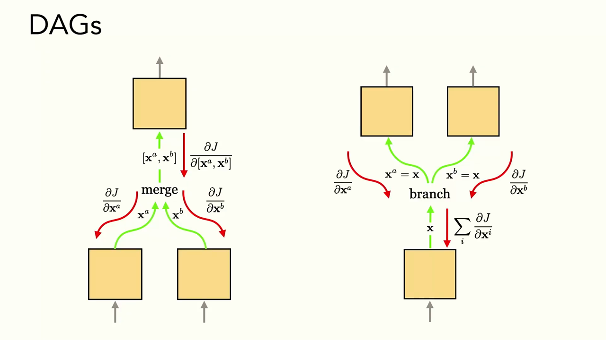
*▲ 강의 슬라이드 [56:25](https://youtu.be/vidCX_dMCu0?t=3385): 합치기는 [기울기](00_%EB%94%A5%EB%9F%AC%EB%8B%9D_%EC%9A%A9%EC%96%B4%EC%82%AC%EC%A0%84.md#gradient-%EA%B8%B0%EC%9A%B8%EA%B8%B0)를 나눠 보내고, [가지치기](00_%EB%94%A5%EB%9F%AC%EB%8B%9D_%EC%9A%A9%EC%96%B4%EC%82%AC%EC%A0%84.md#pruning-%EA%B0%80%EC%A7%80%EC%B9%98%EA%B8%B0)는 [기울기](00_%EB%94%A5%EB%9F%AC%EB%8B%9D_%EC%9A%A9%EC%96%B4%EC%82%AC%EC%A0%84.md#gradient-%EA%B8%B0%EC%9A%B8%EA%B8%B0)를 더한다*

### 8.2 파라미터 공유

▶ 영상 [56:42](https://youtu.be/vidCX_dMCu0?t=3402)

📐 **수학 개념**: [가지의 기울기 합](%EC%88%98%ED%95%99%EA%B0%9C%EB%85%90/05_%EC%8B%A0%EA%B2%BD%EB%A7%9D%EC%9D%98_%EA%B3%84%EC%82%B0/MM10_%EC%84%A0%ED%98%95%EC%B8%B5%EA%B3%BC_ReLU%EC%9D%98_%EC%97%AD%EC%A0%84%ED%8C%8C.md)

사슬의 각 블록이 자기 [파라미터](00_%EB%94%A5%EB%9F%AC%EB%8B%9D_%EC%9A%A9%EC%96%B4%EC%82%AC%EC%A0%84.md#parameter-%ED%8C%8C%EB%9D%BC%EB%AF%B8%ED%84%B0) $\theta_1, \theta_2, \theta_3$를 갖는 대신 **같은 $\theta$를 공유**할 수도 있습니다(예: ImageNet으로 미리 학습한 [파라미터](00_%EB%94%A5%EB%9F%AC%EB%8B%9D_%EC%9A%A9%EC%96%B4%EC%82%AC%EC%A0%84.md#parameter-%ED%8C%8C%EB%9D%BC%EB%AF%B8%ED%84%B0)를 망의 여러 곳에서 재사용). 그림을 옆으로 눕혀 보면 하나의 $\theta$가 여러 곳으로 갈라지는 **[가지치기](00_%EB%94%A5%EB%9F%AC%EB%8B%9D_%EC%9A%A9%EC%96%B4%EC%82%AC%EC%A0%84.md#pruning-%EA%B0%80%EC%A7%80%EC%B9%98%EA%B8%B0)**입니다. 따라서 공유 [파라미터](00_%EB%94%A5%EB%9F%AC%EB%8B%9D_%EC%9A%A9%EC%96%B4%EC%82%AC%EC%A0%84.md#parameter-%ED%8C%8C%EB%9D%BC%EB%AF%B8%ED%84%B0)의 [기울기](00_%EB%94%A5%EB%9F%AC%EB%8B%9D_%EC%9A%A9%EC%96%B4%EC%82%AC%EC%A0%84.md#gradient-%EA%B8%B0%EC%9A%B8%EA%B8%B0)는 쓰인 곳마다의 [기울기](00_%EB%94%A5%EB%9F%AC%EB%8B%9D_%EC%9A%A9%EC%96%B4%EC%82%AC%EC%A0%84.md#gradient-%EA%B8%B0%EC%9A%B8%EA%B8%B0)를 **모두 더한 것**입니다. [CNN](00_%EB%94%A5%EB%9F%AC%EB%8B%9D_%EC%9A%A9%EC%96%B4%EC%82%AC%EC%A0%84.md#cnn-convolutional-neural-network-%ED%95%A9%EC%84%B1%EA%B3%B1-%EC%8B%A0%EA%B2%BD%EB%A7%9D)의 [가중치 공유](00_%EB%94%A5%EB%9F%AC%EB%8B%9D_%EC%9A%A9%EC%96%B4%EC%82%AC%EC%A0%84.md#weight-sharing-%EA%B0%80%EC%A4%91%EC%B9%98-%EA%B3%B5%EC%9C%A0)도 같은 원리입니다.

---

## 9. 미분 가능 프로그래밍

### 9.1 블록으로 짜는 프로그램

▶ 영상 [57:15](https://youtu.be/vidCX_dMCu0?t=3435)

📐 **수학 개념**: [합성함수](%EC%88%98%ED%95%99%EA%B0%9C%EB%85%90/05_%EC%8B%A0%EA%B2%BD%EB%A7%9D%EC%9D%98_%EA%B3%84%EC%82%B0/MM06_%ED%95%A9%EC%84%B1%ED%95%A8%EC%88%98%EC%99%80_%EB%B9%84%EC%84%A0%ED%98%95%EC%84%B1.md)

보통 딥러닝은 망([DAG](00_%EB%94%A5%EB%9F%AC%EB%8B%9D_%EC%9A%A9%EC%96%B4%EC%82%AC%EC%A0%84.md#dag-directed-acyclic-graph-%EB%B0%A9%ED%96%A5%EC%84%B1-%EB%B9%84%EC%88%9C%ED%99%98-%EA%B7%B8%EB%9E%98%ED%94%84))을 정하고 그 위에서 순방향·역방향을 정의하는 것으로 봅니다. [미분 가능 프로그래밍](00_%EB%94%A5%EB%9F%AC%EB%8B%9D_%EC%9A%A9%EC%96%B4%EC%82%AC%EC%A0%84.md#differentiable-programming-%EB%AF%B8%EB%B6%84-%EA%B0%80%EB%8A%A5-%ED%94%84%EB%A1%9C%EA%B7%B8%EB%9E%98%EB%B0%8D)은 같은 관점에서 **모델 자체를 프로그래밍**하는 것이고, [PyTorch](00_%EB%94%A5%EB%9F%AC%EB%8B%9D_%EC%9A%A9%EC%96%B4%EC%82%AC%EC%A0%84.md#pytorch-%ED%8C%8C%EC%9D%B4%ED%86%A0%EC%B9%98), TensorFlow, JAX가 이를 효율적으로 하게 해 주는 라이브러리입니다.

깊은 망이 인기 있는 이유는 두 가지입니다.

1. **최적화가 쉽다**: 모든 것이 [미분](00_%EB%94%A5%EB%9F%AC%EB%8B%9D_%EC%9A%A9%EC%96%B4%EC%82%AC%EC%A0%84.md#derivative-%EB%AF%B8%EB%B6%84) 가능하다.
2. **조합할 수 있다**: 블록을 쌓는 프로그래밍과 같다.

이런 성질을 가진 일반 모델을 부르는 말로 "[미분 가능 프로그래밍](00_%EB%94%A5%EB%9F%AC%EB%8B%9D_%EC%9A%A9%EC%96%B4%EC%82%AC%EC%A0%84.md#differentiable-programming-%EB%AF%B8%EB%B6%84-%EA%B0%80%EB%8A%A5-%ED%94%84%EB%A1%9C%EA%B7%B8%EB%9E%98%EB%B0%8D)"이 떠올랐습니다. Yann LeCun은 "딥러닝이라는 유행어는 수명이 다했고, [미분 가능 프로그래밍](00_%EB%94%A5%EB%9F%AC%EB%8B%9D_%EC%9A%A9%EC%96%B4%EC%82%AC%EC%A0%84.md#differentiable-programming-%EB%AF%B8%EB%B6%84-%EA%B0%80%EB%8A%A5-%ED%94%84%EB%A1%9C%EA%B7%B8%EB%9E%98%EB%B0%8D) 만세"라는 취지의 글을 올렸고, Thomas Dietterich는 이것을 새로운 프로그래밍 방식으로 보며 [합성곱](00_%EB%94%A5%EB%9F%AC%EB%8B%9D_%EC%9A%A9%EC%96%B4%EC%82%AC%EC%A0%84.md#convolution-%ED%95%A9%EC%84%B1%EA%B3%B1), 풀링, [LSTM](00_%EB%94%A5%EB%9F%AC%EB%8B%9D_%EC%9A%A9%EC%96%B4%EC%82%AC%EC%A0%84.md#lstm-long-short-term-memory-%EC%9E%A5%EB%8B%A8%EA%B8%B0-%EB%A9%94%EB%AA%A8%EB%A6%AC), [GAN](00_%EB%94%A5%EB%9F%AC%EB%8B%9D_%EC%9A%A9%EC%96%B4%EC%82%AC%EC%A0%84.md#gan-generative-adversarial-network-%EC%83%9D%EC%84%B1%EC%A0%81-%EC%A0%81%EB%8C%80-%EC%8B%A0%EA%B2%BD%EB%A7%9D), [VAE](00_%EB%94%A5%EB%9F%AC%EB%8B%9D_%EC%9A%A9%EC%96%B4%EC%82%AC%EC%A0%84.md#variational-autoencoder-vae-%EB%B3%80%EB%B6%84-%EC%98%A4%ED%86%A0%EC%9D%B8%EC%BD%94%EB%8D%94), 메모리·라우팅 유닛 같은 재사용 가능한 구성 요소를 찾아 가는 중이라고 했습니다.

- **Neural [Module](00_%EB%94%A5%EB%9F%AC%EB%8B%9D_%EC%9A%A9%EC%96%B4%EC%82%AC%EC%A0%84.md#module-modular-norm-%EB%AA%A8%EB%93%88%EA%B3%BC-%EB%AA%A8%EB%93%88%EB%9F%AC-%EB%85%B8%EB%A6%84) Networks(2017)**: "개는 어디 있나?" 같은 질문을 파서가 처리하고(학습하지 않는 고정 모듈), 이미지 쪽 [CNN](00_%EB%94%A5%EB%9F%AC%EB%8B%9D_%EC%9A%A9%EC%96%B4%EC%82%AC%EC%A0%84.md#cnn-convolutional-neural-network-%ED%95%A9%EC%84%B1%EA%B3%B1-%EC%8B%A0%EA%B2%BD%EB%A7%9D)은 [학습 데이터](00_%EB%94%A5%EB%9F%AC%EB%8B%9D_%EC%9A%A9%EC%96%B4%EC%82%AC%EC%A0%84.md#training-data-test-data-%ED%95%99%EC%8A%B5-%EB%8D%B0%EC%9D%B4%ED%84%B0%EC%99%80-%EC%8B%9C%ED%97%98-%EB%8D%B0%EC%9D%B4%ED%84%B0)로 갱신되는 식으로 학습하는 부분과 고정된 부분이 섞인 모델.
- **Software 2.0(Andrej Karpathy)**: Software 1.0은 사람이 모든 것을 정의한 프로그램 공간의 한 점이고, Software 2.0은 가능한 프로그램의 **공간**을 정의한 뒤 그 안에서 최적화로 필요한 프로그램을 찾는 것.

### 9.2 사람이 짠 부분과 학습한 부분

▶ 영상 [60:32](https://youtu.be/vidCX_dMCu0?t=3632)

📐 **수학 개념**: [편미분](%EC%88%98%ED%95%99%EA%B0%9C%EB%85%90/02_%EB%AF%B8%EB%B6%84/M04_%ED%8E%B8%EB%AF%B8%EB%B6%84.md) · [그래디언트](%EC%88%98%ED%95%99%EA%B0%9C%EB%85%90/02_%EB%AF%B8%EB%B6%84/MM02_%EA%B7%B8%EB%9E%98%EB%94%94%EC%96%B8%ED%8A%B8_%EB%B2%A1%ED%84%B0.md)

시스템의 일부는 사람이 직접 짜고(예: 자연 이미지의 [정규화](00_%EB%94%A5%EB%9F%AC%EB%8B%9D_%EC%9A%A9%EC%96%B4%EC%82%AC%EC%A0%84.md#normalization-%EC%A0%95%EA%B7%9C%ED%99%94) 값을 [전처리](00_%EB%94%A5%EB%9F%AC%EB%8B%9D_%EC%9A%A9%EC%96%B4%EC%82%AC%EC%A0%84.md#preconditioning-%EC%A0%84%EC%B2%98%EB%A6%AC)에 박아 둠) 나머지는 [역전파](00_%EB%94%A5%EB%9F%AC%EB%8B%9D_%EC%9A%A9%EC%96%B4%EC%82%AC%EC%A0%84.md#backpropagation-%EC%97%AD%EC%A0%84%ED%8C%8C)로 "프로그래밍"됩니다([학습](00_%EB%94%A5%EB%9F%AC%EB%8B%9D_%EC%9A%A9%EC%96%B4%EC%82%AC%EC%A0%84.md#training-%ED%95%99%EC%8A%B5) 예제에 맞게 동작을 조정). 모든 조각이 [미분](00_%EB%94%A5%EB%9F%AC%EB%8B%9D_%EC%9A%A9%EC%96%B4%EC%82%AC%EC%A0%84.md#derivative-%EB%AF%B8%EB%B6%84) 가능하다고 가정하므로, **어떤 노드(함수)나 간선(변수)이든 어떤 스칼라 비용에 대해서든** 최적화할 수 있습니다. [가중치](00_%EB%94%A5%EB%9F%AC%EB%8B%9D_%EC%9A%A9%EC%96%B4%EC%82%AC%EC%A0%84.md#weight-%EA%B0%80%EC%A4%91%EC%B9%98)에 대해서만이 아니라 입력 데이터가 바뀔 때 비용이 어떻게 변하는지도 볼 수 있습니다.

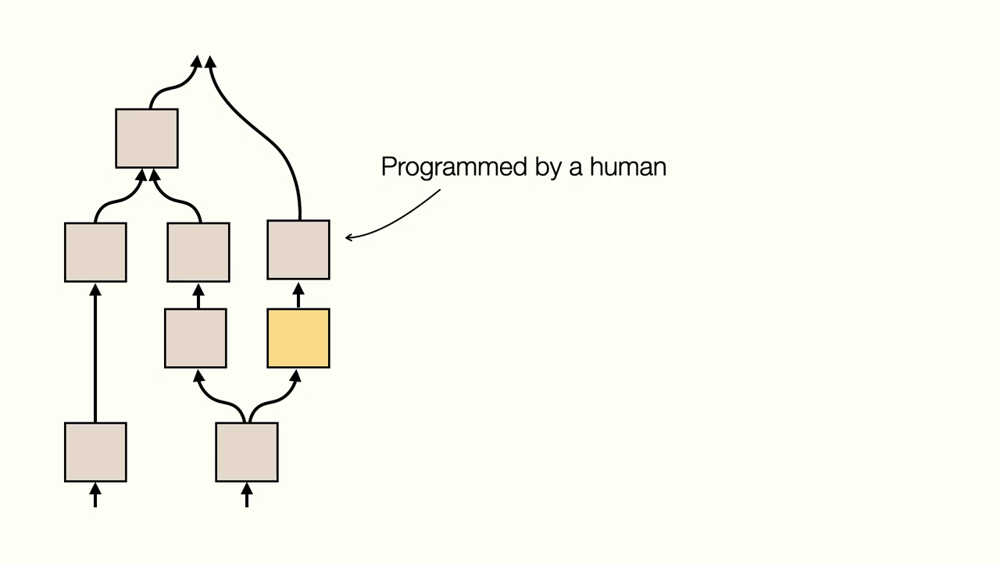
*▲ 강의 슬라이드 [61:00](https://youtu.be/vidCX_dMCu0?t=3660): 일부 노드(노란색)는 사람이 직접 짠 것*

질의응답: 무엇을 사람이 정하고 무엇을 학습시킬까? [62:11](https://youtu.be/vidCX_dMCu0?t=3731)

- 응용마다 실험으로 알아낸다. 사람이 짠 부분은 시스템에 **제약**을 거는 것이고, 그 제약은 도움이 될 수도 해가 될 수도 있다.
- 강사가 처음 연구할 때는 사람이 특징을 설계하는 **[특징 공학](00_%EB%94%A5%EB%9F%AC%EB%8B%9D_%EC%9A%A9%EC%96%B4%EC%82%AC%EC%A0%84.md#feature-engineering-%ED%8A%B9%EC%A7%95-%EA%B3%B5%ED%95%99)(feature engineering)** 후 아주 단순한 모델(SVM 등)을 쓰는 방식이 많았다. 결국 사람이 만든 [병목](00_%EB%94%A5%EB%9F%AC%EB%8B%9D_%EC%9A%A9%EC%96%B4%EC%82%AC%EC%A0%84.md#bottleneck-%EB%B3%91%EB%AA%A9)보다, 크고 복잡한 모델을 끝에서 끝까지(end-to-end) 학습하는 쪽이 더 좋았다.
- 무엇을 최적화할지는 결국 [비용 함수](00_%EB%94%A5%EB%9F%AC%EB%8B%9D_%EC%9A%A9%EC%96%B4%EC%82%AC%EC%A0%84.md#cost-function-%EB%B9%84%EC%9A%A9-%ED%95%A8%EC%88%98)(그림의 빨간 칸)를 어떻게 정의하느냐에 달렸다.

### 9.3 파라미터 최적화와 입력 최적화

▶ 영상 [63:18](https://youtu.be/vidCX_dMCu0?t=3798)

📐 **수학 개념**: [argmax](%EC%88%98%ED%95%99%EA%B0%9C%EB%85%90/02_%EB%AF%B8%EB%B6%84/MM01_argmin%EA%B3%BC_argmax.md) · [그래디언트 상승](%EC%88%98%ED%95%99%EA%B0%9C%EB%85%90/02_%EB%AF%B8%EB%B6%84/MM02_%EA%B7%B8%EB%9E%98%EB%94%94%EC%96%B8%ED%8A%B8_%EB%B2%A1%ED%84%B0.md) · [로그(소프트맥스와 로짓)](%EC%88%98%ED%95%99%EA%B0%9C%EB%85%90/01_%EC%88%98%EC%99%80_%ED%95%A8%EC%88%98/M07_%EB%A1%9C%EA%B7%B8.md)

보통은 **[파라미터](00_%EB%94%A5%EB%9F%AC%EB%8B%9D_%EC%9A%A9%EC%96%B4%EC%82%AC%EC%A0%84.md#parameter-%ED%8C%8C%EB%9D%BC%EB%AF%B8%ED%84%B0)**를 바꿀 때 전체 비용이 얼마나 변하는지($\partial J / \partial \theta$)를 봅니다. 반대로 [파라미터](00_%EB%94%A5%EB%9F%AC%EB%8B%9D_%EC%9A%A9%EC%96%B4%EC%82%AC%EC%A0%84.md#parameter-%ED%8C%8C%EB%9D%BC%EB%AF%B8%ED%84%B0)를 고정하고 **입력**을 최적화할 수도 있습니다. 예를 들어 입력 픽셀을 바꿀 때 "카멜레온" 점수가 얼마나 오르는지($\partial y_j / \partial x$)를 봅니다.

- [소프트맥스](00_%EB%94%A5%EB%9F%AC%EB%8B%9D_%EC%9A%A9%EC%96%B4%EC%82%AC%EC%A0%84.md#softmax-%EC%86%8C%ED%94%84%ED%8A%B8%EB%A7%A5%EC%8A%A4) **뒤의 [확률](00_%EB%94%A5%EB%9F%AC%EB%8B%9D_%EC%9A%A9%EC%96%B4%EC%82%AC%EC%A0%84.md#probability-%ED%99%95%EB%A5%A0)**을 최대로 만들려 하면, 원하는 클래스를 키우기보다 **다른 클래스를 낮추는** 쪽이 가장 쉬운 길이 되곤 합니다. [소프트맥스](00_%EB%94%A5%EB%9F%AC%EB%8B%9D_%EC%9A%A9%EC%96%B4%EC%82%AC%EC%A0%84.md#softmax-%EC%86%8C%ED%94%84%ED%8A%B8%EB%A7%A5%EC%8A%A4) **앞의 [로짓](00_%EB%94%A5%EB%9F%AC%EB%8B%9D_%EC%9A%A9%EC%96%B4%EC%82%AC%EC%A0%84.md#logit-%EB%A1%9C%EC%A7%93)** 을 최적화하는 편이 더 안정적입니다.
- **[특징 시각화(Feature visualization)](00_%EB%94%A5%EB%9F%AC%EB%8B%9D_%EC%9A%A9%EC%96%B4%EC%82%AC%EC%A0%84.md#feature-visualization-%ED%8A%B9%EC%A7%95-%EC%8B%9C%EA%B0%81%ED%99%94)**: "고양이" 출력 뉴런을 최대로 만드는 이미지를 찾으면, 학습된 모델이 가장 고양이답다고 여기는 모습이 나옵니다. [층](00_%EB%94%A5%EB%9F%AC%EB%8B%9D_%EC%9A%A9%EC%96%B4%EC%82%AC%EC%A0%84.md#layer-%EC%B8%B5) $l$의 뉴런 $j$를 최대로 만드는 이미지를 찾으면 그 뉴런이 무엇을 찾는지 엿볼 수 있습니다. [규제](00_%EB%94%A5%EB%9F%AC%EB%8B%9D_%EC%9A%A9%EC%96%B4%EC%82%AC%EC%A0%84.md#regularization-%EA%B7%9C%EC%A0%9C) 항 $R(x)$를 더해 그래디언트 **상승**으로 갱신합니다(Distill, 2017). 이 생각을 발전시킨 것이 DeepDream입니다.

$$
\arg\max_x\ h_{l_j}(x) + \lambda R(x), \qquad x^{k+1} \leftarrow x^k + \eta \frac{\partial\big(h_{l_j}(x) + \lambda R(x)\big)}{\partial x}\bigg|_{x = x^k}
$$

기호 풀이

| 기호 | 읽는 법 | 뜻 | 예제 값 |
| --- | --- | --- | --- |
| $x$ | 엑스 | 최적화할 입력 (이미지) | $x^k = 0.5$ |
| $h_{l_j}(x)$ | 에이치 엘 제이 | [층](00_%EB%94%A5%EB%9F%AC%EB%8B%9D_%EC%9A%A9%EC%96%B4%EC%82%AC%EC%A0%84.md#layer-%EC%B8%B5) l의 뉴런 j가 내는 값 | $4x - x^2$ |
| $\lambda$ | 람다 | [규제](00_%EB%94%A5%EB%9F%AC%EB%8B%9D_%EC%9A%A9%EC%96%B4%EC%82%AC%EC%A0%84.md#regularization-%EA%B7%9C%EC%A0%9C) 세기 | 1 |
| $R(x)$ | 알 엑스 | 입력이 자연스러운지 재는 [규제](00_%EB%94%A5%EB%9F%AC%EB%8B%9D_%EC%9A%A9%EC%96%B4%EC%82%AC%EC%A0%84.md#regularization-%EA%B7%9C%EC%A0%9C) 항 | $-x^2$ |
| $\arg\max_x$ | 아그맥스 엑스 | 값을 가장 크게 만드는 x | 1 |
| $\eta$ | 에타 | 한 걸음의 크기 | 0.1 |
| $\left.\cdot\right\|_{x = x^k}$ | 엑스가 엑스 케이일 때 | 지금 x에서 잰 도함수 값 | 2 |

예제와 풀이

**문제**: 뉴런 값 $h(x) = 4x - x^2$을 키우되 [규제](00_%EB%94%A5%EB%9F%AC%EB%8B%9D_%EC%9A%A9%EC%96%B4%EC%82%AC%EC%A0%84.md#regularization-%EA%B7%9C%EC%A0%9C) $R(x) = -x^2$으로 x가 너무 커지지 않게 할 때, x = 0.5에서 그래디언트 상승을 한 번 하면 새 x는?

**주어진 값**:
- $x^k = 0.5$ (지금 입력)
- $\lambda = 1$ ([규제](00_%EB%94%A5%EB%9F%AC%EB%8B%9D_%EC%9A%A9%EC%96%B4%EC%82%AC%EC%A0%84.md#regularization-%EA%B7%9C%EC%A0%9C) 세기)
- $\eta = 0.1$ (한 걸음의 크기)
- $\frac{\partial h}{\partial x} = 4 - 2x$ (뉴런 값의 도함수)
- $\frac{\partial R}{\partial x} = -2x$ ([규제](00_%EB%94%A5%EB%9F%AC%EB%8B%9D_%EC%9A%A9%EC%96%B4%EC%82%AC%EC%A0%84.md#regularization-%EA%B7%9C%EC%A0%9C) 항의 도함수)

**풀이**
1. 식을 그대로 쓴다: $x^{k+1} \leftarrow x^k + \eta \frac{\partial\big(h_{l_j}(x) + \lambda R(x)\big)}{\partial x}\bigg|_{x = x^k}$
2. 값을 대입한다 (도함수를 두 항으로 펼침): $x^{k+1} = 0.5 + 0.1 \times \big((4 - 2 \times 0.5) + 1 \times (-2 \times 0.5)\big)$
3. 괄호 안 곱셈을 한다: $2 \times 0.5 = 1$, $-2 \times 0.5 = -1$ 이므로 $0.5 + 0.1 \times \big((4 - 1) + 1 \times (-1)\big)$
4. 뺄셈과 λ 곱셈을 한다: $4 - 1 = 3$, $1 \times (-1) = -1$ 이므로 $0.5 + 0.1 \times (3 + (-1))$
5. 더한다: $3 + (-1) = 2$ 이므로 $0.5 + 0.1 \times 2$
6. 걸음 크기를 곱한다: $0.1 \times 2 = 0.2$
7. 상승이라 더한다: $x^{k+1} = 0.5 + 0.2 = 0.7$
8. 참고: 전체 도함수 $4 - 4x$가 0이 되는 $x = 1$이 [argmax](00_%EB%94%A5%EB%9F%AC%EB%8B%9D_%EC%9A%A9%EC%96%B4%EC%82%AC%EC%A0%84.md#argmax-%EC%B5%9C%EB%8C%93%EA%B0%92-%EC%9C%84%EC%B9%98)라, x가 그쪽으로 다가갔다

**답**: $x^{k+1} = 0.7$

내 이해

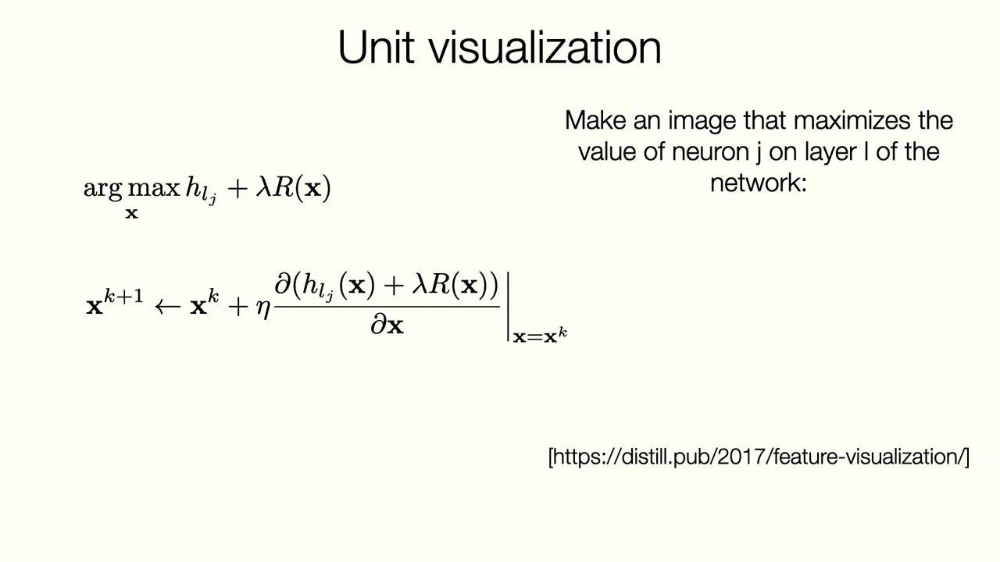
*▲ 강의 슬라이드 [65:25](https://youtu.be/vidCX_dMCu0?t=3925): [층](00_%EB%94%A5%EB%9F%AC%EB%8B%9D_%EC%9A%A9%EC%96%B4%EC%82%AC%EC%A0%84.md#layer-%EC%B8%B5) l의 뉴런 j를 최대로 만드는 입력 이미지를 그래디언트 상승으로 찾는다*

**[CLIP](00_%EB%94%A5%EB%9F%AC%EB%8B%9D_%EC%9A%A9%EC%96%B4%EC%82%AC%EC%A0%84.md#clip-%ED%81%B4%EB%A6%BD) + [GAN](00_%EB%94%A5%EB%9F%AC%EB%8B%9D_%EC%9A%A9%EC%96%B4%EC%82%AC%EC%A0%84.md#gan-generative-adversarial-network-%EC%83%9D%EC%84%B1%EC%A0%81-%EC%A0%81%EB%8C%80-%EC%8B%A0%EA%B2%BD%EB%A7%9D)**: [CLIP](00_%EB%94%A5%EB%9F%AC%EB%8B%9D_%EC%9A%A9%EC%96%B4%EC%82%AC%EC%A0%84.md#clip-%ED%81%B4%EB%A6%BD)은 글과 이미지를 같은 [임베딩](00_%EB%94%A5%EB%9F%AC%EB%8B%9D_%EC%9A%A9%EC%96%B4%EC%82%AC%EC%A0%84.md#embedding-%EC%9E%84%EB%B2%A0%EB%94%A9) 공간에 넣어 뜻이 비슷한 글과 이미지가 가까이 오도록 학습한 모델입니다. [학습](00_%EB%94%A5%EB%9F%AC%EB%8B%9D_%EC%9A%A9%EC%96%B4%EC%82%AC%EC%A0%84.md#training-%ED%95%99%EC%8A%B5)이 끝난 [CLIP](00_%EB%94%A5%EB%9F%AC%EB%8B%9D_%EC%9A%A9%EC%96%B4%EC%82%AC%EC%A0%84.md#clip-%ED%81%B4%EB%A6%BD)의 글 인코더·이미지 인코더와 이미지 [생성기](00_%EB%94%A5%EB%9F%AC%EB%8B%9D_%EC%9A%A9%EC%96%B4%EC%82%AC%EC%A0%84.md#generator-discriminator-%EC%83%9D%EC%84%B1%EA%B8%B0%EC%99%80-%ED%8C%90%EB%B3%84%EA%B8%B0)([GAN](00_%EB%94%A5%EB%9F%AC%EB%8B%9D_%EC%9A%A9%EC%96%B4%EC%82%AC%EC%A0%84.md#gan-generative-adversarial-network-%EC%83%9D%EC%84%B1%EC%A0%81-%EC%A0%81%EB%8C%80-%EC%8B%A0%EA%B2%BD%EB%A7%9D))를 모두 **고정**하고, [생성기](00_%EB%94%A5%EB%9F%AC%EB%8B%9D_%EC%9A%A9%EC%96%B4%EC%82%AC%EC%A0%84.md#generator-discriminator-%EC%83%9D%EC%84%B1%EA%B8%B0%EC%99%80-%ED%8C%90%EB%B3%84%EA%B8%B0)에 들어가는 입력 $z$ 하나만 최적화합니다. 생성된 이미지의 [임베딩](00_%EB%94%A5%EB%9F%AC%EB%8B%9D_%EC%9A%A9%EC%96%B4%EC%82%AC%EC%A0%84.md#embedding-%EC%9E%84%EB%B2%A0%EB%94%A9) $e_2$와 글의 [임베딩](00_%EB%94%A5%EB%9F%AC%EB%8B%9D_%EC%9A%A9%EC%96%B4%EC%82%AC%EC%A0%84.md#embedding-%EC%9E%84%EB%B2%A0%EB%94%A9) $e_1$의 [내적](00_%EB%94%A5%EB%9F%AC%EB%8B%9D_%EC%9A%A9%EC%96%B4%EC%82%AC%EC%A0%84.md#dot-product-%EB%82%B4%EC%A0%81) $e_1 \cdot e_2$가 최대가 되도록 $z$를 고치면, 글에서 이미지를 만들 수 있습니다. [파라미터](00_%EB%94%A5%EB%9F%AC%EB%8B%9D_%EC%9A%A9%EC%96%B4%EC%82%AC%EC%A0%84.md#parameter-%ED%8C%8C%EB%9D%BC%EB%AF%B8%ED%84%B0)는 모두 고정이지만 [기울기](00_%EB%94%A5%EB%9F%AC%EB%8B%9D_%EC%9A%A9%EC%96%B4%EC%82%AC%EC%A0%84.md#gradient-%EA%B8%B0%EC%9A%B8%EA%B8%B0)는 이 모델들을 거꾸로 통과해 $z$까지 전달되어야 합니다.

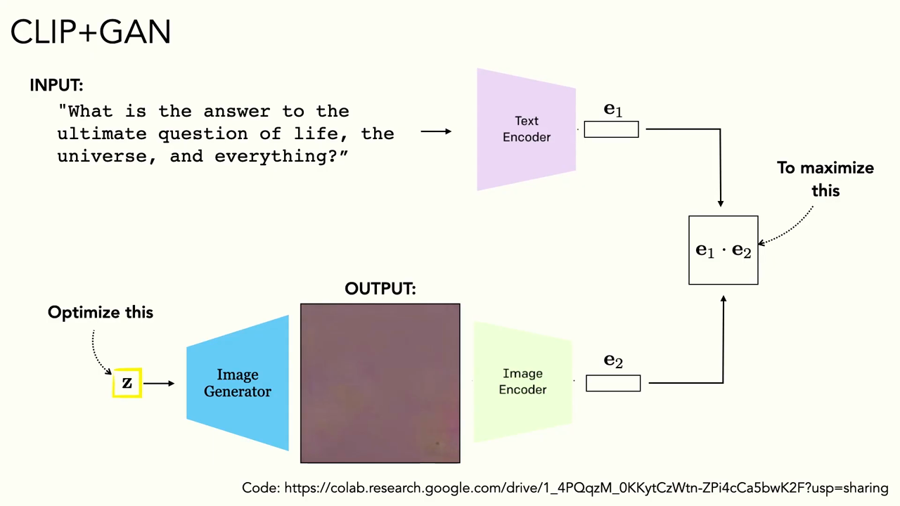
*▲ 강의 슬라이드 [66:40](https://youtu.be/vidCX_dMCu0?t=4000): 고정된 [CLIP](00_%EB%94%A5%EB%9F%AC%EB%8B%9D_%EC%9A%A9%EC%96%B4%EC%82%AC%EC%A0%84.md#clip-%ED%81%B4%EB%A6%BD)과 이미지 [생성기](00_%EB%94%A5%EB%9F%AC%EB%8B%9D_%EC%9A%A9%EC%96%B4%EC%82%AC%EC%A0%84.md#generator-discriminator-%EC%83%9D%EC%84%B1%EA%B8%B0%EC%99%80-%ED%8C%90%EB%B3%84%EA%B8%B0)를 이어 놓고 입력 z만 최적화한다(최적화 시작 단계)*

모든 사다리꼴(신경망)은 서로 꽂을 수 있습니다. 한 방식으로 학습한 부품을 다른 방식으로 쓰고, 모듈을 다른 모듈에 대해 최적화할 수 있습니다([모듈 재사용](00_%EB%94%A5%EB%9F%AC%EB%8B%9D_%EC%9A%A9%EC%96%B4%EC%82%AC%EC%A0%84.md#modular-reuse-%EB%AA%A8%EB%93%88-%EC%9E%AC%EC%82%AC%EC%9A%A9)).

> [!TIP]
> **🆕 2026 업데이트: 텍스트로 이미지 만들기**
> - **강의**: 고정된 [CLIP](00_%EB%94%A5%EB%9F%AC%EB%8B%9D_%EC%9A%A9%EC%96%B4%EC%82%AC%EC%A0%84.md#clip-%ED%81%B4%EB%A6%BD)과 [GAN](00_%EB%94%A5%EB%9F%AC%EB%8B%9D_%EC%9A%A9%EC%96%B4%EC%82%AC%EC%A0%84.md#gan-generative-adversarial-network-%EC%83%9D%EC%84%B1%EC%A0%81-%EC%A0%81%EB%8C%80-%EC%8B%A0%EA%B2%BD%EB%A7%9D)을 이어 입력 $z$를 최적화하는 방식으로 텍스트에서 이미지를 만드는 예를 보였다(2021년 무렵 유행한 방식).
> - **현재**: 텍스트→이미지 생성의 주류는 이미지마다 최적화를 돌리는 방식이 아니라, 텍스트 조건을 받아 한 번에 생성하도록 **미리 학습한 확산(diffusion)·흐름(flow) 계열 [생성 모델](00_%EB%94%A5%EB%9F%AC%EB%8B%9D_%EC%9A%A9%EC%96%B4%EC%82%AC%EC%A0%84.md#generative-model-%EC%83%9D%EC%84%B1-%EB%AA%A8%EB%8D%B8)** 이다. 예를 들어 Stable Diffusion 3는 잡음과 데이터를 직선으로 잇는 정류 흐름(rectified flow)과 [트랜스포머](00_%EB%94%A5%EB%9F%AC%EB%8B%9D_%EC%9A%A9%EC%96%B4%EC%82%AC%EC%A0%84.md#transformer-%ED%8A%B8%EB%9E%9C%EC%8A%A4%ED%8F%AC%EB%A8%B8) 구조를 쓴다. 이런 모델도 [학습](00_%EB%94%A5%EB%9F%AC%EB%8B%9D_%EC%9A%A9%EC%96%B4%EC%82%AC%EC%A0%84.md#training-%ED%95%99%EC%8A%B5) 자체는 이 강의의 [역전파](00_%EB%94%A5%EB%9F%AC%EB%8B%9D_%EC%9A%A9%EC%96%B4%EC%82%AC%EC%A0%84.md#backpropagation-%EC%97%AD%EC%A0%84%ED%8C%8C)로 한다.
> - **출처**: [Scaling Rectified Flow Transformers for High-Resolution Image Synthesis (Esser et al., ICML 2024)](https://arxiv.org/abs/2403.03206)

> [!TIP]
> **🆕 2026 업데이트: 뉴런 하나를 보는 해석에서 특징 사전으로**
> - **강의**: 뉴런 하나를 최대로 만드는 입력을 찾아 그 뉴런이 무엇을 보는지 해석했다(2017년 [특징 시각화](00_%EB%94%A5%EB%9F%AC%EB%8B%9D_%EC%9A%A9%EC%96%B4%EC%82%AC%EC%A0%84.md#feature-visualization-%ED%8A%B9%EC%A7%95-%EC%8B%9C%EA%B0%81%ED%99%94)).
> - **현재**: 큰 모델에서는 뉴런 하나가 여러 개념에 함께 반응하는 경우가 많아, 활성값을 **[희소 오토인코더](00_%EB%94%A5%EB%9F%AC%EB%8B%9D_%EC%9A%A9%EC%96%B4%EC%82%AC%EC%A0%84.md#sparse-autoencoder-%ED%9D%AC%EC%86%8C-%EC%98%A4%ED%86%A0%EC%9D%B8%EC%BD%94%EB%8D%94)(sparse autoencoder)** 로 분해해 해석하기 쉬운 "특징"을 찾는 방법이 널리 쓰인다. Anthropic은 2024년 Claude 3 Sonnet의 중간층에서 최대 3,400만 개 특징을 뽑아, 특징이 추상 개념에 반응하고 그 특징을 키우면 모델 행동도 바뀐다고 보고했다.
> - **출처**: [Scaling Monosemanticity: Extracting Interpretable Features from Claude 3 Sonnet (Templeton et al., Anthropic, 2024)](https://transformer-circuits.pub/2024/scaling-monosemanticity/) · [Feature Visualization (Olah et al., Distill, 2017)](https://distill.pub/2017/feature-visualization/)

---

## 10. 질의응답 정리

강의 끝 질의응답 (요약) [67:54](https://youtu.be/vidCX_dMCu0?t=4074)

- **[임베딩](00_%EB%94%A5%EB%9F%AC%EB%8B%9D_%EC%9A%A9%EC%96%B4%EC%82%AC%EC%A0%84.md#embedding-%EC%9E%84%EB%B2%A0%EB%94%A9)이란?** 인코더(신경망)가 이미지 같은 고차원 입력을 저차원 벡터로 옮긴 것. 길이 2048이나 1024가 흔하다. 표현(representation)이라고도 부른다. 이미 학습한 망을 데이터의 압축된 표현을 얻는 데 쓰는 것이다.
- **[손실](00_%EB%94%A5%EB%9F%AC%EB%8B%9D_%EC%9A%A9%EC%96%B4%EC%82%AC%EC%A0%84.md#loss-function-%EC%86%90%EC%8B%A4-%ED%95%A8%EC%88%98)과 비용은 같은 말인가?** 강의에서는 느슨하게 썼다. [손실](00_%EB%94%A5%EB%9F%AC%EB%8B%9D_%EC%9A%A9%EC%96%B4%EC%82%AC%EC%A0%84.md#loss-function-%EC%86%90%EC%8B%A4-%ED%95%A8%EC%88%98)은 데이터 하나에 대한 값, 비용은 데이터 전체(또는 배치)에 대해 모은 값으로 정의했다. 둘 다 얼마나 최적인지를 재는 장치라 섞어 써도 큰 문제는 없다.
- **[파라미터](00_%EB%94%A5%EB%9F%AC%EB%8B%9D_%EC%9A%A9%EC%96%B4%EC%82%AC%EC%A0%84.md#parameter-%ED%8C%8C%EB%9D%BC%EB%AF%B8%ED%84%B0) 최적화와 입력 최적화를 바꾸기 쉬운가?** [PyTorch](00_%EB%94%A5%EB%9F%AC%EB%8B%9D_%EC%9A%A9%EC%96%B4%EC%82%AC%EC%A0%84.md#pytorch-%ED%8C%8C%EC%9D%B4%ED%86%A0%EC%B9%98)에서는 어디의 [기울기](00_%EB%94%A5%EB%9F%AC%EB%8B%9D_%EC%9A%A9%EC%96%B4%EC%82%AC%EC%A0%84.md#gradient-%EA%B8%B0%EC%9A%B8%EA%B8%B0)를 얼리고(freeze) 어디를 풀지 정하기만 하면 되어 어렵지 않다. "사람이 짠" 부품이 사실은 예전에 [역전파](00_%EB%94%A5%EB%9F%AC%EB%8B%9D_%EC%9A%A9%EC%96%B4%EC%82%AC%EC%A0%84.md#backpropagation-%EC%97%AD%EC%A0%84%ED%8C%8C)로 학습된 가중치일 수도 있다.
- **[CLIP](00_%EB%94%A5%EB%9F%AC%EB%8B%9D_%EC%9A%A9%EC%96%B4%EC%82%AC%EC%A0%84.md#clip-%ED%81%B4%EB%A6%BD)의 유사도 계산이 [어텐션](00_%EB%94%A5%EB%9F%AC%EB%8B%9D_%EC%9A%A9%EC%96%B4%EC%82%AC%EC%A0%84.md#attention-%EC%96%B4%ED%85%90%EC%85%98) 블록인가?** [코사인 유사도](00_%EB%94%A5%EB%9F%AC%EB%8B%9D_%EC%9A%A9%EC%96%B4%EC%82%AC%EC%A0%84.md#cosine-similarity-%EC%BD%94%EC%82%AC%EC%9D%B8-%EC%9C%A0%EC%82%AC%EB%8F%84)는 [어텐션](00_%EB%94%A5%EB%9F%AC%EB%8B%9D_%EC%9A%A9%EC%96%B4%EC%82%AC%EC%A0%84.md#attention-%EC%96%B4%ED%85%90%EC%85%98)의 한 요소일 뿐이다. [어텐션](00_%EB%94%A5%EB%9F%AC%EB%8B%9D_%EC%9A%A9%EC%96%B4%EC%82%AC%EC%A0%84.md#attention-%EC%96%B4%ED%85%90%EC%85%98) 블록은 유사도를 잴 공간으로의 [투영](00_%EB%94%A5%EB%9F%AC%EB%8B%9D_%EC%9A%A9%EC%96%B4%EC%82%AC%EC%A0%84.md#projection-%ED%88%AC%EC%98%81)과, 정보를 쓸 공간으로의 [투영](00_%EB%94%A5%EB%9F%AC%EB%8B%9D_%EC%9A%A9%EC%96%B4%EC%82%AC%EC%A0%84.md#projection-%ED%88%AC%EC%98%81)까지 포함한다.
- **MLP의 [역전파](00_%EB%94%A5%EB%9F%AC%EB%8B%9D_%EC%9A%A9%EC%96%B4%EC%82%AC%EC%A0%84.md#backpropagation-%EC%97%AD%EC%A0%84%ED%8C%8C)와 [DAG](00_%EB%94%A5%EB%9F%AC%EB%8B%9D_%EC%9A%A9%EC%96%B4%EC%82%AC%EC%A0%84.md#dag-directed-acyclic-graph-%EB%B0%A9%ED%96%A5%EC%84%B1-%EB%B9%84%EC%88%9C%ED%99%98-%EA%B7%B8%EB%9E%98%ED%94%84)의 [역전파](00_%EB%94%A5%EB%9F%AC%EB%8B%9D_%EC%9A%A9%EC%96%B4%EC%82%AC%EC%A0%84.md#backpropagation-%EC%97%AD%EC%A0%84%ED%8C%8C)는 다른가?** 다르지 않다. 앞에서 자세히 본 예는 모두 사슬 모양 [DAG](00_%EB%94%A5%EB%9F%AC%EB%8B%9D_%EC%9A%A9%EC%96%B4%EC%82%AC%EC%A0%84.md#dag-directed-acyclic-graph-%EB%B0%A9%ED%96%A5%EC%84%B1-%EB%B9%84%EC%88%9C%ED%99%98-%EA%B7%B8%EB%9E%98%ED%94%84)였고, 합치기와 [가지치기](00_%EB%94%A5%EB%9F%AC%EB%8B%9D_%EC%9A%A9%EC%96%B4%EC%82%AC%EC%A0%84.md#pruning-%EA%B0%80%EC%A7%80%EC%B9%98%EA%B8%B0) 두 연산만 더하면 어떤 [DAG](00_%EB%94%A5%EB%9F%AC%EB%8B%9D_%EC%9A%A9%EC%96%B4%EC%82%AC%EC%A0%84.md#dag-directed-acyclic-graph-%EB%B0%A9%ED%96%A5%EC%84%B1-%EB%B9%84%EC%88%9C%ED%99%98-%EA%B7%B8%EB%9E%98%ED%94%84)에도 그대로 적용된다.
- **[PyTorch](00_%EB%94%A5%EB%9F%AC%EB%8B%9D_%EC%9A%A9%EC%96%B4%EC%82%AC%EC%A0%84.md#pytorch-%ED%8C%8C%EC%9D%B4%ED%86%A0%EC%B9%98) 연산이 아닌 파이썬 함수를 중간에 쓰면?** 망 안의 연산은 [기울기](00_%EB%94%A5%EB%9F%AC%EB%8B%9D_%EC%9A%A9%EC%96%B4%EC%82%AC%EC%A0%84.md#gradient-%EA%B8%B0%EC%9A%B8%EA%B8%B0)가 정의된 torch 연산이어야 한다. 미분할 필요가 없는 처리라면 데이터 로더의 [전처리](00_%EB%94%A5%EB%9F%AC%EB%8B%9D_%EC%9A%A9%EC%96%B4%EC%82%AC%EC%A0%84.md#preconditioning-%EC%A0%84%EC%B2%98%EB%A6%AC)(예: [데이터 증강](00_%EB%94%A5%EB%9F%AC%EB%8B%9D_%EC%9A%A9%EC%96%B4%EC%82%AC%EC%A0%84.md#data-augmentation-%EB%8D%B0%EC%9D%B4%ED%84%B0-%EC%A6%9D%EA%B0%95))로 빼는 것이 가장 간단하다. 강사는 종의 점유 모형 같은 통계 모델을 넣으려다 "기술적으로는 되지만 [학습](00_%EB%94%A5%EB%9F%AC%EB%8B%9D_%EC%9A%A9%EC%96%B4%EC%82%AC%EC%A0%84.md#training-%ED%95%99%EC%8A%B5)은 현실적으로 불가능한" 경우를 겪었다고 한다.
- **과제 공지**: 첫 과제는 그날 오후 3시에 올라온다고 안내했다.

---

## 11. 용어 정리

용어사전에 있는 용어는 위 본문에 링크를 걸었습니다. 아래는 이번 강의에서 새로 용어사전에 넣은 용어입니다.

| 용어 | 뜻 |
|---|---|
| [비용 함수](00_%EB%94%A5%EB%9F%AC%EB%8B%9D_%EC%9A%A9%EC%96%B4%EC%82%AC%EC%A0%84.md#cost-function-%EB%B9%84%EC%9A%A9-%ED%95%A8%EC%88%98)([Cost function](00_%EB%94%A5%EB%9F%AC%EB%8B%9D_%EC%9A%A9%EC%96%B4%EC%82%AC%EC%A0%84.md#cost-function-%EB%B9%84%EC%9A%A9-%ED%95%A8%EC%88%98)) | 데이터 전체(또는 배치)의 [손실](00_%EB%94%A5%EB%9F%AC%EB%8B%9D_%EC%9A%A9%EC%96%B4%EC%82%AC%EC%A0%84.md#loss-function-%EC%86%90%EC%8B%A4-%ED%95%A8%EC%88%98)을 모은 값 $J(\theta)$. [학습](00_%EB%94%A5%EB%9F%AC%EB%8B%9D_%EC%9A%A9%EC%96%B4%EC%82%AC%EC%A0%84.md#training-%ED%95%99%EC%8A%B5)이 최소로 만드는 대상 |
| [모멘텀](00_%EB%94%A5%EB%9F%AC%EB%8B%9D_%EC%9A%A9%EC%96%B4%EC%82%AC%EC%A0%84.md#momentum-%EB%AA%A8%EB%A9%98%ED%85%80)([Momentum](00_%EB%94%A5%EB%9F%AC%EB%8B%9D_%EC%9A%A9%EC%96%B4%EC%82%AC%EC%A0%84.md#momentum-%EB%AA%A8%EB%A9%98%ED%85%80)) | 이전 이동 방향을 이어 가도록 갱신에 관성을 더하는 방법 |
| [하이퍼파라미터](00_%EB%94%A5%EB%9F%AC%EB%8B%9D_%EC%9A%A9%EC%96%B4%EC%82%AC%EC%A0%84.md#hyperparameter-%ED%95%98%EC%9D%B4%ED%8D%BC%ED%8C%8C%EB%9D%BC%EB%AF%B8%ED%84%B0)([Hyperparameter](00_%EB%94%A5%EB%9F%AC%EB%8B%9D_%EC%9A%A9%EC%96%B4%EC%82%AC%EC%A0%84.md#hyperparameter-%ED%95%98%EC%9D%B4%ED%8D%BC%ED%8C%8C%EB%9D%BC%EB%AF%B8%ED%84%B0)) | [학습](00_%EB%94%A5%EB%9F%AC%EB%8B%9D_%EC%9A%A9%EC%96%B4%EC%82%AC%EC%A0%84.md#training-%ED%95%99%EC%8A%B5)으로 배우지 않고 사람이 미리 정하는 값 ([학습률](00_%EB%94%A5%EB%9F%AC%EB%8B%9D_%EC%9A%A9%EC%96%B4%EC%82%AC%EC%A0%84.md#learning-rate-%ED%95%99%EC%8A%B5%EB%A5%A0), [모멘텀](00_%EB%94%A5%EB%9F%AC%EB%8B%9D_%EC%9A%A9%EC%96%B4%EC%82%AC%EC%A0%84.md#momentum-%EB%AA%A8%EB%A9%98%ED%85%80) 세기, 배치 크기 등) |
| [손실 지형](00_%EB%94%A5%EB%9F%AC%EB%8B%9D_%EC%9A%A9%EC%96%B4%EC%82%AC%EC%A0%84.md#loss-landscape-%EC%86%90%EC%8B%A4-%EC%A7%80%ED%98%95)([Loss landscape](00_%EB%94%A5%EB%9F%AC%EB%8B%9D_%EC%9A%A9%EC%96%B4%EC%82%AC%EC%A0%84.md#loss-landscape-%EC%86%90%EC%8B%A4-%EC%A7%80%ED%98%95)) | [파라미터](00_%EB%94%A5%EB%9F%AC%EB%8B%9D_%EC%9A%A9%EC%96%B4%EC%82%AC%EC%A0%84.md#parameter-%ED%8C%8C%EB%9D%BC%EB%AF%B8%ED%84%B0) 값에 따른 [손실](00_%EB%94%A5%EB%9F%AC%EB%8B%9D_%EC%9A%A9%EC%96%B4%EC%82%AC%EC%A0%84.md#loss-function-%EC%86%90%EC%8B%A4-%ED%95%A8%EC%88%98)의 높낮이를 지형처럼 본 것 |
| [기울기 폭주](00_%EB%94%A5%EB%9F%AC%EB%8B%9D_%EC%9A%A9%EC%96%B4%EC%82%AC%EC%A0%84.md#exploding-gradient-%EA%B8%B0%EC%9A%B8%EA%B8%B0-%ED%8F%AD%EC%A3%BC)(Exploding gradient) | [기울기](00_%EB%94%A5%EB%9F%AC%EB%8B%9D_%EC%9A%A9%EC%96%B4%EC%82%AC%EC%A0%84.md#gradient-%EA%B8%B0%EC%9A%B8%EA%B8%B0)가 매우 커져 갱신이 멀리 튕겨 나가는 문제 |
| [그래디언트 클리핑](00_%EB%94%A5%EB%9F%AC%EB%8B%9D_%EC%9A%A9%EC%96%B4%EC%82%AC%EC%A0%84.md#gradient-clipping-%EA%B7%B8%EB%9E%98%EB%94%94%EC%96%B8%ED%8A%B8-%ED%81%B4%EB%A6%AC%ED%95%91)(Gradient clipping) | [기울기](00_%EB%94%A5%EB%9F%AC%EB%8B%9D_%EC%9A%A9%EC%96%B4%EC%82%AC%EC%A0%84.md#gradient-%EA%B8%B0%EC%9A%B8%EA%B8%B0)가 정한 크기를 넘으면 그 크기로 잘라 내는 요령 |
| [진화 전략](00_%EB%94%A5%EB%9F%AC%EB%8B%9D_%EC%9A%A9%EC%96%B4%EC%82%AC%EC%A0%84.md#evolution-strategy-%EC%A7%84%ED%99%94-%EC%A0%84%EB%9E%B5)(Evolution strategy) | [파라미터](00_%EB%94%A5%EB%9F%AC%EB%8B%9D_%EC%9A%A9%EC%96%B4%EC%82%AC%EC%A0%84.md#parameter-%ED%8C%8C%EB%9D%BC%EB%AF%B8%ED%84%B0) 주변을 무작위로 흔들어 [손실](00_%EB%94%A5%EB%9F%AC%EB%8B%9D_%EC%9A%A9%EC%96%B4%EC%82%AC%EC%A0%84.md#loss-function-%EC%86%90%EC%8B%A4-%ED%95%A8%EC%88%98)이 낮은 쪽으로 움직이는 방법 |
| [GELU](00_%EB%94%A5%EB%9F%AC%EB%8B%9D_%EC%9A%A9%EC%96%B4%EC%82%AC%EC%A0%84.md#gelu-%EA%B2%94%EB%A3%A8)(Gaussian error linear unit) | $z\,\Phi(z)$. 어디서나 매끄러운 [ReLU](00_%EB%94%A5%EB%9F%AC%EB%8B%9D_%EC%9A%A9%EC%96%B4%EC%82%AC%EC%A0%84.md#relu-%EB%A0%90%EB%A3%A8) 비슷한 [활성화 함수](00_%EB%94%A5%EB%9F%AC%EB%8B%9D_%EC%9A%A9%EC%96%B4%EC%82%AC%EC%A0%84.md#activation-function-%ED%99%9C%EC%84%B1%ED%99%94-%ED%95%A8%EC%88%98) |
| [헤세 행렬](00_%EB%94%A5%EB%9F%AC%EB%8B%9D_%EC%9A%A9%EC%96%B4%EC%82%AC%EC%A0%84.md#hessian-%ED%97%A4%EC%84%B8-%ED%96%89%EB%A0%AC)([Hessian](00_%EB%94%A5%EB%9F%AC%EB%8B%9D_%EC%9A%A9%EC%96%B4%EC%82%AC%EC%A0%84.md#hessian-%ED%97%A4%EC%84%B8-%ED%96%89%EB%A0%AC)) | 2차 [편미분](00_%EB%94%A5%EB%9F%AC%EB%8B%9D_%EC%9A%A9%EC%96%B4%EC%82%AC%EC%A0%84.md#partial-derivative-%ED%8E%B8%EB%AF%B8%EB%B6%84)을 모은 행렬. 2차 최적화에 쓰지만 계산이 크다 |
| [야코비안](00_%EB%94%A5%EB%9F%AC%EB%8B%9D_%EC%9A%A9%EC%96%B4%EC%82%AC%EC%A0%84.md#jacobian-%EC%95%BC%EC%BD%94%EB%B9%84%EC%95%88)([Jacobian](00_%EB%94%A5%EB%9F%AC%EB%8B%9D_%EC%9A%A9%EC%96%B4%EC%82%AC%EC%A0%84.md#jacobian-%EC%95%BC%EC%BD%94%EB%B9%84%EC%95%88)) | 벡터 출력의 각 칸을 벡터 입력의 각 칸으로 편미분한 행렬 |
| [방향성 비순환 그래프](00_%EB%94%A5%EB%9F%AC%EB%8B%9D_%EC%9A%A9%EC%96%B4%EC%82%AC%EC%A0%84.md#dag-directed-acyclic-graph-%EB%B0%A9%ED%96%A5%EC%84%B1-%EB%B9%84%EC%88%9C%ED%99%98-%EA%B7%B8%EB%9E%98%ED%94%84)([DAG](00_%EB%94%A5%EB%9F%AC%EB%8B%9D_%EC%9A%A9%EC%96%B4%EC%82%AC%EC%A0%84.md#dag-directed-acyclic-graph-%EB%B0%A9%ED%96%A5%EC%84%B1-%EB%B9%84%EC%88%9C%ED%99%98-%EA%B7%B8%EB%9E%98%ED%94%84)) | 간선마다 방향이 있고 고리가 없는 그래프. 딥러닝 [계산 그래프](00_%EB%94%A5%EB%9F%AC%EB%8B%9D_%EC%9A%A9%EC%96%B4%EC%82%AC%EC%A0%84.md#computational-graph-%EA%B3%84%EC%82%B0-%EA%B7%B8%EB%9E%98%ED%94%84)의 모양 |
| [임베딩](00_%EB%94%A5%EB%9F%AC%EB%8B%9D_%EC%9A%A9%EC%96%B4%EC%82%AC%EC%A0%84.md#embedding-%EC%9E%84%EB%B2%A0%EB%94%A9)([Embedding](00_%EB%94%A5%EB%9F%AC%EB%8B%9D_%EC%9A%A9%EC%96%B4%EC%82%AC%EC%A0%84.md#embedding-%EC%9E%84%EB%B2%A0%EB%94%A9)) | 신경망이 입력을 옮겨 놓은 저차원 벡터 표현 |
| [특징 시각화](00_%EB%94%A5%EB%9F%AC%EB%8B%9D_%EC%9A%A9%EC%96%B4%EC%82%AC%EC%A0%84.md#feature-visualization-%ED%8A%B9%EC%A7%95-%EC%8B%9C%EA%B0%81%ED%99%94)(Feature visualization) | 뉴런을 최대로 만드는 입력을 찾아 그 뉴런이 무엇을 보는지 보는 방법 |
