# Lec 03. 근사 이론 (Approximation Theory)

← 이전: [Lec02_신경망_학습](Lec02_%EC%8B%A0%EA%B2%BD%EB%A7%9D_%ED%95%99%EC%8A%B5.md) · [목차](00_MIT%EB%94%A5%EB%9F%AC%EB%8B%9D_%EB%AA%A9%EC%B0%A8.md) · 다음: [Lec04_격자_아키텍처](Lec04_%EA%B2%A9%EC%9E%90_%EC%95%84%ED%82%A4%ED%85%8D%EC%B2%98.md) →

> [!NOTE]
> **강의 정보**
> - **출처**: MIT OpenCourseWare, [Lec 03. Approximation Theory](https://www.youtube.com/watch?v=ySaoWrv3T_Q) (82분, 2024년 가을 학기)
> - **강사**: Jeremy Bernstein
> - **라이선스**: 원 강의는 CC BY-NC-SA 4.0입니다. 이 노트는 영어 자막을 바탕으로 한국어로 옮겨 정리한 2차 저작물이며, 같은 조건(비영리·출처 표기·동일 조건 공유)을 따릅니다.
> - 각 절 제목 아래의 `▶ 영상` 시간을 누르면 영상의 해당 위치로 갑니다.
> - `📐 수학 개념` 줄은 그 절에 쓰인 수학을 정리한 노트로 연결됩니다. 전체 목록은 [00_MIT딥러닝_목차](00_MIT%EB%94%A5%EB%9F%AC%EB%8B%9D_%EB%AA%A9%EC%B0%A8.md).
> - 슬라이드 캡처는 원 강의(CC BY-NC-SA 4.0)에서 가져왔고, "직접 그린 그림"은 이 노트의 숫자로 새로 그렸습니다.

## 한눈에 보기

| 구분 | 내용 |
|---|---|
| 오늘의 질문 | 신경망은 어떤 함수를 표현할 수 있나? 그렇다면 **넓게** 키울까, **깊게** 키울까? |
| 머신러닝 퍼즐 | 근사(있나?) · 최적화(찾을 수 있나?) · [일반화](00_%EB%94%A5%EB%9F%AC%EB%8B%9D_%EC%9A%A9%EC%96%B4%EC%82%AC%EC%A0%84.md#generalization-%EC%9D%BC%EB%B0%98%ED%99%94)(처음 보는 데이터에도 맞나?). 이번 강의는 **근사**만 다룬다 |
| 전반부: [보편 근사](00_%EB%94%A5%EB%9F%AC%EB%8B%9D_%EC%9A%A9%EC%96%B4%EC%82%AC%EC%A0%84.md#universal-approximation-%EB%B3%B4%ED%8E%B8-%EA%B7%BC%EC%82%AC) | 립시츠 함수는 **3층 [ReLU](00_%EB%94%A5%EB%9F%AC%EB%8B%9D_%EC%9A%A9%EC%96%B4%EC%82%AC%EC%A0%84.md#relu-%EB%A0%90%EB%A3%A8) 망**으로 원하는 만큼 가깝게 근사할 수 있다. 다만 뉴런이 $4d(L/\varepsilon)^d$개로 **차원에 지수적**이다 |
| 증명 3단계 | 막대(직사각형)로 근사 → 고차원 상자로 확장 → [ReLU](00_%EB%94%A5%EB%9F%AC%EB%8B%9D_%EC%9A%A9%EC%96%B4%EC%82%AC%EC%A0%84.md#relu-%EB%A0%90%EB%A3%A8)로 상자 만들기 |
| 후반부: [깊이 분리](00_%EB%94%A5%EB%9F%AC%EB%8B%9D_%EC%9A%A9%EC%96%B4%EC%82%AC%EC%A0%84.md#depth-separation-%EA%B9%8A%EC%9D%B4-%EB%B6%84%EB%A6%AC) | [ReLU](00_%EB%94%A5%EB%9F%AC%EB%8B%9D_%EC%9A%A9%EC%96%B4%EC%82%AC%EC%A0%84.md#relu-%EB%A0%90%EB%A3%A8) 망의 [꺾임](00_%EB%94%A5%EB%9F%AC%EB%8B%9D_%EC%9A%A9%EC%96%B4%EC%82%AC%EC%A0%84.md#kink-%EA%BA%BE%EC%9E%84) 수 상한은 $(2n)^L$. 삼각형 함수를 500번 합성한 함수는 1000층 망이면 뉴런 2,000개, 3층 망이면 약 $10^{50}$개가 필요하다 |
| 실전 | Kaplan 등(2020): 넓은 범위에서 너비·깊이 배분은 거의 상관없고 **[파라미터](00_%EB%94%A5%EB%9F%AC%EB%8B%9D_%EC%9A%A9%EC%96%B4%EC%82%AC%EC%A0%84.md#parameter-%ED%8C%8C%EB%9D%BC%EB%AF%B8%ED%84%B0) 수**가 중요. 하지만 [학습](00_%EB%94%A5%EB%9F%AC%EB%8B%9D_%EC%9A%A9%EC%96%B4%EC%82%AC%EC%A0%84.md#training-%ED%95%99%EC%8A%B5) 설정 같은 **[교란 변수](00_%EB%94%A5%EB%9F%AC%EB%8B%9D_%EC%9A%A9%EC%96%B4%EC%82%AC%EC%A0%84.md#confounder-%EA%B5%90%EB%9E%80-%EB%B3%80%EC%88%98)** 때문에 결론이 바뀔 수 있다 |
| 다음 예고 | 데이터 구조에 맞춘 **귀납적 [편향](00_%EB%94%A5%EB%9F%AC%EB%8B%9D_%EC%9A%A9%EC%96%B4%EC%82%AC%EC%A0%84.md#bias-%ED%8E%B8%ED%96%A5)**([CNN](00_%EB%94%A5%EB%9F%AC%EB%8B%9D_%EC%9A%A9%EC%96%B4%EC%82%AC%EC%A0%84.md#cnn-convolutional-neural-network-%ED%95%A9%EC%84%B1%EA%B3%B1-%EC%8B%A0%EA%B2%BD%EB%A7%9D), [트랜스포머](00_%EB%94%A5%EB%9F%AC%EB%8B%9D_%EC%9A%A9%EC%96%B4%EC%82%AC%EC%A0%84.md#transformer-%ED%8A%B8%EB%9E%9C%EC%8A%A4%ED%8F%AC%EB%A8%B8)의 입력 처리) |

이전 강의: [Lec02_신경망_학습](Lec02_%EC%8B%A0%EA%B2%BD%EB%A7%9D_%ED%95%99%EC%8A%B5.md)

---

## 1. 너비냐 깊이냐: 오늘의 질문

▶ 영상 [00:00](https://youtu.be/ySaoWrv3T_Q?t=0)

강사는 "신경망을 키운다면 **너비**(한 [층](00_%EB%94%A5%EB%9F%AC%EB%8B%9D_%EC%9A%A9%EC%96%B4%EC%82%AC%EC%A0%84.md#layer-%EC%B8%B5)의 뉴런 수)를 늘리겠는가, **깊이**([층](00_%EB%94%A5%EB%9F%AC%EB%8B%9D_%EC%9A%A9%EC%96%B4%EC%82%AC%EC%A0%84.md#layer-%EC%B8%B5) 수)를 늘리겠는가?"라는 질문으로 시작합니다. 학생 한 명이 "딥러닝이니까 깊이"라고 답하자, 강사는 그렇게 간단히 답할 수 있는 질문이 아니라며 이번 강의의 질문을 세웁니다.

- 신경망이 표현할 수 있는 함수는 어떤 종류인가?
- 신경망이 **보편 함수 근사기**(universal function approximator)라는 말은 무슨 뜻인가?
- 어떤 함수든 근사할 수 있다면 구조는 어떻게 정해야 하나? 몇 [층](00_%EB%94%A5%EB%9F%AC%EB%8B%9D_%EC%9A%A9%EC%96%B4%EC%82%AC%EC%A0%84.md#layer-%EC%B8%B5)이면 충분한가, 많이 쌓아야 하나?
- 이런 이론이 실제로 도움이 되나?

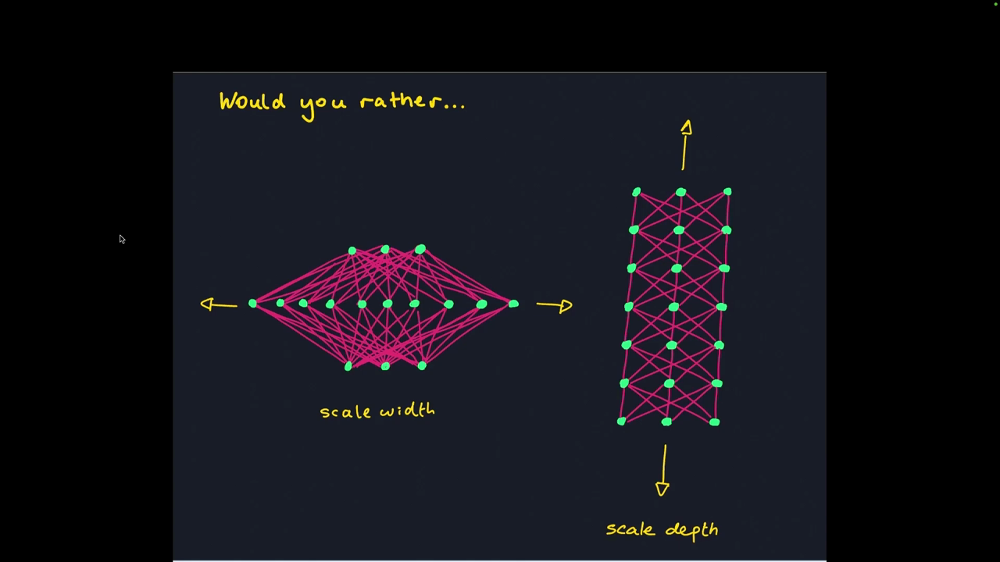
*▲ 강의 슬라이드 [00:30](https://youtu.be/ySaoWrv3T_Q?t=30): 너비를 키울까(왼쪽), 깊이를 키울까(오른쪽)*

> [!NOTE]
> **1강과의 연결**
> [1강 6.1](Lec01_%EB%94%A5%EB%9F%AC%EB%8B%9D_%EC%86%8C%EA%B0%9C.md#61-%EA%B7%BC%EC%82%AC-%EC%9D%B4%EB%A1%A0-%EB%AC%B4%EC%97%87%EC%9D%84-%ED%91%9C%ED%98%84%ED%95%A0-%EC%88%98-%EC%9E%88%EB%82%98)에서 [리만 합](00_%EB%94%A5%EB%9F%AC%EB%8B%9D_%EC%9A%A9%EC%96%B4%EC%82%AC%EC%A0%84.md#riemann-sum-%EB%A6%AC%EB%A7%8C-%ED%95%A9) 그림으로 보여 준 "2층이면 어떤 함수든 표현할 수 있다"는 직관을 이번 강의가 정리와 증명으로 다룹니다. 직관 부분은 [MM07_리만_합과_보편_근사](%EC%88%98%ED%95%99%EA%B0%9C%EB%85%90/06_%EA%B7%BC%EC%82%AC_%EC%9D%B4%EB%A1%A0/MM07_%EB%A6%AC%EB%A7%8C_%ED%95%A9%EA%B3%BC_%EB%B3%B4%ED%8E%B8_%EA%B7%BC%EC%82%AC.md)에 정리되어 있습니다. 1강 [6.3 질의응답](Lec01_%EB%94%A5%EB%9F%AC%EB%8B%9D_%EC%86%8C%EA%B0%9C.md#63-%EC%9D%BC%EB%B0%98%ED%99%94-%EC%99%9C-%EA%B9%8A%EC%9D%80-%EB%A7%9D%EC%9D%80-%EC%99%B8%EC%9A%B0%EC%A7%80-%EC%95%8A%EA%B3%A0-%EC%9D%BC%EB%B0%98%ED%99%94%ED%95%98%EB%82%98)에서 Jeremy가 "너비와 깊이의 최적 비율은 큰 회사도 감추는 비밀"이라고 한 질문이 이번 강의의 출발점입니다.

---

## 2. 머신러닝 퍼즐: 근사·최적화·일반화

▶ 영상 [01:52](https://youtu.be/ySaoWrv3T_Q?t=112)

머신러닝 문제를 풀려면 세 조각이 모두 맞아야 합니다.

| 조각 | 질문 |
|---|---|
| ① 근사(Approximation) | 내 모델 집합 안에 [학습 데이터](00_%EB%94%A5%EB%9F%AC%EB%8B%9D_%EC%9A%A9%EC%96%B4%EC%82%AC%EC%A0%84.md#training-data-test-data-%ED%95%99%EC%8A%B5-%EB%8D%B0%EC%9D%B4%ED%84%B0%EC%99%80-%EC%8B%9C%ED%97%98-%EB%8D%B0%EC%9D%B4%ED%84%B0)를 맞추는 신경망이 **존재**하는가? |
| ② 최적화(Optimization) | 존재한다면 그것을 **찾을** 수 있는가? |
| ③ [일반화](00_%EB%94%A5%EB%9F%AC%EB%8B%9D_%EC%9A%A9%EC%96%B4%EC%82%AC%EC%A0%84.md#generalization-%EC%9D%BC%EB%B0%98%ED%99%94)(Generalization) | 찾았다면 **처음 보는 데이터**에서도 잘 하는가? |

이번 강의는 ①만 다룹니다. 하지만 퍼즐 전체를 맞춰야 문제가 풀린다는 점을 기억하라고 강조합니다.

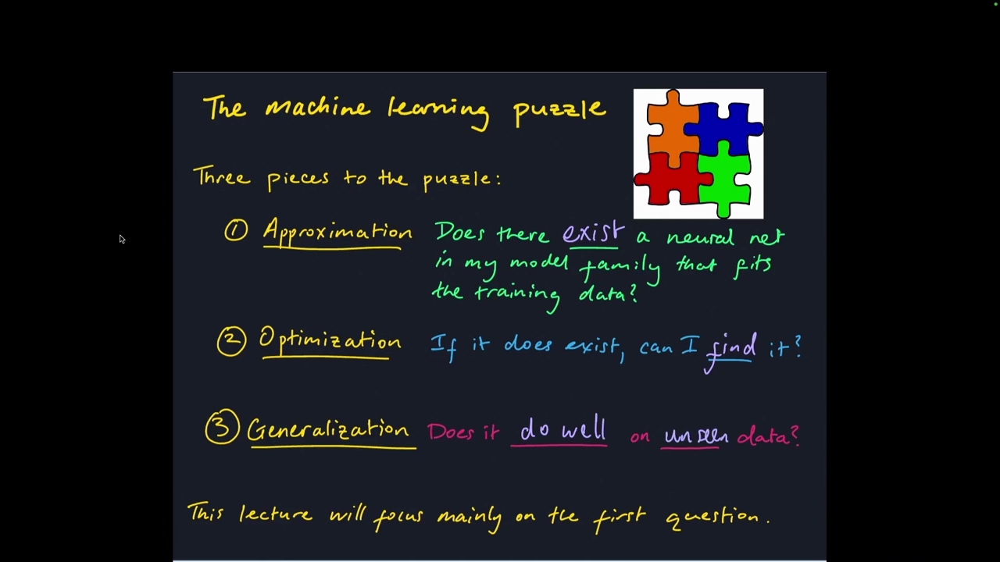
*▲ 강의 슬라이드 [03:10](https://youtu.be/ySaoWrv3T_Q?t=190): 머신러닝 퍼즐의 세 조각*

---

## 3. 동기 문제

▶ 영상 [03:33](https://youtu.be/ySaoWrv3T_Q?t=213)

📐 **수학 개념**: [평면과 결정 경계](%EC%88%98%ED%95%99%EA%B0%9C%EB%85%90/03_%EC%84%A0%ED%98%95%EB%8C%80%EC%88%98/MM04_%ED%8F%89%EB%A9%B4%EA%B3%BC_%EA%B2%B0%EC%A0%95_%EA%B2%BD%EA%B3%84.md)

**문제 1: 선형으로 나눌 수 없는 데이터.** 2차원 데이터 $(x_1, x_2)$에 빨간 × 와 초록 ○ 두 클래스가 있습니다. 모델이 $f(x) = \mathrm{ReLU}(w^\top x + b)$ 하나뿐이면 맞출 수 있을까요?

- 학생 답: 안 된다. 직선이 두 개 필요하다.
- $w^\top x + b$는 초평면 하나만 정의하고, [ReLU](00_%EB%94%A5%EB%9F%AC%EB%8B%9D_%EC%9A%A9%EC%96%B4%EC%82%AC%EC%A0%84.md#relu-%EB%A0%90%EB%A3%A8)는 출력에 비선형을 줄 뿐 초평면 모양을 바꾸지 않습니다. 결국 **선형 분리기**이고 이 데이터는 선형 분리가 안 됩니다. 2층 망이면 될 수도 있습니다.
- 요점: 맞추려는 함수가 있고 모델 집합이 있을 때 "그 집합 안에 맞는 함수가 **있나**"가 근사의 질문입니다.

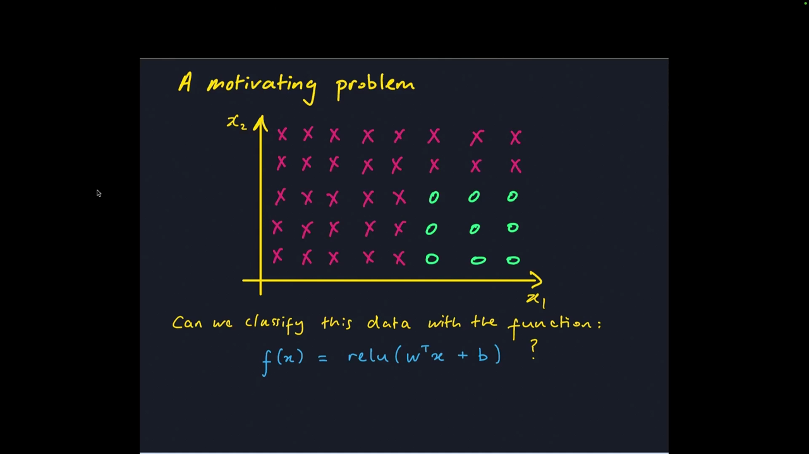
*▲ 강의 슬라이드 [04:30](https://youtu.be/ySaoWrv3T_Q?t=270): 한 층짜리 [ReLU](00_%EB%94%A5%EB%9F%AC%EB%8B%9D_%EC%9A%A9%EC%96%B4%EC%82%AC%EC%A0%84.md#relu-%EB%A0%90%EB%A3%A8)로는 나눌 수 없는 데이터*

**문제 2: 바이어슈트라스 함수(Weierstrass function).** [05:14](https://youtu.be/ySaoWrv3T_Q?t=314) 모든 점에서 연속이지만 어디서도 미분할 수 없는 함수로, 확대해도 전체와 닮은 **프랙털**입니다. 신경망으로 맞출 수 있을까요? 강사는 "솔직히 답을 모르겠다, 아마도?"라며 기말 프로젝트 주제로 제안합니다. (바이어슈트라스 함수는 연속이므로, 고전적 [보편 근사](00_%EB%94%A5%EB%9F%AC%EB%8B%9D_%EC%9A%A9%EC%96%B4%EC%82%AC%EC%A0%84.md#universal-approximation-%EB%B3%B4%ED%8E%B8-%EA%B7%BC%EC%82%AC) 정리에 따라 유한 구간에서는 [최대 오차](00_%EB%94%A5%EB%9F%AC%EB%8B%9D_%EC%9A%A9%EC%96%B4%EC%82%AC%EC%A0%84.md#l-error-l1-error-%EC%B5%9C%EB%8C%80-%EC%98%A4%EC%B0%A8%EC%99%80-%EC%A0%81%EB%B6%84-%EC%98%A4%EC%B0%A8) 기준으로 원하는 만큼 가깝게 근사할 수 있습니다. 다만 필요한 뉴런 수는 아주 많을 수 있고, 립시츠가 아니라서 이 강의 정리의 개수 계산은 적용되지 않습니다.)

---

## 4. 근사 문제를 식으로 쓰기

▶ 영상 [06:21](https://youtu.be/ySaoWrv3T_Q?t=381)

📐 **수학 개념**: [립시츠 연속과 노름](%EC%88%98%ED%95%99%EA%B0%9C%EB%85%90/03_%EC%84%A0%ED%98%95%EB%8C%80%EC%88%98/MM11_%EB%A6%BD%EC%8B%9C%EC%B8%A0_%EC%97%B0%EC%86%8D%EA%B3%BC_%EB%85%B8%EB%A6%84.md)

- **곡선 집합 $G$**: 근사하고 싶은 함수들. [미분](00_%EB%94%A5%EB%9F%AC%EB%8B%9D_%EC%9A%A9%EC%96%B4%EC%82%AC%EC%A0%84.md#derivative-%EB%AF%B8%EB%B6%84) 가능한 함수만 고르는 식으로 우리가 정합니다(바이어슈트라스 함수를 빼고 싶으면 뺄 수 있음).
- **신경망 집합 $F$**: 예를 들어 "5층 [MLP](00_%EB%94%A5%EB%9F%AC%EB%8B%9D_%EC%9A%A9%EC%96%B4%EC%82%AC%EC%A0%84.md#multi-layer-perceptron-%EB%8B%A4%EC%B8%B5-%ED%8D%BC%EC%85%89%ED%8A%B8%EB%A1%A0) 전체". 구조 하나가 함수 집합 하나를 정합니다.
- **질문**: $G$의 어떤 곡선 $g$를 골라도 $\mathrm{error}(f, g) < \varepsilon$인 신경망 $f \in F$가 있는가? ($\varepsilon$은 우리가 정하는 작은 수)
- [오차](00_%EB%94%A5%EB%9F%AC%EB%8B%9D_%EC%9A%A9%EC%96%B4%EC%82%AC%EC%A0%84.md#error-%EC%98%A4%EC%B0%A8)를 재는 방법도 골라야 합니다.

$$\mathrm{error}_\infty(f, g) = \max_x |f(x) - g(x)|, \qquad \mathrm{error}_1(f, g) = \int |f(x) - g(x)|\,dx$$

기호 풀이

| 기호 | 읽는 법 | 뜻 | 예제 값 |
| --- | --- | --- | --- |
| $f$ | 에프 | 근사하는 함수(신경망) | $f(x) = 0.5$ |
| $g$ | 지 | 근사하려는 목표 함수 | $g(x) = x$ |
| $x$ | 엑스 | 입력. 여기서는 0~1 사이 실수 | 0~1 |
| $\lvert f(x) - g(x) \rvert$ | 에프 엑스 빼기 지 엑스의 절댓값 | 한 입력에서 두 함수의 차이 | $\lvert 0.5 - x \rvert$ |
| $\max_x$ | 맥스 오버 엑스 | 모든 $x$ 중 가장 큰 값 | $x = 0$ 또는 1에서 0.5 |
| $\int \cdots dx$ | 인티그럴 디 엑스 | 입력 전체에 걸쳐 더하기(넓이) | 0.25 |
| $\mathrm{error}_\infty(f, g)$ | 에러 인피니티 | [최대 오차](00_%EB%94%A5%EB%9F%AC%EB%8B%9D_%EC%9A%A9%EC%96%B4%EC%82%AC%EC%A0%84.md#l-error-l1-error-%EC%B5%9C%EB%8C%80-%EC%98%A4%EC%B0%A8%EC%99%80-%EC%A0%81%EB%B6%84-%EC%98%A4%EC%B0%A8)($L^\infty$) | 0.5 |
| $\mathrm{error}_1(f, g)$ | 에러 원 | [적분 오차](00_%EB%94%A5%EB%9F%AC%EB%8B%9D_%EC%9A%A9%EC%96%B4%EC%82%AC%EC%A0%84.md#l-error-l1-error-%EC%B5%9C%EB%8C%80-%EC%98%A4%EC%B0%A8%EC%99%80-%EC%A0%81%EB%B6%84-%EC%98%A4%EC%B0%A8)($L^1$) | 0.25 |

예제와 풀이

**문제**: 0~1 구간에서 근사 함수가 늘 0.5이고 목표 함수가 $g(x) = x$일 때, 가장 큰 차이([최대 오차](00_%EB%94%A5%EB%9F%AC%EB%8B%9D_%EC%9A%A9%EC%96%B4%EC%82%AC%EC%A0%84.md#l-error-l1-error-%EC%B5%9C%EB%8C%80-%EC%98%A4%EC%B0%A8%EC%99%80-%EC%A0%81%EB%B6%84-%EC%98%A4%EC%B0%A8))와 차이의 넓이([적분 오차](00_%EB%94%A5%EB%9F%AC%EB%8B%9D_%EC%9A%A9%EC%96%B4%EC%82%AC%EC%A0%84.md#l-error-l1-error-%EC%B5%9C%EB%8C%80-%EC%98%A4%EC%B0%A8%EC%99%80-%EC%A0%81%EB%B6%84-%EC%98%A4%EC%B0%A8))는?

**주어진 값**:
- $f(x) = 0.5$ (근사 함수, 어디서나 0.5)
- $g(x) = x$ (목표 함수)
- $0 \le x \le 1$ (입력 구간)

**풀이**
1. 식을 그대로 쓴다: $\mathrm{error}_\infty(f, g) = \max_x |f(x) - g(x)|, \quad \mathrm{error}_1(f, g) = \int |f(x) - g(x)|\,dx$
2. 값을 대입한다: $\mathrm{error}_\infty = \max_x |0.5 - x|, \quad \mathrm{error}_1 = \int_0^1 |0.5 - x|\,dx$
3. 차이가 가장 큰 곳을 찾는다: $x$가 0.5에서 가장 먼 양 끝이다. $|0.5 - 0| = 0.5$, $|0.5 - 1| = 0.5$ 이므로 $\mathrm{error}_\infty = 0.5$
4. 적분(∫)의 뜻: 0~1에서 차이 $|0.5 - x|$ 그래프 아래의 넓이다. 이 그래프는 0.5에서 꺾인 V자라 삼각형 두 개로 나눠 구한다
5. 왼쪽 삼각형(0~0.5) 넓이를 구한다: 밑변 0.5, 높이 0.5 이므로 $0.5 \times 0.5 \div 2 = 0.125$
6. 오른쪽 삼각형(0.5~1)도 같은 모양이다: $0.125$
7. 두 넓이를 더한다: $0.125 + 0.125 = 0.25$ 이므로 $\mathrm{error}_1 = 0.25$

**답**: $\mathrm{error}_\infty = 0.5$, $\mathrm{error}_1 = 0.25$

내 이해

- $L^\infty$ [오차](00_%EB%94%A5%EB%9F%AC%EB%8B%9D_%EC%9A%A9%EC%96%B4%EC%82%AC%EC%A0%84.md#error-%EC%98%A4%EC%B0%A8)는 입력 공간 어디서든 가장 큰 차이, $L^1$ [오차](00_%EB%94%A5%EB%9F%AC%EB%8B%9D_%EC%9A%A9%EC%96%B4%EC%82%AC%EC%A0%84.md#error-%EC%98%A4%EC%B0%A8)는 차이를 축 전체에서 모두 더한(적분한) 값입니다. 둘 다 정당한 측정입니다.

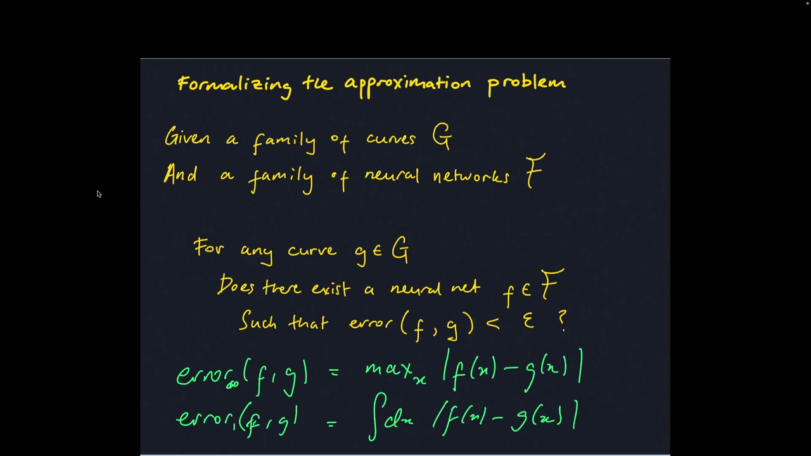
*▲ 강의 슬라이드 [08:55](https://youtu.be/ySaoWrv3T_Q?t=535): 근사 문제의 정식화와 두 가지 [오차](00_%EB%94%A5%EB%9F%AC%EB%8B%9D_%EC%9A%A9%EC%96%B4%EC%82%AC%EC%A0%84.md#error-%EC%98%A4%EC%B0%A8)*

---

## 5. 립시츠 연속

▶ 영상 [09:12](https://youtu.be/ySaoWrv3T_Q?t=552)

📐 **수학 개념**: [립시츠 연속과 노름](%EC%88%98%ED%95%99%EA%B0%9C%EB%85%90/03_%EC%84%A0%ED%98%95%EB%8C%80%EC%88%98/MM11_%EB%A6%BD%EC%8B%9C%EC%B8%A0_%EC%97%B0%EC%86%8D%EA%B3%BC_%EB%85%B8%EB%A6%84.md) · [미분과 기울기](%EC%88%98%ED%95%99%EA%B0%9C%EB%85%90/02_%EB%AF%B8%EB%B6%84/M03_%EB%AF%B8%EB%B6%84_%EA%B8%B0%EC%9A%B8%EA%B8%B0.md)

### 5.1 입력이 하나일 때

▶ 영상 [09:12](https://youtu.be/ySaoWrv3T_Q?t=552)

강의에서 근사 대상으로 고른 곡선 집합 $G$는 **[립시츠 연속](00_%EB%94%A5%EB%9F%AC%EB%8B%9D_%EC%9A%A9%EC%96%B4%EC%82%AC%EC%A0%84.md#lipschitz-continuity-%EB%A6%BD%EC%8B%9C%EC%B8%A0-%EC%97%B0%EC%86%8D) 함수**입니다. 함수 $g: \mathbb{R} \to \mathbb{R}$이 **$L$-립시츠**라는 것은 모든 입력 $x$와 변화량 $\Delta x$에 대해 다음이 성립한다는 뜻입니다.

$$|g(x + \Delta x) - g(x)| \le L\,|\Delta x|$$

기호 풀이

| 기호 | 읽는 법 | 뜻 | 예제 값 |
| --- | --- | --- | --- |
| $g$ | 지 | 근사하려는 함수 | $g(x) = \sin 2x$ |
| $x$ | 엑스 | 기준 입력 | 0 |
| $\Delta x$ | 델타 엑스 | 입력의 변화량 | 0.3 |
| $\lvert \cdot \rvert$ | 절댓값 | 부호를 뗀 크기 | $\lvert -0.3 \rvert = 0.3$ |
| $L$ | 엘 | [립시츠](00_%EB%94%A5%EB%9F%AC%EB%8B%9D_%EC%9A%A9%EC%96%B4%EC%82%AC%EC%A0%84.md#lipschitz-continuity-%EB%A6%BD%EC%8B%9C%EC%B8%A0-%EC%97%B0%EC%86%8D) 상수, [기울기](00_%EB%94%A5%EB%9F%AC%EB%8B%9D_%EC%9A%A9%EC%96%B4%EC%82%AC%EC%A0%84.md#gradient-%EA%B8%B0%EC%9A%B8%EA%B8%B0)의 상한 | 2 |
| $\le$ | 작거나 같다 | 왼쪽이 오른쪽을 넘지 않는다 | 0.5646 ≤ 0.6 |

예제와 풀이

**문제**: [기울기](00_%EB%94%A5%EB%9F%AC%EB%8B%9D_%EC%9A%A9%EC%96%B4%EC%82%AC%EC%A0%84.md#gradient-%EA%B8%B0%EC%9A%B8%EA%B8%B0) 상한이 2인 함수 $g(x) = \sin 2x$에서 입력을 0에서 0.3만큼 움직이면, 출력 변화가 상한 $L|\Delta x|$ 안에 드는가?

**주어진 값**:
- $g(x) = \sin 2x$ (재려는 함수)
- $L = 2$ (립시츠 상수, [기울기](00_%EB%94%A5%EB%9F%AC%EB%8B%9D_%EC%9A%A9%EC%96%B4%EC%82%AC%EC%A0%84.md#gradient-%EA%B8%B0%EC%9A%B8%EA%B8%B0) 상한)
- $x = 0$ (기준 입력)
- $\Delta x = 0.3$ (입력 변화량)

**풀이**
1. 식을 그대로 쓴다: $|g(x + \Delta x) - g(x)| \le L\,|\Delta x|$
2. 값을 대입한다: $|\sin(2 \times (0 + 0.3)) - \sin(2 \times 0)| \le 2\,|0.3|$
3. 괄호 안 덧셈을 한다: $0 + 0.3 = 0.3$ 이므로 $|\sin(2 \times 0.3) - \sin(2 \times 0)| \le 2\,|0.3|$
4. sin 안의 곱셈을 한다: $2 \times 0.3 = 0.6$, $2 \times 0 = 0$ 이므로 $|\sin 0.6 - \sin 0| \le 2\,|0.3|$
5. sin의 뜻: 각도(라디안)를 넣으면 -1~1 사이 값을 내는 삼각함수다. 계산기나 Python `math.sin`으로 구하면 $\sin 0.6 = 0.5646$, $\sin 0 = 0$
6. 뺄셈을 한다: $0.5646 - 0 = 0.5646$ 이므로 $|0.5646| \le 2\,|0.3|$
7. 절댓값을 뗀다(양수는 그대로): $0.5646 \le 2 \times 0.3$
8. 오른쪽 곱셈을 한다: $2 \times 0.3 = 0.6$ 이므로 $0.5646 \le 0.6$
9. 두 수를 비교한다: 0.5646은 0.6보다 작다

**답**: 성립한다 (출력 변화 0.5646이 상한 0.6 안에 있다)

내 이해

- **직관**: $\Delta x \to 0$으로 보내면 [미분](00_%EB%94%A5%EB%9F%AC%EB%8B%9D_%EC%9A%A9%EC%96%B4%EC%82%AC%EC%A0%84.md#derivative-%EB%AF%B8%EB%B6%84)의 정의가 숨어 있습니다. 즉 "[기울기](00_%EB%94%A5%EB%9F%AC%EB%8B%9D_%EC%9A%A9%EC%96%B4%EC%82%AC%EC%A0%84.md#gradient-%EA%B8%B0%EC%9A%B8%EA%B8%B0)가 $L$을 넘지 않는다"는 말입니다(학생 답). [립시츠 연속](00_%EB%94%A5%EB%9F%AC%EB%8B%9D_%EC%9A%A9%EC%96%B4%EC%82%AC%EC%A0%84.md#lipschitz-continuity-%EB%A6%BD%EC%8B%9C%EC%B8%A0-%EC%97%B0%EC%86%8D)은 "도함수가 유계"라는 개념의 [일반화](00_%EB%94%A5%EB%9F%AC%EB%8B%9D_%EC%9A%A9%EC%96%B4%EC%82%AC%EC%A0%84.md#generalization-%EC%9D%BC%EB%B0%98%ED%99%94)입니다. (강사는 둘이 같은지 생각해 보라고 했습니다. [미분](00_%EB%94%A5%EB%9F%AC%EB%8B%9D_%EC%9A%A9%EC%96%B4%EC%82%AC%EC%A0%84.md#derivative-%EB%AF%B8%EB%B6%84) 가능한 함수에서는 같고, $|x|$처럼 [미분](00_%EB%94%A5%EB%9F%AC%EB%8B%9D_%EC%9A%A9%EC%96%B4%EC%82%AC%EC%A0%84.md#derivative-%EB%AF%B8%EB%B6%84)이 안 되는 점이 있어도 립시츠일 수 있습니다.)
- **그림**: $g$가 원점을 지나면 $y = Lx$와 $y = -Lx$ 사이를 벗어날 수 없습니다. 이 **나비넥타이** 모양을 함수를 따라 옮기면 어느 점에서든 함수가 그 안에 있어야 합니다.

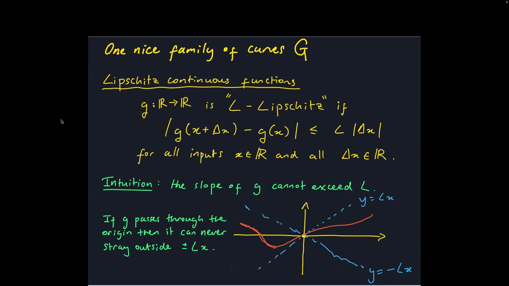
*▲ 강의 슬라이드 [11:58](https://youtu.be/ySaoWrv3T_Q?t=718): [립시츠 연속](00_%EB%94%A5%EB%9F%AC%EB%8B%9D_%EC%9A%A9%EC%96%B4%EC%82%AC%EC%A0%84.md#lipschitz-continuity-%EB%A6%BD%EC%8B%9C%EC%B8%A0-%EC%97%B0%EC%86%8D)의 정의와 나비넥타이 그림*

*▲ 직접 그린 그림: $L = 2$인 $\sin 2x$는 나비넥타이 안에, $\sqrt{x}$는 0 근처에서 밖으로 나간다*

### 5.2 입력이 여러 개일 때와 RMS 노름

▶ 영상 [12:15](https://youtu.be/ySaoWrv3T_Q?t=735)

입력이 $\mathbb{R}^d$의 벡터면 $|\Delta x|$를 그대로 쓸 수 없습니다. 벡터의 크기를 재는 **[노름](00_%EB%94%A5%EB%9F%AC%EB%8B%9D_%EC%9A%A9%EC%96%B4%EC%82%AC%EC%A0%84.md#norm-%EB%85%B8%EB%A6%84)**으로 바꿉니다. 강사가 좋아하는 [노름](00_%EB%94%A5%EB%9F%AC%EB%8B%9D_%EC%9A%A9%EC%96%B4%EC%82%AC%EC%A0%84.md#norm-%EB%85%B8%EB%A6%84)은 **[RMS 노름](00_%EB%94%A5%EB%9F%AC%EB%8B%9D_%EC%9A%A9%EC%96%B4%EC%82%AC%EC%A0%84.md#rms-norm-rms-%EB%85%B8%EB%A6%84)**입니다.

$$|g(x + \Delta x) - g(x)| \le L\,\lVert \Delta x \rVert_{\mathrm{RMS}}, \qquad \lVert x \rVert_{\mathrm{RMS}} = \sqrt{\frac{1}{d}\sum_{i=1}^{d} x_i^2} = \frac{1}{\sqrt{d}}\lVert x \rVert_2$$

기호 풀이

| 기호 | 읽는 법 | 뜻 | 예제 값 |
| --- | --- | --- | --- |
| $g$ | 지 | 벡터를 받아 숫자 하나를 내는 함수 | $g(x) = \frac{x_1 + x_2}{2}$ |
| $x$ | 엑스 | 입력 벡터 ($\mathbb{R}^d$) | (0, 0) |
| $\Delta x$ | 델타 엑스 | 입력 벡터의 변화량 | (0.3, 0.4) |
| $L$ | 엘 | [립시츠](00_%EB%94%A5%EB%9F%AC%EB%8B%9D_%EC%9A%A9%EC%96%B4%EC%82%AC%EC%A0%84.md#lipschitz-continuity-%EB%A6%BD%EC%8B%9C%EC%B8%A0-%EC%97%B0%EC%86%8D) 상수 | 1 |
| $d$ | 디 | 입력 차원(원소 수) | 2 |
| $x_i$ | 엑스 아이 | 벡터의 $i$번째 원소 | $\Delta x_2 = 0.4$ |
| $\sum_{i=1}^{d}$ | 시그마 아이는 1부터 디까지 | 원소 $d$개를 모두 더함 | 0.09 + 0.16 = 0.25 |
| $\lVert x \rVert_2$ | 엑스의 투 [노름](00_%EB%94%A5%EB%9F%AC%EB%8B%9D_%EC%9A%A9%EC%96%B4%EC%82%AC%EC%A0%84.md#norm-%EB%85%B8%EB%A6%84) | 유클리드 [노름](00_%EB%94%A5%EB%9F%AC%EB%8B%9D_%EC%9A%A9%EC%96%B4%EC%82%AC%EC%A0%84.md#norm-%EB%85%B8%EB%A6%84)(길이) | 0.5 |
| $\lVert x \rVert_{\mathrm{RMS}}$ | 엑스의 [RMS 노름](00_%EB%94%A5%EB%9F%AC%EB%8B%9D_%EC%9A%A9%EC%96%B4%EC%82%AC%EC%A0%84.md#rms-norm-rms-%EB%85%B8%EB%A6%84) | 유클리드 [노름](00_%EB%94%A5%EB%9F%AC%EB%8B%9D_%EC%9A%A9%EC%96%B4%EC%82%AC%EC%A0%84.md#norm-%EB%85%B8%EB%A6%84) ÷ $\sqrt{d}$ | 0.3536 |

예제와 풀이

**문제**: 두 입력의 평균을 내는 함수 $g$에서 입력 벡터를 (0, 0)에서 (0.3, 0.4)만큼 움직이면, 출력 변화가 [RMS 노름](00_%EB%94%A5%EB%9F%AC%EB%8B%9D_%EC%9A%A9%EC%96%B4%EC%82%AC%EC%A0%84.md#rms-norm-rms-%EB%85%B8%EB%A6%84)으로 잰 상한 안에 드는가?

**주어진 값**:
- $g(x) = \frac{x_1 + x_2}{2}$ (두 원소의 평균)
- $L = 1$ ([RMS 노름](00_%EB%94%A5%EB%9F%AC%EB%8B%9D_%EC%9A%A9%EC%96%B4%EC%82%AC%EC%A0%84.md#rms-norm-rms-%EB%85%B8%EB%A6%84) 기준 립시츠 상수)
- $x = (0, 0)$ (기준 입력 벡터)
- $\Delta x = (0.3, 0.4)$ (입력 변화량)
- $d = 2$ (원소 수)

**풀이**
1. 식을 그대로 쓴다: $|g(x + \Delta x) - g(x)| \le L\,\lVert \Delta x \rVert_{\mathrm{RMS}}, \quad \lVert x \rVert_{\mathrm{RMS}} = \sqrt{\frac{1}{d}\sum_{i=1}^{d} x_i^2} = \frac{1}{\sqrt{d}}\lVert x \rVert_2$
2. 값을 대입한다: $\big|g\big((0, 0) + (0.3, 0.4)\big) - g\big((0, 0)\big)\big| \le 1 \times \sqrt{\frac{1}{2}\left(0.3^2 + 0.4^2\right)}$
3. 벡터 덧셈을 칸끼리 한다: $(0 + 0.3,\ 0 + 0.4) = (0.3, 0.4)$
4. $g$에 넣는다(두 원소의 평균): $\left|\frac{0.3 + 0.4}{2} - \frac{0 + 0}{2}\right|$
5. 분자 덧셈을 한다: $0.3 + 0.4 = 0.7$, $0 + 0 = 0$ 이므로 $\left|\frac{0.7}{2} - \frac{0}{2}\right|$
6. 나눗셈을 한다: $0.7 \div 2 = 0.35$, $0 \div 2 = 0$ 이므로 왼쪽은 $|0.35 - 0| = 0.35$
7. 오른쪽의 제곱을 한다: $0.3^2 = 0.09$, $0.4^2 = 0.16$
8. Σ를 펼친 덧셈을 한다: $0.09 + 0.16 = 0.25$
9. $\frac{1}{d}$을 곱한다: $\frac{1}{2} \times 0.25 = 0.125$
10. √의 뜻: 제곱해서 그 수가 되는 양수(제곱근)다. 계산기나 Python `math.sqrt`로 구한다: $\sqrt{0.125} = 0.3536$
11. $L$을 곱한다: $1 \times 0.3536 = 0.3536$ 이므로 $0.35 \le 0.3536$
12. 두 수를 비교한다: 0.35는 0.3536보다 작다

**답**: 성립한다 (0.35 ≤ 0.3536)

내 이해

- 유클리드 [노름](00_%EB%94%A5%EB%9F%AC%EB%8B%9D_%EC%9A%A9%EC%96%B4%EC%82%AC%EC%A0%84.md#norm-%EB%85%B8%EB%A6%84)은 차원에 따라 커지는 "차원 있는" 양입니다. 원소가 모두 1이면 유클리드 [노름](00_%EB%94%A5%EB%9F%AC%EB%8B%9D_%EC%9A%A9%EC%96%B4%EC%82%AC%EC%A0%84.md#norm-%EB%85%B8%EB%A6%84)은 $\sqrt{d}$지만 [RMS 노름](00_%EB%94%A5%EB%9F%AC%EB%8B%9D_%EC%9A%A9%EC%96%B4%EC%82%AC%EC%A0%84.md#rms-norm-rms-%EB%85%B8%EB%A6%84)은 1입니다. [RMS 노름](00_%EB%94%A5%EB%9F%AC%EB%8B%9D_%EC%9A%A9%EC%96%B4%EC%82%AC%EC%A0%84.md#rms-norm-rms-%EB%85%B8%EB%A6%84)은 차원 없는 버전입니다.
- 메시지: 벡터 같은 대상의 크기를 재는 방법은 여러 가지입니다.

---

## 6. 증명할 정리

▶ 영상 [14:29](https://youtu.be/ySaoWrv3T_Q?t=869)

📐 **수학 개념**: [직사각형 근사와 차원의 저주](%EC%88%98%ED%95%99%EA%B0%9C%EB%85%90/06_%EA%B7%BC%EC%82%AC_%EC%9D%B4%EB%A1%A0/MM12_%EC%A7%81%EC%82%AC%EA%B0%81%ED%98%95_%EA%B7%BC%EC%82%AC%EC%99%80_%EC%B0%A8%EC%9B%90%EC%9D%98_%EC%A0%80%EC%A3%BC.md)

> [!NOTE]
> **정리 (강의 버전)**
> $g: [0, 1]^d \to \mathbb{R}$이 $L$-립시츠 함수라고 하자. 그러면 어떤 [오차](00_%EB%94%A5%EB%9F%AC%EB%8B%9D_%EC%9A%A9%EC%96%B4%EC%82%AC%EC%A0%84.md#error-%EC%98%A4%EC%B0%A8) $\varepsilon > 0$에 대해서도, 뉴런이 $N = 4d\,(L/\varepsilon)^d$개인 **3층 [ReLU](00_%EB%94%A5%EB%9F%AC%EB%8B%9D_%EC%9A%A9%EC%96%B4%EC%82%AC%EC%A0%84.md#relu-%EB%A0%90%EB%A3%A8) 망** $f$가 존재해서
> $$\int_{[0,1]^d} |f(x) - g(x)|\,dx < 2\varepsilon$$

기호 풀이

| 기호 | 읽는 법 | 뜻 | 예제 값 |
| --- | --- | --- | --- |
| $[0,1]^d$ | 영 일 구간의 디제곱 | 모든 좌표가 0~1인 [초입방체](00_%EB%94%A5%EB%9F%AC%EB%8B%9D_%EC%9A%A9%EC%96%B4%EC%82%AC%EC%A0%84.md#hypercube-%EC%B4%88%EC%9E%85%EB%B0%A9%EC%B2%B4) | $d = 1$이면 구간 [0, 1] |
| $\int_{[0,1]^d} \cdots dx$ | [초입방체](00_%EB%94%A5%EB%9F%AC%EB%8B%9D_%EC%9A%A9%EC%96%B4%EC%82%AC%EC%A0%84.md#hypercube-%EC%B4%88%EC%9E%85%EB%B0%A9%EC%B2%B4) 위 적분 | [초입방체](00_%EB%94%A5%EB%9F%AC%EB%8B%9D_%EC%9A%A9%EC%96%B4%EC%82%AC%EC%A0%84.md#hypercube-%EC%B4%88%EC%9E%85%EB%B0%A9%EC%B2%B4) 전체에서 차이를 더한 넓이(부피) | 0.0703 |
| $f$ | 에프 | 뉴런 $N$개인 3층 [ReLU](00_%EB%94%A5%EB%9F%AC%EB%8B%9D_%EC%9A%A9%EC%96%B4%EC%82%AC%EC%A0%84.md#relu-%EB%A0%90%EB%A3%A8) 망 | 뉴런 32개 |
| $g$ | 지 | $L$-[립시츠](00_%EB%94%A5%EB%9F%AC%EB%8B%9D_%EC%9A%A9%EC%96%B4%EC%82%AC%EC%A0%84.md#lipschitz-continuity-%EB%A6%BD%EC%8B%9C%EC%B8%A0-%EC%97%B0%EC%86%8D) 목표 함수 | $\sin 2x$ ($L = 2$) |
| $\lvert f(x) - g(x) \rvert$ | 차이의 절댓값 | 한 점에서 망과 목표의 차이 | - |
| $\varepsilon$ | 엡실론 | 우리가 정하는 작은 [오차](00_%EB%94%A5%EB%9F%AC%EB%8B%9D_%EC%9A%A9%EC%96%B4%EC%82%AC%EC%A0%84.md#error-%EC%98%A4%EC%B0%A8) | 0.25 |
| $2\varepsilon$ | 이 엡실론 | 정리가 보장하는 [적분 오차](00_%EB%94%A5%EB%9F%AC%EB%8B%9D_%EC%9A%A9%EC%96%B4%EC%82%AC%EC%A0%84.md#l-error-l1-error-%EC%B5%9C%EB%8C%80-%EC%98%A4%EC%B0%A8%EC%99%80-%EC%A0%81%EB%B6%84-%EC%98%A4%EC%B0%A8) 상한 | 0.5 |

예제와 풀이

**문제**: 입력이 1개($d = 1$)이고 [기울기](00_%EB%94%A5%EB%9F%AC%EB%8B%9D_%EC%9A%A9%EC%96%B4%EC%82%AC%EC%A0%84.md#gradient-%EA%B8%B0%EC%9A%B8%EA%B8%B0) 상한 2인 목표 $g(x) = \sin 2x$를 $\varepsilon = 0.25$로 근사할 때, 정리가 말하는 뉴런 수와 상한은? 실제로 $c = 1000$으로 망을 만들면 [적분 오차](00_%EB%94%A5%EB%9F%AC%EB%8B%9D_%EC%9A%A9%EC%96%B4%EC%82%AC%EC%A0%84.md#l-error-l1-error-%EC%B5%9C%EB%8C%80-%EC%98%A4%EC%B0%A8%EC%99%80-%EC%A0%81%EB%B6%84-%EC%98%A4%EC%B0%A8)는?

**주어진 값**:
- $d = 1$ (입력 차원)
- $g(x) = \sin 2x$ (목표 함수)
- $L = 2$ (립시츠 상수)
- $\varepsilon = 0.25$ (원하는 [오차](00_%EB%94%A5%EB%9F%AC%EB%8B%9D_%EC%9A%A9%EC%96%B4%EC%82%AC%EC%A0%84.md#error-%EC%98%A4%EC%B0%A8))
- $c = 1000$ (직사각형 경사의 가파름)

**풀이**
1. 식을 그대로 쓴다: $\int_{[0,1]^d} |f(x) - g(x)|\,dx < 2\varepsilon$ (뉴런 수 $N = 4d\,(L/\varepsilon)^d$)
2. 값을 대입한다: $\int_{[0,1]^1} |f(x) - \sin 2x|\,dx < 2 \times 0.25$ (뉴런 수 $N = 4 \times 1 \times (2/0.25)^1$)
3. 오른쪽 곱셈을 한다: $2 \times 0.25 = 0.5$ 이므로 목표는 적분 $< 0.5$
4. 뉴런 수의 나눗셈을 한다: $2 \div 0.25 = 8$ 이므로 $N = 4 \times 1 \times 8^1$
5. 거듭제곱을 한다: $8^1 = 8$ (상자 8개)
6. 곱셈을 한다: $4 \times 1 \times 8 = 32$ 이므로 뉴런 32개
7. 적분(∫)의 뜻: 0~1에서 차이 $|f(x) - \sin 2x|$ 그래프 아래 넓이다. 손으로 구하기 어려워 Python으로 0~1을 촘촘히(200만 칸) 나눠 넓이를 더한다
8. 막대 8개(왼쪽 끝 높이) 근사의 넓이를 잰다: 0.0692 ($\varepsilon = 0.25$ 이하)
9. $c = 1000$인 [ReLU](00_%EB%94%A5%EB%9F%AC%EB%8B%9D_%EC%9A%A9%EC%96%B4%EC%82%AC%EC%A0%84.md#relu-%EB%A0%90%EB%A3%A8) 망과 막대 근사의 차이 넓이를 잰다: 0.0010 ($\varepsilon$ 미만)
10. 망 전체의 [적분 오차](00_%EB%94%A5%EB%9F%AC%EB%8B%9D_%EC%9A%A9%EC%96%B4%EC%82%AC%EC%A0%84.md#l-error-l1-error-%EC%B5%9C%EB%8C%80-%EC%98%A4%EC%B0%A8%EC%99%80-%EC%A0%81%EB%B6%84-%EC%98%A4%EC%B0%A8)를 잰다: 0.0703
11. 두 수를 비교한다: 0.0703은 0.5보다 작다

**답**: 뉴런 32개, 실제 [적분 오차](00_%EB%94%A5%EB%9F%AC%EB%8B%9D_%EC%9A%A9%EC%96%B4%EC%82%AC%EC%A0%84.md#l-error-l1-error-%EC%B5%9C%EB%8C%80-%EC%98%A4%EC%B0%A8%EC%99%80-%EC%A0%81%EB%B6%84-%EC%98%A4%EC%B0%A8) 0.0703으로 상한 $2\varepsilon = 0.5$보다 작다

내 이해

- $[0, 1]^d$는 모든 좌표가 0~1인 **[초입방체](00_%EB%94%A5%EB%9F%AC%EB%8B%9D_%EC%9A%A9%EC%96%B4%EC%82%AC%EC%A0%84.md#hypercube-%EC%B4%88%EC%9E%85%EB%B0%A9%EC%B2%B4)**(hypercube)입니다. 3차원이면 정육면체입니다.
- $N$은 망 전체의 뉴런 수입니다.
- "3층 [ReLU](00_%EB%94%A5%EB%9F%AC%EB%8B%9D_%EC%9A%A9%EC%96%B4%EC%82%AC%EC%A0%84.md#relu-%EB%A0%90%EB%A3%A8) 망"은 [가중치](00_%EB%94%A5%EB%9F%AC%EB%8B%9D_%EC%9A%A9%EC%96%B4%EC%82%AC%EC%A0%84.md#weight-%EA%B0%80%EC%A4%91%EC%B9%98) 행렬 3개, 첫째·둘째 행렬 뒤에 [ReLU](00_%EB%94%A5%EB%9F%AC%EB%8B%9D_%EC%9A%A9%EC%96%B4%EC%82%AC%EC%A0%84.md#relu-%EB%A0%90%EB%A3%A8) 2번, 셋째 행렬 뒤에는 [ReLU](00_%EB%94%A5%EB%9F%AC%EB%8B%9D_%EC%9A%A9%EC%96%B4%EC%82%AC%EC%A0%84.md#relu-%EB%A0%90%EB%A3%A8) 없음.
- 강사는 이 결과가 **중요하다고 주장하는 것이 아니라** 증명 전체를 볼 수 있는 예로 고른 것이라고 말합니다. $(L/\varepsilon)^d$는 차원에 지수적이라 실제로는 쓸 수 없을 만큼 커질 수 있습니다.

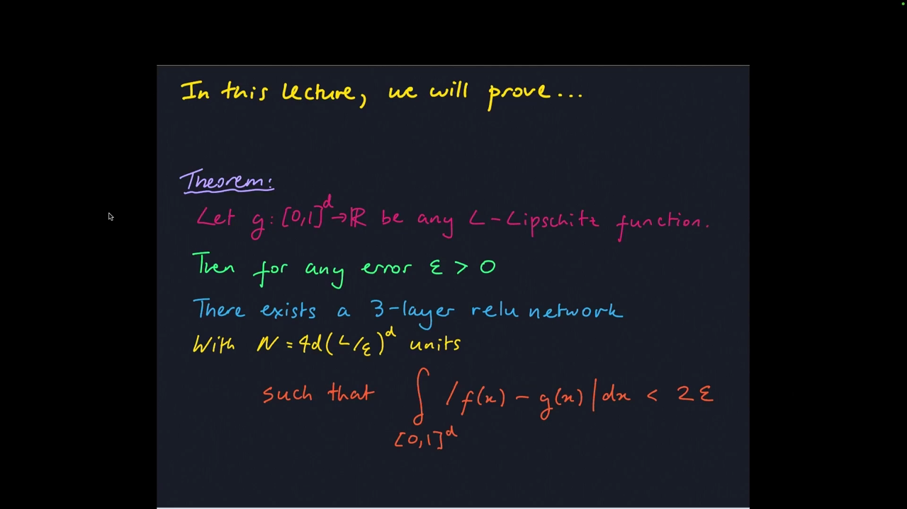
*▲ 강의 슬라이드 [16:40](https://youtu.be/ySaoWrv3T_Q?t=1000): 이번 강의에서 증명할 정리*

질의응답 정리 [16:10](https://youtu.be/ySaoWrv3T_Q?t=970)

- **$[0, 1]^d$는 0과 1 두 값만이라는 뜻?** 아니요. 대괄호는 0~1 사이 실수 구간이고, $d$제곱은 모든 축에서 그 구간을 고른 [초입방체](00_%EB%94%A5%EB%9F%AC%EB%8B%9D_%EC%9A%A9%EC%96%B4%EC%82%AC%EC%A0%84.md#hypercube-%EC%B4%88%EC%9E%85%EB%B0%A9%EC%B2%B4)입니다.
- **$N$은 층당 뉴런 수?** 망 전체의 합입니다. 다만 3층뿐이라 이해하는 데는 큰 차이가 없습니다.
- **왜 이렇게 특수한 정리를?** 증명이 길지 않아서 전체를 보여 줄 수 있기 때문입니다. 다른 결과는 참고문헌으로 소개합니다.
- **1강의 "[ReLU](00_%EB%94%A5%EB%9F%AC%EB%8B%9D_%EC%9A%A9%EC%96%B4%EC%82%AC%EC%A0%84.md#relu-%EB%A0%90%EB%A3%A8) 한 [층](00_%EB%94%A5%EB%9F%AC%EB%8B%9D_%EC%9A%A9%EC%96%B4%EC%82%AC%EC%A0%84.md#layer-%EC%B8%B5)이면 된다"는 정리와 같은가?** 다른 결과입니다. 이 정리는 3층 망에 대한 것이고, 더 일반적이고 흥미로운 버전들이 따로 있습니다.
- **구간을 옮기거나 늘려도 되나?** 됩니다. 축마다 크기가 다른 직육면체로 바꿔도 되고, 대신 립시츠 상수 같은 상수가 바뀝니다.
- **입력을 상자 안으로 제한하는 건 비현실적이지 않나?** 실제로도 입력을 좌표마다 크기 1 정도로 [정규화](00_%EB%94%A5%EB%9F%AC%EB%8B%9D_%EC%9A%A9%EC%96%B4%EC%82%AC%EC%A0%84.md#normalization-%EC%A0%95%EA%B7%9C%ED%99%94)하는 경우가 많아서, 많은 문제에서 꽤 현실적인 가정입니다.
- **$1/\varepsilon^d$보다 잘할 수는 없나?** 문제 구조를 더 알면 훨씬 잘할 수 있을 것이라고 답합니다. 이 결과는 차원 의존성이 아주 나쁜, 최선이 아닌 결과입니다.

---

## 7. 증명

▶ 영상 [22:24](https://youtu.be/ySaoWrv3T_Q?t=1344)

증명 전략은 세 단계입니다.

1. 입력이 1차원이라 치고, [ReLU](00_%EB%94%A5%EB%9F%AC%EB%8B%9D_%EC%9A%A9%EC%96%B4%EC%82%AC%EC%A0%84.md#relu-%EB%A0%90%EB%A3%A8)는 잊은 채 **직사각형 막대**로 함수를 근사한다. 막대를 좁힐수록 근사가 좋아지는 정도를 센다.
2. 같은 방식을 **다차원 입력**의 상자([초직사각형](00_%EB%94%A5%EB%9F%AC%EB%8B%9D_%EC%9A%A9%EC%96%B4%EC%82%AC%EC%A0%84.md#hyperrectangle-%EC%B4%88%EC%A7%81%EC%82%AC%EA%B0%81%ED%98%95))로 확장한다.
3. **2층 [ReLU](00_%EB%94%A5%EB%9F%AC%EB%8B%9D_%EC%9A%A9%EC%96%B4%EC%82%AC%EC%A0%84.md#relu-%EB%A0%90%EB%A3%A8) 망으로 상자 하나**를 만들 수 있음을 보인다. 셋째 [층](00_%EB%94%A5%EB%9F%AC%EB%8B%9D_%EC%9A%A9%EC%96%B4%EC%82%AC%EC%A0%84.md#layer-%EC%B8%B5)으로 상자들을 선형 결합하면 함수 전체를 근사한다.

### 7.1 1단계: 1차원 직사각형 막대

▶ 영상 [23:31](https://youtu.be/ySaoWrv3T_Q?t=1411)

📐 **수학 개념**: [직사각형 근사와 차원의 저주](%EC%88%98%ED%95%99%EA%B0%9C%EB%85%90/06_%EA%B7%BC%EC%82%AC_%EC%9D%B4%EB%A1%A0/MM12_%EC%A7%81%EC%82%AC%EA%B0%81%ED%98%95_%EA%B7%BC%EC%82%AC%EC%99%80_%EC%B0%A8%EC%9B%90%EC%9D%98_%EC%A0%80%EC%A3%BC.md) · [리만 합](%EC%88%98%ED%95%99%EA%B0%9C%EB%85%90/06_%EA%B7%BC%EC%82%AC_%EC%9D%B4%EB%A1%A0/MM07_%EB%A6%AC%EB%A7%8C_%ED%95%A9%EA%B3%BC_%EB%B3%B4%ED%8E%B8_%EA%B7%BC%EC%82%AC.md)

- 격자점마다 막대를 세운 함수: $f(x) = \sum_i \alpha_i\,\mathbb{1}_i(x)$. $\alpha_i$는 $i$번째 막대의 높이, $\mathbb{1}_i$는 입력이 $i$번째 칸에 있으면 1, 아니면 0인 **[지시 함수](00_%EB%94%A5%EB%9F%AC%EB%8B%9D_%EC%9A%A9%EC%96%B4%EC%82%AC%EC%A0%84.md#indicator-function-%EC%A7%80%EC%8B%9C-%ED%95%A8%EC%88%98)**입니다. 한 입력에서는 [지시 함수](00_%EB%94%A5%EB%9F%AC%EB%8B%9D_%EC%9A%A9%EC%96%B4%EC%82%AC%EC%A0%84.md#indicator-function-%EC%A7%80%EC%8B%9C-%ED%95%A8%EC%88%98) 하나만 켜지므로 그 막대 높이가 출력입니다.
- 막대 왼쪽 위 모서리가 함수에 닿게 놓으면, 막대와 함수의 틈은 얼마나 클 수 있을까요? 학생 답: **립시츠 조건**을 쓰면 삼각형 넓이로 막을 수 있다.
- 막대 $N$개면 한 칸 너비는 $\frac{1}{N}$, 립시츠 조건 때문에 칸 끝까지 높이 차이는 $\frac{L}{N}$ 이하, 삼각형 넓이는 $\frac{1}{2}\cdot\frac{L}{N^2}$. 칸 $N$개를 더하면

$$\text{적분 오차} \le N \times \frac{1}{2}\frac{L}{N^2} = \frac{L}{2N}$$

기호 풀이

| 기호 | 읽는 법 | 뜻 | 예제 값 |
| --- | --- | --- | --- |
| $N$ | 엔 | 막대(칸) 수 | 4 |
| $L$ | 엘 | [립시츠](00_%EB%94%A5%EB%9F%AC%EB%8B%9D_%EC%9A%A9%EC%96%B4%EC%82%AC%EC%A0%84.md#lipschitz-continuity-%EB%A6%BD%EC%8B%9C%EC%B8%A0-%EC%97%B0%EC%86%8D) 상수 | 2 |
| $\frac{1}{N}$ | 엔분의 일 | 한 칸의 너비(삼각형 밑변) | 0.25 |
| $\frac{L}{N}$ | 엔분의 엘 | 칸 끝까지 함수가 벗어날 수 있는 높이 | 0.5 |
| $\frac{1}{2}\frac{L}{N^2}$ | 이분의 일 엔제곱분의 엘 | 한 칸의 빈틈 삼각형 넓이 | 0.0625 |
| $\frac{L}{2N}$ | 이엔분의 엘 | 막대 $N$개 전체의 [적분 오차](00_%EB%94%A5%EB%9F%AC%EB%8B%9D_%EC%9A%A9%EC%96%B4%EC%82%AC%EC%A0%84.md#l-error-l1-error-%EC%B5%9C%EB%8C%80-%EC%98%A4%EC%B0%A8%EC%99%80-%EC%A0%81%EB%B6%84-%EC%98%A4%EC%B0%A8) 상한 | 0.25 |

예제와 풀이

**문제**: [기울기](00_%EB%94%A5%EB%9F%AC%EB%8B%9D_%EC%9A%A9%EC%96%B4%EC%82%AC%EC%A0%84.md#gradient-%EA%B8%B0%EC%9A%B8%EA%B8%B0) 상한 2인 함수를 0~1에서 막대 4개로 근사할 때, [적분 오차](00_%EB%94%A5%EB%9F%AC%EB%8B%9D_%EC%9A%A9%EC%96%B4%EC%82%AC%EC%A0%84.md#l-error-l1-error-%EC%B5%9C%EB%8C%80-%EC%98%A4%EC%B0%A8%EC%99%80-%EC%A0%81%EB%B6%84-%EC%98%A4%EC%B0%A8)의 상한은?

**주어진 값**:
- $L = 2$ (립시츠 상수)
- $N = 4$ (막대 수)

**풀이**
1. 식을 그대로 쓴다: $\text{적분 오차} \le N \times \frac{1}{2}\frac{L}{N^2} = \frac{L}{2N}$
2. 값을 대입한다: $\text{적분 오차} \le 4 \times \frac{1}{2}\frac{2}{4^2} = \frac{2}{2 \times 4}$
3. 거듭제곱을 한다: $4^2 = 16$ 이므로 $4 \times \frac{1}{2} \times \frac{2}{16}$
4. 나눗셈을 한다: $2 \div 16 = 0.125$ 이므로 $4 \times \frac{1}{2} \times 0.125$
5. $\frac{1}{2}$을 곱한다: $0.5 \times 0.125 = 0.0625$ (한 칸 삼각형 넓이)
6. 칸 수를 곱한다: $4 \times 0.0625 = 0.25$
7. 오른쪽 모양으로 확인한다. 분모 곱셈: $2 \times 4 = 8$
8. 나눗셈을 한다: $2 \div 8 = 0.25$ (같은 값)

**답**: [적분 오차](00_%EB%94%A5%EB%9F%AC%EB%8B%9D_%EC%9A%A9%EC%96%B4%EC%82%AC%EC%A0%84.md#l-error-l1-error-%EC%B5%9C%EB%8C%80-%EC%98%A4%EC%B0%A8%EC%99%80-%EC%A0%81%EB%B6%84-%EC%98%A4%EC%B0%A8) ≤ 0.25

내 이해

- [오차](00_%EB%94%A5%EB%9F%AC%EB%8B%9D_%EC%9A%A9%EC%96%B4%EC%82%AC%EC%A0%84.md#error-%EC%98%A4%EC%B0%A8) $\varepsilon$을 보장하려면 식을 뒤집어 $N \ge \frac{L}{2\varepsilon}$. 상수 1/2은 중요하지 않으니 버리고 **$N \ge L/\varepsilon$**으로 씁니다.

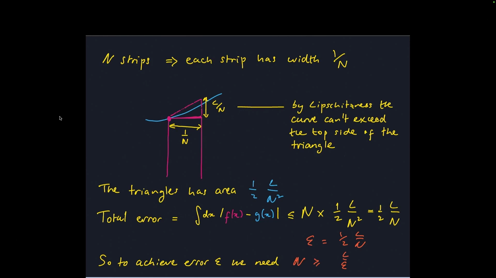
*▲ 강의 슬라이드 [28:30](https://youtu.be/ySaoWrv3T_Q?t=1710): 막대 하나의 [오차](00_%EB%94%A5%EB%9F%AC%EB%8B%9D_%EC%9A%A9%EC%96%B4%EC%82%AC%EC%A0%84.md#error-%EC%98%A4%EC%B0%A8) 삼각형과 필요한 막대 수*

*▲ 직접 그린 그림: $\sin 2x$($L = 2$)를 막대 4개로 근사하면 실제 [오차](00_%EB%94%A5%EB%9F%AC%EB%8B%9D_%EC%9A%A9%EC%96%B4%EC%82%AC%EC%A0%84.md#error-%EC%98%A4%EC%B0%A8) 0.1406, 상한 0.25. 오른쪽은 차원별 필요 상자 수*

### 7.2 2단계: 고차원 초직사각형

▶ 영상 [28:32](https://youtu.be/ySaoWrv3T_Q?t=1712)

- 입력이 2개면 함수는 곡면이고, 막대 대신 상자(**[초직사각형](00_%EB%94%A5%EB%9F%AC%EB%8B%9D_%EC%9A%A9%EC%96%B4%EC%82%AC%EC%A0%84.md#hyperrectangle-%EC%B4%88%EC%A7%81%EC%82%AC%EA%B0%81%ED%98%95)**)로 덮습니다. 고차원은 3차원을 떠올리면 됩니다.
- 전체 [오차](00_%EB%94%A5%EB%9F%AC%EB%8B%9D_%EC%9A%A9%EC%96%B4%EC%82%AC%EC%A0%84.md#error-%EC%98%A4%EC%B0%A8) = (상자 수) × (상자 위 [오차](00_%EB%94%A5%EB%9F%AC%EB%8B%9D_%EC%9A%A9%EC%96%B4%EC%82%AC%EC%A0%84.md#error-%EC%98%A4%EC%B0%A8) 덮개의 높이) × (덮개 넓이). 상자 $N$개가 단위 [초입방체](00_%EB%94%A5%EB%9F%AC%EB%8B%9D_%EC%9A%A9%EC%96%B4%EC%82%AC%EC%A0%84.md#hypercube-%EC%B4%88%EC%9E%85%EB%B0%A9%EC%B2%B4)를 채우면 한 변은 $N^{-1/d}$, 넓이는 $\frac{1}{N}$, 높이는 립시츠 조건으로 $L N^{-1/d}$ 이하.

$$\text{적분 오차} \le N \times \frac{L}{N^{1/d}} \times \frac{1}{N} = \frac{L}{N^{1/d}} \;\Longrightarrow\; N \ge \left(\frac{L}{\varepsilon}\right)^d$$

기호 풀이

| 기호 | 읽는 법 | 뜻 | 예제 값 |
| --- | --- | --- | --- |
| $N$ | 엔 | 상자([초직사각형](00_%EB%94%A5%EB%9F%AC%EB%8B%9D_%EC%9A%A9%EC%96%B4%EC%82%AC%EC%A0%84.md#hyperrectangle-%EC%B4%88%EC%A7%81%EC%82%AC%EA%B0%81%ED%98%95)) 수 | 16 |
| $d$ | 디 | 입력 차원 | 2 |
| $N^{1/d}$ | 엔의 디분의 일 제곱 | 한 축에 놓이는 상자 수 | 4 |
| $\frac{L}{N^{1/d}}$ | 엔의 디분의 일 제곱분의 엘 | 상자 하나 위 [오차](00_%EB%94%A5%EB%9F%AC%EB%8B%9D_%EC%9A%A9%EC%96%B4%EC%82%AC%EC%A0%84.md#error-%EC%98%A4%EC%B0%A8) 높이 상한 (= 전체 [오차](00_%EB%94%A5%EB%9F%AC%EB%8B%9D_%EC%9A%A9%EC%96%B4%EC%82%AC%EC%A0%84.md#error-%EC%98%A4%EC%B0%A8) 상한) | 0.5 |
| $\frac{1}{N}$ | 엔분의 일 | 상자 하나의 바닥 넓이 | 0.0625 |
| $L$ | 엘 | [립시츠](00_%EB%94%A5%EB%9F%AC%EB%8B%9D_%EC%9A%A9%EC%96%B4%EC%82%AC%EC%A0%84.md#lipschitz-continuity-%EB%A6%BD%EC%8B%9C%EC%B8%A0-%EC%97%B0%EC%86%8D) 상수 | 2 |
| $\varepsilon$ | 엡실론 | 원하는 [적분 오차](00_%EB%94%A5%EB%9F%AC%EB%8B%9D_%EC%9A%A9%EC%96%B4%EC%82%AC%EC%A0%84.md#l-error-l1-error-%EC%B5%9C%EB%8C%80-%EC%98%A4%EC%B0%A8%EC%99%80-%EC%A0%81%EB%B6%84-%EC%98%A4%EC%B0%A8) | 0.5 |
| $\Longrightarrow$ | 그러므로 | [오차](00_%EB%94%A5%EB%9F%AC%EB%8B%9D_%EC%9A%A9%EC%96%B4%EC%82%AC%EC%A0%84.md#error-%EC%98%A4%EC%B0%A8) $\le \varepsilon$이 되려면 필요한 조건 | - |

예제와 풀이

**문제**: 입력이 2개($d = 2$)이고 [기울기](00_%EB%94%A5%EB%9F%AC%EB%8B%9D_%EC%9A%A9%EC%96%B4%EC%82%AC%EC%A0%84.md#gradient-%EA%B8%B0%EC%9A%B8%EA%B8%B0) 상한 2인 함수를 상자 16개로 덮을 때, [오차](00_%EB%94%A5%EB%9F%AC%EB%8B%9D_%EC%9A%A9%EC%96%B4%EC%82%AC%EC%A0%84.md#error-%EC%98%A4%EC%B0%A8) 상한이 $\varepsilon = 0.5$ 이하이고 상자 수 조건도 맞는가?

**주어진 값**:
- $L = 2$ (립시츠 상수)
- $\varepsilon = 0.5$ (원하는 [오차](00_%EB%94%A5%EB%9F%AC%EB%8B%9D_%EC%9A%A9%EC%96%B4%EC%82%AC%EC%A0%84.md#error-%EC%98%A4%EC%B0%A8))
- $d = 2$ (입력 차원)
- $N = 16$ (상자 수)

**풀이**
1. 식을 그대로 쓴다: $\text{적분 오차} \le N \times \frac{L}{N^{1/d}} \times \frac{1}{N} = \frac{L}{N^{1/d}} \;\Longrightarrow\; N \ge \left(\frac{L}{\varepsilon}\right)^d$
2. 값을 대입한다: $\text{적분 오차} \le 16 \times \frac{2}{16^{1/2}} \times \frac{1}{16} = \frac{2}{16^{1/2}} \;\Longrightarrow\; 16 \ge \left(\frac{2}{0.5}\right)^2$
3. $16^{1/2}$의 뜻: 2분의 1 제곱은 √(제곱근), 제곱해서 16이 되는 양수다. $4 \times 4 = 16$ 이므로 $16^{1/2} = 4$
4. 나눗셈을 한다: $2 \div 4 = 0.5$ (상자 하나 위 높이 상한)
5. 나눗셈을 한다: $1 \div 16 = 0.0625$ (상자 바닥 넓이)
6. 곱셈을 한다: $16 \times 0.5 = 8$
7. 곱셈을 한다: $8 \times 0.0625 = 0.5$ 이므로 [오차](00_%EB%94%A5%EB%9F%AC%EB%8B%9D_%EC%9A%A9%EC%96%B4%EC%82%AC%EC%A0%84.md#error-%EC%98%A4%EC%B0%A8) ≤ 0.5
8. 조건의 나눗셈을 한다: $2 \div 0.5 = 4$
9. 제곱을 한다: $4^2 = 16$ 이므로 $16 \ge 16$

**답**: [오차](00_%EB%94%A5%EB%9F%AC%EB%8B%9D_%EC%9A%A9%EC%96%B4%EC%82%AC%EC%A0%84.md#error-%EC%98%A4%EC%B0%A8) 상한 0.5 ($= \varepsilon$), 상자 16개로 조건 $N \ge 16$을 딱 맞춘다

내 이해

- 정리의 $(L/\varepsilon)^d$가 바로 이 상자 수입니다. 다음 단계에서 상자 하나를 작은 2층 [ReLU](00_%EB%94%A5%EB%9F%AC%EB%8B%9D_%EC%9A%A9%EC%96%B4%EC%82%AC%EC%A0%84.md#relu-%EB%A0%90%EB%A3%A8) 망으로 만들고, 그 뉴런 수를 곱하면 정리의 $N$이 나옵니다.

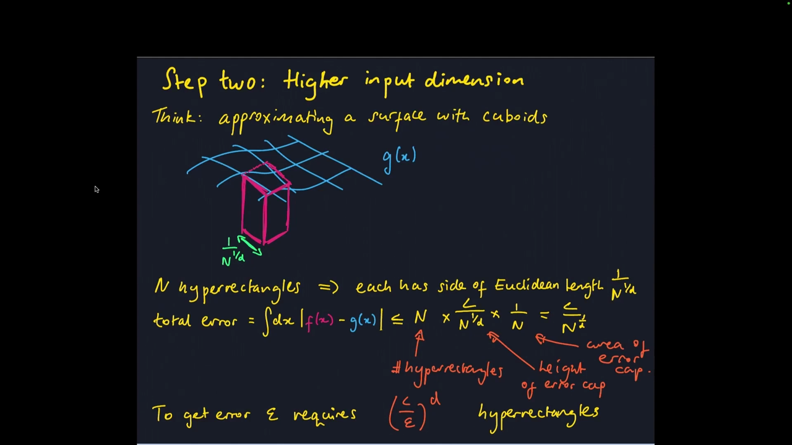
*▲ 강의 슬라이드 [31:50](https://youtu.be/ySaoWrv3T_Q?t=1910): 곡면을 상자로 근사할 때의 [오차](00_%EB%94%A5%EB%9F%AC%EB%8B%9D_%EC%9A%A9%EC%96%B4%EC%82%AC%EC%A0%84.md#error-%EC%98%A4%EC%B0%A8) 계산*

### 7.3 3단계: ReLU로 직사각형 만들기

▶ 영상 [32:04](https://youtu.be/ySaoWrv3T_Q?t=1924)

📐 **수학 개념**: [ReLU로 만드는 직사각형](%EC%88%98%ED%95%99%EA%B0%9C%EB%85%90/06_%EA%B7%BC%EC%82%AC_%EC%9D%B4%EB%A1%A0/MM13_ReLU%EB%A1%9C_%EB%A7%8C%EB%93%9C%EB%8A%94_%EC%A7%81%EC%82%AC%EA%B0%81%ED%98%95.md)

[ReLU](00_%EB%94%A5%EB%9F%AC%EB%8B%9D_%EC%9A%A9%EC%96%B4%EC%82%AC%EC%A0%84.md#relu-%EB%A0%90%EB%A3%A8) 4개로 1차원 직사각형을 만듭니다.

$$f_c(x) = \begin{bmatrix} +1 \\ -1 \\ -1 \\ +1 \end{bmatrix}^{\top} \mathrm{ReLU}\begin{bmatrix} cx \\ cx - 1 \\ c(x-1) - 2 \\ c(x-1) - 3 \end{bmatrix}$$

기호 풀이

| 기호 | 읽는 법 | 뜻 | 예제 값 |
| --- | --- | --- | --- |
| $f_c(x)$ | 에프 씨 엑스 | [ReLU](00_%EB%94%A5%EB%9F%AC%EB%8B%9D_%EC%9A%A9%EC%96%B4%EC%82%AC%EC%A0%84.md#relu-%EB%A0%90%EB%A3%A8) 4개로 만든 1차원 직사각형 | $f_{10}(1.25) = 0.5$ |
| $c$ | 씨 | 경사의 가파름. 클수록 직사각형에 가깝다 | 10 |
| $x$ | 엑스 | 입력 | 1.25 |
| $\mathrm{ReLU}$ | [렐루](00_%EB%94%A5%EB%9F%AC%EB%8B%9D_%EC%9A%A9%EC%96%B4%EC%82%AC%EC%A0%84.md#relu-%EB%A0%90%EB%A3%A8) | 음수는 0, 양수는 그대로 (칸마다 따로) | $\mathrm{ReLU}(-0.5) = 0$ |
| $\begin{bmatrix} +1 \\ -1 \\ -1 \\ +1 \end{bmatrix}^{\top}$ | 계수 벡터의 [전치](00_%EB%94%A5%EB%9F%AC%EB%8B%9D_%EC%9A%A9%EC%96%B4%EC%82%AC%EC%A0%84.md#transpose-%EC%A0%84%EC%B9%98) | 네 [ReLU](00_%EB%94%A5%EB%9F%AC%EB%8B%9D_%EC%9A%A9%EC%96%B4%EC%82%AC%EC%A0%84.md#relu-%EB%A0%90%EB%A3%A8) 출력을 더하고 빼는 둘째 [층](00_%EB%94%A5%EB%9F%AC%EB%8B%9D_%EC%9A%A9%EC%96%B4%EC%82%AC%EC%A0%84.md#layer-%EC%B8%B5) [가중치](00_%EB%94%A5%EB%9F%AC%EB%8B%9D_%EC%9A%A9%EC%96%B4%EC%82%AC%EC%A0%84.md#weight-%EA%B0%80%EC%A4%91%EC%B9%98) | (+1, −1, −1, +1) |
| $\top$ | 트랜스포즈 | 세로 벡터를 가로로 눕힘 ([내적](00_%EB%94%A5%EB%9F%AC%EB%8B%9D_%EC%9A%A9%EC%96%B4%EC%82%AC%EC%A0%84.md#dot-product-%EB%82%B4%EC%A0%81)) | - |

예제와 풀이

**문제**: 경사의 가파름이 $c = 10$인 [ReLU](00_%EB%94%A5%EB%9F%AC%EB%8B%9D_%EC%9A%A9%EC%96%B4%EC%82%AC%EC%A0%84.md#relu-%EB%A0%90%EB%A3%A8) 직사각형 $f_c$에 입력 1.25를 넣으면 출력은?

**주어진 값**:
- $c = 10$ (경사의 가파름)
- $x = 1.25$ (입력, 직사각형 오른쪽 끝 근처)

**풀이**
1. 식을 그대로 쓴다: $f_c(x) = \begin{bmatrix} +1 \\ -1 \\ -1 \\ +1 \end{bmatrix}^{\top} \mathrm{ReLU}\begin{bmatrix} cx \\ cx - 1 \\ c(x-1) - 2 \\ c(x-1) - 3 \end{bmatrix}$
2. 값을 대입한다: $f_{10}(1.25) = \begin{bmatrix} +1 \\ -1 \\ -1 \\ +1 \end{bmatrix}^{\top} \mathrm{ReLU}\begin{bmatrix} 10 \times 1.25 \\ 10 \times 1.25 - 1 \\ 10 \times (1.25 - 1) - 2 \\ 10 \times (1.25 - 1) - 3 \end{bmatrix}$
3. 괄호 안 뺄셈을 한다: $1.25 - 1 = 0.25$
4. 곱셈을 한다: $10 \times 1.25 = 12.5$, $10 \times 0.25 = 2.5$
5. 칸마다 뺄셈을 한다: $12.5$, $12.5 - 1 = 11.5$, $2.5 - 2 = 0.5$, $2.5 - 3 = -0.5$
6. [ReLU](00_%EB%94%A5%EB%9F%AC%EB%8B%9D_%EC%9A%A9%EC%96%B4%EC%82%AC%EC%A0%84.md#relu-%EB%A0%90%EB%A3%A8)의 뜻: 음수는 0으로 바꾸고, 0 이상은 그대로 둔다: $(12.5,\ 11.5,\ 0.5,\ 0)$
7. [전치](00_%EB%94%A5%EB%9F%AC%EB%8B%9D_%EC%9A%A9%EC%96%B4%EC%82%AC%EC%A0%84.md#transpose-%EC%A0%84%EC%B9%98) 곱([내적](00_%EB%94%A5%EB%9F%AC%EB%8B%9D_%EC%9A%A9%EC%96%B4%EC%82%AC%EC%A0%84.md#dot-product-%EB%82%B4%EC%A0%81))을 항별로 펼친다: $(+1) \times 12.5 + (-1) \times 11.5 + (-1) \times 0.5 + (+1) \times 0$
8. 곱셈을 한다: $12.5 - 11.5 - 0.5 + 0$
9. 앞에서부터 뺄셈을 한다: $12.5 - 11.5 = 1$ 이므로 $1 - 0.5 + 0$
10. 뺄셈을 한다: $1 - 0.5 = 0.5$

**답**: $f_{10}(1.25) = 0.5$ (내려가는 경사 1.2~1.3의 가운데)

내 이해

- $c \to \infty$로 보내면(조금 꼼수 같지만) 이 망은 0~1 구간에서 높이 1인 직사각형으로 수렴합니다. [가중치](00_%EB%94%A5%EB%9F%AC%EB%8B%9D_%EC%9A%A9%EC%96%B4%EC%82%AC%EC%A0%84.md#weight-%EA%B0%80%EC%A4%91%EC%B9%98)와 [편향](00_%EB%94%A5%EB%9F%AC%EB%8B%9D_%EC%9A%A9%EC%96%B4%EC%82%AC%EC%A0%84.md#bias-%ED%8E%B8%ED%96%A5)을 바꾸면 좌우로 옮길 수도 있습니다.
- **그래프 도구 시연** [33:15](https://youtu.be/ySaoWrv3T_Q?t=1995): $\mathrm{ReLU}(x)$에서 $\mathrm{ReLU}(x - 1)$을 빼면 평평해지고, 하나를 더 빼면 내려가고, 하나를 더하면 다시 평평해집니다. 경사가 너무 완만하니 상수 $c$를 곱해 가파르게 하고, 그러면 모양이 한쪽으로 눌리니 다시 옮겨 맞춥니다. $c = 1000$쯤이면 직사각형이 됩니다. 강사는 이런 손 실험이 과제에도 유용하다고 권합니다.
- (질문) 리만 합과의 관계는? 이 2층 망 하나가 [리만 합](00_%EB%94%A5%EB%9F%AC%EB%8B%9D_%EC%9A%A9%EC%96%B4%EC%82%AC%EC%A0%84.md#riemann-sum-%EB%A6%AC%EB%A7%8C-%ED%95%A9)의 막대 하나를 맡고, 위치로 옮긴 뒤 높이를 곱합니다. 높이를 곱하는 것이 셋째 [층](00_%EB%94%A5%EB%9F%AC%EB%8B%9D_%EC%9A%A9%EC%96%B4%EC%82%AC%EC%A0%84.md#layer-%EC%B8%B5)입니다.

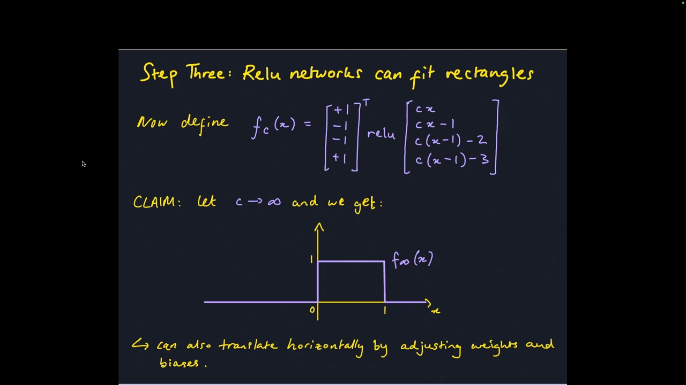
*▲ 강의 슬라이드 [32:50](https://youtu.be/ySaoWrv3T_Q?t=1970): [ReLU](00_%EB%94%A5%EB%9F%AC%EB%8B%9D_%EC%9A%A9%EC%96%B4%EC%82%AC%EC%A0%84.md#relu-%EB%A0%90%EB%A3%A8) 4개로 만든 직사각형 $f_c$*

질의응답: 왜 립시츠 함수로 제한하나? [36:03](https://youtu.be/ySaoWrv3T_Q?t=2163)

막대 수를 무한히 늘리는 극한이 아니라, **유한한** 막대 수에서 [오차](00_%EB%94%A5%EB%9F%AC%EB%8B%9D_%EC%9A%A9%EC%96%B4%EC%82%AC%EC%A0%84.md#error-%EC%98%A4%EC%B0%A8)가 얼마인지 알고 싶기 때문입니다. 립시츠 조건이 막대 하나의 [오차](00_%EB%94%A5%EB%9F%AC%EB%8B%9D_%EC%9A%A9%EC%96%B4%EC%82%AC%EC%A0%84.md#error-%EC%98%A4%EC%B0%A8)에 상한을 줍니다. 꼭 필요한 조건인지는 강사도 100% 확신하지 못한다고 했습니다.

### 7.4 초직사각형과 조립

▶ 영상 [36:38](https://youtu.be/ySaoWrv3T_Q?t=2198)

- **상자 만들기 요령**: 한 축 방향 직사각형과 다른 축 방향 직사각형을 더하면 십자 모양이 됩니다. 둘이 겹치는 가운데는 높이 2, 하나만 켜진 팔은 1, 나머지는 0. 여기서 1(일반적으로 $d - 1$)을 빼서 내리고 [ReLU](00_%EB%94%A5%EB%9F%AC%EB%8B%9D_%EC%9A%A9%EC%96%B4%EC%82%AC%EC%A0%84.md#relu-%EB%A0%90%EB%A3%A8)로 잘라내면 **모두 켜진 곳**, 즉 상자만 남습니다.
- **조립** [38:24](https://youtu.be/ySaoWrv3T_Q?t=2304):

$$h_c(x) = \mathrm{ReLU}\Big[\sum_{i=1}^{d} f_c(x_i) - (d - 1)\Big], \qquad f(x) = \sum_i \alpha_i\,h_c(x - u_i)$$

기호 풀이

| 기호 | 읽는 법 | 뜻 | 예제 값 |
| --- | --- | --- | --- |
| $h_c(x)$ | 에이치 씨 엑스 | $d$차원 상자([초직사각형](00_%EB%94%A5%EB%9F%AC%EB%8B%9D_%EC%9A%A9%EC%96%B4%EC%82%AC%EC%A0%84.md#hyperrectangle-%EC%B4%88%EC%A7%81%EC%82%AC%EA%B0%81%ED%98%95)) | 1 |
| $x_i$ | 엑스 아이 | 입력 벡터의 $i$번째 좌표 (첫 식) | 0.5 |
| $f_c(x_i)$ | 에프 씨 엑스 아이 | 좌표 하나에 씌운 1차원 직사각형 | 1 |
| $\sum_{i=1}^{d}$ | 시그마 아이는 1부터 디까지 | 좌표 $d$개의 직사각형을 더함 | 1 + 1 = 2 |
| $d - 1$ | 디 빼기 일 | 상자 밖을 잘라내는 문턱 | 1 |
| $\alpha_i$ | 알파 아이 | $i$번째 상자의 높이(셋째 [층](00_%EB%94%A5%EB%9F%AC%EB%8B%9D_%EC%9A%A9%EC%96%B4%EC%82%AC%EC%A0%84.md#layer-%EC%B8%B5) [가중치](00_%EB%94%A5%EB%9F%AC%EB%8B%9D_%EC%9A%A9%EC%96%B4%EC%82%AC%EC%A0%84.md#weight-%EA%B0%80%EC%A4%91%EC%B9%98)) | $\alpha_1 = 2$ |
| $u_i$ | 유 아이 | $i$번째 상자의 위치(격자점, 둘째 식) | $u_2 = (2, 0)$ |
| $f(x)$ | 에프 엑스 | 상자들을 높이만큼 곱해 더한 3층 망 | 2 |

예제와 풀이

**문제**: 입력이 2개($d = 2$)이고 $c = 10$일 때, (0, 0)에 높이 2짜리 상자, (2, 0)에 높이 3짜리 상자를 둔 망에 점 (0.5, 0.5)를 넣으면 출력은?

**주어진 값**:
- $d = 2$ (입력 차원)
- $c = 10$ (경사의 가파름)
- $x = (0.5, 0.5)$ (입력 점)
- $u_1 = (0, 0)$, $\alpha_1 = 2$ (상자 1의 위치와 높이)
- $u_2 = (2, 0)$, $\alpha_2 = 3$ (상자 2의 위치와 높이)

**풀이**
1. 식을 그대로 쓴다: $h_c(x) = \mathrm{ReLU}\Big[\sum_{i=1}^{d} f_c(x_i) - (d - 1)\Big], \quad f(x) = \sum_i \alpha_i\,h_c(x - u_i)$
2. 값을 대입한다: $f(0.5, 0.5) = 2\,\mathrm{ReLU}\big[f_{10}(0.5 - 0) + f_{10}(0.5 - 0) - (2 - 1)\big] + 3\,\mathrm{ReLU}\big[f_{10}(0.5 - 2) + f_{10}(0.5 - 0) - (2 - 1)\big]$
3. 좌표 뺄셈을 한다: $0.5 - 0 = 0.5$, $0.5 - 2 = -1.5$
4. $f_{10}$ 값을 읽는다(위 직사각형 식): $f_{10}(0.5) = 1$ (평평한 구간), $f_{10}(-1.5) = 0$ (0보다 왼쪽)
5. 괄호 뺄셈을 한다: $2 - 1 = 1$ 이므로 $2\,\mathrm{ReLU}[1 + 1 - 1] + 3\,\mathrm{ReLU}[0 + 1 - 1]$
6. 덧셈을 한다: $1 + 1 = 2$, $0 + 1 = 1$ 이므로 $2\,\mathrm{ReLU}[2 - 1] + 3\,\mathrm{ReLU}[1 - 1]$
7. 뺄셈을 한다: $2 - 1 = 1$, $1 - 1 = 0$
8. [ReLU](00_%EB%94%A5%EB%9F%AC%EB%8B%9D_%EC%9A%A9%EC%96%B4%EC%82%AC%EC%A0%84.md#relu-%EB%A0%90%EB%A3%A8)의 뜻: 음수는 0으로 바꾸고, 0 이상은 그대로 둔다: $\mathrm{ReLU}(1) = 1$, $\mathrm{ReLU}(0) = 0$
9. 높이를 곱한다: $2 \times 1 = 2$, $3 \times 0 = 0$
10. 덧셈을 한다: $2 + 0 = 2$

**답**: $f(0.5, 0.5) = 2$ (점이 상자 1 안에 있어 그 높이만 남는다)

내 이해

  $u_i$는 $i$번째 격자점 위치, $\alpha_i$는 상자 높이입니다. [ReLU](00_%EB%94%A5%EB%9F%AC%EB%8B%9D_%EC%9A%A9%EC%96%B4%EC%82%AC%EC%A0%84.md#relu-%EB%A0%90%EB%A3%A8)가 직사각형에 한 번, 상자에 한 번 들어가고 마지막은 선형 결합이므로 정의대로 **3층 망**입니다.
- 마지막으로 $c$를 아주 크게 하면 상자를 정확히 흉내 내고, 임의의 립시츠 곡면을 근사합니다.
- (질문) 두 [ReLU](00_%EB%94%A5%EB%9F%AC%EB%8B%9D_%EC%9A%A9%EC%96%B4%EC%82%AC%EC%A0%84.md#relu-%EB%A0%90%EB%A3%A8) [층](00_%EB%94%A5%EB%9F%AC%EB%8B%9D_%EC%9A%A9%EC%96%B4%EC%82%AC%EC%A0%84.md#layer-%EC%B8%B5)의 역할은? 첫 [ReLU](00_%EB%94%A5%EB%9F%AC%EB%8B%9D_%EC%9A%A9%EC%96%B4%EC%82%AC%EC%A0%84.md#relu-%EB%A0%90%EB%A3%A8)는 직사각형의 옆면 경사를 만들고, 둘째 [ReLU](00_%EB%94%A5%EB%9F%AC%EB%8B%9D_%EC%9A%A9%EC%96%B4%EC%82%AC%EC%A0%84.md#relu-%EB%A0%90%EB%A3%A8)는 상자 윗부분만 잘라냅니다.
- (질문) $4d$는 어디서? 직사각형 하나에 뉴런 4개, 상자 하나에 좌표 $d$개분이라 $4d$, 여기에 상자 수 $(L/\varepsilon)^d$를 곱합니다. 강사는 "어제 상수를 계산해 봤는데 맞기를 바란다"고 했습니다. (상자를 잘라내는 둘째 [층](00_%EB%94%A5%EB%9F%AC%EB%8B%9D_%EC%9A%A9%EC%96%B4%EC%82%AC%EC%A0%84.md#layer-%EC%B8%B5) [ReLU](00_%EB%94%A5%EB%9F%AC%EB%8B%9D_%EC%9A%A9%EC%96%B4%EC%82%AC%EC%A0%84.md#relu-%EB%A0%90%EB%A3%A8)까지 세면 상자마다 $4d + 1$개입니다. 규모는 같습니다.)

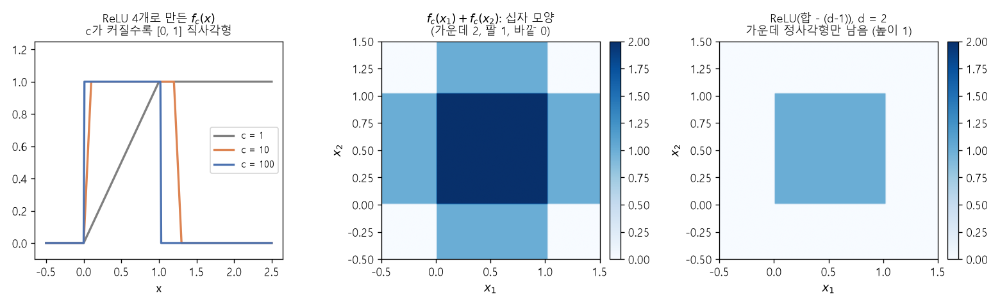
*▲ 직접 그린 그림: $f_c$의 모양($c = 1, 10, 100$)과, 두 직사각형의 합(십자)에서 1을 빼고 [ReLU](00_%EB%94%A5%EB%9F%AC%EB%8B%9D_%EC%9A%A9%EC%96%B4%EC%82%AC%EC%A0%84.md#relu-%EB%A0%90%EB%A3%A8)를 씌워 정사각형만 남기는 과정*

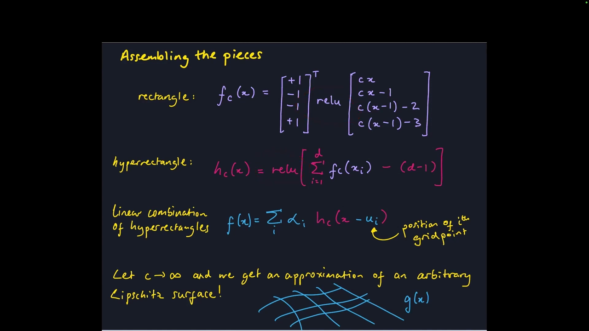
*▲ 강의 슬라이드 [39:30](https://youtu.be/ySaoWrv3T_Q?t=2370): 직사각형 → [초직사각형](00_%EB%94%A5%EB%9F%AC%EB%8B%9D_%EC%9A%A9%EC%96%B4%EC%82%AC%EC%A0%84.md#hyperrectangle-%EC%B4%88%EC%A7%81%EC%82%AC%EA%B0%81%ED%98%95) → 선형 결합으로 조립*

---

## 8. 이 정리의 한계

▶ 영상 [40:03](https://youtu.be/ySaoWrv3T_Q?t=2403)

### 8.1 c → ∞와 직사각형 기저

▶ 영상 [41:12](https://youtu.be/ySaoWrv3T_Q?t=2472)

📐 **수학 개념**: [ReLU로 만드는 직사각형](%EC%88%98%ED%95%99%EA%B0%9C%EB%85%90/06_%EA%B7%BC%EC%82%AC_%EC%9D%B4%EB%A1%A0/MM13_ReLU%EB%A1%9C_%EB%A7%8C%EB%93%9C%EB%8A%94_%EC%A7%81%EC%82%AC%EA%B0%81%ED%98%95.md)

- **$c \to \infty$는 수상하다**: [학습](00_%EB%94%A5%EB%9F%AC%EB%8B%9D_%EC%9A%A9%EC%96%B4%EC%82%AC%EC%A0%84.md#training-%ED%95%99%EC%8A%B5)에서 [가중치](00_%EB%94%A5%EB%9F%AC%EB%8B%9D_%EC%9A%A9%EC%96%B4%EC%82%AC%EC%A0%84.md#weight-%EA%B0%80%EC%A4%91%EC%B9%98)가 폭발하는 것은 보통 무언가 잘못됐다는 신호입니다. 이 구성은 증명이라는 목적이 뚜렷한 장치이지, 신경망이 실제로 하는 일과는 거리가 있습니다.
- **직사각형 기저로 학습한다면** [43:26](https://youtu.be/ySaoWrv3T_Q?t=2606): [ReLU](00_%EB%94%A5%EB%9F%AC%EB%8B%9D_%EC%9A%A9%EC%96%B4%EC%82%AC%EC%A0%84.md#relu-%EB%A0%90%EB%A3%A8)로 직사각형을 흉내 낼 거라면 처음부터 직사각형을 기저로 쓰면 되지 않나? 그렇게 데이터를 맞춰 보면, 데이터 점이 있는 막대만 그 높이로 끌려가고 나머지 막대는 전혀 움직이지 않습니다. 데이터 점들을 보면 직선 하나를 긋는 게 자연스러운데 말이죠. [학습](00_%EB%94%A5%EB%9F%AC%EB%8B%9D_%EC%9A%A9%EC%96%B4%EC%82%AC%EC%A0%84.md#training-%ED%95%99%EC%8A%B5) [오차](00_%EB%94%A5%EB%9F%AC%EB%8B%9D_%EC%9A%A9%EC%96%B4%EC%82%AC%EC%A0%84.md#error-%EC%98%A4%EC%B0%A8)는 아주 좋지만 **[일반화](00_%EB%94%A5%EB%9F%AC%EB%8B%9D_%EC%9A%A9%EC%96%B4%EC%82%AC%EC%A0%84.md#generalization-%EC%9D%BC%EB%B0%98%ED%99%94)는 아주 나쁩니다**. [가중치 감쇠](00_%EB%94%A5%EB%9F%AC%EB%8B%9D_%EC%9A%A9%EC%96%B4%EC%82%AC%EC%A0%84.md#weight-decay-%EA%B0%80%EC%A4%91%EC%B9%98-%EA%B0%90%EC%87%A0)(weight decay) 같은 [규제](00_%EB%94%A5%EB%9F%AC%EB%8B%9D_%EC%9A%A9%EC%96%B4%EC%82%AC%EC%A0%84.md#regularization-%EA%B7%9C%EC%A0%9C)(regularization)를 걸면 나머지 막대는 0으로 눌립니다.

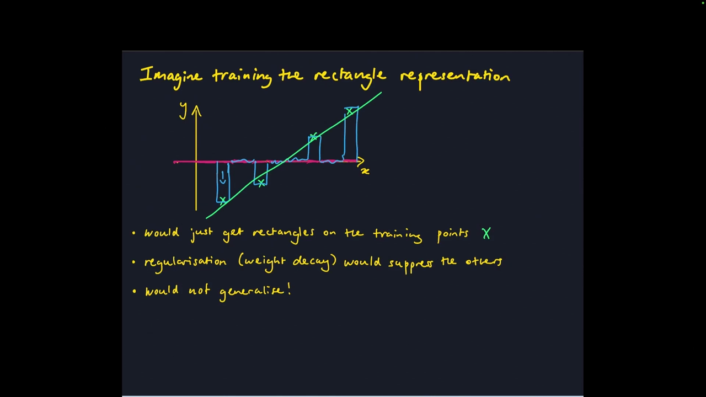
*▲ 강의 슬라이드 [45:10](https://youtu.be/ySaoWrv3T_Q?t=2710): 직사각형 표현으로 학습하면 데이터 점의 막대만 움직여 일반화되지 않는다*

### 8.2 다른 보편 근사 결과

▶ 영상 [45:07](https://youtu.be/ySaoWrv3T_Q?t=2707)

- **Barron의 정리**(1993): 근사하려는 함수의 푸리에 표현을 이용해 "매끄러운 함수는 더 적은 뉴런으로 근사된다"는 결과.
- **2층이면 충분**: Hornik, Stinchcombe, White(1989) 같은 고전 결과는 2층 망으로 [보편 근사](00_%EB%94%A5%EB%9F%AC%EB%8B%9D_%EC%9A%A9%EC%96%B4%EC%82%AC%EC%A0%84.md#universal-approximation-%EB%B3%B4%ED%8E%B8-%EA%B7%BC%EC%82%AC)를 보이며, 강사가 알기로는 이번 3층 결과보다 강력합니다. **스톤-바이어슈트라스 정리**(Stone-Weierstrass theorem)를 씁니다.
- 바이어슈트라스는 앞의 프랙털 곡선을 만든 수학자인데, 다항식으로 어떤 연속 함수든 근사할 수 있다는 정리도 남겼습니다. 신경망 근사가 고전 해석학과 이어진다는 점이 흥미롭다고 합니다. (강사는 "1800년대 사람인 것 같다"고 했는데, 1815~1897년에 살았고 다항식 근사 정리는 1885년에 발표했습니다.)
- (질문) [테일러 전개](00_%EB%94%A5%EB%9F%AC%EB%8B%9D_%EC%9A%A9%EC%96%B4%EC%82%AC%EC%A0%84.md#taylor-expansion-%ED%85%8C%EC%9D%BC%EB%9F%AC-%EC%A0%84%EA%B0%9C)로 다항식을 맞추는 것과는? 수학적으로 정당한 근사 방법이고 바이어슈트라스의 다항식 근사와 비슷하지만, 딥러닝이 하는 일과는 다릅니다. 서로 다른 관점을 맞춰 보는 일 자체가 생산적이라고 덧붙입니다.

> [!TIP]
> **🆕 2026 업데이트: 다른 표현 정리에서 나온 새 구조**
> - **강의**: [보편 근사](00_%EB%94%A5%EB%9F%AC%EB%8B%9D_%EC%9A%A9%EC%96%B4%EC%82%AC%EC%A0%84.md#universal-approximation-%EB%B3%B4%ED%8E%B8-%EA%B7%BC%EC%82%AC) 결과로 Barron 정리와 스톤-바이어슈트라스 정리 기반의 고전 결과를 소개했습니다.
> - **현재**: 2024년에는 [보편 근사](00_%EB%94%A5%EB%9F%AC%EB%8B%9D_%EC%9A%A9%EC%96%B4%EC%82%AC%EC%A0%84.md#universal-approximation-%EB%B3%B4%ED%8E%B8-%EA%B7%BC%EC%82%AC) 정리 대신 **콜모고로프-아놀드 표현 정리**(다변수 연속 함수를 일변수 함수의 합과 합성으로 쓸 수 있다는 정리)에서 출발한 **KAN**(Kolmogorov-Arnold Networks)이 제안되어 ICLR 2025에 실렸습니다. MLP가 노드에 고정된 [활성화 함수](00_%EB%94%A5%EB%9F%AC%EB%8B%9D_%EC%9A%A9%EC%96%B4%EC%82%AC%EC%A0%84.md#activation-function-%ED%99%9C%EC%84%B1%ED%99%94-%ED%95%A8%EC%88%98)를 두는 것과 달리, KAN은 **간선([가중치](00_%EB%94%A5%EB%9F%AC%EB%8B%9D_%EC%9A%A9%EC%96%B4%EC%82%AC%EC%A0%84.md#weight-%EA%B0%80%EC%A4%91%EC%B9%98) 자리)에 [학습](00_%EB%94%A5%EB%9F%AC%EB%8B%9D_%EC%9A%A9%EC%96%B4%EC%82%AC%EC%A0%84.md#training-%ED%95%99%EC%8A%B5) 가능한 일변수 함수**(스플라인)를 둡니다. 작은 과학 문제의 함수 맞추기에서는 더 작은 KAN이 더 큰 MLP만큼 또는 더 정확했다고 보고했지만, [학습](00_%EB%94%A5%EB%9F%AC%EB%8B%9D_%EC%9A%A9%EC%96%B4%EC%82%AC%EC%A0%84.md#training-%ED%95%99%EC%8A%B5)이 느리다는 한계도 저자들이 밝혔습니다. 근사 이론이 새 구조 설계로 이어진 예입니다.
> - **출처**: [Liu et al., "KAN: Kolmogorov-Arnold Networks", ICLR 2025 (arXiv 2024)](https://arxiv.org/abs/2404.19756)

### 8.3 보편 근사는 중요한가

▶ 영상 [46:16](https://youtu.be/ySaoWrv3T_Q?t=2776)

- **충분한가?** 아닙니다. 보편 근사기는 많습니다. 다항식도, 앞의 상자 결합도, 심지어 **Python 프로그램 전체**도 보편 근사기입니다. Python을 설치했다고 머신러닝이 풀리지는 않습니다. 퍼즐의 한 조각일 뿐입니다.
- **필요한가?** 모델이 보편 근사기가 아니면 걱정해야 할까요? 강사의 추측은 "아마 필요 없다"이지만 확실하지 않다고 합니다.

---

## 9. 너비의 장점

▶ 영상 [49:38](https://youtu.be/ySaoWrv3T_Q?t=2978)

강의 후반부는 다시 "너비냐 깊이냐"로 돌아옵니다. 3층이면 어떤 함수든 맞출 수 있다면 왜 깊은 망이 필요할까요?

- (학생) [층](00_%EB%94%A5%EB%9F%AC%EB%8B%9D_%EC%9A%A9%EC%96%B4%EC%82%AC%EC%A0%84.md#layer-%EC%B8%B5)을 쌓으면 [비선형성](00_%EB%94%A5%EB%9F%AC%EB%8B%9D_%EC%9A%A9%EC%96%B4%EC%82%AC%EC%A0%84.md#nonlinearity-%EB%B9%84%EC%84%A0%ED%98%95%EC%84%B1)이 겹겹이 쌓이고 [합성](00_%EB%94%A5%EB%9F%AC%EB%8B%9D_%EC%9A%A9%EC%96%B4%EC%82%AC%EC%A0%84.md#function-composition-%ED%95%A9%EC%84%B1%ED%95%A8%EC%88%98)으로 더 풍부한 함수를 만들 수 있다.
- **너비의 장점**(강의와 학생이 모은 목록):
  - **병렬화**: 너비는 병렬 하드웨어를 잘 씁니다. 시스템 관점에서 넓고 얕은 망으로 충분하다면 아주 좋습니다.
  - 3층(어쩌면 2층) 망이 이미 보편 근사기다.
  - 특징 표현을 **해석하기 쉽다**.
  - **최적화가 쉽다**: 무엇이든 겹겹이 쌓으면 통제를 잃기 쉽습니다. 평범한 MLP를 50층으로 쌓아 그냥 학습하면 [학습](00_%EB%94%A5%EB%9F%AC%EB%8B%9D_%EC%9A%A9%EC%96%B4%EC%82%AC%EC%A0%84.md#training-%ED%95%99%EC%8A%B5)이 잘 안 됩니다.
- 그러면 "넓은 게 당연히 낫다"일까요? 다음 절이 반론입니다.

---

## 10. 깊이 분리

▶ 영상 [54:17](https://youtu.be/ySaoWrv3T_Q?t=3257)

📐 **수학 개념**: [꺾임 수와 깊이 분리](%EC%88%98%ED%95%99%EA%B0%9C%EB%85%90/06_%EA%B7%BC%EC%82%AC_%EC%9D%B4%EB%A1%A0/MM14_%EA%BA%BE%EC%9E%84_%EC%88%98%EC%99%80_%EA%B9%8A%EC%9D%B4_%EB%B6%84%EB%A6%AC.md) · [합성함수](%EC%88%98%ED%95%99%EA%B0%9C%EB%85%90/05_%EC%8B%A0%EA%B2%BD%EB%A7%9D%EC%9D%98_%EA%B3%84%EC%82%B0/MM06_%ED%95%A9%EC%84%B1%ED%95%A8%EC%88%98%EC%99%80_%EB%B9%84%EC%84%A0%ED%98%95%EC%84%B1.md)

### 10.1 결과의 모양

▶ 영상 [54:52](https://youtu.be/ySaoWrv3T_Q?t=3292)

[보편 근사](00_%EB%94%A5%EB%9F%AC%EB%8B%9D_%EC%9A%A9%EC%96%B4%EC%82%AC%EC%A0%84.md#universal-approximation-%EB%B3%B4%ED%8E%B8-%EA%B7%BC%EC%82%AC) 결과는 망을 지수적으로 넓혀야 할 수 있음을 시사했습니다. **[깊이 분리](00_%EB%94%A5%EB%9F%AC%EB%8B%9D_%EC%9A%A9%EC%96%B4%EC%82%AC%EC%A0%84.md#depth-separation-%EA%B9%8A%EC%9D%B4-%EB%B6%84%EB%A6%AC)**(depth separation) 결과는 반대 방향입니다. 어떤 함수는 깊은 망이면 효율적으로 표현되지만, 얕은 망으로 표현하려면 지수적으로 많은 뉴런이 필요합니다. 증명은 세 단계입니다.

1. 함수의 **성질** 하나를 고른다. 여기서는 **선형 영역의 수**([꺾임](00_%EB%94%A5%EB%9F%AC%EB%8B%9D_%EC%9A%A9%EC%96%B4%EC%82%AC%EC%A0%84.md#kink-%EA%BA%BE%EC%9E%84) 수).
2. 그 성질을 많이 가진, 크지 않은 **깊은 망을 직접 만든다**.
3. **얕은 망**이 같은 성질을 가지려면 지수적으로 많은 뉴런이 필요함을 보인다.

### 10.2 ReLU 망은 조각별 선형

▶ 영상 [55:59](https://youtu.be/ySaoWrv3T_Q?t=3359)

- **[조각별 선형 함수](00_%EB%94%A5%EB%9F%AC%EB%8B%9D_%EC%9A%A9%EC%96%B4%EC%82%AC%EC%A0%84.md#piecewise-linear-function-%EC%A1%B0%EA%B0%81%EB%B3%84-%EC%84%A0%ED%98%95-%ED%95%A8%EC%88%98)**: 구간마다 직선이고 이어 붙인 함수. **[꺾임](00_%EB%94%A5%EB%9F%AC%EB%8B%9D_%EC%9A%A9%EC%96%B4%EC%82%AC%EC%A0%84.md#kink-%EA%BA%BE%EC%9E%84)**(kink)은 도함수가 갑자기 바뀌는 점입니다.
- **주장**: 입력 1개, 출력 1개인 [ReLU](00_%EB%94%A5%EB%9F%AC%EB%8B%9D_%EC%9A%A9%EC%96%B4%EC%82%AC%EC%A0%84.md#relu-%EB%A0%90%EB%A3%A8) 망은 조각별 선형이다. 이유는 성질을 조합 규칙으로 쪼개는 것입니다. $f$와 $g$가 조각별 선형이면 $f \circ g$, $f + g$, $\alpha f$도 조각별 선형이고, [ReLU](00_%EB%94%A5%EB%9F%AC%EB%8B%9D_%EC%9A%A9%EC%96%B4%EC%82%AC%EC%A0%84.md#relu-%EB%A0%90%EB%A3%A8) 자체가 조각별 선형이므로 [ReLU](00_%EB%94%A5%EB%9F%AC%EB%8B%9D_%EC%9A%A9%EC%96%B4%EC%82%AC%EC%A0%84.md#relu-%EB%A0%90%EB%A3%A8) 망은 늘 조각별 선형입니다.

### 10.3 꺾임 수의 상한

▶ 영상 [58:46](https://youtu.be/ySaoWrv3T_Q?t=3526)

- **더하기의 효과**: 함수를 더하면 [꺾임](00_%EB%94%A5%EB%9F%AC%EB%8B%9D_%EC%9A%A9%EC%96%B4%EC%82%AC%EC%A0%84.md#kink-%EA%BA%BE%EC%9E%84)은 많아야 **합**만큼입니다. [꺾임](00_%EB%94%A5%EB%9F%AC%EB%8B%9D_%EC%9A%A9%EC%96%B4%EC%82%AC%EC%A0%84.md#kink-%EA%BA%BE%EC%9E%84)은 더한 함수들의 [꺾임](00_%EB%94%A5%EB%9F%AC%EB%8B%9D_%EC%9A%A9%EC%96%B4%EC%82%AC%EC%A0%84.md#kink-%EA%BA%BE%EC%9E%84) 자리에서만 생길 수 있기 때문입니다(겹치면 더 적음). 예: [꺾임](00_%EB%94%A5%EB%9F%AC%EB%8B%9D_%EC%9A%A9%EC%96%B4%EC%82%AC%EC%A0%84.md#kink-%EA%BA%BE%EC%9E%84) 1개 + 2개 = 3개.
- **[ReLU](00_%EB%94%A5%EB%9F%AC%EB%8B%9D_%EC%9A%A9%EC%96%B4%EC%82%AC%EC%A0%84.md#relu-%EB%A0%90%EB%A3%A8)의 효과** [60:26](https://youtu.be/ySaoWrv3T_Q?t=3626): [ReLU](00_%EB%94%A5%EB%9F%AC%EB%8B%9D_%EC%9A%A9%EC%96%B4%EC%82%AC%EC%A0%84.md#relu-%EB%A0%90%EB%A3%A8)를 씌우면 [꺾임](00_%EB%94%A5%EB%9F%AC%EB%8B%9D_%EC%9A%A9%EC%96%B4%EC%82%AC%EC%A0%84.md#kink-%EA%BA%BE%EC%9E%84) 수가 많아야 **2배**입니다. 선형 구간 하나가 0을 지나며 많아야 두 구간으로 쪼개지기 때문입니다. 슬라이드 예에서는 [꺾임](00_%EB%94%A5%EB%9F%AC%EB%8B%9D_%EC%9A%A9%EC%96%B4%EC%82%AC%EC%A0%84.md#kink-%EA%BA%BE%EC%9E%84) 5개가 9개가 되어 거의 2배가 됐습니다.

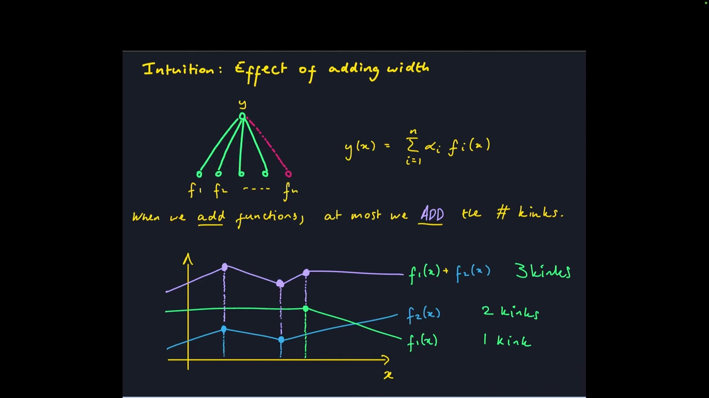
*▲ 강의 슬라이드 [60:30](https://youtu.be/ySaoWrv3T_Q?t=3630): 함수를 더하면 [꺾임](00_%EB%94%A5%EB%9F%AC%EB%8B%9D_%EC%9A%A9%EC%96%B4%EC%82%AC%EC%A0%84.md#kink-%EA%BA%BE%EC%9E%84) 수는 많아야 합만큼*

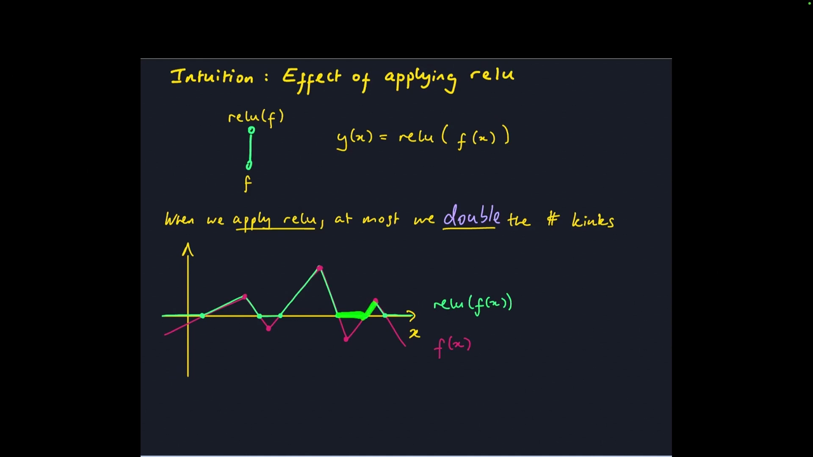
*▲ 강의 슬라이드 [61:15](https://youtu.be/ySaoWrv3T_Q?t=3675): [ReLU](00_%EB%94%A5%EB%9F%AC%EB%8B%9D_%EC%9A%A9%EC%96%B4%EC%82%AC%EC%A0%84.md#relu-%EB%A0%90%EB%A3%A8)를 씌우면 [꺾임](00_%EB%94%A5%EB%9F%AC%EB%8B%9D_%EC%9A%A9%EC%96%B4%EC%82%AC%EC%A0%84.md#kink-%EA%BA%BE%EC%9E%84) 수는 많아야 2배*

- **좀 더 형식적으로** [61:35](https://youtu.be/ySaoWrv3T_Q?t=3695): 깊은 [ReLU](00_%EB%94%A5%EB%9F%AC%EB%8B%9D_%EC%9A%A9%EC%96%B4%EC%82%AC%EC%A0%84.md#relu-%EB%A0%90%EB%A3%A8) 망의 $\ell$번째 [층](00_%EB%94%A5%EB%9F%AC%EB%8B%9D_%EC%9A%A9%EC%96%B4%EC%82%AC%EC%A0%84.md#layer-%EC%B8%B5)을 $f_\ell(x) = \mathrm{ReLU}(W_\ell f_{\ell-1}(x) + b_\ell)$로 씁니다($f_\ell \in \mathbb{R}^n$, $W_\ell \in \mathbb{R}^{n \times n}$). $\mathrm{KINKS}_\ell$을 $n$개 좌표 중 가장 많은 [꺾임](00_%EB%94%A5%EB%9F%AC%EB%8B%9D_%EC%9A%A9%EC%96%B4%EC%82%AC%EC%A0%84.md#kink-%EA%BA%BE%EC%9E%84) 수라 하면 $n$개를 더하고(×$n$) [ReLU](00_%EB%94%A5%EB%9F%AC%EB%8B%9D_%EC%9A%A9%EC%96%B4%EC%82%AC%EC%A0%84.md#relu-%EB%A0%90%EB%A3%A8)로 2배가 되므로

$$\mathrm{KINKS}_\ell \le 2n \cdot \mathrm{KINKS}_{\ell - 1} \;\Longrightarrow\; \mathrm{KINKS}_L \le (2n)^L$$

기호 풀이

| 기호 | 읽는 법 | 뜻 | 예제 값 |
| --- | --- | --- | --- |
| $\mathrm{KINKS}_\ell$ | 킹크스 엘 | [층](00_%EB%94%A5%EB%9F%AC%EB%8B%9D_%EC%9A%A9%EC%96%B4%EC%82%AC%EC%A0%84.md#layer-%EC%B8%B5) $\ell$ 출력의 [꺾임](00_%EB%94%A5%EB%9F%AC%EB%8B%9D_%EC%9A%A9%EC%96%B4%EC%82%AC%EC%A0%84.md#kink-%EA%BA%BE%EC%9E%84) 수(좌표 중 최댓값) | $\mathrm{KINKS}_2 \le 16$ |
| $\ell$ | 엘(소문자) | 몇 번째 [층](00_%EB%94%A5%EB%9F%AC%EB%8B%9D_%EC%9A%A9%EC%96%B4%EC%82%AC%EC%A0%84.md#layer-%EC%B8%B5)인지 | 1, 2, 3 |
| $n$ | 엔 | 망의 너비([층](00_%EB%94%A5%EB%9F%AC%EB%8B%9D_%EC%9A%A9%EC%96%B4%EC%82%AC%EC%A0%84.md#layer-%EC%B8%B5)마다 뉴런 수) | 2 |
| $2n$ | 이엔 | 한 [층](00_%EB%94%A5%EB%9F%AC%EB%8B%9D_%EC%9A%A9%EC%96%B4%EC%82%AC%EC%A0%84.md#layer-%EC%B8%B5)에서 늘어나는 배수: 더하기 ×$n$, [ReLU](00_%EB%94%A5%EB%9F%AC%EB%8B%9D_%EC%9A%A9%EC%96%B4%EC%82%AC%EC%A0%84.md#relu-%EB%A0%90%EB%A3%A8) ×2 | 4 |
| $L$ | 엘 | 망의 깊이([층](00_%EB%94%A5%EB%9F%AC%EB%8B%9D_%EC%9A%A9%EC%96%B4%EC%82%AC%EC%A0%84.md#layer-%EC%B8%B5) 수). 립시츠 상수 $L$과 다른 쓰임 | 3 |
| $(2n)^L$ | 이엔의 엘제곱 | [꺾임](00_%EB%94%A5%EB%9F%AC%EB%8B%9D_%EC%9A%A9%EC%96%B4%EC%82%AC%EC%A0%84.md#kink-%EA%BA%BE%EC%9E%84) 수의 상한 | 64 |

예제와 풀이

**문제**: 너비 2([층](00_%EB%94%A5%EB%9F%AC%EB%8B%9D_%EC%9A%A9%EC%96%B4%EC%82%AC%EC%A0%84.md#layer-%EC%B8%B5)마다 뉴런 2개), 깊이 3인 [ReLU](00_%EB%94%A5%EB%9F%AC%EB%8B%9D_%EC%9A%A9%EC%96%B4%EC%82%AC%EC%A0%84.md#relu-%EB%A0%90%EB%A3%A8) 망에서 처음 [꺾임](00_%EB%94%A5%EB%9F%AC%EB%8B%9D_%EC%9A%A9%EC%96%B4%EC%82%AC%EC%A0%84.md#kink-%EA%BA%BE%EC%9E%84) 수를 1로 잡으면, 마지막 [층](00_%EB%94%A5%EB%9F%AC%EB%8B%9D_%EC%9A%A9%EC%96%B4%EC%82%AC%EC%A0%84.md#layer-%EC%B8%B5) [꺾임](00_%EB%94%A5%EB%9F%AC%EB%8B%9D_%EC%9A%A9%EC%96%B4%EC%82%AC%EC%A0%84.md#kink-%EA%BA%BE%EC%9E%84) 수의 상한은?

**주어진 값**:
- $n = 2$ (너비)
- $L = 3$ (깊이)
- $\mathrm{KINKS}_0 = 1$ (시작값)

**풀이**
1. 식을 그대로 쓴다: $\mathrm{KINKS}_\ell \le 2n \cdot \mathrm{KINKS}_{\ell - 1} \;\Longrightarrow\; \mathrm{KINKS}_L \le (2n)^L$
2. 값을 대입한다: $\mathrm{KINKS}_\ell \le 2 \times 2 \cdot \mathrm{KINKS}_{\ell - 1} \;\Longrightarrow\; \mathrm{KINKS}_3 \le (2 \times 2)^3$
3. 곱셈을 한다: $2 \times 2 = 4$ 이므로 [층](00_%EB%94%A5%EB%9F%AC%EB%8B%9D_%EC%9A%A9%EC%96%B4%EC%82%AC%EC%A0%84.md#layer-%EC%B8%B5)마다 많아야 4배
4. 1층: $\mathrm{KINKS}_1 \le 4 \times 1 = 4$
5. 2층: $\mathrm{KINKS}_2 \le 4 \times 4 = 16$
6. 3층: $\mathrm{KINKS}_3 \le 4 \times 16 = 64$
7. 오른쪽 식으로 확인한다: $4^3 = 4 \times 4 \times 4 = 64$

**답**: $\mathrm{KINKS}_3 \le 64$

내 이해

- 상한은 **너비 $n$에는 다항식**으로, **깊이 $L$에는 지수적**으로 커집니다. [층](00_%EB%94%A5%EB%9F%AC%EB%8B%9D_%EC%9A%A9%EC%96%B4%EC%82%AC%EC%A0%84.md#layer-%EC%B8%B5)을 하나 더할 때마다 2배가 되므로, [꺾임](00_%EB%94%A5%EB%9F%AC%EB%8B%9D_%EC%9A%A9%EC%96%B4%EC%82%AC%EC%A0%84.md#kink-%EA%BA%BE%EC%9E%84)이 많은 함수를 표현하려면 넓히는 것보다 **깊게 하는 편이 낫다**는 신호입니다.
- (시작점 문제) 슬라이드는 $\mathrm{KINKS}_0 = 1$로 시작했는데 학생이 "입력에는 [꺾임](00_%EB%94%A5%EB%9F%AC%EB%8B%9D_%EC%9A%A9%EC%96%B4%EC%82%AC%EC%A0%84.md#kink-%EA%BA%BE%EC%9E%84)이 0개"라고 지적했고, 강사는 "0도 1보다 작거나 같다"며 웃은 뒤 기저 사례는 따로 생각해 보자고 넘어갔습니다. ([꺾임](00_%EB%94%A5%EB%9F%AC%EB%8B%9D_%EC%9A%A9%EC%96%B4%EC%82%AC%EC%A0%84.md#kink-%EA%BA%BE%EC%9E%84) 대신 **선형 조각 수**로 세면 정리됩니다. 입력은 조각 1개, [층](00_%EB%94%A5%EB%9F%AC%EB%8B%9D_%EC%9A%A9%EC%96%B4%EC%82%AC%EC%A0%84.md#layer-%EC%B8%B5)마다 많아야 $2n$배라 조각 수 $\le (2n)^L$이고 [꺾임](00_%EB%94%A5%EB%9F%AC%EB%8B%9D_%EC%9A%A9%EC%96%B4%EC%82%AC%EC%A0%84.md#kink-%EA%BA%BE%EC%9E%84)은 그보다 1 적습니다. 학생이 제안한 "구간으로 세기"가 이 방법입니다. 자세한 것은 [MM14_꺾임_수와_깊이_분리](%EC%88%98%ED%95%99%EA%B0%9C%EB%85%90/06_%EA%B7%BC%EC%82%AC_%EC%9D%B4%EB%A1%A0/MM14_%EA%BA%BE%EC%9E%84_%EC%88%98%EC%99%80_%EA%B9%8A%EC%9D%B4_%EB%B6%84%EB%A6%AC.md).)

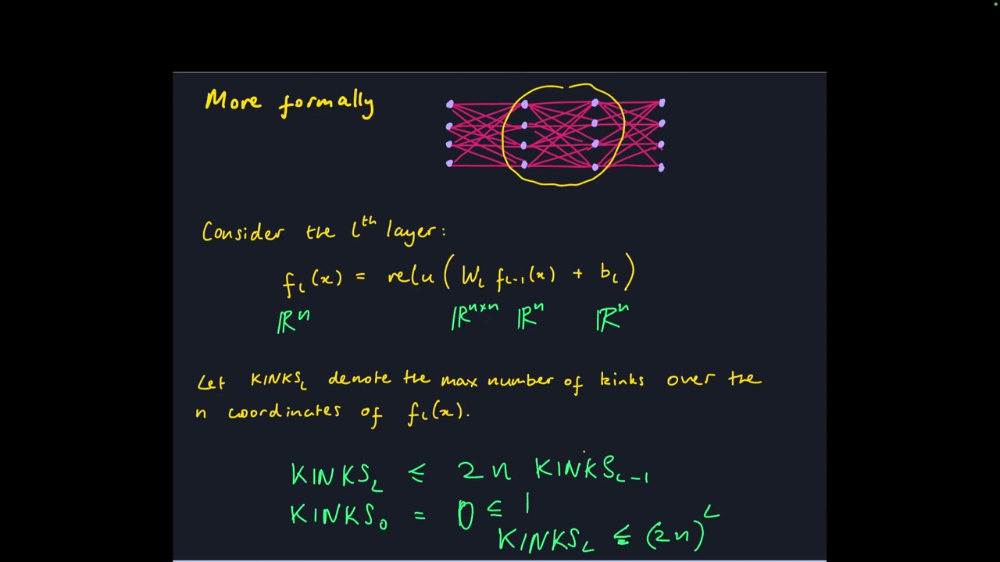
*▲ 강의 슬라이드 [64:30](https://youtu.be/ySaoWrv3T_Q?t=3870): [층](00_%EB%94%A5%EB%9F%AC%EB%8B%9D_%EC%9A%A9%EC%96%B4%EC%82%AC%EC%A0%84.md#layer-%EC%B8%B5)마다 [꺾임](00_%EB%94%A5%EB%9F%AC%EB%8B%9D_%EC%9A%A9%EC%96%B4%EC%82%AC%EC%A0%84.md#kink-%EA%BA%BE%EC%9E%84) 수가 많아야 $2n$배라는 상한*

### 10.4 상한에 닿는 예: 삼각형 함수의 합성

▶ 영상 [66:01](https://youtu.be/ySaoWrv3T_Q?t=3961)

상한일 뿐이라 실제로는 안 닿을 수도 있다는 반론에 답하려고, 상한에 닿는 망을 직접 만듭니다.

$$g(x) = \mathrm{ReLU}\big[2\,\mathrm{ReLU}(x) - 4\,\mathrm{ReLU}(x - \tfrac{1}{2})\big]$$

기호 풀이

| 기호 | 읽는 법 | 뜻 | 예제 값 |
| --- | --- | --- | --- |
| $g(x)$ | 지 엑스 | 0~1에서 삼각형 모양인 함수 (2층 [ReLU](00_%EB%94%A5%EB%9F%AC%EB%8B%9D_%EC%9A%A9%EC%96%B4%EC%82%AC%EC%A0%84.md#relu-%EB%A0%90%EB%A3%A8) 망) | $g(0.8) = 0.4$ |
| $x$ | 엑스 | 입력 | 0.8 |
| $\mathrm{ReLU}(x)$ | [렐루](00_%EB%94%A5%EB%9F%AC%EB%8B%9D_%EC%9A%A9%EC%96%B4%EC%82%AC%EC%A0%84.md#relu-%EB%A0%90%EB%A3%A8) 엑스 | 0에서 꺾여 올라가는 경사 | 0.8 |
| $\mathrm{ReLU}(x - \tfrac{1}{2})$ | [렐루](00_%EB%94%A5%EB%9F%AC%EB%8B%9D_%EC%9A%A9%EC%96%B4%EC%82%AC%EC%A0%84.md#relu-%EB%A0%90%EB%A3%A8) 엑스 빼기 이분의 일 | 0.5에서 꺾이는 경사 | 0.3 |
| $2,\ 4$ | 이, 사 | 두 경사의 계수. 0.5 뒤로 [기울기](00_%EB%94%A5%EB%9F%AC%EB%8B%9D_%EC%9A%A9%EC%96%B4%EC%82%AC%EC%A0%84.md#gradient-%EA%B8%B0%EC%9A%B8%EA%B8%B0)가 2에서 −2로 바뀐다 | 2 × 0.8 − 4 × 0.3 |
| $\tfrac{1}{2}$ | 이분의 일 | 삼각형 꼭대기 위치 | 0.5 |

예제와 풀이

**문제**: 삼각형 함수 $g$에 입력 0.8을 넣으면 출력은?

**주어진 값**:
- $x = 0.8$ (입력, 꼭대기 0.5보다 오른쪽)

**풀이**
1. 식을 그대로 쓴다: $g(x) = \mathrm{ReLU}\big[2\,\mathrm{ReLU}(x) - 4\,\mathrm{ReLU}(x - \tfrac{1}{2})\big]$
2. 값을 대입한다: $g(0.8) = \mathrm{ReLU}\big[2\,\mathrm{ReLU}(0.8) - 4\,\mathrm{ReLU}(0.8 - 0.5)\big]$
3. 괄호 안 뺄셈을 한다: $0.8 - 0.5 = 0.3$
4. [ReLU](00_%EB%94%A5%EB%9F%AC%EB%8B%9D_%EC%9A%A9%EC%96%B4%EC%82%AC%EC%A0%84.md#relu-%EB%A0%90%EB%A3%A8)의 뜻: 음수는 0으로 바꾸고, 0 이상은 그대로 둔다: $\mathrm{ReLU}(0.8) = 0.8$, $\mathrm{ReLU}(0.3) = 0.3$
5. 곱셈을 한다: $2 \times 0.8 = 1.6$
6. 곱셈을 한다: $4 \times 0.3 = 1.2$ 이므로 $\mathrm{ReLU}[1.6 - 1.2]$
7. 뺄셈을 한다: $1.6 - 1.2 = 0.4$
8. 바깥 [ReLU](00_%EB%94%A5%EB%9F%AC%EB%8B%9D_%EC%9A%A9%EC%96%B4%EC%82%AC%EC%A0%84.md#relu-%EB%A0%90%EB%A3%A8)를 씌운다: $\mathrm{ReLU}(0.4) = 0.4$

**답**: $g(0.8) = 0.4$ (꼭대기를 지나 내려가는 쪽)

내 이해

- $g$는 0~1에서 삼각형입니다. 자기 자신과 합성하면($g \circ g$) 삼각형 2개, $g \circ g \circ g$면 4개. **합성할 때마다 선형 영역이 2배**가 됩니다.
- **숫자로** [67:49](https://youtu.be/ySaoWrv3T_Q?t=4069): $g$를 500번 합성하면 [꺾임](00_%EB%94%A5%EB%9F%AC%EB%8B%9D_%EC%9A%A9%EC%96%B4%EC%82%AC%EC%A0%84.md#kink-%EA%BA%BE%EC%9E%84)이 $2^{500} - 1$개입니다. $g$ 하나가 2층이라 너비 2짜리 **1000층 MLP**입니다. 같은 [꺾임](00_%EB%94%A5%EB%9F%AC%EB%8B%9D_%EC%9A%A9%EC%96%B4%EC%82%AC%EC%A0%84.md#kink-%EA%BA%BE%EC%9E%84) 수를 **3층 MLP**로 내려면 상한 $(2n)^3 \ge 2^{500} - 1$에서 너비가 약 $7 \times 10^{49}$, 거의 $10^{50}$이어야 합니다.
- 어렵지 않게 적을 수 있는 함수(삼각형을 여러 번 합성)인데도 얕은 망으로 정확히 표현하려면 터무니없이 넓어야 합니다. 이것이 [깊이 분리](00_%EB%94%A5%EB%9F%AC%EB%8B%9D_%EC%9A%A9%EC%96%B4%EC%82%AC%EC%A0%84.md#depth-separation-%EA%B9%8A%EC%9D%B4-%EB%B6%84%EB%A6%AC)입니다. 이 문제는 첫 과제에도 나옵니다.

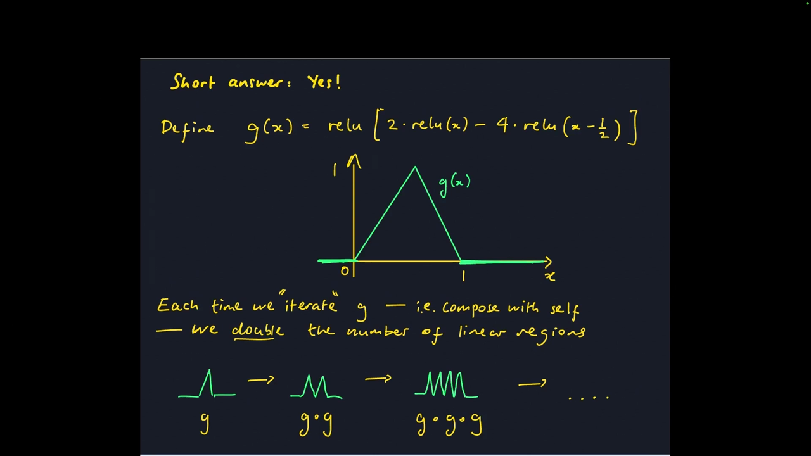
*▲ 강의 슬라이드 [67:10](https://youtu.be/ySaoWrv3T_Q?t=4030): 삼각형 함수 $g$와, 합성할 때마다 2배가 되는 선형 영역*

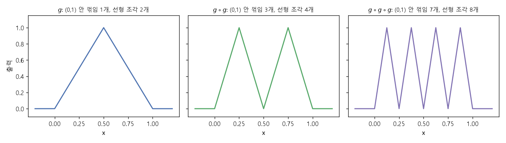
*▲ 직접 그린 그림: $g$, $g \circ g$, $g \circ g \circ g$의 실제 모양. (0, 1) 안 [꺾임](00_%EB%94%A5%EB%9F%AC%EB%8B%9D_%EC%9A%A9%EC%96%B4%EC%82%AC%EC%A0%84.md#kink-%EA%BA%BE%EC%9E%84) 1, 3, 7개*

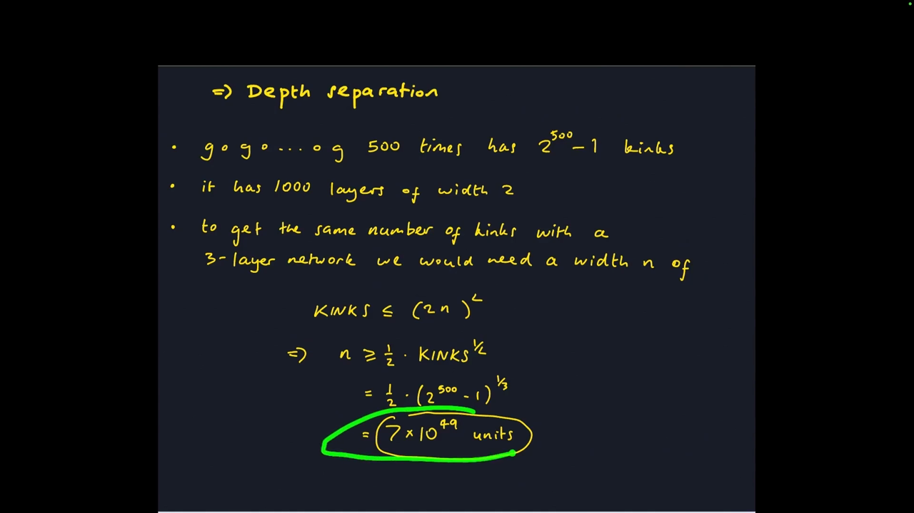
*▲ 강의 슬라이드 [68:30](https://youtu.be/ySaoWrv3T_Q?t=4110): 500번 합성한 함수를 3층 망으로 만들려면 너비 약 $7 \times 10^{49}$*

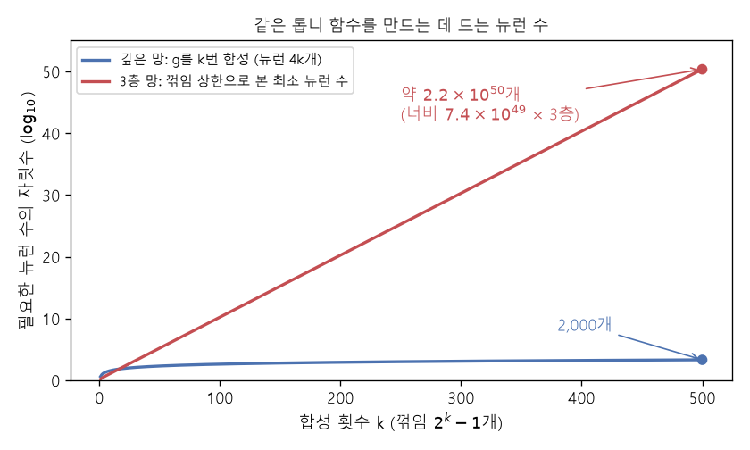
*▲ 직접 그린 그림: 같은 톱니 함수에 드는 뉴런 수. 깊은 망은 $4k$개(500번이면 2,000개), 3층 망은 [꺾임](00_%EB%94%A5%EB%9F%AC%EB%8B%9D_%EC%9A%A9%EC%96%B4%EC%82%AC%EC%A0%84.md#kink-%EA%BA%BE%EC%9E%84) 상한으로 계산한 최소치(500번이면 약 $2.2 \times 10^{50}$개)*

### 10.5 이 결과가 말하지 않는 것

▶ 영상 [68:58](https://youtu.be/ySaoWrv3T_Q?t=4138)

- 아주 깊은 망이 **학습하기 쉽다**는 뜻이 아닙니다(최적화). 실제로는 어려울 수 있습니다.
- 아주 깊은 망이 실제 데이터셋에서 **잘 일반화한다**는 뜻도 아닙니다.
- 이것은 근사에 대한 말일 뿐, 퍼즐의 한 조각입니다.
- **더 읽을거리** [70:14](https://youtu.be/ySaoWrv3T_Q?t=4214): Telgarsky(2015, 2016)의 [깊이 분리](00_%EB%94%A5%EB%9F%AC%EB%8B%9D_%EC%9A%A9%EC%96%B4%EC%82%AC%EC%A0%84.md#depth-separation-%EA%B9%8A%EC%9D%B4-%EB%B6%84%EB%A6%AC), Safran과 Shamir(2017), Lu 등(2017). 마지막 논문은 "깊이가 그렇게 좋다면 너비 3으로 아주 깊게 쌓으면 되지 않나?"에 답합니다. 입력 차원이 $n$이면 [보편 근사](00_%EB%94%A5%EB%9F%AC%EB%8B%9D_%EC%9A%A9%EC%96%B4%EC%82%AC%EC%A0%84.md#universal-approximation-%EB%B3%B4%ED%8E%B8-%EA%B7%BC%EC%82%AC)에 **최소 너비** 약 $n$이 필요합니다.

---

## 11. 실제로는: 스케일링 법칙과 교란 변수

▶ 영상 [70:50](https://youtu.be/ySaoWrv3T_Q?t=4250)

- **현실은 조각이 뒤엉켜 있다**: 실제 시스템을 학습할 때 문제가 생기면 망이 근사를 못 하는 건지, [학습](00_%EB%94%A5%EB%9F%AC%EB%8B%9D_%EC%9A%A9%EC%96%B4%EC%82%AC%EC%A0%84.md#training-%ED%95%99%EC%8A%B5)이 실패한 건지 알 수 없습니다. [일반화](00_%EB%94%A5%EB%9F%AC%EB%8B%9D_%EC%9A%A9%EC%96%B4%EC%82%AC%EC%A0%84.md#generalization-%EC%9D%BC%EB%B0%98%ED%99%94) 문제는 [학습](00_%EB%94%A5%EB%9F%AC%EB%8B%9D_%EC%9A%A9%EC%96%B4%EC%82%AC%EC%A0%84.md#training-%ED%95%99%EC%8A%B5) [오차](00_%EB%94%A5%EB%9F%AC%EB%8B%9D_%EC%9A%A9%EC%96%B4%EC%82%AC%EC%A0%84.md#error-%EC%98%A4%EC%B0%A8)와 시험 [오차](00_%EB%94%A5%EB%9F%AC%EB%8B%9D_%EC%9A%A9%EC%96%B4%EC%82%AC%EC%A0%84.md#error-%EC%98%A4%EC%B0%A8)를 비교하면 비교적 쉽게 진단할 수 있습니다.
- **LLM 스타트업이라면**: [학습](00_%EB%94%A5%EB%9F%AC%EB%8B%9D_%EC%9A%A9%EC%96%B4%EC%82%AC%EC%A0%84.md#training-%ED%95%99%EC%8A%B5)을 최대한 효율적으로 해야 하는 사람에게 "넓게냐 깊게냐"는 [학습](00_%EB%94%A5%EB%9F%AC%EB%8B%9D_%EC%9A%A9%EC%96%B4%EC%82%AC%EC%A0%84.md#training-%ED%95%99%EC%8A%B5) 비용, 추론 비용, 성능 모두에 걸린 아주 실제적인 질문이고, 상당 부분 **아직 풀리지 않은** 문제입니다.
- **Kaplan, McCandlish 등(2020)** [72:30](https://youtu.be/ySaoWrv3T_Q?t=4350): 사람들이 티셔츠로 만들 만큼 유명한 그림. 계산량([FLOPs](00_%EB%94%A5%EB%9F%AC%EB%8B%9D_%EC%9A%A9%EC%96%B4%EC%82%AC%EC%A0%84.md#flops-pf-day-%EB%B6%80%EB%8F%99%EC%86%8C%EC%88%98%EC%A0%90-%EC%97%B0%EC%82%B0-%EC%88%98%EC%99%80-%ED%8E%98%ED%83%80%ED%94%8C%EB%A1%AD-%EC%9D%BC)), 데이터 크기, [파라미터](00_%EB%94%A5%EB%9F%AC%EB%8B%9D_%EC%9A%A9%EC%96%B4%EC%82%AC%EC%A0%84.md#parameter-%ED%8C%8C%EB%9D%BC%EB%AF%B8%ED%84%B0) 수를 늘리면 [GPT](00_%EB%94%A5%EB%9F%AC%EB%8B%9D_%EC%9A%A9%EC%96%B4%EC%82%AC%EC%A0%84.md#gpt-%EC%83%9D%EC%84%B1%ED%98%95-%EC%82%AC%EC%A0%84%ED%95%99%EC%8A%B5-%ED%8A%B8%EB%9E%9C%EC%8A%A4%ED%8F%AC%EB%A8%B8)의 시험 [손실](00_%EB%94%A5%EB%9F%AC%EB%8B%9D_%EC%9A%A9%EC%96%B4%EC%82%AC%EC%A0%84.md#loss-function-%EC%86%90%EC%8B%A4-%ED%95%A8%EC%88%98)이 꾸준히 내려갑니다([손실](00_%EB%94%A5%EB%9F%AC%EB%8B%9D_%EC%9A%A9%EC%96%B4%EC%82%AC%EC%A0%84.md#loss-function-%EC%86%90%EC%8B%A4-%ED%95%A8%EC%88%98)은 0 아래로 갈 수 없으니 언젠가 [포화](00_%EB%94%A5%EB%9F%AC%EB%8B%9D_%EC%9A%A9%EC%96%B4%EC%82%AC%EC%A0%84.md#saturation-%ED%8F%AC%ED%99%94)). 흥미롭게도 가로축이 너비나 깊이가 아니라 **[파라미터](00_%EB%94%A5%EB%9F%AC%EB%8B%9D_%EC%9A%A9%EC%96%B4%EC%82%AC%EC%A0%84.md#parameter-%ED%8C%8C%EB%9D%BC%EB%AF%B8%ED%84%B0) 수**입니다. 이 논문은 여러 자릿수 범위에서 **너비·깊이 배분은 거의 상관없고** [파라미터](00_%EB%94%A5%EB%9F%AC%EB%8B%9D_%EC%9A%A9%EC%96%B4%EC%82%AC%EC%A0%84.md#parameter-%ED%8C%8C%EB%9D%BC%EB%AF%B8%ED%84%B0) 수와 계산량만 중요하다고 주장합니다. [임베딩](00_%EB%94%A5%EB%9F%AC%EB%8B%9D_%EC%9A%A9%EC%96%B4%EC%82%AC%EC%A0%84.md#embedding-%EC%9E%84%EB%B2%A0%EB%94%A9) [파라미터](00_%EB%94%A5%EB%9F%AC%EB%8B%9D_%EC%9A%A9%EC%96%B4%EC%82%AC%EC%A0%84.md#parameter-%ED%8C%8C%EB%9D%BC%EB%AF%B8%ED%84%B0)를 빼고 보면 깊이 6 이상에서는 곡선들이 하나로 모입니다.
- **[교란 변수](00_%EB%94%A5%EB%9F%AC%EB%8B%9D_%EC%9A%A9%EC%96%B4%EC%82%AC%EC%A0%84.md#confounder-%EA%B5%90%EB%9E%80-%EB%B3%80%EC%88%98)(confounder)** [75:18](https://youtu.be/ySaoWrv3T_Q?t=4518): 이른바 **친칠라 스케일링 규칙**(Hoffmann, Borgeaud, Mensch 등 2022)은 앞 논문의 일부 결과에 의문을 제기했습니다. 다른 [학습률](00_%EB%94%A5%EB%9F%AC%EB%8B%9D_%EC%9A%A9%EC%96%B4%EC%82%AC%EC%A0%84.md#learning-rate-%ED%95%99%EC%8A%B5%EB%A5%A0) 스케줄을 쓰면 질적으로 다른 결론이 나온다는 것입니다. 한 설정에서는 "너비 대 깊이는 상관없다"였다가 [학습](00_%EB%94%A5%EB%9F%AC%EB%8B%9D_%EC%9A%A9%EC%96%B4%EC%82%AC%EC%A0%84.md#training-%ED%95%99%EC%8A%B5)의 세부를 바꾸면 "너비를 키우는 게 훨씬 낫다"가 될 수 있습니다. 우리가 완전히 이해하지 못하면서 결과에 영향을 주는 [학습](00_%EB%94%A5%EB%9F%AC%EB%8B%9D_%EC%9A%A9%EC%96%B4%EC%82%AC%EC%A0%84.md#training-%ED%95%99%EC%8A%B5)의 측면을 강사는 **[교란 변수](00_%EB%94%A5%EB%9F%AC%EB%8B%9D_%EC%9A%A9%EC%96%B4%EC%82%AC%EC%A0%84.md#confounder-%EA%B5%90%EB%9E%80-%EB%B3%80%EC%88%98)**라고 부릅니다. 실험으로든 이론으로든 이런 질문을 정확히 답하기는 매우 어렵습니다.

> [!TIP]
> **🆕 2026 업데이트: Kaplan과 친칠라의 차이는 무엇 때문이었나**
> - **강의**: 친칠라 논문은 [학습률](00_%EB%94%A5%EB%9F%AC%EB%8B%9D_%EC%9A%A9%EC%96%B4%EC%82%AC%EC%A0%84.md#learning-rate-%ED%95%99%EC%8A%B5%EB%A5%A0) 스케줄 같은 [학습](00_%EB%94%A5%EB%9F%AC%EB%8B%9D_%EC%9A%A9%EC%96%B4%EC%82%AC%EC%A0%84.md#training-%ED%95%99%EC%8A%B5) 설정이 Kaplan 등의 결론을 바꾼다고 지적했다고 소개했습니다.
> - **현재**: Porian 등(NeurIPS 2024)은 Kaplan의 [스케일링 법칙](00_%EB%94%A5%EB%9F%AC%EB%8B%9D_%EC%9A%A9%EC%96%B4%EC%82%AC%EC%A0%84.md#scaling-laws-%EC%8A%A4%EC%BC%80%EC%9D%BC%EB%A7%81-%EB%B2%95%EC%B9%99)을 두 데이터셋에서 재현해 두 법칙의 차이를 세 가지 요인으로 설명했습니다. **마지막 [층](00_%EB%94%A5%EB%9F%AC%EB%8B%9D_%EC%9A%A9%EC%96%B4%EC%82%AC%EC%A0%84.md#layer-%EC%B8%B5)의 계산량**을 셈에 넣었는지, **워밍업 길이**, 모델 크기에 맞춘 **[옵티마이저](00_%EB%94%A5%EB%9F%AC%EB%8B%9D_%EC%9A%A9%EC%96%B4%EC%82%AC%EC%A0%84.md#optimizer-%EC%98%B5%ED%8B%B0%EB%A7%88%EC%9D%B4%EC%A0%80) 조정**. 이를 바로잡으면 결과가 친칠라 법칙과 거의 일치했습니다. 반대로 친칠라 논문이 중요하다고 본 세심한 **[학습률](00_%EB%94%A5%EB%9F%AC%EB%8B%9D_%EC%9A%A9%EC%96%B4%EC%82%AC%EC%A0%84.md#learning-rate-%ED%95%99%EC%8A%B5%EB%A5%A0) 감소는 필수가 아니었다**고 보고했습니다. 강의가 말한 "[교란 변수](00_%EB%94%A5%EB%9F%AC%EB%8B%9D_%EC%9A%A9%EC%96%B4%EC%82%AC%EC%A0%84.md#confounder-%EA%B5%90%EB%9E%80-%EB%B3%80%EC%88%98)"의 구체적인 예입니다.
> - **출처**: [Porian et al., "Resolving Discrepancies in Compute-Optimal Scaling of Language Models", NeurIPS 2024](https://arxiv.org/abs/2406.19146)

> [!TIP]
> **🆕 2026 업데이트: 계산 최적보다 훨씬 오래 학습하기**
> - **강의**: [스케일링 법칙](00_%EB%94%A5%EB%9F%AC%EB%8B%9D_%EC%9A%A9%EC%96%B4%EC%82%AC%EC%A0%84.md#scaling-laws-%EC%8A%A4%EC%BC%80%EC%9D%BC%EB%A7%81-%EB%B2%95%EC%B9%99)은 주어진 계산량에서 [파라미터](00_%EB%94%A5%EB%9F%AC%EB%8B%9D_%EC%9A%A9%EC%96%B4%EC%82%AC%EC%A0%84.md#parameter-%ED%8C%8C%EB%9D%BC%EB%AF%B8%ED%84%B0) 수와 데이터 크기를 어떻게 나눌지에 대한 법칙으로 소개됐습니다.
> - **현재**: 친칠라 기준의 "계산 최적" 학습량은 [학습](00_%EB%94%A5%EB%9F%AC%EB%8B%9D_%EC%9A%A9%EC%96%B4%EC%82%AC%EC%A0%84.md#training-%ED%95%99%EC%8A%B5) 비용만 따진 것입니다. Meta는 Llama 3(2024)에서 8B 모델의 친칠라 최적 학습량이 [토큰](00_%EB%94%A5%EB%9F%AC%EB%8B%9D_%EC%9A%A9%EC%96%B4%EC%82%AC%EC%A0%84.md#token-%ED%86%A0%ED%81%B0) 약 2,000억 개인데도 **15조 [토큰](00_%EB%94%A5%EB%9F%AC%EB%8B%9D_%EC%9A%A9%EC%96%B4%EC%82%AC%EC%A0%84.md#token-%ED%86%A0%ED%81%B0)**까지 학습했고, 그때까지도 성능이 [로그](00_%EB%94%A5%EB%9F%AC%EB%8B%9D_%EC%9A%A9%EC%96%B4%EC%82%AC%EC%A0%84.md#log-ln-%EB%A1%9C%EA%B7%B8)-선형으로 계속 올랐다고 밝혔습니다. 작은 모델이 **추론할 때 훨씬 효율적**이기 때문에 [학습](00_%EB%94%A5%EB%9F%AC%EB%8B%9D_%EC%9A%A9%EC%96%B4%EC%82%AC%EC%A0%84.md#training-%ED%95%99%EC%8A%B5) 계산을 더 쓰는 쪽을 택한 것입니다. 계산 최적점은 "어디서 멈춰야 하나"가 아니라 "[학습](00_%EB%94%A5%EB%9F%AC%EB%8B%9D_%EC%9A%A9%EC%96%B4%EC%82%AC%EC%A0%84.md#training-%ED%95%99%EC%8A%B5) 비용만 볼 때의 균형점"입니다.
> - **출처**: [Meta AI, "Introducing Meta Llama 3", 2024](https://ai.meta.com/blog/meta-llama-3/)

> [!TIP]
> **🆕 2026 업데이트: 너비 대 깊이, 정말 상관없나**
> - **강의**: Kaplan 등(2020)은 넓은 범위에서 너비·깊이 배분이 거의 상관없다고 했고, 강사는 [교란 변수](00_%EB%94%A5%EB%9F%AC%EB%8B%9D_%EC%9A%A9%EC%96%B4%EC%82%AC%EC%A0%84.md#confounder-%EA%B5%90%EB%9E%80-%EB%B3%80%EC%88%98) 때문에 결론이 바뀔 수 있다고 덧붙였습니다.
> - **현재**: (1) Meta의 **MobileLLM**(ICML 2024)은 10억 [파라미터](00_%EB%94%A5%EB%9F%AC%EB%8B%9D_%EC%9A%A9%EC%96%B4%EC%82%AC%EC%A0%84.md#parameter-%ED%8C%8C%EB%9D%BC%EB%AF%B8%ED%84%B0) 이하 작은 [언어 모델](00_%EB%94%A5%EB%9F%AC%EB%8B%9D_%EC%9A%A9%EC%96%B4%EC%82%AC%EC%A0%84.md#language-model-%EC%96%B8%EC%96%B4-%EB%AA%A8%EB%8D%B8)에서는 **깊이가 너비보다 중요**하며 "깊고 얇은" 구조가 더 좋다고 보고하고, 이것이 Kaplan의 결론과 어긋난다고 밝혔습니다. (2) **CompleteP**(Dey 등, NeurIPS 2025)는 깊이를 바꿔도 최적 [학습률](00_%EB%94%A5%EB%9F%AC%EB%8B%9D_%EC%9A%A9%EC%96%B4%EC%82%AC%EC%A0%84.md#learning-rate-%ED%95%99%EC%8A%B5%EB%A5%A0) 같은 [하이퍼파라미터](00_%EB%94%A5%EB%9F%AC%EB%8B%9D_%EC%9A%A9%EC%96%B4%EC%82%AC%EC%A0%84.md#hyperparameter-%ED%95%98%EC%9D%B4%ED%8D%BC%ED%8C%8C%EB%9D%BC%EB%AF%B8%ED%84%B0)가 그대로 옮겨지도록 파라미터화를 정해, 2~128층 실험에서 이전 방법보다 계산 효율을 12~34% 높였고 계산 효율적인 너비 대 깊이 비율의 범위도 넓어졌다고 보고했습니다. 깊이마다 [하이퍼파라미터](00_%EB%94%A5%EB%9F%AC%EB%8B%9D_%EC%9A%A9%EC%96%B4%EC%82%AC%EC%A0%84.md#hyperparameter-%ED%95%98%EC%9D%B4%ED%8D%BC%ED%8C%8C%EB%9D%BC%EB%AF%B8%ED%84%B0)를 제대로 맞추지 않은 것이 바로 강의가 말한 교란 변수였던 셈입니다.
> - **출처**: [Liu et al., "MobileLLM: Optimizing Sub-billion Parameter Language Models for On-Device Use Cases", ICML 2024](https://arxiv.org/abs/2402.14905) · [Dey et al., "Don't be lazy: CompleteP enables compute-efficient deep transformers", NeurIPS 2025](https://arxiv.org/abs/2505.01618)

---

## 12. 정리와 예고: 귀납적 편향

▶ 영상 [77:00](https://youtu.be/ySaoWrv3T_Q?t=4620)

**요약**

- 아주 넓고 얕은 망(충분히 넓은 3층 MLP)은 꽤 넓은 함수 집합을 근사하는 **보편 함수 근사기**다.
- 깊은 망은 **합성** 덕분에 어떤 종류의 함수를 훨씬 적은 뉴런으로 표현한다(**[깊이 분리](00_%EB%94%A5%EB%9F%AC%EB%8B%9D_%EC%9A%A9%EC%96%B4%EC%82%AC%EC%A0%84.md#depth-separation-%EA%B9%8A%EC%9D%B4-%EB%B6%84%EB%A6%AC)**).
- 이 결과들이 얼마나 중요한지, 최적화·[일반화](00_%EB%94%A5%EB%9F%AC%EB%8B%9D_%EC%9A%A9%EC%96%B4%EC%82%AC%EC%A0%84.md#generalization-%EC%9D%BC%EB%B0%98%ED%99%94)와 어떻게 얽히는지는 분명하지 않다. 그래도 "내 구조가 내가 원하는 함수를 근사할 수 있나?"는 시스템을 설계할 때 던질 기본 질문이다.

**예고: 귀납적 [편향](00_%EB%94%A5%EB%9F%AC%EB%8B%9D_%EC%9A%A9%EC%96%B4%EC%82%AC%EC%A0%84.md#bias-%ED%8E%B8%ED%96%A5)(inductive bias)** [78:51](https://youtu.be/ySaoWrv3T_Q?t=4731)

- 음성 파형을 "hello"로 받아 적는 문제와 사진을 "사람"으로 분류하는 문제가 있다고 합시다. 둘 다 입력을 벡터로 [평탄화](00_%EB%94%A5%EB%9F%AC%EB%8B%9D_%EC%9A%A9%EC%96%B4%EC%82%AC%EC%A0%84.md#flatten-%ED%8F%89%ED%83%84%ED%99%94)해 MLP를 쓰면 될까요? MLP는 보편 근사기니까요.
- 학생들의 반론: (1) 근사기가 **존재**해도 **찾지** 못할 수 있다. (2) 비효율적일 수 있다. (3) MLP는 입력 데이터의 **구조**를 쓰지 않는다. 이미지에는 2차원 구조가, 파형에는 순서 구조가 있다.
- 강사는 "요즘은 모든 데이터에 [트랜스포머](00_%EB%94%A5%EB%9F%AC%EB%8B%9D_%EC%9A%A9%EC%96%B4%EC%82%AC%EC%A0%84.md#transformer-%ED%8A%B8%EB%9E%9C%EC%8A%A4%ED%8F%AC%EB%A8%B8)를 쓰는데?"라고 스스로 반문한 뒤, 그렇지 않다고 답합니다. [트랜스포머](00_%EB%94%A5%EB%9F%AC%EB%8B%9D_%EC%9A%A9%EC%96%B4%EC%82%AC%EC%A0%84.md#transformer-%ED%8A%B8%EB%9E%9C%EC%8A%A4%ED%8F%AC%EB%A8%B8)도 이미지면 2차원 패치, 음성이면 음성에 맞는 표현으로 **앞단의 입력 처리를 다르게** 합니다. 결국 데이터에 맞춰 구조를 조금은 바꾸고 있습니다.
- 마지막 생각: 구조를 문제와 데이터 구조에 맞추면 계산 효율이 좋아지고, 원하는 근사기를 찾기도 쉬워질 수 있습니다. [트랜스포머](00_%EB%94%A5%EB%9F%AC%EB%8B%9D_%EC%9A%A9%EC%96%B4%EC%82%AC%EC%A0%84.md#transformer-%ED%8A%B8%EB%9E%9C%EC%8A%A4%ED%8F%AC%EB%A8%B8)가 데이터를 얼마나 많이 필요로 하는지, 더 적은 데이터로 배우는 모델 집합이 있는지도 열린 질문입니다.

---

## 13. 용어 정리

용어사전에 있는 용어는 위 본문에 링크를 걸었습니다. 아래는 이번 강의의 새 용어입니다.

| 용어 | 뜻 |
|---|---|
| [립시츠 연속](00_%EB%94%A5%EB%9F%AC%EB%8B%9D_%EC%9A%A9%EC%96%B4%EC%82%AC%EC%A0%84.md#lipschitz-continuity-%EB%A6%BD%EC%8B%9C%EC%B8%A0-%EC%97%B0%EC%86%8D)(Lipschitz continuity) | 입력이 $\Delta x$ 바뀔 때 출력 변화가 $L \lvert \Delta x \rvert$ 이하인 성질. [기울기](00_%EB%94%A5%EB%9F%AC%EB%8B%9D_%EC%9A%A9%EC%96%B4%EC%82%AC%EC%A0%84.md#gradient-%EA%B8%B0%EC%9A%B8%EA%B8%B0)가 $L$ 이하 |
| [노름](00_%EB%94%A5%EB%9F%AC%EB%8B%9D_%EC%9A%A9%EC%96%B4%EC%82%AC%EC%A0%84.md#norm-%EB%85%B8%EB%A6%84)([Norm](00_%EB%94%A5%EB%9F%AC%EB%8B%9D_%EC%9A%A9%EC%96%B4%EC%82%AC%EC%A0%84.md#norm-%EB%85%B8%EB%A6%84)) | 벡터의 크기를 재는 규칙. 유클리드 [노름](00_%EB%94%A5%EB%9F%AC%EB%8B%9D_%EC%9A%A9%EC%96%B4%EC%82%AC%EC%A0%84.md#norm-%EB%85%B8%EB%A6%84), [RMS 노름](00_%EB%94%A5%EB%9F%AC%EB%8B%9D_%EC%9A%A9%EC%96%B4%EC%82%AC%EC%A0%84.md#rms-norm-rms-%EB%85%B8%EB%A6%84) 등 |
| [RMS 노름](00_%EB%94%A5%EB%9F%AC%EB%8B%9D_%EC%9A%A9%EC%96%B4%EC%82%AC%EC%A0%84.md#rms-norm-rms-%EB%85%B8%EB%A6%84)([RMS norm](00_%EB%94%A5%EB%9F%AC%EB%8B%9D_%EC%9A%A9%EC%96%B4%EC%82%AC%EC%A0%84.md#rms-norm-rms-%EB%85%B8%EB%A6%84)) | 유클리드 [노름](00_%EB%94%A5%EB%9F%AC%EB%8B%9D_%EC%9A%A9%EC%96%B4%EC%82%AC%EC%A0%84.md#norm-%EB%85%B8%EB%A6%84)을 $\sqrt{d}$로 나눈 것. 원소가 모두 1이면 차원과 무관하게 1 |
| [최대 오차](00_%EB%94%A5%EB%9F%AC%EB%8B%9D_%EC%9A%A9%EC%96%B4%EC%82%AC%EC%A0%84.md#l-error-l1-error-%EC%B5%9C%EB%8C%80-%EC%98%A4%EC%B0%A8%EC%99%80-%EC%A0%81%EB%B6%84-%EC%98%A4%EC%B0%A8)·[적분 오차](00_%EB%94%A5%EB%9F%AC%EB%8B%9D_%EC%9A%A9%EC%96%B4%EC%82%AC%EC%A0%84.md#l-error-l1-error-%EC%B5%9C%EB%8C%80-%EC%98%A4%EC%B0%A8%EC%99%80-%EC%A0%81%EB%B6%84-%EC%98%A4%EC%B0%A8)($L^\infty$ error, $L^1$ error) | 두 함수의 가장 큰 차이, 차이의 넓이(적분) |
| [초입방체](00_%EB%94%A5%EB%9F%AC%EB%8B%9D_%EC%9A%A9%EC%96%B4%EC%82%AC%EC%A0%84.md#hypercube-%EC%B4%88%EC%9E%85%EB%B0%A9%EC%B2%B4)([Hypercube](00_%EB%94%A5%EB%9F%AC%EB%8B%9D_%EC%9A%A9%EC%96%B4%EC%82%AC%EC%A0%84.md#hypercube-%EC%B4%88%EC%9E%85%EB%B0%A9%EC%B2%B4)) | 모든 좌표가 같은 구간(예: 0~1)인 $d$차원 상자 $[0, 1]^d$ |
| [초직사각형](00_%EB%94%A5%EB%9F%AC%EB%8B%9D_%EC%9A%A9%EC%96%B4%EC%82%AC%EC%A0%84.md#hyperrectangle-%EC%B4%88%EC%A7%81%EC%82%AC%EA%B0%81%ED%98%95)([Hyperrectangle](00_%EB%94%A5%EB%9F%AC%EB%8B%9D_%EC%9A%A9%EC%96%B4%EC%82%AC%EC%A0%84.md#hyperrectangle-%EC%B4%88%EC%A7%81%EC%82%AC%EA%B0%81%ED%98%95)) | 축마다 구간을 정한 $d$차원 상자. 직사각형의 고차원판 |
| [지시 함수](00_%EB%94%A5%EB%9F%AC%EB%8B%9D_%EC%9A%A9%EC%96%B4%EC%82%AC%EC%A0%84.md#indicator-function-%EC%A7%80%EC%8B%9C-%ED%95%A8%EC%88%98)(Indicator function) | 입력이 어떤 집합 안이면 1, 밖이면 0인 함수 |
| [차원의 저주](00_%EB%94%A5%EB%9F%AC%EB%8B%9D_%EC%9A%A9%EC%96%B4%EC%82%AC%EC%A0%84.md#curse-of-dimensionality-%EC%B0%A8%EC%9B%90%EC%9D%98-%EC%A0%80%EC%A3%BC)(Curse of dimensionality) | 차원이 늘수록 필요한 표본·상자·뉴런 수가 지수적으로 느는 현상 |
| [조각별 선형 함수](00_%EB%94%A5%EB%9F%AC%EB%8B%9D_%EC%9A%A9%EC%96%B4%EC%82%AC%EC%A0%84.md#piecewise-linear-function-%EC%A1%B0%EA%B0%81%EB%B3%84-%EC%84%A0%ED%98%95-%ED%95%A8%EC%88%98)(Piecewise linear function) | 구간마다 직선인 조각을 이어 붙인 함수. [ReLU](00_%EB%94%A5%EB%9F%AC%EB%8B%9D_%EC%9A%A9%EC%96%B4%EC%82%AC%EC%A0%84.md#relu-%EB%A0%90%EB%A3%A8) 망의 출력 |
| [꺾임](00_%EB%94%A5%EB%9F%AC%EB%8B%9D_%EC%9A%A9%EC%96%B4%EC%82%AC%EC%A0%84.md#kink-%EA%BA%BE%EC%9E%84)([Kink](00_%EB%94%A5%EB%9F%AC%EB%8B%9D_%EC%9A%A9%EC%96%B4%EC%82%AC%EC%A0%84.md#kink-%EA%BA%BE%EC%9E%84)) | [조각별 선형 함수](00_%EB%94%A5%EB%9F%AC%EB%8B%9D_%EC%9A%A9%EC%96%B4%EC%82%AC%EC%A0%84.md#piecewise-linear-function-%EC%A1%B0%EA%B0%81%EB%B3%84-%EC%84%A0%ED%98%95-%ED%95%A8%EC%88%98)에서 [기울기](00_%EB%94%A5%EB%9F%AC%EB%8B%9D_%EC%9A%A9%EC%96%B4%EC%82%AC%EC%A0%84.md#gradient-%EA%B8%B0%EC%9A%B8%EA%B8%B0)가 갑자기 바뀌는 점 |
| [깊이 분리](00_%EB%94%A5%EB%9F%AC%EB%8B%9D_%EC%9A%A9%EC%96%B4%EC%82%AC%EC%A0%84.md#depth-separation-%EA%B9%8A%EC%9D%B4-%EB%B6%84%EB%A6%AC)(Depth separation) | 깊은 망은 적은 뉴런으로 표현하지만 얕은 망은 지수적으로 많은 뉴런이 필요한 함수가 있다는 결과 |
| [교란 변수](00_%EB%94%A5%EB%9F%AC%EB%8B%9D_%EC%9A%A9%EC%96%B4%EC%82%AC%EC%A0%84.md#confounder-%EA%B5%90%EB%9E%80-%EB%B3%80%EC%88%98)([Confounder](00_%EB%94%A5%EB%9F%AC%EB%8B%9D_%EC%9A%A9%EC%96%B4%EC%82%AC%EC%A0%84.md#confounder-%EA%B5%90%EB%9E%80-%EB%B3%80%EC%88%98)) | 잘 이해하지 못한 채 실험 결과에 영향을 주는 요인(예: [학습률](00_%EB%94%A5%EB%9F%AC%EB%8B%9D_%EC%9A%A9%EC%96%B4%EC%82%AC%EC%A0%84.md#learning-rate-%ED%95%99%EC%8A%B5%EB%A5%A0) 스케줄) |
| 귀납적 [편향](00_%EB%94%A5%EB%9F%AC%EB%8B%9D_%EC%9A%A9%EC%96%B4%EC%82%AC%EC%A0%84.md#bias-%ED%8E%B8%ED%96%A5)(Inductive bias) | 데이터 구조에 대한 가정을 모델 구조에 넣는 것(예: [CNN](00_%EB%94%A5%EB%9F%AC%EB%8B%9D_%EC%9A%A9%EC%96%B4%EC%82%AC%EC%A0%84.md#cnn-convolutional-neural-network-%ED%95%A9%EC%84%B1%EA%B3%B1-%EC%8B%A0%EA%B2%BD%EB%A7%9D)의 2차원 구조) |
