# Lec 04. 격자를 위한 아키텍처 (Architectures: Grids)

← 이전: [Lec03_근사_이론](Lec03_%EA%B7%BC%EC%82%AC_%EC%9D%B4%EB%A1%A0.md) · [목차](00_MIT%EB%94%A5%EB%9F%AC%EB%8B%9D_%EB%AA%A9%EC%B0%A8.md) · 다음: [Lec05_그래프_신경망](Lec05_%EA%B7%B8%EB%9E%98%ED%94%84_%EC%8B%A0%EA%B2%BD%EB%A7%9D.md) →

> [!NOTE]
> **강의 정보**
> - **출처**: MIT OpenCourseWare, [Lec 04. Architectures: Grids](https://www.youtube.com/watch?v=bxVkZ4M-hIE) (84분, 2024년 가을 학기)
> - **강사**: Sara Beery
> - **라이선스**: 원 강의는 CC BY-NC-SA 4.0입니다. 이 노트는 영어 자막을 바탕으로 한국어로 옮겨 정리한 2차 저작물이며, 같은 조건(비영리·출처 표기·동일 조건 공유)을 따릅니다.
> - 각 절 제목 아래의 `▶ 영상` 시간을 누르면 영상의 해당 위치로 갑니다.
> - `📐 수학 개념` 줄은 그 절에 쓰인 수학을 정리한 노트로 연결됩니다. 전체 목록은 [00_MIT딥러닝_목차](00_MIT%EB%94%A5%EB%9F%AC%EB%8B%9D_%EB%AA%A9%EC%B0%A8.md).
> - 슬라이드 캡처는 원 강의(CC BY-NC-SA 4.0)에서 가져왔고, "직접 그린 그림"은 이 노트의 숫자로 새로 그렸습니다.
> - `🆕 2026 업데이트` 칸은 강의(2024년 가을) 이후 바뀐 내용을 2026년 10월 기준으로 덧붙인 것입니다.

## 한눈에 보기

| 구분 | 내용 |
|---|---|
| 핵심 질문 | [다층 퍼셉트론](00_%EB%94%A5%EB%9F%AC%EB%8B%9D_%EC%9A%A9%EC%96%B4%EC%82%AC%EC%A0%84.md#multi-layer-perceptron-%EB%8B%A4%EC%B8%B5-%ED%8D%BC%EC%85%89%ED%8A%B8%EB%A1%A0)은 무엇이든 근사할 수 있는데 왜 다른 구조가 필요한가? → 데이터가 한정될 때 **올바른 [귀납 편향](00_%EB%94%A5%EB%9F%AC%EB%8B%9D_%EC%9A%A9%EC%96%B4%EC%82%AC%EC%A0%84.md#inductive-bias-%EA%B7%80%EB%82%A9-%ED%8E%B8%ED%96%A5)**이 [일반화](00_%EB%94%A5%EB%9F%AC%EB%8B%9D_%EC%9A%A9%EC%96%B4%EC%82%AC%EC%A0%84.md#generalization-%EC%9D%BC%EB%B0%98%ED%99%94)를 돕기 때문 |
| [합성곱](00_%EB%94%A5%EB%9F%AC%EB%8B%9D_%EC%9A%A9%EC%96%B4%EC%82%AC%EC%A0%84.md#convolution-%ED%95%A9%EC%84%B1%EA%B3%B1) | 이미지를 패치로 나누고 **모든 패치에 같은 함수**를 적용하는 것. 선형이고 [이동 등변](00_%EB%94%A5%EB%9F%AC%EB%8B%9D_%EC%9A%A9%EC%96%B4%EC%82%AC%EC%A0%84.md#translation-equivariance-%EC%9D%B4%EB%8F%99-%EB%93%B1%EB%B3%80%EC%84%B1)이며, 행렬로 보면 대각선 띠에 같은 값이 되풀이되는 [퇴플리츠 행렬](00_%EB%94%A5%EB%9F%AC%EB%8B%9D_%EC%9A%A9%EC%96%B4%EC%82%AC%EC%A0%84.md#toeplitz-matrix-%ED%87%B4%ED%94%8C%EB%A6%AC%EC%B8%A0-%ED%96%89%EB%A0%AC) |
| [층](00_%EB%94%A5%EB%9F%AC%EB%8B%9D_%EC%9A%A9%EC%96%B4%EC%82%AC%EC%A0%84.md#layer-%EC%B8%B5) 쌓기 | [합성곱](00_%EB%94%A5%EB%9F%AC%EB%8B%9D_%EC%9A%A9%EC%96%B4%EC%82%AC%EC%A0%84.md#convolution-%ED%95%A9%EC%84%B1%EA%B3%B1)을 [비선형성](00_%EB%94%A5%EB%9F%AC%EB%8B%9D_%EC%9A%A9%EC%96%B4%EC%82%AC%EC%A0%84.md#nonlinearity-%EB%B9%84%EC%84%A0%ED%98%95%EC%84%B1)과 함께 쌓으면 [CNN](00_%EB%94%A5%EB%9F%AC%EB%8B%9D_%EC%9A%A9%EC%96%B4%EC%82%AC%EC%A0%84.md#cnn-convolutional-neural-network-%ED%95%A9%EC%84%B1%EA%B3%B1-%EC%8B%A0%EA%B2%BD%EB%A7%9D) 전체가 하나의 **비선형 [합성곱](00_%EB%94%A5%EB%9F%AC%EB%8B%9D_%EC%9A%A9%EC%96%B4%EC%82%AC%EC%A0%84.md#convolution-%ED%95%A9%EC%84%B1%EA%B3%B1) [필터](00_%EB%94%A5%EB%9F%AC%EB%8B%9D_%EC%9A%A9%EC%96%B4%EC%82%AC%EC%A0%84.md#filter-%ED%95%84%ED%84%B0)**가 되고, [수용 영역](00_%EB%94%A5%EB%9F%AC%EB%8B%9D_%EC%9A%A9%EC%96%B4%EC%82%AC%EC%A0%84.md#receptive-field-%EC%88%98%EC%9A%A9-%EC%98%81%EC%97%AD)이 넓어진다 |
| 크기 줄이기 | [맥스 풀링](00_%EB%94%A5%EB%9F%AC%EB%8B%9D_%EC%9A%A9%EC%96%B4%EC%82%AC%EC%A0%84.md#max-pooling-%EB%A7%A5%EC%8A%A4-%ED%92%80%EB%A7%81)·[평균 풀링](00_%EB%94%A5%EB%9F%AC%EB%8B%9D_%EC%9A%A9%EC%96%B4%EC%82%AC%EC%A0%84.md#mean-pooling-%ED%8F%89%EA%B7%A0-%ED%92%80%EB%A7%81), [다운샘플링](00_%EB%94%A5%EB%9F%AC%EB%8B%9D_%EC%9A%A9%EC%96%B4%EC%82%AC%EC%A0%84.md#downsampling-upsampling-%EB%8B%A4%EC%9A%B4%EC%83%98%ED%94%8C%EB%A7%81%EA%B3%BC-%EC%97%85%EC%83%98%ED%94%8C%EB%A7%81), [스트라이드](00_%EB%94%A5%EB%9F%AC%EB%8B%9D_%EC%9A%A9%EC%96%B4%EC%82%AC%EC%A0%84.md#stride-%EC%8A%A4%ED%8A%B8%EB%9D%BC%EC%9D%B4%EB%93%9C), [팽창 합성곱](00_%EB%94%A5%EB%9F%AC%EB%8B%9D_%EC%9A%A9%EC%96%B4%EC%82%AC%EC%A0%84.md#dilated-convolution-%ED%8C%BD%EC%B0%BD-%ED%95%A9%EC%84%B1%EA%B3%B1) |
| 대표 구조 | 분류망, [인코더-디코더](00_%EB%94%A5%EB%9F%AC%EB%8B%9D_%EC%9A%A9%EC%96%B4%EC%82%AC%EC%A0%84.md#encoder-decoder-%EC%9D%B8%EC%BD%94%EB%8D%94-%EB%94%94%EC%BD%94%EB%8D%94), [U-Net](00_%EB%94%A5%EB%9F%AC%EB%8B%9D_%EC%9A%A9%EC%96%B4%EC%82%AC%EC%A0%84.md#u-net-%EC%9C%A0%EB%84%B7)([스킵 연결](00_%EB%94%A5%EB%9F%AC%EB%8B%9D_%EC%9A%A9%EC%96%B4%EC%82%AC%EC%A0%84.md#skip-connection-%EC%8A%A4%ED%82%B5-%EC%97%B0%EA%B2%B0)), [ResNet](00_%EB%94%A5%EB%9F%AC%EB%8B%9D_%EC%9A%A9%EC%96%B4%EC%82%AC%EC%A0%84.md#resnet-%EB%A0%88%EC%A6%88%EB%84%B7)([잔차 연결](00_%EB%94%A5%EB%9F%AC%EB%8B%9D_%EC%9A%A9%EC%96%B4%EC%82%AC%EC%A0%84.md#residual-connection-%EC%9E%94%EC%B0%A8-%EC%97%B0%EA%B2%B0)) |
| 격자 너머 | 시간 축·[3차원 합성곱](00_%EB%94%A5%EB%9F%AC%EB%8B%9D_%EC%9A%A9%EC%96%B4%EC%82%AC%EC%A0%84.md#3d-convolution-3%EC%B0%A8%EC%9B%90-%ED%95%A9%EC%84%B1%EA%B3%B1), [이동 불변성](00_%EB%94%A5%EB%9F%AC%EB%8B%9D_%EC%9A%A9%EC%96%B4%EC%82%AC%EC%A0%84.md#translation-invariance-%EC%9D%B4%EB%8F%99-%EB%B6%88%EB%B3%80%EC%84%B1)을 깨는 [위치 인코딩](00_%EB%94%A5%EB%9F%AC%EB%8B%9D_%EC%9A%A9%EC%96%B4%EC%82%AC%EC%A0%84.md#positional-encoding-%EC%9C%84%EC%B9%98-%EC%9D%B8%EC%BD%94%EB%94%A9), 좌표 → 값을 배우는 [신경장](00_%EB%94%A5%EB%9F%AC%EB%8B%9D_%EC%9A%A9%EC%96%B4%EC%82%AC%EC%A0%84.md#neural-field-%EC%8B%A0%EA%B2%BD%EC%9E%A5)과 [NeRF](00_%EB%94%A5%EB%9F%AC%EB%8B%9D_%EC%9A%A9%EC%96%B4%EC%82%AC%EC%A0%84.md#nerf-%EC%8B%A0%EA%B2%BD-%EB%B0%A9%EC%82%AC%EC%9E%A5) |

---

## 1. 왜 더 나은 아키텍처가 필요한가

▶ 영상 [00:00](https://youtu.be/bxVkZ4M-hIE?t=0)

📐 **수학 개념**: [보편 근사](%EC%88%98%ED%95%99%EA%B0%9C%EB%85%90/06_%EA%B7%BC%EC%82%AC_%EC%9D%B4%EB%A1%A0/MM07_%EB%A6%AC%EB%A7%8C_%ED%95%A9%EA%B3%BC_%EB%B3%B4%ED%8E%B8_%EA%B7%BC%EC%82%AC.md) · [합성함수와 비선형성](%EC%88%98%ED%95%99%EA%B0%9C%EB%85%90/05_%EC%8B%A0%EA%B2%BD%EB%A7%9D%EC%9D%98_%EA%B3%84%EC%82%B0/MM06_%ED%95%A9%EC%84%B1%ED%95%A8%EC%88%98%EC%99%80_%EB%B9%84%EC%84%A0%ED%98%95%EC%84%B1.md)

오늘부터 여러 강의에 걸쳐 **아키텍처(Architecture)**를 다룹니다. 지금까지 본 기본 구조인 [다층 퍼셉트론](00_%EB%94%A5%EB%9F%AC%EB%8B%9D_%EC%9A%A9%EC%96%B4%EC%82%AC%EC%A0%84.md#multi-layer-perceptron-%EB%8B%A4%EC%B8%B5-%ED%8D%BC%EC%85%89%ED%8A%B8%EB%A1%A0)(MLP)을 넘어, "어떤 모델을 찾아야 하는지에 대한 [가설](00_%EB%94%A5%EB%9F%AC%EB%8B%9D_%EC%9A%A9%EC%96%B4%EC%82%AC%EC%A0%84.md#hypothesis-%EA%B0%80%EC%84%A4)"을 모델 구조 자체에 심는 방법들입니다. 순서는 아키텍처가 왜 중요한가 → [합성곱](00_%EB%94%A5%EB%9F%AC%EB%8B%9D_%EC%9A%A9%EC%96%B4%EC%82%AC%EC%A0%84.md#convolution-%ED%95%A9%EC%84%B1%EA%B3%B1) [층](00_%EB%94%A5%EB%9F%AC%EB%8B%9D_%EC%9A%A9%EC%96%B4%EC%82%AC%EC%A0%84.md#layer-%EC%B8%B5) → 피라미드와 [수용 영역](00_%EB%94%A5%EB%9F%AC%EB%8B%9D_%EC%9A%A9%EC%96%B4%EC%82%AC%EC%A0%84.md#receptive-field-%EC%88%98%EC%9A%A9-%EC%98%81%EC%97%AD) → 대표 구조 둘러보기 → [신경장](00_%EB%94%A5%EB%9F%AC%EB%8B%9D_%EC%9A%A9%EC%96%B4%EC%82%AC%EC%A0%84.md#neural-field-%EC%8B%A0%EA%B2%BD%EC%9E%A5)과 [위치 인코딩](00_%EB%94%A5%EB%9F%AC%EB%8B%9D_%EC%9A%A9%EC%96%B4%EC%82%AC%EC%A0%84.md#positional-encoding-%EC%9C%84%EC%B9%98-%EC%9D%B8%EC%BD%94%EB%94%A9)입니다.

### 1.1 다층 퍼셉트론의 장점과 한계

▶ 영상 [01:39](https://youtu.be/bxVkZ4M-hIE?t=99)

| 장점 | 한계 |
|---|---|
| [보편 근사](00_%EB%94%A5%EB%9F%AC%EB%8B%9D_%EC%9A%A9%EC%96%B4%EC%82%AC%EC%A0%84.md#universal-approximation-%EB%B3%B4%ED%8E%B8-%EA%B7%BC%EC%82%AC)가 가능하다 | [귀납 편향](00_%EB%94%A5%EB%9F%AC%EB%8B%9D_%EC%9A%A9%EC%96%B4%EC%82%AC%EC%A0%84.md#inductive-bias-%EA%B7%80%EB%82%A9-%ED%8E%B8%ED%96%A5)이 약하다. 배울 함수의 구조에 대해 가정하는 것이 거의 없다 |
| 구조가 단순해서 이론을 깔끔하게 세울 수 있다 (이론이 잘 정리된 몇 안 되는 모델) | 그래서 [표본 효율](00_%EB%94%A5%EB%9F%AC%EB%8B%9D_%EC%9A%A9%EC%96%B4%EC%82%AC%EC%A0%84.md#sample-efficiency-%ED%91%9C%EB%B3%B8-%ED%9A%A8%EC%9C%A8)이 나쁘다(데이터를 많이 먹는다). 복잡한 함수는 "지구에 있는 데이터보다 많이" 필요할 수도 있다 |
| [완전 병렬](00_%EB%94%A5%EB%9F%AC%EB%8B%9D_%EC%9A%A9%EC%96%B4%EC%82%AC%EC%A0%84.md#embarrassingly-parallel-%EC%99%84%EC%A0%84-%EB%B3%91%EB%A0%AC): 원소별 비선형 함수는 뉴런마다, 선형 결합은 데이터마다 따로 계산되어 [GPU](00_%EB%94%A5%EB%9F%AC%EB%8B%9D_%EC%9A%A9%EC%96%B4%EC%82%AC%EC%A0%84.md#device-gpu-%EC%9E%A5%EC%B9%98%EC%99%80-gpu)에 잘 맞는다 | [덴스 층](00_%EB%94%A5%EB%9F%AC%EB%8B%9D_%EC%9A%A9%EC%96%B4%EC%82%AC%EC%A0%84.md#dense-layer-%EB%8D%B4%EC%8A%A4-%EC%B8%B5)은 비싸다. 고해상도 사진을 [평탄화](00_%EB%94%A5%EB%9F%AC%EB%8B%9D_%EC%9A%A9%EC%96%B4%EC%82%AC%EC%A0%84.md#flatten-%ED%8F%89%ED%83%84%ED%99%94)하면 입력이 수천~수백만 차원이 되고, 그 크기의 밀집 곱셈은 계산량이 엄청나다 |

### 1.2 데이터와 가설 공간

▶ 영상 [05:02](https://youtu.be/bxVkZ4M-hIE?t=302)

강사는 "모든 함수 $\mathcal{X} \to \mathcal{Y}$"를 회색 상자로 놓고 설명합니다.

- **데이터**는 공간을 좁힌다: [학습 데이터](00_%EB%94%A5%EB%9F%AC%EB%8B%9D_%EC%9A%A9%EC%96%B4%EC%82%AC%EC%A0%84.md#training-data-test-data-%ED%95%99%EC%8A%B5-%EB%8D%B0%EC%9D%B4%ED%84%B0%EC%99%80-%EC%8B%9C%ED%97%98-%EB%8D%B0%EC%9D%B4%ED%84%B0)에 맞는 함수들만 남는다(초록 타원). 최적화는 그 안의 한 해를 찾지만, 그 해가 참 해와 가깝다는 보장은 없다.
- **데이터를 더 모으면** 초록 영역이 작아져 참 해에 가까워진다.
- 데이터를 더 모을 수 없다면 **[가설 공간](00_%EB%94%A5%EB%9F%AC%EB%8B%9D_%EC%9A%A9%EC%96%B4%EC%82%AC%EC%A0%84.md#hypothesis-space-%EA%B0%80%EC%84%A4-%EA%B3%B5%EA%B0%84) $\mathcal{F}$**를 정한다(흰 원). 모델 구조로 "답은 아마 이런 모양일 것"이라는 더 강한 사전 가정(prior)을 거는 것이다. 데이터에 맞는 영역과 [가설 공간](00_%EB%94%A5%EB%9F%AC%EB%8B%9D_%EC%9A%A9%EC%96%B4%EC%82%AC%EC%A0%84.md#hypothesis-space-%EA%B0%80%EC%84%A4-%EA%B3%B5%EA%B0%84)이 겹치는 곳에서 찾으면, **적은 데이터로도** 참 해에 가까워진다.
- 결론: 데이터가 많을수록 좋고, 구조([귀납 편향](00_%EB%94%A5%EB%9F%AC%EB%8B%9D_%EC%9A%A9%EC%96%B4%EC%82%AC%EC%A0%84.md#inductive-bias-%EA%B7%80%EB%82%A9-%ED%8E%B8%ED%96%A5))가 좋을수록 좋으며, **둘을 합치면 가장 좋다**.

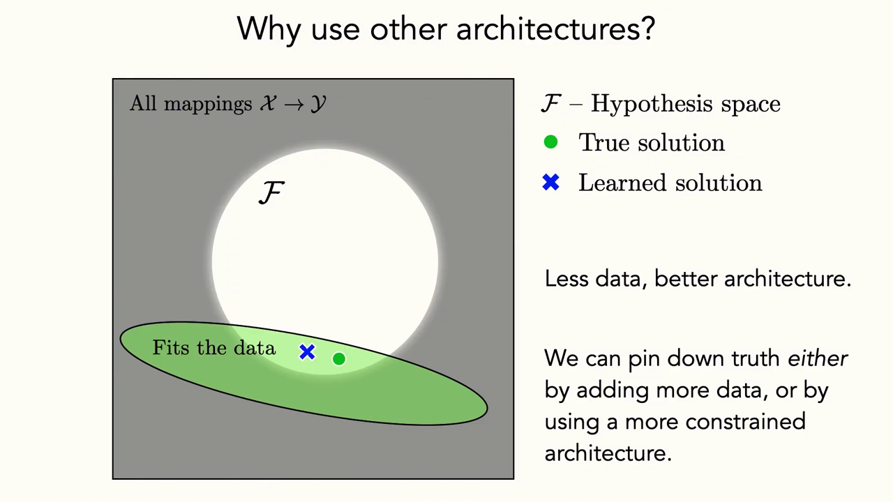
*▲ 강의 슬라이드 [07:46](https://youtu.be/bxVkZ4M-hIE?t=466): 모든 함수 공간, 데이터에 맞는 영역(초록), [가설 공간](00_%EB%94%A5%EB%9F%AC%EB%8B%9D_%EC%9A%A9%EC%96%B4%EC%82%AC%EC%A0%84.md#hypothesis-space-%EA%B0%80%EC%84%A4-%EA%B3%B5%EA%B0%84) $\mathcal{F}$(흰 원)*

### 1.3 1차원 예: 올바른 가설의 힘

▶ 영상 [07:57](https://youtu.be/bxVkZ4M-hIE?t=477)

스칼라 입력 $x$ 하나를 받는 함수 $y = f(x)$를 맞추는 실험입니다.

- **5층 [ReLU](00_%EB%94%A5%EB%9F%AC%EB%8B%9D_%EC%9A%A9%EC%96%B4%EC%82%AC%EC%A0%84.md#relu-%EB%A0%90%EB%A3%A8) 신경망**: 점 하나면 평평한 직선을 배운다. 데이터를 늘리면 데이터가 있는 구간에서는 잘 맞지만, **데이터 밖에서는 엉뚱하게** 뻗는다.
- **[정답](00_%EB%94%A5%EB%9F%AC%EB%8B%9D_%EC%9A%A9%EC%96%B4%EC%82%AC%EC%A0%84.md#label-%EC%A0%95%EB%8B%B5) 꼴을 아는 모델** $y = ax + \sin(bx^2)$: 점 하나로는 여전히 부족하지만, 점 몇 개만 있어도 데이터 밖까지 거의 완벽하게 맞는다.
- **5층 사인 신경망**([활성화 함수](00_%EB%94%A5%EB%9F%AC%EB%8B%9D_%EC%9A%A9%EC%96%B4%EC%82%AC%EC%A0%84.md#activation-function-%ED%99%9C%EC%84%B1%ED%99%94-%ED%95%A8%EC%88%98)가 사인): 점 몇 개만으로도 **주기적인 모양**이 나타난다. "출력은 주기적일 것"이라는 [귀납 편향](00_%EB%94%A5%EB%9F%AC%EB%8B%9D_%EC%9A%A9%EC%96%B4%EC%82%AC%EC%A0%84.md#inductive-bias-%EA%B7%80%EB%82%A9-%ED%8E%B8%ED%96%A5)을 구조에 넣었기 때문이다.

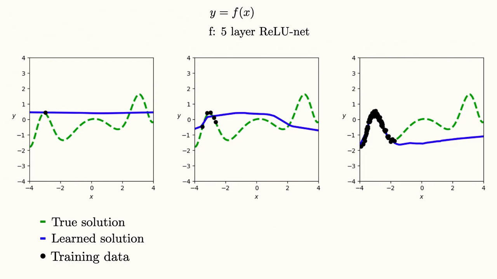
*▲ 강의 슬라이드 [08:25](https://youtu.be/bxVkZ4M-hIE?t=505): 5층 [ReLU](00_%EB%94%A5%EB%9F%AC%EB%8B%9D_%EC%9A%A9%EC%96%B4%EC%82%AC%EC%A0%84.md#relu-%EB%A0%90%EB%A3%A8) 신경망. [학습 데이터](00_%EB%94%A5%EB%9F%AC%EB%8B%9D_%EC%9A%A9%EC%96%B4%EC%82%AC%EC%A0%84.md#training-data-test-data-%ED%95%99%EC%8A%B5-%EB%8D%B0%EC%9D%B4%ED%84%B0%EC%99%80-%EC%8B%9C%ED%97%98-%EB%8D%B0%EC%9D%B4%ED%84%B0)가 있는 곳만 맞고 밖에서는 빗나간다*

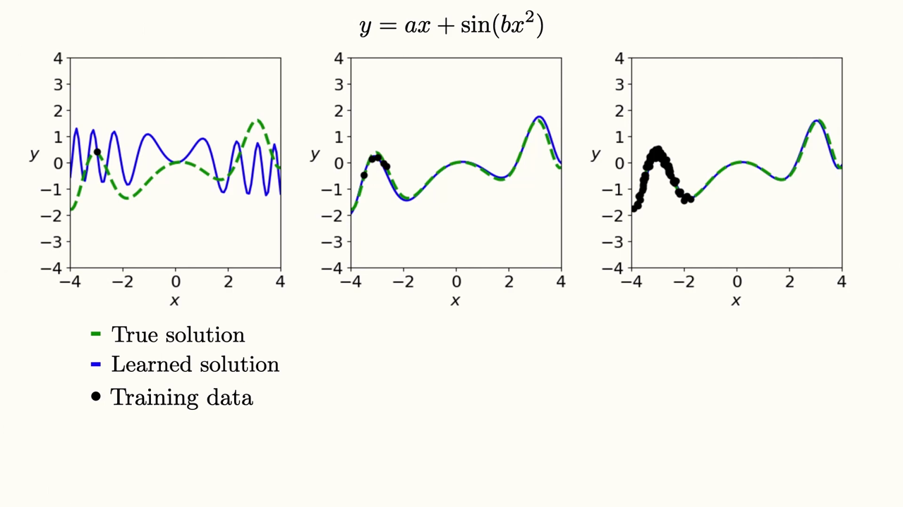
*▲ 강의 슬라이드 [09:25](https://youtu.be/bxVkZ4M-hIE?t=565): [정답](00_%EB%94%A5%EB%9F%AC%EB%8B%9D_%EC%9A%A9%EC%96%B4%EC%82%AC%EC%A0%84.md#label-%EC%A0%95%EB%8B%B5) 꼴 $y = ax + \sin(bx^2)$을 아는 모델. 점 몇 개로 데이터 밖까지 맞는다*

**좋은 아키텍처의 조건**: 참 함수를 **나타낼 수 있으면서 그 외에는 최소한**일 것, [기울기](00_%EB%94%A5%EB%9F%AC%EB%8B%9D_%EC%9A%A9%EC%96%B4%EC%82%AC%EC%A0%84.md#gradient-%EA%B8%B0%EC%9A%B8%EA%B8%B0) 기반 [학습](00_%EB%94%A5%EB%9F%AC%EB%8B%9D_%EC%9A%A9%EC%96%B4%EC%82%AC%EC%A0%84.md#training-%ED%95%99%EC%8A%B5)으로 찾기 쉬울 것, 병렬화가 쉽고 [GPU](00_%EB%94%A5%EB%9F%AC%EB%8B%9D_%EC%9A%A9%EC%96%B4%EC%82%AC%EC%A0%84.md#device-gpu-%EC%9E%A5%EC%B9%98%EC%99%80-gpu)에서 빠를 것.

- 예고: MIT의 Vincent Sitzmann 연구진이 만든 **[SIREN](00_%EB%94%A5%EB%9F%AC%EB%8B%9D_%EC%9A%A9%EC%96%B4%EC%82%AC%EC%A0%84.md#siren-%EC%82%AC%EC%9D%B8-%ED%99%9C%EC%84%B1%ED%99%94-%EC%8B%A0%EA%B2%BD%EB%A7%9D)**은 사인 [활성화 함수](00_%EB%94%A5%EB%9F%AC%EB%8B%9D_%EC%9A%A9%EC%96%B4%EC%82%AC%EC%A0%84.md#activation-function-%ED%99%9C%EC%84%B1%ED%99%94-%ED%95%A8%EC%88%98)로 이미지를 다른 모델보다 훨씬 빨리 맞춘다. 신호처리에서 이미지를 푸리에 기저(사인파들)로 잘 표현할 수 있다는 것과 같은 이유다(9절에서 다시 나온다).

---

## 2. 패치 분류에서 합성곱으로

▶ 영상 [12:53](https://youtu.be/bxVkZ4M-hIE?t=773)

📐 **수학 개념**: [이동 등변성](%EC%88%98%ED%95%99%EA%B0%9C%EB%85%90/07_%EA%B5%AC%EC%A1%B0_%EC%95%84%ED%82%A4%ED%85%8D%EC%B2%98/MM15_%ED%95%A9%EC%84%B1%EA%B3%B1%EA%B3%BC_%ED%87%B4%ED%94%8C%EB%A6%AC%EC%B8%A0_%ED%96%89%EB%A0%AC.md)

하늘을 나는 새 떼 사진을 보여 주며 "이 사진의 범주는?"이라고 묻자 학생들은 "새", "하늘", "자연"이라고 답합니다. 사진 한 장에는 여러 개념이 **서로 다른 위치에** 들어 있어서, 범주 하나로는 부족합니다(타임스스퀘어 사진이나 강의실 사진을 떠올려 보라고 합니다).

1. **패치로 나누어 각각 [분류](00_%EB%94%A5%EB%9F%AC%EB%8B%9D_%EC%9A%A9%EC%96%B4%EC%82%AC%EC%A0%84.md#regression-classification-%ED%9A%8C%EA%B7%80%EC%99%80-%EB%B6%84%EB%A5%98)**: 사진을 격자로 자르고 같은 분류기를 패치마다 돌리면 "새/하늘" 지도가 나온다. 저해상도 이미지 출력인 셈이다. 그런데 새 날개 끝만 걸친 패치처럼 **경계에 걸친 패치**는 애매하다.
2. **패치를 작게**: 극단적으로 한 화소가 되면 주변 맥락이 없어 무엇인지 알 수 없다.
3. **크지만 겹치는 패치**([CNN](00_%EB%94%A5%EB%9F%AC%EB%8B%9D_%EC%9A%A9%EC%96%B4%EC%82%AC%EC%A0%84.md#cnn-convolutional-neural-network-%ED%95%A9%EC%84%B1%EA%B3%B1-%EC%8B%A0%EA%B2%BD%EB%A7%9D)의 핵심 아이디어): 충분히 큰 창을 한 칸씩 밀면서 **창 가운데 화소의 범주**를 맞춘다. 맥락은 넓게 보면서 출력은 촘촘하다.

화소마다 범주를 매기는 이 문제가 **[의미 분할](00_%EB%94%A5%EB%9F%AC%EB%8B%9D_%EC%9A%A9%EC%96%B4%EC%82%AC%EC%A0%84.md#semantic-segmentation-%EC%9D%98%EB%AF%B8-%EB%B6%84%ED%95%A0)(Semantic segmentation)**입니다. 같은 범주 안에서 개체를 하나하나 구분하면 인스턴스 분할(Instance segmentation)이 됩니다.

**[이동 등변성](00_%EB%94%A5%EB%9F%AC%EB%8B%9D_%EC%9A%A9%EC%96%B4%EC%82%AC%EC%A0%84.md#translation-equivariance-%EC%9D%B4%EB%8F%99-%EB%93%B1%EB%B3%80%EC%84%B1)**: 모든 패치를 **똑같은 방식으로** 처리하므로, 새가 사진의 어느 구석에 있든 그 화소들은 "새"로 분류됩니다. 식으로 쓰면 입력을 옮긴 뒤 함수를 적용한 결과가 함수를 적용한 뒤 출력을 옮긴 결과와 같습니다: $f(\text{shift}(x)) = \text{shift}(f(x))$. 사진을 찍을 때 카메라를 조금 옮겨도 대상은 같으므로, 세상에는 원래 이런 대칭이 있고 우리는 그 대칭을 구조에 심은 것입니다(자세나 각도 변화는 별개 문제).

---

## 3. 합성곱 층

### 3.1 필터와 합성곱 식

▶ 영상 [20:48](https://youtu.be/bxVkZ4M-hIE?t=1248)

📐 **수학 개념**: [시그마(Σ)](%EC%88%98%ED%95%99%EA%B0%9C%EB%85%90/01_%EC%88%98%EC%99%80_%ED%95%A8%EC%88%98/M02_%EC%8B%9C%EA%B7%B8%EB%A7%88%EC%99%80_%ED%8F%89%EA%B7%A0.md) · 합성곱 손계산

패치 안 화소들의 [가중합](00_%EB%94%A5%EB%9F%AC%EB%8B%9D_%EC%9A%A9%EC%96%B4%EC%82%AC%EC%A0%84.md#weighted-sum-%EA%B0%80%EC%A4%91%ED%95%A9)을 계산하고 그 [가중치](00_%EB%94%A5%EB%9F%AC%EB%8B%9D_%EC%9A%A9%EC%96%B4%EC%82%AC%EC%A0%84.md#weight-%EA%B0%80%EC%A4%91%EC%B9%98) $W$를 학습한다고 합시다. 그러면 $W$는 **이미지 전체에 적용되는 [합성곱](00_%EB%94%A5%EB%9F%AC%EB%8B%9D_%EC%9A%A9%EC%96%B4%EC%82%AC%EC%A0%84.md#convolution-%ED%95%A9%EC%84%B1%EA%B3%B1) 커널**입니다.

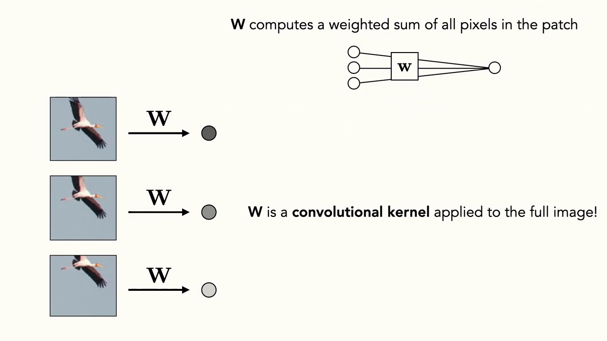
*▲ 강의 슬라이드 [21:38](https://youtu.be/bxVkZ4M-hIE?t=1298): 모든 패치에 같은 $W$를 쓰면 $W$가 곧 [합성곱](00_%EB%94%A5%EB%9F%AC%EB%8B%9D_%EC%9A%A9%EC%96%B4%EC%82%AC%EC%A0%84.md#convolution-%ED%95%A9%EC%84%B1%EA%B3%B1) 커널*

- **[합성곱](00_%EB%94%A5%EB%9F%AC%EB%8B%9D_%EC%9A%A9%EC%96%B4%EC%82%AC%EC%A0%84.md#convolution-%ED%95%A9%EC%84%B1%EA%B3%B1)**: 격자 구조 데이터에 대한 **선형이고 이동에 대해 변하지 않는(shift-invariant)** 변환. 신호처리에서는 필터링을 하는 방법이다.
- 출력 식 (강의 슬라이드):

$$
x_{\text{out}}[n, m] = b + \sum_{k_1, k_2 = -K}^{K} w[k_1, k_2]\; x_{\text{in}}[n + k_1,\ m + k_2]
$$

기호 풀이

| 기호 | 읽는 법 | 뜻 | 예제 값 |
| --- | --- | --- | --- |
| $x_{\text{out}}[n, m]$ | 엑스 아웃 엔 엠 | 출력 이미지의 n행 m열 칸 값 | 6.5 |
| $x_{\text{in}}$ | 엑스 인 | 입력 이미지 | 아래 3×3 조각 |
| $n, m$ | 엔, 엠 | 출력 칸의 행·열 위치 | 한 칸 (n, m) |
| $b$ | 비 | [편향](00_%EB%94%A5%EB%9F%AC%EB%8B%9D_%EC%9A%A9%EC%96%B4%EC%82%AC%EC%A0%84.md#bias-%ED%8E%B8%ED%96%A5), 모든 칸에 똑같이 더하는 상수 | 0.5 |
| $\sum_{k_1, k_2 = -K}^{K}$ | 시그마 케이원 케이투 마이너스 케이부터 케이까지 | k1, k2를 −K~K의 모든 짝으로 바꿔 가며 더하기 | 3×3 = 9항 |
| $k_1, k_2$ | 케이 원, 케이 투 | 가운데 칸에서 위아래(k1)·좌우(k2)로 떨어진 칸 수 | −1, 0, 1 |
| $K$ | 케이 | 커널 반지름. 커널 한 변은 2K+1칸 | 1 (3×3 커널) |
| $w[k_1, k_2]$ | 더블유 케이원 케이투 | 커널의 (k1, k2) 칸 [가중치](00_%EB%94%A5%EB%9F%AC%EB%8B%9D_%EC%9A%A9%EC%96%B4%EC%82%AC%EC%A0%84.md#weight-%EA%B0%80%EC%A4%91%EC%B9%98) | $w[1, 0] = 1$ |

예제와 풀이

**문제**: 3×3 가로 경계 검출 커널을 입력의 한 자리 (n, m)에 얹었을 때 그 자리의 출력 값 $x_{\text{out}}[n, m]$을 구한다.

**주어진 값**:
- $K = 1$ (커널 반지름. $k_1, k_2$가 −1, 0, 1이라 커널은 3×3)
- $b = 0.5$ ([편향](00_%EB%94%A5%EB%9F%AC%EB%8B%9D_%EC%9A%A9%EC%96%B4%EC%82%AC%EC%A0%84.md#bias-%ED%8E%B8%ED%96%A5), 마지막에 더하는 상수)
- $w$ 위 행 $= (-1, -1, -1)$ ($k_1 = -1$ 줄의 [가중치](00_%EB%94%A5%EB%9F%AC%EB%8B%9D_%EC%9A%A9%EC%96%B4%EC%82%AC%EC%A0%84.md#weight-%EA%B0%80%EC%A4%91%EC%B9%98))
- $w$ 가운데 행 $= (0, 0, 0)$ ($k_1 = 0$ 줄의 [가중치](00_%EB%94%A5%EB%9F%AC%EB%8B%9D_%EC%9A%A9%EC%96%B4%EC%82%AC%EC%A0%84.md#weight-%EA%B0%80%EC%A4%91%EC%B9%98))
- $w$ 아래 행 $= (1, 1, 1)$ ($k_1 = 1$ 줄의 [가중치](00_%EB%94%A5%EB%9F%AC%EB%8B%9D_%EC%9A%A9%EC%96%B4%EC%82%AC%EC%A0%84.md#weight-%EA%B0%80%EC%A4%91%EC%B9%98))
- $x_{\text{in}}$ 위 행 $= (0, 0, 0)$ (출력 자리 바로 위 줄 n−1의 입력)
- $x_{\text{in}}$ 가운데 행 $= (1, 1, 1)$ (출력 자리와 같은 줄 n의 입력)
- $x_{\text{in}}$ 아래 행 $= (2, 2, 2)$ (바로 아래 줄 n+1의 입력)

**풀이**
1. 식을 그대로 쓴다: $x_{\text{out}}[n, m] = b + \sum_{k_1, k_2 = -K}^{K} w[k_1, k_2]\; x_{\text{in}}[n + k_1,\ m + k_2]$
2. 값을 대입한다: $x_{\text{out}}[n, m] = 0.5 + \sum_{k_1, k_2 = -1}^{1} w[k_1, k_2]\; x_{\text{in}}[n + k_1,\ m + k_2]$
3. 시그마를 9개 항으로 풀어 쓴다 (위 행 3개, 가운데 행 3개, 아래 행 3개 순서로 [가중치](00_%EB%94%A5%EB%9F%AC%EB%8B%9D_%EC%9A%A9%EC%96%B4%EC%82%AC%EC%A0%84.md#weight-%EA%B0%80%EC%A4%91%EC%B9%98) × 입력): $0.5 + (-1) \times 0 + (-1) \times 0 + (-1) \times 0 + 0 \times 1 + 0 \times 1 + 0 \times 1 + 1 \times 2 + 1 \times 2 + 1 \times 2$
4. 곱셈을 먼저 한다: 위 행은 모두 0, 가운데 행도 모두 0, 아래 행은 $1 \times 2 = 2$ 이므로 $0.5 + 0 + 0 + 0 + 0 + 0 + 0 + 2 + 2 + 2$
5. 곱한 값 9개를 더한다: $0 + 0 + 0 + 0 + 0 + 0 + 2 + 2 + 2 = 6$ 이므로 $x_{\text{out}}[n, m] = 0.5 + 6$
6. [편향](00_%EB%94%A5%EB%9F%AC%EB%8B%9D_%EC%9A%A9%EC%96%B4%EC%82%AC%EC%A0%84.md#bias-%ED%8E%B8%ED%96%A5)을 더한다: $0.5 + 6 = 6.5$

**답**: $x_{\text{out}}[n, m] = 6.5$ (아래로 갈수록 밝아지는 경계라 큰 값)

내 이해

- 흰동가리 사진에 "어두움 → 밝음" 무늬의 [필터](00_%EB%94%A5%EB%9F%AC%EB%8B%9D_%EC%9A%A9%EC%96%B4%EC%82%AC%EC%A0%84.md#filter-%ED%95%84%ED%84%B0)를 돌리면, 그 무늬와 같은 경계(어두움→밝음)는 큰 값(흰색), 정반대 경계(밝음→어두움)는 작은 값(검은색)이 나옵니다. 이 [필터](00_%EB%94%A5%EB%9F%AC%EB%8B%9D_%EC%9A%A9%EC%96%B4%EC%82%AC%EC%A0%84.md#filter-%ED%95%84%ED%84%B0)는 **가로 경계 검출기**입니다. 사진을 옮기면 출력도 그만큼 옮겨집니다.

### 3.2 행렬로 본 합성곱

▶ 영상 [24:15](https://youtu.be/bxVkZ4M-hIE?t=1455)

📐 **수학 개념**: [합성곱과 퇴플리츠 행렬](%EC%88%98%ED%95%99%EA%B0%9C%EB%85%90/07_%EA%B5%AC%EC%A1%B0_%EC%95%84%ED%82%A4%ED%85%8D%EC%B2%98/MM15_%ED%95%A9%EC%84%B1%EA%B3%B1%EA%B3%BC_%ED%87%B4%ED%94%8C%EB%A6%AC%EC%B8%A0_%ED%96%89%EB%A0%AC.md) · [행렬 곱](%EC%88%98%ED%95%99%EA%B0%9C%EB%85%90/03_%EC%84%A0%ED%98%95%EB%8C%80%EC%88%98/M05_%EB%B2%A1%ED%84%B0%EC%99%80_%ED%96%89%EB%A0%AC.md)

- [덴스 층](00_%EB%94%A5%EB%9F%AC%EB%8B%9D_%EC%9A%A9%EC%96%B4%EC%82%AC%EC%A0%84.md#dense-layer-%EB%8D%B4%EC%8A%A4-%EC%B8%B5)(fully connected)은 모든 출력이 모든 입력에 의존합니다. [합성곱](00_%EB%94%A5%EB%9F%AC%EB%8B%9D_%EC%9A%A9%EC%96%B4%EC%82%AC%EC%A0%84.md#convolution-%ED%95%A9%EC%84%B1%EA%B3%B1) [층](00_%EB%94%A5%EB%9F%AC%EB%8B%9D_%EC%9A%A9%EC%96%B4%EC%82%AC%EC%A0%84.md#layer-%EC%B8%B5)은 **국소적으로만 연결**되고, 그 연결 [가중치](00_%EB%94%A5%EB%9F%AC%EB%8B%9D_%EC%9A%A9%EC%96%B4%EC%82%AC%EC%A0%84.md#weight-%EA%B0%80%EC%A4%91%EC%B9%98)를 **모든 위치에서 공유**합니다([가중치 공유](00_%EB%94%A5%EB%9F%AC%EB%8B%9D_%EC%9A%A9%EC%96%B4%EC%82%AC%EC%A0%84.md#weight-sharing-%EA%B0%80%EC%A4%91%EC%B9%98-%EA%B3%B5%EC%9C%A0)). 강의는 이를 $x_{\text{out}} = w \star x_{\text{in}} + b$로 쓰고, $\star$를 오각별로 그립니다.
- **이름에 대한 주의**: 신호처리의 [합성곱](00_%EB%94%A5%EB%9F%AC%EB%8B%9D_%EC%9A%A9%EC%96%B4%EC%82%AC%EC%A0%84.md#convolution-%ED%95%A9%EC%84%B1%EA%B3%B1)은 [필터](00_%EB%94%A5%EB%9F%AC%EB%8B%9D_%EC%9A%A9%EC%96%B4%EC%82%AC%EC%A0%84.md#filter-%ED%95%84%ED%84%B0)를 뒤집습니다. 신경망에서 쓰는 것은 엄밀히는 [교차 상관](00_%EB%94%A5%EB%9F%AC%EB%8B%9D_%EC%9A%A9%EC%96%B4%EC%82%AC%EC%A0%84.md#cross-correlation-%EA%B5%90%EC%B0%A8-%EC%83%81%EA%B4%80)이지만, 뒤집힌 [필터](00_%EB%94%A5%EB%9F%AC%EB%8B%9D_%EC%9A%A9%EC%96%B4%EC%82%AC%EC%A0%84.md#filter-%ED%95%84%ED%84%B0)도 학습하면 그만이라 그냥 [합성곱](00_%EB%94%A5%EB%9F%AC%EB%8B%9D_%EC%9A%A9%EC%96%B4%EC%82%AC%EC%A0%84.md#convolution-%ED%95%A9%EC%84%B1%EA%B3%B1)이라 부릅니다.
- [덴스 층](00_%EB%94%A5%EB%9F%AC%EB%8B%9D_%EC%9A%A9%EC%96%B4%EC%82%AC%EC%A0%84.md#dense-layer-%EB%8D%B4%EC%8A%A4-%EC%B8%B5) $y = Wx$에서 $W$는 꽉 찬 행렬입니다. [합성곱](00_%EB%94%A5%EB%9F%AC%EB%8B%9D_%EC%9A%A9%EC%96%B4%EC%82%AC%EC%A0%84.md#convolution-%ED%95%A9%EC%84%B1%EA%B3%B1) [층](00_%EB%94%A5%EB%9F%AC%EB%8B%9D_%EC%9A%A9%EC%96%B4%EC%82%AC%EC%A0%84.md#layer-%EC%B8%B5)도 $y = Wx$로 쓸 수 있는데, $W$는 **대각선과 그 바로 위아래에만 값이 있고 같은 대각선 위의 값이 모두 같은** 희소 행렬입니다. 이런 행렬이 [퇴플리츠 행렬](00_%EB%94%A5%EB%9F%AC%EB%8B%9D_%EC%9A%A9%EC%96%B4%EC%82%AC%EC%A0%84.md#toeplitz-matrix-%ED%87%B4%ED%94%8C%EB%A6%AC%EC%B8%A0-%ED%96%89%EB%A0%AC)의 한 형태입니다. 즉 **[합성곱](00_%EB%94%A5%EB%9F%AC%EB%8B%9D_%EC%9A%A9%EC%96%B4%EC%82%AC%EC%A0%84.md#convolution-%ED%95%A9%EC%84%B1%EA%B3%B1) [층](00_%EB%94%A5%EB%9F%AC%EB%8B%9D_%EC%9A%A9%EC%96%B4%EC%82%AC%EC%A0%84.md#layer-%EC%B8%B5) = 제약이 걸린 [선형층](00_%EB%94%A5%EB%9F%AC%EB%8B%9D_%EC%9A%A9%EC%96%B4%EC%82%AC%EC%A0%84.md#linear-layer-%EC%84%A0%ED%98%95%EC%B8%B5)**입니다.

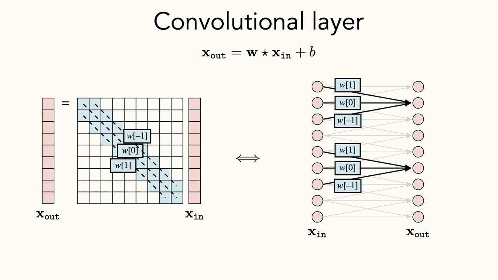
*▲ 강의 슬라이드 [29:25](https://youtu.be/bxVkZ4M-hIE?t=1765): [합성곱](00_%EB%94%A5%EB%9F%AC%EB%8B%9D_%EC%9A%A9%EC%96%B4%EC%82%AC%EC%A0%84.md#convolution-%ED%95%A9%EC%84%B1%EA%B3%B1) [층](00_%EB%94%A5%EB%9F%AC%EB%8B%9D_%EC%9A%A9%EC%96%B4%EC%82%AC%EC%A0%84.md#layer-%EC%B8%B5)을 행렬로 쓰면 $w[-1], w[0], w[1]$이 대각선을 따라 되풀이되는 띠 행렬*

이 제약 덕분에 얻는 것:

- 배울 [파라미터](00_%EB%94%A5%EB%9F%AC%EB%8B%9D_%EC%9A%A9%EC%96%B4%EC%82%AC%EC%A0%84.md#parameter-%ED%8C%8C%EB%9D%BC%EB%AF%B8%ED%84%B0)가 적다 → [과적합](00_%EB%94%A5%EB%9F%AC%EB%8B%9D_%EC%9A%A9%EC%96%B4%EC%82%AC%EC%A0%84.md#overfitting-%EA%B3%BC%EC%A0%81%ED%95%A9)이 줄어든다.
- [이동 등변성](00_%EB%94%A5%EB%9F%AC%EB%8B%9D_%EC%9A%A9%EC%96%B4%EC%82%AC%EC%A0%84.md#translation-equivariance-%EC%9D%B4%EB%8F%99-%EB%93%B1%EB%B3%80%EC%84%B1)이 구조에 들어간다.
- **입력 크기에 매이지 않는다**: 띠 무늬는 행렬을 늘려도 그대로라, [학습](00_%EB%94%A5%EB%9F%AC%EB%8B%9D_%EC%9A%A9%EC%96%B4%EC%82%AC%EC%A0%84.md#training-%ED%95%99%EC%8A%B5) 때와 다른 크기의 이미지에도 같은 [필터](00_%EB%94%A5%EB%9F%AC%EB%8B%9D_%EC%9A%A9%EC%96%B4%EC%82%AC%EC%A0%84.md#filter-%ED%95%84%ED%84%B0)를 쓸 수 있다. MLP는 입력이 커지면 그 크기에 맞는 [가중치](00_%EB%94%A5%EB%9F%AC%EB%8B%9D_%EC%9A%A9%EC%96%B4%EC%82%AC%EC%A0%84.md#weight-%EA%B0%80%EC%A4%91%EC%B9%98)가 아예 없다.

> [!NOTE]
> **숫자로 확인 ([MM15_합성곱과_퇴플리츠_행렬](%EC%88%98%ED%95%99%EA%B0%9C%EB%85%90/07_%EA%B5%AC%EC%A1%B0_%EC%95%84%ED%82%A4%ED%85%8D%EC%B2%98/MM15_%ED%95%A9%EC%84%B1%EA%B3%B1%EA%B3%BC_%ED%87%B4%ED%94%8C%EB%A6%AC%EC%B8%A0_%ED%96%89%EB%A0%AC.md))**
> 입력 $(0, 1, 3, 3, 0, 0)$에 [필터](00_%EB%94%A5%EB%9F%AC%EB%8B%9D_%EC%9A%A9%EC%96%B4%EC%82%AC%EC%A0%84.md#filter-%ED%95%84%ED%84%B0) $(-1, 0, 1)$을 쓰면 출력은 $(1, 3, 2, -3, -3, 0)$. 6×6 [퇴플리츠 행렬](00_%EB%94%A5%EB%9F%AC%EB%8B%9D_%EC%9A%A9%EC%96%B4%EC%82%AC%EC%A0%84.md#toeplitz-matrix-%ED%87%B4%ED%94%8C%EB%A6%AC%EC%B8%A0-%ED%96%89%EB%A0%AC) 36칸 가운데 0이 아닌 칸은 10개, 서로 다른 값은 3개뿐이다. 입력을 한 칸 밀면 출력도 정확히 한 칸 밀린다.

### 3.3 합성곱을 보는 다섯 관점

▶ 영상 [29:18](https://youtu.be/bxVkZ4M-hIE?t=1758)

1. **[이동 등변성](00_%EB%94%A5%EB%9F%AC%EB%8B%9D_%EC%9A%A9%EC%96%B4%EC%82%AC%EC%A0%84.md#translation-equivariance-%EC%9D%B4%EB%8F%99-%EB%93%B1%EB%B3%80%EC%84%B1)**을 구조에 심은 [가설](00_%EB%94%A5%EB%9F%AC%EB%8B%9D_%EC%9A%A9%EC%96%B4%EC%82%AC%EC%A0%84.md#hypothesis-%EA%B0%80%EC%84%A4)이다.
2. **패치 처리**: 패치마다 따로 계산하므로 병렬화가 쉽고 효율적이다.
3. **이미지 [필터](00_%EB%94%A5%EB%9F%AC%EB%8B%9D_%EC%9A%A9%EC%96%B4%EC%82%AC%EC%A0%84.md#filter-%ED%95%84%ED%84%B0)**: 입력에서 쓸모 있는 구조를 강조하는 [필터](00_%EB%94%A5%EB%9F%AC%EB%8B%9D_%EC%9A%A9%EC%96%B4%EC%82%AC%EC%A0%84.md#filter-%ED%95%84%ED%84%B0)를 학습한다.
4. **[파라미터](00_%EB%94%A5%EB%9F%AC%EB%8B%9D_%EC%9A%A9%EC%96%B4%EC%82%AC%EC%A0%84.md#parameter-%ED%8C%8C%EB%9D%BC%EB%AF%B8%ED%84%B0) 공유**: 같은 [파라미터](00_%EB%94%A5%EB%9F%AC%EB%8B%9D_%EC%9A%A9%EC%96%B4%EC%82%AC%EC%A0%84.md#parameter-%ED%8C%8C%EB%9D%BC%EB%AF%B8%ED%84%B0)를 입력 전체에 쓴다.
5. **크기가 변하는 [텐서](00_%EB%94%A5%EB%9F%AC%EB%8B%9D_%EC%9A%A9%EC%96%B4%EC%82%AC%EC%A0%84.md#tensor-%ED%85%90%EC%84%9C) 처리**: 입력 크기가 달라도 그대로 적용된다.

---

## 4. 합성곱 층 쌓기와 여러 채널

### 4.1 층을 쌓으면

▶ 영상 [30:25](https://youtu.be/bxVkZ4M-hIE?t=1825)

📐 **수학 개념**: [합성함수와 비선형성](%EC%88%98%ED%95%99%EA%B0%9C%EB%85%90/05_%EC%8B%A0%EA%B2%BD%EB%A7%9D%EC%9D%98_%EA%B3%84%EC%82%B0/MM06_%ED%95%A9%EC%84%B1%ED%95%A8%EC%88%98%EC%99%80_%EB%B9%84%EC%84%A0%ED%98%95%EC%84%B1.md) · [수용 영역](%EC%88%98%ED%95%99%EA%B0%9C%EB%85%90/07_%EA%B5%AC%EC%A1%B0_%EC%95%84%ED%82%A4%ED%85%8D%EC%B2%98/MM16_%EC%88%98%EC%9A%A9_%EC%98%81%EC%97%AD%EA%B3%BC_%EC%B6%9C%EB%A0%A5_%ED%81%AC%EA%B8%B0.md)

[합성곱](00_%EB%94%A5%EB%9F%AC%EB%8B%9D_%EC%9A%A9%EC%96%B4%EC%82%AC%EC%A0%84.md#convolution-%ED%95%A9%EC%84%B1%EA%B3%B1) → 원소별 비선형 함수 → [합성곱](00_%EB%94%A5%EB%9F%AC%EB%8B%9D_%EC%9A%A9%EC%96%B4%EC%82%AC%EC%A0%84.md#convolution-%ED%95%A9%EC%84%B1%EA%B3%B1)을 쌓으면, **[CNN](00_%EB%94%A5%EB%9F%AC%EB%8B%9D_%EC%9A%A9%EC%96%B4%EC%82%AC%EC%A0%84.md#cnn-convolutional-neural-network-%ED%95%A9%EC%84%B1%EA%B3%B1-%EC%8B%A0%EA%B2%BD%EB%A7%9D) 전체가 하나의 비선형 [합성곱](00_%EB%94%A5%EB%9F%AC%EB%8B%9D_%EC%9A%A9%EC%96%B4%EC%82%AC%EC%A0%84.md#convolution-%ED%95%A9%EC%84%B1%EA%B3%B1) [필터](00_%EB%94%A5%EB%9F%AC%EB%8B%9D_%EC%9A%A9%EC%96%B4%EC%82%AC%EC%A0%84.md#filter-%ED%95%84%ED%84%B0)**처럼 동작합니다. 출력의 한 칸은 여전히 입력의 국소 영역에만 의존하고, 그 함수는 어느 위치에서나 같습니다. 다만 [층](00_%EB%94%A5%EB%9F%AC%EB%8B%9D_%EC%9A%A9%EC%96%B4%EC%82%AC%EC%A0%84.md#layer-%EC%B8%B5)이 깊어질수록 출력 한 칸이 보는 입력 영역, 곧 [수용 영역](00_%EB%94%A5%EB%9F%AC%EB%8B%9D_%EC%9A%A9%EC%96%B4%EC%82%AC%EC%A0%84.md#receptive-field-%EC%88%98%EC%9A%A9-%EC%98%81%EC%97%AD)이 넓어집니다. 이렇게 [층](00_%EB%94%A5%EB%9F%AC%EB%8B%9D_%EC%9A%A9%EC%96%B4%EC%82%AC%EC%A0%84.md#layer-%EC%B8%B5)마다 보는 범위가 커지는 구조를 공간 피라미드(spatial pyramid)라고도 부릅니다.

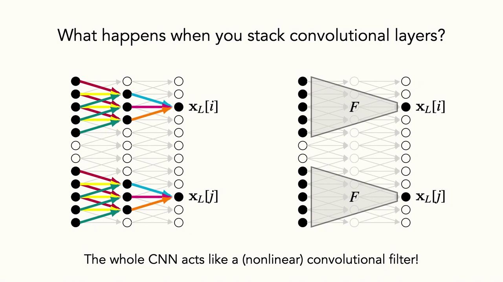
*▲ 강의 슬라이드 [34:20](https://youtu.be/bxVkZ4M-hIE?t=2060): [합성곱](00_%EB%94%A5%EB%9F%AC%EB%8B%9D_%EC%9A%A9%EC%96%B4%EC%82%AC%EC%A0%84.md#convolution-%ED%95%A9%EC%84%B1%EA%B3%B1) [층](00_%EB%94%A5%EB%9F%AC%EB%8B%9D_%EC%9A%A9%EC%96%B4%EC%82%AC%EC%A0%84.md#layer-%EC%B8%B5)을 쌓으면 [CNN](00_%EB%94%A5%EB%9F%AC%EB%8B%9D_%EC%9A%A9%EC%96%B4%EC%82%AC%EC%A0%84.md#cnn-convolutional-neural-network-%ED%95%A9%EC%84%B1%EA%B3%B1-%EC%8B%A0%EA%B2%BD%EB%A7%9D) 전체가 (비선형) [합성곱](00_%EB%94%A5%EB%9F%AC%EB%8B%9D_%EC%9A%A9%EC%96%B4%EC%82%AC%EC%A0%84.md#convolution-%ED%95%A9%EC%84%B1%EA%B3%B1) [필터](00_%EB%94%A5%EB%9F%AC%EB%8B%9D_%EC%9A%A9%EC%96%B4%EC%82%AC%EC%A0%84.md#filter-%ED%95%84%ED%84%B0)처럼 동작한다*

- [수용 영역](00_%EB%94%A5%EB%9F%AC%EB%8B%9D_%EC%9A%A9%EC%96%B4%EC%82%AC%EC%A0%84.md#receptive-field-%EC%88%98%EC%9A%A9-%EC%98%81%EC%97%AD)을 넓히는 방법은 두 가지: [필터](00_%EB%94%A5%EB%9F%AC%EB%8B%9D_%EC%9A%A9%EC%96%B4%EC%82%AC%EC%A0%84.md#filter-%ED%95%84%ED%84%B0)를 키우거나, [층](00_%EB%94%A5%EB%9F%AC%EB%8B%9D_%EC%9A%A9%EC%96%B4%EC%82%AC%EC%A0%84.md#layer-%EC%B8%B5)을 더 쌓거나.
- [층](00_%EB%94%A5%EB%9F%AC%EB%8B%9D_%EC%9A%A9%EC%96%B4%EC%82%AC%EC%A0%84.md#layer-%EC%B8%B5)마다 [필터](00_%EB%94%A5%EB%9F%AC%EB%8B%9D_%EC%9A%A9%EC%96%B4%EC%82%AC%EC%A0%84.md#filter-%ED%95%84%ED%84%B0)는 **다르게** 학습됩니다(같은 [층](00_%EB%94%A5%EB%9F%AC%EB%8B%9D_%EC%9A%A9%EC%96%B4%EC%82%AC%EC%A0%84.md#layer-%EC%B8%B5) 안에서만 공유).
- 실제 이미지에서는 한 줄로 펴서 1차원 [합성곱](00_%EB%94%A5%EB%9F%AC%EB%8B%9D_%EC%9A%A9%EC%96%B4%EC%82%AC%EC%A0%84.md#convolution-%ED%95%A9%EC%84%B1%EA%B3%B1)을 하지 않고 **2차원으로** 합성곱합니다. 펴면 줄무늬 같은 이상한 구조가 생기기 때문입니다.

### 4.2 여러 입력 채널과 여러 출력 채널

▶ 영상 [35:23](https://youtu.be/bxVkZ4M-hIE?t=2123)

📐 **수학 개념**: [시그마(Σ)](%EC%88%98%ED%95%99%EA%B0%9C%EB%85%90/01_%EC%88%98%EC%99%80_%ED%95%A8%EC%88%98/M02_%EC%8B%9C%EA%B7%B8%EB%A7%88%EC%99%80_%ED%8F%89%EA%B7%A0.md) · 파라미터 수

- **여러 입력 [채널](00_%EB%94%A5%EB%9F%AC%EB%8B%9D_%EC%9A%A9%EC%96%B4%EC%82%AC%EC%A0%84.md#channel-%EC%B1%84%EB%84%90)**(예: RGB): 입력 [채널](00_%EB%94%A5%EB%9F%AC%EB%8B%9D_%EC%9A%A9%EC%96%B4%EC%82%AC%EC%A0%84.md#channel-%EC%B1%84%EB%84%90)마다 다른 [가중치](00_%EB%94%A5%EB%9F%AC%EB%8B%9D_%EC%9A%A9%EC%96%B4%EC%82%AC%EC%A0%84.md#weight-%EA%B0%80%EC%A4%91%EC%B9%98)를 학습하고, 채널별 [합성곱](00_%EB%94%A5%EB%9F%AC%EB%8B%9D_%EC%9A%A9%EC%96%B4%EC%82%AC%EC%A0%84.md#convolution-%ED%95%A9%EC%84%B1%EA%B3%B1) 결과를 **모두 더해** 출력 한 장을 만듭니다: $x_{\text{out}} = \sum_c w[c, :] \star x_{\text{in}}[c, :] + b$.
- **여러 출력 [채널](00_%EB%94%A5%EB%9F%AC%EB%8B%9D_%EC%9A%A9%EC%96%B4%EC%82%AC%EC%A0%84.md#channel-%EC%B1%84%EB%84%90)**: [필터](00_%EB%94%A5%EB%9F%AC%EB%8B%9D_%EC%9A%A9%EC%96%B4%EC%82%AC%EC%A0%84.md#filter-%ED%95%84%ED%84%B0)를 여러 개 두어([필터 뱅크](00_%EB%94%A5%EB%9F%AC%EB%8B%9D_%EC%9A%A9%EC%96%B4%EC%82%AC%EC%A0%84.md#filter-bank-%ED%95%84%ED%84%B0-%EB%B1%85%ED%81%AC)) 같은 입력에서 [필터](00_%EB%94%A5%EB%9F%AC%EB%8B%9D_%EC%9A%A9%EC%96%B4%EC%82%AC%EC%A0%84.md#filter-%ED%95%84%ED%84%B0)마다 출력 [채널](00_%EB%94%A5%EB%9F%AC%EB%8B%9D_%EC%9A%A9%EC%96%B4%EC%82%AC%EC%A0%84.md#channel-%EC%B1%84%EB%84%90) 하나씩을 만듭니다.
- **일반형**(다입력·다출력): [필터](00_%EB%94%A5%EB%9F%AC%EB%8B%9D_%EC%9A%A9%EC%96%B4%EC%82%AC%EC%A0%84.md#filter-%ED%95%84%ED%84%B0)는 $C_{\text{out}}$개, 각 [필터](00_%EB%94%A5%EB%9F%AC%EB%8B%9D_%EC%9A%A9%EC%96%B4%EC%82%AC%EC%A0%84.md#filter-%ED%95%84%ED%84%B0)는 공간 크기 $K \times K$에 입력 [채널](00_%EB%94%A5%EB%9F%AC%EB%8B%9D_%EC%9A%A9%EC%96%B4%EC%82%AC%EC%A0%84.md#channel-%EC%B1%84%EB%84%90) 수 $C_{\text{in}}$만큼의 깊이를 가집니다.

$$
x_{\text{out}}[c_2, :, :] = \sum_{c_1=1}^{C_{\text{in}}} w[c_1, c_2, :, :] \star x_{\text{in}}[c_1, :, :] + b[c_2]
$$

기호 풀이

| 기호 | 읽는 법 | 뜻 | 예제 값 |
| --- | --- | --- | --- |
| $x_{\text{out}}[c_2, :, :]$ | 엑스 아웃 씨투 | 출력 [채널](00_%EB%94%A5%EB%9F%AC%EB%8B%9D_%EC%9A%A9%EC%96%B4%EC%82%AC%EC%A0%84.md#channel-%EC%B1%84%EB%84%90) c2의 [특징 맵](00_%EB%94%A5%EB%9F%AC%EB%8B%9D_%EC%9A%A9%EC%96%B4%EC%82%AC%EC%A0%84.md#feature-map-%ED%8A%B9%EC%A7%95-%EB%A7%B5) 전체 | 1×1 맵 (5) |
| $c_1$ | 씨 원 | 입력 [채널](00_%EB%94%A5%EB%9F%AC%EB%8B%9D_%EC%9A%A9%EC%96%B4%EC%82%AC%EC%A0%84.md#channel-%EC%B1%84%EB%84%90) 번호 | 1, 2 |
| $c_2$ | 씨 투 | 출력 [채널](00_%EB%94%A5%EB%9F%AC%EB%8B%9D_%EC%9A%A9%EC%96%B4%EC%82%AC%EC%A0%84.md#channel-%EC%B1%84%EB%84%90) 번호 (= [필터](00_%EB%94%A5%EB%9F%AC%EB%8B%9D_%EC%9A%A9%EC%96%B4%EC%82%AC%EC%A0%84.md#filter-%ED%95%84%ED%84%B0) 번호) | 1 |
| $C_{\text{in}}$ | 씨 인 | 입력 [채널](00_%EB%94%A5%EB%9F%AC%EB%8B%9D_%EC%9A%A9%EC%96%B4%EC%82%AC%EC%A0%84.md#channel-%EC%B1%84%EB%84%90) 수 | 2 |
| $w[c_1, c_2, :, :]$ | 더블유 씨원 씨투 | [필터](00_%EB%94%A5%EB%9F%AC%EB%8B%9D_%EC%9A%A9%EC%96%B4%EC%82%AC%EC%A0%84.md#filter-%ED%95%84%ED%84%B0) c2 안에서 입력 [채널](00_%EB%94%A5%EB%9F%AC%EB%8B%9D_%EC%9A%A9%EC%96%B4%EC%82%AC%EC%A0%84.md#channel-%EC%B1%84%EB%84%90) c1에 쓰는 K×K [가중치](00_%EB%94%A5%EB%9F%AC%EB%8B%9D_%EC%9A%A9%EC%96%B4%EC%82%AC%EC%A0%84.md#weight-%EA%B0%80%EC%A4%91%EC%B9%98) | 2×2 |
| $\star$ | 별 | [합성곱](00_%EB%94%A5%EB%9F%AC%EB%8B%9D_%EC%9A%A9%EC%96%B4%EC%82%AC%EC%A0%84.md#convolution-%ED%95%A9%EC%84%B1%EA%B3%B1) ([교차 상관](00_%EB%94%A5%EB%9F%AC%EB%8B%9D_%EC%9A%A9%EC%96%B4%EC%82%AC%EC%A0%84.md#cross-correlation-%EA%B5%90%EC%B0%A8-%EC%83%81%EA%B4%80)) | $w \star x$ |
| $x_{\text{in}}[c_1, :, :]$ | 엑스 인 씨원 | 입력 [채널](00_%EB%94%A5%EB%9F%AC%EB%8B%9D_%EC%9A%A9%EC%96%B4%EC%82%AC%EC%A0%84.md#channel-%EC%B1%84%EB%84%90) c1의 이미지 | 2×2 |
| $b[c_2]$ | 비 씨투 | 출력 [채널](00_%EB%94%A5%EB%9F%AC%EB%8B%9D_%EC%9A%A9%EC%96%B4%EC%82%AC%EC%A0%84.md#channel-%EC%B1%84%EB%84%90) c2의 [편향](00_%EB%94%A5%EB%9F%AC%EB%8B%9D_%EC%9A%A9%EC%96%B4%EC%82%AC%EC%A0%84.md#bias-%ED%8E%B8%ED%96%A5) | −1 |
| $:$ | 콜론 | 그 축의 모든 칸 | 높이·너비 전체 |

예제와 풀이

**문제**: 입력 [채널](00_%EB%94%A5%EB%9F%AC%EB%8B%9D_%EC%9A%A9%EC%96%B4%EC%82%AC%EC%A0%84.md#channel-%EC%B1%84%EB%84%90) 2개짜리 2×2 이미지에 [필터](00_%EB%94%A5%EB%9F%AC%EB%8B%9D_%EC%9A%A9%EC%96%B4%EC%82%AC%EC%A0%84.md#filter-%ED%95%84%ED%84%B0) 하나를 얹어, 출력 [채널](00_%EB%94%A5%EB%9F%AC%EB%8B%9D_%EC%9A%A9%EC%96%B4%EC%82%AC%EC%A0%84.md#channel-%EC%B1%84%EB%84%90) 1의 값(겹치는 자리가 하나뿐이라 1×1)을 구한다.

**주어진 값**:
- $C_{\text{in}} = 2$ (입력 [채널](00_%EB%94%A5%EB%9F%AC%EB%8B%9D_%EC%9A%A9%EC%96%B4%EC%82%AC%EC%A0%84.md#channel-%EC%B1%84%EB%84%90) 수)
- $c_2 = 1$ (구할 출력 [채널](00_%EB%94%A5%EB%9F%AC%EB%8B%9D_%EC%9A%A9%EC%96%B4%EC%82%AC%EC%A0%84.md#channel-%EC%B1%84%EB%84%90) 번호)
- $x_{\text{in}}[1, :, :]$ = 윗줄 (1, 2), 아랫줄 (3, 4) (입력 [채널](00_%EB%94%A5%EB%9F%AC%EB%8B%9D_%EC%9A%A9%EC%96%B4%EC%82%AC%EC%A0%84.md#channel-%EC%B1%84%EB%84%90) 1의 이미지)
- $x_{\text{in}}[2, :, :]$ = 윗줄 (2, 0), 아랫줄 (1, 1) (입력 [채널](00_%EB%94%A5%EB%9F%AC%EB%8B%9D_%EC%9A%A9%EC%96%B4%EC%82%AC%EC%A0%84.md#channel-%EC%B1%84%EB%84%90) 2의 이미지)
- $w[1, 1, :, :]$ = 윗줄 (1, 0), 아랫줄 (0, 1) ([필터](00_%EB%94%A5%EB%9F%AC%EB%8B%9D_%EC%9A%A9%EC%96%B4%EC%82%AC%EC%A0%84.md#filter-%ED%95%84%ED%84%B0) 1이 입력 [채널](00_%EB%94%A5%EB%9F%AC%EB%8B%9D_%EC%9A%A9%EC%96%B4%EC%82%AC%EC%A0%84.md#channel-%EC%B1%84%EB%84%90) 1에 쓰는 [가중치](00_%EB%94%A5%EB%9F%AC%EB%8B%9D_%EC%9A%A9%EC%96%B4%EC%82%AC%EC%A0%84.md#weight-%EA%B0%80%EC%A4%91%EC%B9%98))
- $w[2, 1, :, :]$ = 윗줄 (0, 1), 아랫줄 (1, 0) ([필터](00_%EB%94%A5%EB%9F%AC%EB%8B%9D_%EC%9A%A9%EC%96%B4%EC%82%AC%EC%A0%84.md#filter-%ED%95%84%ED%84%B0) 1이 입력 [채널](00_%EB%94%A5%EB%9F%AC%EB%8B%9D_%EC%9A%A9%EC%96%B4%EC%82%AC%EC%A0%84.md#channel-%EC%B1%84%EB%84%90) 2에 쓰는 [가중치](00_%EB%94%A5%EB%9F%AC%EB%8B%9D_%EC%9A%A9%EC%96%B4%EC%82%AC%EC%A0%84.md#weight-%EA%B0%80%EC%A4%91%EC%B9%98))
- $b[1] = -1$ (출력 [채널](00_%EB%94%A5%EB%9F%AC%EB%8B%9D_%EC%9A%A9%EC%96%B4%EC%82%AC%EC%A0%84.md#channel-%EC%B1%84%EB%84%90) 1의 [편향](00_%EB%94%A5%EB%9F%AC%EB%8B%9D_%EC%9A%A9%EC%96%B4%EC%82%AC%EC%A0%84.md#bias-%ED%8E%B8%ED%96%A5))

**풀이**
1. 식을 그대로 쓴다: $x_{\text{out}}[c_2, :, :] = \sum_{c_1=1}^{C_{\text{in}}} w[c_1, c_2, :, :] \star x_{\text{in}}[c_1, :, :] + b[c_2]$
2. 값을 대입한다: $x_{\text{out}}[1, :, :] = \sum_{c_1=1}^{2} w[c_1, 1, :, :] \star x_{\text{in}}[c_1, :, :] + (-1)$
3. 시그마를 두 항([채널](00_%EB%94%A5%EB%9F%AC%EB%8B%9D_%EC%9A%A9%EC%96%B4%EC%82%AC%EC%A0%84.md#channel-%EC%B1%84%EB%84%90) 1, [채널](00_%EB%94%A5%EB%9F%AC%EB%8B%9D_%EC%9A%A9%EC%96%B4%EC%82%AC%EC%A0%84.md#channel-%EC%B1%84%EB%84%90) 2)으로 풀어 쓴다: $w[1, 1, :, :] \star x_{\text{in}}[1, :, :] + w[2, 1, :, :] \star x_{\text{in}}[2, :, :] + (-1)$
4. $\star$([합성곱](00_%EB%94%A5%EB%9F%AC%EB%8B%9D_%EC%9A%A9%EC%96%B4%EC%82%AC%EC%A0%84.md#convolution-%ED%95%A9%EC%84%B1%EA%B3%B1))의 뜻: [필터](00_%EB%94%A5%EB%9F%AC%EB%8B%9D_%EC%9A%A9%EC%96%B4%EC%82%AC%EC%A0%84.md#filter-%ED%95%84%ED%84%B0)와 이미지를 겹쳐 같은 자리 칸끼리 곱하고 모두 더한다
5. [채널](00_%EB%94%A5%EB%9F%AC%EB%8B%9D_%EC%9A%A9%EC%96%B4%EC%82%AC%EC%A0%84.md#channel-%EC%B1%84%EB%84%90) 1의 $\star$를 칸끼리 곱으로 풀어 쓴다: $1 \times 1 + 2 \times 0 + 3 \times 0 + 4 \times 1$
6. [채널](00_%EB%94%A5%EB%9F%AC%EB%8B%9D_%EC%9A%A9%EC%96%B4%EC%82%AC%EC%A0%84.md#channel-%EC%B1%84%EB%84%90) 1의 곱셈을 한다: $1 + 0 + 0 + 4$
7. [채널](00_%EB%94%A5%EB%9F%AC%EB%8B%9D_%EC%9A%A9%EC%96%B4%EC%82%AC%EC%A0%84.md#channel-%EC%B1%84%EB%84%90) 1의 덧셈을 한다: $1 + 0 + 0 + 4 = 5$
8. [채널](00_%EB%94%A5%EB%9F%AC%EB%8B%9D_%EC%9A%A9%EC%96%B4%EC%82%AC%EC%A0%84.md#channel-%EC%B1%84%EB%84%90) 2의 $\star$를 칸끼리 곱으로 풀어 쓴다: $2 \times 0 + 0 \times 1 + 1 \times 1 + 1 \times 0$
9. [채널](00_%EB%94%A5%EB%9F%AC%EB%8B%9D_%EC%9A%A9%EC%96%B4%EC%82%AC%EC%A0%84.md#channel-%EC%B1%84%EB%84%90) 2의 곱셈을 한다: $0 + 0 + 1 + 0$
10. [채널](00_%EB%94%A5%EB%9F%AC%EB%8B%9D_%EC%9A%A9%EC%96%B4%EC%82%AC%EC%A0%84.md#channel-%EC%B1%84%EB%84%90) 2의 덧셈을 한다: $0 + 0 + 1 + 0 = 1$ 이므로 $x_{\text{out}}[1, :, :] = 5 + 1 + (-1)$
11. 두 [채널](00_%EB%94%A5%EB%9F%AC%EB%8B%9D_%EC%9A%A9%EC%96%B4%EC%82%AC%EC%A0%84.md#channel-%EC%B1%84%EB%84%90) 값을 더한다: $5 + 1 = 6$ 이므로 $x_{\text{out}}[1, :, :] = 6 + (-1)$
12. [편향](00_%EB%94%A5%EB%9F%AC%EB%8B%9D_%EC%9A%A9%EC%96%B4%EC%82%AC%EC%A0%84.md#bias-%ED%8E%B8%ED%96%A5)을 더한다: $6 + (-1) = 5$

**답**: $x_{\text{out}}[1, :, :] = 5$ (1×1 맵)

내 이해

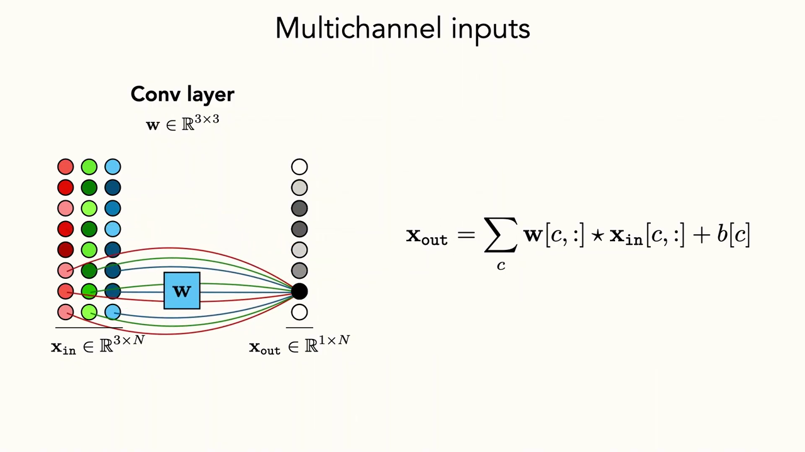
*▲ 강의 슬라이드 [36:28](https://youtu.be/bxVkZ4M-hIE?t=2188): 여러 입력 [채널](00_%EB%94%A5%EB%9F%AC%EB%8B%9D_%EC%9A%A9%EC%96%B4%EC%82%AC%EC%A0%84.md#channel-%EC%B1%84%EB%84%90). [채널](00_%EB%94%A5%EB%9F%AC%EB%8B%9D_%EC%9A%A9%EC%96%B4%EC%82%AC%EC%A0%84.md#channel-%EC%B1%84%EB%84%90)마다 다른 [가중치](00_%EB%94%A5%EB%9F%AC%EB%8B%9D_%EC%9A%A9%EC%96%B4%EC%82%AC%EC%A0%84.md#weight-%EA%B0%80%EC%A4%91%EC%B9%98)로 합성곱한 뒤 더한다*

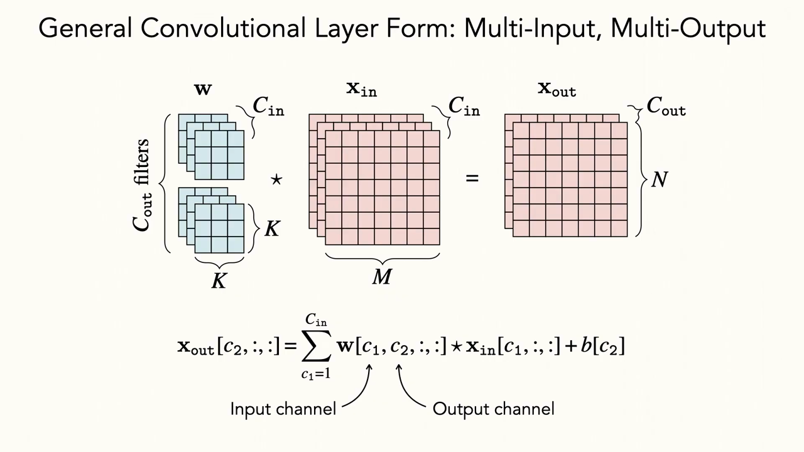
*▲ 강의 슬라이드 [38:05](https://youtu.be/bxVkZ4M-hIE?t=2285): 다입력·다출력 [합성곱](00_%EB%94%A5%EB%9F%AC%EB%8B%9D_%EC%9A%A9%EC%96%B4%EC%82%AC%EC%A0%84.md#convolution-%ED%95%A9%EC%84%B1%EA%B3%B1) [층](00_%EB%94%A5%EB%9F%AC%EB%8B%9D_%EC%9A%A9%EC%96%B4%EC%82%AC%EC%A0%84.md#layer-%EC%B8%B5)의 일반형*

- 각 [층](00_%EB%94%A5%EB%9F%AC%EB%8B%9D_%EC%9A%A9%EC%96%B4%EC%82%AC%EC%A0%84.md#layer-%EC%B8%B5)의 출력은 $C$장의 [특징 맵](00_%EB%94%A5%EB%9F%AC%EB%8B%9D_%EC%9A%A9%EC%96%B4%EC%82%AC%EC%A0%84.md#feature-map-%ED%8A%B9%EC%A7%95-%EB%A7%B5)(= [채널](00_%EB%94%A5%EB%9F%AC%EB%8B%9D_%EC%9A%A9%EC%96%B4%EC%82%AC%EC%A0%84.md#channel-%EC%B1%84%EB%84%90))이고, [특징 맵](00_%EB%94%A5%EB%9F%AC%EB%8B%9D_%EC%9A%A9%EC%96%B4%EC%82%AC%EC%A0%84.md#feature-map-%ED%8A%B9%EC%A7%95-%EB%A7%B5) 하나하나는 높이와 너비를 가진 이미지입니다. AlexNet의 첫 [층](00_%EB%94%A5%EB%9F%AC%EB%8B%9D_%EC%9A%A9%EC%96%B4%EC%82%AC%EC%A0%84.md#layer-%EC%B8%B5) [특징 맵](00_%EB%94%A5%EB%9F%AC%EB%8B%9D_%EC%9A%A9%EC%96%B4%EC%82%AC%EC%A0%84.md#feature-map-%ED%8A%B9%EC%A7%95-%EB%A7%B5)은 여러 방향의 경계 같은 것을 잡고, 둘째 [층](00_%EB%94%A5%EB%9F%AC%EB%8B%9D_%EC%9A%A9%EC%96%B4%EC%82%AC%EC%A0%84.md#layer-%EC%B8%B5)은 더 복잡해져 해석이 어려워집니다.
- [필터](00_%EB%94%A5%EB%9F%AC%EB%8B%9D_%EC%9A%A9%EC%96%B4%EC%82%AC%EC%A0%84.md#filter-%ED%95%84%ED%84%B0)들이 서로 다르게 학습되도록 강제하는 장치는 없지만, 다르게 배워야 [표현력](00_%EB%94%A5%EB%9F%AC%EB%8B%9D_%EC%9A%A9%EC%96%B4%EC%82%AC%EC%A0%84.md#representational-power-%ED%91%9C%ED%98%84%EB%A0%A5)이 커지므로 보통 저절로 다양해집니다. [드롭아웃](00_%EB%94%A5%EB%9F%AC%EB%8B%9D_%EC%9A%A9%EC%96%B4%EC%82%AC%EC%A0%84.md#dropout-%EB%93%9C%EB%A1%AD%EC%95%84%EC%9B%83) 같은 [규제](00_%EB%94%A5%EB%9F%AC%EB%8B%9D_%EC%9A%A9%EC%96%B4%EC%82%AC%EC%A0%84.md#regularization-%EA%B7%9C%EC%A0%9C)가 도움이 되고, 데이터·구조·최적화에 따라 일부 특징이 무시되는 **특징 붕괴(feature collapse)**가 생기기도 합니다.

### 4.3 퀴즈: 파라미터 세기

▶ 영상 [40:35](https://youtu.be/bxVkZ4M-hIE?t=2435)

📐 **수학 개념**: [합성곱과 퇴플리츠 행렬](%EC%88%98%ED%95%99%EA%B0%9C%EB%85%90/07_%EA%B5%AC%EC%A1%B0_%EC%95%84%ED%82%A4%ED%85%8D%EC%B2%98/MM15_%ED%95%A9%EC%84%B1%EA%B3%B1%EA%B3%BC_%ED%87%B4%ED%94%8C%EB%A6%AC%EC%B8%A0_%ED%96%89%EB%A0%AC.md) 5절 문제 2

입력 3×128×128(RGB), 3×3 [필터 뱅크](00_%EB%94%A5%EB%9F%AC%EB%8B%9D_%EC%9A%A9%EC%96%B4%EC%82%AC%EC%A0%84.md#filter-bank-%ED%95%84%ED%84%B0-%EB%B1%85%ED%81%AC), 출력 96×128×128일 때:

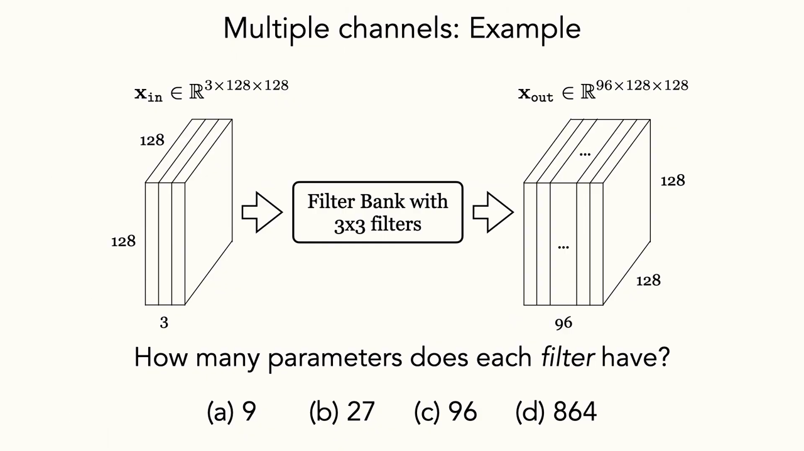
*▲ 강의 슬라이드 [42:05](https://youtu.be/bxVkZ4M-hIE?t=2525): [필터](00_%EB%94%A5%EB%9F%AC%EB%8B%9D_%EC%9A%A9%EC%96%B4%EC%82%AC%EC%A0%84.md#filter-%ED%95%84%ED%84%B0) 하나의 [파라미터](00_%EB%94%A5%EB%9F%AC%EB%8B%9D_%EC%9A%A9%EC%96%B4%EC%82%AC%EC%A0%84.md#parameter-%ED%8C%8C%EB%9D%BC%EB%AF%B8%ED%84%B0) 수는? (a) 9 (b) 27 (c) 96 (d) 864*

- **[필터](00_%EB%94%A5%EB%9F%AC%EB%8B%9D_%EC%9A%A9%EC%96%B4%EC%82%AC%EC%A0%84.md#filter-%ED%95%84%ED%84%B0) 하나의 [파라미터](00_%EB%94%A5%EB%9F%AC%EB%8B%9D_%EC%9A%A9%EC%96%B4%EC%82%AC%EC%A0%84.md#parameter-%ED%8C%8C%EB%9D%BC%EB%AF%B8%ED%84%B0) = 27** ($3 \times 3 \times 3$). 학생들이 처음에 9라고 답했는데, "[필터](00_%EB%94%A5%EB%9F%AC%EB%8B%9D_%EC%9A%A9%EC%96%B4%EC%82%AC%EC%A0%84.md#filter-%ED%95%84%ED%84%B0) 크기 3×3"은 관례상 **공간 크기만** 말하는 것이고 [채널](00_%EB%94%A5%EB%9F%AC%EB%8B%9D_%EC%9A%A9%EC%96%B4%EC%82%AC%EC%A0%84.md#channel-%EC%B1%84%EB%84%90) 방향으로는 입력 [채널](00_%EB%94%A5%EB%9F%AC%EB%8B%9D_%EC%9A%A9%EC%96%B4%EC%82%AC%EC%A0%84.md#channel-%EC%B1%84%EB%84%90)마다 따로 [가중치](00_%EB%94%A5%EB%9F%AC%EB%8B%9D_%EC%9A%A9%EC%96%B4%EC%82%AC%EC%A0%84.md#weight-%EA%B0%80%EC%A4%91%EC%B9%98)가 있기 때문입니다(초분광 영상처럼 [채널](00_%EB%94%A5%EB%9F%AC%EB%8B%9D_%EC%9A%A9%EC%96%B4%EC%82%AC%EC%A0%84.md#channel-%EC%B1%84%EB%84%90) 방향 [합성곱](00_%EB%94%A5%EB%9F%AC%EB%8B%9D_%EC%9A%A9%EC%96%B4%EC%82%AC%EC%A0%84.md#convolution-%ED%95%A9%EC%84%B1%EA%B3%B1)이 필요하면 그렇게 설계할 수도 있습니다).
- **[필터](00_%EB%94%A5%EB%9F%AC%EB%8B%9D_%EC%9A%A9%EC%96%B4%EC%82%AC%EC%A0%84.md#filter-%ED%95%84%ED%84%B0) 수 = 96** (출력 [채널](00_%EB%94%A5%EB%9F%AC%EB%8B%9D_%EC%9A%A9%EC%96%B4%EC%82%AC%EC%A0%84.md#channel-%EC%B1%84%EB%84%90) 수).
- 일반식: $C_l \times N \times M \to C_{l+1} \times N \times M$을 $K_1 \times K_2$ [필터](00_%EB%94%A5%EB%9F%AC%EB%8B%9D_%EC%9A%A9%EC%96%B4%EC%82%AC%EC%A0%84.md#filter-%ED%95%84%ED%84%B0)로 잇는다면, 필터당 [파라미터](00_%EB%94%A5%EB%9F%AC%EB%8B%9D_%EC%9A%A9%EC%96%B4%EC%82%AC%EC%A0%84.md#parameter-%ED%8C%8C%EB%9D%BC%EB%AF%B8%ED%84%B0)는 $K_1 K_2 C_l$, [필터](00_%EB%94%A5%EB%9F%AC%EB%8B%9D_%EC%9A%A9%EC%96%B4%EC%82%AC%EC%A0%84.md#filter-%ED%95%84%ED%84%B0) 수는 $C_{l+1}$입니다. [필터](00_%EB%94%A5%EB%9F%AC%EB%8B%9D_%EC%9A%A9%EC%96%B4%EC%82%AC%EC%A0%84.md#filter-%ED%95%84%ED%84%B0)는 보통 정사각형이지만 꼭 그래야 하는 것은 아닙니다.

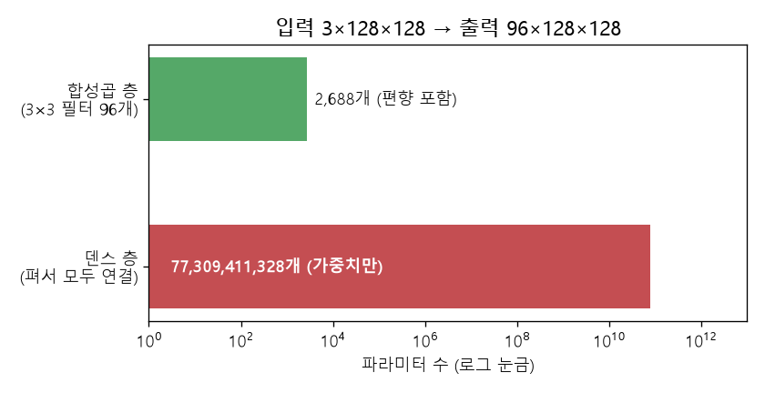
*▲ 직접 그린 그림: 같은 입출력을 [합성곱](00_%EB%94%A5%EB%9F%AC%EB%8B%9D_%EC%9A%A9%EC%96%B4%EC%82%AC%EC%A0%84.md#convolution-%ED%95%A9%EC%84%B1%EA%B3%B1) [층](00_%EB%94%A5%EB%9F%AC%EB%8B%9D_%EC%9A%A9%EC%96%B4%EC%82%AC%EC%A0%84.md#layer-%EC%B8%B5)([편향](00_%EB%94%A5%EB%9F%AC%EB%8B%9D_%EC%9A%A9%EC%96%B4%EC%82%AC%EC%A0%84.md#bias-%ED%8E%B8%ED%96%A5) 포함 2,688개)과 [덴스 층](00_%EB%94%A5%EB%9F%AC%EB%8B%9D_%EC%9A%A9%EC%96%B4%EC%82%AC%EC%A0%84.md#dense-layer-%EB%8D%B4%EC%8A%A4-%EC%B8%B5)([가중치](00_%EB%94%A5%EB%9F%AC%EB%8B%9D_%EC%9A%A9%EC%96%B4%EC%82%AC%EC%A0%84.md#weight-%EA%B0%80%EC%A4%91%EC%B9%98)만 77,309,411,328개)으로 이을 때의 [파라미터](00_%EB%94%A5%EB%9F%AC%EB%8B%9D_%EC%9A%A9%EC%96%B4%EC%82%AC%EC%A0%84.md#parameter-%ED%8C%8C%EB%9D%BC%EB%AF%B8%ED%84%B0) 수 ([로그](00_%EB%94%A5%EB%9F%AC%EB%8B%9D_%EC%9A%A9%EC%96%B4%EC%82%AC%EC%A0%84.md#log-ln-%EB%A1%9C%EA%B7%B8) 눈금)*

입력이 RGB 3채널이면 첫 [층](00_%EB%94%A5%EB%9F%AC%EB%8B%9D_%EC%9A%A9%EC%96%B4%EC%82%AC%EC%A0%84.md#layer-%EC%B8%B5) [필터](00_%EB%94%A5%EB%9F%AC%EB%8B%9D_%EC%9A%A9%EC%96%B4%EC%82%AC%EC%A0%84.md#filter-%ED%95%84%ED%84%B0) 하나는 R·G·B 세 장의 [가중치](00_%EB%94%A5%EB%9F%AC%EB%8B%9D_%EC%9A%A9%EC%96%B4%EC%82%AC%EC%A0%84.md#weight-%EA%B0%80%EC%A4%91%EC%B9%98)를 가지고, 출력 [특징 맵](00_%EB%94%A5%EB%9F%AC%EB%8B%9D_%EC%9A%A9%EC%96%B4%EC%82%AC%EC%A0%84.md#feature-map-%ED%8A%B9%EC%A7%95-%EB%A7%B5) 한 장이 [필터](00_%EB%94%A5%EB%9F%AC%EB%8B%9D_%EC%9A%A9%EC%96%B4%EC%82%AC%EC%A0%84.md#filter-%ED%95%84%ED%84%B0) 하나에 대응합니다. 둘째 [층](00_%EB%94%A5%EB%9F%AC%EB%8B%9D_%EC%9A%A9%EC%96%B4%EC%82%AC%EC%A0%84.md#layer-%EC%B8%B5)의 [필터](00_%EB%94%A5%EB%9F%AC%EB%8B%9D_%EC%9A%A9%EC%96%B4%EC%82%AC%EC%A0%84.md#filter-%ED%95%84%ED%84%B0)는 첫 [층](00_%EB%94%A5%EB%9F%AC%EB%8B%9D_%EC%9A%A9%EC%96%B4%EC%82%AC%EC%A0%84.md#layer-%EC%B8%B5)의 [특징 맵](00_%EB%94%A5%EB%9F%AC%EB%8B%9D_%EC%9A%A9%EC%96%B4%EC%82%AC%EC%A0%84.md#feature-map-%ED%8A%B9%EC%A7%95-%EB%A7%B5) **전부**를 입력 [채널](00_%EB%94%A5%EB%9F%AC%EB%8B%9D_%EC%9A%A9%EC%96%B4%EC%82%AC%EC%A0%84.md#channel-%EC%B1%84%EB%84%90)로 받습니다. [층](00_%EB%94%A5%EB%9F%AC%EB%8B%9D_%EC%9A%A9%EC%96%B4%EC%82%AC%EC%A0%84.md#layer-%EC%B8%B5) 한두 개만으로도 표현이 아주 빠르게 복잡해집니다.

---

## 5. 풀링, 다운샘플링, 스트라이드, 팽창

▶ 영상 [45:05](https://youtu.be/bxVkZ4M-hIE?t=2705)

📐 **수학 개념**: [수용 영역과 출력 크기](%EC%88%98%ED%95%99%EA%B0%9C%EB%85%90/07_%EA%B5%AC%EC%A1%B0_%EC%95%84%ED%82%A4%ED%85%8D%EC%B2%98/MM16_%EC%88%98%EC%9A%A9_%EC%98%81%EC%97%AD%EA%B3%BC_%EC%B6%9C%EB%A0%A5_%ED%81%AC%EA%B8%B0.md) · 맥스 풀링과 크기 계산

**풀링(Pooling)**: [합성곱](00_%EB%94%A5%EB%9F%AC%EB%8B%9D_%EC%9A%A9%EC%96%B4%EC%82%AC%EC%A0%84.md#convolution-%ED%95%A9%EC%84%B1%EA%B3%B1)([가중치](00_%EB%94%A5%EB%9F%AC%EB%8B%9D_%EC%9A%A9%EC%96%B4%EC%82%AC%EC%A0%84.md#weight-%EA%B0%80%EC%A4%91%EC%B9%98)·[편향](00_%EB%94%A5%EB%9F%AC%EB%8B%9D_%EC%9A%A9%EC%96%B4%EC%82%AC%EC%A0%84.md#bias-%ED%8E%B8%ED%96%A5)·비선형 함수) 뒤에 출력 특징을 모아 줄입니다. [채널](00_%EB%94%A5%EB%9F%AC%EB%8B%9D_%EC%9A%A9%EC%96%B4%EC%82%AC%EC%A0%84.md#channel-%EC%B1%84%EB%84%90)이 늘면 차원이 빠르게 커지기 때문입니다.

- [맥스 풀링](00_%EB%94%A5%EB%9F%AC%EB%8B%9D_%EC%9A%A9%EC%96%B4%EC%82%AC%EC%A0%84.md#max-pooling-%EB%A7%A5%EC%8A%A4-%ED%92%80%EB%A7%81): 작은 창에서 최댓값만 남긴다.
- [평균 풀링](00_%EB%94%A5%EB%9F%AC%EB%8B%9D_%EC%9A%A9%EC%96%B4%EC%82%AC%EC%A0%84.md#mean-pooling-%ED%8F%89%EA%B7%A0-%ED%92%80%EB%A7%81): 작은 창의 평균을 남긴다.
- **왜 하나**: 공간 방향으로 모으면 **작은 이동에 안정적**이 됩니다. 경계가 창 안에서 조금 움직여도 최댓값은 그대로 통과합니다.
- **[채널](00_%EB%94%A5%EB%9F%AC%EB%8B%9D_%EC%9A%A9%EC%96%B4%EC%82%AC%EC%A0%84.md#channel-%EC%B1%84%EB%84%90) 방향 풀링**: 여러 방향의 경계 [필터](00_%EB%94%A5%EB%9F%AC%EB%8B%9D_%EC%9A%A9%EC%96%B4%EC%82%AC%EC%A0%84.md#filter-%ED%95%84%ED%84%B0) 출력에 최댓값을 취하면 **경계 방향에 무관한** 경계 검출기가 됩니다. 이렇게 새로운 종류의 불변성을 만들 수 있습니다.

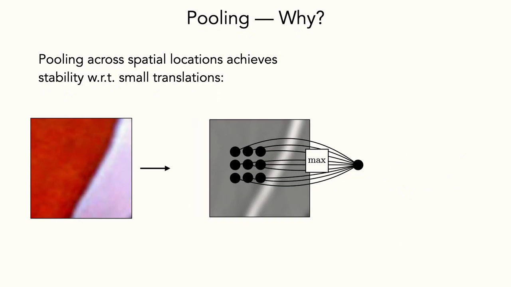
*▲ 강의 슬라이드 [47:05](https://youtu.be/bxVkZ4M-hIE?t=2825): 공간 방향 풀링은 작은 이동에 대해 안정적인 출력을 준다*

**전형적인 [분류](00_%EB%94%A5%EB%9F%AC%EB%8B%9D_%EC%9A%A9%EC%96%B4%EC%82%AC%EC%A0%84.md#regression-classification-%ED%9A%8C%EA%B7%80%EC%99%80-%EB%B6%84%EB%A5%98) [CNN](00_%EB%94%A5%EB%9F%AC%EB%8B%9D_%EC%9A%A9%EC%96%B4%EC%82%AC%EC%A0%84.md#cnn-convolutional-neural-network-%ED%95%A9%EC%84%B1%EA%B3%B1-%EC%8B%A0%EA%B2%BD%EB%A7%9D)**: ([필터](00_%EB%94%A5%EB%9F%AC%EB%8B%9D_%EC%9A%A9%EC%96%B4%EC%82%AC%EC%A0%84.md#filter-%ED%95%84%ED%84%B0) → [ReLU](00_%EB%94%A5%EB%9F%AC%EB%8B%9D_%EC%9A%A9%EC%96%B4%EC%82%AC%EC%A0%84.md#relu-%EB%A0%90%EB%A3%A8) → 풀링)을 여러 번 되풀이한 뒤 분류합니다. 전체가 함수의 합성 $f(x) = f_L(\dots f_2(f_1(x)))$입니다. [분류](00_%EB%94%A5%EB%9F%AC%EB%8B%9D_%EC%9A%A9%EC%96%B4%EC%82%AC%EC%A0%84.md#regression-classification-%ED%9A%8C%EA%B7%80%EC%99%80-%EB%B6%84%EB%A5%98)처럼 마지막에 단어 하나([원-핫](00_%EB%94%A5%EB%9F%AC%EB%8B%9D_%EC%9A%A9%EC%96%B4%EC%82%AC%EC%A0%84.md#one-hot-encoding-%EC%9B%90-%ED%95%AB-%EC%9D%B8%EC%BD%94%EB%94%A9) 벡터)만 필요하면 모든 [층](00_%EB%94%A5%EB%9F%AC%EB%8B%9D_%EC%9A%A9%EC%96%B4%EC%82%AC%EC%A0%84.md#layer-%EC%B8%B5)에서 고해상도를 유지할 필요가 없으므로 **[다운샘플링](00_%EB%94%A5%EB%9F%AC%EB%8B%9D_%EC%9A%A9%EC%96%B4%EC%82%AC%EC%A0%84.md#downsampling-upsampling-%EB%8B%A4%EC%9A%B4%EC%83%98%ED%94%8C%EB%A7%81%EA%B3%BC-%EC%97%85%EC%83%98%ED%94%8C%EB%A7%81)**(일부 값만 남기기)을 합니다.

**[스트라이드](00_%EB%94%A5%EB%9F%AC%EB%8B%9D_%EC%9A%A9%EC%96%B4%EC%82%AC%EC%A0%84.md#stride-%EC%8A%A4%ED%8A%B8%EB%9D%BC%EC%9D%B4%EB%93%9C) 연산**: [필터](00_%EB%94%A5%EB%9F%AC%EB%8B%9D_%EC%9A%A9%EC%96%B4%EC%82%AC%EC%A0%84.md#filter-%ED%95%84%ED%84%B0)를 한 칸이 아니라 2칸, 5칸씩 옮기면 [합성곱](00_%EB%94%A5%EB%9F%AC%EB%8B%9D_%EC%9A%A9%EC%96%B4%EC%82%AC%EC%A0%84.md#convolution-%ED%95%A9%EC%84%B1%EA%B3%B1)(또는 풀링)과 다운샘플링을 **한 번에** 하게 됩니다. 보통은 맥락을 잃지 않도록 창이 겹치게 잡습니다(예: 7×7 [필터](00_%EB%94%A5%EB%9F%AC%EB%8B%9D_%EC%9A%A9%EC%96%B4%EC%82%AC%EC%A0%84.md#filter-%ED%95%84%ED%84%B0)에 [스트라이드](00_%EB%94%A5%EB%9F%AC%EB%8B%9D_%EC%9A%A9%EC%96%B4%EC%82%AC%EC%A0%84.md#stride-%EC%8A%A4%ED%8A%B8%EB%9D%BC%EC%9D%B4%EB%93%9C) 5).

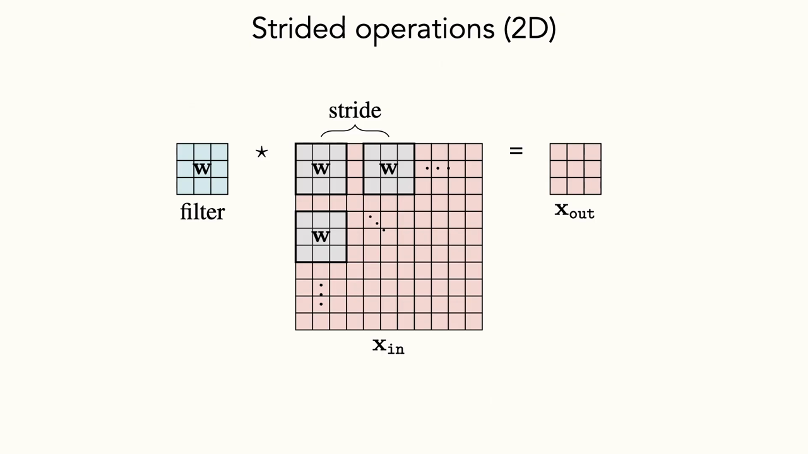
*▲ 강의 슬라이드 [50:05](https://youtu.be/bxVkZ4M-hIE?t=3005): 2차원 [스트라이드](00_%EB%94%A5%EB%9F%AC%EB%8B%9D_%EC%9A%A9%EC%96%B4%EC%82%AC%EC%A0%84.md#stride-%EC%8A%A4%ED%8A%B8%EB%9D%BC%EC%9D%B4%EB%93%9C) 연산. [필터](00_%EB%94%A5%EB%9F%AC%EB%8B%9D_%EC%9A%A9%EC%96%B4%EC%82%AC%EC%A0%84.md#filter-%ED%95%84%ED%84%B0)를 여러 칸씩 건너뛰며 적용한다*

**[팽창 합성곱](00_%EB%94%A5%EB%9F%AC%EB%8B%9D_%EC%9A%A9%EC%96%B4%EC%82%AC%EC%A0%84.md#dilated-convolution-%ED%8C%BD%EC%B0%BD-%ED%95%A9%EC%84%B1%EA%B3%B1)(Dilated filter)**: [필터](00_%EB%94%A5%EB%9F%AC%EB%8B%9D_%EC%9A%A9%EC%96%B4%EC%82%AC%EC%A0%84.md#filter-%ED%95%84%ED%84%B0) 일부 값을 0으로 고정해 칸 사이를 띄운 [필터](00_%EB%94%A5%EB%9F%AC%EB%8B%9D_%EC%9A%A9%EC%96%B4%EC%82%AC%EC%A0%84.md#filter-%ED%95%84%ED%84%B0)입니다. **적은 [파라미터](00_%EB%94%A5%EB%9F%AC%EB%8B%9D_%EC%9A%A9%EC%96%B4%EC%82%AC%EC%A0%84.md#parameter-%ED%8C%8C%EB%9D%BC%EB%AF%B8%ED%84%B0)로 넓은 [수용 영역](00_%EB%94%A5%EB%9F%AC%EB%8B%9D_%EC%9A%A9%EC%96%B4%EC%82%AC%EC%A0%84.md#receptive-field-%EC%88%98%EC%9A%A9-%EC%98%81%EC%97%AD)**을 얻는 대신 유연성은 줄어듭니다.

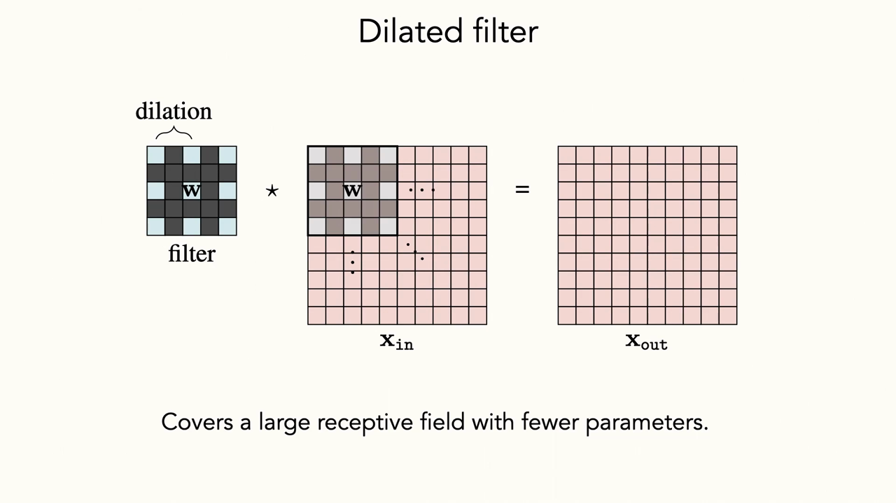
*▲ 강의 슬라이드 [50:45](https://youtu.be/bxVkZ4M-hIE?t=3045): 팽창 [필터](00_%EB%94%A5%EB%9F%AC%EB%8B%9D_%EC%9A%A9%EC%96%B4%EC%82%AC%EC%A0%84.md#filter-%ED%95%84%ED%84%B0). 적은 [파라미터](00_%EB%94%A5%EB%9F%AC%EB%8B%9D_%EC%9A%A9%EC%96%B4%EC%82%AC%EC%A0%84.md#parameter-%ED%8C%8C%EB%9D%BC%EB%AF%B8%ED%84%B0)로 넓은 [수용 영역](00_%EB%94%A5%EB%9F%AC%EB%8B%9D_%EC%9A%A9%EC%96%B4%EC%82%AC%EC%A0%84.md#receptive-field-%EC%88%98%EC%9A%A9-%EC%98%81%EC%97%AD)을 덮는다*

> [!NOTE]
> **숫자로 확인 ([MM16_수용_영역과_출력_크기](%EC%88%98%ED%95%99%EA%B0%9C%EB%85%90/07_%EA%B5%AC%EC%A1%B0_%EC%95%84%ED%82%A4%ED%85%8D%EC%B2%98/MM16_%EC%88%98%EC%9A%A9_%EC%98%81%EC%97%AD%EA%B3%BC_%EC%B6%9C%EB%A0%A5_%ED%81%AC%EA%B8%B0.md))**
> 128칸 입력에 3×3 [필터](00_%EB%94%A5%EB%9F%AC%EB%8B%9D_%EC%9A%A9%EC%96%B4%EC%82%AC%EC%A0%84.md#filter-%ED%95%84%ED%84%B0)([패딩](00_%EB%94%A5%EB%9F%AC%EB%8B%9D_%EC%9A%A9%EC%96%B4%EC%82%AC%EC%A0%84.md#padding-%ED%8C%A8%EB%94%A9) 1)를 쓰면 [스트라이드](00_%EB%94%A5%EB%9F%AC%EB%8B%9D_%EC%9A%A9%EC%96%B4%EC%82%AC%EC%A0%84.md#stride-%EC%8A%A4%ED%8A%B8%EB%9D%BC%EC%9D%B4%EB%93%9C) 1은 출력 128칸, [스트라이드](00_%EB%94%A5%EB%9F%AC%EB%8B%9D_%EC%9A%A9%EC%96%B4%EC%82%AC%EC%A0%84.md#stride-%EC%8A%A4%ED%8A%B8%EB%9D%BC%EC%9D%B4%EB%93%9C) 2는 64칸. 7×7 [필터](00_%EB%94%A5%EB%9F%AC%EB%8B%9D_%EC%9A%A9%EC%96%B4%EC%82%AC%EC%A0%84.md#filter-%ED%95%84%ED%84%B0)에 [스트라이드](00_%EB%94%A5%EB%9F%AC%EB%8B%9D_%EC%9A%A9%EC%96%B4%EC%82%AC%EC%A0%84.md#stride-%EC%8A%A4%ED%8A%B8%EB%9D%BC%EC%9D%B4%EB%93%9C) 5([패딩](00_%EB%94%A5%EB%9F%AC%EB%8B%9D_%EC%9A%A9%EC%96%B4%EC%82%AC%EC%A0%84.md#padding-%ED%8C%A8%EB%94%A9) 없음)면 25칸. 팽창 2인 3×3 [필터](00_%EB%94%A5%EB%9F%AC%EB%8B%9D_%EC%9A%A9%EC%96%B4%EC%82%AC%EC%A0%84.md#filter-%ED%95%84%ED%84%B0)는 [파라미터](00_%EB%94%A5%EB%9F%AC%EB%8B%9D_%EC%9A%A9%EC%96%B4%EC%82%AC%EC%A0%84.md#parameter-%ED%8C%8C%EB%9D%BC%EB%AF%B8%ED%84%B0) 9개로 5칸을 본다.

질의응답: 스트라이드는 언제 쓰나, 구조는 어떻게 고르나 [50:50](https://youtu.be/bxVkZ4M-hIE?t=3050)

- **다운샘플링하면 원래 크기로 못 돌아가나?** 꼭 그렇지는 않지만 잘 복원하기는 어렵다. 7절의 [인코더-디코더](00_%EB%94%A5%EB%9F%AC%EB%8B%9D_%EC%9A%A9%EC%96%B4%EC%82%AC%EC%A0%84.md#encoder-decoder-%EC%9D%B8%EC%BD%94%EB%8D%94-%EB%94%94%EC%BD%94%EB%8D%94)와 [U-Net](00_%EB%94%A5%EB%9F%AC%EB%8B%9D_%EC%9A%A9%EC%96%B4%EC%82%AC%EC%A0%84.md#u-net-%EC%9C%A0%EB%84%B7)에서 다룬다.
- **[스트라이드](00_%EB%94%A5%EB%9F%AC%EB%8B%9D_%EC%9A%A9%EC%96%B4%EC%82%AC%EC%A0%84.md#stride-%EC%8A%A4%ED%8A%B8%EB%9D%BC%EC%9D%B4%EB%93%9C)를 쓰는 기준**: 가능한 구조([층](00_%EB%94%A5%EB%9F%AC%EB%8B%9D_%EC%9A%A9%EC%96%B4%EC%82%AC%EC%A0%84.md#layer-%EC%B8%B5) 종류, 입력 크기, 깊이, [채널](00_%EB%94%A5%EB%9F%AC%EB%8B%9D_%EC%9A%A9%EC%96%B4%EC%82%AC%EC%A0%84.md#channel-%EC%B1%84%EB%84%90) 수)의 조합은 엄청나게 많다. 그 공간을 자동으로 탐색하는 분야가 [신경망 구조 탐색](00_%EB%94%A5%EB%9F%AC%EB%8B%9D_%EC%9A%A9%EC%96%B4%EC%82%AC%EC%A0%84.md#neural-architecture-search-%EC%8B%A0%EA%B2%BD%EB%A7%9D-%EA%B5%AC%EC%A1%B0-%ED%83%90%EC%83%89)(NAS)인데 계산이 매우 비싸다. 경험적으로 굳어진 흐름은 있다: AlexNet은 큰 [필터](00_%EB%94%A5%EB%9F%AC%EB%8B%9D_%EC%9A%A9%EC%96%B4%EC%82%AC%EC%A0%84.md#filter-%ED%95%84%ED%84%B0)를 얕게 썼지만, 요즘은 7·5 이하의 작은 [필터](00_%EB%94%A5%EB%9F%AC%EB%8B%9D_%EC%9A%A9%EC%96%B4%EC%82%AC%EC%A0%84.md#filter-%ED%95%84%ED%84%B0)를 **깊게** 쌓아 결국 큰 [수용 영역](00_%EB%94%A5%EB%9F%AC%EB%8B%9D_%EC%9A%A9%EC%96%B4%EC%82%AC%EC%A0%84.md#receptive-field-%EC%88%98%EC%9A%A9-%EC%98%81%EC%97%AD)을 얻는다. [스트라이드](00_%EB%94%A5%EB%9F%AC%EB%8B%9D_%EC%9A%A9%EC%96%B4%EC%82%AC%EC%A0%84.md#stride-%EC%8A%A4%ED%8A%B8%EB%9D%BC%EC%9D%B4%EB%93%9C)는 계산량과 [수용 영역](00_%EB%94%A5%EB%9F%AC%EB%8B%9D_%EC%9A%A9%EC%96%B4%EC%82%AC%EC%A0%84.md#receptive-field-%EC%88%98%EC%9A%A9-%EC%98%81%EC%97%AD) 사이의 거래다. 유명 구조들의 [층](00_%EB%94%A5%EB%9F%AC%EB%8B%9D_%EC%9A%A9%EC%96%B4%EC%82%AC%EC%A0%84.md#layer-%EC%B8%B5) 크기 표를 비교해 보면 공통점이 보인다.
- **사진이 복잡하면 모델도 커야 하나?** 경험적으로 그렇다. CIFAR 같은 단순한 작은 사진은 작은 모델로 충분하다. 종(species) 사진처럼 세밀한 특징이 중요하면 **입력 해상도**가 거의 무엇보다 중요하다. 보통 [전처리](00_%EB%94%A5%EB%9F%AC%EB%8B%9D_%EC%9A%A9%EC%96%B4%EC%82%AC%EC%A0%84.md#preconditioning-%EC%A0%84%EC%B2%98%EB%A6%AC)에서 이미지를 줄이지만, 해상도는 키우고 다른 계산을 줄이는 편이 나을 때가 있다.
- **[필터](00_%EB%94%A5%EB%9F%AC%EB%8B%9D_%EC%9A%A9%EC%96%B4%EC%82%AC%EC%A0%84.md#filter-%ED%95%84%ED%84%B0)를 손으로 설계할까, 학습할까?** 10~15년 전 컴퓨터 비전은 손으로 만든 [특징 공학](00_%EB%94%A5%EB%9F%AC%EB%8B%9D_%EC%9A%A9%EC%96%B4%EC%82%AC%EC%A0%84.md#feature-engineering-%ED%8A%B9%EC%A7%95-%EA%B3%B5%ED%95%99)이 중심이었고, 끝에서 끝까지 학습한 [필터](00_%EB%94%A5%EB%9F%AC%EB%8B%9D_%EC%9A%A9%EC%96%B4%EC%82%AC%EC%A0%84.md#filter-%ED%95%84%ED%84%B0)가 더 잘 맞히자 평생 [필터](00_%EB%94%A5%EB%9F%AC%EB%8B%9D_%EC%9A%A9%EC%96%B4%EC%82%AC%EC%A0%84.md#filter-%ED%95%84%ED%84%B0) 설계를 연구한 사람들에게는 충격이었다. 결국 **데이터 양**의 문제다. 데이터가 적으면 손으로 넣은 지식(강한 [귀납 편향](00_%EB%94%A5%EB%9F%AC%EB%8B%9D_%EC%9A%A9%EC%96%B4%EC%82%AC%EC%A0%84.md#inductive-bias-%EA%B7%80%EB%82%A9-%ED%8E%B8%ED%96%A5))이 낫고, 데이터가 많으면 [학습](00_%EB%94%A5%EB%9F%AC%EB%8B%9D_%EC%9A%A9%EC%96%B4%EC%82%AC%EC%A0%84.md#training-%ED%95%99%EC%8A%B5)이 낫다. 128층 망의 7번째 [층](00_%EB%94%A5%EB%9F%AC%EB%8B%9D_%EC%9A%A9%EC%96%B4%EC%82%AC%EC%A0%84.md#layer-%EC%B8%B5) [필터](00_%EB%94%A5%EB%9F%AC%EB%8B%9D_%EC%9A%A9%EC%96%B4%EC%82%AC%EC%A0%84.md#filter-%ED%95%84%ED%84%B0)를 손으로 설계할 수는 없다.

---

## 6. 수용 영역

▶ 영상 [57:04](https://youtu.be/bxVkZ4M-hIE?t=3424)

📐 **수학 개념**: [수용 영역과 출력 크기](%EC%88%98%ED%95%99%EA%B0%9C%EB%85%90/07_%EA%B5%AC%EC%A1%B0_%EC%95%84%ED%82%A4%ED%85%8D%EC%B2%98/MM16_%EC%88%98%EC%9A%A9_%EC%98%81%EC%97%AD%EA%B3%BC_%EC%B6%9C%EB%A0%A5_%ED%81%AC%EA%B8%B0.md)

**[수용 영역](00_%EB%94%A5%EB%9F%AC%EB%8B%9D_%EC%9A%A9%EC%96%B4%EC%82%AC%EC%A0%84.md#receptive-field-%EC%88%98%EC%9A%A9-%EC%98%81%EC%97%AD)**은 출력의 한 칸에 **조금이라도 영향을 주는 입력 영역**입니다. [합성곱](00_%EB%94%A5%EB%9F%AC%EB%8B%9D_%EC%9A%A9%EC%96%B4%EC%82%AC%EC%A0%84.md#convolution-%ED%95%A9%EC%84%B1%EA%B3%B1) → [ReLU](00_%EB%94%A5%EB%9F%AC%EB%8B%9D_%EC%9A%A9%EC%96%B4%EC%82%AC%EC%A0%84.md#relu-%EB%A0%90%EB%A3%A8) → [합성곱](00_%EB%94%A5%EB%9F%AC%EB%8B%9D_%EC%9A%A9%EC%96%B4%EC%82%AC%EC%A0%84.md#convolution-%ED%95%A9%EC%84%B1%EA%B3%B1)을 거친 출력 $x_2[3]$이 "새"라면, 그 [수용 영역](00_%EB%94%A5%EB%9F%AC%EB%8B%9D_%EC%9A%A9%EC%96%B4%EC%82%AC%EC%A0%84.md#receptive-field-%EC%88%98%EC%9A%A9-%EC%98%81%EC%97%AD)은 새 전체를 담은 입력 패치입니다. [수용 영역](00_%EB%94%A5%EB%9F%AC%EB%8B%9D_%EC%9A%A9%EC%96%B4%EC%82%AC%EC%A0%84.md#receptive-field-%EC%88%98%EC%9A%A9-%EC%98%81%EC%97%AD) 밖에 아무리 중요한 정보가 있어도 모델은 그것을 쓸 수 없습니다. 중간 [층](00_%EB%94%A5%EB%9F%AC%EB%8B%9D_%EC%9A%A9%EC%96%B4%EC%82%AC%EC%A0%84.md#layer-%EC%B8%B5)의 각 칸도 저마다 [수용 영역](00_%EB%94%A5%EB%9F%AC%EB%8B%9D_%EC%9A%A9%EC%96%B4%EC%82%AC%EC%A0%84.md#receptive-field-%EC%88%98%EC%9A%A9-%EC%98%81%EC%97%AD)을 가집니다.

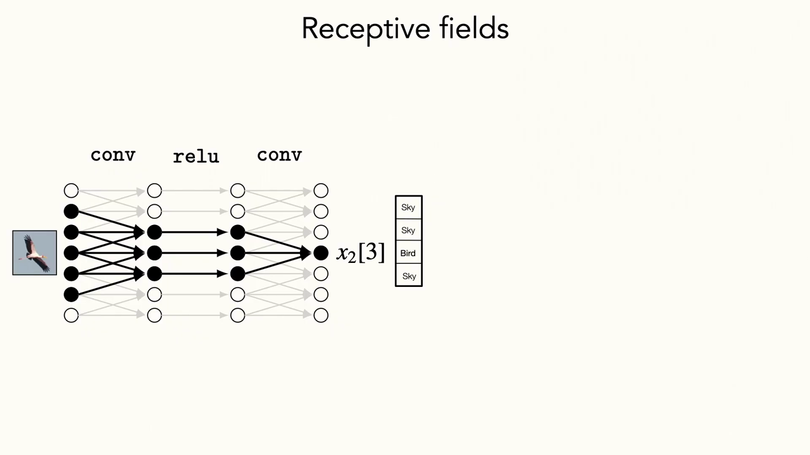
*▲ 강의 슬라이드 [57:25](https://youtu.be/bxVkZ4M-hIE?t=3445): [합성곱](00_%EB%94%A5%EB%9F%AC%EB%8B%9D_%EC%9A%A9%EC%96%B4%EC%82%AC%EC%A0%84.md#convolution-%ED%95%A9%EC%84%B1%EA%B3%B1)-ReLU-합성곱 출력 $x_2[3]$의 [수용 영역](00_%EB%94%A5%EB%9F%AC%EB%8B%9D_%EC%9A%A9%EC%96%B4%EC%82%AC%EC%A0%84.md#receptive-field-%EC%88%98%EC%9A%A9-%EC%98%81%EC%97%AD)*

- AlexNet, VGG16, ResNet18의 층별 활성화를 보면, 앞쪽 [층](00_%EB%94%A5%EB%9F%AC%EB%8B%9D_%EC%9A%A9%EC%96%B4%EC%82%AC%EC%A0%84.md#layer-%EC%B8%B5)은 질감까지 보이는 세밀한 지도이고 뒤쪽 [층](00_%EB%94%A5%EB%9F%AC%EB%8B%9D_%EC%9A%A9%EC%96%B4%EC%82%AC%EC%A0%84.md#layer-%EC%B8%B5)으로 갈수록 **흐릿하고 넓은** 지도가 됩니다. 뒤쪽 칸일수록 넓은 영역의 정보를 여러 [층](00_%EB%94%A5%EB%9F%AC%EB%8B%9D_%EC%9A%A9%EC%96%B4%EC%82%AC%EC%A0%84.md#layer-%EC%B8%B5)에 걸쳐 모으기 때문에, 의미에 가깝지만 작은 질감 변화에는 덜 민감합니다.
- 그림에서는 층별 지도를 같은 크기로 늘려 보여 줬지만, 실제로 [ResNet](00_%EB%94%A5%EB%9F%AC%EB%8B%9D_%EC%9A%A9%EC%96%B4%EC%82%AC%EC%A0%84.md#resnet-%EB%A0%88%EC%A6%88%EB%84%B7) 뒤쪽 블록은 공간 크기가 훨씬 작고 [채널](00_%EB%94%A5%EB%9F%AC%EB%8B%9D_%EC%9A%A9%EC%96%B4%EC%82%AC%EC%A0%84.md#channel-%EC%B1%84%EB%84%90)이 훨씬 많습니다.

*▲ 직접 그린 그림: 3×3 [필터](00_%EB%94%A5%EB%9F%AC%EB%8B%9D_%EC%9A%A9%EC%96%B4%EC%82%AC%EC%A0%84.md#filter-%ED%95%84%ED%84%B0)를 쌓을 때의 [수용 영역](00_%EB%94%A5%EB%9F%AC%EB%8B%9D_%EC%9A%A9%EC%96%B4%EC%82%AC%EC%A0%84.md#receptive-field-%EC%88%98%EC%9A%A9-%EC%98%81%EC%97%AD). [스트라이드](00_%EB%94%A5%EB%9F%AC%EB%8B%9D_%EC%9A%A9%EC%96%B4%EC%82%AC%EC%A0%84.md#stride-%EC%8A%A4%ED%8A%B8%EB%9D%BC%EC%9D%B4%EB%93%9C) 1은 3 → 5 → 7, 팽창 2는 5 → 9 → 13, 매 [층](00_%EB%94%A5%EB%9F%AC%EB%8B%9D_%EC%9A%A9%EC%96%B4%EC%82%AC%EC%A0%84.md#layer-%EC%B8%B5) [스트라이드](00_%EB%94%A5%EB%9F%AC%EB%8B%9D_%EC%9A%A9%EC%96%B4%EC%82%AC%EC%A0%84.md#stride-%EC%8A%A4%ED%8A%B8%EB%9D%BC%EC%9D%B4%EB%93%9C) 2는 3 → 7 → 15 → 31 → 63*

---

## 7. 대표적인 CNN 구조

### 7.1 분류망과 인코더-디코더

▶ 영상 [59:59](https://youtu.be/bxVkZ4M-hIE?t=3599)

- **분류망**: ([필터](00_%EB%94%A5%EB%9F%AC%EB%8B%9D_%EC%9A%A9%EC%96%B4%EC%82%AC%EC%A0%84.md#filter-%ED%95%84%ED%84%B0) → 원소별 비선형 → 다운샘플링)을 되풀이해 마지막에 범주 하나를 낸다.
- **[인코더-디코더](00_%EB%94%A5%EB%9F%AC%EB%8B%9D_%EC%9A%A9%EC%96%B4%EC%82%AC%EC%A0%84.md#encoder-decoder-%EC%9D%B8%EC%BD%94%EB%8D%94-%EB%94%94%EC%BD%94%EB%8D%94)**: 인코더는 ([합성곱](00_%EB%94%A5%EB%9F%AC%EB%8B%9D_%EC%9A%A9%EC%96%B4%EC%82%AC%EC%A0%84.md#convolution-%ED%95%A9%EC%84%B1%EA%B3%B1) → 비선형 → 다운샘플링)으로 입력을 저차원 표현 $z$로 압축하고, 디코더는 ([합성곱](00_%EB%94%A5%EB%9F%AC%EB%8B%9D_%EC%9A%A9%EC%96%B4%EC%82%AC%EC%A0%84.md#convolution-%ED%95%A9%EC%84%B1%EA%B3%B1) → 비선형 → [업샘플링](00_%EB%94%A5%EB%9F%AC%EB%8B%9D_%EC%9A%A9%EC%96%B4%EC%82%AC%EC%A0%84.md#downsampling-upsampling-%EB%8B%A4%EC%9A%B4%EC%83%98%ED%94%8C%EB%A7%81%EA%B3%BC-%EC%97%85%EC%83%98%ED%94%8C%EB%A7%81))으로 다시 키운다. [학습](00_%EB%94%A5%EB%9F%AC%EB%8B%9D_%EC%9A%A9%EC%96%B4%EC%82%AC%EC%A0%84.md#training-%ED%95%99%EC%8A%B5) 신호는 "복원한 출력이 입력과 최대한 같도록"이다.
  - 변분 [오토인코더](00_%EB%94%A5%EB%9F%AC%EB%8B%9D_%EC%9A%A9%EC%96%B4%EC%82%AC%EC%A0%84.md#autoencoder-%EC%98%A4%ED%86%A0%EC%9D%B8%EC%BD%94%EB%8D%94)([VAE](00_%EB%94%A5%EB%9F%AC%EB%8B%9D_%EC%9A%A9%EC%96%B4%EC%82%AC%EC%A0%84.md#variational-autoencoder-vae-%EB%B3%80%EB%B6%84-%EC%98%A4%ED%86%A0%EC%9D%B8%EC%BD%94%EB%8D%94))에 들어가고, 요즘 널리 쓰이는 마스크 [오토인코더](00_%EB%94%A5%EB%9F%AC%EB%8B%9D_%EC%9A%A9%EC%96%B4%EC%82%AC%EC%A0%84.md#autoencoder-%EC%98%A4%ED%86%A0%EC%9D%B8%EC%BD%94%EB%8D%94)(MAE)는 [합성곱](00_%EB%94%A5%EB%9F%AC%EB%8B%9D_%EC%9A%A9%EC%96%B4%EC%82%AC%EC%A0%84.md#convolution-%ED%95%A9%EC%84%B1%EA%B3%B1) 대신 [어텐션](00_%EB%94%A5%EB%9F%AC%EB%8B%9D_%EC%9A%A9%EC%96%B4%EC%82%AC%EC%A0%84.md#attention-%EC%96%B4%ED%85%90%EC%85%98)으로 공간 정보를 섞는다.
  - 인코더만 떼어 표현을 뽑는 데 쓰거나, 디코더만 떼어 이미지를 생성하는 데 쓸 수 있다([미분 가능 프로그래밍](00_%EB%94%A5%EB%9F%AC%EB%8B%9D_%EC%9A%A9%EC%96%B4%EC%82%AC%EC%A0%84.md#differentiable-programming-%EB%AF%B8%EB%B6%84-%EA%B0%80%EB%8A%A5-%ED%94%84%EB%A1%9C%EA%B7%B8%EB%9E%98%EB%B0%8D)의 부품 재사용).

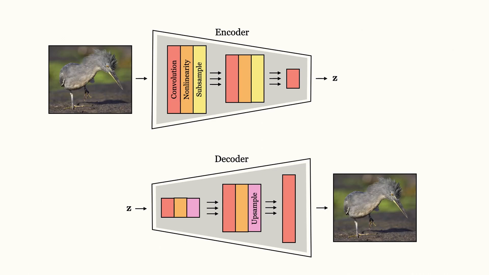
*▲ 강의 슬라이드 [61:25](https://youtu.be/bxVkZ4M-hIE?t=3685): 인코더는 저차원 $z$로 압축하고, 디코더는 $z$에서 이미지를 복원한다*

**[의미 분할](00_%EB%94%A5%EB%9F%AC%EB%8B%9D_%EC%9A%A9%EC%96%B4%EC%82%AC%EC%A0%84.md#semantic-segmentation-%EC%9D%98%EB%AF%B8-%EB%B6%84%ED%95%A0)에 쓰면**: 출력에도 공간 구조가 필요하므로 [인코더-디코더](00_%EB%94%A5%EB%9F%AC%EB%8B%9D_%EC%9A%A9%EC%96%B4%EC%82%AC%EC%A0%84.md#encoder-decoder-%EC%9D%B8%EC%BD%94%EB%8D%94-%EB%94%94%EC%BD%94%EB%8D%94)가 자연스럽습니다. 그런데 가운데 [병목](00_%EB%94%A5%EB%9F%AC%EB%8B%9D_%EC%9A%A9%EC%96%B4%EC%82%AC%EC%A0%84.md#bottleneck-%EB%B3%91%EB%AA%A9)(bottleneck)은 양날의 검입니다. 의미 있는 것을 배우게 강제하지만, 공간 정보를 많이 잃어 입력과 같은 크기의 **정밀한 출력**을 만들기 어렵습니다. 반대로 해상도를 전혀 줄이지 않는 이미지 → 이미지 망([합성곱](00_%EB%94%A5%EB%9F%AC%EB%8B%9D_%EC%9A%A9%EC%96%B4%EC%82%AC%EC%A0%84.md#convolution-%ED%95%A9%EC%84%B1%EA%B3%B1) → [ReLU](00_%EB%94%A5%EB%9F%AC%EB%8B%9D_%EC%9A%A9%EC%96%B4%EC%82%AC%EC%A0%84.md#relu-%EB%A0%90%EB%A3%A8) → [합성곱](00_%EB%94%A5%EB%9F%AC%EB%8B%9D_%EC%9A%A9%EC%96%B4%EC%82%AC%EC%A0%84.md#convolution-%ED%95%A9%EC%84%B1%EA%B3%B1) → [소프트맥스](00_%EB%94%A5%EB%9F%AC%EB%8B%9D_%EC%9A%A9%EC%96%B4%EC%82%AC%EC%A0%84.md#softmax-%EC%86%8C%ED%94%84%ED%8A%B8%EB%A7%A5%EC%8A%A4))은 정보를 잃지 않지만 모델이 너무 커집니다.

### 7.2 U-Net

▶ 영상 [64:00](https://youtu.be/bxVkZ4M-hIE?t=3840)

두 장점을 함께 얻는 구조가 **[U-Net](00_%EB%94%A5%EB%9F%AC%EB%8B%9D_%EC%9A%A9%EC%96%B4%EC%82%AC%EC%A0%84.md#u-net-%EC%9C%A0%EB%84%B7)**입니다. 인코더와 디코더의 같은 크기 [층](00_%EB%94%A5%EB%9F%AC%EB%8B%9D_%EC%9A%A9%EC%96%B4%EC%82%AC%EC%A0%84.md#layer-%EC%B8%B5)을 **[스킵 연결](00_%EB%94%A5%EB%9F%AC%EB%8B%9D_%EC%9A%A9%EC%96%B4%EC%82%AC%EC%A0%84.md#skip-connection-%EC%8A%A4%ED%82%B5-%EC%97%B0%EA%B2%B0)**로 잇습니다. 각 크기의 특징을 그대로(항등 함수로) 디코더 쪽에 건네주므로, 모델이 세밀한 공간 정보를 [병목](00_%EB%94%A5%EB%9F%AC%EB%8B%9D_%EC%9A%A9%EC%96%B4%EC%82%AC%EC%A0%84.md#bottleneck-%EB%B3%91%EB%AA%A9)에 억지로 밀어 넣을 필요가 없습니다. 의미는 [병목](00_%EB%94%A5%EB%9F%AC%EB%8B%9D_%EC%9A%A9%EC%96%B4%EC%82%AC%EC%A0%84.md#bottleneck-%EB%B3%91%EB%AA%A9)을 통해, 공간 세부는 [스킵 연결](00_%EB%94%A5%EB%9F%AC%EB%8B%9D_%EC%9A%A9%EC%96%B4%EC%82%AC%EC%A0%84.md#skip-connection-%EC%8A%A4%ED%82%B5-%EC%97%B0%EA%B2%B0)을 통해 얻습니다. 오래된 구조지만 지금도 [의미 분할](00_%EB%94%A5%EB%9F%AC%EB%8B%9D_%EC%9A%A9%EC%96%B4%EC%82%AC%EC%A0%84.md#semantic-segmentation-%EC%9D%98%EB%AF%B8-%EB%B6%84%ED%95%A0)에 가장 널리 쓰이는 구조 중 하나이고, 원격 탐사(토지 피복 지도 등)에서 늘 쓰입니다.

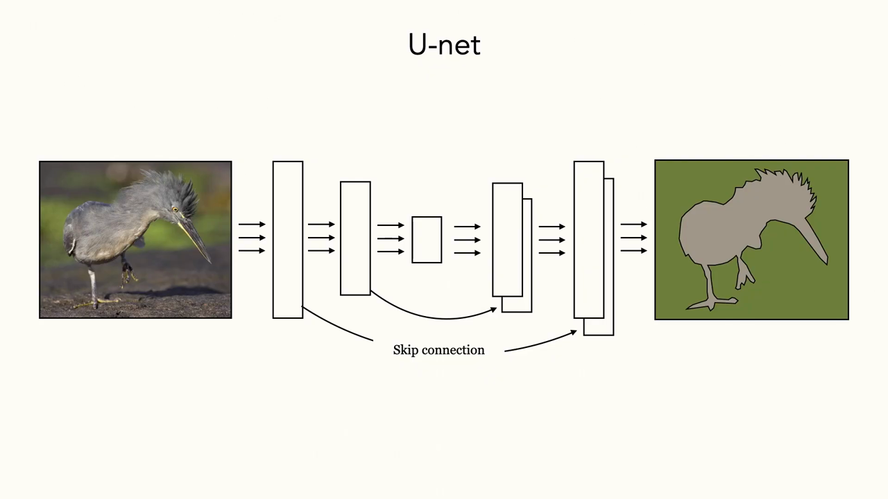
*▲ 강의 슬라이드 [64:25](https://youtu.be/bxVkZ4M-hIE?t=3865): [U-Net](00_%EB%94%A5%EB%9F%AC%EB%8B%9D_%EC%9A%A9%EC%96%B4%EC%82%AC%EC%A0%84.md#u-net-%EC%9C%A0%EB%84%B7). 인코더의 각 [층](00_%EB%94%A5%EB%9F%AC%EB%8B%9D_%EC%9A%A9%EC%96%B4%EC%82%AC%EC%A0%84.md#layer-%EC%B8%B5)을 디코더의 같은 크기 [층](00_%EB%94%A5%EB%9F%AC%EB%8B%9D_%EC%9A%A9%EC%96%B4%EC%82%AC%EC%A0%84.md#layer-%EC%B8%B5)에 [스킵 연결](00_%EB%94%A5%EB%9F%AC%EB%8B%9D_%EC%9A%A9%EC%96%B4%EC%82%AC%EC%A0%84.md#skip-connection-%EC%8A%A4%ED%82%B5-%EC%97%B0%EA%B2%B0)로 잇는다*

> [!TIP]
> **🆕 2026 업데이트: [U-Net](00_%EB%94%A5%EB%9F%AC%EB%8B%9D_%EC%9A%A9%EC%96%B4%EC%82%AC%EC%A0%84.md#u-net-%EC%9C%A0%EB%84%B7)과 분할 모델**
> - **강의**: [U-Net](00_%EB%94%A5%EB%9F%AC%EB%8B%9D_%EC%9A%A9%EC%96%B4%EC%82%AC%EC%A0%84.md#u-net-%EC%9C%A0%EB%84%B7)은 오래됐지만 여전히 [의미 분할](00_%EB%94%A5%EB%9F%AC%EB%8B%9D_%EC%9A%A9%EC%96%B4%EC%82%AC%EC%A0%84.md#semantic-segmentation-%EC%9D%98%EB%AF%B8-%EB%B6%84%ED%95%A0)에 가장 널리 쓰이는 구조다.
> - **현재**: 의료 3차원 분할에서는 여전히 맞다. 2024년 nnU-Net 재검증 연구는 [CNN](00_%EB%94%A5%EB%9F%AC%EB%8B%9D_%EC%9A%A9%EC%96%B4%EC%82%AC%EC%A0%84.md#cnn-convolutional-neural-network-%ED%95%A9%EC%84%B1%EA%B3%B1-%EC%8B%A0%EA%B2%BD%EB%A7%9D)·[트랜스포머](00_%EB%94%A5%EB%9F%AC%EB%8B%9D_%EC%9A%A9%EC%96%B4%EC%82%AC%EC%A0%84.md#transformer-%ED%8A%B8%EB%9E%9C%EC%8A%A4%ED%8F%AC%EB%A8%B8)·Mamba 기반 방법을 공정하게 비교했더니 **[CNN](00_%EB%94%A5%EB%9F%AC%EB%8B%9D_%EC%9A%A9%EC%96%B4%EC%82%AC%EC%A0%84.md#cnn-convolutional-neural-network-%ED%95%A9%EC%84%B1%EA%B3%B1-%EC%8B%A0%EA%B2%BD%EB%A7%9D) 기반 [U-Net](00_%EB%94%A5%EB%9F%AC%EB%8B%9D_%EC%9A%A9%EC%96%B4%EC%82%AC%EC%A0%84.md#u-net-%EC%9C%A0%EB%84%B7)**([ResNet](00_%EB%94%A5%EB%9F%AC%EB%8B%9D_%EC%9A%A9%EC%96%B4%EC%82%AC%EC%A0%84.md#resnet-%EB%A0%88%EC%A6%88%EB%84%B7)·ConvNeXt 변형 포함)을 nnU-Net 틀에서 키운 것이 가장 좋았고, 최근 제안된 방법 대부분이 2018년 원조 nnU-Net도 넘지 못했다고 보고했다. 한편 "무엇이든 분할"하는 범용 분할은 대규모 [기반 모델](00_%EB%94%A5%EB%9F%AC%EB%8B%9D_%EC%9A%A9%EC%96%B4%EC%82%AC%EC%A0%84.md#foundation-model-%EA%B8%B0%EB%B0%98-%EB%AA%A8%EB%8D%B8)로 넘어갔다. Meta의 [SAM](00_%EB%94%A5%EB%9F%AC%EB%8B%9D_%EC%9A%A9%EC%96%B4%EC%82%AC%EC%A0%84.md#segment-anything-model-sam-%EC%84%B8%EA%B7%B8%EB%A8%BC%ED%8A%B8-%EC%95%A0%EB%8B%88%EC%8B%B1-%EB%AA%A8%EB%8D%B8) 3(2025년 11월)는 "노란 스쿨버스" 같은 짧은 문구나 예시 이미지로 지정한 개념의 모든 개체를 이미지와 영상에서 찾아 분할하고 추적한다.
> - **출처**: [nnU-Net Revisited: A Call for Rigorous Validation in 3D Medical Image Segmentation (Isensee et al., MICCAI 2024)](https://arxiv.org/abs/2404.09556) · [SAM 3: Segment Anything with Concepts (Carion et al., 2025)](https://arxiv.org/abs/2511.16719)

### 7.3 ResNet

▶ 영상 [65:12](https://youtu.be/bxVkZ4M-hIE?t=3912)

📐 **수학 개념**: [기울기 소실](%EC%88%98%ED%95%99%EA%B0%9C%EB%85%90/05_%EC%8B%A0%EA%B2%BD%EB%A7%9D%EC%9D%98_%EA%B3%84%EC%82%B0/MM05_%ED%99%9C%EC%84%B1%ED%99%94_%ED%95%A8%EC%88%98%EC%9D%98_%EB%AF%B8%EB%B6%84.md) · [합성함수](%EC%88%98%ED%95%99%EA%B0%9C%EB%85%90/05_%EC%8B%A0%EA%B2%BD%EB%A7%9D%EC%9D%98_%EA%B3%84%EC%82%B0/MM06_%ED%95%A9%EC%84%B1%ED%95%A8%EC%88%98%EC%99%80_%EB%B9%84%EC%84%A0%ED%98%95%EC%84%B1.md)

[스킵 연결](00_%EB%94%A5%EB%9F%AC%EB%8B%9D_%EC%9A%A9%EC%96%B4%EC%82%AC%EC%A0%84.md#skip-connection-%EC%8A%A4%ED%82%B5-%EC%97%B0%EA%B2%B0)은 **[ResNet](00_%EB%94%A5%EB%9F%AC%EB%8B%9D_%EC%9A%A9%EC%96%B4%EC%82%AC%EC%A0%84.md#resnet-%EB%A0%88%EC%A6%88%EB%84%B7)**의 바탕이기도 합니다. [ResNet](00_%EB%94%A5%EB%9F%AC%EB%8B%9D_%EC%9A%A9%EC%96%B4%EC%82%AC%EC%A0%84.md#resnet-%EB%A0%88%EC%A6%88%EB%84%B7)은 지금 MIT 교수인 Kaiming He가 만들었고, 10년쯤 된 지금도 늘 쓰입니다.

- **모든 [층](00_%EB%94%A5%EB%9F%AC%EB%8B%9D_%EC%9A%A9%EC%96%B4%EC%82%AC%EC%A0%84.md#layer-%EC%B8%B5)에 항등 경로**가 있어, 데이터를 그 [층](00_%EB%94%A5%EB%9F%AC%EB%8B%9D_%EC%9A%A9%EC%96%B4%EC%82%AC%EC%A0%84.md#layer-%EC%B8%B5)에 통과시킬지 그냥 건너뛸지 고를 수 있습니다. 그래서 모델이 **스스로 알맞은 깊이를 배울 수 있다**는 것이 강사가 좋아하는 직관입니다. 여러 깊이의 모델을 따로 학습해 비교하지 않아도 됩니다.
- **[잔차 연결](00_%EB%94%A5%EB%9F%AC%EB%8B%9D_%EC%9A%A9%EC%96%B4%EC%82%AC%EC%A0%84.md#residual-connection-%EC%9E%94%EC%B0%A8-%EC%97%B0%EA%B2%B0)**: $x_{\text{out}} = F(x_{\text{in}}) + x_{\text{in}}$. 차원을 바꿔야 하면(예: 다운샘플링) 건너뛰는 길에도 선형 [가중치](00_%EB%94%A5%EB%9F%AC%EB%8B%9D_%EC%9A%A9%EC%96%B4%EC%82%AC%EC%A0%84.md#weight-%EA%B0%80%EC%A4%91%EC%B9%98)를 둔다: $x_{\text{out}} = F(x_{\text{in}}) + W x_{\text{in}}$.

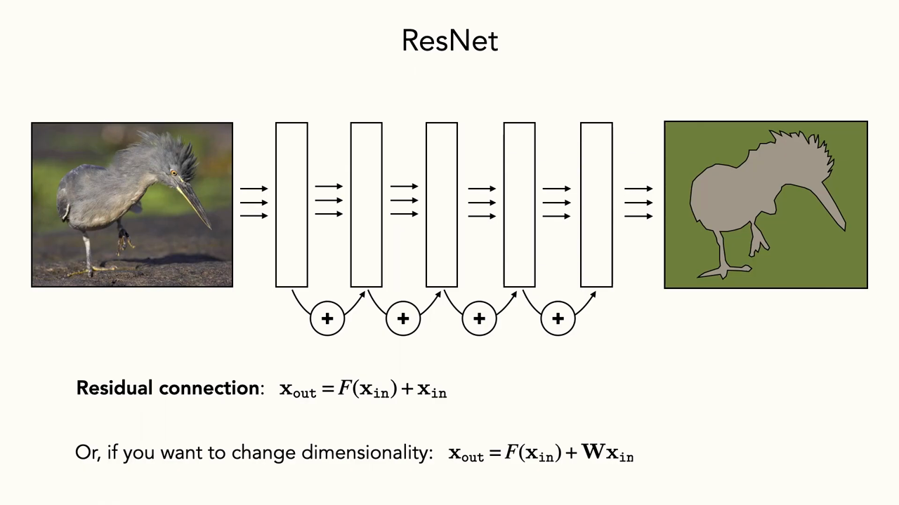
*▲ 강의 슬라이드 [68:45](https://youtu.be/bxVkZ4M-hIE?t=4125): [ResNet](00_%EB%94%A5%EB%9F%AC%EB%8B%9D_%EC%9A%A9%EC%96%B4%EC%82%AC%EC%A0%84.md#resnet-%EB%A0%88%EC%A6%88%EB%84%B7)의 [잔차 연결](00_%EB%94%A5%EB%9F%AC%EB%8B%9D_%EC%9A%A9%EC%96%B4%EC%82%AC%EC%A0%84.md#residual-connection-%EC%9E%94%EC%B0%A8-%EC%97%B0%EA%B2%B0) $x_{\text{out}} = F(x_{\text{in}}) + x_{\text{in}}$과 차원을 바꿀 때의 $F(x_{\text{in}}) + Wx_{\text{in}}$*

질의응답: 스킵 연결은 채널을 하나 더하는 것인가, 둘 중 하나를 고르는 것인가? [66:51](https://youtu.be/bxVkZ4M-hIE?t=4011)

고르는 쪽에 가깝다. [층](00_%EB%94%A5%EB%9F%AC%EB%8B%9D_%EC%9A%A9%EC%96%B4%EC%82%AC%EC%A0%84.md#layer-%EC%B8%B5)의 출력과 [잔차 연결](00_%EB%94%A5%EB%9F%AC%EB%8B%9D_%EC%9A%A9%EC%96%B4%EC%82%AC%EC%A0%84.md#residual-connection-%EC%9E%94%EC%B0%A8-%EC%97%B0%EA%B2%B0)은 같은 크기라고 가정하고 **더한다**. [학습](00_%EB%94%A5%EB%9F%AC%EB%8B%9D_%EC%9A%A9%EC%96%B4%EC%82%AC%EC%A0%84.md#training-%ED%95%99%EC%8A%B5) [가중치](00_%EB%94%A5%EB%9F%AC%EB%8B%9D_%EC%9A%A9%EC%96%B4%EC%82%AC%EC%A0%84.md#weight-%EA%B0%80%EC%A4%91%EC%B9%98)를 붙이는 구현도 있어서 항등 경로를 완전히 무시하도록 배울 수도 있다. 더하기든 [이어 붙이기](00_%EB%94%A5%EB%9F%AC%EB%8B%9D_%EC%9A%A9%EC%96%B4%EC%82%AC%EC%A0%84.md#concatenate-stack-%EC%9D%B4%EC%96%B4-%EB%B6%99%EC%9D%B4%EA%B8%B0%EC%99%80-%EC%8C%93%EA%B8%B0)(concatenation)든, 다음 선형(또는 [합성곱](00_%EB%94%A5%EB%9F%AC%EB%8B%9D_%EC%9A%A9%EC%96%B4%EC%82%AC%EC%A0%84.md#convolution-%ED%95%A9%EC%84%B1%EA%B3%B1)) [층](00_%EB%94%A5%EB%9F%AC%EB%8B%9D_%EC%9A%A9%EC%96%B4%EC%82%AC%EC%A0%84.md#layer-%EC%B8%B5)이 필요 없는 차원을 무시하도록 배울 수 있다. 차원을 바꾸는 $W$도 모두 0으로 배우면 건너뛰는 길을 아예 끌 수 있다. 같은 종류의 연결이 [트랜스포머](00_%EB%94%A5%EB%9F%AC%EB%8B%9D_%EC%9A%A9%EC%96%B4%EC%82%AC%EC%A0%84.md#transformer-%ED%8A%B8%EB%9E%9C%EC%8A%A4%ED%8F%AC%EB%A8%B8)에서도 나온다.

> [!TIP]
> **🆕 2026 업데이트: [CNN](00_%EB%94%A5%EB%9F%AC%EB%8B%9D_%EC%9A%A9%EC%96%B4%EC%82%AC%EC%A0%84.md#cnn-convolutional-neural-network-%ED%95%A9%EC%84%B1%EA%B3%B1-%EC%8B%A0%EA%B2%BD%EB%A7%9D)과 비전 [트랜스포머](00_%EB%94%A5%EB%9F%AC%EB%8B%9D_%EC%9A%A9%EC%96%B4%EC%82%AC%EC%A0%84.md#transformer-%ED%8A%B8%EB%9E%9C%EC%8A%A4%ED%8F%AC%EB%A8%B8)**
> - **강의**: [ResNet](00_%EB%94%A5%EB%9F%AC%EB%8B%9D_%EC%9A%A9%EC%96%B4%EC%82%AC%EC%A0%84.md#resnet-%EB%A0%88%EC%A6%88%EB%84%B7)은 10년 된 지금도 늘 쓰이고, [트랜스포머](00_%EB%94%A5%EB%9F%AC%EB%8B%9D_%EC%9A%A9%EC%96%B4%EC%82%AC%EC%A0%84.md#transformer-%ED%8A%B8%EB%9E%9C%EC%8A%A4%ED%8F%AC%EB%A8%B8)는 [합성곱](00_%EB%94%A5%EB%9F%AC%EB%8B%9D_%EC%9A%A9%EC%96%B4%EC%82%AC%EC%A0%84.md#convolution-%ED%95%A9%EC%84%B1%EA%B3%B1) 대신 [어텐션](00_%EB%94%A5%EB%9F%AC%EB%8B%9D_%EC%9A%A9%EC%96%B4%EC%82%AC%EC%A0%84.md#attention-%EC%96%B4%ED%85%90%EC%85%98)으로 패치를 처리한다(10절).
> - **현재**: 2020년 비전 [트랜스포머](00_%EB%94%A5%EB%9F%AC%EB%8B%9D_%EC%9A%A9%EC%96%B4%EC%82%AC%EC%A0%84.md#transformer-%ED%8A%B8%EB%9E%9C%EC%8A%A4%ED%8F%AC%EB%A8%B8)(ViT)가 이미지를 16×16 패치로 잘라 [트랜스포머](00_%EB%94%A5%EB%9F%AC%EB%8B%9D_%EC%9A%A9%EC%96%B4%EC%82%AC%EC%A0%84.md#transformer-%ED%8A%B8%EB%9E%9C%EC%8A%A4%ED%8F%AC%EB%A8%B8)에 넣는 방식으로 대규모 사전학습에서 [CNN](00_%EB%94%A5%EB%9F%AC%EB%8B%9D_%EC%9A%A9%EC%96%B4%EC%82%AC%EC%A0%84.md#cnn-convolutional-neural-network-%ED%95%A9%EC%84%B1%EA%B3%B1-%EC%8B%A0%EA%B2%BD%EB%A7%9D)과 겨루게 되었다. 이에 맞서 2022년 ConvNeXt는 표준 [ResNet](00_%EB%94%A5%EB%9F%AC%EB%8B%9D_%EC%9A%A9%EC%96%B4%EC%82%AC%EC%A0%84.md#resnet-%EB%A0%88%EC%A6%88%EB%84%B7)을 트랜스포머식 설계 요소로 하나씩 고쳐 나가, 순수 [CNN](00_%EB%94%A5%EB%9F%AC%EB%8B%9D_%EC%9A%A9%EC%96%B4%EC%82%AC%EC%A0%84.md#cnn-convolutional-neural-network-%ED%95%A9%EC%84%B1%EA%B3%B1-%EC%8B%A0%EA%B2%BD%EB%A7%9D)만으로 ImageNet top-1 87.8%를 내고 COCO 검출과 ADE20K 분할에서 Swin [트랜스포머](00_%EB%94%A5%EB%9F%AC%EB%8B%9D_%EC%9A%A9%EC%96%B4%EC%82%AC%EC%A0%84.md#transformer-%ED%8A%B8%EB%9E%9C%EC%8A%A4%ED%8F%AC%EB%A8%B8)를 앞섰다. ConvNeXt 논문은 [트랜스포머](00_%EB%94%A5%EB%9F%AC%EB%8B%9D_%EC%9A%A9%EC%96%B4%EC%82%AC%EC%A0%84.md#transformer-%ED%8A%B8%EB%9E%9C%EC%8A%A4%ED%8F%AC%EB%A8%B8)의 우위로 여겨지던 차이의 상당 부분이 [합성곱](00_%EB%94%A5%EB%9F%AC%EB%8B%9D_%EC%9A%A9%EC%96%B4%EC%82%AC%EC%A0%84.md#convolution-%ED%95%A9%EC%84%B1%EA%B3%B1) 자체가 아니라 [학습](00_%EB%94%A5%EB%9F%AC%EB%8B%9D_%EC%9A%A9%EC%96%B4%EC%82%AC%EC%A0%84.md#training-%ED%95%99%EC%8A%B5) 방법과 설계 세부에서 온다고 보았다. 2026년 현재 [CNN](00_%EB%94%A5%EB%9F%AC%EB%8B%9D_%EC%9A%A9%EC%96%B4%EC%82%AC%EC%A0%84.md#cnn-convolutional-neural-network-%ED%95%A9%EC%84%B1%EA%B3%B1-%EC%8B%A0%EA%B2%BD%EB%A7%9D), [트랜스포머](00_%EB%94%A5%EB%9F%AC%EB%8B%9D_%EC%9A%A9%EC%96%B4%EC%82%AC%EC%A0%84.md#transformer-%ED%8A%B8%EB%9E%9C%EC%8A%A4%ED%8F%AC%EB%A8%B8), 둘을 섞은 구조가 함께 쓰인다.
> - **출처**: [An Image is Worth 16x16 Words: Transformers for Image Recognition at Scale (Dosovitskiy et al., ICLR 2021)](https://arxiv.org/abs/2010.11929) · [A ConvNet for the 2020s (Liu et al., CVPR 2022)](https://arxiv.org/abs/2201.03545)

---

## 8. 시간 축 합성곱과 위치 인코딩

▶ 영상 [68:39](https://youtu.be/bxVkZ4M-hIE?t=4119)

📐 **수학 개념**: [사인파 위치 인코딩](%EC%88%98%ED%95%99%EA%B0%9C%EB%85%90/07_%EA%B5%AC%EC%A1%B0_%EC%95%84%ED%82%A4%ED%85%8D%EC%B2%98/MM17_%EC%82%AC%EC%9D%B8%ED%8C%8C_%EC%9C%84%EC%B9%98_%EC%9D%B8%EC%BD%94%EB%94%A9.md) · [이동 등변성](%EC%88%98%ED%95%99%EA%B0%9C%EB%85%90/07_%EA%B5%AC%EC%A1%B0_%EC%95%84%ED%82%A4%ED%85%8D%EC%B2%98/MM15_%ED%95%A9%EC%84%B1%EA%B3%B1%EA%B3%BC_%ED%87%B4%ED%94%8C%EB%A6%AC%EC%B8%A0_%ED%96%89%EB%A0%AC.md)

지금까지는 2·3차원 격자였지만, 현실에는 다른 축도 있습니다. 가장 단순한 것이 **시간**입니다.

- 온도 센서 값처럼 스칼라 하나가 시간에 따라 나오면, 공간 대신 **시간 축으로** 합성곱한다.
- **영상**은 RGB 프레임이 시간을 따라 쌓인 4차원 입력([채널](00_%EB%94%A5%EB%9F%AC%EB%8B%9D_%EC%9A%A9%EC%96%B4%EC%82%AC%EC%A0%84.md#channel-%EC%B1%84%EB%84%90) × 시간 × 높이 × 너비)이다. 공간과 시간을 함께 훑는 **[3차원 합성곱](00_%EB%94%A5%EB%9F%AC%EB%8B%9D_%EC%9A%A9%EC%96%B4%EC%82%AC%EC%A0%84.md#3d-convolution-3%EC%B0%A8%EC%9B%90-%ED%95%A9%EC%84%B1%EA%B3%B1)**을 쓰며, 행동 인식에 흔히 쓰인다.

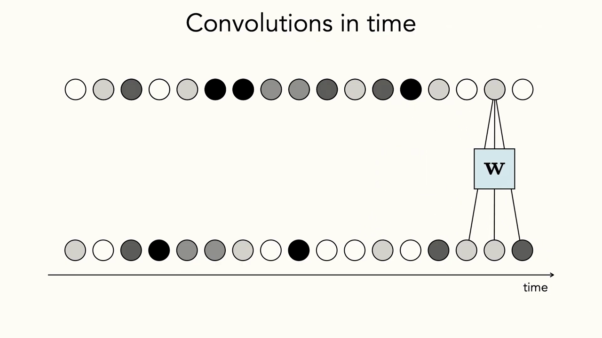
*▲ 강의 슬라이드 [69:25](https://youtu.be/bxVkZ4M-hIE?t=4165): 시간 축 [합성곱](00_%EB%94%A5%EB%9F%AC%EB%8B%9D_%EC%9A%A9%EC%96%B4%EC%82%AC%EC%A0%84.md#convolution-%ED%95%A9%EC%84%B1%EA%B3%B1). 같은 [가중치](00_%EB%94%A5%EB%9F%AC%EB%8B%9D_%EC%9A%A9%EC%96%B4%EC%82%AC%EC%A0%84.md#weight-%EA%B0%80%EC%A4%91%EC%B9%98) $W$를 시간 축을 따라 민다*

**[이동 불변성](00_%EB%94%A5%EB%9F%AC%EB%8B%9D_%EC%9A%A9%EC%96%B4%EC%82%AC%EC%A0%84.md#translation-invariance-%EC%9D%B4%EB%8F%99-%EB%B6%88%EB%B3%80%EC%84%B1)을 원하지 않을 때**: 시간 축 [합성곱](00_%EB%94%A5%EB%9F%AC%EB%8B%9D_%EC%9A%A9%EC%96%B4%EC%82%AC%EC%A0%84.md#convolution-%ED%95%A9%EC%84%B1%EA%B3%B1)은 시간 이동에 대해 같은 답을 내는데, "컵을 집는다"와 "컵을 내려놓는다"처럼 **순서가 의미를 바꾸는** 문제에서는 오히려 곤란합니다([이동 불변성](00_%EB%94%A5%EB%9F%AC%EB%8B%9D_%EC%9A%A9%EC%96%B4%EC%82%AC%EC%A0%84.md#translation-invariance-%EC%9D%B4%EB%8F%99-%EB%B6%88%EB%B3%80%EC%84%B1)이 늘 좋은 것은 아니다).

1. MLP처럼 이동 불변이 아닌 구조를 쓴다. 하지만 복잡한 함수를 배우기 어렵다.
2. [합성곱](00_%EB%94%A5%EB%9F%AC%EB%8B%9D_%EC%9A%A9%EC%96%B4%EC%82%AC%EC%A0%84.md#convolution-%ED%95%A9%EC%84%B1%EA%B3%B1) [필터](00_%EB%94%A5%EB%9F%AC%EB%8B%9D_%EC%9A%A9%EC%96%B4%EC%82%AC%EC%A0%84.md#filter-%ED%95%84%ED%84%B0)의 **입력에 위치 정보를 덧붙인다**. 이것이 **[위치 인코딩](00_%EB%94%A5%EB%9F%AC%EB%8B%9D_%EC%9A%A9%EC%96%B4%EC%82%AC%EC%A0%84.md#positional-encoding-%EC%9C%84%EC%B9%98-%EC%9D%B8%EC%BD%94%EB%94%A9)**이고, 실제로 이기는 방법으로 자리 잡았다. [위치 인코딩](00_%EB%94%A5%EB%9F%AC%EB%8B%9D_%EC%9A%A9%EC%96%B4%EC%82%AC%EC%A0%84.md#positional-encoding-%EC%9C%84%EC%B9%98-%EC%9D%B8%EC%BD%94%EB%94%A9)은 학습하는 값이 아니라 **만들어서** 입력에 붙이는 값이고, 그것을 받아들이는 [가중치](00_%EB%94%A5%EB%9F%AC%EB%8B%9D_%EC%9A%A9%EC%96%B4%EC%82%AC%EC%A0%84.md#weight-%EA%B0%80%EC%A4%91%EC%B9%98)를 추가로 학습한다.

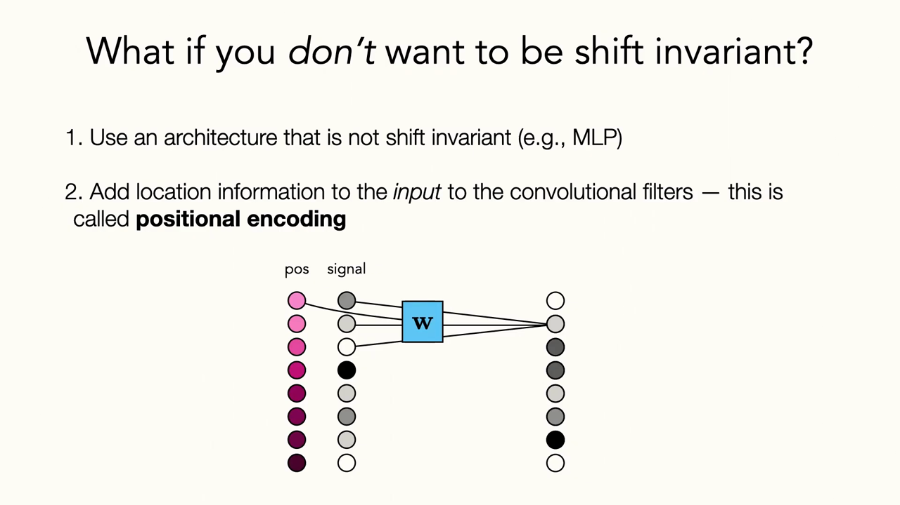
*▲ 강의 슬라이드 [71:45](https://youtu.be/bxVkZ4M-hIE?t=4305): 위치(pos) [채널](00_%EB%94%A5%EB%9F%AC%EB%8B%9D_%EC%9A%A9%EC%96%B4%EC%82%AC%EC%A0%84.md#channel-%EC%B1%84%EB%84%90)을 신호(signal) [채널](00_%EB%94%A5%EB%9F%AC%EB%8B%9D_%EC%9A%A9%EC%96%B4%EC%82%AC%EC%A0%84.md#channel-%EC%B1%84%EB%84%90)과 함께 [필터](00_%EB%94%A5%EB%9F%AC%EB%8B%9D_%EC%9A%A9%EC%96%B4%EC%82%AC%EC%A0%84.md#filter-%ED%95%84%ED%84%B0)에 넣는다*

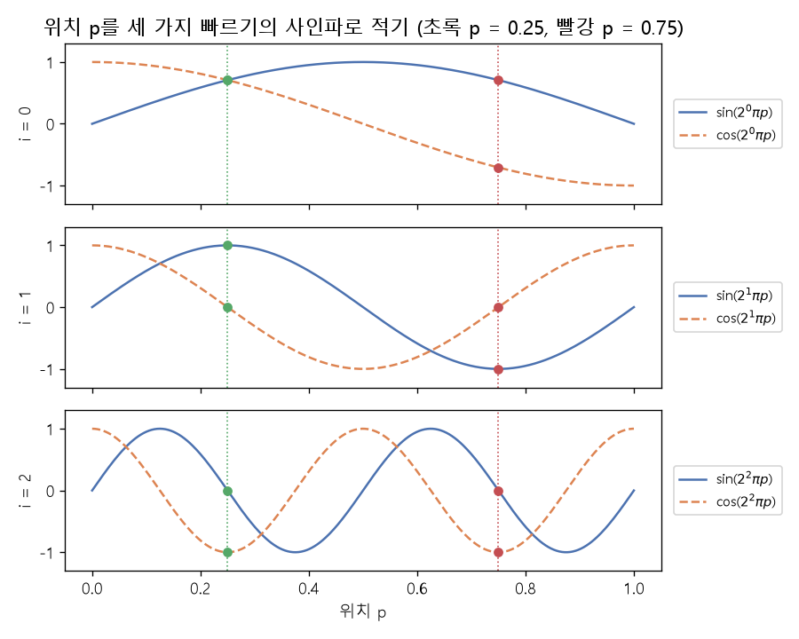
*▲ 직접 그린 그림: 위치 $p$를 빠르기가 두 배씩 다른 사인파 짝으로 적는 사인파 [위치 인코딩](00_%EB%94%A5%EB%9F%AC%EB%8B%9D_%EC%9A%A9%EC%96%B4%EC%82%AC%EC%A0%84.md#positional-encoding-%EC%9C%84%EC%B9%98-%EC%9D%B8%EC%BD%94%EB%94%A9). $p = 0.25$는 $(0.7071, 0.7071, 1, 0, 0, -1)$, $p = 0.75$는 $(0.7071, -0.7071, -1, 0, 0, -1)$*

---

## 9. 신경장과 NeRF

▶ 영상 [72:01](https://youtu.be/bxVkZ4M-hIE?t=4321)

📐 **수학 개념**: [사인파 위치 인코딩](%EC%88%98%ED%95%99%EA%B0%9C%EB%85%90/07_%EA%B5%AC%EC%A1%B0_%EC%95%84%ED%82%A4%ED%85%8D%EC%B2%98/MM17_%EC%82%AC%EC%9D%B8%ED%8C%8C_%EC%9C%84%EC%B9%98_%EC%9D%B8%EC%BD%94%EB%94%A9.md) · [보편 근사](%EC%88%98%ED%95%99%EA%B0%9C%EB%85%90/06_%EA%B7%BC%EC%82%AC_%EC%9D%B4%EB%A1%A0/MM07_%EB%A6%AC%EB%A7%8C_%ED%95%A9%EA%B3%BC_%EB%B3%B4%ED%8E%B8_%EA%B7%BC%EC%82%AC.md)

- 물리학의 장(field)은 공간·시간 좌표에 따라 변하는 물리량입니다. **[신경장](00_%EB%94%A5%EB%9F%AC%EB%8B%9D_%EC%9A%A9%EC%96%B4%EC%82%AC%EC%A0%84.md#neural-field-%EC%8B%A0%EA%B2%BD%EC%9E%A5)(Neural field)**은 그 장의 전부 또는 일부를 신경망으로 나타낸 것입니다.
- **[SIREN](00_%EB%94%A5%EB%9F%AC%EB%8B%9D_%EC%9A%A9%EC%96%B4%EC%82%AC%EC%A0%84.md#siren-%EC%82%AC%EC%9D%B8-%ED%99%9C%EC%84%B1%ED%99%94-%EC%8B%A0%EA%B2%BD%EB%A7%9D)**이 그 예입니다. 화소마다 적용되는 망이 **좌표 $(x, y)$ → 색**을 배워, 이미지 한 장을 "위치에서 색으로 가는 함수"로 표현합니다. 좌표는 격자 위의 점일 수도 있고 **연속값**일 수도 있어서, 격자에 묶이지 않는 함수형 표현을 배울 수 있습니다.
- **[NeRF](00_%EB%94%A5%EB%9F%AC%EB%8B%9D_%EC%9A%A9%EC%96%B4%EC%82%AC%EC%A0%84.md#nerf-%EC%8B%A0%EA%B2%BD-%EB%B0%A9%EC%82%AC%EC%9E%A5)**: 5차원 좌표(3차원 위치 + 카메라가 보는 방향)를 받아 **색과 부피 밀도**를 내는 망입니다. 장면을 여러 방향에서 찍은 사진으로 학습하면, [학습 데이터](00_%EB%94%A5%EB%9F%AC%EB%8B%9D_%EC%9A%A9%EC%96%B4%EC%82%AC%EC%A0%84.md#training-data-test-data-%ED%95%99%EC%8A%B5-%EB%8D%B0%EC%9D%B4%ED%84%B0%EC%99%80-%EC%8B%9C%ED%97%98-%EB%8D%B0%EC%9D%B4%ED%84%B0)에 없던 시점에서 본 모습을 만들어 내 장면 속을 걸어 다니는 영상을 만들 수 있습니다. 이를 가능하게 한 핵심 중 하나가 알맞은 [위치 인코딩](00_%EB%94%A5%EB%9F%AC%EB%8B%9D_%EC%9A%A9%EC%96%B4%EC%82%AC%EC%A0%84.md#positional-encoding-%EC%9C%84%EC%B9%98-%EC%9D%B8%EC%BD%94%EB%94%A9)입니다. 최근 Woods Hole 연구진은 물속에서 빛이 꺾이는 것까지 다루는 수중 [NeRF](00_%EB%94%A5%EB%9F%AC%EB%8B%9D_%EC%9A%A9%EC%96%B4%EC%82%AC%EC%A0%84.md#nerf-%EC%8B%A0%EA%B2%BD-%EB%B0%A9%EC%82%AC%EC%9E%A5)를 만들었습니다.

> [!TIP]
> **🆕 2026 업데이트: [NeRF](00_%EB%94%A5%EB%9F%AC%EB%8B%9D_%EC%9A%A9%EC%96%B4%EC%82%AC%EC%A0%84.md#nerf-%EC%8B%A0%EA%B2%BD-%EB%B0%A9%EC%82%AC%EC%9E%A5) 이후의 3차원 장면 표현**
> - **강의**: [NeRF](00_%EB%94%A5%EB%9F%AC%EB%8B%9D_%EC%9A%A9%EC%96%B4%EC%82%AC%EC%A0%84.md#nerf-%EC%8B%A0%EA%B2%BD-%EB%B0%A9%EC%82%AC%EC%9E%A5)가 인기 있는 구조이고, [NeRF](00_%EB%94%A5%EB%9F%AC%EB%8B%9D_%EC%9A%A9%EC%96%B4%EC%82%AC%EC%A0%84.md#nerf-%EC%8B%A0%EA%B2%BD-%EB%B0%A9%EC%82%AC%EC%9E%A5)를 실제 3차원 모델로 잇는 대규모 연구가 막 나오기 시작했다. [NeRF](00_%EB%94%A5%EB%9F%AC%EB%8B%9D_%EC%9A%A9%EC%96%B4%EC%82%AC%EC%A0%84.md#nerf-%EC%8B%A0%EA%B2%BD-%EB%B0%A9%EC%82%AC%EC%9E%A5)는 입력 사진이 많이 필요하고 움직이는 장면에 약하다(질의응답).
> - **현재**: 2023년 3D 가우시안 스플래팅(3DGS)은 장면을 신경망 대신 수많은 3차원 가우시안으로 표현하고 [미분](00_%EB%94%A5%EB%9F%AC%EB%8B%9D_%EC%9A%A9%EC%96%B4%EC%82%AC%EC%A0%84.md#derivative-%EB%AF%B8%EB%B6%84) 가능한 래스터라이저로 그려, 1080p에서 초당 30프레임 이상의 **실시간** 새 시점 합성을 하면서 Mip-NeRF360과 비슷하거나 나은 품질을 냈다. 2025년 VGGT(CVPR 2025 최우수 논문)는 사진 한 장부터 수백 장까지를 넣으면 카메라 [파라미터](00_%EB%94%A5%EB%9F%AC%EB%8B%9D_%EC%9A%A9%EC%96%B4%EC%82%AC%EC%A0%84.md#parameter-%ED%8C%8C%EB%9D%BC%EB%AF%B8%ED%84%B0), 깊이 지도, 점 지도, 3차원 점 궤적을 **장면별 최적화 없이 한 번의 [순전파](00_%EB%94%A5%EB%9F%AC%EB%8B%9D_%EC%9A%A9%EC%96%B4%EC%82%AC%EC%A0%84.md#feed-forward-%EC%88%9C%EC%A0%84%ED%8C%8C)로** 1초 안에 추론한다.
> - **출처**: [3D Gaussian Splatting for Real-Time Radiance Field Rendering (Kerbl et al., SIGGRAPH 2023)](https://arxiv.org/abs/2308.04079) · [VGGT: Visual Geometry Grounded Transformer (Wang et al., CVPR 2025)](https://arxiv.org/abs/2503.11651) · [CVPR 2025 수상 발표](https://cvpr.thecvf.com/Conferences/2025/News/Awards_Press)

---

## 10. 마무리

▶ 영상 [74:47](https://youtu.be/bxVkZ4M-hIE?t=4487)

- [합성곱](00_%EB%94%A5%EB%9F%AC%EB%8B%9D_%EC%9A%A9%EC%96%B4%EC%82%AC%EC%A0%84.md#convolution-%ED%95%A9%EC%84%B1%EA%B3%B1)은 이미지 처리의 기본 연산이고, 더 넓게는 **구조가 있는 모든 데이터**(시간, 시공간, 여러 입력 차원)의 기본 연산입니다. 예: 매주 찍는 전 지구 초분광 위성 영상.
- 핵심은 **이미지를 패치로 나누고 모든 패치에 같은 함수를 적용**하는 것("밀고 더하기"). 이 생각은 거의 모든 현대 구조에 들어 있습니다. [CNN](00_%EB%94%A5%EB%9F%AC%EB%8B%9D_%EC%9A%A9%EC%96%B4%EC%82%AC%EC%A0%84.md#cnn-convolutional-neural-network-%ED%95%A9%EC%84%B1%EA%B3%B1-%EC%8B%A0%EA%B2%BD%EB%A7%9D)은 물론, 패치별 연산을 [합성곱](00_%EB%94%A5%EB%9F%AC%EB%8B%9D_%EC%9A%A9%EC%96%B4%EC%82%AC%EC%A0%84.md#convolution-%ED%95%A9%EC%84%B1%EA%B3%B1) 대신 [어텐션](00_%EB%94%A5%EB%9F%AC%EB%8B%9D_%EC%9A%A9%EC%96%B4%EC%82%AC%EC%A0%84.md#attention-%EC%96%B4%ED%85%90%EC%85%98)으로 하는 [트랜스포머](00_%EB%94%A5%EB%9F%AC%EB%8B%9D_%EC%9A%A9%EC%96%B4%EC%82%AC%EC%A0%84.md#transformer-%ED%8A%B8%EB%9E%9C%EC%8A%A4%ED%8F%AC%EB%A8%B8), [NeRF](00_%EB%94%A5%EB%9F%AC%EB%8B%9D_%EC%9A%A9%EC%96%B4%EC%82%AC%EC%A0%84.md#nerf-%EC%8B%A0%EA%B2%BD-%EB%B0%A9%EC%82%AC%EC%9E%A5) 등.
- 오늘 다룬 것: 더 나은 아키텍처가 필요한 이유, [합성곱](00_%EB%94%A5%EB%9F%AC%EB%8B%9D_%EC%9A%A9%EC%96%B4%EC%82%AC%EC%A0%84.md#convolution-%ED%95%A9%EC%84%B1%EA%B3%B1) [층](00_%EB%94%A5%EB%9F%AC%EB%8B%9D_%EC%9A%A9%EC%96%B4%EC%82%AC%EC%A0%84.md#layer-%EC%B8%B5), 피라미드와 [수용 영역](00_%EB%94%A5%EB%9F%AC%EB%8B%9D_%EC%9A%A9%EC%96%B4%EC%82%AC%EC%A0%84.md#receptive-field-%EC%88%98%EC%9A%A9-%EC%98%81%EC%97%AD), 여러 구조, [신경장](00_%EB%94%A5%EB%9F%AC%EB%8B%9D_%EC%9A%A9%EC%96%B4%EC%82%AC%EC%A0%84.md#neural-field-%EC%8B%A0%EA%B2%BD%EC%9E%A5)과 [위치 인코딩](00_%EB%94%A5%EB%9F%AC%EB%8B%9D_%EC%9A%A9%EC%96%B4%EC%82%AC%EC%A0%84.md#positional-encoding-%EC%9C%84%EC%B9%98-%EC%9D%B8%EC%BD%94%EB%94%A9). [위치 인코딩](00_%EB%94%A5%EB%9F%AC%EB%8B%9D_%EC%9A%A9%EC%96%B4%EC%82%AC%EC%A0%84.md#positional-encoding-%EC%9C%84%EC%B9%98-%EC%9D%B8%EC%BD%94%EB%94%A9)은 [트랜스포머](00_%EB%94%A5%EB%9F%AC%EB%8B%9D_%EC%9A%A9%EC%96%B4%EC%82%AC%EC%A0%84.md#transformer-%ED%8A%B8%EB%9E%9C%EC%8A%A4%ED%8F%AC%EB%A8%B8) 강의에서 더 자세히 다룹니다.
- 지난 내용과의 연결: [Lec01 6.2 아키텍처](Lec01_%EB%94%A5%EB%9F%AC%EB%8B%9D_%EC%86%8C%EA%B0%9C.md#62-%EC%95%84%ED%82%A4%ED%85%8D%EC%B2%98)에서 예고한 [CNN](00_%EB%94%A5%EB%9F%AC%EB%8B%9D_%EC%9A%A9%EC%96%B4%EC%82%AC%EC%A0%84.md#cnn-convolutional-neural-network-%ED%95%A9%EC%84%B1%EA%B3%B1-%EC%8B%A0%EA%B2%BD%EB%A7%9D)이 이번 강의입니다.

마지막 질의응답 (요약) [75:53](https://youtu.be/bxVkZ4M-hIE?t=4553)

- **[NeRF](00_%EB%94%A5%EB%9F%AC%EB%8B%9D_%EC%9A%A9%EC%96%B4%EC%82%AC%EC%A0%84.md#nerf-%EC%8B%A0%EA%B2%BD-%EB%B0%A9%EC%82%AC%EC%9E%A5)로 해상도를 높일 수 있나?** 그렇다. 원래 [NeRF](00_%EB%94%A5%EB%9F%AC%EB%8B%9D_%EC%9A%A9%EC%96%B4%EC%82%AC%EC%A0%84.md#nerf-%EC%8B%A0%EA%B2%BD-%EB%B0%A9%EC%82%AC%EC%9E%A5) 그대로는 아니지만, 점 구름(point cloud) 표현의 해상도를 높이는 변형이 있다.
- **[스트라이드](00_%EB%94%A5%EB%9F%AC%EB%8B%9D_%EC%9A%A9%EC%96%B4%EC%82%AC%EC%A0%84.md#stride-%EC%8A%A4%ED%8A%B8%EB%9D%BC%EC%9D%B4%EB%93%9C) [합성곱](00_%EB%94%A5%EB%9F%AC%EB%8B%9D_%EC%9A%A9%EC%96%B4%EC%82%AC%EC%A0%84.md#convolution-%ED%95%A9%EC%84%B1%EA%B3%B1)과 풀링의 관계**: [스트라이드](00_%EB%94%A5%EB%9F%AC%EB%8B%9D_%EC%9A%A9%EC%96%B4%EC%82%AC%EC%A0%84.md#stride-%EC%8A%A4%ED%8A%B8%EB%9D%BC%EC%9D%B4%EB%93%9C) [합성곱](00_%EB%94%A5%EB%9F%AC%EB%8B%9D_%EC%9A%A9%EC%96%B4%EC%82%AC%EC%A0%84.md#convolution-%ED%95%A9%EC%84%B1%EA%B3%B1)은 풀링과 다운샘플링을 함께 하는 것이다. 풀링은 [가중치](00_%EB%94%A5%EB%9F%AC%EB%8B%9D_%EC%9A%A9%EC%96%B4%EC%82%AC%EC%A0%84.md#weight-%EA%B0%80%EC%A4%91%EC%B9%98)를 학습하지 않고 최댓값이나 평균을 쓰는, **학습하지 않는 [합성곱](00_%EB%94%A5%EB%9F%AC%EB%8B%9D_%EC%9A%A9%EC%96%B4%EC%82%AC%EC%A0%84.md#convolution-%ED%95%A9%EC%84%B1%EA%B3%B1) [층](00_%EB%94%A5%EB%9F%AC%EB%8B%9D_%EC%9A%A9%EC%96%B4%EC%82%AC%EC%A0%84.md#layer-%EC%B8%B5)**으로 볼 수 있다.
- **[NeRF](00_%EB%94%A5%EB%9F%AC%EB%8B%9D_%EC%9A%A9%EC%96%B4%EC%82%AC%EC%A0%84.md#nerf-%EC%8B%A0%EA%B2%BD-%EB%B0%A9%EC%82%AC%EC%9E%A5)는 어떻게 학습하나?** 물체 주위를 걸으며 찍은 영상처럼 여러 위치의 사진을 모으고, 사진마다 장면에 대한 카메라 위치·방향을 추정한다. 각 화소에 대해 (위치, 방향) → 그 화소의 색이 [학습 데이터](00_%EB%94%A5%EB%9F%AC%EB%8B%9D_%EC%9A%A9%EC%96%B4%EC%82%AC%EC%A0%84.md#training-data-test-data-%ED%95%99%EC%8A%B5-%EB%8D%B0%EC%9D%B4%ED%84%B0%EC%99%80-%EC%8B%9C%ED%97%98-%EB%8D%B0%EC%9D%B4%ED%84%B0)가 된다. [NeRF](00_%EB%94%A5%EB%9F%AC%EB%8B%9D_%EC%9A%A9%EC%96%B4%EC%82%AC%EC%A0%84.md#nerf-%EC%8B%A0%EA%B2%BD-%EB%B0%A9%EC%82%AC%EC%9E%A5)의 출력은 3차원 모델이 아니라 "다른 방향에서 찍으면 보일 이미지"다. 성긴 사진 몇 장으로는 맞추기 어렵고, 흔들리는 나무처럼 움직이는 대상은 최적화가 잘 안 된다.
- **이미지에 GPS 같은 스칼라 정보를 함께 넣으려면?** 첫 [합성곱](00_%EB%94%A5%EB%9F%AC%EB%8B%9D_%EC%9A%A9%EC%96%B4%EC%82%AC%EC%A0%84.md#convolution-%ED%95%A9%EC%84%B1%EA%B3%B1) [층](00_%EB%94%A5%EB%9F%AC%EB%8B%9D_%EC%9A%A9%EC%96%B4%EC%82%AC%EC%A0%84.md#layer-%EC%B8%B5) 뒤에 따로 표현을 만들어 이어 붙이거나, 망의 뒤쪽에서 넣는 등 방법이 많다.
- **영상 프레임을 [채널](00_%EB%94%A5%EB%9F%AC%EB%8B%9D_%EC%9A%A9%EC%96%B4%EC%82%AC%EC%A0%84.md#channel-%EC%B1%84%EB%84%90)로 쌓으면 [3차원 합성곱](00_%EB%94%A5%EB%9F%AC%EB%8B%9D_%EC%9A%A9%EC%96%B4%EC%82%AC%EC%A0%84.md#3d-convolution-3%EC%B0%A8%EC%9B%90-%ED%95%A9%EC%84%B1%EA%B3%B1)과 다른가?** 프레임마다 [채널](00_%EB%94%A5%EB%9F%AC%EB%8B%9D_%EC%9A%A9%EC%96%B4%EC%82%AC%EC%A0%84.md#channel-%EC%B1%84%EB%84%90)을 더하는 것도 가능하지만 매우 비싸다. 영상에서는 시간 축 [합성곱](00_%EB%94%A5%EB%9F%AC%EB%8B%9D_%EC%9A%A9%EC%96%B4%EC%82%AC%EC%A0%84.md#convolution-%ED%95%A9%EC%84%B1%EA%B3%B1)이 계산값만큼 이득이 나는 경우가 드물다. 대부분의 행동은 프레임 몇 장, 많은 경우 **한 장**으로도 알아볼 수 있다(Alyosha Efros 연구진의 분석). 그래서 최신 영상 모델은 시간 방향으로도 다운샘플링하고, 저해상도로 자주 도는 경로(움직임)와 고해상도로 가끔 도는 경로(세밀한 의미)를 함께 쓰는 "빠른 길·느린 길" 방식을 많이 쓴다. 영상은 저장도 [학습](00_%EB%94%A5%EB%9F%AC%EB%8B%9D_%EC%9A%A9%EC%96%B4%EC%82%AC%EC%A0%84.md#training-%ED%95%99%EC%8A%B5)도 추론도 비싸다.

---

## 11. 용어 정리

용어사전에 있는 용어는 위 본문에 링크를 걸었습니다. 아래는 이번 강의에서 새로 나온 용어입니다.

| 용어 | 뜻 |
|---|---|
| [귀납 편향](00_%EB%94%A5%EB%9F%AC%EB%8B%9D_%EC%9A%A9%EC%96%B4%EC%82%AC%EC%A0%84.md#inductive-bias-%EA%B7%80%EB%82%A9-%ED%8E%B8%ED%96%A5)(Inductive bias) | 모델 구조에 미리 심어 둔 "답은 이런 꼴일 것"이라는 가정 |
| [가설 공간](00_%EB%94%A5%EB%9F%AC%EB%8B%9D_%EC%9A%A9%EC%96%B4%EC%82%AC%EC%A0%84.md#hypothesis-space-%EA%B0%80%EC%84%A4-%EA%B3%B5%EA%B0%84)(Hypothesis space) | 모델 구조가 나타낼 수 있는 함수들의 모임 |
| [표본 효율](00_%EB%94%A5%EB%9F%AC%EB%8B%9D_%EC%9A%A9%EC%96%B4%EC%82%AC%EC%A0%84.md#sample-efficiency-%ED%91%9C%EB%B3%B8-%ED%9A%A8%EC%9C%A8)(Sample efficiency) | 같은 성능에 데이터가 얼마나 적게 드는가 |
| [완전 병렬](00_%EB%94%A5%EB%9F%AC%EB%8B%9D_%EC%9A%A9%EC%96%B4%EC%82%AC%EC%A0%84.md#embarrassingly-parallel-%EC%99%84%EC%A0%84-%EB%B3%91%EB%A0%AC)(Embarrassingly parallel) | 서로 의존하지 않아 그대로 나누어 동시에 계산할 수 있는 성질 |
| [의미 분할](00_%EB%94%A5%EB%9F%AC%EB%8B%9D_%EC%9A%A9%EC%96%B4%EC%82%AC%EC%A0%84.md#semantic-segmentation-%EC%9D%98%EB%AF%B8-%EB%B6%84%ED%95%A0)(Semantic segmentation) | 화소마다 범주를 매기는 문제 |
| [이동 등변성](00_%EB%94%A5%EB%9F%AC%EB%8B%9D_%EC%9A%A9%EC%96%B4%EC%82%AC%EC%A0%84.md#translation-equivariance-%EC%9D%B4%EB%8F%99-%EB%93%B1%EB%B3%80%EC%84%B1)(Translation equivariance) | 입력을 옮기면 출력도 똑같이 옮겨지는 성질 |
| [이동 불변성](00_%EB%94%A5%EB%9F%AC%EB%8B%9D_%EC%9A%A9%EC%96%B4%EC%82%AC%EC%A0%84.md#translation-invariance-%EC%9D%B4%EB%8F%99-%EB%B6%88%EB%B3%80%EC%84%B1)(Translation invariance) | 입력을 옮겨도 출력이 변하지 않는 성질 |
| [교차 상관](00_%EB%94%A5%EB%9F%AC%EB%8B%9D_%EC%9A%A9%EC%96%B4%EC%82%AC%EC%A0%84.md#cross-correlation-%EA%B5%90%EC%B0%A8-%EC%83%81%EA%B4%80)([Cross-correlation](00_%EB%94%A5%EB%9F%AC%EB%8B%9D_%EC%9A%A9%EC%96%B4%EC%82%AC%EC%A0%84.md#cross-correlation-%EA%B5%90%EC%B0%A8-%EC%83%81%EA%B4%80)) | [필터](00_%EB%94%A5%EB%9F%AC%EB%8B%9D_%EC%9A%A9%EC%96%B4%EC%82%AC%EC%A0%84.md#filter-%ED%95%84%ED%84%B0)를 뒤집지 않고 밀며 곱해 더하는 연산. 신경망의 "[합성곱](00_%EB%94%A5%EB%9F%AC%EB%8B%9D_%EC%9A%A9%EC%96%B4%EC%82%AC%EC%A0%84.md#convolution-%ED%95%A9%EC%84%B1%EA%B3%B1)" |
| [퇴플리츠 행렬](00_%EB%94%A5%EB%9F%AC%EB%8B%9D_%EC%9A%A9%EC%96%B4%EC%82%AC%EC%A0%84.md#toeplitz-matrix-%ED%87%B4%ED%94%8C%EB%A6%AC%EC%B8%A0-%ED%96%89%EB%A0%AC)(Toeplitz matrix) | 각 대각선 위의 값이 모두 같은 행렬. [합성곱](00_%EB%94%A5%EB%9F%AC%EB%8B%9D_%EC%9A%A9%EC%96%B4%EC%82%AC%EC%A0%84.md#convolution-%ED%95%A9%EC%84%B1%EA%B3%B1)을 행렬로 쓴 모양 |
| [필터 뱅크](00_%EB%94%A5%EB%9F%AC%EB%8B%9D_%EC%9A%A9%EC%96%B4%EC%82%AC%EC%A0%84.md#filter-bank-%ED%95%84%ED%84%B0-%EB%B1%85%ED%81%AC)(Filter bank) | 한 [층](00_%EB%94%A5%EB%9F%AC%EB%8B%9D_%EC%9A%A9%EC%96%B4%EC%82%AC%EC%A0%84.md#layer-%EC%B8%B5)에서 함께 쓰는 여러 [필터](00_%EB%94%A5%EB%9F%AC%EB%8B%9D_%EC%9A%A9%EC%96%B4%EC%82%AC%EC%A0%84.md#filter-%ED%95%84%ED%84%B0)의 묶음. [필터](00_%EB%94%A5%EB%9F%AC%EB%8B%9D_%EC%9A%A9%EC%96%B4%EC%82%AC%EC%A0%84.md#filter-%ED%95%84%ED%84%B0) 하나가 출력 [채널](00_%EB%94%A5%EB%9F%AC%EB%8B%9D_%EC%9A%A9%EC%96%B4%EC%82%AC%EC%A0%84.md#channel-%EC%B1%84%EB%84%90) 하나 |
| [평균 풀링](00_%EB%94%A5%EB%9F%AC%EB%8B%9D_%EC%9A%A9%EC%96%B4%EC%82%AC%EC%A0%84.md#mean-pooling-%ED%8F%89%EA%B7%A0-%ED%92%80%EB%A7%81)([Mean pooling](00_%EB%94%A5%EB%9F%AC%EB%8B%9D_%EC%9A%A9%EC%96%B4%EC%82%AC%EC%A0%84.md#mean-pooling-%ED%8F%89%EA%B7%A0-%ED%92%80%EB%A7%81)) | 작은 창의 평균만 남기는 풀링 |
| [다운샘플링과 업샘플링](00_%EB%94%A5%EB%9F%AC%EB%8B%9D_%EC%9A%A9%EC%96%B4%EC%82%AC%EC%A0%84.md#downsampling-upsampling-%EB%8B%A4%EC%9A%B4%EC%83%98%ED%94%8C%EB%A7%81%EA%B3%BC-%EC%97%85%EC%83%98%ED%94%8C%EB%A7%81)([Downsampling](00_%EB%94%A5%EB%9F%AC%EB%8B%9D_%EC%9A%A9%EC%96%B4%EC%82%AC%EC%A0%84.md#downsampling-upsampling-%EB%8B%A4%EC%9A%B4%EC%83%98%ED%94%8C%EB%A7%81%EA%B3%BC-%EC%97%85%EC%83%98%ED%94%8C%EB%A7%81), [Upsampling](00_%EB%94%A5%EB%9F%AC%EB%8B%9D_%EC%9A%A9%EC%96%B4%EC%82%AC%EC%A0%84.md#downsampling-upsampling-%EB%8B%A4%EC%9A%B4%EC%83%98%ED%94%8C%EB%A7%81%EA%B3%BC-%EC%97%85%EC%83%98%ED%94%8C%EB%A7%81)) | 공간 크기를 줄이기와 키우기 |
| [팽창 합성곱](00_%EB%94%A5%EB%9F%AC%EB%8B%9D_%EC%9A%A9%EC%96%B4%EC%82%AC%EC%A0%84.md#dilated-convolution-%ED%8C%BD%EC%B0%BD-%ED%95%A9%EC%84%B1%EA%B3%B1)(Dilated convolution) | [필터](00_%EB%94%A5%EB%9F%AC%EB%8B%9D_%EC%9A%A9%EC%96%B4%EC%82%AC%EC%A0%84.md#filter-%ED%95%84%ED%84%B0) 칸 사이를 띄워 적은 [파라미터](00_%EB%94%A5%EB%9F%AC%EB%8B%9D_%EC%9A%A9%EC%96%B4%EC%82%AC%EC%A0%84.md#parameter-%ED%8C%8C%EB%9D%BC%EB%AF%B8%ED%84%B0)로 넓게 보는 [합성곱](00_%EB%94%A5%EB%9F%AC%EB%8B%9D_%EC%9A%A9%EC%96%B4%EC%82%AC%EC%A0%84.md#convolution-%ED%95%A9%EC%84%B1%EA%B3%B1) |
| [수용 영역](00_%EB%94%A5%EB%9F%AC%EB%8B%9D_%EC%9A%A9%EC%96%B4%EC%82%AC%EC%A0%84.md#receptive-field-%EC%88%98%EC%9A%A9-%EC%98%81%EC%97%AD)(Receptive field) | 출력 한 칸에 영향을 주는 입력 영역 |
| [신경망 구조 탐색](00_%EB%94%A5%EB%9F%AC%EB%8B%9D_%EC%9A%A9%EC%96%B4%EC%82%AC%EC%A0%84.md#neural-architecture-search-%EC%8B%A0%EA%B2%BD%EB%A7%9D-%EA%B5%AC%EC%A1%B0-%ED%83%90%EC%83%89)(Neural architecture search) | 좋은 신경망 구조를 자동으로 찾는 분야 |
| [특징 공학](00_%EB%94%A5%EB%9F%AC%EB%8B%9D_%EC%9A%A9%EC%96%B4%EC%82%AC%EC%A0%84.md#feature-engineering-%ED%8A%B9%EC%A7%95-%EA%B3%B5%ED%95%99)(Feature engineering) | 사람이 특징([필터](00_%EB%94%A5%EB%9F%AC%EB%8B%9D_%EC%9A%A9%EC%96%B4%EC%82%AC%EC%A0%84.md#filter-%ED%95%84%ED%84%B0))을 손으로 설계하는 방식 |
| [인코더-디코더](00_%EB%94%A5%EB%9F%AC%EB%8B%9D_%EC%9A%A9%EC%96%B4%EC%82%AC%EC%A0%84.md#encoder-decoder-%EC%9D%B8%EC%BD%94%EB%8D%94-%EB%94%94%EC%BD%94%EB%8D%94)([Encoder-decoder](00_%EB%94%A5%EB%9F%AC%EB%8B%9D_%EC%9A%A9%EC%96%B4%EC%82%AC%EC%A0%84.md#encoder-decoder-%EC%9D%B8%EC%BD%94%EB%8D%94-%EB%94%94%EC%BD%94%EB%8D%94)) | 입력을 저차원으로 압축한 뒤 다시 키워 출력을 만드는 구조 |
| [스킵 연결](00_%EB%94%A5%EB%9F%AC%EB%8B%9D_%EC%9A%A9%EC%96%B4%EC%82%AC%EC%A0%84.md#skip-connection-%EC%8A%A4%ED%82%B5-%EC%97%B0%EA%B2%B0)([Skip connection](00_%EB%94%A5%EB%9F%AC%EB%8B%9D_%EC%9A%A9%EC%96%B4%EC%82%AC%EC%A0%84.md#skip-connection-%EC%8A%A4%ED%82%B5-%EC%97%B0%EA%B2%B0)) | 중간 [층](00_%EB%94%A5%EB%9F%AC%EB%8B%9D_%EC%9A%A9%EC%96%B4%EC%82%AC%EC%A0%84.md#layer-%EC%B8%B5)의 값을 [층](00_%EB%94%A5%EB%9F%AC%EB%8B%9D_%EC%9A%A9%EC%96%B4%EC%82%AC%EC%A0%84.md#layer-%EC%B8%B5) 몇 개를 건너뛰어 뒤로 그대로 건네는 연결 |
| [U-Net](00_%EB%94%A5%EB%9F%AC%EB%8B%9D_%EC%9A%A9%EC%96%B4%EC%82%AC%EC%A0%84.md#u-net-%EC%9C%A0%EB%84%B7) | [인코더-디코더](00_%EB%94%A5%EB%9F%AC%EB%8B%9D_%EC%9A%A9%EC%96%B4%EC%82%AC%EC%A0%84.md#encoder-decoder-%EC%9D%B8%EC%BD%94%EB%8D%94-%EB%94%94%EC%BD%94%EB%8D%94)의 같은 크기 [층](00_%EB%94%A5%EB%9F%AC%EB%8B%9D_%EC%9A%A9%EC%96%B4%EC%82%AC%EC%A0%84.md#layer-%EC%B8%B5)을 [스킵 연결](00_%EB%94%A5%EB%9F%AC%EB%8B%9D_%EC%9A%A9%EC%96%B4%EC%82%AC%EC%A0%84.md#skip-connection-%EC%8A%A4%ED%82%B5-%EC%97%B0%EA%B2%B0)로 이은 분할 구조 |
| [잔차 연결](00_%EB%94%A5%EB%9F%AC%EB%8B%9D_%EC%9A%A9%EC%96%B4%EC%82%AC%EC%A0%84.md#residual-connection-%EC%9E%94%EC%B0%A8-%EC%97%B0%EA%B2%B0)(Residual connection) | $x_{\text{out}} = F(x_{\text{in}}) + x_{\text{in}}$처럼 [층](00_%EB%94%A5%EB%9F%AC%EB%8B%9D_%EC%9A%A9%EC%96%B4%EC%82%AC%EC%A0%84.md#layer-%EC%B8%B5)의 출력에 입력을 더하는 연결 |
| [ResNet](00_%EB%94%A5%EB%9F%AC%EB%8B%9D_%EC%9A%A9%EC%96%B4%EC%82%AC%EC%A0%84.md#resnet-%EB%A0%88%EC%A6%88%EB%84%B7) | 모든 블록에 [잔차 연결](00_%EB%94%A5%EB%9F%AC%EB%8B%9D_%EC%9A%A9%EC%96%B4%EC%82%AC%EC%A0%84.md#residual-connection-%EC%9E%94%EC%B0%A8-%EC%97%B0%EA%B2%B0)을 둔 [CNN](00_%EB%94%A5%EB%9F%AC%EB%8B%9D_%EC%9A%A9%EC%96%B4%EC%82%AC%EC%A0%84.md#cnn-convolutional-neural-network-%ED%95%A9%EC%84%B1%EA%B3%B1-%EC%8B%A0%EA%B2%BD%EB%A7%9D) |
| [3차원 합성곱](00_%EB%94%A5%EB%9F%AC%EB%8B%9D_%EC%9A%A9%EC%96%B4%EC%82%AC%EC%A0%84.md#3d-convolution-3%EC%B0%A8%EC%9B%90-%ED%95%A9%EC%84%B1%EA%B3%B1)([3D convolution](00_%EB%94%A5%EB%9F%AC%EB%8B%9D_%EC%9A%A9%EC%96%B4%EC%82%AC%EC%A0%84.md#3d-convolution-3%EC%B0%A8%EC%9B%90-%ED%95%A9%EC%84%B1%EA%B3%B1)) | 공간과 시간(또는 세 축)을 함께 훑는 [합성곱](00_%EB%94%A5%EB%9F%AC%EB%8B%9D_%EC%9A%A9%EC%96%B4%EC%82%AC%EC%A0%84.md#convolution-%ED%95%A9%EC%84%B1%EA%B3%B1) |
| [위치 인코딩](00_%EB%94%A5%EB%9F%AC%EB%8B%9D_%EC%9A%A9%EC%96%B4%EC%82%AC%EC%A0%84.md#positional-encoding-%EC%9C%84%EC%B9%98-%EC%9D%B8%EC%BD%94%EB%94%A9)(Positional encoding) | 위치 정보를 숫자 묶음으로 만들어 입력에 붙이는 것 |
| [신경장](00_%EB%94%A5%EB%9F%AC%EB%8B%9D_%EC%9A%A9%EC%96%B4%EC%82%AC%EC%A0%84.md#neural-field-%EC%8B%A0%EA%B2%BD%EC%9E%A5)(Neural field) | 좌표 → 값을 신경망으로 나타낸 장 |
| [SIREN](00_%EB%94%A5%EB%9F%AC%EB%8B%9D_%EC%9A%A9%EC%96%B4%EC%82%AC%EC%A0%84.md#siren-%EC%82%AC%EC%9D%B8-%ED%99%9C%EC%84%B1%ED%99%94-%EC%8B%A0%EA%B2%BD%EB%A7%9D) | 사인 [활성화 함수](00_%EB%94%A5%EB%9F%AC%EB%8B%9D_%EC%9A%A9%EC%96%B4%EC%82%AC%EC%A0%84.md#activation-function-%ED%99%9C%EC%84%B1%ED%99%94-%ED%95%A8%EC%88%98)를 쓰는 [신경장](00_%EB%94%A5%EB%9F%AC%EB%8B%9D_%EC%9A%A9%EC%96%B4%EC%82%AC%EC%A0%84.md#neural-field-%EC%8B%A0%EA%B2%BD%EC%9E%A5) 모델 |
| [NeRF](00_%EB%94%A5%EB%9F%AC%EB%8B%9D_%EC%9A%A9%EC%96%B4%EC%82%AC%EC%A0%84.md#nerf-%EC%8B%A0%EA%B2%BD-%EB%B0%A9%EC%82%AC%EC%9E%A5)(Neural radiance field) | (위치, 방향) → (색, 밀도)를 배워 새 시점의 사진을 만드는 [신경장](00_%EB%94%A5%EB%9F%AC%EB%8B%9D_%EC%9A%A9%EC%96%B4%EC%82%AC%EC%A0%84.md#neural-field-%EC%8B%A0%EA%B2%BD%EC%9E%A5) |
