# Lec 05. 아키텍처: 그래프 (Architectures: Graphs)

← 이전: [Lec04_격자_아키텍처](Lec04_%EA%B2%A9%EC%9E%90_%EC%95%84%ED%82%A4%ED%85%8D%EC%B2%98.md) · [목차](00_MIT%EB%94%A5%EB%9F%AC%EB%8B%9D_%EB%AA%A9%EC%B0%A8.md) · 다음: [Lec06_일반화_이론](Lec06_%EC%9D%BC%EB%B0%98%ED%99%94_%EC%9D%B4%EB%A1%A0.md) →

> [!NOTE]
> **강의 정보**
> - **출처**: MIT OpenCourseWare, [Lec 05. Architectures: Graphs](https://www.youtube.com/watch?v=0niIwb37nF0) (81분, 2024년 가을 학기)
> - **강사**: Phillip Isola
> - **라이선스**: 원 강의는 CC BY-NC-SA 4.0입니다. 이 노트는 영어 자막을 바탕으로 한국어로 옮겨 정리한 2차 저작물이며, 같은 조건(비영리·출처 표기·동일 조건 공유)을 따릅니다.
> - 각 절 제목 아래의 `▶ 영상` 시간을 누르면 영상의 해당 위치로 갑니다.
> - `📐 수학 개념` 줄은 그 절에 쓰인 수학을 정리한 노트로 연결됩니다. 전체 목록은 [00_MIT딥러닝_목차](00_MIT%EB%94%A5%EB%9F%AC%EB%8B%9D_%EB%AA%A9%EC%B0%A8.md).
> - 슬라이드 캡처는 원 강의(CC BY-NC-SA 4.0)에서 가져왔고, "직접 그린 그림"은 이 노트의 숫자로 새로 그렸습니다.
> - `🆕 2026 업데이트` 칸은 강의(2024년 가을) 이후의 변화를 덧붙인 것입니다.

## 한눈에 보기

| 구분 | 내용 |
|---|---|
| 핵심 질문 | 노드와 엣지로 된 데이터([그래프](00_%EB%94%A5%EB%9F%AC%EB%8B%9D_%EC%9A%A9%EC%96%B4%EC%82%AC%EC%A0%84.md#graph-node-edge-%EA%B7%B8%EB%9E%98%ED%94%84-%EB%85%B8%EB%93%9C-%EC%97%A3%EC%A7%80))를 어떻게 신경망에 넣나? |
| 지켜야 할 대칭 | 노드 번호는 임의로 붙인 것 → 그래프 전체 답은 [순열 불변](00_%EB%94%A5%EB%9F%AC%EB%8B%9D_%EC%9A%A9%EC%96%B4%EC%82%AC%EC%A0%84.md#permutation-invariance-permutation-equivariance-%EC%88%9C%EC%97%B4-%EB%B6%88%EB%B3%80%EC%84%B1%EA%B3%BC-%EC%88%9C%EC%97%B4-%EB%93%B1%EB%B3%80%EC%84%B1), 노드별 답은 순열 등변 |
| [GNN](00_%EB%94%A5%EB%9F%AC%EB%8B%9D_%EC%9A%A9%EC%96%B4%EC%82%AC%EC%A0%84.md#gnn-graph-neural-network-%EA%B7%B8%EB%9E%98%ED%94%84-%EC%8B%A0%EA%B2%BD%EB%A7%9D) 한 [층](00_%EB%94%A5%EB%9F%AC%EB%8B%9D_%EC%9A%A9%EC%96%B4%EC%82%AC%EC%A0%84.md#layer-%EC%B8%B5) | [메시지 전달](00_%EB%94%A5%EB%9F%AC%EB%8B%9D_%EC%9A%A9%EC%96%B4%EC%82%AC%EC%A0%84.md#message-passing-%EB%A9%94%EC%8B%9C%EC%A7%80-%EC%A0%84%EB%8B%AC) = 이웃 벡터를 [집계](00_%EB%94%A5%EB%9F%AC%EB%8B%9D_%EC%9A%A9%EC%96%B4%EC%82%AC%EC%A0%84.md#aggregation-function-%EC%A7%91%EA%B3%84-%ED%95%A8%EC%88%98)(합·평균·최댓값·[어텐션](00_%EB%94%A5%EB%9F%AC%EB%8B%9D_%EC%9A%A9%EC%96%B4%EC%82%AC%EC%A0%84.md#attention-%EC%96%B4%ED%85%90%EC%85%98)) → 자기 벡터와 합쳐 [갱신](00_%EB%94%A5%EB%9F%AC%EB%8B%9D_%EC%9A%A9%EC%96%B4%EC%82%AC%EC%A0%84.md#update-function-%EA%B0%B1%EC%8B%A0-%ED%95%A8%EC%88%98). 그래프 전체 답은 [리드아웃](00_%EB%94%A5%EB%9F%AC%EB%8B%9D_%EC%9A%A9%EC%96%B4%EC%82%AC%EC%A0%84.md#readout-%EB%A6%AC%EB%93%9C%EC%95%84%EC%9B%83) |
| 다른 구조와의 관계 | [MLP](00_%EB%94%A5%EB%9F%AC%EB%8B%9D_%EC%9A%A9%EC%96%B4%EC%82%AC%EC%A0%84.md#multi-layer-perceptron-%EB%8B%A4%EC%B8%B5-%ED%8D%BC%EC%85%89%ED%8A%B8%EB%A1%A0) = 노드 1개짜리 [GNN](00_%EB%94%A5%EB%9F%AC%EB%8B%9D_%EC%9A%A9%EC%96%B4%EC%82%AC%EC%A0%84.md#gnn-graph-neural-network-%EA%B7%B8%EB%9E%98%ED%94%84-%EC%8B%A0%EA%B2%BD%EB%A7%9D), [CNN](00_%EB%94%A5%EB%9F%AC%EB%8B%9D_%EC%9A%A9%EC%96%B4%EC%82%AC%EC%A0%84.md#cnn-convolutional-neural-network-%ED%95%A9%EC%84%B1%EA%B3%B1-%EC%8B%A0%EA%B2%BD%EB%A7%9D) = 격자 위의 [GNN](00_%EB%94%A5%EB%9F%AC%EB%8B%9D_%EC%9A%A9%EC%96%B4%EC%82%AC%EC%A0%84.md#gnn-graph-neural-network-%EA%B7%B8%EB%9E%98%ED%94%84-%EC%8B%A0%EA%B2%BD%EB%A7%9D), [트랜스포머](00_%EB%94%A5%EB%9F%AC%EB%8B%9D_%EC%9A%A9%EC%96%B4%EC%82%AC%EC%A0%84.md#transformer-%ED%8A%B8%EB%9E%9C%EC%8A%A4%ED%8F%AC%EB%A8%B8) = [어텐션](00_%EB%94%A5%EB%9F%AC%EB%8B%9D_%EC%9A%A9%EC%96%B4%EC%82%AC%EC%A0%84.md#attention-%EC%96%B4%ED%85%90%EC%85%98)으로 집계하는 [GNN](00_%EB%94%A5%EB%9F%AC%EB%8B%9D_%EC%9A%A9%EC%96%B4%EC%82%AC%EC%A0%84.md#gnn-graph-neural-network-%EA%B7%B8%EB%9E%98%ED%94%84-%EC%8B%A0%EA%B2%BD%EB%A7%9D) |
| [표현력](00_%EB%94%A5%EB%9F%AC%EB%8B%9D_%EC%9A%A9%EC%96%B4%EC%82%AC%EC%A0%84.md#representational-power-%ED%91%9C%ED%98%84%EB%A0%A5)의 한계 | [GNN](00_%EB%94%A5%EB%9F%AC%EB%8B%9D_%EC%9A%A9%EC%96%B4%EC%82%AC%EC%A0%84.md#gnn-graph-neural-network-%EA%B7%B8%EB%9E%98%ED%94%84-%EC%8B%A0%EA%B2%BD%EB%A7%9D)은 [1-WL 테스트](00_%EB%94%A5%EB%9F%AC%EB%8B%9D_%EC%9A%A9%EC%96%B4%EC%82%AC%EC%A0%84.md#weisfeiler-leman-test-wl-%ED%85%8C%EC%8A%A4%ED%8A%B8)보다 더 잘 구별할 수 없음. 집계를 "합 + MLP"로 하면 1-WL만큼은 구별 |
| 실전 교훈 | 평균 집계는 이웃 수를 잃어 [학습](00_%EB%94%A5%EB%9F%AC%EB%8B%9D_%EC%9A%A9%EC%96%B4%EC%82%AC%EC%A0%84.md#training-%ED%95%99%EC%8A%B5)이 막힐 수 있음. 한계를 넘으려면 [위치 인코딩](00_%EB%94%A5%EB%9F%AC%EB%8B%9D_%EC%9A%A9%EC%96%B4%EC%82%AC%EC%A0%84.md#positional-encoding-%EC%9C%84%EC%B9%98-%EC%9D%B8%EC%BD%94%EB%94%A9)(예: [그래프 라플라시안](00_%EB%94%A5%EB%9F%AC%EB%8B%9D_%EC%9A%A9%EC%96%B4%EC%82%AC%EC%A0%84.md#graph-laplacian-%EA%B7%B8%EB%9E%98%ED%94%84-%EB%9D%BC%ED%94%8C%EB%9D%BC%EC%8B%9C%EC%95%88)의 [고유벡터](00_%EB%94%A5%EB%9F%AC%EB%8B%9D_%EC%9A%A9%EC%96%B4%EC%82%AC%EC%A0%84.md#eigenvector-eigenvalue-%EA%B3%A0%EC%9C%A0%EB%B2%A1%ED%84%B0%EC%99%80-%EA%B3%A0%EC%9C%B3%EA%B0%92)) |

---

## 1. 그래프 신경망을 배우는 이유

▶ 영상 [00:02](https://youtu.be/0niIwb37nF0?t=2)

이번 강의는 아키텍처 단원의 두 번째 시간입니다. 지난 시간([Lec04](Lec04_%EA%B2%A9%EC%9E%90_%EC%95%84%ED%82%A4%ED%85%8D%EC%B2%98.md))의 [합성곱 신경망](00_%EB%94%A5%EB%9F%AC%EB%8B%9D_%EC%9A%A9%EC%96%B4%EC%82%AC%EC%A0%84.md#cnn-convolutional-neural-network-%ED%95%A9%EC%84%B1%EA%B3%B1-%EC%8B%A0%EA%B2%BD%EB%A7%9D)에 이어 **[그래프 신경망](00_%EB%94%A5%EB%9F%AC%EB%8B%9D_%EC%9A%A9%EC%96%B4%EC%82%AC%EC%A0%84.md#gnn-graph-neural-network-%EA%B7%B8%EB%9E%98%ED%94%84-%EC%8B%A0%EA%B2%BD%EB%A7%9D)([GNN](00_%EB%94%A5%EB%9F%AC%EB%8B%9D_%EC%9A%A9%EC%96%B4%EC%82%AC%EC%A0%84.md#gnn-graph-neural-network-%EA%B7%B8%EB%9E%98%ED%94%84-%EC%8B%A0%EA%B2%BD%EB%A7%9D), [Graph](00_%EB%94%A5%EB%9F%AC%EB%8B%9D_%EC%9A%A9%EC%96%B4%EC%82%AC%EC%A0%84.md#graph-node-edge-%EA%B7%B8%EB%9E%98%ED%94%84-%EB%85%B8%EB%93%9C-%EC%97%A3%EC%A7%80) neural network)** 을 다루고, 뒤이어 [트랜스포머](00_%EB%94%A5%EB%9F%AC%EB%8B%9D_%EC%9A%A9%EC%96%B4%EC%82%AC%EC%A0%84.md#transformer-%ED%8A%B8%EB%9E%9C%EC%8A%A4%ED%8F%AC%EB%A8%B8)와 순환·메모리 기반 구조를 배웁니다([Lec01 6.2](Lec01_%EB%94%A5%EB%9F%AC%EB%8B%9D_%EC%86%8C%EA%B0%9C.md#62-%EC%95%84%ED%82%A4%ED%85%8D%EC%B2%98)의 수업 지도). 강의 순서는 세 부분입니다.

1. 어떤 문제에 [그래프 신경망](00_%EB%94%A5%EB%9F%AC%EB%8B%9D_%EC%9A%A9%EC%96%B4%EC%82%AC%EC%A0%84.md#gnn-graph-neural-network-%EA%B7%B8%EB%9E%98%ED%94%84-%EC%8B%A0%EA%B2%BD%EB%A7%9D)이 맞는가
2. [메시지 전달](00_%EB%94%A5%EB%9F%AC%EB%8B%9D_%EC%9A%A9%EC%96%B4%EC%82%AC%EC%A0%84.md#message-passing-%EB%A9%94%EC%8B%9C%EC%A7%80-%EC%A0%84%EB%8B%AC)(message passing)로 본 [GNN](00_%EB%94%A5%EB%9F%AC%EB%8B%9D_%EC%9A%A9%EC%96%B4%EC%82%AC%EC%A0%84.md#gnn-graph-neural-network-%EA%B7%B8%EB%9E%98%ED%94%84-%EC%8B%A0%EA%B2%BD%EB%A7%9D)의 작동 방식. 결국 [순전파](00_%EB%94%A5%EB%9F%AC%EB%8B%9D_%EC%9A%A9%EC%96%B4%EC%82%AC%EC%A0%84.md#feed-forward-%EC%88%9C%EC%A0%84%ED%8C%8C)·[역전파](00_%EB%94%A5%EB%9F%AC%EB%8B%9D_%EC%9A%A9%EC%96%B4%EC%82%AC%EC%A0%84.md#backpropagation-%EC%97%AD%EC%A0%84%ED%8C%8C)가 있는 평범한 신경망임을 보입니다.
3. 근사 능력: [GNN](00_%EB%94%A5%EB%9F%AC%EB%8B%9D_%EC%9A%A9%EC%96%B4%EC%82%AC%EC%A0%84.md#gnn-graph-neural-network-%EA%B7%B8%EB%9E%98%ED%94%84-%EC%8B%A0%EA%B2%BD%EB%A7%9D)은 어떤 함수를 나타낼 수 있고 어떤 함수는 못 나타내나

강사가 처음부터 강조하는 관점이 있습니다. [MLP](00_%EB%94%A5%EB%9F%AC%EB%8B%9D_%EC%9A%A9%EC%96%B4%EC%82%AC%EC%A0%84.md#multi-layer-perceptron-%EB%8B%A4%EC%B8%B5-%ED%8D%BC%EC%85%89%ED%8A%B8%EB%A1%A0)는 [보편 근사](00_%EB%94%A5%EB%9F%AC%EB%8B%9D_%EC%9A%A9%EC%96%B4%EC%82%AC%EC%A0%84.md#universal-approximation-%EB%B3%B4%ED%8E%B8-%EA%B7%BC%EC%82%AC)가 되지만 **[GNN](00_%EB%94%A5%EB%9F%AC%EB%8B%9D_%EC%9A%A9%EC%96%B4%EC%82%AC%EC%A0%84.md#gnn-graph-neural-network-%EA%B7%B8%EB%9E%98%ED%94%84-%EC%8B%A0%EA%B2%BD%EB%A7%9D)은 MLP와 같은 의미로 보편적이지 않고, 바로 그 점이 힘의 원천**이라는 것입니다. 아키텍처 설계는 하드웨어에서 잘 돌고 병렬화가 쉬운 구조를 만드는 일이기도 하지만, 더 중요하게는 **제약을 넣는 일**입니다. 데이터에는 맞추되 "올바른 방식으로만" 맞추도록, 원하지 않는 종류의 함수는 아예 표현하지 못하게 막습니다. 그래프는 그런 제약을 적는 언어입니다.

---

## 2. 그래프로 표현되는 문제들

▶ 영상 [03:53](https://youtu.be/0niIwb37nF0?t=233)

강사가 청중에게 물어 모은 예와 강의 슬라이드의 예입니다.

| 분야 | 노드 | 엣지 | 묻는 것 |
|---|---|---|---|
| 소셜 네트워크 | 사람 | 친구 관계 | 이 사람이 재즈를 좋아하나? (노드 [분류](00_%EB%94%A5%EB%9F%AC%EB%8B%9D_%EC%9A%A9%EC%96%B4%EC%82%AC%EC%A0%84.md#regression-classification-%ED%9A%8C%EA%B7%80%EC%99%80-%EB%B6%84%EB%A5%98)), 평균 친구 수는? (그래프 전체) |
| 추천 시스템 | 사용자, 관심 주제(보드) | 사용자-주제 | 다음에 볼 영상은? 사용자와 콘텐츠의 이분 그래프(bipartite graph) |
| 웹 | 웹 페이지 | 하이퍼링크 | 중요한 페이지는? (PageRank. 구글은 사실상 그래프 검색 회사로 출발) |
| [확률](00_%EB%94%A5%EB%9F%AC%EB%8B%9D_%EC%9A%A9%EC%96%B4%EC%82%AC%EC%A0%84.md#probability-%ED%99%95%EB%A5%A0) 그래프 모형 | [확률](00_%EB%94%A5%EB%9F%AC%EB%8B%9D_%EC%9A%A9%EC%96%B4%EC%82%AC%EC%A0%84.md#probability-%ED%99%95%EB%A5%A0) 변수 | 의존 관계 | 은닉 마르코프 모형(HMM) 같은 고전적 모형 |
| 분자 | 원자 | 결합 | 약물이 붙는 자리는? 사람에게 독성이 있나? |
| 약물 상호작용 | 약물, 단백질 | 약물-약물, 약물-단백질 | 두 약을 함께 먹으면 해로운가? (노드·엣지 종류가 여럿) |
| 지도 | 도로 구간 | 이웃 구간 | 가장 빠른 길, 도착 시간 |
| 물리 시뮬레이션 | 입자(물 분자 등) | 입자 사이의 힘 | 다음 순간의 위치 (유체 시뮬레이션) |
| 조합 최적화 | 결정 변수, 제약식 | 변수-제약 | 선형 계획법(LP) 같은 최적화 문제의 해 |

**이미 [정답](00_%EB%94%A5%EB%9F%AC%EB%8B%9D_%EC%9A%A9%EC%96%B4%EC%82%AC%EC%A0%84.md#label-%EC%A0%95%EB%8B%B5) 알고리즘이 있는데 왜 학습하나?** [12:19](https://youtu.be/0niIwb37nF0?t=739)
최단 경로는 데이크스트라(Dijkstra) 알고리즘이, 선형 계획법은 고전 해법이 정확한 답을 보장합니다. 하지만 전 세계 도로망처럼 그래프가 아주 크거나, "경치 좋은 길", "고속도로 피하기" 같은 제약이 붙으면 너무 느립니다. 학습한 [GNN](00_%EB%94%A5%EB%9F%AC%EB%8B%9D_%EC%9A%A9%EC%96%B4%EC%82%AC%EC%A0%84.md#gnn-graph-neural-network-%EA%B7%B8%EB%9E%98%ED%94%84-%EC%8B%A0%EA%B2%BD%EB%A7%9D)은 **[학습 데이터](00_%EB%94%A5%EB%9F%AC%EB%8B%9D_%EC%9A%A9%EC%96%B4%EC%82%AC%EC%A0%84.md#training-data-test-data-%ED%95%99%EC%8A%B5-%EB%8D%B0%EC%9D%B4%ED%84%B0%EC%99%80-%EC%8B%9C%ED%97%98-%EB%8D%B0%EC%9D%B4%ED%84%B0) 분포에서 잘 통하는 휴리스틱**을 배워 근사 해를 빨리 찾습니다. 대가는 보장이 없다는 것입니다. 고전 알고리즘은 항상 참값으로 수렴하지만, [GNN](00_%EB%94%A5%EB%9F%AC%EB%8B%9D_%EC%9A%A9%EC%96%B4%EC%82%AC%EC%A0%84.md#gnn-graph-neural-network-%EA%B7%B8%EB%9E%98%ED%94%84-%EC%8B%A0%EA%B2%BD%EB%A7%9D)은 [학습](00_%EB%94%A5%EB%9F%AC%EB%8B%9D_%EC%9A%A9%EC%96%B4%EC%82%AC%EC%A0%84.md#training-%ED%95%99%EC%8A%B5) 분포 밖의 문제에서는 틀릴 수 있습니다. (구글 지도 사례로 든 슬라이드는 교통 시간 예측 그림입니다. 공개된 논문에서 구글 지도의 [GNN](00_%EB%94%A5%EB%9F%AC%EB%8B%9D_%EC%9A%A9%EC%96%B4%EC%82%AC%EC%A0%84.md#gnn-graph-neural-network-%EA%B7%B8%EB%9E%98%ED%94%84-%EC%8B%A0%EA%B2%BD%EB%A7%9D)은 경로 탐색 자체보다 **도착 예정 시간(ETA)** 예측에 쓰였습니다: [ETA Prediction with Graph Neural Networks in Google Maps (Derrow-Pinion 외, CIKM 2021)](https://arxiv.org/abs/2108.11482))

> [!TIP]
> **🆕 2026 업데이트: 물리 시뮬레이션에서 날씨 예보로**
> - **강의**: 입자 사이의 힘을 엣지로 둔 [GNN](00_%EB%94%A5%EB%9F%AC%EB%8B%9D_%EC%9A%A9%EC%96%B4%EC%82%AC%EC%A0%84.md#gnn-graph-neural-network-%EA%B7%B8%EB%9E%98%ED%94%84-%EC%8B%A0%EA%B2%BD%EB%A7%9D)이 유체를 시뮬레이션하는 예를 보여 줌.
> - **현재**: 같은 발상이 지구 규모로 커졌습니다. Google DeepMind의 **GraphCast**는 지구 표면을 여러 해상도의 메시(mesh) 그래프로 놓고 [GNN](00_%EB%94%A5%EB%9F%AC%EB%8B%9D_%EC%9A%A9%EC%96%B4%EC%82%AC%EC%A0%84.md#gnn-graph-neural-network-%EA%B7%B8%EB%9E%98%ED%94%84-%EC%8B%A0%EA%B2%BD%EB%A7%9D)으로 6시간씩 앞을 예측해 10일 예보를 만듭니다. 시험한 변수·예보 시간 1,380개 가운데 90% 이상에서 유럽중기예보센터(ECMWF)의 최고 성능 결정론적 예보(HRES)보다 정확했고, 10일 예보를 TPU v4 한 대에서 1분 안에 냅니다.
> - **출처**: [Learning skillful medium-range global weather forecasting (Lam 외, Science, 2023)](https://www.science.org/doi/10.1126/science.adi2336) · [GraphCast: AI model for faster and more accurate global weather forecasting (Google DeepMind 블로그, 2023)](https://deepmind.google/discover/blog/graphcast-ai-model-for-faster-and-more-accurate-global-weather-forecasting/)

> [!TIP]
> **🆕 2026 업데이트: 분자·소재 그래프**
> - **강의**: 분자를 원자(노드)와 결합(엣지)의 그래프로 보고 독성·결합 부위를 예측하는 것이 대표 응용이라고 소개함.
> - **현재**: [GNN](00_%EB%94%A5%EB%9F%AC%EB%8B%9D_%EC%9A%A9%EC%96%B4%EC%82%AC%EC%A0%84.md#gnn-graph-neural-network-%EA%B7%B8%EB%9E%98%ED%94%84-%EC%8B%A0%EA%B2%BD%EB%A7%9D)이 신소재 탐색에서 큰 성과를 냈습니다. Google DeepMind의 **GNoME**는 결정 구조를 그래프로 다루는 [GNN](00_%EB%94%A5%EB%9F%AC%EB%8B%9D_%EC%9A%A9%EC%96%B4%EC%82%AC%EC%A0%84.md#gnn-graph-neural-network-%EA%B7%B8%EB%9E%98%ED%94%84-%EC%8B%A0%EA%B2%BD%EB%A7%9D)으로 새 결정 구조 약 220만 개를 예측했고, 그중 약 38만 개를 계산상 안정한 후보로 골라 공개 데이터베이스(Materials Project)에 기여했습니다. 이 가운데 736개는 다른 연구실들이 실제로 합성했습니다. (안정성은 계산 기준이며, 모두 실험으로 확인된 것은 아닙니다.)
> - **출처**: [Scaling deep learning for materials discovery (Merchant 외, Nature, 2023)](https://www.nature.com/articles/s41586-023-06735-9) · [Millions of new materials discovered with deep learning (Google DeepMind 블로그, 2023)](https://deepmind.google/discover/blog/millions-of-new-materials-discovered-with-deep-learning/)

---

## 3. 그래프를 입력으로 표현하기

▶ 영상 [13:59](https://youtu.be/0niIwb37nF0?t=839)

📐 **수학 개념**: [인접 행렬과 순열](%EC%88%98%ED%95%99%EA%B0%9C%EB%85%90/07_%EA%B5%AC%EC%A1%B0_%EC%95%84%ED%82%A4%ED%85%8D%EC%B2%98/MM18_%EC%9D%B8%EC%A0%91%ED%96%89%EB%A0%AC%EA%B3%BC_%EC%88%9C%EC%97%B4.md) · [벡터와 행렬](%EC%88%98%ED%95%99%EA%B0%9C%EB%85%90/03_%EC%84%A0%ED%98%95%EB%8C%80%EC%88%98/M05_%EB%B2%A1%ED%84%B0%EC%99%80_%ED%96%89%EB%A0%AC.md)

이 강의에서 그래프는 다음 두 가지로 입력합니다.

- **노드 속성 행렬** $X \in \mathbb{R}^{n \times d}$: 노드 $n$개마다 관측한 $d$차원 벡터. 분자라면 "탄소인가 수소인가", 소셜 네트워크라면 사용자 프로필.
- **[인접 행렬](00_%EB%94%A5%EB%9F%AC%EB%8B%9D_%EC%9A%A9%EC%96%B4%EC%82%AC%EC%A0%84.md#adjacency-matrix-%EC%9D%B8%EC%A0%91-%ED%96%89%EB%A0%AC)(Adjacency matrix)** $A \in \mathbb{R}^{n \times n}$: i와 j가 이어져 있으면 $A_{ij} = 1$, 아니면 0.

[GNN](00_%EB%94%A5%EB%9F%AC%EB%8B%9D_%EC%9A%A9%EC%96%B4%EC%82%AC%EC%A0%84.md#gnn-graph-neural-network-%EA%B7%B8%EB%9E%98%ED%94%84-%EC%8B%A0%EA%B2%BD%EB%A7%9D)이 배우는 것은 (그래프 구조 + 노드·엣지 속성) → 벡터로 가는 **함수**입니다. 출력은 두 종류입니다.

1. **[노드 임베딩](00_%EB%94%A5%EB%9F%AC%EB%8B%9D_%EC%9A%A9%EC%96%B4%EC%82%AC%EC%A0%84.md#node-embedding-graph-embedding-%EB%85%B8%EB%93%9C-%EC%9E%84%EB%B2%A0%EB%94%A9%EA%B3%BC-%EA%B7%B8%EB%9E%98%ED%94%84-%EC%9E%84%EB%B2%A0%EB%94%A9)([Node embedding](00_%EB%94%A5%EB%9F%AC%EB%8B%9D_%EC%9A%A9%EC%96%B4%EC%82%AC%EC%A0%84.md#node-embedding-graph-embedding-%EB%85%B8%EB%93%9C-%EC%9E%84%EB%B2%A0%EB%94%A9%EA%B3%BC-%EA%B7%B8%EB%9E%98%ED%94%84-%EC%9E%84%EB%B2%A0%EB%94%A9))**: 노드마다 벡터 하나. 이미지 패치를 벡터로 바꾸듯, 노드를 "약이 붙는 자리인가?" 같은 성질을 잘 드러내는 벡터로 바꿉니다(node2vec).
2. **그래프 [임베딩](00_%EB%94%A5%EB%9F%AC%EB%8B%9D_%EC%9A%A9%EC%96%B4%EC%82%AC%EC%A0%84.md#embedding-%EC%9E%84%EB%B2%A0%EB%94%A9)([Graph](00_%EB%94%A5%EB%9F%AC%EB%8B%9D_%EC%9A%A9%EC%96%B4%EC%82%AC%EC%A0%84.md#graph-node-edge-%EA%B7%B8%EB%9E%98%ED%94%84-%EB%85%B8%EB%93%9C-%EC%97%A3%EC%A7%80) embedding)**: 그래프 전체에 벡터 하나. "이 분자는 독성이 있나?"(graph2vec)

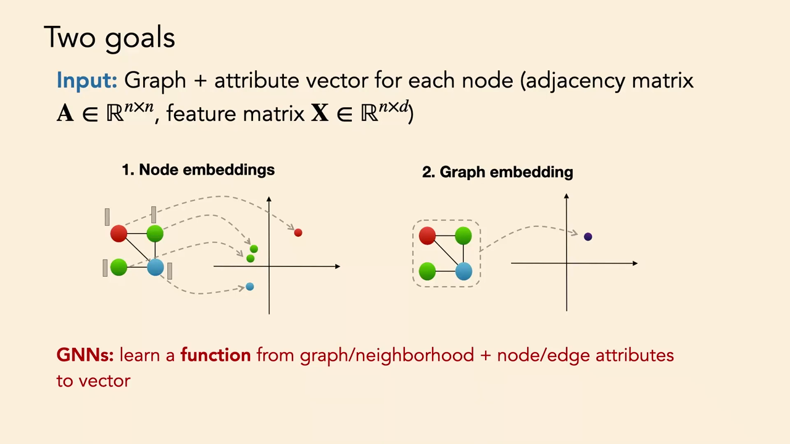
*▲ 강의 슬라이드 [16:00](https://youtu.be/0niIwb37nF0?t=960): [노드 임베딩과 그래프 임베딩](00_%EB%94%A5%EB%9F%AC%EB%8B%9D_%EC%9A%A9%EC%96%B4%EC%82%AC%EC%A0%84.md#node-embedding-graph-embedding-%EB%85%B8%EB%93%9C-%EC%9E%84%EB%B2%A0%EB%94%A9%EA%B3%BC-%EA%B7%B8%EB%9E%98%ED%94%84-%EC%9E%84%EB%B2%A0%EB%94%A9), 입력은 A와 X*

질의응답 정리 [16:17](https://youtu.be/0niIwb37nF0?t=977)

- **[노드 임베딩과 그래프 임베딩](00_%EB%94%A5%EB%9F%AC%EB%8B%9D_%EC%9A%A9%EC%96%B4%EC%82%AC%EC%A0%84.md#node-embedding-graph-embedding-%EB%85%B8%EB%93%9C-%EC%9E%84%EB%B2%A0%EB%94%A9%EA%B3%BC-%EA%B7%B8%EB%9E%98%ED%94%84-%EC%9E%84%EB%B2%A0%EB%94%A9)은 같은 모델로 배우나?** 둘 다 배울 수도, 하나만 배울 수도 있습니다. 흔한 방법은 노드 [임베딩](00_%EB%94%A5%EB%9F%AC%EB%8B%9D_%EC%9A%A9%EC%96%B4%EC%82%AC%EC%A0%84.md#embedding-%EC%9E%84%EB%B2%A0%EB%94%A9)을 배운 뒤 끝에서 더해 그래프 [임베딩](00_%EB%94%A5%EB%9F%AC%EB%8B%9D_%EC%9A%A9%EC%96%B4%EC%82%AC%EC%A0%84.md#embedding-%EC%9E%84%EB%B2%A0%EB%94%A9)을 만드는 것입니다.
- **[인접 행렬](00_%EB%94%A5%EB%9F%AC%EB%8B%9D_%EC%9A%A9%EC%96%B4%EC%82%AC%EC%A0%84.md#adjacency-matrix-%EC%9D%B8%EC%A0%91-%ED%96%89%EB%A0%AC)이 너무 크면?** 모델을 만드는 사람이 고를 문제가 아니라 데이터의 성질입니다. 분자가 아주 촘촘히 이어져 있으면 계산이 비싸지지만, 보통 입력 그래프를 단순화하지 않고 주어진 대로 씁니다.

---

## 4. MLP에 그대로 넣으면 안 되는 이유

▶ 영상 [18:25](https://youtu.be/0niIwb37nF0?t=1105)

📐 **수학 개념**: [인접 행렬과 순열](%EC%88%98%ED%95%99%EA%B0%9C%EB%85%90/07_%EA%B5%AC%EC%A1%B0_%EC%95%84%ED%82%A4%ED%85%8D%EC%B2%98/MM18_%EC%9D%B8%EC%A0%91%ED%96%89%EB%A0%AC%EA%B3%BC_%EC%88%9C%EC%97%B4.md) · [전치](%EC%88%98%ED%95%99%EA%B0%9C%EB%85%90/03_%EC%84%A0%ED%98%95%EB%8C%80%EC%88%98/MM03_%EB%B2%A1%ED%84%B0_%ED%91%9C%EA%B8%B0%EC%99%80_%EC%A0%84%EC%B9%98.md)

가장 단순한 생각은 [인접 행렬](00_%EB%94%A5%EB%9F%AC%EB%8B%9D_%EC%9A%A9%EC%96%B4%EC%82%AC%EC%A0%84.md#adjacency-matrix-%EC%9D%B8%EC%A0%91-%ED%96%89%EB%A0%AC)과 노드 속성을 모두 한 줄로 펴서([평탄화](00_%EB%94%A5%EB%9F%AC%EB%8B%9D_%EC%9A%A9%EC%96%B4%EC%82%AC%EC%A0%84.md#flatten-%ED%8F%89%ED%83%84%ED%99%94)) MLP에 넣는 것입니다. 강사는 슬라이드의 [인접 행렬](00_%EB%94%A5%EB%9F%AC%EB%8B%9D_%EC%9A%A9%EC%96%B4%EC%82%AC%EC%A0%84.md#adjacency-matrix-%EC%9D%B8%EC%A0%91-%ED%96%89%EB%A0%AC)에서 "4번째 행은 어느 노드인가?"를 묻습니다. 1이 세 개이므로 이웃이 셋인 파란 노드입니다.

이 방법의 문제는 **노드 번호가 임의**라는 것입니다. 파란 노드를 4번이 아니라 3번이라 불러도 같은 그래프인데, 펼친 벡터는 완전히 달라집니다. 분자의 구조는 원자에 번호를 어떻게 붙이든 같습니다. 그래서 그래프를 처리하는 함수는 번호 붙이기에 영향받지 않아야 합니다.

번호를 바꾸는 일은 순열 행렬 $P$로 씁니다. $PAP^\top$는 행(P)과 열($P^\top$)을 같은 방식으로 섞고, $PX$는 노드 속성의 순서를 섞습니다. 이때 원하는 성질은 둘입니다.

| 성질 | 식 | 언제 | [CNN](00_%EB%94%A5%EB%9F%AC%EB%8B%9D_%EC%9A%A9%EC%96%B4%EC%82%AC%EC%A0%84.md#cnn-convolutional-neural-network-%ED%95%A9%EC%84%B1%EA%B3%B1-%EC%8B%A0%EA%B2%BD%EB%A7%9D)에서 대응하는 것 |
|---|---|---|---|
| **순열 불변성**(Permutation invariance) | $f(PAP^\top, PX) = f(A, X)$ | 그래프 전체에 대한 예측 (출력 하나) | [이동 불변성](00_%EB%94%A5%EB%9F%AC%EB%8B%9D_%EC%9A%A9%EC%96%B4%EC%82%AC%EC%A0%84.md#translation-invariance-%EC%9D%B4%EB%8F%99-%EB%B6%88%EB%B3%80%EC%84%B1) |
| **순열 등변성**(Permutation equivariance) | $f(PAP^\top, PX) = P f(A, X)$ | 노드마다 예측 (노드 수만큼 출력) | [이동 등변성](00_%EB%94%A5%EB%9F%AC%EB%8B%9D_%EC%9A%A9%EC%96%B4%EC%82%AC%EC%A0%84.md#translation-equivariance-%EC%9D%B4%EB%8F%99-%EB%93%B1%EB%B3%80%EC%84%B1) ([특징 맵](00_%EB%94%A5%EB%9F%AC%EB%8B%9D_%EC%9A%A9%EC%96%B4%EC%82%AC%EC%A0%84.md#feature-map-%ED%8A%B9%EC%A7%95-%EB%A7%B5)이 함께 이동) |

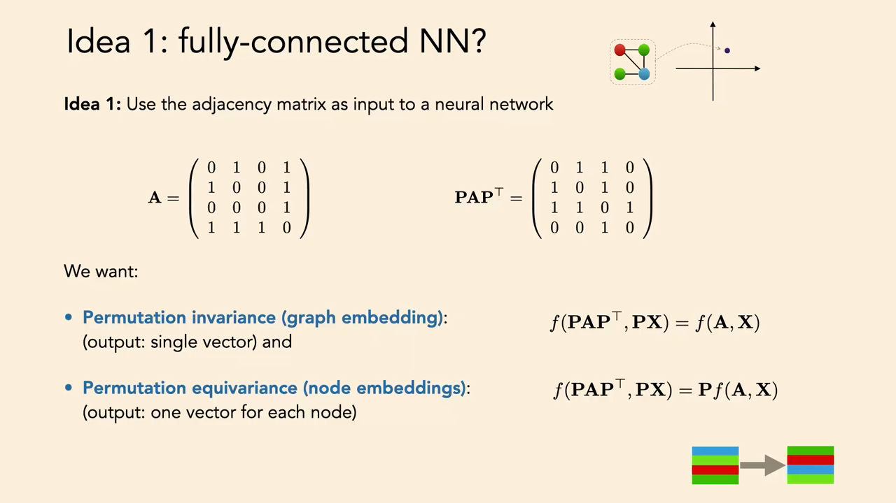
*▲ 강의 슬라이드 [24:30](https://youtu.be/0niIwb37nF0?t=1470): [인접 행렬](00_%EB%94%A5%EB%9F%AC%EB%8B%9D_%EC%9A%A9%EC%96%B4%EC%82%AC%EC%A0%84.md#adjacency-matrix-%EC%9D%B8%EC%A0%91-%ED%96%89%EB%A0%AC) A와 번호를 바꾼 $PAP^\top$, 순열 불변성과 등변성*

예를 들어 3번과 4번만 이름을 바꾸면 [인접 행렬](00_%EB%94%A5%EB%9F%AC%EB%8B%9D_%EC%9A%A9%EC%96%B4%EC%82%AC%EC%A0%84.md#adjacency-matrix-%EC%9D%B8%EC%A0%91-%ED%96%89%EB%A0%AC)은 슬라이드의 $PAP^\top$가 됩니다. 이웃 값의 합 $A\mathbf{x}$는 (6, 5, 4, 6)에서 (6, 5, 6, 4)로 같은 방식으로 섞이고(등변), 그 총합 21은 그대로입니다(불변). 자세한 계산은 [MM18_인접행렬과_순열](%EC%88%98%ED%95%99%EA%B0%9C%EB%85%90/07_%EA%B5%AC%EC%A1%B0_%EC%95%84%ED%82%A4%ED%85%8D%EC%B2%98/MM18_%EC%9D%B8%EC%A0%91%ED%96%89%EB%A0%AC%EA%B3%BC_%EC%88%9C%EC%97%B4.md)에 있습니다.

질의응답 정리 [24:35](https://youtu.be/0niIwb37nF0?t=1475)

- **불변으로 만들 수 없는 문제는?** 분자가 항상 정해진 방향으로 놓여 관측되는 세상이라면 그 위치 정보를 쓰고 싶을 것입니다. 이미지에서 "위쪽은 하늘일 가능성이 높다"처럼 위치가 의미 있는 경우가 더 분명한 예입니다. 강의 끝([9.6](#96-%EA%B3%84%EC%82%B0%ED%95%A0-%EC%88%98-%EC%97%86%EB%8A%94-%EC%84%B1%EC%A7%88%EA%B3%BC-%EC%9C%84%EC%B9%98-%EC%9D%B8%EC%BD%94%EB%94%A9))에서 다룹니다.
- **불변이면 출력이 벡터 하나여야 하나?** 아닙니다. 출력 차원은 자유이고, "입력을 섞어도 출력이 같다"는 뜻일 뿐입니다. 노드별 예측이라면 n번째 노드의 예측이 항상 출력의 n번째 행에 있어야 하므로 등변이 맞습니다.

---

## 5. CNN은 격자 그래프 위의 GNN

▶ 영상 [26:24](https://youtu.be/0niIwb37nF0?t=1584)

📐 **수학 개념**: [수용 영역과 출력 크기](%EC%88%98%ED%95%99%EA%B0%9C%EB%85%90/07_%EA%B5%AC%EC%A1%B0_%EC%95%84%ED%82%A4%ED%85%8D%EC%B2%98/MM16_%EC%88%98%EC%9A%A9_%EC%98%81%EC%97%AD%EA%B3%BC_%EC%B6%9C%EB%A0%A5_%ED%81%AC%EA%B8%B0.md) ([Lec04 6절](Lec04_%EA%B2%A9%EC%9E%90_%EC%95%84%ED%82%A4%ED%85%8D%EC%B2%98.md#6-%EC%88%98%EC%9A%A9-%EC%98%81%EC%97%AD))

이미지의 픽셀(또는 패치)을 노드로, [합성곱](00_%EB%94%A5%EB%9F%AC%EB%8B%9D_%EC%9A%A9%EC%96%B4%EC%82%AC%EC%A0%84.md#convolution-%ED%95%A9%EC%84%B1%EA%B3%B1) [필터](00_%EB%94%A5%EB%9F%AC%EB%8B%9D_%EC%9A%A9%EC%96%B4%EC%82%AC%EC%A0%84.md#filter-%ED%95%84%ED%84%B0)의 연결을 엣지로 보면 [CNN](00_%EB%94%A5%EB%9F%AC%EB%8B%9D_%EC%9A%A9%EC%96%B4%EC%82%AC%EC%A0%84.md#cnn-convolutional-neural-network-%ED%95%A9%EC%84%B1%EA%B3%B1-%EC%8B%A0%EA%B2%BD%EB%A7%9D)은 **격자 모양 그래프 위의 [GNN](00_%EB%94%A5%EB%9F%AC%EB%8B%9D_%EC%9A%A9%EC%96%B4%EC%82%AC%EC%A0%84.md#gnn-graph-neural-network-%EA%B7%B8%EB%9E%98%ED%94%84-%EC%8B%A0%EA%B2%BD%EB%A7%9D)**입니다. [GNN](00_%EB%94%A5%EB%9F%AC%EB%8B%9D_%EC%9A%A9%EC%96%B4%EC%82%AC%EC%A0%84.md#gnn-graph-neural-network-%EA%B7%B8%EB%9E%98%ED%94%84-%EC%8B%A0%EA%B2%BD%EB%A7%9D)은 같은 생각을 격자가 아닌 임의의 그래프로 넓힌 것입니다. 한 노드를 갱신할 때 이웃 모두에게서 정보를 모으는 것은 [CNN](00_%EB%94%A5%EB%9F%AC%EB%8B%9D_%EC%9A%A9%EC%96%B4%EC%82%AC%EC%A0%84.md#cnn-convolutional-neural-network-%ED%95%A9%EC%84%B1%EA%B3%B1-%EC%8B%A0%EA%B2%BD%EB%A7%9D) [필터](00_%EB%94%A5%EB%9F%AC%EB%8B%9D_%EC%9A%A9%EC%96%B4%EC%82%AC%EC%A0%84.md#filter-%ED%95%84%ED%84%B0)가 한 픽셀 둘레의 패치를 보는 것과 같습니다.

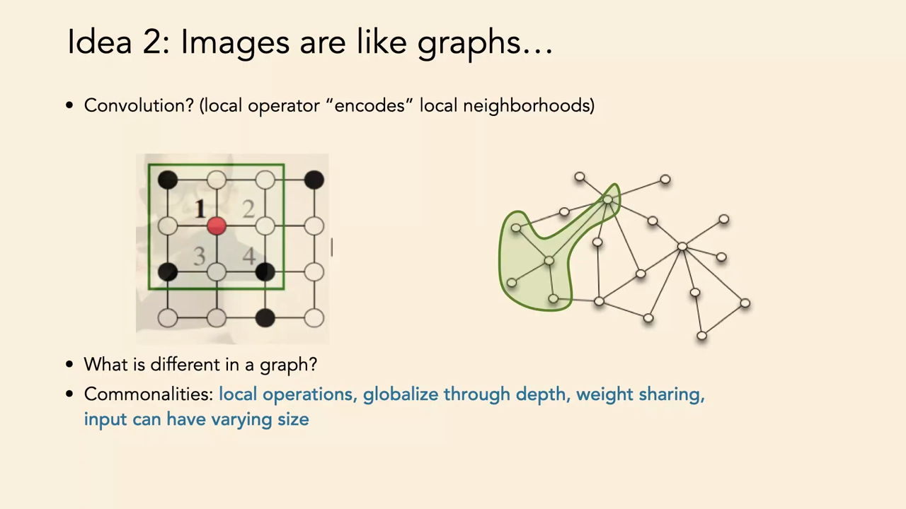
*▲ 강의 슬라이드 [29:22](https://youtu.be/0niIwb37nF0?t=1762): 이미지의 국소 이웃과 그래프의 국소 이웃*

**다른 점** (청중의 답)
- **이웃의 크기가 제각각**입니다. [CNN](00_%EB%94%A5%EB%9F%AC%EB%8B%9D_%EC%9A%A9%EC%96%B4%EC%82%AC%EC%A0%84.md#cnn-convolutional-neural-network-%ED%95%A9%EC%84%B1%EA%B3%B1-%EC%8B%A0%EA%B2%BD%EB%A7%9D)은 항상 3×3이지만 그래프의 노드는 이웃이 1개일 수도 100개일 수도 있습니다. 그래서 하드웨어에 "3×3"을 고정해 둘 수 없고, 이웃 수가 달라도 처리할 수 있는 구조가 필요합니다.
- **이웃 사이에 순서·방향이 없습니다.** [CNN](00_%EB%94%A5%EB%9F%AC%EB%8B%9D_%EC%9A%A9%EC%96%B4%EC%82%AC%EC%A0%84.md#cnn-convolutional-neural-network-%ED%95%A9%EC%84%B1%EA%B3%B1-%EC%8B%A0%EA%B2%BD%EB%A7%9D)에서는 왼쪽·오른쪽·위·아래가 서로 다른 [가중치](00_%EB%94%A5%EB%9F%AC%EB%8B%9D_%EC%9A%A9%EC%96%B4%EC%82%AC%EC%A0%84.md#weight-%EA%B0%80%EC%A4%91%EC%B9%98)를 받지만, [GNN](00_%EB%94%A5%EB%9F%AC%EB%8B%9D_%EC%9A%A9%EC%96%B4%EC%82%AC%EC%A0%84.md#gnn-graph-neural-network-%EA%B7%B8%EB%9E%98%ED%94%84-%EC%8B%A0%EA%B2%BD%EB%A7%9D)은 이웃을 모두 똑같이 대합니다.

**같은 점**
- **국소 연산**: 노드는 이웃에게서만 입력을 받습니다.
- **깊이로 전역화**: 국소 연산을 쌓을수록 [수용 영역](00_%EB%94%A5%EB%9F%AC%EB%8B%9D_%EC%9A%A9%EC%96%B4%EC%82%AC%EC%A0%84.md#receptive-field-%EC%88%98%EC%9A%A9-%EC%98%81%EC%97%AD)(receptive field)이 넓어집니다. [GNN](00_%EB%94%A5%EB%9F%AC%EB%8B%9D_%EC%9A%A9%EC%96%B4%EC%82%AC%EC%A0%84.md#gnn-graph-neural-network-%EA%B7%B8%EB%9E%98%ED%94%84-%EC%8B%A0%EA%B2%BD%EB%A7%9D)은 한 [층](00_%EB%94%A5%EB%9F%AC%EB%8B%9D_%EC%9A%A9%EC%96%B4%EC%82%AC%EC%A0%84.md#layer-%EC%B8%B5)마다 한 홉씩 더 멀리 봅니다.
- **[가중치 공유](00_%EB%94%A5%EB%9F%AC%EB%8B%9D_%EC%9A%A9%EC%96%B4%EC%82%AC%EC%A0%84.md#weight-sharing-%EA%B0%80%EC%A4%91%EC%B9%98-%EA%B3%B5%EC%9C%A0)**: 모든 위치(노드)에서 같은 [파라미터](00_%EB%94%A5%EB%9F%AC%EB%8B%9D_%EC%9A%A9%EC%96%B4%EC%82%AC%EC%A0%84.md#parameter-%ED%8C%8C%EB%9D%BC%EB%AF%B8%ED%84%B0)를 씁니다.
- **입력 크기가 자유**: [CNN](00_%EB%94%A5%EB%9F%AC%EB%8B%9D_%EC%9A%A9%EC%96%B4%EC%82%AC%EC%A0%84.md#cnn-convolutional-neural-network-%ED%95%A9%EC%84%B1%EA%B3%B1-%EC%8B%A0%EA%B2%BD%EB%A7%9D)이 어떤 크기의 이미지에도 [필터](00_%EB%94%A5%EB%9F%AC%EB%8B%9D_%EC%9A%A9%EC%96%B4%EC%82%AC%EC%A0%84.md#filter-%ED%95%84%ED%84%B0)를 밀 수 있듯, [GNN](00_%EB%94%A5%EB%9F%AC%EB%8B%9D_%EC%9A%A9%EC%96%B4%EC%82%AC%EC%A0%84.md#gnn-graph-neural-network-%EA%B7%B8%EB%9E%98%ED%94%84-%EC%8B%A0%EA%B2%BD%EB%A7%9D)도 어떤 크기의 그래프에도 같은 연산을 노드마다 돌립니다. 고정 길이 입력이 필요한 MLP와 다릅니다.

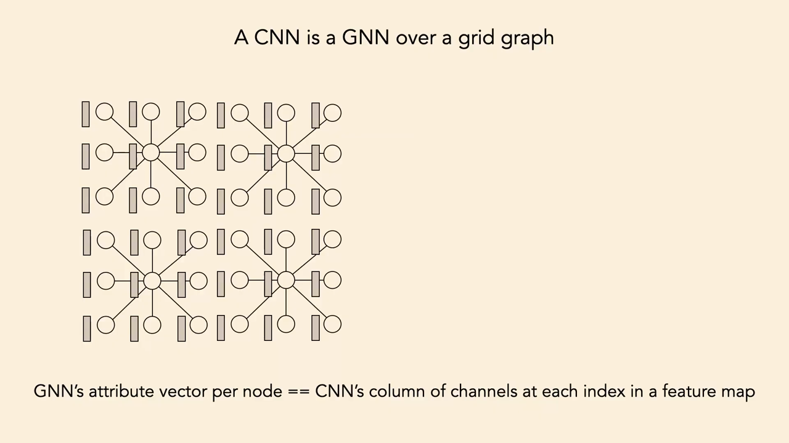
*▲ 강의 슬라이드 [31:15](https://youtu.be/0niIwb37nF0?t=1875): [CNN](00_%EB%94%A5%EB%9F%AC%EB%8B%9D_%EC%9A%A9%EC%96%B4%EC%82%AC%EC%A0%84.md#cnn-convolutional-neural-network-%ED%95%A9%EC%84%B1%EA%B3%B1-%EC%8B%A0%EA%B2%BD%EB%A7%9D)을 그래프로 그린 모습. 노드마다 있는 회색 막대([GNN](00_%EB%94%A5%EB%9F%AC%EB%8B%9D_%EC%9A%A9%EC%96%B4%EC%82%AC%EC%A0%84.md#gnn-graph-neural-network-%EA%B7%B8%EB%9E%98%ED%94%84-%EC%8B%A0%EA%B2%BD%EB%A7%9D)의 노드 속성 벡터) = [CNN](00_%EB%94%A5%EB%9F%AC%EB%8B%9D_%EC%9A%A9%EC%96%B4%EC%82%AC%EC%A0%84.md#cnn-convolutional-neural-network-%ED%95%A9%EC%84%B1%EA%B3%B1-%EC%8B%A0%EA%B2%BD%EB%A7%9D)의 [채널](00_%EB%94%A5%EB%9F%AC%EB%8B%9D_%EC%9A%A9%EC%96%B4%EC%82%AC%EC%A0%84.md#channel-%EC%B1%84%EB%84%90) 열*

강사의 복습 질문: 이 그림에서 커널 크기는 3×3, [스트라이드](00_%EB%94%A5%EB%9F%AC%EB%8B%9D_%EC%9A%A9%EC%96%B4%EC%82%AC%EC%A0%84.md#stride-%EC%8A%A4%ED%8A%B8%EB%9D%BC%EC%9D%B4%EB%93%9C)는 3입니다. 엣지 무늬(템플릿)를 3칸씩 옮겨 다음 [필터](00_%EB%94%A5%EB%9F%AC%EB%8B%9D_%EC%9A%A9%EC%96%B4%EC%82%AC%EC%A0%84.md#filter-%ED%95%84%ED%84%B0) 위치를 만들기 때문입니다.

---

## 6. 메시지 전달 GNN

### 6.1 집계와 갱신

▶ 영상 [32:32](https://youtu.be/0niIwb37nF0?t=1952)

📐 **수학 개념**: [인접 행렬 (Ax = 이웃 합)](%EC%88%98%ED%95%99%EA%B0%9C%EB%85%90/07_%EA%B5%AC%EC%A1%B0_%EC%95%84%ED%82%A4%ED%85%8D%EC%B2%98/MM18_%EC%9D%B8%EC%A0%91%ED%96%89%EB%A0%AC%EA%B3%BC_%EC%88%9C%EC%97%B4.md) · [멀티셋 집계 함수](%EC%88%98%ED%95%99%EA%B0%9C%EB%85%90/07_%EA%B5%AC%EC%A1%B0_%EC%95%84%ED%82%A4%ED%85%8D%EC%B2%98/MM19_%EB%A9%80%ED%8B%B0%EC%85%8B_%EC%A7%91%EA%B3%84_%ED%95%A8%EC%88%98.md)

[GNN](00_%EB%94%A5%EB%9F%AC%EB%8B%9D_%EC%9A%A9%EC%96%B4%EC%82%AC%EC%A0%84.md#gnn-graph-neural-network-%EA%B7%B8%EB%9E%98%ED%94%84-%EC%8B%A0%EA%B2%BD%EB%A7%9D) 한 [층](00_%EB%94%A5%EB%9F%AC%EB%8B%9D_%EC%9A%A9%EC%96%B4%EC%82%AC%EC%A0%84.md#layer-%EC%B8%B5)(라운드 $k$)은 두 단계입니다. 노드마다 벡터 $h_v$가 있고, [층](00_%EB%94%A5%EB%9F%AC%EB%8B%9D_%EC%9A%A9%EC%96%B4%EC%82%AC%EC%A0%84.md#layer-%EC%B8%B5)을 지날 때마다 더 좋은 [임베딩](00_%EB%94%A5%EB%9F%AC%EB%8B%9D_%EC%9A%A9%EC%96%B4%EC%82%AC%EC%A0%84.md#embedding-%EC%9E%84%EB%B2%A0%EB%94%A9)으로 바뀝니다. [CNN](00_%EB%94%A5%EB%9F%AC%EB%8B%9D_%EC%9A%A9%EC%96%B4%EC%82%AC%EC%A0%84.md#cnn-convolutional-neural-network-%ED%95%A9%EC%84%B1%EA%B3%B1-%EC%8B%A0%EA%B2%BD%EB%A7%9D)에서 [층](00_%EB%94%A5%EB%9F%AC%EB%8B%9D_%EC%9A%A9%EC%96%B4%EC%82%AC%EC%A0%84.md#layer-%EC%B8%B5)마다 각 위치의 [채널](00_%EB%94%A5%EB%9F%AC%EB%8B%9D_%EC%9A%A9%EC%96%B4%EC%82%AC%EC%A0%84.md#channel-%EC%B1%84%EB%84%90) 열이 바뀌는 것과 같습니다.

$$
m_{\mathcal{N}(v)}^{(k)} = \text{AGGREGATE}^{(k)}\big(\{h_u^{(k-1)} : u \in \mathcal{N}(v)\}\big), \qquad
h_v^{(k)} = \text{UPDATE}^{(k)}\big(h_v^{(k-1)},\ m_{\mathcal{N}(v)}^{(k)}\big)
$$

기호 풀이

| 기호 | 읽는 법 | 뜻 | 예제 값 |
| --- | --- | --- | --- |
| $v$ | 브이 | 지금 갱신하는 노드 | 노드 2 |
| $u$ | 유 | v의 이웃 노드 하나 | 1, 4 |
| $\mathcal{N}(v)$ | 엔 오브 브이 | v의 이웃 집합 | $\mathcal{N}(2) = \{1, 4\}$ |
| $k$ | 케이 | 라운드([층](00_%EB%94%A5%EB%9F%AC%EB%8B%9D_%EC%9A%A9%EC%96%B4%EC%82%AC%EC%A0%84.md#layer-%EC%B8%B5)) 번호 | 1 |
| $h_u^{(k-1)}$ | 에이치 유 케이 마이너스 원 | 이전 라운드에서 이웃 u의 벡터 | $h_1^{(0)} = 1$, $h_4^{(0)} = 4$ |
| $\{h_u^{(k-1)} : u \in \mathcal{N}(v)\}$ | - | 이웃 벡터들의 [멀티셋](00_%EB%94%A5%EB%9F%AC%EB%8B%9D_%EC%9A%A9%EC%96%B4%EC%82%AC%EC%A0%84.md#multiset-%EB%A9%80%ED%8B%B0%EC%85%8B) | {1, 4} |
| $\text{AGGREGATE}^{(k)}$ | 어그리게이트 | [집계 함수](00_%EB%94%A5%EB%9F%AC%EB%8B%9D_%EC%9A%A9%EC%96%B4%EC%82%AC%EC%A0%84.md#aggregation-function-%EC%A7%91%EA%B3%84-%ED%95%A8%EC%88%98), 이웃 순서와 무관 | 합 |
| $m_{\mathcal{N}(v)}^{(k)}$ | 엠 엔 오브 브이 | 집계로 얻은 메시지 (벡터 하나) | 5 |
| $\text{UPDATE}^{(k)}$ | 업데이트 | [갱신 함수](00_%EB%94%A5%EB%9F%AC%EB%8B%9D_%EC%9A%A9%EC%96%B4%EC%82%AC%EC%A0%84.md#update-function-%EA%B0%B1%EC%8B%A0-%ED%95%A8%EC%88%98), 내 값과 메시지를 합침 | $\text{ReLU}(h + 0.5m - 4)$ |
| $h_v^{(k-1)}$ | 에이치 브이 케이 마이너스 원 | 이전 라운드에서 v 자신의 벡터 | 2 |
| $h_v^{(k)}$ | 에이치 브이 케이 | 이번 라운드에서 v의 새 벡터 | 0.5 |

예제와 풀이

**문제**: 강의 그래프에서 노드 2가 이웃 값을 합으로 모으고(집계) 자기 값과 합쳐(갱신) 얻는 새 값 $h_2^{(1)}$을 구하라.

**주어진 값**:
- $v = 2$ (값을 새로 만들 노드)
- $\mathcal{N}(2) = \{1, 4\}$ (노드 2의 이웃)
- $h_1^{(0)} = 1$, $h_4^{(0)} = 4$ (이웃의 처음 값)
- $h_2^{(0)} = 2$ (노드 2 자신의 처음 값)
- $\text{AGGREGATE}$ = 합 (이웃 값을 모두 더함)
- $\text{UPDATE}(h, m) = \text{ReLU}(h + 0.5m - 4)$ (갱신 규칙, 설명용으로 고른 값)
- $k = 1$ (첫 라운드)

**풀이**
1. 식을 그대로 쓴다: $m_{\mathcal{N}(v)}^{(k)} = \text{AGGREGATE}^{(k)}\big(\{h_u^{(k-1)} : u \in \mathcal{N}(v)\}\big)$, $h_v^{(k)} = \text{UPDATE}^{(k)}\big(h_v^{(k-1)},\ m_{\mathcal{N}(v)}^{(k)}\big)$
2. 값을 대입한다: $m_{\mathcal{N}(2)}^{(1)} = \text{합}\big(\{1, 4\}\big)$, $h_2^{(1)} = \text{ReLU}\big(2 + 0.5 \times m_{\mathcal{N}(2)}^{(1)} - 4\big)$
3. 이웃 값을 더한다: $1 + 4 = 5$ 이므로 $m_{\mathcal{N}(2)}^{(1)} = 5$
4. 메시지를 갱신 식에 넣는다: $h_2^{(1)} = \text{ReLU}(2 + 0.5 \times 5 - 4)$
5. [ReLU](00_%EB%94%A5%EB%9F%AC%EB%8B%9D_%EC%9A%A9%EC%96%B4%EC%82%AC%EC%A0%84.md#relu-%EB%A0%90%EB%A3%A8)의 뜻: $\text{ReLU}(z) = \max(0, z)$, 즉 음수면 0으로 바꾸고 0 이상이면 그대로 둔다
6. 곱셈을 먼저 한다: $0.5 \times 5 = 2.5$ 이므로 $\text{ReLU}(2 + 2.5 - 4)$
7. 덧셈을 한다: $2 + 2.5 = 4.5$ 이므로 $\text{ReLU}(4.5 - 4)$
8. 뺄셈을 한다: $4.5 - 4 = 0.5$ 이므로 $\text{ReLU}(0.5)$
9. [ReLU](00_%EB%94%A5%EB%9F%AC%EB%8B%9D_%EC%9A%A9%EC%96%B4%EC%82%AC%EC%A0%84.md#relu-%EB%A0%90%EB%A3%A8)를 적용한다: $0.5$는 0 이상이라 그대로 $0.5$

**답**: $h_2^{(1)} = 0.5$

내 이해

1. **[집계](00_%EB%94%A5%EB%9F%AC%EB%8B%9D_%EC%9A%A9%EC%96%B4%EC%82%AC%EC%A0%84.md#aggregation-function-%EC%A7%91%EA%B3%84-%ED%95%A8%EC%88%98)(Aggregate)**: 이웃 $\mathcal{N}(v)$의 벡터들을 모아 메시지 $m$ (D차원 벡터 하나)을 만듭니다. 이웃의 순서를 바꿔도 같은 메시지가 나와야 합니다(순열 불변).
2. **[갱신](00_%EB%94%A5%EB%9F%AC%EB%8B%9D_%EC%9A%A9%EC%96%B4%EC%82%AC%EC%A0%84.md#update-function-%EA%B0%B1%EC%8B%A0-%ED%95%A8%EC%88%98)(Update)**: 이웃이 알려 준 정보(메시지)와 내가 아는 것($h_v$)을 합쳐 내 표현을 새로 만듭니다.

이를 $k$번 되풀이하면 깊이 $k$인 신경망이 됩니다. 한 번 할 때마다 [수용 영역](00_%EB%94%A5%EB%9F%AC%EB%8B%9D_%EC%9A%A9%EC%96%B4%EC%82%AC%EC%A0%84.md#receptive-field-%EC%88%98%EC%9A%A9-%EC%98%81%EC%97%AD)이 한 홉 넓어져, 두 번이면 "이웃의 이웃"(그림의 초록 노드 → 파란 노드 → 빨간 노드)의 정보까지 들어옵니다.

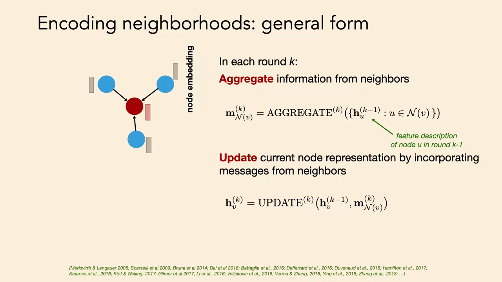
*▲ 강의 슬라이드 [35:00](https://youtu.be/0niIwb37nF0?t=2100): 라운드 k에서 이웃 정보를 집계하고 노드 표현을 갱신*

아래는 강의 그래프([인접 행렬](00_%EB%94%A5%EB%9F%AC%EB%8B%9D_%EC%9A%A9%EC%96%B4%EC%82%AC%EC%A0%84.md#adjacency-matrix-%EC%9D%B8%EC%A0%91-%ED%96%89%EB%A0%AC)은 4절)로 한 [층](00_%EB%94%A5%EB%9F%AC%EB%8B%9D_%EC%9A%A9%EC%96%B4%EC%82%AC%EC%A0%84.md#layer-%EC%B8%B5)을 직접 계산한 예입니다. 노드 값은 스칼라 하나, 집계는 합, 갱신은 $\text{ReLU}(1 \cdot h + 0.5 \cdot m - 4)$로 정했습니다([가중치](00_%EB%94%A5%EB%9F%AC%EB%8B%9D_%EC%9A%A9%EC%96%B4%EC%82%AC%EC%A0%84.md#weight-%EA%B0%80%EC%A4%91%EC%B9%98)는 설명용으로 고른 값).

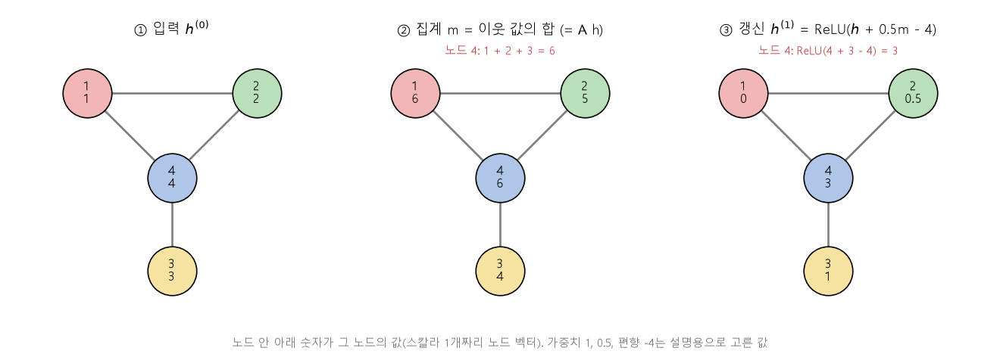
*▲ 직접 그린 그림: [메시지 전달](00_%EB%94%A5%EB%9F%AC%EB%8B%9D_%EC%9A%A9%EC%96%B4%EC%82%AC%EC%A0%84.md#message-passing-%EB%A9%94%EC%8B%9C%EC%A7%80-%EC%A0%84%EB%8B%AC) 한 번. 노드 4는 이웃 1, 2, 3의 값 1 + 2 + 3 = 6을 받고 [ReLU](00_%EB%94%A5%EB%9F%AC%EB%8B%9D_%EC%9A%A9%EC%96%B4%EC%82%AC%EC%A0%84.md#relu-%EB%A0%90%EB%A3%A8)(4 + 0.5×6 - 4) = 3이 됨. 전체 결과 $h^{(1)}$ = (0, 0.5, 1, 3)*

### 6.2 집계 함수의 예

▶ 영상 [35:52](https://youtu.be/0niIwb37nF0?t=2152)

📐 **수학 개념**: [멀티셋 집계 함수](%EC%88%98%ED%95%99%EA%B0%9C%EB%85%90/07_%EA%B5%AC%EC%A1%B0_%EC%95%84%ED%82%A4%ED%85%8D%EC%B2%98/MM19_%EB%A9%80%ED%8B%B0%EC%85%8B_%EC%A7%91%EA%B3%84_%ED%95%A8%EC%88%98.md) · [시그마와 평균](%EC%88%98%ED%95%99%EA%B0%9C%EB%85%90/01_%EC%88%98%EC%99%80_%ED%95%A8%EC%88%98/M02_%EC%8B%9C%EA%B7%B8%EB%A7%88%EC%99%80_%ED%8F%89%EA%B7%A0.md)

[집계 함수](00_%EB%94%A5%EB%9F%AC%EB%8B%9D_%EC%9A%A9%EC%96%B4%EC%82%AC%EC%A0%84.md#aggregation-function-%EC%A7%91%EA%B3%84-%ED%95%A8%EC%88%98)는 **[멀티셋](00_%EB%94%A5%EB%9F%AC%EB%8B%9D_%EC%9A%A9%EC%96%B4%EC%82%AC%EC%A0%84.md#multiset-%EB%A9%80%ED%8B%B0%EC%85%8B) 함수**여야 합니다. 순서가 없는 원소 모음을 받아 벡터 하나를 내는 함수입니다. 이웃의 벡터가 우연히 같을 수 있으므로(중복 허용) 엄밀히는 집합이 아니라 [멀티셋](00_%EB%94%A5%EB%9F%AC%EB%8B%9D_%EC%9A%A9%EC%96%B4%EC%82%AC%EC%A0%84.md#multiset-%EB%A9%80%ED%8B%B0%EC%85%8B)입니다.

| 집계 | 식 | 참고 |
|---|---|---|
| 합 | $m = \sum_{u \in \mathcal{N}(v)} h_u$ | 길이가 몇이든 벡터 하나를 냄 |
| 평균 | $m = \frac{1}{\lvert\mathcal{N}(v)\rvert}\sum h_u$ | 합을 이웃 수로 나눔 |
| [정규화](00_%EB%94%A5%EB%9F%AC%EB%8B%9D_%EC%9A%A9%EC%96%B4%EC%82%AC%EC%A0%84.md#normalization-%EC%A0%95%EA%B7%9C%ED%99%94) 합 | $m = \sum \frac{h_u}{\sqrt{\lvert\mathcal{N}(v)\rvert\,\lvert\mathcal{N}(u)\rvert}}$ | 나와 상대의 이웃 수로 나눔 (Kipf & Welling 2016의 GCN) |
| 최댓값·최솟값 (좌표별) | $m = \max\{h_u\}$ | [CNN](00_%EB%94%A5%EB%9F%AC%EB%8B%9D_%EC%9A%A9%EC%96%B4%EC%82%AC%EC%A0%84.md#cnn-convolutional-neural-network-%ED%95%A9%EC%84%B1%EA%B3%B1-%EC%8B%A0%EA%B2%BD%EB%A7%9D)의 [맥스 풀링](00_%EB%94%A5%EB%9F%AC%EB%8B%9D_%EC%9A%A9%EC%96%B4%EC%82%AC%EC%A0%84.md#max-pooling-%EB%A7%A5%EC%8A%A4-%ED%92%80%EB%A7%81)과 비슷 |

핵심은 집계가 **아무 함수나 될 수 없다는 제약**입니다. 순서와 무관하다는 조건이 [GNN](00_%EB%94%A5%EB%9F%AC%EB%8B%9D_%EC%9A%A9%EC%96%B4%EC%82%AC%EC%A0%84.md#gnn-graph-neural-network-%EA%B7%B8%EB%9E%98%ED%94%84-%EC%8B%A0%EA%B2%BD%EB%A7%9D)의 표현 범위를 좁히고, 그것이 바로 원하는 [귀납 편향](00_%EB%94%A5%EB%9F%AC%EB%8B%9D_%EC%9A%A9%EC%96%B4%EC%82%AC%EC%A0%84.md#inductive-bias-%EA%B7%80%EB%82%A9-%ED%8E%B8%ED%96%A5)입니다.

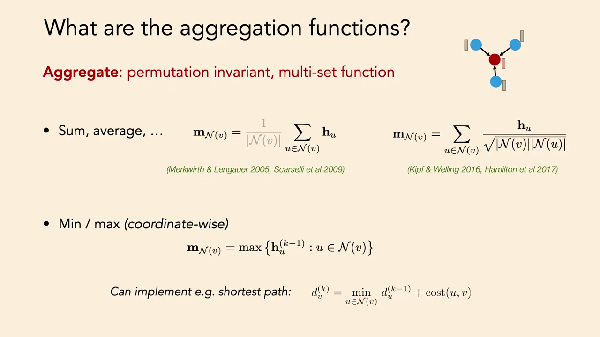
*▲ 강의 슬라이드 [40:00](https://youtu.be/0niIwb37nF0?t=2400): 합·평균·[정규화](00_%EB%94%A5%EB%9F%AC%EB%8B%9D_%EC%9A%A9%EC%96%B4%EC%82%AC%EC%A0%84.md#normalization-%EC%A0%95%EA%B7%9C%ED%99%94) 합, 최댓값/최솟값 집계와 최단 경로 식*

### 6.3 최소 집계로 최단 경로 풀기

▶ 영상 [38:08](https://youtu.be/0niIwb37nF0?t=2288)

📐 **수학 개념**: [최소 집계와 최단 경로](%EC%88%98%ED%95%99%EA%B0%9C%EB%85%90/07_%EA%B5%AC%EC%A1%B0_%EC%95%84%ED%82%A4%ED%85%8D%EC%B2%98/MM20_%EC%B5%9C%EC%86%8C_%EC%A7%91%EA%B3%84%EC%99%80_%EC%B5%9C%EB%8B%A8_%EA%B2%BD%EB%A1%9C.md) · [argmin](%EC%88%98%ED%95%99%EA%B0%9C%EB%85%90/02_%EB%AF%B8%EB%B6%84/MM01_argmin%EA%B3%BC_argmax.md)

최솟값 집계로 고전 그래프 알고리즘인 **[벨만-포드 알고리즘](00_%EB%94%A5%EB%9F%AC%EB%8B%9D_%EC%9A%A9%EC%96%B4%EC%82%AC%EC%A0%84.md#bellman-ford-algorithm-%EB%B2%A8%EB%A7%8C-%ED%8F%AC%EB%93%9C-%EC%95%8C%EA%B3%A0%EB%A6%AC%EC%A6%98)** 을 그대로 나타낼 수 있습니다.

1. 노드마다 속성은 스칼라 하나 $d_v$ = 목표 노드까지 최단 거리의 추정값. 목표는 0, 나머지는 ∞로 시작합니다.
2. 이웃마다 "이웃의 추정값 + 이웃까지 비용"을 보고, 그 최솟값으로 내 값을 바꿉니다: $d_v \leftarrow \min_u (d_u + \text{cost}(u, v))$.
3. 이를 되풀이하면 거리가 목표에서 바깥으로 한 홉씩 퍼져 나가 최단 거리가 됩니다.

[GNN](00_%EB%94%A5%EB%9F%AC%EB%8B%9D_%EC%9A%A9%EC%96%B4%EC%82%AC%EC%A0%84.md#gnn-graph-neural-network-%EA%B7%B8%EB%9E%98%ED%94%84-%EC%8B%A0%EA%B2%BD%EB%A7%9D)으로 보면 집계는 합 대신 **min**이고, "이웃 값 + 비용"은 1을 더하는 작은 MLP로 나타낼 수 있습니다(모든 엣지 길이가 1일 때). 갱신은 이 경우 사실상 하는 일이 없습니다. 과제에서 이 구성을 직접 다룹니다.

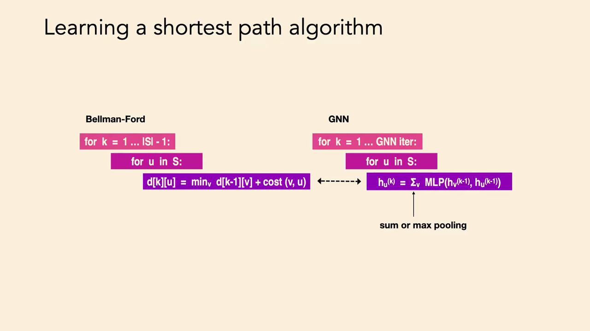
*▲ 강의 슬라이드 [42:40](https://youtu.be/0niIwb37nF0?t=2560): 벨만-포드(왼쪽)와 같은 모양의 [GNN](00_%EB%94%A5%EB%9F%AC%EB%8B%9D_%EC%9A%A9%EC%96%B4%EC%82%AC%EC%A0%84.md#gnn-graph-neural-network-%EA%B7%B8%EB%9E%98%ED%94%84-%EC%8B%A0%EA%B2%BD%EB%A7%9D)(오른쪽)*

질의응답 정리 [39:54](https://youtu.be/0niIwb37nF0?t=2394)

- **순열 불변이 필요한 문제인지 어떻게 아나?** 분야에 따라 다릅니다. 입력 순서를 바꿔도 최선의 예측이 바뀌지 않는 문제라면 이 제약을 걸어야 합니다. 최단 경로가 그런 예입니다. 반대로 이미지의 위쪽이 하늘일 가능성이 높다는 것을 알면 위치 정보가 필요하고, 그때는 [위치 인코딩](00_%EB%94%A5%EB%9F%AC%EB%8B%9D_%EC%9A%A9%EC%96%B4%EC%82%AC%EC%A0%84.md#positional-encoding-%EC%9C%84%EC%B9%98-%EC%9D%B8%EC%BD%94%EB%94%A9)을 넣습니다. [이동 불변성](00_%EB%94%A5%EB%9F%AC%EB%8B%9D_%EC%9A%A9%EC%96%B4%EC%82%AC%EC%A0%84.md#translation-invariance-%EC%9D%B4%EB%8F%99-%EB%B6%88%EB%B3%80%EC%84%B1)은 순열 불변성의 한 종류이고, 순열 불변성이 더 일반적입니다.
- **집계 결과의 차원은?** D차원 열벡터 하나입니다.

### 6.4 보편적인 집계 함수와 갱신 함수

▶ 영상 [42:47](https://youtu.be/0niIwb37nF0?t=2567)

📐 **수학 개념**: [멀티셋 집계 함수 (단사 집계)](%EC%88%98%ED%95%99%EA%B0%9C%EB%85%90/07_%EA%B5%AC%EC%A1%B0_%EC%95%84%ED%82%A4%ED%85%8D%EC%B2%98/MM19_%EB%A9%80%ED%8B%B0%EC%85%8B_%EC%A7%91%EA%B3%84_%ED%95%A8%EC%88%98.md) · [보편 근사](%EC%88%98%ED%95%99%EA%B0%9C%EB%85%90/06_%EA%B7%BC%EC%82%AC_%EC%9D%B4%EB%A1%A0/MM07_%EB%A6%AC%EB%A7%8C_%ED%95%A9%EA%B3%BC_%EB%B3%B4%ED%8E%B8_%EA%B7%BC%EC%82%AC.md) · [합성함수](%EC%88%98%ED%95%99%EA%B0%9C%EB%85%90/05_%EC%8B%A0%EA%B2%BD%EB%A7%9D%EC%9D%98_%EA%B3%84%EC%82%B0/MM06_%ED%95%A9%EC%84%B1%ED%95%A8%EC%88%98%EC%99%80_%EB%B9%84%EC%84%A0%ED%98%95%EC%84%B1.md)

합도 최솟값도 쓸 만합니다. 그렇다면 **순열 불변인 [멀티셋](00_%EB%94%A5%EB%9F%AC%EB%8B%9D_%EC%9A%A9%EC%96%B4%EC%82%AC%EC%A0%84.md#multiset-%EB%A9%80%ED%8B%B0%EC%85%8B) 함수를 모두** 나타낼 수 있는 [집계 함수](00_%EB%94%A5%EB%9F%AC%EB%8B%9D_%EC%9A%A9%EC%96%B4%EC%82%AC%EC%A0%84.md#aggregation-function-%EC%A7%91%EA%B3%84-%ED%95%A8%EC%88%98) 가족이 있을까요? 있습니다.

$$
m_{\mathcal{N}(v)} = \text{MLP}_2\Big(\sum_{u \in \mathcal{N}(v)} \text{MLP}_1(h_u, h_v)\Big)
$$

기호 풀이

| 기호 | 읽는 법 | 뜻 | 예제 값 |
| --- | --- | --- | --- |
| $m_{\mathcal{N}(v)}$ | 엠 엔 오브 브이 | 노드 v가 받는 메시지 | 4 |
| $\text{MLP}_1$ | 엠엘피 원 | 이웃 하나와 나를 함께 받아 바꾸는 MLP | $\text{ReLU}(h_u + h_v - 4)$ |
| $\sum_{u \in \mathcal{N}(v)}$ | 시그마 유 인 엔 오브 브이 | 모든 이웃에 대해 더함. 순서를 지운다 | 1 + 2 + 3 |
| $\text{MLP}_2$ | 엠엘피 투 | 합을 받아 메시지로 바꾸는 MLP | $\text{ReLU}(s - 2)$ |
| $h_u$ | 에이치 유 | 이웃 u의 벡터 | 1, 2, 3 |
| $h_v$ | 에이치 브이 | 나(v)의 벡터 | 4 |
| $\mathcal{N}(v)$ | 엔 오브 브이 | v의 이웃 집합 | $\{1, 2, 3\}$ |

예제와 풀이

**문제**: 노드 4가 이웃 1, 2, 3에게서 받는 메시지 $m$을, 이웃마다 $\text{MLP}_1$을 거쳐 더한 뒤 $\text{MLP}_2$를 거쳐 구하라.

**주어진 값**:
- $v = 4$, $h_4 = 4$ (메시지를 받는 노드와 그 값)
- $\mathcal{N}(4) = \{1, 2, 3\}$ (노드 4의 이웃)
- $h_1 = 1$, $h_2 = 2$, $h_3 = 3$ (이웃의 값)
- $\text{MLP}_1(h_u, h_v) = \text{ReLU}(h_u + h_v - 4)$ (이웃 하나와 나를 받아 숫자 하나로 바꾸는 함수, 설명용)
- $\text{MLP}_2(s) = \text{ReLU}(s - 2)$ (합을 메시지로 바꾸는 함수, 설명용)

**풀이**
1. 식을 그대로 쓴다: $m_{\mathcal{N}(v)} = \text{MLP}_2\Big(\sum_{u \in \mathcal{N}(v)} \text{MLP}_1(h_u, h_v)\Big)$
2. 값을 대입한다: $m_{\mathcal{N}(4)} = \text{MLP}_2\Big(\sum_{u \in \{1, 2, 3\}} \text{MLP}_1(h_u, 4)\Big)$
3. 시그마를 이웃마다 풀어 쓴다: $m_{\mathcal{N}(4)} = \text{MLP}_2\big(\text{MLP}_1(1, 4) + \text{MLP}_1(2, 4) + \text{MLP}_1(3, 4)\big)$
4. [ReLU](00_%EB%94%A5%EB%9F%AC%EB%8B%9D_%EC%9A%A9%EC%96%B4%EC%82%AC%EC%A0%84.md#relu-%EB%A0%90%EB%A3%A8)의 뜻: $\text{ReLU}(z) = \max(0, z)$, 즉 음수면 0으로 바꾸고 0 이상이면 그대로 둔다
5. 이웃 1의 괄호 안을 더한다: $1 + 4 = 5$ 이므로 $\text{MLP}_1(1, 4) = \text{ReLU}(5 - 4)$
6. 뺄셈을 한다: $5 - 4 = 1$ 이므로 $\text{ReLU}(1)$
7. [ReLU](00_%EB%94%A5%EB%9F%AC%EB%8B%9D_%EC%9A%A9%EC%96%B4%EC%82%AC%EC%A0%84.md#relu-%EB%A0%90%EB%A3%A8)를 적용한다: 1은 0 이상이라 $\text{MLP}_1(1, 4) = 1$
8. 이웃 2의 괄호 안을 더한다: $2 + 4 = 6$ 이므로 $\text{MLP}_1(2, 4) = \text{ReLU}(6 - 4)$
9. 뺄셈을 한다: $6 - 4 = 2$ 이므로 $\text{ReLU}(2)$
10. [ReLU](00_%EB%94%A5%EB%9F%AC%EB%8B%9D_%EC%9A%A9%EC%96%B4%EC%82%AC%EC%A0%84.md#relu-%EB%A0%90%EB%A3%A8)를 적용한다: 2는 0 이상이라 $\text{MLP}_1(2, 4) = 2$
11. 이웃 3의 괄호 안을 더한다: $3 + 4 = 7$ 이므로 $\text{MLP}_1(3, 4) = \text{ReLU}(7 - 4)$
12. 뺄셈을 한다: $7 - 4 = 3$ 이므로 $\text{ReLU}(3)$
13. [ReLU](00_%EB%94%A5%EB%9F%AC%EB%8B%9D_%EC%9A%A9%EC%96%B4%EC%82%AC%EC%A0%84.md#relu-%EB%A0%90%EB%A3%A8)를 적용한다: 3은 0 이상이라 $\text{MLP}_1(3, 4) = 3$
14. 세 값을 넣는다: $m_{\mathcal{N}(4)} = \text{MLP}_2(1 + 2 + 3)$
15. 앞의 둘을 더한다: $1 + 2 = 3$ 이므로 $\text{MLP}_2(3 + 3)$
16. 남은 것을 더한다: $3 + 3 = 6$ 이므로 $\text{MLP}_2(6)$
17. $\text{MLP}_2$ 규칙에 넣는다: $\text{MLP}_2(6) = \text{ReLU}(6 - 2)$
18. 뺄셈을 한다: $6 - 2 = 4$ 이므로 $\text{ReLU}(4)$
19. [ReLU](00_%EB%94%A5%EB%9F%AC%EB%8B%9D_%EC%9A%A9%EC%96%B4%EC%82%AC%EC%A0%84.md#relu-%EB%A0%90%EB%A3%A8)를 적용한다: 4는 0 이상이라 그대로 4

**답**: $m_{\mathcal{N}(4)} = 4$

내 이해

내 벡터와 이웃 벡터를 MLP₁에 넣고, 이웃에 대해 더한 뒤, MLP₂를 거칩니다. 이 가족은 **[멀티셋](00_%EB%94%A5%EB%9F%AC%EB%8B%9D_%EC%9A%A9%EC%96%B4%EC%82%AC%EC%A0%84.md#multiset-%EB%A9%80%ED%8B%B0%EC%85%8B) 함수에 대한 보편 근사기**입니다. "MLP만으로도 보편 근사기 아니었나?"라는 의문이 들 수 있습니다. MLP는 너비를 무한히 늘리면 **모든** 함수를 근사합니다. 여기서는 [멀티셋](00_%EB%94%A5%EB%9F%AC%EB%8B%9D_%EC%9A%A9%EC%96%B4%EC%82%AC%EC%A0%84.md#multiset-%EB%A9%80%ED%8B%B0%EC%85%8B) 함수가 **아닌** 함수는 맞출 수 없게 하고 싶습니다. 가운데의 합이 이웃의 순서를 지워 주므로, 이 가족은 [멀티셋](00_%EB%94%A5%EB%9F%AC%EB%8B%9D_%EC%9A%A9%EC%96%B4%EC%82%AC%EC%A0%84.md#multiset-%EB%A9%80%ED%8B%B0%EC%85%8B) 함수 안에서는 보편적이고 그 밖의 함수는 나타내지 못하는 **제약된 가족**입니다.

[갱신 함수](00_%EB%94%A5%EB%9F%AC%EB%8B%9D_%EC%9A%A9%EC%96%B4%EC%82%AC%EC%A0%84.md#update-function-%EA%B0%B1%EC%8B%A0-%ED%95%A8%EC%88%98)는 단순한 1층 MLP를 씁니다.

$$
h_v^{(k)} = \sigma\big(W_{\text{self}}\, h_v^{(k-1)} + W_{\text{neigh}}\, m_{\mathcal{N}(v)}^{(k)} + b\big)
$$

기호 풀이

| 기호 | 읽는 법 | 뜻 | 예제 값 |
| --- | --- | --- | --- |
| $h_v^{(k)}$ | 에이치 브이 케이 | 갱신한 뒤 v의 벡터 | 1 |
| $h_v^{(k-1)}$ | 에이치 브이 케이 마이너스 원 | 갱신 전 v의 벡터 | 3 |
| $m_{\mathcal{N}(v)}^{(k)}$ | 엠 엔 오브 브이 | 집계로 받은 메시지 | 4 |
| $W_{\text{self}}$ | 더블유 셀프 | 내 벡터에 곱하는 [가중치](00_%EB%94%A5%EB%9F%AC%EB%8B%9D_%EC%9A%A9%EC%96%B4%EC%82%AC%EC%A0%84.md#weight-%EA%B0%80%EC%A4%91%EC%B9%98) | 1 |
| $W_{\text{neigh}}$ | 더블유 네이 | 메시지에 곱하는 [가중치](00_%EB%94%A5%EB%9F%AC%EB%8B%9D_%EC%9A%A9%EC%96%B4%EC%82%AC%EC%A0%84.md#weight-%EA%B0%80%EC%A4%91%EC%B9%98) | 0.5 |
| $b$ | 비 | [편향](00_%EB%94%A5%EB%9F%AC%EB%8B%9D_%EC%9A%A9%EC%96%B4%EC%82%AC%EC%A0%84.md#bias-%ED%8E%B8%ED%96%A5) | -4 |
| $\sigma$ | 시그마 | 원소별 비선형 함수 | [ReLU](00_%EB%94%A5%EB%9F%AC%EB%8B%9D_%EC%9A%A9%EC%96%B4%EC%82%AC%EC%A0%84.md#relu-%EB%A0%90%EB%A3%A8) |

예제와 풀이

**문제**: 노드 3의 지금 값과 이웃에게 받은 메시지를 [가중치](00_%EB%94%A5%EB%9F%AC%EB%8B%9D_%EC%9A%A9%EC%96%B4%EC%82%AC%EC%A0%84.md#weight-%EA%B0%80%EC%A4%91%EC%B9%98)로 섞고 [편향](00_%EB%94%A5%EB%9F%AC%EB%8B%9D_%EC%9A%A9%EC%96%B4%EC%82%AC%EC%A0%84.md#bias-%ED%8E%B8%ED%96%A5)을 더한 뒤 [ReLU](00_%EB%94%A5%EB%9F%AC%EB%8B%9D_%EC%9A%A9%EC%96%B4%EC%82%AC%EC%A0%84.md#relu-%EB%A0%90%EB%A3%A8)에 넣어 새 값 $h_3^{(1)}$을 구하라.

**주어진 값**:
- $h_3^{(0)} = 3$ (노드 3의 지금 값)
- $m_{\mathcal{N}(3)}^{(1)} = 4$ (유일한 이웃 노드 4의 값을 합한 메시지)
- $W_{\text{self}} = 1$ (내 값에 곱하는 [가중치](00_%EB%94%A5%EB%9F%AC%EB%8B%9D_%EC%9A%A9%EC%96%B4%EC%82%AC%EC%A0%84.md#weight-%EA%B0%80%EC%A4%91%EC%B9%98))
- $W_{\text{neigh}} = 0.5$ (메시지에 곱하는 [가중치](00_%EB%94%A5%EB%9F%AC%EB%8B%9D_%EC%9A%A9%EC%96%B4%EC%82%AC%EC%A0%84.md#weight-%EA%B0%80%EC%A4%91%EC%B9%98))
- $b = -4$ ([편향](00_%EB%94%A5%EB%9F%AC%EB%8B%9D_%EC%9A%A9%EC%96%B4%EC%82%AC%EC%A0%84.md#bias-%ED%8E%B8%ED%96%A5))
- $\sigma = \text{ReLU}$ (비선형 함수)

**풀이**
1. 식을 그대로 쓴다: $h_v^{(k)} = \sigma\big(W_{\text{self}}\, h_v^{(k-1)} + W_{\text{neigh}}\, m_{\mathcal{N}(v)}^{(k)} + b\big)$
2. 값을 대입한다: $h_3^{(1)} = \text{ReLU}\big(1 \times 3 + 0.5 \times 4 + (-4)\big)$
3. [ReLU](00_%EB%94%A5%EB%9F%AC%EB%8B%9D_%EC%9A%A9%EC%96%B4%EC%82%AC%EC%A0%84.md#relu-%EB%A0%90%EB%A3%A8)의 뜻: $\text{ReLU}(z) = \max(0, z)$, 즉 음수면 0으로 바꾸고 0 이상이면 그대로 둔다
4. 첫 곱셈을 한다: $1 \times 3 = 3$ 이므로 $\text{ReLU}\big(3 + 0.5 \times 4 + (-4)\big)$
5. 둘째 곱셈을 한다: $0.5 \times 4 = 2$ 이므로 $\text{ReLU}\big(3 + 2 + (-4)\big)$
6. 앞의 둘을 더한다: $3 + 2 = 5$ 이므로 $\text{ReLU}\big(5 + (-4)\big)$
7. [편향](00_%EB%94%A5%EB%9F%AC%EB%8B%9D_%EC%9A%A9%EC%96%B4%EC%82%AC%EC%A0%84.md#bias-%ED%8E%B8%ED%96%A5)을 더한다(4를 뺀다): $5 - 4 = 1$ 이므로 $\text{ReLU}(1)$
8. [ReLU](00_%EB%94%A5%EB%9F%AC%EB%8B%9D_%EC%9A%A9%EC%96%B4%EC%82%AC%EC%A0%84.md#relu-%EB%A0%90%EB%A3%A8)를 적용한다: 1은 0 이상이라 그대로 1

**답**: $h_3^{(1)} = 1$

내 이해

나 자신의 선형 변환 + 메시지의 선형 변환 + [편향](00_%EB%94%A5%EB%9F%AC%EB%8B%9D_%EC%9A%A9%EC%96%B4%EC%82%AC%EC%A0%84.md#bias-%ED%8E%B8%ED%96%A5)에 원소별 비선형 함수 $\sigma$([ReLU](00_%EB%94%A5%EB%9F%AC%EB%8B%9D_%EC%9A%A9%EC%96%B4%EC%82%AC%EC%A0%84.md#relu-%EB%A0%90%EB%A3%A8) 등)를 씌웁니다. 집계와 갱신이 정해지면 [GNN](00_%EB%94%A5%EB%9F%AC%EB%8B%9D_%EC%9A%A9%EC%96%B4%EC%82%AC%EC%A0%84.md#gnn-graph-neural-network-%EA%B7%B8%EB%9E%98%ED%94%84-%EC%8B%A0%EA%B2%BD%EB%A7%9D)이 완성됩니다.

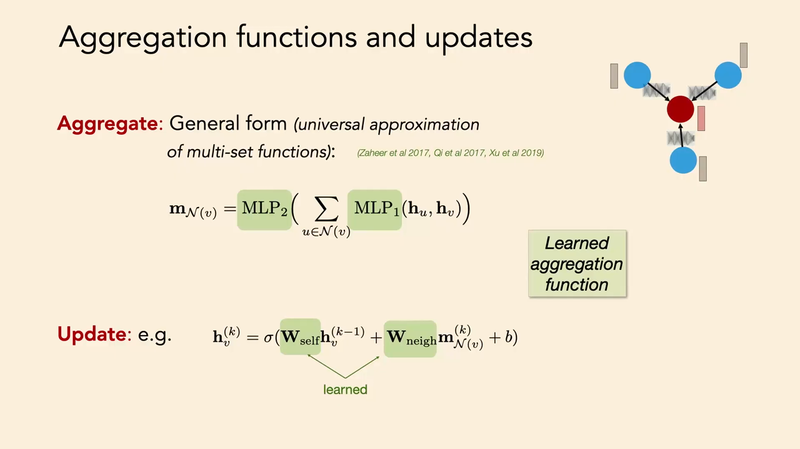
*▲ 강의 슬라이드 [45:20](https://youtu.be/0niIwb37nF0?t=2720): 학습하는 [집계 함수](00_%EB%94%A5%EB%9F%AC%EB%8B%9D_%EC%9A%A9%EC%96%B4%EC%82%AC%EC%A0%84.md#aggregation-function-%EC%A7%91%EA%B3%84-%ED%95%A8%EC%88%98) MLP₂(Σ MLP₁)와 [갱신 함수](00_%EB%94%A5%EB%9F%AC%EB%8B%9D_%EC%9A%A9%EC%96%B4%EC%82%AC%EC%A0%84.md#update-function-%EA%B0%B1%EC%8B%A0-%ED%95%A8%EC%88%98)의 예*

### 6.5 리드아웃: 그래프 전체 임베딩

▶ 영상 [45:39](https://youtu.be/0niIwb37nF0?t=2739)

📐 **수학 개념**: [멀티셋 집계 함수](%EC%88%98%ED%95%99%EA%B0%9C%EB%85%90/07_%EA%B5%AC%EC%A1%B0_%EC%95%84%ED%82%A4%ED%85%8D%EC%B2%98/MM19_%EB%A9%80%ED%8B%B0%EC%85%8B_%EC%A7%91%EA%B3%84_%ED%95%A8%EC%88%98.md)

갱신을 여러 번 해서 얻은 노드 [임베딩](00_%EB%94%A5%EB%9F%AC%EB%8B%9D_%EC%9A%A9%EC%96%B4%EC%82%AC%EC%A0%84.md#embedding-%EC%9E%84%EB%B2%A0%EB%94%A9)을 그대로 노드별 예측으로 쓸 수 있습니다. 그래프 전체에 대한 예측이 필요하면 마지막에 한 단계를 더합니다. 모든 노드 [임베딩](00_%EB%94%A5%EB%9F%AC%EB%8B%9D_%EC%9A%A9%EC%96%B4%EC%82%AC%EC%A0%84.md#embedding-%EC%9E%84%EB%B2%A0%EB%94%A9)의 [멀티셋](00_%EB%94%A5%EB%9F%AC%EB%8B%9D_%EC%9A%A9%EC%96%B4%EC%82%AC%EC%A0%84.md#multiset-%EB%A9%80%ED%8B%B0%EC%85%8B)을 벡터 하나로 모으는 **[리드아웃](00_%EB%94%A5%EB%9F%AC%EB%8B%9D_%EC%9A%A9%EC%96%B4%EC%82%AC%EC%A0%84.md#readout-%EB%A6%AC%EB%93%9C%EC%95%84%EC%9B%83)([Readout](00_%EB%94%A5%EB%9F%AC%EB%8B%9D_%EC%9A%A9%EC%96%B4%EC%82%AC%EC%A0%84.md#readout-%EB%A6%AC%EB%93%9C%EC%95%84%EC%9B%83))** 입니다.

$$
h_{\mathcal{G}} = \text{READOUT}\big(\{h_v^{(K)} : v \in \mathcal{G}\}\big)
$$

기호 풀이

| 기호 | 읽는 법 | 뜻 | 예제 값 |
| --- | --- | --- | --- |
| $h_{\mathcal{G}}$ | 에이치 지 | 그래프 전체의 [임베딩](00_%EB%94%A5%EB%9F%AC%EB%8B%9D_%EC%9A%A9%EC%96%B4%EC%82%AC%EC%A0%84.md#embedding-%EC%9E%84%EB%B2%A0%EB%94%A9) | 4.5 (합) |
| $\mathcal{G}$ | 그래프 지 | 그래프 전체 (모든 노드) | 노드 1~4 |
| $K$ | 대문자 케이 | 마지막 라운드 번호 | 1 |
| $h_v^{(K)}$ | 에이치 브이 케이 | 마지막 라운드에서 노드 v의 벡터 | 0, 0.5, 1, 3 |
| $\{h_v^{(K)} : v \in \mathcal{G}\}$ | - | 모든 노드 벡터의 [멀티셋](00_%EB%94%A5%EB%9F%AC%EB%8B%9D_%EC%9A%A9%EC%96%B4%EC%82%AC%EC%A0%84.md#multiset-%EB%A9%80%ED%8B%B0%EC%85%8B) | {0, 0.5, 1, 3} |
| $\text{READOUT}$ | [리드아웃](00_%EB%94%A5%EB%9F%AC%EB%8B%9D_%EC%9A%A9%EC%96%B4%EC%82%AC%EC%A0%84.md#readout-%EB%A6%AC%EB%93%9C%EC%95%84%EC%9B%83) | [리드아웃](00_%EB%94%A5%EB%9F%AC%EB%8B%9D_%EC%9A%A9%EC%96%B4%EC%82%AC%EC%A0%84.md#readout-%EB%A6%AC%EB%93%9C%EC%95%84%EC%9B%83), 집계와 같은 순서 무관 함수 | 합 또는 평균 |

예제와 풀이

**문제**: 한 [층](00_%EB%94%A5%EB%9F%AC%EB%8B%9D_%EC%9A%A9%EC%96%B4%EC%82%AC%EC%A0%84.md#layer-%EC%B8%B5)을 지난 노드 값 네 개를 하나로 모아 그래프 전체 값 $h_{\mathcal{G}}$를 합 [리드아웃](00_%EB%94%A5%EB%9F%AC%EB%8B%9D_%EC%9A%A9%EC%96%B4%EC%82%AC%EC%A0%84.md#readout-%EB%A6%AC%EB%93%9C%EC%95%84%EC%9B%83)과 평균 [리드아웃](00_%EB%94%A5%EB%9F%AC%EB%8B%9D_%EC%9A%A9%EC%96%B4%EC%82%AC%EC%A0%84.md#readout-%EB%A6%AC%EB%93%9C%EC%95%84%EC%9B%83)으로 각각 구하라.

**주어진 값**:
- $K = 1$ (마지막 라운드)
- $h_1^{(1)} = 0$, $h_2^{(1)} = 0.5$, $h_3^{(1)} = 1$, $h_4^{(1)} = 3$ (6.1 예에서 한 [층](00_%EB%94%A5%EB%9F%AC%EB%8B%9D_%EC%9A%A9%EC%96%B4%EC%82%AC%EC%A0%84.md#layer-%EC%B8%B5)을 지난 노드 값)
- $\text{READOUT}$ = 합 (모든 값을 더함) 또는 평균 (합을 노드 수로 나눔)
- 노드 수 4

**풀이**
1. 식을 그대로 쓴다: $h_{\mathcal{G}} = \text{READOUT}\big(\{h_v^{(K)} : v \in \mathcal{G}\}\big)$
2. 값을 대입한다: $h_{\mathcal{G}} = \text{READOUT}\big(\{0, 0.5, 1, 3\}\big)$
3. 합 [리드아웃](00_%EB%94%A5%EB%9F%AC%EB%8B%9D_%EC%9A%A9%EC%96%B4%EC%82%AC%EC%A0%84.md#readout-%EB%A6%AC%EB%93%9C%EC%95%84%EC%9B%83)으로 풀어 쓴다: $h_{\mathcal{G}} = 0 + 0.5 + 1 + 3$
4. 첫 덧셈을 한다: $0 + 0.5 = 0.5$ 이므로 $0.5 + 1 + 3$
5. 다음 덧셈을 한다: $0.5 + 1 = 1.5$ 이므로 $1.5 + 3$
6. 마지막 덧셈을 한다: $1.5 + 3 = 4.5$ 이므로 합 [리드아웃](00_%EB%94%A5%EB%9F%AC%EB%8B%9D_%EC%9A%A9%EC%96%B4%EC%82%AC%EC%A0%84.md#readout-%EB%A6%AC%EB%93%9C%EC%95%84%EC%9B%83)은 4.5
7. 평균 [리드아웃](00_%EB%94%A5%EB%9F%AC%EB%8B%9D_%EC%9A%A9%EC%96%B4%EC%82%AC%EC%A0%84.md#readout-%EB%A6%AC%EB%93%9C%EC%95%84%EC%9B%83)은 합을 노드 수로 나눈다: $4.5 \div 4 = 1.125$

**답**: 합 [리드아웃](00_%EB%94%A5%EB%9F%AC%EB%8B%9D_%EC%9A%A9%EC%96%B4%EC%82%AC%EC%A0%84.md#readout-%EB%A6%AC%EB%93%9C%EC%95%84%EC%9B%83) $h_{\mathcal{G}} = 4.5$, 평균 [리드아웃](00_%EB%94%A5%EB%9F%AC%EB%8B%9D_%EC%9A%A9%EC%96%B4%EC%82%AC%EC%A0%84.md#readout-%EB%A6%AC%EB%93%9C%EC%95%84%EC%9B%83) $h_{\mathcal{G}} = 1.125$

내 이해

모양은 집계와 똑같고, 이웃이 아니라 **그래프의 모든 노드**에 대해 한다는 점만 다릅니다. 위의 예에서 합 [리드아웃](00_%EB%94%A5%EB%9F%AC%EB%8B%9D_%EC%9A%A9%EC%96%B4%EC%82%AC%EC%A0%84.md#readout-%EB%A6%AC%EB%93%9C%EC%95%84%EC%9B%83)을 쓰면 0 + 0.5 + 1 + 3 = 4.5가 그래프 [임베딩](00_%EB%94%A5%EB%9F%AC%EB%8B%9D_%EC%9A%A9%EC%96%B4%EC%82%AC%EC%A0%84.md#embedding-%EC%9E%84%EB%B2%A0%EB%94%A9)입니다. 강사는 "[GNN](00_%EB%94%A5%EB%9F%AC%EB%8B%9D_%EC%9A%A9%EC%96%B4%EC%82%AC%EC%A0%84.md#gnn-graph-neural-network-%EA%B7%B8%EB%9E%98%ED%94%84-%EC%8B%A0%EA%B2%BD%EB%A7%9D)을 어떤 부품으로 나눌지는 관례의 문제이고, 분석이 깔끔해지는 방식 하나를 보여 준 것"이라고 덧붙입니다.

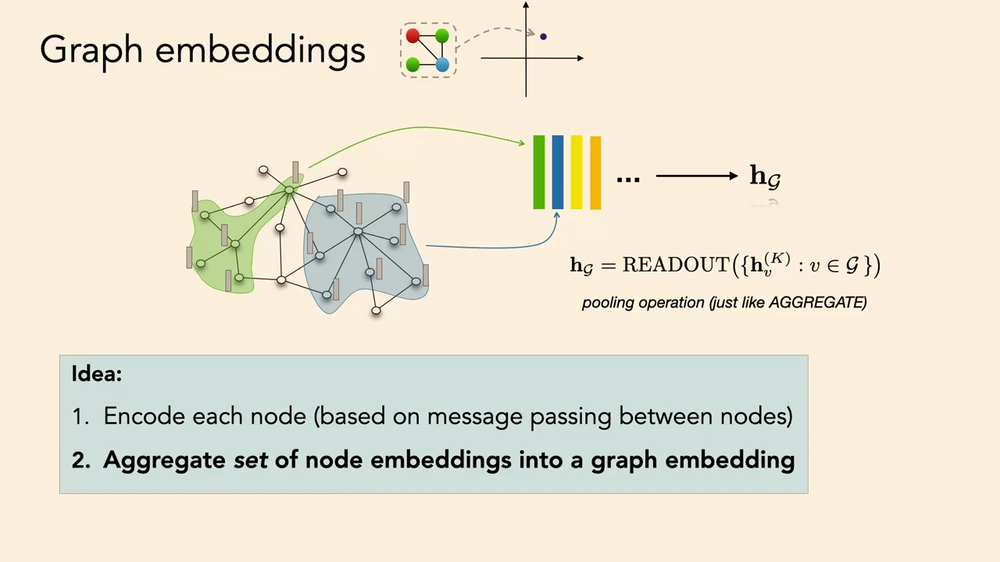
*▲ 강의 슬라이드 [46:30](https://youtu.be/0niIwb37nF0?t=2790): [메시지 전달](00_%EB%94%A5%EB%9F%AC%EB%8B%9D_%EC%9A%A9%EC%96%B4%EC%82%AC%EC%A0%84.md#message-passing-%EB%A9%94%EC%8B%9C%EC%A7%80-%EC%A0%84%EB%8B%AC)로 노드를 인코딩한 뒤 노드 [임베딩](00_%EB%94%A5%EB%9F%AC%EB%8B%9D_%EC%9A%A9%EC%96%B4%EC%82%AC%EC%A0%84.md#embedding-%EC%9E%84%EB%B2%A0%EB%94%A9) 집합을 그래프 [임베딩](00_%EB%94%A5%EB%9F%AC%EB%8B%9D_%EC%9A%A9%EC%96%B4%EC%82%AC%EC%A0%84.md#embedding-%EC%9E%84%EB%B2%A0%EB%94%A9)으로 모음*

---

## 7. 또 다른 관점: 펼친 GNN은 벡터 뉴런의 MLP

▶ 영상 [46:49](https://youtu.be/0niIwb37nF0?t=2809)

📐 **수학 개념**: [합성함수와 비선형성](%EC%88%98%ED%95%99%EA%B0%9C%EB%85%90/05_%EC%8B%A0%EA%B2%BD%EB%A7%9D%EC%9D%98_%EA%B3%84%EC%82%B0/MM06_%ED%95%A9%EC%84%B1%ED%95%A8%EC%88%98%EC%99%80_%EB%B9%84%EC%84%A0%ED%98%95%EC%84%B1.md) · [인접 행렬](%EC%88%98%ED%95%99%EA%B0%9C%EB%85%90/07_%EA%B5%AC%EC%A1%B0_%EC%95%84%ED%82%A4%ED%85%8D%EC%B2%98/MM18_%EC%9D%B8%EC%A0%91%ED%96%89%EB%A0%AC%EA%B3%BC_%EC%88%9C%EC%97%B4.md)

강사가 더 좋아하는 관점은 [메시지 전달](00_%EB%94%A5%EB%9F%AC%EB%8B%9D_%EC%9A%A9%EC%96%B4%EC%82%AC%EC%A0%84.md#message-passing-%EB%A9%94%EC%8B%9C%EC%A7%80-%EC%A0%84%EB%8B%AC)을 $k$단계 펼쳐(unroll) 보는 것입니다. 이 관점은 곧 배울 [트랜스포머](00_%EB%94%A5%EB%9F%AC%EB%8B%9D_%EC%9A%A9%EC%96%B4%EC%82%AC%EC%A0%84.md#transformer-%ED%8A%B8%EB%9E%9C%EC%8A%A4%ED%8F%AC%EB%A8%B8)와 바로 이어집니다.

- 입력 [층](00_%EB%94%A5%EB%9F%AC%EB%8B%9D_%EC%9A%A9%EC%96%B4%EC%82%AC%EC%A0%84.md#layer-%EC%B8%B5)은 노드 벡터들의 집합입니다.
- 집계는 각 노드가 **연결된 이웃만** 골라 모읍니다. 그림의 빨간 노드는 청록·파랑·노랑 노드에게서 받습니다. 이것은 MLP에서 이전 [층](00_%EB%94%A5%EB%9F%AC%EB%8B%9D_%EC%9A%A9%EC%96%B4%EC%82%AC%EC%A0%84.md#layer-%EC%B8%B5) 뉴런의 선형 결합을 만드는 것과 비슷합니다(**집계 ≈ [선형층](00_%EB%94%A5%EB%9F%AC%EB%8B%9D_%EC%9A%A9%EC%96%B4%EC%82%AC%EC%A0%84.md#linear-layer-%EC%84%A0%ED%98%95%EC%B8%B5)**).
- 갱신은 모든 노드에 **같은** 벡터→벡터 함수를 적용합니다. MLP의 원소별 비선형 함수와 비슷하지만, 원소가 아니라 노드별로 적용됩니다(**갱신 ≈ 원소별 [층](00_%EB%94%A5%EB%9F%AC%EB%8B%9D_%EC%9A%A9%EC%96%B4%EC%82%AC%EC%A0%84.md#layer-%EC%B8%B5)**).

즉 펼친 [GNN](00_%EB%94%A5%EB%9F%AC%EB%8B%9D_%EC%9A%A9%EC%96%B4%EC%82%AC%EC%A0%84.md#gnn-graph-neural-network-%EA%B7%B8%EB%9E%98%ED%94%84-%EC%8B%A0%EA%B2%BD%EB%A7%9D)은 **뉴런이 스칼라가 아니라 벡터(노드 [임베딩](00_%EB%94%A5%EB%9F%AC%EB%8B%9D_%EC%9A%A9%EC%96%B4%EC%82%AC%EC%A0%84.md#embedding-%EC%9E%84%EB%B2%A0%EB%94%A9))인 MLP**이고, 엣지는 MLP 같은 복잡한 함수일 수도 있습니다. 위상으로는 평범한 신경망과 거의 같습니다.

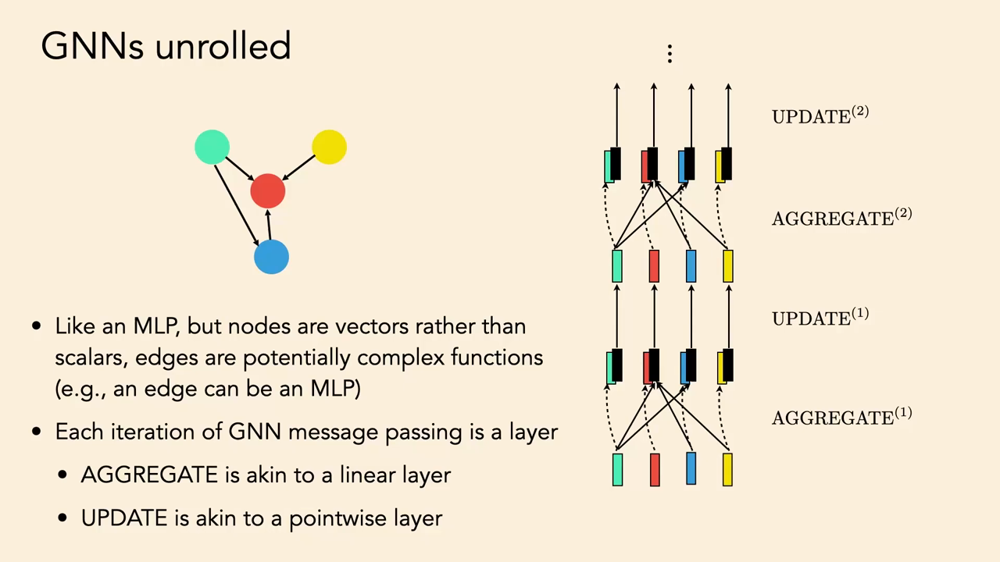
*▲ 강의 슬라이드 [50:00](https://youtu.be/0niIwb37nF0?t=3000): 펼친 [GNN](00_%EB%94%A5%EB%9F%AC%EB%8B%9D_%EC%9A%A9%EC%96%B4%EC%82%AC%EC%A0%84.md#gnn-graph-neural-network-%EA%B7%B8%EB%9E%98%ED%94%84-%EC%8B%A0%EA%B2%BD%EB%A7%9D). AGGREGATE는 [선형층](00_%EB%94%A5%EB%9F%AC%EB%8B%9D_%EC%9A%A9%EC%96%B4%EC%82%AC%EC%A0%84.md#linear-layer-%EC%84%A0%ED%98%95%EC%B8%B5), UPDATE는 원소별 [층](00_%EB%94%A5%EB%9F%AC%EB%8B%9D_%EC%9A%A9%EC%96%B4%EC%82%AC%EC%A0%84.md#layer-%EC%B8%B5)과 비슷*

**[학습](00_%EB%94%A5%EB%9F%AC%EB%8B%9D_%EC%9A%A9%EC%96%B4%EC%82%AC%EC%A0%84.md#training-%ED%95%99%EC%8A%B5)은 어떻게?** [53:41](https://youtu.be/0niIwb37nF0?t=3221) [메시지 전달](00_%EB%94%A5%EB%9F%AC%EB%8B%9D_%EC%9A%A9%EC%96%B4%EC%82%AC%EC%A0%84.md#message-passing-%EB%A9%94%EC%8B%9C%EC%A7%80-%EC%A0%84%EB%8B%AC)은 최적화 알고리즘이 아니라 **[순전파](00_%EB%94%A5%EB%9F%AC%EB%8B%9D_%EC%9A%A9%EC%96%B4%EC%82%AC%EC%A0%84.md#feed-forward-%EC%88%9C%EC%A0%84%ED%8C%8C)** 입니다. 펼친 [메시지 전달](00_%EB%94%A5%EB%9F%AC%EB%8B%9D_%EC%9A%A9%EC%96%B4%EC%82%AC%EC%A0%84.md#message-passing-%EB%A9%94%EC%8B%9C%EC%A7%80-%EC%A0%84%EB%8B%AC) 단계는 새로운 [계산 그래프](00_%EB%94%A5%EB%9F%AC%EB%8B%9D_%EC%9A%A9%EC%96%B4%EC%82%AC%EC%A0%84.md#computational-graph-%EA%B3%84%EC%82%B0-%EA%B7%B8%EB%9E%98%ED%94%84)일 뿐이므로, 다른 신경망과 똑같이 전체를 [역전파](00_%EB%94%A5%EB%9F%AC%EB%8B%9D_%EC%9A%A9%EC%96%B4%EC%82%AC%EC%A0%84.md#backpropagation-%EC%97%AD%EC%A0%84%ED%8C%8C)해서 학습합니다.

**MLP는 어떤 그래프의 [GNN](00_%EB%94%A5%EB%9F%AC%EB%8B%9D_%EC%9A%A9%EC%96%B4%EC%82%AC%EC%A0%84.md#gnn-graph-neural-network-%EA%B7%B8%EB%9E%98%ED%94%84-%EC%8B%A0%EA%B2%BD%EB%A7%9D)인가?** [54:46](https://youtu.be/0niIwb37nF0?t=3286) 노드 **하나**짜리 그래프입니다. 노드의 벡터가 MLP의 입력 벡터이고, 이웃이 없으니 집계는 항등 함수처럼 아무것도 하지 않으며, 갱신은 $\sigma(W_{\text{self}} h)$ = [선형층](00_%EB%94%A5%EB%9F%AC%EB%8B%9D_%EC%9A%A9%EC%96%B4%EC%82%AC%EC%A0%84.md#linear-layer-%EC%84%A0%ED%98%95%EC%B8%B5) + 비선형 함수입니다. 이것을 펼치면 MLP가 됩니다. 정리하면 **MLP = 노드 1개 [GNN](00_%EB%94%A5%EB%9F%AC%EB%8B%9D_%EC%9A%A9%EC%96%B4%EC%82%AC%EC%A0%84.md#gnn-graph-neural-network-%EA%B7%B8%EB%9E%98%ED%94%84-%EC%8B%A0%EA%B2%BD%EB%A7%9D), [CNN](00_%EB%94%A5%EB%9F%AC%EB%8B%9D_%EC%9A%A9%EC%96%B4%EC%82%AC%EC%A0%84.md#cnn-convolutional-neural-network-%ED%95%A9%EC%84%B1%EA%B3%B1-%EC%8B%A0%EA%B2%BD%EB%A7%9D) = 격자 [GNN](00_%EB%94%A5%EB%9F%AC%EB%8B%9D_%EC%9A%A9%EC%96%B4%EC%82%AC%EC%A0%84.md#gnn-graph-neural-network-%EA%B7%B8%EB%9E%98%ED%94%84-%EC%8B%A0%EA%B2%BD%EB%A7%9D)**입니다. 강사는 "처음 배울 때는 모든 것이 달라 보이지만, 사실 모든 개념은 촘촘히 이어져 있고 조금만 바꾸면 하나를 다른 것으로 옮겨 쓸 수 있다"고 강조합니다.

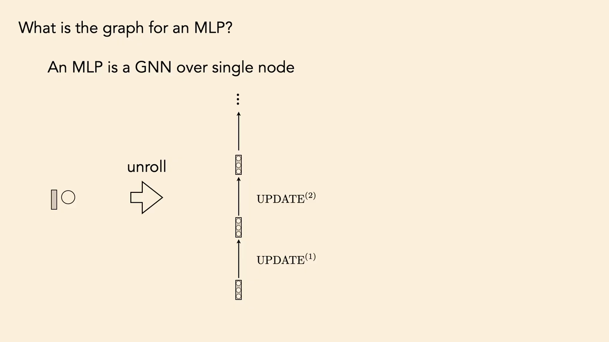
*▲ 강의 슬라이드 [55:40](https://youtu.be/0niIwb37nF0?t=3340): MLP는 노드 하나짜리 그래프 위의 [GNN](00_%EB%94%A5%EB%9F%AC%EB%8B%9D_%EC%9A%A9%EC%96%B4%EC%82%AC%EC%A0%84.md#gnn-graph-neural-network-%EA%B7%B8%EB%9E%98%ED%94%84-%EC%8B%A0%EA%B2%BD%EB%A7%9D)*

질의응답 정리 [49:47](https://youtu.be/0niIwb37nF0?t=2987)

- **[어텐션](00_%EB%94%A5%EB%9F%AC%EB%8B%9D_%EC%9A%A9%EC%96%B4%EC%82%AC%EC%A0%84.md#attention-%EC%96%B4%ED%85%90%EC%85%98) 헤드와 무엇이 다른가?** 이 관점이 [GNN](00_%EB%94%A5%EB%9F%AC%EB%8B%9D_%EC%9A%A9%EC%96%B4%EC%82%AC%EC%A0%84.md#gnn-graph-neural-network-%EA%B7%B8%EB%9E%98%ED%94%84-%EC%8B%A0%EA%B2%BD%EB%A7%9D)과 [트랜스포머](00_%EB%94%A5%EB%9F%AC%EB%8B%9D_%EC%9A%A9%EC%96%B4%EC%82%AC%EC%A0%84.md#transformer-%ED%8A%B8%EB%9E%9C%EC%8A%A4%ED%8F%AC%EB%A8%B8)를 잇는 다리입니다. [어텐션](00_%EB%94%A5%EB%9F%AC%EB%8B%9D_%EC%9A%A9%EC%96%B4%EC%82%AC%EC%A0%84.md#attention-%EC%96%B4%ED%85%90%EC%85%98)은 특별한 종류의 집계 함수일 뿐이고, [트랜스포머](00_%EB%94%A5%EB%9F%AC%EB%8B%9D_%EC%9A%A9%EC%96%B4%EC%82%AC%EC%A0%84.md#transformer-%ED%8A%B8%EB%9E%9C%EC%8A%A4%ED%8F%AC%EB%A8%B8)는 특별한 [GNN](00_%EB%94%A5%EB%9F%AC%EB%8B%9D_%EC%9A%A9%EC%96%B4%EC%82%AC%EC%A0%84.md#gnn-graph-neural-network-%EA%B7%B8%EB%9E%98%ED%94%84-%EC%8B%A0%EA%B2%BD%EB%A7%9D)입니다(8절).
- **갱신은 꼭 비선형이어야 하나?** 어딘가에는 [비선형성](00_%EB%94%A5%EB%9F%AC%EB%8B%9D_%EC%9A%A9%EC%96%B4%EC%82%AC%EC%A0%84.md#nonlinearity-%EB%B9%84%EC%84%A0%ED%98%95%EC%84%B1)이 있어야 합니다. 집계와 갱신 둘 다 비선형인 경우가 보통이고, 이론적으로는 한쪽만 비선형이어도 [보편 근사](00_%EB%94%A5%EB%9F%AC%EB%8B%9D_%EC%9A%A9%EC%96%B4%EC%82%AC%EC%A0%84.md#universal-approximation-%EB%B3%B4%ED%8E%B8-%EA%B7%BC%EC%82%AC)를 증명할 수 있을 것이라고 강사는 추측합니다.
- **[층](00_%EB%94%A5%EB%9F%AC%EB%8B%9D_%EC%9A%A9%EC%96%B4%EC%82%AC%EC%A0%84.md#layer-%EC%B8%B5) 수 k는 어떻게 정하나?** [50:52](https://youtu.be/0niIwb37nF0?t=3052) k는 깊이와 같습니다. [GNN](00_%EB%94%A5%EB%9F%AC%EB%8B%9D_%EC%9A%A9%EC%96%B4%EC%82%AC%EC%A0%84.md#gnn-graph-neural-network-%EA%B7%B8%EB%9E%98%ED%94%84-%EC%8B%A0%EA%B2%BD%EB%A7%9D)에서는 [층](00_%EB%94%A5%EB%9F%AC%EB%8B%9D_%EC%9A%A9%EC%96%B4%EC%82%AC%EC%A0%84.md#layer-%EC%B8%B5)마다 [파라미터](00_%EB%94%A5%EB%9F%AC%EB%8B%9D_%EC%9A%A9%EC%96%B4%EC%82%AC%EC%A0%84.md#parameter-%ED%8C%8C%EB%9D%BC%EB%AF%B8%ED%84%B0)를 **공유할지** 고를 수 있습니다. [층](00_%EB%94%A5%EB%9F%AC%EB%8B%9D_%EC%9A%A9%EC%96%B4%EC%82%AC%EC%A0%84.md#layer-%EC%B8%B5)마다 다른 [파라미터](00_%EB%94%A5%EB%9F%AC%EB%8B%9D_%EC%9A%A9%EC%96%B4%EC%82%AC%EC%A0%84.md#parameter-%ED%8C%8C%EB%9D%BC%EB%AF%B8%ED%84%B0)를 쓰면 고정된 깊이로 펼쳐 학습해야 합니다. 모든 [층](00_%EB%94%A5%EB%9F%AC%EB%8B%9D_%EC%9A%A9%EC%96%B4%EC%82%AC%EC%A0%84.md#layer-%EC%B8%B5)이 같은 [파라미터](00_%EB%94%A5%EB%9F%AC%EB%8B%9D_%EC%9A%A9%EC%96%B4%EC%82%AC%EC%A0%84.md#parameter-%ED%8C%8C%EB%9D%BC%EB%AF%B8%ED%84%B0)를 쓰면 원하는 만큼 오래 돌릴 수 있고, 그때는 오래 돌리면 좋은 값으로 수렴하는지 같은 점근 성질이 중요해집니다.
- **왜 자기 자신과 이웃에 다른 [가중치](00_%EB%94%A5%EB%9F%AC%EB%8B%9D_%EC%9A%A9%EC%96%B4%EC%82%AC%EC%A0%84.md#weight-%EA%B0%80%EC%A4%91%EC%B9%98) 행렬을 쓰나?** $h$와 $m$을 이어 붙이고 큰 $W$ 하나를 써도 똑같습니다. 표기를 분명히 하려고 나눴을 뿐입니다.
- **엣지 거리 같은 엣지 정보가 있으면?** 엣지 속성 벡터를 두고, 집계와 갱신이 엣지 속성도 받도록 일반화하면 됩니다(8절).

---

## 8. 변형들: 엣지 속성, 여러 관계, 어텐션

▶ 영상 [56:25](https://youtu.be/0niIwb37nF0?t=3385)

기본 [GNN](00_%EB%94%A5%EB%9F%AC%EB%8B%9D_%EC%9A%A9%EC%96%B4%EC%82%AC%EC%A0%84.md#gnn-graph-neural-network-%EA%B7%B8%EB%9E%98%ED%94%84-%EC%8B%A0%EA%B2%BD%EB%A7%9D) 위에 여러 변형이 있습니다.

- **엣지 속성**: 메시지를 만들 때 엣지 정보 $w_{uv}$도 넣습니다: $m = \sum_u \text{MLP}(h_u, h_v, w_{uv})$.
- **여러 관계(Multi-relational)**: 엣지 종류(약물-약물, 약물-단백질 등)마다 다른 집계를 쓰는 여러 "[채널](00_%EB%94%A5%EB%9F%AC%EB%8B%9D_%EC%9A%A9%EC%96%B4%EC%82%AC%EC%A0%84.md#channel-%EC%B1%84%EB%84%90)"의 [메시지 전달](00_%EB%94%A5%EB%9F%AC%EB%8B%9D_%EC%9A%A9%EC%96%B4%EC%82%AC%EC%A0%84.md#message-passing-%EB%A9%94%EC%8B%9C%EC%A7%80-%EC%A0%84%EB%8B%AC)을 나란히 돌립니다.
- **[어텐션](00_%EB%94%A5%EB%9F%AC%EB%8B%9D_%EC%9A%A9%EC%96%B4%EC%82%AC%EC%A0%84.md#attention-%EC%96%B4%ED%85%90%EC%85%98)([Attention](00_%EB%94%A5%EB%9F%AC%EB%8B%9D_%EC%9A%A9%EC%96%B4%EC%82%AC%EC%A0%84.md#attention-%EC%96%B4%ED%85%90%EC%85%98))**: 단순 합이나 평균이 아니라 **노드 [임베딩](00_%EB%94%A5%EB%9F%AC%EB%8B%9D_%EC%9A%A9%EC%96%B4%EC%82%AC%EC%A0%84.md#embedding-%EC%9E%84%EB%B2%A0%EB%94%A9) 값에 따라 정해지는 [가중치](00_%EB%94%A5%EB%9F%AC%EB%8B%9D_%EC%9A%A9%EC%96%B4%EC%82%AC%EC%A0%84.md#weight-%EA%B0%80%EC%A4%91%EC%B9%98)** $\alpha_{v,u}$로 더합니다: $m = \sum_u \alpha_{v,u} h_u$. 이것을 집계로 쓰는 [GNN](00_%EB%94%A5%EB%9F%AC%EB%8B%9D_%EC%9A%A9%EC%96%B4%EC%82%AC%EC%A0%84.md#gnn-graph-neural-network-%EA%B7%B8%EB%9E%98%ED%94%84-%EC%8B%A0%EA%B2%BD%EB%A7%9D)이 **[트랜스포머](00_%EB%94%A5%EB%9F%AC%EB%8B%9D_%EC%9A%A9%EC%96%B4%EC%82%AC%EC%A0%84.md#transformer-%ED%8A%B8%EB%9E%9C%EC%8A%A4%ED%8F%AC%EB%A8%B8)** 입니다. 몇 주 뒤 강의에서 자세히 다룹니다.
- **Janossy pooling**: 순서에 민감한 함수를 모든 순서에 대해 평균해 순서와 무관하게 만듭니다.

과제 읽기 자료([GNN](00_%EB%94%A5%EB%9F%AC%EB%8B%9D_%EC%9A%A9%EC%96%B4%EC%82%AC%EC%A0%84.md#gnn-graph-neural-network-%EA%B7%B8%EB%9E%98%ED%94%84-%EC%8B%A0%EA%B2%BD%EB%A7%9D) 장)를 더 읽어 나가면 이런 변형이 훨씬 많이 나옵니다.

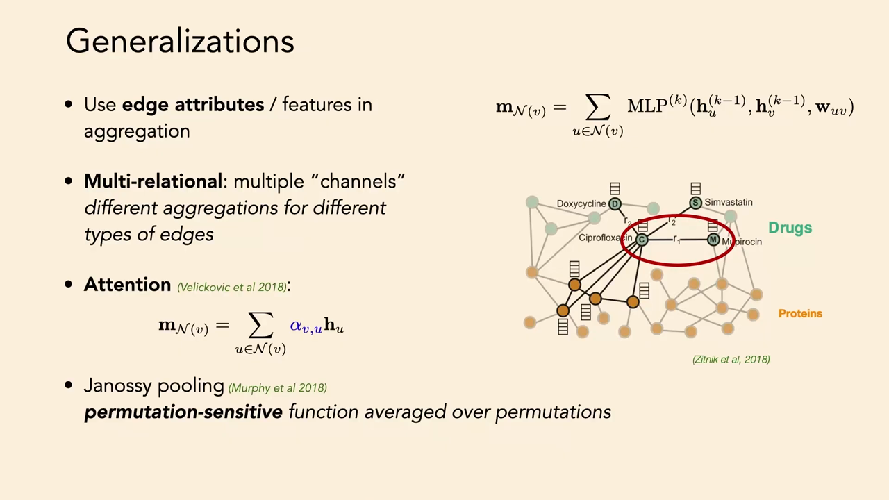
*▲ 강의 슬라이드 [57:20](https://youtu.be/0niIwb37nF0?t=3440): 엣지 속성, 여러 관계, [어텐션](00_%EB%94%A5%EB%9F%AC%EB%8B%9D_%EC%9A%A9%EC%96%B4%EC%82%AC%EC%A0%84.md#attention-%EC%96%B4%ED%85%90%EC%85%98), Janossy pooling*

---

## 9. GNN의 표현력

### 9.1 계산 트리와 가중치 공유

▶ 영상 [57:33](https://youtu.be/0niIwb37nF0?t=3453)

이론을 위해 관점을 하나 더 봅니다. **노드 하나에서 본 정보의 흐름은 나무(트리)** 입니다. 노드 A의 이웃이 B, C, D이면 첫 [층](00_%EB%94%A5%EB%9F%AC%EB%8B%9D_%EC%9A%A9%EC%96%B4%EC%82%AC%EC%A0%84.md#layer-%EC%B8%B5)에서 A는 B, C, D에게서 메시지를 받습니다. 두 [층](00_%EB%94%A5%EB%9F%AC%EB%8B%9D_%EC%9A%A9%EC%96%B4%EC%82%AC%EC%A0%84.md#layer-%EC%B8%B5)이면 B는 다시 A와 C에게서 받은 것을 넘겨주므로, A의 2층 표현은 "이웃의 1층 표현"이고 그것은 "이웃의 이웃의 0층(입력) 표현"으로 만들어집니다. [메시지 전달](00_%EB%94%A5%EB%9F%AC%EB%8B%9D_%EC%9A%A9%EC%96%B4%EC%82%AC%EC%A0%84.md#message-passing-%EB%A9%94%EC%8B%9C%EC%A7%80-%EC%A0%84%EB%8B%AC)을 한 번 할 때마다 이 나무가 한 단계 깊어집니다([수용 영역](00_%EB%94%A5%EB%9F%AC%EB%8B%9D_%EC%9A%A9%EC%96%B4%EC%82%AC%EC%A0%84.md#receptive-field-%EC%88%98%EC%9A%A9-%EC%98%81%EC%97%AD)이 넓어짐).

한 [층](00_%EB%94%A5%EB%9F%AC%EB%8B%9D_%EC%9A%A9%EC%96%B4%EC%82%AC%EC%A0%84.md#layer-%EC%B8%B5) 안에서는 모든 노드의 [집계 함수](00_%EB%94%A5%EB%9F%AC%EB%8B%9D_%EC%9A%A9%EC%96%B4%EC%82%AC%EC%A0%84.md#aggregation-function-%EC%A7%91%EA%B3%84-%ED%95%A8%EC%88%98)(회색 상자)가 **같은 함수**입니다([가중치 공유](00_%EB%94%A5%EB%9F%AC%EB%8B%9D_%EC%9A%A9%EC%96%B4%EC%82%AC%EC%A0%84.md#weight-sharing-%EA%B0%80%EC%A4%91%EC%B9%98-%EA%B3%B5%EC%9C%A0)). 그래서 [학습](00_%EB%94%A5%EB%9F%AC%EB%8B%9D_%EC%9A%A9%EC%96%B4%EC%82%AC%EC%A0%84.md#training-%ED%95%99%EC%8A%B5)이 끝난 뒤 노드가 더 많거나 모양이 다른 그래프에도 같은 [GNN](00_%EB%94%A5%EB%9F%AC%EB%8B%9D_%EC%9A%A9%EC%96%B4%EC%82%AC%EC%A0%84.md#gnn-graph-neural-network-%EA%B7%B8%EB%9E%98%ED%94%84-%EC%8B%A0%EA%B2%BD%EB%A7%9D)을 돌릴 수 있습니다. 작은 이미지로 학습한 [CNN](00_%EB%94%A5%EB%9F%AC%EB%8B%9D_%EC%9A%A9%EC%96%B4%EC%82%AC%EC%A0%84.md#cnn-convolutional-neural-network-%ED%95%A9%EC%84%B1%EA%B3%B1-%EC%8B%A0%EA%B2%BD%EB%A7%9D) [필터](00_%EB%94%A5%EB%9F%AC%EB%8B%9D_%EC%9A%A9%EC%96%B4%EC%82%AC%EC%A0%84.md#filter-%ED%95%84%ED%84%B0)를 큰 이미지에 쓰는 것과 같습니다. 다만 기능상으로는 어떤 크기에도 돌아가지만, 통계적으로는 [학습 데이터](00_%EB%94%A5%EB%9F%AC%EB%8B%9D_%EC%9A%A9%EC%96%B4%EC%82%AC%EC%A0%84.md#training-data-test-data-%ED%95%99%EC%8A%B5-%EB%8D%B0%EC%9D%B4%ED%84%B0%EC%99%80-%EC%8B%9C%ED%97%98-%EB%8D%B0%EC%9D%B4%ED%84%B0)와 크기가 많이 다른 그래프에서는 [일반화](00_%EB%94%A5%EB%9F%AC%EB%8B%9D_%EC%9A%A9%EC%96%B4%EC%82%AC%EC%A0%84.md#generalization-%EC%9D%BC%EB%B0%98%ED%99%94)가 잘 안 될 수 있습니다.

질의응답 정리 [59:12](https://youtu.be/0niIwb37nF0?t=3552)

- **학습할 때 노드를 처음에 모두 이어 두고 가지치기하나?** 기본 [GNN](00_%EB%94%A5%EB%9F%AC%EB%8B%9D_%EC%9A%A9%EC%96%B4%EC%82%AC%EC%A0%84.md#gnn-graph-neural-network-%EA%B7%B8%EB%9E%98%ED%94%84-%EC%8B%A0%EA%B2%BD%EB%A7%9D)에서 연결 구조는 **데이터가 정해 줍니다**. 분자라면 실제 결합 구조가 그대로 그래프입니다. 좋은 예측을 위해 그래프 구조 자체를 학습하는 것은 또 다른(메타) 문제이고 이번 강의 범위 밖입니다.

### 9.2 GNN 학습하기

▶ 영상 [61:56](https://youtu.be/0niIwb37nF0?t=3716)

분자의 독성을 예측하는 [GNN](00_%EB%94%A5%EB%9F%AC%EB%8B%9D_%EC%9A%A9%EC%96%B4%EC%82%AC%EC%A0%84.md#gnn-graph-neural-network-%EA%B7%B8%EB%9E%98%ED%94%84-%EC%8B%A0%EA%B2%BD%EB%A7%9D)을 학습한다고 합시다.

| 정할 것 | 내용 |
|---|---|
| 데이터 한 개 (노드 예측) | 그래프(노드 속성 + [인접 행렬](00_%EB%94%A5%EB%9F%AC%EB%8B%9D_%EC%9A%A9%EC%96%B4%EC%82%AC%EC%A0%84.md#adjacency-matrix-%EC%9D%B8%EC%A0%91-%ED%96%89%EB%A0%AC)) + **노드마다** [정답](00_%EB%94%A5%EB%9F%AC%EB%8B%9D_%EC%9A%A9%EC%96%B4%EC%82%AC%EC%A0%84.md#label-%EC%A0%95%EB%8B%B5). 예: 소셜 네트워크의 사람마다 실제로 좋아하는 음악 |
| 데이터 한 개 (그래프 예측) | 그래프 + **그래프 하나에** [정답](00_%EB%94%A5%EB%9F%AC%EB%8B%9D_%EC%9A%A9%EC%96%B4%EC%82%AC%EC%A0%84.md#label-%EC%A0%95%EB%8B%B5). 예: 분자 + "독성 있음/없음" ([이진 분류](00_%EB%94%A5%EB%9F%AC%EB%8B%9D_%EC%9A%A9%EC%96%B4%EC%82%AC%EC%A0%84.md#binary-classification-%EC%9D%B4%EC%A7%84-%EB%B6%84%EB%A5%98)) |
| 모델 | 집계, 갱신, [리드아웃](00_%EB%94%A5%EB%9F%AC%EB%8B%9D_%EC%9A%A9%EC%96%B4%EC%82%AC%EC%A0%84.md#readout-%EB%A6%AC%EB%93%9C%EC%95%84%EC%9B%83) 함수 |
| [손실 함수](00_%EB%94%A5%EB%9F%AC%EB%8B%9D_%EC%9A%A9%EC%96%B4%EC%82%AC%EC%A0%84.md#loss-function-%EC%86%90%EC%8B%A4-%ED%95%A8%EC%88%98) | 분류라면 노드별 예측과 [정답](00_%EB%94%A5%EB%9F%AC%EB%8B%9D_%EC%9A%A9%EC%96%B4%EC%82%AC%EC%A0%84.md#label-%EC%A0%95%EB%8B%B5) 사이의 [교차 엔트로피](00_%EB%94%A5%EB%9F%AC%EB%8B%9D_%EC%9A%A9%EC%96%B4%EC%82%AC%EC%A0%84.md#cross-entropy-%EA%B5%90%EC%B0%A8-%EC%97%94%ED%8A%B8%EB%A1%9C%ED%94%BC) |
| [학습](00_%EB%94%A5%EB%9F%AC%EB%8B%9D_%EC%9A%A9%EC%96%B4%EC%82%AC%EC%A0%84.md#training-%ED%95%99%EC%8A%B5) | [역전파](00_%EB%94%A5%EB%9F%AC%EB%8B%9D_%EC%9A%A9%EC%96%B4%EC%82%AC%EC%A0%84.md#backpropagation-%EC%97%AD%EC%A0%84%ED%8C%8C) + [확률적 경사하강법](00_%EB%94%A5%EB%9F%AC%EB%8B%9D_%EC%9A%A9%EC%96%B4%EC%82%AC%EC%A0%84.md#stochastic-gradient-descent-%ED%99%95%EB%A5%A0%EC%A0%81-%EA%B2%BD%EC%82%AC%ED%95%98%EA%B0%95%EB%B2%95) |

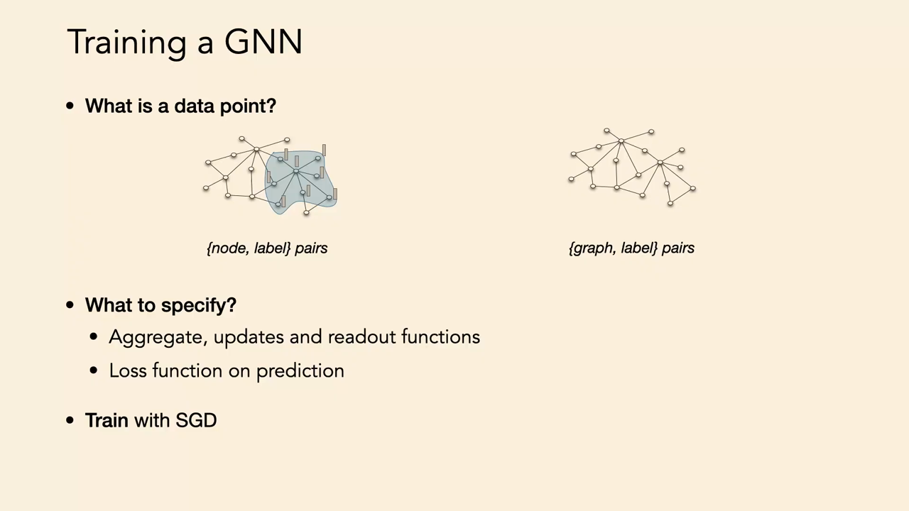
*▲ 강의 슬라이드 [65:18](https://youtu.be/0niIwb37nF0?t=3918): 데이터 한 개는 {노드, [정답](00_%EB%94%A5%EB%9F%AC%EB%8B%9D_%EC%9A%A9%EC%96%B4%EC%82%AC%EC%A0%84.md#label-%EC%A0%95%EB%8B%B5)} 쌍 또는 {그래프, [정답](00_%EB%94%A5%EB%9F%AC%EB%8B%9D_%EC%9A%A9%EC%96%B4%EC%82%AC%EC%A0%84.md#label-%EC%A0%95%EB%8B%B5)} 쌍*

강의에서는 약물 부작용(polypharmacy) 예측과 구글 지도 문제를 [GNN](00_%EB%94%A5%EB%9F%AC%EB%8B%9D_%EC%9A%A9%EC%96%B4%EC%82%AC%EC%A0%84.md#gnn-graph-neural-network-%EA%B7%B8%EB%9E%98%ED%94%84-%EC%8B%A0%EA%B2%BD%EB%A7%9D)으로 세우는 슬라이드를 건너뛰었습니다.

### 9.3 GNN이 구별하지 못하는 그래프

▶ 영상 [66:27](https://youtu.be/0niIwb37nF0?t=3987)

📐 **수학 개념**: [WL 색칠 알고리즘](%EC%88%98%ED%95%99%EA%B0%9C%EB%85%90/07_%EA%B5%AC%EC%A1%B0_%EC%95%84%ED%82%A4%ED%85%8D%EC%B2%98/MM21_WL_%EC%83%89%EC%B9%A0_%EC%95%8C%EA%B3%A0%EB%A6%AC%EC%A6%98.md) · [순열](%EC%88%98%ED%95%99%EA%B0%9C%EB%85%90/07_%EA%B5%AC%EC%A1%B0_%EC%95%84%ED%82%A4%ED%85%8D%EC%B2%98/MM18_%EC%9D%B8%EC%A0%91%ED%96%89%EB%A0%AC%EA%B3%BC_%EC%88%9C%EC%97%B4.md)

핵심 질문은 "**[GNN](00_%EB%94%A5%EB%9F%AC%EB%8B%9D_%EC%9A%A9%EC%96%B4%EC%82%AC%EC%A0%84.md#gnn-graph-neural-network-%EA%B7%B8%EB%9E%98%ED%94%84-%EC%8B%A0%EA%B2%BD%EB%A7%9D)은 어떤 그래프들을 서로 구별할 수 있나?**"입니다. [GNN](00_%EB%94%A5%EB%9F%AC%EB%8B%9D_%EC%9A%A9%EC%96%B4%EC%82%AC%EC%A0%84.md#gnn-graph-neural-network-%EA%B7%B8%EB%9E%98%ED%94%84-%EC%8B%A0%EA%B2%BD%EB%A7%9D)이 같다고 보는 두 그래프(같은 동치류, equivalence class)에는 [GNN](00_%EB%94%A5%EB%9F%AC%EB%8B%9D_%EC%9A%A9%EC%96%B4%EC%82%AC%EC%A0%84.md#gnn-graph-neural-network-%EA%B7%B8%EB%9E%98%ED%94%84-%EC%8B%A0%EA%B2%BD%EB%A7%9D)이 반드시 같은 예측을 냅니다. 그러므로 근사하려는 함수가 그 두 그래프에 다른 값을 줘야 한다면, [GNN](00_%EB%94%A5%EB%9F%AC%EB%8B%9D_%EC%9A%A9%EC%96%B4%EC%82%AC%EC%A0%84.md#gnn-graph-neural-network-%EA%B7%B8%EB%9E%98%ED%94%84-%EC%8B%A0%EA%B2%BD%EB%A7%9D)은 반드시 [오차](00_%EB%94%A5%EB%9F%AC%EB%8B%9D_%EC%9A%A9%EC%96%B4%EC%82%AC%EC%A0%84.md#error-%EC%98%A4%EC%B0%A8)를 냅니다. 반대로 정리(대칭 Stone-Weierstrass 정리에 기댄 결과)는 **동치류 안에서 같은 값을 주는 연속 함수라면 [메시지 전달](00_%EB%94%A5%EB%9F%AC%EB%8B%9D_%EC%9A%A9%EC%96%B4%EC%82%AC%EC%A0%84.md#message-passing-%EB%A9%94%EC%8B%9C%EC%A7%80-%EC%A0%84%EB%8B%AC) [GNN](00_%EB%94%A5%EB%9F%AC%EB%8B%9D_%EC%9A%A9%EC%96%B4%EC%82%AC%EC%A0%84.md#gnn-graph-neural-network-%EA%B7%B8%EB%9E%98%ED%94%84-%EC%8B%A0%EA%B2%BD%EB%A7%9D)으로 원하는 만큼 가깝게 근사할 수 있다**고 말합니다. 즉 "구별할 수 있는 만큼 근사할 수 있다"입니다.

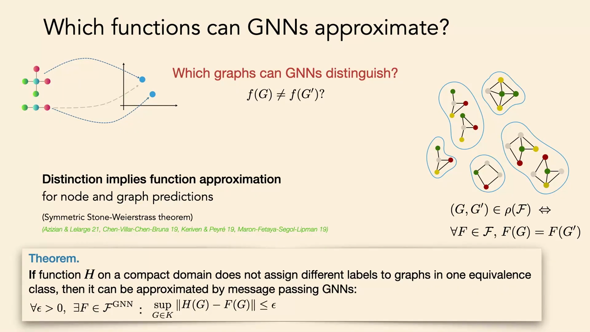
*▲ 강의 슬라이드 [67:50](https://youtu.be/0niIwb37nF0?t=4070): 구별할 수 있으면 근사할 수 있다는 정리*

[GNN](00_%EB%94%A5%EB%9F%AC%EB%8B%9D_%EC%9A%A9%EC%96%B4%EC%82%AC%EC%A0%84.md#gnn-graph-neural-network-%EA%B7%B8%EB%9E%98%ED%94%84-%EC%8B%A0%EA%B2%BD%EB%A7%9D)의 눈에 그래프는 **노드마다 본 계산 트리의 모음**이 전부입니다. 메시지가 그 길로만 흐르기 때문입니다. 따라서 **모든 노드의 트리가 같은 두 그래프는 [GNN](00_%EB%94%A5%EB%9F%AC%EB%8B%9D_%EC%9A%A9%EC%96%B4%EC%82%AC%EC%A0%84.md#gnn-graph-neural-network-%EA%B7%B8%EB%9E%98%ED%94%84-%EC%8B%A0%EA%B2%BD%EB%A7%9D)에게 같은 그래프**입니다. 놀랍게도 서로 다른데 트리가 같은 그래프가 있습니다.

- 강의의 예: 사각형 두 개를 붙인 그래프와, 삼각형 두 개를 다리로 이은 그래프. 하나는 닫힌 사각형 영역 둘, 하나는 삼각형 둘이라 구조가 분명히 다릅니다. 그런데 왼쪽 위 빨간 노드에서 본 트리는 두 그래프에서 똑같고(빨강의 이웃은 노랑과 빨강, 노랑의 이웃은 빨강·노랑·빨강, ...) 계속 펼쳐도 같습니다.
- 그래서 두 분자가 이런 관계이고 하나만 독성이 있다면, [GNN](00_%EB%94%A5%EB%9F%AC%EB%8B%9D_%EC%9A%A9%EC%96%B4%EC%82%AC%EC%A0%84.md#gnn-graph-neural-network-%EA%B7%B8%EB%9E%98%ED%94%84-%EC%8B%A0%EA%B2%BD%EB%A7%9D)은 둘에 같은 [정답](00_%EB%94%A5%EB%9F%AC%EB%8B%9D_%EC%9A%A9%EC%96%B4%EC%82%AC%EC%A0%84.md#label-%EC%A0%95%EB%8B%B5)을 붙일 수밖에 없습니다.

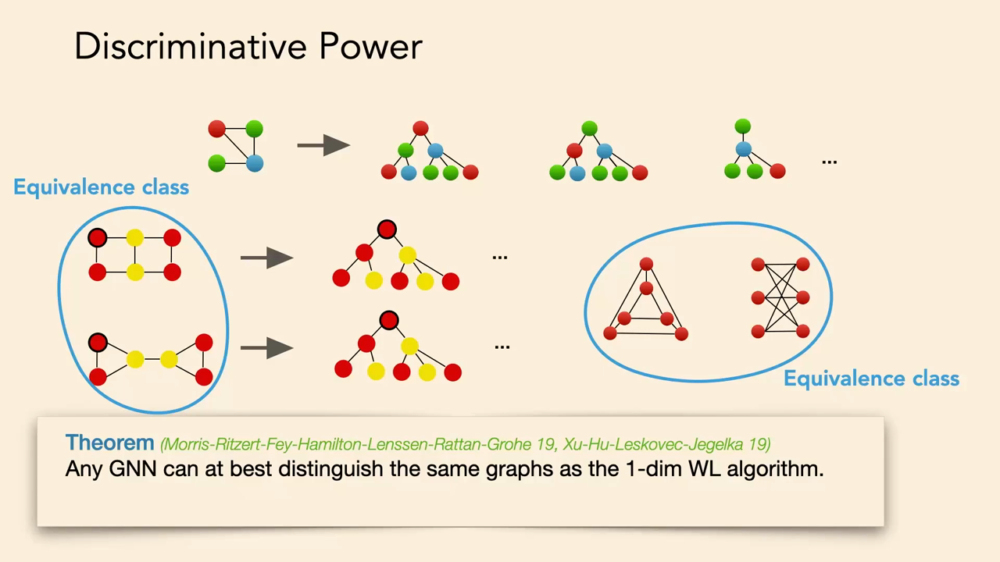
*▲ 강의 슬라이드 [71:15](https://youtu.be/0niIwb37nF0?t=4275): [GNN](00_%EB%94%A5%EB%9F%AC%EB%8B%9D_%EC%9A%A9%EC%96%B4%EC%82%AC%EC%A0%84.md#gnn-graph-neural-network-%EA%B7%B8%EB%9E%98%ED%94%84-%EC%8B%A0%EA%B2%BD%EB%A7%9D)이 구별하지 못하는 두 동치류. 노드마다 본 트리가 같음*

*▲ 직접 그린 그림: 1-WL 색칠 결과가 같은 두 쌍. 왼쪽 쌍은 강의 예와 같은 구조(노드 6, 엣지 7, 차수 2 노드 4개·차수 3 노드 2개). 자세히: [MM21_WL_색칠_알고리즘](%EC%88%98%ED%95%99%EA%B0%9C%EB%85%90/07_%EA%B5%AC%EC%A1%B0_%EC%95%84%ED%82%A4%ED%85%8D%EC%B2%98/MM21_WL_%EC%83%89%EC%B9%A0_%EC%95%8C%EA%B3%A0%EB%A6%AC%EC%A6%98.md)*

청중 한 명이 "노드마다 [원-핫](00_%EB%94%A5%EB%9F%AC%EB%8B%9D_%EC%9A%A9%EC%96%B4%EC%82%AC%EC%A0%84.md#one-hot-encoding-%EC%9B%90-%ED%95%AB-%EC%9D%B8%EC%BD%94%EB%94%A9)으로 번호를 주면 구별할 수 있지 않나?"라고 묻습니다. 맞습니다. 하지만 그러면 순열 불변성이 깨집니다. 이 거래는 9.6에서 다시 다룹니다.

### 9.4 1-WL 알고리즘과 같은 구별력

▶ 영상 [71:07](https://youtu.be/0niIwb37nF0?t=4267)

📐 **수학 개념**: [WL 색칠 알고리즘](%EC%88%98%ED%95%99%EA%B0%9C%EB%85%90/07_%EA%B5%AC%EC%A1%B0_%EC%95%84%ED%82%A4%ED%85%8D%EC%B2%98/MM21_WL_%EC%83%89%EC%B9%A0_%EC%95%8C%EA%B3%A0%EB%A6%AC%EC%A6%98.md) · [단사 집계](%EC%88%98%ED%95%99%EA%B0%9C%EB%85%90/07_%EA%B5%AC%EC%A1%B0_%EC%95%84%ED%82%A4%ED%85%8D%EC%B2%98/MM19_%EB%A9%80%ED%8B%B0%EC%85%8B_%EC%A7%91%EA%B3%84_%ED%95%A8%EC%88%98.md)

이 결과는 1960년대의 고전 그래프 이론인 **[그래프 동형](00_%EB%94%A5%EB%9F%AC%EB%8B%9D_%EC%9A%A9%EC%96%B4%EC%82%AC%EC%A0%84.md#graph-isomorphism-%EA%B7%B8%EB%9E%98%ED%94%84-%EB%8F%99%ED%98%95)([Graph](00_%EB%94%A5%EB%9F%AC%EB%8B%9D_%EC%9A%A9%EC%96%B4%EC%82%AC%EC%A0%84.md#graph-node-edge-%EA%B7%B8%EB%9E%98%ED%94%84-%EB%85%B8%EB%93%9C-%EC%97%A3%EC%A7%80) isomorphism)** 판정과 이어집니다. 두 그래프가 같은 그래프인지 확인하는 방법 가운데 **[1차원 Weisfeiler-Leman(1-WL) 알고리즘](00_%EB%94%A5%EB%9F%AC%EB%8B%9D_%EC%9A%A9%EC%96%B4%EC%82%AC%EC%A0%84.md#weisfeiler-leman-test-wl-%ED%85%8C%EC%8A%A4%ED%8A%B8)** 이 있습니다. 노드에 색을 칠하고, "내 색 + 이웃 색들"을 해시해 새 색을 만드는 일을 되풀이한 뒤, 두 그래프의 색 분포가 다르면 다른 그래프라고 판정합니다.

$$
c^{(t)}(v) = \text{Hash}\big(c^{(t-1)}(v),\ \{\!\{c^{(t-1)}(u) : u \in \mathcal{N}(v)\}\!\}\big) \quad\text{vs}\quad h_v^{(t)} = f_{\text{Update}}\big(h_v^{(t-1)},\ f_{\text{Agg}}(\{\!\{h_u^{(t-1)}\}\!\})\big)
$$

기호 풀이

| 기호 | 읽는 법 | 뜻 | 예제 값 |
| --- | --- | --- | --- |
| $c^{(t)}(v)$ | 씨 티 오브 브이 | t번째 반복에서 노드 v의 색 | (0, 1, 1, 0) |
| $t$ | 티 | 반복 번호 | 1 |
| $\text{Hash}$ | 해시 | 서로 다른 입력에 반드시 다른 색을 주는 함수 | 서명 → 0, 1 |
| $\{\!\{\cdot\}\!\}$ | [멀티셋](00_%EB%94%A5%EB%9F%AC%EB%8B%9D_%EC%9A%A9%EC%96%B4%EC%82%AC%EC%A0%84.md#multiset-%EB%A9%80%ED%8B%B0%EC%85%8B) | 순서 없음, 중복 허용 | $\{\!\{0, 0\}\!\}$ |
| $\mathcal{N}(v)$ | 엔 오브 브이 | v의 이웃 집합 | 노드 1: {0, 2} |
| $h_v^{(t)}$ | 에이치 브이 티 | t번째 [층](00_%EB%94%A5%EB%9F%AC%EB%8B%9D_%EC%9A%A9%EC%96%B4%EC%82%AC%EC%A0%84.md#layer-%EC%B8%B5)에서 노드 v의 벡터 ([GNN](00_%EB%94%A5%EB%9F%AC%EB%8B%9D_%EC%9A%A9%EC%96%B4%EC%82%AC%EC%A0%84.md#gnn-graph-neural-network-%EA%B7%B8%EB%9E%98%ED%94%84-%EC%8B%A0%EA%B2%BD%EB%A7%9D) 쪽의 색) | (2, 3, 3, 2) |
| $f_{\text{Agg}}$ | 에프 어그 | [집계 함수](00_%EB%94%A5%EB%9F%AC%EB%8B%9D_%EC%9A%A9%EC%96%B4%EC%82%AC%EC%A0%84.md#aggregation-function-%EC%A7%91%EA%B3%84-%ED%95%A8%EC%88%98) (Hash 쪽의 [멀티셋](00_%EB%94%A5%EB%9F%AC%EB%8B%9D_%EC%9A%A9%EC%96%B4%EC%82%AC%EC%A0%84.md#multiset-%EB%A9%80%ED%8B%B0%EC%85%8B) 받기) | 합 |
| $f_{\text{Update}}$ | 에프 업데이트 | [갱신 함수](00_%EB%94%A5%EB%9F%AC%EB%8B%9D_%EC%9A%A9%EC%96%B4%EC%82%AC%EC%A0%84.md#update-function-%EA%B0%B1%EC%8B%A0-%ED%95%A8%EC%88%98) (Hash 자리) | $h + m$ |
| vs | 버서스 | 왼쪽 1-WL과 오른쪽 [GNN](00_%EB%94%A5%EB%9F%AC%EB%8B%9D_%EC%9A%A9%EC%96%B4%EC%82%AC%EC%A0%84.md#gnn-graph-neural-network-%EA%B7%B8%EB%9E%98%ED%94%84-%EC%8B%A0%EA%B2%BD%EB%A7%9D)을 나란히 비교 | - |

예제와 풀이

**문제**: 일자 그래프 0-1-2-3에서 1-WL 색칠 한 번과 [GNN](00_%EB%94%A5%EB%9F%AC%EB%8B%9D_%EC%9A%A9%EC%96%B4%EC%82%AC%EC%A0%84.md#gnn-graph-neural-network-%EA%B7%B8%EB%9E%98%ED%94%84-%EC%8B%A0%EA%B2%BD%EB%A7%9D) 한 [층](00_%EB%94%A5%EB%9F%AC%EB%8B%9D_%EC%9A%A9%EC%96%B4%EC%82%AC%EC%A0%84.md#layer-%EC%B8%B5)을 돌려, 두 방법이 노드를 같은 방식으로 나누는지 확인하라.

**주어진 값**:
- $\mathcal{N}(0) = \{1\}$, $\mathcal{N}(1) = \{0, 2\}$, $\mathcal{N}(2) = \{1, 3\}$, $\mathcal{N}(3) = \{2\}$ (일자 그래프의 이웃)
- $c^{(0)}(v) = 0$ (모든 노드의 처음 색)
- $h_v^{(0)} = 1$ (모든 노드의 [GNN](00_%EB%94%A5%EB%9F%AC%EB%8B%9D_%EC%9A%A9%EC%96%B4%EC%82%AC%EC%A0%84.md#gnn-graph-neural-network-%EA%B7%B8%EB%9E%98%ED%94%84-%EC%8B%A0%EA%B2%BD%EB%A7%9D) 처음 값)
- $f_{\text{Agg}}$ = 합 (이웃 값을 더함)
- $f_{\text{Update}}(h, m) = h + m$ (내 값에 메시지를 더함)
- Hash = 서명을 정렬해 작은 것부터 0, 1, ... 번호를 주는 함수
- $t = 1$ (첫 반복)

**풀이**
1. 식을 그대로 쓴다: $c^{(t)}(v) = \text{Hash}\big(c^{(t-1)}(v),\ \{\!\{c^{(t-1)}(u) : u \in \mathcal{N}(v)\}\!\}\big) \quad\text{vs}\quad h_v^{(t)} = f_{\text{Update}}\big(h_v^{(t-1)},\ f_{\text{Agg}}(\{\!\{h_u^{(t-1)}\}\!\})\big)$
2. 값을 대입한다 (노드 1): $c^{(1)}(1) = \text{Hash}\big(0,\ \{\!\{0, 0\}\!\}\big) \quad\text{vs}\quad h_1^{(1)} = f_{\text{Update}}\big(1,\ f_{\text{Agg}}(\{\!\{1, 1\}\!\})\big)$
3. Hash의 뜻: (내 색, 이웃 색 [멀티셋](00_%EB%94%A5%EB%9F%AC%EB%8B%9D_%EC%9A%A9%EC%96%B4%EC%82%AC%EC%A0%84.md#multiset-%EB%A9%80%ED%8B%B0%EC%85%8B)) 묶음인 서명이 같으면 같은 번호, 다르면 다른 번호를 준다
4. 끝점(노드 0, 3)의 서명을 적는다: 이웃이 하나라 $(0, \{\!\{0\}\!\})$
5. 가운데(노드 1, 2)의 서명을 적는다: 이웃이 둘이라 $(0, \{\!\{0, 0\}\!\})$
6. 서명을 정렬해 번호를 준다: $(0, \{\!\{0\}\!\}) \to 0$, $(0, \{\!\{0, 0\}\!\}) \to 1$ 이므로 $c^{(1)} = (0, 1, 1, 0)$
7. [GNN](00_%EB%94%A5%EB%9F%AC%EB%8B%9D_%EC%9A%A9%EC%96%B4%EC%82%AC%EC%A0%84.md#gnn-graph-neural-network-%EA%B7%B8%EB%9E%98%ED%94%84-%EC%8B%A0%EA%B2%BD%EB%A7%9D) 끝점을 집계한다: 이웃 하나의 값이 1이라 $f_{\text{Agg}} = 1$
8. [GNN](00_%EB%94%A5%EB%9F%AC%EB%8B%9D_%EC%9A%A9%EC%96%B4%EC%82%AC%EC%A0%84.md#gnn-graph-neural-network-%EA%B7%B8%EB%9E%98%ED%94%84-%EC%8B%A0%EA%B2%BD%EB%A7%9D) 끝점을 갱신한다: $1 + 1 = 2$
9. [GNN](00_%EB%94%A5%EB%9F%AC%EB%8B%9D_%EC%9A%A9%EC%96%B4%EC%82%AC%EC%A0%84.md#gnn-graph-neural-network-%EA%B7%B8%EB%9E%98%ED%94%84-%EC%8B%A0%EA%B2%BD%EB%A7%9D) 가운데를 집계한다: 이웃 두 값을 더해 $1 + 1 = 2$
10. [GNN](00_%EB%94%A5%EB%9F%AC%EB%8B%9D_%EC%9A%A9%EC%96%B4%EC%82%AC%EC%A0%84.md#gnn-graph-neural-network-%EA%B7%B8%EB%9E%98%ED%94%84-%EC%8B%A0%EA%B2%BD%EB%A7%9D) 가운데를 갱신한다: $1 + 2 = 3$ 이므로 $h^{(1)} = (2, 3, 3, 2)$
11. 두 결과를 비교한다: 둘 다 노드를 {0, 3}과 {1, 2}로 나눈다

**답**: WL 색 $(0, 1, 1, 0)$, [GNN](00_%EB%94%A5%EB%9F%AC%EB%8B%9D_%EC%9A%A9%EC%96%B4%EC%82%AC%EC%A0%84.md#gnn-graph-neural-network-%EA%B7%B8%EB%9E%98%ED%94%84-%EC%8B%A0%EA%B2%BD%EB%A7%9D) 값 $(2, 3, 3, 2)$. 노드를 나누는 방식이 같다

내 이해

두 식은 모양이 같습니다. 정리는 두 방향입니다.

1. **상한**: 어떤 [GNN](00_%EB%94%A5%EB%9F%AC%EB%8B%9D_%EC%9A%A9%EC%96%B4%EC%82%AC%EC%A0%84.md#gnn-graph-neural-network-%EA%B7%B8%EB%9E%98%ED%94%84-%EC%8B%A0%EA%B2%BD%EB%A7%9D)도 1-WL이 구별하는 것보다 더 많은 그래프를 구별할 수 없습니다(Morris 외 2019, Xu 외 2019).
2. **도달 가능**: 어떤 크기 $n$에 대해서도, 1-WL 색과 똑같이 움직이는 [GNN](00_%EB%94%A5%EB%9F%AC%EB%8B%9D_%EC%9A%A9%EC%96%B4%EC%82%AC%EC%A0%84.md#gnn-graph-neural-network-%EA%B7%B8%EB%9E%98%ED%94%84-%EC%8B%A0%EA%B2%BD%EB%A7%9D)이 **존재**합니다. 즉 1-WL이 구별하는 그래프 쌍은 [GNN](00_%EB%94%A5%EB%9F%AC%EB%8B%9D_%EC%9A%A9%EC%96%B4%EC%82%AC%EC%A0%84.md#gnn-graph-neural-network-%EA%B7%B8%EB%9E%98%ED%94%84-%EC%8B%A0%EA%B2%BD%EB%A7%9D)도 구별할 수 있습니다.

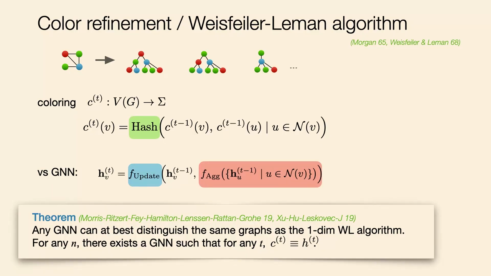
*▲ 강의 슬라이드 [73:00](https://youtu.be/0niIwb37nF0?t=4380): 색칠(Weisfeiler-Leman) 알고리즘과 [GNN](00_%EB%94%A5%EB%9F%AC%EB%8B%9D_%EC%9A%A9%EC%96%B4%EC%82%AC%EC%A0%84.md#gnn-graph-neural-network-%EA%B7%B8%EB%9E%98%ED%94%84-%EC%8B%A0%EA%B2%BD%EB%A7%9D)의 대응, 1-WL과 같은 구별력이라는 정리*

**왜 도달 가능한가?** 두 단계의 논증입니다. ① 어떤 [멀티셋](00_%EB%94%A5%EB%9F%AC%EB%8B%9D_%EC%9A%A9%EC%96%B4%EC%82%AC%EC%A0%84.md#multiset-%EB%A9%80%ED%8B%B0%EC%85%8B) 함수든 비선형 함수 $g_1, g_2$로 $f(S) = g_1(\sum_{h \in S} g_2(h))$ 꼴로 쓸 수 있고, ② MLP는 임의의 비선형 함수의 보편 근사기이므로 "합 + MLP" 집계가 단사(서로 다른 [멀티셋](00_%EB%94%A5%EB%9F%AC%EB%8B%9D_%EC%9A%A9%EC%96%B4%EC%82%AC%EC%A0%84.md#multiset-%EB%A9%80%ED%8B%B0%EC%85%8B) → 서로 다른 출력)가 될 수 있습니다. 단사 집계는 1-WL의 Hash 역할을 하므로 1-WL과 같은 그래프들을 구별합니다.

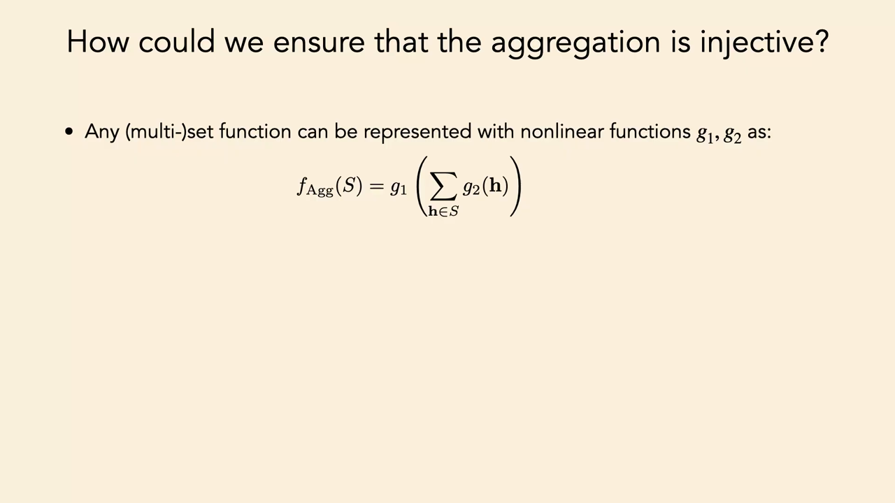
*▲ 강의 슬라이드 [73:20](https://youtu.be/0niIwb37nF0?t=4400): 집계를 단사로 만드는 방법, [멀티셋](00_%EB%94%A5%EB%9F%AC%EB%8B%9D_%EC%9A%A9%EC%96%B4%EC%82%AC%EC%A0%84.md#multiset-%EB%A9%80%ED%8B%B0%EC%85%8B) 함수의 일반형*

질의응답: 구별 못 하는 그래프는 실제로 얼마나 흔한가? [73:54](https://youtu.be/0niIwb37nF0?t=4434)

강사는 "작년에는 드문 경우라고 말했는데, 사실 잘 모른다"고 솔직히 답합니다. 손으로 그런 쌍을 찾기도 어렵고, 이론적으로 중요한 최악의 경우(적대적 사례)라고 봅니다. 실제 분자 가운데 해로운 것과 무해한 것이 [GNN](00_%EB%94%A5%EB%9F%AC%EB%8B%9D_%EC%9A%A9%EC%96%B4%EC%82%AC%EC%A0%84.md#gnn-graph-neural-network-%EA%B7%B8%EB%9E%98%ED%94%84-%EC%8B%A0%EA%B2%BD%EB%A7%9D)에게 같아 보이는 쌍이 있는지는 건강·안전에 중요한 응용에서 알아 둘 만한 문제라고 덧붙입니다.

> [!TIP]
> **🆕 2026 업데이트: 1-WL 한계는 실제 데이터에서 얼마나 문제인가**
> - **강의**: 구별 못 하는 그래프 쌍이 실제로 얼마나 흔한지 모른다고 답함.
> - **현재**: 이 질문을 직접 조사한 연구가 있습니다. 흔히 쓰는 그래프 [분류](00_%EB%94%A5%EB%9F%AC%EB%8B%9D_%EC%9A%A9%EC%96%B4%EC%82%AC%EC%A0%84.md#regression-classification-%ED%9A%8C%EA%B7%80%EC%99%80-%EB%B6%84%EB%A5%98) 벤치마크 데이터셋들을 검사한 결과, 대부분의 데이터셋에서 1-WL만으로 거의 모든 그래프를 서로 구별할 수 있었고, [분류](00_%EB%94%A5%EB%9F%AC%EB%8B%9D_%EC%9A%A9%EC%96%B4%EC%82%AC%EC%A0%84.md#regression-classification-%ED%9A%8C%EA%B7%80%EC%99%80-%EB%B6%84%EB%A5%98) [정확도](00_%EB%94%A5%EB%9F%AC%EB%8B%9D_%EC%9A%A9%EC%96%B4%EC%82%AC%EC%A0%84.md#accuracy-%EC%A0%95%ED%99%95%EB%8F%84)의 이론적 상한도 100%에 가까운 경우가 많았습니다. 저자는 실제 성능이 [표현력](00_%EB%94%A5%EB%9F%AC%EB%8B%9D_%EC%9A%A9%EC%96%B4%EC%82%AC%EC%A0%84.md#representational-power-%ED%91%9C%ED%98%84%EB%A0%A5)의 한계에 막히는 일은 드물다고 결론짓습니다. 다만 이것은 벤치마크 데이터셋에 대한 결과이며, 강사가 말한 "최악의 경우"가 안전이 중요한 응용에서 생길 가능성까지 없앤 것은 아닙니다.
> - **출처**: [1-WL Expressiveness Is (Almost) All You Need (Zopf, arXiv, 2022)](https://arxiv.org/abs/2202.10156)

### 9.5 이론이 실제로 중요한가: 합 vs 평균 vs 최댓값

▶ 영상 [75:06](https://youtu.be/0niIwb37nF0?t=4506)

📐 **수학 개념**: [멀티셋 집계 함수](%EC%88%98%ED%95%99%EA%B0%9C%EB%85%90/07_%EA%B5%AC%EC%A1%B0_%EC%95%84%ED%82%A4%ED%85%8D%EC%B2%98/MM19_%EB%A9%80%ED%8B%B0%EC%85%8B_%EC%A7%91%EA%B3%84_%ED%95%A8%EC%88%98.md)

단백질 데이터(PROTEINS)에서 [집계 함수](00_%EB%94%A5%EB%9F%AC%EB%8B%9D_%EC%9A%A9%EC%96%B4%EC%82%AC%EC%A0%84.md#aggregation-function-%EC%A7%91%EA%B3%84-%ED%95%A8%EC%88%98) $g_1(\sum g_2(h))$의 $g$와 풀링 방식을 바꾸며 **[학습](00_%EB%94%A5%EB%9F%AC%EB%8B%9D_%EC%9A%A9%EC%96%B4%EC%82%AC%EC%A0%84.md#training-%ED%95%99%EC%8A%B5) [정확도](00_%EB%94%A5%EB%9F%AC%EB%8B%9D_%EC%9A%A9%EC%96%B4%EC%82%AC%EC%A0%84.md#accuracy-%EC%A0%95%ED%99%95%EB%8F%84)** 를 [에폭](00_%EB%94%A5%EB%9F%AC%EB%8B%9D_%EC%9A%A9%EC%96%B4%EC%82%AC%EC%A0%84.md#epoch-%EC%97%90%ED%8F%AD)별로 본 실험입니다(GIN 논문, Xu 외 2019). [학습](00_%EB%94%A5%EB%9F%AC%EB%8B%9D_%EC%9A%A9%EC%96%B4%EC%82%AC%EC%A0%84.md#training-%ED%95%99%EC%8A%B5) [정확도](00_%EB%94%A5%EB%9F%AC%EB%8B%9D_%EC%9A%A9%EC%96%B4%EC%82%AC%EC%A0%84.md#accuracy-%EC%A0%95%ED%99%95%EB%8F%84)만 보므로 [일반화](00_%EB%94%A5%EB%9F%AC%EB%8B%9D_%EC%9A%A9%EC%96%B4%EC%82%AC%EC%A0%84.md#generalization-%EC%9D%BC%EB%B0%98%ED%99%94)가 아니라 **근사(맞출 수 있는가)** 의 문제입니다.

| 집계 | 결과 | 이유 |
|---|---|---|
| 합 + MLP | [학습 데이터](00_%EB%94%A5%EB%9F%AC%EB%8B%9D_%EC%9A%A9%EC%96%B4%EC%82%AC%EC%A0%84.md#training-data-test-data-%ED%95%99%EC%8A%B5-%EB%8D%B0%EC%9D%B4%ED%84%B0%EC%99%80-%EC%8B%9C%ED%97%98-%EB%8D%B0%EC%9D%B4%ED%84%B0)를 100% 맞춤 | [멀티셋](00_%EB%94%A5%EB%9F%AC%EB%8B%9D_%EC%9A%A9%EC%96%B4%EC%82%AC%EC%A0%84.md#multiset-%EB%A9%80%ED%8B%B0%EC%85%8B) 함수의 보편 근사기 (단사) |
| 합 + 선형·[ReLU](00_%EB%94%A5%EB%9F%AC%EB%8B%9D_%EC%9A%A9%EC%96%B4%EC%82%AC%EC%A0%84.md#relu-%EB%A0%90%EB%A3%A8) 한 겹 | 더 낮은 [정확도](00_%EB%94%A5%EB%9F%AC%EB%8B%9D_%EC%9A%A9%EC%96%B4%EC%82%AC%EC%A0%84.md#accuracy-%EC%A0%95%ED%99%95%EB%8F%84)에서 멈춤 | "선형-ReLU"는 보편 근사기가 아님(선형-ReLU-선형이어야 함). [PyTorch](00_%EB%94%A5%EB%9F%AC%EB%8B%9D_%EC%9A%A9%EC%96%B4%EC%82%AC%EC%A0%84.md#pytorch-%ED%8C%8C%EC%9D%B4%ED%86%A0%EC%B9%98)에서 한 줄 아끼려다 생길 수 있는 실수 |
| 평균 | 훨씬 나쁨 | 이웃 수 정보를 지움 |
| 최댓값 | 역시 나쁨 | 개수와 나머지 값을 지움 |

강사는 특히 **평균** 결과를 강조합니다. "수치적으로 더 안정적이겠지" 하고 합을 평균으로 바꾸면 [학습](00_%EB%94%A5%EB%9F%AC%EB%8B%9D_%EC%9A%A9%EC%96%B4%EC%82%AC%EC%A0%84.md#training-%ED%95%99%EC%8A%B5)이 거의 안 됩니다. 청중의 답대로, 합은 이웃이 많을수록 커지므로 **이웃 수**를 알지만 평균은 이웃 수로 나눠 그 정보를 잃습니다. 이 문제는 이웃 수를 알아야 풀리는 문제였습니다. 이런 작은 선택이 큰 차이를 만들기 때문에 근사 이론을 배우는 것입니다. (실험 그래프는 논문 그림이라 캡처하지 않았습니다. 같은 현상을 숫자로 본 예는 [MM19_멀티셋_집계_함수](%EC%88%98%ED%95%99%EA%B0%9C%EB%85%90/07_%EA%B5%AC%EC%A1%B0_%EC%95%84%ED%82%A4%ED%85%8D%EC%B2%98/MM19_%EB%A9%80%ED%8B%B0%EC%85%8B_%EC%A7%91%EA%B3%84_%ED%95%A8%EC%88%98.md)의 그림입니다.)

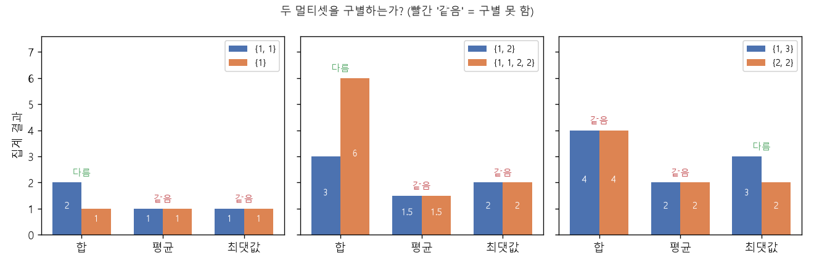
*▲ 직접 그린 그림: [멀티셋](00_%EB%94%A5%EB%9F%AC%EB%8B%9D_%EC%9A%A9%EC%96%B4%EC%82%AC%EC%A0%84.md#multiset-%EB%A9%80%ED%8B%B0%EC%85%8B) 세 쌍에서 합·평균·최댓값이 구별하는지. 평균은 {1, 2}와 {1, 1, 2, 2}를 같다고 봄*

### 9.6 계산할 수 없는 성질과 위치 인코딩

▶ 영상 [78:35](https://youtu.be/0niIwb37nF0?t=4715)

📐 **수학 개념**: [WL 색칠 (고리 수를 모름)](%EC%88%98%ED%95%99%EA%B0%9C%EB%85%90/07_%EA%B5%AC%EC%A1%B0_%EC%95%84%ED%82%A4%ED%85%8D%EC%B2%98/MM21_WL_%EC%83%89%EC%B9%A0_%EC%95%8C%EA%B3%A0%EB%A6%AC%EC%A6%98.md) · [사인파 위치 인코딩](%EC%88%98%ED%95%99%EA%B0%9C%EB%85%90/07_%EA%B5%AC%EC%A1%B0_%EC%95%84%ED%82%A4%ED%85%8D%EC%B2%98/MM17_%EC%82%AC%EC%9D%B8%ED%8C%8C_%EC%9C%84%EC%B9%98_%EC%9D%B8%EC%BD%94%EB%94%A9.md) ([Lec04 8절](Lec04_%EA%B2%A9%EC%9E%90_%EC%95%84%ED%82%A4%ED%85%8D%EC%B2%98.md#8-%EC%8B%9C%EA%B0%84-%EC%B6%95-%ED%95%A9%EC%84%B1%EA%B3%B1%EA%B3%BC-%EC%9C%84%EC%B9%98-%EC%9D%B8%EC%BD%94%EB%94%A9))

지금까지 본 기본 [GNN](00_%EB%94%A5%EB%9F%AC%EB%8B%9D_%EC%9A%A9%EC%96%B4%EC%82%AC%EC%A0%84.md#gnn-graph-neural-network-%EA%B7%B8%EB%9E%98%ED%94%84-%EC%8B%A0%EA%B2%BD%EB%A7%9D)으로는 **가장 긴(또는 가장 짧은) 고리의 길이**, **그래프의 지름(diameter)**, 특정 부분 구조(motif)의 개수 같은 성질을 계산할 수 없습니다(Garg 외 2020, Chen 외 2020). 이웃 구조는 같은데 지름이 다른 두 그래프를 만들 수 있으므로, [학습 데이터](00_%EB%94%A5%EB%9F%AC%EB%8B%9D_%EC%9A%A9%EC%96%B4%EC%82%AC%EC%A0%84.md#training-data-test-data-%ED%95%99%EC%8A%B5-%EB%8D%B0%EC%9D%B4%ED%84%B0%EC%99%80-%EC%8B%9C%ED%97%98-%EB%8D%B0%EC%9D%B4%ED%84%B0)가 아무리 많아도 [오차](00_%EB%94%A5%EB%9F%AC%EB%8B%9D_%EC%9A%A9%EC%96%B4%EC%82%AC%EC%A0%84.md#error-%EC%98%A4%EC%B0%A8)가 얼마든지 커지는 경우가 있습니다.

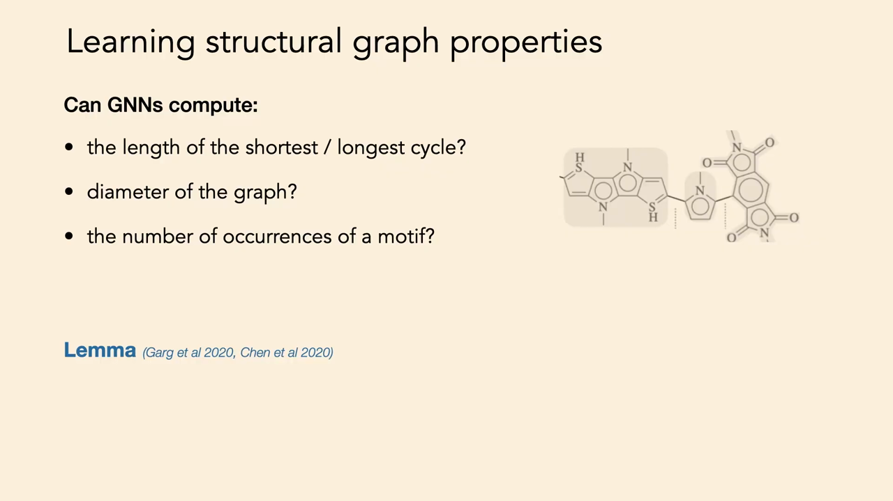
*▲ 강의 슬라이드 [78:30](https://youtu.be/0niIwb37nF0?t=4710): [GNN](00_%EB%94%A5%EB%9F%AC%EB%8B%9D_%EC%9A%A9%EC%96%B4%EC%82%AC%EC%A0%84.md#gnn-graph-neural-network-%EA%B7%B8%EB%9E%98%ED%94%84-%EC%8B%A0%EA%B2%BD%EB%A7%9D)이 계산할 수 있는가? 고리 길이, 지름, 부분 구조 개수*

이 한계를 넘는 방법은 앞에서 청중이 말한 대로 **[위치 인코딩](00_%EB%94%A5%EB%9F%AC%EB%8B%9D_%EC%9A%A9%EC%96%B4%EC%82%AC%EC%A0%84.md#positional-encoding-%EC%9C%84%EC%B9%98-%EC%9D%B8%EC%BD%94%EB%94%A9)(Positional encoding)** 입니다. [원-핫](00_%EB%94%A5%EB%9F%AC%EB%8B%9D_%EC%9A%A9%EC%96%B4%EC%82%AC%EC%A0%84.md#one-hot-encoding-%EC%9B%90-%ED%95%AB-%EC%9D%B8%EC%BD%94%EB%94%A9) 번호처럼 노드마다 "그래프 안에서 어디에 있는지"를 알려 주는 입력 특징을 덧붙이면, 이웃 구조가 같은 노드들도 서로 다른 위치를 갖게 되어 대칭이 깨집니다. 이미지 [CNN](00_%EB%94%A5%EB%9F%AC%EB%8B%9D_%EC%9A%A9%EC%96%B4%EC%82%AC%EC%A0%84.md#cnn-convolutional-neural-network-%ED%95%A9%EC%84%B1%EA%B3%B1-%EC%8B%A0%EA%B2%BD%EB%A7%9D)에서 사인파 [위치 인코딩](00_%EB%94%A5%EB%9F%AC%EB%8B%9D_%EC%9A%A9%EC%96%B4%EC%82%AC%EC%A0%84.md#positional-encoding-%EC%9C%84%EC%B9%98-%EC%9D%B8%EC%BD%94%EB%94%A9)으로 [이동 등변성](00_%EB%94%A5%EB%9F%AC%EB%8B%9D_%EC%9A%A9%EC%96%B4%EC%82%AC%EC%A0%84.md#translation-equivariance-%EC%9D%B4%EB%8F%99-%EB%93%B1%EB%B3%80%EC%84%B1)을 일부러 깨는 것([MM17_사인파_위치_인코딩](%EC%88%98%ED%95%99%EA%B0%9C%EB%85%90/07_%EA%B5%AC%EC%A1%B0_%EC%95%84%ED%82%A4%ED%85%8D%EC%B2%98/MM17_%EC%82%AC%EC%9D%B8%ED%8C%8C_%EC%9C%84%EC%B9%98_%EC%9D%B8%EC%BD%94%EB%94%A9.md))과 같은 생각입니다.

그래프에서 흔한 방법은 **[그래프 라플라시안](00_%EB%94%A5%EB%9F%AC%EB%8B%9D_%EC%9A%A9%EC%96%B4%EC%82%AC%EC%A0%84.md#graph-laplacian-%EA%B7%B8%EB%9E%98%ED%94%84-%EB%9D%BC%ED%94%8C%EB%9D%BC%EC%8B%9C%EC%95%88)** $L = D - A$ ($D$: 노드 차수를 대각에 둔 행렬)의 **[고유벡터](00_%EB%94%A5%EB%9F%AC%EB%8B%9D_%EC%9A%A9%EC%96%B4%EC%82%AC%EC%A0%84.md#eigenvector-eigenvalue-%EA%B3%A0%EC%9C%A0%EB%B2%A1%ED%84%B0%EC%99%80-%EA%B3%A0%EC%9C%B3%EA%B0%92)**를 쓰는 것입니다. 그래프 위의 일반화된 좌표계처럼 작동하고, 그래프 전체의 구조 정보를 더해 줍니다. 다만 [고유벡터](00_%EB%94%A5%EB%9F%AC%EB%8B%9D_%EC%9A%A9%EC%96%B4%EC%82%AC%EC%A0%84.md#eigenvector-eigenvalue-%EA%B3%A0%EC%9C%A0%EB%B2%A1%ED%84%B0%EC%99%80-%EA%B3%A0%EC%9C%B3%EA%B0%92)는 부호를 뒤집어도 [고유벡터](00_%EB%94%A5%EB%9F%AC%EB%8B%9D_%EC%9A%A9%EC%96%B4%EC%82%AC%EC%A0%84.md#eigenvector-eigenvalue-%EA%B3%A0%EC%9C%A0%EB%B2%A1%ED%84%B0%EC%99%80-%EA%B3%A0%EC%9C%B3%EA%B0%92)이고 [고윳값](00_%EB%94%A5%EB%9F%AC%EB%8B%9D_%EC%9A%A9%EC%96%B4%EC%82%AC%EC%A0%84.md#eigenvector-eigenvalue-%EA%B3%A0%EC%9C%A0%EB%B2%A1%ED%84%B0%EC%99%80-%EA%B3%A0%EC%9C%B3%EA%B0%92)이 겹치면 고르는 방법이 여럿이라는 **모호함**이 있습니다.

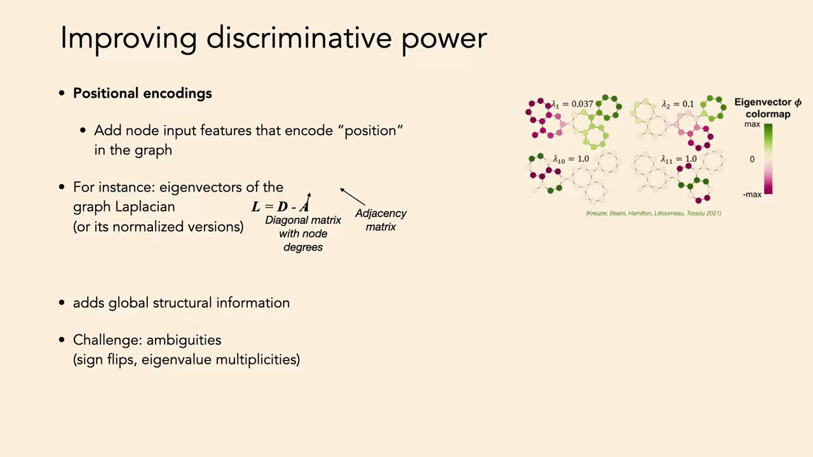
*▲ 강의 슬라이드 [80:30](https://youtu.be/0niIwb37nF0?t=4830): [위치 인코딩](00_%EB%94%A5%EB%9F%AC%EB%8B%9D_%EC%9A%A9%EC%96%B4%EC%82%AC%EC%A0%84.md#positional-encoding-%EC%9C%84%EC%B9%98-%EC%9D%B8%EC%BD%94%EB%94%A9)으로 구별력 높이기. 라플라시안 [고유벡터](00_%EB%94%A5%EB%9F%AC%EB%8B%9D_%EC%9A%A9%EC%96%B4%EC%82%AC%EC%A0%84.md#eigenvector-eigenvalue-%EA%B3%A0%EC%9C%A0%EB%B2%A1%ED%84%B0%EC%99%80-%EA%B3%A0%EC%9C%B3%EA%B0%92), 장점과 모호함*

이것은 **거래**입니다. 위치를 알려 주면 전에 구별 못 하던 그래프를 구별하게 되지만, 순열 불변성이 깨져 새로운 번호 붙이기에는 [일반화](00_%EB%94%A5%EB%9F%AC%EB%8B%9D_%EC%9A%A9%EC%96%B4%EC%82%AC%EC%A0%84.md#generalization-%EC%9D%BC%EB%B0%98%ED%99%94)가 덜 될 수 있습니다.

> [!TIP]
> **🆕 2026 업데이트: [메시지 전달](00_%EB%94%A5%EB%9F%AC%EB%8B%9D_%EC%9A%A9%EC%96%B4%EC%82%AC%EC%A0%84.md#message-passing-%EB%A9%94%EC%8B%9C%EC%A7%80-%EC%A0%84%EB%8B%AC) + [어텐션](00_%EB%94%A5%EB%9F%AC%EB%8B%9D_%EC%9A%A9%EC%96%B4%EC%82%AC%EC%A0%84.md#attention-%EC%96%B4%ED%85%90%EC%85%98) + [위치 인코딩](00_%EB%94%A5%EB%9F%AC%EB%8B%9D_%EC%9A%A9%EC%96%B4%EC%82%AC%EC%A0%84.md#positional-encoding-%EC%9C%84%EC%B9%98-%EC%9D%B8%EC%BD%94%EB%94%A9)을 합친 그래프 [트랜스포머](00_%EB%94%A5%EB%9F%AC%EB%8B%9D_%EC%9A%A9%EC%96%B4%EC%82%AC%EC%A0%84.md#transformer-%ED%8A%B8%EB%9E%9C%EC%8A%A4%ED%8F%AC%EB%A8%B8)**
> - **강의**: [위치 인코딩](00_%EB%94%A5%EB%9F%AC%EB%8B%9D_%EC%9A%A9%EC%96%B4%EC%82%AC%EC%A0%84.md#positional-encoding-%EC%9C%84%EC%B9%98-%EC%9D%B8%EC%BD%94%EB%94%A9)으로 1-WL 한계를 깰 수 있고, [트랜스포머](00_%EB%94%A5%EB%9F%AC%EB%8B%9D_%EC%9A%A9%EC%96%B4%EC%82%AC%EC%A0%84.md#transformer-%ED%8A%B8%EB%9E%9C%EC%8A%A4%ED%8F%AC%EB%A8%B8)는 [어텐션](00_%EB%94%A5%EB%9F%AC%EB%8B%9D_%EC%9A%A9%EC%96%B4%EC%82%AC%EC%A0%84.md#attention-%EC%96%B4%ED%85%90%EC%85%98)으로 집계하는 [GNN](00_%EB%94%A5%EB%9F%AC%EB%8B%9D_%EC%9A%A9%EC%96%B4%EC%82%AC%EC%A0%84.md#gnn-graph-neural-network-%EA%B7%B8%EB%9E%98%ED%94%84-%EC%8B%A0%EA%B2%BD%EB%A7%9D)이라고 소개하고 끝맺음.
> - **현재**: 두 생각을 합친 **그래프 [트랜스포머](00_%EB%94%A5%EB%9F%AC%EB%8B%9D_%EC%9A%A9%EC%96%B4%EC%82%AC%EC%A0%84.md#transformer-%ED%8A%B8%EB%9E%9C%EC%8A%A4%ED%8F%AC%EB%A8%B8)**가 널리 쓰입니다. 대표적인 GraphGPS 설계는 (1) 라플라시안 [고유벡터](00_%EB%94%A5%EB%9F%AC%EB%8B%9D_%EC%9A%A9%EC%96%B4%EC%82%AC%EC%A0%84.md#eigenvector-eigenvalue-%EA%B3%A0%EC%9C%A0%EB%B2%A1%ED%84%B0%EC%99%80-%EA%B3%A0%EC%9C%B3%EA%B0%92) 같은 위치·구조 인코딩, (2) 실제 엣지를 따라가는 국소 [메시지 전달](00_%EB%94%A5%EB%9F%AC%EB%8B%9D_%EC%9A%A9%EC%96%B4%EC%82%AC%EC%A0%84.md#message-passing-%EB%A9%94%EC%8B%9C%EC%A7%80-%EC%A0%84%EB%8B%AC), (3) 모든 노드 쌍을 보는 전역 [어텐션](00_%EB%94%A5%EB%9F%AC%EB%8B%9D_%EC%9A%A9%EC%96%B4%EC%82%AC%EC%A0%84.md#attention-%EC%96%B4%ED%85%90%EC%85%98)을 한 [층](00_%EB%94%A5%EB%9F%AC%EB%8B%9D_%EC%9A%A9%EC%96%B4%EC%82%AC%EC%A0%84.md#layer-%EC%B8%B5)에 함께 둡니다. 국소와 전역 부분을 분리해 계산량을 노드·엣지 수에 선형으로 줄였고, 저자들은 이 구조가 그래프 위의 보편 근사기라고 보입니다.
> - **출처**: [Recipe for a General, Powerful, Scalable Graph Transformer (Rampášek 외, NeurIPS, 2022)](https://arxiv.org/abs/2205.12454)

---

## 10. 정리

▶ 영상 [80:48](https://youtu.be/0niIwb37nF0?t=4848)

- [그래프 신경망](00_%EB%94%A5%EB%9F%AC%EB%8B%9D_%EC%9A%A9%EC%96%B4%EC%82%AC%EC%A0%84.md#gnn-graph-neural-network-%EA%B7%B8%EB%9E%98%ED%94%84-%EC%8B%A0%EA%B2%BD%EB%A7%9D)은 그래프 구조 데이터를 처리하는 데 알맞은 구조입니다.
- 핵심 제약은 **순열 불변·등변**이고, 이를 지키는 방법이 집계([멀티셋](00_%EB%94%A5%EB%9F%AC%EB%8B%9D_%EC%9A%A9%EC%96%B4%EC%82%AC%EC%A0%84.md#multiset-%EB%A9%80%ED%8B%B0%EC%85%8B) 함수) + 갱신(노드별 함수)의 [메시지 전달](00_%EB%94%A5%EB%9F%AC%EB%8B%9D_%EC%9A%A9%EC%96%B4%EC%82%AC%EC%A0%84.md#message-passing-%EB%A9%94%EC%8B%9C%EC%A7%80-%EC%A0%84%EB%8B%AC)입니다.
- MLP는 노드 1개 [GNN](00_%EB%94%A5%EB%9F%AC%EB%8B%9D_%EC%9A%A9%EC%96%B4%EC%82%AC%EC%A0%84.md#gnn-graph-neural-network-%EA%B7%B8%EB%9E%98%ED%94%84-%EC%8B%A0%EA%B2%BD%EB%A7%9D), [CNN](00_%EB%94%A5%EB%9F%AC%EB%8B%9D_%EC%9A%A9%EC%96%B4%EC%82%AC%EC%A0%84.md#cnn-convolutional-neural-network-%ED%95%A9%EC%84%B1%EA%B3%B1-%EC%8B%A0%EA%B2%BD%EB%A7%9D)은 격자 [GNN](00_%EB%94%A5%EB%9F%AC%EB%8B%9D_%EC%9A%A9%EC%96%B4%EC%82%AC%EC%A0%84.md#gnn-graph-neural-network-%EA%B7%B8%EB%9E%98%ED%94%84-%EC%8B%A0%EA%B2%BD%EB%A7%9D), 그리고 **[트랜스포머](00_%EB%94%A5%EB%9F%AC%EB%8B%9D_%EC%9A%A9%EC%96%B4%EC%82%AC%EC%A0%84.md#transformer-%ED%8A%B8%EB%9E%9C%EC%8A%A4%ED%8F%AC%EB%A8%B8)는 [어텐션](00_%EB%94%A5%EB%9F%AC%EB%8B%9D_%EC%9A%A9%EC%96%B4%EC%82%AC%EC%A0%84.md#attention-%EC%96%B4%ED%85%90%EC%85%98)으로 집계하는 [GNN](00_%EB%94%A5%EB%9F%AC%EB%8B%9D_%EC%9A%A9%EC%96%B4%EC%82%AC%EC%A0%84.md#gnn-graph-neural-network-%EA%B7%B8%EB%9E%98%ED%94%84-%EC%8B%A0%EA%B2%BD%EB%A7%9D)**입니다. [트랜스포머](00_%EB%94%A5%EB%9F%AC%EB%8B%9D_%EC%9A%A9%EC%96%B4%EC%82%AC%EC%A0%84.md#transformer-%ED%8A%B8%EB%9E%9C%EC%8A%A4%ED%8F%AC%EB%A8%B8)는 지금 가장 지배적인 아키텍처이고, 1~2주 뒤 강의에서 자세히 배웁니다.
- [GNN](00_%EB%94%A5%EB%9F%AC%EB%8B%9D_%EC%9A%A9%EC%96%B4%EC%82%AC%EC%A0%84.md#gnn-graph-neural-network-%EA%B7%B8%EB%9E%98%ED%94%84-%EC%8B%A0%EA%B2%BD%EB%A7%9D)의 구별력은 1-WL과 같고, 합 + MLP 집계로 그 상한에 도달합니다. 평균이나 한 겹짜리 집계는 그만큼 못 미칩니다.

---

## 11. 용어 정리

이번 강의에서 새로 나온 용어입니다.

| 용어 | 뜻 |
|---|---|
| [그래프, 노드, 엣지](00_%EB%94%A5%EB%9F%AC%EB%8B%9D_%EC%9A%A9%EC%96%B4%EC%82%AC%EC%A0%84.md#graph-node-edge-%EA%B7%B8%EB%9E%98%ED%94%84-%EB%85%B8%EB%93%9C-%EC%97%A3%EC%A7%80)([Graph](00_%EB%94%A5%EB%9F%AC%EB%8B%9D_%EC%9A%A9%EC%96%B4%EC%82%AC%EC%A0%84.md#graph-node-edge-%EA%B7%B8%EB%9E%98%ED%94%84-%EB%85%B8%EB%93%9C-%EC%97%A3%EC%A7%80), [Node](00_%EB%94%A5%EB%9F%AC%EB%8B%9D_%EC%9A%A9%EC%96%B4%EC%82%AC%EC%A0%84.md#graph-node-edge-%EA%B7%B8%EB%9E%98%ED%94%84-%EB%85%B8%EB%93%9C-%EC%97%A3%EC%A7%80), [Edge](00_%EB%94%A5%EB%9F%AC%EB%8B%9D_%EC%9A%A9%EC%96%B4%EC%82%AC%EC%A0%84.md#graph-node-edge-%EA%B7%B8%EB%9E%98%ED%94%84-%EB%85%B8%EB%93%9C-%EC%97%A3%EC%A7%80)) | 점(노드)과 점 사이의 연결(엣지)로 이루어진 데이터 구조 |
| [인접 행렬](00_%EB%94%A5%EB%9F%AC%EB%8B%9D_%EC%9A%A9%EC%96%B4%EC%82%AC%EC%A0%84.md#adjacency-matrix-%EC%9D%B8%EC%A0%91-%ED%96%89%EB%A0%AC)(Adjacency matrix) | i와 j가 이어져 있으면 1인 $n \times n$ 행렬 |
| [순열 불변성과 등변성](00_%EB%94%A5%EB%9F%AC%EB%8B%9D_%EC%9A%A9%EC%96%B4%EC%82%AC%EC%A0%84.md#permutation-invariance-permutation-equivariance-%EC%88%9C%EC%97%B4-%EB%B6%88%EB%B3%80%EC%84%B1%EA%B3%BC-%EC%88%9C%EC%97%B4-%EB%93%B1%EB%B3%80%EC%84%B1)(Permutation invariance/equivariance) | 노드 순서를 바꿔도 출력이 같음 / 출력이 같은 방식으로 섞임 |
| [노드 임베딩과 그래프 임베딩](00_%EB%94%A5%EB%9F%AC%EB%8B%9D_%EC%9A%A9%EC%96%B4%EC%82%AC%EC%A0%84.md#node-embedding-graph-embedding-%EB%85%B8%EB%93%9C-%EC%9E%84%EB%B2%A0%EB%94%A9%EA%B3%BC-%EA%B7%B8%EB%9E%98%ED%94%84-%EC%9E%84%EB%B2%A0%EB%94%A9)([Node](00_%EB%94%A5%EB%9F%AC%EB%8B%9D_%EC%9A%A9%EC%96%B4%EC%82%AC%EC%A0%84.md#graph-node-edge-%EA%B7%B8%EB%9E%98%ED%94%84-%EB%85%B8%EB%93%9C-%EC%97%A3%EC%A7%80)/[Graph](00_%EB%94%A5%EB%9F%AC%EB%8B%9D_%EC%9A%A9%EC%96%B4%EC%82%AC%EC%A0%84.md#graph-node-edge-%EA%B7%B8%EB%9E%98%ED%94%84-%EB%85%B8%EB%93%9C-%EC%97%A3%EC%A7%80) embedding) | 노드마다 / 그래프 전체에 하나씩 학습한 벡터 |
| [메시지 전달](00_%EB%94%A5%EB%9F%AC%EB%8B%9D_%EC%9A%A9%EC%96%B4%EC%82%AC%EC%A0%84.md#message-passing-%EB%A9%94%EC%8B%9C%EC%A7%80-%EC%A0%84%EB%8B%AC)(Message passing) | 이웃에게서 정보를 모아 노드 표현을 갱신하는 일을 [층](00_%EB%94%A5%EB%9F%AC%EB%8B%9D_%EC%9A%A9%EC%96%B4%EC%82%AC%EC%A0%84.md#layer-%EC%B8%B5)마다 되풀이하는 [GNN](00_%EB%94%A5%EB%9F%AC%EB%8B%9D_%EC%9A%A9%EC%96%B4%EC%82%AC%EC%A0%84.md#gnn-graph-neural-network-%EA%B7%B8%EB%9E%98%ED%94%84-%EC%8B%A0%EA%B2%BD%EB%A7%9D)의 계산 방식 |
| [집계 함수](00_%EB%94%A5%EB%9F%AC%EB%8B%9D_%EC%9A%A9%EC%96%B4%EC%82%AC%EC%A0%84.md#aggregation-function-%EC%A7%91%EA%B3%84-%ED%95%A8%EC%88%98)(Aggregation function) | 이웃 벡터들의 [멀티셋](00_%EB%94%A5%EB%9F%AC%EB%8B%9D_%EC%9A%A9%EC%96%B4%EC%82%AC%EC%A0%84.md#multiset-%EB%A9%80%ED%8B%B0%EC%85%8B)을 벡터 하나로 줄이는 순서 무관 함수 (합·평균·최댓값·[어텐션](00_%EB%94%A5%EB%9F%AC%EB%8B%9D_%EC%9A%A9%EC%96%B4%EC%82%AC%EC%A0%84.md#attention-%EC%96%B4%ED%85%90%EC%85%98)) |
| [갱신 함수](00_%EB%94%A5%EB%9F%AC%EB%8B%9D_%EC%9A%A9%EC%96%B4%EC%82%AC%EC%A0%84.md#update-function-%EA%B0%B1%EC%8B%A0-%ED%95%A8%EC%88%98)(Update function) | 자기 벡터와 메시지를 합쳐 새 노드 벡터를 만드는 함수 |
| [리드아웃](00_%EB%94%A5%EB%9F%AC%EB%8B%9D_%EC%9A%A9%EC%96%B4%EC%82%AC%EC%A0%84.md#readout-%EB%A6%AC%EB%93%9C%EC%95%84%EC%9B%83)([Readout](00_%EB%94%A5%EB%9F%AC%EB%8B%9D_%EC%9A%A9%EC%96%B4%EC%82%AC%EC%A0%84.md#readout-%EB%A6%AC%EB%93%9C%EC%95%84%EC%9B%83)) | 모든 노드 [임베딩](00_%EB%94%A5%EB%9F%AC%EB%8B%9D_%EC%9A%A9%EC%96%B4%EC%82%AC%EC%A0%84.md#embedding-%EC%9E%84%EB%B2%A0%EB%94%A9)을 그래프 [임베딩](00_%EB%94%A5%EB%9F%AC%EB%8B%9D_%EC%9A%A9%EC%96%B4%EC%82%AC%EC%A0%84.md#embedding-%EC%9E%84%EB%B2%A0%EB%94%A9) 하나로 모으는 마지막 단계 |
| [멀티셋](00_%EB%94%A5%EB%9F%AC%EB%8B%9D_%EC%9A%A9%EC%96%B4%EC%82%AC%EC%A0%84.md#multiset-%EB%A9%80%ED%8B%B0%EC%85%8B)([Multiset](00_%EB%94%A5%EB%9F%AC%EB%8B%9D_%EC%9A%A9%EC%96%B4%EC%82%AC%EC%A0%84.md#multiset-%EB%A9%80%ED%8B%B0%EC%85%8B)) | 순서는 없고 중복은 허용하는 원소 모음 |
| [벨만-포드 알고리즘](00_%EB%94%A5%EB%9F%AC%EB%8B%9D_%EC%9A%A9%EC%96%B4%EC%82%AC%EC%A0%84.md#bellman-ford-algorithm-%EB%B2%A8%EB%A7%8C-%ED%8F%AC%EB%93%9C-%EC%95%8C%EA%B3%A0%EB%A6%AC%EC%A6%98)([Bellman-Ford algorithm](00_%EB%94%A5%EB%9F%AC%EB%8B%9D_%EC%9A%A9%EC%96%B4%EC%82%AC%EC%A0%84.md#bellman-ford-algorithm-%EB%B2%A8%EB%A7%8C-%ED%8F%AC%EB%93%9C-%EC%95%8C%EA%B3%A0%EB%A6%AC%EC%A6%98)) | 이웃 거리 + 비용의 최솟값을 되풀이해 최단 경로를 구하는 알고리즘 |
| [그래프 동형](00_%EB%94%A5%EB%9F%AC%EB%8B%9D_%EC%9A%A9%EC%96%B4%EC%82%AC%EC%A0%84.md#graph-isomorphism-%EA%B7%B8%EB%9E%98%ED%94%84-%EB%8F%99%ED%98%95)([Graph](00_%EB%94%A5%EB%9F%AC%EB%8B%9D_%EC%9A%A9%EC%96%B4%EC%82%AC%EC%A0%84.md#graph-node-edge-%EA%B7%B8%EB%9E%98%ED%94%84-%EB%85%B8%EB%93%9C-%EC%97%A3%EC%A7%80) isomorphism) | 번호만 다르고 연결 구조가 같은 두 그래프의 관계 |
| [WL 테스트](00_%EB%94%A5%EB%9F%AC%EB%8B%9D_%EC%9A%A9%EC%96%B4%EC%82%AC%EC%A0%84.md#weisfeiler-leman-test-wl-%ED%85%8C%EC%8A%A4%ED%8A%B8)(Weisfeiler-Leman test) | 이웃 색으로 노드 색을 반복해서 다시 칠해 두 그래프가 다른지 가려내는 알고리즘 |
| [그래프 라플라시안](00_%EB%94%A5%EB%9F%AC%EB%8B%9D_%EC%9A%A9%EC%96%B4%EC%82%AC%EC%A0%84.md#graph-laplacian-%EA%B7%B8%EB%9E%98%ED%94%84-%EB%9D%BC%ED%94%8C%EB%9D%BC%EC%8B%9C%EC%95%88)([Graph Laplacian](00_%EB%94%A5%EB%9F%AC%EB%8B%9D_%EC%9A%A9%EC%96%B4%EC%82%AC%EC%A0%84.md#graph-laplacian-%EA%B7%B8%EB%9E%98%ED%94%84-%EB%9D%BC%ED%94%8C%EB%9D%BC%EC%8B%9C%EC%95%88)) | $L = D - A$. [고유벡터](00_%EB%94%A5%EB%9F%AC%EB%8B%9D_%EC%9A%A9%EC%96%B4%EC%82%AC%EC%A0%84.md#eigenvector-eigenvalue-%EA%B3%A0%EC%9C%A0%EB%B2%A1%ED%84%B0%EC%99%80-%EA%B3%A0%EC%9C%B3%EA%B0%92)를 노드 [위치 인코딩](00_%EB%94%A5%EB%9F%AC%EB%8B%9D_%EC%9A%A9%EC%96%B4%EC%82%AC%EC%A0%84.md#positional-encoding-%EC%9C%84%EC%B9%98-%EC%9D%B8%EC%BD%94%EB%94%A9)으로 씀 |
