# Lec 06. 일반화 이론 (Generalization Theory)

← 이전: [Lec05_그래프_신경망](Lec05_%EA%B7%B8%EB%9E%98%ED%94%84_%EC%8B%A0%EA%B2%BD%EB%A7%9D.md) · [목차](00_MIT%EB%94%A5%EB%9F%AC%EB%8B%9D_%EB%AA%A9%EC%B0%A8.md) · 다음: [Lec07_최적화의_스케일링_규칙](Lec07_%EC%B5%9C%EC%A0%81%ED%99%94%EC%9D%98_%EC%8A%A4%EC%BC%80%EC%9D%BC%EB%A7%81_%EA%B7%9C%EC%B9%99.md) →

> [!NOTE]
> **강의 정보**
> - **출처**: MIT OpenCourseWare, [Lec 06. Generalization Theory](https://www.youtube.com/watch?v=EiO8BBa-xdc) (80분, 2024년 가을 학기)
> - **강사**: Phillip Isola
> - **라이선스**: 원 강의는 CC BY-NC-SA 4.0입니다. 이 노트는 영어 자막을 바탕으로 한국어로 옮겨 정리한 2차 저작물이며, 같은 조건(비영리·출처 표기·동일 조건 공유)을 따릅니다.
> - 각 절 제목 아래의 `▶ 영상` 시간을 누르면 영상의 해당 위치로 갑니다.
> - `📐 수학 개념` 줄은 그 절에 쓰인 수학을 정리한 노트로 연결됩니다. 전체 목록은 [00_MIT딥러닝_목차](00_MIT%EB%94%A5%EB%9F%AC%EB%8B%9D_%EB%AA%A9%EC%B0%A8.md).
> - 슬라이드 캡처는 원 강의(CC BY-NC-SA 4.0)에서 가져왔고, "직접 그린 그림"은 이 노트의 숫자로 새로 그렸습니다.
> - `🆕 2026 업데이트` 칸은 강의(2024년 가을) 이후 바뀐 내용을 덧붙인 것입니다.

## 한눈에 보기

| 구분 | 내용 |
|---|---|
| 핵심 질문 | 깊은 망은 [일반화](00_%EB%94%A5%EB%9F%AC%EB%8B%9D_%EC%9A%A9%EC%96%B4%EC%82%AC%EC%A0%84.md#generalization-%EC%9D%BC%EB%B0%98%ED%99%94)하는가? 한다면 **왜** 하는가? |
| 답 (1) 한다 | 작은 MLP도, 거대 LLM도 [학습 데이터](00_%EB%94%A5%EB%9F%AC%EB%8B%9D_%EC%9A%A9%EC%96%B4%EC%82%AC%EC%A0%84.md#training-data-test-data-%ED%95%99%EC%8A%B5-%EB%8D%B0%EC%9D%B4%ED%84%B0%EC%99%80-%EC%8B%9C%ED%97%98-%EB%8D%B0%EC%9D%B4%ED%84%B0)에 없던 입력에 그럴듯한 답을 낸다. LLM이 외우기만 한다면 필요한 "파일 캐비닛"이 수백조 칸이라 외우기로는 설명이 안 된다 |
| 답 (2) 고전 이론으로는 설명이 안 된다 | [파라미터](00_%EB%94%A5%EB%9F%AC%EB%8B%9D_%EC%9A%A9%EC%96%B4%EC%82%AC%EC%A0%84.md#parameter-%ED%8C%8C%EB%9D%BC%EB%AF%B8%ED%84%B0) 수를 늘려도 과적합하지 않는 [이중 하강](00_%EB%94%A5%EB%9F%AC%EB%8B%9D_%EC%9A%A9%EC%96%B4%EC%82%AC%EC%A0%84.md#double-descent-%EC%9D%B4%EC%A4%91-%ED%95%98%EA%B0%95), 무작위 라벨도 다 맞추는데 진짜 라벨에서는 일반화하는 현상 때문에 [파라미터](00_%EB%94%A5%EB%9F%AC%EB%8B%9D_%EC%9A%A9%EC%96%B4%EC%82%AC%EC%A0%84.md#parameter-%ED%8C%8C%EB%9D%BC%EB%AF%B8%ED%84%B0) 수·[VC 차원](00_%EB%94%A5%EB%9F%AC%EB%8B%9D_%EC%9A%A9%EC%96%B4%EC%82%AC%EC%A0%84.md#vc-dimension-vc-%EC%B0%A8%EC%9B%90) 같은 복잡도 척도가 무너진다 |
| 답 (3) [귀납 편향](00_%EB%94%A5%EB%9F%AC%EB%8B%9D_%EC%9A%A9%EC%96%B4%EC%82%AC%EC%A0%84.md#inductive-bias-%EA%B7%80%EB%82%A9-%ED%8E%B8%ED%96%A5)의 후보 | [파라미터-함수 사상](00_%EB%94%A5%EB%9F%AC%EB%8B%9D_%EC%9A%A9%EC%96%B4%EC%82%AC%EC%A0%84.md#parameter-function-map-%ED%8C%8C%EB%9D%BC%EB%AF%B8%ED%84%B0-%ED%95%A8%EC%88%98-%EC%82%AC%EC%83%81)의 [단순성 편향](00_%EB%94%A5%EB%9F%AC%EB%8B%9D_%EC%9A%A9%EC%96%B4%EC%82%AC%EC%A0%84.md#simplicity-bias-%EB%8B%A8%EC%88%9C%EC%84%B1-%ED%8E%B8%ED%96%A5), 깊이의 저랭크 [편향](00_%EB%94%A5%EB%9F%AC%EB%8B%9D_%EC%9A%A9%EC%96%B4%EC%82%AC%EC%A0%84.md#bias-%ED%8E%B8%ED%96%A5), 최적화의 [암묵적 규제](00_%EB%94%A5%EB%9F%AC%EB%8B%9D_%EC%9A%A9%EC%96%B4%EC%82%AC%EC%A0%84.md#implicit-regularization-%EC%95%94%EB%AC%B5%EC%A0%81-%EA%B7%9C%EC%A0%9C), 그리고 강사가 가장 중요하다고 보는 **아키텍처의 대칭성과 [조합성](00_%EB%94%A5%EB%9F%AC%EB%8B%9D_%EC%9A%A9%EC%96%B4%EC%82%AC%EC%A0%84.md#compositionality-%EC%A1%B0%ED%95%A9%EC%84%B1)** |
| 강사의 입장 | 교과서 내용이 아닌 **진행 중인 연구**다. 딥러닝의 가장 큰 열린 질문 중 하나 |
| 이전 강의 | [Lec05 그래프 신경망](Lec05_%EA%B7%B8%EB%9E%98%ED%94%84_%EC%8B%A0%EA%B2%BD%EB%A7%9D.md) (순열 불변성·등변성) |
| 다음 강의 | 최적화 (과제 2의 첫 문제를 미리 보면 도움이 됨) |

수업 운영 안내 (요약) [00:33](https://youtu.be/EiO8BBa-xdc?t=33)

- 과제 1은 오늘 마감, 과제 2는 강의 뒤에 공개
- 과제 2의 첫 문제를 목요일 강의(최적화) 전에 한번 읽어 보면 강의에서 무엇을 눈여겨볼지 알 수 있음 (풀 필요는 없음)
- 읽을거리는 최근 논문이라 선택 과제로만 제시

---

## 1. 근사, 최적화, 일반화

▶ 영상 [02:47](https://youtu.be/EiO8BBa-xdc?t=167)

📐 **수학 개념**: [기댓값과 일반화 간극](%EC%88%98%ED%95%99%EA%B0%9C%EB%85%90/04_%ED%99%95%EB%A5%A0%EA%B3%BC_%EC%A0%95%EB%B3%B4/MM22_%EA%B8%B0%EB%8C%93%EA%B0%92%EA%B3%BC_%EC%9D%BC%EB%B0%98%ED%99%94_%EA%B0%84%EA%B7%B9.md) · [시그마와 평균](%EC%88%98%ED%95%99%EA%B0%9C%EB%85%90/01_%EC%88%98%EC%99%80_%ED%95%A8%EC%88%98/M02_%EC%8B%9C%EA%B7%B8%EB%A7%88%EC%99%80_%ED%8F%89%EA%B7%A0.md) · [argmin](%EC%88%98%ED%95%99%EA%B0%9C%EB%85%90/02_%EB%AF%B8%EB%B6%84/MM01_argmin%EA%B3%BC_argmax.md)

지금까지 수업은 **근사(approximation)**, 즉 [학습 데이터](00_%EB%94%A5%EB%9F%AC%EB%8B%9D_%EC%9A%A9%EC%96%B4%EC%82%AC%EC%A0%84.md#training-data-test-data-%ED%95%99%EC%8A%B5-%EB%8D%B0%EC%9D%B4%ED%84%B0%EC%99%80-%EC%8B%9C%ED%97%98-%EB%8D%B0%EC%9D%B4%ED%84%B0)를 얼마나 잘 맞출 수 있는지만 다뤘습니다. 맞춘 정도는 **[경험적 위험](00_%EB%94%A5%EB%9F%AC%EB%8B%9D_%EC%9A%A9%EC%96%B4%EC%82%AC%EC%A0%84.md#empirical-risk-%EA%B2%BD%ED%97%98%EC%A0%81-%EC%9C%84%ED%97%98)(Empirical risk)**으로 잽니다.

$$
\hat{\mathcal{R}}(\theta) = \frac{1}{N}\sum_{i=1}^{N} \mathcal{L}(f_\theta(\mathbf{x}_i), \mathbf{y}_i)
$$

기호 풀이

| 기호 | 읽는 법 | 뜻 | 예제 값 |
| --- | --- | --- | --- |
| $\hat{\mathcal{R}}(\theta)$ | 알 햇 세타 | [경험적 위험](00_%EB%94%A5%EB%9F%AC%EB%8B%9D_%EC%9A%A9%EC%96%B4%EC%82%AC%EC%A0%84.md#empirical-risk-%EA%B2%BD%ED%97%98%EC%A0%81-%EC%9C%84%ED%97%98): 가진 데이터에서 잰 [손실](00_%EB%94%A5%EB%9F%AC%EB%8B%9D_%EC%9A%A9%EC%96%B4%EC%82%AC%EC%A0%84.md#loss-function-%EC%86%90%EC%8B%A4-%ED%95%A8%EC%88%98)의 평균 | 0.6667 |
| $\theta$ | 세타 | 모형의 [파라미터](00_%EB%94%A5%EB%9F%AC%EB%8B%9D_%EC%9A%A9%EC%96%B4%EC%82%AC%EC%A0%84.md#parameter-%ED%8C%8C%EB%9D%BC%EB%AF%B8%ED%84%B0) | [기울기](00_%EB%94%A5%EB%9F%AC%EB%8B%9D_%EC%9A%A9%EC%96%B4%EC%82%AC%EC%A0%84.md#gradient-%EA%B8%B0%EC%9A%B8%EA%B8%B0) 2 |
| $N$ | 엔 | [학습 데이터](00_%EB%94%A5%EB%9F%AC%EB%8B%9D_%EC%9A%A9%EC%96%B4%EC%82%AC%EC%A0%84.md#training-data-test-data-%ED%95%99%EC%8A%B5-%EB%8D%B0%EC%9D%B4%ED%84%B0%EC%99%80-%EC%8B%9C%ED%97%98-%EB%8D%B0%EC%9D%B4%ED%84%B0) 개수 | 3 |
| $\sum_{i=1}^{N}$ | 시그마 i는 1부터 N까지 | i = 1, …, N의 값을 모두 더하기 | 0 + 1 + 1 |
| $i$ | 아이 | 데이터 번호 | 1, 2, 3 |
| $\mathcal{L}$ | 엘 | [손실 함수](00_%EB%94%A5%EB%9F%AC%EB%8B%9D_%EC%9A%A9%EC%96%B4%EC%82%AC%EC%A0%84.md#loss-function-%EC%86%90%EC%8B%A4-%ED%95%A8%EC%88%98), 여기서는 제곱 [오차](00_%EB%94%A5%EB%9F%AC%EB%8B%9D_%EC%9A%A9%EC%96%B4%EC%82%AC%EC%A0%84.md#error-%EC%98%A4%EC%B0%A8) $(y - \hat{y})^2$ | 0, 1, 1 |
| $f_\theta$ | 에프 세타 | [파라미터](00_%EB%94%A5%EB%9F%AC%EB%8B%9D_%EC%9A%A9%EC%96%B4%EC%82%AC%EC%A0%84.md#parameter-%ED%8C%8C%EB%9D%BC%EB%AF%B8%ED%84%B0)가 θ인 모형(함수) | $f(x) = 2x$ |
| $\mathbf{x}_i$ | 엑스 아이 | i번째 입력 | 1, 2, 3 |
| $\mathbf{y}_i$ | 와이 아이 | i번째 [정답](00_%EB%94%A5%EB%9F%AC%EB%8B%9D_%EC%9A%A9%EC%96%B4%EC%82%AC%EC%A0%84.md#label-%EC%A0%95%EB%8B%B5) | 2, 5, 5 |

예제와 풀이

**문제**: 모형 $f(x) = 2x$가 [학습 데이터](00_%EB%94%A5%EB%9F%AC%EB%8B%9D_%EC%9A%A9%EC%96%B4%EC%82%AC%EC%A0%84.md#training-data-test-data-%ED%95%99%EC%8A%B5-%EB%8D%B0%EC%9D%B4%ED%84%B0%EC%99%80-%EC%8B%9C%ED%97%98-%EB%8D%B0%EC%9D%B4%ED%84%B0) 세 개(입력 1·[정답](00_%EB%94%A5%EB%9F%AC%EB%8B%9D_%EC%9A%A9%EC%96%B4%EC%82%AC%EC%A0%84.md#label-%EC%A0%95%EB%8B%B5) 2, 입력 2·[정답](00_%EB%94%A5%EB%9F%AC%EB%8B%9D_%EC%9A%A9%EC%96%B4%EC%82%AC%EC%A0%84.md#label-%EC%A0%95%EB%8B%B5) 5, 입력 3·[정답](00_%EB%94%A5%EB%9F%AC%EB%8B%9D_%EC%9A%A9%EC%96%B4%EC%82%AC%EC%A0%84.md#label-%EC%A0%95%EB%8B%B5) 5)를 얼마나 잘 맞추는지, [손실](00_%EB%94%A5%EB%9F%AC%EB%8B%9D_%EC%9A%A9%EC%96%B4%EC%82%AC%EC%A0%84.md#loss-function-%EC%86%90%EC%8B%A4-%ED%95%A8%EC%88%98)의 평균인 [경험적 위험](00_%EB%94%A5%EB%9F%AC%EB%8B%9D_%EC%9A%A9%EC%96%B4%EC%82%AC%EC%A0%84.md#empirical-risk-%EA%B2%BD%ED%97%98%EC%A0%81-%EC%9C%84%ED%97%98)으로 잰다.

**주어진 값**:
- $N = 3$ ([학습 데이터](00_%EB%94%A5%EB%9F%AC%EB%8B%9D_%EC%9A%A9%EC%96%B4%EC%82%AC%EC%A0%84.md#training-data-test-data-%ED%95%99%EC%8A%B5-%EB%8D%B0%EC%9D%B4%ED%84%B0%EC%99%80-%EC%8B%9C%ED%97%98-%EB%8D%B0%EC%9D%B4%ED%84%B0) 개수)
- $f_\theta(x) = 2x$ (모형: 입력에 2를 곱해 예측한다)
- $\mathbf{x}_1, \mathbf{x}_2, \mathbf{x}_3 = 1, 2, 3$ (입력)
- $\mathbf{y}_1, \mathbf{y}_2, \mathbf{y}_3 = 2, 5, 5$ ([정답](00_%EB%94%A5%EB%9F%AC%EB%8B%9D_%EC%9A%A9%EC%96%B4%EC%82%AC%EC%A0%84.md#label-%EC%A0%95%EB%8B%B5))
- $\mathcal{L}(\hat{y}, y) = (\hat{y} - y)^2$ ([손실](00_%EB%94%A5%EB%9F%AC%EB%8B%9D_%EC%9A%A9%EC%96%B4%EC%82%AC%EC%A0%84.md#loss-function-%EC%86%90%EC%8B%A4-%ED%95%A8%EC%88%98): 예측에서 [정답](00_%EB%94%A5%EB%9F%AC%EB%8B%9D_%EC%9A%A9%EC%96%B4%EC%82%AC%EC%A0%84.md#label-%EC%A0%95%EB%8B%B5)을 뺀 값의 제곱)

**풀이**
1. 식을 그대로 쓴다: $\hat{\mathcal{R}}(\theta) = \frac{1}{N}\sum_{i=1}^{N} \mathcal{L}(f_\theta(\mathbf{x}_i), \mathbf{y}_i)$
2. 값을 대입한다 ($\sum$는 i = 1, 2, 3의 세 항을 더하라는 뜻이라 세 항으로 펼친다): $\hat{\mathcal{R}} = \frac{1}{3}\big[(2 \times 1 - 2)^2 + (2 \times 2 - 5)^2 + (2 \times 3 - 5)^2\big]$
3. 곱셈을 먼저 한다(모형의 예측): $2 \times 1 = 2$, $2 \times 2 = 4$, $2 \times 3 = 6$ 이므로 $\hat{\mathcal{R}} = \frac{1}{3}\big[(2 - 2)^2 + (4 - 5)^2 + (6 - 5)^2\big]$
4. 괄호 안 뺄셈을 한다(예측 − [정답](00_%EB%94%A5%EB%9F%AC%EB%8B%9D_%EC%9A%A9%EC%96%B4%EC%82%AC%EC%A0%84.md#label-%EC%A0%95%EB%8B%B5)): $2 - 2 = 0$, $4 - 5 = -1$, $6 - 5 = 1$ 이므로 $\hat{\mathcal{R}} = \frac{1}{3}\big[0^2 + (-1)^2 + 1^2\big]$
5. 제곱한다: $0^2 = 0$, $(-1)^2 = 1$, $1^2 = 1$ 이므로 $\hat{\mathcal{R}} = \frac{1}{3}\big[0 + 1 + 1\big]$
6. 더한다: $0 + 1 + 1 = 2$ 이므로 $\hat{\mathcal{R}} = \frac{1}{3} \times 2$
7. 나눈다: $2 / 3 = 0.6667$ 이므로 $\hat{\mathcal{R}} = 0.6667$

**답**: $\hat{\mathcal{R}} = 0.6667$

내 이해

하지만 머신러닝에서 정말 원하는 것은 처음 보는 데이터에서의 성능, 곧 **[모집단 위험](00_%EB%94%A5%EB%9F%AC%EB%8B%9D_%EC%9A%A9%EC%96%B4%EC%82%AC%EC%A0%84.md#population-risk-%EB%AA%A8%EC%A7%91%EB%8B%A8-%EC%9C%84%ED%97%98)(Population risk, 시험 [오차](00_%EB%94%A5%EB%9F%AC%EB%8B%9D_%EC%9A%A9%EC%96%B4%EC%82%AC%EC%A0%84.md#error-%EC%98%A4%EC%B0%A8))**입니다. 데이터를 만드는 분포 $\mathcal{P}$ 전체에 대한 [기댓값](00_%EB%94%A5%EB%9F%AC%EB%8B%9D_%EC%9A%A9%EC%96%B4%EC%82%AC%EC%A0%84.md#expectation-%EA%B8%B0%EB%8C%93%EA%B0%92)입니다.

$$
\mathcal{R}(\theta) = \mathbb{E}_{(\mathbf{x}, \mathbf{y}) \sim \mathcal{P}}\, \mathcal{L}(f_\theta(\mathbf{x}), \mathbf{y})
$$

기호 풀이

| 기호 | 읽는 법 | 뜻 | 예제 값 |
| --- | --- | --- | --- |
| $\mathcal{R}(\theta)$ | 알 세타 | [모집단 위험](00_%EB%94%A5%EB%9F%AC%EB%8B%9D_%EC%9A%A9%EC%96%B4%EC%82%AC%EC%A0%84.md#population-risk-%EB%AA%A8%EC%A7%91%EB%8B%A8-%EC%9C%84%ED%97%98): 분포 전체에서 잰 [손실](00_%EB%94%A5%EB%9F%AC%EB%8B%9D_%EC%9A%A9%EC%96%B4%EC%82%AC%EC%A0%84.md#loss-function-%EC%86%90%EC%8B%A4-%ED%95%A8%EC%88%98)의 [기댓값](00_%EB%94%A5%EB%9F%AC%EB%8B%9D_%EC%9A%A9%EC%96%B4%EC%82%AC%EC%A0%84.md#expectation-%EA%B8%B0%EB%8C%93%EA%B0%92) | 0.8 |
| $\mathbb{E}$ | 이, [기댓값](00_%EB%94%A5%EB%9F%AC%EB%8B%9D_%EC%9A%A9%EC%96%B4%EC%82%AC%EC%A0%84.md#expectation-%EA%B8%B0%EB%8C%93%EA%B0%92) | [확률](00_%EB%94%A5%EB%9F%AC%EB%8B%9D_%EC%9A%A9%EC%96%B4%EC%82%AC%EC%A0%84.md#probability-%ED%99%95%EB%A5%A0)을 무게로 한 평균 | 0.5×0 + 0.3×0 + 0.2×4 |
| $(\mathbf{x}, \mathbf{y}) \sim \mathcal{P}$ | 엑스 와이가 피를 따른다 | 입력과 [정답](00_%EB%94%A5%EB%9F%AC%EB%8B%9D_%EC%9A%A9%EC%96%B4%EC%82%AC%EC%A0%84.md#label-%EC%A0%95%EB%8B%B5) 쌍을 분포 P에서 뽑는다 | x = 0, 1, 2 |
| $\mathcal{P}$ | 피 | 데이터를 만드는 분포 (입력별 [확률](00_%EB%94%A5%EB%9F%AC%EB%8B%9D_%EC%9A%A9%EC%96%B4%EC%82%AC%EC%A0%84.md#probability-%ED%99%95%EB%A5%A0)) | (0.5, 0.3, 0.2) |
| $\mathcal{L}$ | 엘 | [손실 함수](00_%EB%94%A5%EB%9F%AC%EB%8B%9D_%EC%9A%A9%EC%96%B4%EC%82%AC%EC%A0%84.md#loss-function-%EC%86%90%EC%8B%A4-%ED%95%A8%EC%88%98), 여기서는 제곱 [오차](00_%EB%94%A5%EB%9F%AC%EB%8B%9D_%EC%9A%A9%EC%96%B4%EC%82%AC%EC%A0%84.md#error-%EC%98%A4%EC%B0%A8) | 0, 0, 4 |
| $f_\theta$ | 에프 세타 | [파라미터](00_%EB%94%A5%EB%9F%AC%EB%8B%9D_%EC%9A%A9%EC%96%B4%EC%82%AC%EC%A0%84.md#parameter-%ED%8C%8C%EB%9D%BC%EB%AF%B8%ED%84%B0)가 θ인 모형(함수) | $f(x) = x$ |
| $\mathbf{x}$ | 엑스 | 입력 | 0, 1, 2 |
| $\mathbf{y}$ | 와이 | [정답](00_%EB%94%A5%EB%9F%AC%EB%8B%9D_%EC%9A%A9%EC%96%B4%EC%82%AC%EC%A0%84.md#label-%EC%A0%95%EB%8B%B5) | 0, 1, 4 |

예제와 풀이

**문제**: 입력 x가 0, 1, 2 중 하나로 나오는 세상에서 [정답](00_%EB%94%A5%EB%9F%AC%EB%8B%9D_%EC%9A%A9%EC%96%B4%EC%82%AC%EC%A0%84.md#label-%EC%A0%95%EB%8B%B5)은 $y = x^2$이다. 모형 $f(x) = x$가 이 세상 전체에서 평균적으로 얼마나 틀리는지([모집단 위험](00_%EB%94%A5%EB%9F%AC%EB%8B%9D_%EC%9A%A9%EC%96%B4%EC%82%AC%EC%A0%84.md#population-risk-%EB%AA%A8%EC%A7%91%EB%8B%A8-%EC%9C%84%ED%97%98)) 잰다.

**주어진 값**:
- $x = 0, 1, 2$ (나올 수 있는 입력)
- $\mathcal{P}$: $p(0) = 0.5$, $p(1) = 0.3$, $p(2) = 0.2$ (각 입력이 나올 [확률](00_%EB%94%A5%EB%9F%AC%EB%8B%9D_%EC%9A%A9%EC%96%B4%EC%82%AC%EC%A0%84.md#probability-%ED%99%95%EB%A5%A0))
- $y = x^2$ ([정답](00_%EB%94%A5%EB%9F%AC%EB%8B%9D_%EC%9A%A9%EC%96%B4%EC%82%AC%EC%A0%84.md#label-%EC%A0%95%EB%8B%B5) 규칙)
- $f_\theta(x) = x$ (모형: 입력을 그대로 예측으로 낸다)
- $\mathcal{L}(\hat{y}, y) = (\hat{y} - y)^2$ ([손실](00_%EB%94%A5%EB%9F%AC%EB%8B%9D_%EC%9A%A9%EC%96%B4%EC%82%AC%EC%A0%84.md#loss-function-%EC%86%90%EC%8B%A4-%ED%95%A8%EC%88%98): 예측에서 [정답](00_%EB%94%A5%EB%9F%AC%EB%8B%9D_%EC%9A%A9%EC%96%B4%EC%82%AC%EC%A0%84.md#label-%EC%A0%95%EB%8B%B5)을 뺀 값의 제곱)

**풀이**
1. 식을 그대로 쓴다: $\mathcal{R}(\theta) = \mathbb{E}_{(\mathbf{x}, \mathbf{y}) \sim \mathcal{P}}\, \mathcal{L}(f_\theta(\mathbf{x}), \mathbf{y})$
2. 값을 대입한다 ($\mathbb{E}$는 '나올 수 있는 경우마다 [확률](00_%EB%94%A5%EB%9F%AC%EB%8B%9D_%EC%9A%A9%EC%96%B4%EC%82%AC%EC%A0%84.md#probability-%ED%99%95%EB%A5%A0) × [손실](00_%EB%94%A5%EB%9F%AC%EB%8B%9D_%EC%9A%A9%EC%96%B4%EC%82%AC%EC%A0%84.md#loss-function-%EC%86%90%EC%8B%A4-%ED%95%A8%EC%88%98)을 구해 모두 더한다'는 뜻이라 경우별 항의 합으로 펼친다): $\mathcal{R} = 0.5 \times (0 - 0^2)^2 + 0.3 \times (1 - 1^2)^2 + 0.2 \times (2 - 2^2)^2$
3. [정답](00_%EB%94%A5%EB%9F%AC%EB%8B%9D_%EC%9A%A9%EC%96%B4%EC%82%AC%EC%A0%84.md#label-%EC%A0%95%EB%8B%B5)의 제곱을 계산한다: $0^2 = 0$, $1^2 = 1$, $2^2 = 4$ 이므로 $\mathcal{R} = 0.5 \times (0 - 0)^2 + 0.3 \times (1 - 1)^2 + 0.2 \times (2 - 4)^2$
4. 괄호 안 뺄셈을 한다: $0 - 0 = 0$, $1 - 1 = 0$, $2 - 4 = -2$ 이므로 $\mathcal{R} = 0.5 \times 0^2 + 0.3 \times 0^2 + 0.2 \times (-2)^2$
5. 제곱한다: $0^2 = 0$, $(-2)^2 = 4$ 이므로 $\mathcal{R} = 0.5 \times 0 + 0.3 \times 0 + 0.2 \times 4$
6. 곱셈을 한다: $0.5 \times 0 = 0$, $0.3 \times 0 = 0$, $0.2 \times 4 = 0.8$ 이므로 $\mathcal{R} = 0 + 0 + 0.8$
7. 더한다: $0 + 0 + 0.8 = 0.8$ 이므로 $\mathcal{R} = 0.8$

**답**: $\mathcal{R} = 0.8$

내 이해

실제로는 시험 이미지 10,000장 같은 표본으로 평균을 내서 추정합니다(경험적 시험 위험). 머신러닝은 세 질문으로 나눌 수 있습니다.

| 질문 | 묻는 것 | 이 수업에서 |
|---|---|---|
| **근사** | 우리 모형 집합에서 가장 좋은 $\theta^*$의 위험은 얼마인가 | 너비·깊이가 충분하면 [학습](00_%EB%94%A5%EB%9F%AC%EB%8B%9D_%EC%9A%A9%EC%96%B4%EC%82%AC%EC%A0%84.md#training-%ED%95%99%EC%8A%B5) [오차](00_%EB%94%A5%EB%9F%AC%EB%8B%9D_%EC%9A%A9%EC%96%B4%EC%82%AC%EC%A0%84.md#error-%EC%98%A4%EC%B0%A8)를 0 가까이 ([Lec03](Lec03_%EA%B7%BC%EC%82%AC_%EC%9D%B4%EB%A1%A0.md) 등) |
| **최적화** | $\hat{\mathcal{R}}(\theta)$를 실제로 얼마나 잘 줄이는가 | [역전파](00_%EB%94%A5%EB%9F%AC%EB%8B%9D_%EC%9A%A9%EC%96%B4%EC%82%AC%EC%A0%84.md#backpropagation-%EC%97%AD%EC%A0%84%ED%8C%8C), 다음 강의 |
| **[일반화](00_%EB%94%A5%EB%9F%AC%EB%8B%9D_%EC%9A%A9%EC%96%B4%EC%82%AC%EC%A0%84.md#generalization-%EC%9D%BC%EB%B0%98%ED%99%94)** | $\hat{\mathcal{R}}(\theta)$와 $\mathcal{R}(\theta)$는 얼마나 다른가 | **이번 강의** |

[학습](00_%EB%94%A5%EB%9F%AC%EB%8B%9D_%EC%9A%A9%EC%96%B4%EC%82%AC%EC%A0%84.md#training-%ED%95%99%EC%8A%B5) [오차](00_%EB%94%A5%EB%9F%AC%EB%8B%9D_%EC%9A%A9%EC%96%B4%EC%82%AC%EC%A0%84.md#error-%EC%98%A4%EC%B0%A8)와 시험 [오차](00_%EB%94%A5%EB%9F%AC%EB%8B%9D_%EC%9A%A9%EC%96%B4%EC%82%AC%EC%A0%84.md#error-%EC%98%A4%EC%B0%A8)의 차이를 **[일반화 간극](00_%EB%94%A5%EB%9F%AC%EB%8B%9D_%EC%9A%A9%EC%96%B4%EC%82%AC%EC%A0%84.md#generalization-gap-%EC%9D%BC%EB%B0%98%ED%99%94-%EA%B0%84%EA%B7%B9)(Generalization gap)**이라 합니다. 시스템을 세상에 내놓으면 새 관측만 만나므로, 결국 중요한 것은 [일반화](00_%EB%94%A5%EB%9F%AC%EB%8B%9D_%EC%9A%A9%EC%96%B4%EC%82%AC%EC%A0%84.md#generalization-%EC%9D%BC%EB%B0%98%ED%99%94)입니다.

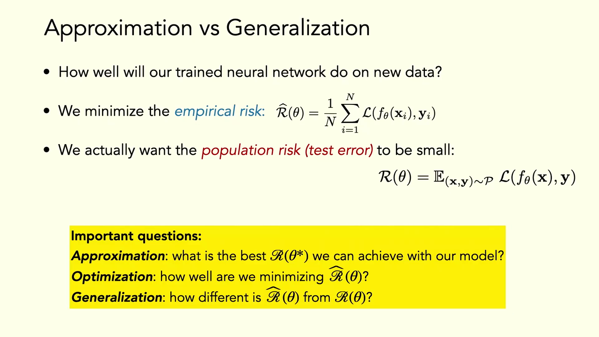
*▲ 강의 슬라이드 [05:30](https://youtu.be/EiO8BBa-xdc?t=330): [경험적 위험](00_%EB%94%A5%EB%9F%AC%EB%8B%9D_%EC%9A%A9%EC%96%B4%EC%82%AC%EC%A0%84.md#empirical-risk-%EA%B2%BD%ED%97%98%EC%A0%81-%EC%9C%84%ED%97%98)과 [모집단 위험](00_%EB%94%A5%EB%9F%AC%EB%8B%9D_%EC%9A%A9%EC%96%B4%EC%82%AC%EC%A0%84.md#population-risk-%EB%AA%A8%EC%A7%91%EB%8B%A8-%EC%9C%84%ED%97%98), 그리고 근사·최적화·[일반화](00_%EB%94%A5%EB%9F%AC%EB%8B%9D_%EC%9A%A9%EC%96%B4%EC%82%AC%EC%A0%84.md#generalization-%EC%9D%BC%EB%B0%98%ED%99%94)의 세 질문*

질의응답 정리 [05:32](https://youtu.be/EiO8BBa-xdc?t=332)

- **근사 질문의 R에도 햇(^)이 붙어야 하지 않나?** 보통 근사는 "[학습 데이터](00_%EB%94%A5%EB%9F%AC%EB%8B%9D_%EC%9A%A9%EC%96%B4%EC%82%AC%EC%A0%84.md#training-data-test-data-%ED%95%99%EC%8A%B5-%EB%8D%B0%EC%9D%B4%ED%84%B0%EC%99%80-%EC%8B%9C%ED%97%98-%EB%8D%B0%EC%9D%B4%ED%84%B0)의 [경험적 위험](00_%EB%94%A5%EB%9F%AC%EB%8B%9D_%EC%9A%A9%EC%96%B4%EC%82%AC%EC%A0%84.md#empirical-risk-%EA%B2%BD%ED%97%98%EC%A0%81-%EC%9C%84%ED%97%98)을 최소화할 수 있나"이므로 햇을 붙여도 됩니다. 다만 "[가설 공간](00_%EB%94%A5%EB%9F%AC%EB%8B%9D_%EC%9A%A9%EC%96%B4%EC%82%AC%EC%A0%84.md#hypothesis-space-%EA%B0%80%EC%84%A4-%EA%B3%B5%EA%B0%84)의 가장 좋은 함수가 모집단에서도 위험이 낮은가"도 근사의 질문으로 볼 수 있어서 둘 다 가능합니다.

---

## 2. 일반화에 대한 직관

▶ 영상 [06:05](https://youtu.be/EiO8BBa-xdc?t=365)

### 2.1 데이터가 나쁘면

▶ 영상 [06:40](https://youtu.be/EiO8BBa-xdc?t=400)

- 고양이 대 개 분류기를 만들려는데 [학습 데이터](00_%EB%94%A5%EB%9F%AC%EB%8B%9D_%EC%9A%A9%EC%96%B4%EC%82%AC%EC%A0%84.md#training-data-test-data-%ED%95%99%EC%8A%B5-%EB%8D%B0%EC%9D%B4%ED%84%B0%EC%99%80-%EC%8B%9C%ED%97%98-%EB%8D%B0%EC%9D%B4%ED%84%B0)에 **고양이 사진만** 있다면 당연히 안 됩니다. 개도 있어야 합니다.
- 고양이 한 장, 개 한 장을 여러 번 복사한 데이터도 안 됩니다. **다양성(diversity)**과 **포괄성(coverage)**이 필요합니다. 세상에서 만날 변화의 모든 측면이 [학습 데이터](00_%EB%94%A5%EB%9F%AC%EB%8B%9D_%EC%9A%A9%EC%96%B4%EC%82%AC%EC%A0%84.md#training-data-test-data-%ED%95%99%EC%8A%B5-%EB%8D%B0%EC%9D%B4%ED%84%B0%EC%99%80-%EC%8B%9C%ED%97%98-%EB%8D%B0%EC%9D%B4%ED%84%B0)에 담겨야 합니다.
- 그래서 [일반화](00_%EB%94%A5%EB%9F%AC%EB%8B%9D_%EC%9A%A9%EC%96%B4%EC%82%AC%EC%A0%84.md#generalization-%EC%9D%BC%EB%B0%98%ED%99%94)를 이해하려면 **데이터 분포**를 이해해야 합니다. 다만 이번 강의는 주로 **모형** 쪽을 봅니다.

### 2.2 파일 캐비닛 모형

▶ 영상 [07:48](https://youtu.be/EiO8BBa-xdc?t=468)

📐 **수학 개념**: [기댓값과 일반화 간극](%EC%88%98%ED%95%99%EA%B0%9C%EB%85%90/04_%ED%99%95%EB%A5%A0%EA%B3%BC_%EC%A0%95%EB%B3%B4/MM22_%EA%B8%B0%EB%8C%93%EA%B0%92%EA%B3%BC_%EC%9D%BC%EB%B0%98%ED%99%94_%EA%B0%84%EA%B7%B9.md)

나쁜 모형의 예로 **파일 캐비닛(filing cabinet)**을 듭니다. 파이썬 사전(dictionary)에 [학습 데이터](00_%EB%94%A5%EB%9F%AC%EB%8B%9D_%EC%9A%A9%EC%96%B4%EC%82%AC%EC%A0%84.md#training-data-test-data-%ED%95%99%EC%8A%B5-%EB%8D%B0%EC%9D%B4%ED%84%B0%EC%99%80-%EC%8B%9C%ED%97%98-%EB%8D%B0%EC%9D%B4%ED%84%B0) $(x, y)$를 그대로 넣어 두고, 본 적 있는 $x$가 오면 꺼내 주고, 처음 보는 $x$면 0을 내놓습니다. 이것이 **[암기](00_%EB%94%A5%EB%9F%AC%EB%8B%9D_%EC%9A%A9%EC%96%B4%EC%82%AC%EC%A0%84.md#memorization-%EC%95%94%EA%B8%B0)([Memorization](00_%EB%94%A5%EB%9F%AC%EB%8B%9D_%EC%9A%A9%EC%96%B4%EC%82%AC%EC%A0%84.md#memorization-%EC%95%94%EA%B8%B0))**입니다.

- **근사 [오차](00_%EB%94%A5%EB%9F%AC%EB%8B%9D_%EC%9A%A9%EC%96%B4%EC%82%AC%EC%A0%84.md#error-%EC%98%A4%EC%B0%A8)**: 0. 학습한 모든 점에서 정확한 답을 꺼낼 수 있습니다.
- **[일반화](00_%EB%94%A5%EB%9F%AC%EB%8B%9D_%EC%9A%A9%EC%96%B4%EC%82%AC%EC%A0%84.md#generalization-%EC%9D%BC%EB%B0%98%ED%99%94) [오차](00_%EB%94%A5%EB%9F%AC%EB%8B%9D_%EC%9A%A9%EC%96%B4%EC%82%AC%EC%A0%84.md#error-%EC%98%A4%EC%B0%A8)**: 대체로 나쁩니다. 처음 보는 입력에서는 늘 0을 내놓기 때문입니다. 참 함수가 "거의 모든 곳에서 0"인 아주 이상한 함수라면 운 좋게 맞겠지만, 그런 함수는 드뭅니다.

> [!NOTE]
> **숫자로 보기: 캐비닛의 [일반화 간극](00_%EB%94%A5%EB%9F%AC%EB%8B%9D_%EC%9A%A9%EC%96%B4%EC%82%AC%EC%A0%84.md#generalization-gap-%EC%9D%BC%EB%B0%98%ED%99%94-%EA%B0%84%EA%B7%B9)**
> 입력 $x \in \{0,1,2,3\}$이 같은 [확률](00_%EB%94%A5%EB%9F%AC%EB%8B%9D_%EC%9A%A9%EC%96%B4%EC%82%AC%EC%A0%84.md#probability-%ED%99%95%EB%A5%A0)로 나오고 [정답](00_%EB%94%A5%EB%9F%AC%EB%8B%9D_%EC%9A%A9%EC%96%B4%EC%82%AC%EC%A0%84.md#label-%EC%A0%95%EB%8B%B5)이 $y = 2x$인 세상에서, $x = 0, 1$만 학습한 캐비닛은 [경험적 위험](00_%EB%94%A5%EB%9F%AC%EB%8B%9D_%EC%9A%A9%EC%96%B4%EC%82%AC%EC%A0%84.md#empirical-risk-%EA%B2%BD%ED%97%98%EC%A0%81-%EC%9C%84%ED%97%98) 0, [모집단 위험](00_%EB%94%A5%EB%9F%AC%EB%8B%9D_%EC%9A%A9%EC%96%B4%EC%82%AC%EC%A0%84.md#population-risk-%EB%AA%A8%EC%A7%91%EB%8B%A8-%EC%9C%84%ED%97%98) $(0+0+16+36)/4 = 13$입니다. 같은 두 점을 지나는 직선은 둘 다 0입니다. 자세한 계산은 [MM22_기댓값과_일반화_간극](%EC%88%98%ED%95%99%EA%B0%9C%EB%85%90/04_%ED%99%95%EB%A5%A0%EA%B3%BC_%EC%A0%95%EB%B3%B4/MM22_%EA%B8%B0%EB%8C%93%EA%B0%92%EA%B3%BC_%EC%9D%BC%EB%B0%98%ED%99%94_%EA%B0%84%EA%B7%B9.md).

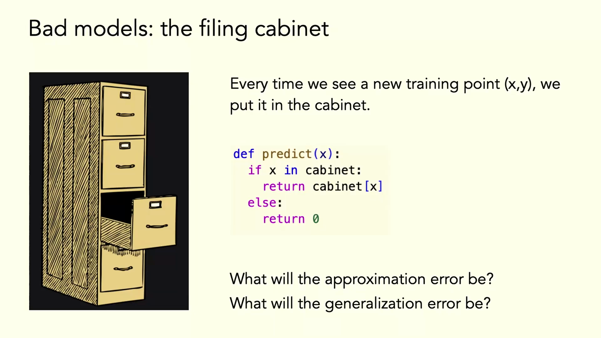
*▲ 강의 슬라이드 [08:30](https://youtu.be/EiO8BBa-xdc?t=510): 파일 캐비닛 모형. 본 적 있는 x면 저장한 답, 아니면 0*

### 2.3 문어 파울

▶ 영상 [09:26](https://youtu.be/EiO8BBa-xdc?t=566)

- 축구 경기 승자를 "예언"한 문어 파울(Paul)은 6번 연속 맞혔다고 소개됩니다(실제로는 2010년 월드컵 8경기를 모두 맞혔다). 그래도 내년 경기를 파울에게 맡기지는 않습니다.
- 파울은 캐비닛과 달리 처음 보는 경기에도 답을 냅니다. 하지만 축구를 이해하는 모형이 아니라 **우연히 [학습 데이터](00_%EB%94%A5%EB%9F%AC%EB%8B%9D_%EC%9A%A9%EC%96%B4%EC%82%AC%EC%A0%84.md#training-data-test-data-%ED%95%99%EC%8A%B5-%EB%8D%B0%EC%9D%B4%ED%84%B0%EC%99%80-%EC%8B%9C%ED%97%98-%EB%8D%B0%EC%9D%B4%ED%84%B0)에 맞은 무작위 함수**일 뿐입니다. 이렇게 "[학습 데이터](00_%EB%94%A5%EB%9F%AC%EB%8B%9D_%EC%9A%A9%EC%96%B4%EC%82%AC%EC%A0%84.md#training-data-test-data-%ED%95%99%EC%8A%B5-%EB%8D%B0%EC%9D%B4%ED%84%B0%EC%99%80-%EC%8B%9C%ED%97%98-%EB%8D%B0%EC%9D%B4%ED%84%B0)는 맞히지만 일반화하지 못하는 함수"가 뒤의 VC 이론에서 말하는 **거짓 양성**입니다([7.1 거짓 양성의 직관](#71-%EA%B1%B0%EC%A7%93-%EC%96%91%EC%84%B1%EC%9D%98-%EC%A7%81%EA%B4%80)).

---

## 3. 깊은 망은 일반화하는가

▶ 영상 [10:33](https://youtu.be/EiO8BBa-xdc?t=633)

### 3.1 작은 MLP와 파일 캐비닛

▶ 영상 [10:50](https://youtu.be/EiO8BBa-xdc?t=650)

스칼라 입력 → 스칼라 출력 데이터(검은 점)를 두 모형으로 맞춥니다.

- **파일 캐비닛**: [학습](00_%EB%94%A5%EB%9F%AC%EB%8B%9D_%EC%9A%A9%EC%96%B4%EC%82%AC%EC%A0%84.md#training-%ED%95%99%EC%8A%B5) 점에서만 점까지 막대가 솟고 나머지는 모두 0입니다.
- **3층 [ReLU](00_%EB%94%A5%EB%9F%AC%EB%8B%9D_%EC%9A%A9%EC%96%B4%EC%82%AC%EC%A0%84.md#relu-%EB%A0%90%EB%A3%A8) MLP**: 점들 사이를 부드럽게 잇고 바깥으로도 직선으로 뻗습니다.

둘 다 [학습 데이터](00_%EB%94%A5%EB%9F%AC%EB%8B%9D_%EC%9A%A9%EC%96%B4%EC%82%AC%EC%A0%84.md#training-data-test-data-%ED%95%99%EC%8A%B5-%EB%8D%B0%EC%9D%B4%ED%84%B0%EC%99%80-%EC%8B%9C%ED%97%98-%EB%8D%B0%EC%9D%B4%ED%84%B0)를 완벽히 맞추므로(근사 [오차](00_%EB%94%A5%EB%9F%AC%EB%8B%9D_%EC%9A%A9%EC%96%B4%EC%82%AC%EC%A0%84.md#error-%EC%98%A4%EC%B0%A8) 0) [학습](00_%EB%94%A5%EB%9F%AC%EB%8B%9D_%EC%9A%A9%EC%96%B4%EC%82%AC%EC%A0%84.md#training-%ED%95%99%EC%8A%B5) [오차](00_%EB%94%A5%EB%9F%AC%EB%8B%9D_%EC%9A%A9%EC%96%B4%EC%82%AC%EC%A0%84.md#error-%EC%98%A4%EC%B0%A8)만 보면 똑같이 좋습니다. 차이는 **[학습](00_%EB%94%A5%EB%9F%AC%EB%8B%9D_%EC%9A%A9%EC%96%B4%EC%82%AC%EC%A0%84.md#training-%ED%95%99%EC%8A%B5) 점이 없는 곳에서 어떻게 [보간](00_%EB%94%A5%EB%9F%AC%EB%8B%9D_%EC%9A%A9%EC%96%B4%EC%82%AC%EC%A0%84.md#interpolation-%EB%B3%B4%EA%B0%84)·외삽하느냐**에 있습니다.

- **[암기](00_%EB%94%A5%EB%9F%AC%EB%8B%9D_%EC%9A%A9%EC%96%B4%EC%82%AC%EC%A0%84.md#memorization-%EC%95%94%EA%B8%B0)**: [학습](00_%EB%94%A5%EB%9F%AC%EB%8B%9D_%EC%9A%A9%EC%96%B4%EC%82%AC%EC%A0%84.md#training-%ED%95%99%EC%8A%B5) 점에서 무엇을 예측하나. 캐비닛도 깊은 망도 할 수 있습니다.
- **[일반화](00_%EB%94%A5%EB%9F%AC%EB%8B%9D_%EC%9A%A9%EC%96%B4%EC%82%AC%EC%A0%84.md#generalization-%EC%9D%BC%EB%B0%98%ED%99%94)**: [학습](00_%EB%94%A5%EB%9F%AC%EB%8B%9D_%EC%9A%A9%EC%96%B4%EC%82%AC%EC%A0%84.md#training-%ED%95%99%EC%8A%B5) 점이 아닌 곳에서 무엇을 예측하나. 세상의 함수는 대개 뾰족하기보다 **매끄러우므로** 오른쪽 방식이 더 나은 일반화일 것이라 기대합니다.

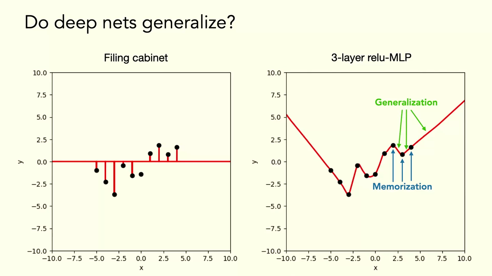
*▲ 강의 슬라이드 [12:30](https://youtu.be/EiO8BBa-xdc?t=750): 같은 데이터를 캐비닛(왼쪽)과 3층 [ReLU](00_%EB%94%A5%EB%9F%AC%EB%8B%9D_%EC%9A%A9%EC%96%B4%EC%82%AC%EC%A0%84.md#relu-%EB%A0%90%EB%A3%A8) MLP(오른쪽)로 맞춘 결과. [학습](00_%EB%94%A5%EB%9F%AC%EB%8B%9D_%EC%9A%A9%EC%96%B4%EC%82%AC%EC%A0%84.md#training-%ED%95%99%EC%8A%B5) 점에서는 둘 다 [암기](00_%EB%94%A5%EB%9F%AC%EB%8B%9D_%EC%9A%A9%EC%96%B4%EC%82%AC%EC%A0%84.md#memorization-%EC%95%94%EA%B8%B0), 그 사이에서 MLP만 [일반화](00_%EB%94%A5%EB%9F%AC%EB%8B%9D_%EC%9A%A9%EC%96%B4%EC%82%AC%EC%A0%84.md#generalization-%EC%9D%BC%EB%B0%98%ED%99%94)*

### 3.2 LLM은 파일 캐비닛인가

▶ 영상 [12:43](https://youtu.be/EiO8BBa-xdc?t=763)

📐 **수학 개념**: [경우의 수와 VC 한계](%EC%88%98%ED%95%99%EA%B0%9C%EB%85%90/04_%ED%99%95%EB%A5%A0%EA%B3%BC_%EC%A0%95%EB%B3%B4/MM24_%EA%B2%BD%EC%9A%B0%EC%9D%98_%EC%88%98%EC%99%80_VC_%ED%95%9C%EA%B3%84.md) · [지수](%EC%88%98%ED%95%99%EA%B0%9C%EB%85%90/01_%EC%88%98%EC%99%80_%ED%95%A8%EC%88%98/M06_%EC%A7%80%EC%88%98%EC%99%80_e.md)

수십억~수조 개 데이터로 학습한 거대 모형은 판단이 어렵습니다. 거의 모든 것을 학습했다면 시험 입력도 [학습 데이터](00_%EB%94%A5%EB%9F%AC%EB%8B%9D_%EC%9A%A9%EC%96%B4%EC%82%AC%EC%A0%84.md#training-data-test-data-%ED%95%99%EC%8A%B5-%EB%8D%B0%EC%9D%B4%ED%84%B0%EC%99%80-%EC%8B%9C%ED%97%98-%EB%8D%B0%EC%9D%B4%ED%84%B0)와 같아 보일 수 있기 때문입니다. 강사는 간단한 **세기 실험**을 제안합니다.

1. LLM이 파일 캐비닛([일반화](00_%EB%94%A5%EB%9F%AC%EB%8B%9D_%EC%9A%A9%EC%96%B4%EC%82%AC%EC%A0%84.md#generalization-%EC%9D%BC%EB%B0%98%ED%99%94) 없음)이라고 가정합니다.
2. 어휘 $m$개에서 단어 $n$개를 무작위로 뽑아 목록을 만듭니다. 가능한 목록은 $m^n$가지입니다.
3. 그 목록에 관한 질문을 모형에 던져, 답이 맞는(적어도 "0이 아닌") 비율 $p$를 잽니다.
4. 캐비닛이 그만큼 맞히려면 크기가 $s = p \cdot m^n$이어야 하고, [학습 데이터](00_%EB%94%A5%EB%9F%AC%EB%8B%9D_%EC%9A%A9%EC%96%B4%EC%82%AC%EC%A0%84.md#training-data-test-data-%ED%95%99%EC%8A%B5-%EB%8D%B0%EC%9D%B4%ED%84%B0%EC%99%80-%EC%8B%9C%ED%97%98-%EB%8D%B0%EC%9D%B4%ED%84%B0)도 그만큼 있어야 합니다.

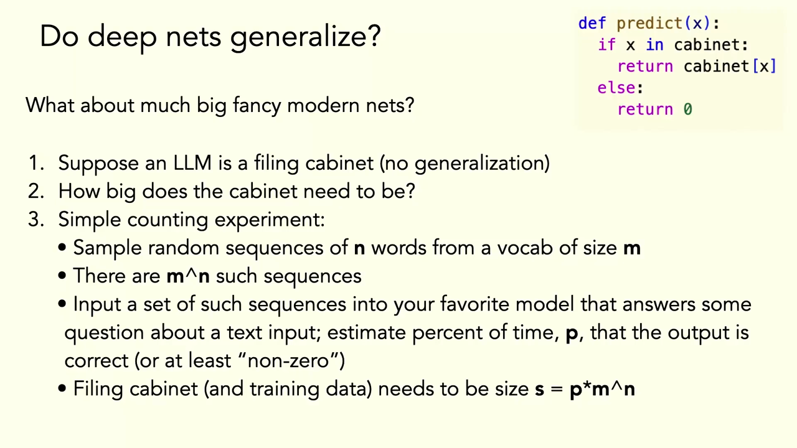
*▲ 강의 슬라이드 [16:08](https://youtu.be/EiO8BBa-xdc?t=968): 세기 실험의 절차. 캐비닛 크기 s = p·mⁿ*

강사의 실험 결과입니다.

| 실험 | 과제 | 맞힌 비율 p | 필요한 캐비닛 크기 |
|---|---|---|---|
| 텍스트 | 과일 30개 중 10개를 뽑은 목록에서 "감귤류는 몇 개?" ([GPT](00_%EB%94%A5%EB%9F%AC%EB%8B%9D_%EC%9A%A9%EC%96%B4%EC%82%AC%EC%A0%84.md#gpt-%EC%83%9D%EC%84%B1%ED%98%95-%EC%82%AC%EC%A0%84%ED%95%99%EC%8A%B5-%ED%8A%B8%EB%9E%9C%EC%8A%A4%ED%8F%AC%EB%A8%B8)-4o) | 5번 중 5번 → 1 | 약 590조 (강의에서는 100조) |
| 이미지 | 같은 목록을 "그려 줘" | 8번 중 1번 → 0.125 | 약 73.8조 (강의에서는 12.5조) |

(강의는 $m = 10$, $n = 30$으로 적었지만, 정의대로 $m = 30$, $n = 10$이면 $30^{10} ≈ 5.9 × 10^{14}$다. 결론은 같다.)

- ChatGPT 같은 모형은 수십조 개 규모로 학습한다고 알려져 있으므로, 순수한 [암기](00_%EB%94%A5%EB%9F%AC%EB%8B%9D_%EC%9A%A9%EC%96%B4%EC%82%AC%EC%A0%84.md#memorization-%EC%95%94%EA%B8%B0)로는 이 성적을 설명할 수 없습니다. 목록을 더 길게 하면 경 단위까지 키울 수도 있습니다.
- 강사는 이 실험을 체계적으로 하면 좋은 **기말 프로젝트**가 될 것이라고 권합니다.

> [!TIP]
> **🆕 2026 업데이트: [학습 데이터](00_%EB%94%A5%EB%9F%AC%EB%8B%9D_%EC%9A%A9%EC%96%B4%EC%82%AC%EC%A0%84.md#training-data-test-data-%ED%95%99%EC%8A%B5-%EB%8D%B0%EC%9D%B4%ED%84%B0%EC%99%80-%EC%8B%9C%ED%97%98-%EB%8D%B0%EC%9D%B4%ED%84%B0) 규모와 "얼마나 외우는가"의 측정**
> - **강의**: ChatGPT류는 "수십조" 개로 학습한다고 보고, 세기 실험으로 암기만으로는 설명이 안 된다고 논증했다.
> - **현재**: 공개 모형의 사전학습 데이터는 수십조 [토큰](00_%EB%94%A5%EB%9F%AC%EB%8B%9D_%EC%9A%A9%EC%96%B4%EC%82%AC%EC%A0%84.md#token-%ED%86%A0%ED%81%B0)이 표준이 되었다(예: Qwen3는 약 36조 [토큰](00_%EB%94%A5%EB%9F%AC%EB%8B%9D_%EC%9A%A9%EC%96%B4%EC%82%AC%EC%A0%84.md#token-%ED%86%A0%ED%81%B0), 2025). 또 "모형이 얼마나 외우는가"를 직접 재는 연구가 나왔다. [GPT](00_%EB%94%A5%EB%9F%AC%EB%8B%9D_%EC%9A%A9%EC%96%B4%EC%82%AC%EC%A0%84.md#gpt-%EC%83%9D%EC%84%B1%ED%98%95-%EC%82%AC%EC%A0%84%ED%95%99%EC%8A%B5-%ED%8A%B8%EB%9E%9C%EC%8A%A4%ED%8F%AC%EB%A8%B8) 계열 구조는 파라미터당 약 **3.6비트**를 외울 수 있고, 그 [용량](00_%EB%94%A5%EB%9F%AC%EB%8B%9D_%EC%9A%A9%EC%96%B4%EC%82%AC%EC%A0%84.md#capacity-%EC%9A%A9%EB%9F%89)이 차면 외우기 대신 [일반화](00_%EB%94%A5%EB%9F%AC%EB%8B%9D_%EC%9A%A9%EC%96%B4%EC%82%AC%EC%A0%84.md#generalization-%EC%9D%BC%EB%B0%98%ED%99%94)가 시작된다고 보고했다. 즉 캐비닛의 크기는 [파라미터](00_%EB%94%A5%EB%9F%AC%EB%8B%9D_%EC%9A%A9%EC%96%B4%EC%82%AC%EC%A0%84.md#parameter-%ED%8C%8C%EB%9D%BC%EB%AF%B8%ED%84%B0) 수로 제한되며, 세기 실험의 수백조 칸은 그 한도를 크게 넘는다.
> - **출처**: [Qwen3: Think Deeper, Act Faster (Qwen 공식 블로그, 2025)](https://qwenlm.github.io/blog/qwen3/) · [Morris et al., How much do language models memorize? (arXiv 2505.24832, 2025)](https://arxiv.org/abs/2505.24832)

> [!TIP]
> **🆕 2026 업데이트: 여러 물체를 한 번에 그리는 능력**
> - **강의**: 과일 10개를 모두 그리는 데 8번 중 1번만 성공했다(2024년 가을, ChatGPT의 이미지 생성).
> - **현재**: OpenAI는 [GPT](00_%EB%94%A5%EB%9F%AC%EB%8B%9D_%EC%9A%A9%EC%96%B4%EC%82%AC%EC%A0%84.md#gpt-%EC%83%9D%EC%84%B1%ED%98%95-%EC%82%AC%EC%A0%84%ED%95%99%EC%8A%B5-%ED%8A%B8%EB%9E%9C%EC%8A%A4%ED%8F%AC%EB%A8%B8)-4o 이미지 생성(2025년 3월)을 내놓으며 "다른 시스템이 5~8개 물체에서 어려워하는 반면 10~20개 물체를 다룬다"고 밝혔다. 회사의 자체 주장이고 [독립](00_%EB%94%A5%EB%9F%AC%EB%8B%9D_%EC%9A%A9%EC%96%B4%EC%82%AC%EC%A0%84.md#independence-%EB%8F%85%EB%A6%BD) 벤치마크로 확인된 수치는 아니다.
> - **출처**: [Introducing 4o Image Generation (OpenAI, 2025)](https://openai.com/index/introducing-4o-image-generation/)

### 3.3 스케치에서 고양이로: 분포 밖 일반화

▶ 영상 [19:28](https://youtu.be/EiO8BBa-xdc?t=1168)

- 강사가 참여한 pix2pix(2017) 프로젝트는 **윤곽선 그림 → 고양이 사진** 변환을 학습했습니다. 사람이 그린 스케치는 구하기 비싸서, [학습](00_%EB%94%A5%EB%9F%AC%EB%8B%9D_%EC%9A%A9%EC%96%B4%EC%82%AC%EC%A0%84.md#training-%ED%95%99%EC%8A%B5) 입력은 HED라는 **가장자리 검출기**가 만든 윤곽선을 썼습니다.
- 고전적 관점에서 보장되는 것은 같은 분포에서 독립적으로 뽑은([i.i.d.](00_%EB%94%A5%EB%9F%AC%EB%8B%9D_%EC%9A%A9%EC%96%B4%EC%82%AC%EC%A0%84.md#iid-independent-and-identically-distributed-%EB%8F%85%EB%A6%BD-%EB%8F%99%EC%9D%BC-%EB%B6%84%ED%8F%AC)) 새 윤곽선에 대한 일반화뿐입니다. 그런데 이 모형은 **사람이 손으로 그린 고양이**에도 작동했습니다. [학습](00_%EB%94%A5%EB%9F%AC%EB%8B%9D_%EC%9A%A9%EC%96%B4%EC%82%AC%EC%A0%84.md#training-%ED%95%99%EC%8A%B5) 분포와 체계적으로 다른 입력이므로 **[분포 밖 일반화](00_%EB%94%A5%EB%9F%AC%EB%8B%9D_%EC%9A%A9%EC%96%B4%EC%82%AC%EC%A0%84.md#out-of-distribution-generalization-%EB%B6%84%ED%8F%AC-%EB%B0%96-%EC%9D%BC%EB%B0%98%ED%99%94)(Out-of-distribution generalization)**입니다.
- 눈을 세 개, 여러 개 그려도 그린 자리마다 눈을 그려 넣습니다. 눈이 셋인 고양이 사진은 본 적이 없는데도 그렇습니다.

### 3.4 아키텍처가 주는 조합성

▶ 영상 [22:18](https://youtu.be/EiO8BBa-xdc?t=1338)

왜 눈의 개수가 달라도 될까요? 강사의 설명은 [합성곱 신경망](00_%EB%94%A5%EB%9F%AC%EB%8B%9D_%EC%9A%A9%EC%96%B4%EC%82%AC%EC%A0%84.md#cnn-convolutional-neural-network-%ED%95%A9%EC%84%B1%EA%B3%B1-%EC%8B%A0%EA%B2%BD%EB%A7%9D)([Lec04](Lec04_%EA%B2%A9%EC%9E%90_%EC%95%84%ED%82%A4%ED%85%8D%EC%B2%98.md))의 **[귀납 편향](00_%EB%94%A5%EB%9F%AC%EB%8B%9D_%EC%9A%A9%EC%96%B4%EC%82%AC%EC%A0%84.md#inductive-bias-%EA%B7%80%EB%82%A9-%ED%8E%B8%ED%96%A5)(Inductive bias)**입니다.

- ConvNet은 입력을 **조각(patch)**으로 나누고 모든 조각을 **똑같이, 독립적으로** 처리합니다. 문제를 여러 [독립](00_%EB%94%A5%EB%9F%AC%EB%8B%9D_%EC%9A%A9%EC%96%B4%EC%82%AC%EC%A0%84.md#independence-%EB%8F%85%EB%A6%BD) 결정으로 쪼개는 셈입니다.
- 각 조각에서는 "타원이 보이면 눈을 그린다"만 배우면 되고, 이것은 [학습](00_%EB%94%A5%EB%9F%AC%EB%8B%9D_%EC%9A%A9%EC%96%B4%EC%82%AC%EC%A0%84.md#training-%ED%95%99%EC%8A%B5) 분포 안의 [일반화](00_%EB%94%A5%EB%9F%AC%EB%8B%9D_%EC%9A%A9%EC%96%B4%EC%82%AC%EC%A0%84.md#generalization-%EC%9D%BC%EB%B0%98%ED%99%94)입니다. 조각을 다시 이어 붙이는 규칙은 아키텍처가 정해 줍니다.
- 그래서 새 **조합**(눈 세 개)에도 작동합니다. 이를 **[조합성](00_%EB%94%A5%EB%9F%AC%EB%8B%9D_%EC%9A%A9%EC%96%B4%EC%82%AC%EC%A0%84.md#compositionality-%EC%A1%B0%ED%95%A9%EC%84%B1)([Compositionality](00_%EB%94%A5%EB%9F%AC%EB%8B%9D_%EC%9A%A9%EC%96%B4%EC%82%AC%EC%A0%84.md#compositionality-%EC%A1%B0%ED%95%A9%EC%84%B1))**이라 합니다.
- [그래프 신경망](00_%EB%94%A5%EB%9F%AC%EB%8B%9D_%EC%9A%A9%EC%96%B4%EC%82%AC%EC%A0%84.md#gnn-graph-neural-network-%EA%B7%B8%EB%9E%98%ED%94%84-%EC%8B%A0%EA%B2%BD%EB%A7%9D)([Lec05](Lec05_%EA%B7%B8%EB%9E%98%ED%94%84_%EC%8B%A0%EA%B2%BD%EB%A7%9D.md))이 입력의 순열에 불변·등변이라서 본 적 없는 순열에도 일반화한 것과 같은 원리입니다. 이런 성질은 데이터에서 배우는 것이 아니라 **아키텍처에 내장**되어 있습니다. 아키텍처는 순진한 통계적 [학습](00_%EB%94%A5%EB%9F%AC%EB%8B%9D_%EC%9A%A9%EC%96%B4%EC%82%AC%EC%A0%84.md#training-%ED%95%99%EC%8A%B5) 이론을 넘어서는 [일반화](00_%EB%94%A5%EB%9F%AC%EB%8B%9D_%EC%9A%A9%EC%96%B4%EC%82%AC%EC%A0%84.md#generalization-%EC%9D%BC%EB%B0%98%ED%99%94)를 만드는 주요 지렛대입니다.

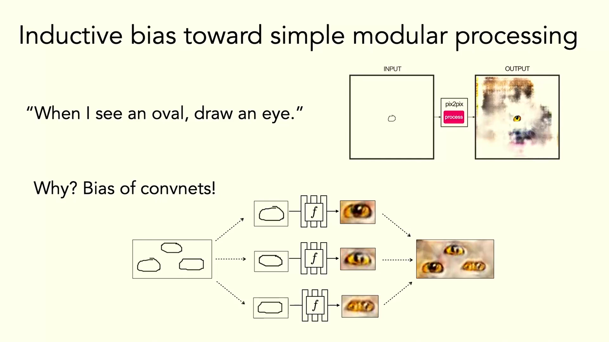
*▲ 강의 슬라이드 [23:50](https://youtu.be/EiO8BBa-xdc?t=1430): "타원이 보이면 눈을 그린다". ConvNet은 조각마다 같은 함수 f를 적용하고 결과를 이어 붙인다*

---

## 4. 오컴의 면도날과 가장 짧은 프로그램

▶ 영상 [24:33](https://youtu.be/EiO8BBa-xdc?t=1473)

- [일반화](00_%EB%94%A5%EB%9F%AC%EB%8B%9D_%EC%9A%A9%EC%96%B4%EC%82%AC%EC%A0%84.md#generalization-%EC%9D%BC%EB%B0%98%ED%99%94) 이론의 대부분은 **[오컴의 면도날](00_%EB%94%A5%EB%9F%AC%EB%8B%9D_%EC%9A%A9%EC%96%B4%EC%82%AC%EC%A0%84.md#occams-razor-%EC%98%A4%EC%BB%B4%EC%9D%98-%EB%A9%B4%EB%8F%84%EB%82%A0)([Occam's razor](00_%EB%94%A5%EB%9F%AC%EB%8B%9D_%EC%9A%A9%EC%96%B4%EC%82%AC%EC%A0%84.md#occams-razor-%EC%98%A4%EC%BB%B4%EC%9D%98-%EB%A9%B4%EB%8F%84%EB%82%A0))**의 변형입니다. "데이터를 똑같이 잘 설명하는 설명들 중에서는 가장 단순한 것을 고르라." [일반화](00_%EB%94%A5%EB%9F%AC%EB%8B%9D_%EC%9A%A9%EC%96%B4%EC%82%AC%EC%A0%84.md#generalization-%EC%9D%BC%EB%B0%98%ED%99%94)의 말로 바꾸면 **"데이터를 맞추는 가장 단순한 모형이 가장 잘 일반화한다."**
- 강사는 **"데이터를 맞추는"**을 빼먹지 말라고 강조합니다. 이 조건이 없으면 "그럼 선형 모형을 쓰자" 같은 엉뚱한 결론이 나옵니다. 데이터를 맞출 만큼은 복잡해야 하고, 그 안에서 단순한 것을 고르는 것입니다.
- 엄밀한 버전으로 강사가 좋아하는 것은 **[솔로모노프 귀납](00_%EB%94%A5%EB%9F%AC%EB%8B%9D_%EC%9A%A9%EC%96%B4%EC%82%AC%EC%A0%84.md#solomonoff-induction-%EC%86%94%EB%A1%9C%EB%AA%A8%EB%85%B8%ED%94%84-%EA%B7%80%EB%82%A9)**(Solomonoff, 1964)입니다. **데이터를 출력하는 가장 짧은 프로그램이 가장 잘 일반화하고 가장 좋은 예측을 한다.** 같은 말로 "데이터를 가장 많이 압축한 표현이 가장 좋은 모형"이라 할 수 있습니다.
- 문제는 가장 짧은 프로그램을 찾으려면 **모든 프로그램**을 뒤져야 한다는 것입니다. 계산 불가능합니다. 딥러닝은 모든 프로그램이 아니라 정해진 아키텍처의 [가중치](00_%EB%94%A5%EB%9F%AC%EB%8B%9D_%EC%9A%A9%EC%96%B4%EC%82%AC%EC%A0%84.md#weight-%EA%B0%80%EC%A4%91%EC%B9%98)와 [편향](00_%EB%94%A5%EB%9F%AC%EB%8B%9D_%EC%9A%A9%EC%96%B4%EC%82%AC%EC%A0%84.md#bias-%ED%8E%B8%ED%96%A5) 공간만 뒤집니다. 그래서 이것은 "목표로 삼을 이상"이고, 실제로 쓸 수 있는 단순함의 척도를 따로 찾아야 합니다.

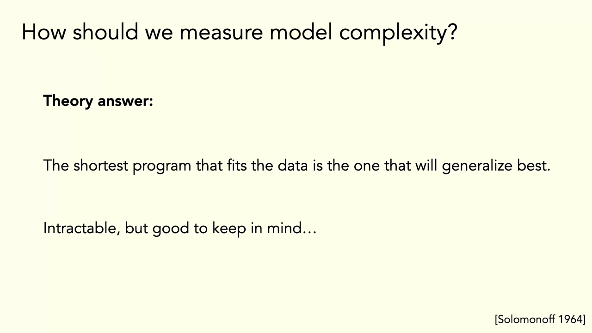
*▲ 강의 슬라이드 [27:30](https://youtu.be/EiO8BBa-xdc?t=1650): 이론의 답. 데이터를 맞추는 가장 짧은 프로그램이 가장 잘 일반화한다(계산 불가능하지만 기억해 둘 것)*

질의응답 정리 [25:44](https://youtu.be/EiO8BBa-xdc?t=1544)

- **"모든 모형은 틀렸지만 일부는 쓸모 있다"는 말과는 어떻게 맞춰 보나?** [오컴의 면도날](00_%EB%94%A5%EB%9F%AC%EB%8B%9D_%EC%9A%A9%EC%96%B4%EC%82%AC%EC%A0%84.md#occams-razor-%EC%98%A4%EC%BB%B4%EC%9D%98-%EB%A9%B4%EB%8F%84%EB%82%A0)은 데이터를 **똑같이 잘 맞추는** 모형들 사이의 선택만 다룹니다. 근사 자체가 틀린 모형은 고려 대상이 아니라서 상황이 조금 다릅니다. 깔끔한 답은 아직 없다고 강사는 말합니다.
- **이 명제는 증명된 것인가, 경험칙인가?** 지금 형태로는 경험칙입니다. "단순함"과 "[일반화](00_%EB%94%A5%EB%9F%AC%EB%8B%9D_%EC%9A%A9%EC%96%B4%EC%82%AC%EC%A0%84.md#generalization-%EC%9D%BC%EB%B0%98%ED%99%94)"를 수학적으로 정의해야 엄밀해지는데, 솔로모노프 같은 엄밀한 버전이 있습니다.

---

## 5. 과적합과 이중 하강

▶ 영상 [28:30](https://youtu.be/EiO8BBa-xdc?t=1710)

### 5.1 편향-분산 트레이드오프

▶ 영상 [28:30](https://youtu.be/EiO8BBa-xdc?t=1710)

시험 [오차](00_%EB%94%A5%EB%9F%AC%EB%8B%9D_%EC%9A%A9%EC%96%B4%EC%82%AC%EC%A0%84.md#error-%EC%98%A4%EC%B0%A8)는 두 부분으로 쪼갤 수 있습니다.

$$
\text{시험 오차} = \underbrace{\text{학습 오차}}_{\text{편향(bias)}} + \underbrace{(\text{시험 오차} - \text{학습 오차})}_{\text{분산(variance)}}
$$

기호 풀이

| 기호 | 읽는 법 | 뜻 | 예제 값 |
| --- | --- | --- | --- |
| 시험 [오차](00_%EB%94%A5%EB%9F%AC%EB%8B%9D_%EC%9A%A9%EC%96%B4%EC%82%AC%EC%A0%84.md#error-%EC%98%A4%EC%B0%A8) | - | 처음 보는 데이터에서 잰 [오차](00_%EB%94%A5%EB%9F%AC%EB%8B%9D_%EC%9A%A9%EC%96%B4%EC%82%AC%EC%A0%84.md#error-%EC%98%A4%EC%B0%A8) | 0.12 |
| [학습](00_%EB%94%A5%EB%9F%AC%EB%8B%9D_%EC%9A%A9%EC%96%B4%EC%82%AC%EC%A0%84.md#training-%ED%95%99%EC%8A%B5) [오차](00_%EB%94%A5%EB%9F%AC%EB%8B%9D_%EC%9A%A9%EC%96%B4%EC%82%AC%EC%A0%84.md#error-%EC%98%A4%EC%B0%A8) | - | [학습 데이터](00_%EB%94%A5%EB%9F%AC%EB%8B%9D_%EC%9A%A9%EC%96%B4%EC%82%AC%EC%A0%84.md#training-data-test-data-%ED%95%99%EC%8A%B5-%EB%8D%B0%EC%9D%B4%ED%84%B0%EC%99%80-%EC%8B%9C%ED%97%98-%EB%8D%B0%EC%9D%B4%ED%84%B0)에서 잰 [오차](00_%EB%94%A5%EB%9F%AC%EB%8B%9D_%EC%9A%A9%EC%96%B4%EC%82%AC%EC%A0%84.md#error-%EC%98%A4%EC%B0%A8) | 0.05 |
| $\underbrace{\cdots}_{\text{이름}}$ | 언더브레이스 | 묶은 부분을 아래 이름으로 부른다 | - |
| [편향](00_%EB%94%A5%EB%9F%AC%EB%8B%9D_%EC%9A%A9%EC%96%B4%EC%82%AC%EC%A0%84.md#bias-%ED%8E%B8%ED%96%A5)(bias) | 바이어스 | 강의의 직관적 이름: [학습](00_%EB%94%A5%EB%9F%AC%EB%8B%9D_%EC%9A%A9%EC%96%B4%EC%82%AC%EC%A0%84.md#training-%ED%95%99%EC%8A%B5) [오차](00_%EB%94%A5%EB%9F%AC%EB%8B%9D_%EC%9A%A9%EC%96%B4%EC%82%AC%EC%A0%84.md#error-%EC%98%A4%EC%B0%A8) 부분 (통계학의 [편향](00_%EB%94%A5%EB%9F%AC%EB%8B%9D_%EC%9A%A9%EC%96%B4%EC%82%AC%EC%A0%84.md#bias-%ED%8E%B8%ED%96%A5)과는 정의가 조금 다름) | 0.05 |
| [분산](00_%EB%94%A5%EB%9F%AC%EB%8B%9D_%EC%9A%A9%EC%96%B4%EC%82%AC%EC%A0%84.md#variance-%EB%B6%84%EC%82%B0)(variance) | 배리언스 | 강의의 직관적 이름: 시험 [오차](00_%EB%94%A5%EB%9F%AC%EB%8B%9D_%EC%9A%A9%EC%96%B4%EC%82%AC%EC%A0%84.md#error-%EC%98%A4%EC%B0%A8) − [학습](00_%EB%94%A5%EB%9F%AC%EB%8B%9D_%EC%9A%A9%EC%96%B4%EC%82%AC%EC%A0%84.md#training-%ED%95%99%EC%8A%B5) [오차](00_%EB%94%A5%EB%9F%AC%EB%8B%9D_%EC%9A%A9%EC%96%B4%EC%82%AC%EC%A0%84.md#error-%EC%98%A4%EC%B0%A8), 곧 [일반화 간극](00_%EB%94%A5%EB%9F%AC%EB%8B%9D_%EC%9A%A9%EC%96%B4%EC%82%AC%EC%A0%84.md#generalization-gap-%EC%9D%BC%EB%B0%98%ED%99%94-%EA%B0%84%EA%B7%B9) | 0.07 |

예제와 풀이

**문제**: [학습 데이터](00_%EB%94%A5%EB%9F%AC%EB%8B%9D_%EC%9A%A9%EC%96%B4%EC%82%AC%EC%A0%84.md#training-data-test-data-%ED%95%99%EC%8A%B5-%EB%8D%B0%EC%9D%B4%ED%84%B0%EC%99%80-%EC%8B%9C%ED%97%98-%EB%8D%B0%EC%9D%B4%ED%84%B0)에서 [오차](00_%EB%94%A5%EB%9F%AC%EB%8B%9D_%EC%9A%A9%EC%96%B4%EC%82%AC%EC%A0%84.md#error-%EC%98%A4%EC%B0%A8)가 0.05, 처음 보는 데이터에서 [오차](00_%EB%94%A5%EB%9F%AC%EB%8B%9D_%EC%9A%A9%EC%96%B4%EC%82%AC%EC%A0%84.md#error-%EC%98%A4%EC%B0%A8)가 0.12인 모형의 시험 [오차](00_%EB%94%A5%EB%9F%AC%EB%8B%9D_%EC%9A%A9%EC%96%B4%EC%82%AC%EC%A0%84.md#error-%EC%98%A4%EC%B0%A8)를 강의 방식대로 [편향](00_%EB%94%A5%EB%9F%AC%EB%8B%9D_%EC%9A%A9%EC%96%B4%EC%82%AC%EC%A0%84.md#bias-%ED%8E%B8%ED%96%A5) 부분과 [분산](00_%EB%94%A5%EB%9F%AC%EB%8B%9D_%EC%9A%A9%EC%96%B4%EC%82%AC%EC%A0%84.md#variance-%EB%B6%84%EC%82%B0) 부분으로 나눈다.

**주어진 값**:
- [학습](00_%EB%94%A5%EB%9F%AC%EB%8B%9D_%EC%9A%A9%EC%96%B4%EC%82%AC%EC%A0%84.md#training-%ED%95%99%EC%8A%B5) [오차](00_%EB%94%A5%EB%9F%AC%EB%8B%9D_%EC%9A%A9%EC%96%B4%EC%82%AC%EC%A0%84.md#error-%EC%98%A4%EC%B0%A8) = 0.05 ([학습 데이터](00_%EB%94%A5%EB%9F%AC%EB%8B%9D_%EC%9A%A9%EC%96%B4%EC%82%AC%EC%A0%84.md#training-data-test-data-%ED%95%99%EC%8A%B5-%EB%8D%B0%EC%9D%B4%ED%84%B0%EC%99%80-%EC%8B%9C%ED%97%98-%EB%8D%B0%EC%9D%B4%ED%84%B0)에서 잰 [오차](00_%EB%94%A5%EB%9F%AC%EB%8B%9D_%EC%9A%A9%EC%96%B4%EC%82%AC%EC%A0%84.md#error-%EC%98%A4%EC%B0%A8))
- 시험 [오차](00_%EB%94%A5%EB%9F%AC%EB%8B%9D_%EC%9A%A9%EC%96%B4%EC%82%AC%EC%A0%84.md#error-%EC%98%A4%EC%B0%A8) = 0.12 (처음 보는 데이터에서 잰 [오차](00_%EB%94%A5%EB%9F%AC%EB%8B%9D_%EC%9A%A9%EC%96%B4%EC%82%AC%EC%A0%84.md#error-%EC%98%A4%EC%B0%A8))

**풀이**
1. 식을 그대로 쓴다: $\text{시험 오차} = \underbrace{\text{학습 오차}}_{\text{편향(bias)}} + \underbrace{(\text{시험 오차} - \text{학습 오차})}_{\text{분산(variance)}}$
2. 값을 대입한다: $0.12 = \underbrace{0.05}_{\text{편향}} + \underbrace{(0.12 - 0.05)}_{\text{분산}}$
3. 괄호 안 뺄셈을 한다: $0.12 - 0.05 = 0.07$ 이므로 $0.12 = \underbrace{0.05}_{\text{편향}} + \underbrace{0.07}_{\text{분산}}$
4. 더해서 확인한다: $0.05 + 0.07 = 0.12$ 이므로 양쪽이 같다

**답**: [편향](00_%EB%94%A5%EB%9F%AC%EB%8B%9D_%EC%9A%A9%EC%96%B4%EC%82%AC%EC%A0%84.md#bias-%ED%8E%B8%ED%96%A5) 0.05, [분산](00_%EB%94%A5%EB%9F%AC%EB%8B%9D_%EC%9A%A9%EC%96%B4%EC%82%AC%EC%A0%84.md#variance-%EB%B6%84%EC%82%B0) 0.07

내 이해

- **고전 그림(ML 101)**: [용량](00_%EB%94%A5%EB%9F%AC%EB%8B%9D_%EC%9A%A9%EC%96%B4%EC%82%AC%EC%A0%84.md#capacity-%EC%9A%A9%EB%9F%89)([가설 공간](00_%EB%94%A5%EB%9F%AC%EB%8B%9D_%EC%9A%A9%EC%96%B4%EC%82%AC%EC%A0%84.md#hypothesis-space-%EA%B0%80%EC%84%A4-%EA%B3%B5%EA%B0%84)이 담은 함수의 수, 예를 들어 [파라미터](00_%EB%94%A5%EB%9F%AC%EB%8B%9D_%EC%9A%A9%EC%96%B4%EC%82%AC%EC%A0%84.md#parameter-%ED%8C%8C%EB%9D%BC%EB%AF%B8%ED%84%B0) 수)을 키우면 [보편 근사](00_%EB%94%A5%EB%9F%AC%EB%8B%9D_%EC%9A%A9%EC%96%B4%EC%82%AC%EC%A0%84.md#universal-approximation-%EB%B3%B4%ED%8E%B8-%EA%B7%BC%EC%82%AC)에 다가가 [학습](00_%EB%94%A5%EB%9F%AC%EB%8B%9D_%EC%9A%A9%EC%96%B4%EC%82%AC%EC%A0%84.md#training-%ED%95%99%EC%8A%B5) 위험은 계속 줄지만, 어느 순간 잡음이나 "하필 이 표본" 같은 일반화되지 않는 성질까지 맞추며 시험 위험이 다시 오릅니다. U자 곡선의 **[편향-분산 트레이드오프](00_%EB%94%A5%EB%9F%AC%EB%8B%9D_%EC%9A%A9%EC%96%B4%EC%82%AC%EC%A0%84.md#bias-variance-tradeoff-%ED%8E%B8%ED%96%A5-%EB%B6%84%EC%82%B0-%ED%8A%B8%EB%A0%88%EC%9D%B4%EB%93%9C%EC%98%A4%ED%94%84)**입니다.
- 그래서 고전적으로는 "[파라미터](00_%EB%94%A5%EB%9F%AC%EB%8B%9D_%EC%9A%A9%EC%96%B4%EC%82%AC%EC%A0%84.md#parameter-%ED%8C%8C%EB%9D%BC%EB%AF%B8%ED%84%B0) 수를 조절하라, 너무 많으면 [과적합](00_%EB%94%A5%EB%9F%AC%EB%8B%9D_%EC%9A%A9%EC%96%B4%EC%82%AC%EC%A0%84.md#overfitting-%EA%B3%BC%EC%A0%81%ED%95%A9)한다"고 배웁니다.

(강의 슬라이드는 앞부분을 [편향](00_%EB%94%A5%EB%9F%AC%EB%8B%9D_%EC%9A%A9%EC%96%B4%EC%82%AC%EC%A0%84.md#bias-%ED%8E%B8%ED%96%A5), 뒷부분을 [분산](00_%EB%94%A5%EB%9F%AC%EB%8B%9D_%EC%9A%A9%EC%96%B4%EC%82%AC%EC%A0%84.md#variance-%EB%B6%84%EC%82%B0)이라 부른다. 통계학의 엄밀한 [편향](00_%EB%94%A5%EB%9F%AC%EB%8B%9D_%EC%9A%A9%EC%96%B4%EC%82%AC%EC%A0%84.md#bias-%ED%8E%B8%ED%96%A5)-분산 분해와는 정의가 조금 다른, 직관을 위한 표현이다.)

### 5.2 다항식 회귀의 과적합

▶ 영상 [30:07](https://youtu.be/EiO8BBa-xdc?t=1807)

빨간 점([학습 데이터](00_%EB%94%A5%EB%9F%AC%EB%8B%9D_%EC%9A%A9%EC%96%B4%EC%82%AC%EC%A0%84.md#training-data-test-data-%ED%95%99%EC%8A%B5-%EB%8D%B0%EC%9D%B4%ED%84%B0%EC%99%80-%EC%8B%9C%ED%97%98-%EB%8D%B0%EC%9D%B4%ED%84%B0))에 르장드르 다항식 같은 기저 함수의 [가중합](00_%EB%94%A5%EB%9F%AC%EB%8B%9D_%EC%9A%A9%EC%96%B4%EC%82%AC%EC%A0%84.md#weighted-sum-%EA%B0%80%EC%A4%91%ED%95%A9)을 맞춥니다. 파란 선이 참 함수(3차)입니다.

| 차수 d | 결과 |
|---|---|
| 1 | 직선이라 데이터를 못 맞춤 ([과소적합](00_%EB%94%A5%EB%9F%AC%EB%8B%9D_%EC%9A%A9%EC%96%B4%EC%82%AC%EC%A0%84.md#underfitting-%EA%B3%BC%EC%86%8C%EC%A0%81%ED%95%A9)) |
| 3 | 참 함수와 차수가 같아 아주 잘 맞음 |
| 20 | 점을 다 지나려고 크게 출렁임. 잡음까지 맞추는 **[과적합](00_%EB%94%A5%EB%9F%AC%EB%8B%9D_%EC%9A%A9%EC%96%B4%EC%82%AC%EC%A0%84.md#overfitting-%EA%B3%BC%EC%A0%81%ED%95%A9)** |
| 1000 | ? |

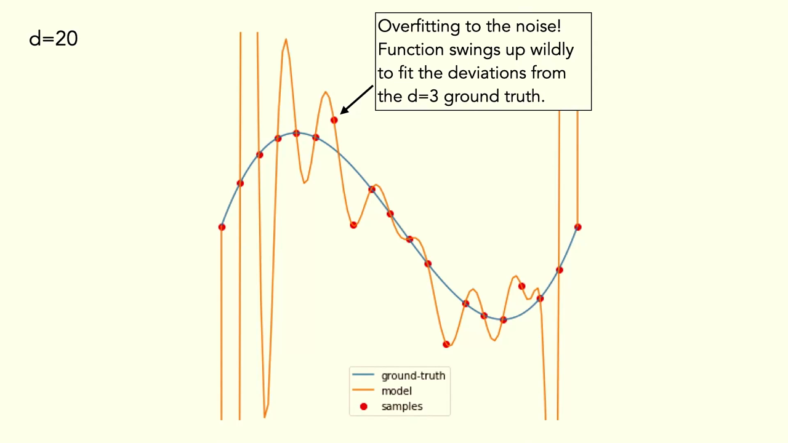
*▲ 강의 슬라이드 [31:50](https://youtu.be/EiO8BBa-xdc?t=1910): d = 20. 참 함수(3차)에서 벗어난 잡음을 맞추려고 함수가 크게 출렁인다*

d = 1000이면 더 크게 출렁일까요? 한 학생은 "완벽히 맞추는 해가 아주 많아서, 좋은 것도 나쁜 것도 있을 것"이라고 답했고 강사는 매우 정교한 답이라고 칭찬합니다. 어느 해에 도달하느냐는 **어떻게 찾느냐**(최적화 방법)에 달려 있습니다.

### 5.3 단순 + 뾰족 가설

▶ 영상 [33:27](https://youtu.be/EiO8BBa-xdc?t=2007)

- d = 1000에서 실제로 나오는 해는 [학습](00_%EB%94%A5%EB%9F%AC%EB%8B%9D_%EC%9A%A9%EC%96%B4%EC%82%AC%EC%A0%84.md#training-%ED%95%99%EC%8A%B5) 점마다 작은 **뾰족한 가시**가 있지만, 전체적으로는 **매끄러운 참 함수에 훨씬 가깝게** 붙습니다.
- [가설](00_%EB%94%A5%EB%9F%AC%EB%8B%9D_%EC%9A%A9%EC%96%B4%EC%82%AC%EC%A0%84.md#hypothesis-%EA%B0%80%EC%84%A4): [용량](00_%EB%94%A5%EB%9F%AC%EB%8B%9D_%EC%9A%A9%EC%96%B4%EC%82%AC%EC%A0%84.md#capacity-%EC%9A%A9%EB%9F%89)이 충분하면 학습된 모형은 **"단순한" 부분(예측에 쓰이고 잘 [일반화](00_%EB%94%A5%EB%9F%AC%EB%8B%9D_%EC%9A%A9%EC%96%B4%EC%82%AC%EC%A0%84.md#generalization-%EC%9D%BC%EB%B0%98%ED%99%94))** + **"뾰족한" 부분(잡음·이상치를 외우는 부분)**으로 나뉩니다(Belkin, Rakhlin, Tsybakov 2018). 즉 **[암기](00_%EB%94%A5%EB%9F%AC%EB%8B%9D_%EC%9A%A9%EC%96%B4%EC%82%AC%EC%A0%84.md#memorization-%EC%95%94%EA%B8%B0) + [일반화](00_%EB%94%A5%EB%9F%AC%EB%8B%9D_%EC%9A%A9%EC%96%B4%EC%82%AC%EC%A0%84.md#generalization-%EC%9D%BC%EB%B0%98%ED%99%94)**의 결합입니다. 몇 년 전까지는 널리 알려지지 않은 관점입니다.
- 단순한 모형에서는 증명할 수 있지만 깊은 망에서는 증명되지 않은 [가설](00_%EB%94%A5%EB%9F%AC%EB%8B%9D_%EC%9A%A9%EC%96%B4%EC%82%AC%EC%A0%84.md#hypothesis-%EA%B0%80%EC%84%A4)입니다. 깊은 망은 고전 모형보다 지저분해서 다항식 예에서 더 잘 보입니다.

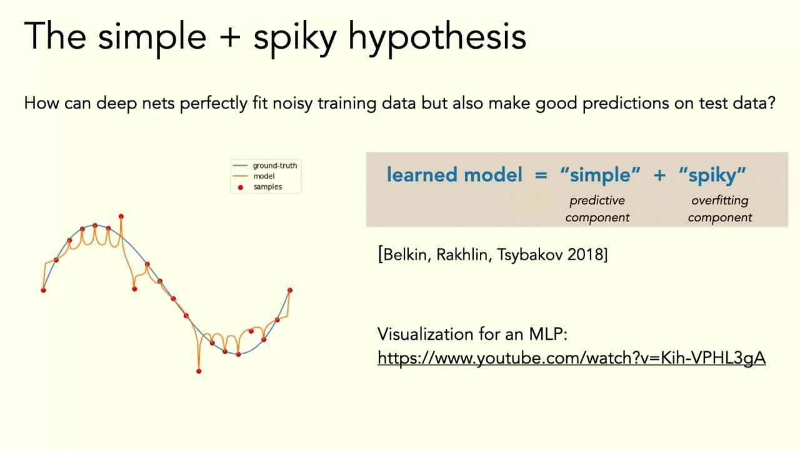
*▲ 강의 슬라이드 [34:20](https://youtu.be/EiO8BBa-xdc?t=2060): 학습된 모형 = "단순한" 예측 부분 + "뾰족한" [과적합](00_%EB%94%A5%EB%9F%AC%EB%8B%9D_%EC%9A%A9%EC%96%B4%EC%82%AC%EC%A0%84.md#overfitting-%EA%B3%BC%EC%A0%81%ED%95%A9) 부분*

### 5.4 이중 하강

▶ 영상 [37:21](https://youtu.be/EiO8BBa-xdc?t=2241)

📐 **수학 개념**: [최소 노름 해와 이중 하강](%EC%88%98%ED%95%99%EA%B0%9C%EB%85%90/08_%EC%9D%BC%EB%B0%98%ED%99%94/MM23_%EC%B5%9C%EC%86%8C_%EB%85%B8%EB%A6%84_%ED%95%B4%EC%99%80_%EC%9D%B4%EC%A4%91_%ED%95%98%EA%B0%95.md)

- 위 현상을 [용량](00_%EB%94%A5%EB%9F%AC%EB%8B%9D_%EC%9A%A9%EC%96%B4%EC%82%AC%EC%A0%84.md#capacity-%EC%9A%A9%EB%9F%89) 축에 그리면 **[이중 하강](00_%EB%94%A5%EB%9F%AC%EB%8B%9D_%EC%9A%A9%EC%96%B4%EC%82%AC%EC%A0%84.md#double-descent-%EC%9D%B4%EC%A4%91-%ED%95%98%EA%B0%95)(Double descent)** 곡선이 됩니다(Belkin, Hsu, Ma, Mandal, PNAS 2019). 고전 구간에서는 U자를 그리며 과적합하지만, [학습 데이터](00_%EB%94%A5%EB%9F%AC%EB%8B%9D_%EC%9A%A9%EC%96%B4%EC%82%AC%EC%A0%84.md#training-data-test-data-%ED%95%99%EC%8A%B5-%EB%8D%B0%EC%9D%B4%ED%84%B0%EC%99%80-%EC%8B%9C%ED%97%98-%EB%8D%B0%EC%9D%B4%ED%84%B0)를 완벽히 외울 수 있는 **[보간](00_%EB%94%A5%EB%9F%AC%EB%8B%9D_%EC%9A%A9%EC%96%B4%EC%82%AC%EC%A0%84.md#interpolation-%EB%B3%B4%EA%B0%84) 문턱(interpolation threshold)**을 지나면 시험 [오차](00_%EB%94%A5%EB%9F%AC%EB%8B%9D_%EC%9A%A9%EC%96%B4%EC%82%AC%EC%A0%84.md#error-%EC%98%A4%EC%B0%A8)가 다시 내려갑니다. [Lec01 6.3](Lec01_%EB%94%A5%EB%9F%AC%EB%8B%9D_%EC%86%8C%EA%B0%9C.md#63-%EC%9D%BC%EB%B0%98%ED%99%94-%EC%99%9C-%EA%B9%8A%EC%9D%80-%EB%A7%9D%EC%9D%80-%EC%99%B8%EC%9A%B0%EC%A7%80-%EC%95%8A%EA%B3%A0-%EC%9D%BC%EB%B0%98%ED%99%94%ED%95%98%EB%82%98)에서 미리 본 그림입니다.
- 강사의 직관: [보간](00_%EB%94%A5%EB%9F%AC%EB%8B%9D_%EC%9A%A9%EC%96%B4%EC%82%AC%EC%A0%84.md#interpolation-%EB%B3%B4%EA%B0%84) 문턱 근처에서는 데이터를 외우려고 **억지스러운 함수**를 배울 수밖에 없습니다. [용량](00_%EB%94%A5%EB%9F%AC%EB%8B%9D_%EC%9A%A9%EC%96%B4%EC%82%AC%EC%A0%84.md#capacity-%EC%9A%A9%EB%9F%89)이 더 커지면 데이터를 똑같이 잘 맞추는 해가 많아지고, 그중 **가장 매끄러운 것**(또는 다른 좋은 성질을 가진 것)을 고를 여유가 생깁니다. 이렇게 "데이터를 맞추는 해들 사이에서 고르는 압력"을 **[규제](00_%EB%94%A5%EB%9F%AC%EB%8B%9D_%EC%9A%A9%EC%96%B4%EC%82%AC%EC%A0%84.md#regularization-%EA%B7%9C%EC%A0%9C)([Regularization](00_%EB%94%A5%EB%9F%AC%EB%8B%9D_%EC%9A%A9%EC%96%B4%EC%82%AC%EC%A0%84.md#regularization-%EA%B7%9C%EC%A0%9C))**, **[암묵적 규제](00_%EB%94%A5%EB%9F%AC%EB%8B%9D_%EC%9A%A9%EC%96%B4%EC%82%AC%EC%A0%84.md#implicit-regularization-%EC%95%94%EB%AC%B5%EC%A0%81-%EA%B7%9C%EC%A0%9C)**, **[귀납 편향](00_%EB%94%A5%EB%9F%AC%EB%8B%9D_%EC%9A%A9%EC%96%B4%EC%82%AC%EC%A0%84.md#inductive-bias-%EA%B7%80%EB%82%A9-%ED%8E%B8%ED%96%A5)**이라 부릅니다.
- [MNIST](00_%EB%94%A5%EB%9F%AC%EB%8B%9D_%EC%9A%A9%EC%96%B4%EC%82%AC%EC%A0%84.md#mnist-%EC%86%90%EA%B8%80%EC%94%A8-%EC%88%AB%EC%9E%90-%EB%8D%B0%EC%9D%B4%ED%84%B0%EC%85%8B) 분류기에서도 실제로 관찰됩니다. 너비를 늘리면 [학습](00_%EB%94%A5%EB%9F%AC%EB%8B%9D_%EC%9A%A9%EC%96%B4%EC%82%AC%EC%A0%84.md#training-%ED%95%99%EC%8A%B5) [오차](00_%EB%94%A5%EB%9F%AC%EB%8B%9D_%EC%9A%A9%EC%96%B4%EC%82%AC%EC%A0%84.md#error-%EC%98%A4%EC%B0%A8)는 계속 줄고, 시험 [오차](00_%EB%94%A5%EB%9F%AC%EB%8B%9D_%EC%9A%A9%EC%96%B4%EC%82%AC%EC%A0%84.md#error-%EC%98%A4%EC%B0%A8)는 솟았다가 다시 내려갑니다.
- 다만 **관찰하기 까다롭습니다**. 강사도 직접 재현해 보려다 실패했습니다. [모멘텀](00_%EB%94%A5%EB%9F%AC%EB%8B%9D_%EC%9A%A9%EC%96%B4%EC%82%AC%EC%A0%84.md#momentum-%EB%AA%A8%EB%A9%98%ED%85%80), [가중치 감쇠](00_%EB%94%A5%EB%9F%AC%EB%8B%9D_%EC%9A%A9%EC%96%B4%EC%82%AC%EC%A0%84.md#weight-decay-%EA%B0%80%EC%A4%91%EC%B9%98-%EA%B0%90%EC%87%A0) 등 실전 기법들이 봉우리를 없애기 때문입니다. 강사는 이런 기법들이 "봉우리의 해로운 효과를 줄이고 우리를 오른쪽 구간으로 밀어 주는 것"이라고 봅니다.
- 깊은 망은 대개 첫 봉우리를 지난 오른쪽 구간에 있습니다. [용량](00_%EB%94%A5%EB%9F%AC%EB%8B%9D_%EC%9A%A9%EC%96%B4%EC%82%AC%EC%A0%84.md#capacity-%EC%9A%A9%EB%9F%89)은 [파라미터](00_%EB%94%A5%EB%9F%AC%EB%8B%9D_%EC%9A%A9%EC%96%B4%EC%82%AC%EC%A0%84.md#parameter-%ED%8C%8C%EB%9D%BC%EB%AF%B8%ED%84%B0) 수뿐 아니라 **계산량([FLOPs](00_%EB%94%A5%EB%9F%AC%EB%8B%9D_%EC%9A%A9%EC%96%B4%EC%82%AC%EC%A0%84.md#flops-pf-day-%EB%B6%80%EB%8F%99%EC%86%8C%EC%88%98%EC%A0%90-%EC%97%B0%EC%82%B0-%EC%88%98%EC%99%80-%ED%8E%98%ED%83%80%ED%94%8C%EB%A1%AD-%EC%9D%BC))**으로도 잴 수 있어서, [학습](00_%EB%94%A5%EB%9F%AC%EB%8B%9D_%EC%9A%A9%EC%96%B4%EC%82%AC%EC%A0%84.md#training-%ED%95%99%EC%8A%B5) 시간 축에서도 [이중 하강](00_%EB%94%A5%EB%9F%AC%EB%8B%9D_%EC%9A%A9%EC%96%B4%EC%82%AC%EC%A0%84.md#double-descent-%EC%9D%B4%EC%A4%91-%ED%95%98%EA%B0%95)이 나타납니다. 그래서 요즘은 "오래 학습할수록 매끄럽게 좋아진다"가 경험적 원칙입니다.

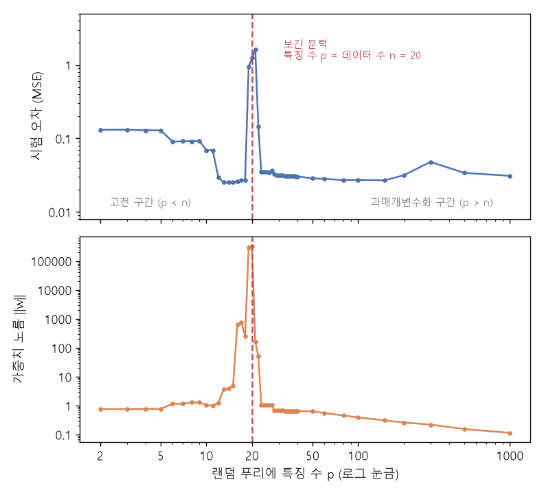
*▲ 직접 그린 그림: 점 20개에 랜덤 푸리에 특징 p개로 [최소 노름 해](00_%EB%94%A5%EB%9F%AC%EB%8B%9D_%EC%9A%A9%EC%96%B4%EC%82%AC%EC%A0%84.md#minimum-norm-solution-%EC%B5%9C%EC%86%8C-%EB%85%B8%EB%A6%84-%ED%95%B4)를 맞춘 실험. 특징 수가 데이터 수(20)와 같을 때 시험 [오차](00_%EB%94%A5%EB%9F%AC%EB%8B%9D_%EC%9A%A9%EC%96%B4%EC%82%AC%EC%A0%84.md#error-%EC%98%A4%EC%B0%A8)와 [가중치](00_%EB%94%A5%EB%9F%AC%EB%8B%9D_%EC%9A%A9%EC%96%B4%EC%82%AC%EC%A0%84.md#weight-%EA%B0%80%EC%A4%91%EC%B9%98) [노름](00_%EB%94%A5%EB%9F%AC%EB%8B%9D_%EC%9A%A9%EC%96%B4%EC%82%AC%EC%A0%84.md#norm-%EB%85%B8%EB%A6%84)이 치솟고, 더 늘리면 다시 내려간다 (숫자는 [MM23_최소_노름_해와_이중_하강](%EC%88%98%ED%95%99%EA%B0%9C%EB%85%90/08_%EC%9D%BC%EB%B0%98%ED%99%94/MM23_%EC%B5%9C%EC%86%8C_%EB%85%B8%EB%A6%84_%ED%95%B4%EC%99%80_%EC%9D%B4%EC%A4%91_%ED%95%98%EA%B0%95.md) 3절 표와 같음)*

질의응답 정리 [35:05](https://youtu.be/EiO8BBa-xdc?t=2105)

- **다항식 [회귀](00_%EB%94%A5%EB%9F%AC%EB%8B%9D_%EC%9A%A9%EC%96%B4%EC%82%AC%EC%A0%84.md#regression-classification-%ED%9A%8C%EA%B7%80%EC%99%80-%EB%B6%84%EB%A5%98)는 닫힌 해가 있지만, 확률적 최적화를 쓰는 신경망도 늘 좋은 해에 도달하나?** 신경망의 해는 무작위 초기화와 [미니배치](00_%EB%94%A5%EB%9F%AC%EB%8B%9D_%EC%9A%A9%EC%96%B4%EC%82%AC%EC%A0%84.md#mini-batch-%EB%AF%B8%EB%8B%88%EB%B0%B0%EC%B9%98)에 따라 달라서 깔끔한 증명이 어렵습니다. 대신 "[Adam](00_%EB%94%A5%EB%9F%AC%EB%8B%9D_%EC%9A%A9%EC%96%B4%EC%82%AC%EC%A0%84.md#adam-%EC%95%84%EB%8B%B4-%EC%98%B5%ED%8B%B0%EB%A7%88%EC%9D%B4%EC%A0%80)이나 SGD로 여러 번 돌려 보니 이렇다"는 경험적 주장이나, "어떤 조건에서는 높은 [확률](00_%EB%94%A5%EB%9F%AC%EB%8B%9D_%EC%9A%A9%EC%96%B4%EC%82%AC%EC%A0%84.md#probability-%ED%99%95%EB%A5%A0)로 매끄러운 + 뾰족한 해가 나온다" 같은 이론적 주장을 합니다.
- **계산을 얼마나 들여야 하나, 언제 멈춰야 하나?** 경사하강 단계 수는 [하이퍼파라미터](00_%EB%94%A5%EB%9F%AC%EB%8B%9D_%EC%9A%A9%EC%96%B4%EC%82%AC%EC%A0%84.md#hyperparameter-%ED%95%98%EC%9D%B4%ED%8D%BC%ED%8C%8C%EB%9D%BC%EB%AF%B8%ED%84%B0)이고, 고전적으로는 너무 많이 돌리면 과적합합니다. 하지만 신경망 시대에는 계산량 축의 [이중 하강](00_%EB%94%A5%EB%9F%AC%EB%8B%9D_%EC%9A%A9%EC%96%B4%EC%82%AC%EC%A0%84.md#double-descent-%EC%9D%B4%EC%A4%91-%ED%95%98%EA%B0%95) 때문에 대체로 "오래 학습할수록 좋다"입니다.
- **[이중 하강](00_%EB%94%A5%EB%9F%AC%EB%8B%9D_%EC%9A%A9%EC%96%B4%EC%82%AC%EC%A0%84.md#double-descent-%EC%9D%B4%EC%A4%91-%ED%95%98%EA%B0%95)의 첫 번째 바닥에서 멈춰야 하나, 계속 키워야 하나?** 오른쪽으로 갈수록 비용이 들므로 비용 대비 효과에 달려 있습니다. 그래도 딥러닝은 대체로 첫 봉우리를 지난 구간에 있습니다.
- **다항식 [회귀](00_%EB%94%A5%EB%9F%AC%EB%8B%9D_%EC%9A%A9%EC%96%B4%EC%82%AC%EC%A0%84.md#regression-classification-%ED%9A%8C%EA%B7%80%EC%99%80-%EB%B6%84%EB%A5%98)와 깊은 망은 어떤 관계인가?** MLP의 마지막 [층](00_%EB%94%A5%EB%9F%AC%EB%8B%9D_%EC%9A%A9%EC%96%B4%EC%82%AC%EC%A0%84.md#layer-%EC%B8%B5)은 앞 [층](00_%EB%94%A5%EB%9F%AC%EB%8B%9D_%EC%9A%A9%EC%96%B4%EC%82%AC%EC%A0%84.md#layer-%EC%B8%B5) 뉴런들(특징)의 선형 결합입니다. 그 특징이 다항식이면 다항식 [회귀](00_%EB%94%A5%EB%9F%AC%EB%8B%9D_%EC%9A%A9%EC%96%B4%EC%82%AC%EC%A0%84.md#regression-classification-%ED%9A%8C%EA%B7%80%EC%99%80-%EB%B6%84%EB%A5%98), 사인·코사인이면 푸리에 [회귀](00_%EB%94%A5%EB%9F%AC%EB%8B%9D_%EC%9A%A9%EC%96%B4%EC%82%AC%EC%A0%84.md#regression-classification-%ED%9A%8C%EA%B7%80%EC%99%80-%EB%B6%84%EB%A5%98)가 됩니다. 깊은 망에서는 특징 자체를 학습하지만, 필요하면 그런 함수들을 배울 수 있는 [용량](00_%EB%94%A5%EB%9F%AC%EB%8B%9D_%EC%9A%A9%EC%96%B4%EC%82%AC%EC%A0%84.md#capacity-%EC%9A%A9%EB%9F%89)이 있습니다.
- **[모멘텀](00_%EB%94%A5%EB%9F%AC%EB%8B%9D_%EC%9A%A9%EC%96%B4%EC%82%AC%EC%A0%84.md#momentum-%EB%AA%A8%EB%A9%98%ED%85%80)은 어떤 영향을 주나?** 강사도 더 생각해 봐야 한다면서, 실전 기법들은 대체로 봉우리를 없애고 오른쪽으로 밀어 주는 쪽이라고 답합니다.

### 5.5 파라미터 노름

▶ 영상 [42:27](https://youtu.be/EiO8BBa-xdc?t=2547)

📐 **수학 개념**: [최소 노름 해](%EC%88%98%ED%95%99%EA%B0%9C%EB%85%90/08_%EC%9D%BC%EB%B0%98%ED%99%94/MM23_%EC%B5%9C%EC%86%8C_%EB%85%B8%EB%A6%84_%ED%95%B4%EC%99%80_%EC%9D%B4%EC%A4%91_%ED%95%98%EA%B0%95.md)

- 은닉 유닛이나 **랜덤 푸리에 특징**(무작위 주파수의 사인·코사인) 위에서 [선형 회귀](00_%EB%94%A5%EB%9F%AC%EB%8B%9D_%EC%9A%A9%EC%96%B4%EC%82%AC%EC%A0%84.md#linear-regression-%EC%84%A0%ED%98%95-%ED%9A%8C%EA%B7%80)를 한다고 합시다. 특징이 적을 때는 과소적합하고, [보간](00_%EB%94%A5%EB%9F%AC%EB%8B%9D_%EC%9A%A9%EC%96%B4%EC%82%AC%EC%A0%84.md#interpolation-%EB%B3%B4%EA%B0%84) 문턱 근처에서는 모든 특징을 총동원해야 해서 [가중치](00_%EB%94%A5%EB%9F%AC%EB%8B%9D_%EC%9A%A9%EC%96%B4%EC%82%AC%EC%A0%84.md#weight-%EA%B0%80%EC%A4%91%EC%B9%98)가 치솟습니다.
- 특징을 더 늘리면 [학습 데이터](00_%EB%94%A5%EB%9F%AC%EB%8B%9D_%EC%9A%A9%EC%96%B4%EC%82%AC%EC%A0%84.md#training-data-test-data-%ED%95%99%EC%8A%B5-%EB%8D%B0%EC%9D%B4%ED%84%B0%EC%99%80-%EC%8B%9C%ED%97%98-%EB%8D%B0%EC%9D%B4%ED%84%B0)를 맞추는 해 중 **[노름](00_%EB%94%A5%EB%9F%AC%EB%8B%9D_%EC%9A%A9%EC%96%B4%EC%82%AC%EC%A0%84.md#norm-%EB%85%B8%EB%A6%84)이 작은 해**를 고를 수 있어서 **[파라미터](00_%EB%94%A5%EB%9F%AC%EB%8B%9D_%EC%9A%A9%EC%96%B4%EC%82%AC%EC%A0%84.md#parameter-%ED%8C%8C%EB%9D%BC%EB%AF%B8%ED%84%B0) [노름](00_%EB%94%A5%EB%9F%AC%EB%8B%9D_%EC%9A%A9%EC%96%B4%EC%82%AC%EC%A0%84.md#norm-%EB%85%B8%EB%A6%84)이 오히려 줄어듭니다**. 특징이 많을수록 [노름](00_%EB%94%A5%EB%9F%AC%EB%8B%9D_%EC%9A%A9%EC%96%B4%EC%82%AC%EC%A0%84.md#norm-%EB%85%B8%EB%A6%84)이 낮은, 어떤 의미에서 더 매끄러운 해가 됩니다.
- 결론: **[파라미터](00_%EB%94%A5%EB%9F%AC%EB%8B%9D_%EC%9A%A9%EC%96%B4%EC%82%AC%EC%A0%84.md#parameter-%ED%8C%8C%EB%9D%BC%EB%AF%B8%ED%84%B0) 개수를 세는 것은 올바른 복잡도 척도가 아닙니다.** [파라미터](00_%EB%94%A5%EB%9F%AC%EB%8B%9D_%EC%9A%A9%EC%96%B4%EC%82%AC%EC%A0%84.md#parameter-%ED%8C%8C%EB%9D%BC%EB%AF%B8%ED%84%B0) [노름](00_%EB%94%A5%EB%9F%AC%EB%8B%9D_%EC%9A%A9%EC%96%B4%EC%82%AC%EC%A0%84.md#norm-%EB%85%B8%EB%A6%84) 같은 다른 성질이 함수가 얼마나 출렁이는지를 더 잘 나타낼 수 있습니다.

> [!NOTE]
> **숫자로 보기: 특징이 늘면 [노름](00_%EB%94%A5%EB%9F%AC%EB%8B%9D_%EC%9A%A9%EC%96%B4%EC%82%AC%EC%A0%84.md#norm-%EB%85%B8%EB%A6%84)이 준다**
> 한 점의 [정답](00_%EB%94%A5%EB%9F%AC%EB%8B%9D_%EC%9A%A9%EC%96%B4%EC%82%AC%EC%A0%84.md#label-%EC%A0%95%EB%8B%B5) 5를 맞출 때, 특징 (1) 하나면 [가중치](00_%EB%94%A5%EB%9F%AC%EB%8B%9D_%EC%9A%A9%EC%96%B4%EC%82%AC%EC%A0%84.md#weight-%EA%B0%80%EC%A4%91%EC%B9%98) 5 ([노름](00_%EB%94%A5%EB%9F%AC%EB%8B%9D_%EC%9A%A9%EC%96%B4%EC%82%AC%EC%A0%84.md#norm-%EB%85%B8%EB%A6%84) 5), 특징 (1, 2)면 [최소 노름 해](00_%EB%94%A5%EB%9F%AC%EB%8B%9D_%EC%9A%A9%EC%96%B4%EC%82%AC%EC%A0%84.md#minimum-norm-solution-%EC%B5%9C%EC%86%8C-%EB%85%B8%EB%A6%84-%ED%95%B4) (1, 2) ([노름](00_%EB%94%A5%EB%9F%AC%EB%8B%9D_%EC%9A%A9%EC%96%B4%EC%82%AC%EC%A0%84.md#norm-%EB%85%B8%EB%A6%84) 2.2361), 특징 (1, 2, 2)면 [노름](00_%EB%94%A5%EB%9F%AC%EB%8B%9D_%EC%9A%A9%EC%96%B4%EC%82%AC%EC%A0%84.md#norm-%EB%85%B8%EB%A6%84) 1.6667입니다. 위 실험에서는 p = 20에서 [노름](00_%EB%94%A5%EB%9F%AC%EB%8B%9D_%EC%9A%A9%EC%96%B4%EC%82%AC%EC%A0%84.md#norm-%EB%85%B8%EB%A6%84) 약 33만, p = 1000에서 0.115였습니다. 자세한 계산은 [MM23_최소_노름_해와_이중_하강](%EC%88%98%ED%95%99%EA%B0%9C%EB%85%90/08_%EC%9D%BC%EB%B0%98%ED%99%94/MM23_%EC%B5%9C%EC%86%8C_%EB%85%B8%EB%A6%84_%ED%95%B4%EC%99%80_%EC%9D%B4%EC%A4%91_%ED%95%98%EA%B0%95.md).

질의응답 정리 [44:06](https://youtu.be/EiO8BBa-xdc?t=2646)

- **[노름](00_%EB%94%A5%EB%9F%AC%EB%8B%9D_%EC%9A%A9%EC%96%B4%EC%82%AC%EC%A0%84.md#norm-%EB%85%B8%EB%A6%84)의 봉우리가 [보간](00_%EB%94%A5%EB%9F%AC%EB%8B%9D_%EC%9A%A9%EC%96%B4%EC%82%AC%EC%A0%84.md#interpolation-%EB%B3%B4%EA%B0%84) 문턱과 일치하나?** 정확히 [보간](00_%EB%94%A5%EB%9F%AC%EB%8B%9D_%EC%9A%A9%EC%96%B4%EC%82%AC%EC%A0%84.md#interpolation-%EB%B3%B4%EA%B0%84) 문턱에서 생깁니다. 선형 모형에서는 모두 증명할 수 있지만, 깊은 망에서는 경험적 관찰입니다.

---

## 6. 파라미터 수는 복잡도가 아니다

▶ 영상 [44:41](https://youtu.be/EiO8BBa-xdc?t=2681)

복잡도를 무엇으로 잴까요? [이중 하강](00_%EB%94%A5%EB%9F%AC%EB%8B%9D_%EC%9A%A9%EC%96%B4%EC%82%AC%EC%A0%84.md#double-descent-%EC%9D%B4%EC%A4%91-%ED%95%98%EA%B0%95)이 보여 주듯 **[파라미터](00_%EB%94%A5%EB%9F%AC%EB%8B%9D_%EC%9A%A9%EC%96%B4%EC%82%AC%EC%A0%84.md#parameter-%ED%8C%8C%EB%9D%BC%EB%AF%B8%ED%84%B0) 수는 아닙니다.** [파라미터](00_%EB%94%A5%EB%9F%AC%EB%8B%9D_%EC%9A%A9%EC%96%B4%EC%82%AC%EC%A0%84.md#parameter-%ED%8C%8C%EB%9D%BC%EB%AF%B8%ED%84%B0) [노름](00_%EB%94%A5%EB%9F%AC%EB%8B%9D_%EC%9A%A9%EC%96%B4%EC%82%AC%EC%A0%84.md#norm-%EB%85%B8%EB%A6%84)은 "아마도(maybe)" 더 낫지만 그것도 한계가 있습니다. 강사는 극단적인 예를 듭니다.

- 연결이 아주 많은 망 $f$와 연결이 몇 개 없는 망 $g$가 있습니다.
- $h(x) = 10^{-100} f(x) + (1 - 10^{-100}) g(x)$를 생각합니다. 형식상 $h$는 $f$의 [파라미터](00_%EB%94%A5%EB%9F%AC%EB%8B%9D_%EC%9A%A9%EC%96%B4%EC%82%AC%EC%A0%84.md#parameter-%ED%8C%8C%EB%9D%BC%EB%AF%B8%ED%84%B0)를 모두 가지지만, 실제로는 거의 $g$입니다.
- $h$를 [오차](00_%EB%94%A5%EB%9F%AC%EB%8B%9D_%EC%9A%A9%EC%96%B4%EC%82%AC%EC%A0%84.md#error-%EC%98%A4%EC%B0%A8) $10^{-100}$ 수준까지 근사하는 데는 $g$의 [파라미터](00_%EB%94%A5%EB%9F%AC%EB%8B%9D_%EC%9A%A9%EC%96%B4%EC%82%AC%EC%A0%84.md#parameter-%ED%8C%8C%EB%9D%BC%EB%AF%B8%ED%84%B0) 몇 개면 충분합니다. [파라미터](00_%EB%94%A5%EB%9F%AC%EB%8B%9D_%EC%9A%A9%EC%96%B4%EC%82%AC%EC%A0%84.md#parameter-%ED%8C%8C%EB%9D%BC%EB%AF%B8%ED%84%B0)를 **몇 개** 가졌느냐보다 **얼마나 크냐**가 중요하다는 뜻입니다.

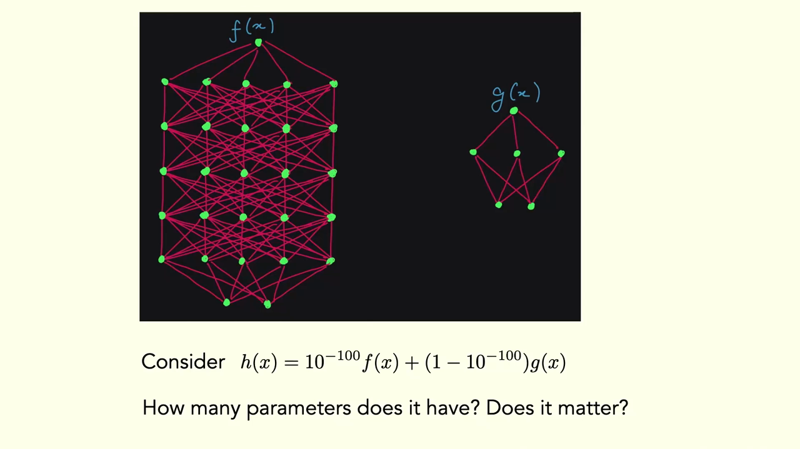
*▲ 강의 슬라이드 [46:10](https://youtu.be/EiO8BBa-xdc?t=2770): h(x) = 10⁻¹⁰⁰ f(x) + (1 − 10⁻¹⁰⁰) g(x). [파라미터](00_%EB%94%A5%EB%9F%AC%EB%8B%9D_%EC%9A%A9%EC%96%B4%EC%82%AC%EC%A0%84.md#parameter-%ED%8C%8C%EB%9D%BC%EB%AF%B8%ED%84%B0)는 몇 개이고, 그게 중요한가?*

---

## 7. VC 이론과 그 한계

▶ 영상 [46:29](https://youtu.be/EiO8BBa-xdc?t=2789)

📐 **수학 개념**: [경우의 수와 VC 한계](%EC%88%98%ED%95%99%EA%B0%9C%EB%85%90/04_%ED%99%95%EB%A5%A0%EA%B3%BC_%EC%A0%95%EB%B3%B4/MM24_%EA%B2%BD%EC%9A%B0%EC%9D%98_%EC%88%98%EC%99%80_VC_%ED%95%9C%EA%B3%84.md) · [확률](%EC%88%98%ED%95%99%EA%B0%9C%EB%85%90/04_%ED%99%95%EB%A5%A0%EA%B3%BC_%EC%A0%95%EB%B3%B4/M08_%ED%99%95%EB%A5%A0_%EA%B8%B0%EC%B4%88.md)

다음 후보는 **[가설 공간](00_%EB%94%A5%EB%9F%AC%EB%8B%9D_%EC%9A%A9%EC%96%B4%EC%82%AC%EC%A0%84.md#hypothesis-space-%EA%B0%80%EC%84%A4-%EA%B3%B5%EA%B0%84)에 들어 있는 서로 다른 함수의 개수**입니다. 바프니크(Vapnik)와 체르보넨키스(Chervonenkis)의 **VC 이론**입니다.

- [일반화](00_%EB%94%A5%EB%9F%AC%EB%8B%9D_%EC%9A%A9%EC%96%B4%EC%82%AC%EC%A0%84.md#generalization-%EC%9D%BC%EB%B0%98%ED%99%94) [오차](00_%EB%94%A5%EB%9F%AC%EB%8B%9D_%EC%9A%A9%EC%96%B4%EC%82%AC%EC%A0%84.md#error-%EC%98%A4%EC%B0%A8) = 모집단 [오차](00_%EB%94%A5%EB%9F%AC%EB%8B%9D_%EC%9A%A9%EC%96%B4%EC%82%AC%EC%A0%84.md#error-%EC%98%A4%EC%B0%A8) − [학습](00_%EB%94%A5%EB%9F%AC%EB%8B%9D_%EC%9A%A9%EC%96%B4%EC%82%AC%EC%A0%84.md#training-%ED%95%99%EC%8A%B5) [오차](00_%EB%94%A5%EB%9F%AC%EB%8B%9D_%EC%9A%A9%EC%96%B4%EC%82%AC%EC%A0%84.md#error-%EC%98%A4%EC%B0%A8)
- **만약** [학습 데이터](00_%EB%94%A5%EB%9F%AC%EB%8B%9D_%EC%9A%A9%EC%96%B4%EC%82%AC%EC%A0%84.md#training-data-test-data-%ED%95%99%EC%8A%B5-%EB%8D%B0%EC%9D%B4%ED%84%B0%EC%99%80-%EC%8B%9C%ED%97%98-%EB%8D%B0%EC%9D%B4%ED%84%B0) 수가 함수 집합([가설 공간](00_%EB%94%A5%EB%9F%AC%EB%8B%9D_%EC%9A%A9%EC%96%B4%EC%82%AC%EC%A0%84.md#hypothesis-space-%EA%B0%80%EC%84%A4-%EA%B3%B5%EA%B0%84))의 함수 개수보다 훨씬 많으면, **그러면** 높은 [확률](00_%EB%94%A5%EB%9F%AC%EB%8B%9D_%EC%9A%A9%EC%96%B4%EC%82%AC%EC%A0%84.md#probability-%ED%99%95%EB%A5%A0)로 [학습](00_%EB%94%A5%EB%9F%AC%EB%8B%9D_%EC%9A%A9%EC%96%B4%EC%82%AC%EC%A0%84.md#training-%ED%95%99%EC%8A%B5) [오차](00_%EB%94%A5%EB%9F%AC%EB%8B%9D_%EC%9A%A9%EC%96%B4%EC%82%AC%EC%A0%84.md#error-%EC%98%A4%EC%B0%A8)가 모집단 [오차](00_%EB%94%A5%EB%9F%AC%EB%8B%9D_%EC%9A%A9%EC%96%B4%EC%82%AC%EC%A0%84.md#error-%EC%98%A4%EC%B0%A8)와 같아집니다.

### 7.1 거짓 양성의 직관

▶ 영상 [47:43](https://youtu.be/EiO8BBa-xdc?t=2863)

- **거짓 양성(false positive)**: [학습 데이터](00_%EB%94%A5%EB%9F%AC%EB%8B%9D_%EC%9A%A9%EC%96%B4%EC%82%AC%EC%A0%84.md#training-data-test-data-%ED%95%99%EC%8A%B5-%EB%8D%B0%EC%9D%B4%ED%84%B0%EC%99%80-%EC%8B%9C%ED%97%98-%EB%8D%B0%EC%9D%B4%ED%84%B0)는 맞추지만 [모집단 위험](00_%EB%94%A5%EB%9F%AC%EB%8B%9D_%EC%9A%A9%EC%96%B4%EC%82%AC%EC%A0%84.md#population-risk-%EB%AA%A8%EC%A7%91%EB%8B%A8-%EC%9C%84%ED%97%98)이 큰 함수. 문어 파울처럼 운이 좋았을 뿐인 함수입니다.
- 후보 함수가 **많을수록** 거짓 양성을 고를 [확률](00_%EB%94%A5%EB%9F%AC%EB%8B%9D_%EC%9A%A9%EC%96%B4%EC%82%AC%EC%A0%84.md#probability-%ED%99%95%EB%A5%A0)이 **높습니다**. 운 좋게 맞는 함수가 더 많기 때문입니다.
- 데이터가 **많을수록** 거짓 양성을 고를 [확률](00_%EB%94%A5%EB%9F%AC%EB%8B%9D_%EC%9A%A9%EC%96%B4%EC%82%AC%EC%A0%84.md#probability-%ED%99%95%EB%A5%A0)이 **낮습니다**. 데이터 하나하나가 새 제약이 되어 후보를 걸러 내기 때문입니다.

강사는 동그라미 그림으로 설명합니다. 동그라미 하나가 후보 함수, 보라색은 [학습 데이터](00_%EB%94%A5%EB%9F%AC%EB%8B%9D_%EC%9A%A9%EC%96%B4%EC%82%AC%EC%A0%84.md#training-data-test-data-%ED%95%99%EC%8A%B5-%EB%8D%B0%EC%9D%B4%ED%84%B0%EC%99%80-%EC%8B%9C%ED%97%98-%EB%8D%B0%EC%9D%B4%ED%84%B0)를 맞추는 함수, 초록색은 참 함수입니다. 가정: 잡음 없는 데이터, 참 함수가 [가설 공간](00_%EB%94%A5%EB%9F%AC%EB%8B%9D_%EC%9A%A9%EC%96%B4%EC%82%AC%EC%A0%84.md#hypothesis-space-%EA%B0%80%EC%84%A4-%EA%B3%B5%EA%B0%84)에 있음, 최적화는 보라색 중 하나를 무작위로 고름.

| 조작 | 효과 | 참 함수를 고를 [확률](00_%EB%94%A5%EB%9F%AC%EB%8B%9D_%EC%9A%A9%EC%96%B4%EC%82%AC%EC%A0%84.md#probability-%ED%99%95%EB%A5%A0) |
|---|---|---|
| 처음 | 데이터를 맞추는 후보 6개 | 1/6 |
| **데이터 추가** | 새 제약에 어긋나는 보라색이 꺼짐 → 4개 | 1/4 |
| **[용량](00_%EB%94%A5%EB%9F%AC%EB%8B%9D_%EC%9A%A9%EC%96%B4%EC%82%AC%EC%A0%84.md#capacity-%EC%9A%A9%EB%9F%89) 줄이기** | 동그라미(후보)를 무작위로 지움(참 함수는 남김) | 올라감 |

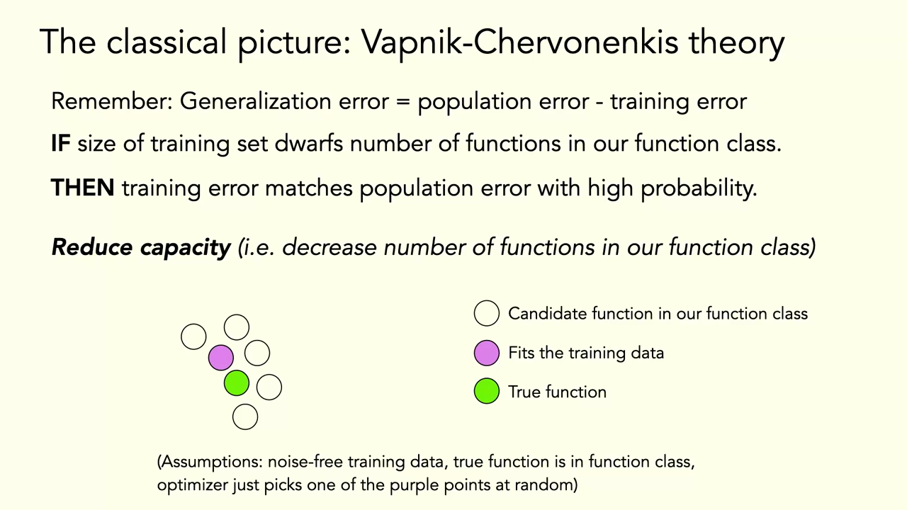
*▲ 강의 슬라이드 [51:30](https://youtu.be/EiO8BBa-xdc?t=3090): [용량](00_%EB%94%A5%EB%9F%AC%EB%8B%9D_%EC%9A%A9%EC%96%B4%EC%82%AC%EC%A0%84.md#capacity-%EC%9A%A9%EB%9F%89) 줄이기. 후보 함수를 줄이면 데이터를 맞추는 가짜 함수(보라색)도 줄어 참 함수(초록색)를 고를 [확률](00_%EB%94%A5%EB%9F%AC%EB%8B%9D_%EC%9A%A9%EC%96%B4%EC%82%AC%EC%A0%84.md#probability-%ED%99%95%EB%A5%A0)이 오른다*

### 7.2 이분법과 VC 차원

▶ 영상 [51:41](https://youtu.be/EiO8BBa-xdc?t=3101)

- 신경망은 연속적이라 함수를 셀 수 없어 보입니다. VC 이론에서는 **[학습 데이터](00_%EB%94%A5%EB%9F%AC%EB%8B%9D_%EC%9A%A9%EC%96%B4%EC%82%AC%EC%A0%84.md#training-data-test-data-%ED%95%99%EC%8A%B5-%EB%8D%B0%EC%9D%B4%ED%84%B0%EC%99%80-%EC%8B%9C%ED%97%98-%EB%8D%B0%EC%9D%B4%ED%84%B0)에 붙일 수 있는 서로 다른 출력 묶음**만 세면 충분합니다.
- 출력이 +1/−1인 이진 분류라면, 이미지 1번 +1, 2번 +1, …, 999번 −1 같은 라벨 묶음 하나가 **[이분법](00_%EB%94%A5%EB%9F%AC%EB%8B%9D_%EC%9A%A9%EC%96%B4%EC%82%AC%EC%A0%84.md#dichotomy-%EC%9D%B4%EB%B6%84%EB%B2%95)([Dichotomy](00_%EB%94%A5%EB%9F%AC%EB%8B%9D_%EC%9A%A9%EC%96%B4%EC%82%AC%EC%A0%84.md#dichotomy-%EC%9D%B4%EB%B6%84%EB%B2%95))**입니다.
- 강의 정의: **[VC 차원](00_%EB%94%A5%EB%9F%AC%EB%8B%9D_%EC%9A%A9%EC%96%B4%EC%82%AC%EC%A0%84.md#vc-dimension-vc-%EC%B0%A8%EC%9B%90)** $d$ = 모형이 [학습](00_%EB%94%A5%EB%9F%AC%EB%8B%9D_%EC%9A%A9%EC%96%B4%EC%82%AC%EC%A0%84.md#training-%ED%95%99%EC%8A%B5) 점 $n$개에 만들 수 있는 [이분법](00_%EB%94%A5%EB%9F%AC%EB%8B%9D_%EC%9A%A9%EC%96%B4%EC%82%AC%EC%A0%84.md#dichotomy-%EC%9D%B4%EB%B6%84%EB%B2%95)의 수. 일정한 가정 아래 [일반화 한계](00_%EB%94%A5%EB%9F%AC%EB%8B%9D_%EC%9A%A9%EC%96%B4%EC%82%AC%EC%A0%84.md#generalization-bound-%EC%9D%BC%EB%B0%98%ED%99%94-%ED%95%9C%EA%B3%84)는 다음과 같습니다.

$$
\text{일반화 오차} \le \sqrt{d / n} \quad (\text{슬라이드의 형태})
$$

기호 풀이

| 기호 | 읽는 법 | 뜻 | 예제 값 |
| --- | --- | --- | --- |
| [일반화](00_%EB%94%A5%EB%9F%AC%EB%8B%9D_%EC%9A%A9%EC%96%B4%EC%82%AC%EC%A0%84.md#generalization-%EC%9D%BC%EB%B0%98%ED%99%94) [오차](00_%EB%94%A5%EB%9F%AC%EB%8B%9D_%EC%9A%A9%EC%96%B4%EC%82%AC%EC%A0%84.md#error-%EC%98%A4%EC%B0%A8) | - | [모집단 위험](00_%EB%94%A5%EB%9F%AC%EB%8B%9D_%EC%9A%A9%EC%96%B4%EC%82%AC%EC%A0%84.md#population-risk-%EB%AA%A8%EC%A7%91%EB%8B%A8-%EC%9C%84%ED%97%98)과 [경험적 위험](00_%EB%94%A5%EB%9F%AC%EB%8B%9D_%EC%9A%A9%EC%96%B4%EC%82%AC%EC%A0%84.md#empirical-risk-%EA%B2%BD%ED%97%98%EC%A0%81-%EC%9C%84%ED%97%98)의 차이 | 0.1 이하 |
| $\le$ | 작거나 같다 | 왼쪽이 오른쪽을 넘지 않는다 | - |
| $\sqrt{\cdot}$ | 루트 | 제곱근 | $\sqrt{0.01} = 0.1$ |
| $d$ | 디 | [VC 차원](00_%EB%94%A5%EB%9F%AC%EB%8B%9D_%EC%9A%A9%EC%96%B4%EC%82%AC%EC%A0%84.md#vc-dimension-vc-%EC%B0%A8%EC%9B%90) (강의 정의: [학습](00_%EB%94%A5%EB%9F%AC%EB%8B%9D_%EC%9A%A9%EC%96%B4%EC%82%AC%EC%A0%84.md#training-%ED%95%99%EC%8A%B5) 점 n개에 만들 수 있는 [이분법](00_%EB%94%A5%EB%9F%AC%EB%8B%9D_%EC%9A%A9%EC%96%B4%EC%82%AC%EC%A0%84.md#dichotomy-%EC%9D%B4%EB%B6%84%EB%B2%95)의 수) | 1000 |
| $n$ | 엔 | [학습](00_%EB%94%A5%EB%9F%AC%EB%8B%9D_%EC%9A%A9%EC%96%B4%EC%82%AC%EC%A0%84.md#training-%ED%95%99%EC%8A%B5) 점 개수 | 100000 |

예제와 풀이

**문제**: 모형이 만들 수 있는 [이분법](00_%EB%94%A5%EB%9F%AC%EB%8B%9D_%EC%9A%A9%EC%96%B4%EC%82%AC%EC%A0%84.md#dichotomy-%EC%9D%B4%EB%B6%84%EB%B2%95)의 수([VC 차원](00_%EB%94%A5%EB%9F%AC%EB%8B%9D_%EC%9A%A9%EC%96%B4%EC%82%AC%EC%A0%84.md#vc-dimension-vc-%EC%B0%A8%EC%9B%90))가 1000이고 [학습](00_%EB%94%A5%EB%9F%AC%EB%8B%9D_%EC%9A%A9%EC%96%B4%EC%82%AC%EC%A0%84.md#training-%ED%95%99%EC%8A%B5) 점이 100000개일 때, 슬라이드 형태의 [일반화 한계](00_%EB%94%A5%EB%9F%AC%EB%8B%9D_%EC%9A%A9%EC%96%B4%EC%82%AC%EC%A0%84.md#generalization-bound-%EC%9D%BC%EB%B0%98%ED%99%94-%ED%95%9C%EA%B3%84)를 구한다.

**주어진 값**:
- $d = 1000$ ([VC 차원](00_%EB%94%A5%EB%9F%AC%EB%8B%9D_%EC%9A%A9%EC%96%B4%EC%82%AC%EC%A0%84.md#vc-dimension-vc-%EC%B0%A8%EC%9B%90): 모형이 만들 수 있는 [이분법](00_%EB%94%A5%EB%9F%AC%EB%8B%9D_%EC%9A%A9%EC%96%B4%EC%82%AC%EC%A0%84.md#dichotomy-%EC%9D%B4%EB%B6%84%EB%B2%95)의 수)
- $n = 100000$ ([학습](00_%EB%94%A5%EB%9F%AC%EB%8B%9D_%EC%9A%A9%EC%96%B4%EC%82%AC%EC%A0%84.md#training-%ED%95%99%EC%8A%B5) 점 개수)

**풀이**
1. 식을 그대로 쓴다: $\text{일반화 오차} \le \sqrt{d / n} \quad (\text{슬라이드의 형태})$
2. 값을 대입한다: $\text{일반화 오차} \le \sqrt{1000 / 100000}$
3. 나눗셈을 한다: $1000 / 100000 = 0.01$ 이므로 $\text{일반화 오차} \le \sqrt{0.01}$
4. 제곱근을 구한다($\sqrt{a}$는 '제곱해서 a가 되는 양수'라는 뜻이다. $0.1 \times 0.1 = 0.01$ 이므로): $\sqrt{0.01} = 0.1$ 이므로 $\text{일반화 오차} \le 0.1$

**답**: [일반화](00_%EB%94%A5%EB%9F%AC%EB%8B%9D_%EC%9A%A9%EC%96%B4%EC%82%AC%EC%A0%84.md#generalization-%EC%9D%BC%EB%B0%98%ED%99%94) [오차](00_%EB%94%A5%EB%9F%AC%EB%8B%9D_%EC%9A%A9%EC%96%B4%EC%82%AC%EC%A0%84.md#error-%EC%98%A4%EC%B0%A8) $\le 0.1$

내 이해

(교과서에서 [VC 차원](00_%EB%94%A5%EB%9F%AC%EB%8B%9D_%EC%9A%A9%EC%96%B4%EC%82%AC%EC%A0%84.md#vc-dimension-vc-%EC%B0%A8%EC%9B%90)은 "모든 [이분법](00_%EB%94%A5%EB%9F%AC%EB%8B%9D_%EC%9A%A9%EC%96%B4%EC%82%AC%EC%A0%84.md#dichotomy-%EC%9D%B4%EB%B6%84%EB%B2%95)을 만들 수 있는 점의 최대 개수"이고, [이분법](00_%EB%94%A5%EB%9F%AC%EB%8B%9D_%EC%9A%A9%EC%96%B4%EC%82%AC%EC%A0%84.md#dichotomy-%EC%9D%B4%EB%B6%84%EB%B2%95)의 수는 성장 함수라 부른다. 정식 한계에는 [이분법](00_%EB%94%A5%EB%9F%AC%EB%8B%9D_%EC%9A%A9%EC%96%B4%EC%82%AC%EC%A0%84.md#dichotomy-%EC%9D%B4%EB%B6%84%EB%B2%95) 수의 [로그](00_%EB%94%A5%EB%9F%AC%EB%8B%9D_%EC%9A%A9%EC%96%B4%EC%82%AC%EC%A0%84.md#log-ln-%EB%A1%9C%EA%B7%B8)가 들어간다. 결론은 같다: [MM24_경우의_수와_VC_한계](%EC%88%98%ED%95%99%EA%B0%9C%EB%85%90/04_%ED%99%95%EB%A5%A0%EA%B3%BC_%EC%A0%95%EB%B3%B4/MM24_%EA%B2%BD%EC%9A%B0%EC%9D%98_%EC%88%98%EC%99%80_VC_%ED%95%9C%EA%B3%84.md) ⚠ 참고.)

### 7.3 무작위 라벨 실험

▶ 영상 [53:59](https://youtu.be/EiO8BBa-xdc?t=3239)

- 고양이·개 데이터의 라벨을 **무작위로 섞어도** 실전 신경망은 [학습 데이터](00_%EB%94%A5%EB%9F%AC%EB%8B%9D_%EC%9A%A9%EC%96%B4%EC%82%AC%EC%A0%84.md#training-data-test-data-%ED%95%99%EC%8A%B5-%EB%8D%B0%EC%9D%B4%ED%84%B0%EC%99%80-%EC%8B%9C%ED%97%98-%EB%8D%B0%EC%9D%B4%ED%84%B0)를 100% 맞춥니다. 즉 **어떤 [이분법](00_%EB%94%A5%EB%9F%AC%EB%8B%9D_%EC%9A%A9%EC%96%B4%EC%82%AC%EC%A0%84.md#dichotomy-%EC%9D%B4%EB%B6%84%EB%B2%95)이든** 만들 수 있습니다.
- 그러면 $d = 2^n$이고 한계 $\sqrt{2^n / n}$은 데이터가 늘수록 **지수적으로 커집니다.** "모집단 [오차](00_%EB%94%A5%EB%9F%AC%EB%8B%9D_%EC%9A%A9%EC%96%B4%EC%82%AC%EC%A0%84.md#error-%EC%98%A4%EC%B0%A8)가 100%보다 작다", "100억 %보다 작다" 같은, 아무 정보도 없는(**vacuous**) 한계가 됩니다. 예를 들어 n = 20이면 228.97입니다.
- 「Understanding Deep Learning Requires Rethinking Generalization」(Zhang 외, ICLR 2017)이 이 실험을 했습니다. [MNIST](00_%EB%94%A5%EB%9F%AC%EB%8B%9D_%EC%9A%A9%EC%96%B4%EC%82%AC%EC%A0%84.md#mnist-%EC%86%90%EA%B8%80%EC%94%A8-%EC%88%AB%EC%9E%90-%EB%8D%B0%EC%9D%B4%ED%84%B0%EC%85%8B), CIFAR 등에서 라벨을 무작위로 섞어도 [학습](00_%EB%94%A5%EB%9F%AC%EB%8B%9D_%EC%9A%A9%EC%96%B4%EC%82%AC%EC%A0%84.md#training-%ED%95%99%EC%8A%B5) [정확도](00_%EB%94%A5%EB%9F%AC%EB%8B%9D_%EC%9A%A9%EC%96%B4%EC%82%AC%EC%A0%84.md#accuracy-%EC%A0%95%ED%99%95%EB%8F%84) 100%를 얻지만, 진짜 라벨로 학습하면 시험 [정확도](00_%EB%94%A5%EB%9F%AC%EB%8B%9D_%EC%9A%A9%EC%96%B4%EC%82%AC%EC%A0%84.md#accuracy-%EC%A0%95%ED%99%95%EB%8F%84)가 높고 무작위 라벨이면 당연히 낮습니다. VC 이론은 두 경우를 구별하지 못합니다.
- **결론**: 신경망은 무작위 라벨도 맞출 수 있는데, 진짜 라벨에서는 일반화한다. 고전 이론으로는 설명이 안 됩니다. 핵심 빈틈은 딥러닝이 **데이터를 맞추는 [가설](00_%EB%94%A5%EB%9F%AC%EB%8B%9D_%EC%9A%A9%EC%96%B4%EC%82%AC%EC%A0%84.md#hypothesis-%EA%B0%80%EC%84%A4) 중 아무거나 고르지 않는다**는 점입니다. [경사하강법](00_%EB%94%A5%EB%9F%AC%EB%8B%9D_%EC%9A%A9%EC%96%B4%EC%82%AC%EC%A0%84.md#gradient-descent-%EA%B2%BD%EC%82%AC%ED%95%98%EA%B0%95%EB%B2%95)은 어떤 [가설](00_%EB%94%A5%EB%9F%AC%EB%8B%9D_%EC%9A%A9%EC%96%B4%EC%82%AC%EC%A0%84.md#hypothesis-%EA%B0%80%EC%84%A4)을 다른 [가설](00_%EB%94%A5%EB%9F%AC%EB%8B%9D_%EC%9A%A9%EC%96%B4%EC%82%AC%EC%A0%84.md#hypothesis-%EA%B0%80%EC%84%A4)보다 선호합니다.

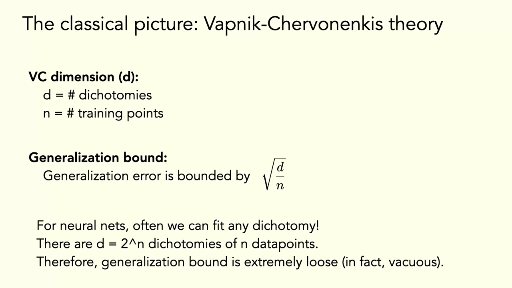
*▲ 강의 슬라이드 [55:30](https://youtu.be/EiO8BBa-xdc?t=3330): 신경망은 n개 점의 [이분법](00_%EB%94%A5%EB%9F%AC%EB%8B%9D_%EC%9A%A9%EC%96%B4%EC%82%AC%EC%A0%84.md#dichotomy-%EC%9D%B4%EB%B6%84%EB%B2%95) 2ⁿ개를 모두 만들 수 있어 VC 한계가 쓸모없어진다(vacuous)*

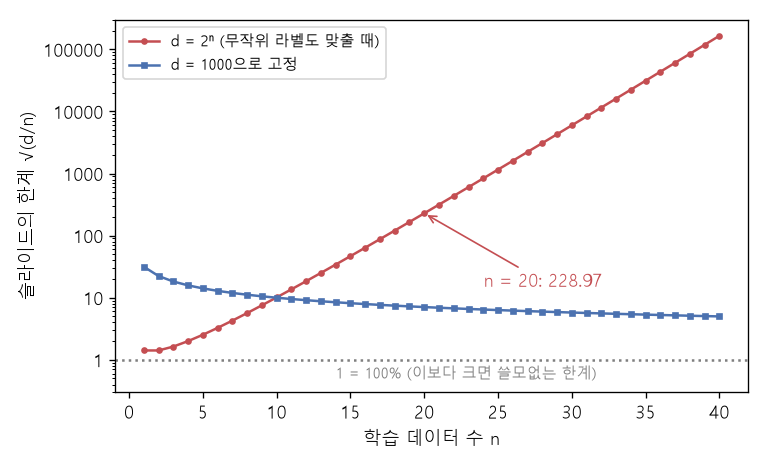
*▲ 직접 그린 그림: 슬라이드의 한계 √(d/n). d를 1000으로 고정하면 n이 늘수록 줄지만, d = 2ⁿ이면 n = 20에서 228.97로 폭발한다*

> [!TIP]
> **🆕 2026 업데이트: 쓸모 있는(non-vacuous) [일반화 한계](00_%EB%94%A5%EB%9F%AC%EB%8B%9D_%EC%9A%A9%EC%96%B4%EC%82%AC%EC%A0%84.md#generalization-bound-%EC%9D%BC%EB%B0%98%ED%99%94-%ED%95%9C%EA%B3%84)의 등장**
> - **강의**: VC 한계는 신경망에서 무의미하고, 딥러닝의 [일반화](00_%EB%94%A5%EB%9F%AC%EB%8B%9D_%EC%9A%A9%EC%96%B4%EC%82%AC%EC%A0%84.md#generalization-%EC%9D%BC%EB%B0%98%ED%99%94)를 설명하는 이론은 아직 없다.
> - **현재**: 4절의 "짧은 프로그램" 생각을 따르는 **압축 기반 한계**로, 10억 개 가까운 [파라미터](00_%EB%94%A5%EB%9F%AC%EB%8B%9D_%EC%9A%A9%EC%96%B4%EC%82%AC%EC%A0%84.md#parameter-%ED%8C%8C%EB%9D%BC%EB%AF%B8%ED%84%B0)를 가진 사전학습 LLM에 대해서도 처음으로 쓸모 있는 [일반화 한계](00_%EB%94%A5%EB%9F%AC%EB%8B%9D_%EC%9A%A9%EC%96%B4%EC%82%AC%EC%A0%84.md#generalization-bound-%EC%9D%BC%EB%B0%98%ED%99%94-%ED%95%9C%EA%B3%84)가 계산되었다(ICML 2024). [파라미터](00_%EB%94%A5%EB%9F%AC%EB%8B%9D_%EC%9A%A9%EC%96%B4%EC%82%AC%EC%A0%84.md#parameter-%ED%8C%8C%EB%9D%BC%EB%AF%B8%ED%84%B0)를 저차원으로 압축해 표현할 수 있을수록 한계가 좋아지고, **큰 모형일수록 더 잘 압축되어 한계도 더 좋았다.** 같은 그룹은 이미 이미지 분류기에서도 PAC-Bayes 압축 한계로 비슷한 결과를 냈다(NeurIPS 2022).
> - **출처**: [Lotfi et al., Non-Vacuous Generalization Bounds for Large Language Models (ICML 2024)](https://arxiv.org/abs/2312.17173) · [Lotfi et al., PAC-Bayes Compression Bounds So Tight That They Can Explain Generalization (NeurIPS 2022)](https://arxiv.org/abs/2211.13609)

질의응답 정리 [57:51](https://youtu.be/EiO8BBa-xdc?t=3471)

- **[이분법](00_%EB%94%A5%EB%9F%AC%EB%8B%9D_%EC%9A%A9%EC%96%B4%EC%82%AC%EC%A0%84.md#dichotomy-%EC%9D%B4%EB%B6%84%EB%B2%95)이란?** 모든 [학습](00_%EB%94%A5%EB%9F%AC%EB%8B%9D_%EC%9A%A9%EC%96%B4%EC%82%AC%EC%A0%84.md#training-%ED%95%99%EC%8A%B5) 점에 −1 또는 1을 하나씩 붙인 라벨 벡터입니다.

---

## 8. 깊은 망은 왜 일반화하나: 귀납 편향

▶ 영상 [59:05](https://youtu.be/EiO8BBa-xdc?t=3545)

**지금까지 정리** (강의 슬라이드 "Recap so far")

1. 깊은 망은 일반화합니다. [학습](00_%EB%94%A5%EB%9F%AC%EB%8B%9D_%EC%9A%A9%EC%96%B4%EC%82%AC%EC%A0%84.md#training-%ED%95%99%EC%8A%B5) 중 본 적 없는 입력에도 합리적인 예측을 합니다. LLM도 세기 논증으로 순수 [암기](00_%EB%94%A5%EB%9F%AC%EB%8B%9D_%EC%9A%A9%EC%96%B4%EC%82%AC%EC%A0%84.md#memorization-%EC%95%94%EA%B8%B0)가 아님을 보일 수 있습니다.
2. [일반화](00_%EB%94%A5%EB%9F%AC%EB%8B%9D_%EC%9A%A9%EC%96%B4%EC%82%AC%EC%A0%84.md#generalization-%EC%9D%BC%EB%B0%98%ED%99%94)에는 **[귀납 편향](00_%EB%94%A5%EB%9F%AC%EB%8B%9D_%EC%9A%A9%EC%96%B4%EC%82%AC%EC%A0%84.md#inductive-bias-%EA%B7%80%EB%82%A9-%ED%8E%B8%ED%96%A5)**이 필요합니다. [학습 데이터](00_%EB%94%A5%EB%9F%AC%EB%8B%9D_%EC%9A%A9%EC%96%B4%EC%82%AC%EC%A0%84.md#training-data-test-data-%ED%95%99%EC%8A%B5-%EB%8D%B0%EC%9D%B4%ED%84%B0%EC%99%80-%EC%8B%9C%ED%97%98-%EB%8D%B0%EC%9D%B4%ED%84%B0)를 맞추는 것만으로는 설명할 수 없습니다. 파일 캐비닛을 배제할 무언가가 있어야 합니다.
3. 그 [귀납 편향](00_%EB%94%A5%EB%9F%AC%EB%8B%9D_%EC%9A%A9%EC%96%B4%EC%82%AC%EC%A0%84.md#inductive-bias-%EA%B7%80%EB%82%A9-%ED%8E%B8%ED%96%A5)은 [파라미터](00_%EB%94%A5%EB%9F%AC%EB%8B%9D_%EC%9A%A9%EC%96%B4%EC%82%AC%EC%A0%84.md#parameter-%ED%8C%8C%EB%9D%BC%EB%AF%B8%ED%84%B0) 수나 [VC 차원](00_%EB%94%A5%EB%9F%AC%EB%8B%9D_%EC%9A%A9%EC%96%B4%EC%82%AC%EC%A0%84.md#vc-dimension-vc-%EC%B0%A8%EC%9B%90) 같은 고전적 복잡도 개념만으로는 설명되지 않습니다. 정체는 아직 **열린 연구 문제**입니다.

이제 [학습 데이터](00_%EB%94%A5%EB%9F%AC%EB%8B%9D_%EC%9A%A9%EC%96%B4%EC%82%AC%EC%A0%84.md#training-data-test-data-%ED%95%99%EC%8A%B5-%EB%8D%B0%EC%9D%B4%ED%84%B0%EC%99%80-%EC%8B%9C%ED%97%98-%EB%8D%B0%EC%9D%B4%ED%84%B0)를 맞추는 것 **말고** 깊은 망이 도달하는 해를 결정하는 압력이 무엇인지, 후보들을 봅니다. 강사는 아직 표준이 되거나 증명된 것은 아니라고 덧붙입니다.

### 8.1 버전 공간

▶ 영상 [61:50](https://youtu.be/EiO8BBa-xdc?t=3710)

- **[버전 공간](00_%EB%94%A5%EB%9F%AC%EB%8B%9D_%EC%9A%A9%EC%96%B4%EC%82%AC%EC%A0%84.md#version-space-%EB%B2%84%EC%A0%84-%EA%B3%B5%EA%B0%84)(Version space)**: [가설 공간](00_%EB%94%A5%EB%9F%AC%EB%8B%9D_%EC%9A%A9%EC%96%B4%EC%82%AC%EC%A0%84.md#hypothesis-space-%EA%B0%80%EC%84%A4-%EA%B3%B5%EA%B0%84) 중 [학습 데이터](00_%EB%94%A5%EB%9F%AC%EB%8B%9D_%EC%9A%A9%EC%96%B4%EC%82%AC%EC%A0%84.md#training-data-test-data-%ED%95%99%EC%8A%B5-%EB%8D%B0%EC%9D%B4%ED%84%B0%EC%99%80-%EC%8B%9C%ED%97%98-%EB%8D%B0%EC%9D%B4%ED%84%B0)를 완벽히 맞추는([학습](00_%EB%94%A5%EB%9F%AC%EB%8B%9D_%EC%9A%A9%EC%96%B4%EC%82%AC%EC%A0%84.md#training-%ED%95%99%EC%8A%B5) [오차](00_%EB%94%A5%EB%9F%AC%EB%8B%9D_%EC%9A%A9%EC%96%B4%EC%82%AC%EC%A0%84.md#error-%EC%98%A4%EC%B0%A8) 0) 함수들의 집합입니다. 7.1절 그림의 보라색 동그라미들입니다.
- MLP라면 데이터를 완벽히 보간하는 [가중치](00_%EB%94%A5%EB%9F%AC%EB%8B%9D_%EC%9A%A9%EC%96%B4%EC%82%AC%EC%A0%84.md#weight-%EA%B0%80%EC%A4%91%EC%B9%98)·[편향](00_%EB%94%A5%EB%9F%AC%EB%8B%9D_%EC%9A%A9%EC%96%B4%EC%82%AC%EC%A0%84.md#bias-%ED%8E%B8%ED%96%A5) 설정 전체입니다. 그 안에는 일반화하는 해와 못하는 해가 섞여 있습니다. **왜 깊은 망은 좋은 쪽을 찾는가**가 질문입니다.

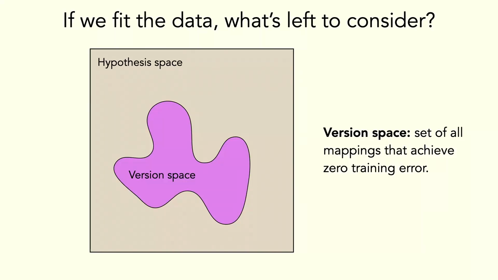
*▲ 강의 슬라이드 [62:10](https://youtu.be/EiO8BBa-xdc?t=3730): [가설 공간](00_%EB%94%A5%EB%9F%AC%EB%8B%9D_%EC%9A%A9%EC%96%B4%EC%82%AC%EC%A0%84.md#hypothesis-space-%EA%B0%80%EC%84%A4-%EA%B3%B5%EA%B0%84) 안의 [버전 공간](00_%EB%94%A5%EB%9F%AC%EB%8B%9D_%EC%9A%A9%EC%96%B4%EC%82%AC%EC%A0%84.md#version-space-%EB%B2%84%EC%A0%84-%EA%B3%B5%EA%B0%84)([학습](00_%EB%94%A5%EB%9F%AC%EB%8B%9D_%EC%9A%A9%EC%96%B4%EC%82%AC%EC%A0%84.md#training-%ED%95%99%EC%8A%B5) [오차](00_%EB%94%A5%EB%9F%AC%EB%8B%9D_%EC%9A%A9%EC%96%B4%EC%82%AC%EC%A0%84.md#error-%EC%98%A4%EC%B0%A8) 0을 내는 모든 함수)*

### 8.2 파라미터-함수 사상의 단순성 편향

▶ 영상 [62:23](https://youtu.be/EiO8BBa-xdc?t=3743)

- 우리는 함수를 직접 찾지 않고 **[파라미터](00_%EB%94%A5%EB%9F%AC%EB%8B%9D_%EC%9A%A9%EC%96%B4%EC%82%AC%EC%A0%84.md#parameter-%ED%8C%8C%EB%9D%BC%EB%AF%B8%ED%84%B0)**를 찾습니다. [파라미터](00_%EB%94%A5%EB%9F%AC%EB%8B%9D_%EC%9A%A9%EC%96%B4%EC%82%AC%EC%A0%84.md#parameter-%ED%8C%8C%EB%9D%BC%EB%AF%B8%ED%84%B0) 설정마다 함수 $f$가 하나 정해지는 대응 $\mathcal{M}: \Theta \to \mathcal{F}$를 **[파라미터-함수 사상](00_%EB%94%A5%EB%9F%AC%EB%8B%9D_%EC%9A%A9%EC%96%B4%EC%82%AC%EC%A0%84.md#parameter-function-map-%ED%8C%8C%EB%9D%BC%EB%AF%B8%ED%84%B0-%ED%95%A8%EC%88%98-%EC%82%AC%EC%83%81)**이라 합니다.
- 이 대응은 **여러 대 하나**입니다. 예를 들어 한 [층](00_%EB%94%A5%EB%9F%AC%EB%8B%9D_%EC%9A%A9%EC%96%B4%EC%82%AC%EC%A0%84.md#layer-%EC%B8%B5)에서 [편향](00_%EB%94%A5%EB%9F%AC%EB%8B%9D_%EC%9A%A9%EC%96%B4%EC%82%AC%EC%A0%84.md#bias-%ED%8E%B8%ED%96%A5) +1, 다음 [층](00_%EB%94%A5%EB%9F%AC%EB%8B%9D_%EC%9A%A9%EC%96%B4%EC%82%AC%EC%A0%84.md#layer-%EC%B8%B5)에서 −1을 더하는 항등망은 [편향](00_%EB%94%A5%EB%9F%AC%EB%8B%9D_%EC%9A%A9%EC%96%B4%EC%82%AC%EC%A0%84.md#bias-%ED%8E%B8%ED%96%A5)을 0, 0으로 둔 망과 같은 함수입니다.
- Valle Pérez 외(ICLR 2019)는 MLP 등의 [파라미터](00_%EB%94%A5%EB%9F%AC%EB%8B%9D_%EC%9A%A9%EC%96%B4%EC%82%AC%EC%A0%84.md#parameter-%ED%8C%8C%EB%9D%BC%EB%AF%B8%ED%84%B0)를 무작위로 뽑으면 **대부분이 단순한 함수**로 간다는 것을 경험적으로 보였습니다. 여기서 단순함은 **렘펠-지브(Lempel-Ziv) 복잡도**, 즉 함수의 출력을 LZ 압축 알고리즘으로 얼마나 잘 압축할 수 있는지로 잽니다.
- 그림으로 보면: [파라미터](00_%EB%94%A5%EB%9F%AC%EB%8B%9D_%EC%9A%A9%EC%96%B4%EC%82%AC%EC%A0%84.md#parameter-%ED%8C%8C%EB%9D%BC%EB%AF%B8%ED%84%B0) 공간에서 무작위로 고른 점은 대부분 **단순한 함수 영역**으로 갑니다. [학습](00_%EB%94%A5%EB%9F%AC%EB%8B%9D_%EC%9A%A9%EC%96%B4%EC%82%AC%EC%A0%84.md#training-%ED%95%99%EC%8A%B5)은 [파라미터](00_%EB%94%A5%EB%9F%AC%EB%8B%9D_%EC%9A%A9%EC%96%B4%EC%82%AC%EC%A0%84.md#parameter-%ED%8C%8C%EB%9D%BC%EB%AF%B8%ED%84%B0)를 [버전 공간](00_%EB%94%A5%EB%9F%AC%EB%8B%9D_%EC%9A%A9%EC%96%B4%EC%82%AC%EC%A0%84.md#version-space-%EB%B2%84%EC%A0%84-%EA%B3%B5%EA%B0%84) 쪽으로 옮기는데, 출발점과 경로의 부피 대부분이 단순한 함수에 대응하므로 **[버전 공간](00_%EB%94%A5%EB%9F%AC%EB%8B%9D_%EC%9A%A9%EC%96%B4%EC%82%AC%EC%A0%84.md#version-space-%EB%B2%84%EC%A0%84-%EA%B3%B5%EA%B0%84) 중 단순한 구석**에 도착하기 쉽습니다. 이것이 **[단순성 편향](00_%EB%94%A5%EB%9F%AC%EB%8B%9D_%EC%9A%A9%EC%96%B4%EC%82%AC%EC%A0%84.md#simplicity-bias-%EB%8B%A8%EC%88%9C%EC%84%B1-%ED%8E%B8%ED%96%A5)**입니다.

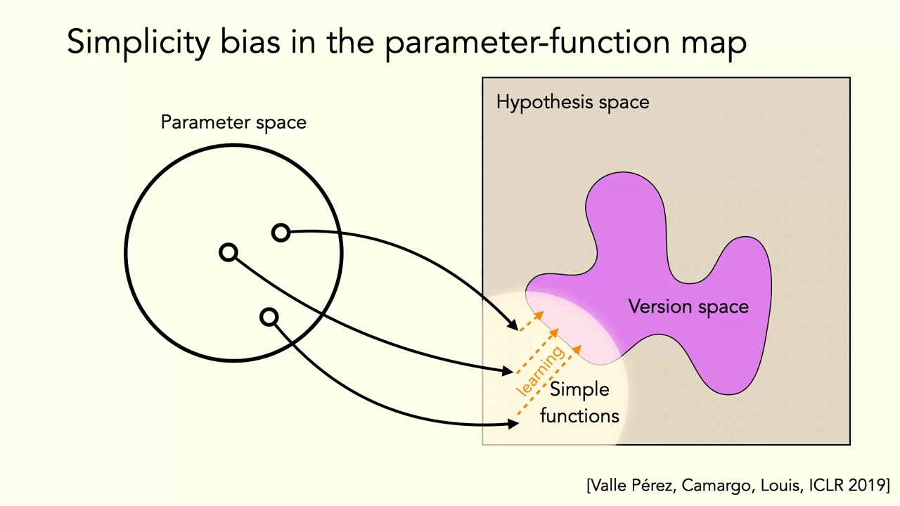
*▲ 강의 슬라이드 [66:10](https://youtu.be/EiO8BBa-xdc?t=3970): [파라미터](00_%EB%94%A5%EB%9F%AC%EB%8B%9D_%EC%9A%A9%EC%96%B4%EC%82%AC%EC%A0%84.md#parameter-%ED%8C%8C%EB%9D%BC%EB%AF%B8%ED%84%B0) 공간의 무작위 점들이 [가설 공간](00_%EB%94%A5%EB%9F%AC%EB%8B%9D_%EC%9A%A9%EC%96%B4%EC%82%AC%EC%A0%84.md#hypothesis-space-%EA%B0%80%EC%84%A4-%EA%B3%B5%EA%B0%84)의 "단순한 함수" 영역으로 가고, [학습](00_%EB%94%A5%EB%9F%AC%EB%8B%9D_%EC%9A%A9%EC%96%B4%EC%82%AC%EC%A0%84.md#training-%ED%95%99%EC%8A%B5)이 그곳에서 [버전 공간](00_%EB%94%A5%EB%9F%AC%EB%8B%9D_%EC%9A%A9%EC%96%B4%EC%82%AC%EC%A0%84.md#version-space-%EB%B2%84%EC%A0%84-%EA%B3%B5%EA%B0%84)으로 옮겨 간다*

### 8.3 깊이와 저랭크 편향

▶ 영상 [66:24](https://youtu.be/EiO8BBa-xdc?t=3984)

📐 **수학 개념**: [랭크와 유효 랭크](%EC%88%98%ED%95%99%EA%B0%9C%EB%85%90/04_%ED%99%95%EB%A5%A0%EA%B3%BC_%EC%A0%95%EB%B3%B4/MM25_%EB%9E%AD%ED%81%AC%EC%99%80_%EC%9C%A0%ED%9A%A8_%EB%9E%AD%ED%81%AC.md) · [행렬 곱](%EC%88%98%ED%95%99%EA%B0%9C%EB%85%90/03_%EC%84%A0%ED%98%95%EB%8C%80%EC%88%98/M05_%EB%B2%A1%ED%84%B0%EC%99%80_%ED%96%89%EB%A0%AC.md) · [엔트로피](%EC%88%98%ED%95%99%EA%B0%9C%EB%85%90/04_%ED%99%95%EB%A5%A0%EA%B3%BC_%EC%A0%95%EB%B3%B4/M10_%EC%97%94%ED%8A%B8%EB%A1%9C%ED%94%BC.md)

강사가 참여한 연구(Huh 외, TMLR 2023)는 단순함의 다른 척도로 **커널의 [랭크](00_%EB%94%A5%EB%9F%AC%EB%8B%9D_%EC%9A%A9%EC%96%B4%EC%82%AC%EC%A0%84.md#rank-%EB%9E%AD%ED%81%AC)**를 봅니다.

- 10개 클래스를 분류하는 망의 마지막 표현을 보면, 깊은 망일수록 클래스별로 잘 모여 선형 분리가 쉬워집니다. 통념은 "깊은 망이 [용량](00_%EB%94%A5%EB%9F%AC%EB%8B%9D_%EC%9A%A9%EC%96%B4%EC%82%AC%EC%A0%84.md#capacity-%EC%9A%A9%EB%9F%89)이 커서 데이터를 잘 정리한다"입니다.
- 표현을 **[커널 행렬](00_%EB%94%A5%EB%9F%AC%EB%8B%9D_%EC%9A%A9%EC%96%B4%EC%82%AC%EC%A0%84.md#kernel-matrix-%EC%BB%A4%EB%84%90-%ED%96%89%EB%A0%AC)**(모든 데이터 쌍의 표현 유사도 표)로 요약하면, 잘 무리 지은 표현은 **블록 모양**이고 **[랭크](00_%EB%94%A5%EB%9F%AC%EB%8B%9D_%EC%9A%A9%EC%96%B4%EC%82%AC%EC%A0%84.md#rank-%EB%9E%AD%ED%81%AC)가 낮습니다**.
- 그런데 **비선형 함수를 모두 뺀 깊은 선형망**에서도 똑같이 블록이 생깁니다. 깊은 선형망은 행렬 하나와 같은 함수라 [용량](00_%EB%94%A5%EB%9F%AC%EB%8B%9D_%EC%9A%A9%EC%96%B4%EC%82%AC%EC%A0%84.md#capacity-%EC%9A%A9%EB%9F%89)이 늘지 않으므로, 통념으로는 설명이 안 됩니다.
- 논지: **행렬의 곱은 저랭크가 되기 쉽습니다**(무작위 행렬 이론의 성질). 깊은 망의 [파라미터](00_%EB%94%A5%EB%9F%AC%EB%8B%9D_%EC%9A%A9%EC%96%B4%EC%82%AC%EC%A0%84.md#parameter-%ED%8C%8C%EB%9D%BC%EB%AF%B8%ED%84%B0) 공간에서 무작위로 점을 고르면, 얕은 망은 대부분 고랭크 표현으로, 깊은 망은 (선형이든 비선형이든) **저랭크 표현**으로 갑니다. 최적화는 그중 [버전 공간](00_%EB%94%A5%EB%9F%AC%EB%8B%9D_%EC%9A%A9%EC%96%B4%EC%82%AC%EC%A0%84.md#version-space-%EB%B2%84%EC%A0%84-%EA%B3%B5%EA%B0%84)에 있는 점을 고를 뿐이므로, 깊을수록 저랭크 해가 나올 가능성이 높습니다.
- 실험: 무작위 [파라미터](00_%EB%94%A5%EB%9F%AC%EB%8B%9D_%EC%9A%A9%EC%96%B4%EC%82%AC%EC%A0%84.md#parameter-%ED%8C%8C%EB%9D%BC%EB%AF%B8%ED%84%B0)의 **[유효 랭크](00_%EB%94%A5%EB%9F%AC%EB%8B%9D_%EC%9A%A9%EC%96%B4%EC%82%AC%EC%A0%84.md#effective-rank-%EC%9C%A0%ED%9A%A8-%EB%9E%AD%ED%81%AC)** 분포를 깊이별로 그리면, 깊이 1은 약 2.15 근처에 몰리고 깊이 16은 약 1.4 근처로 내려갑니다. [파라미터](00_%EB%94%A5%EB%9F%AC%EB%8B%9D_%EC%9A%A9%EC%96%B4%EC%82%AC%EC%A0%84.md#parameter-%ED%8C%8C%EB%9D%BC%EB%AF%B8%ED%84%B0) 두 개를 축으로 [유효 랭크](00_%EB%94%A5%EB%9F%AC%EB%8B%9D_%EC%9A%A9%EC%96%B4%EC%82%AC%EC%A0%84.md#effective-rank-%EC%9C%A0%ED%9A%A8-%EB%9E%AD%ED%81%AC) 지형을 그리면, [층](00_%EB%94%A5%EB%9F%AC%EB%8B%9D_%EC%9A%A9%EC%96%B4%EC%82%AC%EC%A0%84.md#layer-%EC%B8%B5)을 늘릴 때 저랭크 영역이 더 넓게 퍼집니다.

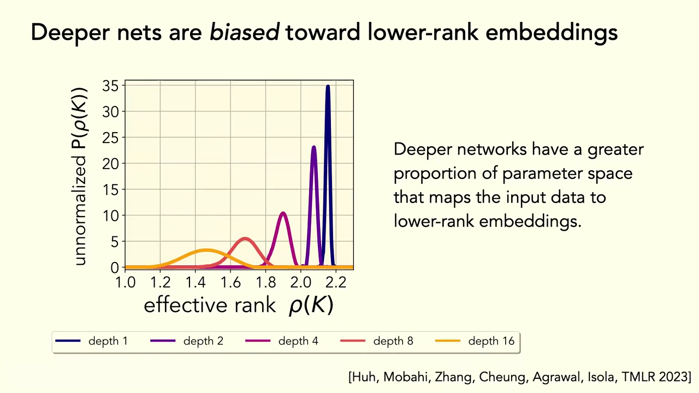
*▲ 강의 슬라이드 [71:30](https://youtu.be/EiO8BBa-xdc?t=4290): 무작위 [파라미터](00_%EB%94%A5%EB%9F%AC%EB%8B%9D_%EC%9A%A9%EC%96%B4%EC%82%AC%EC%A0%84.md#parameter-%ED%8C%8C%EB%9D%BC%EB%AF%B8%ED%84%B0)의 [유효 랭크](00_%EB%94%A5%EB%9F%AC%EB%8B%9D_%EC%9A%A9%EC%96%B4%EC%82%AC%EC%A0%84.md#effective-rank-%EC%9C%A0%ED%9A%A8-%EB%9E%AD%ED%81%AC) 분포. 깊을수록(depth 1 → 16) 낮은 [유효 랭크](00_%EB%94%A5%EB%9F%AC%EB%8B%9D_%EC%9A%A9%EC%96%B4%EC%82%AC%EC%A0%84.md#effective-rank-%EC%9C%A0%ED%9A%A8-%EB%9E%AD%ED%81%AC) 쪽으로 옮겨 간다*

> [!NOTE]
> **숫자로 보기: 행렬을 곱할수록 [유효 랭크](00_%EB%94%A5%EB%9F%AC%EB%8B%9D_%EC%9A%A9%EC%96%B4%EC%82%AC%EC%A0%84.md#effective-rank-%EC%9C%A0%ED%9A%A8-%EB%9E%AD%ED%81%AC)가 준다**
> 32×32 무작위 가우스 행렬을 L개 곱하면 [유효 랭크](00_%EB%94%A5%EB%9F%AC%EB%8B%9D_%EC%9A%A9%EC%96%B4%EC%82%AC%EC%A0%84.md#effective-rank-%EC%9C%A0%ED%9A%A8-%EB%9E%AD%ED%81%AC)(50번 평균)가 L = 1, 2, 4, 8, 16에서 25.53, 21.22, 15.63, 10.31, 6.04로 줄어듭니다. 계산과 정의는 [MM25_랭크와_유효_랭크](%EC%88%98%ED%95%99%EA%B0%9C%EB%85%90/04_%ED%99%95%EB%A5%A0%EA%B3%BC_%EC%A0%95%EB%B3%B4/MM25_%EB%9E%AD%ED%81%AC%EC%99%80_%EC%9C%A0%ED%9A%A8_%EB%9E%AD%ED%81%AC.md).

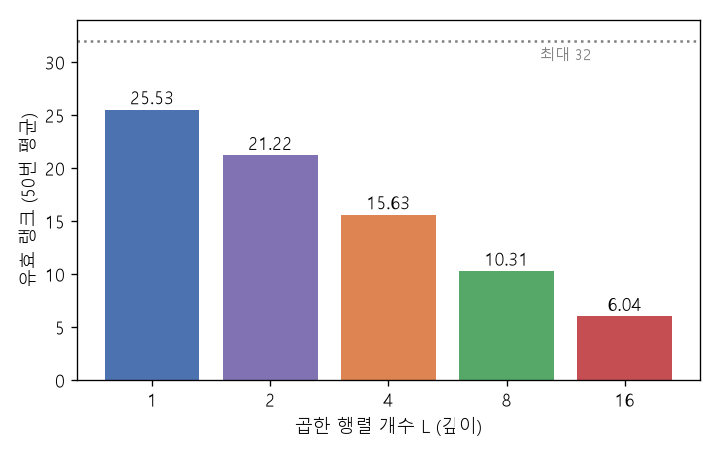
*▲ 직접 그린 그림: 곱한 행렬 개수(깊이)에 따른 [유효 랭크](00_%EB%94%A5%EB%9F%AC%EB%8B%9D_%EC%9A%A9%EC%96%B4%EC%82%AC%EC%A0%84.md#effective-rank-%EC%9C%A0%ED%9A%A8-%EB%9E%AD%ED%81%AC). 최대값 32에서 점점 멀어진다*

### 8.4 최적화의 암묵적 규제

▶ 영상 [73:10](https://youtu.be/EiO8BBa-xdc?t=4390)

해를 [버전 공간](00_%EB%94%A5%EB%9F%AC%EB%8B%9D_%EC%9A%A9%EC%96%B4%EC%82%AC%EC%A0%84.md#version-space-%EB%B2%84%EC%A0%84-%EA%B3%B5%EA%B0%84)에서 무작위로 고르는 것이 아니라 **최적화기가 고르므로**, 최적화기의 성질도 중요합니다.

- **[가중치 감쇠](00_%EB%94%A5%EB%9F%AC%EB%8B%9D_%EC%9A%A9%EC%96%B4%EC%82%AC%EC%A0%84.md#weight-decay-%EA%B0%80%EC%A4%91%EC%B9%98-%EA%B0%90%EC%87%A0)(Weight decay)**: 갱신할 때마다 [가중치](00_%EB%94%A5%EB%9F%AC%EB%8B%9D_%EC%9A%A9%EC%96%B4%EC%82%AC%EC%A0%84.md#weight-%EA%B0%80%EC%A4%91%EC%B9%98)를 조금씩 줄입니다. L2 [규제](00_%EB%94%A5%EB%9F%AC%EB%8B%9D_%EC%9A%A9%EC%96%B4%EC%82%AC%EC%A0%84.md#regularization-%EA%B7%9C%EC%A0%9C)처럼 작동해서 쓰이지 않는 [가중치](00_%EB%94%A5%EB%9F%AC%EB%8B%9D_%EC%9A%A9%EC%96%B4%EC%82%AC%EC%A0%84.md#weight-%EA%B0%80%EC%A4%91%EC%B9%98)를 0으로 보내고, [노름](00_%EB%94%A5%EB%9F%AC%EB%8B%9D_%EC%9A%A9%EC%96%B4%EC%82%AC%EC%A0%84.md#norm-%EB%85%B8%EB%A6%84)이 낮은 해를 배웁니다. 명시적 [규제](00_%EB%94%A5%EB%9F%AC%EB%8B%9D_%EC%9A%A9%EC%96%B4%EC%82%AC%EC%A0%84.md#regularization-%EA%B7%9C%EC%A0%9C)입니다.
- **0 근처 초기화**: [가중치](00_%EB%94%A5%EB%9F%AC%EB%8B%9D_%EC%9A%A9%EC%96%B4%EC%82%AC%EC%A0%84.md#weight-%EA%B0%80%EC%A4%91%EC%B9%98)와 [편향](00_%EB%94%A5%EB%9F%AC%EB%8B%9D_%EC%9A%A9%EC%96%B4%EC%82%AC%EC%A0%84.md#bias-%ED%8E%B8%ED%96%A5)을 0 가까이에서 시작하면 [노름](00_%EB%94%A5%EB%9F%AC%EB%8B%9D_%EC%9A%A9%EC%96%B4%EC%82%AC%EC%A0%84.md#norm-%EB%85%B8%EB%A6%84)이 낮은 해로 기웁니다. 선형 모형에서는 0 근처에서 시작한 [경사하강법](00_%EB%94%A5%EB%9F%AC%EB%8B%9D_%EC%9A%A9%EC%96%B4%EC%82%AC%EC%A0%84.md#gradient-descent-%EA%B2%BD%EC%82%AC%ED%95%98%EA%B0%95%EB%B2%95)이 **[최소 노름 해](00_%EB%94%A5%EB%9F%AC%EB%8B%9D_%EC%9A%A9%EC%96%B4%EC%82%AC%EC%A0%84.md#minimum-norm-solution-%EC%B5%9C%EC%86%8C-%EB%85%B8%EB%A6%84-%ED%95%B4)**로 수렴합니다(Zhang 외 2017, Gunasekar 외 2017).
- **SGD와 [평평한 최솟값](00_%EB%94%A5%EB%9F%AC%EB%8B%9D_%EC%9A%A9%EC%96%B4%EC%82%AC%EC%A0%84.md#flat-minimum-%ED%8F%89%ED%8F%89%ED%95%9C-%EC%B5%9C%EC%86%9F%EA%B0%92)**: 고정 보폭의 [경사하강법](00_%EB%94%A5%EB%9F%AC%EB%8B%9D_%EC%9A%A9%EC%96%B4%EC%82%AC%EC%A0%84.md#gradient-descent-%EA%B2%BD%EC%82%AC%ED%95%98%EA%B0%95%EB%B2%95)은 아주 좁은 우물에 들어가지 못하고 뛰어넘습니다. 그래서 넓은 영역에서 [손실](00_%EB%94%A5%EB%9F%AC%EB%8B%9D_%EC%9A%A9%EC%96%B4%EC%82%AC%EC%A0%84.md#loss-function-%EC%86%90%EC%8B%A4-%ED%95%A8%EC%88%98)이 낮은 **[평평한 최솟값](00_%EB%94%A5%EB%9F%AC%EB%8B%9D_%EC%9A%A9%EC%96%B4%EC%82%AC%EC%A0%84.md#flat-minimum-%ED%8F%89%ED%8F%89%ED%95%9C-%EC%B5%9C%EC%86%9F%EA%B0%92)([Flat minimum](00_%EB%94%A5%EB%9F%AC%EB%8B%9D_%EC%9A%A9%EC%96%B4%EC%82%AC%EC%A0%84.md#flat-minimum-%ED%8F%89%ED%8F%89%ED%95%9C-%EC%B5%9C%EC%86%9F%EA%B0%92))**을 찾는 경향이 있고, [평평한 최솟값](00_%EB%94%A5%EB%9F%AC%EB%8B%9D_%EC%9A%A9%EC%96%B4%EC%82%AC%EC%A0%84.md#flat-minimum-%ED%8F%89%ED%8F%89%ED%95%9C-%EC%B5%9C%EC%86%9F%EA%B0%92)이 좁은 최솟값보다 잘 일반화한다는 주장이 있습니다(Vardi 2022 리뷰 참고). 좁은 최솟값은 "운 좋게 맞은 이상한 해"일 가능성이 큽니다.

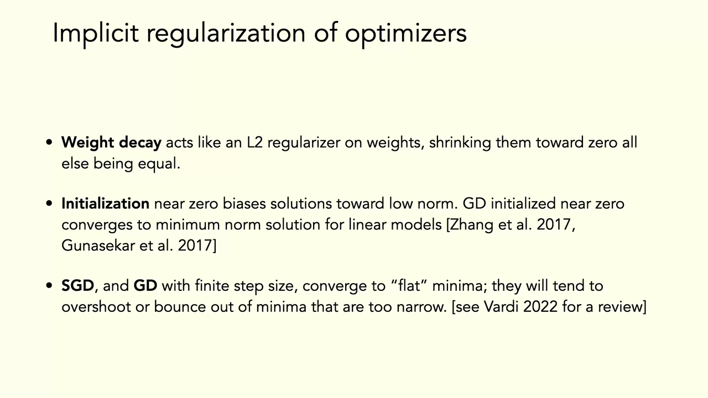
*▲ 강의 슬라이드 [75:10](https://youtu.be/EiO8BBa-xdc?t=4510): 최적화기의 [암묵적 규제](00_%EB%94%A5%EB%9F%AC%EB%8B%9D_%EC%9A%A9%EC%96%B4%EC%82%AC%EC%A0%84.md#implicit-regularization-%EC%95%94%EB%AC%B5%EC%A0%81-%EA%B7%9C%EC%A0%9C). [가중치 감쇠](00_%EB%94%A5%EB%9F%AC%EB%8B%9D_%EC%9A%A9%EC%96%B4%EC%82%AC%EC%A0%84.md#weight-decay-%EA%B0%80%EC%A4%91%EC%B9%98-%EA%B0%90%EC%87%A0), 0 근처 초기화, 고정 보폭 SGD/GD의 [평평한 최솟값](00_%EB%94%A5%EB%9F%AC%EB%8B%9D_%EC%9A%A9%EC%96%B4%EC%82%AC%EC%A0%84.md#flat-minimum-%ED%8F%89%ED%8F%89%ED%95%9C-%EC%B5%9C%EC%86%9F%EA%B0%92) 선호*

> [!NOTE]
> **숫자로 보기: 보폭이 고정이면 좁은 우물에서 튕겨 나간다**
> $f(w) = 25w^2$(좁은 우물, 곡률 $f'' = 50$)에서 보폭 $\eta = 0.1$로 경사하강하면 $w \leftarrow w - 0.1 × 50w = -4w$라서 $w$가 1 → −4 → 16 → −64로 튕겨 나갑니다. $f(w) = w^2$(넓은 우물, $f'' = 2$)에서는 $w \leftarrow 0.8w$라서 1 → 0.8 → 0.64 → 0.512로 바닥에 다가갑니다. 이차 함수에서 고정 보폭 경사하강이 우물에 머무는 조건은 $\eta < 2/f''$입니다(여기서는 $0.1 < 2/50 = 0.04$가 거짓, $0.1 < 2/2 = 1$이 참). 갱신식은 [MM02_그래디언트_벡터](%EC%88%98%ED%95%99%EA%B0%9C%EB%85%90/02_%EB%AF%B8%EB%B6%84/MM02_%EA%B7%B8%EB%9E%98%EB%94%94%EC%96%B8%ED%8A%B8_%EB%B2%A1%ED%84%B0.md) 참고.

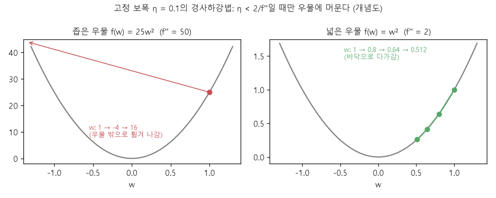
*▲ 직접 그린 그림: 보폭 η = 0.1의 [경사하강법](00_%EB%94%A5%EB%9F%AC%EB%8B%9D_%EC%9A%A9%EC%96%B4%EC%82%AC%EC%A0%84.md#gradient-descent-%EA%B2%BD%EC%82%AC%ED%95%98%EA%B0%95%EB%B2%95)이 좁은 우물(왼쪽)에서는 튕겨 나가고 넓은 우물(오른쪽)에서는 바닥으로 다가간다 (개념도, 숫자는 위 계산과 같음)*

### 8.5 아키텍처의 대칭성

▶ 영상 [75:21](https://youtu.be/EiO8BBa-xdc?t=4521)

강사는 지금까지 말한 것보다 **아키텍처의 대칭성이 가장 중요하다**고 봅니다.

- **불변성(invariance)**: 이미지 [분류](00_%EB%94%A5%EB%9F%AC%EB%8B%9D_%EC%9A%A9%EC%96%B4%EC%82%AC%EC%A0%84.md#regression-classification-%ED%9A%8C%EA%B7%80%EC%99%80-%EB%B6%84%EB%A5%98)의 [이동 불변성](00_%EB%94%A5%EB%9F%AC%EB%8B%9D_%EC%9A%A9%EC%96%B4%EC%82%AC%EC%A0%84.md#translation-invariance-%EC%9D%B4%EB%8F%99-%EB%B6%88%EB%B3%80%EC%84%B1)처럼 입력이 바뀌어도 출력이 그대로인 성질입니다. [맥스 풀링](00_%EB%94%A5%EB%9F%AC%EB%8B%9D_%EC%9A%A9%EC%96%B4%EC%82%AC%EC%A0%84.md#max-pooling-%EB%A7%A5%EC%8A%A4-%ED%92%80%EB%A7%81)처럼 한 차원에 대해 최댓값을 취하면 그 차원에 불변입니다. 여러 방향의 가장자리 [필터](00_%EB%94%A5%EB%9F%AC%EB%8B%9D_%EC%9A%A9%EC%96%B4%EC%82%AC%EC%A0%84.md#filter-%ED%95%84%ED%84%B0) 위에서 최댓값을 취하면 새 부리가 어느 방향이든 반응합니다.
- **등변성(equivariance)**: [그래프 신경망](00_%EB%94%A5%EB%9F%AC%EB%8B%9D_%EC%9A%A9%EC%96%B4%EC%82%AC%EC%A0%84.md#gnn-graph-neural-network-%EA%B7%B8%EB%9E%98%ED%94%84-%EC%8B%A0%EA%B2%BD%EB%A7%9D)은 노드 번호를 바꾸면([순열 등변성](00_%EB%94%A5%EB%9F%AC%EB%8B%9D_%EC%9A%A9%EC%96%B4%EC%82%AC%EC%A0%84.md#permutation-invariance-permutation-equivariance-%EC%88%9C%EC%97%B4-%EB%B6%88%EB%B3%80%EC%84%B1%EA%B3%BC-%EC%88%9C%EC%97%B4-%EB%93%B1%EB%B3%80%EC%84%B1)) 예측도 같은 방식으로 바뀌고, ConvNet은 이미지를 옮기면 예측도 같은 만큼 옮겨집니다([이동 등변성](00_%EB%94%A5%EB%9F%AC%EB%8B%9D_%EC%9A%A9%EC%96%B4%EC%82%AC%EC%A0%84.md#translation-equivariance-%EC%9D%B4%EB%8F%99-%EB%93%B1%EB%B3%80%EC%84%B1)). 옮긴 이미지에도 원래 이미지에서 배운 대로 반응하므로 **[학습](00_%EB%94%A5%EB%9F%AC%EB%8B%9D_%EC%9A%A9%EC%96%B4%EC%82%AC%EC%A0%84.md#training-%ED%95%99%EC%8A%B5) 표본 밖의 [일반화](00_%EB%94%A5%EB%9F%AC%EB%8B%9D_%EC%9A%A9%EC%96%B4%EC%82%AC%EC%A0%84.md#generalization-%EC%9D%BC%EB%B0%98%ED%99%94)**가 생깁니다.
- **[조합성](00_%EB%94%A5%EB%9F%AC%EB%8B%9D_%EC%9A%A9%EC%96%B4%EC%82%AC%EC%A0%84.md#compositionality-%EC%A1%B0%ED%95%A9%EC%84%B1)**: 3.4절처럼 입력을 작은 부분으로 쪼개 부분마다 배우고, 부분의 결합 규칙은 학습하지 않고 아키텍처가 정합니다.
- 강사는 ChatGPT 같은 모형이 놀라운 [일반화](00_%EB%94%A5%EB%9F%AC%EB%8B%9D_%EC%9A%A9%EC%96%B4%EC%82%AC%EC%A0%84.md#generalization-%EC%9D%BC%EB%B0%98%ED%99%94)를 하는 진짜 이유도 여기 있을 것이라고 봅니다(확실하지는 않다고 덧붙임). 세상을 단어, 문장, 문단 같은 **관절에 맞게 잘라(carve the world at its joints)** 처리하고, 그 조합은 [학습](00_%EB%94%A5%EB%9F%AC%EB%8B%9D_%EC%9A%A9%EC%96%B4%EC%82%AC%EC%A0%84.md#training-%ED%95%99%EC%8A%B5)이 아니라 아키텍처 구조에서 나온다는 것입니다.

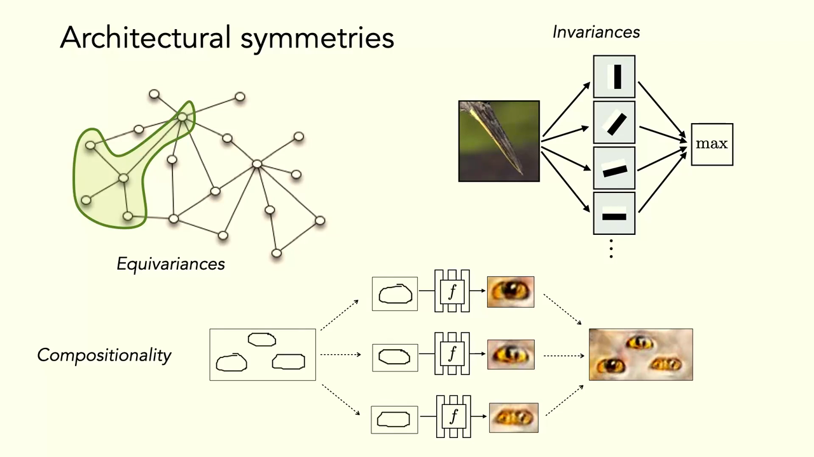
*▲ 강의 슬라이드 [77:30](https://youtu.be/EiO8BBa-xdc?t=4650): 아키텍처의 대칭성. 등변성(그래프), 불변성(방향 [필터](00_%EB%94%A5%EB%9F%AC%EB%8B%9D_%EC%9A%A9%EC%96%B4%EC%82%AC%EC%A0%84.md#filter-%ED%95%84%ED%84%B0) 위의 max), [조합성](00_%EB%94%A5%EB%9F%AC%EB%8B%9D_%EC%9A%A9%EC%96%B4%EC%82%AC%EC%A0%84.md#compositionality-%EC%A1%B0%ED%95%A9%EC%84%B1)(조각별 처리 후 결합)*

### 8.6 데이터 + 구조

▶ 영상 [78:18](https://youtu.be/EiO8BBa-xdc?t=4698)

- 많은 신경망은 분야 지식을 구조에 넣습니다. 앞서 Sara가 소개한 **[NeRF](00_%EB%94%A5%EB%9F%AC%EB%8B%9D_%EC%9A%A9%EC%96%B4%EC%82%AC%EC%A0%84.md#nerf-%EC%8B%A0%EA%B2%BD-%EB%B0%A9%EC%82%AC%EC%9E%A5)**는 원근 [투영](00_%EB%94%A5%EB%9F%AC%EB%8B%9D_%EC%9A%A9%EC%96%B4%EC%82%AC%EC%A0%84.md#projection-%ED%88%AC%EC%98%81)과 빛 전달 방정식을 아키텍처에 넣었기 때문에 새 시점으로 일반화합니다.
- 약물 상호작용 예측 모형도 약물끼리 어떻게 상호작용하는지에 대한 구조를 넣습니다.
- **데이터에 맞추는 것 + 구조적 제약**의 결합이 [일반화](00_%EB%94%A5%EB%9F%AC%EB%8B%9D_%EC%9A%A9%EC%96%B4%EC%82%AC%EC%A0%84.md#generalization-%EC%9D%BC%EB%B0%98%ED%99%94)를 만듭니다.

---

## 9. 맺음: 유한하면 작다

▶ 영상 [78:50](https://youtu.be/EiO8BBa-xdc?t=4730)

- 다시 4절의 이론으로 돌아갑니다. 가장 짧은 프로그램을 찾는 것은 계산 불가능하지만, **"충분히 짧은" 프로그램이 데이터를 맞추면 일반화한다**고 완화할 수 있지 않을까요?
- 강사가 2018년 무렵 일리야 수츠케버(Ilya Sutskever, OpenAI 공동 창업자)와 나눈 대화를 기억나는 대로 옮깁니다. 수츠케버: "깊은 망은 데이터를 맞추는 **작은 회로**를 찾기 때문에 일반화한다." 강사: "깊은 망은 거대한데 무슨 작은 회로인가? 작은 회로로 기울게 하는 무언가가 따로 필요하지 않나?" 수츠케버: "괜찮다. 깊은 망은 **유한하다**. 그걸로 충분하다. 데이터가 충분히 많으면 유한한 것은 무엇이든 작아 보인다."
- 강사는 당시에는 이해하지 못했지만 깊은 통찰이었고, 그의 성공에 기여했을 것이라고 말하며 강의를 마칩니다.

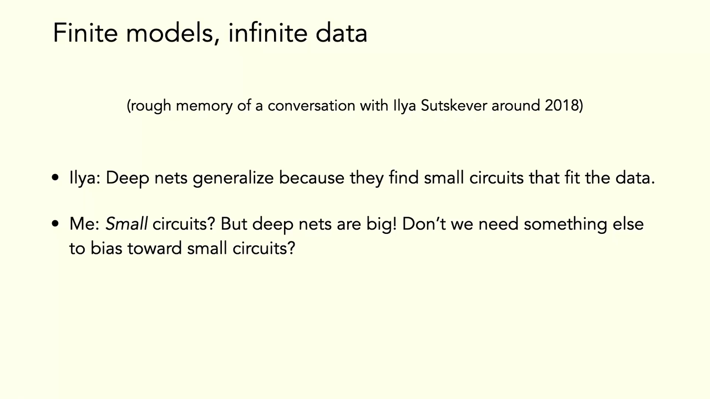
*▲ 강의 슬라이드 [79:55](https://youtu.be/EiO8BBa-xdc?t=4795): 유한한 모형, 무한한 데이터. "깊은 망은 데이터를 맞추는 작은 회로를 찾기 때문에 일반화한다"*

> [!TIP]
> **🆕 2026 업데이트: "딥러닝의 [일반화](00_%EB%94%A5%EB%9F%AC%EB%8B%9D_%EC%9A%A9%EC%96%B4%EC%82%AC%EC%A0%84.md#generalization-%EC%9D%BC%EB%B0%98%ED%99%94)는 그렇게 신비하지 않다"는 반론**
> - **강의**: 깊은 망이 왜 일반화하는지 고전 도구로는 설명되지 않으며, 아직 모른다.
> - **현재**: Andrew Gordon Wilson(ICML 2025)은 양성 [과적합](00_%EB%94%A5%EB%9F%AC%EB%8B%9D_%EC%9A%A9%EC%96%B4%EC%82%AC%EC%A0%84.md#overfitting-%EA%B3%BC%EC%A0%81%ED%95%A9)(benign overfitting), [이중 하강](00_%EB%94%A5%EB%9F%AC%EB%8B%9D_%EC%9A%A9%EC%96%B4%EC%82%AC%EC%A0%84.md#double-descent-%EC%9D%B4%EC%A4%91-%ED%95%98%EA%B0%95), [과매개변수화](00_%EB%94%A5%EB%9F%AC%EB%8B%9D_%EC%9A%A9%EC%96%B4%EC%82%AC%EC%A0%84.md#overparameterization-%EA%B3%BC%EB%A7%A4%EA%B0%9C%EB%B3%80%EC%88%98%ED%99%94)의 성공이 **신경망만의 현상이 아니며**, 오래된 **PAC-Bayes 한계와 셀 수 있는 [가설 공간](00_%EB%94%A5%EB%9F%AC%EB%8B%9D_%EC%9A%A9%EC%96%B4%EC%82%AC%EC%A0%84.md#hypothesis-space-%EA%B0%80%EC%84%A4-%EA%B3%B5%EA%B0%84) 한계**로 직관적·엄밀하게 설명된다고 주장했다. 핵심 원리는 **부드러운 [귀납 편향](00_%EB%94%A5%EB%9F%AC%EB%8B%9D_%EC%9A%A9%EC%96%B4%EC%82%AC%EC%A0%84.md#inductive-bias-%EA%B7%80%EB%82%A9-%ED%8E%B8%ED%96%A5)(soft inductive bias)**이다. [가설 공간](00_%EB%94%A5%EB%9F%AC%EB%8B%9D_%EC%9A%A9%EC%96%B4%EC%82%AC%EC%A0%84.md#hypothesis-space-%EA%B0%80%EC%84%A4-%EA%B3%B5%EA%B0%84)을 줄여 [과적합](00_%EB%94%A5%EB%9F%AC%EB%8B%9D_%EC%9A%A9%EC%96%B4%EC%82%AC%EC%A0%84.md#overfitting-%EA%B3%BC%EC%A0%81%ED%95%A9)을 막는 대신, 유연한 [가설 공간](00_%EB%94%A5%EB%9F%AC%EB%8B%9D_%EC%9A%A9%EC%96%B4%EC%82%AC%EC%A0%84.md#hypothesis-space-%EA%B0%80%EC%84%A4-%EA%B3%B5%EA%B0%84)을 두고 데이터를 맞추는 해 중 단순한 해를 "부드럽게 선호"하는 것이다. 이 강의의 "단순 + 뾰족", "최소 [노름](00_%EB%94%A5%EB%9F%AC%EB%8B%9D_%EC%9A%A9%EC%96%B4%EC%82%AC%EC%A0%84.md#norm-%EB%85%B8%EB%A6%84)", "짧은 프로그램"과 같은 방향이다. 다만 [표현 학습](00_%EB%94%A5%EB%9F%AC%EB%8B%9D_%EC%9A%A9%EC%96%B4%EC%82%AC%EC%A0%84.md#representation-learning-%ED%91%9C%ED%98%84-%ED%95%99%EC%8A%B5), 모드 연결성 등은 딥러닝 고유의 현상으로 남는다고 본다. 학계의 합의라기보다 한 입장이다.
> - **출처**: [Wilson, Deep Learning is Not So Mysterious or Different (ICML 2025)](https://arxiv.org/abs/2503.02113)

---

## 10. 용어 정리

용어사전에 있는 용어는 위 본문에 링크를 걸었습니다. 아래는 이번 강의에서 새로 나온 용어입니다.

| 용어 | 뜻 |
|---|---|
| [경험적 위험](00_%EB%94%A5%EB%9F%AC%EB%8B%9D_%EC%9A%A9%EC%96%B4%EC%82%AC%EC%A0%84.md#empirical-risk-%EA%B2%BD%ED%97%98%EC%A0%81-%EC%9C%84%ED%97%98)(Empirical risk) | 가진 [학습 데이터](00_%EB%94%A5%EB%9F%AC%EB%8B%9D_%EC%9A%A9%EC%96%B4%EC%82%AC%EC%A0%84.md#training-data-test-data-%ED%95%99%EC%8A%B5-%EB%8D%B0%EC%9D%B4%ED%84%B0%EC%99%80-%EC%8B%9C%ED%97%98-%EB%8D%B0%EC%9D%B4%ED%84%B0)에서 잰 평균 [손실](00_%EB%94%A5%EB%9F%AC%EB%8B%9D_%EC%9A%A9%EC%96%B4%EC%82%AC%EC%A0%84.md#loss-function-%EC%86%90%EC%8B%A4-%ED%95%A8%EC%88%98) $\hat{\mathcal{R}}$ |
| [모집단 위험](00_%EB%94%A5%EB%9F%AC%EB%8B%9D_%EC%9A%A9%EC%96%B4%EC%82%AC%EC%A0%84.md#population-risk-%EB%AA%A8%EC%A7%91%EB%8B%A8-%EC%9C%84%ED%97%98)(Population risk) | 데이터 분포 전체에 대한 기대 [손실](00_%EB%94%A5%EB%9F%AC%EB%8B%9D_%EC%9A%A9%EC%96%B4%EC%82%AC%EC%A0%84.md#loss-function-%EC%86%90%EC%8B%A4-%ED%95%A8%EC%88%98) $\mathcal{R}$, 시험 [오차](00_%EB%94%A5%EB%9F%AC%EB%8B%9D_%EC%9A%A9%EC%96%B4%EC%82%AC%EC%A0%84.md#error-%EC%98%A4%EC%B0%A8) |
| [일반화 간극](00_%EB%94%A5%EB%9F%AC%EB%8B%9D_%EC%9A%A9%EC%96%B4%EC%82%AC%EC%A0%84.md#generalization-gap-%EC%9D%BC%EB%B0%98%ED%99%94-%EA%B0%84%EA%B7%B9)(Generalization gap) | [모집단 위험](00_%EB%94%A5%EB%9F%AC%EB%8B%9D_%EC%9A%A9%EC%96%B4%EC%82%AC%EC%A0%84.md#population-risk-%EB%AA%A8%EC%A7%91%EB%8B%A8-%EC%9C%84%ED%97%98)과 [경험적 위험](00_%EB%94%A5%EB%9F%AC%EB%8B%9D_%EC%9A%A9%EC%96%B4%EC%82%AC%EC%A0%84.md#empirical-risk-%EA%B2%BD%ED%97%98%EC%A0%81-%EC%9C%84%ED%97%98)의 차이 |
| [암기](00_%EB%94%A5%EB%9F%AC%EB%8B%9D_%EC%9A%A9%EC%96%B4%EC%82%AC%EC%A0%84.md#memorization-%EC%95%94%EA%B8%B0)([Memorization](00_%EB%94%A5%EB%9F%AC%EB%8B%9D_%EC%9A%A9%EC%96%B4%EC%82%AC%EC%A0%84.md#memorization-%EC%95%94%EA%B8%B0)) | [학습](00_%EB%94%A5%EB%9F%AC%EB%8B%9D_%EC%9A%A9%EC%96%B4%EC%82%AC%EC%A0%84.md#training-%ED%95%99%EC%8A%B5) 점에서의 [정답](00_%EB%94%A5%EB%9F%AC%EB%8B%9D_%EC%9A%A9%EC%96%B4%EC%82%AC%EC%A0%84.md#label-%EC%A0%95%EB%8B%B5)을 그대로 저장해 내놓는 것 (파일 캐비닛) |
| [귀납 편향](00_%EB%94%A5%EB%9F%AC%EB%8B%9D_%EC%9A%A9%EC%96%B4%EC%82%AC%EC%A0%84.md#inductive-bias-%EA%B7%80%EB%82%A9-%ED%8E%B8%ED%96%A5)(Inductive bias) | 데이터를 똑같이 맞추는 해들 중 어떤 해를 선호하게 만드는 모형·[학습](00_%EB%94%A5%EB%9F%AC%EB%8B%9D_%EC%9A%A9%EC%96%B4%EC%82%AC%EC%A0%84.md#training-%ED%95%99%EC%8A%B5)의 성질 |
| [분포 밖 일반화](00_%EB%94%A5%EB%9F%AC%EB%8B%9D_%EC%9A%A9%EC%96%B4%EC%82%AC%EC%A0%84.md#out-of-distribution-generalization-%EB%B6%84%ED%8F%AC-%EB%B0%96-%EC%9D%BC%EB%B0%98%ED%99%94)(Out-of-distribution generalization) | [학습](00_%EB%94%A5%EB%9F%AC%EB%8B%9D_%EC%9A%A9%EC%96%B4%EC%82%AC%EC%A0%84.md#training-%ED%95%99%EC%8A%B5) 분포와 체계적으로 다른 입력에 대한 [일반화](00_%EB%94%A5%EB%9F%AC%EB%8B%9D_%EC%9A%A9%EC%96%B4%EC%82%AC%EC%A0%84.md#generalization-%EC%9D%BC%EB%B0%98%ED%99%94) |
| [조합성](00_%EB%94%A5%EB%9F%AC%EB%8B%9D_%EC%9A%A9%EC%96%B4%EC%82%AC%EC%A0%84.md#compositionality-%EC%A1%B0%ED%95%A9%EC%84%B1)([Compositionality](00_%EB%94%A5%EB%9F%AC%EB%8B%9D_%EC%9A%A9%EC%96%B4%EC%82%AC%EC%A0%84.md#compositionality-%EC%A1%B0%ED%95%A9%EC%84%B1)) | 부분을 따로 처리하고 정해진 규칙으로 결합해 새 조합에도 작동하는 성질 |
| [오컴의 면도날](00_%EB%94%A5%EB%9F%AC%EB%8B%9D_%EC%9A%A9%EC%96%B4%EC%82%AC%EC%A0%84.md#occams-razor-%EC%98%A4%EC%BB%B4%EC%9D%98-%EB%A9%B4%EB%8F%84%EB%82%A0)([Occam's razor](00_%EB%94%A5%EB%9F%AC%EB%8B%9D_%EC%9A%A9%EC%96%B4%EC%82%AC%EC%A0%84.md#occams-razor-%EC%98%A4%EC%BB%B4%EC%9D%98-%EB%A9%B4%EB%8F%84%EB%82%A0)) | 데이터를 똑같이 잘 설명하면 가장 단순한 설명을 고르라는 원칙 |
| [솔로모노프 귀납](00_%EB%94%A5%EB%9F%AC%EB%8B%9D_%EC%9A%A9%EC%96%B4%EC%82%AC%EC%A0%84.md#solomonoff-induction-%EC%86%94%EB%A1%9C%EB%AA%A8%EB%85%B8%ED%94%84-%EA%B7%80%EB%82%A9)(Solomonoff induction) | 데이터를 출력하는 가장 짧은 프로그램이 가장 잘 예측한다는 이론 |
| [편향-분산 트레이드오프](00_%EB%94%A5%EB%9F%AC%EB%8B%9D_%EC%9A%A9%EC%96%B4%EC%82%AC%EC%A0%84.md#bias-variance-tradeoff-%ED%8E%B8%ED%96%A5-%EB%B6%84%EC%82%B0-%ED%8A%B8%EB%A0%88%EC%9D%B4%EB%93%9C%EC%98%A4%ED%94%84)(Bias-variance tradeoff) | [용량](00_%EB%94%A5%EB%9F%AC%EB%8B%9D_%EC%9A%A9%EC%96%B4%EC%82%AC%EC%A0%84.md#capacity-%EC%9A%A9%EB%9F%89)을 키우면 [학습](00_%EB%94%A5%EB%9F%AC%EB%8B%9D_%EC%9A%A9%EC%96%B4%EC%82%AC%EC%A0%84.md#training-%ED%95%99%EC%8A%B5) [오차](00_%EB%94%A5%EB%9F%AC%EB%8B%9D_%EC%9A%A9%EC%96%B4%EC%82%AC%EC%A0%84.md#error-%EC%98%A4%EC%B0%A8)는 줄고 [과적합](00_%EB%94%A5%EB%9F%AC%EB%8B%9D_%EC%9A%A9%EC%96%B4%EC%82%AC%EC%A0%84.md#overfitting-%EA%B3%BC%EC%A0%81%ED%95%A9) 위험은 커진다는 고전 그림 |
| [가설 공간](00_%EB%94%A5%EB%9F%AC%EB%8B%9D_%EC%9A%A9%EC%96%B4%EC%82%AC%EC%A0%84.md#hypothesis-space-%EA%B0%80%EC%84%A4-%EA%B3%B5%EA%B0%84)(Hypothesis space) | [학습](00_%EB%94%A5%EB%9F%AC%EB%8B%9D_%EC%9A%A9%EC%96%B4%EC%82%AC%EC%A0%84.md#training-%ED%95%99%EC%8A%B5)이 탐색하는 후보 함수 전체의 집합 |
| [VC 차원](00_%EB%94%A5%EB%9F%AC%EB%8B%9D_%EC%9A%A9%EC%96%B4%EC%82%AC%EC%A0%84.md#vc-dimension-vc-%EC%B0%A8%EC%9B%90)([VC dimension](00_%EB%94%A5%EB%9F%AC%EB%8B%9D_%EC%9A%A9%EC%96%B4%EC%82%AC%EC%A0%84.md#vc-dimension-vc-%EC%B0%A8%EC%9B%90)) | [가설 공간](00_%EB%94%A5%EB%9F%AC%EB%8B%9D_%EC%9A%A9%EC%96%B4%EC%82%AC%EC%A0%84.md#hypothesis-space-%EA%B0%80%EC%84%A4-%EA%B3%B5%EA%B0%84)이 만들 수 있는 [이분법](00_%EB%94%A5%EB%9F%AC%EB%8B%9D_%EC%9A%A9%EC%96%B4%EC%82%AC%EC%A0%84.md#dichotomy-%EC%9D%B4%EB%B6%84%EB%B2%95)으로 잰 모형의 크기 |
| [이분법](00_%EB%94%A5%EB%9F%AC%EB%8B%9D_%EC%9A%A9%EC%96%B4%EC%82%AC%EC%A0%84.md#dichotomy-%EC%9D%B4%EB%B6%84%EB%B2%95)([Dichotomy](00_%EB%94%A5%EB%9F%AC%EB%8B%9D_%EC%9A%A9%EC%96%B4%EC%82%AC%EC%A0%84.md#dichotomy-%EC%9D%B4%EB%B6%84%EB%B2%95)) | 모든 [학습](00_%EB%94%A5%EB%9F%AC%EB%8B%9D_%EC%9A%A9%EC%96%B4%EC%82%AC%EC%A0%84.md#training-%ED%95%99%EC%8A%B5) 점에 +1/−1을 붙인 라벨 묶음 하나 |
| [일반화 한계](00_%EB%94%A5%EB%9F%AC%EB%8B%9D_%EC%9A%A9%EC%96%B4%EC%82%AC%EC%A0%84.md#generalization-bound-%EC%9D%BC%EB%B0%98%ED%99%94-%ED%95%9C%EA%B3%84)(Generalization bound) | [일반화 간극](00_%EB%94%A5%EB%9F%AC%EB%8B%9D_%EC%9A%A9%EC%96%B4%EC%82%AC%EC%A0%84.md#generalization-gap-%EC%9D%BC%EB%B0%98%ED%99%94-%EA%B0%84%EA%B7%B9)이 얼마 이하라고 보장하는 부등식 |
| [버전 공간](00_%EB%94%A5%EB%9F%AC%EB%8B%9D_%EC%9A%A9%EC%96%B4%EC%82%AC%EC%A0%84.md#version-space-%EB%B2%84%EC%A0%84-%EA%B3%B5%EA%B0%84)(Version space) | [가설 공간](00_%EB%94%A5%EB%9F%AC%EB%8B%9D_%EC%9A%A9%EC%96%B4%EC%82%AC%EC%A0%84.md#hypothesis-space-%EA%B0%80%EC%84%A4-%EA%B3%B5%EA%B0%84) 중 [학습](00_%EB%94%A5%EB%9F%AC%EB%8B%9D_%EC%9A%A9%EC%96%B4%EC%82%AC%EC%A0%84.md#training-%ED%95%99%EC%8A%B5) [오차](00_%EB%94%A5%EB%9F%AC%EB%8B%9D_%EC%9A%A9%EC%96%B4%EC%82%AC%EC%A0%84.md#error-%EC%98%A4%EC%B0%A8) 0인 함수들의 집합 |
| [파라미터-함수 사상](00_%EB%94%A5%EB%9F%AC%EB%8B%9D_%EC%9A%A9%EC%96%B4%EC%82%AC%EC%A0%84.md#parameter-function-map-%ED%8C%8C%EB%9D%BC%EB%AF%B8%ED%84%B0-%ED%95%A8%EC%88%98-%EC%82%AC%EC%83%81)(Parameter-function map) | [파라미터](00_%EB%94%A5%EB%9F%AC%EB%8B%9D_%EC%9A%A9%EC%96%B4%EC%82%AC%EC%A0%84.md#parameter-%ED%8C%8C%EB%9D%BC%EB%AF%B8%ED%84%B0) 설정을 그것이 나타내는 함수로 보내는 여러 대 하나 대응 |
| [단순성 편향](00_%EB%94%A5%EB%9F%AC%EB%8B%9D_%EC%9A%A9%EC%96%B4%EC%82%AC%EC%A0%84.md#simplicity-bias-%EB%8B%A8%EC%88%9C%EC%84%B1-%ED%8E%B8%ED%96%A5)(Simplicity bias) | 무작위 [파라미터](00_%EB%94%A5%EB%9F%AC%EB%8B%9D_%EC%9A%A9%EC%96%B4%EC%82%AC%EC%A0%84.md#parameter-%ED%8C%8C%EB%9D%BC%EB%AF%B8%ED%84%B0)나 [학습](00_%EB%94%A5%EB%9F%AC%EB%8B%9D_%EC%9A%A9%EC%96%B4%EC%82%AC%EC%A0%84.md#training-%ED%95%99%EC%8A%B5)이 단순한 함수 쪽으로 기우는 경향 |
| [규제](00_%EB%94%A5%EB%9F%AC%EB%8B%9D_%EC%9A%A9%EC%96%B4%EC%82%AC%EC%A0%84.md#regularization-%EA%B7%9C%EC%A0%9C)([Regularization](00_%EB%94%A5%EB%9F%AC%EB%8B%9D_%EC%9A%A9%EC%96%B4%EC%82%AC%EC%A0%84.md#regularization-%EA%B7%9C%EC%A0%9C)) | 데이터를 맞추는 해 중 단순한 해를 고르게 하는 장치 |
| [암묵적 규제](00_%EB%94%A5%EB%9F%AC%EB%8B%9D_%EC%9A%A9%EC%96%B4%EC%82%AC%EC%A0%84.md#implicit-regularization-%EC%95%94%EB%AC%B5%EC%A0%81-%EA%B7%9C%EC%A0%9C)(Implicit regularization) | 명시적 벌점 없이 최적화 방법 자체가 만드는 [규제](00_%EB%94%A5%EB%9F%AC%EB%8B%9D_%EC%9A%A9%EC%96%B4%EC%82%AC%EC%A0%84.md#regularization-%EA%B7%9C%EC%A0%9C) 효과 |
| [가중치 감쇠](00_%EB%94%A5%EB%9F%AC%EB%8B%9D_%EC%9A%A9%EC%96%B4%EC%82%AC%EC%A0%84.md#weight-decay-%EA%B0%80%EC%A4%91%EC%B9%98-%EA%B0%90%EC%87%A0)(Weight decay) | 갱신마다 [가중치](00_%EB%94%A5%EB%9F%AC%EB%8B%9D_%EC%9A%A9%EC%96%B4%EC%82%AC%EC%A0%84.md#weight-%EA%B0%80%EC%A4%91%EC%B9%98)를 조금씩 줄이는 L2 [규제](00_%EB%94%A5%EB%9F%AC%EB%8B%9D_%EC%9A%A9%EC%96%B4%EC%82%AC%EC%A0%84.md#regularization-%EA%B7%9C%EC%A0%9C) |
| [평평한 최솟값](00_%EB%94%A5%EB%9F%AC%EB%8B%9D_%EC%9A%A9%EC%96%B4%EC%82%AC%EC%A0%84.md#flat-minimum-%ED%8F%89%ED%8F%89%ED%95%9C-%EC%B5%9C%EC%86%9F%EA%B0%92)([Flat minimum](00_%EB%94%A5%EB%9F%AC%EB%8B%9D_%EC%9A%A9%EC%96%B4%EC%82%AC%EC%A0%84.md#flat-minimum-%ED%8F%89%ED%8F%89%ED%95%9C-%EC%B5%9C%EC%86%9F%EA%B0%92)) | 넓은 영역에서 [손실](00_%EB%94%A5%EB%9F%AC%EB%8B%9D_%EC%9A%A9%EC%96%B4%EC%82%AC%EC%A0%84.md#loss-function-%EC%86%90%EC%8B%A4-%ED%95%A8%EC%88%98)이 낮은 최솟값 |
| [기댓값](00_%EB%94%A5%EB%9F%AC%EB%8B%9D_%EC%9A%A9%EC%96%B4%EC%82%AC%EC%A0%84.md#expectation-%EA%B8%B0%EB%8C%93%EA%B0%92)([Expectation](00_%EB%94%A5%EB%9F%AC%EB%8B%9D_%EC%9A%A9%EC%96%B4%EC%82%AC%EC%A0%84.md#expectation-%EA%B8%B0%EB%8C%93%EA%B0%92)) | 값 × [확률](00_%EB%94%A5%EB%9F%AC%EB%8B%9D_%EC%9A%A9%EC%96%B4%EC%82%AC%EC%A0%84.md#probability-%ED%99%95%EB%A5%A0)을 모두 더한 장기 평균 |
| [노름](00_%EB%94%A5%EB%9F%AC%EB%8B%9D_%EC%9A%A9%EC%96%B4%EC%82%AC%EC%A0%84.md#norm-%EB%85%B8%EB%A6%84)([Norm](00_%EB%94%A5%EB%9F%AC%EB%8B%9D_%EC%9A%A9%EC%96%B4%EC%82%AC%EC%A0%84.md#norm-%EB%85%B8%EB%A6%84)) | 벡터의 길이 $\sqrt{\sum w_k^2}$ |
| [최소 노름 해](00_%EB%94%A5%EB%9F%AC%EB%8B%9D_%EC%9A%A9%EC%96%B4%EC%82%AC%EC%A0%84.md#minimum-norm-solution-%EC%B5%9C%EC%86%8C-%EB%85%B8%EB%A6%84-%ED%95%B4)(Minimum-norm solution) | 데이터를 맞추는 해 중 [노름](00_%EB%94%A5%EB%9F%AC%EB%8B%9D_%EC%9A%A9%EC%96%B4%EC%82%AC%EC%A0%84.md#norm-%EB%85%B8%EB%A6%84)이 가장 작은 해 |
| [랭크](00_%EB%94%A5%EB%9F%AC%EB%8B%9D_%EC%9A%A9%EC%96%B4%EC%82%AC%EC%A0%84.md#rank-%EB%9E%AD%ED%81%AC)([Rank](00_%EB%94%A5%EB%9F%AC%EB%8B%9D_%EC%9A%A9%EC%96%B4%EC%82%AC%EC%A0%84.md#rank-%EB%9E%AD%ED%81%AC)) | 행렬에서 일차독립인 행의 최대 개수 |
| [유효 랭크](00_%EB%94%A5%EB%9F%AC%EB%8B%9D_%EC%9A%A9%EC%96%B4%EC%82%AC%EC%A0%84.md#effective-rank-%EC%9C%A0%ED%9A%A8-%EB%9E%AD%ED%81%AC)(Effective rank) | 특이값 크기까지 반영한 부드러운 [랭크](00_%EB%94%A5%EB%9F%AC%EB%8B%9D_%EC%9A%A9%EC%96%B4%EC%82%AC%EC%A0%84.md#rank-%EB%9E%AD%ED%81%AC) |
| [커널 행렬](00_%EB%94%A5%EB%9F%AC%EB%8B%9D_%EC%9A%A9%EC%96%B4%EC%82%AC%EC%A0%84.md#kernel-matrix-%EC%BB%A4%EB%84%90-%ED%96%89%EB%A0%AC)(Kernel matrix) | 모든 데이터 쌍의 표현 유사도를 모은 표 $K = ZZ^\top$ |
