# Lec 07. 최적화의 스케일링 규칙 (Scaling Rules for Optimization)

← 이전: [Lec06_일반화_이론](Lec06_%EC%9D%BC%EB%B0%98%ED%99%94_%EC%9D%B4%EB%A1%A0.md) · [목차](00_MIT%EB%94%A5%EB%9F%AC%EB%8B%9D_%EB%AA%A9%EC%B0%A8.md) · 다음: [Lec08_트랜스포머](Lec08_%ED%8A%B8%EB%9E%9C%EC%8A%A4%ED%8F%AC%EB%A8%B8.md) →

> [!NOTE]
> **강의 정보**
> - **출처**: MIT OpenCourseWare, [Lec 07. Scaling Rules for Optimization](https://www.youtube.com/watch?v=VcGPE4s_oNw) (81분, 2024년 가을 학기)
> - **강사**: Jeremy Bernstein
> - **라이선스**: 원 강의는 CC BY-NC-SA 4.0입니다. 이 노트는 영어 자막을 바탕으로 한국어로 옮겨 정리한 2차 저작물이며, 같은 조건(비영리·출처 표기·동일 조건 공유)을 따릅니다.
> - 각 절 제목 아래의 `▶ 영상` 시간을 누르면 영상의 해당 위치로 갑니다.
> - `📐 수학 개념` 줄은 그 절에 쓰인 수학을 정리한 노트로 연결됩니다. 전체 목록은 [00_MIT딥러닝_목차](00_MIT%EB%94%A5%EB%9F%AC%EB%8B%9D_%EB%AA%A9%EC%B0%A8.md).
> - 슬라이드 캡처는 원 강의(CC BY-NC-SA 4.0)에서 가져왔고, "직접 그린 그림"은 이 노트의 숫자로 새로 그렸습니다.

## 한눈에 보기

| 구분 | 내용 |
|---|---|
| 주제 | 근사·최적화·[일반화](00_%EB%94%A5%EB%9F%AC%EB%8B%9D_%EC%9A%A9%EC%96%B4%EC%82%AC%EC%A0%84.md#generalization-%EC%9D%BC%EB%B0%98%ED%99%94) 중 **최적화**. [손실](00_%EB%94%A5%EB%9F%AC%EB%8B%9D_%EC%9A%A9%EC%96%B4%EC%82%AC%EC%A0%84.md#loss-function-%EC%86%90%EC%8B%A4-%ED%95%A8%EC%88%98)을 실제로 어떻게 줄이고, 모델을 키울 때 [학습](00_%EB%94%A5%EB%9F%AC%EB%8B%9D_%EC%9A%A9%EC%96%B4%EC%82%AC%EC%A0%84.md#training-%ED%95%99%EC%8A%B5)을 어떻게 안정적으로 유지하나 |
| 고전적 방법 | [손실](00_%EB%94%A5%EB%9F%AC%EB%8B%9D_%EC%9A%A9%EC%96%B4%EC%82%AC%EC%A0%84.md#loss-function-%EC%86%90%EC%8B%A4-%ED%95%A8%EC%88%98)의 [테일러 전개](00_%EB%94%A5%EB%9F%AC%EB%8B%9D_%EC%9A%A9%EC%96%B4%EC%82%AC%EC%A0%84.md#taylor-expansion-%ED%85%8C%EC%9D%BC%EB%9F%AC-%EC%A0%84%EA%B0%9C)에서 출발: [뉴턴 방법](00_%EB%94%A5%EB%9F%AC%EB%8B%9D_%EC%9A%A9%EC%96%B4%EC%82%AC%EC%A0%84.md#newtons-method-%EB%89%B4%ED%84%B4-%EB%B0%A9%EB%B2%95)([헤세 행렬](00_%EB%94%A5%EB%9F%AC%EB%8B%9D_%EC%9A%A9%EC%96%B4%EC%82%AC%EC%A0%84.md#hessian-%ED%97%A4%EC%84%B8-%ED%96%89%EB%A0%AC)의 역행렬), [가우스-뉴턴 방법](00_%EB%94%A5%EB%9F%AC%EB%8B%9D_%EC%9A%A9%EC%96%B4%EC%82%AC%EC%A0%84.md#gauss-newton-method-%EA%B0%80%EC%9A%B0%EC%8A%A4-%EB%89%B4%ED%84%B4-%EB%B0%A9%EB%B2%95)(합성 구조 활용), [최급강하법](00_%EB%94%A5%EB%9F%AC%EB%8B%9D_%EC%9A%A9%EC%96%B4%EC%82%AC%EC%A0%84.md#steepest-descent-%EC%B5%9C%EA%B8%89%EA%B0%95%ED%95%98%EB%B2%95)([노름](00_%EB%94%A5%EB%9F%AC%EB%8B%9D_%EC%9A%A9%EC%96%B4%EC%82%AC%EC%A0%84.md#norm-%EB%85%B8%EB%A6%84)을 골라 비선형 부분을 대신함) |
| 왜 실제로 안 쓰나 | [헤세 행렬](00_%EB%94%A5%EB%9F%AC%EB%8B%9D_%EC%9A%A9%EC%96%B4%EC%82%AC%EC%A0%84.md#hessian-%ED%97%A4%EC%84%B8-%ED%96%89%EB%A0%AC)은 $d \times d$라 너무 크고, 역행렬이 비싸고, 추가 [미분](00_%EB%94%A5%EB%9F%AC%EB%8B%9D_%EC%9A%A9%EC%96%B4%EC%82%AC%EC%A0%84.md#derivative-%EB%AF%B8%EB%B6%84)이 필요하다. 현실에서는 [Adam](00_%EB%94%A5%EB%9F%AC%EB%8B%9D_%EC%9A%A9%EC%96%B4%EC%82%AC%EC%A0%84.md#adam-%EC%95%84%EB%8B%B4-%EC%98%B5%ED%8B%B0%EB%A7%88%EC%9D%B4%EC%A0%80)을 쓴다 |
| 스케일링 문제 | 너비를 키우면 **최적 [학습률](00_%EB%94%A5%EB%9F%AC%EB%8B%9D_%EC%9A%A9%EC%96%B4%EC%82%AC%EC%A0%84.md#learning-rate-%ED%95%99%EC%8A%B5%EB%A5%A0)이 움직이고**, 깊이를 키우면(순진하게) **성능이 나빠진다** |
| 해결 방향 | "얼마나 큰가"는 **어떤 [노름](00_%EB%94%A5%EB%9F%AC%EB%8B%9D_%EC%9A%A9%EC%96%B4%EC%82%AC%EC%A0%84.md#norm-%EB%85%B8%EB%A6%84)으로** 재느냐의 문제다. [층](00_%EB%94%A5%EB%9F%AC%EB%8B%9D_%EC%9A%A9%EC%96%B4%EC%82%AC%EC%A0%84.md#layer-%EC%B8%B5)마다 [가중치](00_%EB%94%A5%EB%9F%AC%EB%8B%9D_%EC%9A%A9%EC%96%B4%EC%82%AC%EC%A0%84.md#weight-%EA%B0%80%EC%A4%91%EC%B9%98)와 업데이트를 [RMS→RMS 연산자 노름](00_%EB%94%A5%EB%9F%AC%EB%8B%9D_%EC%9A%A9%EC%96%B4%EC%82%AC%EC%A0%84.md#induced-operator-norm-%EC%9C%A0%EB%8F%84-%EC%97%B0%EC%82%B0%EC%9E%90-%EB%85%B8%EB%A6%84) 1 근처로 맞추면 너비가 바뀌어도 [학습률](00_%EB%94%A5%EB%9F%AC%EB%8B%9D_%EC%9A%A9%EC%96%B4%EC%82%AC%EC%A0%84.md#learning-rate-%ED%95%99%EC%8A%B5%EB%A5%A0)이 그대로다. 깊이는 잔차 블록에 $1/L$ 같은 배율을 붙인다 |
| 연구 방향 | 모듈마다 [노름](00_%EB%94%A5%EB%9F%AC%EB%8B%9D_%EC%9A%A9%EC%96%B4%EC%82%AC%EC%A0%84.md#norm-%EB%85%B8%EB%A6%84)을 정하고 조합 규칙으로 전체 신경망의 [노름](00_%EB%94%A5%EB%9F%AC%EB%8B%9D_%EC%9A%A9%EC%96%B4%EC%82%AC%EC%A0%84.md#norm-%EB%85%B8%EB%A6%84)을 자동으로 만드는 **모듈 이론** |
| 이전 강의 | [Lec06 일반화 이론](Lec06_%EC%9D%BC%EB%B0%98%ED%99%94_%EC%9D%B4%EB%A1%A0.md) (근사·최적화·[일반화](00_%EB%94%A5%EB%9F%AC%EB%8B%9D_%EC%9A%A9%EC%96%B4%EC%82%AC%EC%A0%84.md#generalization-%EC%9D%BC%EB%B0%98%ED%99%94) 중 [일반화](00_%EB%94%A5%EB%9F%AC%EB%8B%9D_%EC%9A%A9%EC%96%B4%EC%82%AC%EC%A0%84.md#generalization-%EC%9D%BC%EB%B0%98%ED%99%94)) |

---

## 1. 최적화 문제

▶ 영상 [01:49](https://youtu.be/VcGPE4s_oNw?t=109)

📐 **수학 개념**: [시그마와 평균](%EC%88%98%ED%95%99%EA%B0%9C%EB%85%90/01_%EC%88%98%EC%99%80_%ED%95%A8%EC%88%98/M02_%EC%8B%9C%EA%B7%B8%EB%A7%88%EC%99%80_%ED%8F%89%EA%B7%A0.md) · [그래디언트 벡터](%EC%88%98%ED%95%99%EA%B0%9C%EB%85%90/02_%EB%AF%B8%EB%B6%84/MM02_%EA%B7%B8%EB%9E%98%EB%94%94%EC%96%B8%ED%8A%B8_%EB%B2%A1%ED%84%B0.md) · [합성함수](%EC%88%98%ED%95%99%EA%B0%9C%EB%85%90/05_%EC%8B%A0%EA%B2%BD%EB%A7%9D%EC%9D%98_%EA%B3%84%EC%82%B0/MM06_%ED%95%A9%EC%84%B1%ED%95%A8%EC%88%98%EC%99%80_%EB%B9%84%EC%84%A0%ED%98%95%EC%84%B1.md)

지금까지 수업은 세 질문 중 근사(모델 안에 데이터를 맞추는 함수가 있나, [Lec03](Lec03_%EA%B7%BC%EC%82%AC_%EC%9D%B4%EB%A1%A0.md))와 [일반화](00_%EB%94%A5%EB%9F%AC%EB%8B%9D_%EC%9A%A9%EC%96%B4%EC%82%AC%EC%A0%84.md#generalization-%EC%9D%BC%EB%B0%98%ED%99%94)(본 적 없는 데이터에서도 잘하나, [Lec06](Lec06_%EC%9D%BC%EB%B0%98%ED%99%94_%EC%9D%B4%EB%A1%A0.md))를 다뤘습니다. 오늘은 가운데 질문, **최적화**(있다면 찾을 수 있나)입니다.

강사는 일부러 과장된 입장을 하나 소개합니다. "근사는 거대한 [트랜스포머](00_%EB%94%A5%EB%9F%AC%EB%8B%9D_%EC%9A%A9%EC%96%B4%EC%82%AC%EC%A0%84.md#transformer-%ED%8A%B8%EB%9E%9C%EC%8A%A4%ED%8F%AC%EB%A8%B8)로, [일반화](00_%EB%94%A5%EB%9F%AC%EB%8B%9D_%EC%9A%A9%EC%96%B4%EC%82%AC%EC%A0%84.md#generalization-%EC%9D%BC%EB%B0%98%ED%99%94)는 엄청난 데이터로 이미 풀렸다. 남은 것은 최적화를 최대한 효율적으로 만드는 것뿐이다." 딥러닝 스타트업의 사고방식이라며, 그대로 믿지는 말되 논의의 출발점으로 삼습니다.

문제를 식으로 씁니다. 신경망 $f(x; w)$는 입력 $x$와 [가중치](00_%EB%94%A5%EB%9F%AC%EB%8B%9D_%EC%9A%A9%EC%96%B4%EC%82%AC%EC%A0%84.md#weight-%EA%B0%80%EC%A4%91%EC%B9%98) $w$를 받아 예측 $\hat{y}$를 내고, [오차](00_%EB%94%A5%EB%9F%AC%EB%8B%9D_%EC%9A%A9%EC%96%B4%EC%82%AC%EC%A0%84.md#error-%EC%98%A4%EC%B0%A8) 척도 $\ell$([교차 엔트로피](00_%EB%94%A5%EB%9F%AC%EB%8B%9D_%EC%9A%A9%EC%96%B4%EC%82%AC%EC%A0%84.md#cross-entropy-%EA%B5%90%EC%B0%A8-%EC%97%94%ED%8A%B8%EB%A1%9C%ED%94%BC)나 제곱 [오차](00_%EB%94%A5%EB%9F%AC%EB%8B%9D_%EC%9A%A9%EC%96%B4%EC%82%AC%EC%A0%84.md#error-%EC%98%A4%EC%B0%A8))이 예측과 [정답](00_%EB%94%A5%EB%9F%AC%EB%8B%9D_%EC%9A%A9%EC%96%B4%EC%82%AC%EC%A0%84.md#label-%EC%A0%95%EB%8B%B5) $y$의 차이를 잽니다. 데이터 $N$개의 평균이 [손실](00_%EB%94%A5%EB%9F%AC%EB%8B%9D_%EC%9A%A9%EC%96%B4%EC%82%AC%EC%A0%84.md#loss-function-%EC%86%90%EC%8B%A4-%ED%95%A8%EC%88%98)이고, [경사하강법](00_%EB%94%A5%EB%9F%AC%EB%8B%9D_%EC%9A%A9%EC%96%B4%EC%82%AC%EC%A0%84.md#gradient-descent-%EA%B2%BD%EC%82%AC%ED%95%98%EA%B0%95%EB%B2%95)으로 줄입니다.

$$
\begin{aligned}
\mathcal{L}(w) &= \frac{1}{N} \sum_{i=1}^{N} \ell\big(f(x_i; w),\ y_i\big) \\
w &\leftarrow w - \eta\, g, \qquad g = \nabla_w \mathcal{L}(w)
\end{aligned}
$$

기호 풀이

| 기호 | 읽는 법 | 뜻 | 예제 값 |
| --- | --- | --- | --- |
| $\mathcal{L}(w)$ | 엘 오브 더블유 | 데이터 전체의 평균 [손실](00_%EB%94%A5%EB%9F%AC%EB%8B%9D_%EC%9A%A9%EC%96%B4%EC%82%AC%EC%A0%84.md#loss-function-%EC%86%90%EC%8B%A4-%ED%95%A8%EC%88%98) | 3.25 |
| $N$ | 엔 | 데이터 개수 | 2 |
| $f(x_i; w)$ | 에프 | 신경망의 i번째 예측 $\hat{y}_i$ | $w x_i$ = 0 |
| $\ell$ | 엘 (소문자) | [오차](00_%EB%94%A5%EB%9F%AC%EB%8B%9D_%EC%9A%A9%EC%96%B4%EC%82%AC%EC%A0%84.md#error-%EC%98%A4%EC%B0%A8) 척도 (여기서는 $\frac12(\hat y - y)^2$) | - |
| $x_i$, $y_i$ | 엑스 아이, 와이 아이 | i번째 입력과 [정답](00_%EB%94%A5%EB%9F%AC%EB%8B%9D_%EC%9A%A9%EC%96%B4%EC%82%AC%EC%A0%84.md#label-%EC%A0%95%EB%8B%B5) | (1, 2), (2, 3) |
| $\eta$ | 에타 | [학습률](00_%EB%94%A5%EB%9F%AC%EB%8B%9D_%EC%9A%A9%EC%96%B4%EC%82%AC%EC%A0%84.md#learning-rate-%ED%95%99%EC%8A%B5%EB%A5%A0) | 0.1 |
| $g$ | 지 | [손실](00_%EB%94%A5%EB%9F%AC%EB%8B%9D_%EC%9A%A9%EC%96%B4%EC%82%AC%EC%A0%84.md#loss-function-%EC%86%90%EC%8B%A4-%ED%95%A8%EC%88%98)의 [기울기](00_%EB%94%A5%EB%9F%AC%EB%8B%9D_%EC%9A%A9%EC%96%B4%EC%82%AC%EC%A0%84.md#gradient-%EA%B8%B0%EC%9A%B8%EA%B8%B0)([역전파](00_%EB%94%A5%EB%9F%AC%EB%8B%9D_%EC%9A%A9%EC%96%B4%EC%82%AC%EC%A0%84.md#backpropagation-%EC%97%AD%EC%A0%84%ED%8C%8C)로 구함) | −4 |
| $\leftarrow$ | 갱신 | 오른쪽 값으로 바꿔 넣기 | - |

예제와 풀이

**문제**: [가중치](00_%EB%94%A5%EB%9F%AC%EB%8B%9D_%EC%9A%A9%EC%96%B4%EC%82%AC%EC%A0%84.md#weight-%EA%B0%80%EC%A4%91%EC%B9%98) 하나짜리 모델 $f(x; w) = wx$로 데이터 두 개를 맞춘다. 지금 [가중치](00_%EB%94%A5%EB%9F%AC%EB%8B%9D_%EC%9A%A9%EC%96%B4%EC%82%AC%EC%A0%84.md#weight-%EA%B0%80%EC%A4%91%EC%B9%98) $w = 0$에서 평균 [손실](00_%EB%94%A5%EB%9F%AC%EB%8B%9D_%EC%9A%A9%EC%96%B4%EC%82%AC%EC%A0%84.md#loss-function-%EC%86%90%EC%8B%A4-%ED%95%A8%EC%88%98)을 구하고, [학습률](00_%EB%94%A5%EB%9F%AC%EB%8B%9D_%EC%9A%A9%EC%96%B4%EC%82%AC%EC%A0%84.md#learning-rate-%ED%95%99%EC%8A%B5%EB%A5%A0) 0.1로 한 번 갱신하라.

**주어진 값**:
- $(x_1, y_1) = (1, 2)$, $(x_2, y_2) = (2, 3)$ (입력과 [정답](00_%EB%94%A5%EB%9F%AC%EB%8B%9D_%EC%9A%A9%EC%96%B4%EC%82%AC%EC%A0%84.md#label-%EC%A0%95%EB%8B%B5) 두 쌍)
- $N = 2$ (데이터 개수)
- $w = 0$ (지금 [가중치](00_%EB%94%A5%EB%9F%AC%EB%8B%9D_%EC%9A%A9%EC%96%B4%EC%82%AC%EC%A0%84.md#weight-%EA%B0%80%EC%A4%91%EC%B9%98))
- $\eta = 0.1$ ([학습률](00_%EB%94%A5%EB%9F%AC%EB%8B%9D_%EC%9A%A9%EC%96%B4%EC%82%AC%EC%A0%84.md#learning-rate-%ED%95%99%EC%8A%B5%EB%A5%A0))
- $\ell = \frac12(\hat y - y)^2$ ([오차](00_%EB%94%A5%EB%9F%AC%EB%8B%9D_%EC%9A%A9%EC%96%B4%EC%82%AC%EC%A0%84.md#error-%EC%98%A4%EC%B0%A8) 척도: 예측과 [정답](00_%EB%94%A5%EB%9F%AC%EB%8B%9D_%EC%9A%A9%EC%96%B4%EC%82%AC%EC%A0%84.md#label-%EC%A0%95%EB%8B%B5) 차이의 제곱의 절반)
- $g = \frac1N \sum_i (\hat y_i - y_i)\, x_i$ (이 모델의 [기울기](00_%EB%94%A5%EB%9F%AC%EB%8B%9D_%EC%9A%A9%EC%96%B4%EC%82%AC%EC%A0%84.md#gradient-%EA%B8%B0%EC%9A%B8%EA%B8%B0): $\ell$을 $w$로 미분해 평균)

**풀이**
1. 식을 그대로 쓴다: $\mathcal{L}(w) = \frac{1}{N}\big(\ell(f(x_1; w), y_1) + \ell(f(x_2; w), y_2)\big)$ (Σ를 두 항으로 펼침)
2. 값을 대입한다: $\mathcal{L}(0) = \frac{1}{2}\Big(\frac12(0 \cdot 1 - 2)^2 + \frac12(0 \cdot 2 - 3)^2\Big)$
3. 예측을 계산한다: $0 \times 1 = 0$, $0 \times 2 = 0$ 이므로 $\frac12\big(\frac12(0 - 2)^2 + \frac12(0 - 3)^2\big)$
4. 뺄셈을 한다: $0 - 2 = -2$, $0 - 3 = -3$ 이므로 $\frac12\big(\frac12(-2)^2 + \frac12(-3)^2\big)$
5. 제곱을 한다: $(-2)^2 = 4$, $(-3)^2 = 9$ 이므로 $\frac12\big(\frac12 \cdot 4 + \frac12 \cdot 9\big)$
6. 절반을 곱한다: $2 + 4.5 = 6.5$ 이므로 $\frac12 \times 6.5 = 3.25$
7. [기울기](00_%EB%94%A5%EB%9F%AC%EB%8B%9D_%EC%9A%A9%EC%96%B4%EC%82%AC%EC%A0%84.md#gradient-%EA%B8%B0%EC%9A%B8%EA%B8%B0) 식에 대입한다: $g = \frac12\big((-2) \times 1 + (-3) \times 2\big) = \frac12(-2 - 6) = \frac12 \times (-8) = -4$
8. 갱신식에 대입한다: $w \leftarrow 0 - 0.1 \times (-4)$
9. 곱셈을 먼저 한다: $0.1 \times (-4) = -0.4$ 이므로 $w = 0 - (-0.4) = 0.4$
10. 새 [손실](00_%EB%94%A5%EB%9F%AC%EB%8B%9D_%EC%9A%A9%EC%96%B4%EC%82%AC%EC%A0%84.md#loss-function-%EC%86%90%EC%8B%A4-%ED%95%A8%EC%88%98)을 같은 방법으로 구한다: 예측 0.4, 0.8 → [오차](00_%EB%94%A5%EB%9F%AC%EB%8B%9D_%EC%9A%A9%EC%96%B4%EC%82%AC%EC%A0%84.md#error-%EC%98%A4%EC%B0%A8) $-1.6$, $-2.2$ → $\frac12\big(\frac12 \cdot 2.56 + \frac12 \cdot 4.84\big) = \frac12(1.28 + 2.42) = 1.85$

**답**: [손실](00_%EB%94%A5%EB%9F%AC%EB%8B%9D_%EC%9A%A9%EC%96%B4%EC%82%AC%EC%A0%84.md#loss-function-%EC%86%90%EC%8B%A4-%ED%95%A8%EC%88%98) **3.25** → 갱신 뒤 $w$ = **0.4**, [손실](00_%EB%94%A5%EB%9F%AC%EB%8B%9D_%EC%9A%A9%EC%96%B4%EC%82%AC%EC%A0%84.md#loss-function-%EC%86%90%EC%8B%A4-%ED%95%A8%EC%88%98) **1.85**

내 이해

강사가 짚은 [손실](00_%EB%94%A5%EB%9F%AC%EB%8B%9D_%EC%9A%A9%EC%96%B4%EC%82%AC%EC%A0%84.md#loss-function-%EC%86%90%EC%8B%A4-%ED%95%A8%EC%88%98)의 두 특징은 뒤에서 다시 쓰입니다.

1. **합성 구조**: [오차](00_%EB%94%A5%EB%9F%AC%EB%8B%9D_%EC%9A%A9%EC%96%B4%EC%82%AC%EC%A0%84.md#error-%EC%98%A4%EC%B0%A8) 척도 $\ell$과 신경망 $f$를 이어 붙인 [합성함수](00_%EB%94%A5%EB%9F%AC%EB%8B%9D_%EC%9A%A9%EC%96%B4%EC%82%AC%EC%A0%84.md#function-composition-%ED%95%A9%EC%84%B1%ED%95%A8%EC%88%98)다(5절 가우스-뉴턴).
2. **평균**: 데이터 전체의 평균이다.

최적화를 어렵게 만드는 것은 ① [가중치](00_%EB%94%A5%EB%9F%AC%EB%8B%9D_%EC%9A%A9%EC%96%B4%EC%82%AC%EC%A0%84.md#weight-%EA%B0%80%EC%A4%91%EC%B9%98)가 아주 많다(고차원), ② 망이 아주 깊다, ③ 데이터가 아주 많다(그래서 [미니배치](00_%EB%94%A5%EB%9F%AC%EB%8B%9D_%EC%9A%A9%EC%96%B4%EC%82%AC%EC%A0%84.md#mini-batch-%EB%AF%B8%EB%8B%88%EB%B0%B0%EC%B9%98)로 잡음 섞인 [기울기](00_%EB%94%A5%EB%9F%AC%EB%8B%9D_%EC%9A%A9%EC%96%B4%EC%82%AC%EC%A0%84.md#gradient-%EA%B8%B0%EC%9A%B8%EA%B8%B0)를 쓴다)입니다. 오늘은 ①과 ②에 집중하려고 **전체 배치**(매 걸음 전체 데이터의 참 [기울기](00_%EB%94%A5%EB%9F%AC%EB%8B%9D_%EC%9A%A9%EC%96%B4%EC%82%AC%EC%A0%84.md#gradient-%EA%B8%B0%EC%9A%B8%EA%B8%B0)를 쓴다고 가정)로 단순화합니다.

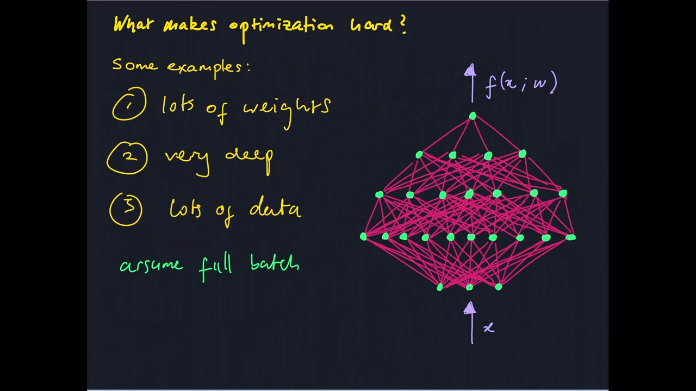
*▲ 강의 슬라이드 [08:10](https://youtu.be/VcGPE4s_oNw?t=490): 최적화를 어렵게 만드는 세 가지와 "전체 배치 가정"*

---

## 2. 규모를 키울 때 생기는 문제

▶ 영상 [08:20](https://youtu.be/VcGPE4s_oNw?t=500)

강의 끝부분의 예고편입니다. 신경망을 **넓게**([층](00_%EB%94%A5%EB%9F%AC%EB%8B%9D_%EC%9A%A9%EC%96%B4%EC%82%AC%EC%A0%84.md#layer-%EC%B8%B5)의 뉴런 수) 또는 **깊게**([층](00_%EB%94%A5%EB%9F%AC%EB%8B%9D_%EC%9A%A9%EC%96%B4%EC%82%AC%EC%A0%84.md#layer-%EC%B8%B5) 수) 키울 때 순진하게 하면 두 가지 골칫거리가 생깁니다(과제 2에서 직접 해 봅니다).

| 키우는 것 | 그래프 (가로: [학습률](00_%EB%94%A5%EB%9F%AC%EB%8B%9D_%EC%9A%A9%EC%96%B4%EC%82%AC%EC%A0%84.md#learning-rate-%ED%95%99%EC%8A%B5%EB%A5%A0), 세로: [학습](00_%EB%94%A5%EB%9F%AC%EB%8B%9D_%EC%9A%A9%EC%96%B4%EC%82%AC%EC%A0%84.md#training-%ED%95%99%EC%8A%B5) [손실](00_%EB%94%A5%EB%9F%AC%EB%8B%9D_%EC%9A%A9%EC%96%B4%EC%82%AC%EC%A0%84.md#loss-function-%EC%86%90%EC%8B%A4-%ED%95%A8%EC%88%98), 곡선: 크기별) | 문제 |
|---|---|---|
| 너비 32 → 1024 | 넓을수록 최저 [손실](00_%EB%94%A5%EB%9F%AC%EB%8B%9D_%EC%9A%A9%EC%96%B4%EC%82%AC%EC%A0%84.md#loss-function-%EC%86%90%EC%8B%A4-%ED%95%A8%EC%88%98)은 낮아지지만, 최저점이 생기는 **[학습률](00_%EB%94%A5%EB%9F%AC%EB%8B%9D_%EC%9A%A9%EC%96%B4%EC%82%AC%EC%A0%84.md#learning-rate-%ED%95%99%EC%8A%B5%EB%A5%A0)이 옮겨 간다** | 작은 모델에서 찾은 [학습률](00_%EB%94%A5%EB%9F%AC%EB%8B%9D_%EC%9A%A9%EC%96%B4%EC%82%AC%EC%A0%84.md#learning-rate-%ED%95%99%EC%8A%B5%EB%A5%A0)이 큰 모델에서 안 맞는다. 큰 모델에서 다시 [학습률](00_%EB%94%A5%EB%9F%AC%EB%8B%9D_%EC%9A%A9%EC%96%B4%EC%82%AC%EC%A0%84.md#learning-rate-%ED%95%99%EC%8A%B5%EB%A5%A0)을 찾아야 한다 |
| 깊이 32 → 1024 | 깊을수록 [손실](00_%EB%94%A5%EB%9F%AC%EB%8B%9D_%EC%9A%A9%EC%96%B4%EC%82%AC%EC%A0%84.md#loss-function-%EC%86%90%EC%8B%A4-%ED%95%A8%EC%88%98) 곡선 전체가 **위로** 올라간다 | 깊게 만들었더니 오히려 성능이 나빠진다 |

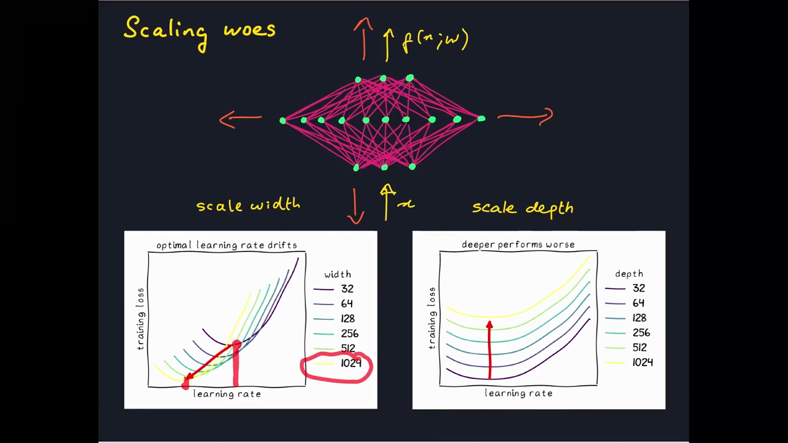
*▲ 강의 슬라이드 [11:18](https://youtu.be/VcGPE4s_oNw?t=678): 너비를 키우면 최적 [학습률](00_%EB%94%A5%EB%9F%AC%EB%8B%9D_%EC%9A%A9%EC%96%B4%EC%82%AC%EC%A0%84.md#learning-rate-%ED%95%99%EC%8A%B5%EB%A5%A0)이 움직이고(왼쪽 빨간 원), 깊이를 키우면 [손실](00_%EB%94%A5%EB%9F%AC%EB%8B%9D_%EC%9A%A9%EC%96%B4%EC%82%AC%EC%A0%84.md#loss-function-%EC%86%90%EC%8B%A4-%ED%95%A8%EC%88%98)이 나빠진다(오른쪽)*

- 거대 [트랜스포머](00_%EB%94%A5%EB%9F%AC%EB%8B%9D_%EC%9A%A9%EC%96%B4%EC%82%AC%EC%A0%84.md#transformer-%ED%8A%B8%EB%9E%9C%EC%8A%A4%ED%8F%AC%EB%A8%B8)는 큰 규모에서 [하이퍼파라미터](00_%EB%94%A5%EB%9F%AC%EB%8B%9D_%EC%9A%A9%EC%96%B4%EC%82%AC%EC%A0%84.md#hyperparameter-%ED%95%98%EC%9D%B4%ED%8D%BC%ED%8C%8C%EB%9D%BC%EB%AF%B8%ED%84%B0)를 여러 번 튜닝할 자원이 없습니다. 작은 모델에서 튜닝하고 그 값을 큰 모델로 **옮겨 쓰는**([하이퍼파라미터 전이](00_%EB%94%A5%EB%9F%AC%EB%8B%9D_%EC%9A%A9%EC%96%B4%EC%82%AC%EC%A0%84.md#hyperparameter-transfer-%ED%95%98%EC%9D%B4%ED%8D%BC%ED%8C%8C%EB%9D%BC%EB%AF%B8%ED%84%B0-%EC%A0%84%EC%9D%B4)) 것이 이 문제를 푸는 실질적 이유입니다.

질의응답 (요약) [10:31](https://youtu.be/VcGPE4s_oNw?t=631)

- **Q. 곡선 모양은 같아 보이는데 최적 [학습률](00_%EB%94%A5%EB%9F%AC%EB%8B%9D_%EC%9A%A9%EC%96%B4%EC%82%AC%EC%A0%84.md#learning-rate-%ED%95%99%EC%8A%B5%EB%A5%A0)이 정말 바뀌나?** 너비 32의 최저점과 너비 1024의 최저점을 비교하면 가로축 위치가 다르다. 그것이 "옮겨 간다"는 뜻이다.
- **Q. 실제로는 깊은 망을 쓰는데 왜 깊을수록 나빠지나?** 2015년 무렵까지는 최대 16층 정도였다. 그 뒤 잔차 구조([ResNet](00_%EB%94%A5%EB%9F%AC%EB%8B%9D_%EC%9A%A9%EC%96%B4%EC%82%AC%EC%A0%84.md#resnet-%EB%A0%88%EC%A6%88%EB%84%B7), [Lec04 7.3](Lec04_%EA%B2%A9%EC%9E%90_%EC%95%84%ED%82%A4%ED%85%8D%EC%B2%98.md#73-resnet))를 **잘 설정하는** 법이 나와 수천 [층](00_%EB%94%A5%EB%9F%AC%EB%8B%9D_%EC%9A%A9%EC%96%B4%EC%82%AC%EC%A0%84.md#layer-%EC%B8%B5)도 학습한다. 잔차 블록을 잘못 설정하면 여전히 이런 현상이 보인다.
- **Q. 너비 쪽 이동도 고칠 수 있나?** 2021년 이전 기법만으로는 이동이 남았지만, 그 뒤의 연구를 쓰면 확실히 고친다(8절).

---

## 3. 테일러 전개

▶ 영상 [13:58](https://youtu.be/VcGPE4s_oNw?t=838)

📐 **수학 개념**: [테일러 전개와 뉴턴 방법](%EC%88%98%ED%95%99%EA%B0%9C%EB%85%90/09_%EC%B5%9C%EC%A0%81%ED%99%94%EC%9D%98_%EA%B8%B0%ED%95%98/MM26_%ED%85%8C%EC%9D%BC%EB%9F%AC_%EC%A0%84%EA%B0%9C%EC%99%80_%EB%89%B4%ED%84%B4_%EB%B0%A9%EB%B2%95.md) · [그래디언트 벡터](%EC%88%98%ED%95%99%EA%B0%9C%EB%85%90/02_%EB%AF%B8%EB%B6%84/MM02_%EA%B7%B8%EB%9E%98%EB%94%94%EC%96%B8%ED%8A%B8_%EB%B2%A1%ED%84%B0.md)

고전적 최적화 방법은 크게 둘입니다.

- **[1차 방법](00_%EB%94%A5%EB%9F%AC%EB%8B%9D_%EC%9A%A9%EC%96%B4%EC%82%AC%EC%A0%84.md#first-order-method-second-order-method-1%EC%B0%A8-%EB%B0%A9%EB%B2%95%EA%B3%BC-2%EC%B0%A8-%EB%B0%A9%EB%B2%95)(First-order method)**: 1차 [미분](00_%EB%94%A5%EB%9F%AC%EB%8B%9D_%EC%9A%A9%EC%96%B4%EC%82%AC%EC%A0%84.md#derivative-%EB%AF%B8%EB%B6%84), 즉 [기울기](00_%EB%94%A5%EB%9F%AC%EB%8B%9D_%EC%9A%A9%EC%96%B4%EC%82%AC%EC%A0%84.md#gradient-%EA%B8%B0%EC%9A%B8%EA%B8%B0) $g = \partial \mathcal{L} / \partial w$만 쓴다. [역전파](00_%EB%94%A5%EB%9F%AC%EB%8B%9D_%EC%9A%A9%EC%96%B4%EC%82%AC%EC%A0%84.md#backpropagation-%EC%97%AD%EC%A0%84%ED%8C%8C)로 얻는 바로 그 값이다. 딥러닝이 실제로 하는 일이다.
- **[2차 방법](00_%EB%94%A5%EB%9F%AC%EB%8B%9D_%EC%9A%A9%EC%96%B4%EC%82%AC%EC%A0%84.md#first-order-method-second-order-method-1%EC%B0%A8-%EB%B0%A9%EB%B2%95%EA%B3%BC-2%EC%B0%A8-%EB%B0%A9%EB%B2%95)(Second-order method)**: 2차 [미분](00_%EB%94%A5%EB%9F%AC%EB%8B%9D_%EC%9A%A9%EC%96%B4%EC%82%AC%EC%A0%84.md#derivative-%EB%AF%B8%EB%B6%84), 즉 [헤세 행렬](00_%EB%94%A5%EB%9F%AC%EB%8B%9D_%EC%9A%A9%EC%96%B4%EC%82%AC%EC%A0%84.md#hessian-%ED%97%A4%EC%84%B8-%ED%96%89%EB%A0%AC) $H = \partial^2 \mathcal{L} / \partial w^2$도 쓴다.

강사는 "모든 고전적 방법은 [손실](00_%EB%94%A5%EB%9F%AC%EB%8B%9D_%EC%9A%A9%EC%96%B4%EC%82%AC%EC%A0%84.md#loss-function-%EC%86%90%EC%8B%A4-%ED%95%A8%EC%88%98)의 **[테일러 전개](00_%EB%94%A5%EB%9F%AC%EB%8B%9D_%EC%9A%A9%EC%96%B4%EC%82%AC%EC%A0%84.md#taylor-expansion-%ED%85%8C%EC%9D%BC%EB%9F%AC-%EC%A0%84%EA%B0%9C)(Taylor expansion)**에서 출발한다"고 봅니다. 각 방법이 어떤 가정(모델링)을 하는지, 그 가정의 약점이 무엇인지를 보라는 것입니다. "왜 실제로는 이걸 안 쓰지?"를 늘 물으라고 합니다.

$$
\mathcal{L}(w + \Delta w) = \underbrace{\mathcal{L}(w) + g^\top \Delta w}_{\text{선형화}} + \underbrace{\frac{1}{2}\, \Delta w^\top H\, \Delta w + \cdots}_{\text{비선형 부분}}
$$

기호 풀이

| 기호 | 읽는 법 | 뜻 | 예제 값 ($\mathcal{L} = e^w - 2w$, $w = 0$) |
| --- | --- | --- | --- |
| $\mathcal{L}(w + \Delta w)$ | 엘 오브 더블유 플러스 델타 더블유 | [가중치](00_%EB%94%A5%EB%9F%AC%EB%8B%9D_%EC%9A%A9%EC%96%B4%EC%82%AC%EC%A0%84.md#weight-%EA%B0%80%EC%A4%91%EC%B9%98)를 $\Delta w$만큼 옮긴 뒤의 [손실](00_%EB%94%A5%EB%9F%AC%EB%8B%9D_%EC%9A%A9%EC%96%B4%EC%82%AC%EC%A0%84.md#loss-function-%EC%86%90%EC%8B%A4-%ED%95%A8%EC%88%98) | 0.64872 ($\Delta w = 0.5$) |
| $\Delta w$ | 델타 더블유 | [가중치](00_%EB%94%A5%EB%9F%AC%EB%8B%9D_%EC%9A%A9%EC%96%B4%EC%82%AC%EC%A0%84.md#weight-%EA%B0%80%EC%A4%91%EC%B9%98) 변화(한 걸음) | 0.5 |
| $g$ | 지 | [기울기](00_%EB%94%A5%EB%9F%AC%EB%8B%9D_%EC%9A%A9%EC%96%B4%EC%82%AC%EC%A0%84.md#gradient-%EA%B8%B0%EC%9A%B8%EA%B8%B0), 크기 $d \times 1$ | −1 |
| $g^\top \Delta w$ | 지 [전치](00_%EB%94%A5%EB%9F%AC%EB%8B%9D_%EC%9A%A9%EC%96%B4%EC%82%AC%EC%A0%84.md#transpose-%EC%A0%84%EC%B9%98) 델타 더블유 | 1차 항 | −0.5 |
| $H$ | 에이치 | [헤세 행렬](00_%EB%94%A5%EB%9F%AC%EB%8B%9D_%EC%9A%A9%EC%96%B4%EC%82%AC%EC%A0%84.md#hessian-%ED%97%A4%EC%84%B8-%ED%96%89%EB%A0%AC), 크기 $d \times d$ | 1 |
| $\frac12 \Delta w^\top H \Delta w$ | 2차 항 | 휘어짐에 의한 보정 | 0.125 |
| $\cdots$ | 3차 이상의 항 | 나머지 | 0.02372 |
| 선형화 / 비선형 부분 | - | 강의가 붙인 이름: 앞 두 항 / 나머지 전부 | 0.5 / 0.14872 |

예제와 풀이

**문제**: [손실](00_%EB%94%A5%EB%9F%AC%EB%8B%9D_%EC%9A%A9%EC%96%B4%EC%82%AC%EC%A0%84.md#loss-function-%EC%86%90%EC%8B%A4-%ED%95%A8%EC%88%98) $\mathcal{L}(w) = e^w - 2w$의 지금 자리 $w = 0$에서 [가중치](00_%EB%94%A5%EB%9F%AC%EB%8B%9D_%EC%9A%A9%EC%96%B4%EC%82%AC%EC%A0%84.md#weight-%EA%B0%80%EC%A4%91%EC%B9%98)를 $\Delta w = 0.5$만큼 옮길 때, 선형화(앞 두 항)와 비선형 부분은 각각 얼마인가?

**주어진 값**:
- $\mathcal{L}(0) = 1$ (지금 [손실](00_%EB%94%A5%EB%9F%AC%EB%8B%9D_%EC%9A%A9%EC%96%B4%EC%82%AC%EC%A0%84.md#loss-function-%EC%86%90%EC%8B%A4-%ED%95%A8%EC%88%98): $e^0 - 0$. $e$는 약 2.71828인 수이고 어떤 수든 0제곱은 1)
- $g = -1$ ([기울기](00_%EB%94%A5%EB%9F%AC%EB%8B%9D_%EC%9A%A9%EC%96%B4%EC%82%AC%EC%A0%84.md#gradient-%EA%B8%B0%EC%9A%B8%EA%B8%B0): $e^0 - 2$)
- $H = 1$ (휘어짐: $e^0$)
- $\Delta w = 0.5$ (옮기는 양)
- 참값 $\mathcal{L}(0.5) = e^{0.5} - 1 = 0.64872$ ($e^{0.5}$는 계산기로 1.64872)

**풀이**
1. 식을 그대로 쓴다: 선형화 $= \mathcal{L}(w) + g \cdot \Delta w$, 2차 항 $= \frac12 \cdot H \cdot \Delta w^2$
2. 값을 대입한다: 선형화 $= 1 + (-1) \cdot 0.5$, 2차 항 $= \frac12 \cdot 1 \cdot 0.5^2$
3. 곱셈을 한다: $(-1) \times 0.5 = -0.5$ 이므로 선형화 $= 1 - 0.5 = 0.5$
4. 제곱을 한다: $0.5^2 = 0.25$ 이므로 2차 항 $= \frac12 \times 1 \times 0.25 = 0.125$
5. 비선형 부분 전체를 구한다: 참값 − 선형화 $= 0.64872 - 0.5 = 0.14872$
6. 3차 이상 항을 구한다: $0.14872 - 0.125 = 0.02372$

**답**: 선형화 **0.5**, 비선형 부분 **0.14872** (그중 2차 항이 0.125로 대부분)

내 이해

- [파라미터](00_%EB%94%A5%EB%9F%AC%EB%8B%9D_%EC%9A%A9%EC%96%B4%EC%82%AC%EC%A0%84.md#parameter-%ED%8C%8C%EB%9D%BC%EB%AF%B8%ED%84%B0)가 $d$개면 [기울기](00_%EB%94%A5%EB%9F%AC%EB%8B%9D_%EC%9A%A9%EC%96%B4%EC%82%AC%EC%A0%84.md#gradient-%EA%B8%B0%EC%9A%B8%EA%B8%B0) $g$는 $d \times 1$, [헤세 행렬](00_%EB%94%A5%EB%9F%AC%EB%8B%9D_%EC%9A%A9%EC%96%B4%EC%82%AC%EC%A0%84.md#hessian-%ED%97%A4%EC%84%B8-%ED%96%89%EB%A0%AC) $H$는 $d \times d$입니다.

---

## 4. 뉴턴 방법

▶ 영상 [18:04](https://youtu.be/VcGPE4s_oNw?t=1084)

📐 **수학 개념**: [테일러 전개와 뉴턴 방법](%EC%88%98%ED%95%99%EA%B0%9C%EB%85%90/09_%EC%B5%9C%EC%A0%81%ED%99%94%EC%9D%98_%EA%B8%B0%ED%95%98/MM26_%ED%85%8C%EC%9D%BC%EB%9F%AC_%EC%A0%84%EA%B0%9C%EC%99%80_%EB%89%B4%ED%84%B4_%EB%B0%A9%EB%B2%95.md) · [벡터와 행렬](%EC%88%98%ED%95%99%EA%B0%9C%EB%85%90/03_%EC%84%A0%ED%98%95%EB%8C%80%EC%88%98/M05_%EB%B2%A1%ED%84%B0%EC%99%80_%ED%96%89%EB%A0%AC.md)

**[뉴턴 방법](00_%EB%94%A5%EB%9F%AC%EB%8B%9D_%EC%9A%A9%EC%96%B4%EC%82%AC%EC%A0%84.md#newtons-method-%EB%89%B4%ED%84%B4-%EB%B0%A9%EB%B2%95)([Newton's method](00_%EB%94%A5%EB%9F%AC%EB%8B%9D_%EC%9A%A9%EC%96%B4%EC%82%AC%EC%A0%84.md#newtons-method-%EB%89%B4%ED%84%B4-%EB%B0%A9%EB%B2%95))**은 [테일러 전개](00_%EB%94%A5%EB%9F%AC%EB%8B%9D_%EC%9A%A9%EC%96%B4%EC%82%AC%EC%A0%84.md#taylor-expansion-%ED%85%8C%EC%9D%BC%EB%9F%AC-%EC%A0%84%EA%B0%9C)의 3차 이상 항을 버리고 2차까지만 남긴 뒤, 그 2차식을 $\Delta w$에 대해 최소로 만듭니다. 미분해 0으로 두면 $g + H\Delta w = 0$이고, 정리하면 다음 식입니다. 흔히 "[기울기](00_%EB%94%A5%EB%9F%AC%EB%8B%9D_%EC%9A%A9%EC%96%B4%EC%82%AC%EC%A0%84.md#gradient-%EA%B8%B0%EC%9A%B8%EA%B8%B0)를 [헤세 행렬](00_%EB%94%A5%EB%9F%AC%EB%8B%9D_%EC%9A%A9%EC%96%B4%EC%82%AC%EC%A0%84.md#hessian-%ED%97%A4%EC%84%B8-%ED%96%89%EB%A0%AC)의 역행렬로 **[전처리](00_%EB%94%A5%EB%9F%AC%EB%8B%9D_%EC%9A%A9%EC%96%B4%EC%82%AC%EC%A0%84.md#preconditioning-%EC%A0%84%EC%B2%98%EB%A6%AC)**(precondition)한다"고 말합니다.

$$
\Delta w = -H^{-1} g
$$

기호 풀이

| 기호 | 읽는 법 | 뜻 | 예제 값 |
| --- | --- | --- | --- |
| $\Delta w$ | 델타 더블유 | 뉴턴 걸음 | (−1, −1) |
| $H^{-1}$ | 에이치 인버스 | [헤세 행렬](00_%EB%94%A5%EB%9F%AC%EB%8B%9D_%EC%9A%A9%EC%96%B4%EC%82%AC%EC%A0%84.md#hessian-%ED%97%A4%EC%84%B8-%ED%96%89%EB%A0%AC)의 역행렬 | diag(0.5, 0.125) |
| $g$ | 지 | [기울기](00_%EB%94%A5%EB%9F%AC%EB%8B%9D_%EC%9A%A9%EC%96%B4%EC%82%AC%EC%A0%84.md#gradient-%EA%B8%B0%EC%9A%B8%EA%B8%B0) | (2, 8) |

예제와 풀이

**문제**: [손실](00_%EB%94%A5%EB%9F%AC%EB%8B%9D_%EC%9A%A9%EC%96%B4%EC%82%AC%EC%A0%84.md#loss-function-%EC%86%90%EC%8B%A4-%ED%95%A8%EC%88%98) $\mathcal{L}(w) = w_1^2 + 4w_2^2$의 지금 자리 $w = (1, 1)$에서 뉴턴 걸음을 구하라.

**주어진 값**:
- $g = (2, 8)$ ([기울기](00_%EB%94%A5%EB%9F%AC%EB%8B%9D_%EC%9A%A9%EC%96%B4%EC%82%AC%EC%A0%84.md#gradient-%EA%B8%B0%EC%9A%B8%EA%B8%B0): $2w_1 = 2 \times 1$, $8w_2 = 8 \times 1$)
- $H = \begin{pmatrix}2&0\\0&8\end{pmatrix}$ ([헤세 행렬](00_%EB%94%A5%EB%9F%AC%EB%8B%9D_%EC%9A%A9%EC%96%B4%EC%82%AC%EC%A0%84.md#hessian-%ED%97%A4%EC%84%B8-%ED%96%89%EB%A0%AC): 방향별 휘어짐)
- $H^{-1} = \begin{pmatrix}0.5&0\\0&0.125\end{pmatrix}$ (역행렬: 대각 행렬은 대각선 값을 뒤집는다, $1/2$, $1/8$)

**풀이**
1. 식을 그대로 쓴다: $\Delta w = -H^{-1} g$
2. 값을 대입한다: $\Delta w = -\begin{pmatrix}0.5&0\\0&0.125\end{pmatrix}\begin{pmatrix}2\\8\end{pmatrix}$
3. 첫째 줄을 펼쳐 곱한다: $0.5 \times 2 + 0 \times 8 = 1$
4. 둘째 줄을 펼쳐 곱한다: $0 \times 2 + 0.125 \times 8 = 1$ 이므로 $\Delta w = -(1, 1)$
5. 마이너스를 붙인다: $\Delta w = (-1, -1)$
6. 새 자리와 [손실](00_%EB%94%A5%EB%9F%AC%EB%8B%9D_%EC%9A%A9%EC%96%B4%EC%82%AC%EC%A0%84.md#loss-function-%EC%86%90%EC%8B%A4-%ED%95%A8%EC%88%98)을 구한다: $(1 - 1, 1 - 1) = (0, 0)$, [손실](00_%EB%94%A5%EB%9F%AC%EB%8B%9D_%EC%9A%A9%EC%96%B4%EC%82%AC%EC%A0%84.md#loss-function-%EC%86%90%EC%8B%A4-%ED%95%A8%EC%88%98) $0^2 + 4 \times 0^2 = 0$
7. 비교로 경사하강(η = 0.1): $-0.1 \times (2, 8) = (-0.2, -0.8)$, 새 자리 $(0.8, 0.2)$, [손실](00_%EB%94%A5%EB%9F%AC%EB%8B%9D_%EC%9A%A9%EC%96%B4%EC%82%AC%EC%A0%84.md#loss-function-%EC%86%90%EC%8B%A4-%ED%95%A8%EC%88%98) $0.64 + 4 \times 0.04 = 0.8$

**답**: 뉴턴 걸음 **(−1, −1)**로 한 번에 바닥, 경사하강은 [손실](00_%EB%94%A5%EB%9F%AC%EB%8B%9D_%EC%9A%A9%EC%96%B4%EC%82%AC%EC%A0%84.md#loss-function-%EC%86%90%EC%8B%A4-%ED%95%A8%EC%88%98) 5 → **0.8**

내 이해

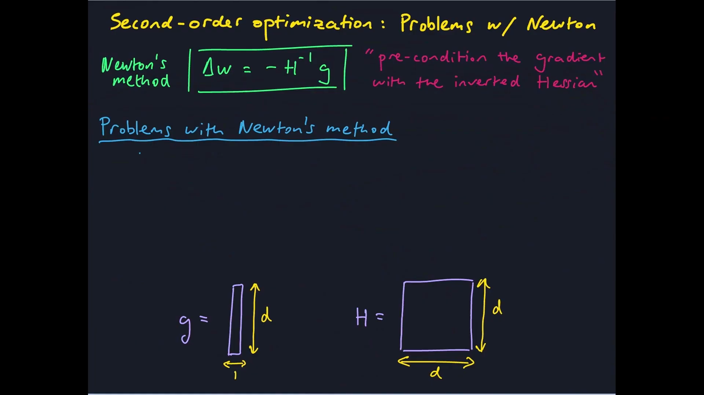
*▲ 강의 슬라이드 [20:10](https://youtu.be/VcGPE4s_oNw?t=1210): [뉴턴 방법](00_%EB%94%A5%EB%9F%AC%EB%8B%9D_%EC%9A%A9%EC%96%B4%EC%82%AC%EC%A0%84.md#newtons-method-%EB%89%B4%ED%84%B4-%EB%B0%A9%EB%B2%95) $\Delta w = -H^{-1}g$와 [기울기](00_%EB%94%A5%EB%9F%AC%EB%8B%9D_%EC%9A%A9%EC%96%B4%EC%82%AC%EC%A0%84.md#gradient-%EA%B8%B0%EC%9A%B8%EA%B8%B0)($d \times 1$)·[헤세 행렬](00_%EB%94%A5%EB%9F%AC%EB%8B%9D_%EC%9A%A9%EC%96%B4%EC%82%AC%EC%A0%84.md#hessian-%ED%97%A4%EC%84%B8-%ED%96%89%EB%A0%AC)($d \times d$)의 크기*

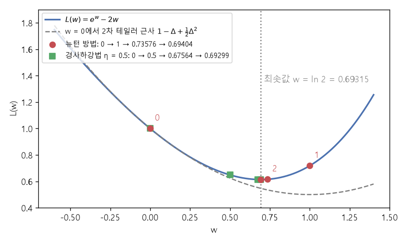
*▲ 직접 그린 그림: $\mathcal{L}(w) = e^w - 2w$에서 [뉴턴 방법](00_%EB%94%A5%EB%9F%AC%EB%8B%9D_%EC%9A%A9%EC%96%B4%EC%82%AC%EC%A0%84.md#newtons-method-%EB%89%B4%ED%84%B4-%EB%B0%A9%EB%B2%95)은 $w = 0$의 2차 근사(점선)의 바닥 $w = 1$로 뛴 뒤 0.73576, 0.69404로 최솟값 ln 2 = 0.69315에 다가간다 (숫자는 [MM26_테일러_전개와_뉴턴_방법](%EC%88%98%ED%95%99%EA%B0%9C%EB%85%90/09_%EC%B5%9C%EC%A0%81%ED%99%94%EC%9D%98_%EA%B8%B0%ED%95%98/MM26_%ED%85%8C%EC%9D%BC%EB%9F%AC_%EC%A0%84%EA%B0%9C%EC%99%80_%EB%89%B4%ED%84%B4_%EB%B0%A9%EB%B2%95.md) 3.1 표와 같음)*

**[뉴턴 방법](00_%EB%94%A5%EB%9F%AC%EB%8B%9D_%EC%9A%A9%EC%96%B4%EC%82%AC%EC%A0%84.md#newtons-method-%EB%89%B4%ED%84%B4-%EB%B0%A9%EB%B2%95)의 문제**

1. **너무 크다**: $H$는 $d \times d$입니다. $d$가 수십억이면 저장조차 못 하고, 역행렬 계산([특잇값 분해](00_%EB%94%A5%EB%9F%AC%EB%8B%9D_%EC%9A%A9%EC%96%B4%EC%82%AC%EC%A0%84.md#singular-value-decomposition-%ED%8A%B9%EC%9E%87%EA%B0%92-%EB%B6%84%ED%95%B4)와 비슷한 비용, 대략 $d^3$)은 [순전파](00_%EB%94%A5%EB%9F%AC%EB%8B%9D_%EC%9A%A9%EC%96%B4%EC%82%AC%EC%A0%84.md#feed-forward-%EC%88%9C%EC%A0%84%ED%8C%8C)·[역전파](00_%EB%94%A5%EB%9F%AC%EB%8B%9D_%EC%9A%A9%EC%96%B4%EC%82%AC%EC%A0%84.md#backpropagation-%EC%97%AD%EC%A0%84%ED%8C%8C)보다 훨씬 비쌉니다. [GPU](00_%EB%94%A5%EB%9F%AC%EB%8B%9D_%EC%9A%A9%EC%96%B4%EC%82%AC%EC%A0%84.md#device-gpu-%EC%9E%A5%EC%B9%98%EC%99%80-gpu)는 [행렬 곱](00_%EB%94%A5%EB%9F%AC%EB%8B%9D_%EC%9A%A9%EC%96%B4%EC%82%AC%EC%A0%84.md#matrix-multiplication-%ED%96%89%EB%A0%AC-%EA%B3%B1)에는 강하지만 역행렬이나 [특잇값 분해](00_%EB%94%A5%EB%9F%AC%EB%8B%9D_%EC%9A%A9%EC%96%B4%EC%82%AC%EC%A0%84.md#singular-value-decomposition-%ED%8A%B9%EC%9E%87%EA%B0%92-%EB%B6%84%ED%95%B4)에는 맞춰져 있지 않습니다.
2. **최솟값을 보장하지 않는다**: [미분](00_%EB%94%A5%EB%9F%AC%EB%8B%9D_%EC%9A%A9%EC%96%B4%EC%82%AC%EC%A0%84.md#derivative-%EB%AF%B8%EB%B6%84)이 0인 점(임계점)을 찾을 뿐이라, 2차식이 위로 볼록하면 **최댓값**으로 갈 수도 있습니다. 경사 "하강"이 아니라 상승이 될 수 있다는 뜻입니다. 2차식에 3차 벌점을 더하는 **3차 [정규화](00_%EB%94%A5%EB%9F%AC%EB%8B%9D_%EC%9A%A9%EC%96%B4%EC%82%AC%EC%A0%84.md#normalization-%EC%A0%95%EA%B7%9C%ED%99%94)**(cubic regularization) 같은 보완책이 있지만 실제로는 잘 쓰지 않습니다.

강사의 결론은 "어떤 방법이든 실용화하려는 연구는 많지만, 실제로는 **[Adam](00_%EB%94%A5%EB%9F%AC%EB%8B%9D_%EC%9A%A9%EC%96%B4%EC%82%AC%EC%A0%84.md#adam-%EC%95%84%EB%8B%B4-%EC%98%B5%ED%8B%B0%EB%A7%88%EC%9D%B4%EC%A0%80)**으로 신경망을 학습한다"입니다.

> [!TIP]
> **🆕 2026 업데이트: 2차 계열 방법이 [Adam](00_%EB%94%A5%EB%9F%AC%EB%8B%9D_%EC%9A%A9%EC%96%B4%EC%82%AC%EC%A0%84.md#adam-%EC%95%84%EB%8B%B4-%EC%98%B5%ED%8B%B0%EB%A7%88%EC%9D%B4%EC%A0%80)을 이긴 벤치마크**
> - **강의(2024년 가을)**: 2차 방법은 너무 비싸서 실제로는 [Adam](00_%EB%94%A5%EB%9F%AC%EB%8B%9D_%EC%9A%A9%EC%96%B4%EC%82%AC%EC%A0%84.md#adam-%EC%95%84%EB%8B%B4-%EC%98%B5%ED%8B%B0%EB%A7%88%EC%9D%B4%EC%A0%80)을 쓴다.
> - **현재(2026년 10월)**: [학습](00_%EB%94%A5%EB%9F%AC%EB%8B%9D_%EC%9A%A9%EC%96%B4%EC%82%AC%EC%A0%84.md#training-%ED%95%99%EC%8A%B5) 알고리즘만 바꿔 같은 하드웨어에서 목표 성능까지 걸리는 시간을 겨루는 MLCommons의 AlgoPerf 첫 대회(결과 논문 ICLR 2025)에서, 외부 튜닝 부문 우승은 **Distributed [Shampoo](00_%EB%94%A5%EB%9F%AC%EB%8B%9D_%EC%9A%A9%EC%96%B4%EC%82%AC%EC%A0%84.md#shampoo-%EC%83%B4%ED%91%B8-%EC%98%B5%ED%8B%B0%EB%A7%88%EC%9D%B4%EC%A0%80)**였다. [헤세 행렬](00_%EB%94%A5%EB%9F%AC%EB%8B%9D_%EC%9A%A9%EC%96%B4%EC%82%AC%EC%A0%84.md#hessian-%ED%97%A4%EC%84%B8-%ED%96%89%EB%A0%AC) 전체 대신 [층](00_%EB%94%A5%EB%9F%AC%EB%8B%9D_%EC%9A%A9%EC%96%B4%EC%82%AC%EC%A0%84.md#layer-%EC%B8%B5)마다 작은 행렬 두 개로 전처리하는 방법으로, 대각선이 아닌(non-diagonal) [전처리](00_%EB%94%A5%EB%9F%AC%EB%8B%9D_%EC%9A%A9%EC%96%B4%EC%82%AC%EC%A0%84.md#preconditioning-%EC%A0%84%EC%B2%98%EB%A6%AC)가 실제 소요 시간(wall-clock)으로도 [Adam](00_%EB%94%A5%EB%9F%AC%EB%8B%9D_%EC%9A%A9%EC%96%B4%EC%82%AC%EC%A0%84.md#adam-%EC%95%84%EB%8B%B4-%EC%98%B5%ED%8B%B0%EB%A7%88%EC%9D%B4%EC%A0%80) 계열을 앞섰다. 다만 [하이퍼파라미터](00_%EB%94%A5%EB%9F%AC%EB%8B%9D_%EC%9A%A9%EC%96%B4%EC%82%AC%EC%A0%84.md#hyperparameter-%ED%95%98%EC%9D%B4%ED%8D%BC%ED%8C%8C%EB%9D%BC%EB%AF%B8%ED%84%B0) 없이 겨루는 부문에서는 Schedule-Free AdamW가 우승했다. "2차 정보는 너무 비싸다"는 말은 [헤세 행렬](00_%EB%94%A5%EB%9F%AC%EB%8B%9D_%EC%9A%A9%EC%96%B4%EC%82%AC%EC%A0%84.md#hessian-%ED%97%A4%EC%84%B8-%ED%96%89%EB%A0%AC)을 통째로 쓸 때의 이야기이고, 구조를 써서 줄인 근사는 실전에서 경쟁력이 있다.
> - **출처**: [Kasimbeg et al., Accelerating Neural Network Training: An Analysis of the AlgoPerf Competition (ICLR 2025)](https://arxiv.org/abs/2502.15015)

---

## 5. 가우스-뉴턴 방법

▶ 영상 [21:32](https://youtu.be/VcGPE4s_oNw?t=1292)

📐 **수학 개념**: [야코비안과 연쇄법칙](%EC%88%98%ED%95%99%EA%B0%9C%EB%85%90/05_%EC%8B%A0%EA%B2%BD%EB%A7%9D%EC%9D%98_%EA%B3%84%EC%82%B0/MM09_%EC%95%BC%EC%BD%94%EB%B9%84%EC%95%88%EA%B3%BC_%EC%97%B0%EC%87%84%EB%B2%95%EC%B9%99.md) · [뉴턴 방법](%EC%88%98%ED%95%99%EA%B0%9C%EB%85%90/09_%EC%B5%9C%EC%A0%81%ED%99%94%EC%9D%98_%EA%B8%B0%ED%95%98/MM26_%ED%85%8C%EC%9D%BC%EB%9F%AC_%EC%A0%84%EA%B0%9C%EC%99%80_%EB%89%B4%ED%84%B4_%EB%B0%A9%EB%B2%95.md)

**[가우스-뉴턴 방법](00_%EB%94%A5%EB%9F%AC%EB%8B%9D_%EC%9A%A9%EC%96%B4%EC%82%AC%EC%A0%84.md#gauss-newton-method-%EA%B0%80%EC%9A%B0%EC%8A%A4-%EB%89%B4%ED%84%B4-%EB%B0%A9%EB%B2%95)(Gauss-Newton method)**은 [손실](00_%EB%94%A5%EB%9F%AC%EB%8B%9D_%EC%9A%A9%EC%96%B4%EC%82%AC%EC%A0%84.md#loss-function-%EC%86%90%EC%8B%A4-%ED%95%A8%EC%88%98)이 [오차](00_%EB%94%A5%EB%9F%AC%EB%8B%9D_%EC%9A%A9%EC%96%B4%EC%82%AC%EC%A0%84.md#error-%EC%98%A4%EC%B0%A8) 척도와 신경망의 **합성** $\mathcal{L} = \ell \circ f$라는 점(1절)을 씁니다. [기울기](00_%EB%94%A5%EB%9F%AC%EB%8B%9D_%EC%9A%A9%EC%96%B4%EC%82%AC%EC%A0%84.md#gradient-%EA%B8%B0%EC%9A%B8%EA%B8%B0)는 [연쇄법칙](00_%EB%94%A5%EB%9F%AC%EB%8B%9D_%EC%9A%A9%EC%96%B4%EC%82%AC%EC%A0%84.md#chain-rule-%EC%97%B0%EC%87%84%EB%B2%95%EC%B9%99)으로 $\frac{\partial \mathcal{L}}{\partial w} = \frac{\partial \ell}{\partial f}\frac{\partial f}{\partial w}$이고, 이것을 한 번 더 미분하면 곱의 [미분](00_%EB%94%A5%EB%9F%AC%EB%8B%9D_%EC%9A%A9%EC%96%B4%EC%82%AC%EC%A0%84.md#derivative-%EB%AF%B8%EB%B6%84) 법칙 때문에 두 조각으로 나뉩니다(가우스-뉴턴 분해).

$$
\underbrace{\frac{\partial^2 \mathcal{L}}{\partial w^2}}_{\text{전체 헤세 } H} = \frac{\partial f}{\partial w}^{\!\top} \underbrace{\frac{\partial^2 \ell}{\partial f^2}}_{\text{오차의 휘어짐}} \frac{\partial f}{\partial w} + \frac{\partial \ell}{\partial f} \underbrace{\frac{\partial^2 f}{\partial w^2}}_{\text{모델의 휘어짐}}
$$

기호 풀이

| 기호 | 읽는 법 | 뜻 | 예제 값 ($f = \tanh(wx)$, $w = 0.2$, $x = 1$, $y = 0.5$) |
| --- | --- | --- | --- |
| $\frac{\partial^2 \mathcal{L}}{\partial w^2}$ | [손실](00_%EB%94%A5%EB%9F%AC%EB%8B%9D_%EC%9A%A9%EC%96%B4%EC%82%AC%EC%A0%84.md#loss-function-%EC%86%90%EC%8B%A4-%ED%95%A8%EC%88%98)의 2차 [미분](00_%EB%94%A5%EB%9F%AC%EB%8B%9D_%EC%9A%A9%EC%96%B4%EC%82%AC%EC%A0%84.md#derivative-%EB%AF%B8%EB%B6%84) | 전체 헤세 $H$ | 1.0384 |
| $\frac{\partial f}{\partial w}$ | 모델의 1차 [미분](00_%EB%94%A5%EB%9F%AC%EB%8B%9D_%EC%9A%A9%EC%96%B4%EC%82%AC%EC%A0%84.md#derivative-%EB%AF%B8%EB%B6%84) | [가중치](00_%EB%94%A5%EB%9F%AC%EB%8B%9D_%EC%9A%A9%EC%96%B4%EC%82%AC%EC%A0%84.md#weight-%EA%B0%80%EC%A4%91%EC%B9%98)가 출력을 바꾸는 정도([야코비안](00_%EB%94%A5%EB%9F%AC%EB%8B%9D_%EC%9A%A9%EC%96%B4%EC%82%AC%EC%A0%84.md#jacobian-%EC%95%BC%EC%BD%94%EB%B9%84%EC%95%88)) | 0.961 |
| $\frac{\partial^2 \ell}{\partial f^2}$ | [오차](00_%EB%94%A5%EB%9F%AC%EB%8B%9D_%EC%9A%A9%EC%96%B4%EC%82%AC%EC%A0%84.md#error-%EC%98%A4%EC%B0%A8)의 2차 [미분](00_%EB%94%A5%EB%9F%AC%EB%8B%9D_%EC%9A%A9%EC%96%B4%EC%82%AC%EC%A0%84.md#derivative-%EB%AF%B8%EB%B6%84) | [오차](00_%EB%94%A5%EB%9F%AC%EB%8B%9D_%EC%9A%A9%EC%96%B4%EC%82%AC%EC%A0%84.md#error-%EC%98%A4%EC%B0%A8) 척도의 휘어짐. 제곱 [오차](00_%EB%94%A5%EB%9F%AC%EB%8B%9D_%EC%9A%A9%EC%96%B4%EC%82%AC%EC%A0%84.md#error-%EC%98%A4%EC%B0%A8)면 1 | 1 |
| $\frac{\partial \ell}{\partial f}$ | [오차](00_%EB%94%A5%EB%9F%AC%EB%8B%9D_%EC%9A%A9%EC%96%B4%EC%82%AC%EC%A0%84.md#error-%EC%98%A4%EC%B0%A8)의 1차 [미분](00_%EB%94%A5%EB%9F%AC%EB%8B%9D_%EC%9A%A9%EC%96%B4%EC%82%AC%EC%A0%84.md#derivative-%EB%AF%B8%EB%B6%84) | 예측 − [정답](00_%EB%94%A5%EB%9F%AC%EB%8B%9D_%EC%9A%A9%EC%96%B4%EC%82%AC%EC%A0%84.md#label-%EC%A0%95%EB%8B%B5) (제곱 오차일 때) | −0.3026 |
| $\frac{\partial^2 f}{\partial w^2}$ | 모델의 2차 [미분](00_%EB%94%A5%EB%9F%AC%EB%8B%9D_%EC%9A%A9%EC%96%B4%EC%82%AC%EC%A0%84.md#derivative-%EB%AF%B8%EB%B6%84) | 모델 자체의 휘어짐 | −0.3794 |

예제와 풀이

**문제**: 모델 $f = \tanh(wx)$와 제곱 [오차](00_%EB%94%A5%EB%9F%AC%EB%8B%9D_%EC%9A%A9%EC%96%B4%EC%82%AC%EC%A0%84.md#error-%EC%98%A4%EC%B0%A8) $\ell = \frac12(f - y)^2$에서, [가중치](00_%EB%94%A5%EB%9F%AC%EB%8B%9D_%EC%9A%A9%EC%96%B4%EC%82%AC%EC%A0%84.md#weight-%EA%B0%80%EC%A4%91%EC%B9%98) $w = 0.2$일 때 헤세(2차 [미분](00_%EB%94%A5%EB%9F%AC%EB%8B%9D_%EC%9A%A9%EC%96%B4%EC%82%AC%EC%A0%84.md#derivative-%EB%AF%B8%EB%B6%84))를 "[오차](00_%EB%94%A5%EB%9F%AC%EB%8B%9D_%EC%9A%A9%EC%96%B4%EC%82%AC%EC%A0%84.md#error-%EC%98%A4%EC%B0%A8)의 휘어짐" 조각과 "모델의 휘어짐" 조각으로 나눠 구하라.

**주어진 값**:
- $x = 1$ (입력), $y = 0.5$ ([정답](00_%EB%94%A5%EB%9F%AC%EB%8B%9D_%EC%9A%A9%EC%96%B4%EC%82%AC%EC%A0%84.md#label-%EC%A0%95%EB%8B%B5)), $w = 0.2$ ([가중치](00_%EB%94%A5%EB%9F%AC%EB%8B%9D_%EC%9A%A9%EC%96%B4%EC%82%AC%EC%A0%84.md#weight-%EA%B0%80%EC%A4%91%EC%B9%98))
- $f = \tanh(0.2) = 0.1974$ (모델 출력. $\tanh$는 값을 −1~1로 누르는 함수, 계산기로 구함)
- $\frac{\partial f}{\partial w} = (1 - f^2)x$, $\frac{\partial^2 f}{\partial w^2} = -2f(1 - f^2)x^2$ ($\tanh$의 [미분](00_%EB%94%A5%EB%9F%AC%EB%8B%9D_%EC%9A%A9%EC%96%B4%EC%82%AC%EC%A0%84.md#derivative-%EB%AF%B8%EB%B6%84) 규칙)
- $\frac{\partial \ell}{\partial f} = f - y$, $\frac{\partial^2 \ell}{\partial f^2} = 1$ (제곱 [오차](00_%EB%94%A5%EB%9F%AC%EB%8B%9D_%EC%9A%A9%EC%96%B4%EC%82%AC%EC%A0%84.md#error-%EC%98%A4%EC%B0%A8)의 [미분](00_%EB%94%A5%EB%9F%AC%EB%8B%9D_%EC%9A%A9%EC%96%B4%EC%82%AC%EC%A0%84.md#derivative-%EB%AF%B8%EB%B6%84))

**풀이**
1. 식을 그대로 쓴다: $H = \frac{\partial f}{\partial w} \cdot \frac{\partial^2 \ell}{\partial f^2} \cdot \frac{\partial f}{\partial w} + \frac{\partial \ell}{\partial f} \cdot \frac{\partial^2 f}{\partial w^2}$
2. 값을 대입한다: $H = (1 - 0.1974^2) \cdot 1 \cdot (1 - 0.1974^2) + (0.1974 - 0.5) \cdot \big(-2 \cdot 0.1974 \cdot (1 - 0.1974^2)\big)$
3. 제곱을 먼저 한다: $0.1974^2 = 0.039$ 이므로 $1 - 0.039 = 0.961$
4. 첫 조각의 곱셈을 한다: $0.961 \times 1 \times 0.961 = 0.9236$
5. 뺄셈을 한다: $0.1974 - 0.5 = -0.3026$
6. 모델의 2차 [미분](00_%EB%94%A5%EB%9F%AC%EB%8B%9D_%EC%9A%A9%EC%96%B4%EC%82%AC%EC%A0%84.md#derivative-%EB%AF%B8%EB%B6%84)을 구한다: $-2 \times 0.1974 = -0.3948$, $-0.3948 \times 0.961 = -0.3794$
7. 둘째 조각의 곱셈을 한다: $(-0.3026) \times (-0.3794) = 0.1148$
8. 두 조각을 더한다: $0.9236 + 0.1148 = 1.0384$

**답**: 전체 헤세 **1.0384** = 첫 조각 **0.9236** + 둘째 조각 0.1148. 가우스-뉴턴은 첫 조각만 쓴다.

내 이해

그다음 두 가지를 가정합니다.

1. [오차](00_%EB%94%A5%EB%9F%AC%EB%8B%9D_%EC%9A%A9%EC%96%B4%EC%82%AC%EC%A0%84.md#error-%EC%98%A4%EC%B0%A8) 척도가 **제곱 [오차](00_%EB%94%A5%EB%9F%AC%EB%8B%9D_%EC%9A%A9%EC%96%B4%EC%82%AC%EC%A0%84.md#error-%EC%98%A4%EC%B0%A8)**라고 친다: $\ell = \frac12(f - y)^2$이면 $\partial^2 \ell / \partial f^2 = 1$이다.
2. **모델의 휘어짐을 무시한다**: 둘째 조각을 버린다. 다루기 어려우니 그냥 없다고 치는 가정이다.

그러면 $H \approx \frac{\partial f}{\partial w}^\top \frac{\partial f}{\partial w}$가 되고, 이것을 [뉴턴 방법](00_%EB%94%A5%EB%9F%AC%EB%8B%9D_%EC%9A%A9%EC%96%B4%EC%82%AC%EC%A0%84.md#newtons-method-%EB%89%B4%ED%84%B4-%EB%B0%A9%EB%B2%95)에 넣은 것이 [가우스-뉴턴 방법](00_%EB%94%A5%EB%9F%AC%EB%8B%9D_%EC%9A%A9%EC%96%B4%EC%82%AC%EC%A0%84.md#gauss-newton-method-%EA%B0%80%EC%9A%B0%EC%8A%A4-%EB%89%B4%ED%84%B4-%EB%B0%A9%EB%B2%95)입니다.

$$
\Delta w = -\left[\frac{\partial f}{\partial w}^{\!\top} \frac{\partial f}{\partial w}\right]^{-1} g
$$

기호 풀이

| 기호 | 읽는 법 | 뜻 | 예제 값 (선형 모델) |
| --- | --- | --- | --- |
| $\frac{\partial f}{\partial w}$ | 모델의 [야코비안](00_%EB%94%A5%EB%9F%AC%EB%8B%9D_%EC%9A%A9%EC%96%B4%EC%82%AC%EC%A0%84.md#jacobian-%EC%95%BC%EC%BD%94%EB%B9%84%EC%95%88) $J$ | 출력 성분마다 [가중치](00_%EB%94%A5%EB%9F%AC%EB%8B%9D_%EC%9A%A9%EC%96%B4%EC%82%AC%EC%A0%84.md#weight-%EA%B0%80%EC%A4%91%EC%B9%98) 전체로 미분한 표 | $X = \begin{pmatrix}1&2\\3&1\end{pmatrix}$ |
| $J^\top J$ | 제이 [전치](00_%EB%94%A5%EB%9F%AC%EB%8B%9D_%EC%9A%A9%EC%96%B4%EC%82%AC%EC%A0%84.md#transpose-%EC%A0%84%EC%B9%98) 제이 | 가우스-뉴턴 행렬(헤세 근사) | $\begin{pmatrix}10&5\\5&5\end{pmatrix}$ |
| $g$ | 지 | [손실](00_%EB%94%A5%EB%9F%AC%EB%8B%9D_%EC%9A%A9%EC%96%B4%EC%82%AC%EC%A0%84.md#loss-function-%EC%86%90%EC%8B%A4-%ED%95%A8%EC%88%98)의 [기울기](00_%EB%94%A5%EB%9F%AC%EB%8B%9D_%EC%9A%A9%EC%96%B4%EC%82%AC%EC%A0%84.md#gradient-%EA%B8%B0%EC%9A%B8%EA%B8%B0) $J^\top(f - y)$ | (−7, −4) |
| $\Delta w$ | 델타 더블유 | 가우스-뉴턴 걸음 | (0.6, 0.2) |

예제와 풀이

**문제**: 선형 모델 $f(w) = Xw$가 [정답](00_%EB%94%A5%EB%9F%AC%EB%8B%9D_%EC%9A%A9%EC%96%B4%EC%82%AC%EC%A0%84.md#label-%EC%A0%95%EB%8B%B5) $y = (1, 2)$를 맞추도록, [가중치](00_%EB%94%A5%EB%9F%AC%EB%8B%9D_%EC%9A%A9%EC%96%B4%EC%82%AC%EC%A0%84.md#weight-%EA%B0%80%EC%A4%91%EC%B9%98) $w = (0, 0)$에서 가우스-뉴턴 걸음을 한 번 구하라.

**주어진 값**:
- $X = \begin{pmatrix}1&2\\3&1\end{pmatrix}$ (입력 행렬. 선형 모델이라 [야코비안](00_%EB%94%A5%EB%9F%AC%EB%8B%9D_%EC%9A%A9%EC%96%B4%EC%82%AC%EC%A0%84.md#jacobian-%EC%95%BC%EC%BD%94%EB%B9%84%EC%95%88) $J = X$)
- $y = (1, 2)$ ([정답](00_%EB%94%A5%EB%9F%AC%EB%8B%9D_%EC%9A%A9%EC%96%B4%EC%82%AC%EC%A0%84.md#label-%EC%A0%95%EB%8B%B5)), $w = (0, 0)$ (지금 [가중치](00_%EB%94%A5%EB%9F%AC%EB%8B%9D_%EC%9A%A9%EC%96%B4%EC%82%AC%EC%A0%84.md#weight-%EA%B0%80%EC%A4%91%EC%B9%98))
- $g = J^\top (Xw - y)$ (제곱 [오차](00_%EB%94%A5%EB%9F%AC%EB%8B%9D_%EC%9A%A9%EC%96%B4%EC%82%AC%EC%A0%84.md#error-%EC%98%A4%EC%B0%A8)의 [기울기](00_%EB%94%A5%EB%9F%AC%EB%8B%9D_%EC%9A%A9%EC%96%B4%EC%82%AC%EC%A0%84.md#gradient-%EA%B8%B0%EC%9A%B8%EA%B8%B0))

**풀이**
1. 식을 그대로 쓴다: $\Delta w = -(J^\top J)^{-1} g$, 즉 $(J^\top J)\,\Delta w = -g$를 푼다
2. 값을 대입한다: $\begin{pmatrix}1&3\\2&1\end{pmatrix}\begin{pmatrix}1&2\\3&1\end{pmatrix}\Delta w = -\begin{pmatrix}1&3\\2&1\end{pmatrix}\left(\begin{pmatrix}1&2\\3&1\end{pmatrix}\begin{pmatrix}0\\0\end{pmatrix} - \begin{pmatrix}1\\2\end{pmatrix}\right)$
3. 잔차를 구한다: $Xw = (0, 0)$ 이므로 $Xw - y = (0 - 1, 0 - 2) = (-1, -2)$
4. [기울기](00_%EB%94%A5%EB%9F%AC%EB%8B%9D_%EC%9A%A9%EC%96%B4%EC%82%AC%EC%A0%84.md#gradient-%EA%B8%B0%EC%9A%B8%EA%B8%B0)를 줄마다 펼친다: $g_1 = 1 \times (-1) + 3 \times (-2) = -1 - 6 = -7$, $g_2 = 2 \times (-1) + 1 \times (-2) = -2 - 2 = -4$
5. $J^\top J$를 칸마다 펼친다: $1 \cdot 1 + 3 \cdot 3 = 10$, $1 \cdot 2 + 3 \cdot 1 = 5$, $2 \cdot 2 + 1 \cdot 1 = 5$ 이므로 $\begin{pmatrix}10&5\\5&5\end{pmatrix}\Delta w = (7, 4)$
6. 연립방정식을 쓴다: $10a + 5b = 7$, $5a + 5b = 4$
7. 위 식에서 아래 식을 뺀다: $5a = 3$ 이므로 $a = 0.6$
8. 아래 식에 넣는다: $5 \times 0.6 + 5b = 4$ → $5b = 1$ → $b = 0.2$
9. 확인: $X(0.6, 0.2) = (0.6 + 0.4,\ 1.8 + 0.2) = (1, 2) = y$, [손실](00_%EB%94%A5%EB%9F%AC%EB%8B%9D_%EC%9A%A9%EC%96%B4%EC%82%AC%EC%A0%84.md#loss-function-%EC%86%90%EC%8B%A4-%ED%95%A8%EC%88%98) 0

**답**: $\Delta w$ = **(0.6, 0.2)**, 한 걸음에 [손실](00_%EB%94%A5%EB%9F%AC%EB%8B%9D_%EC%9A%A9%EC%96%B4%EC%82%AC%EC%A0%84.md#loss-function-%EC%86%90%EC%8B%A4-%ED%95%A8%EC%88%98) **0** (선형 모델이라 모델의 휘어짐이 정말 0)

내 이해

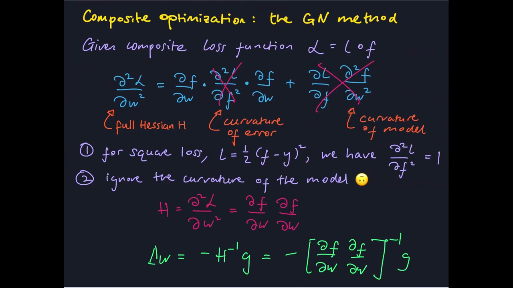
*▲ 강의 슬라이드 [26:10](https://youtu.be/VcGPE4s_oNw?t=1570): 가우스-뉴턴 분해와 두 가정(① 제곱 [손실](00_%EB%94%A5%EB%9F%AC%EB%8B%9D_%EC%9A%A9%EC%96%B4%EC%82%AC%EC%A0%84.md#loss-function-%EC%86%90%EC%8B%A4-%ED%95%A8%EC%88%98), ② 모델의 휘어짐 무시)*

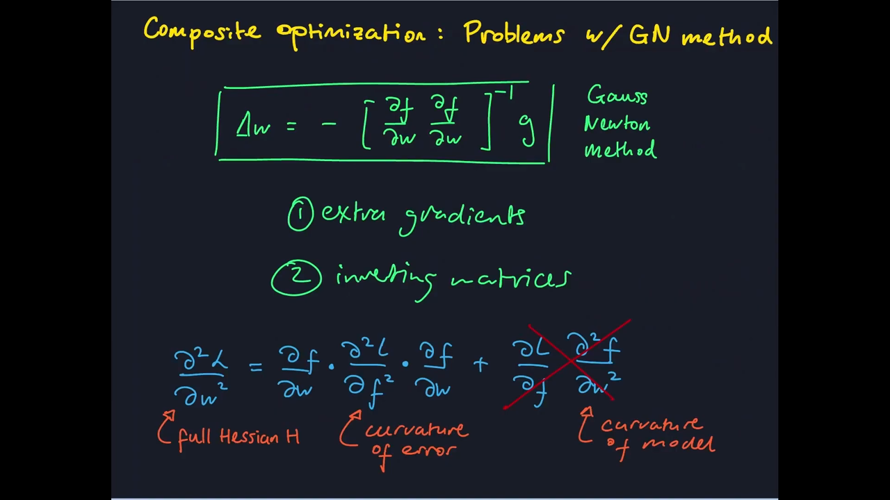
*▲ 강의 슬라이드 [32:55](https://youtu.be/VcGPE4s_oNw?t=1975): 가우스-뉴턴의 문제, ① 추가 [미분](00_%EB%94%A5%EB%9F%AC%EB%8B%9D_%EC%9A%A9%EC%96%B4%EC%82%AC%EC%A0%84.md#derivative-%EB%AF%B8%EB%B6%84) ② 역행렬*

**왜 실제로 안 쓰나**: ① 보통 [기울기](00_%EB%94%A5%EB%9F%AC%EB%8B%9D_%EC%9A%A9%EC%96%B4%EC%82%AC%EC%A0%84.md#gradient-%EA%B8%B0%EC%9A%B8%EA%B8%B0) 말고 **추가 [미분](00_%EB%94%A5%EB%9F%AC%EB%8B%9D_%EC%9A%A9%EC%96%B4%EC%82%AC%EC%A0%84.md#derivative-%EB%AF%B8%EB%B6%84)** $\partial f / \partial w$를 계산해야 하고, ② 행렬을 만들어 **역행렬**을 구해야 합니다. 큰 개선이 확실하지 않으면 사람들은 이 비용을 치르지 않습니다. 학생이 지적한 대로 $J^\top J$가 저랭크면 역행렬이 없어서, 보통 단위행렬을 조금 더해($J^\top J + \epsilon I$) 뒤집습니다.

질의응답 (요약) [28:33](https://youtu.be/VcGPE4s_oNw?t=1713)

- **Q. $\partial f / \partial w$는 [역전파](00_%EB%94%A5%EB%9F%AC%EB%8B%9D_%EC%9A%A9%EC%96%B4%EC%82%AC%EC%A0%84.md#backpropagation-%EC%97%AD%EC%A0%84%ED%8C%8C) 중에 이미 계산되지 않나?** [역전파](00_%EB%94%A5%EB%9F%AC%EB%8B%9D_%EC%9A%A9%EC%96%B4%EC%82%AC%EC%A0%84.md#backpropagation-%EC%97%AD%EC%A0%84%ED%8C%8C)는 끝(스칼라 [손실](00_%EB%94%A5%EB%9F%AC%EB%8B%9D_%EC%9A%A9%EC%96%B4%EC%82%AC%EC%A0%84.md#loss-function-%EC%86%90%EC%8B%A4-%ED%95%A8%EC%88%98))에서부터 거꾸로 오며 "[손실](00_%EB%94%A5%EB%9F%AC%EB%8B%9D_%EC%9A%A9%EC%96%B4%EC%82%AC%EC%A0%84.md#loss-function-%EC%86%90%EC%8B%A4-%ED%95%A8%EC%88%98)에 대한" [미분](00_%EB%94%A5%EB%9F%AC%EB%8B%9D_%EC%9A%A9%EC%96%B4%EC%82%AC%EC%A0%84.md#derivative-%EB%AF%B8%EB%B6%84)만 들고 다니므로, $\partial f / \partial w$를 따로 만들지 않는다. 출력이 [텐서](00_%EB%94%A5%EB%9F%AC%EB%8B%9D_%EC%9A%A9%EC%96%B4%EC%82%AC%EC%A0%84.md#tensor-%ED%85%90%EC%84%9C)면 $\partial f / \partial w$는 출력 성분마다 [가중치](00_%EB%94%A5%EB%9F%AC%EB%8B%9D_%EC%9A%A9%EC%96%B4%EC%82%AC%EC%A0%84.md#weight-%EA%B0%80%EC%A4%91%EC%B9%98) 전체에 대한 [미분](00_%EB%94%A5%EB%9F%AC%EB%8B%9D_%EC%9A%A9%EC%96%B4%EC%82%AC%EC%A0%84.md#derivative-%EB%AF%B8%EB%B6%84)이라 [기울기](00_%EB%94%A5%EB%9F%AC%EB%8B%9D_%EC%9A%A9%EC%96%B4%EC%82%AC%EC%A0%84.md#gradient-%EA%B8%B0%EC%9A%B8%EA%B8%B0)보다 훨씬 큰 [텐서](00_%EB%94%A5%EB%9F%AC%EB%8B%9D_%EC%9A%A9%EC%96%B4%EC%82%AC%EC%A0%84.md#tensor-%ED%85%90%EC%84%9C)다. [역전파](00_%EB%94%A5%EB%9F%AC%EB%8B%9D_%EC%9A%A9%EC%96%B4%EC%82%AC%EC%A0%84.md#backpropagation-%EC%97%AD%EC%A0%84%ED%8C%8C)는 바로 이것을 만들지 않게 해 준다. 전진 모드 [자동 미분](00_%EB%94%A5%EB%9F%AC%EB%8B%9D_%EC%9A%A9%EC%96%B4%EC%82%AC%EC%A0%84.md#autograd-%EC%9E%90%EB%8F%99-%EB%AF%B8%EB%B6%84)이면 얻을 수 있지만 훨씬 비싸다. [역전파](00_%EB%94%A5%EB%9F%AC%EB%8B%9D_%EC%9A%A9%EC%96%B4%EC%82%AC%EC%A0%84.md#backpropagation-%EC%97%AD%EC%A0%84%ED%8C%8C)를 직접 구현해 보면 이런 감이 생긴다.
- **Q. 역행렬은 얼마나 비싼가?** 대략 [특잇값 분해](00_%EB%94%A5%EB%9F%AC%EB%8B%9D_%EC%9A%A9%EC%96%B4%EC%82%AC%EC%A0%84.md#singular-value-decomposition-%ED%8A%B9%EC%9E%87%EA%B0%92-%EB%B6%84%ED%95%B4)와 비슷한 비용(세제곱)이라 [순전파](00_%EB%94%A5%EB%9F%AC%EB%8B%9D_%EC%9A%A9%EC%96%B4%EC%82%AC%EC%A0%84.md#feed-forward-%EC%88%9C%EC%A0%84%ED%8C%8C)·[역전파](00_%EB%94%A5%EB%9F%AC%EB%8B%9D_%EC%9A%A9%EC%96%B4%EC%82%AC%EC%A0%84.md#backpropagation-%EC%97%AD%EC%A0%84%ED%8C%8C)보다 훨씬 비싸다. Colab에서 직접 시간을 재 보면 금방 감이 온다.

---

## 6. 최급강하법

▶ 영상 [33:47](https://youtu.be/VcGPE4s_oNw?t=2027)

📐 **수학 개념**: [노름에 따른 최급강하법](%EC%88%98%ED%95%99%EA%B0%9C%EB%85%90/09_%EC%B5%9C%EC%A0%81%ED%99%94%EC%9D%98_%EA%B8%B0%ED%95%98/MM27_%EB%85%B8%EB%A6%84%EC%97%90_%EB%94%B0%EB%A5%B8_%EC%B5%9C%EA%B8%89%EA%B0%95%ED%95%98%EB%B2%95.md) · [노름](%EC%88%98%ED%95%99%EA%B0%9C%EB%85%90/03_%EC%84%A0%ED%98%95%EB%8C%80%EC%88%98/MM11_%EB%A6%BD%EC%8B%9C%EC%B8%A0_%EC%97%B0%EC%86%8D%EA%B3%BC_%EB%85%B8%EB%A6%84.md) · [argmin](%EC%88%98%ED%95%99%EA%B0%9C%EB%85%90/02_%EB%AF%B8%EB%B6%84/MM01_argmin%EA%B3%BC_argmax.md)

**[최급강하법](00_%EB%94%A5%EB%9F%AC%EB%8B%9D_%EC%9A%A9%EC%96%B4%EC%82%AC%EC%A0%84.md#steepest-descent-%EC%B5%9C%EA%B8%89%EA%B0%95%ED%95%98%EB%B2%95)(Steepest descent)**은 [테일러 전개](00_%EB%94%A5%EB%9F%AC%EB%8B%9D_%EC%9A%A9%EC%96%B4%EC%82%AC%EC%A0%84.md#taylor-expansion-%ED%85%8C%EC%9D%BC%EB%9F%AC-%EC%A0%84%EA%B0%9C)의 비선형 부분(정체를 모르는 부분)을 버리고, 대신 **잘 아는 것** $\frac{\lambda}{2}\lVert \Delta w \rVert^2$으로 바꿉니다. $\lambda$는 5 같은 숫자 하나이고, [노름](00_%EB%94%A5%EB%9F%AC%EB%8B%9D_%EC%9A%A9%EC%96%B4%EC%82%AC%EC%A0%84.md#norm-%EB%85%B8%EB%A6%84)은 마음에 드는 것을 고릅니다. 강사는 "모르는 것을 좋아하는 것으로 바꿔 치기"가 최적화 방법들의 흔한 방식이라고 말합니다.

$$
\mathcal{L}(w + \Delta w) \approx \mathcal{L}(w) + g^\top \Delta w + \frac{\lambda}{2}\, \lVert \Delta w \rVert^2
$$

기호 풀이

| 기호 | 읽는 법 | 뜻 | 예제 값 |
| --- | --- | --- | --- |
| $\approx$ | 근사 | 참 [손실](00_%EB%94%A5%EB%9F%AC%EB%8B%9D_%EC%9A%A9%EC%96%B4%EC%82%AC%EC%A0%84.md#loss-function-%EC%86%90%EC%8B%A4-%ED%95%A8%EC%88%98) 대신 쓰는 "모델" | - |
| $g$ | 지 | [기울기](00_%EB%94%A5%EB%9F%AC%EB%8B%9D_%EC%9A%A9%EC%96%B4%EC%82%AC%EC%A0%84.md#gradient-%EA%B8%B0%EC%9A%B8%EA%B8%B0) | (3, −1) |
| $\Delta w$ | 델타 더블유 | 걸음 | (−1.5, 0.5) |
| $\lambda$ | 람다 | 벌점의 세기. 클수록 작은 걸음 | 2 |
| $\lVert \Delta w \rVert$ | [노름](00_%EB%94%A5%EB%9F%AC%EB%8B%9D_%EC%9A%A9%EC%96%B4%EC%82%AC%EC%A0%84.md#norm-%EB%85%B8%EB%A6%84) | 걸음 크기를 재는 방법 (선택) | $L_2$이면 1.5811 |

예제와 풀이

**문제**: [기울기](00_%EB%94%A5%EB%9F%AC%EB%8B%9D_%EC%9A%A9%EC%96%B4%EC%82%AC%EC%A0%84.md#gradient-%EA%B8%B0%EC%9A%B8%EA%B8%B0) $g = (3, -1)$, 벌점 세기 $\lambda = 2$, 유클리드 노름일 때, 모델의 [손실](00_%EB%94%A5%EB%9F%AC%EB%8B%9D_%EC%9A%A9%EC%96%B4%EC%82%AC%EC%A0%84.md#loss-function-%EC%86%90%EC%8B%A4-%ED%95%A8%EC%88%98) 변화 부분 $g^\top \Delta w + \frac{\lambda}{2}\lVert \Delta w \rVert^2$를 가장 작게 만드는 걸음 $\Delta w = (a, b)$는?

**주어진 값**:
- $g = (3, -1)$ ([기울기](00_%EB%94%A5%EB%9F%AC%EB%8B%9D_%EC%9A%A9%EC%96%B4%EC%82%AC%EC%A0%84.md#gradient-%EA%B8%B0%EC%9A%B8%EA%B8%B0))
- $\lambda = 2$ (벌점 세기)
- $\lVert \Delta w \rVert^2 = a^2 + b^2$ (유클리드 [노름](00_%EB%94%A5%EB%9F%AC%EB%8B%9D_%EC%9A%A9%EC%96%B4%EC%82%AC%EC%A0%84.md#norm-%EB%85%B8%EB%A6%84)의 제곱: 성분 제곱의 합)

**풀이**
1. 식을 그대로 쓴다: $g^\top \Delta w + \frac{\lambda}{2}\lVert \Delta w \rVert^2$
2. 값을 대입한다: $(3 \cdot a + (-1) \cdot b) + \frac{2}{2}(a^2 + b^2)$
3. 나눗셈을 한다: $\frac22 = 1$ 이므로 $3a - b + a^2 + b^2$
4. $a$로 미분해 0으로 둔다: $3 + 2a = 0$ → $a = -3 \div 2 = -1.5$
5. $b$로 미분해 0으로 둔다: $-1 + 2b = 0$ → $b = 1 \div 2 = 0.5$
6. 1차 항을 구한다: $3 \times (-1.5) + (-1) \times 0.5 = -4.5 - 0.5 = -5$
7. 벌점을 구한다: $(-1.5)^2 + 0.5^2 = 2.25 + 0.25 = 2.5$
8. 더한다: $-5 + 2.5 = -2.5$

**답**: $\Delta w$ = **(−1.5, 0.5)** $= -g/\lambda$, [손실](00_%EB%94%A5%EB%9F%AC%EB%8B%9D_%EC%9A%A9%EC%96%B4%EC%82%AC%EC%A0%84.md#loss-function-%EC%86%90%EC%8B%A4-%ED%95%A8%EC%88%98) 변화 예측 **−2.5**

내 이해

학생들이 꼽은 [노름](00_%EB%94%A5%EB%9F%AC%EB%8B%9D_%EC%9A%A9%EC%96%B4%EC%82%AC%EC%A0%84.md#norm-%EB%85%B8%EB%A6%84): 유클리드($L_2$), 행렬이면 프로베니우스, 무한대 [노름](00_%EB%94%A5%EB%9F%AC%EB%8B%9D_%EC%9A%A9%EC%96%B4%EC%82%AC%EC%A0%84.md#norm-%EB%85%B8%EB%A6%84)(최댓값), $L_p$ [노름](00_%EB%94%A5%EB%9F%AC%EB%8B%9D_%EC%9A%A9%EC%96%B4%EC%82%AC%EC%A0%84.md#norm-%EB%85%B8%EB%A6%84)($p = 2$면 유클리드). [KL 발산](00_%EB%94%A5%EB%9F%AC%EB%8B%9D_%EC%9A%A9%EC%96%B4%EC%82%AC%EC%A0%84.md#kl-divergence-kl-%EB%B0%9C%EC%82%B0)은 거리처럼 쓰지만 대칭이 아니라 [노름](00_%EB%94%A5%EB%9F%AC%EB%8B%9D_%EC%9A%A9%EC%96%B4%EC%82%AC%EC%A0%84.md#norm-%EB%85%B8%EB%A6%84)이 아닙니다. **[노름](00_%EB%94%A5%EB%9F%AC%EB%8B%9D_%EC%9A%A9%EC%96%B4%EC%82%AC%EC%A0%84.md#norm-%EB%85%B8%EB%A6%84)이 많으니 [최급강하법](00_%EB%94%A5%EB%9F%AC%EB%8B%9D_%EC%9A%A9%EC%96%B4%EC%82%AC%EC%A0%84.md#steepest-descent-%EC%B5%9C%EA%B8%89%EA%B0%95%ED%95%98%EB%B2%95)도 많습니다.**

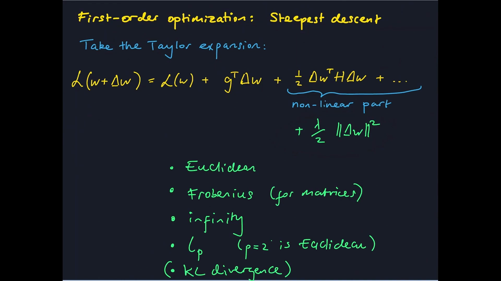
*▲ 강의 슬라이드 [36:25](https://youtu.be/VcGPE4s_oNw?t=2185): 비선형 부분을 $\frac{\lambda}{2}\lVert \Delta w \rVert^2$으로 바꾸고, [노름](00_%EB%94%A5%EB%9F%AC%EB%8B%9D_%EC%9A%A9%EC%96%B4%EC%82%AC%EC%A0%84.md#norm-%EB%85%B8%EB%A6%84) 후보를 모은 목록*

**두 가지 [노름](00_%EB%94%A5%EB%9F%AC%EB%8B%9D_%EC%9A%A9%EC%96%B4%EC%82%AC%EC%A0%84.md#norm-%EB%85%B8%EB%A6%84)의 답**

$$
L_2:\ \ \Delta w = -\frac{1}{\lambda}\, g, \qquad L_\infty:\ \ \Delta w = -\frac{\lVert g \rVert_1}{\lambda}\, \operatorname{sign}(g)
$$

기호 풀이

| 기호 | 읽는 법 | 뜻 | 예제 값 |
| --- | --- | --- | --- |
| $L_2$, $L_\infty$ | 엘투, 엘 무한대 | 걸음 크기를 유클리드 길이로 / 가장 큰 성분으로 잼 | - |
| $\frac{1}{\lambda}$ | 람다 분의 일 | [경사하강법](00_%EB%94%A5%EB%9F%AC%EB%8B%9D_%EC%9A%A9%EC%96%B4%EC%82%AC%EC%A0%84.md#gradient-descent-%EA%B2%BD%EC%82%AC%ED%95%98%EA%B0%95%EB%B2%95)의 [학습률](00_%EB%94%A5%EB%9F%AC%EB%8B%9D_%EC%9A%A9%EC%96%B4%EC%82%AC%EC%A0%84.md#learning-rate-%ED%95%99%EC%8A%B5%EB%A5%A0) 역할 | 0.5 |
| $\lVert g \rVert_1$ | 엘원 [노름](00_%EB%94%A5%EB%9F%AC%EB%8B%9D_%EC%9A%A9%EC%96%B4%EC%82%AC%EC%A0%84.md#norm-%EB%85%B8%EB%A6%84) | [기울기](00_%EB%94%A5%EB%9F%AC%EB%8B%9D_%EC%9A%A9%EC%96%B4%EC%82%AC%EC%A0%84.md#gradient-%EA%B8%B0%EC%9A%B8%EA%B8%B0) 성분 절댓값의 합 | 4 |
| $\operatorname{sign}(g)$ | 사인 | 성분마다 부호 ±1 | (1, −1) |
| $\Delta w$ | 델타 더블유 | 두 [노름](00_%EB%94%A5%EB%9F%AC%EB%8B%9D_%EC%9A%A9%EC%96%B4%EC%82%AC%EC%A0%84.md#norm-%EB%85%B8%EB%A6%84)의 걸음 | (−1.5, 0.5) / (−2, 2) |

예제와 풀이

**문제**: [기울기](00_%EB%94%A5%EB%9F%AC%EB%8B%9D_%EC%9A%A9%EC%96%B4%EC%82%AC%EC%A0%84.md#gradient-%EA%B8%B0%EC%9A%B8%EA%B8%B0) $g = (3, -1)$, 벌점 세기 $\lambda = 2$일 때 유클리드 [노름](00_%EB%94%A5%EB%9F%AC%EB%8B%9D_%EC%9A%A9%EC%96%B4%EC%82%AC%EC%A0%84.md#norm-%EB%85%B8%EB%A6%84)($L_2$)과 무한대 [노름](00_%EB%94%A5%EB%9F%AC%EB%8B%9D_%EC%9A%A9%EC%96%B4%EC%82%AC%EC%A0%84.md#norm-%EB%85%B8%EB%A6%84)($L_\infty$)의 최급강하 걸음을 구하라.

**주어진 값**:
- $g = (3, -1)$ ([기울기](00_%EB%94%A5%EB%9F%AC%EB%8B%9D_%EC%9A%A9%EC%96%B4%EC%82%AC%EC%A0%84.md#gradient-%EA%B8%B0%EC%9A%B8%EA%B8%B0)), $\lambda = 2$ (벌점 세기)
- $\lVert g \rVert_1$ (엘원 [노름](00_%EB%94%A5%EB%9F%AC%EB%8B%9D_%EC%9A%A9%EC%96%B4%EC%82%AC%EC%A0%84.md#norm-%EB%85%B8%EB%A6%84): 성분 절댓값의 합. 절댓값은 부호를 뗀 크기)
- $\operatorname{sign}$ (부호: 양수 +1, 음수 −1)

**풀이**
1. 식을 그대로 쓴다: $\Delta w_{L_2} = -\frac{1}{\lambda} g$, $\Delta w_{L_\infty} = -\frac{\lVert g \rVert_1}{\lambda}\operatorname{sign}(g)$
2. 값을 대입한다: $\Delta w_{L_2} = -\frac{1}{2}(3, -1)$, $\Delta w_{L_\infty} = -\frac{|3| + |-1|}{2}(\operatorname{sign}(3), \operatorname{sign}(-1))$
3. $L_2$ 걸음을 성분마다 곱한다: $-\frac12 \times 3 = -1.5$, $-\frac12 \times (-1) = 0.5$
4. 절댓값을 더한다: $3 + 1 = 4$
5. 부호를 구한다: $(1, -1)$ 이므로 $\Delta w_{L_\infty} = -\frac{4}{2}(1, -1)$
6. 나눗셈을 한다: $4 \div 2 = 2$ 이므로 $-2 \times (1, -1)$
7. 성분마다 곱한다: $-2 \times 1 = -2$, $-2 \times (-1) = 2$

**답**: $L_2$ **(−1.5, 0.5)** ([기울기](00_%EB%94%A5%EB%9F%AC%EB%8B%9D_%EC%9A%A9%EC%96%B4%EC%82%AC%EC%A0%84.md#gradient-%EA%B8%B0%EC%9A%B8%EA%B8%B0) 정반대), $L_\infty$ **(−2, 2)** (두 성분 크기가 같다)

내 이해

- $L_2$는 그냥 **[경사하강법](00_%EB%94%A5%EB%9F%AC%EB%8B%9D_%EC%9A%A9%EC%96%B4%EC%82%AC%EC%A0%84.md#gradient-descent-%EA%B2%BD%EC%82%AC%ED%95%98%EA%B0%95%EB%B2%95)**([학습률](00_%EB%94%A5%EB%9F%AC%EB%8B%9D_%EC%9A%A9%EC%96%B4%EC%82%AC%EC%A0%84.md#learning-rate-%ED%95%99%EC%8A%B5%EB%A5%A0) $1/\lambda$)입니다. 평범한 [경사하강법](00_%EB%94%A5%EB%9F%AC%EB%8B%9D_%EC%9A%A9%EC%96%B4%EC%82%AC%EC%A0%84.md#gradient-descent-%EA%B2%BD%EC%82%AC%ED%95%98%EA%B0%95%EB%B2%95)이 사실은 $L_2$ 기하를 가정하고 있었다는 뜻입니다.
- $L_\infty$는 **[부호 경사하강법](00_%EB%94%A5%EB%9F%AC%EB%8B%9D_%EC%9A%A9%EC%96%B4%EC%82%AC%EC%A0%84.md#sign-gradient-descent-%EB%B6%80%ED%98%B8-%EA%B2%BD%EC%82%AC%ED%95%98%EA%B0%95%EB%B2%95)(Sign gradient descent)**입니다. 모든 좌표를 같은 크기로 움직입니다(질의응답의 확인).

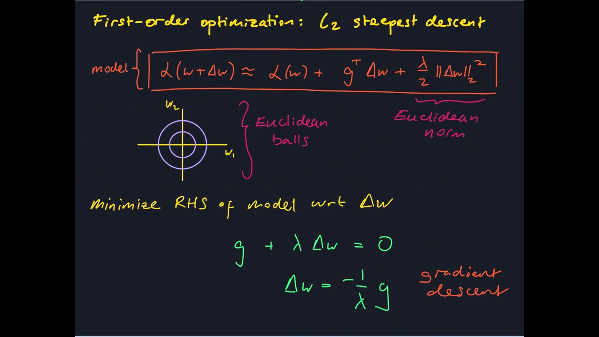
*▲ 강의 슬라이드 [38:20](https://youtu.be/VcGPE4s_oNw?t=2300): $L_2$ 최급강하, 미분해 0으로 두면 $\Delta w = -\frac{1}{\lambda}g$ ([경사하강법](00_%EB%94%A5%EB%9F%AC%EB%8B%9D_%EC%9A%A9%EC%96%B4%EC%82%AC%EC%A0%84.md#gradient-descent-%EA%B2%BD%EC%82%AC%ED%95%98%EA%B0%95%EB%B2%95))*

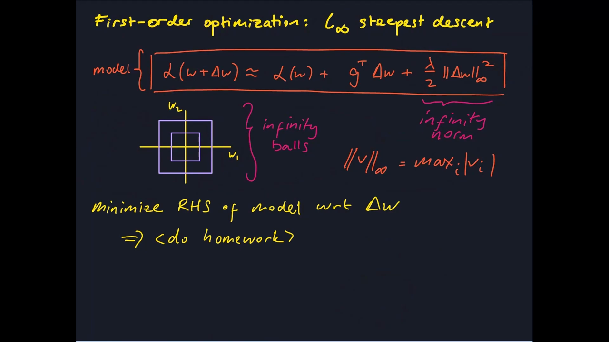
*▲ 강의 슬라이드 [39:10](https://youtu.be/VcGPE4s_oNw?t=2350): $L_\infty$ 최급강하, 무한대 [노름](00_%EB%94%A5%EB%9F%AC%EB%8B%9D_%EC%9A%A9%EC%96%B4%EC%82%AC%EC%A0%84.md#norm-%EB%85%B8%EB%A6%84)의 "공"은 정사각형*

**일반 [노름](00_%EB%94%A5%EB%9F%AC%EB%8B%9D_%EC%9A%A9%EC%96%B4%EC%82%AC%EC%A0%84.md#norm-%EB%85%B8%EB%A6%84)**에서도 답은 **걸음 크기**와 **방향**으로 깔끔하게 나뉩니다(과제 문제). 크기에 나오는 $\lVert g \rVert_\ast$를 **[쌍대 노름](00_%EB%94%A5%EB%9F%AC%EB%8B%9D_%EC%9A%A9%EC%96%B4%EC%82%AC%EC%A0%84.md#dual-norm-%EC%8C%8D%EB%8C%80-%EB%85%B8%EB%A6%84)([Dual norm](00_%EB%94%A5%EB%9F%AC%EB%8B%9D_%EC%9A%A9%EC%96%B4%EC%82%AC%EC%A0%84.md#dual-norm-%EC%8C%8D%EB%8C%80-%EB%85%B8%EB%A6%84))**이라 합니다. 모든 [노름](00_%EB%94%A5%EB%9F%AC%EB%8B%9D_%EC%9A%A9%EC%96%B4%EC%82%AC%EC%A0%84.md#norm-%EB%85%B8%EB%A6%84)에는 짝이 되는 [쌍대 노름](00_%EB%94%A5%EB%9F%AC%EB%8B%9D_%EC%9A%A9%EC%96%B4%EC%82%AC%EC%A0%84.md#dual-norm-%EC%8C%8D%EB%8C%80-%EB%85%B8%EB%A6%84)이 있습니다.

$$
\arg\min_{\Delta w}\left[g^\top \Delta w + \frac{\lambda}{2}\lVert \Delta w \rVert^2\right] = -\underbrace{\frac{\lVert g \rVert_\ast}{\lambda}}_{\text{걸음 크기}}\ \underbrace{\arg\max_{\lVert t \rVert = 1} g^\top t}_{\text{방향}}
$$

기호 풀이

| 기호 | 읽는 법 | 뜻 | 예제 값 ($L_1$ [노름](00_%EB%94%A5%EB%9F%AC%EB%8B%9D_%EC%9A%A9%EC%96%B4%EC%82%AC%EC%A0%84.md#norm-%EB%85%B8%EB%A6%84)) |
| --- | --- | --- | --- |
| $\lVert g \rVert_\ast$ | 지의 [쌍대 노름](00_%EB%94%A5%EB%9F%AC%EB%8B%9D_%EC%9A%A9%EC%96%B4%EC%82%AC%EC%A0%84.md#dual-norm-%EC%8C%8D%EB%8C%80-%EB%85%B8%EB%A6%84) | $\max_{\lVert t \rVert = 1} g^\top t$ | 3 |
| $t$ | 티 | 크기 1인 후보 방향 | (1, 0) |
| $\arg\max_{\lVert t \rVert = 1} g^\top t$ | 아그맥스 | [기울기](00_%EB%94%A5%EB%9F%AC%EB%8B%9D_%EC%9A%A9%EC%96%B4%EC%82%AC%EC%A0%84.md#gradient-%EA%B8%B0%EC%9A%B8%EA%B8%B0)와 가장 잘 맞는 크기 1 방향 | (1, 0) |
| $-$ | 마이너스 | 내려가는 쪽 (슬라이드에서는 생략됨) | - |
| 결과 | - | 최급강하 걸음 | (−1.5, 0) |

예제와 풀이

**문제**: [기울기](00_%EB%94%A5%EB%9F%AC%EB%8B%9D_%EC%9A%A9%EC%96%B4%EC%82%AC%EC%A0%84.md#gradient-%EA%B8%B0%EC%9A%B8%EA%B8%B0) $g = (3, -1)$, 벌점 세기 $\lambda = 2$이고 걸음 크기를 $L_1$ [노름](00_%EB%94%A5%EB%9F%AC%EB%8B%9D_%EC%9A%A9%EC%96%B4%EC%82%AC%EC%A0%84.md#norm-%EB%85%B8%EB%A6%84)(성분 절댓값의 합)으로 잴 때, 일반 공식으로 걸음을 구하라.

**주어진 값**:
- $g = (3, -1)$ ([기울기](00_%EB%94%A5%EB%9F%AC%EB%8B%9D_%EC%9A%A9%EC%96%B4%EC%82%AC%EC%A0%84.md#gradient-%EA%B8%B0%EC%9A%B8%EA%B8%B0)), $\lambda = 2$ (벌점 세기)
- $t$ 후보 = $(1, 0), (-1, 0), (0, 1), (0, -1)$ ($L_1$ [노름](00_%EB%94%A5%EB%9F%AC%EB%8B%9D_%EC%9A%A9%EC%96%B4%EC%82%AC%EC%A0%84.md#norm-%EB%85%B8%EB%A6%84)이 1인 꼭짓점 방향)

**풀이**
1. 식을 그대로 쓴다: $\Delta w = -\frac{\lVert g \rVert_\ast}{\lambda}\, t^\ast$, $\lVert g \rVert_\ast = \max_t g^\top t$
2. 값을 대입한다: $\lVert g \rVert_\ast = \max\big(3 \cdot 1 + (-1) \cdot 0,\ 3 \cdot (-1) + (-1) \cdot 0,\ 3 \cdot 0 + (-1) \cdot 1,\ 3 \cdot 0 + (-1) \cdot (-1)\big)$
3. [내적](00_%EB%94%A5%EB%9F%AC%EB%8B%9D_%EC%9A%A9%EC%96%B4%EC%82%AC%EC%A0%84.md#dot-product-%EB%82%B4%EC%A0%81)을 하나씩 계산한다: $3$, $-3$, $-1$, $1$
4. 가장 큰 값을 고른다: $3$, 그 방향 $t^\ast = (1, 0)$ 이므로 $\Delta w = -\frac{3}{2}(1, 0)$
5. 나눗셈을 한다: $3 \div 2 = 1.5$ 이므로 $-1.5 \times (1, 0)$
6. 성분마다 곱한다: $-1.5 \times 1 = -1.5$, $-1.5 \times 0 = 0$

**답**: **(−1.5, 0)**. $L_1$ [노름](00_%EB%94%A5%EB%9F%AC%EB%8B%9D_%EC%9A%A9%EC%96%B4%EC%82%AC%EC%A0%84.md#norm-%EB%85%B8%EB%A6%84)에서는 가장 큰 [기울기](00_%EB%94%A5%EB%9F%AC%EB%8B%9D_%EC%9A%A9%EC%96%B4%EC%82%AC%EC%A0%84.md#gradient-%EA%B8%B0%EC%9A%B8%EA%B8%B0) 성분 하나만 움직인다.

내 이해

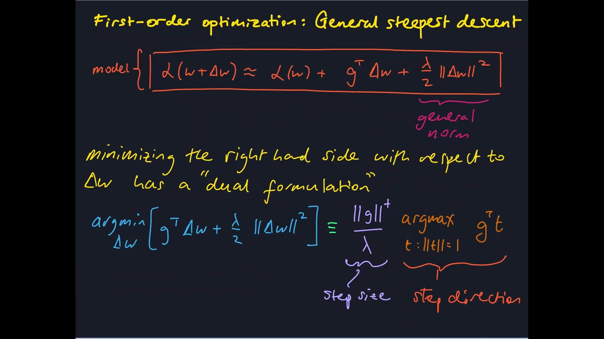
*▲ 강의 슬라이드 [42:00](https://youtu.be/VcGPE4s_oNw?t=2520): 일반 최급강하의 "쌍대 형식", 걸음 크기와 걸음 방향으로 나뉜다*

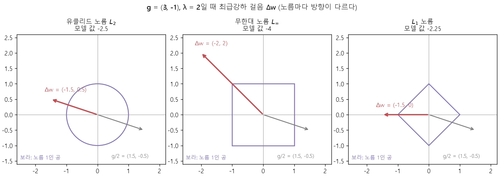
*▲ 직접 그린 그림: 같은 [기울기](00_%EB%94%A5%EB%9F%AC%EB%8B%9D_%EC%9A%A9%EC%96%B4%EC%82%AC%EC%A0%84.md#gradient-%EA%B8%B0%EC%9A%B8%EA%B8%B0) $g = (3, -1)$, $\lambda = 2$라도 [노름](00_%EB%94%A5%EB%9F%AC%EB%8B%9D_%EC%9A%A9%EC%96%B4%EC%82%AC%EC%A0%84.md#norm-%EB%85%B8%EB%A6%84)에 따라 걸음 방향이 다르다. $L_2$는 (−1.5, 0.5), $L_\infty$는 (−2, 2), $L_1$은 (−1.5, 0) (숫자는 [MM27_노름에_따른_최급강하법](%EC%88%98%ED%95%99%EA%B0%9C%EB%85%90/09_%EC%B5%9C%EC%A0%81%ED%99%94%EC%9D%98_%EA%B8%B0%ED%95%98/MM27_%EB%85%B8%EB%A6%84%EC%97%90_%EB%94%B0%EB%A5%B8_%EC%B5%9C%EA%B8%89%EA%B0%95%ED%95%98%EB%B2%95.md) 3절 표와 같음)*

**보장이 있나?** 학생 질문대로 이렇게 고른 걸음에서 원래 [손실](00_%EB%94%A5%EB%9F%AC%EB%8B%9D_%EC%9A%A9%EC%96%B4%EC%82%AC%EC%A0%84.md#loss-function-%EC%86%90%EC%8B%A4-%ED%95%A8%EC%88%98)이 정말 줄어든다는 보장은 없습니다. 비선형 부분을 마음대로 바꿨기 때문입니다. $\lambda$를 아주 크게 잡으면 거의 안 움직이니 선형 근사가 맞겠지만, 얼마나 커야 하는지 모릅니다. 강사가 제안하는 길은 비선형 부분의 **상한**이 되는 $\lambda$와 [노름](00_%EB%94%A5%EB%9F%AC%EB%8B%9D_%EC%9A%A9%EC%96%B4%EC%82%AC%EC%A0%84.md#norm-%EB%85%B8%EB%A6%84)을 찾는 것입니다. 그러면 모델을 줄이는 걸음이 실제 [손실](00_%EB%94%A5%EB%9F%AC%EB%8B%9D_%EC%9A%A9%EC%96%B4%EC%82%AC%EC%A0%84.md#loss-function-%EC%86%90%EC%8B%A4-%ED%95%A8%EC%88%98)도 줄인다는 보장이 생깁니다. 선형 모델과 제곱 [손실](00_%EB%94%A5%EB%9F%AC%EB%8B%9D_%EC%9A%A9%EC%96%B4%EC%82%AC%EC%A0%84.md#loss-function-%EC%86%90%EC%8B%A4-%ED%95%A8%EC%88%98)에서는 과제(보너스)로 직접 해 보고, 2층·5층 신경망으로 넓히는 것이 강사의 연구 주제입니다.

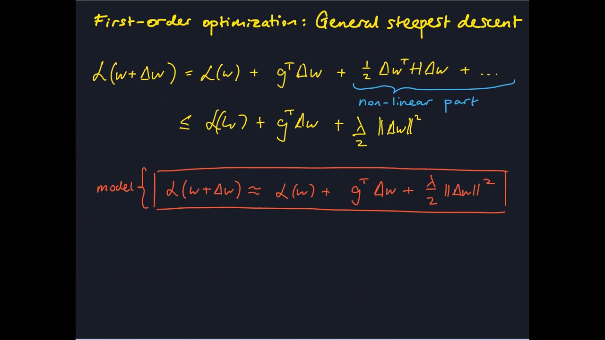
*▲ 강의 슬라이드 [45:00](https://youtu.be/VcGPE4s_oNw?t=2700): [테일러 전개](00_%EB%94%A5%EB%9F%AC%EB%8B%9D_%EC%9A%A9%EC%96%B4%EC%82%AC%EC%A0%84.md#taylor-expansion-%ED%85%8C%EC%9D%BC%EB%9F%AC-%EC%A0%84%EA%B0%9C)를 $\mathcal{L}(w) + g^\top\Delta w + \frac{\lambda}{2}\lVert \Delta w \rVert^2$로 위에서 누를 수 있다면 보장이 생긴다*

**왜 유클리드가 아닌 [노름](00_%EB%94%A5%EB%9F%AC%EB%8B%9D_%EC%9A%A9%EC%96%B4%EC%82%AC%EC%A0%84.md#norm-%EB%85%B8%EB%A6%84)을 쓰나** [47:56](https://youtu.be/VcGPE4s_oNw?t=2876)

- 미국 지도를 포토샵에서 한쪽으로 찌그러뜨렸다고 하자. 지도 위 1cm가 동서로는 수천 km, 남북으로는 10km일 수 있다. "[기울기](00_%EB%94%A5%EB%9F%AC%EB%8B%9D_%EC%9A%A9%EC%96%B4%EC%82%AC%EC%A0%84.md#gradient-%EA%B8%B0%EC%9A%B8%EA%B8%B0) 방향으로 가는 게 당연하다"는 생각은 축척이 모든 방향으로 같은 지도를 가정한 것이다.
- 신경망은 구조 때문에 [가중치](00_%EB%94%A5%EB%9F%AC%EB%8B%9D_%EC%9A%A9%EC%96%B4%EC%82%AC%EC%A0%84.md#weight-%EA%B0%80%EC%A4%91%EC%B9%98) 공간의 방향들이 서로 대등하지 않을 수 있다. 좌표마다 다른 상수를 곱한 [노름](00_%EB%94%A5%EB%9F%AC%EB%8B%9D_%EC%9A%A9%EC%96%B4%EC%82%AC%EC%A0%84.md#norm-%EB%85%B8%EB%A6%84) $\sum_i c_i w_i^2$을 쓰면 [기울기](00_%EB%94%A5%EB%9F%AC%EB%8B%9D_%EC%9A%A9%EC%96%B4%EC%82%AC%EC%A0%84.md#gradient-%EA%B8%B0%EC%9A%B8%EA%B8%B0)를 좌표마다 다르게 늘이고 줄이는 [전처리](00_%EB%94%A5%EB%9F%AC%EB%8B%9D_%EC%9A%A9%EC%96%B4%EC%82%AC%EC%A0%84.md#preconditioning-%EC%A0%84%EC%B2%98%EB%A6%AC)가 되고, 무한대 [노름](00_%EB%94%A5%EB%9F%AC%EB%8B%9D_%EC%9A%A9%EC%96%B4%EC%82%AC%EC%A0%84.md#norm-%EB%85%B8%EB%A6%84)이나 [프로베니우스 노름](00_%EB%94%A5%EB%9F%AC%EB%8B%9D_%EC%9A%A9%EC%96%B4%EC%82%AC%EC%A0%84.md#frobenius-norm-%ED%94%84%EB%A1%9C%EB%B2%A0%EB%8B%88%EC%9A%B0%EC%8A%A4-%EB%85%B8%EB%A6%84)도 방향마다 다른 가중을 주는 방법이다.
- 다른 직관: 1차 근사가 **얼마나 멀리까지 맞는지**는 방향마다 다를 수 있다. [노름](00_%EB%94%A5%EB%9F%AC%EB%8B%9D_%EC%9A%A9%EC%96%B4%EC%82%AC%EC%A0%84.md#norm-%EB%85%B8%EB%A6%84)은 "어느 방향으로 가면 선형 근사가 얼마나 빨리 무너지나"를 담으려는 것이다.

> [!TIP]
> **🆕 2026 업데이트: [Adam](00_%EB%94%A5%EB%9F%AC%EB%8B%9D_%EC%9A%A9%EC%96%B4%EC%82%AC%EC%A0%84.md#adam-%EC%95%84%EB%8B%B4-%EC%98%B5%ED%8B%B0%EB%A7%88%EC%9D%B4%EC%A0%80)도 "어떤 [노름](00_%EB%94%A5%EB%9F%AC%EB%8B%9D_%EC%9A%A9%EC%96%B4%EC%82%AC%EC%A0%84.md#norm-%EB%85%B8%EB%A6%84)의 [최급강하법](00_%EB%94%A5%EB%9F%AC%EB%8B%9D_%EC%9A%A9%EC%96%B4%EC%82%AC%EC%A0%84.md#steepest-descent-%EC%B5%9C%EA%B8%89%EA%B0%95%ED%95%98%EB%B2%95)"이다**
> - **강의**: [노름](00_%EB%94%A5%EB%9F%AC%EB%8B%9D_%EC%9A%A9%EC%96%B4%EC%82%AC%EC%A0%84.md#norm-%EB%85%B8%EB%A6%84)을 고르면 [최급강하법](00_%EB%94%A5%EB%9F%AC%EB%8B%9D_%EC%9A%A9%EC%96%B4%EC%82%AC%EC%A0%84.md#steepest-descent-%EC%B5%9C%EA%B8%89%EA%B0%95%ED%95%98%EB%B2%95)이 나오고, 실제로는 [Adam](00_%EB%94%A5%EB%9F%AC%EB%8B%9D_%EC%9A%A9%EC%96%B4%EC%82%AC%EC%A0%84.md#adam-%EC%95%84%EB%8B%B4-%EC%98%B5%ED%8B%B0%EB%A7%88%EC%9D%B4%EC%A0%80)을 쓴다(둘의 관계는 따로 말하지 않음).
> - **현재**: 강사 본인이 Laker Newhouse와 쓴 논문(2024)은 [Adam](00_%EB%94%A5%EB%9F%AC%EB%8B%9D_%EC%9A%A9%EC%96%B4%EC%82%AC%EC%A0%84.md#adam-%EC%95%84%EB%8B%B4-%EC%98%B5%ED%8B%B0%EB%A7%88%EC%9D%B4%EC%A0%80), [Shampoo](00_%EB%94%A5%EB%9F%AC%EB%8B%9D_%EC%9A%A9%EC%96%B4%EC%82%AC%EC%A0%84.md#shampoo-%EC%83%B4%ED%91%B8-%EC%98%B5%ED%8B%B0%EB%A7%88%EC%9D%B4%EC%A0%80), Prodigy가 [지수 이동 평균](00_%EB%94%A5%EB%9F%AC%EB%8B%9D_%EC%9A%A9%EC%96%B4%EC%82%AC%EC%A0%84.md#exponential-moving-average-%EC%A7%80%EC%88%98-%EC%9D%B4%EB%8F%99-%ED%8F%89%EA%B7%A0)(EMA)을 끄면 **각각 특정 [노름](00_%EB%94%A5%EB%9F%AC%EB%8B%9D_%EC%9A%A9%EC%96%B4%EC%82%AC%EC%A0%84.md#norm-%EB%85%B8%EB%A6%84) 아래의 [최급강하법](00_%EB%94%A5%EB%9F%AC%EB%8B%9D_%EC%9A%A9%EC%96%B4%EC%82%AC%EC%A0%84.md#steepest-descent-%EC%B5%9C%EA%B8%89%EA%B0%95%ED%95%98%EB%B2%95)과 같다**고 보였다. 예를 들어 EMA 없는 [Adam](00_%EB%94%A5%EB%9F%AC%EB%8B%9D_%EC%9A%A9%EC%96%B4%EC%82%AC%EC%A0%84.md#adam-%EC%95%84%EB%8B%B4-%EC%98%B5%ED%8B%B0%EB%A7%88%EC%9D%B4%EC%A0%80)은 위의 $L_\infty$ 최급강하, 즉 [부호 경사하강법](00_%EB%94%A5%EB%9F%AC%EB%8B%9D_%EC%9A%A9%EC%96%B4%EC%82%AC%EC%A0%84.md#sign-gradient-descent-%EB%B6%80%ED%98%B8-%EA%B2%BD%EC%82%AC%ED%95%98%EA%B0%95%EB%B2%95)이 된다. 그래서 이 방법들을 "근사 2차 방법"이 아니라 "볼록성 가정 없는 1차 방법"으로 이해할 수 있고, [텐서](00_%EB%94%A5%EB%9F%AC%EB%8B%9D_%EC%9A%A9%EC%96%B4%EC%82%AC%EC%A0%84.md#tensor-%ED%85%90%EC%84%9C)마다 그 역할에 맞는 연산자 [노름](00_%EB%94%A5%EB%9F%AC%EB%8B%9D_%EC%9A%A9%EC%96%B4%EC%82%AC%EC%A0%84.md#norm-%EB%85%B8%EB%A6%84)을 주자고 제안한다(아래 8절 업데이트의 [Muon](00_%EB%94%A5%EB%9F%AC%EB%8B%9D_%EC%9A%A9%EC%96%B4%EC%82%AC%EC%A0%84.md#muon-%EB%AE%A4%EC%98%A8-%EC%98%B5%ED%8B%B0%EB%A7%88%EC%9D%B4%EC%A0%80)으로 이어짐).
> - **출처**: [Bernstein & Newhouse, Old Optimizer, New Norm: An Anthology (arXiv, 2024)](https://arxiv.org/abs/2409.20325)

질의응답 (요약) [45:40](https://youtu.be/VcGPE4s_oNw?t=2740)

- **Q. 무한대 [노름](00_%EB%94%A5%EB%9F%AC%EB%8B%9D_%EC%9A%A9%EC%96%B4%EC%82%AC%EC%A0%84.md#norm-%EB%85%B8%EB%A6%84)이면 모든 좌표를 같은 크기로 갱신하나?** 그렇다. 부호 함수는 벡터를 모든 성분 크기가 같은 벡터로 바꾼다.
- **Q. 유클리드 [노름](00_%EB%94%A5%EB%9F%AC%EB%8B%9D_%EC%9A%A9%EC%96%B4%EC%82%AC%EC%A0%84.md#norm-%EB%85%B8%EB%A6%84)이면 [기울기](00_%EB%94%A5%EB%9F%AC%EB%8B%9D_%EC%9A%A9%EC%96%B4%EC%82%AC%EC%A0%84.md#gradient-%EA%B8%B0%EC%9A%B8%EA%B8%B0) 방향이 최선인 게 직관적인데, 왜 다른 [노름](00_%EB%94%A5%EB%9F%AC%EB%8B%9D_%EC%9A%A9%EC%96%B4%EC%82%AC%EC%A0%84.md#norm-%EB%85%B8%EB%A6%84)을 쓰나?** "[기울기](00_%EB%94%A5%EB%9F%AC%EB%8B%9D_%EC%9A%A9%EC%96%B4%EC%82%AC%EC%A0%84.md#gradient-%EA%B8%B0%EC%9A%B8%EA%B8%B0) 방향이 최선"이라는 생각 자체가 유클리드를 가정한 것이다. 위 지도 비유 참고.
- **Q. [노름](00_%EB%94%A5%EB%9F%AC%EB%8B%9D_%EC%9A%A9%EC%96%B4%EC%82%AC%EC%A0%84.md#norm-%EB%85%B8%EB%A6%84)을 다르게 쓰는 것은 좌표마다 다른 비율로 조정하는 [전처리](00_%EB%94%A5%EB%9F%AC%EB%8B%9D_%EC%9A%A9%EC%96%B4%EC%82%AC%EC%A0%84.md#preconditioning-%EC%A0%84%EC%B2%98%EB%A6%AC) 행렬과 같은가?** 그것도 한 예다. 좌표마다 양의 상수를 곱한 [노름](00_%EB%94%A5%EB%9F%AC%EB%8B%9D_%EC%9A%A9%EC%96%B4%EC%82%AC%EC%A0%84.md#norm-%EB%85%B8%EB%A6%84)을 만들면 그런 [전처리](00_%EB%94%A5%EB%9F%AC%EB%8B%9D_%EC%9A%A9%EC%96%B4%EC%82%AC%EC%A0%84.md#preconditioning-%EC%A0%84%EC%B2%98%EB%A6%AC)가 된다. 하지만 무한대 [노름](00_%EB%94%A5%EB%9F%AC%EB%8B%9D_%EC%9A%A9%EC%96%B4%EC%82%AC%EC%A0%84.md#norm-%EB%85%B8%EB%A6%84), [프로베니우스 노름](00_%EB%94%A5%EB%9F%AC%EB%8B%9D_%EC%9A%A9%EC%96%B4%EC%82%AC%EC%A0%84.md#frobenius-norm-%ED%94%84%EB%A1%9C%EB%B2%A0%EB%8B%88%EC%9A%B0%EC%8A%A4-%EB%85%B8%EB%A6%84)처럼 다른 예도 많다.

---

## 7. 업데이트 크기와 행렬 노름

▶ 영상 [50:50](https://youtu.be/VcGPE4s_oNw?t=3050)

📐 **수학 개념**: [스펙트럼 노름과 RMS 연산자 노름](%EC%88%98%ED%95%99%EA%B0%9C%EB%85%90/09_%EC%B5%9C%EC%A0%81%ED%99%94%EC%9D%98_%EA%B8%B0%ED%95%98/MM28_%EC%8A%A4%ED%8E%99%ED%8A%B8%EB%9F%BC_%EB%85%B8%EB%A6%84%EA%B3%BC_RMS_%EC%97%B0%EC%82%B0%EC%9E%90_%EB%85%B8%EB%A6%84.md) · [랭크와 특잇값](%EC%88%98%ED%95%99%EA%B0%9C%EB%85%90/04_%ED%99%95%EB%A5%A0%EA%B3%BC_%EC%A0%95%EB%B3%B4/MM25_%EB%9E%AD%ED%81%AC%EC%99%80_%EC%9C%A0%ED%9A%A8_%EB%9E%AD%ED%81%AC.md)

이제 스케일링으로 돌아갑니다. [경사하강법](00_%EB%94%A5%EB%9F%AC%EB%8B%9D_%EC%9A%A9%EC%96%B4%EC%82%AC%EC%A0%84.md#gradient-descent-%EA%B2%BD%EC%82%AC%ED%95%98%EA%B0%95%EB%B2%95)의 업데이트는 얼마나 커야 할까요? 너무 크면 신경망이 망가지고, 너무 작으면 [학습](00_%EB%94%A5%EB%9F%AC%EB%8B%9D_%EC%9A%A9%EC%96%B4%EC%82%AC%EC%A0%84.md#training-%ED%95%99%EC%8A%B5)이 느립니다. 그 사이의 "골디락스" 크기를 원합니다.

- **"크다, 작다"는 늘 "어떤 [노름](00_%EB%94%A5%EB%9F%AC%EB%8B%9D_%EC%9A%A9%EC%96%B4%EC%82%AC%EC%A0%84.md#norm-%EB%85%B8%EB%A6%84)으로?"를 물어야 한다.** 지도 아래의 축척(5cm = 1마일)처럼 기준이 있어야 크기를 말할 수 있다. [텐서](00_%EB%94%A5%EB%9F%AC%EB%8B%9D_%EC%9A%A9%EC%96%B4%EC%82%AC%EC%A0%84.md#tensor-%ED%85%90%EC%84%9C)에서 그 기준이 [노름](00_%EB%94%A5%EB%9F%AC%EB%8B%9D_%EC%9A%A9%EC%96%B4%EC%82%AC%EC%A0%84.md#norm-%EB%85%B8%EB%A6%84)이다.
- 관찰: 신경망은 벡터 하나가 아니라 **[가중치](00_%EB%94%A5%EB%9F%AC%EB%8B%9D_%EC%9A%A9%EC%96%B4%EC%82%AC%EC%A0%84.md#weight-%EA%B0%80%EC%A4%91%EC%B9%98) 행렬**들(행렬 1, 행렬 2, ...)로 되어 있다. 그러니 **행렬 [노름](00_%EB%94%A5%EB%9F%AC%EB%8B%9D_%EC%9A%A9%EC%96%B4%EC%82%AC%EC%A0%84.md#norm-%EB%85%B8%EB%A6%84)**을 써 보자.

행렬 [노름](00_%EB%94%A5%EB%9F%AC%EB%8B%9D_%EC%9A%A9%EC%96%B4%EC%82%AC%EC%A0%84.md#norm-%EB%85%B8%EB%A6%84)은 여러 가지입니다. **[프로베니우스 노름](00_%EB%94%A5%EB%9F%AC%EB%8B%9D_%EC%9A%A9%EC%96%B4%EC%82%AC%EC%A0%84.md#frobenius-norm-%ED%94%84%EB%A1%9C%EB%B2%A0%EB%8B%88%EC%9A%B0%EC%8A%A4-%EB%85%B8%EB%A6%84)**(성분 제곱합의 제곱근), 학생이 말한 **[스펙트럼 노름](00_%EB%94%A5%EB%9F%AC%EB%8B%9D_%EC%9A%A9%EC%96%B4%EC%82%AC%EC%A0%84.md#spectral-norm-%EC%8A%A4%ED%8E%99%ED%8A%B8%EB%9F%BC-%EB%85%B8%EB%A6%84)**(가장 큰 특잇값), 핵 [노름](00_%EB%94%A5%EB%9F%AC%EB%8B%9D_%EC%9A%A9%EC%96%B4%EC%82%AC%EC%A0%84.md#norm-%EB%85%B8%EB%A6%84), 이들을 묶는 샤텐 p-노름. 성분이 많은 만큼 크기를 재는 방법도 많은 것이 자연스럽습니다. 강사는 "3년 전까지는 나도 프로베니우스 노름밖에 몰랐다"고 덧붙입니다.

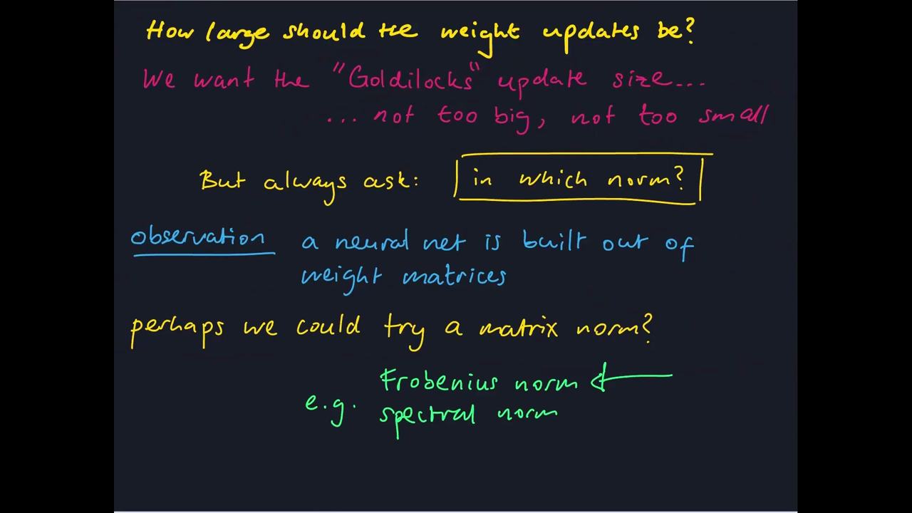
*▲ 강의 슬라이드 [53:35](https://youtu.be/VcGPE4s_oNw?t=3215): 업데이트는 너무 크지도 작지도 않게, 단 "어떤 [노름](00_%EB%94%A5%EB%9F%AC%EB%8B%9D_%EC%9A%A9%EC%96%B4%EC%82%AC%EC%A0%84.md#norm-%EB%85%B8%EB%A6%84)으로?"를 늘 묻는다*

**신경망을 보는 세 관점**

1. **뉴런 관점**: 노드와 엣지.
2. **[텐서](00_%EB%94%A5%EB%9F%AC%EB%8B%9D_%EC%9A%A9%EC%96%B4%EC%82%AC%EC%A0%84.md#tensor-%ED%85%90%EC%84%9C) 관점**: [가중치](00_%EB%94%A5%EB%9F%AC%EB%8B%9D_%EC%9A%A9%EC%96%B4%EC%82%AC%EC%A0%84.md#weight-%EA%B0%80%EC%A4%91%EC%B9%98) 행렬과 [행렬 곱](00_%EB%94%A5%EB%9F%AC%EB%8B%9D_%EC%9A%A9%EC%96%B4%EC%82%AC%EC%A0%84.md#matrix-multiplication-%ED%96%89%EB%A0%AC-%EA%B3%B1), 그 사이의 [ReLU](00_%EB%94%A5%EB%9F%AC%EB%8B%9D_%EC%9A%A9%EC%96%B4%EC%82%AC%EC%A0%84.md#relu-%EB%A0%90%EB%A3%A8).
3. **스펙트럼 관점**: 모든 [가중치](00_%EB%94%A5%EB%9F%AC%EB%8B%9D_%EC%9A%A9%EC%96%B4%EC%82%AC%EC%A0%84.md#weight-%EA%B0%80%EC%A4%91%EC%B9%98) 행렬을 **[특잇값 분해](00_%EB%94%A5%EB%9F%AC%EB%8B%9D_%EC%9A%A9%EC%96%B4%EC%82%AC%EC%A0%84.md#singular-value-decomposition-%ED%8A%B9%EC%9E%87%EA%B0%92-%EB%B6%84%ED%95%B4)(SVD)**로 쪼개 본다. [고윳값](00_%EB%94%A5%EB%9F%AC%EB%8B%9D_%EC%9A%A9%EC%96%B4%EC%82%AC%EC%A0%84.md#eigenvector-eigenvalue-%EA%B3%A0%EC%9C%A0%EB%B2%A1%ED%84%B0%EC%99%80-%EA%B3%A0%EC%9C%B3%EA%B0%92) 분해는 모든 행렬에 있지 않지만 SVD는 늘 있다. 실제로 SVD로 학습하자는 것이 아니라, 머릿속으로 늘 그렇게 볼 수 있다는 뜻이다.

강사가 생각하는 안정적 [학습](00_%EB%94%A5%EB%9F%AC%EB%8B%9D_%EC%9A%A9%EC%96%B4%EC%82%AC%EC%A0%84.md#training-%ED%95%99%EC%8A%B5): 걸음마다 **특잇값들이 너무 크게 바뀌지도, 너무 조금 바뀌지도 않는 것**.

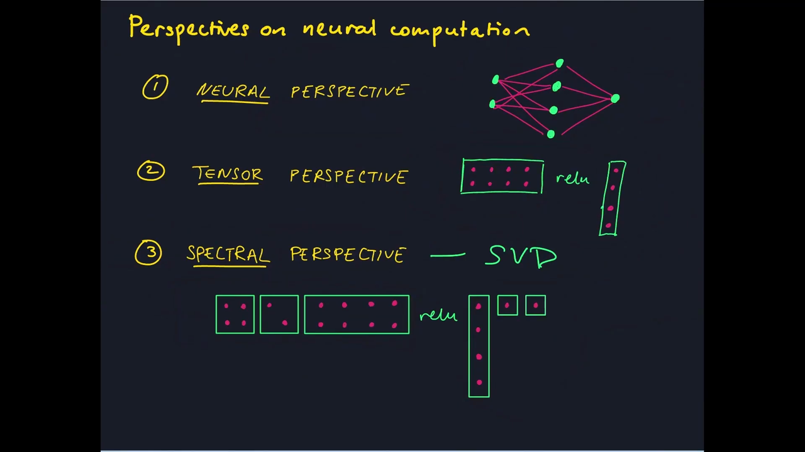
*▲ 강의 슬라이드 [55:50](https://youtu.be/VcGPE4s_oNw?t=3350): 신경망을 보는 세 관점(뉴런, [텐서](00_%EB%94%A5%EB%9F%AC%EB%8B%9D_%EC%9A%A9%EC%96%B4%EC%82%AC%EC%A0%84.md#tensor-%ED%85%90%EC%84%9C), 스펙트럼)*

**[스펙트럼 노름](00_%EB%94%A5%EB%9F%AC%EB%8B%9D_%EC%9A%A9%EC%96%B4%EC%82%AC%EC%A0%84.md#spectral-norm-%EC%8A%A4%ED%8E%99%ED%8A%B8%EB%9F%BC-%EB%85%B8%EB%A6%84)**은 "길이 1인 벡터를 행렬에 넣으면 출력이 최대 얼마나 길어질 수 있나"입니다. 신경망은 실제로 벡터를 행렬에 넣고 벡터를 내보내니, [학습](00_%EB%94%A5%EB%9F%AC%EB%8B%9D_%EC%9A%A9%EC%96%B4%EC%82%AC%EC%A0%84.md#training-%ED%95%99%EC%8A%B5) 중에 일어나는 일을 그대로 묘사하는 [노름](00_%EB%94%A5%EB%9F%AC%EB%8B%9D_%EC%9A%A9%EC%96%B4%EC%82%AC%EC%A0%84.md#norm-%EB%85%B8%EB%A6%84)입니다.

$$
\lVert M \rVert_\ast = \max_{v:\ \lVert v \rVert_2 = 1} \lVert Mv \rVert_2 = \sigma_{\max}(M)
$$

기호 풀이

| 기호 | 읽는 법 | 뜻 | 예제 값 ($M = \begin{pmatrix}2&1\\1&2\end{pmatrix}$) |
| --- | --- | --- | --- |
| $\lVert M \rVert_\ast$ | 엠의 [스펙트럼 노름](00_%EB%94%A5%EB%9F%AC%EB%8B%9D_%EC%9A%A9%EC%96%B4%EC%82%AC%EC%A0%84.md#spectral-norm-%EC%8A%A4%ED%8E%99%ED%8A%B8%EB%9F%BC-%EB%85%B8%EB%A6%84) (강의 표기) | 최대 확대 배율 | 3 |
| $v$ | 브이 | 길이 1인 입력 후보 | (0.7071, 0.7071) |
| $\lVert Mv \rVert_2$ | 출력 길이 | 유클리드 길이 | 3 |
| $\sigma_{\max}(M)$ | 시그마 맥스 | 가장 큰 특잇값 (강의의 "사실(FACT)") | 3 |

예제와 풀이

**문제**: 행렬 $M = \begin{pmatrix}2&1\\1&2\end{pmatrix}$에 길이 1인 입력 $v = (0.7071, 0.7071)$을 넣으면 출력 길이는 얼마이고, [스펙트럼 노름](00_%EB%94%A5%EB%9F%AC%EB%8B%9D_%EC%9A%A9%EC%96%B4%EC%82%AC%EC%A0%84.md#spectral-norm-%EC%8A%A4%ED%8E%99%ED%8A%B8%EB%9F%BC-%EB%85%B8%EB%A6%84)(최대 확대 배율)과 같은가?

**주어진 값**:
- $M$ (행렬, 특잇값 3과 1)
- $v = (0.7071, 0.7071)$ (입력. $\sqrt{\ }$는 제곱해서 그 수가 되는 값이고 $0.7071 = 1/\sqrt2$, 길이 $\sqrt{0.5 + 0.5} = 1$)

**풀이**
1. 식을 그대로 쓴다: $\lVert Mv \rVert_2 = \sqrt{(Mv)_1^2 + (Mv)_2^2}$
2. 값을 대입한다: $Mv = \begin{pmatrix}2&1\\1&2\end{pmatrix}\begin{pmatrix}0.7071\\0.7071\end{pmatrix}$
3. 첫째 줄을 펼친다: $2 \times 0.7071 + 1 \times 0.7071 = 1.4142 + 0.7071 = 2.1213$
4. 둘째 줄을 펼친다: $1 \times 0.7071 + 2 \times 0.7071 = 2.1213$
5. 제곱을 한다: $2.1213^2 = 4.5$, 두 성분이니 $4.5 + 4.5 = 9$
6. 제곱근을 구한다: $\sqrt9 = 3$
7. 비교로 $v = (1, 0)$이면 $Mv = (2, 1)$, 길이 $\sqrt{4 + 1} = 2.2361$로 더 짧다.

**답**: 최대 **3** = 가장 큰 특잇값 = [스펙트럼 노름](00_%EB%94%A5%EB%9F%AC%EB%8B%9D_%EC%9A%A9%EC%96%B4%EC%82%AC%EC%A0%84.md#spectral-norm-%EC%8A%A4%ED%8E%99%ED%8A%B8%EB%9F%BC-%EB%85%B8%EB%A6%84)

내 이해

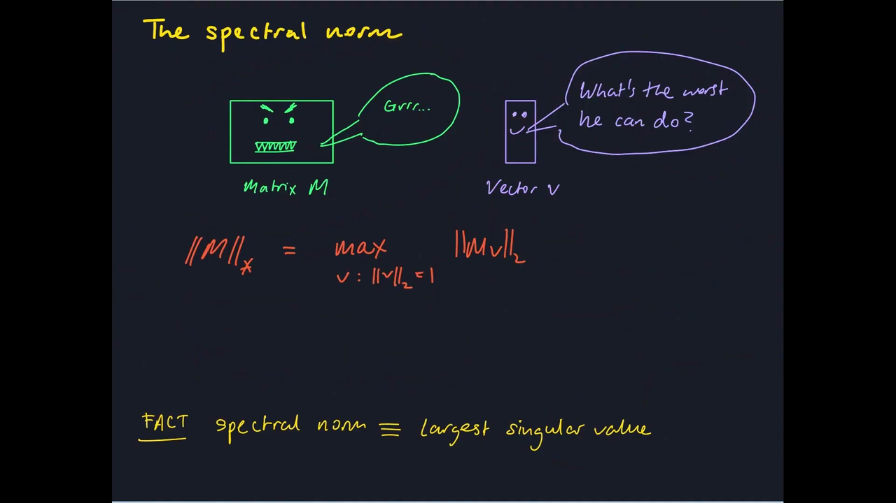
*▲ 강의 슬라이드 [58:15](https://youtu.be/VcGPE4s_oNw?t=3495): [스펙트럼 노름](00_%EB%94%A5%EB%9F%AC%EB%8B%9D_%EC%9A%A9%EC%96%B4%EC%82%AC%EC%A0%84.md#spectral-norm-%EC%8A%A4%ED%8E%99%ED%8A%B8%EB%9F%BC-%EB%85%B8%EB%A6%84), "행렬이 할 수 있는 최악은?"*

---

## 8. RMS 연산자 노름과 너비 스케일링

▶ 영상 [58:43](https://youtu.be/VcGPE4s_oNw?t=3523)

📐 **수학 개념**: [스펙트럼 노름과 RMS 연산자 노름](%EC%88%98%ED%95%99%EA%B0%9C%EB%85%90/09_%EC%B5%9C%EC%A0%81%ED%99%94%EC%9D%98_%EA%B8%B0%ED%95%98/MM28_%EC%8A%A4%ED%8E%99%ED%8A%B8%EB%9F%BC_%EB%85%B8%EB%A6%84%EA%B3%BC_RMS_%EC%97%B0%EC%82%B0%EC%9E%90_%EB%85%B8%EB%A6%84.md) · [RMS 노름](%EC%88%98%ED%95%99%EA%B0%9C%EB%85%90/03_%EC%84%A0%ED%98%95%EB%8C%80%EC%88%98/MM11_%EB%A6%BD%EC%8B%9C%EC%B8%A0_%EC%97%B0%EC%86%8D%EA%B3%BC_%EB%85%B8%EB%A6%84.md)

[스펙트럼 노름](00_%EB%94%A5%EB%9F%AC%EB%8B%9D_%EC%9A%A9%EC%96%B4%EC%82%AC%EC%A0%84.md#spectral-norm-%EC%8A%A4%ED%8E%99%ED%8A%B8%EB%9F%BC-%EB%85%B8%EB%A6%84)의 정의에는 임의로 고른 부분이 있습니다. 왜 입력과 출력의 크기를 **유클리드 [노름](00_%EB%94%A5%EB%9F%AC%EB%8B%9D_%EC%9A%A9%EC%96%B4%EC%82%AC%EC%A0%84.md#norm-%EB%85%B8%EB%A6%84)**으로 재야 할까요? 입력 쪽에 아무 [노름](00_%EB%94%A5%EB%9F%AC%EB%8B%9D_%EC%9A%A9%EC%96%B4%EC%82%AC%EC%A0%84.md#norm-%EB%85%B8%EB%A6%84), 출력 쪽에 아무 [노름](00_%EB%94%A5%EB%9F%AC%EB%8B%9D_%EC%9A%A9%EC%96%B4%EC%82%AC%EC%A0%84.md#norm-%EB%85%B8%EB%A6%84)을 정하면 행렬에 [노름](00_%EB%94%A5%EB%9F%AC%EB%8B%9D_%EC%9A%A9%EC%96%B4%EC%82%AC%EC%A0%84.md#norm-%EB%85%B8%EB%A6%84)이 하나 생깁니다. 이것을 **[유도 연산자 노름](00_%EB%94%A5%EB%9F%AC%EB%8B%9D_%EC%9A%A9%EC%96%B4%EC%82%AC%EC%A0%84.md#induced-operator-norm-%EC%9C%A0%EB%8F%84-%EC%97%B0%EC%82%B0%EC%9E%90-%EB%85%B8%EB%A6%84)(Induced operator norm)**이라 합니다.

강사가 고르는 것은 **[RMS 노름](00_%EB%94%A5%EB%9F%AC%EB%8B%9D_%EC%9A%A9%EC%96%B4%EC%82%AC%EC%A0%84.md#rms-norm-rms-%EB%85%B8%EB%A6%84)**입니다([Lec03 5.2](Lec03_%EA%B7%BC%EC%82%AC_%EC%9D%B4%EB%A1%A0.md#52-%EC%9E%85%EB%A0%A5%EC%9D%B4-%EC%97%AC%EB%9F%AC-%EA%B0%9C%EC%9D%BC-%EB%95%8C%EC%99%80-rms-%EB%85%B8%EB%A6%84)에서 나옴). 유클리드 [노름](00_%EB%94%A5%EB%9F%AC%EB%8B%9D_%EC%9A%A9%EC%96%B4%EC%82%AC%EC%A0%84.md#norm-%EB%85%B8%EB%A6%84)을 $\sqrt{d}$로 나눈 것이라, [RMS 노름](00_%EB%94%A5%EB%9F%AC%EB%8B%9D_%EC%9A%A9%EC%96%B4%EC%82%AC%EC%A0%84.md#rms-norm-rms-%EB%85%B8%EB%A6%84)이 1이면 **성분 하나하나가 1 근처**라는 뜻입니다. [트랜스포머](00_%EB%94%A5%EB%9F%AC%EB%8B%9D_%EC%9A%A9%EC%96%B4%EC%82%AC%EC%A0%84.md#transformer-%ED%8A%B8%EB%9E%9C%EC%8A%A4%ED%8F%AC%EB%A8%B8)가 [층](00_%EB%94%A5%EB%9F%AC%EB%8B%9D_%EC%9A%A9%EC%96%B4%EC%82%AC%EC%A0%84.md#layer-%EC%B8%B5)마다 활성값을 [RMS 노름](00_%EB%94%A5%EB%9F%AC%EB%8B%9D_%EC%9A%A9%EC%96%B4%EC%82%AC%EC%A0%84.md#rms-norm-rms-%EB%85%B8%EB%A6%84)으로 정규화하는 것([RMS 정규화](00_%EB%94%A5%EB%9F%AC%EB%8B%9D_%EC%9A%A9%EC%96%B4%EC%82%AC%EC%A0%84.md#rmsnorm-rms-%EC%A0%95%EA%B7%9C%ED%99%94), [층 정규화](00_%EB%94%A5%EB%9F%AC%EB%8B%9D_%EC%9A%A9%EC%96%B4%EC%82%AC%EC%A0%84.md#layer-normalization-%EC%B8%B5-%EC%A0%95%EA%B7%9C%ED%99%94))도 같은 생각입니다. 입력과 출력을 모두 [RMS 노름](00_%EB%94%A5%EB%9F%AC%EB%8B%9D_%EC%9A%A9%EC%96%B4%EC%82%AC%EC%A0%84.md#rms-norm-rms-%EB%85%B8%EB%A6%84)으로 재면 다음 식이 나옵니다(과제의 연습 문제).

$$
\lVert v \rVert_{\mathrm{RMS}} = \frac{1}{\sqrt{d}}\lVert v \rVert_2, \qquad \lVert M \rVert_{\mathrm{RMS}\to\mathrm{RMS}} = \max_{v:\ \lVert v \rVert_{\mathrm{RMS}} = 1} \lVert Mv \rVert_{\mathrm{RMS}} = \sqrt{\frac{d_\text{in}}{d_\text{out}}}\, \lVert M \rVert_\ast
$$

기호 풀이

| 기호 | 읽는 법 | 뜻 | 예제 값 ($W$ = 3×2, 행 (1, 0), (0, 1), (1, 1)) |
| --- | --- | --- | --- |
| $\lVert v \rVert_{\mathrm{RMS}}$ | 브이의 [RMS 노름](00_%EB%94%A5%EB%9F%AC%EB%8B%9D_%EC%9A%A9%EC%96%B4%EC%82%AC%EC%A0%84.md#rms-norm-rms-%EB%85%B8%EB%A6%84) | 성분 하나의 평균 크기 | (1, 1) → 1 |
| $d$ | 디 | 벡터 차원 | 2 |
| $d_\text{in}$, $d_\text{out}$ | 디 인, 디 아웃 | 입력 차원, 출력 차원 | 2, 3 |
| $\lVert M \rVert_{\mathrm{RMS}\to\mathrm{RMS}}$ | RMS→RMS 연산자 [노름](00_%EB%94%A5%EB%9F%AC%EB%8B%9D_%EC%9A%A9%EC%96%B4%EC%82%AC%EC%A0%84.md#norm-%EB%85%B8%EB%A6%84) | RMS 1인 입력의 최대 출력 RMS | 1.4142 |
| $\lVert M \rVert_\ast$ | [스펙트럼 노름](00_%EB%94%A5%EB%9F%AC%EB%8B%9D_%EC%9A%A9%EC%96%B4%EC%82%AC%EC%A0%84.md#spectral-norm-%EC%8A%A4%ED%8E%99%ED%8A%B8%EB%9F%BC-%EB%85%B8%EB%A6%84) | 가장 큰 특잇값 | 1.7321 |

예제와 풀이

**문제**: 입력 2차원, 출력 3차원인 행렬 $W = \begin{pmatrix}1&0\\0&1\\1&1\end{pmatrix}$([스펙트럼 노름](00_%EB%94%A5%EB%9F%AC%EB%8B%9D_%EC%9A%A9%EC%96%B4%EC%82%AC%EC%A0%84.md#spectral-norm-%EC%8A%A4%ED%8E%99%ED%8A%B8%EB%9F%BC-%EB%85%B8%EB%A6%84) 1.7321)의 RMS→[RMS 노름](00_%EB%94%A5%EB%9F%AC%EB%8B%9D_%EC%9A%A9%EC%96%B4%EC%82%AC%EC%A0%84.md#rms-norm-rms-%EB%85%B8%EB%A6%84), 즉 RMS 1인 입력이 낼 수 있는 가장 큰 출력 RMS는?

**주어진 값**:
- $d_\text{in} = 2$ (입력 차원), $d_\text{out} = 3$ (출력 차원)
- $\lVert W \rVert_\ast = 1.7321$ ([스펙트럼 노름](00_%EB%94%A5%EB%9F%AC%EB%8B%9D_%EC%9A%A9%EC%96%B4%EC%82%AC%EC%A0%84.md#spectral-norm-%EC%8A%A4%ED%8E%99%ED%8A%B8%EB%9F%BC-%EB%85%B8%EB%A6%84) = 가장 큰 특잇값, `np.linalg.svd`로 구함)

**풀이**
1. 식을 그대로 쓴다: $\lVert W \rVert_{\mathrm{RMS}\to\mathrm{RMS}} = \sqrt{\frac{d_\text{in}}{d_\text{out}}}\, \lVert W \rVert_\ast$
2. 값을 대입한다: $\sqrt{\frac{2}{3}} \times 1.7321$
3. 분수를 계산한다: $2 \div 3 = 0.6667$
4. 제곱근을 구한다: $\sqrt{0.6667} = 0.8165$ 이므로 $0.8165 \times 1.7321$
5. 곱한다: $0.8165 \times 1.7321 = 1.4142$
6. 확인: $v = (1, 1)$은 RMS $\sqrt{2}/\sqrt{2} = 1$, $Wv = (1, 1, 2)$의 RMS는 $\sqrt{1 + 1 + 4}/\sqrt{3} = \sqrt{6}/\sqrt{3} = 1.4142$

**답**: **1.4142**

내 이해

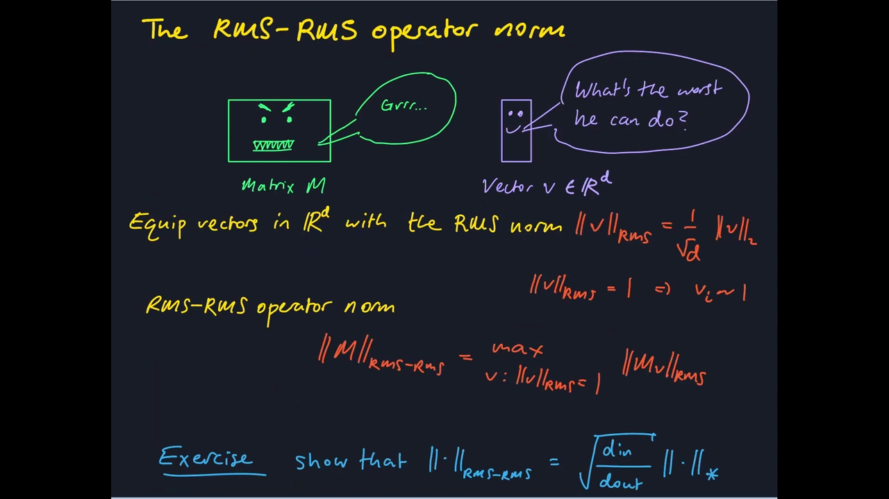
*▲ 강의 슬라이드 [66:30](https://youtu.be/VcGPE4s_oNw?t=3990): RMS→RMS 연산자 [노름](00_%EB%94%A5%EB%9F%AC%EB%8B%9D_%EC%9A%A9%EC%96%B4%EC%82%AC%EC%A0%84.md#norm-%EB%85%B8%EB%A6%84)과 연습 문제 $\lVert \cdot \rVert_{\mathrm{RMS}\to\mathrm{RMS}} = \sqrt{d_\text{in}/d_\text{out}}\,\lVert \cdot \rVert_\ast$*

**주장** [63:22](https://youtu.be/VcGPE4s_oNw?t=3802): 너비를 바꿀 때 최적 [학습률](00_%EB%94%A5%EB%9F%AC%EB%8B%9D_%EC%9A%A9%EC%96%B4%EC%82%AC%EC%A0%84.md#learning-rate-%ED%95%99%EC%8A%B5%EB%A5%A0)이 움직이지 않게 하려면 모든 [층](00_%EB%94%A5%EB%9F%AC%EB%8B%9D_%EC%9A%A9%EC%96%B4%EC%82%AC%EC%A0%84.md#layer-%EC%B8%B5) $l = 1, \dots, L$에서 두 가지를 하라.

$$
\text{① 초기화: } \lVert W_l \rVert_{\mathrm{RMS}\to\mathrm{RMS}} \sim 1, \qquad \text{② 업데이트: } \lVert \Delta W_l \rVert_{\mathrm{RMS}\to\mathrm{RMS}} \sim 1
$$

기호 풀이

| 기호 | 읽는 법 | 뜻 | 예제 값 |
| --- | --- | --- | --- |
| $W_l$ | 더블유 엘 | l번째 [층](00_%EB%94%A5%EB%9F%AC%EB%8B%9D_%EC%9A%A9%EC%96%B4%EC%82%AC%EC%A0%84.md#layer-%EC%B8%B5)의 [가중치](00_%EB%94%A5%EB%9F%AC%EB%8B%9D_%EC%9A%A9%EC%96%B4%EC%82%AC%EC%A0%84.md#weight-%EA%B0%80%EC%A4%91%EC%B9%98) 행렬 | 2×4, 성분 모두 0.25 |
| $\Delta W_l$ | 델타 더블유 엘 | l번째 [층](00_%EB%94%A5%EB%9F%AC%EB%8B%9D_%EC%9A%A9%EC%96%B4%EC%82%AC%EC%A0%84.md#layer-%EC%B8%B5)의 한 번 업데이트 | - |
| $\sim 1$ | 1 정도 | 정확히 1이 아니라 너비와 상관없이 1 근처 | 1 |
| $l = 1, \dots, L$ | 모든 [층](00_%EB%94%A5%EB%9F%AC%EB%8B%9D_%EC%9A%A9%EC%96%B4%EC%82%AC%EC%A0%84.md#layer-%EC%B8%B5) | [층](00_%EB%94%A5%EB%9F%AC%EB%8B%9D_%EC%9A%A9%EC%96%B4%EC%82%AC%EC%A0%84.md#layer-%EC%B8%B5)마다 따로 맞춘다 | - |

예제와 풀이

**문제**: 출력 2차원, 입력 4차원인 [층](00_%EB%94%A5%EB%9F%AC%EB%8B%9D_%EC%9A%A9%EC%96%B4%EC%82%AC%EC%A0%84.md#layer-%EC%B8%B5)의 [가중치](00_%EB%94%A5%EB%9F%AC%EB%8B%9D_%EC%9A%A9%EC%96%B4%EC%82%AC%EC%A0%84.md#weight-%EA%B0%80%EC%A4%91%EC%B9%98) 행렬 $W$가 성분이 모두 0.25일 때, RMS→[RMS 노름](00_%EB%94%A5%EB%9F%AC%EB%8B%9D_%EC%9A%A9%EC%96%B4%EC%82%AC%EC%A0%84.md#rms-norm-rms-%EB%85%B8%EB%A6%84)이 주장의 조건(1 근처)을 만족하는가?

**주어진 값**:
- $W$의 성분 8개가 모두 0.25 (2×4 행렬)
- $d_\text{in} = 4$, $d_\text{out} = 2$ (입력, 출력 차원)
- $\lVert W \rVert_\ast = 0.25 \times \sqrt{2 \times 4}$ (성분이 모두 같은 행렬은 [랭크](00_%EB%94%A5%EB%9F%AC%EB%8B%9D_%EC%9A%A9%EC%96%B4%EC%82%AC%EC%A0%84.md#rank-%EB%9E%AD%ED%81%AC) 1이라 [스펙트럼 노름](00_%EB%94%A5%EB%9F%AC%EB%8B%9D_%EC%9A%A9%EC%96%B4%EC%82%AC%EC%A0%84.md#spectral-norm-%EC%8A%A4%ED%8E%99%ED%8A%B8%EB%9F%BC-%EB%85%B8%EB%A6%84)이 "성분 값 × $\sqrt{\text{행 수} \times \text{열 수}}$")

**풀이**
1. 식을 그대로 쓴다: $\lVert W \rVert_{\mathrm{RMS}\to\mathrm{RMS}} = \sqrt{\frac{d_\text{in}}{d_\text{out}}}\, \lVert W \rVert_\ast$
2. 값을 대입한다: $\sqrt{\frac{4}{2}} \times 0.25 \times \sqrt{2 \times 4}$
3. 곱셈과 나눗셈을 먼저 한다: $4 \div 2 = 2$, $2 \times 4 = 8$ 이므로 $\sqrt2 \times 0.25 \times \sqrt8$
4. 제곱근을 구한다: $\sqrt2 = 1.4142$, $\sqrt8 = 2.8284$ 이므로 $1.4142 \times 0.25 \times 2.8284$
5. 뒤의 곱셈을 한다: $0.25 \times 2.8284 = 0.7071$ ([스펙트럼 노름](00_%EB%94%A5%EB%9F%AC%EB%8B%9D_%EC%9A%A9%EC%96%B4%EC%82%AC%EC%A0%84.md#spectral-norm-%EC%8A%A4%ED%8E%99%ED%8A%B8%EB%9F%BC-%EB%85%B8%EB%A6%84)) 이므로 $1.4142 \times 0.7071$
6. 곱한다: $1.4142 \times 0.7071 = 1$
7. 확인: $x = (1, 1, 1, 1)$은 RMS 1, $Wx$의 각 줄은 $0.25 + 0.25 + 0.25 + 0.25 = 1$ 이므로 $Wx = (1, 1)$, RMS 1

**답**: **1**. 이 행렬은 주장의 조건을 딱 맞춘다(성분 하나하나가 1인 입력을 성분 하나하나가 1인 출력으로 보낸다).

내 이해

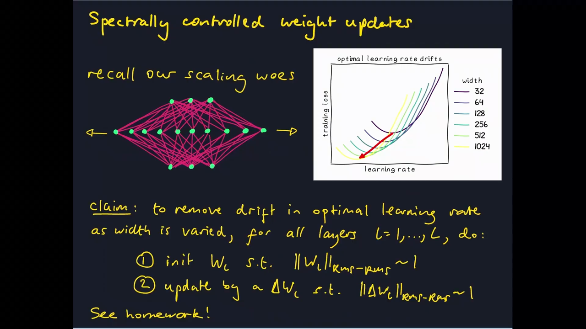
*▲ 강의 슬라이드 [66:40](https://youtu.be/VcGPE4s_oNw?t=4000): "스펙트럼으로 조절한 [가중치](00_%EB%94%A5%EB%9F%AC%EB%8B%9D_%EC%9A%A9%EC%96%B4%EC%82%AC%EC%A0%84.md#weight-%EA%B0%80%EC%A4%91%EC%B9%98) 업데이트", 초기화와 업데이트를 RMS→[RMS 노름](00_%EB%94%A5%EB%9F%AC%EB%8B%9D_%EC%9A%A9%EC%96%B4%EC%82%AC%EC%A0%84.md#rms-norm-rms-%EB%85%B8%EB%A6%84) 1 근처로*

- **왜 초기화를 이렇게?** 초기 행렬의 RMS→[RMS 노름](00_%EB%94%A5%EB%9F%AC%EB%8B%9D_%EC%9A%A9%EC%96%B4%EC%82%AC%EC%A0%84.md#rms-norm-rms-%EB%85%B8%EB%A6%84)이 1이면, 성분이 평균 1인 특징을 넣었을 때 나오는 특징도 성분이 많아야 1 정도입니다. 망을 통과하며 RMS 크기가 통제됩니다.
- **왜 업데이트를 이렇게?** 한 걸음 사이에 특징(활성값)이 바뀌는 양(특징 [학습](00_%EB%94%A5%EB%9F%AC%EB%8B%9D_%EC%9A%A9%EC%96%B4%EC%82%AC%EC%A0%84.md#training-%ED%95%99%EC%8A%B5), feature learning)도 똑같이 통제되기 때문입니다.
- **왜 너비에 무관해지나?** [RMS 노름](00_%EB%94%A5%EB%9F%AC%EB%8B%9D_%EC%9A%A9%EC%96%B4%EC%82%AC%EC%A0%84.md#rms-norm-rms-%EB%85%B8%EB%A6%84)은 "차원 없는" [노름](00_%EB%94%A5%EB%9F%AC%EB%8B%9D_%EC%9A%A9%EC%96%B4%EC%82%AC%EC%A0%84.md#norm-%EB%85%B8%EB%A6%84)이라, 1이면 성분이 너비와 상관없이 1 근처입니다. 유클리드 [노름](00_%EB%94%A5%EB%9F%AC%EB%8B%9D_%EC%9A%A9%EC%96%B4%EC%82%AC%EC%A0%84.md#norm-%EB%85%B8%EB%A6%84)을 통제하면 너비에 따라 성분 하나가 커지거나 작아집니다. 차원에 따른 차이를 [노름](00_%EB%94%A5%EB%9F%AC%EB%8B%9D_%EC%9A%A9%EC%96%B4%EC%82%AC%EC%A0%84.md#norm-%EB%85%B8%EB%A6%84) 안에 모두 넣어 두면, 그 [노름](00_%EB%94%A5%EB%9F%AC%EB%8B%9D_%EC%9A%A9%EC%96%B4%EC%82%AC%EC%A0%84.md#norm-%EB%85%B8%EB%A6%84)으로 정규화한 업데이트에 곱하는 [학습률](00_%EB%94%A5%EB%9F%AC%EB%8B%9D_%EC%9A%A9%EC%96%B4%EC%82%AC%EC%A0%84.md#learning-rate-%ED%95%99%EC%8A%B5%EB%A5%A0)은 너비에 따라 바꿀 필요가 없습니다(과제 2에서 정규화한 [경사하강법](00_%EB%94%A5%EB%9F%AC%EB%8B%9D_%EC%9A%A9%EC%96%B4%EC%82%AC%EC%A0%84.md#gradient-descent-%EA%B2%BD%EC%82%AC%ED%95%98%EA%B0%95%EB%B2%95)과 안 한 것을 비교).

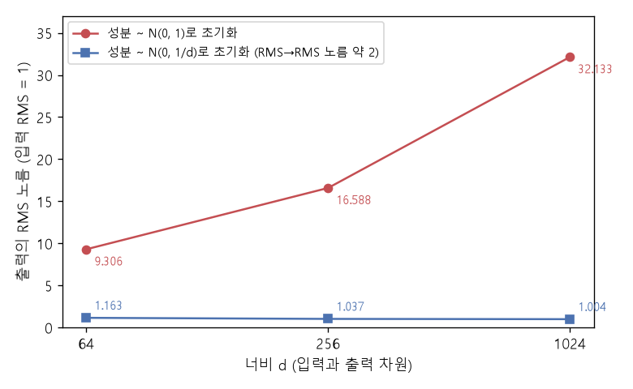
*▲ 직접 그린 그림: RMS 1인 입력을 무작위 행렬에 넣었을 때 출력 RMS. 성분을 $N(0, 1)$로 뽑으면 너비에 따라 9.306 → 16.588 → 32.133으로 커지고, $N(0, 1/d)$로 뽑으면(RMS→[RMS 노름](00_%EB%94%A5%EB%9F%AC%EB%8B%9D_%EC%9A%A9%EC%96%B4%EC%82%AC%EC%A0%84.md#rms-norm-rms-%EB%85%B8%EB%A6%84) 약 2) 1.163 → 1.037 → 1.004로 일정하다 (숫자는 [MM28_스펙트럼_노름과_RMS_연산자_노름](%EC%88%98%ED%95%99%EA%B0%9C%EB%85%90/09_%EC%B5%9C%EC%A0%81%ED%99%94%EC%9D%98_%EA%B8%B0%ED%95%98/MM28_%EC%8A%A4%ED%8E%99%ED%8A%B8%EB%9F%BC_%EB%85%B8%EB%A6%84%EA%B3%BC_RMS_%EC%97%B0%EC%82%B0%EC%9E%90_%EB%85%B8%EB%A6%84.md) 3.2 표와 같음)*

질의응답 (요약) [64:36](https://youtu.be/VcGPE4s_oNw?t=3876)

- **Q. 특징이 가질 수 있는 값을 이렇게 묶으면 [표현력](00_%EB%94%A5%EB%9F%AC%EB%8B%9D_%EC%9A%A9%EC%96%B4%EC%82%AC%EC%A0%84.md#representational-power-%ED%91%9C%ED%98%84%EB%A0%A5)이 떨어지지 않나?** 초기화 때와 **연속한 두 걸음 사이**만 통제한다. 여러 걸음이 쌓이면 훨씬 많이 바뀔 수 있으니 [표현력](00_%EB%94%A5%EB%9F%AC%EB%8B%9D_%EC%9A%A9%EC%96%B4%EC%82%AC%EC%A0%84.md#representational-power-%ED%91%9C%ED%98%84%EB%A0%A5)을 해치지 않는 것으로 보인다.
- **Q. 경험적 관찰인가 이론인가?** 둘 다다. 과제 2번이 경험적으로 확인하는 문제다. 이론적 근거 중 가장 단순한 것은 연산자 [노름](00_%EB%94%A5%EB%9F%AC%EB%8B%9D_%EC%9A%A9%EC%96%B4%EC%82%AC%EC%A0%84.md#norm-%EB%85%B8%EB%A6%84)의 정의 자체다. 다만 이 [노름](00_%EB%94%A5%EB%9F%AC%EB%8B%9D_%EC%9A%A9%EC%96%B4%EC%82%AC%EC%A0%84.md#norm-%EB%85%B8%EB%A6%84)은 **상한**만 준다(특징이 이보다 더 바뀌지 않는다). 실제로 그만큼 바뀐다는 것은 보통 너비를 무한대로 보내는 이론에서 다루며, 아직 완전히 풀린 문제는 아니다.
- **Q. [학습률](00_%EB%94%A5%EB%9F%AC%EB%8B%9D_%EC%9A%A9%EC%96%B4%EC%82%AC%EC%A0%84.md#learning-rate-%ED%95%99%EC%8A%B5%EB%A5%A0)을 어차피 곱하는데 업데이트는 왜 정규화하나?** 목표가 "최적 [학습률](00_%EB%94%A5%EB%9F%AC%EB%8B%9D_%EC%9A%A9%EC%96%B4%EC%82%AC%EC%A0%84.md#learning-rate-%ED%95%99%EC%8A%B5%EB%A5%A0)이 너비와 무관"이기 때문이다. 정규화하지 않으면 [학습률](00_%EB%94%A5%EB%9F%AC%EB%8B%9D_%EC%9A%A9%EC%96%B4%EC%82%AC%EC%A0%84.md#learning-rate-%ED%95%99%EC%8A%B5%EB%A5%A0) 자체가 차원에 따른 차이를 떠안아야 한다.

> [!TIP]
> **🆕 2026 업데이트: [스펙트럼 노름](00_%EB%94%A5%EB%9F%AC%EB%8B%9D_%EC%9A%A9%EC%96%B4%EC%82%AC%EC%A0%84.md#spectral-norm-%EC%8A%A4%ED%8E%99%ED%8A%B8%EB%9F%BC-%EB%85%B8%EB%A6%84) [최급강하법](00_%EB%94%A5%EB%9F%AC%EB%8B%9D_%EC%9A%A9%EC%96%B4%EC%82%AC%EC%A0%84.md#steepest-descent-%EC%B5%9C%EA%B8%89%EA%B0%95%ED%95%98%EB%B2%95)이 실제 대형 모델 [옵티마이저](00_%EB%94%A5%EB%9F%AC%EB%8B%9D_%EC%9A%A9%EC%96%B4%EC%82%AC%EC%A0%84.md#optimizer-%EC%98%B5%ED%8B%B0%EB%A7%88%EC%9D%B4%EC%A0%80)가 됨 ([Muon](00_%EB%94%A5%EB%9F%AC%EB%8B%9D_%EC%9A%A9%EC%96%B4%EC%82%AC%EC%A0%84.md#muon-%EB%AE%A4%EC%98%A8-%EC%98%B5%ED%8B%B0%EB%A7%88%EC%9D%B4%EC%A0%80))**
> - **강의**: [가중치](00_%EB%94%A5%EB%9F%AC%EB%8B%9D_%EC%9A%A9%EC%96%B4%EC%82%AC%EC%A0%84.md#weight-%EA%B0%80%EC%A4%91%EC%B9%98) 행렬마다 업데이트를 스펙트럼(RMS→RMS) [노름](00_%EB%94%A5%EB%9F%AC%EB%8B%9D_%EC%9A%A9%EC%96%B4%EC%82%AC%EC%A0%84.md#norm-%EB%85%B8%EB%A6%84)으로 정규화하자는 것은 연구 중인 제안이었다.
> - **현재**: 2024년 12월 Keller Jordan 등이 공개한 **[Muon](00_%EB%94%A5%EB%9F%AC%EB%8B%9D_%EC%9A%A9%EC%96%B4%EC%82%AC%EC%A0%84.md#muon-%EB%AE%A4%EC%98%A8-%EC%98%B5%ED%8B%B0%EB%A7%88%EC%9D%B4%EC%A0%80)**은 [은닉층](00_%EB%94%A5%EB%9F%AC%EB%8B%9D_%EC%9A%A9%EC%96%B4%EC%82%AC%EC%A0%84.md#hidden-layer-%EC%9D%80%EB%8B%89%EC%B8%B5) 2차원 [가중치](00_%EB%94%A5%EB%9F%AC%EB%8B%9D_%EC%9A%A9%EC%96%B4%EC%82%AC%EC%A0%84.md#weight-%EA%B0%80%EC%A4%91%EC%B9%98)의 [모멘텀](00_%EB%94%A5%EB%9F%AC%EB%8B%9D_%EC%9A%A9%EC%96%B4%EC%82%AC%EC%A0%84.md#momentum-%EB%AA%A8%EB%A9%98%ED%85%80) 업데이트를 [뉴턴-슐츠 반복](00_%EB%94%A5%EB%9F%AC%EB%8B%9D_%EC%9A%A9%EC%96%B4%EC%82%AC%EC%A0%84.md#newton-schulz-iteration-%EB%89%B4%ED%84%B4-%EC%8A%90%EC%B8%A0-%EB%B0%98%EB%B3%B5)으로 **직교화**(특잇값을 모두 1 근처로)한다. 강사가 이론으로 다뤄 온 "[스펙트럼 노름](00_%EB%94%A5%EB%9F%AC%EB%8B%9D_%EC%9A%A9%EC%96%B4%EC%82%AC%EC%A0%84.md#spectral-norm-%EC%8A%A4%ED%8E%99%ED%8A%B8%EB%9F%BC-%EB%85%B8%EB%A6%84) 아래의 [최급강하법](00_%EB%94%A5%EB%9F%AC%EB%8B%9D_%EC%9A%A9%EC%96%B4%EC%82%AC%EC%A0%84.md#steepest-descent-%EC%B5%9C%EA%B8%89%EA%B0%95%ED%95%98%EB%B2%95)"과 가까운 알고리즘이며, NanoGPT [학습](00_%EB%94%A5%EB%9F%AC%EB%8B%9D_%EC%9A%A9%EC%96%B4%EC%82%AC%EC%A0%84.md#training-%ED%95%99%EC%8A%B5) 속도 기록을 갈아 치웠다. Moonshot AI는 [가중치 감쇠](00_%EB%94%A5%EB%9F%AC%EB%8B%9D_%EC%9A%A9%EC%96%B4%EC%82%AC%EC%A0%84.md#weight-decay-%EA%B0%80%EC%A4%91%EC%B9%98-%EA%B0%90%EC%87%A0)와 층별 업데이트 크기(RMS) 맞춤을 더해 대규모에서도 별도 튜닝 없이 쓸 수 있게 했고(2025년 2월), 이를 다듬은 MuonClip으로 총 1조 [파라미터](00_%EB%94%A5%EB%9F%AC%EB%8B%9D_%EC%9A%A9%EC%96%B4%EC%82%AC%EC%A0%84.md#parameter-%ED%8C%8C%EB%9D%BC%EB%AF%B8%ED%84%B0)의 MoE 모델 Kimi K2를 15.5조 [토큰](00_%EB%94%A5%EB%9F%AC%EB%8B%9D_%EC%9A%A9%EC%96%B4%EC%82%AC%EC%A0%84.md#token-%ED%86%A0%ED%81%B0) 동안 [손실](00_%EB%94%A5%EB%9F%AC%EB%8B%9D_%EC%9A%A9%EC%96%B4%EC%82%AC%EC%A0%84.md#loss-function-%EC%86%90%EC%8B%A4-%ED%95%A8%EC%88%98) 급등 없이 사전학습했다(2025년 7월). [임베딩](00_%EB%94%A5%EB%9F%AC%EB%8B%9D_%EC%9A%A9%EC%96%B4%EC%82%AC%EC%A0%84.md#embedding-%EC%9E%84%EB%B2%A0%EB%94%A9)·[출력층](00_%EB%94%A5%EB%9F%AC%EB%8B%9D_%EC%9A%A9%EC%96%B4%EC%82%AC%EC%A0%84.md#output-layer-%EC%B6%9C%EB%A0%A5%EC%B8%B5)·벡터 [파라미터](00_%EB%94%A5%EB%9F%AC%EB%8B%9D_%EC%9A%A9%EC%96%B4%EC%82%AC%EC%A0%84.md#parameter-%ED%8C%8C%EB%9D%BC%EB%AF%B8%ED%84%B0)에는 여전히 AdamW를 쓴다.
> - **출처**: [Jordan et al., Muon: An optimizer for hidden layers in neural networks (blog, 2024)](https://kellerjordan.github.io/posts/muon/) · [Liu et al., Muon is Scalable for LLM Training (arXiv, 2025)](https://arxiv.org/abs/2502.16982) · [Kimi Team, Kimi K2: Open Agentic Intelligence (arXiv, 2025)](https://arxiv.org/abs/2507.20534)

---

## 9. 깊이 스케일링

▶ 영상 [69:49](https://youtu.be/VcGPE4s_oNw?t=4189)

📐 **수학 개념**: [곱의 극한과 잔차 배율](%EC%88%98%ED%95%99%EA%B0%9C%EB%85%90/09_%EC%B5%9C%EC%A0%81%ED%99%94%EC%9D%98_%EA%B8%B0%ED%95%98/MM29_%EA%B3%B1%EC%9D%98_%EA%B7%B9%ED%95%9C%EA%B3%BC_%EC%9E%94%EC%B0%A8_%EB%B0%B0%EC%9C%A8.md) · [지수와 e](%EC%88%98%ED%95%99%EA%B0%9C%EB%85%90/01_%EC%88%98%EC%99%80_%ED%95%A8%EC%88%98/M06_%EC%A7%80%EC%88%98%EC%99%80_e.md)

깊이 문제는 아직 열린 연구 주제라 강사도 "조금 얼버무리겠다"고 합니다. 출발점은 잘 알려진 극한입니다.

$$
\lim_{L \to \infty}\left(1 + \frac{x}{L}\right)^L = e^x
$$

기호 풀이

| 기호 | 읽는 법 | 뜻 | 예제 값 |
| --- | --- | --- | --- |
| $L$ | 엘 | 곱하는 항의 개수(깊이) | 10 |
| $x$ | 엑스 | 입력(전체 변화량) | 1 |
| $\frac{x}{L}$ | 엑스 나누기 엘 | 항 하나의 몫. 깊이로 나눠 준다 | 0.1 |
| $e^x$ | 이의 엑스 제곱 | 극한값 | 2.7183 |

예제와 풀이

**문제**: 전체 변화량 $x = 1$을 항 $L = 10$개에 똑같이 나눠 곱한 $(1 + x/L)^L$은 얼마이고, 극한 $e$와 비교하면?

**주어진 값**:
- $x = 1$ (전체 변화량), $L = 10$ (항의 개수, 깊이)
- $e = 2.7183$ (자연상수: $(1 + 1/L)^L$에서 $L$을 끝없이 키울 때 다가가는 값, 계산기의 $e^1$)

**풀이**
1. 식을 그대로 쓴다: $\left(1 + \frac{x}{L}\right)^L$
2. 값을 대입한다: $\left(1 + \frac{1}{10}\right)^{10}$
3. 나눗셈을 한다: $1 \div 10 = 0.1$ 이므로 $(1 + 0.1)^{10}$
4. 괄호 안을 더한다: $1.1^{10}$
5. 거듭제곱을 한다(1.1을 10번 곱함): $2.5937$
6. 같은 방법으로 $L = 1000$: $(1 + 0.001)^{1000} = 1.001^{1000} = 2.7169$

**답**: **2.5937**, **2.7169**. 항이 늘어도 터지지 않고 $e = 2.7183$으로 다가간다.

내 이해

이것은 큰 곱(복리)인데, 안쪽을 $L$로 잘 나눠서 항 수를 무한대로 보내도 터지지도 0이 되지도 않습니다. 강사는 $L^2$로 나누면 0, $\sqrt{L}$로 나누면 폭발한다고 말합니다(실제로 $(1 + x/L^2)^L$은 0이 아니라 1로 갑니다. 입력 $x$의 영향이 사라진다는 점에서 블록이 아무 일도 못 하는 셈입니다). 깊이를 무한대로 보내도 [학습](00_%EB%94%A5%EB%9F%AC%EB%8B%9D_%EC%9A%A9%EC%96%B4%EC%82%AC%EC%A0%84.md#training-%ED%95%99%EC%8A%B5)이 안정적이려면 잔차 신경망에서도 같은 고민이 필요합니다.

*▲ 직접 그린 그림: $(1 + 1/s)^L$. $s = L$이면 2.5937, 2.7048, 2.7169로 $e$에 [수렴](00_%EB%94%A5%EB%9F%AC%EB%8B%9D_%EC%9A%A9%EC%96%B4%EC%82%AC%EC%A0%84.md#convergence-%EC%88%98%EB%A0%B4), $s = L^2$이면 1로, $s = \sqrt{L}$이면 15.61, 13780.61로 폭발 (숫자는 [MM29_곱의_극한과_잔차_배율](%EC%88%98%ED%95%99%EA%B0%9C%EB%85%90/09_%EC%B5%9C%EC%A0%81%ED%99%94%EC%9D%98_%EA%B8%B0%ED%95%98/MM29_%EA%B3%B1%EC%9D%98_%EA%B7%B9%ED%95%9C%EA%B3%BC_%EC%9E%94%EC%B0%A8_%EB%B0%B0%EC%9C%A8.md) 3.1 표와 같음)*

잔차 블록 하나는 $x \mapsto x + \mathrm{Block}(x)$입니다(블록은 작은 MLP나 [어텐션](00_%EB%94%A5%EB%9F%AC%EB%8B%9D_%EC%9A%A9%EC%96%B4%EC%82%AC%EC%A0%84.md#attention-%EC%96%B4%ED%85%90%EC%85%98) [층](00_%EB%94%A5%EB%9F%AC%EB%8B%9D_%EC%9A%A9%EC%96%B4%EC%82%AC%EC%A0%84.md#layer-%EC%B8%B5)). 블록이 무한히 많아도 좋은 함수가 되려면 블록 앞에 무엇을 곱해야 할까요? 강사의 직관은 블록 수 $L$로 나누는 것입니다. 잔차망을 "블록 하나를 $L$번 합성한 것"으로 보면 위 극한과 같은 꼴이 됩니다.

$$
x \mapsto x + \frac{1}{L}\,\mathrm{Block}(x)
$$

기호 풀이

| 기호 | 읽는 법 | 뜻 | 예제 값 |
| --- | --- | --- | --- |
| $x$ | 엑스 | 블록에 들어가는 값(잔차 흐름) | 1 |
| $\mathrm{Block}(x)$ | 블록 | 잔차 블록의 출력 | $x$ (예제용) |
| $\frac{1}{L}$ | 엘 분의 일 | [블록 배율](00_%EB%94%A5%EB%9F%AC%EB%8B%9D_%EC%9A%A9%EC%96%B4%EC%82%AC%EC%A0%84.md#block-multiplier-%EB%B8%94%EB%A1%9D-%EB%B0%B0%EC%9C%A8) | 0.25 ($L = 4$) |
| $\mapsto$ | 보낸다 | 블록 하나가 하는 변환 | - |

예제와 풀이

**문제**: 블록이 입력을 그대로 내보내고($\mathrm{Block}(x) = x$) 처음 값이 1일 때, 블록 $L = 4$개를 배율 $1/L$로 지나면 마지막 값은?

**주어진 값**:
- 처음 값 $x = 1$
- $L = 4$ (블록 개수)
- 배율 $\frac{1}{L}$ (블록 출력 앞에 곱하는 수)

**풀이**
1. 식을 그대로 쓴다: $x \mapsto x + \frac{1}{L}\, x$
2. 값을 대입한다(첫 블록): $1 + \frac{1}{4} \times 1$
3. 나눗셈을 한다: $1 \div 4 = 0.25$ 이므로 $1 + 0.25 = 1.25$ (블록마다 1.25배가 된다)
4. 둘째 블록: $1.25 \times 1.25 = 1.5625$
5. 셋째 블록: $1.5625 \times 1.25 = 1.953125$
6. 넷째 블록: $1.953125 \times 1.25 = 2.4414$
7. 비교로 배율 $1/\sqrt{L}$($\sqrt4 = 2$라서 0.5)이면 블록마다 1.5배: $1.5 \times 1.5 \times 1.5 \times 1.5 = 5.0625$

**답**: $1/L$ **2.4414** ($L$을 키우면 $e$로 [수렴](00_%EB%94%A5%EB%9F%AC%EB%8B%9D_%EC%9A%A9%EC%96%B4%EC%82%AC%EC%A0%84.md#convergence-%EC%88%98%EB%A0%B4)), $1/\sqrt{L}$ **5.0625** ($L$을 키우면 폭발)

내 이해

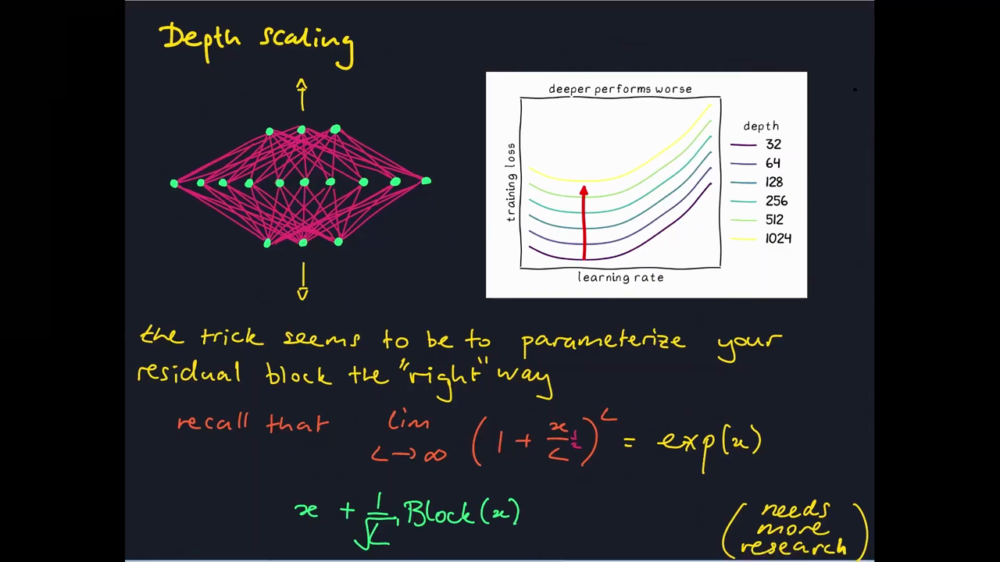
*▲ 강의 슬라이드 [74:40](https://youtu.be/VcGPE4s_oNw?t=4480): 잔차 블록을 "올바르게" 매개변수화하기, $\lim (1 + x/L)^L = \exp(x)$와 $x + \frac{1}{\sqrt{L}}\mathrm{Block}(x)$ ("더 연구 필요")*

**$1/L$이냐 $1/\sqrt{L}$이냐** [73:56](https://youtu.be/VcGPE4s_oNw?t=4436): 표준 [트랜스포머](00_%EB%94%A5%EB%9F%AC%EB%8B%9D_%EC%9A%A9%EC%96%B4%EC%82%AC%EC%A0%84.md#transformer-%ED%8A%B8%EB%9E%9C%EC%8A%A4%ED%8F%AC%EB%A8%B8) 코드는 $1/L$이 아니라 $1/\sqrt{L}$을 씁니다. 초기에는 블록들이 서로 무작위라, 무작위한 것 $L$개를 더하면 랜덤 워크처럼 $\sqrt{L}$만큼만 움직이기 때문입니다. 어느 쪽이 맞는지는 아직 분명하지 않습니다(블록 출력이 서로 같은 방향이면 $1/L$, 무작위면 $1/\sqrt{L}$이 합을 일정하게 지킨다: [MM29_곱의_극한과_잔차_배율](%EC%88%98%ED%95%99%EA%B0%9C%EB%85%90/09_%EC%B5%9C%EC%A0%81%ED%99%94%EC%9D%98_%EA%B8%B0%ED%95%98/MM29_%EA%B3%B1%EC%9D%98_%EA%B7%B9%ED%95%9C%EA%B3%BC_%EC%9E%94%EC%B0%A8_%EB%B0%B0%EC%9C%A8.md) 3.2 표).

> [!TIP]
> **🆕 2026 업데이트: 깊이 전이에는 $1/L$이 유리하다는 결과 (CompleteP)**
> - **강의**: $1/L$과 $1/\sqrt{L}$ 중 무엇이 맞는지 불분명하며 더 연구가 필요하다.
> - **현재**: Dey 등(NeurIPS 2025)은 잔차 블록 출력에 $L^{-\alpha}$를 곱하는 매개변수화를 $\alpha \in [0.5, 1]$ 범위에서 비교해, $\alpha = 1$(즉 $1/L$)인 **CompleteP**가 깊이를 바꿔도 최적 [하이퍼파라미터](00_%EB%94%A5%EB%9F%AC%EB%8B%9D_%EC%9A%A9%EC%96%B4%EC%82%AC%EC%A0%84.md#hyperparameter-%ED%95%98%EC%9D%B4%ED%8D%BC%ED%8C%8C%EB%9D%BC%EB%AF%B8%ED%84%B0)가 옮겨 가지 않으면서(깊이 방향 [하이퍼파라미터 전이](00_%EB%94%A5%EB%9F%AC%EB%8B%9D_%EC%9A%A9%EC%96%B4%EC%82%AC%EC%A0%84.md#hyperparameter-transfer-%ED%95%98%EC%9D%B4%ED%8D%BC%ED%8C%8C%EB%9D%BC%EB%AF%B8%ED%84%B0-%EC%A0%84%EC%9D%B4)) 사전학습 효율도 가장 좋다고 보고했다. $\alpha = 0.5$는 [층](00_%EB%94%A5%EB%9F%AC%EB%8B%9D_%EC%9A%A9%EC%96%B4%EC%82%AC%EC%A0%84.md#layer-%EC%B8%B5)들이 선형화 근처에서만 배우는 "게으른(lazy)" 상태에 머문다는 것이 그들의 설명이고, 기존 최선 대비 계산량 12~34%를 아꼈다고 한다. 너비 쪽 전이(μP, 2022)와 합쳐 "작게 튜닝하고 크게 옮겨 쓰기"가 너비와 깊이 모두로 넓어지는 중이다.
> - **출처**: [Dey et al., Don't be lazy: CompleteP enables compute-efficient deep transformers (NeurIPS 2025)](https://arxiv.org/abs/2505.01618) · [Yang et al., Tensor Programs V: Tuning Large Neural Networks via Zero-Shot Hyperparameter Transfer (arXiv, 2022)](https://arxiv.org/abs/2203.03466)

질의응답 (요약) [72:43](https://youtu.be/VcGPE4s_oNw?t=4363)

- **Q. 깊이가 늘면 복잡도([용량](00_%EB%94%A5%EB%9F%AC%EB%8B%9D_%EC%9A%A9%EC%96%B4%EC%82%AC%EC%A0%84.md#capacity-%EC%9A%A9%EB%9F%89))가 늘어서 그런 건가?** 잔차 블록을 신경 써서 설정하지 않으면 깊을수록 성능이 나빠질 수 있고, 여기서 말하는 것은 그것을 막는 더 신중한 설정법이다.

---

## 10. 모듈 이론

▶ 영상 [75:02](https://youtu.be/VcGPE4s_oNw?t=4502)

강사가 Phillip Isola 교수와 함께 연구 중인 주제라 "회의적으로 들어도 좋다"며 소개합니다.

딥러닝의 문제는 아키텍처가 끝없이 많다는 것입니다. 누가 새 아키텍처를 들고 오면 기존 최적화 이론은 손을 못 씁니다. 그렇다면 **아키텍처를 만드는 과정에 최적화 이론을 함께 구워 넣으면** 어떨까요? 아키텍처를 만들 때마다 그 최적화 이론도 자동으로 생기게 하자는 생각입니다.

- **[모듈](00_%EB%94%A5%EB%9F%AC%EB%8B%9D_%EC%9A%A9%EC%96%B4%EC%82%AC%EC%A0%84.md#module-modular-norm-%EB%AA%A8%EB%93%88%EA%B3%BC-%EB%AA%A8%EB%93%88%EB%9F%AC-%EB%85%B8%EB%A6%84)([Module](00_%EB%94%A5%EB%9F%AC%EB%8B%9D_%EC%9A%A9%EC%96%B4%EC%82%AC%EC%A0%84.md#module-modular-norm-%EB%AA%A8%EB%93%88%EA%B3%BC-%EB%AA%A8%EB%93%88%EB%9F%AC-%EB%85%B8%EB%A6%84))**: [가중치](00_%EB%94%A5%EB%9F%AC%EB%8B%9D_%EC%9A%A9%EC%96%B4%EC%82%AC%EC%A0%84.md#weight-%EA%B0%80%EC%A4%91%EC%B9%98) 공간의 [가중치](00_%EB%94%A5%EB%9F%AC%EB%8B%9D_%EC%9A%A9%EC%96%B4%EC%82%AC%EC%A0%84.md#weight-%EA%B0%80%EC%A4%91%EC%B9%98), 입력 공간의 입력, 출력 공간의 출력을 가진 것. [PyTorch](00_%EB%94%A5%EB%9F%AC%EB%8B%9D_%EC%9A%A9%EC%96%B4%EC%82%AC%EC%A0%84.md#pytorch-%ED%8C%8C%EC%9D%B4%ED%86%A0%EC%B9%98) 모듈과 비슷하다. [층](00_%EB%94%A5%EB%9F%AC%EB%8B%9D_%EC%9A%A9%EC%96%B4%EC%82%AC%EC%A0%84.md#layer-%EC%B8%B5) 하나도, 신경망 전체도, [가중치](00_%EB%94%A5%EB%9F%AC%EB%8B%9D_%EC%9A%A9%EC%96%B4%EC%82%AC%EC%A0%84.md#weight-%EA%B0%80%EC%A4%91%EC%B9%98)가 없는 [ReLU](00_%EB%94%A5%EB%9F%AC%EB%8B%9D_%EC%9A%A9%EC%96%B4%EC%82%AC%EC%A0%84.md#relu-%EB%A0%90%EB%A3%A8)도, [트랜스포머](00_%EB%94%A5%EB%9F%AC%EB%8B%9D_%EC%9A%A9%EC%96%B4%EC%82%AC%EC%A0%84.md#transformer-%ED%8A%B8%EB%9E%9C%EC%8A%A4%ED%8F%AC%EB%A8%B8) 전체도 모듈이다.
- **원자 모듈 라이브러리**: [ReLU](00_%EB%94%A5%EB%9F%AC%EB%8B%9D_%EC%9A%A9%EC%96%B4%EC%82%AC%EC%A0%84.md#relu-%EB%A0%90%EB%A3%A8), Linear, [Conv2D](00_%EB%94%A5%EB%9F%AC%EB%8B%9D_%EC%9A%A9%EC%96%B4%EC%82%AC%EC%A0%84.md#conv2d-2%EC%B0%A8%EC%9B%90-%ED%95%A9%EC%84%B1%EA%B3%B1-%EC%B8%B5), [Embedding](00_%EB%94%A5%EB%9F%AC%EB%8B%9D_%EC%9A%A9%EC%96%B4%EC%82%AC%EC%A0%84.md#embedding-%EC%9E%84%EB%B2%A0%EB%94%A9) 같은 기본 [층](00_%EB%94%A5%EB%9F%AC%EB%8B%9D_%EC%9A%A9%EC%96%B4%EC%82%AC%EC%A0%84.md#layer-%EC%B8%B5). 각 모듈에 `forward`(함수), `backward`([미분](00_%EB%94%A5%EB%9F%AC%EB%8B%9D_%EC%9A%A9%EC%96%B4%EC%82%AC%EC%A0%84.md#derivative-%EB%AF%B8%EB%B6%84))와 함께 **`norm`**([가중치](00_%EB%94%A5%EB%9F%AC%EB%8B%9D_%EC%9A%A9%EC%96%B4%EC%82%AC%EC%A0%84.md#weight-%EA%B0%80%EC%A4%91%EC%B9%98) 공간 → 실수)을 손으로 정해 둔다. [선형층](00_%EB%94%A5%EB%9F%AC%EB%8B%9D_%EC%9A%A9%EC%96%B4%EC%82%AC%EC%A0%84.md#linear-layer-%EC%84%A0%ED%98%95%EC%B8%B5)에는 RMS→RMS 연산자 [노름](00_%EB%94%A5%EB%9F%AC%EB%8B%9D_%EC%9A%A9%EC%96%B4%EC%82%AC%EC%A0%84.md#norm-%EB%85%B8%EB%A6%84), [가중치](00_%EB%94%A5%EB%9F%AC%EB%8B%9D_%EC%9A%A9%EC%96%B4%EC%82%AC%EC%A0%84.md#weight-%EA%B0%80%EC%A4%91%EC%B9%98)가 없는 [ReLU](00_%EB%94%A5%EB%9F%AC%EB%8B%9D_%EC%9A%A9%EC%96%B4%EC%82%AC%EC%A0%84.md#relu-%EB%A0%90%EB%A3%A8)에는 [노름](00_%EB%94%A5%EB%9F%AC%EB%8B%9D_%EC%9A%A9%EC%96%B4%EC%82%AC%EC%A0%84.md#norm-%EB%85%B8%EB%A6%84)이 필요 없다.
- **조합 규칙**: 모듈 두 개를 합성하면 `forward`는 함수 합성, `backward`는 [연쇄법칙](00_%EB%94%A5%EB%9F%AC%EB%8B%9D_%EC%9A%A9%EC%96%B4%EC%82%AC%EC%A0%84.md#chain-rule-%EC%97%B0%EC%87%84%EB%B2%95%EC%B9%99)으로 정해진다. 남은 질문은 **[노름](00_%EB%94%A5%EB%9F%AC%EB%8B%9D_%EC%9A%A9%EC%96%B4%EC%82%AC%EC%A0%84.md#norm-%EB%85%B8%EB%A6%84)을 어떻게 합치나**다.

이것이 풀리면 6절의 "[손실 함수](00_%EB%94%A5%EB%9F%AC%EB%8B%9D_%EC%9A%A9%EC%96%B4%EC%82%AC%EC%A0%84.md#loss-function-%EC%86%90%EC%8B%A4-%ED%95%A8%EC%88%98)에 잘 맞는 [노름](00_%EB%94%A5%EB%9F%AC%EB%8B%9D_%EC%9A%A9%EC%96%B4%EC%82%AC%EC%A0%84.md#norm-%EB%85%B8%EB%A6%84)을 어떻게 고르나"라는 질문에 자동으로 답할 수 있습니다. 기본 부품에만 [노름](00_%EB%94%A5%EB%9F%AC%EB%8B%9D_%EC%9A%A9%EC%96%B4%EC%82%AC%EC%A0%84.md#norm-%EB%85%B8%EB%A6%84)을 정해 두면, 사람들이 무엇을 조립하든 조립된 전체의 [노름](00_%EB%94%A5%EB%9F%AC%EB%8B%9D_%EC%9A%A9%EC%96%B4%EC%82%AC%EC%A0%84.md#norm-%EB%85%B8%EB%A6%84)이 자동으로 따라 나오고, 그 [노름](00_%EB%94%A5%EB%9F%AC%EB%8B%9D_%EC%9A%A9%EC%96%B4%EC%82%AC%EC%A0%84.md#norm-%EB%85%B8%EB%A6%84)으로 [최급강하법](00_%EB%94%A5%EB%9F%AC%EB%8B%9D_%EC%9A%A9%EC%96%B4%EC%82%AC%EC%A0%84.md#steepest-descent-%EC%B5%9C%EA%B8%89%EA%B0%95%ED%95%98%EB%B2%95)을 하면 됩니다.

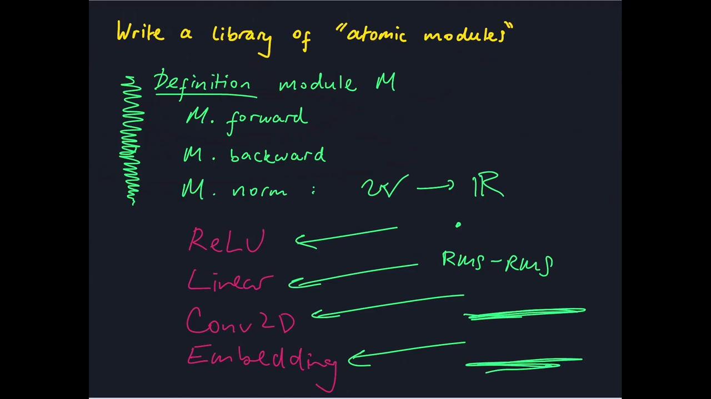
*▲ 강의 슬라이드 [78:20](https://youtu.be/VcGPE4s_oNw?t=4700): 원자 모듈 라이브러리, 모듈마다 forward, backward, norm*

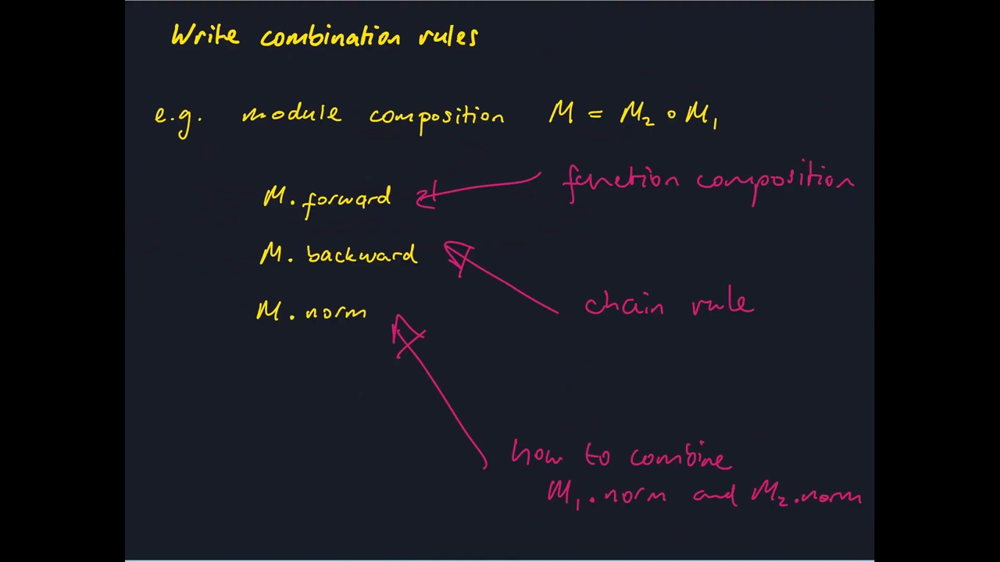
*▲ 강의 슬라이드 [79:50](https://youtu.be/VcGPE4s_oNw?t=4790): 조합 규칙, 합성할 때 forward는 함수 합성, backward는 [연쇄법칙](00_%EB%94%A5%EB%9F%AC%EB%8B%9D_%EC%9A%A9%EC%96%B4%EC%82%AC%EC%A0%84.md#chain-rule-%EC%97%B0%EC%87%84%EB%B2%95%EC%B9%99), norm은 "어떻게 합치나?"*

**참고 문헌**(마지막 슬라이드): 무한 너비 극한을 다루는 연구 두 편(Yang & Hu 2021의 무한 너비 신경망의 특징 [학습](00_%EB%94%A5%EB%9F%AC%EB%8B%9D_%EC%9A%A9%EC%96%B4%EC%82%AC%EC%A0%84.md#training-%ED%95%99%EC%8A%B5), Bordelon·Chaudhry·Pehlevan 2024의 다중 헤드 [트랜스포머](00_%EB%94%A5%EB%9F%AC%EB%8B%9D_%EC%9A%A9%EC%96%B4%EC%82%AC%EC%A0%84.md#transformer-%ED%8A%B8%EB%9E%9C%EC%8A%A4%ED%8F%AC%EB%A8%B8) 동역학의 무한 극한), 강사 팀의 모듈러 [노름](00_%EB%94%A5%EB%9F%AC%EB%8B%9D_%EC%9A%A9%EC%96%B4%EC%82%AC%EC%A0%84.md#norm-%EB%85%B8%EB%A6%84) 논문(Large 등 2024, 극한을 쓰지 않음), Streeter 2023의 범용 상한-최소화(majorization-minimization) 알고리즘.

---

## 11. 용어 정리

용어사전에 있는 용어는 위 본문에 링크를 걸었습니다. 아래는 이번 강의에서 새로 나온 용어입니다.

| 용어 | 뜻 |
|---|---|
| [테일러 전개](00_%EB%94%A5%EB%9F%AC%EB%8B%9D_%EC%9A%A9%EC%96%B4%EC%82%AC%EC%A0%84.md#taylor-expansion-%ED%85%8C%EC%9D%BC%EB%9F%AC-%EC%A0%84%EA%B0%9C)(Taylor expansion) | 함수를 지금 자리의 값, [기울기](00_%EB%94%A5%EB%9F%AC%EB%8B%9D_%EC%9A%A9%EC%96%B4%EC%82%AC%EC%A0%84.md#gradient-%EA%B8%B0%EC%9A%B8%EA%B8%B0), 휘어짐([헤세 행렬](00_%EB%94%A5%EB%9F%AC%EB%8B%9D_%EC%9A%A9%EC%96%B4%EC%82%AC%EC%A0%84.md#hessian-%ED%97%A4%EC%84%B8-%ED%96%89%EB%A0%AC))으로 어림한 다항식 |
| [1차 방법과 2차 방법](00_%EB%94%A5%EB%9F%AC%EB%8B%9D_%EC%9A%A9%EC%96%B4%EC%82%AC%EC%A0%84.md#first-order-method-second-order-method-1%EC%B0%A8-%EB%B0%A9%EB%B2%95%EA%B3%BC-2%EC%B0%A8-%EB%B0%A9%EB%B2%95)(First-order / Second-order method) | [기울기](00_%EB%94%A5%EB%9F%AC%EB%8B%9D_%EC%9A%A9%EC%96%B4%EC%82%AC%EC%A0%84.md#gradient-%EA%B8%B0%EC%9A%B8%EA%B8%B0)만 쓰는 최적화 / [헤세 행렬](00_%EB%94%A5%EB%9F%AC%EB%8B%9D_%EC%9A%A9%EC%96%B4%EC%82%AC%EC%A0%84.md#hessian-%ED%97%A4%EC%84%B8-%ED%96%89%EB%A0%AC)(2차 [미분](00_%EB%94%A5%EB%9F%AC%EB%8B%9D_%EC%9A%A9%EC%96%B4%EC%82%AC%EC%A0%84.md#derivative-%EB%AF%B8%EB%B6%84))도 쓰는 최적화 |
| [뉴턴 방법](00_%EB%94%A5%EB%9F%AC%EB%8B%9D_%EC%9A%A9%EC%96%B4%EC%82%AC%EC%A0%84.md#newtons-method-%EB%89%B4%ED%84%B4-%EB%B0%A9%EB%B2%95)([Newton's method](00_%EB%94%A5%EB%9F%AC%EB%8B%9D_%EC%9A%A9%EC%96%B4%EC%82%AC%EC%A0%84.md#newtons-method-%EB%89%B4%ED%84%B4-%EB%B0%A9%EB%B2%95)) | 2차 테일러 근사의 바닥으로 뛰는 걸음 $\Delta w = -H^{-1}g$ |
| [전처리](00_%EB%94%A5%EB%9F%AC%EB%8B%9D_%EC%9A%A9%EC%96%B4%EC%82%AC%EC%A0%84.md#preconditioning-%EC%A0%84%EC%B2%98%EB%A6%AC)([Preconditioning](00_%EB%94%A5%EB%9F%AC%EB%8B%9D_%EC%9A%A9%EC%96%B4%EC%82%AC%EC%A0%84.md#preconditioning-%EC%A0%84%EC%B2%98%EB%A6%AC)) | [기울기](00_%EB%94%A5%EB%9F%AC%EB%8B%9D_%EC%9A%A9%EC%96%B4%EC%82%AC%EC%A0%84.md#gradient-%EA%B8%B0%EC%9A%B8%EA%B8%B0)에 행렬을 곱해 방향마다 걸음 크기를 다르게 고치는 것 |
| [가우스-뉴턴 방법](00_%EB%94%A5%EB%9F%AC%EB%8B%9D_%EC%9A%A9%EC%96%B4%EC%82%AC%EC%A0%84.md#gauss-newton-method-%EA%B0%80%EC%9A%B0%EC%8A%A4-%EB%89%B4%ED%84%B4-%EB%B0%A9%EB%B2%95)(Gauss-Newton method) | 모델의 휘어짐을 버린 헤세 근사 $J^\top J$로 하는 [뉴턴 방법](00_%EB%94%A5%EB%9F%AC%EB%8B%9D_%EC%9A%A9%EC%96%B4%EC%82%AC%EC%A0%84.md#newtons-method-%EB%89%B4%ED%84%B4-%EB%B0%A9%EB%B2%95) |
| [최급강하법](00_%EB%94%A5%EB%9F%AC%EB%8B%9D_%EC%9A%A9%EC%96%B4%EC%82%AC%EC%A0%84.md#steepest-descent-%EC%B5%9C%EA%B8%89%EA%B0%95%ED%95%98%EB%B2%95)(Steepest descent) | 1차 항 + $\frac{\lambda}{2}\lVert \Delta w \rVert^2$를 최소로 만드는 걸음. [노름](00_%EB%94%A5%EB%9F%AC%EB%8B%9D_%EC%9A%A9%EC%96%B4%EC%82%AC%EC%A0%84.md#norm-%EB%85%B8%EB%A6%84)에 따라 알고리즘이 달라짐 |
| [부호 경사하강법](00_%EB%94%A5%EB%9F%AC%EB%8B%9D_%EC%9A%A9%EC%96%B4%EC%82%AC%EC%A0%84.md#sign-gradient-descent-%EB%B6%80%ED%98%B8-%EA%B2%BD%EC%82%AC%ED%95%98%EA%B0%95%EB%B2%95)(Sign gradient descent) | [기울기](00_%EB%94%A5%EB%9F%AC%EB%8B%9D_%EC%9A%A9%EC%96%B4%EC%82%AC%EC%A0%84.md#gradient-%EA%B8%B0%EC%9A%B8%EA%B8%B0) 부호만 써서 모든 좌표를 같은 크기로 움직임. $L_\infty$ 최급강하 |
| [쌍대 노름](00_%EB%94%A5%EB%9F%AC%EB%8B%9D_%EC%9A%A9%EC%96%B4%EC%82%AC%EC%A0%84.md#dual-norm-%EC%8C%8D%EB%8C%80-%EB%85%B8%EB%A6%84)([Dual norm](00_%EB%94%A5%EB%9F%AC%EB%8B%9D_%EC%9A%A9%EC%96%B4%EC%82%AC%EC%A0%84.md#dual-norm-%EC%8C%8D%EB%8C%80-%EB%85%B8%EB%A6%84)) | $\lVert g \rVert_\ast = \max_{\lVert t \rVert = 1} g^\top t$. 최급강하의 걸음 크기 |
| [특잇값 분해](00_%EB%94%A5%EB%9F%AC%EB%8B%9D_%EC%9A%A9%EC%96%B4%EC%82%AC%EC%A0%84.md#singular-value-decomposition-%ED%8A%B9%EC%9E%87%EA%B0%92-%EB%B6%84%ED%95%B4)(SVD) | 모든 행렬을 회전 · 축별 늘이기(특잇값) · 회전으로 쪼개는 것 |
| [스펙트럼 노름](00_%EB%94%A5%EB%9F%AC%EB%8B%9D_%EC%9A%A9%EC%96%B4%EC%82%AC%EC%A0%84.md#spectral-norm-%EC%8A%A4%ED%8E%99%ED%8A%B8%EB%9F%BC-%EB%85%B8%EB%A6%84)(Spectral norm) | 행렬의 최대 확대 배율 = 가장 큰 특잇값 |
| [프로베니우스 노름](00_%EB%94%A5%EB%9F%AC%EB%8B%9D_%EC%9A%A9%EC%96%B4%EC%82%AC%EC%A0%84.md#frobenius-norm-%ED%94%84%EB%A1%9C%EB%B2%A0%EB%8B%88%EC%9A%B0%EC%8A%A4-%EB%85%B8%EB%A6%84)(Frobenius norm) | 행렬 성분 제곱합의 제곱근 |
| [유도 연산자 노름](00_%EB%94%A5%EB%9F%AC%EB%8B%9D_%EC%9A%A9%EC%96%B4%EC%82%AC%EC%A0%84.md#induced-operator-norm-%EC%9C%A0%EB%8F%84-%EC%97%B0%EC%82%B0%EC%9E%90-%EB%85%B8%EB%A6%84)(Induced operator norm) | 입력·출력 [노름](00_%EB%94%A5%EB%9F%AC%EB%8B%9D_%EC%9A%A9%EC%96%B4%EC%82%AC%EC%A0%84.md#norm-%EB%85%B8%EB%A6%84)을 정해 만든 행렬 [노름](00_%EB%94%A5%EB%9F%AC%EB%8B%9D_%EC%9A%A9%EC%96%B4%EC%82%AC%EC%A0%84.md#norm-%EB%85%B8%EB%A6%84). RMS→[RMS 노름](00_%EB%94%A5%EB%9F%AC%EB%8B%9D_%EC%9A%A9%EC%96%B4%EC%82%AC%EC%A0%84.md#rms-norm-rms-%EB%85%B8%EB%A6%84) $= \sqrt{d_\text{in}/d_\text{out}}\,\lVert \cdot \rVert_\ast$ |
| [하이퍼파라미터 전이](00_%EB%94%A5%EB%9F%AC%EB%8B%9D_%EC%9A%A9%EC%96%B4%EC%82%AC%EC%A0%84.md#hyperparameter-transfer-%ED%95%98%EC%9D%B4%ED%8D%BC%ED%8C%8C%EB%9D%BC%EB%AF%B8%ED%84%B0-%EC%A0%84%EC%9D%B4)([Hyperparameter](00_%EB%94%A5%EB%9F%AC%EB%8B%9D_%EC%9A%A9%EC%96%B4%EC%82%AC%EC%A0%84.md#hyperparameter-%ED%95%98%EC%9D%B4%ED%8D%BC%ED%8C%8C%EB%9D%BC%EB%AF%B8%ED%84%B0) transfer) | 작은 모델에서 찾은 [학습률](00_%EB%94%A5%EB%9F%AC%EB%8B%9D_%EC%9A%A9%EC%96%B4%EC%82%AC%EC%A0%84.md#learning-rate-%ED%95%99%EC%8A%B5%EB%A5%A0) 등을 큰 모델에 그대로 쓰는 것 |
| [블록 배율](00_%EB%94%A5%EB%9F%AC%EB%8B%9D_%EC%9A%A9%EC%96%B4%EC%82%AC%EC%A0%84.md#block-multiplier-%EB%B8%94%EB%A1%9D-%EB%B0%B0%EC%9C%A8)(Block multiplier) | 잔차 블록 출력 앞에 곱하는 수($1/L$, $1/\sqrt{L}$) |
| [모듈과 모듈러 노름](00_%EB%94%A5%EB%9F%AC%EB%8B%9D_%EC%9A%A9%EC%96%B4%EC%82%AC%EC%A0%84.md#module-modular-norm-%EB%AA%A8%EB%93%88%EA%B3%BC-%EB%AA%A8%EB%93%88%EB%9F%AC-%EB%85%B8%EB%A6%84)([Module](00_%EB%94%A5%EB%9F%AC%EB%8B%9D_%EC%9A%A9%EC%96%B4%EC%82%AC%EC%A0%84.md#module-modular-norm-%EB%AA%A8%EB%93%88%EA%B3%BC-%EB%AA%A8%EB%93%88%EB%9F%AC-%EB%85%B8%EB%A6%84), Modular norm) | forward·backward·norm을 가진 부품과, 조합 규칙으로 합쳐 만든 전체 신경망의 [노름](00_%EB%94%A5%EB%9F%AC%EB%8B%9D_%EC%9A%A9%EC%96%B4%EC%82%AC%EC%A0%84.md#norm-%EB%85%B8%EB%A6%84) |
| [Muon](00_%EB%94%A5%EB%9F%AC%EB%8B%9D_%EC%9A%A9%EC%96%B4%EC%82%AC%EC%A0%84.md#muon-%EB%AE%A4%EC%98%A8-%EC%98%B5%ED%8B%B0%EB%A7%88%EC%9D%B4%EC%A0%80)([Muon](00_%EB%94%A5%EB%9F%AC%EB%8B%9D_%EC%9A%A9%EC%96%B4%EC%82%AC%EC%A0%84.md#muon-%EB%AE%A4%EC%98%A8-%EC%98%B5%ED%8B%B0%EB%A7%88%EC%9D%B4%EC%A0%80)) | [모멘텀](00_%EB%94%A5%EB%9F%AC%EB%8B%9D_%EC%9A%A9%EC%96%B4%EC%82%AC%EC%A0%84.md#momentum-%EB%AA%A8%EB%A9%98%ED%85%80) 업데이트를 직교화하는 [옵티마이저](00_%EB%94%A5%EB%9F%AC%EB%8B%9D_%EC%9A%A9%EC%96%B4%EC%82%AC%EC%A0%84.md#optimizer-%EC%98%B5%ED%8B%B0%EB%A7%88%EC%9D%B4%EC%A0%80). [스펙트럼 노름](00_%EB%94%A5%EB%9F%AC%EB%8B%9D_%EC%9A%A9%EC%96%B4%EC%82%AC%EC%A0%84.md#spectral-norm-%EC%8A%A4%ED%8E%99%ED%8A%B8%EB%9F%BC-%EB%85%B8%EB%A6%84) 최급강하에 가까움 (2026 업데이트) |
