# Lec 08. 아키텍처: 트랜스포머 (Architectures: Transformers)

← 이전: [Lec07_최적화의_스케일링_규칙](Lec07_%EC%B5%9C%EC%A0%81%ED%99%94%EC%9D%98_%EC%8A%A4%EC%BC%80%EC%9D%BC%EB%A7%81_%EA%B7%9C%EC%B9%99.md) · [목차](00_MIT%EB%94%A5%EB%9F%AC%EB%8B%9D_%EB%AA%A9%EC%B0%A8.md) · 다음: [Lec09_해커의_딥러닝_가이드](Lec09_%ED%95%B4%EC%BB%A4%EC%9D%98_%EB%94%A5%EB%9F%AC%EB%8B%9D_%EA%B0%80%EC%9D%B4%EB%93%9C.md) →

> [!NOTE]
> **강의 정보**
> - **출처**: MIT OpenCourseWare, [Lec 08. Architectures: Transformers](https://www.youtube.com/watch?v=Q1HOKrNeh2M) (74분, 2024년 가을 학기)
> - **강사**: Phillip Isola
> - **라이선스**: 원 강의는 CC BY-NC-SA 4.0입니다. 이 노트는 영어 자막을 바탕으로 한국어로 옮겨 정리한 2차 저작물이며, 같은 조건(비영리·출처 표기·동일 조건 공유)을 따릅니다.
> - 각 절 제목 아래의 `▶ 영상` 시간을 누르면 영상의 해당 위치로 갑니다.
> - `📐 수학 개념` 줄은 그 절에 쓰인 수학을 정리한 노트로 연결됩니다. 전체 목록은 [00_MIT딥러닝_목차](00_MIT%EB%94%A5%EB%9F%AC%EB%8B%9D_%EB%AA%A9%EC%B0%A8.md).
> - 슬라이드 캡처는 원 강의(CC BY-NC-SA 4.0)에서 가져왔고, "직접 그린 그림"은 이 노트의 숫자로 새로 그렸습니다.
> - `🆕 2026 업데이트` 칸은 강의(2024년 가을) 이후의 변화를 덧붙인 것입니다.

## 한눈에 보기

| 구분 | 내용 |
|---|---|
| 핵심 질문 | 지금 거의 모든 분야를 차지한 [트랜스포머](00_%EB%94%A5%EB%9F%AC%EB%8B%9D_%EC%9A%A9%EC%96%B4%EC%82%AC%EC%A0%84.md#transformer-%ED%8A%B8%EB%9E%9C%EC%8A%A4%ED%8F%AC%EB%A8%B8)는 무엇으로 이루어져 있나? |
| 세 가지 생각 | (1) [토큰](00_%EB%94%A5%EB%9F%AC%EB%8B%9D_%EC%9A%A9%EC%96%B4%EC%82%AC%EC%A0%84.md#token-%ED%86%A0%ED%81%B0): 뉴런 대신 벡터 단위로 계산 (2) [어텐션](00_%EB%94%A5%EB%9F%AC%EB%8B%9D_%EC%9A%A9%EC%96%B4%EC%82%AC%EC%A0%84.md#attention-%EC%96%B4%ED%85%90%EC%85%98): 결합 [가중치](00_%EB%94%A5%EB%9F%AC%EB%8B%9D_%EC%9A%A9%EC%96%B4%EC%82%AC%EC%A0%84.md#weight-%EA%B0%80%EC%A4%91%EC%B9%98)를 데이터가 정함 (유일하게 새로운 것) (3) [위치 인코딩](00_%EB%94%A5%EB%9F%AC%EB%8B%9D_%EC%9A%A9%EC%96%B4%EC%82%AC%EC%A0%84.md#positional-encoding-%EC%9C%84%EC%B9%98-%EC%9D%B8%EC%BD%94%EB%94%A9): 순서 정보를 붙임 |
| [어텐션](00_%EB%94%A5%EB%9F%AC%EB%8B%9D_%EC%9A%A9%EC%96%B4%EC%82%AC%EC%A0%84.md#attention-%EC%96%B4%ED%85%90%EC%85%98) 식 | $\text{softmax}(QK^\top/\sqrt{m})\,V$. 쿼리와 키의 [내적](00_%EB%94%A5%EB%9F%AC%EB%8B%9D_%EC%9A%A9%EC%96%B4%EC%82%AC%EC%A0%84.md#dot-product-%EB%82%B4%EC%A0%81)으로 [가중치](00_%EB%94%A5%EB%9F%AC%EB%8B%9D_%EC%9A%A9%EC%96%B4%EC%82%AC%EC%A0%84.md#weight-%EA%B0%80%EC%A4%91%EC%B9%98)를 정하고 값을 섞음 |
| [트랜스포머](00_%EB%94%A5%EB%9F%AC%EB%8B%9D_%EC%9A%A9%EC%96%B4%EC%82%AC%EC%A0%84.md#transformer-%ED%8A%B8%EB%9E%9C%EC%8A%A4%ED%8F%AC%EB%A8%B8) 블록 | [층 정규화](00_%EB%94%A5%EB%9F%AC%EB%8B%9D_%EC%9A%A9%EC%96%B4%EC%82%AC%EC%A0%84.md#layer-normalization-%EC%B8%B5-%EC%A0%95%EA%B7%9C%ED%99%94) → [멀티헤드 셀프 어텐션](00_%EB%94%A5%EB%9F%AC%EB%8B%9D_%EC%9A%A9%EC%96%B4%EC%82%AC%EC%A0%84.md#multi-head-attention-%EB%A9%80%ED%8B%B0%ED%97%A4%EB%93%9C-%EC%96%B4%ED%85%90%EC%85%98) → 잔차 덧셈 → [층 정규화](00_%EB%94%A5%EB%9F%AC%EB%8B%9D_%EC%9A%A9%EC%96%B4%EC%82%AC%EC%A0%84.md#layer-normalization-%EC%B8%B5-%EC%A0%95%EA%B7%9C%ED%99%94) → 토큰별 MLP → 잔차 덧셈, 이를 L번 |
| 다른 구조와의 관계 | [토큰](00_%EB%94%A5%EB%9F%AC%EB%8B%9D_%EC%9A%A9%EC%96%B4%EC%82%AC%EC%A0%84.md#token-%ED%86%A0%ED%81%B0) 넷 = 완전 연결 그래프 위의 [GNN](00_%EB%94%A5%EB%9F%AC%EB%8B%9D_%EC%9A%A9%EC%96%B4%EC%82%AC%EC%A0%84.md#gnn-graph-neural-network-%EA%B7%B8%EB%9E%98%ED%94%84-%EC%8B%A0%EA%B2%BD%EB%A7%9D). [어텐션](00_%EB%94%A5%EB%9F%AC%EB%8B%9D_%EC%9A%A9%EC%96%B4%EC%82%AC%EC%A0%84.md#attention-%EC%96%B4%ED%85%90%EC%85%98) [층](00_%EB%94%A5%EB%9F%AC%EB%8B%9D_%EC%9A%A9%EC%96%B4%EC%82%AC%EC%A0%84.md#layer-%EC%B8%B5)은 저랭크·희소한 [선형층](00_%EB%94%A5%EB%9F%AC%EB%8B%9D_%EC%9A%A9%EC%96%B4%EC%82%AC%EC%A0%84.md#linear-layer-%EC%84%A0%ED%98%95%EC%B8%B5)이고 순열 등변 |
| [언어 모델](00_%EB%94%A5%EB%9F%AC%EB%8B%9D_%EC%9A%A9%EC%96%B4%EC%82%AC%EC%A0%84.md#language-model-%EC%96%B8%EC%96%B4-%EB%AA%A8%EB%8D%B8) | [자기회귀](00_%EB%94%A5%EB%9F%AC%EB%8B%9D_%EC%9A%A9%EC%96%B4%EC%82%AC%EC%A0%84.md#autoregressive-model-%EC%9E%90%EA%B8%B0%ED%9A%8C%EA%B7%80-%EB%AA%A8%EB%8D%B8)로 다음 [토큰](00_%EB%94%A5%EB%9F%AC%EB%8B%9D_%EC%9A%A9%EC%96%B4%EC%82%AC%EC%A0%84.md#token-%ED%86%A0%ED%81%B0) 예측 + [인과 마스크](00_%EB%94%A5%EB%9F%AC%EB%8B%9D_%EC%9A%A9%EC%96%B4%EC%82%AC%EC%A0%84.md#causal-attention-%EC%9D%B8%EA%B3%BC-%EC%96%B4%ED%85%90%EC%85%98)(앞쪽만 봄) = [GPT](00_%EB%94%A5%EB%9F%AC%EB%8B%9D_%EC%9A%A9%EC%96%B4%EC%82%AC%EC%A0%84.md#gpt-%EC%83%9D%EC%84%B1%ED%98%95-%EC%82%AC%EC%A0%84%ED%95%99%EC%8A%B5-%ED%8A%B8%EB%9E%9C%EC%8A%A4%ED%8F%AC%EB%A8%B8) |

---

## 1. 오늘의 주제: 지금의 아키텍처

▶ 영상 [00:00](https://youtu.be/Q1HOKrNeh2M?t=0)

강사는 [트랜스포머](00_%EB%94%A5%EB%9F%AC%EB%8B%9D_%EC%9A%A9%EC%96%B4%EC%82%AC%EC%A0%84.md#transformer-%ED%8A%B8%EB%9E%9C%EC%8A%A4%ED%8F%AC%EB%A8%B8)를 "지금 써야 하는 아키텍처", 반지의 제왕에 빗대 **모든 것을 지배하는 하나의 반지**라고 소개합니다. 내년이면 바뀔 수도 있지만 지금 일자리를 주는 구조라는 농담과 함께입니다. [그래프 신경망](00_%EB%94%A5%EB%9F%AC%EB%8B%9D_%EC%9A%A9%EC%96%B4%EC%82%AC%EC%A0%84.md#gnn-graph-neural-network-%EA%B7%B8%EB%9E%98%ED%94%84-%EC%8B%A0%EA%B2%BD%EB%A7%9D)([Lec05_그래프_신경망](Lec05_%EA%B7%B8%EB%9E%98%ED%94%84_%EC%8B%A0%EA%B2%BD%EB%A7%9D.md))에서는 표현할 수 있는 함수의 큰 부류를 다뤘다면, 이번 강의는 **실제로 잘 작동하는 구체적인 한 가지 설계**를 배우는 실용적인 시간입니다.

[트랜스포머](00_%EB%94%A5%EB%9F%AC%EB%8B%9D_%EC%9A%A9%EC%96%B4%EC%82%AC%EC%A0%84.md#transformer-%ED%8A%B8%EB%9E%9C%EC%8A%A4%ED%8F%AC%EB%A8%B8)를 이루는 생각은 세 가지입니다.

1. **[토큰](00_%EB%94%A5%EB%9F%AC%EB%8B%9D_%EC%9A%A9%EC%96%B4%EC%82%AC%EC%A0%84.md#token-%ED%86%A0%ED%81%B0)([Token](00_%EB%94%A5%EB%9F%AC%EB%8B%9D_%EC%9A%A9%EC%96%B4%EC%82%AC%EC%A0%84.md#token-%ED%86%A0%ED%81%B0))** 위에서 계산하기. [GNN](00_%EB%94%A5%EB%9F%AC%EB%8B%9D_%EC%9A%A9%EC%96%B4%EC%82%AC%EC%A0%84.md#gnn-graph-neural-network-%EA%B7%B8%EB%9E%98%ED%94%84-%EC%8B%A0%EA%B2%BD%EB%A7%9D) 강의에서 본 것의 새 이름입니다.
2. **[어텐션](00_%EB%94%A5%EB%9F%AC%EB%8B%9D_%EC%9A%A9%EC%96%B4%EC%82%AC%EC%A0%84.md#attention-%EC%96%B4%ED%85%90%EC%85%98)([Attention](00_%EB%94%A5%EB%9F%AC%EB%8B%9D_%EC%9A%A9%EC%96%B4%EC%82%AC%EC%A0%84.md#attention-%EC%96%B4%ED%85%90%EC%85%98))**. 이것만 정말 새로운 생각입니다.
3. **[위치 인코딩](00_%EB%94%A5%EB%9F%AC%EB%8B%9D_%EC%9A%A9%EC%96%B4%EC%82%AC%EC%A0%84.md#positional-encoding-%EC%9C%84%EC%B9%98-%EC%9D%B8%EC%BD%94%EB%94%A9)(Positional encoding)**. 이미 몇 번 본 것입니다.

강의를 여는 이야기는 보르헤스의 단편 「『돈키호테』의 저자 피에르 메나르」입니다. 메나르는 세르반테스의 『돈키호테』를 한 글자도 다르지 않게 다시 썼지만, 시대와 삶의 맥락이 달라 완전히 새로운 의미를 갖게 됩니다. 강사는 이것이 오늘 강의와 이 수업 전체의 주제라고 말합니다. **같은 생각이 맥락에 따라 새 의미를 얻는다**는 것입니다. 오늘 배우는 것도 대부분 옛 생각에 새 이름을 붙인 것이고, 맥락이 문장 속 단어의 뜻을 바꾼다는 점은 [어텐션](00_%EB%94%A5%EB%9F%AC%EB%8B%9D_%EC%9A%A9%EC%96%B4%EC%82%AC%EC%A0%84.md#attention-%EC%96%B4%ED%85%90%EC%85%98)이 하는 일 그 자체이기도 합니다.

> [!TIP]
> **🆕 2026 업데이트: "내년엔 바뀔 것"이라던 아키텍처**
> - **강의**: [트랜스포머](00_%EB%94%A5%EB%9F%AC%EB%8B%9D_%EC%9A%A9%EC%96%B4%EC%82%AC%EC%A0%84.md#transformer-%ED%8A%B8%EB%9E%9C%EC%8A%A4%ED%8F%AC%EB%A8%B8)가 지금의 지배적 구조지만 곧 바뀔 수 있다고 말함.
> - **현재**: 2026년에도 최신 대형 [언어 모델](00_%EB%94%A5%EB%9F%AC%EB%8B%9D_%EC%9A%A9%EC%96%B4%EC%82%AC%EC%A0%84.md#language-model-%EC%96%B8%EC%96%B4-%EB%AA%A8%EB%8D%B8)의 뼈대는 [트랜스포머](00_%EB%94%A5%EB%9F%AC%EB%8B%9D_%EC%9A%A9%EC%96%B4%EC%82%AC%EC%A0%84.md#transformer-%ED%8A%B8%EB%9E%9C%EC%8A%A4%ED%8F%AC%EB%A8%B8)입니다. 가장 큰 변화는 토큰별 MLP 자리를 **[전문가 혼합](00_%EB%94%A5%EB%9F%AC%EB%8B%9D_%EC%9A%A9%EC%96%B4%EC%82%AC%EC%A0%84.md#mixture-of-experts-%EC%A0%84%EB%AC%B8%EA%B0%80-%ED%98%BC%ED%95%A9)(Mixture of experts, MoE)** 으로 바꾼 것입니다. [토큰](00_%EB%94%A5%EB%9F%AC%EB%8B%9D_%EC%9A%A9%EC%96%B4%EC%82%AC%EC%A0%84.md#token-%ED%86%A0%ED%81%B0)마다 여러 MLP(전문가) 중 일부만 골라 쓰므로 전체 [파라미터](00_%EB%94%A5%EB%9F%AC%EB%8B%9D_%EC%9A%A9%EC%96%B4%EC%82%AC%EC%A0%84.md#parameter-%ED%8C%8C%EB%9D%BC%EB%AF%B8%ED%84%B0)는 크게, 계산량은 작게 유지합니다. DeepSeek-V3는 전체 671B [파라미터](00_%EB%94%A5%EB%9F%AC%EB%8B%9D_%EC%9A%A9%EC%96%B4%EC%82%AC%EC%A0%84.md#parameter-%ED%8C%8C%EB%9D%BC%EB%AF%B8%ED%84%B0) 중 토큰당 37B만 쓰고, Meta의 Llama 4 Scout는 전문가 16개, 전체 109B 중 토큰당 17B를 씁니다. [어텐션](00_%EB%94%A5%EB%9F%AC%EB%8B%9D_%EC%9A%A9%EC%96%B4%EC%82%AC%EC%A0%84.md#attention-%EC%96%B4%ED%85%90%EC%85%98)의 $n^2$ 비용을 피하려는 [상태 공간 모델](00_%EB%94%A5%EB%9F%AC%EB%8B%9D_%EC%9A%A9%EC%96%B4%EC%82%AC%EC%A0%84.md#state-space-model-%EC%83%81%ED%83%9C-%EA%B3%B5%EA%B0%84-%EB%AA%A8%EB%8D%B8)(Mamba)도 나왔고, Jamba처럼 [트랜스포머](00_%EB%94%A5%EB%9F%AC%EB%8B%9D_%EC%9A%A9%EC%96%B4%EC%82%AC%EC%A0%84.md#transformer-%ED%8A%B8%EB%9E%9C%EC%8A%A4%ED%8F%AC%EB%A8%B8) [층](00_%EB%94%A5%EB%9F%AC%EB%8B%9D_%EC%9A%A9%EC%96%B4%EC%82%AC%EC%A0%84.md#layer-%EC%B8%B5)과 Mamba [층](00_%EB%94%A5%EB%9F%AC%EB%8B%9D_%EC%9A%A9%EC%96%B4%EC%82%AC%EC%A0%84.md#layer-%EC%B8%B5)을 섞은 하이브리드 모델도 있습니다.
> - **출처**: [DeepSeek-V3 Technical Report (DeepSeek-AI, 2024)](https://arxiv.org/abs/2412.19437) · [The Llama 4 herd (Meta AI 블로그, 2025)](https://ai.meta.com/blog/llama-4-multimodal-intelligence/) · [Mamba: Linear-Time Sequence Modeling with Selective State Spaces (Gu·Dao, 2023)](https://arxiv.org/abs/2312.00752) · [Jamba: A Hybrid Transformer-Mamba Language Model (Lieber 외, 2024)](https://arxiv.org/abs/2403.19887)

---

## 2. CNN의 한계와 어텐션의 직관

### 2.1 국소성의 한계

▶ 영상 [02:51](https://youtu.be/Q1HOKrNeh2M?t=171)

📐 **수학 개념**: [수용 영역과 출력 크기](%EC%88%98%ED%95%99%EA%B0%9C%EB%85%90/07_%EA%B5%AC%EC%A1%B0_%EC%95%84%ED%82%A4%ED%85%8D%EC%B2%98/MM16_%EC%88%98%EC%9A%A9_%EC%98%81%EC%97%AD%EA%B3%BC_%EC%B6%9C%EB%A0%A5_%ED%81%AC%EA%B8%B0.md) (Lec04)

"이 사진에 새가 몇 마리인가?"는 [CNN](00_%EB%94%A5%EB%9F%AC%EB%8B%9D_%EC%9A%A9%EC%96%B4%EC%82%AC%EC%A0%84.md#cnn-convolutional-neural-network-%ED%95%A9%EC%84%B1%EA%B3%B1-%EC%8B%A0%EA%B2%BD%EB%A7%9D)으로 잘 풉니다. 조각으로 나눠 [필터](00_%EB%94%A5%EB%9F%AC%EB%8B%9D_%EC%9A%A9%EC%96%B4%EC%82%AC%EC%A0%84.md#filter-%ED%95%84%ED%84%B0)로 처리하고 결과를 모아 세면 됩니다. 그런데 "오른쪽 위 새와 왼쪽 아래 새가 같은 종인가?"는 어떨까요? [CNN](00_%EB%94%A5%EB%9F%AC%EB%8B%9D_%EC%9A%A9%EC%96%B4%EC%82%AC%EC%A0%84.md#cnn-convolutional-neural-network-%ED%95%A9%EC%84%B1%EA%B3%B1-%EC%8B%A0%EA%B2%BD%EB%A7%9D)도 충분히 깊어 [수용 영역](00_%EB%94%A5%EB%9F%AC%EB%8B%9D_%EC%9A%A9%EC%96%B4%EC%82%AC%EC%A0%84.md#receptive-field-%EC%88%98%EC%9A%A9-%EC%98%81%EC%97%AD)이 넓으면 풀 수 있지만 좋은 방법은 아닙니다. [CNN](00_%EB%94%A5%EB%9F%AC%EB%8B%9D_%EC%9A%A9%EC%96%B4%EC%82%AC%EC%A0%84.md#cnn-convolutional-neural-network-%ED%95%A9%EC%84%B1%EA%B3%B1-%EC%8B%A0%EA%B2%BD%EB%A7%9D)의 [필터](00_%EB%94%A5%EB%9F%AC%EB%8B%9D_%EC%9A%A9%EC%96%B4%EC%82%AC%EC%A0%84.md#filter-%ED%95%84%ED%84%B0)는 모두 **국소적**이어서, 멀리 떨어진 것들의 관계를 판단하기에 알맞지 않습니다.

국소성은 강한 [귀납 편향](00_%EB%94%A5%EB%9F%AC%EB%8B%9D_%EC%9A%A9%EC%96%B4%EC%82%AC%EC%A0%84.md#inductive-bias-%EA%B7%80%EB%82%A9-%ED%8E%B8%ED%96%A5)이고 대부분 좋은 것입니다. 이 강의실 사람들에 대해 알고 싶으면 화성을 볼 필요 없이 이 방만 보면 됩니다. 세상은 대체로 매끄럽습니다. 하지만 늘 그렇지는 않습니다.

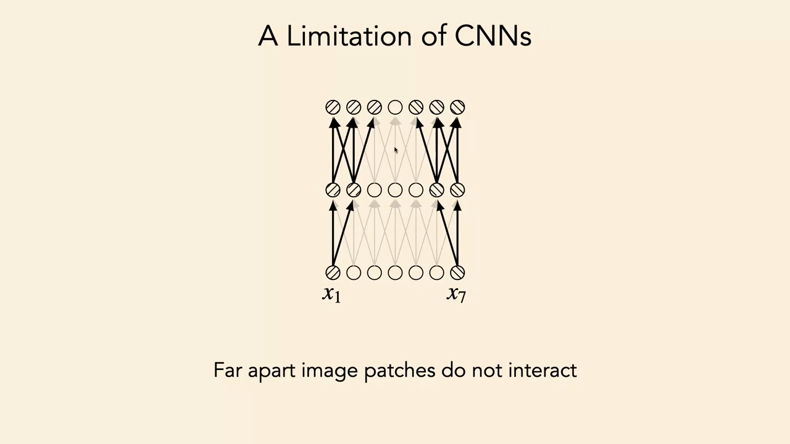
*▲ 강의 슬라이드 [05:00](https://youtu.be/Q1HOKrNeh2M?t=300): 길이 3 [필터](00_%EB%94%A5%EB%9F%AC%EB%8B%9D_%EC%9A%A9%EC%96%B4%EC%82%AC%EC%A0%84.md#filter-%ED%95%84%ED%84%B0)를 쓴 2층 합성곱망. [출력층](00_%EB%94%A5%EB%9F%AC%EB%8B%9D_%EC%9A%A9%EC%96%B4%EC%82%AC%EC%A0%84.md#output-layer-%EC%B6%9C%EB%A0%A5%EC%B8%B5)의 어떤 뉴런도 $x_1$과 $x_7$을 함께 보지 못한다*

강사는 잉크 비유를 씁니다. 뉴런 하나에 잉크를 떨어뜨리면 화살표를 따라 한 [층](00_%EB%94%A5%EB%9F%AC%EB%8B%9D_%EC%9A%A9%EC%96%B4%EC%82%AC%EC%A0%84.md#layer-%EC%B8%B5)에 한 칸씩 번집니다. 길이 3 [필터](00_%EB%94%A5%EB%9F%AC%EB%8B%9D_%EC%9A%A9%EC%96%B4%EC%82%AC%EC%A0%84.md#filter-%ED%95%84%ED%84%B0)면 [층](00_%EB%94%A5%EB%9F%AC%EB%8B%9D_%EC%9A%A9%EC%96%B4%EC%82%AC%EC%A0%84.md#layer-%EC%B8%B5)마다 [수용 영역](00_%EB%94%A5%EB%9F%AC%EB%8B%9D_%EC%9A%A9%EC%96%B4%EC%82%AC%EC%A0%84.md#receptive-field-%EC%88%98%EC%9A%A9-%EC%98%81%EC%97%AD)이 양쪽으로 한 칸씩 넓어지므로, 2층으로는 $x_1$과 $x_7$의 잉크가 한 뉴런에서 만나지 못합니다. 이 망은 **$x_1$과 $x_7$의 조합에 따라 달라지는 판단을 아예 할 수 없습니다.**

$$
|\text{RF}(L)| = 2L + 1 \qquad (\text{커널 크기 3, 스트라이드 1})
$$

기호 풀이

| 기호 | 읽는 법 | 뜻 | 예제 값 |
| --- | --- | --- | --- |
| $\text{RF}(L)$ | 알에프 엘 | $L$[층](00_%EB%94%A5%EB%9F%AC%EB%8B%9D_%EC%9A%A9%EC%96%B4%EC%82%AC%EC%A0%84.md#layer-%EC%B8%B5) 뒤 출력 뉴런 하나의 [수용 영역](00_%EB%94%A5%EB%9F%AC%EB%8B%9D_%EC%9A%A9%EC%96%B4%EC%82%AC%EC%A0%84.md#receptive-field-%EC%88%98%EC%9A%A9-%EC%98%81%EC%97%AD) | $x_1 \sim x_5$ |
| $\lvert\cdot\rvert$ | 크기 | [수용 영역](00_%EB%94%A5%EB%9F%AC%EB%8B%9D_%EC%9A%A9%EC%96%B4%EC%82%AC%EC%A0%84.md#receptive-field-%EC%88%98%EC%9A%A9-%EC%98%81%EC%97%AD)에 든 입력 개수 | 5 |
| $L$ | 엘 | 쌓은 [합성곱](00_%EB%94%A5%EB%9F%AC%EB%8B%9D_%EC%9A%A9%EC%96%B4%EC%82%AC%EC%A0%84.md#convolution-%ED%95%A9%EC%84%B1%EA%B3%B1) [층](00_%EB%94%A5%EB%9F%AC%EB%8B%9D_%EC%9A%A9%EC%96%B4%EC%82%AC%EC%A0%84.md#layer-%EC%B8%B5) 수 | 2 |
| $2L + 1$ | 이 엘 더하기 일 | [층](00_%EB%94%A5%EB%9F%AC%EB%8B%9D_%EC%9A%A9%EC%96%B4%EC%82%AC%EC%A0%84.md#layer-%EC%B8%B5)마다 양쪽으로 1칸씩 넓어짐 | 5 |

예제와 풀이

**문제**: 길이 3 [필터](00_%EB%94%A5%EB%9F%AC%EB%8B%9D_%EC%9A%A9%EC%96%B4%EC%82%AC%EC%A0%84.md#filter-%ED%95%84%ED%84%B0)를 $L$[층](00_%EB%94%A5%EB%9F%AC%EB%8B%9D_%EC%9A%A9%EC%96%B4%EC%82%AC%EC%A0%84.md#layer-%EC%B8%B5) 쌓은 1차원 합성곱망에서, 출력 뉴런 하나가 보는 입력 수 $|\text{RF}(L)|$이 7($x_1$부터 $x_7$까지)이 되려면 [층](00_%EB%94%A5%EB%9F%AC%EB%8B%9D_%EC%9A%A9%EC%96%B4%EC%82%AC%EC%A0%84.md#layer-%EC%B8%B5) 수 $L$이 얼마여야 하는지 구한다.

**주어진 값**:
- 커널 크기 3 ([필터](00_%EB%94%A5%EB%9F%AC%EB%8B%9D_%EC%9A%A9%EC%96%B4%EC%82%AC%EC%A0%84.md#filter-%ED%95%84%ED%84%B0) 길이. [층](00_%EB%94%A5%EB%9F%AC%EB%8B%9D_%EC%9A%A9%EC%96%B4%EC%82%AC%EC%A0%84.md#layer-%EC%B8%B5)마다 [수용 영역](00_%EB%94%A5%EB%9F%AC%EB%8B%9D_%EC%9A%A9%EC%96%B4%EC%82%AC%EC%A0%84.md#receptive-field-%EC%88%98%EC%9A%A9-%EC%98%81%EC%97%AD)이 양쪽으로 1칸씩 넓어짐)
- 필요한 입력 수 7 ($x_1$과 $x_7$을 함께 보려면 덮어야 하는 입력 개수)
- 시험할 [층](00_%EB%94%A5%EB%9F%AC%EB%8B%9D_%EC%9A%A9%EC%96%B4%EC%82%AC%EC%A0%84.md#layer-%EC%B8%B5) 수 $L = 2$ (강의 그림), $L = 3$

**풀이**
1. 식을 그대로 쓴다: $|\text{RF}(L)| = 2L + 1$
2. 값을 대입한다 ($L = 2$): $|\text{RF}(2)| = 2 \times 2 + 1$
3. 곱셈을 먼저 한다: $2 \times 2 = 4$ 이므로 $|\text{RF}(2)| = 4 + 1$
4. 덧셈을 한다: $4 + 1 = 5$. 7보다 작으므로 2층으로는 부족하다 (강의 그림의 상황)
5. 값을 대입한다 ($L = 3$): $|\text{RF}(3)| = 2 \times 3 + 1$
6. 곱셈을 먼저 한다: $2 \times 3 = 6$ 이므로 $|\text{RF}(3)| = 6 + 1$
7. 덧셈을 한다: $6 + 1 = 7$. 필요한 7과 같다

**답**: **3층**. [셀프 어텐션](00_%EB%94%A5%EB%9F%AC%EB%8B%9D_%EC%9A%A9%EC%96%B4%EC%82%AC%EC%A0%84.md#self-attention-%EC%85%80%ED%94%84-%EC%96%B4%ED%85%90%EC%85%98)은 1층에서 이미 7개를 모두 본다.

내 이해

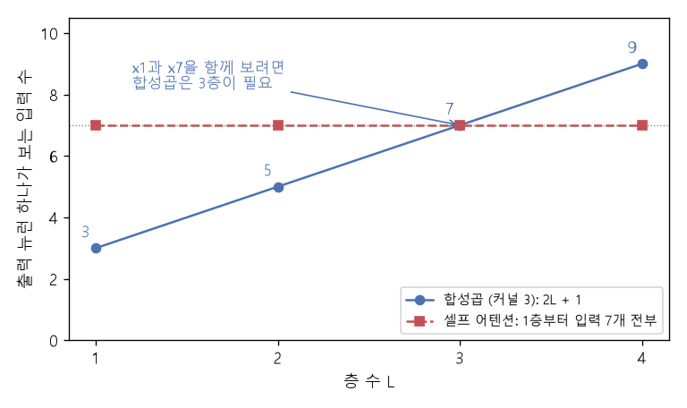
*▲ 직접 그린 그림: 커널 3 [합성곱](00_%EB%94%A5%EB%9F%AC%EB%8B%9D_%EC%9A%A9%EC%96%B4%EC%82%AC%EC%A0%84.md#convolution-%ED%95%A9%EC%84%B1%EA%B3%B1)의 [수용 영역](00_%EB%94%A5%EB%9F%AC%EB%8B%9D_%EC%9A%A9%EC%96%B4%EC%82%AC%EC%A0%84.md#receptive-field-%EC%88%98%EC%9A%A9-%EC%98%81%EC%97%AD)(3, 5, 7, 9)과 [셀프 어텐션](00_%EB%94%A5%EB%9F%AC%EB%8B%9D_%EC%9A%A9%EC%96%B4%EC%82%AC%EC%A0%84.md#self-attention-%EC%85%80%ED%94%84-%EC%96%B4%ED%85%90%EC%85%98)(1층부터 전부). 입력 7개를 함께 보려면 [합성곱](00_%EB%94%A5%EB%9F%AC%EB%8B%9D_%EC%9A%A9%EC%96%B4%EC%82%AC%EC%A0%84.md#convolution-%ED%95%A9%EC%84%B1%EA%B3%B1)은 3층이 필요하다*

### 2.2 전역으로, 그러나 골라서

▶ 영상 [06:19](https://youtu.be/Q1HOKrNeh2M?t=379)

전역으로 보는 구조는 이미 있습니다. 청중이 답한 대로 **완전 연결 [MLP](00_%EB%94%A5%EB%9F%AC%EB%8B%9D_%EC%9A%A9%EC%96%B4%EC%82%AC%EC%A0%84.md#multi-layer-perceptron-%EB%8B%A4%EC%B8%B5-%ED%8D%BC%EC%85%89%ED%8A%B8%EB%A1%A0)** 입니다. 모든 출력 뉴런이 모든 입력과 이어져 정보가 즉시 전역으로 모입니다. 하지만 $\mathbb{R}^n \to \mathbb{R}^n$ 사상에 $n^2$개의 연결과 [파라미터](00_%EB%94%A5%EB%9F%AC%EB%8B%9D_%EC%9A%A9%EC%96%B4%EC%82%AC%EC%A0%84.md#parameter-%ED%8C%8C%EB%9D%BC%EB%AF%B8%ED%84%B0)가 필요해 계산도 [학습](00_%EB%94%A5%EB%9F%AC%EB%8B%9D_%EC%9A%A9%EC%96%B4%EC%82%AC%EC%A0%84.md#training-%ED%95%99%EC%8A%B5)도 너무 무겁습니다.

[어텐션](00_%EB%94%A5%EB%9F%AC%EB%8B%9D_%EC%9A%A9%EC%96%B4%EC%82%AC%EC%A0%84.md#attention-%EC%96%B4%ED%85%90%EC%85%98)은 그 중간입니다. **전역으로 보되 듬성듬성(sparsely) 봅니다.** 질문이 주어지면 입력 중 그 질문에 중요한 부분에만 주의를 기울입니다. 새를 세려면 새가 있는 곳을, 두 새의 종을 비교하려면 그 두 새를, 하늘색을 물으면 하늘만 봅니다. 사람이 장면을 볼 때 하는 일을 흉내 낸 것입니다.

---

## 3. 토큰

### 3.1 토큰은 뉴런의 벡터

▶ 영상 [08:00](https://youtu.be/Q1HOKrNeh2M?t=480)

이 강의에서 **[토큰](00_%EB%94%A5%EB%9F%AC%EB%8B%9D_%EC%9A%A9%EC%96%B4%EC%82%AC%EC%A0%84.md#token-%ED%86%A0%ED%81%B0)은 뉴런을 묶은 벡터**입니다. [GNN](00_%EB%94%A5%EB%9F%AC%EB%8B%9D_%EC%9A%A9%EC%96%B4%EC%82%AC%EC%A0%84.md#gnn-graph-neural-network-%EA%B7%B8%EB%9E%98%ED%94%84-%EC%8B%A0%EA%B2%BD%EB%A7%9D) 강의의 노드 특징 벡터에 새 이름을 붙인 것입니다([Lec05 6.1](Lec05_%EA%B7%B8%EB%9E%98%ED%94%84_%EC%8B%A0%EA%B2%BD%EB%A7%9D.md#61-%EC%A7%91%EA%B3%84%EC%99%80-%EA%B0%B1%EC%8B%A0)). [계산 그래프](00_%EB%94%A5%EB%9F%AC%EB%8B%9D_%EC%9A%A9%EC%96%B4%EC%82%AC%EC%A0%84.md#computational-graph-%EA%B3%84%EC%82%B0-%EA%B7%B8%EB%9E%98%ED%94%84) 안에서 따로 포장된 작은 정보 꾸러미로, 한 단위로 처리됩니다. MLP가 뉴런의 배열 위에서 계산한다면, [트랜스포머](00_%EB%94%A5%EB%9F%AC%EB%8B%9D_%EC%9A%A9%EC%96%B4%EC%82%AC%EC%A0%84.md#transformer-%ED%8A%B8%EB%9E%9C%EC%8A%A4%ED%8F%AC%EB%A8%B8)는 **[토큰](00_%EB%94%A5%EB%9F%AC%EB%8B%9D_%EC%9A%A9%EC%96%B4%EC%82%AC%EC%A0%84.md#token-%ED%86%A0%ED%81%B0)의 배열(사실은 집합)** 위에서 계산합니다.

강사는 이 정의가 표준과 조금 다르다고 짚습니다. 컴퓨터 비전 문헌에서는 이렇게 쓰지만, 자연어 처리에서 [토큰](00_%EB%94%A5%EB%9F%AC%EB%8B%9D_%EC%9A%A9%EC%96%B4%EC%82%AC%EC%A0%84.md#token-%ED%86%A0%ED%81%B0)은 보통 **어휘의 이산 단위**(알파벳 한 글자, 단어 하나 등)를 뜻합니다. 강사는 "문제를 나누는 정보 덩어리"라는 더 일반적인 뜻이 낫다고 보고 이 강의에서는 그 뜻을 씁니다.

### 3.2 데이터를 토큰으로 바꾸기

▶ 영상 [11:26](https://youtu.be/Q1HOKrNeh2M?t=686)

[트랜스포머](00_%EB%94%A5%EB%9F%AC%EB%8B%9D_%EC%9A%A9%EC%96%B4%EC%82%AC%EC%A0%84.md#transformer-%ED%8A%B8%EB%9E%9C%EC%8A%A4%ED%8F%AC%EB%A8%B8)가 거의 모든 분야를 차지한 이유 하나는 **영역을 가리지 않는다**는 것입니다. 요리법은 두 단계입니다.

1. 그 분야 전문가가 데이터를 [토큰](00_%EB%94%A5%EB%9F%AC%EB%8B%9D_%EC%9A%A9%EC%96%B4%EC%82%AC%EC%A0%84.md#token-%ED%86%A0%ED%81%B0)으로 바꾼다([토큰화](00_%EB%94%A5%EB%9F%AC%EB%8B%9D_%EC%9A%A9%EC%96%B4%EC%82%AC%EC%A0%84.md#tokenization-%ED%86%A0%ED%81%B0%ED%99%94), [Tokenization](00_%EB%94%A5%EB%9F%AC%EB%8B%9D_%EC%9A%A9%EC%96%B4%EC%82%AC%EC%A0%84.md#tokenization-%ED%86%A0%ED%81%B0%ED%99%94)).
2. 범용 [트랜스포머](00_%EB%94%A5%EB%9F%AC%EB%8B%9D_%EC%9A%A9%EC%96%B4%EC%82%AC%EC%A0%84.md#transformer-%ED%8A%B8%EB%9E%9C%EC%8A%A4%ED%8F%AC%EB%A8%B8)가 [토큰](00_%EB%94%A5%EB%9F%AC%EB%8B%9D_%EC%9A%A9%EC%96%B4%EC%82%AC%EC%A0%84.md#token-%ED%86%A0%ED%81%B0)을 처리한다.

이미지는 겹치지 않는 **패치**로 자르고, 각 패치의 픽셀 값을 한 줄로 펴서([평탄화](00_%EB%94%A5%EB%9F%AC%EB%8B%9D_%EC%9A%A9%EC%96%B4%EC%82%AC%EC%A0%84.md#flatten-%ED%8F%89%ED%83%84%ED%99%94)) 행렬 $W_{\text{tokenize}}$를 곱해 $d$차원 벡터로 만듭니다. 이 행렬은 학습할 수도, 정해 둘 수도 있습니다.

$$
\mathbf{t} = W_{\text{tok}}\ \text{vec}(\text{patch}), \qquad \mathbf{t} \in \mathbb{R}^d
$$

기호 풀이

| 기호 | 읽는 법 | 뜻 | 예제 값 |
| --- | --- | --- | --- |
| $\text{patch}$ | 패치 | 이미지에서 잘라 낸 작은 정사각형 | 2×2 `[[1, 2], [3, 4]]` |
| $\text{vec}(\cdot)$ | 벡 | 행렬을 한 줄 벡터로 펴기 | (1, 2, 3, 4) |
| $W_{\text{tok}}$ | 더블유 토크 | 펼친 패치를 $d$차원으로 보내는 행렬 ($d \times$ 픽셀 수) | `[[1, 0, 1, 0], [0, 1, 0, 1]]` |
| $\mathbf{t}$ | 티 | 만들어진 [토큰](00_%EB%94%A5%EB%9F%AC%EB%8B%9D_%EC%9A%A9%EC%96%B4%EC%82%AC%EC%A0%84.md#token-%ED%86%A0%ED%81%B0) 벡터 | (4, 6) |
| $\mathbb{R}^d$ | 알 디 | $d$개 실수의 벡터 공간 | $d = 2$ |

예제와 풀이

**문제**: 픽셀 밝기가 `[[1, 2], [3, 4]]`인 흑백 2×2 패치를 [토큰화](00_%EB%94%A5%EB%9F%AC%EB%8B%9D_%EC%9A%A9%EC%96%B4%EC%82%AC%EC%A0%84.md#tokenization-%ED%86%A0%ED%81%B0%ED%99%94) 행렬 $W_{\text{tok}}$로 곱해 2차원 [토큰](00_%EB%94%A5%EB%9F%AC%EB%8B%9D_%EC%9A%A9%EC%96%B4%EC%82%AC%EC%A0%84.md#token-%ED%86%A0%ED%81%B0) $\mathbf{t}$를 만든다.

**주어진 값**:
- 패치 $\begin{pmatrix}1&2\\3&4\end{pmatrix}$ (2×2 픽셀의 밝기)
- $W_{\text{tok}} = \begin{pmatrix}1&0&1&0\\0&1&0&1\end{pmatrix}$ (픽셀 4개를 2칸으로 보내는 [토큰화](00_%EB%94%A5%EB%9F%AC%EB%8B%9D_%EC%9A%A9%EC%96%B4%EC%82%AC%EC%A0%84.md#tokenization-%ED%86%A0%ED%81%B0%ED%99%94) 행렬)

**풀이**
1. 식을 그대로 쓴다: $\mathbf{t} = W_{\text{tok}}\ \text{vec}(\text{patch})$
2. 값을 대입한다: $\mathbf{t} = \begin{pmatrix}1&0&1&0\\0&1&0&1\end{pmatrix}\ \text{vec}\begin{pmatrix}1&2\\3&4\end{pmatrix}$
3. vec의 뜻: 행렬을 첫 행부터 차례로 한 줄로 펴는 것이다. 펴면 $\text{vec}(\text{patch}) = (1, 2, 3, 4)$ 이므로 $\mathbf{t} = W_{\text{tok}}\,(1, 2, 3, 4)^\top$
4. [행렬 곱](00_%EB%94%A5%EB%9F%AC%EB%8B%9D_%EC%9A%A9%EC%96%B4%EC%82%AC%EC%A0%84.md#matrix-multiplication-%ED%96%89%EB%A0%AC-%EA%B3%B1)의 뜻: 결과의 각 칸은 행렬의 한 행과 벡터의 같은 자리끼리 곱해 더한 값이다. 첫 칸을 펼친다: $1 \times 1 + 0 \times 2 + 1 \times 3 + 0 \times 4$
5. 곱셈을 한다: $1 + 0 + 3 + 0$
6. 덧셈을 한다: $4$ (패치 왼쪽 열 1, 3의 합)
7. 둘째 칸을 펼친다: $0 \times 1 + 1 \times 2 + 0 \times 3 + 1 \times 4$
8. 곱셈을 한다: $0 + 2 + 0 + 4$
9. 덧셈을 한다: $6$ (패치 오른쪽 열 2, 4의 합)

**답**: $\mathbf{t} = (4, 6)$. 픽셀 4개가 2차원 [토큰](00_%EB%94%A5%EB%9F%AC%EB%8B%9D_%EC%9A%A9%EC%96%B4%EC%82%AC%EC%A0%84.md#token-%ED%86%A0%ED%81%B0) 하나가 됐다.

내 이해

- **언어**: 단어를 [바이트 쌍](00_%EB%94%A5%EB%9F%AC%EB%8B%9D_%EC%9A%A9%EC%96%B4%EC%82%AC%EC%A0%84.md#bpe-byte-pair-encoding-%EB%B0%94%EC%9D%B4%ED%8A%B8-%EC%8C%8D-%EC%9D%B8%EC%BD%94%EB%94%A9)(byte pair) 단위로 자릅니다. 자주 함께 나오는 글자 묶음("th", "ing" 등)을 학습해 어휘로 삼는 방식입니다.
- **소리**: 이미지처럼 짧은 구간으로 자릅니다.

일반 전략은 "입력을 그 분야에서 말이 되는 덩어리로 자르고, 각 덩어리를 벡터로 사영한다"입니다. 보통 국소적인 덩어리로 자르는데, 국소성이 좋은 귀납 편향이기 때문입니다. 이 단계(와 뒤에 나올 [위치 인코딩](00_%EB%94%A5%EB%9F%AC%EB%8B%9D_%EC%9A%A9%EC%96%B4%EC%82%AC%EC%A0%84.md#positional-encoding-%EC%9C%84%EC%B9%98-%EC%9D%B8%EC%BD%94%EB%94%A9))만 분야에 따라 다르고, 나머지는 모두 분야와 무관합니다.

질의응답 정리 [13:39](https://youtu.be/Q1HOKrNeh2M?t=819)

- **[토큰](00_%EB%94%A5%EB%9F%AC%EB%8B%9D_%EC%9A%A9%EC%96%B4%EC%82%AC%EC%A0%84.md#token-%ED%86%A0%ED%81%B0)은 모두 크기가 같나?** 보통 그렇습니다. 모두 $\mathbb{R}^d$의 벡터입니다. 크기가 다른 [토큰](00_%EB%94%A5%EB%9F%AC%EB%8B%9D_%EC%9A%A9%EC%96%B4%EC%82%AC%EC%A0%84.md#token-%ED%86%A0%ED%81%B0)은 연구 주제로 흥미롭지만, [트랜스포머](00_%EB%94%A5%EB%9F%AC%EB%8B%9D_%EC%9A%A9%EC%96%B4%EC%82%AC%EC%A0%84.md#transformer-%ED%8A%B8%EB%9E%9C%EC%8A%A4%ED%8F%AC%EB%A8%B8)의 장점 하나가 [GPU](00_%EB%94%A5%EB%9F%AC%EB%8B%9D_%EC%9A%A9%EC%96%B4%EC%82%AC%EC%A0%84.md#device-gpu-%EC%9E%A5%EC%B9%98%EC%99%80-gpu) 하드웨어·소프트웨어에 잘 맞는다는 것인데 크기가 들쑥날쑥하면 이를 맞추기 어렵습니다.
- **패치를 겹치게 자르나?** 표준 구조에서는 겹치지 않습니다. [CNN](00_%EB%94%A5%EB%9F%AC%EB%8B%9D_%EC%9A%A9%EC%96%B4%EC%82%AC%EC%A0%84.md#cnn-convolutional-neural-network-%ED%95%A9%EC%84%B1%EA%B3%B1-%EC%8B%A0%EA%B2%BD%EB%A7%9D)의 [스트라이드](00_%EB%94%A5%EB%9F%AC%EB%8B%9D_%EC%9A%A9%EC%96%B4%EC%82%AC%EC%A0%84.md#stride-%EC%8A%A4%ED%8A%B8%EB%9D%BC%EC%9D%B4%EB%93%9C)처럼 조절할 수 있는 값이라 겹치는 것도 시도해 볼 만합니다.
- **[토큰](00_%EB%94%A5%EB%9F%AC%EB%8B%9D_%EC%9A%A9%EC%96%B4%EC%82%AC%EC%A0%84.md#token-%ED%86%A0%ED%81%B0)은 결국 픽셀인가?** 그렇습니다. 패치를 펴서 숫자 목록으로 만든 뒤 원하는 차원 $d$로 사영합니다.

---

## 4. 토큰 넷

### 4.1 표기: 토큰 행렬 T

▶ 영상 [16:33](https://youtu.be/Q1HOKrNeh2M?t=993)

📐 **수학 개념**: [벡터 표기와 전치](%EC%88%98%ED%95%99%EA%B0%9C%EB%85%90/03_%EC%84%A0%ED%98%95%EB%8C%80%EC%88%98/MM03_%EB%B2%A1%ED%84%B0_%ED%91%9C%EA%B8%B0%EC%99%80_%EC%A0%84%EC%B9%98.md) · [벡터와 행렬](%EC%88%98%ED%95%99%EA%B0%9C%EB%85%90/03_%EC%84%A0%ED%98%95%EB%8C%80%EC%88%98/M05_%EB%B2%A1%ED%84%B0%EC%99%80_%ED%96%89%EB%A0%AC.md)

[토큰](00_%EB%94%A5%EB%9F%AC%EB%8B%9D_%EC%9A%A9%EC%96%B4%EC%82%AC%EC%A0%84.md#token-%ED%86%A0%ED%81%B0) 벡터 $\mathbf{t}_1, \dots, \mathbf{t}_N$을 [전치](00_%EB%94%A5%EB%9F%AC%EB%8B%9D_%EC%9A%A9%EC%96%B4%EC%82%AC%EC%A0%84.md#transpose-%EC%A0%84%EC%B9%98)해 행 벡터로 만들고 위아래로 쌓아 행렬 $T$를 만듭니다. **행 = [토큰](00_%EB%94%A5%EB%9F%AC%EB%8B%9D_%EC%9A%A9%EC%96%B4%EC%82%AC%EC%A0%84.md#token-%ED%86%A0%ED%81%B0) ($N$개), 열 = [채널](00_%EB%94%A5%EB%9F%AC%EB%8B%9D_%EC%9A%A9%EC%96%B4%EC%82%AC%EC%A0%84.md#channel-%EC%B1%84%EB%84%90) ($d$개)** 입니다. 뒤에서 보듯 [토큰](00_%EB%94%A5%EB%9F%AC%EB%8B%9D_%EC%9A%A9%EC%96%B4%EC%82%AC%EC%A0%84.md#token-%ED%86%A0%ED%81%B0)의 순서는 중요하지 않으므로(순열 등변) 집합이든 배열이든 같은 $T$로 씁니다. 모든 [토큰](00_%EB%94%A5%EB%9F%AC%EB%8B%9D_%EC%9A%A9%EC%96%B4%EC%82%AC%EC%A0%84.md#token-%ED%86%A0%ED%81%B0)이 같은 차원을 쓰는 덕분에 표기가 단순합니다.

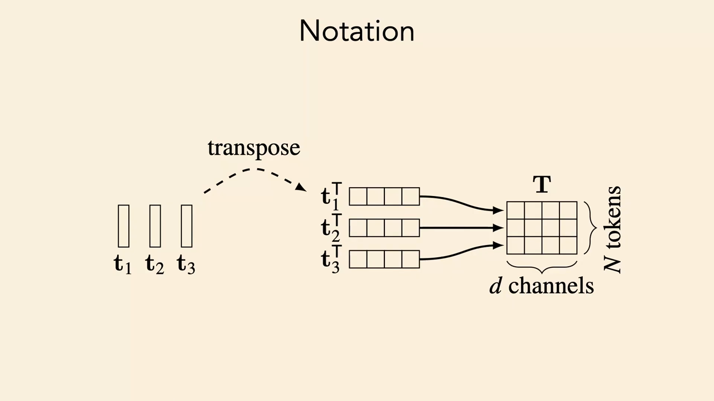
*▲ 강의 슬라이드 [17:10](https://youtu.be/Q1HOKrNeh2M?t=1030): [토큰](00_%EB%94%A5%EB%9F%AC%EB%8B%9D_%EC%9A%A9%EC%96%B4%EC%82%AC%EC%A0%84.md#token-%ED%86%A0%ED%81%B0) 벡터를 전치해 쌓은 $N \times d$ 행렬 T*

### 4.2 토큰의 선형 결합

▶ 영상 [17:44](https://youtu.be/Q1HOKrNeh2M?t=1064)

📐 **수학 개념**: [랭크](%EC%88%98%ED%95%99%EA%B0%9C%EB%85%90/04_%ED%99%95%EB%A5%A0%EA%B3%BC_%EC%A0%95%EB%B3%B4/MM25_%EB%9E%AD%ED%81%AC%EC%99%80_%EC%9C%A0%ED%9A%A8_%EB%9E%AD%ED%81%AC.md) (Lec06) · [행렬 곱](%EC%88%98%ED%95%99%EA%B0%9C%EB%85%90/03_%EC%84%A0%ED%98%95%EB%8C%80%EC%88%98/M05_%EB%B2%A1%ED%84%B0%EC%99%80_%ED%96%89%EB%A0%AC.md)

MLP에 기본 연산이 두 개(선형 결합, 뉴런별 비선형 함수) 있듯, [토큰](00_%EB%94%A5%EB%9F%AC%EB%8B%9D_%EC%9A%A9%EC%96%B4%EC%82%AC%EC%A0%84.md#token-%ED%86%A0%ED%81%B0) 망에도 두 개가 있습니다. 첫째는 **[토큰](00_%EB%94%A5%EB%9F%AC%EB%8B%9D_%EC%9A%A9%EC%96%B4%EC%82%AC%EC%A0%84.md#token-%ED%86%A0%ED%81%B0)의 선형 결합**입니다. 뉴런의 선형 결합 $x_{\text{out}} = w_1x_1 + w_2x_2 + w_3x_3$에서 스칼라 $x$를 벡터 $\mathbf{t}$로 바꾸기만 하면 됩니다.

$$
\mathbf{t}_{\text{out}} = w_1\mathbf{t}_1 + w_2\mathbf{t}_2 + w_3\mathbf{t}_3, \qquad T_{\text{out}} = W\,T_{\text{in}}
$$

기호 풀이

| 기호 | 읽는 법 | 뜻 | 예제 값 |
| --- | --- | --- | --- |
| $\mathbf{t}_j$ | 티 제이 | 입력 [토큰](00_%EB%94%A5%EB%9F%AC%EB%8B%9D_%EC%9A%A9%EC%96%B4%EC%82%AC%EC%A0%84.md#token-%ED%86%A0%ED%81%B0) $j$ (벡터) | $\mathbf{t}_1 = (1, 0)$ |
| $w_j$ | 더블유 제이 | [토큰](00_%EB%94%A5%EB%9F%AC%EB%8B%9D_%EC%9A%A9%EC%96%B4%EC%82%AC%EC%A0%84.md#token-%ED%86%A0%ED%81%B0) $j$에 곱하는 스칼라 [가중치](00_%EB%94%A5%EB%9F%AC%EB%8B%9D_%EC%9A%A9%EC%96%B4%EC%82%AC%EC%A0%84.md#weight-%EA%B0%80%EC%A4%91%EC%B9%98) | 0.2, 0.3, 0.5 |
| $\mathbf{t}_{\text{out}}$ | 티 아웃 | 출력 [토큰](00_%EB%94%A5%EB%9F%AC%EB%8B%9D_%EC%9A%A9%EC%96%B4%EC%82%AC%EC%A0%84.md#token-%ED%86%A0%ED%81%B0) | (0.7, 0.8) |
| $W$ | 더블유 | [가중치](00_%EB%94%A5%EB%9F%AC%EB%8B%9D_%EC%9A%A9%EC%96%B4%EC%82%AC%EC%A0%84.md#weight-%EA%B0%80%EC%A4%91%EC%B9%98)를 모은 행렬 (출력 [토큰](00_%EB%94%A5%EB%9F%AC%EB%8B%9D_%EC%9A%A9%EC%96%B4%EC%82%AC%EC%A0%84.md#token-%ED%86%A0%ED%81%B0) 수 × 입력 [토큰](00_%EB%94%A5%EB%9F%AC%EB%8B%9D_%EC%9A%A9%EC%96%B4%EC%82%AC%EC%A0%84.md#token-%ED%86%A0%ED%81%B0) 수) | 1×3 [0.2, 0.3, 0.5] |
| $T_{\text{in}}, T_{\text{out}}$ | 티 인, 티 아웃 | 입력·출력 [토큰](00_%EB%94%A5%EB%9F%AC%EB%8B%9D_%EC%9A%A9%EC%96%B4%EC%82%AC%EC%A0%84.md#token-%ED%86%A0%ED%81%B0) 행렬 (행 = [토큰](00_%EB%94%A5%EB%9F%AC%EB%8B%9D_%EC%9A%A9%EC%96%B4%EC%82%AC%EC%A0%84.md#token-%ED%86%A0%ED%81%B0)) | $T_{\text{in}}$ 3×2 |

예제와 풀이

**문제**: 입력 [토큰](00_%EB%94%A5%EB%9F%AC%EB%8B%9D_%EC%9A%A9%EC%96%B4%EC%82%AC%EC%A0%84.md#token-%ED%86%A0%ED%81%B0) 세 개 $\mathbf{t}_1 = (1, 0)$, $\mathbf{t}_2 = (0, 1)$, $\mathbf{t}_3 = (1, 1)$을 [토큰](00_%EB%94%A5%EB%9F%AC%EB%8B%9D_%EC%9A%A9%EC%96%B4%EC%82%AC%EC%A0%84.md#token-%ED%86%A0%ED%81%B0)마다 곱할 [가중치](00_%EB%94%A5%EB%9F%AC%EB%8B%9D_%EC%9A%A9%EC%96%B4%EC%82%AC%EC%A0%84.md#weight-%EA%B0%80%EC%A4%91%EC%B9%98) $w_1 = 0.2$, $w_2 = 0.3$, $w_3 = 0.5$로 결합한 출력 [토큰](00_%EB%94%A5%EB%9F%AC%EB%8B%9D_%EC%9A%A9%EC%96%B4%EC%82%AC%EC%A0%84.md#token-%ED%86%A0%ED%81%B0) $\mathbf{t}_{\text{out}}$을 구한다.

**주어진 값**:
- $\mathbf{t}_1 = (1, 0)$, $\mathbf{t}_2 = (0, 1)$, $\mathbf{t}_3 = (1, 1)$ (입력 [토큰](00_%EB%94%A5%EB%9F%AC%EB%8B%9D_%EC%9A%A9%EC%96%B4%EC%82%AC%EC%A0%84.md#token-%ED%86%A0%ED%81%B0), 각 2칸)
- $w_1 = 0.2$, $w_2 = 0.3$, $w_3 = 0.5$ ([토큰](00_%EB%94%A5%EB%9F%AC%EB%8B%9D_%EC%9A%A9%EC%96%B4%EC%82%AC%EC%A0%84.md#token-%ED%86%A0%ED%81%B0)마다 곱하는 스칼라 [가중치](00_%EB%94%A5%EB%9F%AC%EB%8B%9D_%EC%9A%A9%EC%96%B4%EC%82%AC%EC%A0%84.md#weight-%EA%B0%80%EC%A4%91%EC%B9%98))

**풀이**
1. 식을 그대로 쓴다: $\mathbf{t}_{\text{out}} = w_1\mathbf{t}_1 + w_2\mathbf{t}_2 + w_3\mathbf{t}_3$
2. 값을 대입한다: $\mathbf{t}_{\text{out}} = 0.2 \times (1, 0) + 0.3 \times (0, 1) + 0.5 \times (1, 1)$
3. 수 × 벡터의 뜻: 벡터의 각 칸에 그 수를 곱한다. 첫 항을 곱한다: $0.2 \times (1, 0) = (0.2, 0)$
4. 둘째 항을 곱한다: $0.3 \times (0, 1) = (0, 0.3)$
5. 셋째 항을 곱한다: $0.5 \times (1, 1) = (0.5, 0.5)$ 이므로 $\mathbf{t}_{\text{out}} = (0.2, 0) + (0, 0.3) + (0.5, 0.5)$
6. 첫 칸끼리 더한다: $0.2 + 0 + 0.5 = 0.7$
7. 둘째 칸끼리 더한다: $0 + 0.3 + 0.5 = 0.8$

**답**: $\mathbf{t}_{\text{out}} = (0.7, 0.8)$. [가중치](00_%EB%94%A5%EB%9F%AC%EB%8B%9D_%EC%9A%A9%EC%96%B4%EC%82%AC%EC%A0%84.md#weight-%EA%B0%80%EC%A4%91%EC%B9%98)는 3개뿐인데 출력의 두 칸 모두에 같은 [가중치](00_%EB%94%A5%EB%9F%AC%EB%8B%9D_%EC%9A%A9%EC%96%B4%EC%82%AC%EC%A0%84.md#weight-%EA%B0%80%EC%A4%91%EC%B9%98)가 쓰였다.

내 이해

$W T$는 $T$의 **행들을 섞는** 연산입니다. 강사는 이것이 같은 수의 뉴런을 결합하는 것보다 **[표현력](00_%EB%94%A5%EB%9F%AC%EB%8B%9D_%EC%9A%A9%EC%96%B4%EC%82%AC%EC%A0%84.md#representational-power-%ED%91%9C%ED%98%84%EB%A0%A5)이 낮다**고 강조합니다. [토큰](00_%EB%94%A5%EB%9F%AC%EB%8B%9D_%EC%9A%A9%EC%96%B4%EC%82%AC%EC%A0%84.md#token-%ED%86%A0%ED%81%B0) 3개(각 4칸, 뉴런 12개)를 결합하는 [가중치](00_%EB%94%A5%EB%9F%AC%EB%8B%9D_%EC%9A%A9%EC%96%B4%EC%82%AC%EC%A0%84.md#weight-%EA%B0%80%EC%A4%91%EC%B9%98)는 3개뿐이지만, 뉴런 12개를 그냥 결합하면 12개의 [가중치](00_%EB%94%A5%EB%9F%AC%EB%8B%9D_%EC%9A%A9%EC%96%B4%EC%82%AC%EC%A0%84.md#weight-%EA%B0%80%EC%A4%91%EC%B9%98)가 있습니다. [토큰](00_%EB%94%A5%EB%9F%AC%EB%8B%9D_%EC%9A%A9%EC%96%B4%EC%82%AC%EC%A0%84.md#token-%ED%86%A0%ED%81%B0)의 모든 칸에 같은 [가중치](00_%EB%94%A5%EB%9F%AC%EB%8B%9D_%EC%9A%A9%EC%96%B4%EC%82%AC%EC%A0%84.md#weight-%EA%B0%80%EC%A4%91%EC%B9%98)를 쓰는 **저랭크** 연산입니다. 그 대가로 [토큰](00_%EB%94%A5%EB%9F%AC%EB%8B%9D_%EC%9A%A9%EC%96%B4%EC%82%AC%EC%A0%84.md#token-%ED%86%A0%ED%81%B0)을 하나의 꾸러미로 다룰 수 있습니다.

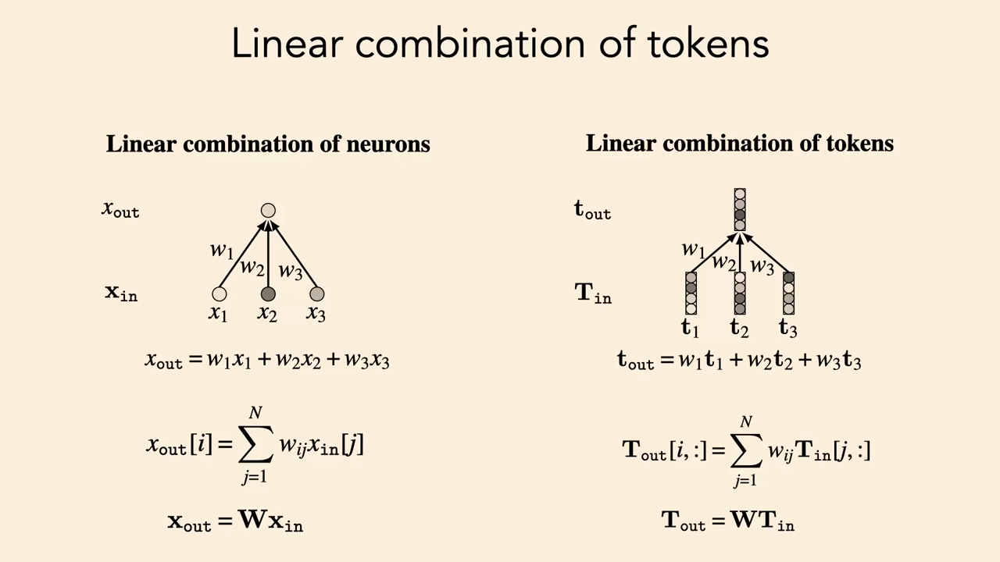
*▲ 강의 슬라이드 [19:00](https://youtu.be/Q1HOKrNeh2M?t=1140): 뉴런의 선형 결합 $\mathbf{x}_{\text{out}} = W\mathbf{x}_{\text{in}}$과 [토큰](00_%EB%94%A5%EB%9F%AC%EB%8B%9D_%EC%9A%A9%EC%96%B4%EC%82%AC%EC%A0%84.md#token-%ED%86%A0%ED%81%B0)의 선형 결합 $T_{\text{out}} = WT_{\text{in}}$*

### 4.3 토큰별 비선형 함수

▶ 영상 [20:04](https://youtu.be/Q1HOKrNeh2M?t=1204)

📐 **수학 개념**: [합성함수와 비선형성](%EC%88%98%ED%95%99%EA%B0%9C%EB%85%90/05_%EC%8B%A0%EA%B2%BD%EB%A7%9D%EC%9D%98_%EA%B3%84%EC%82%B0/MM06_%ED%95%A9%EC%84%B1%ED%95%A8%EC%88%98%EC%99%80_%EB%B9%84%EC%84%A0%ED%98%95%EC%84%B1.md) · [합성곱](%EC%88%98%ED%95%99%EA%B0%9C%EB%85%90/07_%EA%B5%AC%EC%A1%B0_%EC%95%84%ED%82%A4%ED%85%8D%EC%B2%98/MM15_%ED%95%A9%EC%84%B1%EA%B3%B1%EA%B3%BC_%ED%87%B4%ED%94%8C%EB%A6%AC%EC%B8%A0_%ED%96%89%EB%A0%AC.md) (1×1 [합성곱](00_%EB%94%A5%EB%9F%AC%EB%8B%9D_%EC%9A%A9%EC%96%B4%EC%82%AC%EC%A0%84.md#convolution-%ED%95%A9%EC%84%B1%EA%B3%B1))

둘째는 [ReLU](00_%EB%94%A5%EB%9F%AC%EB%8B%9D_%EC%9A%A9%EC%96%B4%EC%82%AC%EC%A0%84.md#relu-%EB%A0%90%EB%A3%A8) 같은 뉴런별 비선형 함수의 토큰판, **[토큰별 비선형 함수](00_%EB%94%A5%EB%9F%AC%EB%8B%9D_%EC%9A%A9%EC%96%B4%EC%82%AC%EC%A0%84.md#token-wise-nonlinearity-%ED%86%A0%ED%81%B0%EB%B3%84-%EB%B9%84%EC%84%A0%ED%98%95-%ED%95%A8%EC%88%98)** 입니다. 같은 함수 $F_\theta$를 모든 [토큰](00_%EB%94%A5%EB%9F%AC%EB%8B%9D_%EC%9A%A9%EC%96%B4%EC%82%AC%EC%A0%84.md#token-%ED%86%A0%ED%81%B0)에 **독립적이고 똑같이** 적용합니다.

$$
T_{\text{out}}[i, :] = F_\theta\big(T_{\text{in}}[i, :]\big), \qquad i = 0, \dots, N-1
$$

기호 풀이

| 기호 | 읽는 법 | 뜻 | 예제 값 |
| --- | --- | --- | --- |
| $T[i, :]$ | 티 아이 콜론 | $T$의 $i$번째 행 = [토큰](00_%EB%94%A5%EB%9F%AC%EB%8B%9D_%EC%9A%A9%EC%96%B4%EC%82%AC%EC%A0%84.md#token-%ED%86%A0%ED%81%B0) $i$ | (1, 1) |
| $F_\theta$ | 에프 세타 | 모든 [토큰](00_%EB%94%A5%EB%9F%AC%EB%8B%9D_%EC%9A%A9%EC%96%B4%EC%82%AC%EC%A0%84.md#token-%ED%86%A0%ED%81%B0)에 똑같이 쓰는 함수 (보통 MLP) | $\text{ReLU}(W\mathbf{t} + \mathbf{b})$ |
| $\theta$ | 세타 | $F$의 [학습](00_%EB%94%A5%EB%9F%AC%EB%8B%9D_%EC%9A%A9%EC%96%B4%EC%82%AC%EC%A0%84.md#training-%ED%95%99%EC%8A%B5) [파라미터](00_%EB%94%A5%EB%9F%AC%EB%8B%9D_%EC%9A%A9%EC%96%B4%EC%82%AC%EC%A0%84.md#parameter-%ED%8C%8C%EB%9D%BC%EB%AF%B8%ED%84%B0) | $W = [[1, -1], [1, 1]]$, $\mathbf{b} = (0, -1)$ |
| $N$ | 엔 | [토큰](00_%EB%94%A5%EB%9F%AC%EB%8B%9D_%EC%9A%A9%EC%96%B4%EC%82%AC%EC%A0%84.md#token-%ED%86%A0%ED%81%B0) 수 | 3 |

예제와 풀이

**문제**: 모든 [토큰](00_%EB%94%A5%EB%9F%AC%EB%8B%9D_%EC%9A%A9%EC%96%B4%EC%82%AC%EC%A0%84.md#token-%ED%86%A0%ED%81%B0)에 똑같이 쓰는 함수 $F_\theta(\mathbf{t}) = \text{ReLU}(W\mathbf{t} + \mathbf{b})$를 입력 [토큰](00_%EB%94%A5%EB%9F%AC%EB%8B%9D_%EC%9A%A9%EC%96%B4%EC%82%AC%EC%A0%84.md#token-%ED%86%A0%ED%81%B0) (1, 0), (0, 1), (1, 1)에 각각 적용해 출력 [토큰](00_%EB%94%A5%EB%9F%AC%EB%8B%9D_%EC%9A%A9%EC%96%B4%EC%82%AC%EC%A0%84.md#token-%ED%86%A0%ED%81%B0) 행렬 $T_{\text{out}}$을 구한다.

**주어진 값**:
- $T_{\text{in}}[0,:] = (1, 0)$, $T_{\text{in}}[1,:] = (0, 1)$, $T_{\text{in}}[2,:] = (1, 1)$ (입력 [토큰](00_%EB%94%A5%EB%9F%AC%EB%8B%9D_%EC%9A%A9%EC%96%B4%EC%82%AC%EC%A0%84.md#token-%ED%86%A0%ED%81%B0) 세 개)
- $W = \begin{pmatrix}1&-1\\1&1\end{pmatrix}$ ($F$의 [가중치](00_%EB%94%A5%EB%9F%AC%EB%8B%9D_%EC%9A%A9%EC%96%B4%EC%82%AC%EC%A0%84.md#weight-%EA%B0%80%EC%A4%91%EC%B9%98) 행렬, 세 [토큰](00_%EB%94%A5%EB%9F%AC%EB%8B%9D_%EC%9A%A9%EC%96%B4%EC%82%AC%EC%A0%84.md#token-%ED%86%A0%ED%81%B0)에 같은 값)
- $\mathbf{b} = (0, -1)$ ($F$의 [편향](00_%EB%94%A5%EB%9F%AC%EB%8B%9D_%EC%9A%A9%EC%96%B4%EC%82%AC%EC%A0%84.md#bias-%ED%8E%B8%ED%96%A5), 세 [토큰](00_%EB%94%A5%EB%9F%AC%EB%8B%9D_%EC%9A%A9%EC%96%B4%EC%82%AC%EC%A0%84.md#token-%ED%86%A0%ED%81%B0)에 같은 값)

**풀이**
1. 식을 그대로 쓴다: $T_{\text{out}}[i, :] = F_\theta(T_{\text{in}}[i, :]) = \text{ReLU}(W\,T_{\text{in}}[i, :] + \mathbf{b})$
2. 값을 대입한다 ([토큰](00_%EB%94%A5%EB%9F%AC%EB%8B%9D_%EC%9A%A9%EC%96%B4%EC%82%AC%EC%A0%84.md#token-%ED%86%A0%ED%81%B0) 0): $T_{\text{out}}[0, :] = \text{ReLU}\Big(\begin{pmatrix}1&-1\\1&1\end{pmatrix}(1, 0)^\top + (0, -1)\Big)$
3. [행렬 곱](00_%EB%94%A5%EB%9F%AC%EB%8B%9D_%EC%9A%A9%EC%96%B4%EC%82%AC%EC%A0%84.md#matrix-multiplication-%ED%96%89%EB%A0%AC-%EA%B3%B1) 첫 칸을 펼친다: $1 \times 1 + (-1) \times 0 = 1$
4. [행렬 곱](00_%EB%94%A5%EB%9F%AC%EB%8B%9D_%EC%9A%A9%EC%96%B4%EC%82%AC%EC%A0%84.md#matrix-multiplication-%ED%96%89%EB%A0%AC-%EA%B3%B1) 둘째 칸을 펼친다: $1 \times 1 + 1 \times 0 = 1$ 이므로 $\text{ReLU}((1, 1) + (0, -1))$
5. [편향](00_%EB%94%A5%EB%9F%AC%EB%8B%9D_%EC%9A%A9%EC%96%B4%EC%82%AC%EC%A0%84.md#bias-%ED%8E%B8%ED%96%A5)을 칸끼리 더한다: $(1 + 0,\ 1 - 1) = (1, 0)$
6. [ReLU](00_%EB%94%A5%EB%9F%AC%EB%8B%9D_%EC%9A%A9%EC%96%B4%EC%82%AC%EC%A0%84.md#relu-%EB%A0%90%EB%A3%A8)의 뜻: 음수는 0으로, 0 이상은 그대로 둔다. 적용한다: $\text{ReLU}(1, 0) = (1, 0)$
7. 값을 대입한다 ([토큰](00_%EB%94%A5%EB%9F%AC%EB%8B%9D_%EC%9A%A9%EC%96%B4%EC%82%AC%EC%A0%84.md#token-%ED%86%A0%ED%81%B0) 1): $T_{\text{out}}[1, :] = \text{ReLU}\big(W (0, 1)^\top + (0, -1)\big)$
8. [행렬 곱](00_%EB%94%A5%EB%9F%AC%EB%8B%9D_%EC%9A%A9%EC%96%B4%EC%82%AC%EC%A0%84.md#matrix-multiplication-%ED%96%89%EB%A0%AC-%EA%B3%B1)을 펼친다: 첫 칸 $1 \times 0 + (-1) \times 1 = -1$, 둘째 칸 $1 \times 0 + 1 \times 1 = 1$
9. [편향](00_%EB%94%A5%EB%9F%AC%EB%8B%9D_%EC%9A%A9%EC%96%B4%EC%82%AC%EC%A0%84.md#bias-%ED%8E%B8%ED%96%A5)을 더한다: $(-1 + 0,\ 1 - 1) = (-1, 0)$
10. [ReLU](00_%EB%94%A5%EB%9F%AC%EB%8B%9D_%EC%9A%A9%EC%96%B4%EC%82%AC%EC%A0%84.md#relu-%EB%A0%90%EB%A3%A8)를 적용한다: $-1$은 음수라 0 → $(0, 0)$
11. 값을 대입한다 ([토큰](00_%EB%94%A5%EB%9F%AC%EB%8B%9D_%EC%9A%A9%EC%96%B4%EC%82%AC%EC%A0%84.md#token-%ED%86%A0%ED%81%B0) 2): $T_{\text{out}}[2, :] = \text{ReLU}\big(W (1, 1)^\top + (0, -1)\big)$
12. [행렬 곱](00_%EB%94%A5%EB%9F%AC%EB%8B%9D_%EC%9A%A9%EC%96%B4%EC%82%AC%EC%A0%84.md#matrix-multiplication-%ED%96%89%EB%A0%AC-%EA%B3%B1)을 펼친다: 첫 칸 $1 \times 1 + (-1) \times 1 = 0$, 둘째 칸 $1 \times 1 + 1 \times 1 = 2$
13. [편향](00_%EB%94%A5%EB%9F%AC%EB%8B%9D_%EC%9A%A9%EC%96%B4%EC%82%AC%EC%A0%84.md#bias-%ED%8E%B8%ED%96%A5)을 더한다: $(0 + 0,\ 2 - 1) = (0, 1)$
14. [ReLU](00_%EB%94%A5%EB%9F%AC%EB%8B%9D_%EC%9A%A9%EC%96%B4%EC%82%AC%EC%A0%84.md#relu-%EB%A0%90%EB%A3%A8)를 적용한다: 음수가 없어 그대로 $(0, 1)$

**답**: $T_{\text{out}} = \begin{pmatrix}1&0\\0&0\\0&1\end{pmatrix}$. 토큰끼리는 섞이지 않았다.

내 이해

[트랜스포머](00_%EB%94%A5%EB%9F%AC%EB%8B%9D_%EC%9A%A9%EC%96%B4%EC%82%AC%EC%A0%84.md#transformer-%ED%8A%B8%EB%9E%9C%EC%8A%A4%ED%8F%AC%EB%A8%B8)에서 $F$는 보통 그 자체로 MLP입니다. 그래서 [트랜스포머](00_%EB%94%A5%EB%9F%AC%EB%8B%9D_%EC%9A%A9%EC%96%B4%EC%82%AC%EC%A0%84.md#transformer-%ED%8A%B8%EB%9E%9C%EC%8A%A4%ED%8F%AC%EB%A8%B8)는 **신경망을 부품으로 쓰는 메타 아키텍처**입니다. 또한 [토큰](00_%EB%94%A5%EB%9F%AC%EB%8B%9D_%EC%9A%A9%EC%96%B4%EC%82%AC%EC%A0%84.md#token-%ED%86%A0%ED%81%B0) 열 위를 미끄러지는 **1×1 [합성곱](00_%EB%94%A5%EB%9F%AC%EB%8B%9D_%EC%9A%A9%EC%96%B4%EC%82%AC%EC%A0%84.md#convolution-%ED%95%A9%EC%84%B1%EA%B3%B1) [필터](00_%EB%94%A5%EB%9F%AC%EB%8B%9D_%EC%9A%A9%EC%96%B4%EC%82%AC%EC%A0%84.md#filter-%ED%95%84%ED%84%B0)**와 같습니다. [채널](00_%EB%94%A5%EB%9F%AC%EB%8B%9D_%EC%9A%A9%EC%96%B4%EC%82%AC%EC%A0%84.md#channel-%EC%B1%84%EB%84%90) 방향이 [토큰](00_%EB%94%A5%EB%9F%AC%EB%8B%9D_%EC%9A%A9%EC%96%B4%EC%82%AC%EC%A0%84.md#token-%ED%86%A0%ED%81%B0) 벡터의 칸입니다.

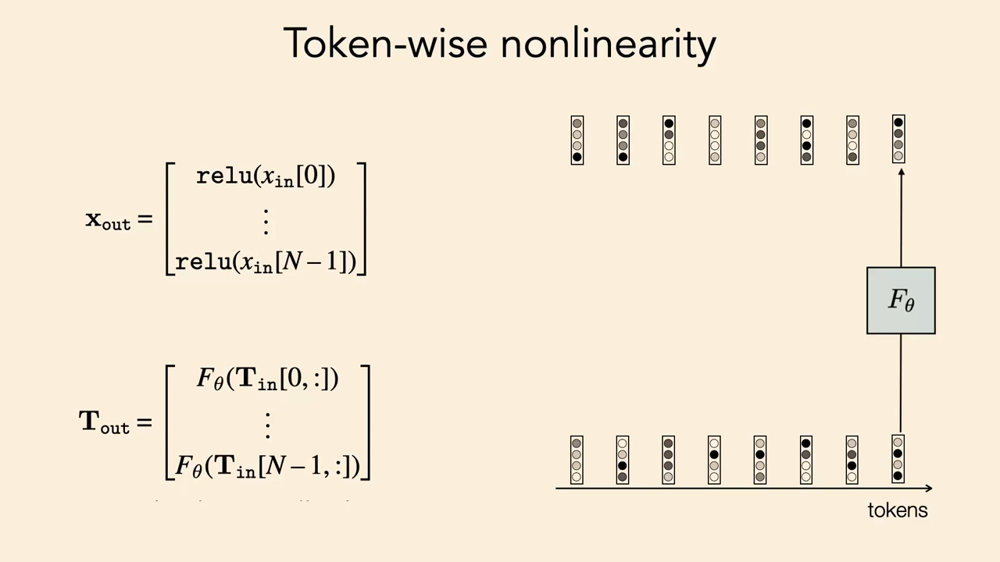
*▲ 강의 슬라이드 [21:40](https://youtu.be/Q1HOKrNeh2M?t=1300): 뉴런별 [ReLU](00_%EB%94%A5%EB%9F%AC%EB%8B%9D_%EC%9A%A9%EC%96%B4%EC%82%AC%EC%A0%84.md#relu-%EB%A0%90%EB%A3%A8)와 토큰별 $F_\theta$. 오른쪽은 [토큰](00_%EB%94%A5%EB%9F%AC%EB%8B%9D_%EC%9A%A9%EC%96%B4%EC%82%AC%EC%A0%84.md#token-%ED%86%A0%ED%81%B0) 열 위의 1×1 [합성곱](00_%EB%94%A5%EB%9F%AC%EB%8B%9D_%EC%9A%A9%EC%96%B4%EC%82%AC%EC%A0%84.md#convolution-%ED%95%A9%EC%84%B1%EA%B3%B1)으로 본 모습*

### 4.4 토큰 넷과 GNN

▶ 영상 [21:43](https://youtu.be/Q1HOKrNeh2M?t=1303)

📐 **수학 개념**: [인접 행렬](%EC%88%98%ED%95%99%EA%B0%9C%EB%85%90/07_%EA%B5%AC%EC%A1%B0_%EC%95%84%ED%82%A4%ED%85%8D%EC%B2%98/MM18_%EC%9D%B8%EC%A0%91%ED%96%89%EB%A0%AC%EA%B3%BC_%EC%88%9C%EC%97%B4.md) (Lec05)

두 연산을 번갈아 쌓은 것이 **[토큰](00_%EB%94%A5%EB%9F%AC%EB%8B%9D_%EC%9A%A9%EC%96%B4%EC%82%AC%EC%A0%84.md#token-%ED%86%A0%ED%81%B0) 넷**입니다. MLP가 "뉴런의 선형 결합 → 뉴런별 비선형"을 되풀이하듯, [토큰](00_%EB%94%A5%EB%9F%AC%EB%8B%9D_%EC%9A%A9%EC%96%B4%EC%82%AC%EC%A0%84.md#token-%ED%86%A0%ED%81%B0) 넷은 "[토큰](00_%EB%94%A5%EB%9F%AC%EB%8B%9D_%EC%9A%A9%EC%96%B4%EC%82%AC%EC%A0%84.md#token-%ED%86%A0%ED%81%B0)의 선형 결합 → 토큰별 비선형"을 되풀이합니다. 모양은 같고 단위만 스칼라(뉴런)에서 벡터([토큰](00_%EB%94%A5%EB%9F%AC%EB%8B%9D_%EC%9A%A9%EC%96%B4%EC%82%AC%EC%A0%84.md#token-%ED%86%A0%ED%81%B0))로 바뀌었습니다.

이것은 [Lec05 7절](Lec05_%EA%B7%B8%EB%9E%98%ED%94%84_%EC%8B%A0%EA%B2%BD%EB%A7%9D.md#7-%EB%98%90-%EB%8B%A4%EB%A5%B8-%EA%B4%80%EC%A0%90-%ED%8E%BC%EC%B9%9C-gnn%EC%9D%80-%EB%B2%A1%ED%84%B0-%EB%89%B4%EB%9F%B0%EC%9D%98-mlp)의 **펼친 [GNN](00_%EB%94%A5%EB%9F%AC%EB%8B%9D_%EC%9A%A9%EC%96%B4%EC%82%AC%EC%A0%84.md#gnn-graph-neural-network-%EA%B7%B8%EB%9E%98%ED%94%84-%EC%8B%A0%EA%B2%BD%EB%A7%9D)**과 같습니다. 집계(AGGREGATE)가 [토큰](00_%EB%94%A5%EB%9F%AC%EB%8B%9D_%EC%9A%A9%EC%96%B4%EC%82%AC%EC%A0%84.md#token-%ED%86%A0%ED%81%B0)의 선형 결합, 결합(COMBINE)이 토큰별 비선형입니다. 중요한 차이는 두 가지입니다.

- [GNN](00_%EB%94%A5%EB%9F%AC%EB%8B%9D_%EC%9A%A9%EC%96%B4%EC%82%AC%EC%A0%84.md#gnn-graph-neural-network-%EA%B7%B8%EB%9E%98%ED%94%84-%EC%8B%A0%EA%B2%BD%EB%A7%9D)에서 누구를 결합할지는 **그래프의 연결([인접 행렬](00_%EB%94%A5%EB%9F%AC%EB%8B%9D_%EC%9A%A9%EC%96%B4%EC%82%AC%EC%A0%84.md#adjacency-matrix-%EC%9D%B8%EC%A0%91-%ED%96%89%EB%A0%AC))** 이 정합니다. [트랜스포머](00_%EB%94%A5%EB%9F%AC%EB%8B%9D_%EC%9A%A9%EC%96%B4%EC%82%AC%EC%A0%84.md#transformer-%ED%8A%B8%EB%9E%9C%EC%8A%A4%ED%8F%AC%EB%A8%B8)는 **완전 연결 그래프**이고, 각 연결의 세기를 [어텐션](00_%EB%94%A5%EB%9F%AC%EB%8B%9D_%EC%9A%A9%EC%96%B4%EC%82%AC%EC%A0%84.md#attention-%EC%96%B4%ED%85%90%EC%85%98)이 정합니다.
- [GNN](00_%EB%94%A5%EB%9F%AC%EB%8B%9D_%EC%9A%A9%EC%96%B4%EC%82%AC%EC%A0%84.md#gnn-graph-neural-network-%EA%B7%B8%EB%9E%98%ED%94%84-%EC%8B%A0%EA%B2%BD%EB%A7%9D)은 깊이 방향으로 [가중치](00_%EB%94%A5%EB%9F%AC%EB%8B%9D_%EC%9A%A9%EC%96%B4%EC%82%AC%EC%A0%84.md#weight-%EA%B0%80%EC%A4%91%EC%B9%98)를 공유하는 경우가 많고, [트랜스포머](00_%EB%94%A5%EB%9F%AC%EB%8B%9D_%EC%9A%A9%EC%96%B4%EC%82%AC%EC%A0%84.md#transformer-%ED%8A%B8%EB%9E%9C%EC%8A%A4%ED%8F%AC%EB%A8%B8)는 보통 [층](00_%EB%94%A5%EB%9F%AC%EB%8B%9D_%EC%9A%A9%EC%96%B4%EC%82%AC%EC%A0%84.md#layer-%EC%B8%B5)마다 다른 [가중치](00_%EB%94%A5%EB%9F%AC%EB%8B%9D_%EC%9A%A9%EC%96%B4%EC%82%AC%EC%A0%84.md#weight-%EA%B0%80%EC%A4%91%EC%B9%98)를 씁니다(둘 다 선택 사항).

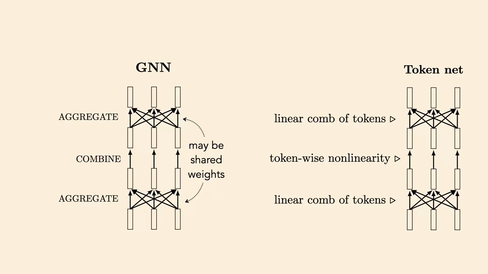
*▲ 강의 슬라이드 [22:45](https://youtu.be/Q1HOKrNeh2M?t=1365): [GNN](00_%EB%94%A5%EB%9F%AC%EB%8B%9D_%EC%9A%A9%EC%96%B4%EC%82%AC%EC%A0%84.md#gnn-graph-neural-network-%EA%B7%B8%EB%9E%98%ED%94%84-%EC%8B%A0%EA%B2%BD%EB%A7%9D)(집계·결합·집계)과 [토큰](00_%EB%94%A5%EB%9F%AC%EB%8B%9D_%EC%9A%A9%EC%96%B4%EC%82%AC%EC%A0%84.md#token-%ED%86%A0%ED%81%B0) 넷([토큰](00_%EB%94%A5%EB%9F%AC%EB%8B%9D_%EC%9A%A9%EC%96%B4%EC%82%AC%EC%A0%84.md#token-%ED%86%A0%ED%81%B0) 선형 결합·토큰별 비선형·[토큰](00_%EB%94%A5%EB%9F%AC%EB%8B%9D_%EC%9A%A9%EC%96%B4%EC%82%AC%EC%A0%84.md#token-%ED%86%A0%ED%81%B0) 선형 결합)*

질의응답 정리 [24:41](https://youtu.be/Q1HOKrNeh2M?t=1481)

- **[토큰별 비선형 함수](00_%EB%94%A5%EB%9F%AC%EB%8B%9D_%EC%9A%A9%EC%96%B4%EC%82%AC%EC%A0%84.md#token-wise-nonlinearity-%ED%86%A0%ED%81%B0%EB%B3%84-%EB%B9%84%EC%84%A0%ED%98%95-%ED%95%A8%EC%88%98)는 어떻게 정해지나?** 보통 MLP이고 [파라미터](00_%EB%94%A5%EB%9F%AC%EB%8B%9D_%EC%9A%A9%EC%96%B4%EC%82%AC%EC%A0%84.md#parameter-%ED%8C%8C%EB%9D%BC%EB%AF%B8%ED%84%B0)는 [역전파](00_%EB%94%A5%EB%9F%AC%EB%8B%9D_%EC%9A%A9%EC%96%B4%EC%82%AC%EC%A0%84.md#backpropagation-%EC%97%AD%EC%A0%84%ED%8C%8C)로 학습합니다. 그 MLP 안에도 뉴런별 비선형 함수가 있습니다. 망 속의 작은 망들입니다.
- **MLP의 뉴런별 비선형은 학습하지 않는데 여기서는 학습하나?** 그렇습니다. MLP의 [ReLU](00_%EB%94%A5%EB%9F%AC%EB%8B%9D_%EC%9A%A9%EC%96%B4%EC%82%AC%EC%A0%84.md#relu-%EB%A0%90%EB%A3%A8)는 고정이지만 [트랜스포머](00_%EB%94%A5%EB%9F%AC%EB%8B%9D_%EC%9A%A9%EC%96%B4%EC%82%AC%EC%A0%84.md#transformer-%ED%8A%B8%EB%9E%9C%EC%8A%A4%ED%8F%AC%EB%A8%B8)의 토큰별 함수는 [파라미터](00_%EB%94%A5%EB%9F%AC%EB%8B%9D_%EC%9A%A9%EC%96%B4%EC%82%AC%EC%A0%84.md#parameter-%ED%8C%8C%EB%9D%BC%EB%AF%B8%ED%84%B0)가 있는 MLP입니다. [GNN](00_%EB%94%A5%EB%9F%AC%EB%8B%9D_%EC%9A%A9%EC%96%B4%EC%82%AC%EC%A0%84.md#gnn-graph-neural-network-%EA%B7%B8%EB%9E%98%ED%94%84-%EC%8B%A0%EA%B2%BD%EB%A7%9D)의 [갱신 함수](00_%EB%94%A5%EB%9F%AC%EB%8B%9D_%EC%9A%A9%EC%96%B4%EC%82%AC%EC%A0%84.md#update-function-%EA%B0%B1%EC%8B%A0-%ED%95%A8%EC%88%98)도 마찬가지입니다.
- 강사의 당부: 무엇을 [GNN](00_%EB%94%A5%EB%9F%AC%EB%8B%9D_%EC%9A%A9%EC%96%B4%EC%82%AC%EC%A0%84.md#gnn-graph-neural-network-%EA%B7%B8%EB%9E%98%ED%94%84-%EC%8B%A0%EA%B2%BD%EB%A7%9D)이라 부르고 무엇을 [트랜스포머](00_%EB%94%A5%EB%9F%AC%EB%8B%9D_%EC%9A%A9%EC%96%B4%EC%82%AC%EC%A0%84.md#transformer-%ED%8A%B8%EB%9E%9C%EC%8A%A4%ED%8F%AC%EB%A8%B8)라 부르는지는 중요하지 않습니다. 부품을 이해하고, 어떻게 조합하면 어떤 효과와 손익이 생기는지 깊이 이해하면 이름은 부차적입니다.

---

## 5. 어텐션

### 5.1 데이터가 정하는 가중치

▶ 영상 [26:52](https://youtu.be/Q1HOKrNeh2M?t=1612)

[토큰](00_%EB%94%A5%EB%9F%AC%EB%8B%9D_%EC%9A%A9%EC%96%B4%EC%82%AC%EC%A0%84.md#token-%ED%86%A0%ED%81%B0)을 결합하는 [가중치](00_%EB%94%A5%EB%9F%AC%EB%8B%9D_%EC%9A%A9%EC%96%B4%EC%82%AC%EC%A0%84.md#weight-%EA%B0%80%EC%A4%91%EC%B9%98)를 어떻게 정할까요? MLP처럼 자유 [파라미터](00_%EB%94%A5%EB%9F%AC%EB%8B%9D_%EC%9A%A9%EC%96%B4%EC%82%AC%EC%A0%84.md#parameter-%ED%8C%8C%EB%9D%BC%EB%AF%B8%ED%84%B0) $W$로 두고 학습할 수도 있습니다(파란색). 그래도 됩니다. 하지만 [트랜스포머](00_%EB%94%A5%EB%9F%AC%EB%8B%9D_%EC%9A%A9%EC%96%B4%EC%82%AC%EC%A0%84.md#transformer-%ED%8A%B8%EB%9E%9C%EC%8A%A4%ED%8F%AC%EB%A8%B8)는 **[어텐션](00_%EB%94%A5%EB%9F%AC%EB%8B%9D_%EC%9A%A9%EC%96%B4%EC%82%AC%EC%A0%84.md#attention-%EC%96%B4%ED%85%90%EC%85%98)** 을 씁니다. 결합 [가중치](00_%EB%94%A5%EB%9F%AC%EB%8B%9D_%EC%9A%A9%EC%96%B4%EC%82%AC%EC%A0%84.md#weight-%EA%B0%80%EC%A4%91%EC%B9%98) $A$가 자유 [파라미터](00_%EB%94%A5%EB%9F%AC%EB%8B%9D_%EC%9A%A9%EC%96%B4%EC%82%AC%EC%A0%84.md#parameter-%ED%8C%8C%EB%9D%BC%EB%AF%B8%ED%84%B0)가 아니라 **처리 중인 데이터의 함수**입니다(빨간색, 읽기 자료에서 빨강은 활성값의 색). 데이터가 "어느 [토큰](00_%EB%94%A5%EB%9F%AC%EB%8B%9D_%EC%9A%A9%EC%96%B4%EC%82%AC%EC%A0%84.md#token-%ED%86%A0%ED%81%B0)을 볼지([가중합](00_%EB%94%A5%EB%9F%AC%EB%8B%9D_%EC%9A%A9%EC%96%B4%EC%82%AC%EC%A0%84.md#weighted-sum-%EA%B0%80%EC%A4%91%ED%95%A9)에서 큰 [가중치](00_%EB%94%A5%EB%9F%AC%EB%8B%9D_%EC%9A%A9%EC%96%B4%EC%82%AC%EC%A0%84.md#weight-%EA%B0%80%EC%A4%91%EC%B9%98)를 줄지)"를 알려 줍니다.

$$
T_{\text{out}} = A\,T_{\text{in}}, \qquad A = f(T_{\text{in}})
$$

기호 풀이

| 기호 | 읽는 법 | 뜻 | 예제 값 |
| --- | --- | --- | --- |
| $T_{\text{in}}$ | 티 인 | 입력 [토큰](00_%EB%94%A5%EB%9F%AC%EB%8B%9D_%EC%9A%A9%EC%96%B4%EC%82%AC%EC%A0%84.md#token-%ED%86%A0%ED%81%B0)들 | 패치 5개의 "동물 머리" 칸 (1, 1, 0, 1, 1) |
| $A$ | 에이 | 결합 [가중치](00_%EB%94%A5%EB%9F%AC%EB%8B%9D_%EC%9A%A9%EC%96%B4%EC%82%AC%EC%A0%84.md#weight-%EA%B0%80%EC%A4%91%EC%B9%98) ([어텐션](00_%EB%94%A5%EB%9F%AC%EB%8B%9D_%EC%9A%A9%EC%96%B4%EC%82%AC%EC%A0%84.md#attention-%EC%96%B4%ED%85%90%EC%85%98)). [학습](00_%EB%94%A5%EB%9F%AC%EB%8B%9D_%EC%9A%A9%EC%96%B4%EC%82%AC%EC%A0%84.md#training-%ED%95%99%EC%8A%B5) [파라미터](00_%EB%94%A5%EB%9F%AC%EB%8B%9D_%EC%9A%A9%EC%96%B4%EC%82%AC%EC%A0%84.md#parameter-%ED%8C%8C%EB%9D%BC%EB%AF%B8%ED%84%B0)가 아니라 활성값 | (1, 1, 0, 1, 1) |
| $f$ | 에프 | 입력에서 $A$를 만드는 함수 | "동물 머리 패치에 1" |
| $T_{\text{out}}$ | 티 아웃 | 결합 결과 | 4 |

예제와 풀이

**문제**: "사진에 동물이 몇 마리인가?" 패치 5개의 [토큰](00_%EB%94%A5%EB%9F%AC%EB%8B%9D_%EC%9A%A9%EC%96%B4%EC%82%AC%EC%A0%84.md#token-%ED%86%A0%ED%81%B0) 중 "동물 머리가 있나" 칸이 (1, 1, 0, 1, 1)이다. [어텐션](00_%EB%94%A5%EB%9F%AC%EB%8B%9D_%EC%9A%A9%EC%96%B4%EC%82%AC%EC%A0%84.md#attention-%EC%96%B4%ED%85%90%EC%85%98)이 동물 머리 패치에 [가중치](00_%EB%94%A5%EB%9F%AC%EB%8B%9D_%EC%9A%A9%EC%96%B4%EC%82%AC%EC%A0%84.md#weight-%EA%B0%80%EC%A4%91%EC%B9%98) 1, 나머지에 0을 줄 때 출력 [토큰](00_%EB%94%A5%EB%9F%AC%EB%8B%9D_%EC%9A%A9%EC%96%B4%EC%82%AC%EC%A0%84.md#token-%ED%86%A0%ED%81%B0)의 그 칸 값은?

**주어진 값**:
- $T_{\text{in}}$의 "머리" 칸: (1, 1, 0, 1, 1) (패치 5개 각각에 동물 머리가 있으면 1)
- $A = f(T_{\text{in}}) = (1, 1, 0, 1, 1)$ (패치마다 주는 [어텐션](00_%EB%94%A5%EB%9F%AC%EB%8B%9D_%EC%9A%A9%EC%96%B4%EC%82%AC%EC%A0%84.md#attention-%EC%96%B4%ED%85%90%EC%85%98) [가중치](00_%EB%94%A5%EB%9F%AC%EB%8B%9D_%EC%9A%A9%EC%96%B4%EC%82%AC%EC%A0%84.md#weight-%EA%B0%80%EC%A4%91%EC%B9%98). 머리 패치에 1)

**풀이**
1. 식을 그대로 쓴다: $T_{\text{out}} = A\,T_{\text{in}}$. 출력 한 개에 대해 펼치면 $T_{\text{out}} = a_1 t_1 + a_2 t_2 + a_3 t_3 + a_4 t_4 + a_5 t_5$
2. 값을 대입한다: $T_{\text{out}} = 1 \times 1 + 1 \times 1 + 0 \times 0 + 1 \times 1 + 1 \times 1$
3. 곱셈을 먼저 한다: $T_{\text{out}} = 1 + 1 + 0 + 1 + 1$
4. 덧셈을 한다: $T_{\text{out}} = 4$

**답**: **4**마리. 같은 망이라도 입력 사진이 바뀌면 $A$가 바뀌어 다른 패치를 본다.

내 이해

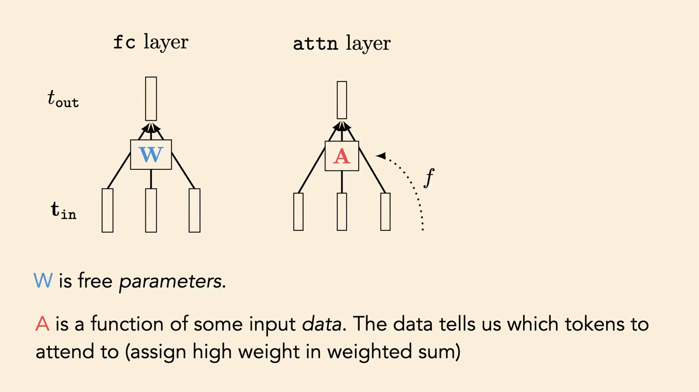
*▲ 강의 슬라이드 [28:20](https://youtu.be/Q1HOKrNeh2M?t=1700): 완전 연결 [층](00_%EB%94%A5%EB%9F%AC%EB%8B%9D_%EC%9A%A9%EC%96%B4%EC%82%AC%EC%A0%84.md#layer-%EC%B8%B5)의 W는 자유 [파라미터](00_%EB%94%A5%EB%9F%AC%EB%8B%9D_%EC%9A%A9%EC%96%B4%EC%82%AC%EC%A0%84.md#parameter-%ED%8C%8C%EB%9D%BC%EB%AF%B8%ED%84%B0), [어텐션](00_%EB%94%A5%EB%9F%AC%EB%8B%9D_%EC%9A%A9%EC%96%B4%EC%82%AC%EC%A0%84.md#attention-%EC%96%B4%ED%85%90%EC%85%98) [층](00_%EB%94%A5%EB%9F%AC%EB%8B%9D_%EC%9A%A9%EC%96%B4%EC%82%AC%EC%A0%84.md#layer-%EC%B8%B5)의 A는 입력 데이터의 함수*

### 5.2 손으로 만든 어텐션

▶ 영상 [28:40](https://youtu.be/Q1HOKrNeh2M?t=1720)

강사는 사바나 사진(얼룩말, 임팔라, 기린 두 마리)으로 한 층짜리 [트랜스포머](00_%EB%94%A5%EB%9F%AC%EB%8B%9D_%EC%9A%A9%EC%96%B4%EC%82%AC%EC%A0%84.md#transformer-%ED%8A%B8%EB%9E%9C%EC%8A%A4%ED%8F%AC%EB%A8%B8)를 손으로 만들어 봅니다.

- **"동물이 몇 마리인가?"**: [토큰](00_%EB%94%A5%EB%9F%AC%EB%8B%9D_%EC%9A%A9%EC%96%B4%EC%82%AC%EC%A0%84.md#token-%ED%86%A0%ED%81%B0) 벡터에 "이 패치에 동물 머리가 있나"를 나타내는 칸이 있다고 하면, 동물 머리 패치에 [가중치](00_%EB%94%A5%EB%9F%AC%EB%8B%9D_%EC%9A%A9%EC%96%B4%EC%82%AC%EC%A0%84.md#weight-%EA%B0%80%EC%A4%91%EC%B9%98) 1, 나머지에 0을 주고 더하면 그 칸이 4가 됩니다(위 예제). 사실 [어텐션](00_%EB%94%A5%EB%9F%AC%EB%8B%9D_%EC%9A%A9%EC%96%B4%EC%82%AC%EC%A0%84.md#attention-%EC%96%B4%ED%85%90%EC%85%98)이 이미 동물 머리만 골랐으므로, 각 [토큰](00_%EB%94%A5%EB%9F%AC%EB%8B%9D_%EC%9A%A9%EC%96%B4%EC%82%AC%EC%A0%84.md#token-%ED%86%A0%ED%81%B0)이 무조건 1을 내도 답은 4입니다.
- **"임팔라는 무슨 색인가?"**: 임팔라 패치들에 주의를 기울이고, [토큰](00_%EB%94%A5%EB%9F%AC%EB%8B%9D_%EC%9A%A9%EC%96%B4%EC%82%AC%EC%A0%84.md#token-%ED%86%A0%ED%81%B0)의 "패치 평균 색" 칸을 가중 평균하면 임팔라의 평균 색이 나옵니다.

학습한 [트랜스포머](00_%EB%94%A5%EB%9F%AC%EB%8B%9D_%EC%9A%A9%EC%96%B4%EC%82%AC%EC%A0%84.md#transformer-%ED%8A%B8%EB%9E%9C%EC%8A%A4%ED%8F%AC%EB%A8%B8)가 정확히 이렇게 하라는 법은 없지만, 이 연산으로 관심 있는 질문에 답할 수 있다는 직관을 줍니다.

### 5.3 쿼리-키-값 어텐션

▶ 영상 [31:32](https://youtu.be/Q1HOKrNeh2M?t=1892)

📐 **수학 개념**: [스케일드 내적 어텐션](%EC%88%98%ED%95%99%EA%B0%9C%EB%85%90/07_%EA%B5%AC%EC%A1%B0_%EC%95%84%ED%82%A4%ED%85%8D%EC%B2%98/MM30_%EC%8A%A4%EC%BC%80%EC%9D%BC%EB%93%9C_%EB%82%B4%EC%A0%81_%EC%96%B4%ED%85%90%EC%85%98.md) · [지수](%EC%88%98%ED%95%99%EA%B0%9C%EB%85%90/01_%EC%88%98%EC%99%80_%ED%95%A8%EC%88%98/M06_%EC%A7%80%EC%88%98%EC%99%80_e.md) ([소프트맥스](00_%EB%94%A5%EB%9F%AC%EB%8B%9D_%EC%9A%A9%EC%96%B4%EC%82%AC%EC%A0%84.md#softmax-%EC%86%8C%ED%94%84%ED%8A%B8%EB%A7%A5%EC%8A%A4))

가장 흔한 [어텐션](00_%EB%94%A5%EB%9F%AC%EB%8B%9D_%EC%9A%A9%EC%96%B4%EC%82%AC%EC%A0%84.md#attention-%EC%96%B4%ED%85%90%EC%85%98)은 **[쿼리-키-값](00_%EB%94%A5%EB%9F%AC%EB%8B%9D_%EC%9A%A9%EC%96%B4%EC%82%AC%EC%A0%84.md#query-key-value-%EC%BF%BC%EB%A6%AC-%ED%82%A4-%EA%B0%92)(query-key-value) [어텐션](00_%EB%94%A5%EB%9F%AC%EB%8B%9D_%EC%9A%A9%EC%96%B4%EC%82%AC%EC%A0%84.md#attention-%EC%96%B4%ED%85%90%EC%85%98)**입니다. 질문("임팔라 머리는 무슨 색인가?")도 [토큰](00_%EB%94%A5%EB%9F%AC%EB%8B%9D_%EC%9A%A9%EC%96%B4%EC%82%AC%EC%A0%84.md#token-%ED%86%A0%ED%81%B0)이고, 이미지 패치들도 [토큰](00_%EB%94%A5%EB%9F%AC%EB%8B%9D_%EC%9A%A9%EC%96%B4%EC%82%AC%EC%A0%84.md#token-%ED%86%A0%ED%81%B0)입니다.

1. 질문 [토큰](00_%EB%94%A5%EB%9F%AC%EB%8B%9D_%EC%9A%A9%EC%96%B4%EC%82%AC%EC%A0%84.md#token-%ED%86%A0%ED%81%B0)은 **쿼리** $\mathbf{q}$를 냅니다. "무엇을 찾나?"
2. 각 패치 [토큰](00_%EB%94%A5%EB%9F%AC%EB%8B%9D_%EC%9A%A9%EC%96%B4%EC%82%AC%EC%A0%84.md#token-%ED%86%A0%ED%81%B0)은 **키** $\mathbf{k}_j$를 냅니다. "나는 이런 내용이다."
3. 쿼리와 키의 [내적](00_%EB%94%A5%EB%9F%AC%EB%8B%9D_%EC%9A%A9%EC%96%B4%EC%82%AC%EC%A0%84.md#dot-product-%EB%82%B4%EC%A0%81)이 점수 $s_j$입니다. 기린 머리 패치는 0.2, 임팔라 머리 패치는 0.9처럼, 질문과 잘 맞을수록 큽니다.
4. 점수에 [소프트맥스](00_%EB%94%A5%EB%9F%AC%EB%8B%9D_%EC%9A%A9%EC%96%B4%EC%82%AC%EC%A0%84.md#softmax-%EC%86%8C%ED%94%84%ED%8A%B8%EB%A7%A5%EC%8A%A4)를 해 합이 1인 [가중치](00_%EB%94%A5%EB%9F%AC%EB%8B%9D_%EC%9A%A9%EC%96%B4%EC%82%AC%EC%A0%84.md#weight-%EA%B0%80%EC%A4%91%EC%B9%98) $a_j$를 만듭니다.
5. 각 패치는 다음 [층](00_%EB%94%A5%EB%9F%AC%EB%8B%9D_%EC%9A%A9%EC%96%B4%EC%82%AC%EC%A0%84.md#layer-%EC%B8%B5)에 건넬 **값** $\mathbf{v}_j$도 냅니다. 출력은 값들의 [가중합](00_%EB%94%A5%EB%9F%AC%EB%8B%9D_%EC%9A%A9%EC%96%B4%EC%82%AC%EC%A0%84.md#weighted-sum-%EA%B0%80%EC%A4%91%ED%95%A9)입니다.

데이터베이스에 빗댄 이름입니다. 서랍마다 "여기에 이런 것이 있다"는 키가 붙어 있고, 질문(쿼리)이 키와 맞으면 그 서랍을 열어 내용(값)을 꺼냅니다. 쿼리·키·값은 모두 [토큰](00_%EB%94%A5%EB%9F%AC%EB%8B%9D_%EC%9A%A9%EC%96%B4%EC%82%AC%EC%A0%84.md#token-%ED%86%A0%ED%81%B0) 벡터의 **선형 사영**이고, 사영 행렬 $W_q, W_k, W_v$가 [어텐션](00_%EB%94%A5%EB%9F%AC%EB%8B%9D_%EC%9A%A9%EC%96%B4%EC%82%AC%EC%A0%84.md#attention-%EC%96%B4%ED%85%90%EC%85%98) [층](00_%EB%94%A5%EB%9F%AC%EB%8B%9D_%EC%9A%A9%EC%96%B4%EC%82%AC%EC%A0%84.md#layer-%EC%B8%B5)의 [학습](00_%EB%94%A5%EB%9F%AC%EB%8B%9D_%EC%9A%A9%EC%96%B4%EC%82%AC%EC%A0%84.md#training-%ED%95%99%EC%8A%B5) [파라미터](00_%EB%94%A5%EB%9F%AC%EB%8B%9D_%EC%9A%A9%EC%96%B4%EC%82%AC%EC%A0%84.md#parameter-%ED%8C%8C%EB%9D%BC%EB%AF%B8%ED%84%B0)입니다.

$$
\mathbf{q} = W_q\mathbf{t}_{\text{question}},\quad \mathbf{k}_j = W_k\mathbf{t}_j,\quad \mathbf{v}_j = W_v\mathbf{t}_j,\qquad
s_j = \mathbf{q}^\top\mathbf{k}_j,\quad \mathbf{a} = \text{softmax}(\mathbf{s}),\quad \mathbf{t}_{\text{out}} = \sum_j a_j\mathbf{v}_j
$$

기호 풀이

| 기호 | 읽는 법 | 뜻 | 예제 값 |
| --- | --- | --- | --- |
| $\mathbf{t}_{\text{question}}$ | 티 퀘스천 | 질문을 나타내는 [토큰](00_%EB%94%A5%EB%9F%AC%EB%8B%9D_%EC%9A%A9%EC%96%B4%EC%82%AC%EC%A0%84.md#token-%ED%86%A0%ED%81%B0) | - |
| $\mathbf{t}_j$ | 티 제이 | 신호(이미지 패치) [토큰](00_%EB%94%A5%EB%9F%AC%EB%8B%9D_%EC%9A%A9%EC%96%B4%EC%82%AC%EC%A0%84.md#token-%ED%86%A0%ED%81%B0) $j$ | - |
| $W_q, W_k, W_v$ | 더블유 큐·케이·브이 | 쿼리·키·값 사영 행렬 ([학습](00_%EB%94%A5%EB%9F%AC%EB%8B%9D_%EC%9A%A9%EC%96%B4%EC%82%AC%EC%A0%84.md#training-%ED%95%99%EC%8A%B5) [파라미터](00_%EB%94%A5%EB%9F%AC%EB%8B%9D_%EC%9A%A9%EC%96%B4%EC%82%AC%EC%A0%84.md#parameter-%ED%8C%8C%EB%9D%BC%EB%AF%B8%ED%84%B0)) | - |
| $\mathbf{q}$ | 큐 | 질문의 쿼리 | (2, 0) |
| $\mathbf{k}_j$ | 케이 제이 | 패치 $j$의 키 | (1, 0), (0, 1), (0.5, 0.5) |
| $\mathbf{v}_j$ | 브이 제이 | 패치 $j$의 값 | (1, 0), (0, 1), (1, 1) |
| $s_j = \mathbf{q}^\top\mathbf{k}_j$ | 에스 제이 | 쿼리와 키의 [내적](00_%EB%94%A5%EB%9F%AC%EB%8B%9D_%EC%9A%A9%EC%96%B4%EC%82%AC%EC%A0%84.md#dot-product-%EB%82%B4%EC%A0%81) 점수 | (2, 0, 1) |
| $\mathbf{a} = \text{softmax}(\mathbf{s})$ | 에이 | 합 1인 [어텐션](00_%EB%94%A5%EB%9F%AC%EB%8B%9D_%EC%9A%A9%EC%96%B4%EC%82%AC%EC%A0%84.md#attention-%EC%96%B4%ED%85%90%EC%85%98) [가중치](00_%EB%94%A5%EB%9F%AC%EB%8B%9D_%EC%9A%A9%EC%96%B4%EC%82%AC%EC%A0%84.md#weight-%EA%B0%80%EC%A4%91%EC%B9%98) | (0.6652, 0.09, 0.2447) |
| $\mathbf{t}_{\text{out}}$ | 티 아웃 | 값들의 [가중합](00_%EB%94%A5%EB%9F%AC%EB%8B%9D_%EC%9A%A9%EC%96%B4%EC%82%AC%EC%A0%84.md#weighted-sum-%EA%B0%80%EC%A4%91%ED%95%A9) | (0.91, 0.3348) |

예제와 풀이

**문제**: 질문 [토큰](00_%EB%94%A5%EB%9F%AC%EB%8B%9D_%EC%9A%A9%EC%96%B4%EC%82%AC%EC%A0%84.md#token-%ED%86%A0%ED%81%B0)의 쿼리가 $\mathbf{q} = (2, 0)$이고, 이미지 패치 세 개가 키 $\mathbf{k}_1, \mathbf{k}_2, \mathbf{k}_3$과 값 $\mathbf{v}_1, \mathbf{v}_2, \mathbf{v}_3$을 낼 때, [어텐션](00_%EB%94%A5%EB%9F%AC%EB%8B%9D_%EC%9A%A9%EC%96%B4%EC%82%AC%EC%A0%84.md#attention-%EC%96%B4%ED%85%90%EC%85%98)으로 만든 출력 [토큰](00_%EB%94%A5%EB%9F%AC%EB%8B%9D_%EC%9A%A9%EC%96%B4%EC%82%AC%EC%A0%84.md#token-%ED%86%A0%ED%81%B0) $\mathbf{t}_{\text{out}}$을 구한다(사영은 이미 끝났다고 본다).

**주어진 값**:
- $\mathbf{q} = (2, 0)$ (질문의 쿼리: 무엇을 찾나)
- $\mathbf{k}_1 = (1, 0)$, $\mathbf{k}_2 = (0, 1)$, $\mathbf{k}_3 = (0.5, 0.5)$ (패치의 키: 나는 무엇인가)
- $\mathbf{v}_1 = (1, 0)$, $\mathbf{v}_2 = (0, 1)$, $\mathbf{v}_3 = (1, 1)$ (패치의 값: 건넬 내용)

**풀이**
1. 식을 그대로 쓴다: $s_j = \mathbf{q}^\top\mathbf{k}_j$, $\mathbf{a} = \text{softmax}(\mathbf{s})$, $\mathbf{t}_{\text{out}} = \sum_j a_j\mathbf{v}_j$
2. 값을 대입한다: $\mathbf{s} = \big((2, 0)\cdot(1, 0),\ (2, 0)\cdot(0, 1),\ (2, 0)\cdot(0.5, 0.5)\big)$
3. [내적](00_%EB%94%A5%EB%9F%AC%EB%8B%9D_%EC%9A%A9%EC%96%B4%EC%82%AC%EC%A0%84.md#dot-product-%EB%82%B4%EC%A0%81)의 뜻: 같은 자리끼리 곱해 더한다. 첫 점수를 펼친다: $s_1 = 2 \times 1 + 0 \times 0 = 2 + 0 = 2$
4. 둘째 점수를 펼친다: $s_2 = 2 \times 0 + 0 \times 1 = 0 + 0 = 0$
5. 셋째 점수를 펼친다: $s_3 = 2 \times 0.5 + 0 \times 0.5 = 1 + 0 = 1$ 이므로 $\mathbf{s} = (2, 0, 1)$
6. softmax의 뜻: 점수마다 $e^{s}$를 구하고, 그 합으로 나눠 합이 1인 비율로 만든다. $e$는 약 2.7183인 수이고, $e^{s}$는 계산기나 코드 `np.exp(s)`로 구한다. 대입한다: $\mathbf{a} = \Big(\frac{e^2}{e^2 + e^0 + e^1},\ \frac{e^0}{e^2 + e^0 + e^1},\ \frac{e^1}{e^2 + e^0 + e^1}\Big)$
7. [지수](00_%EB%94%A5%EB%9F%AC%EB%8B%9D_%EC%9A%A9%EC%96%B4%EC%82%AC%EC%A0%84.md#e-exponent-e%EC%99%80-%EC%A7%80%EC%88%98)를 계산한다: $e^2 = 7.3891$, $e^0 = 1$ (어떤 수든 0제곱은 1), $e^1 = 2.7183$
8. 분모의 덧셈을 한다: $7.3891 + 1 + 2.7183 = 11.1073$ (반올림 전 값으로 더함)
9. 나눗셈을 한다: $7.3891 \div 11.1073 = 0.6652$, $1 \div 11.1073 = 0.09$, $2.7183 \div 11.1073 = 0.2447$ 이므로 $\mathbf{a} = (0.6652, 0.09, 0.2447)$
10. [가중합](00_%EB%94%A5%EB%9F%AC%EB%8B%9D_%EC%9A%A9%EC%96%B4%EC%82%AC%EC%A0%84.md#weighted-sum-%EA%B0%80%EC%A4%91%ED%95%A9)에 대입한다: $\mathbf{t}_{\text{out}} = 0.6652 \times (1, 0) + 0.09 \times (0, 1) + 0.2447 \times (1, 1)$
11. 첫 칸을 펼친다: $0.6652 \times 1 + 0.09 \times 0 + 0.2447 \times 1 = 0.6652 + 0 + 0.2447 = 0.91$ (반올림 전 값으로 계산)
12. 둘째 칸을 펼친다: $0.6652 \times 0 + 0.09 \times 1 + 0.2447 \times 1 = 0 + 0.09 + 0.2447 = 0.3348$ (반올림 전 값으로 계산)

**답**: $\mathbf{t}_{\text{out}} = (0.91, 0.3348)$. 쿼리와 가장 잘 맞는 첫 패치의 값이 66.5%를 차지한다.

내 이해

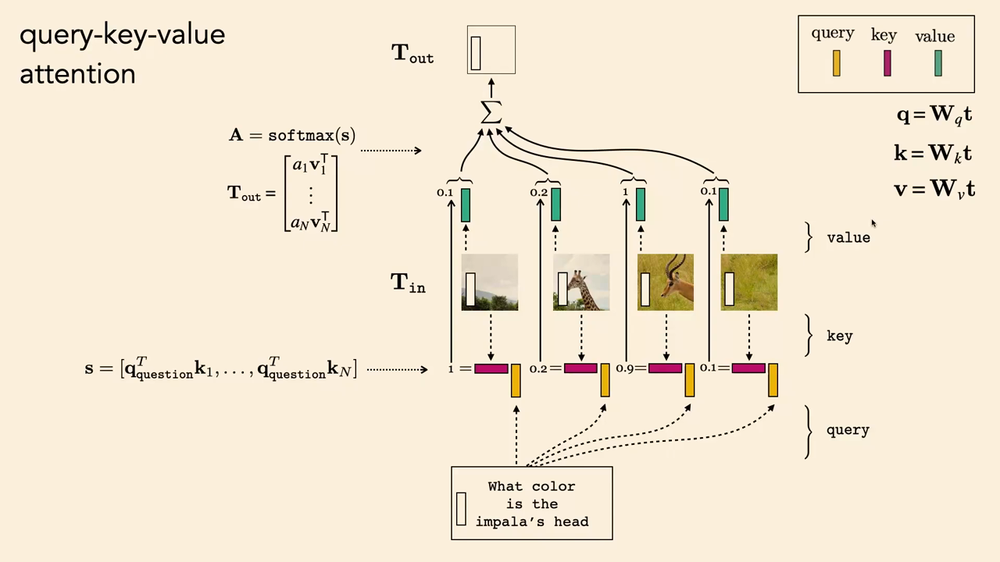
*▲ 강의 슬라이드 [39:50](https://youtu.be/Q1HOKrNeh2M?t=2390): 쿼리-키-값 [어텐션](00_%EB%94%A5%EB%9F%AC%EB%8B%9D_%EC%9A%A9%EC%96%B4%EC%82%AC%EC%A0%84.md#attention-%EC%96%B4%ED%85%90%EC%85%98). 질문 [토큰](00_%EB%94%A5%EB%9F%AC%EB%8B%9D_%EC%9A%A9%EC%96%B4%EC%82%AC%EC%A0%84.md#token-%ED%86%A0%ED%81%B0)의 쿼리(노랑)와 패치 [토큰](00_%EB%94%A5%EB%9F%AC%EB%8B%9D_%EC%9A%A9%EC%96%B4%EC%82%AC%EC%A0%84.md#token-%ED%86%A0%ED%81%B0)의 키(자주)를 내적해 점수 s를 만들고, [소프트맥스](00_%EB%94%A5%EB%9F%AC%EB%8B%9D_%EC%9A%A9%EC%96%B4%EC%82%AC%EC%A0%84.md#softmax-%EC%86%8C%ED%94%84%ED%8A%B8%EB%A7%A5%EC%8A%A4) [가중치](00_%EB%94%A5%EB%9F%AC%EB%8B%9D_%EC%9A%A9%EC%96%B4%EC%82%AC%EC%A0%84.md#weight-%EA%B0%80%EC%A4%91%EC%B9%98)로 값(초록)을 더한다 (점수 칸의 맨 왼쪽 1은 0.1의 오타라고 강사가 정정)*

질의응답 정리 [36:40](https://youtu.be/Q1HOKrNeh2M?t=2200)

- **글과 이미지를 같은 방식으로 토큰화하나?** 아닙니다. 글 토크나이저와 이미지 토크나이저가 따로 있고, 위 그림은 [토큰화](00_%EB%94%A5%EB%9F%AC%EB%8B%9D_%EC%9A%A9%EC%96%B4%EC%82%AC%EC%A0%84.md#tokenization-%ED%86%A0%ED%81%B0%ED%99%94)가 끝난 뒤의 이야기입니다.
- **쿼리는 낮에 찍은 사진, 키는 밤에 찍은 사진이면?** 그 차이를 메우는 것은 [학습](00_%EB%94%A5%EB%9F%AC%EB%8B%9D_%EC%9A%A9%EC%96%B4%EC%82%AC%EC%A0%84.md#training-%ED%95%99%EC%8A%B5)의 몫입니다. 낮 사진으로 밤 사진에 대해 묻는 데이터로 학습하면 [파라미터](00_%EB%94%A5%EB%9F%AC%EB%8B%9D_%EC%9A%A9%EC%96%B4%EC%82%AC%EC%A0%84.md#parameter-%ED%8C%8C%EB%9D%BC%EB%AF%B8%ED%84%B0)가 시간대에 둔감해지도록 맞춰집니다.
- **학습하는 것은 무엇인가?** [어텐션](00_%EB%94%A5%EB%9F%AC%EB%8B%9D_%EC%9A%A9%EC%96%B4%EC%82%AC%EC%A0%84.md#attention-%EC%96%B4%ED%85%90%EC%85%98) [층](00_%EB%94%A5%EB%9F%AC%EB%8B%9D_%EC%9A%A9%EC%96%B4%EC%82%AC%EC%A0%84.md#layer-%EC%B8%B5)에서 학습하는 행렬은 $W_q, W_k, W_v$ 셋뿐입니다. [소프트맥스](00_%EB%94%A5%EB%9F%AC%EB%8B%9D_%EC%9A%A9%EC%96%B4%EC%82%AC%EC%A0%84.md#softmax-%EC%86%8C%ED%94%84%ED%8A%B8%EB%A7%A5%EC%8A%A4) 값 $A$는 이들로부터 계산됩니다.
- **쿼리 함수는 꼭 선형인가?** 표준은 선형 사영이지만 MLP 같은 다른 함수로 바꿀 수도 있습니다.
- 다음 주 문제 세트에서 [트랜스포머](00_%EB%94%A5%EB%9F%AC%EB%8B%9D_%EC%9A%A9%EC%96%B4%EC%82%AC%EC%A0%84.md#transformer-%ED%8A%B8%EB%9E%9C%EC%8A%A4%ED%8F%AC%EB%A8%B8)와 여러 변형, [GPT](00_%EB%94%A5%EB%9F%AC%EB%8B%9D_%EC%9A%A9%EC%96%B4%EC%82%AC%EC%A0%84.md#gpt-%EC%83%9D%EC%84%B1%ED%98%95-%EC%82%AC%EC%A0%84%ED%95%99%EC%8A%B5-%ED%8A%B8%EB%9E%9C%EC%8A%A4%ED%8F%AC%EB%A8%B8)를 직접 구현합니다.

### 5.4 셀프 어텐션

▶ 영상 [41:01](https://youtu.be/Q1HOKrNeh2M?t=2461)

쿼리가 외부 질문이 아니라 **신호 자신**에서 나오면 **[셀프 어텐션](00_%EB%94%A5%EB%9F%AC%EB%8B%9D_%EC%9A%A9%EC%96%B4%EC%82%AC%EC%A0%84.md#self-attention-%EC%85%80%ED%94%84-%EC%96%B4%ED%85%90%EC%85%98)**(self-attention)입니다. 모든 [토큰](00_%EB%94%A5%EB%9F%AC%EB%8B%9D_%EC%9A%A9%EC%96%B4%EC%82%AC%EC%A0%84.md#token-%ED%86%A0%ED%81%B0)이 다른 모든 [토큰](00_%EB%94%A5%EB%9F%AC%EB%8B%9D_%EC%9A%A9%EC%96%B4%EC%82%AC%EC%A0%84.md#token-%ED%86%A0%ED%81%B0)에게 쿼리를 냅니다. 직관적인 예로, 한 패치가 "내가 임팔라인지 가젤인지 모르겠다"면 자기와 닮은 다른 패치들을 보고 그 정보를 모아 자기 표현을 고칠 수 있습니다.

강사는 학습한 [트랜스포머](00_%EB%94%A5%EB%9F%AC%EB%8B%9D_%EC%9A%A9%EC%96%B4%EC%82%AC%EC%A0%84.md#transformer-%ED%8A%B8%EB%9E%9C%EC%8A%A4%ED%8F%AC%EB%A8%B8)(DINO, Caron 외 2021)의 [어텐션](00_%EB%94%A5%EB%9F%AC%EB%8B%9D_%EC%9A%A9%EC%96%B4%EC%82%AC%EC%A0%84.md#attention-%EC%96%B4%ED%85%90%EC%85%98) 지도를 동영상으로 보여 줍니다. 말 위의 [토큰](00_%EB%94%A5%EB%9F%AC%EB%8B%9D_%EC%9A%A9%EC%96%B4%EC%82%AC%EC%A0%84.md#token-%ED%86%A0%ED%81%B0)은 말 패치들에, 개 위의 [토큰](00_%EB%94%A5%EB%9F%AC%EB%8B%9D_%EC%9A%A9%EC%96%B4%EC%82%AC%EC%A0%84.md#token-%ED%86%A0%ED%81%B0)은 개 패치들에 주의를 기울입니다. 물체 경계를 넘지 않으므로 사실상 **분할(segmentation)** 을 풀고 있습니다. 인식을 위해 배경(풀밭이니 말일 것이다)을 볼 수도 있었지만, [학습](00_%EB%94%A5%EB%9F%AC%EB%8B%9D_%EC%9A%A9%EC%96%B4%EC%82%AC%EC%A0%84.md#training-%ED%95%99%EC%8A%B5)은 "말 부분이 다른 말 부분을 본다"는 더 직관적인 전략을 찾았습니다.

질의응답 정리 [42:56](https://youtu.be/Q1HOKrNeh2M?t=2576)

- **어느 [토큰](00_%EB%94%A5%EB%9F%AC%EB%8B%9D_%EC%9A%A9%EC%96%B4%EC%82%AC%EC%A0%84.md#token-%ED%86%A0%ED%81%B0)을 볼지 어떻게 정하나?** 그냥 기계 [학습](00_%EB%94%A5%EB%9F%AC%EB%8B%9D_%EC%9A%A9%EC%96%B4%EC%82%AC%EC%A0%84.md#training-%ED%95%99%EC%8A%B5)입니다. 목적 함수를 줄이는 [역전파](00_%EB%94%A5%EB%9F%AC%EB%8B%9D_%EC%9A%A9%EC%96%B4%EC%82%AC%EC%A0%84.md#backpropagation-%EC%97%AD%EC%A0%84%ED%8C%8C)가 쿼리·키·값 사영을 찾고, 그 결과가 직관적으로 해석되는 경우가 많지만 반드시 그렇지는 않습니다.
- **이런 행동이 늘 나타나나? 강제할 수 있나?** 관찰한 결과이지 증명된 것은 아닙니다. 데이터의 통계, 최적화, 구조가 함께 만든 결과입니다. 내부 표현과 회로를 연구하는 해석 가능성(interpretability) 연구가 한쪽 관점이고, 내부 구조는 상관하지 않고 [경사하강법](00_%EB%94%A5%EB%9F%AC%EB%8B%9D_%EC%9A%A9%EC%96%B4%EC%82%AC%EC%A0%84.md#gradient-descent-%EA%B2%BD%EC%82%AC%ED%95%98%EA%B0%95%EB%B2%95)이 좋은 해로 수렴하는 이유를 보는 [최적화](00_%EB%94%A5%EB%9F%AC%EB%8B%9D_%EC%9A%A9%EC%96%B4%EC%82%AC%EC%A0%84.md#optimizer-%EC%98%B5%ED%8B%B0%EB%A7%88%EC%9D%B4%EC%A0%80)·[학습](00_%EB%94%A5%EB%9F%AC%EB%8B%9D_%EC%9A%A9%EC%96%B4%EC%82%AC%EC%A0%84.md#training-%ED%95%99%EC%8A%B5) 이론이 다른 관점입니다.

### 5.5 어텐션 식

▶ 영상 [45:00](https://youtu.be/Q1HOKrNeh2M?t=2700)

📐 **수학 개념**: [스케일드 내적 어텐션](%EC%88%98%ED%95%99%EA%B0%9C%EB%85%90/07_%EA%B5%AC%EC%A1%B0_%EC%95%84%ED%82%A4%ED%85%8D%EC%B2%98/MM30_%EC%8A%A4%EC%BC%80%EC%9D%BC%EB%93%9C_%EB%82%B4%EC%A0%81_%EC%96%B4%ED%85%90%EC%85%98.md) · [전치](%EC%88%98%ED%95%99%EA%B0%9C%EB%85%90/03_%EC%84%A0%ED%98%95%EB%8C%80%EC%88%98/MM03_%EB%B2%A1%ED%84%B0_%ED%91%9C%EA%B8%B0%EC%99%80_%EC%A0%84%EC%B9%98.md) · [행렬 곱](%EC%88%98%ED%95%99%EA%B0%9C%EB%85%90/03_%EC%84%A0%ED%98%95%EB%8C%80%EC%88%98/M05_%EB%B2%A1%ED%84%B0%EC%99%80_%ED%96%89%EB%A0%AC.md)

[셀프 어텐션](00_%EB%94%A5%EB%9F%AC%EB%8B%9D_%EC%9A%A9%EC%96%B4%EC%82%AC%EC%A0%84.md#self-attention-%EC%85%80%ED%94%84-%EC%96%B4%ED%85%90%EC%85%98)에서는 입력 $T_{\text{in}}$의 모든 [토큰](00_%EB%94%A5%EB%9F%AC%EB%8B%9D_%EC%9A%A9%EC%96%B4%EC%82%AC%EC%A0%84.md#token-%ED%86%A0%ED%81%B0)이 쿼리·키·값을 냅니다. 이를 행으로 쌓으면 쿼리 행렬 $Q = T_{\text{in}}W_Q$처럼 **[행렬 곱](00_%EB%94%A5%EB%9F%AC%EB%8B%9D_%EC%9A%A9%EC%96%B4%EC%82%AC%EC%A0%84.md#matrix-multiplication-%ED%96%89%EB%A0%AC-%EA%B3%B1) 하나**로 쓸 수 있습니다. [토큰](00_%EB%94%A5%EB%9F%AC%EB%8B%9D_%EC%9A%A9%EC%96%B4%EC%82%AC%EC%A0%84.md#token-%ED%86%A0%ED%81%B0) $i$가 [토큰](00_%EB%94%A5%EB%9F%AC%EB%8B%9D_%EC%9A%A9%EC%96%B4%EC%82%AC%EC%A0%84.md#token-%ED%86%A0%ED%81%B0) $j$의 값에 줄 [가중치](00_%EB%94%A5%EB%9F%AC%EB%8B%9D_%EC%9A%A9%EC%96%B4%EC%82%AC%EC%A0%84.md#weight-%EA%B0%80%EC%A4%91%EC%B9%98)는 쿼리 $i$와 키 $j$의 [내적](00_%EB%94%A5%EB%9F%AC%EB%8B%9D_%EC%9A%A9%EC%96%B4%EC%82%AC%EC%A0%84.md#dot-product-%EB%82%B4%EC%A0%81)이고, 모든 쌍을 모으면 $QK^\top$ ($N \times N$)입니다. 키·쿼리·값의 차원 $m$은 [토큰](00_%EB%94%A5%EB%9F%AC%EB%8B%9D_%EC%9A%A9%EC%96%B4%EC%82%AC%EC%A0%84.md#token-%ED%86%A0%ED%81%B0) 차원 $d$와 달라도 됩니다. 이 모두를 한 식으로 줄인 것이 유명한 **[스케일드 내적 어텐션](00_%EB%94%A5%EB%9F%AC%EB%8B%9D_%EC%9A%A9%EC%96%B4%EC%82%AC%EC%A0%84.md#scaled-dot-product-attention-%EC%8A%A4%EC%BC%80%EC%9D%BC%EB%93%9C-%EB%82%B4%EC%A0%81-%EC%96%B4%ED%85%90%EC%85%98)** 식입니다.

$$
Q = T_{\text{in}}W_Q,\quad K = T_{\text{in}}W_K,\quad V = T_{\text{in}}W_V,\qquad
A = \text{softmax}\!\Big(\frac{QK^\top}{\sqrt{m}}\Big),\qquad T_{\text{out}} = AV
$$

기호 풀이

| 기호 | 읽는 법 | 뜻 | 예제 값 |
| --- | --- | --- | --- |
| $T_{\text{in}}$ | 티 인 | 입력 [토큰](00_%EB%94%A5%EB%9F%AC%EB%8B%9D_%EC%9A%A9%EC%96%B4%EC%82%AC%EC%A0%84.md#token-%ED%86%A0%ED%81%B0) 행렬 ($N \times d$) | `[[1, 0], [1, 1]]` |
| $W_Q, W_K, W_V$ | 더블유 큐·케이·브이 | 사영 행렬 ($d \times m$), [학습](00_%EB%94%A5%EB%9F%AC%EB%8B%9D_%EC%9A%A9%EC%96%B4%EC%82%AC%EC%A0%84.md#training-%ED%95%99%EC%8A%B5) [파라미터](00_%EB%94%A5%EB%9F%AC%EB%8B%9D_%EC%9A%A9%EC%96%B4%EC%82%AC%EC%A0%84.md#parameter-%ED%8C%8C%EB%9D%BC%EB%AF%B8%ED%84%B0) | 단위행렬 $I_2$ |
| $Q, K, V$ | 큐, 케이, 브이 | 쿼리·키·값 행렬 ($N \times m$) | 모두 $T_{\text{in}}$ |
| $QK^\top$ | 큐 케이 [전치](00_%EB%94%A5%EB%9F%AC%EB%8B%9D_%EC%9A%A9%EC%96%B4%EC%82%AC%EC%A0%84.md#transpose-%EC%A0%84%EC%B9%98) | 모든 쿼리·키 쌍의 [내적](00_%EB%94%A5%EB%9F%AC%EB%8B%9D_%EC%9A%A9%EC%96%B4%EC%82%AC%EC%A0%84.md#dot-product-%EB%82%B4%EC%A0%81) ($N \times N$) | `[[1, 1], [1, 2]]` |
| $m$ | 엠 | 쿼리·키·값 벡터의 차원 | 2 |
| $\text{softmax}$ | [소프트맥스](00_%EB%94%A5%EB%9F%AC%EB%8B%9D_%EC%9A%A9%EC%96%B4%EC%82%AC%EC%A0%84.md#softmax-%EC%86%8C%ED%94%84%ED%8A%B8%EB%A7%A5%EC%8A%A4) | 행마다 합 1이 되게 바꿈 | - |
| $A$ | 에이 | [어텐션](00_%EB%94%A5%EB%9F%AC%EB%8B%9D_%EC%9A%A9%EC%96%B4%EC%82%AC%EC%A0%84.md#attention-%EC%96%B4%ED%85%90%EC%85%98) 행렬 ($N \times N$, 행 합 1) | `[[0.5, 0.5], [0.3302, 0.6698]]` |
| $T_{\text{out}}$ | 티 아웃 | 출력 [토큰](00_%EB%94%A5%EB%9F%AC%EB%8B%9D_%EC%9A%A9%EC%96%B4%EC%82%AC%EC%A0%84.md#token-%ED%86%A0%ED%81%B0) 행렬 | `[[1, 0.5], [1, 0.6698]]` |

예제와 풀이

**문제**: 입력 [토큰](00_%EB%94%A5%EB%9F%AC%EB%8B%9D_%EC%9A%A9%EC%96%B4%EC%82%AC%EC%A0%84.md#token-%ED%86%A0%ED%81%B0) 두 개 (1, 0), (1, 1)을 [셀프 어텐션](00_%EB%94%A5%EB%9F%AC%EB%8B%9D_%EC%9A%A9%EC%96%B4%EC%82%AC%EC%A0%84.md#self-attention-%EC%85%80%ED%94%84-%EC%96%B4%ED%85%90%EC%85%98)에 넣는다. 사영 행렬이 모두 단위행렬이고 쿼리·키 차원이 2일 때 출력 [토큰](00_%EB%94%A5%EB%9F%AC%EB%8B%9D_%EC%9A%A9%EC%96%B4%EC%82%AC%EC%A0%84.md#token-%ED%86%A0%ED%81%B0) 행렬 $T_{\text{out}}$을 구한다.

**주어진 값**:
- $T_{\text{in}} = \begin{pmatrix}1&0\\1&1\end{pmatrix}$ (행 = 입력 [토큰](00_%EB%94%A5%EB%9F%AC%EB%8B%9D_%EC%9A%A9%EC%96%B4%EC%82%AC%EC%A0%84.md#token-%ED%86%A0%ED%81%B0))
- $W_Q = W_K = W_V = I_2$ (단위행렬: 곱해도 그대로)
- $m = 2$ (쿼리·키 차원)

**풀이**
1. 식을 그대로 쓴다: $Q = T_{\text{in}}W_Q$, $K = T_{\text{in}}W_K$, $V = T_{\text{in}}W_V$, $A = \text{softmax}\big(QK^\top/\sqrt{m}\big)$, $T_{\text{out}} = AV$
2. 값을 대입한다: $T_{\text{out}} = \text{softmax}\Big(\begin{pmatrix}1&0\\1&1\end{pmatrix}I_2 \Big(\begin{pmatrix}1&0\\1&1\end{pmatrix}I_2\Big)^\top \big/ \sqrt{2}\Big)\begin{pmatrix}1&0\\1&1\end{pmatrix}I_2$
3. 단위행렬을 곱한다 (바뀌지 않음): $Q = K = V = \begin{pmatrix}1&0\\1&1\end{pmatrix}$
4. [전치](00_%EB%94%A5%EB%9F%AC%EB%8B%9D_%EC%9A%A9%EC%96%B4%EC%82%AC%EC%A0%84.md#transpose-%EC%A0%84%EC%B9%98)의 뜻: 행과 열을 바꾼다. $K^\top = \begin{pmatrix}1&1\\0&1\end{pmatrix}$
5. $QK^\top$의 (1,1)칸 = [토큰](00_%EB%94%A5%EB%9F%AC%EB%8B%9D_%EC%9A%A9%EC%96%B4%EC%82%AC%EC%A0%84.md#token-%ED%86%A0%ED%81%B0) 1과 [토큰](00_%EB%94%A5%EB%9F%AC%EB%8B%9D_%EC%9A%A9%EC%96%B4%EC%82%AC%EC%A0%84.md#token-%ED%86%A0%ED%81%B0) 1의 [내적](00_%EB%94%A5%EB%9F%AC%EB%8B%9D_%EC%9A%A9%EC%96%B4%EC%82%AC%EC%A0%84.md#dot-product-%EB%82%B4%EC%A0%81)을 펼친다: $1 \times 1 + 0 \times 0 = 1$
6. (1,2)칸 = [토큰](00_%EB%94%A5%EB%9F%AC%EB%8B%9D_%EC%9A%A9%EC%96%B4%EC%82%AC%EC%A0%84.md#token-%ED%86%A0%ED%81%B0) 1과 [토큰](00_%EB%94%A5%EB%9F%AC%EB%8B%9D_%EC%9A%A9%EC%96%B4%EC%82%AC%EC%A0%84.md#token-%ED%86%A0%ED%81%B0) 2의 [내적](00_%EB%94%A5%EB%9F%AC%EB%8B%9D_%EC%9A%A9%EC%96%B4%EC%82%AC%EC%A0%84.md#dot-product-%EB%82%B4%EC%A0%81): $1 \times 1 + 0 \times 1 = 1$
7. (2,1)칸 = [토큰](00_%EB%94%A5%EB%9F%AC%EB%8B%9D_%EC%9A%A9%EC%96%B4%EC%82%AC%EC%A0%84.md#token-%ED%86%A0%ED%81%B0) 2와 [토큰](00_%EB%94%A5%EB%9F%AC%EB%8B%9D_%EC%9A%A9%EC%96%B4%EC%82%AC%EC%A0%84.md#token-%ED%86%A0%ED%81%B0) 1의 [내적](00_%EB%94%A5%EB%9F%AC%EB%8B%9D_%EC%9A%A9%EC%96%B4%EC%82%AC%EC%A0%84.md#dot-product-%EB%82%B4%EC%A0%81): $1 \times 1 + 1 \times 0 = 1$
8. (2,2)칸 = [토큰](00_%EB%94%A5%EB%9F%AC%EB%8B%9D_%EC%9A%A9%EC%96%B4%EC%82%AC%EC%A0%84.md#token-%ED%86%A0%ED%81%B0) 2와 [토큰](00_%EB%94%A5%EB%9F%AC%EB%8B%9D_%EC%9A%A9%EC%96%B4%EC%82%AC%EC%A0%84.md#token-%ED%86%A0%ED%81%B0) 2의 [내적](00_%EB%94%A5%EB%9F%AC%EB%8B%9D_%EC%9A%A9%EC%96%B4%EC%82%AC%EC%A0%84.md#dot-product-%EB%82%B4%EC%A0%81): $1 \times 1 + 1 \times 1 = 2$ 이므로 $QK^\top = \begin{pmatrix}1&1\\1&2\end{pmatrix}$
9. $\sqrt{\ }$의 뜻: 제곱하면 그 수가 되는 양수다. $\sqrt{2}$는 코드 `np.sqrt(2)`로 구하면 1.4142
10. 나눗셈을 한다: $1 \div 1.4142 = 0.7071$, $2 \div 1.4142 = 1.4142$ 이므로 점수 $\begin{pmatrix}0.7071&0.7071\\0.7071&1.4142\end{pmatrix}$
11. softmax의 뜻: 한 행의 점수마다 $e^{s}$($e$ = 2.7183, 코드 `np.exp`)를 구하고 그 행의 합으로 나눈다. 1행에 대입한다: $\Big(\frac{e^{0.7071}}{e^{0.7071} + e^{0.7071}},\ \frac{e^{0.7071}}{e^{0.7071} + e^{0.7071}}\Big)$
12. [지수](00_%EB%94%A5%EB%9F%AC%EB%8B%9D_%EC%9A%A9%EC%96%B4%EC%82%AC%EC%A0%84.md#e-exponent-e%EC%99%80-%EC%A7%80%EC%88%98)를 계산한다: $e^{0.7071} = 2.0281$ 이므로 $\big(\frac{2.0281}{4.0562}, \frac{2.0281}{4.0562}\big) = (0.5, 0.5)$
13. 2행에 대입한다: $\Big(\frac{e^{0.7071}}{e^{0.7071} + e^{1.4142}},\ \frac{e^{1.4142}}{e^{0.7071} + e^{1.4142}}\Big)$
14. [지수](00_%EB%94%A5%EB%9F%AC%EB%8B%9D_%EC%9A%A9%EC%96%B4%EC%82%AC%EC%A0%84.md#e-exponent-e%EC%99%80-%EC%A7%80%EC%88%98)를 계산한다: $e^{0.7071} = 2.0281$, $e^{1.4142} = 4.1133$
15. 분모의 덧셈을 한다: $2.0281 + 4.1133 = 6.1414$
16. 나눗셈을 한다: $2.0281 \div 6.1414 = 0.3302$, $4.1133 \div 6.1414 = 0.6698$ 이므로 $A = \begin{pmatrix}0.5&0.5\\0.3302&0.6698\end{pmatrix}$
17. $AV$의 1행을 펼친다: $0.5 \times (1, 0) + 0.5 \times (1, 1) = (0.5, 0) + (0.5, 0.5) = (1, 0.5)$
18. $AV$의 2행을 펼친다: $0.3302 \times (1, 0) + 0.6698 \times (1, 1) = (0.3302, 0) + (0.6698, 0.6698) = (1, 0.6698)$

**답**: $T_{\text{out}} = \begin{pmatrix}1&0.5\\1&0.6698\end{pmatrix}$

내 이해

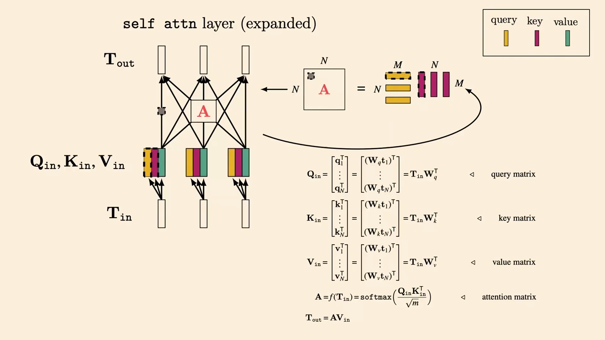
*▲ 강의 슬라이드 [49:10](https://youtu.be/Q1HOKrNeh2M?t=2950): [셀프 어텐션](00_%EB%94%A5%EB%9F%AC%EB%8B%9D_%EC%9A%A9%EC%96%B4%EC%82%AC%EC%A0%84.md#self-attention-%EC%85%80%ED%94%84-%EC%96%B4%ED%85%90%EC%85%98) [층](00_%EB%94%A5%EB%9F%AC%EB%8B%9D_%EC%9A%A9%EC%96%B4%EC%82%AC%EC%A0%84.md#layer-%EC%B8%B5) 전개. $Q_{\text{in}} = T_{\text{in}}W_q^\top$ 등 세 사영과 $A = \text{softmax}(Q_{\text{in}}K_{\text{in}}^\top/\sqrt{m})$, $T_{\text{out}} = AV_{\text{in}}$*

$\sqrt{m}$으로 나누는 것은 [정규화](00_%EB%94%A5%EB%9F%AC%EB%8B%9D_%EC%9A%A9%EC%96%B4%EC%82%AC%EC%A0%84.md#normalization-%EC%A0%95%EA%B7%9C%ED%99%94)와 수치 안정성을 위해서입니다. 차원이 크면 [내적](00_%EB%94%A5%EB%9F%AC%EB%8B%9D_%EC%9A%A9%EC%96%B4%EC%82%AC%EC%A0%84.md#dot-product-%EB%82%B4%EC%A0%81)이 커져 [소프트맥스](00_%EB%94%A5%EB%9F%AC%EB%8B%9D_%EC%9A%A9%EC%96%B4%EC%82%AC%EC%A0%84.md#softmax-%EC%86%8C%ED%94%84%ED%8A%B8%EB%A7%A5%EC%8A%A4)가 한 칸에 쏠리기 때문입니다([MM30_스케일드_내적_어텐션](%EC%88%98%ED%95%99%EA%B0%9C%EB%85%90/07_%EA%B5%AC%EC%A1%B0_%EC%95%84%ED%82%A4%ED%85%8D%EC%B2%98/MM30_%EC%8A%A4%EC%BC%80%EC%9D%BC%EB%93%9C_%EB%82%B4%EC%A0%81_%EC%96%B4%ED%85%90%EC%85%98.md) 3절: m = 1024이면 [내적](00_%EB%94%A5%EB%9F%AC%EB%8B%9D_%EC%9A%A9%EC%96%B4%EC%82%AC%EC%A0%84.md#dot-product-%EB%82%B4%EC%A0%81)의 표준편차가 31.78, 나누면 0.99). 강사의 말대로 "자잘한 선형대수가 많지만 결국 아주 단순한 식"이 됩니다. 모든 것이 [행렬 곱](00_%EB%94%A5%EB%9F%AC%EB%8B%9D_%EC%9A%A9%EC%96%B4%EC%82%AC%EC%A0%84.md#matrix-multiplication-%ED%96%89%EB%A0%AC-%EA%B3%B1)이라는 점이 [트랜스포머](00_%EB%94%A5%EB%9F%AC%EB%8B%9D_%EC%9A%A9%EC%96%B4%EC%82%AC%EC%A0%84.md#transformer-%ED%8A%B8%EB%9E%9C%EC%8A%A4%ED%8F%AC%EB%A8%B8) 설계의 또 다른 장점입니다.

질의응답: 왜 A를 직접 배우지 않나? [49:20](https://youtu.be/Q1HOKrNeh2M?t=2960)

강사의 답은 첫째, 경험적으로 이 요리법이 수많은 과제에서 가장 잘 된다는 것입니다. 둘째, [파라미터](00_%EB%94%A5%EB%9F%AC%EB%8B%9D_%EC%9A%A9%EC%96%B4%EC%82%AC%EC%A0%84.md#parameter-%ED%8C%8C%EB%9D%BC%EB%AF%B8%ED%84%B0) 수를 세어 보면 $A$를 직접 배우면 [토큰](00_%EB%94%A5%EB%9F%AC%EB%8B%9D_%EC%9A%A9%EC%96%B4%EC%82%AC%EC%A0%84.md#token-%ED%86%A0%ED%81%B0) 수 $n$에 대해 $n^2$개가 필요하지만, $W_Q, W_K, W_V$는 [토큰](00_%EB%94%A5%EB%9F%AC%EB%8B%9D_%EC%9A%A9%EC%96%B4%EC%82%AC%EC%A0%84.md#token-%ED%86%A0%ED%81%B0) 차원 $d$에만 달려 있습니다. 요즘 [트랜스포머](00_%EB%94%A5%EB%9F%AC%EB%8B%9D_%EC%9A%A9%EC%96%B4%EC%82%AC%EC%A0%84.md#transformer-%ED%8A%B8%EB%9E%9C%EC%8A%A4%ED%8F%AC%EB%A8%B8)는 책 한 권, 백만 [토큰](00_%EB%94%A5%EB%9F%AC%EB%8B%9D_%EC%9A%A9%EC%96%B4%EC%82%AC%EC%A0%84.md#token-%ED%86%A0%ED%81%B0) 길이의 입력도 다루므로 $n$이 $d$보다 훨씬 큽니다. 예를 들어 $n = 1000$이면 $n^2 = 1{,}000{,}000$개, $d = m = 64$면 $3dm = 12{,}288$개입니다.

또 다른 질문(언어와 이미지는 이렇게 다른데 같은 구조를 써도 되나?)에는, 분야 지식은 [토큰화](00_%EB%94%A5%EB%9F%AC%EB%8B%9D_%EC%9A%A9%EC%96%B4%EC%82%AC%EC%A0%84.md#tokenization-%ED%86%A0%ED%81%B0%ED%99%94)와 위치 인코딩에만 넣고 나머지를 범용으로 두는 것이 [트랜스포머](00_%EB%94%A5%EB%9F%AC%EB%8B%9D_%EC%9A%A9%EC%96%B4%EC%82%AC%EC%A0%84.md#transformer-%ED%8A%B8%EB%9E%9C%EC%8A%A4%ED%8F%AC%EB%A8%B8)의 힘이라고 답합니다. 모든 것이 같은 범용 하드웨어에서 돌고, 코드와 교훈이 분야 사이에 옮겨집니다. 얼마나 특화하고 얼마나 통일할지는 손익의 문제입니다.

> [!TIP]
> **🆕 2026 업데이트: 백만 [토큰](00_%EB%94%A5%EB%9F%AC%EB%8B%9D_%EC%9A%A9%EC%96%B4%EC%82%AC%EC%A0%84.md#token-%ED%86%A0%ED%81%B0)을 넘는 문맥과 효율적인 [어텐션](00_%EB%94%A5%EB%9F%AC%EB%8B%9D_%EC%9A%A9%EC%96%B4%EC%82%AC%EC%A0%84.md#attention-%EC%96%B4%ED%85%90%EC%85%98)**
> - **강의**: 요즘 [언어 모델](00_%EB%94%A5%EB%9F%AC%EB%8B%9D_%EC%9A%A9%EC%96%B4%EC%82%AC%EC%A0%84.md#language-model-%EC%96%B8%EC%96%B4-%EB%AA%A8%EB%8D%B8)은 백만 [토큰](00_%EB%94%A5%EB%9F%AC%EB%8B%9D_%EC%9A%A9%EC%96%B4%EC%82%AC%EC%A0%84.md#token-%ED%86%A0%ED%81%B0) 길이의 입력도 다룰 수 있다고 말함.
> - **현재**: 공개 모델 Llama 4 Scout는 문맥 길이 1,000만 [토큰](00_%EB%94%A5%EB%9F%AC%EB%8B%9D_%EC%9A%A9%EC%96%B4%EC%82%AC%EC%A0%84.md#token-%ED%86%A0%ED%81%B0)을 내세웁니다(Llama 3는 128K). 점수 표가 $n^2$이라 그대로 계산하면 메모리가 감당이 안 되므로, **FlashAttention**처럼 점수 표 전체를 메모리에 쓰지 않고 조각씩 계산하는 정확한(근사 아닌) [어텐션](00_%EB%94%A5%EB%9F%AC%EB%8B%9D_%EC%9A%A9%EC%96%B4%EC%82%AC%EC%A0%84.md#attention-%EC%96%B4%ED%85%90%EC%85%98) 구현이 표준이 되었습니다. 또 **그룹 쿼리 [어텐션](00_%EB%94%A5%EB%9F%AC%EB%8B%9D_%EC%9A%A9%EC%96%B4%EC%82%AC%EC%A0%84.md#attention-%EC%96%B4%ED%85%90%EC%85%98)**(GQA)은 여러 쿼리 헤드가 키·값 헤드를 나눠 써서 생성할 때 저장해 두는 키·값의 양을 줄이며, Llama 2 대형 모델부터 쓰였습니다. Llama 4는 일부 [층](00_%EB%94%A5%EB%9F%AC%EB%8B%9D_%EC%9A%A9%EC%96%B4%EC%82%AC%EC%A0%84.md#layer-%EC%B8%B5)에서 [위치 인코딩](00_%EB%94%A5%EB%9F%AC%EB%8B%9D_%EC%9A%A9%EC%96%B4%EC%82%AC%EC%A0%84.md#positional-encoding-%EC%9C%84%EC%B9%98-%EC%9D%B8%EC%BD%94%EB%94%A9)을 아예 빼는 iRoPE 구조로 긴 문맥 [일반화](00_%EB%94%A5%EB%9F%AC%EB%8B%9D_%EC%9A%A9%EC%96%B4%EC%82%AC%EC%A0%84.md#generalization-%EC%9D%BC%EB%B0%98%ED%99%94)를 노립니다.
> - **출처**: [The Llama 4 herd (Meta AI 블로그, 2025)](https://ai.meta.com/blog/llama-4-multimodal-intelligence/) · [FlashAttention: Fast and Memory-Efficient Exact Attention with IO-Awareness (Dao 외, NeurIPS 2022)](https://arxiv.org/abs/2205.14135) · [GQA: Training Generalized Multi-Query Transformer Models from Multi-Head Checkpoints (Ainslie 외, EMNLP 2023)](https://arxiv.org/abs/2305.13245) · [Llama 2: Open Foundation and Fine-Tuned Chat Models (Touvron 외, 2023)](https://arxiv.org/abs/2307.09288)

### 5.6 선형층 가족으로 본 어텐션

▶ 영상 [52:28](https://youtu.be/Q1HOKrNeh2M?t=3148)

📐 **수학 개념**: [합성곱과 퇴플리츠 행렬](%EC%88%98%ED%95%99%EA%B0%9C%EB%85%90/07_%EA%B5%AC%EC%A1%B0_%EC%95%84%ED%82%A4%ED%85%8D%EC%B2%98/MM15_%ED%95%A9%EC%84%B1%EA%B3%B1%EA%B3%BC_%ED%87%B4%ED%94%8C%EB%A6%AC%EC%B8%A0_%ED%96%89%EB%A0%AC.md) · [랭크](%EC%88%98%ED%95%99%EA%B0%9C%EB%85%90/04_%ED%99%95%EB%A5%A0%EA%B3%BC_%EC%A0%95%EB%B3%B4/MM25_%EB%9E%AD%ED%81%AC%EC%99%80_%EC%9C%A0%ED%9A%A8_%EB%9E%AD%ED%81%AC.md) · [순열](%EC%88%98%ED%95%99%EA%B0%9C%EB%85%90/07_%EA%B5%AC%EC%A1%B0_%EC%95%84%ED%82%A4%ED%85%8D%EC%B2%98/MM18_%EC%9D%B8%EC%A0%91%ED%96%89%EB%A0%AC%EA%B3%BC_%EC%88%9C%EC%97%B4.md)

[어텐션](00_%EB%94%A5%EB%9F%AC%EB%8B%9D_%EC%9A%A9%EC%96%B4%EC%82%AC%EC%A0%84.md#attention-%EC%96%B4%ED%85%90%EC%85%98) [층](00_%EB%94%A5%EB%9F%AC%EB%8B%9D_%EC%9A%A9%EC%96%B4%EC%82%AC%EC%A0%84.md#layer-%EC%B8%B5)도 결국 **선형 결합**이므로, 지금까지 본 [선형층](00_%EB%94%A5%EB%9F%AC%EB%8B%9D_%EC%9A%A9%EC%96%B4%EC%82%AC%EC%A0%84.md#linear-layer-%EC%84%A0%ED%98%95%EC%B8%B5)들과 행렬 모양을 나란히 비교할 수 있습니다.

| [층](00_%EB%94%A5%EB%9F%AC%EB%8B%9D_%EC%9A%A9%EC%96%B4%EC%82%AC%EC%A0%84.md#layer-%EC%B8%B5) | 행렬 모양 | [학습](00_%EB%94%A5%EB%9F%AC%EB%8B%9D_%EC%9A%A9%EC%96%B4%EC%82%AC%EC%A0%84.md#training-%ED%95%99%EC%8A%B5) [파라미터](00_%EB%94%A5%EB%9F%AC%EB%8B%9D_%EC%9A%A9%EC%96%B4%EC%82%AC%EC%A0%84.md#parameter-%ED%8C%8C%EB%9D%BC%EB%AF%B8%ED%84%B0) | 성질 |
|---|---|---|---|
| 완전 연결 (fc) | 칸마다 다른 값 | $N^2$ (+ [편향](00_%EB%94%A5%EB%9F%AC%EB%8B%9D_%EC%9A%A9%EC%96%B4%EC%82%AC%EC%A0%84.md#bias-%ED%8E%B8%ED%96%A5) $N$) | 입력 차원 고정 |
| [합성곱](00_%EB%94%A5%EB%9F%AC%EB%8B%9D_%EC%9A%A9%EC%96%B4%EC%82%AC%EC%A0%84.md#convolution-%ED%95%A9%EC%84%B1%EA%B3%B1) (conv) | 대각선마다 같은 값 ([퇴플리츠](00_%EB%94%A5%EB%9F%AC%EB%8B%9D_%EC%9A%A9%EC%96%B4%EC%82%AC%EC%A0%84.md#toeplitz-matrix-%ED%87%B4%ED%94%8C%EB%A6%AC%EC%B8%A0-%ED%96%89%EB%A0%AC)) | $k + 1$ (커널 크기 $k$) | 입력 차원 가변, $\text{conv}(\text{translate}(x)) = \text{translate}(\text{conv}(x))$ |
| [어텐션](00_%EB%94%A5%EB%9F%AC%EB%8B%9D_%EC%9A%A9%EC%96%B4%EC%82%AC%EC%A0%84.md#attention-%EC%96%B4%ED%85%90%EC%85%98) (attn) | 저랭크이면서 희소한 블록 모양 | $\lvert W_q\rvert + \lvert W_k\rvert + \lvert W_v\rvert$ | 입력 차원 가변, $\text{attn}(\text{permute}(T)) = \text{permute}(\text{attn}(T))$ |

강사는 뉴런 6개를 3개씩 묶어 [토큰](00_%EB%94%A5%EB%9F%AC%EB%8B%9D_%EC%9A%A9%EC%96%B4%EC%82%AC%EC%A0%84.md#token-%ED%86%A0%ED%81%B0) 2개로 보고 [어텐션](00_%EB%94%A5%EB%9F%AC%EB%8B%9D_%EC%9A%A9%EC%96%B4%EC%82%AC%EC%A0%84.md#attention-%EC%96%B4%ED%85%90%EC%85%98)의 행렬을 그립니다. [토큰](00_%EB%94%A5%EB%9F%AC%EB%8B%9D_%EC%9A%A9%EC%96%B4%EC%82%AC%EC%A0%84.md#token-%ED%86%A0%ED%81%B0)의 선형 결합은 [토큰](00_%EB%94%A5%EB%9F%AC%EB%8B%9D_%EC%9A%A9%EC%96%B4%EC%82%AC%EC%A0%84.md#token-%ED%86%A0%ED%81%B0) 안의 모든 칸에 같은 [가중치](00_%EB%94%A5%EB%9F%AC%EB%8B%9D_%EC%9A%A9%EC%96%B4%EC%82%AC%EC%A0%84.md#weight-%EA%B0%80%EC%A4%91%EC%B9%98)를 쓰므로, 뉴런 단위로 보면 **같은 칸끼리만 연결된 희소하고 저랭크인 행렬**이 됩니다. 청중의 "희소하지는 않고 저랭크일 것"이라는 추측에 강사는 "저랭크이면서 희소하다"고 답합니다. 물론 그 값은 옆에 있는 쿼리·키 메커니즘이 정합니다.

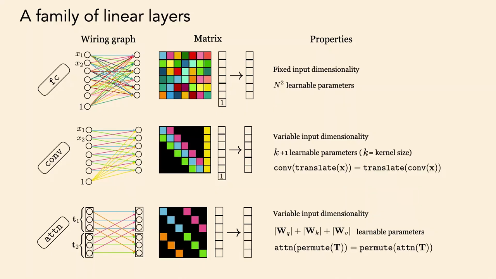
*▲ 강의 슬라이드 [55:30](https://youtu.be/Q1HOKrNeh2M?t=3330): [선형층](00_%EB%94%A5%EB%9F%AC%EB%8B%9D_%EC%9A%A9%EC%96%B4%EC%82%AC%EC%A0%84.md#linear-layer-%EC%84%A0%ED%98%95%EC%B8%B5) 가족. 완전 연결(N² [파라미터](00_%EB%94%A5%EB%9F%AC%EB%8B%9D_%EC%9A%A9%EC%96%B4%EC%82%AC%EC%A0%84.md#parameter-%ED%8C%8C%EB%9D%BC%EB%AF%B8%ED%84%B0)), [합성곱](00_%EB%94%A5%EB%9F%AC%EB%8B%9D_%EC%9A%A9%EC%96%B4%EC%82%AC%EC%A0%84.md#convolution-%ED%95%A9%EC%84%B1%EA%B3%B1)(퇴플리츠, 이동 등변), [어텐션](00_%EB%94%A5%EB%9F%AC%EB%8B%9D_%EC%9A%A9%EC%96%B4%EC%82%AC%EC%A0%84.md#attention-%EC%96%B4%ED%85%90%EC%85%98)(저랭크·희소, 순열 등변). 색은 서로 다른 값*

---

## 6. 트랜스포머 블록

### 6.1 멀티헤드 셀프 어텐션

▶ 영상 [56:21](https://youtu.be/Q1HOKrNeh2M?t=3381)

강사는 읽기 자료로 넘기며 짧게만 언급합니다. **[멀티헤드 셀프 어텐션](00_%EB%94%A5%EB%9F%AC%EB%8B%9D_%EC%9A%A9%EC%96%B4%EC%82%AC%EC%A0%84.md#multi-head-attention-%EB%A9%80%ED%8B%B0%ED%97%A4%EB%93%9C-%EC%96%B4%ED%85%90%EC%85%98)**(MSA)은 주의를 기울이는 방법을 하나가 아니라 $k$개 두는 것입니다. 각 헤드가 자기만의 쿼리·키·값 사영을 갖고 병렬로 돌며, 하나는 모양에, 하나는 질감에 주의를 기울이는 식으로 서로 다른 것을 볼 수 있습니다. 결과를 이어 붙이고 행렬 $W_{\text{MSA}}$로 다시 $d$차원으로 섞습니다.

$$
T^i_{\text{out}} = \text{attn}^i(T_{\text{in}})\ (i = 1, \dots, k),\qquad
\bar{T}_{\text{out}} = \big[\,T^1_{\text{out}}\ \cdots\ T^k_{\text{out}}\,\big],\qquad
T_{\text{out}} = \bar{T}_{\text{out}}\,W_{\text{MSA}}
$$

기호 풀이

| 기호 | 읽는 법 | 뜻 | 예제 값 |
| --- | --- | --- | --- |
| $k$ | 케이 | 헤드 개수 | 2 |
| $\text{attn}^i$ | [어텐션](00_%EB%94%A5%EB%9F%AC%EB%8B%9D_%EC%9A%A9%EC%96%B4%EC%82%AC%EC%A0%84.md#attention-%EC%96%B4%ED%85%90%EC%85%98) 아이 | $i$번째 헤드 (자기만의 $W_Q, W_K, W_V$) | - |
| $T^i_{\text{out}}$ | 티 아이 아웃 | 헤드 $i$의 출력 ($N \times v$) | (1, 2), (3, 0) |
| $[\ \cdots\ ]$ | [이어 붙이기](00_%EB%94%A5%EB%9F%AC%EB%8B%9D_%EC%9A%A9%EC%96%B4%EC%82%AC%EC%A0%84.md#concatenate-stack-%EC%9D%B4%EC%96%B4-%EB%B6%99%EC%9D%B4%EA%B8%B0%EC%99%80-%EC%8C%93%EA%B8%B0) | 헤드 출력을 열 방향으로 나란히 붙임 | (1, 2, 3, 0) |
| $\bar{T}_{\text{out}}$ | 티 바 아웃 | 이어 붙인 결과 ($N \times kv$) | 1×4 |
| $W_{\text{MSA}}$ | 더블유 엠에스에이 | 다시 $d$차원으로 섞는 행렬 ($kv \times d$) | 4×2 |

예제와 풀이

**문제**: [토큰](00_%EB%94%A5%EB%9F%AC%EB%8B%9D_%EC%9A%A9%EC%96%B4%EC%82%AC%EC%A0%84.md#token-%ED%86%A0%ED%81%B0) 하나에 대해 헤드 1의 출력이 $T^1_{\text{out}} = (1, 2)$, 헤드 2의 출력이 $T^2_{\text{out}} = (3, 0)$일 때, 이어 붙여 섞는 행렬 $W_{\text{MSA}}$를 곱한 최종 출력 $T_{\text{out}}$을 구한다.

**주어진 값**:
- $k = 2$ (헤드 개수)
- $T^1_{\text{out}} = (1, 2)$, $T^2_{\text{out}} = (3, 0)$ (헤드별 출력, 각 2칸)
- $W_{\text{MSA}} = \begin{pmatrix}1&0\\0&1\\1&0\\0&1\end{pmatrix}$ (4칸을 2칸으로 섞는 행렬)

**풀이**
1. 식을 그대로 쓴다: $\bar{T}_{\text{out}} = \big[\,T^1_{\text{out}}\ \ T^2_{\text{out}}\,\big]$, $T_{\text{out}} = \bar{T}_{\text{out}}W_{\text{MSA}}$
2. 값을 대입한다: $T_{\text{out}} = \big[\,(1, 2)\ \ (3, 0)\,\big]\begin{pmatrix}1&0\\0&1\\1&0\\0&1\end{pmatrix}$
3. 이어 붙인다 (헤드 1 뒤에 헤드 2를 나란히): $\bar{T}_{\text{out}} = (1, 2, 3, 0)$
4. [행렬 곱](00_%EB%94%A5%EB%9F%AC%EB%8B%9D_%EC%9A%A9%EC%96%B4%EC%82%AC%EC%A0%84.md#matrix-multiplication-%ED%96%89%EB%A0%AC-%EA%B3%B1)의 첫 칸 = 벡터와 행렬 첫째 열의 [내적](00_%EB%94%A5%EB%9F%AC%EB%8B%9D_%EC%9A%A9%EC%96%B4%EC%82%AC%EC%A0%84.md#dot-product-%EB%82%B4%EC%A0%81)을 펼친다: $1 \times 1 + 2 \times 0 + 3 \times 1 + 0 \times 0$
5. 곱셈을 한다: $1 + 0 + 3 + 0$
6. 덧셈을 한다: $4$
7. 둘째 칸 = 둘째 열과의 [내적](00_%EB%94%A5%EB%9F%AC%EB%8B%9D_%EC%9A%A9%EC%96%B4%EC%82%AC%EC%A0%84.md#dot-product-%EB%82%B4%EC%A0%81)을 펼친다: $1 \times 0 + 2 \times 1 + 3 \times 0 + 0 \times 1$
8. 곱셈을 한다: $0 + 2 + 0 + 0$
9. 덧셈을 한다: $2$

**답**: $T_{\text{out}} = (4, 2)$. 이 $W_{\text{MSA}}$는 두 헤드의 출력을 칸끼리 더하는 셈이다.

내 이해

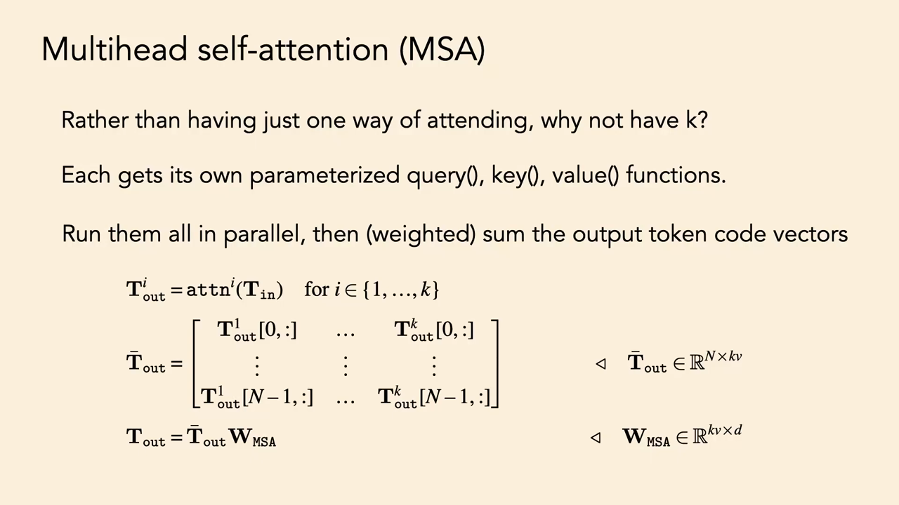
*▲ 강의 슬라이드 [56:40](https://youtu.be/Q1HOKrNeh2M?t=3400): 멀티헤드 [셀프 어텐션](00_%EB%94%A5%EB%9F%AC%EB%8B%9D_%EC%9A%A9%EC%96%B4%EC%82%AC%EC%A0%84.md#self-attention-%EC%85%80%ED%94%84-%EC%96%B4%ED%85%90%EC%85%98). 헤드 k개를 병렬로 돌려 이어 붙이고 $W_{\text{MSA}}$로 섞는다*

### 6.2 ViT 블록: 잔차 연결과 층 정규화

▶ 영상 [56:58](https://youtu.be/Q1HOKrNeh2M?t=3418)

📐 **수학 개념**: [층 정규화](%EC%88%98%ED%95%99%EA%B0%9C%EB%85%90/05_%EC%8B%A0%EA%B2%BD%EB%A7%9D%EC%9D%98_%EA%B3%84%EC%82%B0/MM32_%EC%B8%B5_%EC%A0%95%EA%B7%9C%ED%99%94.md) · [시그마와 평균](%EC%88%98%ED%95%99%EA%B0%9C%EB%85%90/01_%EC%88%98%EC%99%80_%ED%95%A8%EC%88%98/M02_%EC%8B%9C%EA%B7%B8%EB%A7%88%EC%99%80_%ED%8F%89%EA%B7%A0.md)

이제 완전한 **[비전 트랜스포머](00_%EB%94%A5%EB%9F%AC%EB%8B%9D_%EC%9A%A9%EC%96%B4%EC%82%AC%EC%A0%84.md#vision-transformer-%EB%B9%84%EC%A0%84-%ED%8A%B8%EB%9E%9C%EC%8A%A4%ED%8F%AC%EB%A8%B8)(ViT)** 블록입니다. 이미지뿐 아니라 소리 등 공간 신호를 다루는 표준 구조입니다. 새로 보는 부품은 두 가지뿐입니다.

- **⊕ [잔차 연결](00_%EB%94%A5%EB%9F%AC%EB%8B%9D_%EC%9A%A9%EC%96%B4%EC%82%AC%EC%A0%84.md#residual-connection-%EC%9E%94%EC%B0%A8-%EC%97%B0%EA%B2%B0)**: [Lec04 7.3](Lec04_%EA%B2%A9%EC%9E%90_%EC%95%84%ED%82%A4%ED%85%8D%EC%B2%98.md#73-resnet)의 [ResNet](00_%EB%94%A5%EB%9F%AC%EB%8B%9D_%EC%9A%A9%EC%96%B4%EC%82%AC%EC%A0%84.md#resnet-%EB%A0%88%EC%A6%88%EB%84%B7)처럼 처리 전체를 건너뛰는 항등 경로를 더합니다.
- **token norm**: 문헌에서는 보통 **[층 정규화](00_%EB%94%A5%EB%9F%AC%EB%8B%9D_%EC%9A%A9%EC%96%B4%EC%82%AC%EC%A0%84.md#layer-normalization-%EC%B8%B5-%EC%A0%95%EA%B7%9C%ED%99%94)**(LayerNorm)라 부릅니다. "[층](00_%EB%94%A5%EB%9F%AC%EB%8B%9D_%EC%9A%A9%EC%96%B4%EC%82%AC%EC%A0%84.md#layer-%EC%B8%B5)" 구조가 딱히 있는 것은 아니고, [토큰](00_%EB%94%A5%EB%9F%AC%EB%8B%9D_%EC%9A%A9%EC%96%B4%EC%82%AC%EC%A0%84.md#token-%ED%86%A0%ED%81%B0) 벡터 하나의 칸들을 평균 0, [분산](00_%EB%94%A5%EB%9F%AC%EB%8B%9D_%EC%9A%A9%EC%96%B4%EC%82%AC%EC%A0%84.md#variance-%EB%B6%84%EC%82%B0) 1로 맞추는 연산입니다.

[학습](00_%EB%94%A5%EB%9F%AC%EB%8B%9D_%EC%9A%A9%EC%96%B4%EC%82%AC%EC%A0%84.md#training-%ED%95%99%EC%8A%B5) [파라미터](00_%EB%94%A5%EB%9F%AC%EB%8B%9D_%EC%9A%A9%EC%96%B4%EC%82%AC%EC%A0%84.md#parameter-%ED%8C%8C%EB%9D%BC%EB%AF%B8%ED%84%B0)(파란색)는 쿼리·키·값 사영과 토큰별 MLP의 파라미터뿐이고, 나머지는 학습하지 않습니다.

$$
x_{\text{out}}[k] = \frac{x_{\text{in}}[k] - \mathbb{E}[x_{\text{in}}]}{\sqrt{\text{Var}[x_{\text{in}}]}}
$$

기호 풀이

| 기호 | 읽는 법 | 뜻 | 예제 값 |
| --- | --- | --- | --- |
| $x_{\text{in}}$ | 엑스 인 | [토큰](00_%EB%94%A5%EB%9F%AC%EB%8B%9D_%EC%9A%A9%EC%96%B4%EC%82%AC%EC%A0%84.md#token-%ED%86%A0%ED%81%B0) 벡터 하나 | (1, 2, 3, 6) |
| $x_{\text{in}}[k]$ | 엑스 인 케이 | 그 [토큰](00_%EB%94%A5%EB%9F%AC%EB%8B%9D_%EC%9A%A9%EC%96%B4%EC%82%AC%EC%A0%84.md#token-%ED%86%A0%ED%81%B0)의 $k$번째 칸 | $x_{\text{in}}[4] = 6$ |
| $\mathbb{E}[x_{\text{in}}]$ | [기댓값](00_%EB%94%A5%EB%9F%AC%EB%8B%9D_%EC%9A%A9%EC%96%B4%EC%82%AC%EC%A0%84.md#expectation-%EA%B8%B0%EB%8C%93%EA%B0%92) | [토큰](00_%EB%94%A5%EB%9F%AC%EB%8B%9D_%EC%9A%A9%EC%96%B4%EC%82%AC%EC%A0%84.md#token-%ED%86%A0%ED%81%B0) 안 칸들의 평균 | 3 |
| $\text{Var}[x_{\text{in}}]$ | [분산](00_%EB%94%A5%EB%9F%AC%EB%8B%9D_%EC%9A%A9%EC%96%B4%EC%82%AC%EC%A0%84.md#variance-%EB%B6%84%EC%82%B0) | [토큰](00_%EB%94%A5%EB%9F%AC%EB%8B%9D_%EC%9A%A9%EC%96%B4%EC%82%AC%EC%A0%84.md#token-%ED%86%A0%ED%81%B0) 안 칸들의 [분산](00_%EB%94%A5%EB%9F%AC%EB%8B%9D_%EC%9A%A9%EC%96%B4%EC%82%AC%EC%A0%84.md#variance-%EB%B6%84%EC%82%B0) | 3.5 |
| $x_{\text{out}}[k]$ | 엑스 아웃 케이 | 정규화한 $k$번째 칸 | 1.6036 |

예제와 풀이

**문제**: 칸이 4개인 [토큰](00_%EB%94%A5%EB%9F%AC%EB%8B%9D_%EC%9A%A9%EC%96%B4%EC%82%AC%EC%A0%84.md#token-%ED%86%A0%ED%81%B0) 벡터 $x_{\text{in}} = (1, 2, 3, 6)$을 층 정규화해 평균 0, [분산](00_%EB%94%A5%EB%9F%AC%EB%8B%9D_%EC%9A%A9%EC%96%B4%EC%82%AC%EC%A0%84.md#variance-%EB%B6%84%EC%82%B0) 1로 맞춘 $x_{\text{out}}$을 구한다.

**주어진 값**:
- $x_{\text{in}} = (1, 2, 3, 6)$ (정규화할 [토큰](00_%EB%94%A5%EB%9F%AC%EB%8B%9D_%EC%9A%A9%EC%96%B4%EC%82%AC%EC%A0%84.md#token-%ED%86%A0%ED%81%B0) 하나, 칸 4개)

**풀이**
1. 식을 그대로 쓴다: $x_{\text{out}}[k] = \dfrac{x_{\text{in}}[k] - \mathbb{E}[x_{\text{in}}]}{\sqrt{\text{Var}[x_{\text{in}}]}}$
2. 값을 대입한다: $x_{\text{out}} = \dfrac{(1, 2, 3, 6) - \mathbb{E}[(1, 2, 3, 6)]}{\sqrt{\text{Var}[(1, 2, 3, 6)]}}$
3. $\mathbb{E}$(평균)의 뜻: 모두 더해 개수로 나눈다. 대입한다: $\mathbb{E} = (1 + 2 + 3 + 6) \div 4$
4. 덧셈을 한다: $1 + 2 + 3 + 6 = 12$ 이므로 $\mathbb{E} = 12 \div 4$
5. 나눗셈을 한다: $\mathbb{E} = 3$
6. 칸마다 평균을 뺀다: $(1 - 3,\ 2 - 3,\ 3 - 3,\ 6 - 3) = (-2, -1, 0, 3)$
7. Var([분산](00_%EB%94%A5%EB%9F%AC%EB%8B%9D_%EC%9A%A9%EC%96%B4%EC%82%AC%EC%A0%84.md#variance-%EB%B6%84%EC%82%B0))의 뜻: 평균과의 차를 제곱해 평균 낸 값이다. 대입한다: $\text{Var} = \big((-2)^2 + (-1)^2 + 0^2 + 3^2\big) \div 4$
8. 제곱을 한다: $4 + 1 + 0 + 9$
9. 덧셈을 한다: $14 \div 4$
10. 나눗셈을 한다: $\text{Var} = 3.5$
11. $\sqrt{\ }$의 뜻: 제곱하면 그 수가 되는 양수(코드 `np.sqrt`). $\sqrt{3.5} = 1.8708$
12. 칸마다 나눗셈을 한다: $-2 \div 1.8708 = -1.069$, $-1 \div 1.8708 = -0.5345$, $0 \div 1.8708 = 0$, $3 \div 1.8708 = 1.6036$

**답**: $(-1.069,\ -0.5345,\ 0,\ 1.6036)$ (실제 구현은 분모에 작은 $\epsilon$을 더하고 학습하는 배율·이동을 붙인다. [MM32_층_정규화](%EC%88%98%ED%95%99%EA%B0%9C%EB%85%90/05_%EC%8B%A0%EA%B2%BD%EB%A7%9D%EC%9D%98_%EA%B3%84%EC%82%B0/MM32_%EC%B8%B5_%EC%A0%95%EA%B7%9C%ED%99%94.md))

내 이해

블록 하나를 식으로 쓰면 아래와 같고, 이를 $L$번 쌓습니다([층](00_%EB%94%A5%EB%9F%AC%EB%8B%9D_%EC%9A%A9%EC%96%B4%EC%82%AC%EC%A0%84.md#layer-%EC%B8%B5)마다 다른 [가중치](00_%EB%94%A5%EB%9F%AC%EB%8B%9D_%EC%9A%A9%EC%96%B4%EC%82%AC%EC%A0%84.md#weight-%EA%B0%80%EC%A4%91%EC%B9%98)).

$$
T' = T + \text{MSA}\big(\text{LN}(T)\big),\qquad T_{\text{out}} = T' + \text{MLP}\big(\text{LN}(T')\big)
$$

기호 풀이

| 기호 | 읽는 법 | 뜻 | 예제 값 |
| --- | --- | --- | --- |
| $T$ | 티 | 블록 입력 [토큰](00_%EB%94%A5%EB%9F%AC%EB%8B%9D_%EC%9A%A9%EC%96%B4%EC%82%AC%EC%A0%84.md#token-%ED%86%A0%ED%81%B0) | (1, 3) ([토큰](00_%EB%94%A5%EB%9F%AC%EB%8B%9D_%EC%9A%A9%EC%96%B4%EC%82%AC%EC%A0%84.md#token-%ED%86%A0%ED%81%B0) 1개) |
| $\text{LN}$ | 엘엔 | [층 정규화](00_%EB%94%A5%EB%9F%AC%EB%8B%9D_%EC%9A%A9%EC%96%B4%EC%82%AC%EC%A0%84.md#layer-normalization-%EC%B8%B5-%EC%A0%95%EA%B7%9C%ED%99%94) | LN(1, 3) = (-1, 1) |
| $\text{MSA}$ | 엠에스에이 | 멀티헤드 [셀프 어텐션](00_%EB%94%A5%EB%9F%AC%EB%8B%9D_%EC%9A%A9%EC%96%B4%EC%82%AC%EC%A0%84.md#self-attention-%EC%85%80%ED%94%84-%EC%96%B4%ED%85%90%EC%85%98) | [토큰](00_%EB%94%A5%EB%9F%AC%EB%8B%9D_%EC%9A%A9%EC%96%B4%EC%82%AC%EC%A0%84.md#token-%ED%86%A0%ED%81%B0) 1개라 [가중치](00_%EB%94%A5%EB%9F%AC%EB%8B%9D_%EC%9A%A9%EC%96%B4%EC%82%AC%EC%A0%84.md#weight-%EA%B0%80%EC%A4%91%EC%B9%98) 1, 값 = 입력 |
| $T'$ | 티 프라임 | [어텐션](00_%EB%94%A5%EB%9F%AC%EB%8B%9D_%EC%9A%A9%EC%96%B4%EC%82%AC%EC%A0%84.md#attention-%EC%96%B4%ED%85%90%EC%85%98) 뒤 잔차를 더한 중간 결과 | (0, 4) |
| $\text{MLP}$ | 엠엘피 | 토큰별 MLP | [ReLU](00_%EB%94%A5%EB%9F%AC%EB%8B%9D_%EC%9A%A9%EC%96%B4%EC%82%AC%EC%A0%84.md#relu-%EB%A0%90%EB%A3%A8) |
| $T_{\text{out}}$ | 티 아웃 | 블록 출력 | (0, 5) |
| $+$ | 잔차 덧셈 | 입력을 그대로 더하는 지름길 | - |

예제와 풀이

**문제**: [토큰](00_%EB%94%A5%EB%9F%AC%EB%8B%9D_%EC%9A%A9%EC%96%B4%EC%82%AC%EC%A0%84.md#token-%ED%86%A0%ED%81%B0)이 하나뿐인 입력 $T = (1, 3)$을 [트랜스포머](00_%EB%94%A5%EB%9F%AC%EB%8B%9D_%EC%9A%A9%EC%96%B4%EC%82%AC%EC%A0%84.md#transformer-%ED%8A%B8%EB%9E%9C%EC%8A%A4%ED%8F%AC%EB%A8%B8) 블록 하나에 통과시킨다. MSA는 값 사영이 단위행렬인 헤드 하나, MLP는 [ReLU](00_%EB%94%A5%EB%9F%AC%EB%8B%9D_%EC%9A%A9%EC%96%B4%EC%82%AC%EC%A0%84.md#relu-%EB%A0%90%EB%A3%A8) 하나라고 할 때 블록 출력 $T_{\text{out}}$을 구한다.

**주어진 값**:
- $T = (1, 3)$ (블록 입력, [토큰](00_%EB%94%A5%EB%9F%AC%EB%8B%9D_%EC%9A%A9%EC%96%B4%EC%82%AC%EC%A0%84.md#token-%ED%86%A0%ED%81%B0) 1개, 2칸)
- $\text{MSA}(X) = X$ ([토큰](00_%EB%94%A5%EB%9F%AC%EB%8B%9D_%EC%9A%A9%EC%96%B4%EC%82%AC%EC%A0%84.md#token-%ED%86%A0%ED%81%B0)이 하나면 [어텐션](00_%EB%94%A5%EB%9F%AC%EB%8B%9D_%EC%9A%A9%EC%96%B4%EC%82%AC%EC%A0%84.md#attention-%EC%96%B4%ED%85%90%EC%85%98) [가중치](00_%EB%94%A5%EB%9F%AC%EB%8B%9D_%EC%9A%A9%EC%96%B4%EC%82%AC%EC%A0%84.md#weight-%EA%B0%80%EC%A4%91%EC%B9%98)는 자기 자신에게 1, 값 사영은 단위행렬)
- $\text{MLP}(x) = \text{ReLU}(x)$ (토큰별 MLP를 [ReLU](00_%EB%94%A5%EB%9F%AC%EB%8B%9D_%EC%9A%A9%EC%96%B4%EC%82%AC%EC%A0%84.md#relu-%EB%A0%90%EB%A3%A8) 하나로 단순화)

**풀이**
1. 식을 그대로 쓴다: $T' = T + \text{MSA}\big(\text{LN}(T)\big)$, $T_{\text{out}} = T' + \text{MLP}\big(\text{LN}(T')\big)$
2. 값을 대입한다: $T' = (1, 3) + \text{MSA}\big(\text{LN}((1, 3))\big)$
3. [층 정규화](00_%EB%94%A5%EB%9F%AC%EB%8B%9D_%EC%9A%A9%EC%96%B4%EC%82%AC%EC%A0%84.md#layer-normalization-%EC%B8%B5-%EC%A0%95%EA%B7%9C%ED%99%94)의 평균을 구한다: $(1 + 3) \div 2 = 2$
4. 평균을 뺀다: $(1 - 2,\ 3 - 2) = (-1, 1)$
5. [분산](00_%EB%94%A5%EB%9F%AC%EB%8B%9D_%EC%9A%A9%EC%96%B4%EC%82%AC%EC%A0%84.md#variance-%EB%B6%84%EC%82%B0)을 구한다: $\big((-1)^2 + 1^2\big) \div 2 = 2 \div 2 = 1$, 표준편차 $\sqrt{1} = 1$
6. 나눗셈을 한다: $(-1 \div 1,\ 1 \div 1) = (-1, 1)$ 이므로 $T' = (1, 3) + \text{MSA}((-1, 1))$
7. MSA를 적용한다 (그대로): $T' = (1, 3) + (-1, 1)$
8. 잔차 덧셈을 칸끼리 한다: $T' = (1 - 1,\ 3 + 1) = (0, 4)$
9. 둘째 식에 대입한다: $T_{\text{out}} = (0, 4) + \text{ReLU}\big(\text{LN}((0, 4))\big)$
10. 평균을 구한다: $(0 + 4) \div 2 = 2$
11. 평균을 뺀다: $(0 - 2,\ 4 - 2) = (-2, 2)$
12. [분산](00_%EB%94%A5%EB%9F%AC%EB%8B%9D_%EC%9A%A9%EC%96%B4%EC%82%AC%EC%A0%84.md#variance-%EB%B6%84%EC%82%B0)을 구한다: $\big((-2)^2 + 2^2\big) \div 2 = 8 \div 2 = 4$, 표준편차 $\sqrt{4} = 2$
13. 나눗셈을 한다: $(-2 \div 2,\ 2 \div 2) = (-1, 1)$ 이므로 $T_{\text{out}} = (0, 4) + \text{ReLU}((-1, 1))$
14. [ReLU](00_%EB%94%A5%EB%9F%AC%EB%8B%9D_%EC%9A%A9%EC%96%B4%EC%82%AC%EC%A0%84.md#relu-%EB%A0%90%EB%A3%A8)를 적용한다 (음수는 0): $\text{ReLU}((-1, 1)) = (0, 1)$
15. 잔차 덧셈을 칸끼리 한다: $T_{\text{out}} = (0 + 0,\ 4 + 1) = (0, 5)$

**답**: $T_{\text{out}} = (0, 5)$

내 이해

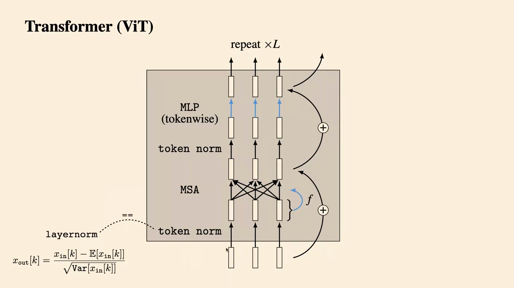
*▲ 강의 슬라이드 [58:00](https://youtu.be/Q1HOKrNeh2M?t=3480): [트랜스포머](00_%EB%94%A5%EB%9F%AC%EB%8B%9D_%EC%9A%A9%EC%96%B4%EC%82%AC%EC%A0%84.md#transformer-%ED%8A%B8%EB%9E%9C%EC%8A%A4%ED%8F%AC%EB%A8%B8)(ViT) 블록. token norm → MSA → ⊕ → token norm → 토큰별 MLP → ⊕ 를 L번 반복. 왼쪽 아래는 layernorm 식*

왜 정규화하나? Jeremy Bernstein의 지난 강의와 문제 세트에서 본 것처럼, 안정적인 최적화를 위해서는 [노름](00_%EB%94%A5%EB%9F%AC%EB%8B%9D_%EC%9A%A9%EC%96%B4%EC%82%AC%EC%A0%84.md#norm-%EB%85%B8%EB%A6%84)을 신경 써야 합니다. 여기서는 [가중치](00_%EB%94%A5%EB%9F%AC%EB%8B%9D_%EC%9A%A9%EC%96%B4%EC%82%AC%EC%A0%84.md#weight-%EA%B0%80%EC%A4%91%EC%B9%98) 갱신이 아니라 **활성값**을 정규화하지만, [역전파](00_%EB%94%A5%EB%9F%AC%EB%8B%9D_%EC%9A%A9%EC%96%B4%EC%82%AC%EC%A0%84.md#backpropagation-%EC%97%AD%EC%A0%84%ED%8C%8C)에서 [가중치](00_%EB%94%A5%EB%9F%AC%EB%8B%9D_%EC%9A%A9%EC%96%B4%EC%82%AC%EC%A0%84.md#weight-%EA%B0%80%EC%A4%91%EC%B9%98) 갱신의 크기가 활성값의 크기에 달려 있으므로 결국 갱신 크기에도 영향을 줍니다. 강사는 [층 정규화](00_%EB%94%A5%EB%9F%AC%EB%8B%9D_%EC%9A%A9%EC%96%B4%EC%82%AC%EC%A0%84.md#layer-normalization-%EC%B8%B5-%EC%A0%95%EA%B7%9C%ED%99%94)가 왜 좋은지는 사실상 **열린 문제**이고, "그래도 다들 쓴다"고 솔직하게 말합니다.

> [!TIP]
> **🆕 2026 업데이트: LayerNorm에서 [RMSNorm](00_%EB%94%A5%EB%9F%AC%EB%8B%9D_%EC%9A%A9%EC%96%B4%EC%82%AC%EC%A0%84.md#rmsnorm-rms-%EC%A0%95%EA%B7%9C%ED%99%94)으로**
> - **강의**: ViT 블록의 token norm으로 평균을 빼고 [분산](00_%EB%94%A5%EB%9F%AC%EB%8B%9D_%EC%9A%A9%EC%96%B4%EC%82%AC%EC%A0%84.md#variance-%EB%B6%84%EC%82%B0)으로 나누는 LayerNorm을 소개함.
> - **현재**: Llama 계열 등 최근 대형 [언어 모델](00_%EB%94%A5%EB%9F%AC%EB%8B%9D_%EC%9A%A9%EC%96%B4%EC%82%AC%EC%A0%84.md#language-model-%EC%96%B8%EC%96%B4-%EB%AA%A8%EB%8D%B8)은 [어텐션](00_%EB%94%A5%EB%9F%AC%EB%8B%9D_%EC%9A%A9%EC%96%B4%EC%82%AC%EC%A0%84.md#attention-%EC%96%B4%ED%85%90%EC%85%98)·MLP 앞에 정규화하는 pre-norm 구조에 평균 빼기를 생략한 **[RMSNorm](00_%EB%94%A5%EB%9F%AC%EB%8B%9D_%EC%9A%A9%EC%96%B4%EC%82%AC%EC%A0%84.md#rmsnorm-rms-%EC%A0%95%EA%B7%9C%ED%99%94)** $x/\text{RMS}(x)$를 씁니다. 원 논문은 LayerNorm의 효과가 주로 크기 조절(re-scaling)에서 온다고 보고, 평균 빼기를 없애 계산을 줄이면서 비슷한 성능을 보였습니다. Llama 2 논문은 "[RMSNorm](00_%EB%94%A5%EB%9F%AC%EB%8B%9D_%EC%9A%A9%EC%96%B4%EC%82%AC%EC%A0%84.md#rmsnorm-rms-%EC%A0%95%EA%B7%9C%ED%99%94)으로 pre-normalization"을 쓴다고 밝힙니다. 계산 예는 [MM32_층_정규화](%EC%88%98%ED%95%99%EA%B0%9C%EB%85%90/05_%EC%8B%A0%EA%B2%BD%EB%A7%9D%EC%9D%98_%EA%B3%84%EC%82%B0/MM32_%EC%B8%B5_%EC%A0%95%EA%B7%9C%ED%99%94.md)에 있습니다.
> - **출처**: [Root Mean Square Layer Normalization (Zhang·Sennrich, NeurIPS 2019)](https://arxiv.org/abs/1910.07467) · [Llama 2: Open Foundation and Fine-Tuned Chat Models (Touvron 외, 2023)](https://arxiv.org/abs/2307.09288)

### 6.3 의사코드

▶ 영상 [59:12](https://youtu.be/Q1HOKrNeh2M?t=3552)

강사는 [트랜스포머](00_%EB%94%A5%EB%9F%AC%EB%8B%9D_%EC%9A%A9%EC%96%B4%EC%82%AC%EC%A0%84.md#transformer-%ED%8A%B8%EB%9E%9C%EC%8A%A4%ED%8F%AC%EB%A8%B8)가 얼마나 단순한지 보이려고 의사코드를 보여 줍니다. 입력을 토큰화한 뒤 [층](00_%EB%94%A5%EB%9F%AC%EB%8B%9D_%EC%9A%A9%EC%96%B4%EC%82%AC%EC%A0%84.md#layer-%EC%B8%B5)마다 같은 연산을 되풀이합니다([층](00_%EB%94%A5%EB%9F%AC%EB%8B%9D_%EC%9A%A9%EC%96%B4%EC%82%AC%EC%A0%84.md#layer-%EC%B8%B5)마다 [가중치](00_%EB%94%A5%EB%9F%AC%EB%8B%9D_%EC%9A%A9%EC%96%B4%EC%82%AC%EC%A0%84.md#weight-%EA%B0%80%EC%A4%91%EC%B9%98)는 다를 수 있음).

1. **[어텐션](00_%EB%94%A5%EB%9F%AC%EB%8B%9D_%EC%9A%A9%EC%96%B4%EC%82%AC%EC%A0%84.md#attention-%EC%96%B4%ED%85%90%EC%85%98) [층](00_%EB%94%A5%EB%9F%AC%EB%8B%9D_%EC%9A%A9%EC%96%B4%EC%82%AC%EC%A0%84.md#layer-%EC%B8%B5)**: 층 정규화한 $T$에 $W_Q, W_K, W_V$를 곱해 $Q, K, V$를 만들고, $A = \text{softmax}(QK^\top/\sqrt{d})$, $T \leftarrow AV + T$ (잔차).
2. **토큰별 MLP**: $T \leftarrow \text{mlp}(\text{layernorm}(T)) + T$ (잔차).

모든 것이 [행렬 곱](00_%EB%94%A5%EB%9F%AC%EB%8B%9D_%EC%9A%A9%EC%96%B4%EC%82%AC%EC%A0%84.md#matrix-multiplication-%ED%96%89%EB%A0%AC-%EA%B3%B1)과 간단한 연산자 몇 개뿐이라 [행렬 곱](00_%EB%94%A5%EB%9F%AC%EB%8B%9D_%EC%9A%A9%EC%96%B4%EC%82%AC%EC%A0%84.md#matrix-multiplication-%ED%96%89%EB%A0%AC-%EA%B3%B1)을 좋아하는 요즘 하드웨어에 아주 잘 맞습니다. 이것이 사람들이 [트랜스포머](00_%EB%94%A5%EB%9F%AC%EB%8B%9D_%EC%9A%A9%EC%96%B4%EC%82%AC%EC%A0%84.md#transformer-%ED%8A%B8%EB%9E%9C%EC%8A%A4%ED%8F%AC%EB%A8%B8)를 좋아하는 이유 하나입니다.

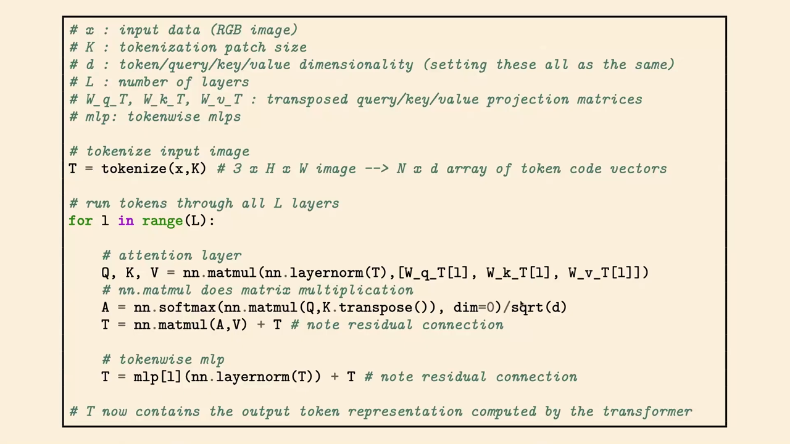
*▲ 강의 슬라이드 [60:20](https://youtu.be/Q1HOKrNeh2M?t=3620): [비전 트랜스포머](00_%EB%94%A5%EB%9F%AC%EB%8B%9D_%EC%9A%A9%EC%96%B4%EC%82%AC%EC%A0%84.md#vision-transformer-%EB%B9%84%EC%A0%84-%ED%8A%B8%EB%9E%9C%EC%8A%A4%ED%8F%AC%EB%A8%B8) 의사코드. [토큰화](00_%EB%94%A5%EB%9F%AC%EB%8B%9D_%EC%9A%A9%EC%96%B4%EC%82%AC%EC%A0%84.md#tokenization-%ED%86%A0%ED%81%B0%ED%99%94) → L번 ([어텐션](00_%EB%94%A5%EB%9F%AC%EB%8B%9D_%EC%9A%A9%EC%96%B4%EC%82%AC%EC%A0%84.md#attention-%EC%96%B4%ED%85%90%EC%85%98) [층](00_%EB%94%A5%EB%9F%AC%EB%8B%9D_%EC%9A%A9%EC%96%B4%EC%82%AC%EC%A0%84.md#layer-%EC%B8%B5) + 잔차, 토큰별 MLP + 잔차)*

---

## 7. 위치 인코딩

### 7.1 트랜스포머는 순열 등변

▶ 영상 [60:55](https://youtu.be/Q1HOKrNeh2M?t=3655)

📐 **수학 개념**: [순열 등변성과 인과 마스크](%EC%88%98%ED%95%99%EA%B0%9C%EB%85%90/07_%EA%B5%AC%EC%A1%B0_%EC%95%84%ED%82%A4%ED%85%8D%EC%B2%98/MM31_%EC%88%9C%EC%97%B4_%EB%93%B1%EB%B3%80%EC%84%B1%EA%B3%BC_%EC%9D%B8%EA%B3%BC_%EB%A7%88%EC%8A%A4%ED%81%AC.md) · [인접 행렬과 순열](%EC%88%98%ED%95%99%EA%B0%9C%EB%85%90/07_%EA%B5%AC%EC%A1%B0_%EC%95%84%ED%82%A4%ED%85%8D%EC%B2%98/MM18_%EC%9D%B8%EC%A0%91%ED%96%89%EB%A0%AC%EA%B3%BC_%EC%88%9C%EC%97%B4.md) (Lec05)

[위치 인코딩](00_%EB%94%A5%EB%9F%AC%EB%8B%9D_%EC%9A%A9%EC%96%B4%EC%82%AC%EC%A0%84.md#positional-encoding-%EC%9C%84%EC%B9%98-%EC%9D%B8%EC%BD%94%EB%94%A9)은 새로운 생각이 아니지만 [트랜스포머](00_%EB%94%A5%EB%9F%AC%EB%8B%9D_%EC%9A%A9%EC%96%B4%EC%82%AC%EC%A0%84.md#transformer-%ED%8A%B8%EB%9E%9C%EC%8A%A4%ED%8F%AC%EB%A8%B8)를 돋보이게 한 핵심 요소입니다. 먼저 알아야 할 것은 [트랜스포머](00_%EB%94%A5%EB%9F%AC%EB%8B%9D_%EC%9A%A9%EC%96%B4%EC%82%AC%EC%A0%84.md#transformer-%ED%8A%B8%EB%9E%9C%EC%8A%A4%ED%8F%AC%EB%A8%B8)가 [GNN](00_%EB%94%A5%EB%9F%AC%EB%8B%9D_%EC%9A%A9%EC%96%B4%EC%82%AC%EC%A0%84.md#gnn-graph-neural-network-%EA%B7%B8%EB%9E%98%ED%94%84-%EC%8B%A0%EA%B2%BD%EB%A7%9D)처럼 **[순열 등변](00_%EB%94%A5%EB%9F%AC%EB%8B%9D_%EC%9A%A9%EC%96%B4%EC%82%AC%EC%A0%84.md#permutation-invariance-permutation-equivariance-%EC%88%9C%EC%97%B4-%EB%B6%88%EB%B3%80%EC%84%B1%EA%B3%BC-%EC%88%9C%EC%97%B4-%EB%93%B1%EB%B3%80%EC%84%B1)** 이라는 것입니다. 입력 [토큰](00_%EB%94%A5%EB%9F%AC%EB%8B%9D_%EC%9A%A9%EC%96%B4%EC%82%AC%EC%A0%84.md#token-%ED%86%A0%ED%81%B0)의 순서를 바꾸면 출력도 같은 방식으로 순서만 바뀝니다. 순서 없는 집합을 순서 없는 집합으로 보내는 **Set2Set** 사상입니다.

- 토큰별 함수 $F$는 모든 [토큰](00_%EB%94%A5%EB%9F%AC%EB%8B%9D_%EC%9A%A9%EC%96%B4%EC%82%AC%EC%A0%84.md#token-%ED%86%A0%ED%81%B0)에 독립적으로 똑같이 작용하니 순서와 무관합니다.
- [어텐션](00_%EB%94%A5%EB%9F%AC%EB%8B%9D_%EC%9A%A9%EC%96%B4%EC%82%AC%EC%A0%84.md#attention-%EC%96%B4%ED%85%90%EC%85%98)은 각 쌍이 서로를 얼마나 볼지가 [토큰](00_%EB%94%A5%EB%9F%AC%EB%8B%9D_%EC%9A%A9%EC%96%B4%EC%82%AC%EC%A0%84.md#token-%ED%86%A0%ED%81%B0) 벡터의 값만으로 정해지고, 순서와는 무관합니다.

$$
F_\theta(\text{permute}(T_{\text{in}})) = \text{permute}(F_\theta(T_{\text{in}})),\qquad
\text{attn}(\text{permute}(T_{\text{in}})) = \text{permute}(\text{attn}(T_{\text{in}}))
$$

기호 풀이

| 기호 | 읽는 법 | 뜻 | 예제 값 |
| --- | --- | --- | --- |
| $\text{permute}$ | 퍼뮤트 | [토큰](00_%EB%94%A5%EB%9F%AC%EB%8B%9D_%EC%9A%A9%EC%96%B4%EC%82%AC%EC%A0%84.md#token-%ED%86%A0%ED%81%B0)(행)의 순서를 바꿈 | 두 행 맞바꿈 |
| $F_\theta$ | 에프 세타 | 토큰별 함수 | - |
| $\text{attn}$ | [어텐션](00_%EB%94%A5%EB%9F%AC%EB%8B%9D_%EC%9A%A9%EC%96%B4%EC%82%AC%EC%A0%84.md#attention-%EC%96%B4%ED%85%90%EC%85%98) | [셀프 어텐션](00_%EB%94%A5%EB%9F%AC%EB%8B%9D_%EC%9A%A9%EC%96%B4%EC%82%AC%EC%A0%84.md#self-attention-%EC%85%80%ED%94%84-%EC%96%B4%ED%85%90%EC%85%98) [층](00_%EB%94%A5%EB%9F%AC%EB%8B%9D_%EC%9A%A9%EC%96%B4%EC%82%AC%EC%A0%84.md#layer-%EC%B8%B5) | $W = I$, $m = 2$ |
| $T_{\text{in}}$ | 티 인 | 입력 [토큰](00_%EB%94%A5%EB%9F%AC%EB%8B%9D_%EC%9A%A9%EC%96%B4%EC%82%AC%EC%A0%84.md#token-%ED%86%A0%ED%81%B0) | (1, 0), (1, 1) |

예제와 풀이

**문제**: 5.5절 예제에서 [셀프 어텐션](00_%EB%94%A5%EB%9F%AC%EB%8B%9D_%EC%9A%A9%EC%96%B4%EC%82%AC%EC%A0%84.md#self-attention-%EC%85%80%ED%94%84-%EC%96%B4%ED%85%90%EC%85%98)은 입력 [토큰](00_%EB%94%A5%EB%9F%AC%EB%8B%9D_%EC%9A%A9%EC%96%B4%EC%82%AC%EC%A0%84.md#token-%ED%86%A0%ED%81%B0) ((1,0), (1,1))을 ((1, 0.5), (1, 0.6698))로 바꿨다. 입력 순서만 ((1,1), (1,0))으로 바꾸면 출력이 원래 출력의 순서만 바뀐 것과 같은지 확인한다.

**주어진 값**:
- $\text{permute}(T_{\text{in}}) = \begin{pmatrix}1&1\\1&0\end{pmatrix}$ (두 [토큰](00_%EB%94%A5%EB%9F%AC%EB%8B%9D_%EC%9A%A9%EC%96%B4%EC%82%AC%EC%A0%84.md#token-%ED%86%A0%ED%81%B0)의 순서를 맞바꾼 입력)
- $\text{attn}(T_{\text{in}}) = \begin{pmatrix}1&0.5\\1&0.6698\end{pmatrix}$ (원래 순서의 출력, 5.5절)
- $W_Q = W_K = W_V = I$, $m = 2$ (사영 없음, 쿼리·키 차원 2)

**풀이**
1. 식을 그대로 쓴다: $\text{attn}(\text{permute}(T_{\text{in}})) = \text{permute}(\text{attn}(T_{\text{in}}))$, $\text{attn}(X) = \text{softmax}(XX^\top/\sqrt{2})\,X$
2. 값을 대입한다: $\text{attn}\begin{pmatrix}1&1\\1&0\end{pmatrix} = \text{softmax}\Big(\begin{pmatrix}1&1\\1&0\end{pmatrix}\begin{pmatrix}1&1\\1&0\end{pmatrix}^\top \big/ \sqrt{2}\Big)\begin{pmatrix}1&1\\1&0\end{pmatrix}$
3. [내적](00_%EB%94%A5%EB%9F%AC%EB%8B%9D_%EC%9A%A9%EC%96%B4%EC%82%AC%EC%A0%84.md#dot-product-%EB%82%B4%EC%A0%81) (1,1)칸을 펼친다: $(1,1)\cdot(1,1) = 1 \times 1 + 1 \times 1 = 2$
4. (1,2)칸: $(1,1)\cdot(1,0) = 1 \times 1 + 1 \times 0 = 1$
5. (2,1)칸: $(1,0)\cdot(1,1) = 1 \times 1 + 0 \times 1 = 1$
6. (2,2)칸: $(1,0)\cdot(1,0) = 1 \times 1 + 0 \times 0 = 1$
7. $\sqrt{2} = 1.4142$로 나눈다: $\begin{pmatrix}1.4142&0.7071\\0.7071&0.7071\end{pmatrix}$
8. 1행 softmax: $e^{1.4142} = 4.1133$, $e^{0.7071} = 2.0281$, 합 $6.1414$, 나누면 $(0.6698, 0.3302)$
9. 2행 softmax: 두 점수가 같아 $e^{0.7071}$ 두 개를 합 $4.0562$로 나누면 $(0.5, 0.5)$
10. 1행 출력을 펼친다: $0.6698 \times (1, 1) + 0.3302 \times (1, 0) = (0.6698 + 0.3302,\ 0.6698 + 0) = (1, 0.6698)$
11. 2행 출력을 펼친다: $0.5 \times (1, 1) + 0.5 \times (1, 0) = (0.5 + 0.5,\ 0.5 + 0) = (1, 0.5)$
12. 오른쪽(원래 출력의 순서 바꾸기)을 구한다: $\text{permute}\begin{pmatrix}1&0.5\\1&0.6698\end{pmatrix} = \begin{pmatrix}1&0.6698\\1&0.5\end{pmatrix}$ → 10, 11단계와 같다

**답**: ((1, 0.6698), (1, 0.5)). 원래 출력의 순서만 바뀐 것이다(순열 등변).

내 이해

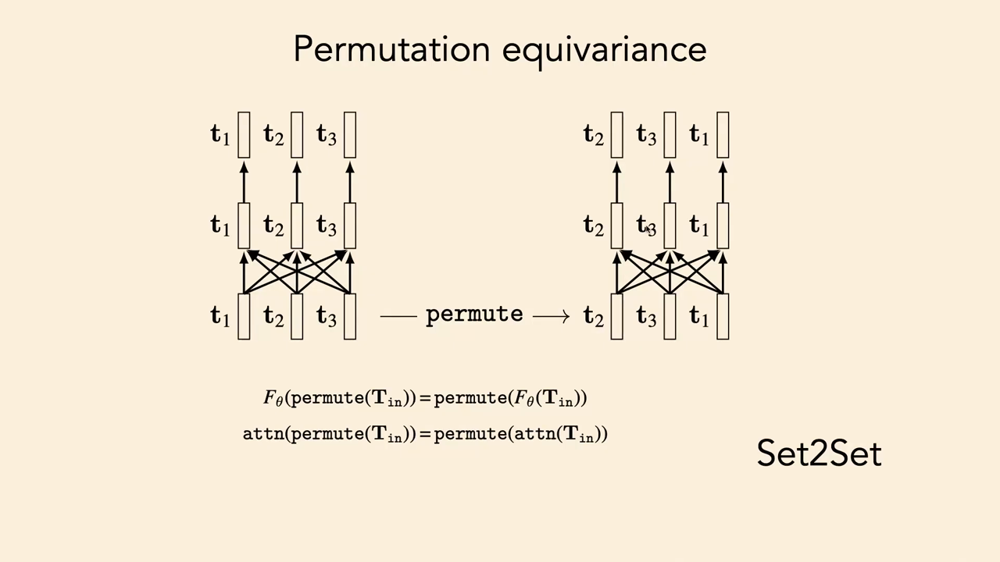
*▲ 강의 슬라이드 [62:00](https://youtu.be/Q1HOKrNeh2M?t=3720): 순열 등변성. 입력 순서를 바꾸면 출력도 같은 순서로 바뀐다 (Set2Set)*

### 7.2 위치 정보 붙이기

▶ 영상 [62:39](https://youtu.be/Q1HOKrNeh2M?t=3759)

📐 **수학 개념**: [사인파 위치 인코딩](%EC%88%98%ED%95%99%EA%B0%9C%EB%85%90/07_%EA%B5%AC%EC%A1%B0_%EC%95%84%ED%82%A4%ED%85%8D%EC%B2%98/MM17_%EC%82%AC%EC%9D%B8%ED%8C%8C_%EC%9C%84%EC%B9%98_%EC%9D%B8%EC%BD%94%EB%94%A9.md) (Lec04) · [위치 인코딩으로 등변성 깨기](%EC%88%98%ED%95%99%EA%B0%9C%EB%85%90/07_%EA%B5%AC%EC%A1%B0_%EC%95%84%ED%82%A4%ED%85%8D%EC%B2%98/MM31_%EC%88%9C%EC%97%B4_%EB%93%B1%EB%B3%80%EC%84%B1%EA%B3%BC_%EC%9D%B8%EA%B3%BC_%EB%A7%88%EC%8A%A4%ED%81%AC.md)

순서가 중요한 경우가 많습니다. 문장에서 앞 단어는 뒤 단어에 인과적으로 영향을 주지만 거꾸로는 아닙니다. 순서를 뒤집어도 통계가 같은 과정이 아닙니다. [CNN](00_%EB%94%A5%EB%9F%AC%EB%8B%9D_%EC%9A%A9%EC%96%B4%EC%82%AC%EC%A0%84.md#cnn-convolutional-neural-network-%ED%95%A9%EC%84%B1%EA%B3%B1-%EC%8B%A0%EA%B2%BD%EB%A7%9D)에서 [이동 등변성](00_%EB%94%A5%EB%9F%AC%EB%8B%9D_%EC%9A%A9%EC%96%B4%EC%82%AC%EC%A0%84.md#translation-equivariance-%EC%9D%B4%EB%8F%99-%EB%93%B1%EB%B3%80%EC%84%B1)을 깨려고 [필터](00_%EB%94%A5%EB%9F%AC%EB%8B%9D_%EC%9A%A9%EC%96%B4%EC%82%AC%EC%A0%84.md#filter-%ED%95%84%ED%84%B0)에 "여기가 어디인지"를 알려 줬던 것([Lec04 8절](Lec04_%EA%B2%A9%EC%9E%90_%EC%95%84%ED%82%A4%ED%85%8D%EC%B2%98.md#8-%EC%8B%9C%EA%B0%84-%EC%B6%95-%ED%95%A9%EC%84%B1%EA%B3%B1%EA%B3%BC-%EC%9C%84%EC%B9%98-%EC%9D%B8%EC%BD%94%EB%94%A9))과 똑같이, **각 [토큰](00_%EB%94%A5%EB%9F%AC%EB%8B%9D_%EC%9A%A9%EC%96%B4%EC%82%AC%EC%A0%84.md#token-%ED%86%A0%ED%81%B0)에 "입력의 어디에서 왔는지"를 나타내는 값을 이어 붙입니다.**

가장 기본적인 방법은 패치의 $(x, y)$ 좌표를 그대로 쓰지 않고 **푸리에 기저**로 나타내는 것입니다. 여러 주파수의 사인 함수가 그 위치에서 갖는 값을 가로·세로 방향으로 모읍니다.

$$
\mathbf{p}(x, y) = \big(\sin x,\ \sin\tfrac{x}{B},\ \dots,\ \sin\tfrac{x}{B^4},\ \sin y,\ \sin\tfrac{y}{B},\ \dots,\ \sin\tfrac{y}{B^4}\big)
$$

기호 풀이

| 기호 | 읽는 법 | 뜻 | 예제 값 |
| --- | --- | --- | --- |
| $x, y$ | 엑스, 와이 | 패치의 가로·세로 위치 | 1, 2 |
| $B$ | 비 | 주파수를 나누는 밑 (단계마다 B배 느려짐) | 10 |
| $\sin(x/B^i)$ | 사인 | 주파수 $1/B^i$인 사인파의 그 위치 값 | $\sin 1 = 0.8415$ |
| $\mathbf{p}(x, y)$ | 피 | [토큰](00_%EB%94%A5%EB%9F%AC%EB%8B%9D_%EC%9A%A9%EC%96%B4%EC%82%AC%EC%A0%84.md#token-%ED%86%A0%ED%81%B0)에 이어 붙이는 위치 코드 (10칸) | 아래 예제 |

예제와 풀이

**문제**: 가로 위치 $x = 1$, 세로 위치 $y = 2$인 패치의 푸리에 위치 코드 $\mathbf{p}(1, 2)$를, 주파수를 나누는 밑 $B = 10$으로 구한다.

**주어진 값**:
- $x = 1$ (패치의 가로 위치)
- $y = 2$ (패치의 세로 위치)
- $B = 10$ (단계마다 주파수를 10배 느리게 하는 밑, [지수](00_%EB%94%A5%EB%9F%AC%EB%8B%9D_%EC%9A%A9%EC%96%B4%EC%82%AC%EC%A0%84.md#e-exponent-e%EC%99%80-%EC%A7%80%EC%88%98) 0 ~ 4)

**풀이**
1. 식을 그대로 쓴다: $\mathbf{p}(x, y) = \big(\sin x,\ \sin\tfrac{x}{B},\ \sin\tfrac{x}{B^2},\ \sin\tfrac{x}{B^3},\ \sin\tfrac{x}{B^4},\ \sin y,\ \sin\tfrac{y}{B},\ \sin\tfrac{y}{B^2},\ \sin\tfrac{y}{B^3},\ \sin\tfrac{y}{B^4}\big)$
2. 값을 대입한다: $\mathbf{p}(1, 2) = \big(\sin 1,\ \sin\tfrac{1}{10},\ \sin\tfrac{1}{10^2},\ \sin\tfrac{1}{10^3},\ \sin\tfrac{1}{10^4},\ \sin 2,\ \sin\tfrac{2}{10},\ \sin\tfrac{2}{10^2},\ \sin\tfrac{2}{10^3},\ \sin\tfrac{2}{10^4}\big)$
3. 거듭제곱을 한다: $10^2 = 100$, $10^3 = 1000$, $10^4 = 10000$
4. 가로 나눗셈을 한다: $1 \div 10 = 0.1$, $1 \div 100 = 0.01$, $1 \div 1000 = 0.001$, $1 \div 10000 = 0.0001$
5. 세로 나눗셈을 한다: $2 \div 10 = 0.2$, $2 \div 100 = 0.02$, $2 \div 1000 = 0.002$, $2 \div 10000 = 0.0002$
6. sin의 뜻: 각도(라디안)를 넣으면 -1 ~ 1 사이 값을 내는 물결 함수다. 계산기나 코드 `np.sin`으로 구하고, 아주 작은 각도에서는 그 각도와 거의 같다
7. 가로 사인을 계산한다: $\sin 1 = 0.8415$, $\sin 0.1 = 0.0998$, $\sin 0.01 = 0.01$, $\sin 0.001 = 0.001$, $\sin 0.0001 = 0.0001$
8. 세로 사인을 계산한다: $\sin 2 = 0.9093$, $\sin 0.2 = 0.1987$, $\sin 0.02 = 0.02$, $\sin 0.002 = 0.002$, $\sin 0.0002 = 0.0002$
9. 가로 다섯 개 뒤에 세로 다섯 개를 이어 붙인다

**답**: $\mathbf{p}(1, 2) = (0.8415, 0.0998, 0.01, 0.001, 0.0001, 0.9093, 0.1987, 0.02, 0.002, 0.0002)$. 빠른 사인파는 작은 위치 차이를, 느린 사인파는 큰 위치 차이를 구별한다.

내 이해

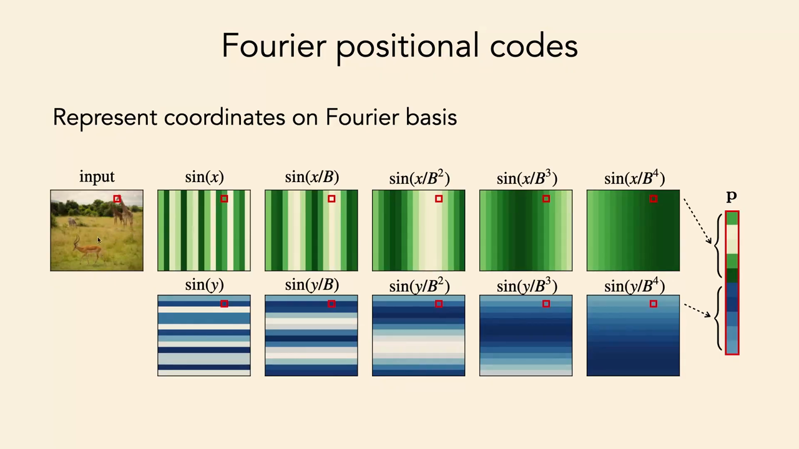
*▲ 강의 슬라이드 [63:50](https://youtu.be/Q1HOKrNeh2M?t=3830): 푸리에 위치 코드. 패치 위치(빨간 네모)에서 여러 주파수의 sin(x/Bⁱ), sin(y/Bⁱ) 값을 읽어 벡터 p를 만든다*

왜 푸리에 기저가 다른 방식보다 좋은지는 교재 장에 직관이 나오지만 이것도 열린 문제입니다. 중요한 것은 **[위치 인코딩](00_%EB%94%A5%EB%9F%AC%EB%8B%9D_%EC%9A%A9%EC%96%B4%EC%82%AC%EC%A0%84.md#positional-encoding-%EC%9C%84%EC%B9%98-%EC%9D%B8%EC%BD%94%EB%94%A9)이 분야 지식을 넣는 자리**라는 점입니다. 이 분야에서 "가깝다"는 것이 무엇인지, 곧 국소성의 [귀납 편향](00_%EB%94%A5%EB%9F%AC%EB%8B%9D_%EC%9A%A9%EC%96%B4%EC%82%AC%EC%A0%84.md#inductive-bias-%EA%B7%80%EB%82%A9-%ED%8E%B8%ED%96%A5)을 여기서 알려 줍니다.

- **지구 위 데이터**: 위도·경도를 구면 조화 함수(구 위의 사인파) 기저로 나타냅니다.
- **그래프**: [그래프 라플라시안](00_%EB%94%A5%EB%9F%AC%EB%8B%9D_%EC%9A%A9%EC%96%B4%EC%82%AC%EC%A0%84.md#graph-laplacian-%EA%B7%B8%EB%9E%98%ED%94%84-%EB%9D%BC%ED%94%8C%EB%9D%BC%EC%8B%9C%EC%95%88)의 [고유벡터](00_%EB%94%A5%EB%9F%AC%EB%8B%9D_%EC%9A%A9%EC%96%B4%EC%82%AC%EC%A0%84.md#eigenvector-eigenvalue-%EA%B3%A0%EC%9C%A0%EB%B2%A1%ED%84%B0%EC%99%80-%EA%B3%A0%EC%9C%B3%EA%B0%92)에 사영합니다([Lec05 9.6](Lec05_%EA%B7%B8%EB%9E%98%ED%94%84_%EC%8B%A0%EA%B2%BD%EB%A7%9D.md#96-%EA%B3%84%EC%82%B0%ED%95%A0-%EC%88%98-%EC%97%86%EB%8A%94-%EC%84%B1%EC%A7%88%EA%B3%BC-%EC%9C%84%EC%B9%98-%EC%9D%B8%EC%BD%94%EB%94%A9)). 첫 [고유벡터](00_%EB%94%A5%EB%9F%AC%EB%8B%9D_%EC%9A%A9%EC%96%B4%EC%82%AC%EC%A0%84.md#eigenvector-eigenvalue-%EA%B3%A0%EC%9C%A0%EB%B2%A1%ED%84%B0%EC%99%80-%EA%B3%A0%EC%9C%B3%EA%B0%92)는 매끄럽게 "전체에서 어디쯤인지"를 알려 주고, 뒤의 [고유벡터](00_%EB%94%A5%EB%9F%AC%EB%8B%9D_%EC%9A%A9%EC%96%B4%EC%82%AC%EC%A0%84.md#eigenvector-eigenvalue-%EA%B3%A0%EC%9C%A0%EB%B2%A1%ED%84%B0%EC%99%80-%EA%B3%A0%EC%9C%B3%EA%B0%92)는 푸리에 기저처럼 점점 고주파가 됩니다.

> [!TIP]
> **🆕 2026 업데이트: [회전 위치 임베딩](00_%EB%94%A5%EB%9F%AC%EB%8B%9D_%EC%9A%A9%EC%96%B4%EC%82%AC%EC%A0%84.md#rope-rotary-position-embedding-%ED%9A%8C%EC%A0%84-%EC%9C%84%EC%B9%98-%EC%9E%84%EB%B2%A0%EB%94%A9)([RoPE](00_%EB%94%A5%EB%9F%AC%EB%8B%9D_%EC%9A%A9%EC%96%B4%EC%82%AC%EC%A0%84.md#rope-rotary-position-embedding-%ED%9A%8C%EC%A0%84-%EC%9C%84%EC%B9%98-%EC%9E%84%EB%B2%A0%EB%94%A9))**
> - **강의**: 위치를 사인파(푸리에) 값으로 만들어 [토큰](00_%EB%94%A5%EB%9F%AC%EB%8B%9D_%EC%9A%A9%EC%96%B4%EC%82%AC%EC%A0%84.md#token-%ED%86%A0%ED%81%B0)에 이어 붙이는 기본 방식을 소개하고, 더 발전된 방식이 많다고 언급함.
> - **현재**: 대형 [언어 모델](00_%EB%94%A5%EB%9F%AC%EB%8B%9D_%EC%9A%A9%EC%96%B4%EC%82%AC%EC%A0%84.md#language-model-%EC%96%B8%EC%96%B4-%EB%AA%A8%EB%8D%B8)에서는 **[회전 위치 임베딩](00_%EB%94%A5%EB%9F%AC%EB%8B%9D_%EC%9A%A9%EC%96%B4%EC%82%AC%EC%A0%84.md#rope-rotary-position-embedding-%ED%9A%8C%EC%A0%84-%EC%9C%84%EC%B9%98-%EC%9E%84%EB%B2%A0%EB%94%A9)([RoPE](00_%EB%94%A5%EB%9F%AC%EB%8B%9D_%EC%9A%A9%EC%96%B4%EC%82%AC%EC%A0%84.md#rope-rotary-position-embedding-%ED%9A%8C%EC%A0%84-%EC%9C%84%EC%B9%98-%EC%9E%84%EB%B2%A0%EB%94%A9))** 이 사실상 표준입니다. 위치 벡터를 더하거나 붙이는 대신, 쿼리와 키의 두 칸씩을 위치에 비례한 각도만큼 **회전**시킵니다. 그러면 쿼리·키 [내적](00_%EB%94%A5%EB%9F%AC%EB%8B%9D_%EC%9A%A9%EC%96%B4%EC%82%AC%EC%A0%84.md#dot-product-%EB%82%B4%EC%A0%81)이 두 [토큰](00_%EB%94%A5%EB%9F%AC%EB%8B%9D_%EC%9A%A9%EC%96%B4%EC%82%AC%EC%A0%84.md#token-%ED%86%A0%ED%81%B0)의 **상대 거리**에만 의존하게 됩니다. 같은 사인파 주파수를 쓰므로 강의의 푸리에 코드와 뿌리가 같습니다. Llama 2는 [RoPE](00_%EB%94%A5%EB%9F%AC%EB%8B%9D_%EC%9A%A9%EC%96%B4%EC%82%AC%EC%A0%84.md#rope-rotary-position-embedding-%ED%9A%8C%EC%A0%84-%EC%9C%84%EC%B9%98-%EC%9E%84%EB%B2%A0%EB%94%A9)를 쓰고, Llama 4는 대부분의 [층](00_%EB%94%A5%EB%9F%AC%EB%8B%9D_%EC%9A%A9%EC%96%B4%EC%82%AC%EC%A0%84.md#layer-%EC%B8%B5)에서 [RoPE](00_%EB%94%A5%EB%9F%AC%EB%8B%9D_%EC%9A%A9%EC%96%B4%EC%82%AC%EC%A0%84.md#rope-rotary-position-embedding-%ED%9A%8C%EC%A0%84-%EC%9C%84%EC%B9%98-%EC%9E%84%EB%B2%A0%EB%94%A9)를 쓰되 일부 [어텐션](00_%EB%94%A5%EB%9F%AC%EB%8B%9D_%EC%9A%A9%EC%96%B4%EC%82%AC%EC%A0%84.md#attention-%EC%96%B4%ED%85%90%EC%85%98) [층](00_%EB%94%A5%EB%9F%AC%EB%8B%9D_%EC%9A%A9%EC%96%B4%EC%82%AC%EC%A0%84.md#layer-%EC%B8%B5)에서는 [위치 인코딩](00_%EB%94%A5%EB%9F%AC%EB%8B%9D_%EC%9A%A9%EC%96%B4%EC%82%AC%EC%A0%84.md#positional-encoding-%EC%9C%84%EC%B9%98-%EC%9D%B8%EC%BD%94%EB%94%A9)을 빼는 iRoPE 구조를 씁니다.
> - **출처**: [RoFormer: Enhanced Transformer with Rotary Position Embedding (Su 외, 2021)](https://arxiv.org/abs/2104.09864) · [Llama 2: Open Foundation and Fine-Tuned Chat Models (Touvron 외, 2023)](https://arxiv.org/abs/2307.09288) · [The Llama 4 herd (Meta AI 블로그, 2025)](https://ai.meta.com/blog/llama-4-multimodal-intelligence/)

---

## 8. 언어 모델과 인과 어텐션

### 8.1 자기회귀 모델

▶ 영상 [66:00](https://youtu.be/Q1HOKrNeh2M?t=3960)

📐 **수학 개념**: [확률 기초](%EC%88%98%ED%95%99%EA%B0%9C%EB%85%90/04_%ED%99%95%EB%A5%A0%EA%B3%BC_%EC%A0%95%EB%B3%B4/M08_%ED%99%95%EB%A5%A0_%EA%B8%B0%EC%B4%88.md)

[언어 모델](00_%EB%94%A5%EB%9F%AC%EB%8B%9D_%EC%9A%A9%EC%96%B4%EC%82%AC%EC%A0%84.md#language-model-%EC%96%B8%EC%96%B4-%EB%AA%A8%EB%8D%B8)에 [트랜스포머](00_%EB%94%A5%EB%9F%AC%EB%8B%9D_%EC%9A%A9%EC%96%B4%EC%82%AC%EC%A0%84.md#transformer-%ED%8A%B8%EB%9E%9C%EC%8A%A4%ED%8F%AC%EB%A8%B8)를 쓰려면 한 가지가 더 필요합니다. 먼저 **[자기회귀 모델](00_%EB%94%A5%EB%9F%AC%EB%8B%9D_%EC%9A%A9%EC%96%B4%EC%82%AC%EC%A0%84.md#autoregressive-model-%EC%9E%90%EA%B8%B0%ED%9A%8C%EA%B7%80-%EB%AA%A8%EB%8D%B8)** 입니다([생성 모델](00_%EB%94%A5%EB%9F%AC%EB%8B%9D_%EC%9A%A9%EC%96%B4%EC%82%AC%EC%A0%84.md#generative-model-%EC%83%9D%EC%84%B1-%EB%AA%A8%EB%8D%B8)은 뒤 강의에서 자세히 다룹니다). 단어열을 보고 **다음 단어를 예측**한 뒤, 그 예측을 입력 끝에 붙여 또 다음 단어를 예측하기를 되풀이합니다. ChatGPT, Claude, Llama가 글을 써 내려가는 방식이 바로 이것입니다.

- **[학습](00_%EB%94%A5%EB%9F%AC%EB%8B%9D_%EC%9A%A9%EC%96%B4%EC%82%AC%EC%A0%84.md#training-%ED%95%99%EC%8A%B5)**: 인터넷의 글에서 (앞부분, 다음 단어) 쌍을 만들어, 어휘 중 다음 단어가 무엇인지 [분류](00_%EB%94%A5%EB%9F%AC%EB%8B%9D_%EC%9A%A9%EC%96%B4%EC%82%AC%EC%A0%84.md#regression-classification-%ED%9A%8C%EA%B7%80%EC%99%80-%EB%B6%84%EB%A5%98)하는 지도 [학습](00_%EB%94%A5%EB%9F%AC%EB%8B%9D_%EC%9A%A9%EC%96%B4%EC%82%AC%EC%A0%84.md#training-%ED%95%99%EC%8A%B5)을 합니다. [정답](00_%EB%94%A5%EB%9F%AC%EB%8B%9D_%EC%9A%A9%EC%96%B4%EC%82%AC%EC%A0%84.md#label-%EC%A0%95%EB%8B%B5)(다음 단어)이 글 자체에 들어 있어 사람이 따로 표시할 필요가 없으므로 [자기 지도 학습](00_%EB%94%A5%EB%9F%AC%EB%8B%9D_%EC%9A%A9%EC%96%B4%EC%82%AC%EC%A0%84.md#self-supervised-learning-%EC%9E%90%EA%B8%B0-%EC%A7%80%EB%8F%84-%ED%95%99%EC%8A%B5)이라고도 부릅니다.
- **[샘플링](00_%EB%94%A5%EB%9F%AC%EB%8B%9D_%EC%9A%A9%EC%96%B4%EC%82%AC%EC%A0%84.md#sampling-%EC%83%98%ED%94%8C%EB%A7%81)**: "Colorless green ideas sleep"을 넣으면 [학습 데이터](00_%EB%94%A5%EB%9F%AC%EB%8B%9D_%EC%9A%A9%EC%96%B4%EC%82%AC%EC%A0%84.md#training-data-test-data-%ED%95%99%EC%8A%B5-%EB%8D%B0%EC%9D%B4%ED%84%B0%EC%99%80-%EC%8B%9C%ED%97%98-%EB%8D%B0%EC%9D%B4%ED%84%B0)로 보아 다음에 올 법한 "furiously"를 내놓습니다(촘스키의 유명한 예문).

시간 순서대로만 할 필요는 없고 어떤 순서로도 자기회귀를 할 수 있지만, 이는 세부 사항입니다. 문장 전체의 [확률](00_%EB%94%A5%EB%9F%AC%EB%8B%9D_%EC%9A%A9%EC%96%B4%EC%82%AC%EC%A0%84.md#probability-%ED%99%95%EB%A5%A0)은 "앞을 보고 다음을 맞힐 [확률](00_%EB%94%A5%EB%9F%AC%EB%8B%9D_%EC%9A%A9%EC%96%B4%EC%82%AC%EC%A0%84.md#probability-%ED%99%95%EB%A5%A0)"의 곱입니다.

$$
p(x_1, x_2, \dots, x_n) = \prod_{t=1}^{n} p(x_t \mid x_1, \dots, x_{t-1})
$$

기호 풀이

| 기호 | 읽는 법 | 뜻 | 예제 값 |
| --- | --- | --- | --- |
| $x_t$ | 엑스 티 | $t$번째 [토큰](00_%EB%94%A5%EB%9F%AC%EB%8B%9D_%EC%9A%A9%EC%96%B4%EC%82%AC%EC%A0%84.md#token-%ED%86%A0%ED%81%B0)(단어) | $x_4$ = "time" |
| $p(x_1, \dots, x_n)$ | 피 | 문장 전체가 나올 [확률](00_%EB%94%A5%EB%9F%AC%EB%8B%9D_%EC%9A%A9%EC%96%B4%EC%82%AC%EC%A0%84.md#probability-%ED%99%95%EB%A5%A0) | 0.036 |
| $p(x_t \mid x_1, \dots, x_{t-1})$ | 조건부 [확률](00_%EB%94%A5%EB%9F%AC%EB%8B%9D_%EC%9A%A9%EC%96%B4%EC%82%AC%EC%A0%84.md#probability-%ED%99%95%EB%A5%A0) | 앞 단어들을 보고 $x_t$가 나올 [확률](00_%EB%94%A5%EB%9F%AC%EB%8B%9D_%EC%9A%A9%EC%96%B4%EC%82%AC%EC%A0%84.md#probability-%ED%99%95%EB%A5%A0) | p("time" \| "once upon a") = 0.9 |
| $\prod_{t=1}^{n}$ | 파이, 곱 | $t = 1$부터 $n$까지 모두 곱함 | 4개 곱 |
| $n$ | 엔 | 문장 길이 | 4 |

예제와 풀이

**문제**: [언어 모델](00_%EB%94%A5%EB%9F%AC%EB%8B%9D_%EC%9A%A9%EC%96%B4%EC%82%AC%EC%A0%84.md#language-model-%EC%96%B8%EC%96%B4-%EB%AA%A8%EB%8D%B8)이 앞 단어들을 보고 다음 단어가 나올 [확률](00_%EB%94%A5%EB%9F%AC%EB%8B%9D_%EC%9A%A9%EC%96%B4%EC%82%AC%EC%A0%84.md#probability-%ED%99%95%EB%A5%A0)을 아래처럼 예측했을 때, 문장 "once upon a time" 전체의 [확률](00_%EB%94%A5%EB%9F%AC%EB%8B%9D_%EC%9A%A9%EC%96%B4%EC%82%AC%EC%A0%84.md#probability-%ED%99%95%EB%A5%A0) $p(x_1, x_2, x_3, x_4)$를 구한다.

**주어진 값**:
- $p(x_1) = 0.1$ (첫 단어가 "once"일 [확률](00_%EB%94%A5%EB%9F%AC%EB%8B%9D_%EC%9A%A9%EC%96%B4%EC%82%AC%EC%A0%84.md#probability-%ED%99%95%EB%A5%A0))
- $p(x_2 \mid x_1) = 0.5$ ("once" 다음에 "upon"이 올 [확률](00_%EB%94%A5%EB%9F%AC%EB%8B%9D_%EC%9A%A9%EC%96%B4%EC%82%AC%EC%A0%84.md#probability-%ED%99%95%EB%A5%A0))
- $p(x_3 \mid x_1, x_2) = 0.8$ ("once upon" 다음에 "a"가 올 [확률](00_%EB%94%A5%EB%9F%AC%EB%8B%9D_%EC%9A%A9%EC%96%B4%EC%82%AC%EC%A0%84.md#probability-%ED%99%95%EB%A5%A0))
- $p(x_4 \mid x_1, x_2, x_3) = 0.9$ ("once upon a" 다음에 "time"이 올 [확률](00_%EB%94%A5%EB%9F%AC%EB%8B%9D_%EC%9A%A9%EC%96%B4%EC%82%AC%EC%A0%84.md#probability-%ED%99%95%EB%A5%A0))

**풀이**
1. 식을 그대로 쓴다: $p(x_1, x_2, \dots, x_n) = \prod_{t=1}^{n} p(x_t \mid x_1, \dots, x_{t-1})$
2. $\prod$의 뜻: 뒤의 값을 $t = 1$부터 $n$까지 모두 곱한다. $n = 4$로 펼쳐 대입한다: $p = 0.1 \times 0.5 \times 0.8 \times 0.9$
3. 앞의 곱셈부터 한다: $0.1 \times 0.5 = 0.05$ 이므로 $p = 0.05 \times 0.8 \times 0.9$
4. 다음 곱셈을 한다: $0.05 \times 0.8 = 0.04$ 이므로 $p = 0.04 \times 0.9$
5. 마지막 곱셈을 한다: $0.04 \times 0.9 = 0.036$

**답**: **0.036**. 실제 [학습](00_%EB%94%A5%EB%9F%AC%EB%8B%9D_%EC%9A%A9%EC%96%B4%EC%82%AC%EC%A0%84.md#training-%ED%95%99%EC%8A%B5)은 이 곱의 [로그](00_%EB%94%A5%EB%9F%AC%EB%8B%9D_%EC%9A%A9%EC%96%B4%EC%82%AC%EC%A0%84.md#log-ln-%EB%A1%9C%EA%B7%B8)(곧 각 단어의 [교차 엔트로피](00_%EB%94%A5%EB%9F%AC%EB%8B%9D_%EC%9A%A9%EC%96%B4%EC%82%AC%EC%A0%84.md#cross-entropy-%EA%B5%90%EC%B0%A8-%EC%97%94%ED%8A%B8%EB%A1%9C%ED%94%BC) 합)를 최대화한다.

내 이해

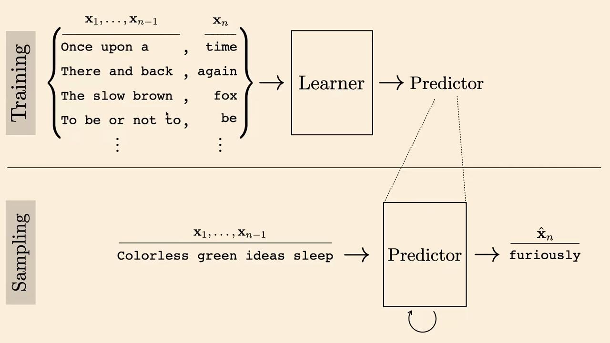
*▲ 강의 슬라이드 [68:00](https://youtu.be/Q1HOKrNeh2M?t=4080): [자기회귀 모델](00_%EB%94%A5%EB%9F%AC%EB%8B%9D_%EC%9A%A9%EC%96%B4%EC%82%AC%EC%A0%84.md#autoregressive-model-%EC%9E%90%EA%B8%B0%ED%9A%8C%EA%B7%80-%EB%AA%A8%EB%8D%B8). [학습](00_%EB%94%A5%EB%9F%AC%EB%8B%9D_%EC%9A%A9%EC%96%B4%EC%82%AC%EC%A0%84.md#training-%ED%95%99%EC%8A%B5)은 (앞부분, 다음 단어) 쌍으로, [샘플링](00_%EB%94%A5%EB%9F%AC%EB%8B%9D_%EC%9A%A9%EC%96%B4%EC%82%AC%EC%A0%84.md#sampling-%EC%83%98%ED%94%8C%EB%A7%81)은 예측을 다시 입력에 붙여 되풀이*

### 8.2 인과 마스크

▶ 영상 [68:17](https://youtu.be/Q1HOKrNeh2M?t=4097)

📐 **수학 개념**: [순열 등변성과 인과 마스크](%EC%88%98%ED%95%99%EA%B0%9C%EB%85%90/07_%EA%B5%AC%EC%A1%B0_%EC%95%84%ED%82%A4%ED%85%8D%EC%B2%98/MM31_%EC%88%9C%EC%97%B4_%EB%93%B1%EB%B3%80%EC%84%B1%EA%B3%BC_%EC%9D%B8%EA%B3%BC_%EB%A7%88%EC%8A%A4%ED%81%AC.md)

**[GPT](00_%EB%94%A5%EB%9F%AC%EB%8B%9D_%EC%9A%A9%EC%96%B4%EC%82%AC%EC%A0%84.md#gpt-%EC%83%9D%EC%84%B1%ED%98%95-%EC%82%AC%EC%A0%84%ED%95%99%EC%8A%B5-%ED%8A%B8%EB%9E%9C%EC%8A%A4%ED%8F%AC%EB%A8%B8)**(Generative Pre-trained [Transformer](00_%EB%94%A5%EB%9F%AC%EB%8B%9D_%EC%9A%A9%EC%96%B4%EC%82%AC%EC%A0%84.md#transformer-%ED%8A%B8%EB%9E%9C%EC%8A%A4%ED%8F%AC%EB%A8%B8), [생성형 사전학습 트랜스포머](00_%EB%94%A5%EB%9F%AC%EB%8B%9D_%EC%9A%A9%EC%96%B4%EC%82%AC%EC%A0%84.md#gpt-%EC%83%9D%EC%84%B1%ED%98%95-%EC%82%AC%EC%A0%84%ED%95%99%EC%8A%B5-%ED%8A%B8%EB%9E%9C%EC%8A%A4%ED%8F%AC%EB%A8%B8))는 자기회귀 [트랜스포머](00_%EB%94%A5%EB%9F%AC%EB%8B%9D_%EC%9A%A9%EC%96%B4%EC%82%AC%EC%A0%84.md#transformer-%ED%8A%B8%EB%9E%9C%EC%8A%A4%ED%8F%AC%EB%A8%B8)입니다. 그런데 그냥 [셀프 어텐션](00_%EB%94%A5%EB%9F%AC%EB%8B%9D_%EC%9A%A9%EC%96%B4%EC%82%AC%EC%A0%84.md#self-attention-%EC%85%80%ED%94%84-%EC%96%B4%ED%85%90%EC%85%98)을 쓰면 문제가 생깁니다. "furiously"를 예측해야 하는데 입력에 이미 "furiously"가 있으면, 항등 연결 하나만 배워 답을 베낄 수 있습니다. "ideas"를 예측할 때는 그 앞 단어만 볼 수 있어야 합니다.

그래서 [어텐션](00_%EB%94%A5%EB%9F%AC%EB%8B%9D_%EC%9A%A9%EC%96%B4%EC%82%AC%EC%A0%84.md#attention-%EC%96%B4%ED%85%90%EC%85%98) 행렬에 **[인과 마스크](00_%EB%94%A5%EB%9F%AC%EB%8B%9D_%EC%9A%A9%EC%96%B4%EC%82%AC%EC%A0%84.md#causal-attention-%EC%9D%B8%EA%B3%BC-%EC%96%B4%ED%85%90%EC%85%98)**(causal masking)를 씌웁니다. 출력 [토큰](00_%EB%94%A5%EB%9F%AC%EB%8B%9D_%EC%9A%A9%EC%96%B4%EC%82%AC%EC%A0%84.md#token-%ED%86%A0%ED%81%B0)은 **자기와 그 앞의 토큰에만** 주의를 기울일 수 있고, 미래 쪽 연결은 0으로 막습니다. 이제 순서가 중요해지므로 순열 등변이 아닙니다.

$$
A = \text{softmax}\!\Big(\frac{QK^\top}{\sqrt{m}} + M\Big),\qquad M_{ij} = \begin{cases}0 & j \le i\\ -\infty & j > i\end{cases}
$$

기호 풀이

| 기호 | 읽는 법 | 뜻 | 예제 값 |
| --- | --- | --- | --- |
| $M$ | 엠 | 인과 마스크 (미래 칸에 $-\infty$) | [[0, -∞], [0, 0]] |
| $i, j$ | 아이, 제이 | 출력 [토큰](00_%EB%94%A5%EB%9F%AC%EB%8B%9D_%EC%9A%A9%EC%96%B4%EC%82%AC%EC%A0%84.md#token-%ED%86%A0%ED%81%B0)(시점), 입력 [토큰](00_%EB%94%A5%EB%9F%AC%EB%8B%9D_%EC%9A%A9%EC%96%B4%EC%82%AC%EC%A0%84.md#token-%ED%86%A0%ED%81%B0)(시점) | - |
| $-\infty$ | 마이너스 무한대 | [소프트맥스](00_%EB%94%A5%EB%9F%AC%EB%8B%9D_%EC%9A%A9%EC%96%B4%EC%82%AC%EC%A0%84.md#softmax-%EC%86%8C%ED%94%84%ED%8A%B8%EB%A7%A5%EC%8A%A4) 뒤 [가중치](00_%EB%94%A5%EB%9F%AC%EB%8B%9D_%EC%9A%A9%EC%96%B4%EC%82%AC%EC%A0%84.md#weight-%EA%B0%80%EC%A4%91%EC%B9%98) 0 | - |
| $A$ | 에이 | 아래 삼각 모양 [어텐션](00_%EB%94%A5%EB%9F%AC%EB%8B%9D_%EC%9A%A9%EC%96%B4%EC%82%AC%EC%A0%84.md#attention-%EC%96%B4%ED%85%90%EC%85%98) 행렬 | `[[1, 0], [0.3302, 0.6698]]` |
| $QK^\top/\sqrt{m}$ | 스케일드 점수 | 5.5절과 같음 | `[[0.7071, 0.7071], [0.7071, 1.4142]]` |

예제와 풀이

**문제**: 5.5절의 [토큰](00_%EB%94%A5%EB%9F%AC%EB%8B%9D_%EC%9A%A9%EC%96%B4%EC%82%AC%EC%A0%84.md#token-%ED%86%A0%ED%81%B0) (1, 0), (1, 1)에 인과 마스크를 씌워, 각 [토큰](00_%EB%94%A5%EB%9F%AC%EB%8B%9D_%EC%9A%A9%EC%96%B4%EC%82%AC%EC%A0%84.md#token-%ED%86%A0%ED%81%B0)이 자기와 앞쪽만 볼 때의 [어텐션](00_%EB%94%A5%EB%9F%AC%EB%8B%9D_%EC%9A%A9%EC%96%B4%EC%82%AC%EC%A0%84.md#attention-%EC%96%B4%ED%85%90%EC%85%98) 행렬 $A$와 출력 $AV$를 구한다.

**주어진 값**:
- $QK^\top/\sqrt{m} = \begin{pmatrix}0.7071&0.7071\\0.7071&1.4142\end{pmatrix}$ (5.5절에서 구한 스케일드 점수)
- $M = \begin{pmatrix}0&-\infty\\0&0\end{pmatrix}$ ([토큰](00_%EB%94%A5%EB%9F%AC%EB%8B%9D_%EC%9A%A9%EC%96%B4%EC%82%AC%EC%A0%84.md#token-%ED%86%A0%ED%81%B0) 1이 미래인 [토큰](00_%EB%94%A5%EB%9F%AC%EB%8B%9D_%EC%9A%A9%EC%96%B4%EC%82%AC%EC%A0%84.md#token-%ED%86%A0%ED%81%B0) 2를 못 보게 막는 마스크)
- $V = \begin{pmatrix}1&0\\1&1\end{pmatrix}$ (값 행렬)

**풀이**
1. 식을 그대로 쓴다: $A = \text{softmax}\big(QK^\top/\sqrt{m} + M\big)$, $T_{\text{out}} = AV$
2. 값을 대입한다: $A = \text{softmax}\Big(\begin{pmatrix}0.7071&0.7071\\0.7071&1.4142\end{pmatrix} + \begin{pmatrix}0&-\infty\\0&0\end{pmatrix}\Big)$
3. 칸끼리 덧셈을 한다: $\begin{pmatrix}0.7071&-\infty\\0.7071&1.4142\end{pmatrix}$ (어떤 수에 $-\infty$를 더해도 $-\infty$)
4. $e^{-\infty}$의 뜻: $e$의 [지수](00_%EB%94%A5%EB%9F%AC%EB%8B%9D_%EC%9A%A9%EC%96%B4%EC%82%AC%EC%A0%84.md#e-exponent-e%EC%99%80-%EC%A7%80%EC%88%98)가 한없이 작아지면 값이 0에 다가간다. 그래서 $e^{-\infty} = 0$
5. 1행 softmax에 대입한다: $\Big(\frac{e^{0.7071}}{e^{0.7071} + e^{-\infty}},\ \frac{e^{-\infty}}{e^{0.7071} + e^{-\infty}}\Big) = \Big(\frac{2.0281}{2.0281 + 0},\ \frac{0}{2.0281 + 0}\Big)$
6. 나눗셈을 한다: $(1, 0)$
7. 2행은 마스크가 0뿐이라 5.5절과 같다: $e^{0.7071} = 2.0281$, $e^{1.4142} = 4.1133$, 합 $6.1414$ → $(0.3302, 0.6698)$
8. 1행 출력을 펼친다: $1 \times (1, 0) + 0 \times (1, 1) = (1, 0)$ → 첫 [토큰](00_%EB%94%A5%EB%9F%AC%EB%8B%9D_%EC%9A%A9%EC%96%B4%EC%82%AC%EC%A0%84.md#token-%ED%86%A0%ED%81%B0)은 자기만 본다
9. 2행 출력을 펼친다: $0.3302 \times (1, 0) + 0.6698 \times (1, 1) = (0.3302 + 0.6698,\ 0 + 0.6698) = (1, 0.6698)$

**답**: $\begin{pmatrix}1&0\\1&0.6698\end{pmatrix}$. 마스크 없을 때의 1행 (1, 0.5)가 (1, 0)으로 바뀌었다(미래 [토큰](00_%EB%94%A5%EB%9F%AC%EB%8B%9D_%EC%9A%A9%EC%96%B4%EC%82%AC%EC%A0%84.md#token-%ED%86%A0%ED%81%B0)을 못 봄).

내 이해

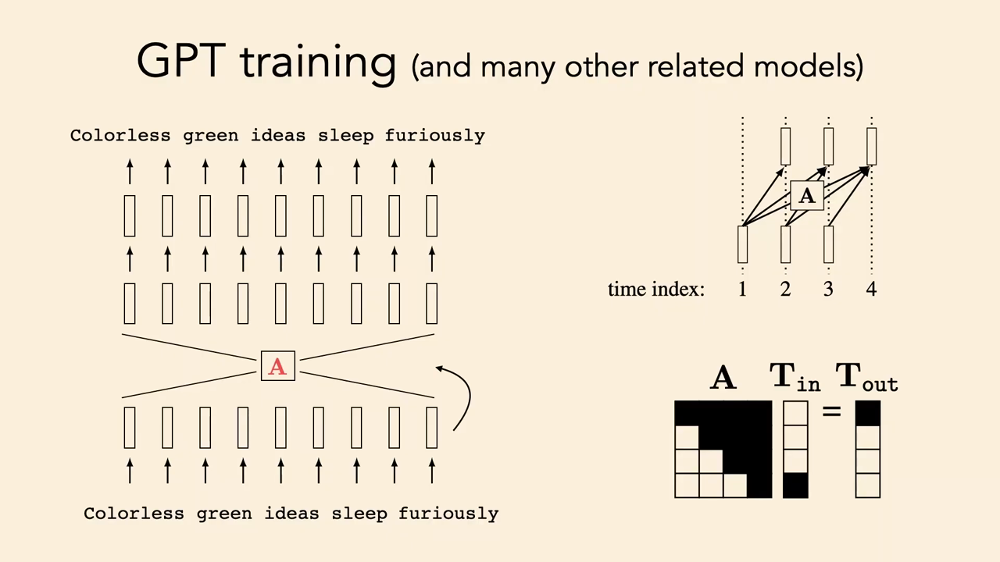
*▲ 강의 슬라이드 [70:20](https://youtu.be/Q1HOKrNeh2M?t=4220): [GPT](00_%EB%94%A5%EB%9F%AC%EB%8B%9D_%EC%9A%A9%EC%96%B4%EC%82%AC%EC%A0%84.md#gpt-%EC%83%9D%EC%84%B1%ED%98%95-%EC%82%AC%EC%A0%84%ED%95%99%EC%8A%B5-%ED%8A%B8%EB%9E%9C%EC%8A%A4%ED%8F%AC%EB%A8%B8) [학습](00_%EB%94%A5%EB%9F%AC%EB%8B%9D_%EC%9A%A9%EC%96%B4%EC%82%AC%EC%A0%84.md#training-%ED%95%99%EC%8A%B5). 오른쪽 위 화살표(앞쪽 [토큰](00_%EB%94%A5%EB%9F%AC%EB%8B%9D_%EC%9A%A9%EC%96%B4%EC%82%AC%EC%A0%84.md#token-%ED%86%A0%ED%81%B0)만)와 아래 마스크된 [어텐션](00_%EB%94%A5%EB%9F%AC%EB%8B%9D_%EC%9A%A9%EC%96%B4%EC%82%AC%EC%A0%84.md#attention-%EC%96%B4%ED%85%90%EC%85%98) 행렬 A가 정확히 대응한다*

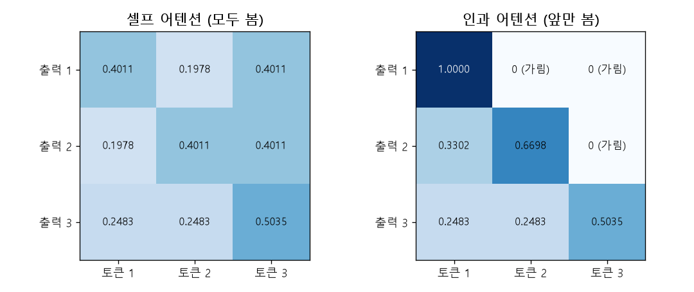
*▲ 직접 그린 그림: [토큰](00_%EB%94%A5%EB%9F%AC%EB%8B%9D_%EC%9A%A9%EC%96%B4%EC%82%AC%EC%A0%84.md#token-%ED%86%A0%ED%81%B0) (1,0), (0,1), (1,1)의 [셀프 어텐션](00_%EB%94%A5%EB%9F%AC%EB%8B%9D_%EC%9A%A9%EC%96%B4%EC%82%AC%EC%A0%84.md#self-attention-%EC%85%80%ED%94%84-%EC%96%B4%ED%85%90%EC%85%98)과 [인과 어텐션](00_%EB%94%A5%EB%9F%AC%EB%8B%9D_%EC%9A%A9%EC%96%B4%EC%82%AC%EC%A0%84.md#causal-attention-%EC%9D%B8%EA%B3%BC-%EC%96%B4%ED%85%90%EC%85%98) 행렬. 마스크 뒤 대각선 위쪽이 0이다*

여러 [층](00_%EB%94%A5%EB%9F%AC%EB%8B%9D_%EC%9A%A9%EC%96%B4%EC%82%AC%EC%A0%84.md#layer-%EC%B8%B5)으로 쌓아도 같습니다. 첫 [층](00_%EB%94%A5%EB%9F%AC%EB%8B%9D_%EC%9A%A9%EC%96%B4%EC%82%AC%EC%A0%84.md#layer-%EC%B8%B5)에서 4번째 [토큰](00_%EB%94%A5%EB%9F%AC%EB%8B%9D_%EC%9A%A9%EC%96%B4%EC%82%AC%EC%A0%84.md#token-%ED%86%A0%ED%81%B0)을 예측하는 출력은 1~3번만 보고, 그다음 층부터는 "자기와 그 앞"을 보는 마스크를 쓰면, 각 출력 [토큰](00_%EB%94%A5%EB%9F%AC%EB%8B%9D_%EC%9A%A9%EC%96%B4%EC%82%AC%EC%A0%84.md#token-%ED%86%A0%ED%81%B0)의 [수용 영역](00_%EB%94%A5%EB%9F%AC%EB%8B%9D_%EC%9A%A9%EC%96%B4%EC%82%AC%EC%A0%84.md#receptive-field-%EC%88%98%EC%9A%A9-%EC%98%81%EC%97%AD)이 자기 앞의 단어들로만 이루어집니다. 그래서 **문장 하나로 모든 위치의 다음 단어 예측을 한꺼번에 지도 [학습](00_%EB%94%A5%EB%9F%AC%EB%8B%9D_%EC%9A%A9%EC%96%B4%EC%82%AC%EC%A0%84.md#training-%ED%95%99%EC%8A%B5)**할 수 있어 효율적입니다.

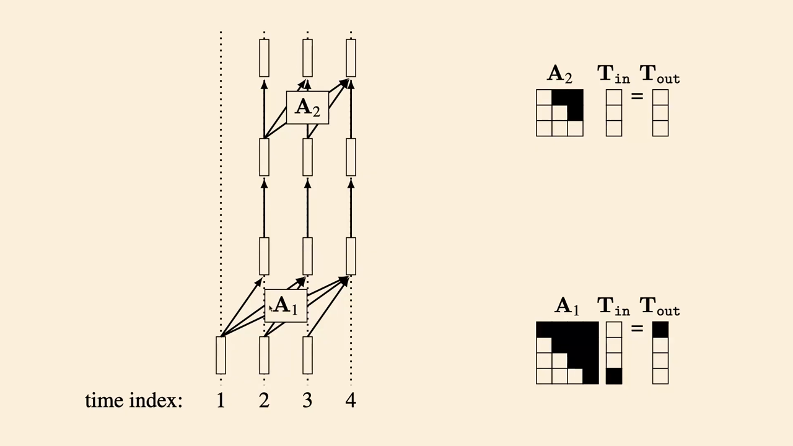
*▲ 강의 슬라이드 [71:00](https://youtu.be/Q1HOKrNeh2M?t=4260): 인과 마스크를 쓴 2층 [트랜스포머](00_%EB%94%A5%EB%9F%AC%EB%8B%9D_%EC%9A%A9%EC%96%B4%EC%82%AC%EC%A0%84.md#transformer-%ED%8A%B8%EB%9E%9C%EC%8A%A4%ED%8F%AC%EB%A8%B8). A₁, A₂ 모두 아래 삼각 모양이라 각 출력은 앞쪽 시점만 본다*

### 8.3 "Attention Is All You Need" 도식 읽기

▶ 영상 [71:02](https://youtu.be/Q1HOKrNeh2M?t=4262)

강사는 [트랜스포머](00_%EB%94%A5%EB%9F%AC%EB%8B%9D_%EC%9A%A9%EC%96%B4%EC%82%AC%EC%A0%84.md#transformer-%ED%8A%B8%EB%9E%9C%EC%8A%A4%ED%8F%AC%EB%A8%B8)를 처음 정의한 논문 "[Attention](00_%EB%94%A5%EB%9F%AC%EB%8B%9D_%EC%9A%A9%EC%96%B4%EC%82%AC%EC%A0%84.md#attention-%EC%96%B4%ED%85%90%EC%85%98) Is All You Need"(Vaswani 외 2017)를 "과학 역사상 최악의 도식이지만 최고의 논문이라 서로 상쇄된다"고 농담합니다. 새 생각보다는 세부가 새로운 **요리법**이고, 그것이 놀랍게 잘 작동했습니다. 강사의 도식으로 옮기면 다음과 같습니다(논문 그림은 외부 그림이라 캡처하지 않았습니다).

| 논문 도식 | 이 강의의 이름 |
|---|---|
| Feed Forward | [토큰별 비선형 함수](00_%EB%94%A5%EB%9F%AC%EB%8B%9D_%EC%9A%A9%EC%96%B4%EC%82%AC%EC%A0%84.md#token-wise-nonlinearity-%ED%86%A0%ED%81%B0%EB%B3%84-%EB%B9%84%EC%84%A0%ED%98%95-%ED%95%A8%EC%88%98) (모든 [토큰](00_%EB%94%A5%EB%9F%AC%EB%8B%9D_%EC%9A%A9%EC%96%B4%EC%82%AC%EC%A0%84.md#token-%ED%86%A0%ED%81%B0)에 같은 MLP) |
| Outputs (shifted right) | 자기회귀를 위해 입력을 한 칸 민 것. [트랜스포머](00_%EB%94%A5%EB%9F%AC%EB%8B%9D_%EC%9A%A9%EC%96%B4%EC%82%AC%EC%A0%84.md#transformer-%ED%8A%B8%EB%9E%9C%EC%8A%A4%ED%8F%AC%EB%A8%B8) 자체와는 별개의 생각 |
| Positional Encoding | 사인파 [위치 인코딩](00_%EB%94%A5%EB%9F%AC%EB%8B%9D_%EC%9A%A9%EC%96%B4%EC%82%AC%EC%A0%84.md#positional-encoding-%EC%9C%84%EC%B9%98-%EC%9D%B8%EC%BD%94%EB%94%A9) |
| Add & [Norm](00_%EB%94%A5%EB%9F%AC%EB%8B%9D_%EC%9A%A9%EC%96%B4%EC%82%AC%EC%A0%84.md#norm-%EB%85%B8%EB%A6%84) | [잔차 연결](00_%EB%94%A5%EB%9F%AC%EB%8B%9D_%EC%9A%A9%EC%96%B4%EC%82%AC%EC%A0%84.md#residual-connection-%EC%9E%94%EC%B0%A8-%EC%97%B0%EA%B2%B0) + [층 정규화](00_%EB%94%A5%EB%9F%AC%EB%8B%9D_%EC%9A%A9%EC%96%B4%EC%82%AC%EC%A0%84.md#layer-normalization-%EC%B8%B5-%EC%A0%95%EA%B7%9C%ED%99%94) |
| Masked Multi-Head [Attention](00_%EB%94%A5%EB%9F%AC%EB%8B%9D_%EC%9A%A9%EC%96%B4%EC%82%AC%EC%A0%84.md#attention-%EC%96%B4%ED%85%90%EC%85%98) | 인과 마스크를 쓴 멀티헤드 [셀프 어텐션](00_%EB%94%A5%EB%9F%AC%EB%8B%9D_%EC%9A%A9%EC%96%B4%EC%82%AC%EC%A0%84.md#self-attention-%EC%85%80%ED%94%84-%EC%96%B4%ED%85%90%EC%85%98) |

언어 모델이라면 입력을 한 칸 밀고 [인과 어텐션](00_%EB%94%A5%EB%9F%AC%EB%8B%9D_%EC%9A%A9%EC%96%B4%EC%82%AC%EC%A0%84.md#causal-attention-%EC%9D%B8%EA%B3%BC-%EC%96%B4%ED%85%90%EC%85%98)을 쓰면 됩니다.

---

## 9. 교차 어텐션: 이미지 캡션

▶ 영상 [72:58](https://youtu.be/Q1HOKrNeh2M?t=4378)

📐 **수학 개념**: [스케일드 내적 어텐션](%EC%88%98%ED%95%99%EA%B0%9C%EB%85%90/07_%EA%B5%AC%EC%A1%B0_%EC%95%84%ED%82%A4%ED%85%8D%EC%B2%98/MM30_%EC%8A%A4%EC%BC%80%EC%9D%BC%EB%93%9C_%EB%82%B4%EC%A0%81_%EC%96%B4%ED%85%90%EC%85%98.md)

마지막으로 [언어 모델](00_%EB%94%A5%EB%9F%AC%EB%8B%9D_%EC%9A%A9%EC%96%B4%EC%82%AC%EC%A0%84.md#language-model-%EC%96%B8%EC%96%B4-%EB%AA%A8%EB%8D%B8)과 이미지 모델을 합쳐 **이미지에 설명 문장(캡션)을 다는** 구조를 봅니다.

1. **이미지 인코더**: 이미지를 패치 [토큰](00_%EB%94%A5%EB%9F%AC%EB%8B%9D_%EC%9A%A9%EC%96%B4%EC%82%AC%EC%A0%84.md#token-%ED%86%A0%ED%81%B0)으로 바꾸고 [셀프 어텐션](00_%EB%94%A5%EB%9F%AC%EB%8B%9D_%EC%9A%A9%EC%96%B4%EC%82%AC%EC%A0%84.md#self-attention-%EC%85%80%ED%94%84-%EC%96%B4%ED%85%90%EC%85%98)으로 처리합니다.
2. **텍스트 디코더**: 문장을 자기회귀로 씁니다. 다음 단어를 예측하는 각 단계는 앞의 단어들(인과 [셀프 어텐션](00_%EB%94%A5%EB%9F%AC%EB%8B%9D_%EC%9A%A9%EC%96%B4%EC%82%AC%EC%A0%84.md#self-attention-%EC%85%80%ED%94%84-%EC%96%B4%ED%85%90%EC%85%98))과 **이미지 [토큰](00_%EB%94%A5%EB%9F%AC%EB%8B%9D_%EC%9A%A9%EC%96%B4%EC%82%AC%EC%A0%84.md#token-%ED%86%A0%ED%81%B0)들 전부**를 볼 수 있습니다.

텍스트 [토큰](00_%EB%94%A5%EB%9F%AC%EB%8B%9D_%EC%9A%A9%EC%96%B4%EC%82%AC%EC%A0%84.md#token-%ED%86%A0%ED%81%B0)이 자기 집합이 아닌 **다른 집합(이미지 [토큰](00_%EB%94%A5%EB%9F%AC%EB%8B%9D_%EC%9A%A9%EC%96%B4%EC%82%AC%EC%A0%84.md#token-%ED%86%A0%ED%81%B0))** 에 주의를 기울이는 것을 **[교차 어텐션](00_%EB%94%A5%EB%9F%AC%EB%8B%9D_%EC%9A%A9%EC%96%B4%EC%82%AC%EC%A0%84.md#cross-attention-%EA%B5%90%EC%B0%A8-%EC%96%B4%ED%85%90%EC%85%98)**(cross-attention)이라 합니다. 쿼리는 텍스트에서, 키와 값은 이미지에서 나옵니다. 이처럼 여러 마스크·[어텐션](00_%EB%94%A5%EB%9F%AC%EB%8B%9D_%EC%9A%A9%EC%96%B4%EC%82%AC%EC%A0%84.md#attention-%EC%96%B4%ED%85%90%EC%85%98) 전략을 조합할 수 있습니다.

$$
Q = T_{\text{text}}W_Q,\quad K = T_{\text{img}}W_K,\quad V = T_{\text{img}}W_V,\qquad T_{\text{out}} = \text{softmax}\!\Big(\frac{QK^\top}{\sqrt{m}}\Big)V
$$

기호 풀이

| 기호 | 읽는 법 | 뜻 | 예제 값 |
| --- | --- | --- | --- |
| $T_{\text{text}}$ | 티 텍스트 | 지금까지 쓴 문장의 [토큰](00_%EB%94%A5%EB%9F%AC%EB%8B%9D_%EC%9A%A9%EC%96%B4%EC%82%AC%EC%A0%84.md#token-%ED%86%A0%ED%81%B0) | 쿼리 하나 (1, 0) |
| $T_{\text{img}}$ | 티 이미지 | 이미지 인코더가 낸 [토큰](00_%EB%94%A5%EB%9F%AC%EB%8B%9D_%EC%9A%A9%EC%96%B4%EC%82%AC%EC%A0%84.md#token-%ED%86%A0%ED%81%B0) | 2개 |
| $K$ | 케이 | 이미지 [토큰](00_%EB%94%A5%EB%9F%AC%EB%8B%9D_%EC%9A%A9%EC%96%B4%EC%82%AC%EC%A0%84.md#token-%ED%86%A0%ED%81%B0)의 키 | (1, 0), (0, 1) |
| $V$ | 브이 | 이미지 [토큰](00_%EB%94%A5%EB%9F%AC%EB%8B%9D_%EC%9A%A9%EC%96%B4%EC%82%AC%EC%A0%84.md#token-%ED%86%A0%ED%81%B0)의 값 | (3, 1), (0, 2) |
| $m$ | 엠 | 쿼리·키 차원 | 2 |
| $T_{\text{out}}$ | 티 아웃 | 이미지 정보를 섞은 텍스트 [토큰](00_%EB%94%A5%EB%9F%AC%EB%8B%9D_%EC%9A%A9%EC%96%B4%EC%82%AC%EC%A0%84.md#token-%ED%86%A0%ED%81%B0) | (2.0093, 1.3302) |

예제와 풀이

**문제**: 텍스트 [토큰](00_%EB%94%A5%EB%9F%AC%EB%8B%9D_%EC%9A%A9%EC%96%B4%EC%82%AC%EC%A0%84.md#token-%ED%86%A0%ED%81%B0) 하나가 쿼리 $\mathbf{q} = (1, 0)$을 내고, 이미지 [토큰](00_%EB%94%A5%EB%9F%AC%EB%8B%9D_%EC%9A%A9%EC%96%B4%EC%82%AC%EC%A0%84.md#token-%ED%86%A0%ED%81%B0) 두 개가 키와 값을 낼 때, [교차 어텐션](00_%EB%94%A5%EB%9F%AC%EB%8B%9D_%EC%9A%A9%EC%96%B4%EC%82%AC%EC%A0%84.md#cross-attention-%EA%B5%90%EC%B0%A8-%EC%96%B4%ED%85%90%EC%85%98)으로 이미지 정보를 섞은 출력 [토큰](00_%EB%94%A5%EB%9F%AC%EB%8B%9D_%EC%9A%A9%EC%96%B4%EC%82%AC%EC%A0%84.md#token-%ED%86%A0%ED%81%B0)을 구한다.

**주어진 값**:
- $Q = (1, 0)$ (텍스트 [토큰](00_%EB%94%A5%EB%9F%AC%EB%8B%9D_%EC%9A%A9%EC%96%B4%EC%82%AC%EC%A0%84.md#token-%ED%86%A0%ED%81%B0)의 쿼리)
- $K = \begin{pmatrix}1&0\\0&1\end{pmatrix}$ (이미지 [토큰](00_%EB%94%A5%EB%9F%AC%EB%8B%9D_%EC%9A%A9%EC%96%B4%EC%82%AC%EC%A0%84.md#token-%ED%86%A0%ED%81%B0) 두 개의 키, 행 = [토큰](00_%EB%94%A5%EB%9F%AC%EB%8B%9D_%EC%9A%A9%EC%96%B4%EC%82%AC%EC%A0%84.md#token-%ED%86%A0%ED%81%B0))
- $V = \begin{pmatrix}3&1\\0&2\end{pmatrix}$ (이미지 [토큰](00_%EB%94%A5%EB%9F%AC%EB%8B%9D_%EC%9A%A9%EC%96%B4%EC%82%AC%EC%A0%84.md#token-%ED%86%A0%ED%81%B0) 두 개의 값)
- $m = 2$ (쿼리·키 차원)

**풀이**
1. 식을 그대로 쓴다: $T_{\text{out}} = \text{softmax}\big(QK^\top/\sqrt{m}\big)V$
2. 값을 대입한다: $T_{\text{out}} = \text{softmax}\Big((1, 0)\begin{pmatrix}1&0\\0&1\end{pmatrix}^\top \big/ \sqrt{2}\Big)\begin{pmatrix}3&1\\0&2\end{pmatrix}$
3. 첫 이미지 토큰과의 [내적](00_%EB%94%A5%EB%9F%AC%EB%8B%9D_%EC%9A%A9%EC%96%B4%EC%82%AC%EC%A0%84.md#dot-product-%EB%82%B4%EC%A0%81)을 펼친다: $(1, 0)\cdot(1, 0) = 1 \times 1 + 0 \times 0 = 1$
4. 둘째 이미지 토큰과의 [내적](00_%EB%94%A5%EB%9F%AC%EB%8B%9D_%EC%9A%A9%EC%96%B4%EC%82%AC%EC%A0%84.md#dot-product-%EB%82%B4%EC%A0%81)을 펼친다: $(1, 0)\cdot(0, 1) = 1 \times 0 + 0 \times 1 = 0$
5. $\sqrt{2} = 1.4142$로 나눈다: $(1 \div 1.4142,\ 0 \div 1.4142) = (0.7071, 0)$
6. softmax에 대입한다: $\Big(\frac{e^{0.7071}}{e^{0.7071} + e^{0}},\ \frac{e^{0}}{e^{0.7071} + e^{0}}\Big)$
7. [지수](00_%EB%94%A5%EB%9F%AC%EB%8B%9D_%EC%9A%A9%EC%96%B4%EC%82%AC%EC%A0%84.md#e-exponent-e%EC%99%80-%EC%A7%80%EC%88%98)를 계산한다: $e^{0.7071} = 2.0281$, $e^0 = 1$
8. 분모의 덧셈을 한다: $2.0281 + 1 = 3.0281$
9. 나눗셈을 한다: $2.0281 \div 3.0281 = 0.6698$, $1 \div 3.0281 = 0.3302$
10. [가중합](00_%EB%94%A5%EB%9F%AC%EB%8B%9D_%EC%9A%A9%EC%96%B4%EC%82%AC%EC%A0%84.md#weighted-sum-%EA%B0%80%EC%A4%91%ED%95%A9)에 대입한다: $T_{\text{out}} = 0.6698 \times (3, 1) + 0.3302 \times (0, 2)$
11. 첫 칸을 펼친다: $0.6698 \times 3 + 0.3302 \times 0 = 2.0093 + 0 = 2.0093$ (반올림 전 값으로 계산)
12. 둘째 칸을 펼친다: $0.6698 \times 1 + 0.3302 \times 2 = 0.6698 + 0.6604 = 1.3302$

**답**: $\mathbf{t}_{\text{out}} = (2.0093, 1.3302)$. 쿼리와 맞는 첫 이미지 [토큰](00_%EB%94%A5%EB%9F%AC%EB%8B%9D_%EC%9A%A9%EC%96%B4%EC%82%AC%EC%A0%84.md#token-%ED%86%A0%ED%81%B0)의 값이 더 많이 섞였다.

내 이해

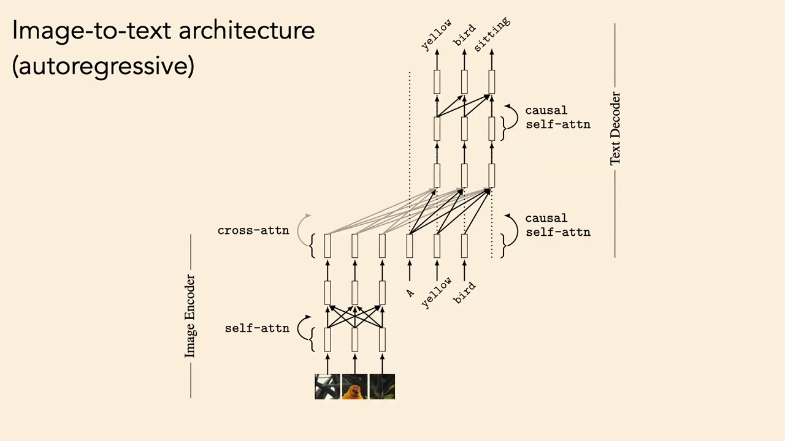
*▲ 강의 슬라이드 [73:20](https://youtu.be/Q1HOKrNeh2M?t=4400): 이미지→텍스트 자기회귀 구조. 이미지 인코더([셀프 어텐션](00_%EB%94%A5%EB%9F%AC%EB%8B%9D_%EC%9A%A9%EC%96%B4%EC%82%AC%EC%A0%84.md#self-attention-%EC%85%80%ED%94%84-%EC%96%B4%ED%85%90%EC%85%98))와 텍스트 디코더(인과 [셀프 어텐션](00_%EB%94%A5%EB%9F%AC%EB%8B%9D_%EC%9A%A9%EC%96%B4%EC%82%AC%EC%A0%84.md#self-attention-%EC%85%80%ED%94%84-%EC%96%B4%ED%85%90%EC%85%98) + 이미지 토큰으로의 [교차 어텐션](00_%EB%94%A5%EB%9F%AC%EB%8B%9D_%EC%9A%A9%EC%96%B4%EC%82%AC%EC%A0%84.md#cross-attention-%EA%B5%90%EC%B0%A8-%EC%96%B4%ED%85%90%EC%85%98))*

---

## 10. 정리

▶ 영상 [74:19](https://youtu.be/Q1HOKrNeh2M?t=4459)

- [트랜스포머](00_%EB%94%A5%EB%9F%AC%EB%8B%9D_%EC%9A%A9%EC%96%B4%EC%82%AC%EC%A0%84.md#transformer-%ED%8A%B8%EB%9E%9C%EC%8A%A4%ED%8F%AC%EB%A8%B8)는 세 생각으로 이루어집니다. **[토큰](00_%EB%94%A5%EB%9F%AC%EB%8B%9D_%EC%9A%A9%EC%96%B4%EC%82%AC%EC%A0%84.md#token-%ED%86%A0%ED%81%B0)**(벡터 단위의 계산, [GNN](00_%EB%94%A5%EB%9F%AC%EB%8B%9D_%EC%9A%A9%EC%96%B4%EC%82%AC%EC%A0%84.md#gnn-graph-neural-network-%EA%B7%B8%EB%9E%98%ED%94%84-%EC%8B%A0%EA%B2%BD%EB%A7%9D)의 노드 벡터와 같음), **[어텐션](00_%EB%94%A5%EB%9F%AC%EB%8B%9D_%EC%9A%A9%EC%96%B4%EC%82%AC%EC%A0%84.md#attention-%EC%96%B4%ED%85%90%EC%85%98)**(데이터가 정하는 결합 [가중치](00_%EB%94%A5%EB%9F%AC%EB%8B%9D_%EC%9A%A9%EC%96%B4%EC%82%AC%EC%A0%84.md#weight-%EA%B0%80%EC%A4%91%EC%B9%98), 유일하게 새로운 것), **[위치 인코딩](00_%EB%94%A5%EB%9F%AC%EB%8B%9D_%EC%9A%A9%EC%96%B4%EC%82%AC%EC%A0%84.md#positional-encoding-%EC%9C%84%EC%B9%98-%EC%9D%B8%EC%BD%94%EB%94%A9)**(순서·위치 정보, 분야 지식을 넣는 자리).
- [토큰](00_%EB%94%A5%EB%9F%AC%EB%8B%9D_%EC%9A%A9%EC%96%B4%EC%82%AC%EC%A0%84.md#token-%ED%86%A0%ED%81%B0) 넷은 MLP와 같은 모양(선형 결합 ↔ 비선형)을 [토큰](00_%EB%94%A5%EB%9F%AC%EB%8B%9D_%EC%9A%A9%EC%96%B4%EC%82%AC%EC%A0%84.md#token-%ED%86%A0%ED%81%B0) 단위로 되풀이하며, **완전 연결 그래프 위의 [GNN](00_%EB%94%A5%EB%9F%AC%EB%8B%9D_%EC%9A%A9%EC%96%B4%EC%82%AC%EC%A0%84.md#gnn-graph-neural-network-%EA%B7%B8%EB%9E%98%ED%94%84-%EC%8B%A0%EA%B2%BD%EB%A7%9D)**입니다.
- [어텐션](00_%EB%94%A5%EB%9F%AC%EB%8B%9D_%EC%9A%A9%EC%96%B4%EC%82%AC%EC%A0%84.md#attention-%EC%96%B4%ED%85%90%EC%85%98) 식 $\text{softmax}(QK^\top/\sqrt{m})V$는 모두 [행렬 곱](00_%EB%94%A5%EB%9F%AC%EB%8B%9D_%EC%9A%A9%EC%96%B4%EC%82%AC%EC%A0%84.md#matrix-multiplication-%ED%96%89%EB%A0%AC-%EA%B3%B1)이라 하드웨어에 잘 맞고, [학습](00_%EB%94%A5%EB%9F%AC%EB%8B%9D_%EC%9A%A9%EC%96%B4%EC%82%AC%EC%A0%84.md#training-%ED%95%99%EC%8A%B5) [파라미터](00_%EB%94%A5%EB%9F%AC%EB%8B%9D_%EC%9A%A9%EC%96%B4%EC%82%AC%EC%A0%84.md#parameter-%ED%8C%8C%EB%9D%BC%EB%AF%B8%ED%84%B0)는 [토큰](00_%EB%94%A5%EB%9F%AC%EB%8B%9D_%EC%9A%A9%EC%96%B4%EC%82%AC%EC%A0%84.md#token-%ED%86%A0%ED%81%B0) 수가 아니라 [토큰](00_%EB%94%A5%EB%9F%AC%EB%8B%9D_%EC%9A%A9%EC%96%B4%EC%82%AC%EC%A0%84.md#token-%ED%86%A0%ED%81%B0) 차원에 달려 있습니다.
- ViT 블록 = [층 정규화](00_%EB%94%A5%EB%9F%AC%EB%8B%9D_%EC%9A%A9%EC%96%B4%EC%82%AC%EC%A0%84.md#layer-normalization-%EC%B8%B5-%EC%A0%95%EA%B7%9C%ED%99%94) + 멀티헤드 [셀프 어텐션](00_%EB%94%A5%EB%9F%AC%EB%8B%9D_%EC%9A%A9%EC%96%B4%EC%82%AC%EC%A0%84.md#self-attention-%EC%85%80%ED%94%84-%EC%96%B4%ED%85%90%EC%85%98) + 토큰별 MLP + [잔차 연결](00_%EB%94%A5%EB%9F%AC%EB%8B%9D_%EC%9A%A9%EC%96%B4%EC%82%AC%EC%A0%84.md#residual-connection-%EC%9E%94%EC%B0%A8-%EC%97%B0%EA%B2%B0). 분야 지식은 [토큰화](00_%EB%94%A5%EB%9F%AC%EB%8B%9D_%EC%9A%A9%EC%96%B4%EC%82%AC%EC%A0%84.md#tokenization-%ED%86%A0%ED%81%B0%ED%99%94)와 위치 인코딩에만 넣습니다.
- [언어 모델](00_%EB%94%A5%EB%9F%AC%EB%8B%9D_%EC%9A%A9%EC%96%B4%EC%82%AC%EC%A0%84.md#language-model-%EC%96%B8%EC%96%B4-%EB%AA%A8%EB%8D%B8)([GPT](00_%EB%94%A5%EB%9F%AC%EB%8B%9D_%EC%9A%A9%EC%96%B4%EC%82%AC%EC%A0%84.md#gpt-%EC%83%9D%EC%84%B1%ED%98%95-%EC%82%AC%EC%A0%84%ED%95%99%EC%8A%B5-%ED%8A%B8%EB%9E%9C%EC%8A%A4%ED%8F%AC%EB%A8%B8))은 자기회귀 예측에 인과 마스크를 더한 [트랜스포머](00_%EB%94%A5%EB%9F%AC%EB%8B%9D_%EC%9A%A9%EC%96%B4%EC%82%AC%EC%A0%84.md#transformer-%ED%8A%B8%EB%9E%9C%EC%8A%A4%ED%8F%AC%EB%A8%B8)이고, [교차 어텐션](00_%EB%94%A5%EB%9F%AC%EB%8B%9D_%EC%9A%A9%EC%96%B4%EC%82%AC%EC%A0%84.md#cross-attention-%EA%B5%90%EC%B0%A8-%EC%96%B4%ED%85%90%EC%85%98)으로 이미지와 텍스트를 잇습니다.
- 이 강의는 교재의 [트랜스포머](00_%EB%94%A5%EB%9F%AC%EB%8B%9D_%EC%9A%A9%EC%96%B4%EC%82%AC%EC%A0%84.md#transformer-%ED%8A%B8%EB%9E%9C%EC%8A%A4%ED%8F%AC%EB%A8%B8) 장을 거의 그대로 따랐습니다. [생성 모델](00_%EB%94%A5%EB%9F%AC%EB%8B%9D_%EC%9A%A9%EC%96%B4%EC%82%AC%EC%A0%84.md#generative-model-%EC%83%9D%EC%84%B1-%EB%AA%A8%EB%8D%B8)과 [자기회귀 모델](00_%EB%94%A5%EB%9F%AC%EB%8B%9D_%EC%9A%A9%EC%96%B4%EC%82%AC%EC%A0%84.md#autoregressive-model-%EC%9E%90%EA%B8%B0%ED%9A%8C%EA%B7%80-%EB%AA%A8%EB%8D%B8)은 뒤 강의에서 다시 다룹니다.

---

## 11. 용어 정리

이번 강의에서 새로 나온 용어입니다.

| 용어 | 뜻 |
|---|---|
| [토큰](00_%EB%94%A5%EB%9F%AC%EB%8B%9D_%EC%9A%A9%EC%96%B4%EC%82%AC%EC%A0%84.md#token-%ED%86%A0%ED%81%B0)([Token](00_%EB%94%A5%EB%9F%AC%EB%8B%9D_%EC%9A%A9%EC%96%B4%EC%82%AC%EC%A0%84.md#token-%ED%86%A0%ED%81%B0)) | 뉴런을 묶은 벡터. [트랜스포머](00_%EB%94%A5%EB%9F%AC%EB%8B%9D_%EC%9A%A9%EC%96%B4%EC%82%AC%EC%A0%84.md#transformer-%ED%8A%B8%EB%9E%9C%EC%8A%A4%ED%8F%AC%EB%A8%B8)가 다루는 기본 단위 |
| [토큰화](00_%EB%94%A5%EB%9F%AC%EB%8B%9D_%EC%9A%A9%EC%96%B4%EC%82%AC%EC%A0%84.md#tokenization-%ED%86%A0%ED%81%B0%ED%99%94)([Tokenization](00_%EB%94%A5%EB%9F%AC%EB%8B%9D_%EC%9A%A9%EC%96%B4%EC%82%AC%EC%A0%84.md#tokenization-%ED%86%A0%ED%81%B0%ED%99%94)) | 입력을 의미 있는 덩어리로 잘라 각각을 벡터로 바꾸는 단계 |
| [바이트 쌍 인코딩](00_%EB%94%A5%EB%9F%AC%EB%8B%9D_%EC%9A%A9%EC%96%B4%EC%82%AC%EC%A0%84.md#bpe-byte-pair-encoding-%EB%B0%94%EC%9D%B4%ED%8A%B8-%EC%8C%8D-%EC%9D%B8%EC%BD%94%EB%94%A9)(Byte pair encoding) | 자주 함께 나오는 글자 묶음을 어휘로 삼는 글 [토큰화](00_%EB%94%A5%EB%9F%AC%EB%8B%9D_%EC%9A%A9%EC%96%B4%EC%82%AC%EC%A0%84.md#tokenization-%ED%86%A0%ED%81%B0%ED%99%94) 방법 |
| [토큰별 비선형 함수](00_%EB%94%A5%EB%9F%AC%EB%8B%9D_%EC%9A%A9%EC%96%B4%EC%82%AC%EC%A0%84.md#token-wise-nonlinearity-%ED%86%A0%ED%81%B0%EB%B3%84-%EB%B9%84%EC%84%A0%ED%98%95-%ED%95%A8%EC%88%98)([Token](00_%EB%94%A5%EB%9F%AC%EB%8B%9D_%EC%9A%A9%EC%96%B4%EC%82%AC%EC%A0%84.md#token-%ED%86%A0%ED%81%B0)-wise nonlinearity) | 모든 [토큰](00_%EB%94%A5%EB%9F%AC%EB%8B%9D_%EC%9A%A9%EC%96%B4%EC%82%AC%EC%A0%84.md#token-%ED%86%A0%ED%81%B0)에 같은 함수(보통 MLP)를 따로 적용하는 [층](00_%EB%94%A5%EB%9F%AC%EB%8B%9D_%EC%9A%A9%EC%96%B4%EC%82%AC%EC%A0%84.md#layer-%EC%B8%B5) |
| [어텐션](00_%EB%94%A5%EB%9F%AC%EB%8B%9D_%EC%9A%A9%EC%96%B4%EC%82%AC%EC%A0%84.md#attention-%EC%96%B4%ED%85%90%EC%85%98)([Attention](00_%EB%94%A5%EB%9F%AC%EB%8B%9D_%EC%9A%A9%EC%96%B4%EC%82%AC%EC%A0%84.md#attention-%EC%96%B4%ED%85%90%EC%85%98)) | [토큰](00_%EB%94%A5%EB%9F%AC%EB%8B%9D_%EC%9A%A9%EC%96%B4%EC%82%AC%EC%A0%84.md#token-%ED%86%A0%ED%81%B0)을 결합하는 [가중치](00_%EB%94%A5%EB%9F%AC%EB%8B%9D_%EC%9A%A9%EC%96%B4%EC%82%AC%EC%A0%84.md#weight-%EA%B0%80%EC%A4%91%EC%B9%98)를 데이터에서 계산하는 연산 |
| [쿼리, 키, 값](00_%EB%94%A5%EB%9F%AC%EB%8B%9D_%EC%9A%A9%EC%96%B4%EC%82%AC%EC%A0%84.md#query-key-value-%EC%BF%BC%EB%A6%AC-%ED%82%A4-%EA%B0%92)([Query](00_%EB%94%A5%EB%9F%AC%EB%8B%9D_%EC%9A%A9%EC%96%B4%EC%82%AC%EC%A0%84.md#query-key-value-%EC%BF%BC%EB%A6%AC-%ED%82%A4-%EA%B0%92), [Key](00_%EB%94%A5%EB%9F%AC%EB%8B%9D_%EC%9A%A9%EC%96%B4%EC%82%AC%EC%A0%84.md#query-key-value-%EC%BF%BC%EB%A6%AC-%ED%82%A4-%EA%B0%92), [Value](00_%EB%94%A5%EB%9F%AC%EB%8B%9D_%EC%9A%A9%EC%96%B4%EC%82%AC%EC%A0%84.md#query-key-value-%EC%BF%BC%EB%A6%AC-%ED%82%A4-%EA%B0%92)) | 찾는 것, 내용 표시, 건넬 내용. [토큰](00_%EB%94%A5%EB%9F%AC%EB%8B%9D_%EC%9A%A9%EC%96%B4%EC%82%AC%EC%A0%84.md#token-%ED%86%A0%ED%81%B0)의 세 가지 선형 사영 |
| [셀프 어텐션](00_%EB%94%A5%EB%9F%AC%EB%8B%9D_%EC%9A%A9%EC%96%B4%EC%82%AC%EC%A0%84.md#self-attention-%EC%85%80%ED%94%84-%EC%96%B4%ED%85%90%EC%85%98)([Self-attention](00_%EB%94%A5%EB%9F%AC%EB%8B%9D_%EC%9A%A9%EC%96%B4%EC%82%AC%EC%A0%84.md#self-attention-%EC%85%80%ED%94%84-%EC%96%B4%ED%85%90%EC%85%98)) | 같은 집합의 [토큰](00_%EB%94%A5%EB%9F%AC%EB%8B%9D_%EC%9A%A9%EC%96%B4%EC%82%AC%EC%A0%84.md#token-%ED%86%A0%ED%81%B0)들이 서로에게 주의를 기울이는 [어텐션](00_%EB%94%A5%EB%9F%AC%EB%8B%9D_%EC%9A%A9%EC%96%B4%EC%82%AC%EC%A0%84.md#attention-%EC%96%B4%ED%85%90%EC%85%98) |
| [스케일드 내적 어텐션](00_%EB%94%A5%EB%9F%AC%EB%8B%9D_%EC%9A%A9%EC%96%B4%EC%82%AC%EC%A0%84.md#scaled-dot-product-attention-%EC%8A%A4%EC%BC%80%EC%9D%BC%EB%93%9C-%EB%82%B4%EC%A0%81-%EC%96%B4%ED%85%90%EC%85%98)(Scaled dot-product attention) | $\text{softmax}(QK^\top/\sqrt{m})V$ |
| [멀티헤드 어텐션](00_%EB%94%A5%EB%9F%AC%EB%8B%9D_%EC%9A%A9%EC%96%B4%EC%82%AC%EC%A0%84.md#multi-head-attention-%EB%A9%80%ED%8B%B0%ED%97%A4%EB%93%9C-%EC%96%B4%ED%85%90%EC%85%98)(Multi-head attention) | [어텐션](00_%EB%94%A5%EB%9F%AC%EB%8B%9D_%EC%9A%A9%EC%96%B4%EC%82%AC%EC%A0%84.md#attention-%EC%96%B4%ED%85%90%EC%85%98) 여러 개를 병렬로 돌려 이어 붙인 것 |
| [층 정규화](00_%EB%94%A5%EB%9F%AC%EB%8B%9D_%EC%9A%A9%EC%96%B4%EC%82%AC%EC%A0%84.md#layer-normalization-%EC%B8%B5-%EC%A0%95%EA%B7%9C%ED%99%94)(Layer normalization) | [토큰](00_%EB%94%A5%EB%9F%AC%EB%8B%9D_%EC%9A%A9%EC%96%B4%EC%82%AC%EC%A0%84.md#token-%ED%86%A0%ED%81%B0) 하나의 칸들을 평균 0, [분산](00_%EB%94%A5%EB%9F%AC%EB%8B%9D_%EC%9A%A9%EC%96%B4%EC%82%AC%EC%A0%84.md#variance-%EB%B6%84%EC%82%B0) 1로 맞추는 [층](00_%EB%94%A5%EB%9F%AC%EB%8B%9D_%EC%9A%A9%EC%96%B4%EC%82%AC%EC%A0%84.md#layer-%EC%B8%B5) |
| [비전 트랜스포머](00_%EB%94%A5%EB%9F%AC%EB%8B%9D_%EC%9A%A9%EC%96%B4%EC%82%AC%EC%A0%84.md#vision-transformer-%EB%B9%84%EC%A0%84-%ED%8A%B8%EB%9E%9C%EC%8A%A4%ED%8F%AC%EB%A8%B8)([Vision Transformer](00_%EB%94%A5%EB%9F%AC%EB%8B%9D_%EC%9A%A9%EC%96%B4%EC%82%AC%EC%A0%84.md#vision-transformer-%EB%B9%84%EC%A0%84-%ED%8A%B8%EB%9E%9C%EC%8A%A4%ED%8F%AC%EB%A8%B8), ViT) | 이미지 패치를 [토큰](00_%EB%94%A5%EB%9F%AC%EB%8B%9D_%EC%9A%A9%EC%96%B4%EC%82%AC%EC%A0%84.md#token-%ED%86%A0%ED%81%B0)으로 쓰는 [트랜스포머](00_%EB%94%A5%EB%9F%AC%EB%8B%9D_%EC%9A%A9%EC%96%B4%EC%82%AC%EC%A0%84.md#transformer-%ED%8A%B8%EB%9E%9C%EC%8A%A4%ED%8F%AC%EB%A8%B8) |
| [자기회귀 모델](00_%EB%94%A5%EB%9F%AC%EB%8B%9D_%EC%9A%A9%EC%96%B4%EC%82%AC%EC%A0%84.md#autoregressive-model-%EC%9E%90%EA%B8%B0%ED%9A%8C%EA%B7%80-%EB%AA%A8%EB%8D%B8)(Autoregressive model) | 앞부분을 보고 다음 것을 예측하기를 되풀이하는 [생성 모델](00_%EB%94%A5%EB%9F%AC%EB%8B%9D_%EC%9A%A9%EC%96%B4%EC%82%AC%EC%A0%84.md#generative-model-%EC%83%9D%EC%84%B1-%EB%AA%A8%EB%8D%B8) |
| [인과 어텐션](00_%EB%94%A5%EB%9F%AC%EB%8B%9D_%EC%9A%A9%EC%96%B4%EC%82%AC%EC%A0%84.md#causal-attention-%EC%9D%B8%EA%B3%BC-%EC%96%B4%ED%85%90%EC%85%98)(Causal attention) | 자기와 앞쪽 [토큰](00_%EB%94%A5%EB%9F%AC%EB%8B%9D_%EC%9A%A9%EC%96%B4%EC%82%AC%EC%A0%84.md#token-%ED%86%A0%ED%81%B0)만 보도록 마스크한 [어텐션](00_%EB%94%A5%EB%9F%AC%EB%8B%9D_%EC%9A%A9%EC%96%B4%EC%82%AC%EC%A0%84.md#attention-%EC%96%B4%ED%85%90%EC%85%98) |
| [GPT](00_%EB%94%A5%EB%9F%AC%EB%8B%9D_%EC%9A%A9%EC%96%B4%EC%82%AC%EC%A0%84.md#gpt-%EC%83%9D%EC%84%B1%ED%98%95-%EC%82%AC%EC%A0%84%ED%95%99%EC%8A%B5-%ED%8A%B8%EB%9E%9C%EC%8A%A4%ED%8F%AC%EB%A8%B8)(Generative Pre-trained [Transformer](00_%EB%94%A5%EB%9F%AC%EB%8B%9D_%EC%9A%A9%EC%96%B4%EC%82%AC%EC%A0%84.md#transformer-%ED%8A%B8%EB%9E%9C%EC%8A%A4%ED%8F%AC%EB%A8%B8)) | [인과 어텐션](00_%EB%94%A5%EB%9F%AC%EB%8B%9D_%EC%9A%A9%EC%96%B4%EC%82%AC%EC%A0%84.md#causal-attention-%EC%9D%B8%EA%B3%BC-%EC%96%B4%ED%85%90%EC%85%98)을 쓴 자기회귀 [트랜스포머](00_%EB%94%A5%EB%9F%AC%EB%8B%9D_%EC%9A%A9%EC%96%B4%EC%82%AC%EC%A0%84.md#transformer-%ED%8A%B8%EB%9E%9C%EC%8A%A4%ED%8F%AC%EB%A8%B8) [언어 모델](00_%EB%94%A5%EB%9F%AC%EB%8B%9D_%EC%9A%A9%EC%96%B4%EC%82%AC%EC%A0%84.md#language-model-%EC%96%B8%EC%96%B4-%EB%AA%A8%EB%8D%B8) |
| [교차 어텐션](00_%EB%94%A5%EB%9F%AC%EB%8B%9D_%EC%9A%A9%EC%96%B4%EC%82%AC%EC%A0%84.md#cross-attention-%EA%B5%90%EC%B0%A8-%EC%96%B4%ED%85%90%EC%85%98)([Cross-attention](00_%EB%94%A5%EB%9F%AC%EB%8B%9D_%EC%9A%A9%EC%96%B4%EC%82%AC%EC%A0%84.md#cross-attention-%EA%B5%90%EC%B0%A8-%EC%96%B4%ED%85%90%EC%85%98)) | 쿼리는 한 집합, 키·값은 다른 집합에서 오는 [어텐션](00_%EB%94%A5%EB%9F%AC%EB%8B%9D_%EC%9A%A9%EC%96%B4%EC%82%AC%EC%A0%84.md#attention-%EC%96%B4%ED%85%90%EC%85%98) |
| [전문가 혼합](00_%EB%94%A5%EB%9F%AC%EB%8B%9D_%EC%9A%A9%EC%96%B4%EC%82%AC%EC%A0%84.md#mixture-of-experts-%EC%A0%84%EB%AC%B8%EA%B0%80-%ED%98%BC%ED%95%A9)(Mixture of experts) | [토큰](00_%EB%94%A5%EB%9F%AC%EB%8B%9D_%EC%9A%A9%EC%96%B4%EC%82%AC%EC%A0%84.md#token-%ED%86%A0%ED%81%B0)마다 여러 MLP 중 일부만 골라 쓰는 구조 (🆕) |
| [회전 위치 임베딩](00_%EB%94%A5%EB%9F%AC%EB%8B%9D_%EC%9A%A9%EC%96%B4%EC%82%AC%EC%A0%84.md#rope-rotary-position-embedding-%ED%9A%8C%EC%A0%84-%EC%9C%84%EC%B9%98-%EC%9E%84%EB%B2%A0%EB%94%A9)([RoPE](00_%EB%94%A5%EB%9F%AC%EB%8B%9D_%EC%9A%A9%EC%96%B4%EC%82%AC%EC%A0%84.md#rope-rotary-position-embedding-%ED%9A%8C%EC%A0%84-%EC%9C%84%EC%B9%98-%EC%9E%84%EB%B2%A0%EB%94%A9)) | 쿼리·키를 위치만큼 회전해 상대 위치를 넣는 방법 (🆕) |
| [RMS 정규화](00_%EB%94%A5%EB%9F%AC%EB%8B%9D_%EC%9A%A9%EC%96%B4%EC%82%AC%EC%A0%84.md#rmsnorm-rms-%EC%A0%95%EA%B7%9C%ED%99%94)([RMSNorm](00_%EB%94%A5%EB%9F%AC%EB%8B%9D_%EC%9A%A9%EC%96%B4%EC%82%AC%EC%A0%84.md#rmsnorm-rms-%EC%A0%95%EA%B7%9C%ED%99%94)) | 평균을 빼지 않고 RMS로만 나누는 [정규화](00_%EB%94%A5%EB%9F%AC%EB%8B%9D_%EC%9A%A9%EC%96%B4%EC%82%AC%EC%A0%84.md#normalization-%EC%A0%95%EA%B7%9C%ED%99%94) (🆕) |
