# Lec 09. 해커의 딥러닝 가이드 (Hacker's Guide to Deep Learning)

← 이전: [Lec08_트랜스포머](Lec08_%ED%8A%B8%EB%9E%9C%EC%8A%A4%ED%8F%AC%EB%A8%B8.md) · [목차](00_MIT%EB%94%A5%EB%9F%AC%EB%8B%9D_%EB%AA%A9%EC%B0%A8.md) · 다음: [Lec10_기억과_시퀀스](Lec10_%EA%B8%B0%EC%96%B5%EA%B3%BC_%EC%8B%9C%ED%80%80%EC%8A%A4.md) →

> [!NOTE]
> **강의 정보**
> - **출처**: MIT OpenCourseWare, [Lec 09. Hacker's Guide to Deep Learning](https://www.youtube.com/watch?v=DC2Hw9DiLCg) (76분, 2024년 가을 학기)
> - **강사**: Phillip Isola
> - **라이선스**: 원 강의는 CC BY-NC-SA 4.0입니다. 이 노트는 영어 자막을 바탕으로 한국어로 옮겨 정리한 2차 저작물이며, 같은 조건(비영리·출처 표기·동일 조건 공유)을 따릅니다.
> - 각 절 제목 아래의 `▶ 영상` 시간을 누르면 영상의 해당 위치로 갑니다.
> - `📐 수학 개념` 줄은 그 절에 쓰인 수학을 정리한 노트로 연결됩니다. 전체 목록은 [00_MIT딥러닝_목차](00_MIT%EB%94%A5%EB%9F%AC%EB%8B%9D_%EB%AA%A9%EC%B0%A8.md).
> - 슬라이드 캡처는 원 강의(CC BY-NC-SA 4.0)에서 가져왔고, "직접 그린 그림"은 이 노트의 숫자로 새로 그렸습니다.

## 한눈에 보기

| 구분 | 내용 |
|---|---|
| 강의 성격 | 이론보다 **실전 요령**. 강사 본인의 경험에 기댄 "의견이 들어간" 강의라고 미리 밝힌다. 뼈대는 Evan Shelhamer(Caffe 개발자)의 발표, 여러 팁은 Andrej Karpathy의 블로그 글에서 왔다 |
| 데이터 (강의의 절반 이상) | 데이터를 직접 보라 · `model.forward` 바로 앞에서 형식을 검사하라 · [표준화](00_%EB%94%A5%EB%9F%AC%EB%8B%9D_%EC%9A%A9%EC%96%B4%EC%82%AC%EC%A0%84.md#standardization-%ED%91%9C%EC%A4%80%ED%99%94)([Standardization](00_%EB%94%A5%EB%9F%AC%EB%8B%9D_%EC%9A%A9%EC%96%B4%EC%82%AC%EC%A0%84.md#standardization-%ED%91%9C%EC%A4%80%ED%99%94)) · 저차원을 조심하라 · [텐서](00_%EB%94%A5%EB%9F%AC%EB%8B%9D_%EC%9A%A9%EC%96%B4%EC%82%AC%EC%A0%84.md#tensor-%ED%85%90%EC%84%9C) 모양과 [자료형](00_%EB%94%A5%EB%9F%AC%EB%8B%9D_%EC%9A%A9%EC%96%B4%EC%82%AC%EC%A0%84.md#dtype-data-type-%EC%9E%90%EB%A3%8C%ED%98%95) · [데이터 증강](00_%EB%94%A5%EB%9F%AC%EB%8B%9D_%EC%9A%A9%EC%96%B4%EC%82%AC%EC%A0%84.md#data-augmentation-%EB%8D%B0%EC%9D%B4%ED%84%B0-%EC%A6%9D%EA%B0%95)([Data augmentation](00_%EB%94%A5%EB%9F%AC%EB%8B%9D_%EC%9A%A9%EC%96%B4%EC%82%AC%EC%A0%84.md#data-augmentation-%EB%8D%B0%EC%9D%B4%ED%84%B0-%EC%A6%9D%EA%B0%95))과 [도메인 무작위화](00_%EB%94%A5%EB%9F%AC%EB%8B%9D_%EC%9A%A9%EC%96%B4%EC%82%AC%EC%A0%84.md#domain-randomization-%EB%8F%84%EB%A9%94%EC%9D%B8-%EB%AC%B4%EC%9E%91%EC%9C%84%ED%99%94)(Domain randomization) · 문제를 **충분히 어렵게** · 입력 X에 정보를 많이 넣어라 |
| 모델 | 단순하게 · 성능보다 인기 · [사전 학습](00_%EB%94%A5%EB%9F%AC%EB%8B%9D_%EC%9A%A9%EC%96%B4%EC%82%AC%EC%A0%84.md#pre-training-%EC%82%AC%EC%A0%84-%ED%95%99%EC%8A%B5)([Pre-training](00_%EB%94%A5%EB%9F%AC%EB%8B%9D_%EC%9A%A9%EC%96%B4%EC%82%AC%EC%A0%84.md#pre-training-%EC%82%AC%EC%A0%84-%ED%95%99%EC%8A%B5)) 모델에서 출발 · 풀린 문제로 바꾸기(색칠 → [분류](00_%EB%94%A5%EB%9F%AC%EB%8B%9D_%EC%9A%A9%EC%96%B4%EC%82%AC%EC%A0%84.md#regression-classification-%ED%9A%8C%EA%B7%80%EC%99%80-%EB%B6%84%EB%A5%98)) · 기본 레시피: [원-핫](00_%EB%94%A5%EB%9F%AC%EB%8B%9D_%EC%9A%A9%EC%96%B4%EC%82%AC%EC%A0%84.md#one-hot-encoding-%EC%9B%90-%ED%95%AB-%EC%9D%B8%EC%BD%94%EB%94%A9) + [교차 엔트로피](00_%EB%94%A5%EB%9F%AC%EB%8B%9D_%EC%9A%A9%EC%96%B4%EC%82%AC%EC%A0%84.md#cross-entropy-%EA%B5%90%EC%B0%A8-%EC%97%94%ED%8A%B8%EB%A1%9C%ED%94%BC) + [Adam](00_%EB%94%A5%EB%9F%AC%EB%8B%9D_%EC%9A%A9%EC%96%B4%EC%82%AC%EC%A0%84.md#adam-%EC%95%84%EB%8B%B4-%EC%98%B5%ED%8B%B0%EB%A7%88%EC%9D%B4%EC%A0%80) + [트랜스포머](00_%EB%94%A5%EB%9F%AC%EB%8B%9D_%EC%9A%A9%EC%96%B4%EC%82%AC%EC%A0%84.md#transformer-%ED%8A%B8%EB%9E%9C%EC%8A%A4%ED%8F%AC%EB%A8%B8) · [배치 정규화](00_%EB%94%A5%EB%9F%AC%EB%8B%9D_%EC%9A%A9%EC%96%B4%EC%82%AC%EC%A0%84.md#batch-normalization-%EB%B0%B0%EC%B9%98-%EC%A0%95%EA%B7%9C%ED%99%94)(Batch normalization)는 쓰지 마라 |
| 스케일과 마무리 | 데이터·모델·계산을 키워라 · 되면 덜어내라 · 코딩 도우미를 쓰되 생각을 맡기지 마라 |
| 최적화 | 한 점 → 몇 점 → 전체 순서로 맞추기 · [로그](00_%EB%94%A5%EB%9F%AC%EB%8B%9D_%EC%9A%A9%EC%96%B4%EC%82%AC%EC%A0%84.md#log-ln-%EB%A1%9C%EA%B7%B8) [손실](00_%EB%94%A5%EB%9F%AC%EB%8B%9D_%EC%9A%A9%EC%96%B4%EC%82%AC%EC%A0%84.md#loss-function-%EC%86%90%EC%8B%A4-%ED%95%A8%EC%88%98) 숫자(0.69, 2.3) 외우기 · [학습률](00_%EB%94%A5%EB%9F%AC%EB%8B%9D_%EC%9A%A9%EC%96%B4%EC%82%AC%EC%A0%84.md#learning-rate-%ED%95%99%EC%8A%B5%EB%A5%A0)과 배치 크기 조정 · [지수 이동 평균](00_%EB%94%A5%EB%9F%AC%EB%8B%9D_%EC%9A%A9%EC%96%B4%EC%82%AC%EC%A0%84.md#exponential-moving-average-%EC%A7%80%EC%88%98-%EC%9D%B4%EB%8F%99-%ED%8F%89%EA%B7%A0)(EMA) |
| 이전 강의 | Lec08 ([트랜스포머](00_%EB%94%A5%EB%9F%AC%EB%8B%9D_%EC%9A%A9%EC%96%B4%EC%82%AC%EC%A0%84.md#transformer-%ED%8A%B8%EB%9E%9C%EC%8A%A4%ED%8F%AC%EB%A8%B8)) · 이 강의의 [Lec06 일반화](Lec06_%EC%9D%BC%EB%B0%98%ED%99%94_%EC%9D%B4%EB%A1%A0.md) 내용(무작위 라벨, [오컴의 면도날](00_%EB%94%A5%EB%9F%AC%EB%8B%9D_%EC%9A%A9%EC%96%B4%EC%82%AC%EC%A0%84.md#occams-razor-%EC%98%A4%EC%BB%B4%EC%9D%98-%EB%A9%B4%EB%8F%84%EB%82%A0))을 다시 인용한다 |
| 다음 강의 | Lec10 |

---

## 1. 해킹의 가치

▶ 영상 [00:19](https://youtu.be/DC2Hw9DiLCg?t=19)

- 딥러닝의 역사는 이론과 알고리즘만이 아니라 **실전 요령(hack)** 의 역사이기도 하다. 강사는 이를 "이론가에 대한 실무자의 승리"라고 부른다. 언젠가 깔끔한 수학 이론이 나올 수도 있지만, 지금까지 큰 진전을 만든 사람들은 대개 이런 "해킹"을 해 온 사람들이다.
- 근거로 [Lec06의 무작위 라벨 실험](Lec06_%EC%9D%BC%EB%B0%98%ED%99%94_%EC%9D%B4%EB%A1%A0.md#73-%EB%AC%B4%EC%9E%91%EC%9C%84-%EB%9D%BC%EB%B2%A8-%EC%8B%A4%ED%97%98)을 다시 든다. 깊은 망은 무작위 라벨까지 외울 수 있어서 [VC 차원](00_%EB%94%A5%EB%9F%AC%EB%8B%9D_%EC%9A%A9%EC%96%B4%EC%82%AC%EC%A0%84.md#vc-dimension-vc-%EC%B0%A8%EC%9B%90) 같은 고전 [일반화 한계](00_%EB%94%A5%EB%9F%AC%EB%8B%9D_%EC%9A%A9%EC%96%B4%EC%82%AC%EC%A0%84.md#generalization-bound-%EC%9D%BC%EB%B0%98%ED%99%94-%ED%95%9C%EA%B3%84)는 쓸모없는(vacuous) 값을 준다. 그런데도 깊은 망은 일반화한다. 고전 이론이 딱 맞지 않는 것이다.
- fast.ai처럼 "일단 짜서 돌려 보자"는 실전 위주 강좌가 많은 이유도 여기에 있다.

---

## 2. 데이터를 들여다보기

### 2.1 모든 픽셀과 친해져라

▶ 영상 [02:52](https://youtu.be/DC2Hw9DiLCg?t=172)

- 강사의 박사후 지도교수 Alexei Efros가 대학원생 때, 지도교수 Jitendra Malik에게 [정확도](00_%EB%94%A5%EB%9F%AC%EB%8B%9D_%EC%9A%A9%EC%96%B4%EC%82%AC%EC%A0%84.md#accuracy-%EC%A0%95%ED%99%95%EB%8F%84) 30%나 [손실](00_%EB%94%A5%EB%9F%AC%EB%8B%9D_%EC%9A%A9%EC%96%B4%EC%82%AC%EC%A0%84.md#loss-function-%EC%86%90%EC%8B%A4-%ED%95%A8%EC%88%98) 그래프를 보여 주면 "이 뾰족한 건 뭐지?" 하고 물었다고 한다. 모르겠다고 답하자 Malik은 "요약 통계로는 부족하다. **데이터를 봐라**"고 했다.
- 그때 한 말이 **"모든 픽셀과 친해져라(Become friends with every pixel)"** 다. 음악을 다루면 모든 음표와, 화학을 다루면 모든 분자와 친해지라는 뜻이다.
- 기말 프로젝트에서도 그래프 하나만 보여 주지 말고 **데이터 자체**를 보여 달라고 당부한다.

### 2.2 지름길을 찾는 모델

▶ 영상 [05:05](https://youtu.be/DC2Hw9DiLCg?t=305)

- 흉부 엑스선 사진으로 악성 여부를 가리는 이전 연구의 모델이 [정확도](00_%EB%94%A5%EB%9F%AC%EB%8B%9D_%EC%9A%A9%EC%96%B4%EC%82%AC%EC%A0%84.md#accuracy-%EC%A0%95%ED%99%95%EB%8F%84) 99% 가까이 나왔지만, 새 병원 데이터에서는 실패했다(DeGrave, Janizek, Lee 2020이 이를 분석했다).
- 모델은 조직이 아니라 **사진 구석의 "R" 표시**를 보고 있었다. 그 표시가 어느 병원에서 찍었는지를 알려 주고, 그 병원에는 악성 환자가 몰려 있었다. 데이터 속 허위 상관(spurious correlation)을 이용한 **[지름길 학습](00_%EB%94%A5%EB%9F%AC%EB%8B%9D_%EC%9A%A9%EC%96%B4%EC%82%AC%EC%A0%84.md#shortcut-learning-%EC%A7%80%EB%A6%84%EA%B8%B8-%ED%95%99%EC%8A%B5)(Shortcut learning)** 이다.
- 이런 모델은 "틀린 이유로 맞는" 모델이라 다른 병원으로 일반화하지 못한다. 데이터를 직접 봐야 이것을 잡을 수 있다.

### 2.3 출력도 보라

▶ 영상 [07:21](https://youtu.be/DC2Hw9DiLCg?t=441)

- [손실](00_%EB%94%A5%EB%9F%AC%EB%8B%9D_%EC%9A%A9%EC%96%B4%EC%82%AC%EC%A0%84.md#loss-function-%EC%86%90%EC%8B%A4-%ED%95%A8%EC%88%98) 곡선만 보는 것은 가장 얕은 점검이다. 고양이 사진을 만드는 [생성 모델](00_%EB%94%A5%EB%9F%AC%EB%8B%9D_%EC%9A%A9%EC%96%B4%EC%82%AC%EC%A0%84.md#generative-model-%EC%83%9D%EC%84%B1-%EB%AA%A8%EB%8D%B8)([GAN](00_%EB%94%A5%EB%9F%AC%EB%8B%9D_%EC%9A%A9%EC%96%B4%EC%82%AC%EC%A0%84.md#gan-generative-adversarial-network-%EC%83%9D%EC%84%B1%EC%A0%81-%EC%A0%81%EB%8C%80-%EC%8B%A0%EA%B2%BD%EB%A7%9D))을 학습하며 **[학습](00_%EB%94%A5%EB%9F%AC%EB%8B%9D_%EC%9A%A9%EC%96%B4%EC%82%AC%EC%A0%84.md#training-%ED%95%99%EC%8A%B5) 중 샘플**을 보면, 출력이 주기적으로 출렁이는 것이 한눈에 보인다. [손실](00_%EB%94%A5%EB%9F%AC%EB%8B%9D_%EC%9A%A9%EC%96%B4%EC%82%AC%EC%A0%84.md#loss-function-%EC%86%90%EC%8B%A4-%ED%95%A8%EC%88%98) 곡선에서는 그냥 "뾰족뾰족"으로만 보인다.
- 강사가 예전에 학습한 포식자-먹이 강화학습 개미들은 보상이 조금 오르다 멈췄다. "SGD가 어렵나 보다"가 아니라, 영상을 보니 **개미가 넘어져서** 더 못 움직이고 있었다.
- 입력도, 출력도 시각화하라. 숫자 하나보다 훨씬 많은 정보를 한 번에 얻는다.

### 2.4 클래스 불균형과 우연 수준

▶ 영상 [09:34](https://youtu.be/DC2Hw9DiLCg?t=574)

📐 **수학 개념**: [우연 수준 손실과 기준선](%EC%88%98%ED%95%99%EA%B0%9C%EB%85%90/04_%ED%99%95%EB%A5%A0%EA%B3%BC_%EC%A0%95%EB%B3%B4/MM34_%EC%9A%B0%EC%97%B0_%EC%88%98%EC%A4%80_%EC%86%90%EC%8B%A4%EA%B3%BC_%EA%B8%B0%EC%A4%80%EC%84%A0.md) · [확률](%EC%88%98%ED%95%99%EA%B0%9C%EB%85%90/04_%ED%99%95%EB%A5%A0%EA%B3%BC_%EC%A0%95%EB%B3%B4/M08_%ED%99%95%EB%A5%A0_%EA%B8%B0%EC%B4%88.md)

- 입력의 분포와 [정답](00_%EB%94%A5%EB%9F%AC%EB%8B%9D_%EC%9A%A9%EC%96%B4%EC%82%AC%EC%A0%84.md#label-%EC%A0%95%EB%8B%B5)의 분포를 모두 확인하라. 무작위 [미니배치](00_%EB%94%A5%EB%9F%AC%EB%8B%9D_%EC%9A%A9%EC%96%B4%EC%82%AC%EC%A0%84.md#mini-batch-%EB%AF%B8%EB%8B%88%EB%B0%B0%EC%B9%98)를 뽑아 보고, 히스토그램과 차원별 통계를 그려 본다.
- 데이터의 99%가 양성 종양이면 입력을 보지 않고 "늘 양성"이라고만 해도 [정확도](00_%EB%94%A5%EB%9F%AC%EB%8B%9D_%EC%9A%A9%EC%96%B4%EC%82%AC%EC%A0%84.md#accuracy-%EC%A0%95%ED%99%95%EB%8F%84) 99%다. 이런 **[클래스 불균형](00_%EB%94%A5%EB%9F%AC%EB%8B%9D_%EC%9A%A9%EC%96%B4%EC%82%AC%EC%A0%84.md#class-imbalance-%ED%81%B4%EB%9E%98%EC%8A%A4-%EB%B6%88%EA%B7%A0%ED%98%95)(Class imbalance)** 에서는 99%가 **[우연 수준](00_%EB%94%A5%EB%9F%AC%EB%8B%9D_%EC%9A%A9%EC%96%B4%EC%82%AC%EC%A0%84.md#chance-level-%EC%9A%B0%EC%97%B0-%EC%88%98%EC%A4%80)(Chance level)** 이다. 이보다 높아야 의미가 있고, "악성일 때 맞힐 [확률](00_%EB%94%A5%EB%9F%AC%EB%8B%9D_%EC%9A%A9%EC%96%B4%EC%82%AC%EC%A0%84.md#probability-%ED%99%95%EB%A5%A0)" 같은 다른 지표를 봐야 한다.
- 값의 단위와 범위도 확인한다. 0~1인가, 0~255인가? 음수가 있을 수 있나?

---

## 3. 형식과 전처리 버그

### 3.1 model.forward 바로 앞에서 검사하기

▶ 영상 [10:46](https://youtu.be/DC2Hw9DiLCg?t=646)

📐 **수학 개념**: [표준화와 최소-최대 정규화](%EC%88%98%ED%95%99%EA%B0%9C%EB%85%90/05_%EC%8B%A0%EA%B2%BD%EB%A7%9D%EC%9D%98_%EA%B3%84%EC%82%B0/MM33_%ED%91%9C%EC%A4%80%ED%99%94%EC%99%80_%EC%B5%9C%EC%86%8C%EC%B5%9C%EB%8C%80_%EC%A0%95%EA%B7%9C%ED%99%94.md)

- 기말 프로젝트에서 가장 흔한 버그는 **데이터가 생각한 형식으로 들어가지 않는 것**이다. 예: 이미지가 0~1이라고 가정하고 입력을 [0, 1]로 자르는데, 실제로는 uint8(0~255)로 불러왔다. 그러면 거의 모든 값이 0이나 1이 되어 정보가 사라진다.
- 처방은 단순하다. 코드 어딘가에 `output = model(data)`([순전파](00_%EB%94%A5%EB%9F%AC%EB%8B%9D_%EC%9A%A9%EC%96%B4%EC%82%AC%EC%A0%84.md#feed-forward-%EC%88%9C%EC%A0%84%ED%8C%8C))가 있다. **그 줄 바로 앞**에서 데이터를 검사하라. 디스크에 저장된 형태나 데이터 로더가 처음 읽은 형태가 아니라, 모델이 실제로 받는 형태가 중요하다.
- 옛 라이브러리의 함정: DeCAF는 이미지를 위아래로 뒤집어 읽었고, Caffe는 OpenCV 관례에 따라 [채널](00_%EB%94%A5%EB%9F%AC%EB%8B%9D_%EC%9A%A9%EC%96%B4%EC%82%AC%EC%A0%84.md#channel-%EC%B1%84%EB%84%90) 순서가 RGB가 아닌 **BGR**이었다. RGB로 사전 학습한 모델에 BGR 이미지를 넣으면 빨간 물체를 파랗게 보고 "블루베리"라고 할 수 있다. [학습](00_%EB%94%A5%EB%9F%AC%EB%8B%9D_%EC%9A%A9%EC%96%B4%EC%82%AC%EC%A0%84.md#training-%ED%95%99%EC%8A%B5)과 추론, 모델과 [전처리](00_%EB%94%A5%EB%9F%AC%EB%8B%9D_%EC%9A%A9%EC%96%B4%EC%82%AC%EC%A0%84.md#preconditioning-%EC%A0%84%EC%B2%98%EB%A6%AC) 사이에 어긋남이 있으면 문제가 생긴다.

### 3.2 inspect_data 함수

▶ 영상 [14:43](https://youtu.be/DC2Hw9DiLCg?t=883)

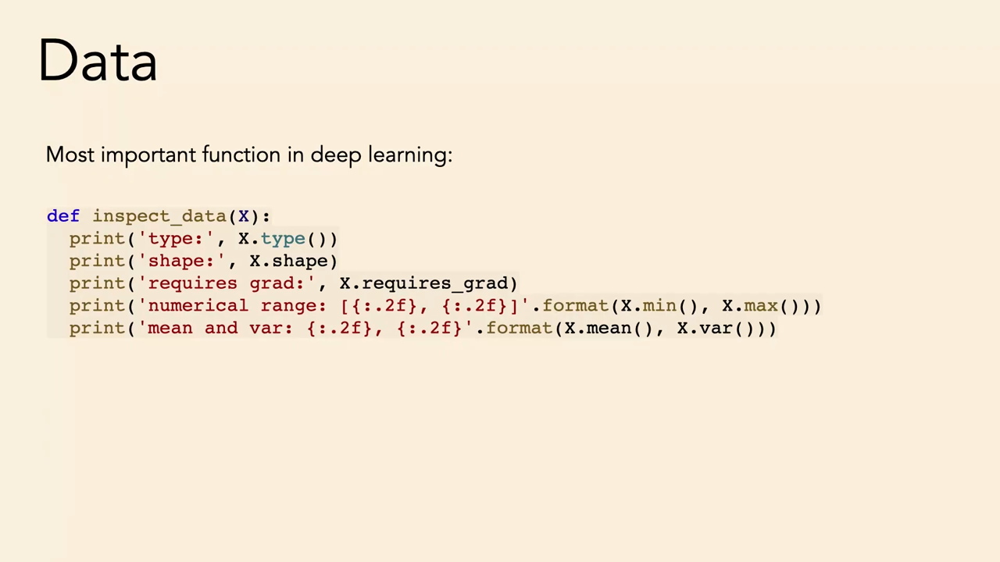
*▲ 강의 슬라이드 [15:40](https://youtu.be/DC2Hw9DiLCg?t=940): "딥러닝에서 가장 중요한 함수" inspect_data. [자료형](00_%EB%94%A5%EB%9F%AC%EB%8B%9D_%EC%9A%A9%EC%96%B4%EC%82%AC%EC%A0%84.md#dtype-data-type-%EC%9E%90%EB%A3%8C%ED%98%95), 모양, [기울기](00_%EB%94%A5%EB%9F%AC%EB%8B%9D_%EC%9A%A9%EC%96%B4%EC%82%AC%EC%A0%84.md#gradient-%EA%B8%B0%EC%9A%B8%EA%B8%B0) 필요 여부, 범위, 평균과 [분산](00_%EB%94%A5%EB%9F%AC%EB%8B%9D_%EC%9A%A9%EC%96%B4%EC%82%AC%EC%A0%84.md#variance-%EB%B6%84%EC%82%B0)을 출력한다*

강사는 농담 반으로 이 함수를 "딥러닝에서 가장 중요한 함수"라고 부르며 코드 곳곳에 뿌려 둔다고 한다. 확인할 것은 다섯 가지다.

1. **[자료형](00_%EB%94%A5%EB%9F%AC%EB%8B%9D_%EC%9A%A9%EC%96%B4%EC%82%AC%EC%A0%84.md#dtype-data-type-%EC%9E%90%EB%A3%8C%ED%98%95)**: float32 텐서인가, uint8인가?
2. **모양(shape)**: 딥러닝에서 [텐서](00_%EB%94%A5%EB%9F%AC%EB%8B%9D_%EC%9A%A9%EC%96%B4%EC%82%AC%EC%A0%84.md#tensor-%ED%85%90%EC%84%9C) 모양은 결정적으로 중요하다.
3. **requires_grad**: 학습할 [파라미터](00_%EB%94%A5%EB%9F%AC%EB%8B%9D_%EC%9A%A9%EC%96%B4%EC%82%AC%EC%A0%84.md#parameter-%ED%8C%8C%EB%9D%BC%EB%AF%B8%ED%84%B0)는 `requires_grad=True`여야 [기울기](00_%EB%94%A5%EB%9F%AC%EB%8B%9D_%EC%9A%A9%EC%96%B4%EC%82%AC%EC%A0%84.md#gradient-%EA%B8%B0%EC%9A%B8%EA%B8%B0)를 받는다.
4. **최솟값과 최댓값**
5. **평균과 [분산](00_%EB%94%A5%EB%9F%AC%EB%8B%9D_%EC%9A%A9%EC%96%B4%EC%82%AC%EC%A0%84.md#variance-%EB%B6%84%EC%82%B0)**

아래는 슬라이드의 함수를 그대로 쓰고, 0~255 픽셀을 255로 나누기 전과 후에 검사한 예다.

```python
# [함수] import torch: PyTorch 라이브러리를 불러온다 (텐서와 자동 미분)
import torch
# [함수] def inspect_data(X): 텐서 X의 핵심 정보 다섯 가지를 출력하는 함수 (강의 슬라이드 그대로)
# [연결] 3.2절 목록 1~5
def inspect_data(X):
    # [함수] X.type(): 자료형 이름 (예: torch.FloatTensor는 32비트 실수)
    print('type:', X.type())
    # [함수] X.shape: 각 차원의 크기
    print('shape:', X.shape)
    # [함수] X.requires_grad: 이 텐서로 기울기를 계산하는지 (학습할 파라미터면 True여야 함)
    print('requires grad:', X.requires_grad)
    # [함수] X.min(), X.max(): 값의 범위. 0~255인지 0~1인지 여기서 드러난다
    print('numerical range: [{:.2f}, {:.2f}]'.format(X.min(), X.max()))
    # [함수] X.mean(), X.var(): 평균과 분산. 표준화가 됐는지(0, 1 근처) 확인한다
    print('mean and var: {:.2f}, {:.2f}'.format(X.mean(), X.var()))
# [변수] img: 디스크에서 읽은 것처럼 uint8(0~255)로 된 2×3 픽셀
img = torch.tensor([[0, 128, 255], [37, 200, 90]], dtype=torch.uint8)
# [함수] img.float(): 실수로만 바꾼다. 범위는 여전히 0~255
# [연결] 출력 앞 다섯 줄: 범위 [0, 255]. "0~1이겠지" 하고 자르면 3.1절의 버그가 된다
inspect_data(img.float())
# [함수] / 255: 최소-최대 정규화 (MM33). 범위가 [0, 1]이 된다
# [연결] 출력 뒤 다섯 줄
inspect_data(img.float() / 255)
```

**실행 결과**:

```text
type: torch.FloatTensor
shape: torch.Size([2, 3])
requires grad: False
numerical range: [0.00, 255.00]
mean and var: 118.33, 9372.27
type: torch.FloatTensor
shape: torch.Size([2, 3])
requires grad: False
numerical range: [0.00, 1.00]
mean and var: 0.46, 0.14
```

- uint8 [텐서](00_%EB%94%A5%EB%9F%AC%EB%8B%9D_%EC%9A%A9%EC%96%B4%EC%82%AC%EC%A0%84.md#tensor-%ED%85%90%EC%84%9C)에 바로 `X.mean()`을 부르면 [PyTorch](00_%EB%94%A5%EB%9F%AC%EB%8B%9D_%EC%9A%A9%EC%96%B4%EC%82%AC%EC%A0%84.md#pytorch-%ED%8C%8C%EC%9D%B4%ED%86%A0%EC%B9%98)는 오류를 낸다(정수 [텐서](00_%EB%94%A5%EB%9F%AC%EB%8B%9D_%EC%9A%A9%EC%96%B4%EC%82%AC%EC%A0%84.md#tensor-%ED%85%90%EC%84%9C)의 평균은 정의되지 않음). 이 오류도 "[자료형](00_%EB%94%A5%EB%9F%AC%EB%8B%9D_%EC%9A%A9%EC%96%B4%EC%82%AC%EC%A0%84.md#dtype-data-type-%EC%9E%90%EB%A3%8C%ED%98%95)이 생각과 다르다"는 신호다.

---

## 4. 표준화

▶ 영상 [15:51](https://youtu.be/DC2Hw9DiLCg?t=951)

📐 **수학 개념**: [표준화와 최소-최대 정규화](%EC%88%98%ED%95%99%EA%B0%9C%EB%85%90/05_%EC%8B%A0%EA%B2%BD%EB%A7%9D%EC%9D%98_%EA%B3%84%EC%82%B0/MM33_%ED%91%9C%EC%A4%80%ED%99%94%EC%99%80_%EC%B5%9C%EC%86%8C%EC%B5%9C%EB%8C%80_%EC%A0%95%EA%B7%9C%ED%99%94.md) · [평균](%EC%88%98%ED%95%99%EA%B0%9C%EB%85%90/01_%EC%88%98%EC%99%80_%ED%95%A8%EC%88%98/M02_%EC%8B%9C%EA%B7%B8%EB%A7%88%EC%99%80_%ED%8F%89%EA%B7%A0.md)

데이터의 단위에 대한 의존을 없애는 가장 흔한 방법은 **[표준화](00_%EB%94%A5%EB%9F%AC%EB%8B%9D_%EC%9A%A9%EC%96%B4%EC%82%AC%EC%A0%84.md#standardization-%ED%91%9C%EC%A4%80%ED%99%94)([Standardization](00_%EB%94%A5%EB%9F%AC%EB%8B%9D_%EC%9A%A9%EC%96%B4%EC%82%AC%EC%A0%84.md#standardization-%ED%91%9C%EC%A4%80%ED%99%94))** 다. 각 차원에서 평균을 빼고 표준편차로 나눈다(강의에서는 "[분산](00_%EB%94%A5%EB%9F%AC%EB%8B%9D_%EC%9A%A9%EC%96%B4%EC%82%AC%EC%A0%84.md#variance-%EB%B6%84%EC%82%B0)으로 나눈다"고 말했지만, 슬라이드 식처럼 [분산](00_%EB%94%A5%EB%9F%AC%EB%8B%9D_%EC%9A%A9%EC%96%B4%EC%82%AC%EC%A0%84.md#variance-%EB%B6%84%EC%82%B0)의 제곱근인 표준편차로 나눈다).

$$
x_k \leftarrow \frac{x_k - \mathbb{E}[x_k]}{\sqrt{\mathrm{Var}[x_k]}} \quad \forall k
$$

<details><summary>기호 풀이</summary>

| 기호 | 읽는 법 | 뜻 | 예제 값 |
| --- | --- | --- | --- |
| $x_k$ | 엑스 케이 | 데이터의 k번째 차원 값 | 6 |
| $\mathbb{E}[x_k]$ | [기댓값](00_%EB%94%A5%EB%9F%AC%EB%8B%9D_%EC%9A%A9%EC%96%B4%EC%82%AC%EC%A0%84.md#expectation-%EA%B8%B0%EB%8C%93%EA%B0%92) | 그 차원의 평균 | 4 |
| $\mathrm{Var}[x_k]$ | [분산](00_%EB%94%A5%EB%9F%AC%EB%8B%9D_%EC%9A%A9%EC%96%B4%EC%82%AC%EC%A0%84.md#variance-%EB%B6%84%EC%82%B0) | 평균과의 차이 제곱의 평균 | 2.6667 |
| $\sqrt{\cdot}$ | 루트 | 제곱근. [분산](00_%EB%94%A5%EB%9F%AC%EB%8B%9D_%EC%9A%A9%EC%96%B4%EC%82%AC%EC%A0%84.md#variance-%EB%B6%84%EC%82%B0)의 제곱근 = 표준편차 | 1.633 |
| $\forall k$ | 모든 케이 | 모든 차원에 각각 따로 한다 | |

</details>

<details><summary>예제와 풀이</summary>

**문제**: 어떤 특징의 값이 (2, 4, 6)이다. 6을 표준화하면?

**주어진 값**:
- $x_k = 6$ (표준화할 값)
- $\mathbb{E}[x_k] = 4$ (평균: (2 + 4 + 6) / 3)
- $\mathrm{Var}[x_k] = 2.6667$ (차이 -2, 0, 2의 제곱 4, 0, 4의 평균 8/3)

**풀이**
1. 식을 그대로 쓴다: $x_k \leftarrow \dfrac{x_k - \mathbb{E}[x_k]}{\sqrt{\mathrm{Var}[x_k]}}$
2. 값을 대입한다: $\dfrac{6 - 4}{\sqrt{2.6667}}$
3. 분자를 계산한다: 6 - 4 = 2
4. 분모를 계산한다. √는 제곱해서 그 수가 되는 양수다: √2.6667 = 1.633
5. 나눈다: 2 / 1.633 = 1.2247

**답**: 1.2247

</details>

<details><summary>내 이해</summary>


</details>

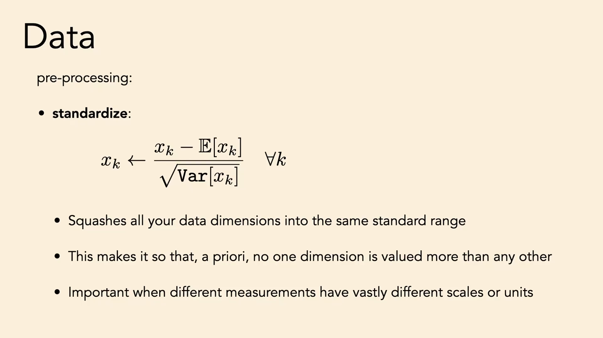
*▲ 강의 슬라이드 [18:30](https://youtu.be/DC2Hw9DiLCg?t=1110): [표준화](00_%EB%94%A5%EB%9F%AC%EB%8B%9D_%EC%9A%A9%EC%96%B4%EC%82%AC%EC%A0%84.md#standardization-%ED%91%9C%EC%A4%80%ED%99%94). 모든 차원을 같은 표준 범위로 눌러 담고, 어느 차원도 미리 더 중요하게 취급하지 않는다*

- 미터로 재든 센티미터로 재든 결과가 같아진다. 평균 0, [분산](00_%EB%94%A5%EB%9F%AC%EB%8B%9D_%EC%9A%A9%EC%96%B4%EC%82%AC%EC%A0%84.md#variance-%EB%B6%84%EC%82%B0) 1이 된다.
- 학생 질문: 최소-최대 [정규화](00_%EB%94%A5%EB%9F%AC%EB%8B%9D_%EC%9A%A9%EC%96%B4%EC%82%AC%EC%A0%84.md#normalization-%EC%A0%95%EA%B7%9C%ED%99%94)(최솟값을 빼고 범위로 나눠 0~1로 만들기)보다 나은가? 꼭 그렇지는 않다. 둘 다 흔하고, 목적은 "단위나 평균 같은 정보를 지우는 것"으로 같다.
- 이 변환은 "어느 차원도 미리 더 중요하지 않다"는 [귀납 편향](00_%EB%94%A5%EB%9F%AC%EB%8B%9D_%EC%9A%A9%EC%96%B4%EC%82%AC%EC%A0%84.md#inductive-bias-%EA%B7%80%EB%82%A9-%ED%8E%B8%ED%96%A5)을 넣는다. 나쁠 때도 있다. 학생의 예처럼 가로·세로 거리가 **같은 물리량**인데 가로 분포만 좁다고 따로 늘리면 공간을 다르게 재는 셈이 된다.
- 그래도 일반적으로는 좋은 습관이다. 특히 어떤 특징이 다른 특징보다 1000만 배 크면, 작은 특징에 대한 [기울기](00_%EB%94%A5%EB%9F%AC%EB%8B%9D_%EC%9A%A9%EC%96%B4%EC%82%AC%EC%A0%84.md#gradient-%EA%B8%B0%EC%9A%B8%EA%B8%B0)가 상대적으로 너무 작아 망이 그 특징을 배우기 어렵다.

---

## 5. 저차원을 조심하라

▶ 영상 [19:53](https://youtu.be/DC2Hw9DiLCg?t=1193)

📐 **수학 개념**: [층 정규화](%EC%88%98%ED%95%99%EA%B0%9C%EB%85%90/05_%EC%8B%A0%EA%B2%BD%EB%A7%9D%EC%9D%98_%EA%B3%84%EC%82%B0/MM32_%EC%B8%B5_%EC%A0%95%EA%B7%9C%ED%99%94.md) · [차원의 저주](%EC%88%98%ED%95%99%EA%B0%9C%EB%85%90/06_%EA%B7%BC%EC%82%AC_%EC%9D%B4%EB%A1%A0/MM12_%EC%A7%81%EC%82%AC%EA%B0%81%ED%98%95_%EA%B7%BC%EC%82%AC%EC%99%80_%EC%B0%A8%EC%9B%90%EC%9D%98_%EC%A0%80%EC%A3%BC.md) · [RMS 노름](%EC%88%98%ED%95%99%EA%B0%9C%EB%85%90/03_%EC%84%A0%ED%98%95%EB%8C%80%EC%88%98/MM11_%EB%A6%BD%EC%8B%9C%EC%B8%A0_%EC%97%B0%EC%86%8D%EA%B3%BC_%EB%85%B8%EB%A6%84.md)

### 5.1 RMS 정규화와 층 정규화

▶ 영상 [21:02](https://youtu.be/DC2Hw9DiLCg?t=1262)

- 흔히 "고차원은 직관과 달라 이상하다"고 배운다. 고차원 가우스 분포는 **비눗방울**처럼 거의 모든 [확률](00_%EB%94%A5%EB%9F%AC%EB%8B%9D_%EC%9A%A9%EC%96%B4%EC%82%AC%EC%A0%84.md#probability-%ED%99%95%EB%A5%A0)이 구 껍질 근처에 있다. 그러나 강사는 거꾸로 말한다. 사람이 3차원에 익숙해서 그렇지, 수학적으로는 **고차원이 단순하고 저차원이 이상하다**. 딥러닝은 고차원에서 생각하는 데 익숙해지는 일이다.
- 예: [RMS 정규화](00_%EB%94%A5%EB%9F%AC%EB%8B%9D_%EC%9A%A9%EC%96%B4%EC%82%AC%EC%A0%84.md#rmsnorm-rms-%EC%A0%95%EA%B7%9C%ED%99%94)([RMSNorm](00_%EB%94%A5%EB%9F%AC%EB%8B%9D_%EC%9A%A9%EC%96%B4%EC%82%AC%EC%A0%84.md#rmsnorm-rms-%EC%A0%95%EA%B7%9C%ED%99%94))와 [층 정규화](00_%EB%94%A5%EB%9F%AC%EB%8B%9D_%EC%9A%A9%EC%96%B4%EC%82%AC%EC%A0%84.md#layer-normalization-%EC%B8%B5-%EC%A0%95%EA%B7%9C%ED%99%94)(Layer normalization, [트랜스포머](00_%EB%94%A5%EB%9F%AC%EB%8B%9D_%EC%9A%A9%EC%96%B4%EC%82%AC%EC%A0%84.md#transformer-%ED%8A%B8%EB%9E%9C%EC%8A%A4%ED%8F%AC%EB%A8%B8)의 표준 [층](00_%EB%94%A5%EB%9F%AC%EB%8B%9D_%EC%9A%A9%EC%96%B4%EC%82%AC%EC%A0%84.md#layer-%EC%B8%B5))는 고차원에서는 거의 똑같이 행동한다. 차이는 [층 정규화](00_%EB%94%A5%EB%9F%AC%EB%8B%9D_%EC%9A%A9%EC%96%B4%EC%82%AC%EC%A0%84.md#layer-normalization-%EC%B8%B5-%EC%A0%95%EA%B7%9C%ED%99%94)가 먼저 벡터의 평균을 뺀다는 것뿐이다.

$$
\begin{aligned}
x[k] &= x_{\text{in}}[k] - \frac{1}{K}\sum_{k'} x_{\text{in}}[k'] \\
x_{\text{out}} &= \text{RMS-norm}(x) = \frac{x}{\sqrt{\frac{1}{K}\sum_{k'} x[k']^2}}
\end{aligned}
$$

<details><summary>기호 풀이</summary>

| 기호 | 읽는 법 | 뜻 | 예제 값 |
| --- | --- | --- | --- |
| $x_{\text{in}}$ | 엑스 인 | [정규화](00_%EB%94%A5%EB%9F%AC%EB%8B%9D_%EC%9A%A9%EC%96%B4%EC%82%AC%EC%A0%84.md#normalization-%EC%A0%95%EA%B7%9C%ED%99%94) [층](00_%EB%94%A5%EB%9F%AC%EB%8B%9D_%EC%9A%A9%EC%96%B4%EC%82%AC%EC%A0%84.md#layer-%EC%B8%B5)에 들어오는 벡터 | (3, 4) |
| $x_{\text{in}}[k]$ | 엑스 인 케이 | 그 벡터의 k번째 원소 | 3 |
| $K$ | 케이 | 벡터의 차원 (슬라이드는 같은 글자를 씀) | 2 |
| $\frac1K\sum_{k'} x_{\text{in}}[k']$ | 평균 | 벡터 원소의 평균 | 3.5 |
| $x[k]$ | 엑스 케이 | 평균을 뺀 값 ([층 정규화](00_%EB%94%A5%EB%9F%AC%EB%8B%9D_%EC%9A%A9%EC%96%B4%EC%82%AC%EC%A0%84.md#layer-normalization-%EC%B8%B5-%EC%A0%95%EA%B7%9C%ED%99%94)의 첫 단계) | -0.5 |
| $\text{RMS-norm}(x)$ | [RMS 정규화](00_%EB%94%A5%EB%9F%AC%EB%8B%9D_%EC%9A%A9%EC%96%B4%EC%82%AC%EC%A0%84.md#rmsnorm-rms-%EC%A0%95%EA%B7%9C%ED%99%94) | 제곱 평균의 제곱근으로 나누기 | |
| $x_{\text{out}}$ | 엑스 아웃 | [층](00_%EB%94%A5%EB%9F%AC%EB%8B%9D_%EC%9A%A9%EC%96%B4%EC%82%AC%EC%A0%84.md#layer-%EC%B8%B5)의 출력 | (-1, 1) |

</details>

<details><summary>예제와 풀이</summary>

**문제**: $x_{\text{in}} = (3, 4)$를 [층 정규화](00_%EB%94%A5%EB%9F%AC%EB%8B%9D_%EC%9A%A9%EC%96%B4%EC%82%AC%EC%A0%84.md#layer-normalization-%EC%B8%B5-%EC%A0%95%EA%B7%9C%ED%99%94)(평균 빼기 → [RMS 정규화](00_%EB%94%A5%EB%9F%AC%EB%8B%9D_%EC%9A%A9%EC%96%B4%EC%82%AC%EC%A0%84.md#rmsnorm-rms-%EC%A0%95%EA%B7%9C%ED%99%94))하면?

**주어진 값**:
- $x_{\text{in}}[1] = 3$, $x_{\text{in}}[2] = 4$ (입력 원소)
- $K = 2$ (차원)

**풀이**
1. 식을 그대로 쓴다 (첫 줄): $x[k] = x_{\text{in}}[k] - \frac{1}{K}\big(x_{\text{in}}[1] + x_{\text{in}}[2]\big)$
2. 값을 대입한다: $x = \big(3 - \frac{1}{2}(3 + 4),\ 4 - \frac{1}{2}(3 + 4)\big)$
3. 괄호 안 덧셈을 먼저 한다: $3 + 4 = 7$ 이므로 $x = \big(3 - \frac{7}{2},\ 4 - \frac{7}{2}\big)$
4. 2로 나눠 평균을 구한다: $7 / 2 = 3.5$ 이므로 $x = (3 - 3.5,\ 4 - 3.5)$
5. 뺄셈을 한다: $x = (-0.5,\ 0.5)$
6. 식을 그대로 쓴다 (둘째 줄): $x_{\text{out}} = x \Big/ \sqrt{\frac{1}{K}\big(x[1]^2 + x[2]^2\big)}$
7. 값을 대입한다: $x_{\text{out}} = (-0.5,\ 0.5) \Big/ \sqrt{\frac{1}{2}\big((-0.5)^2 + 0.5^2\big)}$
8. 제곱을 먼저 한다: $(-0.5)^2 = 0.25$, $0.5^2 = 0.25$ 이므로 $\sqrt{\frac12 (0.25 + 0.25)}$
9. 더하고 2로 나눈다: $0.5 / 2 = 0.25$ 이므로 $\sqrt{0.25}$
10. 제곱근을 구한다. √는 "제곱해서 그 수가 되는 양수"다: $0.5 × 0.5 = 0.25$ 이므로 $\sqrt{0.25} = 0.5$
11. 각 원소를 0.5로 나눈다: $-0.5 / 0.5 = -1$, $0.5 / 0.5 = 1$

**답**: $x_{\text{out}} = (-1, 1)$. 평균을 빼지 않는 RMS 정규화라면 (0.8485, 1.1314)다.

</details>

<details><summary>내 이해</summary>


</details>

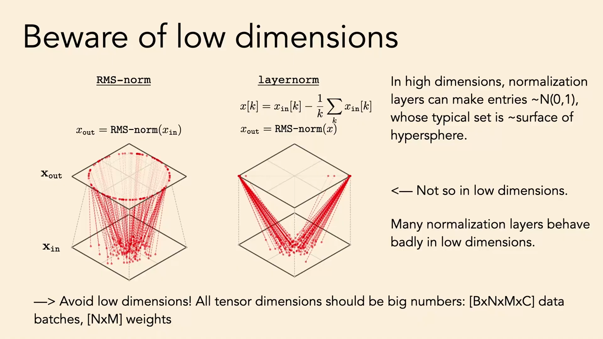
*▲ 강의 슬라이드 [23:57](https://youtu.be/DC2Hw9DiLCg?t=1437): 낮은 차원을 조심하라. 2차원 입력에 [RMS 정규화](00_%EB%94%A5%EB%9F%AC%EB%8B%9D_%EC%9A%A9%EC%96%B4%EC%82%AC%EC%A0%84.md#rmsnorm-rms-%EC%A0%95%EA%B7%9C%ED%99%94)를 하면 원 위로, [층 정규화](00_%EB%94%A5%EB%9F%AC%EB%8B%9D_%EC%9A%A9%EC%96%B4%EC%82%AC%EC%A0%84.md#layer-normalization-%EC%B8%B5-%EC%A0%95%EA%B7%9C%ED%99%94)를 하면 점 두 개로 간다. 모든 [텐서](00_%EB%94%A5%EB%9F%AC%EB%8B%9D_%EC%9A%A9%EC%96%B4%EC%82%AC%EC%A0%84.md#tensor-%ED%85%90%EC%84%9C) 차원은 큰 수여야 한다*

- 2차원에서 평균을 빼면 자유도 하나를 잃고, 크기를 맞추면 또 하나를 잃는다. 그래서 [층 정규화](00_%EB%94%A5%EB%9F%AC%EB%8B%9D_%EC%9A%A9%EC%96%B4%EC%82%AC%EC%A0%84.md#layer-normalization-%EC%B8%B5-%EC%A0%95%EA%B7%9C%ED%99%94)의 출력은 1차원 곡선(원)도 아닌 **점 두 개**, (1, -1)과 (-1, 1)뿐이다.

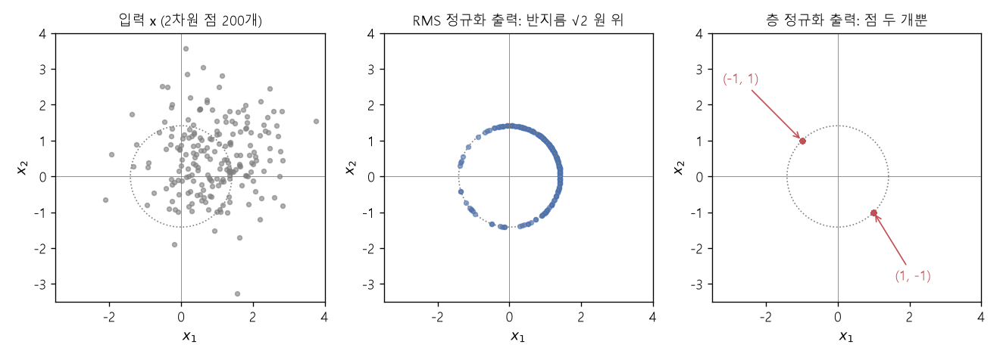
*▲ 직접 그린 그림: 2차원 점 200개(왼쪽)에 [RMS 정규화](00_%EB%94%A5%EB%9F%AC%EB%8B%9D_%EC%9A%A9%EC%96%B4%EC%82%AC%EC%A0%84.md#rmsnorm-rms-%EC%A0%95%EA%B7%9C%ED%99%94)를 하면 반지름 √2 원 위로(가운데), [층 정규화](00_%EB%94%A5%EB%9F%AC%EB%8B%9D_%EC%9A%A9%EC%96%B4%EC%82%AC%EC%A0%84.md#layer-normalization-%EC%B8%B5-%EC%A0%95%EA%B7%9C%ED%99%94)를 하면 두 점으로(오른쪽) 간다. 1000차원에서는 두 [층](00_%EB%94%A5%EB%9F%AC%EB%8B%9D_%EC%9A%A9%EC%96%B4%EC%82%AC%EC%A0%84.md#layer-%EC%B8%B5) 출력의 [코사인 유사도](00_%EB%94%A5%EB%9F%AC%EB%8B%9D_%EC%9A%A9%EC%96%B4%EC%82%AC%EC%A0%84.md#cosine-similarity-%EC%BD%94%EC%82%AC%EC%9D%B8-%EC%9C%A0%EC%82%AC%EB%8F%84)가 0.9995로 거의 같다 (숫자는 아래 코드)*

차원을 키우면 두 [층](00_%EB%94%A5%EB%9F%AC%EB%8B%9D_%EC%9A%A9%EC%96%B4%EC%82%AC%EC%A0%84.md#layer-%EC%B8%B5)이 같아지고, 점들이 구 껍질에 모인다(아래 코드, 표준 [정규분포](00_%EB%94%A5%EB%9F%AC%EB%8B%9D_%EC%9A%A9%EC%96%B4%EC%82%AC%EC%A0%84.md#normal-distribution-%EC%A0%95%EA%B7%9C%EB%B6%84%ED%8F%AC) 벡터).

| 차원 d | 2 | 3 | 10 | 100 | 1000 |
|---|---|---|---|---|---|
| [층 정규화](00_%EB%94%A5%EB%9F%AC%EB%8B%9D_%EC%9A%A9%EC%96%B4%EC%82%AC%EC%A0%84.md#layer-normalization-%EC%B8%B5-%EC%A0%95%EA%B7%9C%ED%99%94)와 [RMS 정규화](00_%EB%94%A5%EB%9F%AC%EB%8B%9D_%EC%9A%A9%EC%96%B4%EC%82%AC%EC%A0%84.md#rmsnorm-rms-%EC%A0%95%EA%B7%9C%ED%99%94) 출력의 [코사인 유사도](00_%EB%94%A5%EB%9F%AC%EB%8B%9D_%EC%9A%A9%EC%96%B4%EC%82%AC%EC%A0%84.md#cosine-similarity-%EC%BD%94%EC%82%AC%EC%9D%B8-%EC%9C%A0%EC%82%AC%EB%8F%84) 평균 (1000개) | 0.6392 | 0.7815 | 0.9458 | 0.9946 | 0.9995 |

- [코사인 유사도](00_%EB%94%A5%EB%9F%AC%EB%8B%9D_%EC%9A%A9%EC%96%B4%EC%82%AC%EC%A0%84.md#cosine-similarity-%EC%BD%94%EC%82%AC%EC%9D%B8-%EC%9C%A0%EC%82%AC%EB%8F%84)는 두 벡터의 방향이 같은 정도(같으면 1)다. 고차원 벡터의 원소 평균은 0에 아주 가까워 "평균 빼기"가 거의 아무것도 바꾸지 않는다.
- **비눗방울**: 벡터 길이를 $\sqrt d$로 나눈 값의 표준편차가 d = 2에서 0.4581, d = 1000에서 0.0225다. 1000차원 점은 거의 모두 반지름 $\sqrt d$ 구의 껍질 근처에 있다.
- 강의 슬라이드는 [RMS 정규화](00_%EB%94%A5%EB%9F%AC%EB%8B%9D_%EC%9A%A9%EC%96%B4%EC%82%AC%EC%A0%84.md#rmsnorm-rms-%EC%A0%95%EA%B7%9C%ED%99%94)가 점을 "단위 [초구](00_%EB%94%A5%EB%9F%AC%EB%8B%9D_%EC%9A%A9%EC%96%B4%EC%82%AC%EC%A0%84.md#hypersphere-%EC%B4%88%EA%B5%AC)"로 보낸다고 하지만, RMS로 나누면 유클리드 반지름은 $\sqrt d$(RMS 기준으로는 1)다. 어느 [노름](00_%EB%94%A5%EB%9F%AC%EB%8B%9D_%EC%9A%A9%EC%96%B4%EC%82%AC%EC%A0%84.md#norm-%EB%85%B8%EB%A6%84)으로 재는지의 차이다.

```python
# [함수] import numpy as np: 배열 계산 라이브러리 numpy를 np라는 이름으로 불러온다
import numpy as np
# [함수] def rms(v): RMS 정규화. 원소 제곱 평균의 제곱근으로 나눈다
# [연결] 5.1절 식의 둘째 줄
def rms(v):
    # [변수] 반환값: RMS가 1인 벡터
    return v / np.sqrt((v ** 2).mean())
# [함수] def ln(v): 층 정규화. 평균을 뺀 뒤 RMS 정규화
# [연결] 5.1절 식의 첫 줄 + 둘째 줄
def ln(v):
    # [변수] 반환값: 평균 0, RMS 1인 벡터
    return rms(v - v.mean())
# [연결] 출력 1행: 2차원 층 정규화는 (-1, 1) 또는 (1, -1)뿐, (3, 4)의 RMS 정규화는 (0.8485, 1.1314)
print(ln(np.array([3, 4.0])), ln(np.array([10, 2.0])), np.round(rms(np.array([3, 4.0])), 4))
# [변수] rng: 시드 0으로 고정한 난수 생성기 (본문 표 숫자를 재현하려고)
rng = np.random.default_rng(0)
# [함수] for d in ...: 차원을 바꿔 가며 두 층 출력의 방향을 비교한다
for d in [2, 3, 10, 100, 1000]:
    # [변수] cs: 벡터 1000개 각각의 코사인 유사도를 모을 목록
    cs = []
    # [함수] range(1000): 1000번 반복
    for _ in range(1000):
        # [변수] v: d차원 표준 정규분포 벡터, a와 b: 층 정규화 출력과 RMS 정규화 출력
        v = rng.standard_normal(d)
        a, b = ln(v), rms(v)
        # [함수] a @ b / (|a||b|): 코사인 유사도 (방향이 같으면 1)
        cs.append(a @ b / np.linalg.norm(a) / np.linalg.norm(b))
    # [연결] 출력 한 줄이 위 표의 한 칸
    print(d, np.round(np.mean(cs), 4))
# [변수] rng: 비눗방울 실험을 위해 시드를 다시 0으로
rng = np.random.default_rng(0)
# [함수] for d in [2, 1000]: 낮은 차원과 높은 차원 비교
for d in [2, 1000]:
    # [변수] n: 벡터 10000개의 길이 / √d. 고차원이면 1 근처에 모인다
    n = np.linalg.norm(rng.standard_normal((10000, d)), axis=1) / np.sqrt(d)
    # [연결] "비눗방울" 줄: 평균과 표준편차
    print(d, np.round(n.mean(), 4), np.round(n.std(), 4))
# [변수] b1: 특징 하나의 배치 크기 1 값 [3]
b1 = np.array([3.0])
# [함수] (b - 배치 평균) / √(배치 분산 + ε): 배치 정규화. ε = 1e-5는 0으로 나누기 방지
# [연결] 5.2절: 배치 크기 1이면 입력이 무엇이든 0
print((b1 - b1.mean()) / np.sqrt(b1.var() + 1e-5))
```

**실행 결과**:

```text
[-1.  1.] [ 1. -1.] [0.8485 1.1314]
2 0.6392
3 0.7815
10 0.9458
100 0.9946
1000 0.9995
2 0.8845 0.4581
1000 0.9993 0.0225
[0.]
```

### 5.2 배치 크기 1의 배치 정규화

▶ 영상 [23:12](https://youtu.be/DC2Hw9DiLCg?t=1392)

- 같은 이유로 **[배치 정규화](00_%EB%94%A5%EB%9F%AC%EB%8B%9D_%EC%9A%A9%EC%96%B4%EC%82%AC%EC%A0%84.md#batch-normalization-%EB%B0%B0%EC%B9%98-%EC%A0%95%EA%B7%9C%ED%99%94)는 배치 크기가 작으면**, [층 정규화](00_%EB%94%A5%EB%9F%AC%EB%8B%9D_%EC%9A%A9%EC%96%B4%EC%82%AC%EC%A0%84.md#layer-normalization-%EC%B8%B5-%EC%A0%95%EA%B7%9C%ED%99%94)는 [층](00_%EB%94%A5%EB%9F%AC%EB%8B%9D_%EC%9A%A9%EC%96%B4%EC%82%AC%EC%A0%84.md#layer-%EC%B8%B5) 차원이 작으면 제대로 작동하지 않거나 이상하게 작동한다.
- 강사가 참여한 가장 유명한 연구 Pix2Pix의 첫 코드 공개판에는 비교 대상(baseline) 하나에 **배치 크기 1의 [배치 정규화](00_%EB%94%A5%EB%9F%AC%EB%8B%9D_%EC%9A%A9%EC%96%B4%EC%82%AC%EC%A0%84.md#batch-normalization-%EB%B0%B0%EC%B9%98-%EC%A0%95%EA%B7%9C%ED%99%94)**가 들어 있었다. 데이터 하나에서 그 하나의 평균을 빼면 0이다. 그래서 그 비교 대상은 쉽게 이겨졌다. 나중에 고쳤고 고친 뒤에도 이겼지만, 한동안 버그가 공개된 채였다.

### 5.3 모든 차원을 크게

▶ 영상 [23:42](https://youtu.be/DC2Hw9DiLCg?t=1422)

- 데이터 [텐서](00_%EB%94%A5%EB%9F%AC%EB%8B%9D_%EC%9A%A9%EC%96%B4%EC%82%AC%EC%A0%84.md#tensor-%ED%85%90%EC%84%9C) [B × N × M × C], [가중치](00_%EB%94%A5%EB%9F%AC%EB%8B%9D_%EC%9A%A9%EC%96%B4%EC%82%AC%EC%A0%84.md#weight-%EA%B0%80%EC%A4%91%EC%B9%98) [N × M]의 **모든 차원을 크게** 잡아라.
- 학생 질문 "크다는 게 얼마냐"에 대한 답: 경험칙으로 **10 이상**, 그리고 클수록 좋다. 딥러닝은 열역학과 비슷하다. 분자 3개(삼체 문제)는 풀기 어렵지만 원자 10억 개의 온도는 쉽게 말할 수 있다. 큰 수의 법칙 덕분에 점근적으로는 모든 것이 단순해진다.
- 대가는 돈, 시간, 에너지다. 그래도 통계와 추론과 예측에는 **클수록 좋다**.

> [!TIP]
> **🆕 2026 업데이트: [정규화](00_%EB%94%A5%EB%9F%AC%EB%8B%9D_%EC%9A%A9%EC%96%B4%EC%82%AC%EC%A0%84.md#normalization-%EC%A0%95%EA%B7%9C%ED%99%94) [층](00_%EB%94%A5%EB%9F%AC%EB%8B%9D_%EC%9A%A9%EC%96%B4%EC%82%AC%EC%A0%84.md#layer-%EC%B8%B5)의 현재**
> - **강의**: [배치 정규화](00_%EB%94%A5%EB%9F%AC%EB%8B%9D_%EC%9A%A9%EC%96%B4%EC%82%AC%EC%A0%84.md#batch-normalization-%EB%B0%B0%EC%B9%98-%EC%A0%95%EA%B7%9C%ED%99%94)는 버리고 [층 정규화](00_%EB%94%A5%EB%9F%AC%EB%8B%9D_%EC%9A%A9%EC%96%B4%EC%82%AC%EC%A0%84.md#layer-normalization-%EC%B8%B5-%EC%A0%95%EA%B7%9C%ED%99%94)를 써라. [층 정규화](00_%EB%94%A5%EB%9F%AC%EB%8B%9D_%EC%9A%A9%EC%96%B4%EC%82%AC%EC%A0%84.md#layer-normalization-%EC%B8%B5-%EC%A0%95%EA%B7%9C%ED%99%94)가 지금의 표준이다.
> - **현재**: [배치 정규화](00_%EB%94%A5%EB%9F%AC%EB%8B%9D_%EC%9A%A9%EC%96%B4%EC%82%AC%EC%A0%84.md#batch-normalization-%EB%B0%B0%EC%B9%98-%EC%A0%95%EA%B7%9C%ED%99%94)를 피하라는 조언은 그대로 유효하다. 다만 대형 [언어 모델](00_%EB%94%A5%EB%9F%AC%EB%8B%9D_%EC%9A%A9%EC%96%B4%EC%82%AC%EC%A0%84.md#language-model-%EC%96%B8%EC%96%B4-%EB%AA%A8%EB%8D%B8)에서는 평균 빼기를 생략한 **[RMS 정규화](00_%EB%94%A5%EB%9F%AC%EB%8B%9D_%EC%9A%A9%EC%96%B4%EC%82%AC%EC%A0%84.md#rmsnorm-rms-%EC%A0%95%EA%B7%9C%ED%99%94)**가 사실상 표준이 되었다. LLaMA(2023)는 각 하위 [층](00_%EB%94%A5%EB%9F%AC%EB%8B%9D_%EC%9A%A9%EC%96%B4%EC%82%AC%EC%A0%84.md#layer-%EC%B8%B5)의 입력을 [RMSNorm](00_%EB%94%A5%EB%9F%AC%EB%8B%9D_%EC%9A%A9%EC%96%B4%EC%82%AC%EC%A0%84.md#rmsnorm-rms-%EC%A0%95%EA%B7%9C%ED%99%94)으로 정규화하는 사전 [정규화](00_%EB%94%A5%EB%9F%AC%EB%8B%9D_%EC%9A%A9%EC%96%B4%EC%82%AC%EC%A0%84.md#normalization-%EC%A0%95%EA%B7%9C%ED%99%94)(pre-normalization)를 썼고, 이후 공개 [가중치](00_%EB%94%A5%EB%9F%AC%EB%8B%9D_%EC%9A%A9%EC%96%B4%EC%82%AC%EC%A0%84.md#weight-%EA%B0%80%EC%A4%91%EC%B9%98) LLM 대부분이 이를 따른다. 위 5.1절의 결론("고차원에서는 둘이 거의 같다")과 맞아떨어지는 선택이다. 더 나아가 Zhu, Chen, He, LeCun, Liu(CVPR 2025)는 [정규화](00_%EB%94%A5%EB%9F%AC%EB%8B%9D_%EC%9A%A9%EC%96%B4%EC%82%AC%EC%A0%84.md#normalization-%EC%A0%95%EA%B7%9C%ED%99%94) [층](00_%EB%94%A5%EB%9F%AC%EB%8B%9D_%EC%9A%A9%EC%96%B4%EC%82%AC%EC%A0%84.md#layer-%EC%B8%B5)을 원소별 함수 $\tanh(\alpha x)$(Dynamic Tanh, DyT)로 바꿔도 [트랜스포머](00_%EB%94%A5%EB%9F%AC%EB%8B%9D_%EC%9A%A9%EC%96%B4%EC%82%AC%EC%A0%84.md#transformer-%ED%8A%B8%EB%9E%9C%EC%8A%A4%ED%8F%AC%EB%A8%B8)가 대부분 [하이퍼파라미터](00_%EB%94%A5%EB%9F%AC%EB%8B%9D_%EC%9A%A9%EC%96%B4%EC%82%AC%EC%A0%84.md#hyperparameter-%ED%95%98%EC%9D%B4%ED%8D%BC%ED%8C%8C%EB%9D%BC%EB%AF%B8%ED%84%B0) 조정 없이 같거나 더 나은 성능을 낸다고 보고했다. [층 정규화](00_%EB%94%A5%EB%9F%AC%EB%8B%9D_%EC%9A%A9%EC%96%B4%EC%82%AC%EC%A0%84.md#layer-normalization-%EC%B8%B5-%EC%A0%95%EA%B7%9C%ED%99%94)의 입출력이 S자 [tanh](00_%EB%94%A5%EB%9F%AC%EB%8B%9D_%EC%9A%A9%EC%96%B4%EC%82%AC%EC%A0%84.md#tanh-%EC%8C%8D%EA%B3%A1%ED%83%84%EC%A0%A0%ED%8A%B8) 곡선과 비슷하다는 관찰에서 출발했다.
> - **출처**: [Touvron et al., LLaMA: Open and Efficient Foundation Language Models (2023)](https://arxiv.org/abs/2302.13971) · [Zhu et al., Transformers without Normalization (CVPR 2025)](https://arxiv.org/abs/2503.10622)

---

## 6. 텐서 모양과 자료형

### 6.1 서로 다른 크기로 시험하기

▶ 영상 [25:19](https://youtu.be/DC2Hw9DiLCg?t=1519)

- 데이터의 범위와 모양을 알아야 한다. Evan Shelhamer의 요령: 아키텍처를 점검할 때 **모든 차원이 서로 다른 크기**인 [텐서](00_%EB%94%A5%EB%9F%AC%EB%8B%9D_%EC%9A%A9%EC%96%B4%EC%82%AC%EC%A0%84.md#tensor-%ED%85%90%EC%84%9C)로 시험하라.
- 64×64×64×64처럼 같은 숫자로 시험하면 축 순서를 잘못 바꿔도(permute) 모양이 그대로라 오류가 나지 않는다. 차원마다 다른 수(가능하면 공통 약수가 없는 소수)를 쓰면 잘못된 reshape이 **모양 불일치 오류**로 바로 드러난다. 일종의 타입 검사다.

### 6.2 자료형 바꾸기의 함정

▶ 영상 [26:28](https://youtu.be/DC2Hw9DiLCg?t=1588)

📐 **수학 개념**: [표준화와 최소-최대 정규화](%EC%88%98%ED%95%99%EA%B0%9C%EB%85%90/05_%EC%8B%A0%EA%B2%BD%EB%A7%9D%EC%9D%98_%EA%B3%84%EC%82%B0/MM33_%ED%91%9C%EC%A4%80%ED%99%94%EC%99%80_%EC%B5%9C%EC%86%8C%EC%B5%9C%EB%8C%80_%EC%A0%95%EA%B7%9C%ED%99%94.md)

- 메모리를 아끼려고 [텐서](00_%EB%94%A5%EB%9F%AC%EB%8B%9D_%EC%9A%A9%EC%96%B4%EC%82%AC%EC%A0%84.md#tensor-%ED%85%90%EC%84%9C)를 uint8로 바꾸면 **음수를 담을 수 없다**. 바이트에서 -1은 무엇인가? 255다.
- "내 입력은 양수"라는 직관이 남아 있는데 실제로는 [표준화](00_%EB%94%A5%EB%9F%AC%EB%8B%9D_%EC%9A%A9%EC%96%B4%EC%82%AC%EC%A0%84.md#standardization-%ED%91%9C%EC%A4%80%ED%99%94)를 해서 음수가 생겼다면, uint8 변환이 그 음수를 엉뚱한 값으로 바꾼다.

### 6.3 reshape와 einops

▶ 영상 [27:34](https://youtu.be/DC2Hw9DiLCg?t=1654)

- 코드의 절반은 [텐서](00_%EB%94%A5%EB%9F%AC%EB%8B%9D_%EC%9A%A9%EC%96%B4%EC%82%AC%EC%A0%84.md#tensor-%ED%85%90%EC%84%9C) [모양 바꾸기](00_%EB%94%A5%EB%9F%AC%EB%8B%9D_%EC%9A%A9%EC%96%B4%EC%82%AC%EC%A0%84.md#reshape-permute-%EB%AA%A8%EC%96%91-%EB%B0%94%EA%BE%B8%EA%B8%B0%EC%99%80-%EC%B6%95-%EC%88%9C%EC%84%9C-%EB%B0%94%EA%BE%B8%EA%B8%B0)(transpose, permute, reshape, [flatten](00_%EB%94%A5%EB%9F%AC%EB%8B%9D_%EC%9A%A9%EC%96%B4%EC%82%AC%EC%A0%84.md#flatten-%ED%8F%89%ED%83%84%ED%99%94), unflatten, unsqueeze, squeeze)이고, 여기서 버그가 많이 난다.
- 2차원 [텐서](00_%EB%94%A5%EB%9F%AC%EB%8B%9D_%EC%9A%A9%EC%96%B4%EC%82%AC%EC%A0%84.md#tensor-%ED%85%90%EC%84%9C)를 reshape로 펴면 행을 이어 붙이나, 열을 이어 붙이나? 학생의 답대로 [PyTorch](00_%EB%94%A5%EB%9F%AC%EB%8B%9D_%EC%9A%A9%EC%96%B4%EC%82%AC%EC%A0%84.md#pytorch-%ED%8C%8C%EC%9D%B4%ED%86%A0%EC%B9%98)는 **행 우선(row-major)**, 첫 행 다음에 둘째 행을 붙인다. 하지만 이런 규칙을 외우고 싶지 않다.
- 그래서 강사는 **[einops](00_%EB%94%A5%EB%9F%AC%EB%8B%9D_%EC%9A%A9%EC%96%B4%EC%82%AC%EC%A0%84.md#einops-%EC%95%84%EC%9D%B8%EC%98%B5%EC%8A%A4)**를 권한다. 모든 [모양 바꾸기](00_%EB%94%A5%EB%9F%AC%EB%8B%9D_%EC%9A%A9%EC%96%B4%EC%82%AC%EC%A0%84.md#reshape-permute-%EB%AA%A8%EC%96%91-%EB%B0%94%EA%BE%B8%EA%B8%B0%EC%99%80-%EC%B6%95-%EC%88%9C%EC%84%9C-%EB%B0%94%EA%BE%B8%EA%B8%B0)를 `rearrange` 하나와 문자열 표기로 쓴다. 예: `rearrange(ims, 'b h w c -> h (b w) c')`는 4차원 [텐서](00_%EB%94%A5%EB%9F%AC%EB%8B%9D_%EC%9A%A9%EC%96%B4%EC%82%AC%EC%A0%84.md#tensor-%ED%85%90%EC%84%9C)의 b와 w를 한 차원으로 합쳐 [h, b·w, c]인 3차원 [텐서](00_%EB%94%A5%EB%9F%AC%EB%8B%9D_%EC%9A%A9%EC%96%B4%EC%82%AC%EC%A0%84.md#tensor-%ED%85%90%EC%84%9C)로 만든다. 반대 방향 `'h (b w) c -> b h w c'`를 하면 원래대로 돌아온다(서로 역연산).

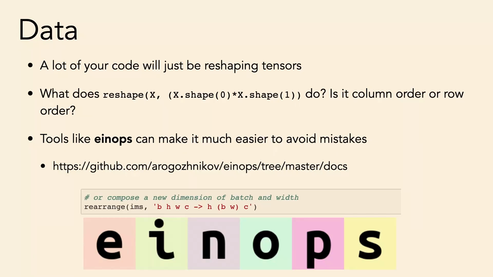
*▲ 강의 슬라이드 [30:00](https://youtu.be/DC2Hw9DiLCg?t=1800): 코드의 상당 부분은 [모양 바꾸기](00_%EB%94%A5%EB%9F%AC%EB%8B%9D_%EC%9A%A9%EC%96%B4%EC%82%AC%EC%A0%84.md#reshape-permute-%EB%AA%A8%EC%96%91-%EB%B0%94%EA%BE%B8%EA%B8%B0%EC%99%80-%EC%B6%95-%EC%88%9C%EC%84%9C-%EB%B0%94%EA%BE%B8%EA%B8%B0)다. reshape는 행 우선인가 열 우선인가? [einops](00_%EB%94%A5%EB%9F%AC%EB%8B%9D_%EC%9A%A9%EC%96%B4%EC%82%AC%EC%A0%84.md#einops-%EC%95%84%EC%9D%B8%EC%98%B5%EC%8A%A4)가 실수를 줄여 준다*

아래는 [einops](00_%EB%94%A5%EB%9F%AC%EB%8B%9D_%EC%9A%A9%EC%96%B4%EC%82%AC%EC%A0%84.md#einops-%EC%95%84%EC%9D%B8%EC%98%B5%EC%8A%A4) 없이 [PyTorch](00_%EB%94%A5%EB%9F%AC%EB%8B%9D_%EC%9A%A9%EC%96%B4%EC%82%AC%EC%A0%84.md#pytorch-%ED%8C%8C%EC%9D%B4%ED%86%A0%EC%B9%98)만으로 같은 변환을 하고 되돌려 보는 예다(이 컴퓨터에는 [einops](00_%EB%94%A5%EB%9F%AC%EB%8B%9D_%EC%9A%A9%EC%96%B4%EC%82%AC%EC%A0%84.md#einops-%EC%95%84%EC%9D%B8%EC%98%B5%EC%8A%A4)가 없어 permute + reshape로 썼다).

```python
# [함수] import torch: PyTorch 라이브러리를 불러온다
import torch
# [변수] A: 0~5를 담은 2×3 행렬 [[0,1,2],[3,4,5]]
A = torch.arange(6).reshape(2, 3)
# [함수] A.reshape(6): 6칸짜리 벡터로 편다. 결과가 0,1,2,3,4,5면 행 우선
# [연결] 6.3절 "행 우선" 질문의 답
print(A.reshape(6))
# [변수] x: 모양 [b, h, w, c] = [2, 3, 4, 5]. 차원마다 다른 크기 (6.1절의 요령)
x = torch.arange(120.0).reshape(2, 3, 4, 5)
# [함수] permute(1, 0, 2, 3): 축 순서를 [h, b, w, c]로 바꾼다
# [함수] reshape(3, 2 * 4, 5): b와 w를 합쳐 [h, b·w, c]로 만든다 = rearrange 'b h w c -> h (b w) c'
# [변수] y: 모양 [3, 8, 5]
y = x.permute(1, 0, 2, 3).reshape(3, 2 * 4, 5)
print(y.shape)
# [함수] reshape(3, 2, 4, 5) → permute(1, 0, 2, 3): 역연산 'h (b w) c -> b h w c'
# [변수] back: 되돌린 텐서
back = y.reshape(3, 2, 4, 5).permute(1, 0, 2, 3)
# [함수] torch.equal: 모든 원소가 같은지. True면 역연산이 맞다
print(torch.equal(back, x))
# [함수] torch.tensor(...).to(torch.uint8): 정수를 uint8로 바꾼다
# [연결] 6.2절: -1은 255가 된다
print(torch.tensor([-1, 0, 200]).to(torch.uint8))
```

**실행 결과**:

```text
tensor([0, 1, 2, 3, 4, 5])
torch.Size([3, 8, 5])
True
tensor([255,   0, 200], dtype=torch.uint8)
```

---

## 7. 데이터 증강과 도메인 무작위화

### 7.1 데이터 증강

▶ 영상 [30:27](https://youtu.be/DC2Hw9DiLCg?t=1827)

- **[데이터 증강](00_%EB%94%A5%EB%9F%AC%EB%8B%9D_%EC%9A%A9%EC%96%B4%EC%82%AC%EC%A0%84.md#data-augmentation-%EB%8D%B0%EC%9D%B4%ED%84%B0-%EC%A6%9D%EA%B0%95)([Data augmentation](00_%EB%94%A5%EB%9F%AC%EB%8B%9D_%EC%9A%A9%EC%96%B4%EC%82%AC%EC%A0%84.md#data-augmentation-%EB%8D%B0%EC%9D%B4%ED%84%B0-%EC%A6%9D%EA%B0%95))**: [정답](00_%EB%94%A5%EB%9F%AC%EB%8B%9D_%EC%9A%A9%EC%96%B4%EC%82%AC%EC%A0%84.md#label-%EC%A0%95%EB%8B%B5)을 바꾸지 않는 변환(좌우 뒤집기, 자르기, 밝기 조금 바꾸기)을 데이터에 적용해 작은 데이터를 크게 만든다.
- 기하학적 딥러닝(geometric deep learning) 쪽에서는 "증강은 지저분한 꼼수이고, 원하는 불변성은 아키텍처로 넣어야 한다([합성곱](00_%EB%94%A5%EB%9F%AC%EB%8B%9D_%EC%9A%A9%EC%96%B4%EC%82%AC%EC%A0%84.md#convolution-%ED%95%A9%EC%84%B1%EA%B3%B1)으로 [이동 등변성](00_%EB%94%A5%EB%9F%AC%EB%8B%9D_%EC%9A%A9%EC%96%B4%EC%82%AC%EC%A0%84.md#translation-equivariance-%EC%9D%B4%EB%8F%99-%EB%93%B1%EB%B3%80%EC%84%B1), 풀링으로 [이동 불변성](00_%EB%94%A5%EB%9F%AC%EB%8B%9D_%EC%9A%A9%EC%96%B4%EC%82%AC%EC%A0%84.md#translation-invariance-%EC%9D%B4%EB%8F%99-%EB%B6%88%EB%B3%80%EC%84%B1))"고 말한다.
- 강사의 의견은 반대다. 증강은 쉽고 직관적이며 **아키텍처와 무관**하다. 분자의 키랄성을 보존하는 복잡한 그래프망을 설계할 필요 없이, "이런 변환은 괜찮다"고 데이터 쪽에서 정하면 MLP에도 그대로 적용된다. 불변성을 아키텍처와 분리하는 것은 소프트웨어 공학적으로도 좋다. 몇 년 뒤 기하학적 딥러닝이 깔끔해지면 바뀔 수 있다.

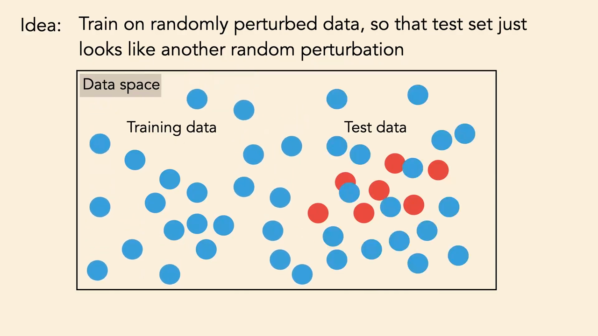
*▲ 강의 슬라이드 [33:30](https://youtu.be/DC2Hw9DiLCg?t=2010): 무작위로 흔든 데이터로 학습하면 [시험 데이터](00_%EB%94%A5%EB%9F%AC%EB%8B%9D_%EC%9A%A9%EC%96%B4%EC%82%AC%EC%A0%84.md#training-data-test-data-%ED%95%99%EC%8A%B5-%EB%8D%B0%EC%9D%B4%ED%84%B0%EC%99%80-%EC%8B%9C%ED%97%98-%EB%8D%B0%EC%9D%B4%ED%84%B0)(빨강)가 "또 하나의 흔든 데이터"처럼 [학습](00_%EB%94%A5%EB%9F%AC%EB%8B%9D_%EC%9A%A9%EC%96%B4%EC%82%AC%EC%A0%84.md#training-%ED%95%99%EC%8A%B5) 분포 안에 들어온다*

### 7.2 좋은 학습 곡선

▶ 영상 [33:16](https://youtu.be/DC2Hw9DiLCg?t=1996)

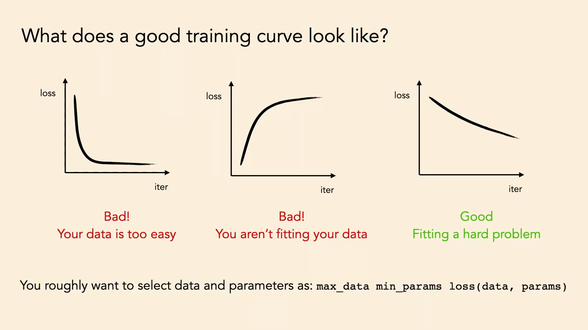
*▲ 강의 슬라이드 [36:10](https://youtu.be/DC2Hw9DiLCg?t=2170): 좋은 [학습](00_%EB%94%A5%EB%9F%AC%EB%8B%9D_%EC%9A%A9%EC%96%B4%EC%82%AC%EC%A0%84.md#training-%ED%95%99%EC%8A%B5) 곡선은? 왼쪽: 데이터가 너무 쉽다(나쁨), 가운데: 데이터를 못 맞춘다(나쁨), 오른쪽: 어려운 문제를 맞추는 중(좋음)*

- 퀴즈: 세 [손실](00_%EB%94%A5%EB%9F%AC%EB%8B%9D_%EC%9A%A9%EC%96%B4%EC%82%AC%EC%A0%84.md#loss-function-%EC%86%90%EC%8B%A4-%ED%95%A8%EC%88%98) 곡선 중 어느 것이 반가운가? 학생 3분의 1이 왼쪽(빨리 떨어져 평평), 3분의 2가 오른쪽(천천히 꾸준히 감소)을 골랐다. 강사가 원한 답은 **오른쪽**이다.
- 왼쪽은 **문제가 너무 쉽다**. 평평한 구간의 [학습](00_%EB%94%A5%EB%9F%AC%EB%8B%9D_%EC%9A%A9%EC%96%B4%EC%82%AC%EC%A0%84.md#training-%ED%95%99%EC%8A%B5)은 계산(flops) 낭비다. 가운데는 [손실](00_%EB%94%A5%EB%9F%AC%EB%8B%9D_%EC%9A%A9%EC%96%B4%EC%82%AC%EC%A0%84.md#loss-function-%EC%86%90%EC%8B%A4-%ED%95%A8%EC%88%98)이 오르니 분명히 나쁘다. 오른쪽은 매끄럽게 내려가면서 아직 갈 길이 많다. 배울 것이 많은 어려운 문제다.
- 강사의 대략적인 레시피: [파라미터](00_%EB%94%A5%EB%9F%AC%EB%8B%9D_%EC%9A%A9%EC%96%B4%EC%82%AC%EC%A0%84.md#parameter-%ED%8C%8C%EB%9D%BC%EB%AF%B8%ED%84%B0)에 대해서는 [손실](00_%EB%94%A5%EB%9F%AC%EB%8B%9D_%EC%9A%A9%EC%96%B4%EC%82%AC%EC%A0%84.md#loss-function-%EC%86%90%EC%8B%A4-%ED%95%A8%EC%88%98)을 최소화하고([역전파](00_%EB%94%A5%EB%9F%AC%EB%8B%9D_%EC%9A%A9%EC%96%B4%EC%82%AC%EC%A0%84.md#backpropagation-%EC%97%AD%EC%A0%84%ED%8C%8C)), **데이터에 대해서는 난이도를 올린다**. 슬라이드는 이를 $\max_{\text{data}} \min_{\text{params}} \text{loss}(\text{data}, \text{params})$로 적는다. 문자 그대로 [손실](00_%EB%94%A5%EB%9F%AC%EB%8B%9D_%EC%9A%A9%EC%96%B4%EC%82%AC%EC%A0%84.md#loss-function-%EC%86%90%EC%8B%A4-%ED%95%A8%EC%88%98)을 최대화하라는 것이 아니라, 배울 것이 생길 때까지 데이터를 어렵게 하라는 뜻이다. 큰 프로젝트에서는 시간 대부분이 이 쪽에 든다.
- [데이터 증강](00_%EB%94%A5%EB%9F%AC%EB%8B%9D_%EC%9A%A9%EC%96%B4%EC%82%AC%EC%A0%84.md#data-augmentation-%EB%8D%B0%EC%9D%B4%ED%84%B0-%EC%A6%9D%EA%B0%95)과 [도메인 무작위화](00_%EB%94%A5%EB%9F%AC%EB%8B%9D_%EC%9A%A9%EC%96%B4%EC%82%AC%EC%A0%84.md#domain-randomization-%EB%8F%84%EB%A9%94%EC%9D%B8-%EB%AC%B4%EC%9E%91%EC%9C%84%ED%99%94)는 데이터를 늘려 [학습](00_%EB%94%A5%EB%9F%AC%EB%8B%9D_%EC%9A%A9%EC%96%B4%EC%82%AC%EC%A0%84.md#training-%ED%95%99%EC%8A%B5)을 어렵게 한다. 가장 학습하기 어려운 분포가 가장 잘 [일반화](00_%EB%94%A5%EB%9F%AC%EB%8B%9D_%EC%9A%A9%EC%96%B4%EC%82%AC%EC%A0%84.md#generalization-%EC%9D%BC%EB%B0%98%ED%99%94)한다.

### 7.3 도메인 무작위화

▶ 영상 [36:01](https://youtu.be/DC2Hw9DiLCg?t=2161)

- **[도메인 무작위화](00_%EB%94%A5%EB%9F%AC%EB%8B%9D_%EC%9A%A9%EC%96%B4%EC%82%AC%EC%A0%84.md#domain-randomization-%EB%8F%84%EB%A9%94%EC%9D%B8-%EB%AC%B4%EC%9E%91%EC%9C%84%ED%99%94)(Domain randomization)**: 로봇공학에서 쓰는 말이다. 시뮬레이션에서 학습해 현실에서 쓸 때, 시뮬레이션의 색, 조명, 물리 값을 무작위로 바꿔 학습한다. [학습](00_%EB%94%A5%EB%9F%AC%EB%8B%9D_%EC%9A%A9%EC%96%B4%EC%82%AC%EC%A0%84.md#training-%ED%95%99%EC%8A%B5)은 오래 걸리지만 처음 보는 블록 색이나 조명에도 일반화한다. 원천 도메인(시뮬레이션)을 무작위로 넓혀 목표 도메인(현실)과의 간극을 줄이는 것이다.
- 학생 질문 "한 번도 없을 조명에도 일반화하나?": 짧은 답은 **아니다**. 무작위화한 [학습](00_%EB%94%A5%EB%9F%AC%EB%8B%9D_%EC%9A%A9%EC%96%B4%EC%82%AC%EC%A0%84.md#training-%ED%95%99%EC%8A%B5) 분포가 모든 조명을 덮어서, 시험 조명이 "[학습](00_%EB%94%A5%EB%9F%AC%EB%8B%9D_%EC%9A%A9%EC%96%B4%EC%82%AC%EC%A0%84.md#training-%ED%95%99%EC%8A%B5) 분포 안의 또 하나"처럼 보이게 하는 것이 목표다. 분포가 충분히 넓으면 분포 밖으로도 일반화하는 창발적 성질이 생길 수도 있지만 아직 분명한 답은 없다.
- OpenAI의 로봇 손(2018)은 렌더링 조건뿐 아니라 **중력**까지 무작위로 바꿨다.

<details><summary>질의응답: 왜 중력을 무작위로 바꿨을까? [38:17](https://youtu.be/DC2Hw9DiLCg?t=2297)</summary>

- 학생 답 1: 우주나 다른 행성에서도 쓰려고. 좋은 답이지만 의도는 아니었을 것이다.
- 학생 답 2: 기계가 가속하면 중력 측정이 바뀐다(가속과 중력은 구별할 수 없다). 일부 맞다.
- 강사의 생각: 가속도계가 측정하는 "아래 방향"에 잡음과 보정 [오차](00_%EB%94%A5%EB%9F%AC%EB%8B%9D_%EC%9A%A9%EC%96%B4%EC%82%AC%EC%A0%84.md#error-%EC%98%A4%EC%B0%A8)가 있다. 9.8은 맞더라도 방향이 살짝 틀릴 수 있다. [학습](00_%EB%94%A5%EB%9F%AC%EB%8B%9D_%EC%9A%A9%EC%96%B4%EC%82%AC%EC%A0%84.md#training-%ED%95%99%EC%8A%B5) 때 늘 조금씩 바꿔 두면 실제 보정 [오차](00_%EB%94%A5%EB%9F%AC%EB%8B%9D_%EC%9A%A9%EC%96%B4%EC%82%AC%EC%A0%84.md#error-%EC%98%A4%EC%B0%A8)가 분포 안에 들어와 견고해진다.

</details>

- 가장 중요한 교훈: 무작위화 없이 학습하면 성능이 아주 빨리 오른다. 그 곡선만 보면 "끝났다"고 할 만하다. 무작위화를 넣자 같은 수준까지 **약 10배 오래**(시뮬레이션 경험 1년 → 10년, [로그](00_%EB%94%A5%EB%9F%AC%EB%8B%9D_%EC%9A%A9%EC%96%B4%EC%82%AC%EC%A0%84.md#log-ln-%EB%A1%9C%EA%B7%B8) 축) 걸렸다. 나쁜 관리자는 "[정확도](00_%EB%94%A5%EB%9F%AC%EB%8B%9D_%EC%9A%A9%EC%96%B4%EC%82%AC%EC%A0%84.md#accuracy-%EC%A0%95%ED%99%95%EB%8F%84)가 낮아졌으니 빼라"고 하겠지만, 그것은 학습 데이터에서의 성능일 뿐이다. 원하는 것은 실제 시험 상황에서의 성능이다. **[학습](00_%EB%94%A5%EB%9F%AC%EB%8B%9D_%EC%9A%A9%EC%96%B4%EC%82%AC%EC%A0%84.md#training-%ED%95%99%EC%8A%B5) [정확도](00_%EB%94%A5%EB%9F%AC%EB%8B%9D_%EC%9A%A9%EC%96%B4%EC%82%AC%EC%A0%84.md#accuracy-%EC%A0%95%ED%99%95%EB%8F%84)가 높으면 문제가 너무 쉬운 것**이다.

---

## 8. 데이터를 바꿔라

### 8.1 입력이 길수록 예측이 쉽다

▶ 영상 [41:38](https://youtu.be/DC2Hw9DiLCg?t=2498)

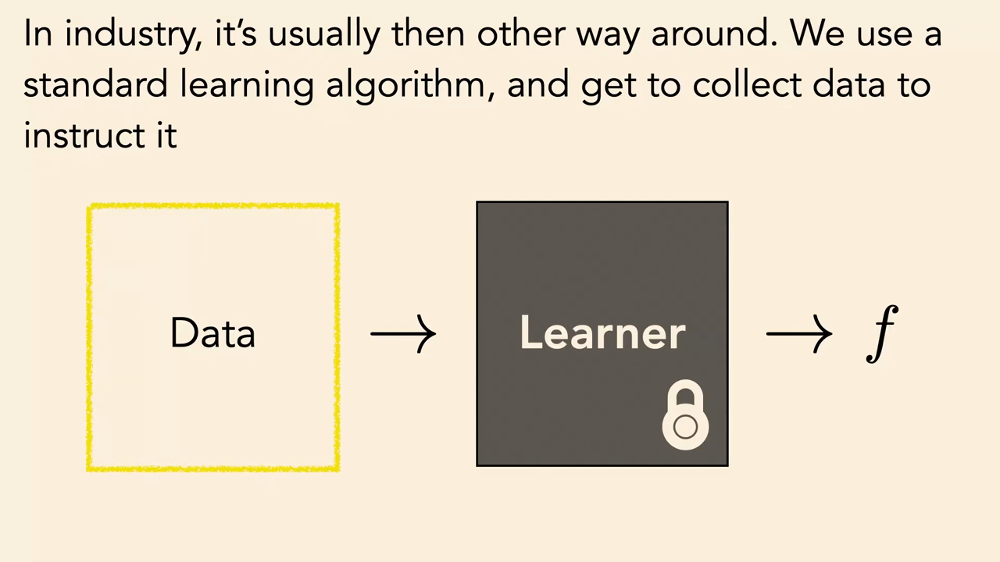
*▲ 강의 슬라이드 [42:20](https://youtu.be/DC2Hw9DiLCg?t=2540): 산업에서는 보통 반대다. 표준 [학습](00_%EB%94%A5%EB%9F%AC%EB%8B%9D_%EC%9A%A9%EC%96%B4%EC%82%AC%EC%A0%84.md#training-%ED%95%99%EC%8A%B5) 알고리즘(잠긴 상자)을 쓰고, 그것을 가르칠 데이터를 모은다*

- 학계에서는 데이터를 고정하고 아키텍처, 목적 함수, [옵티마이저](00_%EB%94%A5%EB%9F%AC%EB%8B%9D_%EC%9A%A9%EC%96%B4%EC%82%AC%EC%A0%84.md#optimizer-%EC%98%B5%ED%8B%B0%EB%A7%88%EC%9D%B4%EC%A0%80)를 설계한다. 현실(기업, 정부)에서는 반대로 최신 모델을 받아 거의 그대로 쓰고 **데이터를 바꾼다**. 더 모으고, 더 좋게 모으고, 새로 라벨을 단다. 강사는 지렛대가 대부분 데이터 쪽에 있다고 본다. MIT 수업 대부분이 알고리즘만 다루는 것은 교과과정의 문제일 수 있다고 덧붙인다.

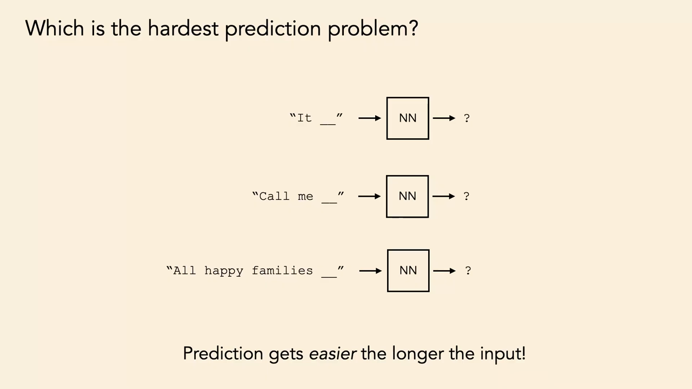
*▲ 강의 슬라이드 [44:10](https://youtu.be/DC2Hw9DiLCg?t=2650): 가장 어려운 예측 문제는? "It __", "Call me __", "All happy families __". 입력이 길수록 예측이 쉽다*

- 퀴즈: 유명 소설의 첫 문장 다음 단어 맞히기. "It __"은 답이 많고("It was the best of times"를 생각했지만 다른 소설도 많다), "Call me __"은 대부분 Ishmael(모비 딕), "All happy families __"는 거의 모두가 맞혔다. **입력이 길수록 예측이 쉽다**. 정보가 더 많기 때문이다.
- 옛 NLP의 N-gram 모델은 N을 크게 잡기를 꺼렸다. 길이 n의 문자열을 모델링하는 것이 더 짧은 것보다 어렵다고 여겼기 때문이다. 엄밀히는 N-gram은 전체의 [결합 분포](00_%EB%94%A5%EB%9F%AC%EB%8B%9D_%EC%9A%A9%EC%96%B4%EC%82%AC%EC%A0%84.md#joint-distribution-%EA%B2%B0%ED%95%A9-%EB%B6%84%ED%8F%AC)를, 여기서는 앞 단어들이 주어졌을 때 마지막 단어의 조건부 분포를 모델링한다는 차이가 있다. 그래도 "입력에 정보를 더 넣을수록 예측이 쉬워진다"는 직관을 흐렸다고 강사는 본다.

### 8.2 X에 정보를 더 넣기

▶ 영상 [44:55](https://youtu.be/DC2Hw9DiLCg?t=2695)

📐 **수학 개념**: [L2 회귀와 범주 분포](%EC%88%98%ED%95%99%EA%B0%9C%EB%85%90/04_%ED%99%95%EB%A5%A0%EA%B3%BC_%EC%A0%95%EB%B3%B4/MM35_L2_%ED%9A%8C%EA%B7%80%EC%99%80_%EB%B2%94%EC%A3%BC_%EB%B6%84%ED%8F%AC.md) · [조건부 확률](%EC%88%98%ED%95%99%EA%B0%9C%EB%85%90/04_%ED%99%95%EB%A5%A0%EA%B3%BC_%EC%A0%95%EB%B3%B4/M08_%ED%99%95%EB%A5%A0_%EA%B8%B0%EC%B4%88.md)

- 신약을 설계하며 X로 효과 Y를 예측한다고 하자. Y(무엇이 사회에 쓸모 있나)는 보통 바꿀 수 없지만 X는 많이 바꿀 수 있다. 화학식 외에 무엇을 넣을까? 학생들의 답: 환자 데이터(나이, 생검, 맞춤 의학), 단백질의 접힘 구조, 효과가 있었던 비슷한 약. 강사: "우주 전체를 넣어라."
- 이것은 "문제를 너무 쉽게 만들지 마라"([7.2](#72-%EC%A2%8B%EC%9D%80-%ED%95%99%EC%8A%B5-%EA%B3%A1%EC%84%A0))와 부딪힌다. 지름길을 줄 수 있기 때문이다(2.2절의 R 표시). 그래도 강사는 **입력에는 정보를 많이 넣고, [과적합](00_%EB%94%A5%EB%9F%AC%EB%8B%9D_%EC%9A%A9%EC%96%B4%EC%82%AC%EC%A0%84.md#overfitting-%EA%B3%BC%EC%A0%81%ED%95%A9)은 다른 방법으로 다스리는 것**이 더 나은 조언이라고 본다.

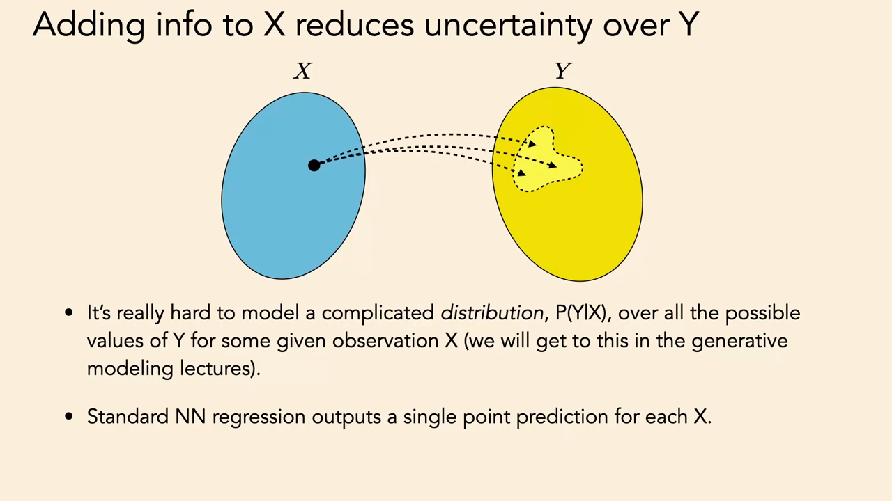
*▲ 강의 슬라이드 [48:00](https://youtu.be/DC2Hw9DiLCg?t=2880): X에 정보를 더하면 Y의 불확실성이 준다. 복잡한 분포 P(Y|X)는 모델링하기 어렵고, 표준 신경망 [회귀](00_%EB%94%A5%EB%9F%AC%EB%8B%9D_%EC%9A%A9%EC%96%B4%EC%82%AC%EC%A0%84.md#regression-classification-%ED%9A%8C%EA%B7%80%EC%99%80-%EB%B6%84%EB%A5%98)는 X마다 한 점만 예측한다*

- X의 정보가 적으면 맞는 답이 여럿이다. "10% [확률](00_%EB%94%A5%EB%9F%AC%EB%8B%9D_%EC%9A%A9%EC%96%B4%EC%82%AC%EC%A0%84.md#probability-%ED%99%95%EB%A5%A0)로 효과 있음, 90%는 없음, 없을 때도 여러 방식으로 없음" 같은 복잡한 분포 $p(Y|X)$를 모델링해야 한다. 지금까지 배운 L2 [회귀](00_%EB%94%A5%EB%9F%AC%EB%8B%9D_%EC%9A%A9%EC%96%B4%EC%82%AC%EC%A0%84.md#regression-classification-%ED%9A%8C%EA%B7%80%EC%99%80-%EB%B6%84%EB%A5%98)는 한 점만 예측하므로 이것을 다루지 못한다([MM35_L2_회귀와_범주_분포](%EC%88%98%ED%95%99%EA%B0%9C%EB%85%90/04_%ED%99%95%EB%A5%A0%EA%B3%BC_%EC%A0%95%EB%B3%B4/MM35_L2_%ED%9A%8C%EA%B7%80%EC%99%80_%EB%B2%94%EC%A3%BC_%EB%B6%84%ED%8F%AC.md): [정답](00_%EB%94%A5%EB%9F%AC%EB%8B%9D_%EC%9A%A9%EC%96%B4%EC%82%AC%EC%A0%84.md#label-%EC%A0%95%EB%8B%B5)이 둘로 갈리면 L2 예측은 그 평균이 된다).
- 해법(해킹): X에 정보를 충분히 넣어 $p(Y|X)$가 **거의 한 점(델타 함수)** 이 되게 하면 단순한 모델로도 풀린다.
- 이것이 텍스트-이미지 모델이 잘 되는 이유라고 강사는 본다. 2019년 최고의 이미지 [생성 모델](00_%EB%94%A5%EB%9F%AC%EB%8B%9D_%EC%9A%A9%EC%96%B4%EC%82%AC%EC%A0%84.md#generative-model-%EC%83%9D%EC%84%B1-%EB%AA%A8%EB%8D%B8)(StyleGAN2)은 X 없이 Y(얼굴)만 모델링해서 정면 얼굴처럼 좁은 범주만 만들 수 있었다. 2021년 DALL-E 이후의 모델은 문장이라는 많은 정보를 입력으로 받아 불확실성을 크게 줄였다. 강사는 "복잡한 분포 모델링이 크게 발전했다기보다, 많은 정보를 조건으로 단 단순한 가우스 분포 모델링으로 바꾼 것"이라고 말한다([생성 모델](00_%EB%94%A5%EB%9F%AC%EB%8B%9D_%EC%9A%A9%EC%96%B4%EC%82%AC%EC%A0%84.md#generative-model-%EC%83%9D%EC%84%B1-%EB%AA%A8%EB%8D%B8) 강의에서 다시 다룬다).

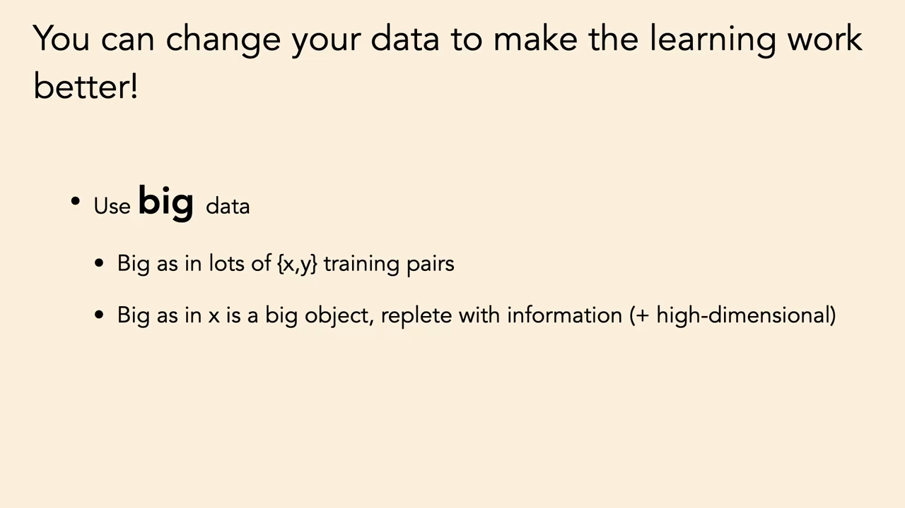
*▲ 강의 슬라이드 [50:30](https://youtu.be/DC2Hw9DiLCg?t=3030): 큰 데이터를 써라. (x, y) 쌍이 많다는 뜻으로도, x 하나가 정보가 가득한 고차원 객체라는 뜻으로도*

- "크게"에는 두 뜻이 있다. (x, y) 쌍이 **많은** 것, 그리고 x 하나가 **정보가 많은 고차원 객체**인 것. 고차원은 일을 쉽게 만든다(5절). 강사는 Y도 크게 만들라고 권하지만 이는 [생성 모델](00_%EB%94%A5%EB%9F%AC%EB%8B%9D_%EC%9A%A9%EC%96%B4%EC%82%AC%EC%A0%84.md#generative-model-%EC%83%9D%EC%84%B1-%EB%AA%A8%EB%8D%B8)과 파운데이션 모델 강의에서 다룬다.

### 8.3 드문 사건과 다양성

▶ 영상 [50:27](https://youtu.be/DC2Hw9DiLCg?t=3027)

<details><summary>질의응답: 드문 사건은 데이터를 키워도 해결되지 않는다 [50:27](https://youtu.be/DC2Hw9DiLCg?t=3027)</summary>

- 학생(보험 기술 회사 4년 경력): 충돌 감지 문제에서 실제 충돌은 운전 100만 마일당 5번꼴이다. 8테라바이트 데이터에 충돌은 2000건뿐이었다. Apple의 충돌 감지도 롤러코스터에서 오작동했다. 이런 경우 그냥 키우는 것은 통하지 않는다.
- 강사: 관심 있는 사건이 아주 드물면 데이터를 키워도 대부분이 이미 잘 아는 흔한 경우에 낭비된다. 중요한 것은 관심 클래스에 대한 **다양성과 포괄 범위(coverage)** 이고, 데이터 규모는 그 대리 지표일 뿐이다.
- 롤러코스터 문제라면 입력에 문맥을 더하라. "지금 놀이공원에 있다"는 정보가 입력에 있으면 충돌 [확률](00_%EB%94%A5%EB%9F%AC%EB%8B%9D_%EC%9A%A9%EC%96%B4%EC%82%AC%EC%A0%84.md#probability-%ED%99%95%EB%A5%A0)을 낮게 볼 수 있다.

</details>

- [언어 모델](00_%EB%94%A5%EB%9F%AC%EB%8B%9D_%EC%9A%A9%EC%96%B4%EC%82%AC%EC%A0%84.md#language-model-%EC%96%B8%EC%96%B4-%EB%AA%A8%EB%8D%B8)이 [맥락 창](00_%EB%94%A5%EB%9F%AC%EB%8B%9D_%EC%9A%A9%EC%96%B4%EC%82%AC%EC%A0%84.md#context-window-%EB%A7%A5%EB%9D%BD-%EC%B0%BD)(Context window)을 100만 [토큰](00_%EB%94%A5%EB%9F%AC%EB%8B%9D_%EC%9A%A9%EC%96%B4%EC%82%AC%EC%A0%84.md#token-%ED%86%A0%ED%81%B0)처럼 길게 늘리는 것도 같은 생각이다. 문맥이 충분하면 많은 일이 쉬워진다.

> [!TIP]
> **🆕 2026 업데이트: 문맥 길이**
> - **강의**: 요즘 [언어 모델](00_%EB%94%A5%EB%9F%AC%EB%8B%9D_%EC%9A%A9%EC%96%B4%EC%82%AC%EC%A0%84.md#language-model-%EC%96%B8%EC%96%B4-%EB%AA%A8%EB%8D%B8)은 100만 [토큰](00_%EB%94%A5%EB%9F%AC%EB%8B%9D_%EC%9A%A9%EC%96%B4%EC%82%AC%EC%A0%84.md#token-%ED%86%A0%ED%81%B0) 길이의 문맥을 이야기한다.
> - **현재**: Meta의 Llama 4 Scout(2025년 4월 5일 공개)는 지원 문맥 길이를 Llama 3의 128K에서 **1000만 [토큰](00_%EB%94%A5%EB%9F%AC%EB%8B%9D_%EC%9A%A9%EC%96%B4%EC%82%AC%EC%A0%84.md#token-%ED%86%A0%ED%81%B0)**으로 늘렸다고 발표했다. 다만 광고된 최대 길이와 그 길이에서 실제로 정보를 잘 찾아 쓰는 능력은 별개이고, 서비스 업체마다 실제 제공 길이도 다르다.
> - **출처**: [Meta AI, The Llama 4 herd: The beginning of a new era of natively multimodal AI innovation (2025)](https://ai.meta.com/blog/llama-4-multimodal-intelligence/)

---

## 9. 모델: 단순하게, 유명한 것으로

▶ 영상 [52:44](https://youtu.be/DC2Hw9DiLCg?t=3164)

- 데이터 이야기만으로 강의의 절반이 넘었다. 데이터가 머신러닝에서 가장 중요하다. 이제 모델 이야기다.
- **모델링의 제1원칙: 단순하게.** 단순한 모델은 만들기, 디버그하기, 공유하기 쉽다. 이해하기 쉽고, 견고하게 만들기 쉽고, 이론을 세우기 쉽다. 이 수업이 MLP의 성질을 증명하는 것도 그래서다.
- 단순한 모델은 성능을 희생하는 것도 아니다. 데이터를 맞추는 가장 단순한 모델이 가장 좋은 모델이라는 논거([오컴의 면도날, 솔로모노프 귀납](Lec06_%EC%9D%BC%EB%B0%98%ED%99%94_%EC%9D%B4%EB%A1%A0.md#4-%EC%98%A4%EC%BB%B4%EC%9D%98-%EB%A9%B4%EB%8F%84%EB%82%A0%EA%B3%BC-%EA%B0%80%EC%9E%A5-%EC%A7%A7%EC%9D%80-%ED%94%84%EB%A1%9C%EA%B7%B8%EB%9E%A8))가 있다.
- 강사가 학생들에게 하는 말: 방법 A가 B보다 벤치마크에서 1% 낫지만 몇 배 복잡하다면, **더 단순한 B를 발표하라**. 리더보드의 굵은 숫자를 위해 붙인 장식을 떼어 내면 오래 살아남고 영향력이 큰 방법이 된다. 생명이 걸린 병원 시스템이 아니라면 마지막 1%를 위해 복잡성을 더하지 마라.

<details><summary>질의응답: 복잡성과 정확도의 교환 비율, 다른 도메인 데이터 [55:00](https://youtu.be/DC2Hw9DiLCg?t=3300)</summary>

- "희생하는지 어떻게 아나?" 단순성을 재는 방법은 아직 없다. 강사의 직관은 대부분의 사람이 벤치마크 성능 쪽으로 너무 치우쳐 있다는 것이다.
- "도메인 밖 데이터를 [학습](00_%EB%94%A5%EB%9F%AC%EB%8B%9D_%EC%9A%A9%EC%96%B4%EC%82%AC%EC%A0%84.md#training-%ED%95%99%EC%8A%B5)에 써도 되나?" 그렇다. 데이터 x, y, z가 있고 문제가 z에 관한 것이라도 x, y, z 모두로 학습하라. 최적의 알고리즘이라면 x와 y가 쓸모없을 때 무시할 수 있으므로 손해가 없다(데이터 처리 부등식 비슷한 논리). 뒤에서 [사전 학습](00_%EB%94%A5%EB%9F%AC%EB%8B%9D_%EC%9A%A9%EC%96%B4%EC%82%AC%EC%A0%84.md#pre-training-%EC%82%AC%EC%A0%84-%ED%95%99%EC%8A%B5)을 다룬다.

</details>

- **성능보다 인기, 무엇보다 단순성.** 널리 쓰이는 시스템을 쓰라. 널리 쓰이려면 단순해야 하고, 그래야 커뮤니티와 잘 맞물린다. 아무도 찾지 않는 궁전을 짓지 마라.
- 출발점 찾기: GitHub의 별(star) 수나 포크 수가 품질의 좋은 대리 지표다. 리더보드의 [정확도](00_%EB%94%A5%EB%9F%AC%EB%8B%9D_%EC%9A%A9%EC%96%B4%EC%82%AC%EC%A0%84.md#accuracy-%EC%A0%95%ED%99%95%EB%8F%84)보다 별 수가 쓸모를 더 잘 예측한다. 경험칙: 리더보드 위에서부터 내려가며 **별 1만 개가 넘는 것 중 가장 성능 좋은 모델**을 고른다. 단, 최첨단을 넘어서는 연구라면 이 조언은 맞지 않는다. 회사에서 문제를 풀 때의 조언이다.
- Hugging Face, [PyTorch](00_%EB%94%A5%EB%9F%AC%EB%8B%9D_%EC%9A%A9%EC%96%B4%EC%82%AC%EC%A0%84.md#pytorch-%ED%8C%8C%EC%9D%B4%ED%86%A0%EC%B9%98) Hub, GitHub, Papers with Code(최신 리더보드)를 둘러보라.
- 실용적으로는 **[사전 학습](00_%EB%94%A5%EB%9F%AC%EB%8B%9D_%EC%9A%A9%EC%96%B4%EC%82%AC%EC%A0%84.md#pre-training-%EC%82%AC%EC%A0%84-%ED%95%99%EC%8A%B5)([Pre-training](00_%EB%94%A5%EB%9F%AC%EB%8B%9D_%EC%9A%A9%EC%96%B4%EC%82%AC%EC%A0%84.md#pre-training-%EC%82%AC%EC%A0%84-%ED%95%99%EC%8A%B5))된 모델에서 출발**하라. 거인의 어깨 위에 서라. 처음부터 학습하지 마라. 다만 [사전 학습](00_%EB%94%A5%EB%9F%AC%EB%8B%9D_%EC%9A%A9%EC%96%B4%EC%82%AC%EC%A0%84.md#pre-training-%EC%82%AC%EC%A0%84-%ED%95%99%EC%8A%B5) 모델의 결함, 저작권, [편향](00_%EB%94%A5%EB%9F%AC%EB%8B%9D_%EC%9A%A9%EC%96%B4%EC%82%AC%EC%A0%84.md#bias-%ED%8E%B8%ED%96%A5)을 알고 써야 한다(AlphaFold 2 같은 모델은 그런 문제가 적은 편이다). [사전 학습](00_%EB%94%A5%EB%9F%AC%EB%8B%9D_%EC%9A%A9%EC%96%B4%EC%82%AC%EC%A0%84.md#pre-training-%EC%82%AC%EC%A0%84-%ED%95%99%EC%8A%B5)과 [전이 학습](00_%EB%94%A5%EB%9F%AC%EB%8B%9D_%EC%9A%A9%EC%96%B4%EC%82%AC%EC%A0%84.md#transfer-learning-%EC%A0%84%EC%9D%B4-%ED%95%99%EC%8A%B5)은 뒤 강의에서 다룬다.

> [!TIP]
> **🆕 2026 업데이트: Papers with Code는 문을 닫았다**
> - **강의**: 최신 리더보드는 Papers with Code에서 찾아라.
> - **현재**: Papers with Code는 2025년 중반 서비스를 멈췄다. 지금 paperswithcode.com에 접속하면 Hugging Face의 **Trending Papers** 페이지로 넘어간다(2026-10-15에 직접 확인). 이 페이지는 코드가 딸린 인기 논문을 모아 보여 주지만, 과제별 벤치마크 리더보드는 예전처럼 제공하지 않는다. 옛 데이터는 정적 보관본으로만 남아 있다. "인기 있는 구현을 고르라"는 강사의 조언은 그대로 쓸 수 있다.
> - **출처**: [Hugging Face, Trending Papers (2026 확인)](https://huggingface.co/papers/trending) · [paperswithcode/paperswithcode-data, 마지막 데이터 보관 저장소](https://github.com/paperswithcode/paperswithcode-data)

---

## 10. 풀린 문제로 바꾸기: 색칠을 분류로

▶ 영상 [58:46](https://youtu.be/DC2Hw9DiLCg?t=3526)

📐 **수학 개념**: [L2 회귀와 범주 분포](%EC%88%98%ED%95%99%EA%B0%9C%EB%85%90/04_%ED%99%95%EB%A5%A0%EA%B3%BC_%EC%A0%95%EB%B3%B4/MM35_L2_%ED%9A%8C%EA%B7%80%EC%99%80_%EB%B2%94%EC%A3%BC_%EB%B6%84%ED%8F%AC.md) · [argmin](%EC%88%98%ED%95%99%EA%B0%9C%EB%85%90/02_%EB%AF%B8%EB%B6%84/MM01_argmin%EA%B3%BC_argmax.md) · [합성곱](%EC%88%98%ED%95%99%EA%B0%9C%EB%85%90/07_%EA%B5%AC%EC%A1%B0_%EC%95%84%ED%82%A4%ED%85%8D%EC%B2%98/MM15_%ED%95%A9%EC%84%B1%EA%B3%B1%EA%B3%BC_%ED%87%B4%ED%94%8C%EB%A6%AC%EC%B8%A0_%ED%96%89%EB%A0%AC.md)

- 이미 풀린 문제가 있으면 내 문제를 **그 문제로 바꿔라**. CS 이론에서 다항 시간 환원(reduction)으로 새 문제를 아는 문제로 바꾸는 것과 비슷하다.
- 사례: 강사가 약 10년 전 참여한 **흑백 사진 색칠**(Zhang, Isola, Efros, ECCV 2016). 처음 보면 [분류](00_%EB%94%A5%EB%9F%AC%EB%8B%9D_%EC%9A%A9%EC%96%B4%EC%82%AC%EC%A0%84.md#regression-classification-%ED%9A%8C%EA%B7%80%EC%99%80-%EB%B6%84%EB%A5%98)가 아니다. 모든 픽셀의 색을 예측하는 [회귀](00_%EB%94%A5%EB%9F%AC%EB%8B%9D_%EC%9A%A9%EC%96%B4%EC%82%AC%EC%A0%84.md#regression-classification-%ED%9A%8C%EA%B7%80%EC%99%80-%EB%B6%84%EB%A5%98)처럼 보인다. 이를 [경험적 위험](00_%EB%94%A5%EB%9F%AC%EB%8B%9D_%EC%9A%A9%EC%96%B4%EC%82%AC%EC%A0%84.md#empirical-risk-%EA%B2%BD%ED%97%98%EC%A0%81-%EC%9C%84%ED%97%98) 최소화로 세운다.

$$
\hat f = \arg\min_{f \in \mathcal{F}} \sum_{i=1}^{N} \mathcal{L}\big(f(\mathbf{x}^{(i)}), \mathbf{y}^{(i)}\big)
$$

<details><summary>기호 풀이</summary>

| 기호 | 읽는 법 | 뜻 | 예제 값 |
| --- | --- | --- | --- |
| $\mathbf{x}^{(i)}$ | 엑스 아이 | i번째 흑백 사진 (밝기 L [채널](00_%EB%94%A5%EB%9F%AC%EB%8B%9D_%EC%9A%A9%EC%96%B4%EC%82%AC%EC%A0%84.md#channel-%EC%B1%84%EB%84%90), $\mathbb{R}^{H\times W\times 1}$) | |
| $\mathbf{y}^{(i)}$ | 와이 아이 | i번째 사진의 색 (a, b 두 [채널](00_%EB%94%A5%EB%9F%AC%EB%8B%9D_%EC%9A%A9%EC%96%B4%EC%82%AC%EC%A0%84.md#channel-%EC%B1%84%EB%84%90), $\mathbb{R}^{H\times W\times 2}$) | |
| $f$ | 에프 | 흑백 사진을 받아 색을 내는 함수(신경망) | $f_1$, $f_2$ |
| $\mathcal{F}$ | 필기체 에프 | 후보 함수 전체의 집합 ([가설 공간](00_%EB%94%A5%EB%9F%AC%EB%8B%9D_%EC%9A%A9%EC%96%B4%EC%82%AC%EC%A0%84.md#hypothesis-space-%EA%B0%80%EC%84%A4-%EA%B3%B5%EA%B0%84)) | $\{f_1, f_2\}$ |
| $\mathcal{L}$ | 엘 | 예측과 [정답](00_%EB%94%A5%EB%9F%AC%EB%8B%9D_%EC%9A%A9%EC%96%B4%EC%82%AC%EC%A0%84.md#label-%EC%A0%95%EB%8B%B5)의 차이를 재는 [손실](00_%EB%94%A5%EB%9F%AC%EB%8B%9D_%EC%9A%A9%EC%96%B4%EC%82%AC%EC%A0%84.md#loss-function-%EC%86%90%EC%8B%A4-%ED%95%A8%EC%88%98) | 0.2 |
| $N$ | 엔 | [학습](00_%EB%94%A5%EB%9F%AC%EB%8B%9D_%EC%9A%A9%EC%96%B4%EC%82%AC%EC%A0%84.md#training-%ED%95%99%EC%8A%B5) 사진 수 | 2 |
| $\arg\min$ | 아그민 | 합을 가장 작게 하는 f를 고른다 | $f_2$ |

</details>

<details><summary>예제와 풀이</summary>

**문제**: [학습](00_%EB%94%A5%EB%9F%AC%EB%8B%9D_%EC%9A%A9%EC%96%B4%EC%82%AC%EC%A0%84.md#training-%ED%95%99%EC%8A%B5) 사진 2장에서 후보 $f_1$의 [손실](00_%EB%94%A5%EB%9F%AC%EB%8B%9D_%EC%9A%A9%EC%96%B4%EC%82%AC%EC%A0%84.md#loss-function-%EC%86%90%EC%8B%A4-%ED%95%A8%EC%88%98)은 0.2, 0.4이고 $f_2$의 [손실](00_%EB%94%A5%EB%9F%AC%EB%8B%9D_%EC%9A%A9%EC%96%B4%EC%82%AC%EC%A0%84.md#loss-function-%EC%86%90%EC%8B%A4-%ED%95%A8%EC%88%98)은 0.1, 0.3이다. [경험적 위험](00_%EB%94%A5%EB%9F%AC%EB%8B%9D_%EC%9A%A9%EC%96%B4%EC%82%AC%EC%A0%84.md#empirical-risk-%EA%B2%BD%ED%97%98%EC%A0%81-%EC%9C%84%ED%97%98) 최소화는 무엇을 고르는가?

**주어진 값**:
- $N = 2$ (사진 수)
- $f_1$: $\mathcal{L} = 0.2, 0.4$ (사진 1, 2에서의 [손실](00_%EB%94%A5%EB%9F%AC%EB%8B%9D_%EC%9A%A9%EC%96%B4%EC%82%AC%EC%A0%84.md#loss-function-%EC%86%90%EC%8B%A4-%ED%95%A8%EC%88%98))
- $f_2$: $\mathcal{L} = 0.1, 0.3$

**풀이**
1. 식을 그대로 쓴다: $\hat f = \arg\min_{f} \sum_{i=1}^{2} \mathcal{L}(f(\mathbf{x}^{(i)}), \mathbf{y}^{(i)})$
2. Σ를 항 하나씩 펼친다 (i = 1, 2): $\hat f = \arg\min_{f \in \{f_1, f_2\}} \big(\mathcal{L}(f(\mathbf{x}^{(1)}), \mathbf{y}^{(1)}) + \mathcal{L}(f(\mathbf{x}^{(2)}), \mathbf{y}^{(2)})\big)$
3. 값을 대입한다: $\hat f = \arg\min \big\{\, f_1: 0.2 + 0.4,\ \ f_2: 0.1 + 0.3 \,\big\}$
4. 후보마다 덧셈을 한다: $0.2 + 0.4 = 0.6$, $0.1 + 0.3 = 0.4$ 이므로 $\hat f = \arg\min \{ f_1: 0.6,\ f_2: 0.4 \}$
5. 합이 더 작은 후보를 고른다([argmin](00_%EB%94%A5%EB%9F%AC%EB%8B%9D_%EC%9A%A9%EC%96%B4%EC%82%AC%EC%A0%84.md#argmin-%EC%B5%9C%EC%86%9F%EA%B0%92-%EC%9C%84%EC%B9%98)은 "가장 작게 만드는 것"): $0.4 < 0.6$ 이므로 $f_2$

**답**: $\hat f = f_2$

</details>

<details><summary>내 이해</summary>


</details>

어떻게 [분류](00_%EB%94%A5%EB%9F%AC%EB%8B%9D_%EC%9A%A9%EC%96%B4%EC%82%AC%EC%A0%84.md#regression-classification-%ED%9A%8C%EA%B7%80%EC%99%80-%EB%B6%84%EB%A5%98)로 바꾸나?

1. **색을 클래스로**: 색 공간(a, b 평면)을 격자로 잘라 **[양자화](00_%EB%94%A5%EB%9F%AC%EB%8B%9D_%EC%9A%A9%EC%96%B4%EC%82%AC%EC%A0%84.md#quantization-%EC%96%91%EC%9E%90%ED%99%94)([Quantization](00_%EB%94%A5%EB%9F%AC%EB%8B%9D_%EC%9A%A9%EC%96%B4%EC%82%AC%EC%A0%84.md#quantization-%EC%96%91%EC%9E%90%ED%99%94))** 한다. 칸 하나가 클래스 하나이고, [원-핫](00_%EB%94%A5%EB%9F%AC%EB%8B%9D_%EC%9A%A9%EC%96%B4%EC%82%AC%EC%A0%84.md#one-hot-encoding-%EC%9B%90-%ED%95%AB-%EC%9D%B8%EC%BD%94%EB%94%A9) 벡터로 나타낸다. 고양이·개·코끼리 대신 "파랑 클래스, 노랑 클래스"를 예측한다. 수식은 똑같다.
2. **모든 픽셀에 대해**: 학생 답대로 [합성곱 신경망](00_%EB%94%A5%EB%9F%AC%EB%8B%9D_%EC%9A%A9%EC%96%B4%EC%82%AC%EC%A0%84.md#cnn-convolutional-neural-network-%ED%95%A9%EC%84%B1%EA%B3%B1-%EC%8B%A0%EA%B2%BD%EB%A7%9D)이다. 패치 중심 픽셀의 클래스를 예측하는 망을 이미지 전체에 미끄러뜨리면 픽셀마다 색 클래스를 예측한다.

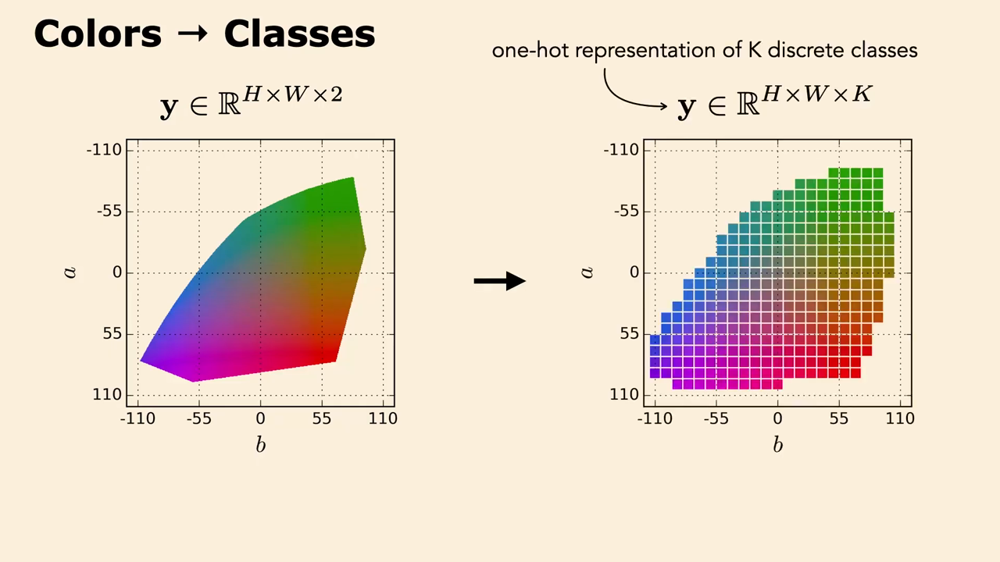
*▲ 강의 슬라이드 [60:40](https://youtu.be/DC2Hw9DiLCg?t=3640): 색 → 클래스. 연속인 ab 색 공간($\mathbf{y} \in \mathbb{R}^{H\times W\times 2}$)을 K개 칸으로 나눠 [원-핫](00_%EB%94%A5%EB%9F%AC%EB%8B%9D_%EC%9A%A9%EC%96%B4%EC%82%AC%EC%A0%84.md#one-hot-encoding-%EC%9B%90-%ED%95%AB-%EC%9D%B8%EC%BD%94%EB%94%A9) 표현($\mathbf{y} \in \mathbb{R}^{H\times W\times K}$)으로 바꾼다*

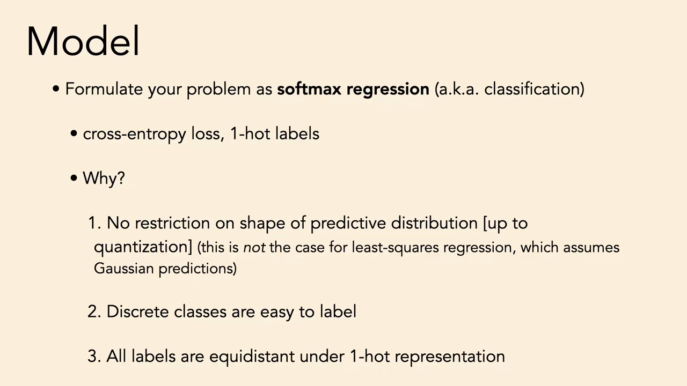
*▲ 강의 슬라이드 [63:30](https://youtu.be/DC2Hw9DiLCg?t=3810): 문제를 [소프트맥스](00_%EB%94%A5%EB%9F%AC%EB%8B%9D_%EC%9A%A9%EC%96%B4%EC%82%AC%EC%A0%84.md#softmax-%EC%86%8C%ED%94%84%ED%8A%B8%EB%A7%A5%EC%8A%A4) [회귀](00_%EB%94%A5%EB%9F%AC%EB%8B%9D_%EC%9A%A9%EC%96%B4%EC%82%AC%EC%A0%84.md#regression-classification-%ED%9A%8C%EA%B7%80%EC%99%80-%EB%B6%84%EB%A5%98)([분류](00_%EB%94%A5%EB%9F%AC%EB%8B%9D_%EC%9A%A9%EC%96%B4%EC%82%AC%EC%A0%84.md#regression-classification-%ED%9A%8C%EA%B7%80%EC%99%80-%EB%B6%84%EB%A5%98))로 세워라. [교차 엔트로피](00_%EB%94%A5%EB%9F%AC%EB%8B%9D_%EC%9A%A9%EC%96%B4%EC%82%AC%EC%A0%84.md#cross-entropy-%EA%B5%90%EC%B0%A8-%EC%97%94%ED%8A%B8%EB%A1%9C%ED%94%BC) [손실](00_%EB%94%A5%EB%9F%AC%EB%8B%9D_%EC%9A%A9%EC%96%B4%EC%82%AC%EC%A0%84.md#loss-function-%EC%86%90%EC%8B%A4-%ED%95%A8%EC%88%98), [원-핫](00_%EB%94%A5%EB%9F%AC%EB%8B%9D_%EC%9A%A9%EC%96%B4%EC%82%AC%EC%A0%84.md#one-hot-encoding-%EC%9B%90-%ED%95%AB-%EC%9D%B8%EC%BD%94%EB%94%A9) 라벨. 이유 세 가지*

왜 [분류](00_%EB%94%A5%EB%9F%AC%EB%8B%9D_%EC%9A%A9%EC%96%B4%EC%82%AC%EC%A0%84.md#regression-classification-%ED%9A%8C%EA%B7%80%EC%99%80-%EB%B6%84%EB%A5%98)가 좋은가 ([소프트맥스](00_%EB%94%A5%EB%9F%AC%EB%8B%9D_%EC%9A%A9%EC%96%B4%EC%82%AC%EC%A0%84.md#softmax-%EC%86%8C%ED%94%84%ED%8A%B8%EB%A7%A5%EC%8A%A4) [회귀](00_%EB%94%A5%EB%9F%AC%EB%8B%9D_%EC%9A%A9%EC%96%B4%EC%82%AC%EC%A0%84.md#regression-classification-%ED%9A%8C%EA%B7%80%EC%99%80-%EB%B6%84%EB%A5%98), 즉 [소프트맥스](00_%EB%94%A5%EB%9F%AC%EB%8B%9D_%EC%9A%A9%EC%96%B4%EC%82%AC%EC%A0%84.md#softmax-%EC%86%8C%ED%94%84%ED%8A%B8%EB%A7%A5%EC%8A%A4) [교차 엔트로피](00_%EB%94%A5%EB%9F%AC%EB%8B%9D_%EC%9A%A9%EC%96%B4%EC%82%AC%EC%A0%84.md#cross-entropy-%EA%B5%90%EC%B0%A8-%EC%97%94%ED%8A%B8%EB%A1%9C%ED%94%BC)):

1. **예측 분포의 모양에 제한이 없다**([양자화](00_%EB%94%A5%EB%9F%AC%EB%8B%9D_%EC%9A%A9%EC%96%B4%EC%82%AC%EC%A0%84.md#quantization-%EC%96%91%EC%9E%90%ED%99%94) 범위 안에서). [범주 분포](00_%EB%94%A5%EB%9F%AC%EB%8B%9D_%EC%9A%A9%EC%96%B4%EC%82%AC%EC%A0%84.md#categorical-distribution-%EB%B2%94%EC%A3%BC-%EB%B6%84%ED%8F%AC)는 이산 변수에 대한 가장 일반적인 불확실성 표현이다. 최소제곱 [회귀](00_%EB%94%A5%EB%9F%AC%EB%8B%9D_%EC%9A%A9%EC%96%B4%EC%82%AC%EC%A0%84.md#regression-classification-%ED%9A%8C%EA%B7%80%EC%99%80-%EB%B6%84%EB%A5%98)는 가우스 예측을 가정한다. 빨강일 수도 초록일 수도 있는 새의 색을 L2로 예측하면 두 색의 평균, 칙칙한 색이 나온다([MM35_L2_회귀와_범주_분포](%EC%88%98%ED%95%99%EA%B0%9C%EB%85%90/04_%ED%99%95%EB%A5%A0%EA%B3%BC_%EC%A0%95%EB%B3%B4/MM35_L2_%ED%9A%8C%EA%B7%80%EC%99%80_%EB%B2%94%EC%A3%BC_%EB%B6%84%ED%8F%AC.md)).
2. **이산 클래스는 라벨 달기 쉽다.** 말로 하기도, 사람이 이해하기도 쉽다.
3. **[원-핫](00_%EB%94%A5%EB%9F%AC%EB%8B%9D_%EC%9A%A9%EC%96%B4%EC%82%AC%EC%A0%84.md#one-hot-encoding-%EC%9B%90-%ED%95%AB-%EC%9D%B8%EC%BD%94%EB%94%A9) 표현에서 모든 라벨은 같은 거리다.** 같은 클래스면 0, 다르면 늘 같은 거리(√2)다. 목표 변수를 어떻게 표현했느냐에 따른 [귀납 편향](00_%EB%94%A5%EB%9F%AC%EB%8B%9D_%EC%9A%A9%EC%96%B4%EC%82%AC%EC%A0%84.md#inductive-bias-%EA%B7%80%EB%82%A9-%ED%8E%B8%ED%96%A5)을 없앤다.

---

## 11. 2024년의 기본 선택

### 11.1 기본 레시피

▶ 영상 [63:42](https://youtu.be/DC2Hw9DiLCg?t=3822)

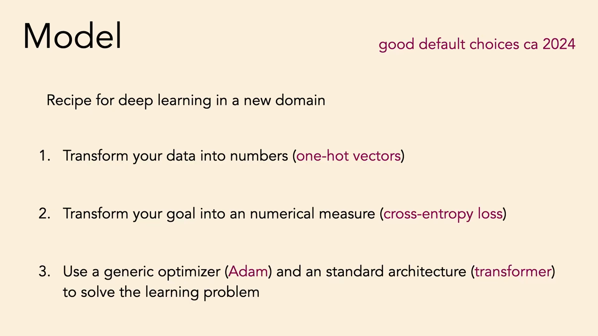
*▲ 강의 슬라이드 [64:00](https://youtu.be/DC2Hw9DiLCg?t=3840): 새 분야에서 딥러닝을 하는 레시피 (2024년 무렵의 좋은 기본값)*

1. 데이터를 숫자로 바꾼다 (**[원-핫](00_%EB%94%A5%EB%9F%AC%EB%8B%9D_%EC%9A%A9%EC%96%B4%EC%82%AC%EC%A0%84.md#one-hot-encoding-%EC%9B%90-%ED%95%AB-%EC%9D%B8%EC%BD%94%EB%94%A9) 벡터**)
2. 목표를 수치 척도로 바꾼다 (**[교차 엔트로피](00_%EB%94%A5%EB%9F%AC%EB%8B%9D_%EC%9A%A9%EC%96%B4%EC%82%AC%EC%A0%84.md#cross-entropy-%EA%B5%90%EC%B0%A8-%EC%97%94%ED%8A%B8%EB%A1%9C%ED%94%BC) [손실](00_%EB%94%A5%EB%9F%AC%EB%8B%9D_%EC%9A%A9%EC%96%B4%EC%82%AC%EC%A0%84.md#loss-function-%EC%86%90%EC%8B%A4-%ED%95%A8%EC%88%98)**)
3. 범용 [옵티마이저](00_%EB%94%A5%EB%9F%AC%EB%8B%9D_%EC%9A%A9%EC%96%B4%EC%82%AC%EC%A0%84.md#optimizer-%EC%98%B5%ED%8B%B0%EB%A7%88%EC%9D%B4%EC%A0%80)(**[Adam](00_%EB%94%A5%EB%9F%AC%EB%8B%9D_%EC%9A%A9%EC%96%B4%EC%82%AC%EC%A0%84.md#adam-%EC%95%84%EB%8B%B4-%EC%98%B5%ED%8B%B0%EB%A7%88%EC%9D%B4%EC%A0%80)**)와 표준 아키텍처(**[트랜스포머](00_%EB%94%A5%EB%9F%AC%EB%8B%9D_%EC%9A%A9%EC%96%B4%EC%82%AC%EC%A0%84.md#transformer-%ED%8A%B8%EB%9E%9C%EC%8A%A4%ED%8F%AC%EB%A8%B8)**)로 푼다

### 11.2 배치 정규화를 쓰지 마라

▶ 영상 [64:13](https://youtu.be/DC2Hw9DiLCg?t=3853)

📐 **수학 개념**: [층 정규화](%EC%88%98%ED%95%99%EA%B0%9C%EB%85%90/05_%EC%8B%A0%EA%B2%BD%EB%A7%9D%EC%9D%98_%EA%B3%84%EC%82%B0/MM32_%EC%B8%B5_%EC%A0%95%EA%B7%9C%ED%99%94.md)

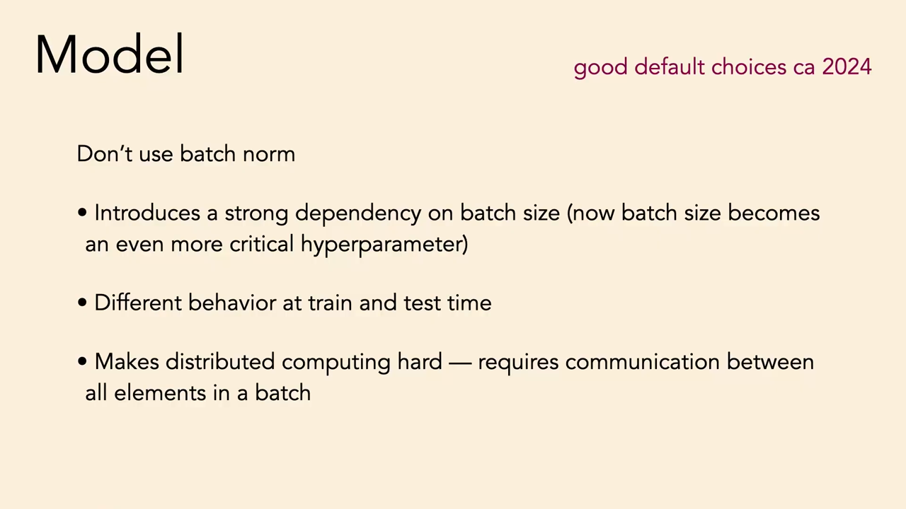
*▲ 강의 슬라이드 [65:20](https://youtu.be/DC2Hw9DiLCg?t=3920): [배치 정규화](00_%EB%94%A5%EB%9F%AC%EB%8B%9D_%EC%9A%A9%EC%96%B4%EC%82%AC%EC%A0%84.md#batch-normalization-%EB%B0%B0%EC%B9%98-%EC%A0%95%EA%B7%9C%ED%99%94)를 쓰지 마라. 배치 크기 의존, [학습](00_%EB%94%A5%EB%9F%AC%EB%8B%9D_%EC%9A%A9%EC%96%B4%EC%82%AC%EC%A0%84.md#training-%ED%95%99%EC%8A%B5)·시험 때 다른 동작, [분산](00_%EB%94%A5%EB%9F%AC%EB%8B%9D_%EC%9A%A9%EC%96%B4%EC%82%AC%EC%A0%84.md#variance-%EB%B6%84%EC%82%B0) 계산의 어려움*

강사의 주관적 "쓰지 말 것" 목록의 첫째는 **[배치 정규화](00_%EB%94%A5%EB%9F%AC%EB%8B%9D_%EC%9A%A9%EC%96%B4%EC%82%AC%EC%A0%84.md#batch-normalization-%EB%B0%B0%EC%B9%98-%EC%A0%95%EA%B7%9C%ED%99%94)(Batch normalization)** 다. 이 교훈은 이미 많이 퍼졌다고 덧붙인다.

1. **배치 크기에 강하게 묶인다.** 배치 크기는 딥러닝의 핵심 [하이퍼파라미터](00_%EB%94%A5%EB%9F%AC%EB%8B%9D_%EC%9A%A9%EC%96%B4%EC%82%AC%EC%A0%84.md#hyperparameter-%ED%95%98%EC%9D%B4%ED%8D%BC%ED%8C%8C%EB%9D%BC%EB%AF%B8%ED%84%B0)인데, 배치 통계로 활성화를 정규화하면 의존이 더 강해진다. 배치 크기를 바꾸면 성능이 크게 변해 모델 전체를 다시 조정해야 한다.
2. **[학습](00_%EB%94%A5%EB%9F%AC%EB%8B%9D_%EC%9A%A9%EC%96%B4%EC%82%AC%EC%A0%84.md#training-%ED%95%99%EC%8A%B5) 때와 시험 때 동작이 다르다.** [학습](00_%EB%94%A5%EB%9F%AC%EB%8B%9D_%EC%9A%A9%EC%96%B4%EC%82%AC%EC%A0%84.md#training-%ED%95%99%EC%8A%B5) 때는 큰 배치의 통계를 쓰지만, 시험 때는 보통 데이터 하나를 처리하므로 [학습](00_%EB%94%A5%EB%9F%AC%EB%8B%9D_%EC%9A%A9%EC%96%B4%EC%82%AC%EC%A0%84.md#training-%ED%95%99%EC%8A%B5) 중 모아 둔 통계를 쓴다.
3. **[분산](00_%EB%94%A5%EB%9F%AC%EB%8B%9D_%EC%9A%A9%EC%96%B4%EC%82%AC%EC%A0%84.md#variance-%EB%B6%84%EC%82%B0) 계산이 어렵다.** 배치를 여러 노드에 나눠도 배치 원소들 사이의 통계를 주고받아야 해서 통신 비용이 든다.

대신 **[층 정규화](00_%EB%94%A5%EB%9F%AC%EB%8B%9D_%EC%9A%A9%EC%96%B4%EC%82%AC%EC%A0%84.md#layer-normalization-%EC%B8%B5-%EC%A0%95%EA%B7%9C%ED%99%94)**를 쓰라. 그리고 5.2절의 Pix2Pix 버그도 이 목록에 들어간다.

---

## 12. 스케일과 덜어내기

▶ 영상 [65:56](https://youtu.be/DC2Hw9DiLCg?t=3956)

- 성능을 올리는 가장 쉬운 방법은 화려한 기법이 아니라 **키우기**다. ① 데이터를 키운다(더 많고 다양한 [학습](00_%EB%94%A5%EB%9F%AC%EB%8B%9D_%EC%9A%A9%EC%96%B4%EC%82%AC%EC%A0%84.md#training-%ED%95%99%EC%8A%B5) 예), ② 모델을 키운다(더 넓게, 더 깊게, [채널](00_%EB%94%A5%EB%9F%AC%EB%8B%9D_%EC%9A%A9%EC%96%B4%EC%82%AC%EC%A0%84.md#channel-%EC%B1%84%EB%84%90)과 헤드를 더), ③ 계산을 키운다(더 오래 [학습](00_%EB%94%A5%EB%9F%AC%EB%8B%9D_%EC%9A%A9%EC%96%B4%EC%82%AC%EC%A0%84.md#training-%ED%95%99%EC%8A%B5)). "스케일이 전부"식 레시피이고, 전부는 아니지만 큰 부분이다([스케일링 법칙](00_%EB%94%A5%EB%9F%AC%EB%8B%9D_%EC%9A%A9%EC%96%B4%EC%82%AC%EC%A0%84.md#scaling-laws-%EC%8A%A4%EC%BC%80%EC%9D%BC%EB%A7%81-%EB%B2%95%EC%B9%99)).
- 일화: 색칠 프로젝트 때 강사와 Richard Zhang은 새 모델을 만들고 있었다. 프랑스의 연구실에 한 달 가 있는 동안 "기준 모델이나 돌려 두자"며 [GPU](00_%EB%94%A5%EB%9F%AC%EB%8B%9D_%EC%9A%A9%EC%96%B4%EC%82%AC%EC%A0%84.md#device-gpu-%EC%9E%A5%EC%B9%98%EC%99%80-gpu)를 켜 두고 떠났다. 2주 뒤 확인하니 결과가 아름다웠고, 그동안 시도한 어떤 복잡한 변형보다 좋았다. 뭘 할지 모르겠으면 **더 오래 학습하라. 프랑스에 가라. 해변에 가라.**
- 이를 [쓴 교훈](00_%EB%94%A5%EB%9F%AC%EB%8B%9D_%EC%9A%A9%EC%96%B4%EC%82%AC%EC%A0%84.md#bitter-lesson-%EC%93%B4-%EA%B5%90%ED%9B%88)(Bitter lesson)이라 부르며 과학을 깎아내린다고 걱정하는 사람도 있지만, 강사에게는 "진리가 단순하다면 더 좋은 것"이라 오히려 달콤하다.
- 작은 규모에서 일할 이유도 있다. 빨리 반복할 수 있고, 효율적이고 더 잘 커지는 알고리즘을 고안하게 만든다. 강사의 의견으로 스케일은 **필요조건이지 충분조건은 아니다**. 거대한 규모 없이 사람 같은 지능을 만들 방법은 없다고 본다.
- **반쯤 끝났을 뿐이다.** 시스템이 크게 잘 돌아가게 되면 거기서 멈추는 사람이 많지만, 그때 절반이다. 돌아가서 **필요 없는 부품을 모두 떼어 내라**. 그때는 중요했지만 규모를 키우고 다른 부분이 잘 되면서 필요 없어진 것들이 있다. 『어린 왕자』의 작가 생텍쥐페리의 말: 완벽함은 더할 것이 없을 때가 아니라 **뺄 것이 없을 때** 이루어진다. 되기 전까지 더하고, 안 되기 직전까지 빼고, 거기서 보고하라.

---

## 13. 코딩 도우미

▶ 영상 [68:39](https://youtu.be/DC2Hw9DiLCg?t=4119)

- GitHub Copilot, ChatGPT, Colab AI 같은 코딩 도우미는 **과제에는 쓰지 마라**(다음 과제에서 Colab 자동완성 끄는 법을 안내한다). 수업 [정책](00_%EB%94%A5%EB%9F%AC%EB%8B%9D_%EC%9A%A9%EC%96%B4%EC%82%AC%EC%A0%84.md#policy-%EC%A0%95%EC%B1%85)은 "친구에게 하지 않을 방식으로 AI를 쓰지 마라"다. 코드를 대신 쓰게 하면 안 되고, 개념 질문과 반복 토론은 된다.
- 기말 프로젝트와 삶 전반에서는 **반드시 쓰라**. 점점 좋아질 것이고 소프트웨어 엔지니어의 필수 도구가 된다. 이 수업은 AI 수업이니 쓰는 법을 배우는 것을 환영한다.
- 원칙: **생각을 대신 맡기지 마라.** 먼저 생각하고 LLM에 물어라. 무엇을 하는지 이해하고 [검증](00_%EB%94%A5%EB%9F%AC%EB%8B%9D_%EC%9A%A9%EC%96%B4%EC%82%AC%EC%A0%84.md#validation-data-%EA%B2%80%EC%A6%9D-%EB%8D%B0%EC%9D%B4%ED%84%B0)·시험하지 않은 코드를 믿지 마라. 요령: 명확한 docstring을 쓰고 자동완성을 돌린다. "너는 아주 똑똑한 코더야" 같은 프롬프트 요령은 시스템에 흡수되어 사라질 것이다.

---

## 14. 최적화 요령

### 14.1 한 점부터 과적합하기

▶ 영상 [70:21](https://youtu.be/DC2Hw9DiLCg?t=4221)

- 최적화는 **한 데이터 점 → 몇 점(한 배치) → 전체(또는 작은 축소판)** 순서로 맞춰 보라. 먼저 데이터 하나에 [과적합](00_%EB%94%A5%EB%9F%AC%EB%8B%9D_%EC%9A%A9%EC%96%B4%EC%82%AC%EC%A0%84.md#overfitting-%EA%B3%BC%EC%A0%81%ED%95%A9)할 수 있는지 확인한다. 이것도 못 하면 모델이나 [학습](00_%EB%94%A5%EB%9F%AC%EB%8B%9D_%EC%9A%A9%EC%96%B4%EC%82%AC%EC%A0%84.md#training-%ED%95%99%EC%8A%B5) 코드에 버그가 있다. 스케일은 마지막이다.

### 14.2 로그 손실 숫자 외우기

▶ 영상 [70:53](https://youtu.be/DC2Hw9DiLCg?t=4253)

📐 **수학 개념**: [우연 수준 손실과 기준선](%EC%88%98%ED%95%99%EA%B0%9C%EB%85%90/04_%ED%99%95%EB%A5%A0%EA%B3%BC_%EC%A0%95%EB%B3%B4/MM34_%EC%9A%B0%EC%97%B0_%EC%88%98%EC%A4%80_%EC%86%90%EC%8B%A4%EA%B3%BC_%EA%B8%B0%EC%A4%80%EC%84%A0.md) · [로그](%EC%88%98%ED%95%99%EA%B0%9C%EB%85%90/01_%EC%88%98%EC%99%80_%ED%95%A8%EC%88%98/M07_%EB%A1%9C%EA%B7%B8.md) · [엔트로피](%EC%88%98%ED%95%99%EA%B0%9C%EB%85%90/04_%ED%99%95%EB%A5%A0%EA%B3%BC_%EC%A0%95%EB%B3%B4/M10_%EC%97%94%ED%8A%B8%EB%A1%9C%ED%94%BC.md)

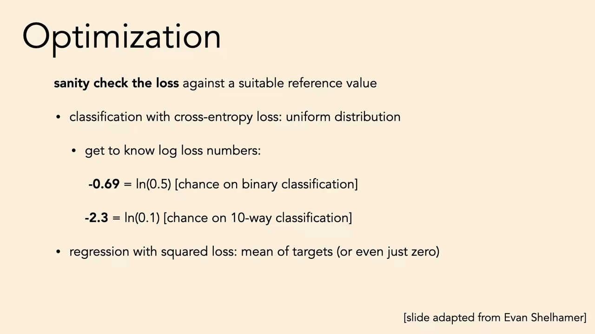
*▲ 강의 슬라이드 [72:00](https://youtu.be/DC2Hw9DiLCg?t=4320): [손실](00_%EB%94%A5%EB%9F%AC%EB%8B%9D_%EC%9A%A9%EC%96%B4%EC%82%AC%EC%A0%84.md#loss-function-%EC%86%90%EC%8B%A4-%ED%95%A8%EC%88%98)을 알맞은 기준값과 비교하라. [교차 엔트로피](00_%EB%94%A5%EB%9F%AC%EB%8B%9D_%EC%9A%A9%EC%96%B4%EC%82%AC%EC%A0%84.md#cross-entropy-%EA%B5%90%EC%B0%A8-%EC%97%94%ED%8A%B8%EB%A1%9C%ED%94%BC) [분류](00_%EB%94%A5%EB%9F%AC%EB%8B%9D_%EC%9A%A9%EC%96%B4%EC%82%AC%EC%A0%84.md#regression-classification-%ED%9A%8C%EA%B7%80%EC%99%80-%EB%B6%84%EB%A5%98)는 균등 분포, 제곱 [손실](00_%EB%94%A5%EB%9F%AC%EB%8B%9D_%EC%9A%A9%EC%96%B4%EC%82%AC%EC%A0%84.md#loss-function-%EC%86%90%EC%8B%A4-%ED%95%A8%EC%88%98) [회귀](00_%EB%94%A5%EB%9F%AC%EB%8B%9D_%EC%9A%A9%EC%96%B4%EC%82%AC%EC%A0%84.md#regression-classification-%ED%9A%8C%EA%B7%80%EC%99%80-%EB%B6%84%EB%A5%98)는 [정답](00_%EB%94%A5%EB%9F%AC%EB%8B%9D_%EC%9A%A9%EC%96%B4%EC%82%AC%EC%A0%84.md#label-%EC%A0%95%EB%8B%B5)의 평균(또는 0)이 기준*

- 딥러닝에서는 거의 늘 [로그](00_%EB%94%A5%EB%9F%AC%EB%8B%9D_%EC%9A%A9%EC%96%B4%EC%82%AC%EC%A0%84.md#log-ln-%EB%A1%9C%EA%B7%B8) [확률](00_%EB%94%A5%EB%9F%AC%EB%8B%9D_%EC%9A%A9%EC%96%B4%EC%82%AC%EC%A0%84.md#probability-%ED%99%95%EB%A5%A0)을 다룬다. [교차 엔트로피](00_%EB%94%A5%EB%9F%AC%EB%8B%9D_%EC%9A%A9%EC%96%B4%EC%82%AC%EC%A0%84.md#cross-entropy-%EA%B5%90%EC%B0%A8-%EC%97%94%ED%8A%B8%EB%A1%9C%ED%94%BC) [손실](00_%EB%94%A5%EB%9F%AC%EB%8B%9D_%EC%9A%A9%EC%96%B4%EC%82%AC%EC%A0%84.md#loss-function-%EC%86%90%EC%8B%A4-%ED%95%A8%EC%88%98)은 모델 아래 데이터의 평균 (음의) [로그](00_%EB%94%A5%EB%9F%AC%EB%8B%9D_%EC%9A%A9%EC%96%B4%EC%82%AC%EC%A0%84.md#log-ln-%EB%A1%9C%EA%B7%B8) [확률](00_%EB%94%A5%EB%9F%AC%EB%8B%9D_%EC%9A%A9%EC%96%B4%EC%82%AC%EC%A0%84.md#probability-%ED%99%95%EB%A5%A0)이다. 음수가 괜찮은지, 작을수록 좋은지, 0이면 무슨 뜻인지 알아야 한다.
- 외울 숫자: **ln 0.5 = -0.69**. 균형 잡힌 [이진 분류](00_%EB%94%A5%EB%9F%AC%EB%8B%9D_%EC%9A%A9%EC%96%B4%EC%82%AC%EC%A0%84.md#binary-classification-%EC%9D%B4%EC%A7%84-%EB%B6%84%EB%A5%98)에서 [손실](00_%EB%94%A5%EB%9F%AC%EB%8B%9D_%EC%9A%A9%EC%96%B4%EC%82%AC%EC%A0%84.md#loss-function-%EC%86%90%EC%8B%A4-%ED%95%A8%EC%88%98) 0.69가 나오면 "괜찮네"가 아니라 **찍기 수준**이다. **ln 0.1 = -2.3**. 10개 클래스 [분류](00_%EB%94%A5%EB%9F%AC%EB%8B%9D_%EC%9A%A9%EC%96%B4%EC%82%AC%EC%A0%84.md#regression-classification-%ED%9A%8C%EA%B7%80%EC%99%80-%EB%B6%84%EB%A5%98)(과제의 단골)에서 [손실](00_%EB%94%A5%EB%9F%AC%EB%8B%9D_%EC%9A%A9%EC%96%B4%EC%82%AC%EC%A0%84.md#loss-function-%EC%86%90%EC%8B%A4-%ED%95%A8%EC%88%98) 2.3이면 모든 클래스에 10%씩 주는 찍기다. 일반적으로:

$$
\mathcal{L}_{\text{chance}} = -\ln \frac{1}{K} = \ln K
$$

<details><summary>기호 풀이</summary>

| 기호 | 읽는 법 | 뜻 | 예제 값 |
| --- | --- | --- | --- |
| $\mathcal{L}_{\text{chance}}$ | 엘 찬스 | 모든 클래스에 같은 [확률](00_%EB%94%A5%EB%9F%AC%EB%8B%9D_%EC%9A%A9%EC%96%B4%EC%82%AC%EC%A0%84.md#probability-%ED%99%95%EB%A5%A0)을 줄 때의 [교차 엔트로피](00_%EB%94%A5%EB%9F%AC%EB%8B%9D_%EC%9A%A9%EC%96%B4%EC%82%AC%EC%A0%84.md#cross-entropy-%EA%B5%90%EC%B0%A8-%EC%97%94%ED%8A%B8%EB%A1%9C%ED%94%BC) | 1.3863 |
| $K$ | 케이 | 클래스 수 | 4 |
| $\frac1K$ | K분의 1 | [정답](00_%EB%94%A5%EB%9F%AC%EB%8B%9D_%EC%9A%A9%EC%96%B4%EC%82%AC%EC%A0%84.md#label-%EC%A0%95%EB%8B%B5) 클래스에 준 [확률](00_%EB%94%A5%EB%9F%AC%EB%8B%9D_%EC%9A%A9%EC%96%B4%EC%82%AC%EC%A0%84.md#probability-%ED%99%95%EB%A5%A0) | 0.25 |
| $\ln$ | 자연로그 | $e$(약 2.718)를 몇 제곱하면 그 수가 되는지 | $\ln 2 = 0.6931$ |

</details>

<details><summary>예제와 풀이</summary>

**문제**: 4개 클래스 [분류](00_%EB%94%A5%EB%9F%AC%EB%8B%9D_%EC%9A%A9%EC%96%B4%EC%82%AC%EC%A0%84.md#regression-classification-%ED%9A%8C%EA%B7%80%EC%99%80-%EB%B6%84%EB%A5%98) 모델의 [손실](00_%EB%94%A5%EB%9F%AC%EB%8B%9D_%EC%9A%A9%EC%96%B4%EC%82%AC%EC%A0%84.md#loss-function-%EC%86%90%EC%8B%A4-%ED%95%A8%EC%88%98)이 1.39 근처에서 내려가지 않는다. 찍기 수준과 비교하라.

**주어진 값**:
- $K = 4$ (클래스 수)

**풀이**
1. 식을 그대로 쓴다: $\mathcal{L}_{\text{chance}} = -\ln \frac1K$
2. 값을 대입한다: $-\ln \frac14$
3. 분수를 계산한다: $1 / 4 = 0.25$ 이므로 $-\ln 0.25$
4. [로그](00_%EB%94%A5%EB%9F%AC%EB%8B%9D_%EC%9A%A9%EC%96%B4%EC%82%AC%EC%A0%84.md#log-ln-%EB%A1%9C%EA%B7%B8)를 구한다. $\ln$(자연로그)은 "$e$(약 2.718)를 몇 제곱해야 그 수가 되나"이고 계산기의 ln 키로 구한다: $\ln 0.25 = -1.3863$ 이므로 $-(-1.3863)$
5. 부호를 바꾼다: $-(-1.3863) = 1.3863$

**답**: 찍기 수준이 1.3863이므로, 1.39에 머문 모델은 **아무것도 배우지 못했다**.

</details>

<details><summary>내 이해</summary>


</details>

- 제곱 [손실](00_%EB%94%A5%EB%9F%AC%EB%8B%9D_%EC%9A%A9%EC%96%B4%EC%82%AC%EC%A0%84.md#loss-function-%EC%86%90%EC%8B%A4-%ED%95%A8%EC%88%98) [회귀](00_%EB%94%A5%EB%9F%AC%EB%8B%9D_%EC%9A%A9%EC%96%B4%EC%82%AC%EC%A0%84.md#regression-classification-%ED%9A%8C%EA%B7%80%EC%99%80-%EB%B6%84%EB%A5%98)는 **음수가 될 수 없다**(최솟값 0). 반면 [로그](00_%EB%94%A5%EB%9F%AC%EB%8B%9D_%EC%9A%A9%EC%96%B4%EC%82%AC%EC%A0%84.md#log-ln-%EB%A1%9C%EA%B7%B8) [우도](00_%EB%94%A5%EB%9F%AC%EB%8B%9D_%EC%9A%A9%EC%96%B4%EC%82%AC%EC%A0%84.md#likelihood-%EC%9A%B0%EB%8F%84)의 최소화 대상(음의 [로그](00_%EB%94%A5%EB%9F%AC%EB%8B%9D_%EC%9A%A9%EC%96%B4%EC%82%AC%EC%A0%84.md#log-ln-%EB%A1%9C%EA%B7%B8) [우도](00_%EB%94%A5%EB%9F%AC%EB%8B%9D_%EC%9A%A9%EC%96%B4%EC%82%AC%EC%A0%84.md#likelihood-%EC%9A%B0%EB%8F%84))은 이론상 음의 무한대까지 갈 수 있다. [회귀](00_%EB%94%A5%EB%9F%AC%EB%8B%9D_%EC%9A%A9%EC%96%B4%EC%82%AC%EC%A0%84.md#regression-classification-%ED%9A%8C%EA%B7%80%EC%99%80-%EB%B6%84%EB%A5%98) [손실](00_%EB%94%A5%EB%9F%AC%EB%8B%9D_%EC%9A%A9%EC%96%B4%EC%82%AC%EC%A0%84.md#loss-function-%EC%86%90%EC%8B%A4-%ED%95%A8%EC%88%98)이 -1000이면 버그다.
- [학습률](00_%EB%94%A5%EB%9F%AC%EB%8B%9D_%EC%9A%A9%EC%96%B4%EC%82%AC%EC%A0%84.md#learning-rate-%ED%95%99%EC%8A%B5%EB%A5%A0)은 늘, 배치 크기는 자주 조정하라.

### 14.3 지수 이동 평균

▶ 영상 [72:00](https://youtu.be/DC2Hw9DiLCg?t=4320)

📐 **수학 개념**: [지수 이동 평균](%EC%88%98%ED%95%99%EA%B0%9C%EB%85%90/05_%EC%8B%A0%EA%B2%BD%EB%A7%9D%EC%9D%98_%EA%B3%84%EC%82%B0/MM36_%EC%A7%80%EC%88%98_%EC%9D%B4%EB%8F%99_%ED%8F%89%EA%B7%A0.md) · [모멘텀](%EC%88%98%ED%95%99%EA%B0%9C%EB%85%90/05_%EC%8B%A0%EA%B2%BD%EB%A7%9D%EC%9D%98_%EA%B3%84%EC%82%B0/MM08_SGD%EC%99%80_%EB%AA%A8%EB%A9%98%ED%85%80.md)

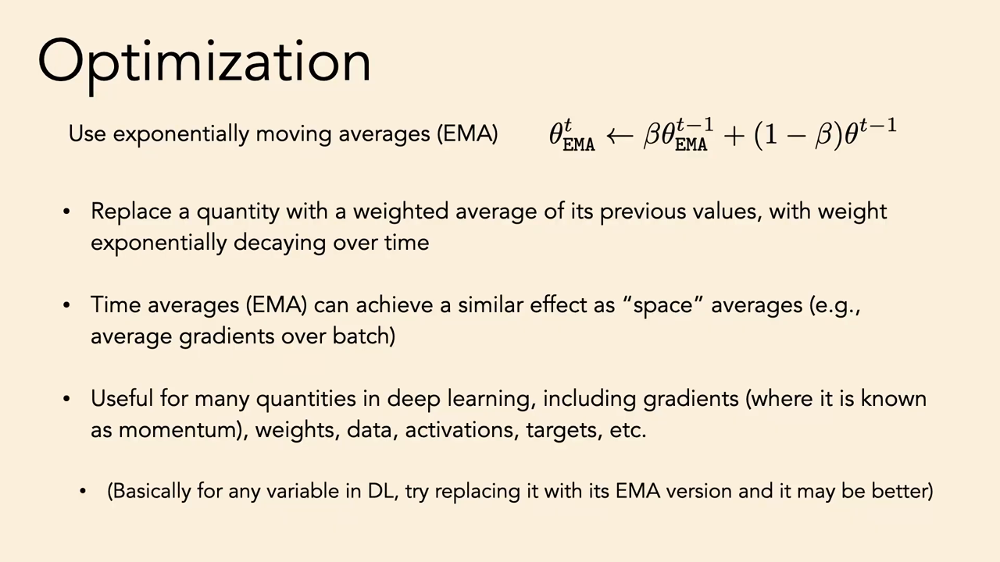
*▲ 강의 슬라이드 [73:40](https://youtu.be/DC2Hw9DiLCg?t=4420): [지수 이동 평균](00_%EB%94%A5%EB%9F%AC%EB%8B%9D_%EC%9A%A9%EC%96%B4%EC%82%AC%EC%A0%84.md#exponential-moving-average-%EC%A7%80%EC%88%98-%EC%9D%B4%EB%8F%99-%ED%8F%89%EA%B7%A0)(EMA)을 써라. 시간 평균이 "공간"(배치) 평균과 비슷한 효과를 낸다*

**[지수 이동 평균](00_%EB%94%A5%EB%9F%AC%EB%8B%9D_%EC%9A%A9%EC%96%B4%EC%82%AC%EC%A0%84.md#exponential-moving-average-%EC%A7%80%EC%88%98-%EC%9D%B4%EB%8F%99-%ED%8F%89%EA%B7%A0)(Exponential moving average, EMA)** 은 값이 새로 들어올 때마다 이전 값들과 섞되, 이전 값들의 기여를 지수적으로 줄인다.

$$
\theta^{t}_{\text{EMA}} \leftarrow \beta\, \theta^{t-1}_{\text{EMA}} + (1-\beta)\, \theta^{t}
$$

<details><summary>기호 풀이</summary>

| 기호 | 읽는 법 | 뜻 | 예제 값 |
| --- | --- | --- | --- |
| $\theta^t$ | 세타 티 | t번째 스텝의 새 값 | 8 |
| $\theta^{t}_{\text{EMA}}$ | 세타 이엠에이 티 | t번째 스텝까지의 EMA | 5 |
| $\theta^{t-1}_{\text{EMA}}$ | 세타 이엠에이 티 빼기 1 | 바로 전 EMA | 2 |
| $\beta$ | 베타 | 감쇠 계수 (0~1, 클수록 과거를 오래 기억) | 0.5 |

</details>

<details><summary>예제와 풀이</summary>

**문제**: β = 0.5, 시작 EMA = 0에서 값 4, 8이 차례로 들어왔다. 지금의 EMA는?

**주어진 값**:
- $\beta = 0.5$ (감쇠 계수)
- $\theta^0_{\text{EMA}} = 0$ (시작 값)
- $\theta^1 = 4$, $\theta^2 = 8$ (들어온 값)

**풀이**
1. 식을 그대로 쓴다: $\theta^{t}_{\text{EMA}} = \beta\, \theta^{t-1}_{\text{EMA}} + (1-\beta)\, \theta^{t}$
2. 값을 대입한다 (t = 1): $\theta^{1}_{\text{EMA}} = 0.5 × 0 + (1 - 0.5) × 4$
3. 괄호를 먼저 계산한다: $1 - 0.5 = 0.5$ 이므로 $\theta^{1}_{\text{EMA}} = 0.5 × 0 + 0.5 × 4$
4. 곱셈을 한다: $0.5 × 0 = 0$, $0.5 × 4 = 2$ 이므로 $\theta^{1}_{\text{EMA}} = 0 + 2 = 2$
5. 값을 대입한다 (t = 2): $\theta^{2}_{\text{EMA}} = 0.5 × 2 + (1 - 0.5) × 8$
6. 괄호를 먼저 계산한다: $1 - 0.5 = 0.5$ 이므로 $\theta^{2}_{\text{EMA}} = 0.5 × 2 + 0.5 × 8$
7. 곱셈을 한다: $0.5 × 2 = 1$, $0.5 × 8 = 4$ 이므로 $\theta^{2}_{\text{EMA}} = 1 + 4$
8. 더한다: $1 + 4 = 5$

**답**: 5

</details>

<details><summary>내 이해</summary>


</details>

- 쓰임: 배치 안의 [기울기](00_%EB%94%A5%EB%9F%AC%EB%8B%9D_%EC%9A%A9%EC%96%B4%EC%82%AC%EC%A0%84.md#gradient-%EA%B8%B0%EC%9A%B8%EA%B8%B0)를 평균하는 것(공간 평균)을 여러 스텝에 걸친 평균(시간 평균)으로 바꿀 수 있다. 시간과 공간의 교환이다. [모멘텀](00_%EB%94%A5%EB%9F%AC%EB%8B%9D_%EC%9A%A9%EC%96%B4%EC%82%AC%EC%A0%84.md#momentum-%EB%AA%A8%EB%A9%98%ED%85%80)이 바로 [기울기](00_%EB%94%A5%EB%9F%AC%EB%8B%9D_%EC%9A%A9%EC%96%B4%EC%82%AC%EC%A0%84.md#gradient-%EA%B8%B0%EC%9A%B8%EA%B8%B0)의 EMA다.
- 강사의 권유: [기울기](00_%EB%94%A5%EB%9F%AC%EB%8B%9D_%EC%9A%A9%EC%96%B4%EC%82%AC%EC%A0%84.md#gradient-%EA%B8%B0%EC%9A%B8%EA%B8%B0), 활성화, 데이터, [가중치](00_%EB%94%A5%EB%9F%AC%EB%8B%9D_%EC%9A%A9%EC%96%B4%EC%82%AC%EC%A0%84.md#weight-%EA%B0%80%EC%A4%91%EC%B9%98), 목표 예측값까지 **딥러닝의 거의 모든 변수에 EMA를 씌워 보라**. 더 나을 수 있다. [PyTorch](00_%EB%94%A5%EB%9F%AC%EB%8B%9D_%EC%9A%A9%EC%96%B4%EC%82%AC%EC%A0%84.md#pytorch-%ED%8C%8C%EC%9D%B4%ED%86%A0%EC%B9%98)에서는 변수를 감싸 "자기 값이 아니라 지난 값들의 EMA"가 되게 하는 래퍼를 쓰면 된다.

### 14.4 강의에서 넘어간 슬라이드

▶ 영상 [73:40](https://youtu.be/DC2Hw9DiLCg?t=4420)

시간이 부족해 강사는 남은 슬라이드를 빠르게 넘기며 "각자 읽어 보라"고 했다. 화면에 잠깐 보인 것들:

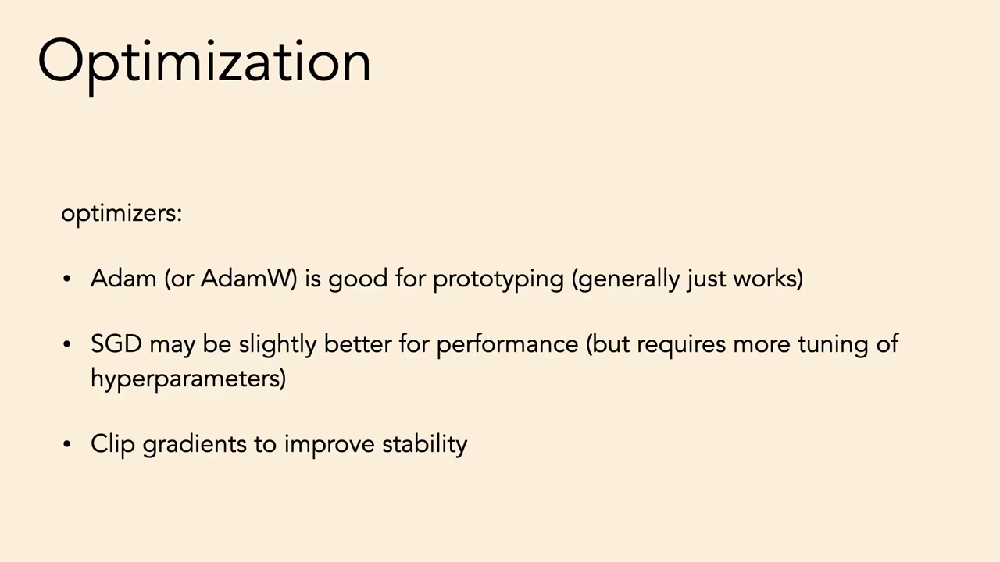
*▲ 강의 슬라이드 [73:43](https://youtu.be/DC2Hw9DiLCg?t=4423): [옵티마이저](00_%EB%94%A5%EB%9F%AC%EB%8B%9D_%EC%9A%A9%EC%96%B4%EC%82%AC%EC%A0%84.md#optimizer-%EC%98%B5%ED%8B%B0%EB%A7%88%EC%9D%B4%EC%A0%80). [Adam](00_%EB%94%A5%EB%9F%AC%EB%8B%9D_%EC%9A%A9%EC%96%B4%EC%82%AC%EC%A0%84.md#adam-%EC%95%84%EB%8B%B4-%EC%98%B5%ED%8B%B0%EB%A7%88%EC%9D%B4%EC%A0%80)(또는 AdamW)은 프로토타입에 좋다(대개 그냥 된다). SGD는 성능이 조금 더 좋을 수 있지만 [하이퍼파라미터](00_%EB%94%A5%EB%9F%AC%EB%8B%9D_%EC%9A%A9%EC%96%B4%EC%82%AC%EC%A0%84.md#hyperparameter-%ED%95%98%EC%9D%B4%ED%8D%BC%ED%8C%8C%EB%9D%BC%EB%AF%B8%ED%84%B0) 조정이 더 필요하다. [기울기](00_%EB%94%A5%EB%9F%AC%EB%8B%9D_%EC%9A%A9%EC%96%B4%EC%82%AC%EC%A0%84.md#gradient-%EA%B8%B0%EC%9A%B8%EA%B8%B0)를 잘라 안정성을 높여라*

- **[옵티마이저](00_%EB%94%A5%EB%9F%AC%EB%8B%9D_%EC%9A%A9%EC%96%B4%EC%82%AC%EC%A0%84.md#optimizer-%EC%98%B5%ED%8B%B0%EB%A7%88%EC%9D%B4%EC%A0%80)**: 위 슬라이드. [그래디언트 클리핑](00_%EB%94%A5%EB%9F%AC%EB%8B%9D_%EC%9A%A9%EC%96%B4%EC%82%AC%EC%A0%84.md#gradient-clipping-%EA%B7%B8%EB%9E%98%EB%94%94%EC%96%B8%ED%8A%B8-%ED%81%B4%EB%A6%AC%ED%95%91)은 [Lec02 3.2](Lec02_%EC%8B%A0%EA%B2%BD%EB%A7%9D_%ED%95%99%EC%8A%B5.md#32-%EC%A7%84%ED%99%94-%EC%A0%84%EB%9E%B5%EA%B3%BC-%EA%B7%B8%EB%9E%98%EB%94%94%EC%96%B8%ED%8A%B8-%ED%81%B4%EB%A6%AC%ED%95%91)에서 다뤘다.
- **평가 모드**: [PyTorch](00_%EB%94%A5%EB%9F%AC%EB%8B%9D_%EC%9A%A9%EC%96%B4%EC%82%AC%EC%A0%84.md#pytorch-%ED%8C%8C%EC%9D%B4%ED%86%A0%EC%B9%98)에서는 평가 전에 `model.eval()`로 평가 모드로 바꿔라. "정말로." 그리고 `model.training`으로 모드를 확인하라([배치 정규화](00_%EB%94%A5%EB%9F%AC%EB%8B%9D_%EC%9A%A9%EC%96%B4%EC%82%AC%EC%A0%84.md#batch-normalization-%EB%B0%B0%EC%B9%98-%EC%A0%95%EA%B7%9C%ED%99%94)·[드롭아웃](00_%EB%94%A5%EB%9F%AC%EB%8B%9D_%EC%9A%A9%EC%96%B4%EC%82%AC%EC%A0%84.md#dropout-%EB%93%9C%EB%A1%AD%EC%95%84%EC%9B%83)이 [학습](00_%EB%94%A5%EB%9F%AC%EB%8B%9D_%EC%9A%A9%EC%96%B4%EC%82%AC%EC%A0%84.md#training-%ED%95%99%EC%8A%B5) 때와 다르게 동작하기 때문).
- **출력을 보라**: [손실](00_%EB%94%A5%EB%9F%AC%EB%8B%9D_%EC%9A%A9%EC%96%B4%EC%82%AC%EC%A0%84.md#loss-function-%EC%86%90%EC%8B%A4-%ED%95%A8%EC%88%98) 곡선, 생성 결과 격자, 실험 추적 도구(Weights & Biases 화면)가 지나갔다(2.3절과 같은 메시지).

> [!TIP]
> **🆕 2026 업데이트: [Adam](00_%EB%94%A5%EB%9F%AC%EB%8B%9D_%EC%9A%A9%EC%96%B4%EC%82%AC%EC%A0%84.md#adam-%EC%95%84%EB%8B%B4-%EC%98%B5%ED%8B%B0%EB%A7%88%EC%9D%B4%EC%A0%80) 다음의 [옵티마이저](00_%EB%94%A5%EB%9F%AC%EB%8B%9D_%EC%9A%A9%EC%96%B4%EC%82%AC%EC%A0%84.md#optimizer-%EC%98%B5%ED%8B%B0%EB%A7%88%EC%9D%B4%EC%A0%80)**
> - **강의**: [Adam](00_%EB%94%A5%EB%9F%AC%EB%8B%9D_%EC%9A%A9%EC%96%B4%EC%82%AC%EC%A0%84.md#adam-%EC%95%84%EB%8B%B4-%EC%98%B5%ED%8B%B0%EB%A7%88%EC%9D%B4%EC%A0%80)(또는 AdamW)이 프로토타입의 기본값이다.
> - **현재**: AdamW는 여전히 가장 널리 쓰이는 기본값이지만, 행렬 [파라미터](00_%EB%94%A5%EB%9F%AC%EB%8B%9D_%EC%9A%A9%EC%96%B4%EC%82%AC%EC%A0%84.md#parameter-%ED%8C%8C%EB%9D%BC%EB%AF%B8%ED%84%B0)의 갱신을 직교화하는 **[Muon](00_%EB%94%A5%EB%9F%AC%EB%8B%9D_%EC%9A%A9%EC%96%B4%EC%82%AC%EC%A0%84.md#muon-%EB%AE%A4%EC%98%A8-%EC%98%B5%ED%8B%B0%EB%A7%88%EC%9D%B4%EC%A0%80)** [옵티마이저](00_%EB%94%A5%EB%9F%AC%EB%8B%9D_%EC%9A%A9%EC%96%B4%EC%82%AC%EC%A0%84.md#optimizer-%EC%98%B5%ED%8B%B0%EB%A7%88%EC%9D%B4%EC%A0%80)가 대규모 [학습](00_%EB%94%A5%EB%9F%AC%EB%8B%9D_%EC%9A%A9%EC%96%B4%EC%82%AC%EC%A0%84.md#training-%ED%95%99%EC%8A%B5)에서도 통한다는 보고가 나왔다. Moonshot AI(2025)는 [가중치 감쇠](00_%EB%94%A5%EB%9F%AC%EB%8B%9D_%EC%9A%A9%EC%96%B4%EC%82%AC%EC%A0%84.md#weight-decay-%EA%B0%80%EC%A4%91%EC%B9%98-%EA%B0%90%EC%87%A0)와 파라미터별 갱신 크기 조정을 더하면 [Muon](00_%EB%94%A5%EB%9F%AC%EB%8B%9D_%EC%9A%A9%EC%96%B4%EC%82%AC%EC%A0%84.md#muon-%EB%AE%A4%EC%98%A8-%EC%98%B5%ED%8B%B0%EB%A7%88%EC%9D%B4%EC%A0%80)이 별도 조정 없이 대규모로 작동하고, 계산 최적 [학습](00_%EB%94%A5%EB%9F%AC%EB%8B%9D_%EC%9A%A9%EC%96%B4%EC%82%AC%EC%A0%84.md#training-%ED%95%99%EC%8A%B5)에서 AdamW보다 약 2배 계산 효율이 좋다고 보고했다. 같은 팀의 Kimi K2(총 1조 [파라미터](00_%EB%94%A5%EB%9F%AC%EB%8B%9D_%EC%9A%A9%EC%96%B4%EC%82%AC%EC%A0%84.md#parameter-%ED%8C%8C%EB%9D%BC%EB%AF%B8%ED%84%B0) MoE)는 [Muon](00_%EB%94%A5%EB%9F%AC%EB%8B%9D_%EC%9A%A9%EC%96%B4%EC%82%AC%EC%A0%84.md#muon-%EB%AE%A4%EC%98%A8-%EC%98%B5%ED%8B%B0%EB%A7%88%EC%9D%B4%EC%A0%80)에 [어텐션](00_%EB%94%A5%EB%9F%AC%EB%8B%9D_%EC%9A%A9%EC%96%B4%EC%82%AC%EC%A0%84.md#attention-%EC%96%B4%ED%85%90%EC%85%98) [로짓](00_%EB%94%A5%EB%9F%AC%EB%8B%9D_%EC%9A%A9%EC%96%B4%EC%82%AC%EC%A0%84.md#logit-%EB%A1%9C%EC%A7%93) 폭주를 막는 QK-clip을 더한 MuonClip으로 15.5조 [토큰](00_%EB%94%A5%EB%9F%AC%EB%8B%9D_%EC%9A%A9%EC%96%B4%EC%82%AC%EC%A0%84.md#token-%ED%86%A0%ED%81%B0)을 [손실](00_%EB%94%A5%EB%9F%AC%EB%8B%9D_%EC%9A%A9%EC%96%B4%EC%82%AC%EC%A0%84.md#loss-function-%EC%86%90%EC%8B%A4-%ED%95%A8%EC%88%98) 스파이크 없이 사전 학습했다고 밝혔다.
> - **출처**: [Liu et al., Muon is Scalable for LLM Training (2025)](https://arxiv.org/abs/2502.16982) · [Kimi Team, Kimi K2: Open Agentic Intelligence (2025)](https://arxiv.org/abs/2507.20534)

---

## 15. 양념 비유

▶ 영상 [73:46](https://youtu.be/DC2Hw9DiLCg?t=4426)

- 오늘 저녁 요리에 어떤 양념을 써야 할까? 누군가 "카이엔 고추만 있으면 된다(all you need)"고 한다면 맞는 말일까? 아니다. **[어텐션](00_%EB%94%A5%EB%9F%AC%EB%8B%9D_%EC%9A%A9%EC%96%B4%EC%82%AC%EC%A0%84.md#attention-%EC%96%B4%ED%85%90%EC%85%98)도 "전부"가 아니다.** [어텐션](00_%EB%94%A5%EB%9F%AC%EB%8B%9D_%EC%9A%A9%EC%96%B4%EC%82%AC%EC%A0%84.md#attention-%EC%96%B4%ED%85%90%EC%85%98)은 잘 통하는 재료 하나이고, [ReLU](00_%EB%94%A5%EB%9F%AC%EB%8B%9D_%EC%9A%A9%EC%96%B4%EC%82%AC%EC%A0%84.md#relu-%EB%A0%90%EB%A3%A8)도 좋은 재료다.
- 딥러닝은 요리와 같다. 재료의 조합에 대한 탐색 지형이 아주 다봉(multimodal)이다. [규제](00_%EB%94%A5%EB%9F%AC%EB%8B%9D_%EC%9A%A9%EC%96%B4%EC%82%AC%EC%A0%84.md#regularization-%EA%B7%9C%EC%A0%9C)마다 효과가 있고 서로 겹친다. [스킵 연결](00_%EB%94%A5%EB%9F%AC%EB%8B%9D_%EC%9A%A9%EC%96%B4%EC%82%AC%EC%A0%84.md#skip-connection-%EC%8A%A4%ED%82%B5-%EC%97%B0%EA%B2%B0)이 필요한가? 아주 깊은 구조라면 그렇다. [기울기 소실](00_%EB%94%A5%EB%9F%AC%EB%8B%9D_%EC%9A%A9%EC%96%B4%EC%82%AC%EC%A0%84.md#vanishing-gradient-%EA%B8%B0%EC%9A%B8%EA%B8%B0-%EC%86%8C%EC%8B%A4)이 없는 옵티마이저라면 아닐 수도 있다.
- 매운 닭 요리도, 미소와 간장을 쓴 초밥도 모두 맛있다. 똑같이 좋은 조합이 여럿이다. 어떤 재료는 규제하고, 어떤 재료는 [용량](00_%EB%94%A5%EB%9F%AC%EB%8B%9D_%EC%9A%A9%EC%96%B4%EC%82%AC%EC%A0%84.md#capacity-%EC%9A%A9%EB%9F%89)을 늘리고, 어떤 재료는 최적화를 빠르게 한다. 재료별 효과를 배우고, **한 가지에 지나치게 기대지 마라(양념을 과하게 치지 마라)**.

---

## 16. 용어 정리

용어사전에 있는 용어는 위 본문에 링크를 걸었습니다. 아래는 이번 강의에서 새로 나온 용어입니다.

| 용어 | 뜻 |
|---|---|
| [지름길 학습](00_%EB%94%A5%EB%9F%AC%EB%8B%9D_%EC%9A%A9%EC%96%B4%EC%82%AC%EC%A0%84.md#shortcut-learning-%EC%A7%80%EB%A6%84%EA%B8%B8-%ED%95%99%EC%8A%B5)(Shortcut learning) | 과제의 본질 대신 데이터 속 허위 상관(사진 구석의 표시 등)으로 답을 맞히는 [학습](00_%EB%94%A5%EB%9F%AC%EB%8B%9D_%EC%9A%A9%EC%96%B4%EC%82%AC%EC%A0%84.md#training-%ED%95%99%EC%8A%B5) |
| [클래스 불균형](00_%EB%94%A5%EB%9F%AC%EB%8B%9D_%EC%9A%A9%EC%96%B4%EC%82%AC%EC%A0%84.md#class-imbalance-%ED%81%B4%EB%9E%98%EC%8A%A4-%EB%B6%88%EA%B7%A0%ED%98%95)(Class imbalance) | 한 클래스가 데이터 대부분을 차지하는 상태 |
| [우연 수준](00_%EB%94%A5%EB%9F%AC%EB%8B%9D_%EC%9A%A9%EC%96%B4%EC%82%AC%EC%A0%84.md#chance-level-%EC%9A%B0%EC%97%B0-%EC%88%98%EC%A4%80)(Chance level) | 입력을 보지 않고 낼 수 있는 기준 성능. 균등 예측의 [교차 엔트로피](00_%EB%94%A5%EB%9F%AC%EB%8B%9D_%EC%9A%A9%EC%96%B4%EC%82%AC%EC%A0%84.md#cross-entropy-%EA%B5%90%EC%B0%A8-%EC%97%94%ED%8A%B8%EB%A1%9C%ED%94%BC)는 $\ln K$ |
| [표준화](00_%EB%94%A5%EB%9F%AC%EB%8B%9D_%EC%9A%A9%EC%96%B4%EC%82%AC%EC%A0%84.md#standardization-%ED%91%9C%EC%A4%80%ED%99%94)([Standardization](00_%EB%94%A5%EB%9F%AC%EB%8B%9D_%EC%9A%A9%EC%96%B4%EC%82%AC%EC%A0%84.md#standardization-%ED%91%9C%EC%A4%80%ED%99%94)) | 평균을 빼고 표준편차로 나눠 평균 0, [분산](00_%EB%94%A5%EB%9F%AC%EB%8B%9D_%EC%9A%A9%EC%96%B4%EC%82%AC%EC%A0%84.md#variance-%EB%B6%84%EC%82%B0) 1로 맞추는 [전처리](00_%EB%94%A5%EB%9F%AC%EB%8B%9D_%EC%9A%A9%EC%96%B4%EC%82%AC%EC%A0%84.md#preconditioning-%EC%A0%84%EC%B2%98%EB%A6%AC) |
| [층 정규화](00_%EB%94%A5%EB%9F%AC%EB%8B%9D_%EC%9A%A9%EC%96%B4%EC%82%AC%EC%A0%84.md#layer-normalization-%EC%B8%B5-%EC%A0%95%EA%B7%9C%ED%99%94)(Layer normalization) | 한 데이터의 활성화 벡터 안에서 평균을 빼고 표준편차로 나누는 [층](00_%EB%94%A5%EB%9F%AC%EB%8B%9D_%EC%9A%A9%EC%96%B4%EC%82%AC%EC%A0%84.md#layer-%EC%B8%B5) |
| [RMS 정규화](00_%EB%94%A5%EB%9F%AC%EB%8B%9D_%EC%9A%A9%EC%96%B4%EC%82%AC%EC%A0%84.md#rmsnorm-rms-%EC%A0%95%EA%B7%9C%ED%99%94)([RMSNorm](00_%EB%94%A5%EB%9F%AC%EB%8B%9D_%EC%9A%A9%EC%96%B4%EC%82%AC%EC%A0%84.md#rmsnorm-rms-%EC%A0%95%EA%B7%9C%ED%99%94)) | 평균을 빼지 않고 제곱 평균의 제곱근으로만 나누는 [정규화](00_%EB%94%A5%EB%9F%AC%EB%8B%9D_%EC%9A%A9%EC%96%B4%EC%82%AC%EC%A0%84.md#normalization-%EC%A0%95%EA%B7%9C%ED%99%94) [층](00_%EB%94%A5%EB%9F%AC%EB%8B%9D_%EC%9A%A9%EC%96%B4%EC%82%AC%EC%A0%84.md#layer-%EC%B8%B5) |
| [배치 정규화](00_%EB%94%A5%EB%9F%AC%EB%8B%9D_%EC%9A%A9%EC%96%B4%EC%82%AC%EC%A0%84.md#batch-normalization-%EB%B0%B0%EC%B9%98-%EC%A0%95%EA%B7%9C%ED%99%94)(Batch normalization) | 특징마다 배치 안의 평균과 [분산](00_%EB%94%A5%EB%9F%AC%EB%8B%9D_%EC%9A%A9%EC%96%B4%EC%82%AC%EC%A0%84.md#variance-%EB%B6%84%EC%82%B0)으로 정규화하는 [층](00_%EB%94%A5%EB%9F%AC%EB%8B%9D_%EC%9A%A9%EC%96%B4%EC%82%AC%EC%A0%84.md#layer-%EC%B8%B5) |
| [einops](00_%EB%94%A5%EB%9F%AC%EB%8B%9D_%EC%9A%A9%EC%96%B4%EC%82%AC%EC%A0%84.md#einops-%EC%95%84%EC%9D%B8%EC%98%B5%EC%8A%A4) | [텐서](00_%EB%94%A5%EB%9F%AC%EB%8B%9D_%EC%9A%A9%EC%96%B4%EC%82%AC%EC%A0%84.md#tensor-%ED%85%90%EC%84%9C) [모양 바꾸기](00_%EB%94%A5%EB%9F%AC%EB%8B%9D_%EC%9A%A9%EC%96%B4%EC%82%AC%EC%A0%84.md#reshape-permute-%EB%AA%A8%EC%96%91-%EB%B0%94%EA%BE%B8%EA%B8%B0%EC%99%80-%EC%B6%95-%EC%88%9C%EC%84%9C-%EB%B0%94%EA%BE%B8%EA%B8%B0)를 `rearrange` 문자열 표기로 통일한 라이브러리 |
| [데이터 증강](00_%EB%94%A5%EB%9F%AC%EB%8B%9D_%EC%9A%A9%EC%96%B4%EC%82%AC%EC%A0%84.md#data-augmentation-%EB%8D%B0%EC%9D%B4%ED%84%B0-%EC%A6%9D%EA%B0%95)([Data augmentation](00_%EB%94%A5%EB%9F%AC%EB%8B%9D_%EC%9A%A9%EC%96%B4%EC%82%AC%EC%A0%84.md#data-augmentation-%EB%8D%B0%EC%9D%B4%ED%84%B0-%EC%A6%9D%EA%B0%95)) | [정답](00_%EB%94%A5%EB%9F%AC%EB%8B%9D_%EC%9A%A9%EC%96%B4%EC%82%AC%EC%A0%84.md#label-%EC%A0%95%EB%8B%B5)을 바꾸지 않는 변환으로 [학습 데이터](00_%EB%94%A5%EB%9F%AC%EB%8B%9D_%EC%9A%A9%EC%96%B4%EC%82%AC%EC%A0%84.md#training-data-test-data-%ED%95%99%EC%8A%B5-%EB%8D%B0%EC%9D%B4%ED%84%B0%EC%99%80-%EC%8B%9C%ED%97%98-%EB%8D%B0%EC%9D%B4%ED%84%B0)를 늘리는 방법 |
| [도메인 무작위화](00_%EB%94%A5%EB%9F%AC%EB%8B%9D_%EC%9A%A9%EC%96%B4%EC%82%AC%EC%A0%84.md#domain-randomization-%EB%8F%84%EB%A9%94%EC%9D%B8-%EB%AC%B4%EC%9E%91%EC%9C%84%ED%99%94)(Domain randomization) | 시뮬레이션의 색, 조명, 물리 값을 무작위로 바꿔 현실로 일반화하게 하는 방법 |
| [맥락 창](00_%EB%94%A5%EB%9F%AC%EB%8B%9D_%EC%9A%A9%EC%96%B4%EC%82%AC%EC%A0%84.md#context-window-%EB%A7%A5%EB%9D%BD-%EC%B0%BD)(Context window) | [언어 모델](00_%EB%94%A5%EB%9F%AC%EB%8B%9D_%EC%9A%A9%EC%96%B4%EC%82%AC%EC%A0%84.md#language-model-%EC%96%B8%EC%96%B4-%EB%AA%A8%EB%8D%B8)이 한 번에 입력으로 받을 수 있는 [토큰](00_%EB%94%A5%EB%9F%AC%EB%8B%9D_%EC%9A%A9%EC%96%B4%EC%82%AC%EC%A0%84.md#token-%ED%86%A0%ED%81%B0) 길이 |
| [사전 학습](00_%EB%94%A5%EB%9F%AC%EB%8B%9D_%EC%9A%A9%EC%96%B4%EC%82%AC%EC%A0%84.md#pre-training-%EC%82%AC%EC%A0%84-%ED%95%99%EC%8A%B5)([Pre-training](00_%EB%94%A5%EB%9F%AC%EB%8B%9D_%EC%9A%A9%EC%96%B4%EC%82%AC%EC%A0%84.md#pre-training-%EC%82%AC%EC%A0%84-%ED%95%99%EC%8A%B5)) | 큰 데이터로 미리 학습해 두고 다른 과제의 출발점으로 쓰는 것 |
| [양자화](00_%EB%94%A5%EB%9F%AC%EB%8B%9D_%EC%9A%A9%EC%96%B4%EC%82%AC%EC%A0%84.md#quantization-%EC%96%91%EC%9E%90%ED%99%94)([Quantization](00_%EB%94%A5%EB%9F%AC%EB%8B%9D_%EC%9A%A9%EC%96%B4%EC%82%AC%EC%A0%84.md#quantization-%EC%96%91%EC%9E%90%ED%99%94)) | 연속 값을 구간으로 나눠 이산 클래스로 바꾸는 것 |
| [쓴 교훈](00_%EB%94%A5%EB%9F%AC%EB%8B%9D_%EC%9A%A9%EC%96%B4%EC%82%AC%EC%A0%84.md#bitter-lesson-%EC%93%B4-%EA%B5%90%ED%9B%88)(Bitter lesson) | 계산을 키우는 일반적 방법이 결국 정교한 사람의 설계를 이긴다는 관찰 |
| [지수 이동 평균](00_%EB%94%A5%EB%9F%AC%EB%8B%9D_%EC%9A%A9%EC%96%B4%EC%82%AC%EC%A0%84.md#exponential-moving-average-%EC%A7%80%EC%88%98-%EC%9D%B4%EB%8F%99-%ED%8F%89%EA%B7%A0)(Exponential moving average) | 지난 값의 기여를 매 스텝 β배로 줄이며 섞는 평균 |
