# Lec 10. 아키텍처: 기억과 시퀀스 (Architectures: Memory)

← 이전: [Lec09_해커의_딥러닝_가이드](Lec09_%ED%95%B4%EC%BB%A4%EC%9D%98_%EB%94%A5%EB%9F%AC%EB%8B%9D_%EA%B0%80%EC%9D%B4%EB%93%9C.md) · [목차](00_MIT%EB%94%A5%EB%9F%AC%EB%8B%9D_%EB%AA%A9%EC%B0%A8.md) · 다음: [Lec11_표현_학습_재구성](Lec11_%ED%91%9C%ED%98%84_%ED%95%99%EC%8A%B5_%EC%9E%AC%EA%B5%AC%EC%84%B1.md) →

> [!NOTE]
> **강의 정보**
> - **출처**: MIT OpenCourseWare, [Lec 10. Architectures: Memory](https://www.youtube.com/watch?v=IiHknRHA-Gk) (73분, 2024년 가을 학기)
> - **강사**: Sara Beery
> - **라이선스**: 원 강의는 CC BY-NC-SA 4.0입니다. 이 노트는 영어 자막을 바탕으로 한국어로 옮겨 정리한 2차 저작물이며, 같은 조건(비영리·출처 표기·동일 조건 공유)을 따릅니다.
> - 각 절 제목 아래의 `▶ 영상` 시간을 누르면 영상의 해당 위치로 갑니다.
> - `📐 수학 개념` 줄은 그 절에 쓰인 수학을 정리한 노트로 연결됩니다. 전체 목록은 [00_MIT딥러닝_목차](00_MIT%EB%94%A5%EB%9F%AC%EB%8B%9D_%EB%AA%A9%EC%B0%A8.md).
> - 슬라이드 캡처는 원 강의(CC BY-NC-SA 4.0)에서 가져왔고, "직접 그린 그림"은 이 노트의 숫자로 새로 그렸습니다.

## 한눈에 보기

| 구분 | 내용 |
|---|---|
| 위치 | 아키텍처 단원의 마지막 강의. [CNN](00_%EB%94%A5%EB%9F%AC%EB%8B%9D_%EC%9A%A9%EC%96%B4%EC%82%AC%EC%A0%84.md#cnn-convolutional-neural-network-%ED%95%A9%EC%84%B1%EA%B3%B1-%EC%8B%A0%EA%B2%BD%EB%A7%9D)·[GNN](00_%EB%94%A5%EB%9F%AC%EB%8B%9D_%EC%9A%A9%EC%96%B4%EC%82%AC%EC%A0%84.md#gnn-graph-neural-network-%EA%B7%B8%EB%9E%98%ED%94%84-%EC%8B%A0%EA%B2%BD%EB%A7%9D)·[트랜스포머](00_%EB%94%A5%EB%9F%AC%EB%8B%9D_%EC%9A%A9%EC%96%B4%EC%82%AC%EC%A0%84.md#transformer-%ED%8A%B8%EB%9E%9C%EC%8A%A4%ED%8F%AC%EB%A8%B8)에 이어 **기억(memory)과 [시퀀스](00_%EB%94%A5%EB%9F%AC%EB%8B%9D_%EC%9A%A9%EC%96%B4%EC%82%AC%EC%A0%84.md#sequence-%EC%8B%9C%ED%80%80%EC%8A%A4) 모델링** |
| 출발 질문 | 고정된 시간 창만 보는 모델은 창 밖의 과거를 잊는다. 과거를 어떻게 기억할까? |
| [RNN](00_%EB%94%A5%EB%9F%AC%EB%8B%9D_%EC%9A%A9%EC%96%B4%EC%82%AC%EC%A0%84.md#rnn-recurrent-neural-network-%EC%88%9C%ED%99%98-%EC%8B%A0%EA%B2%BD%EB%A7%9D) | [은닉 상태](00_%EB%94%A5%EB%9F%AC%EB%8B%9D_%EC%9A%A9%EC%96%B4%EC%82%AC%EC%A0%84.md#hidden-state-%EC%9D%80%EB%8B%89-%EC%83%81%ED%83%9C) $h_t = f(h_{t-1}, x_t)$를 다음 단계로 넘긴다. [계산 그래프](00_%EB%94%A5%EB%9F%AC%EB%8B%9D_%EC%9A%A9%EC%96%B4%EC%82%AC%EC%A0%84.md#computational-graph-%EA%B3%84%EC%82%B0-%EA%B7%B8%EB%9E%98%ED%94%84)에 순환이 생기지만, 펼치면 다시 [DAG](00_%EB%94%A5%EB%9F%AC%EB%8B%9D_%EC%9A%A9%EC%96%B4%EC%82%AC%EC%A0%84.md#dag-directed-acyclic-graph-%EB%B0%A9%ED%96%A5%EC%84%B1-%EB%B9%84%EC%88%9C%ED%99%98-%EA%B7%B8%EB%9E%98%ED%94%84)가 되어 [시간 역전파](00_%EB%94%A5%EB%9F%AC%EB%8B%9D_%EC%9A%A9%EC%96%B4%EC%82%AC%EC%A0%84.md#bptt-backpropagation-through-time-%EC%8B%9C%EA%B0%84-%EC%97%AD%EC%A0%84%ED%8C%8C)로 학습한다 |
| 문제 | 같은 $W$를 거듭 곱하므로 $W^t$가 0으로 사라지거나 폭주한다 → 옛 기억 상실, [기울기 소실](00_%EB%94%A5%EB%9F%AC%EB%8B%9D_%EC%9A%A9%EC%96%B4%EC%82%AC%EC%A0%84.md#vanishing-gradient-%EA%B8%B0%EC%9A%B8%EA%B8%B0-%EC%86%8C%EC%8B%A4)·[폭주](00_%EB%94%A5%EB%9F%AC%EB%8B%9D_%EC%9A%A9%EC%96%B4%EC%82%AC%EC%A0%84.md#exploding-gradient-%EA%B8%B0%EC%9A%B8%EA%B8%B0-%ED%8F%AD%EC%A3%BC) |
| [LSTM](00_%EB%94%A5%EB%9F%AC%EB%8B%9D_%EC%9A%A9%EC%96%B4%EC%82%AC%EC%A0%84.md#lstm-long-short-term-memory-%EC%9E%A5%EB%8B%A8%EA%B8%B0-%EB%A9%94%EB%AA%A8%EB%A6%AC) | [셀 상태](00_%EB%94%A5%EB%9F%AC%EB%8B%9D_%EC%9A%A9%EC%96%B4%EC%82%AC%EC%A0%84.md#cell-state-%EC%85%80-%EC%83%81%ED%83%9C)를 기본값 "잊지 않기"로 두고, [게이트](00_%EB%94%A5%EB%9F%AC%EB%8B%9D_%EC%9A%A9%EC%96%B4%EC%82%AC%EC%A0%84.md#gate-%EA%B2%8C%EC%9D%B4%ED%8A%B8)로 지울 것과 쓸 것을 배운다 |
| [자기회귀 모델](00_%EB%94%A5%EB%9F%AC%EB%8B%9D_%EC%9A%A9%EC%96%B4%EC%82%AC%EC%A0%84.md#autoregressive-model-%EC%9E%90%EA%B8%B0%ED%9A%8C%EA%B7%80-%EB%AA%A8%EB%8D%B8) | 다음 [토큰](00_%EB%94%A5%EB%9F%AC%EB%8B%9D_%EC%9A%A9%EC%96%B4%EC%82%AC%EC%A0%84.md#token-%ED%86%A0%ED%81%B0)을 예측해 입력에 덧붙이기를 반복. [확률의 연쇄법칙](00_%EB%94%A5%EB%9F%AC%EB%8B%9D_%EC%9A%A9%EC%96%B4%EC%82%AC%EC%A0%84.md#chain-rule-of-probability-%ED%99%95%EB%A5%A0%EC%9D%98-%EC%97%B0%EC%87%84%EB%B2%95%EC%B9%99), 다음 단어 분류기, [교사 강요](00_%EB%94%A5%EB%9F%AC%EB%8B%9D_%EC%9A%A9%EC%96%B4%EC%82%AC%EC%A0%84.md#teacher-forcing-%EA%B5%90%EC%82%AC-%EA%B0%95%EC%9A%94), [빔 서치](00_%EB%94%A5%EB%9F%AC%EB%8B%9D_%EC%9A%A9%EC%96%B4%EC%82%AC%EC%A0%84.md#beam-search-%EB%B9%94-%EC%84%9C%EC%B9%98) |
| 긴 기억 | 순환 대신 옛 기억에 직접 연결([합성곱](00_%EB%94%A5%EB%9F%AC%EB%8B%9D_%EC%9A%A9%EC%96%B4%EC%82%AC%EC%A0%84.md#convolution-%ED%95%A9%EC%84%B1%EA%B3%B1), [어텐션](00_%EB%94%A5%EB%9F%AC%EB%8B%9D_%EC%9A%A9%EC%96%B4%EC%82%AC%EC%A0%84.md#attention-%EC%96%B4%ED%85%90%EC%85%98), [메모리 네트워크](00_%EB%94%A5%EB%9F%AC%EB%8B%9D_%EC%9A%A9%EC%96%B4%EC%82%AC%EC%A0%84.md#memory-network-%EB%A9%94%EB%AA%A8%EB%A6%AC-%EB%84%A4%ED%8A%B8%EC%9B%8C%ED%81%AC)). [어텐션](00_%EB%94%A5%EB%9F%AC%EB%8B%9D_%EC%9A%A9%EC%96%B4%EC%82%AC%EC%A0%84.md#attention-%EC%96%B4%ED%85%90%EC%85%98)의 $O(n^2)$ 비용과 [맥락 창](00_%EB%94%A5%EB%9F%AC%EB%8B%9D_%EC%9A%A9%EC%96%B4%EC%82%AC%EC%A0%84.md#context-window-%EB%A7%A5%EB%9D%BD-%EC%B0%BD) 늘리기 |
| 생각할 거리 | 맥락은 정말 얼마나 필요한가(벤치마크가 진전을 정한다), [파라미터](00_%EB%94%A5%EB%9F%AC%EB%8B%9D_%EC%9A%A9%EC%96%B4%EC%82%AC%EC%A0%84.md#parameter-%ED%8C%8C%EB%9D%BC%EB%AF%B8%ED%84%B0)는 느린 기억·활성값은 빠른 기억 |

---

## 1. 왜 시퀀스와 기억인가

▶ 영상 [01:43](https://youtu.be/IiHknRHA-Gk?t=103)

강사는 영상의 한 장면을 보여 주며 시작합니다. 사진 한 장만 보면 "교실에서 노는 아이들"이라는 것, 텔레비전·사람·의자 같은 물체, "의자는 빨간색" 같은 속성까지 지금의 비전 모델도 알아냅니다. 하지만 "여자아이가 **다음에** 무엇을 할까?"는 한 장면으로는 답하기 어렵습니다. 영상을 이어서 보면, 남자아이가 의자를 빼는 순간 "앉으려다 넘어지겠구나"를 예측할 수 있습니다. 행동 사이의 관계, 아이가 의자가 있다고 믿는 이유 같은 의도까지 읽어 내려면 **시간의 흐름(맥락)**이 필요합니다.

- [시퀀스](00_%EB%94%A5%EB%9F%AC%EB%8B%9D_%EC%9A%A9%EC%96%B4%EC%82%AC%EC%A0%84.md#sequence-%EC%8B%9C%ED%80%80%EC%8A%A4)는 여러 형태로 나타납니다. 영상(시간에 따른 이미지), 문장(단어의 나열), 음성(시간에 따른 소리 신호).
- 이 강의의 아키텍처는 처음으로 **[튜링 완전](00_%EB%94%A5%EB%9F%AC%EB%8B%9D_%EC%9A%A9%EC%96%B4%EC%82%AC%EC%A0%84.md#turing-completeness-%ED%8A%9C%EB%A7%81-%EC%99%84%EC%A0%84%EC%84%B1)**한 구조입니다. 지금까지 본 구조 중 가장 일반적인 틀이라는 뜻입니다.
- 순서: [시퀀스](00_%EB%94%A5%EB%9F%AC%EB%8B%9D_%EC%9A%A9%EC%96%B4%EC%82%AC%EC%A0%84.md#sequence-%EC%8B%9C%ED%80%80%EC%8A%A4)를 위한 [CNN](00_%EB%94%A5%EB%9F%AC%EB%8B%9D_%EC%9A%A9%EC%96%B4%EC%82%AC%EC%A0%84.md#cnn-convolutional-neural-network-%ED%95%A9%EC%84%B1%EA%B3%B1-%EC%8B%A0%EA%B2%BD%EB%A7%9D) → [RNN](00_%EB%94%A5%EB%9F%AC%EB%8B%9D_%EC%9A%A9%EC%96%B4%EC%82%AC%EC%A0%84.md#rnn-recurrent-neural-network-%EC%88%9C%ED%99%98-%EC%8B%A0%EA%B2%BD%EB%A7%9D) → [LSTM](00_%EB%94%A5%EB%9F%AC%EB%8B%9D_%EC%9A%A9%EC%96%B4%EC%82%AC%EC%A0%84.md#lstm-long-short-term-memory-%EC%9E%A5%EB%8B%A8%EA%B8%B0-%EB%A9%94%EB%AA%A8%EB%A6%AC) → [시퀀스](00_%EB%94%A5%EB%9F%AC%EB%8B%9D_%EC%9A%A9%EC%96%B4%EC%82%AC%EC%A0%84.md#sequence-%EC%8B%9C%ED%80%80%EC%8A%A4) 모델과 긴 기억.

---

## 2. 시간 축 합성곱

▶ 영상 [04:34](https://youtu.be/IiHknRHA-Gk?t=274)

📐 **수학 개념**: [합성곱](%EC%88%98%ED%95%99%EA%B0%9C%EB%85%90/07_%EA%B5%AC%EC%A1%B0_%EC%95%84%ED%82%A4%ED%85%8D%EC%B2%98/MM15_%ED%95%A9%EC%84%B1%EA%B3%B1%EA%B3%BC_%ED%87%B4%ED%94%8C%EB%A6%AC%EC%B8%A0_%ED%96%89%EB%A0%AC.md) · [수용 영역](%EC%88%98%ED%95%99%EA%B0%9C%EB%85%90/07_%EA%B5%AC%EC%A1%B0_%EC%95%84%ED%82%A4%ED%85%8D%EC%B2%98/MM16_%EC%88%98%EC%9A%A9_%EC%98%81%EC%97%AD%EA%B3%BC_%EC%B6%9C%EB%A0%A5_%ED%81%AC%EA%B8%B0.md)

[Lec04 8절](Lec04_%EA%B2%A9%EC%9E%90_%EC%95%84%ED%82%A4%ED%85%8D%EC%B2%98.md#8-%EC%8B%9C%EA%B0%84-%EC%B6%95-%ED%95%A9%EC%84%B1%EA%B3%B1%EA%B3%BC-%EC%9C%84%EC%B9%98-%EC%9D%B8%EC%BD%94%EB%94%A9)에서 본 것처럼 영상은 시간 축을 하나 더한 **시공간 큐브**입니다. RGB [채널](00_%EB%94%A5%EB%9F%AC%EB%8B%9D_%EC%9A%A9%EC%96%B4%EC%82%AC%EC%A0%84.md#channel-%EC%B1%84%EB%84%90)까지 치면 4차원 [텐서](00_%EB%94%A5%EB%9F%AC%EB%8B%9D_%EC%9A%A9%EC%96%B4%EC%82%AC%EC%A0%84.md#tensor-%ED%85%90%EC%84%9C)이고, 시간은 또 하나의 공간 축처럼 다뤄집니다.

- **큐브를 자르는 방법**: 가로 한 줄의 픽셀만 골라 시간 순으로 쌓으면, 사람들이 걸어간 궤적이 줄무늬로 보입니다. 결승선을 픽셀 한 줄로 정해 시간 순으로 찍으면 누가 먼저 통과했는지 바로 보입니다(올림픽 사진 판정의 원리).
- **1차원 시간 [합성곱](00_%EB%94%A5%EB%9F%AC%EB%8B%9D_%EC%9A%A9%EC%96%B4%EC%82%AC%EC%A0%84.md#convolution-%ED%95%A9%EC%84%B1%EA%B3%B1)**: 길이 3짜리 창에 같은 [가중치](00_%EB%94%A5%EB%9F%AC%EB%8B%9D_%EC%9A%A9%EC%96%B4%EC%82%AC%EC%A0%84.md#weight-%EA%B0%80%EC%A4%91%EC%B9%98) $W$를 써서 입력 세 칸으로 출력 한 칸을 만들고, 창을 시간 축을 따라 밉니다. 입력이 얼마나 길든 계속 밀 수 있어서 **임의 길이 [시퀀스](00_%EB%94%A5%EB%9F%AC%EB%8B%9D_%EC%9A%A9%EC%96%B4%EC%82%AC%EC%A0%84.md#sequence-%EC%8B%9C%ED%80%80%EC%8A%A4) → 임의 길이 [시퀀스](00_%EB%94%A5%EB%9F%AC%EB%8B%9D_%EC%9A%A9%EC%96%B4%EC%82%AC%EC%A0%84.md#sequence-%EC%8B%9C%ED%80%80%EC%8A%A4)** 모델이 됩니다([시간 축 합성곱](00_%EB%94%A5%EB%9F%AC%EB%8B%9D_%EC%9A%A9%EC%96%B4%EC%82%AC%EC%A0%84.md#temporal-convolution-%EC%8B%9C%EA%B0%84-%EC%B6%95-%ED%95%A9%EC%84%B1%EA%B3%B1)).
- MRI처럼 3차원 부피가 시간에 따라 쌓이는 데이터, 384개 대역을 가진 초분광 위성 영상 등 차원이 늘어도 같은 생각을 쓸 수 있습니다.

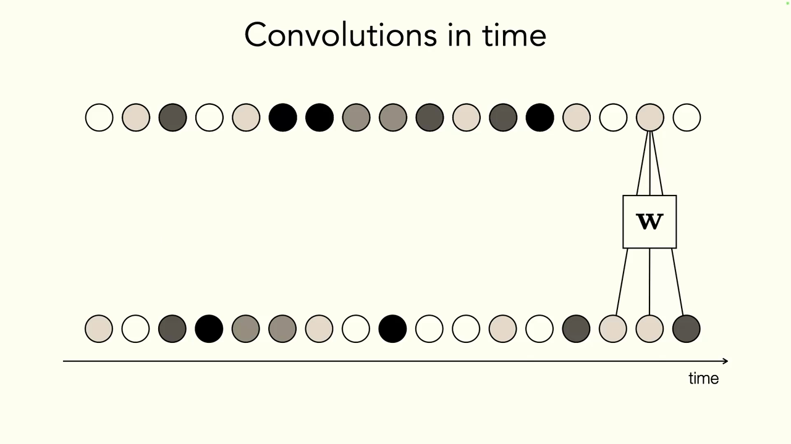
*▲ 강의 슬라이드 [07:52](https://youtu.be/IiHknRHA-Gk?t=472): 같은 [가중치](00_%EB%94%A5%EB%9F%AC%EB%8B%9D_%EC%9A%A9%EC%96%B4%EC%82%AC%EC%A0%84.md#weight-%EA%B0%80%EC%A4%91%EC%B9%98) W를 시간 축을 따라 미는 1차원 [합성곱](00_%EB%94%A5%EB%9F%AC%EB%8B%9D_%EC%9A%A9%EC%96%B4%EC%82%AC%EC%A0%84.md#convolution-%ED%95%A9%EC%84%B1%EA%B3%B1)*

**문제: 창 밖은 보이지 않는다** [09:00](https://youtu.be/IiHknRHA-Gk?t=540)

강사가 집 안을 걸으며 고양이 Frank를 찍는다고 합시다. 처음엔 Frank가 보이지만, 나중에 발코니에서 주황색 동물이 보일 때 [합성곱](00_%EB%94%A5%EB%9F%AC%EB%8B%9D_%EC%9A%A9%EC%96%B4%EC%82%AC%EC%A0%84.md#convolution-%ED%95%A9%EC%84%B1%EA%B3%B1)은 **고정된 창 안의 입력만** 봅니다. 주황색이고 밖이니 "호랑이"라고 예측할 수도 있습니다. 앞에서 Frank를 봤다는 **맥락을 기억**하는 장치가 있다면 "집 안을 걷는 중이니 호랑이일 리 없고, 아까 본 Frank겠다"라고 판단할 수 있습니다. 이것이 [순환 신경망](00_%EB%94%A5%EB%9F%AC%EB%8B%9D_%EC%9A%A9%EC%96%B4%EC%82%AC%EC%A0%84.md#rnn-recurrent-neural-network-%EC%88%9C%ED%99%98-%EC%8B%A0%EA%B2%BD%EB%A7%9D)의 출발점입니다.

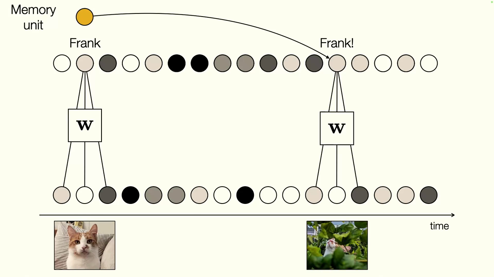
*▲ 강의 슬라이드 [10:32](https://youtu.be/IiHknRHA-Gk?t=632): 기억 단위(memory unit)가 앞에서 본 Frank의 정보를 나중 예측에 전해 준다*

---

## 3. 순환 신경망

▶ 영상 [10:05](https://youtu.be/IiHknRHA-Gk?t=605)

[CNN](00_%EB%94%A5%EB%9F%AC%EB%8B%9D_%EC%9A%A9%EC%96%B4%EC%82%AC%EC%A0%84.md#cnn-convolutional-neural-network-%ED%95%A9%EC%84%B1%EA%B3%B1-%EC%8B%A0%EA%B2%BD%EB%A7%9D)과 [트랜스포머](00_%EB%94%A5%EB%9F%AC%EB%8B%9D_%EC%9A%A9%EC%96%B4%EC%82%AC%EC%A0%84.md#transformer-%ED%8A%B8%EB%9E%9C%EC%8A%A4%ED%8F%AC%EB%A8%B8)를 포함해 지금까지의 구조는 모두 **고정된 시간 창**을 봤습니다. [트랜스포머](00_%EB%94%A5%EB%9F%AC%EB%8B%9D_%EC%9A%A9%EC%96%B4%EC%82%AC%EC%A0%84.md#transformer-%ED%8A%B8%EB%9E%9C%EC%8A%A4%ED%8F%AC%EB%A8%B8)의 [맥락 창](00_%EB%94%A5%EB%9F%AC%EB%8B%9D_%EC%9A%A9%EC%96%B4%EC%82%AC%EC%A0%84.md#context-window-%EB%A7%A5%EB%9D%BD-%EC%B0%BD)이 아무리 커져도 고정된 크기입니다. [순환 신경망(RNN, Recurrent neural network)](00_%EB%94%A5%EB%9F%AC%EB%8B%9D_%EC%9A%A9%EC%96%B4%EC%82%AC%EC%A0%84.md#rnn-recurrent-neural-network-%EC%88%9C%ED%99%98-%EC%8B%A0%EA%B2%BD%EB%A7%9D)은 이 창을 원리상 **무한**으로 만듭니다.

### 3.1 은닉 상태와 순환식

▶ 영상 [11:12](https://youtu.be/IiHknRHA-Gk?t=672)

📐 **수학 개념**: [합성함수](%EC%88%98%ED%95%99%EA%B0%9C%EB%85%90/05_%EC%8B%A0%EA%B2%BD%EB%A7%9D%EC%9D%98_%EA%B3%84%EC%82%B0/MM06_%ED%95%A9%EC%84%B1%ED%95%A8%EC%88%98%EC%99%80_%EB%B9%84%EC%84%A0%ED%98%95%EC%84%B1.md) · [순환식 펼치기](%EC%88%98%ED%95%99%EA%B0%9C%EB%85%90/07_%EA%B5%AC%EC%A1%B0_%EC%95%84%ED%82%A4%ED%85%8D%EC%B2%98/MM37_%EC%88%9C%ED%99%98%EC%8B%9D_%ED%8E%BC%EC%B9%98%EA%B8%B0%EC%99%80_%EA%B1%B0%EB%93%AD%EC%A0%9C%EA%B3%B1.md)

입력을 처리해 얻은 값을 **[은닉 상태(Hidden state)](00_%EB%94%A5%EB%9F%AC%EB%8B%9D_%EC%9A%A9%EC%96%B4%EC%82%AC%EC%A0%84.md#hidden-state-%EC%9D%80%EB%8B%89-%EC%83%81%ED%83%9C)**로 두고, 이 [은닉 상태](00_%EB%94%A5%EB%9F%AC%EB%8B%9D_%EC%9A%A9%EC%96%B4%EC%82%AC%EC%A0%84.md#hidden-state-%EC%9D%80%EB%8B%89-%EC%83%81%ED%83%9C)로 출력을 예측하는 동시에 **다음 시간 단계로도 보냅니다**. 이제 각 단계는 새 입력과 과거의 기억을 함께 받습니다. 예: 내일 보스턴 기온 예측.

$$
\mathbf{h}_t = f(\mathbf{h}_{t-1},\ \mathbf{x}_{\text{in}}[t]), \qquad \mathbf{x}_{\text{out}}[t] = g(\mathbf{h}_t)
$$

기호 풀이

| 기호 | 읽는 법 | 뜻 | 예제 값 |
| --- | --- | --- | --- |
| $\mathbf{h}_t$ | 에이치 티 | t단계의 [은닉 상태](00_%EB%94%A5%EB%9F%AC%EB%8B%9D_%EC%9A%A9%EC%96%B4%EC%82%AC%EC%A0%84.md#hidden-state-%EC%9D%80%EB%8B%89-%EC%83%81%ED%83%9C) (지금까지의 요약 기억) | $h_2 = 2.5$ |
| $\mathbf{h}_{t-1}$ | 에이치 티 마이너스 일 | 바로 전 단계의 [은닉 상태](00_%EB%94%A5%EB%9F%AC%EB%8B%9D_%EC%9A%A9%EC%96%B4%EC%82%AC%EC%A0%84.md#hidden-state-%EC%9D%80%EB%8B%89-%EC%83%81%ED%83%9C) | $h_1 = 1$ |
| $\mathbf{x}_{\text{in}}[t]$ | 엑스 인 티 | t단계 입력 (예: 오늘 기온) | $x_2 = 2$ |
| $f$ | 에프 | 기억을 갱신하는 함수. **모든 단계가 같은 f를 공유** | $f(h, x) = 0.5h + x$ |
| $g$ | 지 | [은닉 상태](00_%EB%94%A5%EB%9F%AC%EB%8B%9D_%EC%9A%A9%EC%96%B4%EC%82%AC%EC%A0%84.md#hidden-state-%EC%9D%80%EB%8B%89-%EC%83%81%ED%83%9C)에서 출력을 만드는 함수. 역시 공유 | $g(h) = 2h$ |
| $\mathbf{x}_{\text{out}}[t]$ | 엑스 아웃 티 | t단계 출력 (예: 내일 기온 예측) | $y_2 = 5$ |

예제와 풀이

**문제**: $f(h, x) = 0.5h + x$, $g(h) = 2h$, $h_0 = 0$, 입력 $x_1 = 1$, $x_2 = 2$일 때 두 단계의 출력을 구한다.

**주어진 값**:
- $f(h, x) = 0.5h + x$ (기억을 절반으로 줄이고 새 입력을 더하는 [갱신 함수](00_%EB%94%A5%EB%9F%AC%EB%8B%9D_%EC%9A%A9%EC%96%B4%EC%82%AC%EC%A0%84.md#update-function-%EA%B0%B1%EC%8B%A0-%ED%95%A8%EC%88%98))
- $g(h) = 2h$ ([은닉 상태](00_%EB%94%A5%EB%9F%AC%EB%8B%9D_%EC%9A%A9%EC%96%B4%EC%82%AC%EC%A0%84.md#hidden-state-%EC%9D%80%EB%8B%89-%EC%83%81%ED%83%9C)를 2배 해서 내보내는 출력 함수)
- $h_0 = 0$ (처음에는 기억이 비어 있음)
- $x_1 = 1$, $x_2 = 2$ (두 단계의 입력)

**풀이**
1. 식을 그대로 쓴다: $h_t = f(h_{t-1}, x_t) = 0.5\,h_{t-1} + x_t$, $\;y_t = g(h_t) = 2\,h_t$
2. 1단계 값을 대입한다: $h_1 = 0.5 \times 0 + 1$, $\;y_1 = 2 \times h_1$
3. 1단계 [은닉 상태](00_%EB%94%A5%EB%9F%AC%EB%8B%9D_%EC%9A%A9%EC%96%B4%EC%82%AC%EC%A0%84.md#hidden-state-%EC%9D%80%EB%8B%89-%EC%83%81%ED%83%9C)를 계산한다: $h_1 = 0 + 1 = 1$
4. 1단계 출력을 계산한다: $y_1 = 2 \times 1 = 2$
5. 2단계 값을 대입한다 (같은 f, g를 다시 씀): $h_2 = 0.5 \times 1 + 2$, $\;y_2 = 2 \times h_2$
6. 2단계 [은닉 상태](00_%EB%94%A5%EB%9F%AC%EB%8B%9D_%EC%9A%A9%EC%96%B4%EC%82%AC%EC%A0%84.md#hidden-state-%EC%9D%80%EB%8B%89-%EC%83%81%ED%83%9C)를 계산한다: $h_2 = 0.5 + 2 = 2.5$
7. 2단계 출력을 계산한다: $y_2 = 2 \times 2.5 = 5$

**답**: $y_1 = 2$, $y_2 = 5$ (2단계 출력에 1단계 입력의 흔적 0.5×1이 남아 있음)

내 이해

- $f$와 $g$는 **시간에 따라 바뀌지 않고 공유**됩니다([가중치 공유](00_%EB%94%A5%EB%9F%AC%EB%8B%9D_%EC%9A%A9%EC%96%B4%EC%82%AC%EC%A0%84.md#weight-sharing-%EA%B0%80%EC%A4%91%EC%B9%98-%EA%B3%B5%EC%9C%A0)). 정보를 앞으로 보내는 방식 자체를 배웁니다.
- 처음으로 [계산 그래프](00_%EB%94%A5%EB%9F%AC%EB%8B%9D_%EC%9A%A9%EC%96%B4%EC%82%AC%EC%A0%84.md#computational-graph-%EA%B3%84%EC%82%B0-%EA%B7%B8%EB%9E%98%ED%94%84)가 [DAG](00_%EB%94%A5%EB%9F%AC%EB%8B%9D_%EC%9A%A9%EC%96%B4%EC%82%AC%EC%A0%84.md#dag-directed-acyclic-graph-%EB%B0%A9%ED%96%A5%EC%84%B1-%EB%B9%84%EC%88%9C%ED%99%98-%EA%B7%B8%EB%9E%98%ED%94%84)가 아닙니다. [은닉 상태](00_%EB%94%A5%EB%9F%AC%EB%8B%9D_%EC%9A%A9%EC%96%B4%EC%82%AC%EC%A0%84.md#hidden-state-%EC%9D%80%EB%8B%89-%EC%83%81%ED%83%9C)에서 [은닉 상태](00_%EB%94%A5%EB%9F%AC%EB%8B%9D_%EC%9A%A9%EC%96%B4%EC%82%AC%EC%A0%84.md#hidden-state-%EC%9D%80%EB%8B%89-%EC%83%81%ED%83%9C)로 돌아가는 **순환(cycle)**이 있습니다. 시간 축으로 **펼쳐서(unroll)** 그리면 각 시점에서는 다시 방향 그래프가 됩니다.

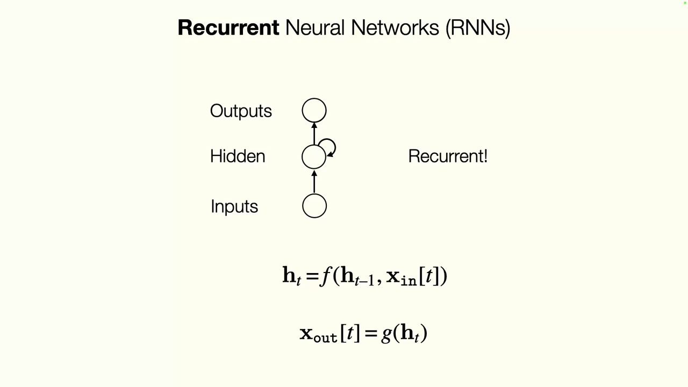
*▲ 강의 슬라이드 [13:46](https://youtu.be/IiHknRHA-Gk?t=826): [은닉층](00_%EB%94%A5%EB%9F%AC%EB%8B%9D_%EC%9A%A9%EC%96%B4%EC%82%AC%EC%A0%84.md#hidden-layer-%EC%9D%80%EB%8B%89%EC%B8%B5)이 자기 자신으로 돌아가는 순환. h_t = f(h_{t-1}, x_in[t]), x_out[t] = g(h_t)*

### 3.2 가장 단순한 RNN

▶ 영상 [14:05](https://youtu.be/IiHknRHA-Gk?t=845)

📐 **수학 개념**: [활성화 함수](%EC%88%98%ED%95%99%EA%B0%9C%EB%85%90/05_%EC%8B%A0%EA%B2%BD%EB%A7%9D%EC%9D%98_%EA%B3%84%EC%82%B0/MM05_%ED%99%9C%EC%84%B1%ED%99%94_%ED%95%A8%EC%88%98%EC%9D%98_%EB%AF%B8%EB%B6%84.md) · [행렬·벡터 표기](%EC%88%98%ED%95%99%EA%B0%9C%EB%85%90/03_%EC%84%A0%ED%98%95%EB%8C%80%EC%88%98/MM03_%EB%B2%A1%ED%84%B0_%ED%91%9C%EA%B8%B0%EC%99%80_%EC%A0%84%EC%B9%98.md)

$f$와 $g$를 [선형층](00_%EB%94%A5%EB%9F%AC%EB%8B%9D_%EC%9A%A9%EC%96%B4%EC%82%AC%EC%A0%84.md#linear-layer-%EC%84%A0%ED%98%95%EC%B8%B5) + [비선형](00_%EB%94%A5%EB%9F%AC%EB%8B%9D_%EC%9A%A9%EC%96%B4%EC%82%AC%EC%A0%84.md#nonlinearity-%EB%B9%84%EC%84%A0%ED%98%95%EC%84%B1) 함수로 두면 가장 단순한 [RNN](00_%EB%94%A5%EB%9F%AC%EB%8B%9D_%EC%9A%A9%EC%96%B4%EC%82%AC%EC%A0%84.md#rnn-recurrent-neural-network-%EC%88%9C%ED%99%98-%EC%8B%A0%EA%B2%BD%EB%A7%9D)이 됩니다. 입력을 받아들이는 $\mathbf{U}$, 이전 [은닉 상태](00_%EB%94%A5%EB%9F%AC%EB%8B%9D_%EC%9A%A9%EC%96%B4%EC%82%AC%EC%A0%84.md#hidden-state-%EC%9D%80%EB%8B%89-%EC%83%81%ED%83%9C)를 넘기는 $\mathbf{W}$, [은닉 상태](00_%EB%94%A5%EB%9F%AC%EB%8B%9D_%EC%9A%A9%EC%96%B4%EC%82%AC%EC%A0%84.md#hidden-state-%EC%9D%80%EB%8B%89-%EC%83%81%ED%83%9C)를 출력으로 바꾸는 $\mathbf{V}$를 배웁니다.

$$
\mathbf{h}_t = \sigma_1\big(\mathbf{W}\mathbf{h}_{t-1} + \mathbf{U}\mathbf{x}_{\text{in}}[t] + \mathbf{b}\big), \qquad \mathbf{x}_{\text{out}}[t] = \sigma_2\big(\mathbf{V}\mathbf{h}_t + \mathbf{c}\big)
$$

기호 풀이

| 기호 | 읽는 법 | 뜻 | 예제 값 |
| --- | --- | --- | --- |
| $\mathbf{W}$ | 더블유 | 이전 [은닉 상태](00_%EB%94%A5%EB%9F%AC%EB%8B%9D_%EC%9A%A9%EC%96%B4%EC%82%AC%EC%A0%84.md#hidden-state-%EC%9D%80%EB%8B%89-%EC%83%81%ED%83%9C)를 넘기는 [가중치](00_%EB%94%A5%EB%9F%AC%EB%8B%9D_%EC%9A%A9%EC%96%B4%EC%82%AC%EC%A0%84.md#weight-%EA%B0%80%EC%A4%91%EC%B9%98) (순환 [가중치](00_%EB%94%A5%EB%9F%AC%EB%8B%9D_%EC%9A%A9%EC%96%B4%EC%82%AC%EC%A0%84.md#weight-%EA%B0%80%EC%A4%91%EC%B9%98)) | 0.5 |
| $\mathbf{U}$ | 유 | 입력을 [은닉 상태](00_%EB%94%A5%EB%9F%AC%EB%8B%9D_%EC%9A%A9%EC%96%B4%EC%82%AC%EC%A0%84.md#hidden-state-%EC%9D%80%EB%8B%89-%EC%83%81%ED%83%9C)로 보내는 [가중치](00_%EB%94%A5%EB%9F%AC%EB%8B%9D_%EC%9A%A9%EC%96%B4%EC%82%AC%EC%A0%84.md#weight-%EA%B0%80%EC%A4%91%EC%B9%98) | 1 |
| $\mathbf{b}$ | 비 | [은닉 상태](00_%EB%94%A5%EB%9F%AC%EB%8B%9D_%EC%9A%A9%EC%96%B4%EC%82%AC%EC%A0%84.md#hidden-state-%EC%9D%80%EB%8B%89-%EC%83%81%ED%83%9C) 쪽 [편향](00_%EB%94%A5%EB%9F%AC%EB%8B%9D_%EC%9A%A9%EC%96%B4%EC%82%AC%EC%A0%84.md#bias-%ED%8E%B8%ED%96%A5) | 0 |
| $\sigma_1$ | 시그마 일 | [은닉 상태](00_%EB%94%A5%EB%9F%AC%EB%8B%9D_%EC%9A%A9%EC%96%B4%EC%82%AC%EC%A0%84.md#hidden-state-%EC%9D%80%EB%8B%89-%EC%83%81%ED%83%9C)의 [활성화 함수](00_%EB%94%A5%EB%9F%AC%EB%8B%9D_%EC%9A%A9%EC%96%B4%EC%82%AC%EC%A0%84.md#activation-function-%ED%99%9C%EC%84%B1%ED%99%94-%ED%95%A8%EC%88%98) (보통 [tanh](00_%EB%94%A5%EB%9F%AC%EB%8B%9D_%EC%9A%A9%EC%96%B4%EC%82%AC%EC%A0%84.md#tanh-%EC%8C%8D%EA%B3%A1%ED%83%84%EC%A0%A0%ED%8A%B8)) | [tanh](00_%EB%94%A5%EB%9F%AC%EB%8B%9D_%EC%9A%A9%EC%96%B4%EC%82%AC%EC%A0%84.md#tanh-%EC%8C%8D%EA%B3%A1%ED%83%84%EC%A0%A0%ED%8A%B8) |
| $\mathbf{V}$ | 브이 | [은닉 상태](00_%EB%94%A5%EB%9F%AC%EB%8B%9D_%EC%9A%A9%EC%96%B4%EC%82%AC%EC%A0%84.md#hidden-state-%EC%9D%80%EB%8B%89-%EC%83%81%ED%83%9C)를 출력으로 바꾸는 [가중치](00_%EB%94%A5%EB%9F%AC%EB%8B%9D_%EC%9A%A9%EC%96%B4%EC%82%AC%EC%A0%84.md#weight-%EA%B0%80%EC%A4%91%EC%B9%98) | 2 |
| $\mathbf{c}$ | 씨 | 출력 쪽 [편향](00_%EB%94%A5%EB%9F%AC%EB%8B%9D_%EC%9A%A9%EC%96%B4%EC%82%AC%EC%A0%84.md#bias-%ED%8E%B8%ED%96%A5) | 0 |
| $\sigma_2$ | 시그마 이 | 출력의 [활성화 함수](00_%EB%94%A5%EB%9F%AC%EB%8B%9D_%EC%9A%A9%EC%96%B4%EC%82%AC%EC%A0%84.md#activation-function-%ED%99%9C%EC%84%B1%ED%99%94-%ED%95%A8%EC%88%98) ([회귀](00_%EB%94%A5%EB%9F%AC%EB%8B%9D_%EC%9A%A9%EC%96%B4%EC%82%AC%EC%A0%84.md#regression-classification-%ED%9A%8C%EA%B7%80%EC%99%80-%EB%B6%84%EB%A5%98)면 항등 함수) | 항등 |

예제와 풀이

**문제**: 크기 1짜리 [RNN](00_%EB%94%A5%EB%9F%AC%EB%8B%9D_%EC%9A%A9%EC%96%B4%EC%82%AC%EC%A0%84.md#rnn-recurrent-neural-network-%EC%88%9C%ED%99%98-%EC%8B%A0%EA%B2%BD%EB%A7%9D)에서 두 단계의 [은닉 상태](00_%EB%94%A5%EB%9F%AC%EB%8B%9D_%EC%9A%A9%EC%96%B4%EC%82%AC%EC%A0%84.md#hidden-state-%EC%9D%80%EB%8B%89-%EC%83%81%ED%83%9C)와 출력을 구한다.

**주어진 값**:
- $W = 0.5$, $U = 1$, $b = 0$, $\sigma_1 = \tanh$ ([은닉 상태](00_%EB%94%A5%EB%9F%AC%EB%8B%9D_%EC%9A%A9%EC%96%B4%EC%82%AC%EC%A0%84.md#hidden-state-%EC%9D%80%EB%8B%89-%EC%83%81%ED%83%9C) 쪽)
- $V = 2$, $c = 0$, $\sigma_2$ = 항등 함수 (출력 쪽)
- $h_0 = 0$, $x_1 = 1$, $x_2 = 0.5$

**풀이**
1. 식을 그대로 쓴다: $h_t = \sigma_1(W h_{t-1} + U x_t + b)$, $\;y_t = \sigma_2(V h_t + c)$
2. 1단계 값을 대입한다: $h_1 = \tanh(0.5 \times 0 + 1 \times 1 + 0)$, $\;y_1 = 2 \times h_1 + 0$
3. 괄호 안을 곱하고 더한다: $0 + 1 + 0 = 1$
4. [tanh](00_%EB%94%A5%EB%9F%AC%EB%8B%9D_%EC%9A%A9%EC%96%B4%EC%82%AC%EC%A0%84.md#tanh-%EC%8C%8D%EA%B3%A1%ED%83%84%EC%A0%A0%ED%8A%B8)를 계산한다 ($\tanh$는 아무 수를 −1~1 사이로 눌러 주는 함수): $h_1 = \tanh(1) = 0.7616$
5. 1단계 출력을 계산한다 (항등 함수라 그대로): $y_1 = 2 \times 0.7616 = 1.5232$
6. 2단계 값을 대입한다: $h_2 = \tanh(0.5 \times 0.7616 + 1 \times 0.5 + 0)$, $\;y_2 = 2 \times h_2 + 0$
7. 괄호 안을 곱하고 더한다: $0.3808 + 0.5 + 0 = 0.8808$
8. [tanh](00_%EB%94%A5%EB%9F%AC%EB%8B%9D_%EC%9A%A9%EC%96%B4%EC%82%AC%EC%A0%84.md#tanh-%EC%8C%8D%EA%B3%A1%ED%83%84%EC%A0%A0%ED%8A%B8)를 계산한다: $h_2 = \tanh(0.8808) = 0.7068$
9. 2단계 출력을 계산한다: $y_2 = 2 \times 0.7068 = 1.4136$

**답**: $h_1 = 0.7616$, $y_1 = 1.5232$, $h_2 = 0.7068$, $y_2 = 1.4136$

내 이해

- $\mathbf{W}$를 없애면(순환을 끊으면) 입력에서 출력으로 가는 [다층 퍼셉트론](00_%EB%94%A5%EB%9F%AC%EB%8B%9D_%EC%9A%A9%EC%96%B4%EC%82%AC%EC%A0%84.md#multi-layer-perceptron-%EB%8B%A4%EC%B8%B5-%ED%8D%BC%EC%85%89%ED%8A%B8%EB%A1%A0)과 같습니다. [RNN](00_%EB%94%A5%EB%9F%AC%EB%8B%9D_%EC%9A%A9%EC%96%B4%EC%82%AC%EC%A0%84.md#rnn-recurrent-neural-network-%EC%88%9C%ED%99%98-%EC%8B%A0%EA%B2%BD%EB%A7%9D)의 차이는 **정보를 시간 방향으로 보내는 순환** 하나뿐입니다.
- [은닉 상태](00_%EB%94%A5%EB%9F%AC%EB%8B%9D_%EC%9A%A9%EC%96%B4%EC%82%AC%EC%A0%84.md#hidden-state-%EC%9D%80%EB%8B%89-%EC%83%81%ED%83%9C)는 **가장 관련 있는 과거 정보**를 담으려는 것이고, $\mathbf{W}$는 "무엇이 관련 있는지, 무엇을 남길지"를 배웁니다.
- [은닉층](00_%EB%94%A5%EB%9F%AC%EB%8B%9D_%EC%9A%A9%EC%96%B4%EC%82%AC%EC%A0%84.md#hidden-layer-%EC%9D%80%EB%8B%89%EC%B8%B5)을 여러 겹 쌓은 **깊은 [RNN](00_%EB%94%A5%EB%9F%AC%EB%8B%9D_%EC%9A%A9%EC%96%B4%EC%82%AC%EC%A0%84.md#rnn-recurrent-neural-network-%EC%88%9C%ED%99%98-%EC%8B%A0%EA%B2%BD%EB%A7%9D)(Deep [RNN](00_%EB%94%A5%EB%9F%AC%EB%8B%9D_%EC%9A%A9%EC%96%B4%EC%82%AC%EC%A0%84.md#rnn-recurrent-neural-network-%EC%88%9C%ED%99%98-%EC%8B%A0%EA%B2%BD%EB%A7%9D))**도 만들 수 있고, [은닉 상태](00_%EB%94%A5%EB%9F%AC%EB%8B%9D_%EC%9A%A9%EC%96%B4%EC%82%AC%EC%A0%84.md#hidden-state-%EC%9D%80%EB%8B%89-%EC%83%81%ED%83%9C)는 어떤 차원의 [텐서](00_%EB%94%A5%EB%9F%AC%EB%8B%9D_%EC%9A%A9%EC%96%B4%EC%82%AC%EC%A0%84.md#tensor-%ED%85%90%EC%84%9C)여도 됩니다.

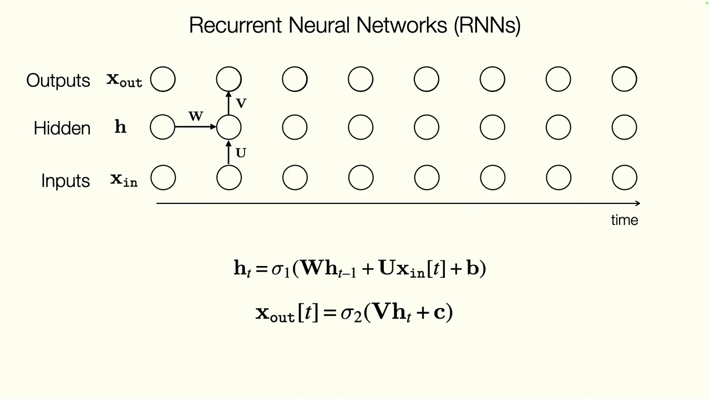
*▲ 강의 슬라이드 [14:52](https://youtu.be/IiHknRHA-Gk?t=892): [선형층](00_%EB%94%A5%EB%9F%AC%EB%8B%9D_%EC%9A%A9%EC%96%B4%EC%82%AC%EC%A0%84.md#linear-layer-%EC%84%A0%ED%98%95%EC%B8%B5)으로 만든 가장 단순한 [RNN](00_%EB%94%A5%EB%9F%AC%EB%8B%9D_%EC%9A%A9%EC%96%B4%EC%82%AC%EC%A0%84.md#rnn-recurrent-neural-network-%EC%88%9C%ED%99%98-%EC%8B%A0%EA%B2%BD%EB%A7%9D). W(순환), U(입력), V(출력)*

질의응답: RNN은 언제 멈추고, 어떻게 먼 과거를 기억하나 [16:28](https://youtu.be/IiHknRHA-Gk?t=988)

- **몇 단계까지 펼치나?** 구조 자체에는 "끝"이 없습니다. 입력을 더 넣지 않으면 멈출 뿐입니다. 영상·음성 [클립](00_%EB%94%A5%EB%9F%AC%EB%8B%9D_%EC%9A%A9%EC%96%B4%EC%82%AC%EC%A0%84.md#clip-%ED%81%B4%EB%A6%BD)은 끝이 있으니 거기서 멈추고, 매일 들어오는 기온 데이터라면 계속 돌릴 수 있습니다.
- **[은닉 상태](00_%EB%94%A5%EB%9F%AC%EB%8B%9D_%EC%9A%A9%EC%96%B4%EC%82%AC%EC%A0%84.md#hidden-state-%EC%9D%80%EB%8B%89-%EC%83%81%ED%83%9C)가 바로 전 상태에만 의존하면 마르코프 연쇄 아닌가?** 맞습니다. 하지만 바로 전 상태가 또 그 전 상태에 의존하므로, 원리상 각 [은닉 상태](00_%EB%94%A5%EB%9F%AC%EB%8B%9D_%EC%9A%A9%EC%96%B4%EC%82%AC%EC%A0%84.md#hidden-state-%EC%9D%80%EB%8B%89-%EC%83%81%ED%83%9C)에는 처음부터의 정보가 모두 담깁니다. 다만 [용량](00_%EB%94%A5%EB%9F%AC%EB%8B%9D_%EC%9A%A9%EC%96%B4%EC%82%AC%EC%A0%84.md#capacity-%EC%9A%A9%EB%9F%89)이 제한되어 있고, 아래 5절의 수학적 한계 때문에 아주 먼 과거는 배우기 어렵습니다.

---

## 4. 시간 역전파

▶ 영상 [18:42](https://youtu.be/IiHknRHA-Gk?t=1122)

📐 **수학 개념**: [연쇄법칙](%EC%88%98%ED%95%99%EA%B0%9C%EB%85%90/05_%EC%8B%A0%EA%B2%BD%EB%A7%9D%EC%9D%98_%EA%B3%84%EC%82%B0/MM09_%EC%95%BC%EC%BD%94%EB%B9%84%EC%95%88%EA%B3%BC_%EC%97%B0%EC%87%84%EB%B2%95%EC%B9%99.md) · [공유 파라미터의 기울기 더하기](%EC%88%98%ED%95%99%EA%B0%9C%EB%85%90/05_%EC%8B%A0%EA%B2%BD%EB%A7%9D%EC%9D%98_%EA%B3%84%EC%82%B0/MM10_%EC%84%A0%ED%98%95%EC%B8%B5%EA%B3%BC_ReLU%EC%9D%98_%EC%97%AD%EC%A0%84%ED%8C%8C.md) · [순환식 펼치기와 거듭제곱](%EC%88%98%ED%95%99%EA%B0%9C%EB%85%90/07_%EA%B5%AC%EC%A1%B0_%EC%95%84%ED%82%A4%ED%85%8D%EC%B2%98/MM37_%EC%88%9C%ED%99%98%EC%8B%9D_%ED%8E%BC%EC%B9%98%EA%B8%B0%EC%99%80_%EA%B1%B0%EB%93%AD%EC%A0%9C%EA%B3%B1.md)

[역전파](00_%EB%94%A5%EB%9F%AC%EB%8B%9D_%EC%9A%A9%EC%96%B4%EC%82%AC%EC%A0%84.md#backpropagation-%EC%97%AD%EC%A0%84%ED%8C%8C)는 순방향 그래프([DAG](00_%EB%94%A5%EB%9F%AC%EB%8B%9D_%EC%9A%A9%EC%96%B4%EC%82%AC%EC%A0%84.md#dag-directed-acyclic-graph-%EB%B0%A9%ED%96%A5%EC%84%B1-%EB%B9%84%EC%88%9C%ED%99%98-%EA%B7%B8%EB%9E%98%ED%94%84))를 위한 것인데 [RNN](00_%EB%94%A5%EB%9F%AC%EB%8B%9D_%EC%9A%A9%EC%96%B4%EC%82%AC%EC%A0%84.md#rnn-recurrent-neural-network-%EC%88%9C%ED%99%98-%EC%8B%A0%EA%B2%BD%EB%A7%9D)에는 순환이 있습니다. 예전에는 이 점이 사람들을 꽤 헷갈리게 했습니다.

### 4.1 펼쳐서 DAG로 만들기

▶ 영상 [18:42](https://youtu.be/IiHknRHA-Gk?t=1122)

해법은 단순합니다. [학습](00_%EB%94%A5%EB%9F%AC%EB%8B%9D_%EC%9A%A9%EC%96%B4%EC%82%AC%EC%A0%84.md#training-%ED%95%99%EC%8A%B5)할 때 거슬러 올라갈 **고정된 시간 창**을 정하고, 그 창만큼 펼칩니다. 그러면 [파라미터](00_%EB%94%A5%EB%9F%AC%EB%8B%9D_%EC%9A%A9%EC%96%B4%EC%82%AC%EC%A0%84.md#parameter-%ED%8C%8C%EB%9D%BC%EB%AF%B8%ED%84%B0)를 공유하는 [DAG](00_%EB%94%A5%EB%9F%AC%EB%8B%9D_%EC%9A%A9%EC%96%B4%EC%82%AC%EC%A0%84.md#dag-directed-acyclic-graph-%EB%B0%A9%ED%96%A5%EC%84%B1-%EB%B9%84%EC%88%9C%ED%99%98-%EA%B7%B8%EB%9E%98%ED%94%84)가 되고, 보통의 [연쇄법칙](00_%EB%94%A5%EB%9F%AC%EB%8B%9D_%EC%9A%A9%EC%96%B4%EC%82%AC%EC%A0%84.md#chain-rule-%EC%97%B0%EC%87%84%EB%B2%95%EC%B9%99)으로 [기울기](00_%EB%94%A5%EB%9F%AC%EB%8B%9D_%EC%9A%A9%EC%96%B4%EC%82%AC%EC%A0%84.md#gradient-%EA%B8%B0%EC%9A%B8%EA%B8%B0)를 계산할 수 있습니다. 이것이 **[시간 역전파(BPTT, Backpropagation through time)](00_%EB%94%A5%EB%9F%AC%EB%8B%9D_%EC%9A%A9%EC%96%B4%EC%82%AC%EC%A0%84.md#bptt-backpropagation-through-time-%EC%8B%9C%EA%B0%84-%EC%97%AD%EC%A0%84%ED%8C%8C)**입니다.

$$
\frac{\partial \mathbf{x}_{\text{out}}[t]}{\partial \mathbf{x}_{\text{in}}[0]} = \frac{\partial \mathbf{x}_{\text{out}}[t]}{\partial \mathbf{h}_T}\,\frac{\partial \mathbf{h}_T}{\partial \mathbf{h}_{T-1}} \cdots \frac{\partial \mathbf{h}_1}{\partial \mathbf{h}_0}\,\frac{\partial \mathbf{h}_0}{\partial \mathbf{x}_{\text{in}}[0]}
$$

기호 풀이

| 기호 | 읽는 법 | 뜻 | 예제 값 |
| --- | --- | --- | --- |
| $\frac{\partial \mathbf{x}_{\text{out}}[t]}{\partial \mathbf{x}_{\text{in}}[0]}$ | 파셜 엑스 아웃 티 파셜 엑스 인 영 | 맨 처음 입력이 t단계 출력에 주는 영향 | 0.25 |
| $\frac{\partial \mathbf{x}_{\text{out}}[t]}{\partial \mathbf{h}_T}$ | 출력 고리 | 마지막 [은닉 상태](00_%EB%94%A5%EB%9F%AC%EB%8B%9D_%EC%9A%A9%EC%96%B4%EC%82%AC%EC%A0%84.md#hidden-state-%EC%9D%80%EB%8B%89-%EC%83%81%ED%83%9C) → 출력 (선형이면 $V$) | 2 |
| $\frac{\partial \mathbf{h}_j}{\partial \mathbf{h}_{j-1}}$ | 순환 고리 | [은닉 상태](00_%EB%94%A5%EB%9F%AC%EB%8B%9D_%EC%9A%A9%EC%96%B4%EC%82%AC%EC%A0%84.md#hidden-state-%EC%9D%80%EB%8B%89-%EC%83%81%ED%83%9C) 한 단계 (선형이면 $W$). T번 곱해진다 | 0.5 |
| $\frac{\partial \mathbf{h}_0}{\partial \mathbf{x}_{\text{in}}[0]}$ | 입력 고리 | 처음 입력 → 처음 [은닉 상태](00_%EB%94%A5%EB%9F%AC%EB%8B%9D_%EC%9A%A9%EC%96%B4%EC%82%AC%EC%A0%84.md#hidden-state-%EC%9D%80%EB%8B%89-%EC%83%81%ED%83%9C) (선형이면 $U$) | 1 |
| $T$ | 티 | 거슬러 올라가는 순환 고리 수 (시간 창) | 3 |

예제와 풀이

**문제**: [활성화 함수](00_%EB%94%A5%EB%9F%AC%EB%8B%9D_%EC%9A%A9%EC%96%B4%EC%82%AC%EC%A0%84.md#activation-function-%ED%99%9C%EC%84%B1%ED%99%94-%ED%95%A8%EC%88%98) 없는 크기 1짜리 [RNN](00_%EB%94%A5%EB%9F%AC%EB%8B%9D_%EC%9A%A9%EC%96%B4%EC%82%AC%EC%A0%84.md#rnn-recurrent-neural-network-%EC%88%9C%ED%99%98-%EC%8B%A0%EA%B2%BD%EB%A7%9D)에서 맨 처음 입력이 3단계 뒤 출력에 주는 영향을 구한다.

**주어진 값**:
- $V = 2$ (출력 고리)
- $W = 0.5$ (순환 고리, 한 단계마다 곱해짐)
- $U = 1$ (입력 고리)
- $T = 3$ (순환 고리 수)

**풀이**
1. 식을 그대로 쓴다: $\frac{\partial x_{\text{out}}}{\partial x_{\text{in}}[0]} = \frac{\partial x_{\text{out}}}{\partial h_3}\,\frac{\partial h_3}{\partial h_2}\,\frac{\partial h_2}{\partial h_1}\,\frac{\partial h_1}{\partial h_0}\,\frac{\partial h_0}{\partial x_{\text{in}}[0]}$ (선형이면 고리마다 $V$, $W$, $W$, $W$, $U$)
2. 값을 대입한다: $\frac{\partial x_{\text{out}}}{\partial x_{\text{in}}[0]} = 2 \times 0.5 \times 0.5 \times 0.5 \times 1$
3. 순환 고리 셋을 먼저 곱한다: $0.5 \times 0.5 \times 0.5 = 0.125$
4. 출력 고리를 곱한다: $2 \times 0.125 = 0.25$
5. 입력 고리를 곱한다: $0.25 \times 1 = 0.25$

**답**: $0.25$ (순환 고리 $W$가 창 길이만큼 거듭 곱해진다. 이것이 5절의 문제로 이어진다)

내 이해

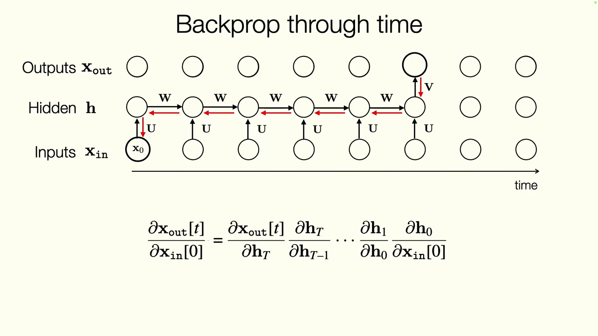
*▲ 강의 슬라이드 [20:12](https://youtu.be/IiHknRHA-Gk?t=1212): 정한 창만큼 펼친 뒤 [연쇄법칙](00_%EB%94%A5%EB%9F%AC%EB%8B%9D_%EC%9A%A9%EC%96%B4%EC%82%AC%EC%A0%84.md#chain-rule-%EC%97%B0%EC%87%84%EB%B2%95%EC%B9%99)으로 거슬러 올라가는 [시간 역전파](00_%EB%94%A5%EB%9F%AC%EB%8B%9D_%EC%9A%A9%EC%96%B4%EC%82%AC%EC%A0%84.md#bptt-backpropagation-through-time-%EC%8B%9C%EA%B0%84-%EC%97%AD%EC%A0%84%ED%8C%8C)*

- 창 길이는 고르거나 조정하는 [하이퍼파라미터](00_%EB%94%A5%EB%9F%AC%EB%8B%9D_%EC%9A%A9%EC%96%B4%EC%82%AC%EC%A0%84.md#hyperparameter-%ED%95%98%EC%9D%B4%ED%8D%BC%ED%8C%8C%EB%9D%BC%EB%AF%B8%ED%84%B0)입니다. 논문에서는 이 값을 바꿔 보는 실험(ablation)을 하고, 분야 지식으로 정하기도 합니다.
- 추론할 때는 창보다 오래된 정보도 [은닉 상태](00_%EB%94%A5%EB%9F%AC%EB%8B%9D_%EC%9A%A9%EC%96%B4%EC%82%AC%EC%A0%84.md#hidden-state-%EC%9D%80%EB%8B%89-%EC%83%81%ED%83%9C)를 타고 전해지지만, [학습](00_%EB%94%A5%EB%9F%AC%EB%8B%9D_%EC%9A%A9%EC%96%B4%EC%82%AC%EC%A0%84.md#training-%ED%95%99%EC%8A%B5) 신호를 창 안까지만 보냈다면 모델은 **그 창 길이만큼의 기억**만 쓰도록 배우기 쉽습니다.

질의응답: 창으로 자른 학습은 무한 창의 근사인가 [21:00](https://youtu.be/IiHknRHA-Gk?t=1260)

- **창 20으로 학습했는데 입력이 3개뿐이면?** 문제없습니다. 위 식은 가장 먼 입력의 [기울기](00_%EB%94%A5%EB%9F%AC%EB%8B%9D_%EC%9A%A9%EC%96%B4%EC%82%AC%EC%A0%84.md#gradient-%EA%B8%B0%EC%9A%B8%EA%B8%B0) 하나만 보여 준 것이고, 실제로는 창 안의 모든 시점에서 오는 [기울기](00_%EB%94%A5%EB%9F%AC%EB%8B%9D_%EC%9A%A9%EC%96%B4%EC%82%AC%EC%A0%84.md#gradient-%EA%B8%B0%EC%9A%B8%EA%B8%B0)를 함께 받습니다. 가까운 시점의 [기울기](00_%EB%94%A5%EB%9F%AC%EB%8B%9D_%EC%9A%A9%EC%96%B4%EC%82%AC%EC%A0%84.md#gradient-%EA%B8%B0%EC%9A%B8%EA%B8%B0)가 오히려 더 쓸모 있을 때가 많습니다.
- **기온 예측이라면?** 오늘 입력과 6일 뒤 출력 사이의 [기울기](00_%EB%94%A5%EB%9F%AC%EB%8B%9D_%EC%9A%A9%EC%96%B4%EC%82%AC%EC%A0%84.md#gradient-%EA%B8%B0%EC%9A%B8%EA%B8%B0)를 계산할 때, 창 6만큼만 거슬러 갑니다. 다음 시점은 창을 오른쪽으로 한 칸 밀어 같은 방식으로 계산합니다.
- **잘린 창은 무한 창의 좋은 근사인가?** 반은 그렇습니다. 이 구조에서는 창이 길수록 정보가 멀리까지 전해지기 어려워서, 어느 길이를 넘으면 창을 늘려도 별 이득이 없습니다.

### 4.2 공유 가중치의 기울기는 더한다

▶ 영상 [24:25](https://youtu.be/IiHknRHA-Gk?t=1465)

$\mathbf{W}$는 모든 시점에서 같은 값을 씁니다. [학습](00_%EB%94%A5%EB%9F%AC%EB%8B%9D_%EC%9A%A9%EC%96%B4%EC%82%AC%EC%A0%84.md#training-%ED%95%99%EC%8A%B5) 목표는 [시퀀스](00_%EB%94%A5%EB%9F%AC%EB%8B%9D_%EC%9A%A9%EC%96%B4%EC%82%AC%EC%A0%84.md#sequence-%EC%8B%9C%ED%80%80%EC%8A%A4) 전체 [손실](00_%EB%94%A5%EB%9F%AC%EB%8B%9D_%EC%9A%A9%EC%96%B4%EC%82%AC%EC%A0%84.md#loss-function-%EC%86%90%EC%8B%A4-%ED%95%A8%EC%88%98)의 합을 줄이도록 $\mathbf{W}, \mathbf{U}, \mathbf{V}$를 바꾸는 것입니다.

$$
J = \sum_{t=0}^{T} \mathcal{L}\big(\mathbf{x}_{\text{out}}[t], \mathbf{y}_t\big), \qquad \frac{\partial \mathcal{L}_t}{\partial \mathbf{W}} = \sum_{i} \frac{\partial \mathcal{L}_t}{\partial \mathbf{W}^{i}}
$$

기호 풀이

| 기호 | 읽는 법 | 뜻 | 예제 값 |
| --- | --- | --- | --- |
| $J$ | 제이 | [시퀀스](00_%EB%94%A5%EB%9F%AC%EB%8B%9D_%EC%9A%A9%EC%96%B4%EC%82%AC%EC%A0%84.md#sequence-%EC%8B%9C%ED%80%80%EC%8A%A4) 전체의 [손실](00_%EB%94%A5%EB%9F%AC%EB%8B%9D_%EC%9A%A9%EC%96%B4%EC%82%AC%EC%A0%84.md#loss-function-%EC%86%90%EC%8B%A4-%ED%95%A8%EC%88%98) 합 ([학습](00_%EB%94%A5%EB%9F%AC%EB%8B%9D_%EC%9A%A9%EC%96%B4%EC%82%AC%EC%A0%84.md#training-%ED%95%99%EC%8A%B5) 목표) | - |
| $\mathcal{L}(\mathbf{x}_{\text{out}}[t], \mathbf{y}_t)$ | 엘 | t단계의 예측과 [정답](00_%EB%94%A5%EB%9F%AC%EB%8B%9D_%EC%9A%A9%EC%96%B4%EC%82%AC%EC%A0%84.md#label-%EC%A0%95%EB%8B%B5) 사이 [손실](00_%EB%94%A5%EB%9F%AC%EB%8B%9D_%EC%9A%A9%EC%96%B4%EC%82%AC%EC%A0%84.md#loss-function-%EC%86%90%EC%8B%A4-%ED%95%A8%EC%88%98) | 예제에서는 $\mathcal{L} = h_2$ |
| $\mathbf{y}_t$ | 와이 티 | t단계의 [정답](00_%EB%94%A5%EB%9F%AC%EB%8B%9D_%EC%9A%A9%EC%96%B4%EC%82%AC%EC%A0%84.md#label-%EC%A0%95%EB%8B%B5) | - |
| $\mathbf{W}^{i}$ | 더블유 아이 | 펼친 그래프에서 i번째 시점에 쓰인 **W의 복사본** | 복사본 2개 |
| $\frac{\partial \mathcal{L}_t}{\partial \mathbf{W}^{i}}$ | 파셜 엘 티 파셜 더블유 아이 | 복사본 하나를 통한 [기울기](00_%EB%94%A5%EB%9F%AC%EB%8B%9D_%EC%9A%A9%EC%96%B4%EC%82%AC%EC%A0%84.md#gradient-%EA%B8%B0%EC%9A%B8%EA%B8%B0) 몫 | 1.5, 0.5 |
| $\sum_i$ | 시그마 아이 | 복사본들의 몫을 모두 더함 | 2.0 |

예제와 풀이

**문제**: $h_t = w\,h_{t-1} + x_t$를 두 단계 돌리고 [손실](00_%EB%94%A5%EB%9F%AC%EB%8B%9D_%EC%9A%A9%EC%96%B4%EC%82%AC%EC%A0%84.md#loss-function-%EC%86%90%EC%8B%A4-%ED%95%A8%EC%88%98)을 $\mathcal{L} = h_2$로 둘 때, 공유 [가중치](00_%EB%94%A5%EB%9F%AC%EB%8B%9D_%EC%9A%A9%EC%96%B4%EC%82%AC%EC%A0%84.md#weight-%EA%B0%80%EC%A4%91%EC%B9%98) $w$의 [기울기](00_%EB%94%A5%EB%9F%AC%EB%8B%9D_%EC%9A%A9%EC%96%B4%EC%82%AC%EC%A0%84.md#gradient-%EA%B8%B0%EC%9A%B8%EA%B8%B0)를 복사본별 몫의 합으로 구한다.

**주어진 값**:
- $w = 0.5$ (두 단계가 함께 쓰는 순환 [가중치](00_%EB%94%A5%EB%9F%AC%EB%8B%9D_%EC%9A%A9%EC%96%B4%EC%82%AC%EC%A0%84.md#weight-%EA%B0%80%EC%A4%91%EC%B9%98))
- $h_0 = 1$ (처음 [은닉 상태](00_%EB%94%A5%EB%9F%AC%EB%8B%9D_%EC%9A%A9%EC%96%B4%EC%82%AC%EC%A0%84.md#hidden-state-%EC%9D%80%EB%8B%89-%EC%83%81%ED%83%9C))
- $x_1 = 1$, $x_2 = 2$ (입력)

**풀이**
1. 식을 그대로 쓴다: $\frac{\partial \mathcal{L}}{\partial w} = \sum_{i} \frac{\partial \mathcal{L}}{\partial w^{i}} = \frac{\partial \mathcal{L}}{\partial w^{(1)}} + \frac{\partial \mathcal{L}}{\partial w^{(2)}}$ (복사본이 두 개)
2. 순방향 1단계를 계산한다: $h_1 = 0.5 \times 1 + 1 = 1.5$
3. 순방향 2단계를 계산한다: $h_2 = 0.5 \times 1.5 + 2 = 2.75$
4. 2단계 복사본의 몫을 구한다: $h_2 = w^{(2)} h_1 + x_2$에서 $w^{(2)}$에 곱해진 값이 $h_1$이므로 $\frac{\partial \mathcal{L}}{\partial w^{(2)}} = h_1 = 1.5$
5. 1단계 복사본의 몫을 구한다: $h_1 = w^{(1)} h_0 + x_1$이 $h_0 = 1$만큼 바뀌고, 그 변화가 $h_2$에 $w$배로 전해지므로 $\frac{\partial \mathcal{L}}{\partial w^{(1)}} = w \times h_0 = 0.5 \times 1 = 0.5$
6. 값을 대입한다: $\frac{\partial \mathcal{L}}{\partial w} = 0.5 + 1.5$
7. 더한다: $2.0$

**답**: $\partial \mathcal{L} / \partial w = 2.0$ (수치 [미분](00_%EB%94%A5%EB%9F%AC%EB%8B%9D_%EC%9A%A9%EC%96%B4%EC%82%AC%EC%A0%84.md#derivative-%EB%AF%B8%EB%B6%84)으로 재도 2.0)

내 이해

- [Lec02 8.2](Lec02_%EC%8B%A0%EA%B2%BD%EB%A7%9D_%ED%95%99%EC%8A%B5.md#82-%ED%8C%8C%EB%9D%BC%EB%AF%B8%ED%84%B0-%EA%B3%B5%EC%9C%A0)에서 배운 대로 공유 [파라미터](00_%EB%94%A5%EB%9F%AC%EB%8B%9D_%EC%9A%A9%EC%96%B4%EC%82%AC%EC%A0%84.md#parameter-%ED%8C%8C%EB%9D%BC%EB%AF%B8%ED%84%B0)는 **[DAG](00_%EB%94%A5%EB%9F%AC%EB%8B%9D_%EC%9A%A9%EC%96%B4%EC%82%AC%EC%A0%84.md#dag-directed-acyclic-graph-%EB%B0%A9%ED%96%A5%EC%84%B1-%EB%B9%84%EC%88%9C%ED%99%98-%EA%B7%B8%EB%9E%98%ED%94%84)의 [가지치기](00_%EB%94%A5%EB%9F%AC%EB%8B%9D_%EC%9A%A9%EC%96%B4%EC%82%AC%EC%A0%84.md#pruning-%EA%B0%80%EC%A7%80%EC%B9%98%EA%B8%B0)(branch)**와 같고, [가지치기](00_%EB%94%A5%EB%9F%AC%EB%8B%9D_%EC%9A%A9%EC%96%B4%EC%82%AC%EC%A0%84.md#pruning-%EA%B0%80%EC%A7%80%EC%B9%98%EA%B8%B0)의 [기울기](00_%EB%94%A5%EB%9F%AC%EB%8B%9D_%EC%9A%A9%EC%96%B4%EC%82%AC%EC%A0%84.md#gradient-%EA%B8%B0%EC%9A%B8%EA%B8%B0)는 **더합니다**. 각 [손실](00_%EB%94%A5%EB%9F%AC%EB%8B%9D_%EC%9A%A9%EC%96%B4%EC%82%AC%EC%A0%84.md#loss-function-%EC%86%90%EC%8B%A4-%ED%95%A8%EC%88%98) $\mathcal{L}_t$에서 오는 [기울기](00_%EB%94%A5%EB%9F%AC%EB%8B%9D_%EC%9A%A9%EC%96%B4%EC%82%AC%EC%A0%84.md#gradient-%EA%B8%B0%EC%9A%B8%EA%B8%B0)를, $\mathbf{W}$가 쓰인 모든 자리에 대해 더합니다.
- $\mathcal{L}_t$는 **그 시점 이전**의 $\mathbf{W}$들에만 의존합니다. 그래프가 한 방향으로만 흐르기 때문입니다.
- [PyTorch](00_%EB%94%A5%EB%9F%AC%EB%8B%9D_%EC%9A%A9%EC%96%B4%EC%82%AC%EC%A0%84.md#pytorch-%ED%8C%8C%EC%9D%B4%ED%86%A0%EC%B9%98)의 [autograd](00_%EB%94%A5%EB%9F%AC%EB%8B%9D_%EC%9A%A9%EC%96%B4%EC%82%AC%EC%A0%84.md#autograd-%EC%9E%90%EB%8F%99-%EB%AF%B8%EB%B6%84)는 이 합을 자동으로 처리합니다. 단, 같은 변수를 참조로 가리켜야 하며 **깊은 복사(deep copy)를 하면 안 됩니다**.

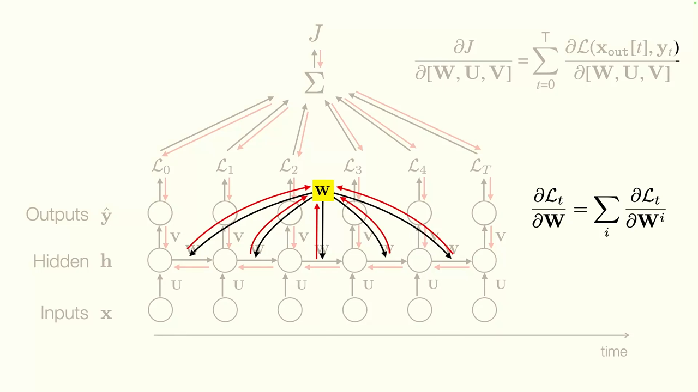
*▲ 강의 슬라이드 [27:12](https://youtu.be/IiHknRHA-Gk?t=1632): 각 시점의 [손실](00_%EB%94%A5%EB%9F%AC%EB%8B%9D_%EC%9A%A9%EC%96%B4%EC%82%AC%EC%A0%84.md#loss-function-%EC%86%90%EC%8B%A4-%ED%95%A8%EC%88%98)에서 공유 [가중치](00_%EB%94%A5%EB%9F%AC%EB%8B%9D_%EC%9A%A9%EC%96%B4%EC%82%AC%EC%A0%84.md#weight-%EA%B0%80%EC%A4%91%EC%B9%98) W로 내려오는 [기울기](00_%EB%94%A5%EB%9F%AC%EB%8B%9D_%EC%9A%A9%EC%96%B4%EC%82%AC%EC%A0%84.md#gradient-%EA%B8%B0%EC%9A%B8%EA%B8%B0)를 모두 더한다*

---

## 5. 장거리 의존성 문제

▶ 영상 [27:10](https://youtu.be/IiHknRHA-Gk?t=1630)

### 5.1 왜 전부 기억하지 않나

▶ 영상 [27:42](https://youtu.be/IiHknRHA-Gk?t=1662)

창을 무한으로 하면 어떨까요?

- **메모리가 t에 따라 늘어납니다.** 무한히 긴 입력을 쓰려면 그만큼 저장 공간이 필요합니다. 이런 기억은 **비모수적(nonparametric)**이라, 유한한 [파라미터](00_%EB%94%A5%EB%9F%AC%EB%8B%9D_%EC%9A%A9%EC%96%B4%EC%82%AC%EC%A0%84.md#parameter-%ED%8C%8C%EB%9D%BC%EB%AF%B8%ED%84%B0) 집합으로 무한한 시간을 모델링할 수 없습니다.
- [RNN](00_%EB%94%A5%EB%9F%AC%EB%8B%9D_%EC%9A%A9%EC%96%B4%EC%82%AC%EC%A0%84.md#rnn-recurrent-neural-network-%EC%88%9C%ED%99%98-%EC%8B%A0%EA%B2%BD%EB%A7%9D)은 **[마르코프 가정](00_%EB%94%A5%EB%9F%AC%EB%8B%9D_%EC%9A%A9%EC%96%B4%EC%82%AC%EC%A0%84.md#markov-assumption-%EB%A7%88%EB%A5%B4%EC%BD%94%ED%94%84-%EA%B0%80%EC%A0%95)**을 합니다. 다음 [은닉 상태](00_%EB%94%A5%EB%9F%AC%EB%8B%9D_%EC%9A%A9%EC%96%B4%EC%82%AC%EC%A0%84.md#hidden-state-%EC%9D%80%EB%8B%89-%EC%83%81%ED%83%9C)는 바로 앞 은닉 상태에만 의존합니다. [은닉 상태](00_%EB%94%A5%EB%9F%AC%EB%8B%9D_%EC%9A%A9%EC%96%B4%EC%82%AC%EC%A0%84.md#hidden-state-%EC%9D%80%EB%8B%89-%EC%83%81%ED%83%9C)에 맞는 정보를 잘 넣기만 하면 원리상 아무리 먼 의존성도 표현할 수 있습니다. 적어도 $\mathbf{W}$가 그렇게 배우기를 바랍니다.
- 하지만 [장거리 의존성](00_%EB%94%A5%EB%9F%AC%EB%8B%9D_%EC%9A%A9%EC%96%B4%EC%82%AC%EC%A0%84.md#long-range-dependency-%EC%9E%A5%EA%B1%B0%EB%A6%AC-%EC%9D%98%EC%A1%B4%EC%84%B1)을 잡으려면 정보가 **아주 긴 의존 사슬**을 지나가야 하고, 이것이 어렵습니다.

### 5.2 W의 거듭제곱과 기울기 소실

▶ 영상 [28:51](https://youtu.be/IiHknRHA-Gk?t=1731)

📐 **수학 개념**: [순환식 펼치기와 거듭제곱](%EC%88%98%ED%95%99%EA%B0%9C%EB%85%90/07_%EA%B5%AC%EC%A1%B0_%EC%95%84%ED%82%A4%ED%85%8D%EC%B2%98/MM37_%EC%88%9C%ED%99%98%EC%8B%9D_%ED%8E%BC%EC%B9%98%EA%B8%B0%EC%99%80_%EA%B1%B0%EB%93%AD%EC%A0%9C%EA%B3%B1.md) · [노름](%EC%88%98%ED%95%99%EA%B0%9C%EB%85%90/03_%EC%84%A0%ED%98%95%EB%8C%80%EC%88%98/MM11_%EB%A6%BD%EC%8B%9C%EC%B8%A0_%EC%97%B0%EC%86%8D%EA%B3%BC_%EB%85%B8%EB%A6%84.md) · [활성화 함수의 미분](%EC%88%98%ED%95%99%EA%B0%9C%EB%85%90/05_%EC%8B%A0%EA%B2%BD%EB%A7%9D%EC%9D%98_%EA%B3%84%EC%82%B0/MM05_%ED%99%9C%EC%84%B1%ED%99%94_%ED%95%A8%EC%88%98%EC%9D%98_%EB%AF%B8%EB%B6%84.md)

강사는 칠판에서 비선형 함수와 [편향](00_%EB%94%A5%EB%9F%AC%EB%8B%9D_%EC%9A%A9%EC%96%B4%EC%82%AC%EC%A0%84.md#bias-%ED%8E%B8%ED%96%A5)을 모두 빼고 순환식을 풀어 씁니다.

$$
\begin{aligned}
\mathbf{h}_1 &= \mathbf{W}\mathbf{h}_0 + \mathbf{U}\mathbf{x}_1 \\
\mathbf{h}_2 &= \mathbf{W}(\mathbf{W}\mathbf{h}_0 + \mathbf{U}\mathbf{x}_1) + \mathbf{U}\mathbf{x}_2 = \mathbf{W}^2\mathbf{h}_0 + \mathbf{W}\mathbf{U}\mathbf{x}_1 + \mathbf{U}\mathbf{x}_2 \\
\mathbf{h}_t &= \mathbf{W}^t\mathbf{h}_0 + \sum_{k=1}^{t} \mathbf{W}^{t-k}\mathbf{U}\mathbf{x}_k
\end{aligned}
$$

기호 풀이

| 기호 | 읽는 법 | 뜻 | 예제 값 |
| --- | --- | --- | --- |
| $\mathbf{h}_0$ | 에이치 영 | 처음 [은닉 상태](00_%EB%94%A5%EB%9F%AC%EB%8B%9D_%EC%9A%A9%EC%96%B4%EC%82%AC%EC%A0%84.md#hidden-state-%EC%9D%80%EB%8B%89-%EC%83%81%ED%83%9C) | 2 |
| $\mathbf{x}_k$ | 엑스 케이 | k단계 입력 | (1, 2, 3) |
| $\mathbf{W}^t$ | 더블유의 티제곱 | 순환 [가중치](00_%EB%94%A5%EB%9F%AC%EB%8B%9D_%EC%9A%A9%EC%96%B4%EC%82%AC%EC%A0%84.md#weight-%EA%B0%80%EC%A4%91%EC%B9%98)를 t번 곱한 것. 처음 상태가 t단계 뒤에 남는 배율 | $0.5^3 = 0.125$ |
| $\mathbf{W}^{t-k}$ | 더블유의 t 마이너스 k제곱 | k단계 입력이 지금까지 곱해진 배율 | $x_1$은 $0.5^2 = 0.25$ |
| $\mathbf{U}$ | 유 | 입력 [가중치](00_%EB%94%A5%EB%9F%AC%EB%8B%9D_%EC%9A%A9%EC%96%B4%EC%82%AC%EC%A0%84.md#weight-%EA%B0%80%EC%A4%91%EC%B9%98) | 1 |
| $\sum_{k=1}^{t}$ | 시그마 | 모든 입력의 몫을 더함 | 3개 항 |

예제와 풀이

**문제**: 크기 1짜리 선형 [RNN](00_%EB%94%A5%EB%9F%AC%EB%8B%9D_%EC%9A%A9%EC%96%B4%EC%82%AC%EC%A0%84.md#rnn-recurrent-neural-network-%EC%88%9C%ED%99%98-%EC%8B%A0%EA%B2%BD%EB%A7%9D)을 펼친 식으로 $h_3$을 구한다.

**주어진 값**:
- $W = 0.5$ (순환 [가중치](00_%EB%94%A5%EB%9F%AC%EB%8B%9D_%EC%9A%A9%EC%96%B4%EC%82%AC%EC%A0%84.md#weight-%EA%B0%80%EC%A4%91%EC%B9%98))
- $U = 1$ (입력 [가중치](00_%EB%94%A5%EB%9F%AC%EB%8B%9D_%EC%9A%A9%EC%96%B4%EC%82%AC%EC%A0%84.md#weight-%EA%B0%80%EC%A4%91%EC%B9%98))
- $h_0 = 2$ (처음 [은닉 상태](00_%EB%94%A5%EB%9F%AC%EB%8B%9D_%EC%9A%A9%EC%96%B4%EC%82%AC%EC%A0%84.md#hidden-state-%EC%9D%80%EB%8B%89-%EC%83%81%ED%83%9C))
- $x_1 = 1$, $x_2 = 2$, $x_3 = 3$ (입력)

**풀이**
1. 식을 그대로 쓴다: $h_t = W^t h_0 + \sum_{k=1}^{t} W^{t-k} U x_k$
2. 값을 대입한다: $h_3 = 0.5^3 \times 2 + \sum_{k=1}^{3} 0.5^{3-k} \times 1 \times x_k$
3. 시그마(Σ, k를 1부터 3까지 바꿔 가며 더하라는 기호)를 세 항으로 풀어 쓴다: $h_3 = 0.5^3 \times 2 + 0.5^2 \times 1 \times 1 + 0.5^1 \times 1 \times 2 + 0.5^0 \times 1 \times 3$
4. 거듭제곱을 계산한다 ($0.5^0 = 1$): $0.125 \times 2 + 0.25 \times 1 \times 1 + 0.5 \times 1 \times 2 + 1 \times 1 \times 3$
5. 항마다 곱한다: $0.25 + 0.25 + 1 + 3$
6. 모두 더한다: $4.5$

**답**: $h_3 = 4.5$ (한 단계씩 계산해도 같다. 오래된 것일수록 작은 배율이 붙는다)

내 이해

- 단계가 늘수록 $\mathbf{W}^2, \mathbf{W}^3, \dots, \mathbf{W}^n$이 나타납니다(강사는 처음에 "quadratic"이라고 말했다가 곧 "지수적(exponential)" 관계라고 바로잡습니다).
- $\mathbf{W}$의 작은 값은 0으로, 큰 값은 무한대로 갑니다. [학습](00_%EB%94%A5%EB%9F%AC%EB%8B%9D_%EC%9A%A9%EC%96%B4%EC%82%AC%EC%A0%84.md#training-%ED%95%99%EC%8A%B5)이 안정되려면 값들이 1 근처에 있어야 하는데, 그러면 다양한 정보를 담기 어렵습니다. 1보다 아주 조금만 작아도 무한히 가면 0이 됩니다. 예: $0.9^{50} = 0.005154$, $1.1^{50} = 117.4$ ([MM37_순환식_펼치기와_거듭제곱](%EC%88%98%ED%95%99%EA%B0%9C%EB%85%90/07_%EA%B5%AC%EC%A1%B0_%EC%95%84%ED%82%A4%ED%85%8D%EC%B2%98/MM37_%EC%88%9C%ED%99%98%EC%8B%9D_%ED%8E%BC%EC%B9%98%EA%B8%B0%EC%99%80_%EA%B1%B0%EB%93%AD%EC%A0%9C%EA%B3%B1.md)).
- 결과: [RNN](00_%EB%94%A5%EB%9F%AC%EB%8B%9D_%EC%9A%A9%EC%96%B4%EC%82%AC%EC%A0%84.md#rnn-recurrent-neural-network-%EC%88%9C%ED%99%98-%EC%8B%A0%EA%B2%BD%EB%A7%9D)에서는 **옛 관측이 잊히고**, [확률적](00_%EB%94%A5%EB%9F%AC%EB%8B%9D_%EC%9A%A9%EC%96%B4%EC%82%AC%EC%A0%84.md#stochastic-gradient-descent-%ED%99%95%EB%A5%A0%EC%A0%81-%EA%B2%BD%EC%82%AC%ED%95%98%EA%B0%95%EB%B2%95) [기울기](00_%EB%94%A5%EB%9F%AC%EB%8B%9D_%EC%9A%A9%EC%96%B4%EC%82%AC%EC%A0%84.md#gradient-%EA%B8%B0%EC%9A%B8%EA%B8%B0)의 [분산](00_%EB%94%A5%EB%9F%AC%EB%8B%9D_%EC%9A%A9%EC%96%B4%EC%82%AC%EC%A0%84.md#variance-%EB%B6%84%EC%82%B0)이 매우 커지며, [기울기 소실](00_%EB%94%A5%EB%9F%AC%EB%8B%9D_%EC%9A%A9%EC%96%B4%EC%82%AC%EC%A0%84.md#vanishing-gradient-%EA%B8%B0%EC%9A%B8%EA%B8%B0-%EC%86%8C%EC%8B%A4)이나 [기울기 폭주](00_%EB%94%A5%EB%9F%AC%EB%8B%9D_%EC%9A%A9%EC%96%B4%EC%82%AC%EC%A0%84.md#exploding-gradient-%EA%B8%B0%EC%9A%B8%EA%B8%B0-%ED%8F%AD%EC%A3%BC)가 생깁니다. 행렬이면 [고윳값](00_%EB%94%A5%EB%9F%AC%EB%8B%9D_%EC%9A%A9%EC%96%B4%EC%82%AC%EC%A0%84.md#eigenvector-eigenvalue-%EA%B3%A0%EC%9C%A0%EB%B2%A1%ED%84%B0%EC%99%80-%EA%B3%A0%EC%9C%B3%EA%B0%92)마다 같은 일이 생기고, 가장 큰 [고윳값](00_%EB%94%A5%EB%9F%AC%EB%8B%9D_%EC%9A%A9%EC%96%B4%EC%82%AC%EC%A0%84.md#eigenvector-eigenvalue-%EA%B3%A0%EC%9C%A0%EB%B2%A1%ED%84%B0%EC%99%80-%EA%B3%A0%EC%9C%B3%EA%B0%92)의 크기([스펙트럼 반지름](00_%EB%94%A5%EB%9F%AC%EB%8B%9D_%EC%9A%A9%EC%96%B4%EC%82%AC%EC%A0%84.md#spectral-radius-%EC%8A%A4%ED%8E%99%ED%8A%B8%EB%9F%BC-%EB%B0%98%EC%A7%80%EB%A6%84))가 1보다 크냐 작으냐가 갈림길입니다.

질의응답: 스펙트럼 노름으로 정규화하면 해결되나? 잊는 게 나쁜가? [31:06](https://youtu.be/IiHknRHA-Gk?t=1866)

- **스펙트럼 [노름](00_%EB%94%A5%EB%9F%AC%EB%8B%9D_%EC%9A%A9%EC%96%B4%EC%82%AC%EC%A0%84.md#norm-%EB%85%B8%EB%A6%84) [정규화](00_%EB%94%A5%EB%9F%AC%EB%8B%9D_%EC%9A%A9%EC%96%B4%EC%82%AC%EC%A0%84.md#normalization-%EC%A0%95%EA%B7%9C%ED%99%94)**: [가중치](00_%EB%94%A5%EB%9F%AC%EB%8B%9D_%EC%9A%A9%EC%96%B4%EC%82%AC%EC%A0%84.md#weight-%EA%B0%80%EC%A4%91%EC%B9%98)를 1 근처로 눌러 **폭주**는 막을 수 있습니다. 하지만 순환 때문에 거듭제곱이 먼저 일어나므로, 작은 값이 0으로 가는 **소실**은 바꾸지 못합니다. 강사는 순환의 안정성을 제어 이론 관점에서 다룬 CMU Bhiksha Raj의 강의 자료를 추천합니다.
- **폭주와 소실 모두 잊는 것인가?** 아닙니다. 폭주는 **[학습](00_%EB%94%A5%EB%9F%AC%EB%8B%9D_%EC%9A%A9%EC%96%B4%EC%82%AC%EC%A0%84.md#training-%ED%95%99%EC%8A%B5) 불안정**, 소실은 **옛 기억 상실**입니다.
- **잊는 게 나쁜가?** 문제에 따라 다릅니다. 기온이라면 하루 주기(낮이 밤보다 덥다), 1년 주기(여름과 겨울), 엘니뇨 같은 수년 주기가 있습니다(강의에서는 "7년마다"라고 했지만 실제로는 2~7년 간격으로 불규칙하게 옵니다). 시간 척도마다 신호가 있다면 긴 기억이 큰 가치를 가집니다.
- 폭주는 [정규화](00_%EB%94%A5%EB%9F%AC%EB%8B%9D_%EC%9A%A9%EC%96%B4%EC%82%AC%EC%A0%84.md#normalization-%EC%A0%95%EA%B7%9C%ED%99%94)·[클리핑](00_%EB%94%A5%EB%9F%AC%EB%8B%9D_%EC%9A%A9%EC%96%B4%EC%82%AC%EC%A0%84.md#gradient-clipping-%EA%B7%B8%EB%9E%98%EB%94%94%EC%96%B8%ED%8A%B8-%ED%81%B4%EB%A6%AC%ED%95%91)·[규제](00_%EB%94%A5%EB%9F%AC%EB%8B%9D_%EC%9A%A9%EC%96%B4%EC%82%AC%EC%A0%84.md#regularization-%EA%B7%9C%EC%A0%9C)로 누를 수 있지만 0이 된 것은 되살릴 수 없습니다. 그래서 소실이 더 큰 문제이고, 이것이 [LSTM](00_%EB%94%A5%EB%9F%AC%EB%8B%9D_%EC%9A%A9%EC%96%B4%EC%82%AC%EC%A0%84.md#lstm-long-short-term-memory-%EC%9E%A5%EB%8B%A8%EA%B8%B0-%EB%A9%94%EB%AA%A8%EB%A6%AC)이 나온 이유입니다.

---

## 6. LSTM

▶ 영상 [34:29](https://youtu.be/IiHknRHA-Gk?t=2069)

📐 **수학 개념**: [LSTM 게이트와 원소별 곱](%EC%88%98%ED%95%99%EA%B0%9C%EB%85%90/07_%EA%B5%AC%EC%A1%B0_%EC%95%84%ED%82%A4%ED%85%8D%EC%B2%98/MM38_LSTM_%EA%B2%8C%EC%9D%B4%ED%8A%B8%EC%99%80_%EC%9B%90%EC%86%8C%EB%B3%84_%EA%B3%B1.md) · [시그모이드와 tanh](%EC%88%98%ED%95%99%EA%B0%9C%EB%85%90/05_%EC%8B%A0%EA%B2%BD%EB%A7%9D%EC%9D%98_%EA%B3%84%EC%82%B0/MM05_%ED%99%9C%EC%84%B1%ED%99%94_%ED%95%A8%EC%88%98%EC%9D%98_%EB%AF%B8%EB%B6%84.md) · [시그모이드](%EC%88%98%ED%95%99%EA%B0%9C%EB%85%90/04_%ED%99%95%EB%A5%A0%EA%B3%BC_%EC%A0%95%EB%B3%B4/M11_%EC%98%A4%EC%A6%88%EC%99%80_%EB%A1%9C%EC%A7%93.md)

### 6.1 기본값은 잊지 않기

▶ 영상 [34:29](https://youtu.be/IiHknRHA-Gk?t=2069)

**[LSTM(Long Short-Term Memory)](00_%EB%94%A5%EB%9F%AC%EB%8B%9D_%EC%9A%A9%EC%96%B4%EC%82%AC%EC%A0%84.md#lstm-long-short-term-memory-%EC%9E%A5%EB%8B%A8%EA%B8%B0-%EB%A9%94%EB%AA%A8%EB%A6%AC)**(Hochreiter & Schmidhuber, 1997)은 **잊지 않도록** 설계한 특별한 [RNN](00_%EB%94%A5%EB%9F%AC%EB%8B%9D_%EC%9A%A9%EC%96%B4%EC%82%AC%EC%A0%84.md#rnn-recurrent-neural-network-%EC%88%9C%ED%99%98-%EC%8B%A0%EA%B2%BD%EB%A7%9D)입니다.

- 기본 동작이 **항등(identity)**, 곧 "잊지 않기"입니다. 무엇을 잊을지는 따로 **배워야** 합니다. 쓰레기 수집(garbage collection)처럼 버릴 것을 골라내고 그 자리에 새것을 씁니다.
- 각 단계에 **무엇을 저장하고 무엇을 지울지 정하는 작은 메모리 컨트롤러**가 들어갑니다. 여전히 튜링 완전하고, 읽고 쓰는 테이프가 있는 튜링 기계와 꽤 비슷합니다.
- 새로 등장하는 **[셀 상태(Cell state)](00_%EB%94%A5%EB%9F%AC%EB%8B%9D_%EC%9A%A9%EC%96%B4%EC%82%AC%EC%A0%84.md#cell-state-%EC%85%80-%EC%83%81%ED%83%9C) $C_t$**가 튜링 기계의 테이프 역할을 합니다. 지우기와 쓰기는 이 [셀 상태](00_%EB%94%A5%EB%9F%AC%EB%8B%9D_%EC%9A%A9%EC%96%B4%EC%82%AC%EC%A0%84.md#cell-state-%EC%85%80-%EC%83%81%ED%83%9C)에 대해 일어납니다.

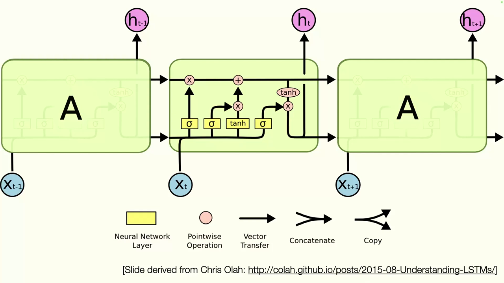
*▲ 강의 슬라이드 [36:12](https://youtu.be/IiHknRHA-Gk?t=2172): [LSTM](00_%EB%94%A5%EB%9F%AC%EB%8B%9D_%EC%9A%A9%EC%96%B4%EC%82%AC%EC%A0%84.md#lstm-long-short-term-memory-%EC%9E%A5%EB%8B%A8%EA%B8%B0-%EB%A9%94%EB%AA%A8%EB%A6%AC) 셀 하나. 노란 상자는 신경망 [층](00_%EB%94%A5%EB%9F%AC%EB%8B%9D_%EC%9A%A9%EC%96%B4%EC%82%AC%EC%A0%84.md#layer-%EC%B8%B5), 분홍 원은 원소별 연산 (Chris Olah 블로그 그림을 바탕으로 한 슬라이드)*

### 6.2 망각 게이트

▶ 영상 [36:46](https://youtu.be/IiHknRHA-Gk?t=2206)

이전 [은닉 상태](00_%EB%94%A5%EB%9F%AC%EB%8B%9D_%EC%9A%A9%EC%96%B4%EC%82%AC%EC%A0%84.md#hidden-state-%EC%9D%80%EB%8B%89-%EC%83%81%ED%83%9C)와 현재 입력을 이어 붙여 [선형층](00_%EB%94%A5%EB%9F%AC%EB%8B%9D_%EC%9A%A9%EC%96%B4%EC%82%AC%EC%A0%84.md#linear-layer-%EC%84%A0%ED%98%95%EC%B8%B5)에 넣고 [시그모이드](00_%EB%94%A5%EB%9F%AC%EB%8B%9D_%EC%9A%A9%EC%96%B4%EC%82%AC%EC%A0%84.md#sigmoid-%EC%8B%9C%EA%B7%B8%EB%AA%A8%EC%9D%B4%EB%93%9C)를 씌웁니다. 값이 크면 1, 작으면 0에 가까워집니다. [셀 상태](00_%EB%94%A5%EB%9F%AC%EB%8B%9D_%EC%9A%A9%EC%96%B4%EC%82%AC%EC%A0%84.md#cell-state-%EC%85%80-%EC%83%81%ED%83%9C)의 각 칸에 이 값을 곱하므로, 1에 가까운 칸은 **기억**, 0에 가까운 칸은 **망각**입니다. 이것이 **망각 [게이트(Forget gate)](00_%EB%94%A5%EB%9F%AC%EB%8B%9D_%EC%9A%A9%EC%96%B4%EC%82%AC%EC%A0%84.md#gate-%EA%B2%8C%EC%9D%B4%ED%8A%B8)**입니다.

$$
f_t = \sigma\big(W_f \cdot [h_{t-1}, x_t] + b_f\big)
$$

기호 풀이

| 기호 | 읽는 법 | 뜻 | 예제 값 |
| --- | --- | --- | --- |
| $f_t$ | 에프 티 | 망각 [게이트](00_%EB%94%A5%EB%9F%AC%EB%8B%9D_%EC%9A%A9%EC%96%B4%EC%82%AC%EC%A0%84.md#gate-%EA%B2%8C%EC%9D%B4%ED%8A%B8) 값 (칸마다 0~1, 남길 비율) | 0.8176 |
| $\sigma$ | 시그마 | [시그모이드](00_%EB%94%A5%EB%9F%AC%EB%8B%9D_%EC%9A%A9%EC%96%B4%EC%82%AC%EC%A0%84.md#sigmoid-%EC%8B%9C%EA%B7%B8%EB%AA%A8%EC%9D%B4%EB%93%9C), 0~1로 눌러 줌 | $\sigma(1.5) = 0.8176$ |
| $W_f$ | 더블유 에프 | 망각 [게이트](00_%EB%94%A5%EB%9F%AC%EB%8B%9D_%EC%9A%A9%EC%96%B4%EC%82%AC%EC%A0%84.md#gate-%EA%B2%8C%EC%9D%B4%ED%8A%B8)의 [가중치](00_%EB%94%A5%EB%9F%AC%EB%8B%9D_%EC%9A%A9%EC%96%B4%EC%82%AC%EC%A0%84.md#weight-%EA%B0%80%EC%A4%91%EC%B9%98) | (0.5, 1) |
| $[h_{t-1}, x_t]$ | 에이치 티 마이너스 일, 엑스 티 [이어 붙이기](00_%EB%94%A5%EB%9F%AC%EB%8B%9D_%EC%9A%A9%EC%96%B4%EC%82%AC%EC%A0%84.md#concatenate-stack-%EC%9D%B4%EC%96%B4-%EB%B6%99%EC%9D%B4%EA%B8%B0%EC%99%80-%EC%8C%93%EA%B8%B0) | 이전 [은닉 상태](00_%EB%94%A5%EB%9F%AC%EB%8B%9D_%EC%9A%A9%EC%96%B4%EC%82%AC%EC%A0%84.md#hidden-state-%EC%9D%80%EB%8B%89-%EC%83%81%ED%83%9C)와 현재 입력을 한 벡터로 이은 것 | (1, 2) |
| $b_f$ | 비 에프 | 망각 [게이트](00_%EB%94%A5%EB%9F%AC%EB%8B%9D_%EC%9A%A9%EC%96%B4%EC%82%AC%EC%A0%84.md#gate-%EA%B2%8C%EC%9D%B4%ED%8A%B8)의 [편향](00_%EB%94%A5%EB%9F%AC%EB%8B%9D_%EC%9A%A9%EC%96%B4%EC%82%AC%EC%A0%84.md#bias-%ED%8E%B8%ED%96%A5) | −1 |

예제와 풀이

**문제**: 크기 1짜리 [LSTM](00_%EB%94%A5%EB%9F%AC%EB%8B%9D_%EC%9A%A9%EC%96%B4%EC%82%AC%EC%A0%84.md#lstm-long-short-term-memory-%EC%9E%A5%EB%8B%A8%EA%B8%B0-%EB%A9%94%EB%AA%A8%EB%A6%AC)에서 망각 [게이트](00_%EB%94%A5%EB%9F%AC%EB%8B%9D_%EC%9A%A9%EC%96%B4%EC%82%AC%EC%A0%84.md#gate-%EA%B2%8C%EC%9D%B4%ED%8A%B8) 값을 구한다.

**주어진 값**:
- $h_{t-1} = 1$, $x_t = 2$ (이어 붙이면 $[1, 2]$)
- $W_f = (0.5, 1)$ (이어 붙인 두 칸에 곱할 [가중치](00_%EB%94%A5%EB%9F%AC%EB%8B%9D_%EC%9A%A9%EC%96%B4%EC%82%AC%EC%A0%84.md#weight-%EA%B0%80%EC%A4%91%EC%B9%98))
- $b_f = -1$

**풀이**
1. 식을 그대로 쓴다: $f_t = \sigma\big(W_f \cdot [h_{t-1}, x_t] + b_f\big)$
2. 값을 대입한다: $f_t = \sigma\big((0.5, 1) \cdot [1, 2] + (-1)\big)$
3. [가중치](00_%EB%94%A5%EB%9F%AC%EB%8B%9D_%EC%9A%A9%EC%96%B4%EC%82%AC%EC%A0%84.md#weight-%EA%B0%80%EC%A4%91%EC%B9%98)와 이어 붙인 벡터를 칸끼리 곱해 더한다: $0.5 \times 1 + 1 \times 2 = 0.5 + 2 = 2.5$
4. [편향](00_%EB%94%A5%EB%9F%AC%EB%8B%9D_%EC%9A%A9%EC%96%B4%EC%82%AC%EC%A0%84.md#bias-%ED%8E%B8%ED%96%A5)을 더한다: $2.5 + (-1) = 1.5$
5. [시그모이드](00_%EB%94%A5%EB%9F%AC%EB%8B%9D_%EC%9A%A9%EC%96%B4%EC%82%AC%EC%A0%84.md#sigmoid-%EC%8B%9C%EA%B7%B8%EB%AA%A8%EC%9D%B4%EB%93%9C) 뜻: $\sigma(z) = 1/(1 + e^{-z})$. $e$는 약 2.718인 수이고, 결과는 항상 0과 1 사이다
6. [시그모이드](00_%EB%94%A5%EB%9F%AC%EB%8B%9D_%EC%9A%A9%EC%96%B4%EC%82%AC%EC%A0%84.md#sigmoid-%EC%8B%9C%EA%B7%B8%EB%AA%A8%EC%9D%B4%EB%93%9C)를 계산한다: $\sigma(1.5) = 1/(1 + e^{-1.5}) = 1/(1 + 0.2231) = 0.8176$

**답**: $f_t = 0.8176$ (이전 셀 내용의 약 82%를 남긴다)

내 이해

- [ReLU](00_%EB%94%A5%EB%9F%AC%EB%8B%9D_%EC%9A%A9%EC%96%B4%EC%82%AC%EC%A0%84.md#relu-%EB%A0%90%EB%A3%A8)처럼 위가 열린 함수가 아니라 0~1로 묶인 [시그모이드](00_%EB%94%A5%EB%9F%AC%EB%8B%9D_%EC%9A%A9%EC%96%B4%EC%82%AC%EC%A0%84.md#sigmoid-%EC%8B%9C%EA%B7%B8%EB%AA%A8%EC%9D%B4%EB%93%9C)를 쓰기 때문에, [셀 상태](00_%EB%94%A5%EB%9F%AC%EB%8B%9D_%EC%9A%A9%EC%96%B4%EC%82%AC%EC%A0%84.md#cell-state-%EC%85%80-%EC%83%81%ED%83%9C)의 각 칸은 **항등 함수에 "지울 칸" 가리개를 씌운 것**처럼 움직입니다.

### 6.3 입력 게이트와 셀 갱신

▶ 영상 [37:56](https://youtu.be/IiHknRHA-Gk?t=2276)

다음은 **어느 칸에 쓸지**(입력 [게이트](00_%EB%94%A5%EB%9F%AC%EB%8B%9D_%EC%9A%A9%EC%96%B4%EC%82%AC%EC%A0%84.md#gate-%EA%B2%8C%EC%9D%B4%ED%8A%B8) $i_t$)와 **무엇을 쓸지**(후보 $\tilde{C}_t$)를 정합니다. 그리고 처음으로 **곱셈 관계**가 등장합니다. 이전 [셀 상태](00_%EB%94%A5%EB%9F%AC%EB%8B%9D_%EC%9A%A9%EC%96%B4%EC%82%AC%EC%A0%84.md#cell-state-%EC%85%80-%EC%83%81%ED%83%9C)에 $f_t$를 곱해 지우고, $i_t \odot \tilde{C}_t$를 더해 씁니다.

$$
\begin{aligned}
i_t &= \sigma\big(W_i \cdot [h_{t-1}, x_t] + b_i\big), \qquad \tilde{C}_t = \tanh\big(W_C \cdot [h_{t-1}, x_t] + b_C\big) \\
C_t &= f_t \odot C_{t-1} + i_t \odot \tilde{C}_t
\end{aligned}
$$

기호 풀이

| 기호 | 읽는 법 | 뜻 | 예제 값 |
| --- | --- | --- | --- |
| $i_t$ | 아이 티 | 입력 [게이트](00_%EB%94%A5%EB%9F%AC%EB%8B%9D_%EC%9A%A9%EC%96%B4%EC%82%AC%EC%A0%84.md#gate-%EA%B2%8C%EC%9D%B4%ED%8A%B8): 칸마다 얼마나 새로 쓸지 (0~1) | 0.2689 |
| $W_i, b_i$ | 더블유 아이, 비 아이 | 입력 [게이트](00_%EB%94%A5%EB%9F%AC%EB%8B%9D_%EC%9A%A9%EC%96%B4%EC%82%AC%EC%A0%84.md#gate-%EA%B2%8C%EC%9D%B4%ED%8A%B8)의 [가중치](00_%EB%94%A5%EB%9F%AC%EB%8B%9D_%EC%9A%A9%EC%96%B4%EC%82%AC%EC%A0%84.md#weight-%EA%B0%80%EC%A4%91%EC%B9%98)와 [편향](00_%EB%94%A5%EB%9F%AC%EB%8B%9D_%EC%9A%A9%EC%96%B4%EC%82%AC%EC%A0%84.md#bias-%ED%8E%B8%ED%96%A5) | (1, −1), 0 |
| $\tilde{C}_t$ | 씨 틸드 티 | 새로 쓸 후보 내용 ([tanh](00_%EB%94%A5%EB%9F%AC%EB%8B%9D_%EC%9A%A9%EC%96%B4%EC%82%AC%EC%A0%84.md#tanh-%EC%8C%8D%EA%B3%A1%ED%83%84%EC%A0%A0%ED%8A%B8)라서 −1~1) | 0.9051 |
| $W_C, b_C$ | 더블유 씨, 비 씨 | 후보를 만드는 [가중치](00_%EB%94%A5%EB%9F%AC%EB%8B%9D_%EC%9A%A9%EC%96%B4%EC%82%AC%EC%A0%84.md#weight-%EA%B0%80%EC%A4%91%EC%B9%98)와 [편향](00_%EB%94%A5%EB%9F%AC%EB%8B%9D_%EC%9A%A9%EC%96%B4%EC%82%AC%EC%A0%84.md#bias-%ED%8E%B8%ED%96%A5) | (0.5, 0.5), 0 |
| $C_{t-1}$ | 씨 티 마이너스 일 | 이전 [셀 상태](00_%EB%94%A5%EB%9F%AC%EB%8B%9D_%EC%9A%A9%EC%96%B4%EC%82%AC%EC%A0%84.md#cell-state-%EC%85%80-%EC%83%81%ED%83%9C) | 2 |
| $\odot$ | [원소별 곱](00_%EB%94%A5%EB%9F%AC%EB%8B%9D_%EC%9A%A9%EC%96%B4%EC%82%AC%EC%A0%84.md#hadamard-product-%EC%9B%90%EC%86%8C%EB%B3%84-%EA%B3%B1) | 칸끼리 곱하기 ([Hadamard product](00_%EB%94%A5%EB%9F%AC%EB%8B%9D_%EC%9A%A9%EC%96%B4%EC%82%AC%EC%A0%84.md#hadamard-product-%EC%9B%90%EC%86%8C%EB%B3%84-%EA%B3%B1)). 슬라이드의 `*` | - |
| $C_t$ | 씨 티 | 새 [셀 상태](00_%EB%94%A5%EB%9F%AC%EB%8B%9D_%EC%9A%A9%EC%96%B4%EC%82%AC%EC%A0%84.md#cell-state-%EC%85%80-%EC%83%81%ED%83%9C) | 1.8786 |

예제와 풀이

**문제**: 6.2의 예에 이어 새 [셀 상태](00_%EB%94%A5%EB%9F%AC%EB%8B%9D_%EC%9A%A9%EC%96%B4%EC%82%AC%EC%A0%84.md#cell-state-%EC%85%80-%EC%83%81%ED%83%9C)를 구한다.

**주어진 값**:
- $[h_{t-1}, x_t] = [1, 2]$, $f_t = 0.8176$ (6.2에서 구한 값)
- $W_i = (1, -1)$, $b_i = 0$ (입력 [게이트](00_%EB%94%A5%EB%9F%AC%EB%8B%9D_%EC%9A%A9%EC%96%B4%EC%82%AC%EC%A0%84.md#gate-%EA%B2%8C%EC%9D%B4%ED%8A%B8))
- $W_C = (0.5, 0.5)$, $b_C = 0$ (후보)
- $C_{t-1} = 2$ (이전 [셀 상태](00_%EB%94%A5%EB%9F%AC%EB%8B%9D_%EC%9A%A9%EC%96%B4%EC%82%AC%EC%A0%84.md#cell-state-%EC%85%80-%EC%83%81%ED%83%9C))

**풀이**
1. 식을 그대로 쓴다: $i_t = \sigma(W_i \cdot [h_{t-1}, x_t] + b_i)$, $\;\tilde{C}_t = \tanh(W_C \cdot [h_{t-1}, x_t] + b_C)$, $\;C_t = f_t \odot C_{t-1} + i_t \odot \tilde{C}_t$
2. 값을 대입한다: $i_t = \sigma\big((1, -1) \cdot [1, 2] + 0\big)$, $\;\tilde{C}_t = \tanh\big((0.5, 0.5) \cdot [1, 2] + 0\big)$, $\;C_t = 0.8176 \times 2 + i_t \times \tilde{C}_t$
3. 입력 [게이트](00_%EB%94%A5%EB%9F%AC%EB%8B%9D_%EC%9A%A9%EC%96%B4%EC%82%AC%EC%A0%84.md#gate-%EA%B2%8C%EC%9D%B4%ED%8A%B8) 안쪽을 칸끼리 곱해 더한다: $1 \times 1 + (-1) \times 2 + 0 = 1 - 2 = -1$
4. 입력 [게이트](00_%EB%94%A5%EB%9F%AC%EB%8B%9D_%EC%9A%A9%EC%96%B4%EC%82%AC%EC%A0%84.md#gate-%EA%B2%8C%EC%9D%B4%ED%8A%B8)를 계산한다 ($\sigma(z) = 1/(1 + e^{-z})$): $i_t = 1/(1 + e^{1}) = 1/(1 + 2.7183) = 0.2689$
5. 후보 안쪽을 칸끼리 곱해 더한다: $0.5 \times 1 + 0.5 \times 2 + 0 = 0.5 + 1 = 1.5$
6. 후보를 계산한다 ($\tanh$는 아무 수를 −1~1로 눌러 주는 함수): $\tilde{C}_t = \tanh(1.5) = 0.9051$
7. 남긴 몫을 곱한다: $0.8176 \times 2 = 1.6351$
8. 새로 쓴 몫을 곱한다: $0.2689 \times 0.9051 = 0.2434$
9. 더한다: $C_t = 1.6351 + 0.2434 = 1.8786$

**답**: $C_t = 1.8786$

내 이해

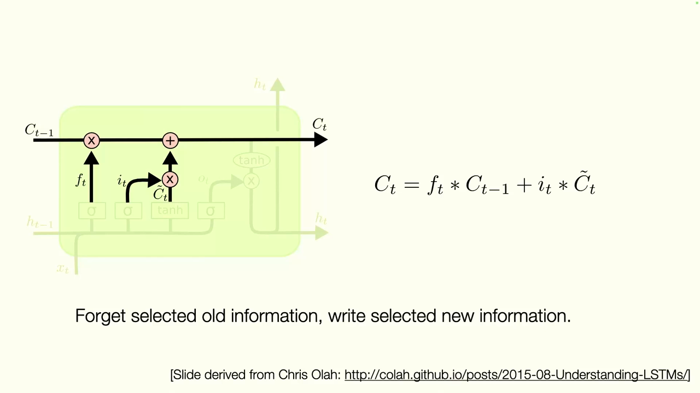
*▲ 강의 슬라이드 [38:52](https://youtu.be/IiHknRHA-Gk?t=2332): 고른 옛 정보는 지우고(f_t), 고른 새 정보는 쓴다(i_t × C̃_t)*

### 6.4 출력 게이트

▶ 영상 [39:04](https://youtu.be/IiHknRHA-Gk?t=2344)

[셀 상태](00_%EB%94%A5%EB%9F%AC%EB%8B%9D_%EC%9A%A9%EC%96%B4%EC%82%AC%EC%A0%84.md#cell-state-%EC%85%80-%EC%83%81%ED%83%9C)를 갱신한 뒤, 그중 무엇을 다음 [은닉 상태](00_%EB%94%A5%EB%9F%AC%EB%8B%9D_%EC%9A%A9%EC%96%B4%EC%82%AC%EC%A0%84.md#hidden-state-%EC%9D%80%EB%8B%89-%EC%83%81%ED%83%9C)로 내보낼지 정합니다. 강사는 수학적으로 같지는 않지만 "느낌상" [트랜스포머](00_%EB%94%A5%EB%9F%AC%EB%8B%9D_%EC%9A%A9%EC%96%B4%EC%82%AC%EC%A0%84.md#transformer-%ED%8A%B8%EB%9E%9C%EC%8A%A4%ED%8F%AC%EB%A8%B8)의 값(value) [투영](00_%EB%94%A5%EB%9F%AC%EB%8B%9D_%EC%9A%A9%EC%96%B4%EC%82%AC%EC%A0%84.md#projection-%ED%88%AC%EC%98%81)과 비슷하다고 말합니다. 이제 [은닉 상태](00_%EB%94%A5%EB%9F%AC%EB%8B%9D_%EC%9A%A9%EC%96%B4%EC%82%AC%EC%A0%84.md#hidden-state-%EC%9D%80%EB%8B%89-%EC%83%81%ED%83%9C) $h_t$와 [셀 상태](00_%EB%94%A5%EB%9F%AC%EB%8B%9D_%EC%9A%A9%EC%96%B4%EC%82%AC%EC%A0%84.md#cell-state-%EC%85%80-%EC%83%81%ED%83%9C) $C_t$, **두 가지**가 함께 다음 단계로 전해집니다.

$$
o_t = \sigma\big(W_o \cdot [h_{t-1}, x_t] + b_o\big), \qquad h_t = o_t \odot \tanh(C_t)
$$

기호 풀이

| 기호 | 읽는 법 | 뜻 | 예제 값 |
| --- | --- | --- | --- |
| $o_t$ | 오 티 | 출력 [게이트](00_%EB%94%A5%EB%9F%AC%EB%8B%9D_%EC%9A%A9%EC%96%B4%EC%82%AC%EC%A0%84.md#gate-%EA%B2%8C%EC%9D%B4%ED%8A%B8): 셀의 어느 칸을 내보낼지 (0~1) | 0.7311 |
| $W_o, b_o$ | 더블유 오, 비 오 | 출력 [게이트](00_%EB%94%A5%EB%9F%AC%EB%8B%9D_%EC%9A%A9%EC%96%B4%EC%82%AC%EC%A0%84.md#gate-%EA%B2%8C%EC%9D%B4%ED%8A%B8)의 [가중치](00_%EB%94%A5%EB%9F%AC%EB%8B%9D_%EC%9A%A9%EC%96%B4%EC%82%AC%EC%A0%84.md#weight-%EA%B0%80%EC%A4%91%EC%B9%98)와 [편향](00_%EB%94%A5%EB%9F%AC%EB%8B%9D_%EC%9A%A9%EC%96%B4%EC%82%AC%EC%A0%84.md#bias-%ED%8E%B8%ED%96%A5) | (1, 0.5), −1 |
| $\tanh(C_t)$ | 탄에이치 씨 티 | [셀 상태](00_%EB%94%A5%EB%9F%AC%EB%8B%9D_%EC%9A%A9%EC%96%B4%EC%82%AC%EC%A0%84.md#cell-state-%EC%85%80-%EC%83%81%ED%83%9C)를 −1~1로 눌러 준 값 | 0.9544 |
| $h_t$ | 에이치 티 | 새 [은닉 상태](00_%EB%94%A5%EB%9F%AC%EB%8B%9D_%EC%9A%A9%EC%96%B4%EC%82%AC%EC%A0%84.md#hidden-state-%EC%9D%80%EB%8B%89-%EC%83%81%ED%83%9C) (출력과 다음 단계로 감) | 0.6977 |

예제와 풀이

**문제**: 6.3의 예에 이어 새 [은닉 상태](00_%EB%94%A5%EB%9F%AC%EB%8B%9D_%EC%9A%A9%EC%96%B4%EC%82%AC%EC%A0%84.md#hidden-state-%EC%9D%80%EB%8B%89-%EC%83%81%ED%83%9C)를 구한다.

**주어진 값**:
- $[h_{t-1}, x_t] = [1, 2]$
- $W_o = (1, 0.5)$, $b_o = -1$ (출력 [게이트](00_%EB%94%A5%EB%9F%AC%EB%8B%9D_%EC%9A%A9%EC%96%B4%EC%82%AC%EC%A0%84.md#gate-%EA%B2%8C%EC%9D%B4%ED%8A%B8))
- $C_t = 1.8786$ (6.3에서 구한 새 [셀 상태](00_%EB%94%A5%EB%9F%AC%EB%8B%9D_%EC%9A%A9%EC%96%B4%EC%82%AC%EC%A0%84.md#cell-state-%EC%85%80-%EC%83%81%ED%83%9C))

**풀이**
1. 식을 그대로 쓴다: $o_t = \sigma\big(W_o \cdot [h_{t-1}, x_t] + b_o\big)$, $\;h_t = o_t \odot \tanh(C_t)$
2. 값을 대입한다: $o_t = \sigma\big((1, 0.5) \cdot [1, 2] + (-1)\big)$, $\;h_t = o_t \times \tanh(1.8786)$
3. 출력 [게이트](00_%EB%94%A5%EB%9F%AC%EB%8B%9D_%EC%9A%A9%EC%96%B4%EC%82%AC%EC%A0%84.md#gate-%EA%B2%8C%EC%9D%B4%ED%8A%B8) 안쪽을 칸끼리 곱해 더한다: $1 \times 1 + 0.5 \times 2 + (-1) = 1 + 1 - 1 = 1$
4. 출력 [게이트](00_%EB%94%A5%EB%9F%AC%EB%8B%9D_%EC%9A%A9%EC%96%B4%EC%82%AC%EC%A0%84.md#gate-%EA%B2%8C%EC%9D%B4%ED%8A%B8)를 계산한다 ($\sigma(z) = 1/(1 + e^{-z})$): $o_t = 1/(1 + e^{-1}) = 1/(1 + 0.3679) = 0.7311$
5. [셀 상태](00_%EB%94%A5%EB%9F%AC%EB%8B%9D_%EC%9A%A9%EC%96%B4%EC%82%AC%EC%A0%84.md#cell-state-%EC%85%80-%EC%83%81%ED%83%9C)를 누른다 ($\tanh$, −1~1로 눌러 줌): $\tanh(1.8786) = 0.9544$
6. 곱한다: $h_t = 0.7311 \times 0.9544 = 0.6977$

**답**: $h_t = 0.6977$

내 이해

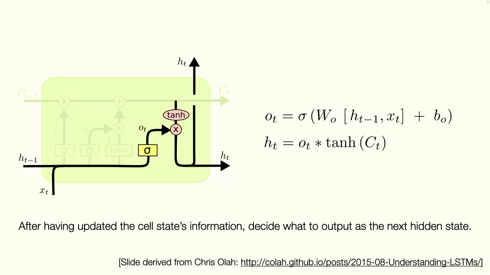
*▲ 강의 슬라이드 [39:52](https://youtu.be/IiHknRHA-Gk?t=2392): 갱신한 [셀 상태](00_%EB%94%A5%EB%9F%AC%EB%8B%9D_%EC%9A%A9%EC%96%B4%EC%82%AC%EC%A0%84.md#cell-state-%EC%85%80-%EC%83%81%ED%83%9C)에서 다음 [은닉 상태](00_%EB%94%A5%EB%9F%AC%EB%8B%9D_%EC%9A%A9%EC%96%B4%EC%82%AC%EC%A0%84.md#hidden-state-%EC%9D%80%EB%8B%89-%EC%83%81%ED%83%9C)로 내보낼 것을 고르는 출력 [게이트](00_%EB%94%A5%EB%9F%AC%EB%8B%9D_%EC%9A%A9%EC%96%B4%EC%82%AC%EC%A0%84.md#gate-%EA%B2%8C%EC%9D%B4%ED%8A%B8)*

### 6.5 왜 기울기가 사라지지 않나

▶ 영상 [40:09](https://youtu.be/IiHknRHA-Gk?t=2409)

- 바닐라 [RNN](00_%EB%94%A5%EB%9F%AC%EB%8B%9D_%EC%9A%A9%EC%96%B4%EC%82%AC%EC%A0%84.md#rnn-recurrent-neural-network-%EC%88%9C%ED%99%98-%EC%8B%A0%EA%B2%BD%EB%A7%9D)과의 핵심 차이는 [셀 상태](00_%EB%94%A5%EB%9F%AC%EB%8B%9D_%EC%9A%A9%EC%96%B4%EC%82%AC%EC%A0%84.md#cell-state-%EC%85%80-%EC%83%81%ED%83%9C)에 대한 **곱셈 갱신이 만드는 [게이트](00_%EB%94%A5%EB%9F%AC%EB%8B%9D_%EC%9A%A9%EC%96%B4%EC%82%AC%EC%A0%84.md#gate-%EA%B2%8C%EC%9D%B4%ED%8A%B8) 기능**입니다. 무엇을 기억하고 잊을지 명시적으로 배웁니다.
- [셀 상태](00_%EB%94%A5%EB%9F%AC%EB%8B%9D_%EC%9A%A9%EC%96%B4%EC%82%AC%EC%A0%84.md#cell-state-%EC%85%80-%EC%83%81%ED%83%9C) 길에서는 자기 자신($\mathbf{W}$)을 거듭 곱하는 대신 [게이트](00_%EB%94%A5%EB%9F%AC%EB%8B%9D_%EC%9A%A9%EC%96%B4%EC%82%AC%EC%A0%84.md#gate-%EA%B2%8C%EC%9D%B4%ED%8A%B8) 값을 곱합니다. [게이트](00_%EB%94%A5%EB%9F%AC%EB%8B%9D_%EC%9A%A9%EC%96%B4%EC%82%AC%EC%A0%84.md#gate-%EA%B2%8C%EC%9D%B4%ED%8A%B8)가 1이면 **항등**이라 지수적 감소가 사라집니다. 항등이거나, 지우고 새로 쓰는 것뿐입니다. 망각 [게이트](00_%EB%94%A5%EB%9F%AC%EB%8B%9D_%EC%9A%A9%EC%96%B4%EC%82%AC%EC%A0%84.md#gate-%EA%B2%8C%EC%9D%B4%ED%8A%B8)가 0.99면 50단계 뒤에도 0.605가 남습니다([RNN](00_%EB%94%A5%EB%9F%AC%EB%8B%9D_%EC%9A%A9%EC%96%B4%EC%82%AC%EC%A0%84.md#rnn-recurrent-neural-network-%EC%88%9C%ED%99%98-%EC%8B%A0%EA%B2%BD%EB%A7%9D) $w = 0.9$는 0.005154, [MM38_LSTM_게이트와_원소별_곱](%EC%88%98%ED%95%99%EA%B0%9C%EB%85%90/07_%EA%B5%AC%EC%A1%B0_%EC%95%84%ED%82%A4%ED%85%8D%EC%B2%98/MM38_LSTM_%EA%B2%8C%EC%9D%B4%ED%8A%B8%EC%99%80_%EC%9B%90%EC%86%8C%EB%B3%84_%EA%B3%B1.md)).
- 기본값이 항등이므로 [ResNet](00_%EB%94%A5%EB%9F%AC%EB%8B%9D_%EC%9A%A9%EC%96%B4%EC%82%AC%EC%A0%84.md#resnet-%EB%A0%88%EC%A6%88%EB%84%B7)의 [스킵 연결](00_%EB%94%A5%EB%9F%AC%EB%8B%9D_%EC%9A%A9%EC%96%B4%EC%82%AC%EC%A0%84.md#skip-connection-%EC%8A%A4%ED%82%B5-%EC%97%B0%EA%B2%B0)·[잔차 연결](00_%EB%94%A5%EB%9F%AC%EB%8B%9D_%EC%9A%A9%EC%96%B4%EC%82%AC%EC%A0%84.md#residual-connection-%EC%9E%94%EC%B0%A8-%EC%97%B0%EA%B2%B0)과 닮았습니다. 처음부터 끝까지 같은 정보를 그대로 보내는 것도 배울 수 있습니다.
- 강사는 이 부분이 꽤 까다로우니 Chris Olah의 블로그 글 "Understanding [LSTM](00_%EB%94%A5%EB%9F%AC%EB%8B%9D_%EC%9A%A9%EC%96%B4%EC%82%AC%EC%A0%84.md#lstm-long-short-term-memory-%EC%9E%A5%EB%8B%A8%EA%B8%B0-%EB%A9%94%EB%AA%A8%EB%A6%AC) Networks"를 다시 읽어 보라고 권합니다.

질의응답: 곱셈은 원소별인가, σ는 무엇인가 [41:17](https://youtu.be/IiHknRHA-Gk?t=2477)

- **[셀 상태](00_%EB%94%A5%EB%9F%AC%EB%8B%9D_%EC%9A%A9%EC%96%B4%EC%82%AC%EC%A0%84.md#cell-state-%EC%85%80-%EC%83%81%ED%83%9C)의 곱셈은 원소별 곱인가?** 그렇습니다. 망각할 것을 정하는 $f$와 새로 더할 것을 정하는 $i$를 [셀 상태](00_%EB%94%A5%EB%9F%AC%EB%8B%9D_%EC%9A%A9%EC%96%B4%EC%82%AC%EC%A0%84.md#cell-state-%EC%85%80-%EC%83%81%ED%83%9C) $C$의 크기에 맞춰 칸마다 곱합니다.
- **σ는 MLP인가?** 문자 그대로 [시그모이드](00_%EB%94%A5%EB%9F%AC%EB%8B%9D_%EC%9A%A9%EC%96%B4%EC%82%AC%EC%A0%84.md#sigmoid-%EC%8B%9C%EA%B7%B8%EB%AA%A8%EC%9D%B4%EB%93%9C) 함수입니다. 다른 비선형 함수도 쓸 수는 있지만, 0~1로 묶여서 큰 값은 1, 작은 값은 0으로 보내기 때문에 씁니다.
- **[가중치](00_%EB%94%A5%EB%9F%AC%EB%8B%9D_%EC%9A%A9%EC%96%B4%EC%82%AC%EC%A0%84.md#weight-%EA%B0%80%EC%A4%91%EC%B9%98)는 대각 행렬인가?** 아닙니다. [게이트](00_%EB%94%A5%EB%9F%AC%EB%8B%9D_%EC%9A%A9%EC%96%B4%EC%82%AC%EC%A0%84.md#gate-%EA%B2%8C%EC%9D%B4%ED%8A%B8)를 **계산**할 때는 칸들이 섞이고, [게이트](00_%EB%94%A5%EB%9F%AC%EB%8B%9D_%EC%9A%A9%EC%96%B4%EC%82%AC%EC%A0%84.md#gate-%EA%B2%8C%EC%9D%B4%ED%8A%B8)를 **적용**할 때만 칸끼리 곱합니다.

---

## 7. 자기회귀 시퀀스 모델

▶ 영상 [42:20](https://youtu.be/IiHknRHA-Gk?t=2540)

### 7.1 다음을 예측하고 덧붙이기

▶ 영상 [42:53](https://youtu.be/IiHknRHA-Gk?t=2573)

**[자기회귀 모델(Autoregressive model)](00_%EB%94%A5%EB%9F%AC%EB%8B%9D_%EC%9A%A9%EC%96%B4%EC%82%AC%EC%A0%84.md#autoregressive-model-%EC%9E%90%EA%B8%B0%ED%9A%8C%EA%B7%80-%EB%AA%A8%EB%8D%B8)**의 생각은 단순합니다. [시퀀스](00_%EB%94%A5%EB%9F%AC%EB%8B%9D_%EC%9A%A9%EC%96%B4%EC%82%AC%EC%A0%84.md#sequence-%EC%8B%9C%ED%80%80%EC%8A%A4)의 앞부분을 주고 다음을 예측하게 한 뒤, 그 예측을 **입력에 덧붙이고** 다시 다음을 예측합니다. ChatGPT 같은 오늘날의 [생성 모델](00_%EB%94%A5%EB%9F%AC%EB%8B%9D_%EC%9A%A9%EC%96%B4%EC%82%AC%EC%A0%84.md#generative-model-%EC%83%9D%EC%84%B1-%EB%AA%A8%EB%8D%B8)이 이렇게 학습됩니다. 같은 틀로 빈칸 채우기를 시킬 수도 있습니다.

- **[학습](00_%EB%94%A5%EB%9F%AC%EB%8B%9D_%EC%9A%A9%EC%96%B4%EC%82%AC%EC%A0%84.md#training-%ED%95%99%EC%8A%B5)**: 여러 문장의 앞부분과 그다음 단어를 짝으로 모아, 학습기가 "앞부분 → 다음 단어"를 배우게 합니다.
- **표본 뽑기(sampling)**: 새 앞부분 "colorless green ideas sleep"을 넣어 다음 단어 "furiously"를 얻고, 이것을 덧붙여 또 다음을 예측합니다. 원할 때까지, 또는 모델이 멈추기로 할 때까지 반복합니다.

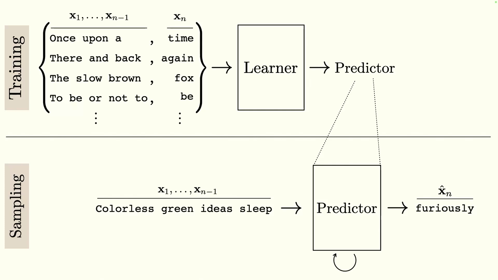
*▲ 강의 슬라이드 [44:12](https://youtu.be/IiHknRHA-Gk?t=2652): [학습](00_%EB%94%A5%EB%9F%AC%EB%8B%9D_%EC%9A%A9%EC%96%B4%EC%82%AC%EC%A0%84.md#training-%ED%95%99%EC%8A%B5)(앞부분 → 다음 단어)과 표본 뽑기(예측을 입력에 되먹임)*

질의응답: RNN도 자기회귀인가? 분포를 통째로 넣으면? [45:07](https://youtu.be/IiHknRHA-Gk?t=2707)

- **[RNN](00_%EB%94%A5%EB%9F%AC%EB%8B%9D_%EC%9A%A9%EC%96%B4%EC%82%AC%EC%A0%84.md#rnn-recurrent-neural-network-%EC%88%9C%ED%99%98-%EC%8B%A0%EA%B2%BD%EB%A7%9D)으로 다음 단어를 예측하면 자기회귀인가?** [RNN](00_%EB%94%A5%EB%9F%AC%EB%8B%9D_%EC%9A%A9%EC%96%B4%EC%82%AC%EC%A0%84.md#rnn-recurrent-neural-network-%EC%88%9C%ED%99%98-%EC%8B%A0%EA%B2%BD%EB%A7%9D) 출력을 다음 단어 예측으로 쓸 수는 있지만, [RNN](00_%EB%94%A5%EB%9F%AC%EB%8B%9D_%EC%9A%A9%EC%96%B4%EC%82%AC%EC%A0%84.md#rnn-recurrent-neural-network-%EC%88%9C%ED%99%98-%EC%8B%A0%EA%B2%BD%EB%A7%9D) 자체에는 **출력을 다음 단계의 입력으로 되먹이는 고리**가 없습니다. 원하면 그렇게 연결해 만들 수 있습니다.
- **표본 하나 대신 예측 분포 전체를 입력에 넣으면?** 좋은 질문이며, 바로 다음에 다루는 [확률](00_%EB%94%A5%EB%9F%AC%EB%8B%9D_%EC%9A%A9%EC%96%B4%EC%82%AC%EC%A0%84.md#probability-%ED%99%95%EB%A5%A0) 모델 이야기로 이어집니다.

### 7.2 확률의 연쇄법칙

▶ 영상 [46:50](https://youtu.be/IiHknRHA-Gk?t=2810)

📐 **수학 개념**: [확률의 연쇄법칙](%EC%88%98%ED%95%99%EA%B0%9C%EB%85%90/04_%ED%99%95%EB%A5%A0%EA%B3%BC_%EC%A0%95%EB%B3%B4/MM39_%ED%99%95%EB%A5%A0%EC%9D%98_%EC%97%B0%EC%87%84%EB%B2%95%EC%B9%99%EA%B3%BC_%EB%B9%94_%EC%84%9C%EC%B9%98.md) · [확률](%EC%88%98%ED%95%99%EA%B0%9C%EB%85%90/04_%ED%99%95%EB%A5%A0%EA%B3%BC_%EC%A0%95%EB%B3%B4/M08_%ED%99%95%EB%A5%A0_%EA%B8%B0%EC%B4%88.md)

다음 단어의 [확률](00_%EB%94%A5%EB%9F%AC%EB%8B%9D_%EC%9A%A9%EC%96%B4%EC%82%AC%EC%A0%84.md#probability-%ED%99%95%EB%A5%A0)을 배우면, 문장 전체의 결합 [확률](00_%EB%94%A5%EB%9F%AC%EB%8B%9D_%EC%9A%A9%EC%96%B4%EC%82%AC%EC%A0%84.md#probability-%ED%99%95%EB%A5%A0)을 **조건부 [확률](00_%EB%94%A5%EB%9F%AC%EB%8B%9D_%EC%9A%A9%EC%96%B4%EC%82%AC%EC%A0%84.md#probability-%ED%99%95%EB%A5%A0)의 곱**으로 풀 수 있습니다. 어떤 [확률](00_%EB%94%A5%EB%9F%AC%EB%8B%9D_%EC%9A%A9%EC%96%B4%EC%82%AC%EC%A0%84.md#probability-%ED%99%95%EB%A5%A0) 분포에서나 성립하는 분해이고, 각 항이 앞의 모든 것에 조건이 걸려 있어 그 자체로 자기회귀적입니다.

$$
p(\mathbf{X}) = p(\mathbf{x}_n \mid \mathbf{x}_1, \dots, \mathbf{x}_{n-1})\, p(\mathbf{x}_{n-1} \mid \mathbf{x}_1, \dots, \mathbf{x}_{n-2}) \cdots p(\mathbf{x}_2 \mid \mathbf{x}_1)\, p(\mathbf{x}_1) = \prod_{i=1}^{n} p(\mathbf{x}_i \mid \mathbf{x}_1, \dots, \mathbf{x}_{i-1})
$$

기호 풀이

| 기호 | 읽는 법 | 뜻 | 예제 값 |
| --- | --- | --- | --- |
| $p(\mathbf{X})$ | 피 엑스 | [시퀀스](00_%EB%94%A5%EB%9F%AC%EB%8B%9D_%EC%9A%A9%EC%96%B4%EC%82%AC%EC%A0%84.md#sequence-%EC%8B%9C%ED%80%80%EC%8A%A4) 전체가 이 순서로 나올 [확률](00_%EB%94%A5%EB%9F%AC%EB%8B%9D_%EC%9A%A9%EC%96%B4%EC%82%AC%EC%A0%84.md#probability-%ED%99%95%EB%A5%A0) (문장의 [우도](00_%EB%94%A5%EB%9F%AC%EB%8B%9D_%EC%9A%A9%EC%96%B4%EC%82%AC%EC%A0%84.md#likelihood-%EC%9A%B0%EB%8F%84)) | 0.0684 |
| $\mathbf{x}_i$ | 엑스 아이 | i번째 [토큰](00_%EB%94%A5%EB%9F%AC%EB%8B%9D_%EC%9A%A9%EC%96%B4%EC%82%AC%EC%A0%84.md#token-%ED%86%A0%ED%81%B0) | time |
| $p(\mathbf{x}_i \mid \mathbf{x}_1, \dots, \mathbf{x}_{i-1})$ | 피 엑스 아이 기븐 앞의 것들 | 앞 [토큰](00_%EB%94%A5%EB%9F%AC%EB%8B%9D_%EC%9A%A9%EC%96%B4%EC%82%AC%EC%A0%84.md#token-%ED%86%A0%ED%81%B0)들이 주어졌을 때 i번째 [토큰](00_%EB%94%A5%EB%9F%AC%EB%8B%9D_%EC%9A%A9%EC%96%B4%EC%82%AC%EC%A0%84.md#token-%ED%86%A0%ED%81%B0)의 [확률](00_%EB%94%A5%EB%9F%AC%EB%8B%9D_%EC%9A%A9%EC%96%B4%EC%82%AC%EC%A0%84.md#probability-%ED%99%95%EB%A5%A0) | $p(\text{time} \mid \text{once upon a}) = 0.95$ |
| $\prod_{i=1}^{n}$ | 파이 | n개 조건부 [확률](00_%EB%94%A5%EB%9F%AC%EB%8B%9D_%EC%9A%A9%EC%96%B4%EC%82%AC%EC%A0%84.md#probability-%ED%99%95%EB%A5%A0)을 모두 곱함 | 4개 곱 |
| $n$ | 엔 | [시퀀스](00_%EB%94%A5%EB%9F%AC%EB%8B%9D_%EC%9A%A9%EC%96%B4%EC%82%AC%EC%A0%84.md#sequence-%EC%8B%9C%ED%80%80%EC%8A%A4) 길이 | 4 |

예제와 풀이

**문제**: "once upon a time"의 [확률](00_%EB%94%A5%EB%9F%AC%EB%8B%9D_%EC%9A%A9%EC%96%B4%EC%82%AC%EC%A0%84.md#probability-%ED%99%95%EB%A5%A0)을 구한다.

**주어진 값** (장난감 숫자):
- $p(\text{once}) = 0.1$
- $p(\text{upon} \mid \text{once}) = 0.8$
- $p(\text{a} \mid \text{once upon}) = 0.9$
- $p(\text{time} \mid \text{once upon a}) = 0.95$

**풀이**
1. 식을 그대로 쓴다: $p(\mathbf{X}) = \prod_{i=1}^{4} p(\mathbf{x}_i \mid \mathbf{x}_1, \dots, \mathbf{x}_{i-1})$
2. 파이(Π, 모두 곱하라는 기호)를 네 항으로 풀어 쓴다: $p = p(\text{once})\,p(\text{upon} \mid \text{once})\,p(\text{a} \mid \text{once upon})\,p(\text{time} \mid \text{once upon a})$
3. 값을 대입한다: $p = 0.1 \times 0.8 \times 0.9 \times 0.95$
4. 앞의 두 개를 곱한다: $0.1 \times 0.8 = 0.08$
5. 셋째를 곱한다: $0.08 \times 0.9 = 0.072$
6. 넷째를 곱한다: $0.072 \times 0.95 = 0.0684$

**답**: $p(\text{once upon a time}) = 0.0684$ ([로그](00_%EB%94%A5%EB%9F%AC%EB%8B%9D_%EC%9A%A9%EC%96%B4%EC%82%AC%EC%A0%84.md#log-ln-%EB%A1%9C%EA%B7%B8)로는 $-2.6824$)

내 이해

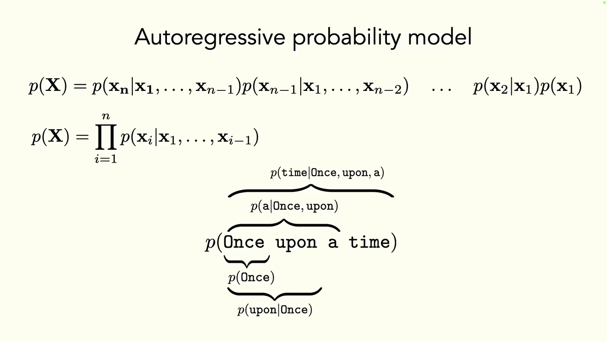
*▲ 강의 슬라이드 [48:12](https://youtu.be/IiHknRHA-Gk?t=2892): p(Once upon a time)을 조건부 [확률](00_%EB%94%A5%EB%9F%AC%EB%8B%9D_%EC%9A%A9%EC%96%B4%EC%82%AC%EC%A0%84.md#probability-%ED%99%95%EB%A5%A0)의 곱으로 분해*

### 7.3 다음 단어 분류기와 토큰

▶ 영상 [48:33](https://youtu.be/IiHknRHA-Gk?t=2913)

📐 **수학 개념**: [지수(소프트맥스)](%EC%88%98%ED%95%99%EA%B0%9C%EB%85%90/01_%EC%88%98%EC%99%80_%ED%95%A8%EC%88%98/M06_%EC%A7%80%EC%88%98%EC%99%80_e.md) · [엔트로피](%EC%88%98%ED%95%99%EA%B0%9C%EB%85%90/04_%ED%99%95%EB%A5%A0%EA%B3%BC_%EC%A0%95%EB%B3%B4/M10_%EC%97%94%ED%8A%B8%EB%A1%9C%ED%94%BC.md)

$p(\text{time} \mid \text{once, upon, a})$는 어떤 함수로 모델링할까요? 학생들이 [로지스틱 회귀](00_%EB%94%A5%EB%9F%AC%EB%8B%9D_%EC%9A%A9%EC%96%B4%EC%82%AC%EC%A0%84.md#logistic-regression-%EB%A1%9C%EC%A7%80%EC%8A%A4%ED%8B%B1-%ED%9A%8C%EA%B7%80), [소프트맥스](00_%EB%94%A5%EB%9F%AC%EB%8B%9D_%EC%9A%A9%EC%96%B4%EC%82%AC%EC%A0%84.md#softmax-%EC%86%8C%ED%94%84%ED%8A%B8%EB%A7%A5%EC%8A%A4)를 답하자 강사는 "**다음 단어 분류기**로 보면 된다"고 정리합니다. 많은 문제는 [다중 분류](00_%EB%94%A5%EB%9F%AC%EB%8B%9D_%EC%9A%A9%EC%96%B4%EC%82%AC%EC%A0%84.md#multinomial-classification-%EB%8B%A4%EC%A4%91-%EB%B6%84%EB%A5%98)로 바꿔 보는 것이 좋은 출발점입니다.

- 신경망 출력에 [소프트맥스](00_%EB%94%A5%EB%9F%AC%EB%8B%9D_%EC%9A%A9%EC%96%B4%EC%82%AC%EC%A0%84.md#softmax-%EC%86%8C%ED%94%84%ED%8A%B8%EB%A7%A5%EC%8A%A4)를 씌워 음이 아니고 합이 1인 벡터([확률](00_%EB%94%A5%EB%9F%AC%EB%8B%9D_%EC%9A%A9%EC%96%B4%EC%82%AC%EC%A0%84.md#probability-%ED%99%95%EB%A5%A0) 질량 함수)로 만들고, [교차 엔트로피](00_%EB%94%A5%EB%9F%AC%EB%8B%9D_%EC%9A%A9%EC%96%B4%EC%82%AC%EC%A0%84.md#cross-entropy-%EA%B5%90%EC%B0%A8-%EC%97%94%ED%8A%B8%EB%A1%9C%ED%94%BC)로 벌점을 줍니다.

**단어를 어떻게 클래스로 바꾸나** [49:41](https://youtu.be/IiHknRHA-Gk?t=2981)

| 방식 | 클래스 수 K | 장점 | 단점 |
|---|---|---|---|
| 단어 하나 = 클래스 ([원-핫](00_%EB%94%A5%EB%9F%AC%EB%8B%9D_%EC%9A%A9%EC%96%B4%EC%82%AC%EC%A0%84.md#one-hot-encoding-%EC%9B%90-%ED%95%AB-%EC%9D%B8%EC%BD%94%EB%94%A9)) | 약 100,000 (영어) | 예측 횟수가 적다 | 클래스가 너무 많으면 [학습](00_%EB%94%A5%EB%9F%AC%EB%8B%9D_%EC%9A%A9%EC%96%B4%EC%82%AC%EC%A0%84.md#training-%ED%95%99%EC%8A%B5)이 어렵고 불안정, 데이터가 많이 필요 |
| 글자 하나 = 클래스 | 26 (영어 알파벳) | [분류](00_%EB%94%A5%EB%9F%AC%EB%8B%9D_%EC%9A%A9%EC%96%B4%EC%82%AC%EC%A0%84.md#regression-classification-%ED%9A%8C%EA%B7%80%EC%99%80-%EB%B6%84%EB%A5%98)가 쉽다 | 예측 단계가 훨씬 많고, 철자가 한번 꼬이면 망가지기 쉽다 |
| 바이트 쌍 ([BPE](00_%EB%94%A5%EB%9F%AC%EB%8B%9D_%EC%9A%A9%EC%96%B4%EC%82%AC%EC%A0%84.md#bpe-byte-pair-encoding-%EB%B0%94%EC%9D%B4%ED%8A%B8-%EC%8C%8D-%EC%9D%B8%EC%BD%94%EB%94%A9)) | 중간 | 둘 사이의 균형점 | - |

- 강사는 [iNaturalist](00_%EB%94%A5%EB%9F%AC%EB%8B%9D_%EC%9A%A9%EC%96%B4%EC%82%AC%EC%A0%84.md#inaturalist-%EC%83%9D%EB%AC%BC-%EC%A2%85-%EC%82%AC%EC%A7%84-%EB%8D%B0%EC%9D%B4%ED%84%B0%EC%85%8B)에서 약 45만 종 가운데 10만 종 규모의 분류기를 돌린다며, 클래스가 아주 많은 [분류](00_%EB%94%A5%EB%9F%AC%EB%8B%9D_%EC%9A%A9%EC%96%B4%EC%82%AC%EC%A0%84.md#regression-classification-%ED%9A%8C%EA%B7%80%EC%99%80-%EB%B6%84%EB%A5%98)도 가능하지만 데이터가 많이 필요하고 불안정할 수 있다고 덧붙입니다.
- 강의는 바이트 쌍을 "두 글자 쌍, 26 × 26 남짓으로 약 1,000개"라고 설명합니다(실제 [BPE](00_%EB%94%A5%EB%9F%AC%EB%8B%9D_%EC%9A%A9%EC%96%B4%EC%82%AC%EC%A0%84.md#bpe-byte-pair-encoding-%EB%B0%94%EC%9D%B4%ED%8A%B8-%EC%8C%8D-%EC%9D%B8%EC%BD%94%EB%94%A9)는 자주 붙어 나오는 쌍을 되풀이해 합치므로 [토큰](00_%EB%94%A5%EB%9F%AC%EB%8B%9D_%EC%9A%A9%EC%96%B4%EC%82%AC%EC%A0%84.md#token-%ED%86%A0%ED%81%B0)이 두 글자로 한정되지 않고, 어휘 크기도 수만~수십만 개입니다. 아래 업데이트 참고).

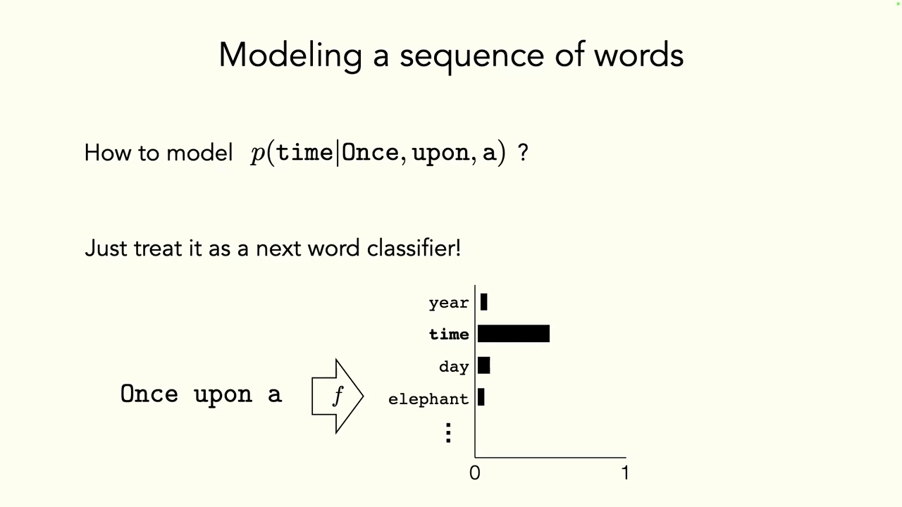
*▲ 강의 슬라이드 [49:52](https://youtu.be/IiHknRHA-Gk?t=2992): "Once upon a" 다음 단어를 고르는 분류기*

> [!TIP]
> **🆕 2026 업데이트: [토큰](00_%EB%94%A5%EB%9F%AC%EB%8B%9D_%EC%9A%A9%EC%96%B4%EC%82%AC%EC%A0%84.md#token-%ED%86%A0%ED%81%B0)은 "두 글자 쌍"이 아니고, 어휘는 10만 개 이상**
> - **강의(2024년 가을)**: 바이트 쌍은 두 글자 쌍이라 1,000개 남짓이며, 이것이 가장 큰 [언어 모델](00_%EB%94%A5%EB%9F%AC%EB%8B%9D_%EC%9A%A9%EC%96%B4%EC%82%AC%EC%A0%84.md#language-model-%EC%96%B8%EC%96%B4-%EB%AA%A8%EB%8D%B8)에서도 쓰는 균형점이라고 설명했습니다.
> - **현재(2026년 10월)**: [BPE](00_%EB%94%A5%EB%9F%AC%EB%8B%9D_%EC%9A%A9%EC%96%B4%EC%82%AC%EC%A0%84.md#bpe-byte-pair-encoding-%EB%B0%94%EC%9D%B4%ED%8A%B8-%EC%8C%8D-%EC%9D%B8%EC%BD%94%EB%94%A9)(Sennrich 외, 2016)는 글자(또는 바이트)에서 시작해 **가장 자주 붙어 나오는 쌍을 하나의 새 [토큰](00_%EB%94%A5%EB%9F%AC%EB%8B%9D_%EC%9A%A9%EC%96%B4%EC%82%AC%EC%A0%84.md#token-%ED%86%A0%ED%81%B0)으로 합치는 일을 수만 번 되풀이**합니다. 그래서 [토큰](00_%EB%94%A5%EB%9F%AC%EB%8B%9D_%EC%9A%A9%EC%96%B4%EC%82%AC%EC%A0%84.md#token-%ED%86%A0%ED%81%B0) 하나가 "ing", " the", 단어 전체가 되기도 합니다. 어휘 크기는 [GPT](00_%EB%94%A5%EB%9F%AC%EB%8B%9D_%EC%9A%A9%EC%96%B4%EC%82%AC%EC%A0%84.md#gpt-%EC%83%9D%EC%84%B1%ED%98%95-%EC%82%AC%EC%A0%84%ED%95%99%EC%8A%B5-%ED%8A%B8%EB%9E%9C%EC%8A%A4%ED%8F%AC%EB%A8%B8)-2가 50,257개였고, Meta Llama 3은 128K(약 12만 8천) [토큰](00_%EB%94%A5%EB%9F%AC%EB%8B%9D_%EC%9A%A9%EC%96%B4%EC%82%AC%EC%A0%84.md#token-%ED%86%A0%ED%81%B0) 어휘를 씁니다. 어휘가 클수록 같은 글을 더 적은 [토큰](00_%EB%94%A5%EB%9F%AC%EB%8B%9D_%EC%9A%A9%EC%96%B4%EC%82%AC%EC%A0%84.md#token-%ED%86%A0%ED%81%B0)으로 나타낼 수 있어, 최근 모델일수록 어휘를 키우는 추세입니다.
> - **출처**: [Neural Machine Translation of Rare Words with Subword Units (Sennrich 외, ACL, 2016)](https://aclanthology.org/P16-1162/) · [Language Models are Unsupervised Multitask Learners (Radford 외, OpenAI, 2019)](https://cdn.openai.com/better-language-models/language_models_are_unsupervised_multitask_learners.pdf) · [Introducing Meta Llama 3 (Meta, 2024)](https://ai.meta.com/blog/meta-llama-3/)

---

## 8. 학습과 생성: 분자를 글로

▶ 영상 [52:03](https://youtu.be/IiHknRHA-Gk?t=3123)

예: 카페인 분자를 넣으면 "a mild stimulant that enhances cognitive ability(인지 능력을 높이는 약한 각성제)" 같은 설명을 생성하는 **분자 → 글** 모델. 분자를 [GNN](00_%EB%94%A5%EB%9F%AC%EB%8B%9D_%EC%9A%A9%EC%96%B4%EC%82%AC%EC%A0%84.md#gnn-graph-neural-network-%EA%B7%B8%EB%9E%98%ED%94%84-%EC%8B%A0%EA%B2%BD%EB%A7%9D)([Lec05](Lec05_%EA%B7%B8%EB%9E%98%ED%94%84_%EC%8B%A0%EA%B2%BD%EB%A7%9D.md))에 넣어 얻은 표현으로 [LSTM](00_%EB%94%A5%EB%9F%AC%EB%8B%9D_%EC%9A%A9%EC%96%B4%EC%82%AC%EC%A0%84.md#lstm-long-short-term-memory-%EC%9E%A5%EB%8B%A8%EA%B8%B0-%EB%A9%94%EB%AA%A8%EB%A6%AC)의 시작점을 정하고, [LSTM](00_%EB%94%A5%EB%9F%AC%EB%8B%9D_%EC%9A%A9%EC%96%B4%EC%82%AC%EC%A0%84.md#lstm-long-short-term-memory-%EC%9E%A5%EB%8B%A8%EA%B8%B0-%EB%A9%94%EB%AA%A8%EB%A6%AC)은 앞 단어들을 고려해 매번 다음 단어를 예측합니다.

### 8.1 최대 우도 학습과 교사 강요

▶ 영상 [53:11](https://youtu.be/IiHknRHA-Gk?t=3191)

📐 **수학 개념**: [로그 우도와 교차 엔트로피](%EC%88%98%ED%95%99%EA%B0%9C%EB%85%90/04_%ED%99%95%EB%A5%A0%EA%B3%BC_%EC%A0%95%EB%B3%B4/MM39_%ED%99%95%EB%A5%A0%EC%9D%98_%EC%97%B0%EC%87%84%EB%B2%95%EC%B9%99%EA%B3%BC_%EB%B9%94_%EC%84%9C%EC%B9%98.md) · [argmin](%EC%88%98%ED%95%99%EA%B0%9C%EB%85%90/02_%EB%AF%B8%EB%B6%84/MM01_argmin%EA%B3%BC_argmax.md) · [엔트로피](%EC%88%98%ED%95%99%EA%B0%9C%EB%85%90/04_%ED%99%95%EB%A5%A0%EA%B3%BC_%EC%A0%95%EB%B3%B4/M10_%EC%97%94%ED%8A%B8%EB%A1%9C%ED%94%BC.md)

- [학습 데이터](00_%EB%94%A5%EB%9F%AC%EB%8B%9D_%EC%9A%A9%EC%96%B4%EC%82%AC%EC%A0%84.md#training-data-test-data-%ED%95%99%EC%8A%B5-%EB%8D%B0%EC%9D%B4%ED%84%B0%EC%99%80-%EC%8B%9C%ED%97%98-%EB%8D%B0%EC%9D%B4%ED%84%B0)는 "a mild stimulant that enhances cognitive ability **END**"처럼 끝 표시를 붙입니다. 처음으로 **"다 되면 멈추기"**가 들어갑니다.
- 출력은 매 단계 다음 단어에 대한 [확률](00_%EB%94%A5%EB%9F%AC%EB%8B%9D_%EC%9A%A9%EC%96%B4%EC%82%AC%EC%A0%84.md#probability-%ED%99%95%EB%A5%A0) 분포입니다. 실제 문장의 단어에 모델이 주는 [확률](00_%EB%94%A5%EB%9F%AC%EB%8B%9D_%EC%9A%A9%EC%96%B4%EC%82%AC%EC%A0%84.md#probability-%ED%99%95%EB%A5%A0)을 최대로 만드는 **[최대 우도(Max-likelihood)](00_%EB%94%A5%EB%9F%AC%EB%8B%9D_%EC%9A%A9%EC%96%B4%EC%82%AC%EC%A0%84.md#maximum-likelihood-%EC%B5%9C%EB%8C%80-%EC%9A%B0%EB%8F%84)** 목표로 학습합니다. [정답](00_%EB%94%A5%EB%9F%AC%EB%8B%9D_%EC%9A%A9%EC%96%B4%EC%82%AC%EC%A0%84.md#label-%EC%A0%95%EB%8B%B5)을 [원-핫](00_%EB%94%A5%EB%9F%AC%EB%8B%9D_%EC%9A%A9%EC%96%B4%EC%82%AC%EC%A0%84.md#one-hot-encoding-%EC%9B%90-%ED%95%AB-%EC%9D%B8%EC%BD%94%EB%94%A9)으로 바꾸면 [교차 엔트로피](00_%EB%94%A5%EB%9F%AC%EB%8B%9D_%EC%9A%A9%EC%96%B4%EC%82%AC%EC%A0%84.md#cross-entropy-%EA%B5%90%EC%B0%A8-%EC%97%94%ED%8A%B8%EB%A1%9C%ED%94%BC)를 줄이는 [다중 분류](00_%EB%94%A5%EB%9F%AC%EB%8B%9D_%EC%9A%A9%EC%96%B4%EC%82%AC%EC%A0%84.md#multinomial-classification-%EB%8B%A4%EC%A4%91-%EB%B6%84%EB%A5%98)와 같습니다.

$$
f^* = \arg\min_{f \in \mathcal{F}} \sum_{i=1}^{N} H(\mathbf{y}_i, \hat{\mathbf{y}}_i)
$$

기호 풀이

| 기호 | 읽는 법 | 뜻 | 예제 값 |
| --- | --- | --- | --- |
| $f^*$ | 에프 스타 | 찾으려는 최적 모델 | - |
| $\arg\min_{f \in \mathcal{F}}$ | 아그민 에프 인 칼리그래픽 에프 | 모델 집합 $\mathcal{F}$에서 뒤의 합을 가장 작게 만드는 $f$ ([argmin](00_%EB%94%A5%EB%9F%AC%EB%8B%9D_%EC%9A%A9%EC%96%B4%EC%82%AC%EC%A0%84.md#argmin-%EC%B5%9C%EC%86%9F%EA%B0%92-%EC%9C%84%EC%B9%98)) | - |
| $N$ | 엔 | 예측하는 단어(단계) 수 | 3 |
| $\mathbf{y}_i$ | 와이 아이 | i번째 [정답](00_%EB%94%A5%EB%9F%AC%EB%8B%9D_%EC%9A%A9%EC%96%B4%EC%82%AC%EC%A0%84.md#label-%EC%A0%95%EB%8B%B5) 단어의 [원-핫](00_%EB%94%A5%EB%9F%AC%EB%8B%9D_%EC%9A%A9%EC%96%B4%EC%82%AC%EC%A0%84.md#one-hot-encoding-%EC%9B%90-%ED%95%AB-%EC%9D%B8%EC%BD%94%EB%94%A9) 벡터 | mild |
| $\hat{\mathbf{y}}_i$ | 와이 햇 아이 | 모델이 낸 다음 단어 [확률](00_%EB%94%A5%EB%9F%AC%EB%8B%9D_%EC%9A%A9%EC%96%B4%EC%82%AC%EC%A0%84.md#probability-%ED%99%95%EB%A5%A0) 분포 | [정답](00_%EB%94%A5%EB%9F%AC%EB%8B%9D_%EC%9A%A9%EC%96%B4%EC%82%AC%EC%A0%84.md#label-%EC%A0%95%EB%8B%B5)에 0.8 |
| $H(\mathbf{y}_i, \hat{\mathbf{y}}_i)$ | 에이치 | [교차 엔트로피](00_%EB%94%A5%EB%9F%AC%EB%8B%9D_%EC%9A%A9%EC%96%B4%EC%82%AC%EC%A0%84.md#cross-entropy-%EA%B5%90%EC%B0%A8-%EC%97%94%ED%8A%B8%EB%A1%9C%ED%94%BC). [원-핫](00_%EB%94%A5%EB%9F%AC%EB%8B%9D_%EC%9A%A9%EC%96%B4%EC%82%AC%EC%A0%84.md#one-hot-encoding-%EC%9B%90-%ED%95%AB-%EC%9D%B8%EC%BD%94%EB%94%A9)이면 $-\log(\text{정답 확률})$ | $-\log 0.8 = 0.2231$ |

예제와 풀이

**문제**: 세 단계에서 모델이 [정답](00_%EB%94%A5%EB%9F%AC%EB%8B%9D_%EC%9A%A9%EC%96%B4%EC%82%AC%EC%A0%84.md#label-%EC%A0%95%EB%8B%B5) 단어에 준 [확률](00_%EB%94%A5%EB%9F%AC%EB%8B%9D_%EC%9A%A9%EC%96%B4%EC%82%AC%EC%A0%84.md#probability-%ED%99%95%EB%A5%A0)이 0.5, 0.8, 0.9일 때 합한 [손실](00_%EB%94%A5%EB%9F%AC%EB%8B%9D_%EC%9A%A9%EC%96%B4%EC%82%AC%EC%A0%84.md#loss-function-%EC%86%90%EC%8B%A4-%ED%95%A8%EC%88%98)을 구한다.

**주어진 값**:
- 1단계 [정답](00_%EB%94%A5%EB%9F%AC%EB%8B%9D_%EC%9A%A9%EC%96%B4%EC%82%AC%EC%A0%84.md#label-%EC%A0%95%EB%8B%B5) [확률](00_%EB%94%A5%EB%9F%AC%EB%8B%9D_%EC%9A%A9%EC%96%B4%EC%82%AC%EC%A0%84.md#probability-%ED%99%95%EB%A5%A0) 0.5, 2단계 0.8, 3단계 0.9
- [정답](00_%EB%94%A5%EB%9F%AC%EB%8B%9D_%EC%9A%A9%EC%96%B4%EC%82%AC%EC%A0%84.md#label-%EC%A0%95%EB%8B%B5)이 [원-핫](00_%EB%94%A5%EB%9F%AC%EB%8B%9D_%EC%9A%A9%EC%96%B4%EC%82%AC%EC%A0%84.md#one-hot-encoding-%EC%9B%90-%ED%95%AB-%EC%9D%B8%EC%BD%94%EB%94%A9)이므로 각 단계 [교차 엔트로피](00_%EB%94%A5%EB%9F%AC%EB%8B%9D_%EC%9A%A9%EC%96%B4%EC%82%AC%EC%A0%84.md#cross-entropy-%EA%B5%90%EC%B0%A8-%EC%97%94%ED%8A%B8%EB%A1%9C%ED%94%BC) $= -\log(\text{정답 확률})$

**풀이**
1. 식을 그대로 쓴다: $\sum_{i=1}^{N} H(\mathbf{y}_i, \hat{\mathbf{y}}_i)$, [원-핫](00_%EB%94%A5%EB%9F%AC%EB%8B%9D_%EC%9A%A9%EC%96%B4%EC%82%AC%EC%A0%84.md#one-hot-encoding-%EC%9B%90-%ED%95%AB-%EC%9D%B8%EC%BD%94%EB%94%A9) [정답](00_%EB%94%A5%EB%9F%AC%EB%8B%9D_%EC%9A%A9%EC%96%B4%EC%82%AC%EC%A0%84.md#label-%EC%A0%95%EB%8B%B5)이면 $H(\mathbf{y}_i, \hat{\mathbf{y}}_i) = -\log(\text{정답 확률})$
2. 값을 대입한다: $\sum_{i=1}^{3} H = (-\log 0.5) + (-\log 0.8) + (-\log 0.9)$
3. [로그](00_%EB%94%A5%EB%9F%AC%EB%8B%9D_%EC%9A%A9%EC%96%B4%EC%82%AC%EC%A0%84.md#log-ln-%EB%A1%9C%EA%B7%B8) 뜻: $\log$는 자연로그(ln)로 "e(약 2.718)를 몇 제곱해야 그 수가 되나"이다. 1보다 작은 수의 [로그](00_%EB%94%A5%EB%9F%AC%EB%8B%9D_%EC%9A%A9%EC%96%B4%EC%82%AC%EC%A0%84.md#log-ln-%EB%A1%9C%EA%B7%B8)는 음수라 마이너스를 붙이면 양수가 된다
4. 1단계를 계산한다: $-\log 0.5 = 0.6931$
5. 2단계를 계산한다: $-\log 0.8 = 0.2231$
6. 3단계를 계산한다: $-\log 0.9 = 0.1054$
7. 더한다: $0.6931 + 0.2231 + 0.1054 = 1.0217$

**답**: [손실](00_%EB%94%A5%EB%9F%AC%EB%8B%9D_%EC%9A%A9%EC%96%B4%EC%82%AC%EC%A0%84.md#loss-function-%EC%86%90%EC%8B%A4-%ED%95%A8%EC%88%98) 합 $= 1.0217$ ([정답](00_%EB%94%A5%EB%9F%AC%EB%8B%9D_%EC%9A%A9%EC%96%B4%EC%82%AC%EC%A0%84.md#label-%EC%A0%95%EB%8B%B5) [확률](00_%EB%94%A5%EB%9F%AC%EB%8B%9D_%EC%9A%A9%EC%96%B4%EC%82%AC%EC%A0%84.md#probability-%ED%99%95%EB%A5%A0)이 모두 1이면 0이 된다)

내 이해

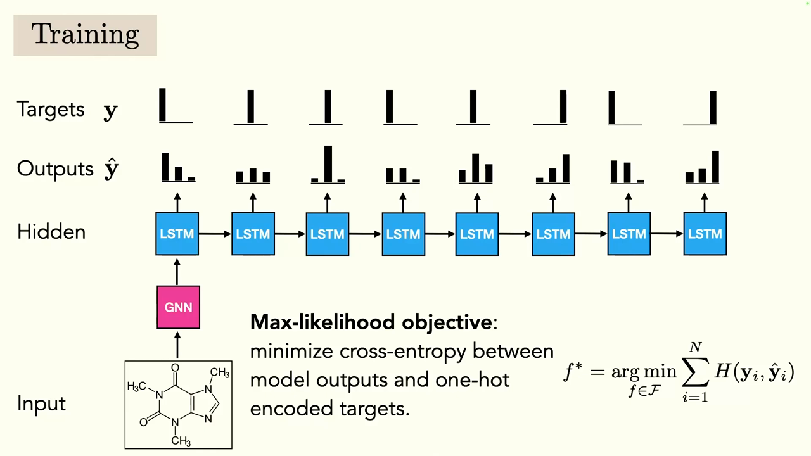
*▲ 강의 슬라이드 [54:12](https://youtu.be/IiHknRHA-Gk?t=3252): [GNN](00_%EB%94%A5%EB%9F%AC%EB%8B%9D_%EC%9A%A9%EC%96%B4%EC%82%AC%EC%A0%84.md#gnn-graph-neural-network-%EA%B7%B8%EB%9E%98%ED%94%84-%EC%8B%A0%EA%B2%BD%EB%A7%9D)이 분자를 표현하고 [LSTM](00_%EB%94%A5%EB%9F%AC%EB%8B%9D_%EC%9A%A9%EC%96%B4%EC%82%AC%EC%A0%84.md#lstm-long-short-term-memory-%EC%9E%A5%EB%8B%A8%EA%B8%B0-%EB%A9%94%EB%AA%A8%EB%A6%AC)이 단어를 하나씩 낸다. 출력 분포와 [원-핫](00_%EB%94%A5%EB%9F%AC%EB%8B%9D_%EC%9A%A9%EC%96%B4%EC%82%AC%EC%A0%84.md#one-hot-encoding-%EC%9B%90-%ED%95%AB-%EC%9D%B8%EC%BD%94%EB%94%A9) [정답](00_%EB%94%A5%EB%9F%AC%EB%8B%9D_%EC%9A%A9%EC%96%B4%EC%82%AC%EC%A0%84.md#label-%EC%A0%95%EB%8B%B5) 사이의 [교차 엔트로피](00_%EB%94%A5%EB%9F%AC%EB%8B%9D_%EC%9A%A9%EC%96%B4%EC%82%AC%EC%A0%84.md#cross-entropy-%EA%B5%90%EC%B0%A8-%EC%97%94%ED%8A%B8%EB%A1%9C%ED%94%BC)를 줄이는 [최대 우도](00_%EB%94%A5%EB%9F%AC%EB%8B%9D_%EC%9A%A9%EC%96%B4%EC%82%AC%EC%A0%84.md#maximum-likelihood-%EC%B5%9C%EB%8C%80-%EC%9A%B0%EB%8F%84) [학습](00_%EB%94%A5%EB%9F%AC%EB%8B%9D_%EC%9A%A9%EC%96%B4%EC%82%AC%EC%A0%84.md#training-%ED%95%99%EC%8A%B5)*

**[교사 강요(Teacher forcing)](00_%EB%94%A5%EB%9F%AC%EB%8B%9D_%EC%9A%A9%EC%96%B4%EC%82%AC%EC%A0%84.md#teacher-forcing-%EA%B5%90%EC%82%AC-%EA%B0%95%EC%9A%94)** [54:17](https://youtu.be/IiHknRHA-Gk?t=3257): [학습](00_%EB%94%A5%EB%9F%AC%EB%8B%9D_%EC%9A%A9%EC%96%B4%EC%82%AC%EC%A0%84.md#training-%ED%95%99%EC%8A%B5) 때 모델의 예측을 다음 입력으로 넣으면, 한 번 틀린 뒤로는 계속 엇나간 길에서 벌점을 받습니다. 그래서 [학습](00_%EB%94%A5%EB%9F%AC%EB%8B%9D_%EC%9A%A9%EC%96%B4%EC%82%AC%EC%A0%84.md#training-%ED%95%99%EC%8A%B5) 중에는 예측이 틀려도 **[정답](00_%EB%94%A5%EB%9F%AC%EB%8B%9D_%EC%9A%A9%EC%96%B4%EC%82%AC%EC%A0%84.md#label-%EC%A0%95%EB%8B%B5) 단어를 다음 입력으로 강제로** 넣어, 각 단계의 예측이 [정답](00_%EB%94%A5%EB%9F%AC%EB%8B%9D_%EC%9A%A9%EC%96%B4%EC%82%AC%EC%A0%84.md#label-%EC%A0%95%EB%8B%B5) 앞부분에 조건이 걸리게 합니다.

### 8.2 빔 서치

▶ 영상 [55:28](https://youtu.be/IiHknRHA-Gk?t=3328)

📐 **수학 개념**: [빔 서치](%EC%88%98%ED%95%99%EA%B0%9C%EB%85%90/04_%ED%99%95%EB%A5%A0%EA%B3%BC_%EC%A0%95%EB%B3%B4/MM39_%ED%99%95%EB%A5%A0%EC%9D%98_%EC%97%B0%EC%87%84%EB%B2%95%EC%B9%99%EA%B3%BC_%EB%B9%94_%EC%84%9C%EC%B9%98.md) · [로그](%EC%88%98%ED%95%99%EA%B0%9C%EB%85%90/01_%EC%88%98%EC%99%80_%ED%95%A8%EC%88%98/M07_%EB%A1%9C%EA%B7%B8.md)

시험 때는 시작점에서 출발해 예측 분포에서 단어를 뽑고, 그것을 넣어 다음을 예측합니다. 그런데 "a" 다음에 모델이 확신이 없어서 "strong"을 골랐다면, 원래 "mild"였던 문장의 뜻이 크게 달라집니다. 자기회귀 생성은 **한 번의 실수가 나무의 엉뚱한 가지로** 이끌어 실수를 계속 낳기 쉽습니다.

**[빔 서치(Beam search)](00_%EB%94%A5%EB%9F%AC%EB%8B%9D_%EC%9A%A9%EC%96%B4%EC%82%AC%EC%A0%84.md#beam-search-%EB%B9%94-%EC%84%9C%EC%B9%98)**: 매 단계 가장 그럴듯한 k개를 고르고, 각각에서 또 k개를 고르며 나무를 넓힌 뒤, 경로 전체의 [확률](00_%EB%94%A5%EB%9F%AC%EB%8B%9D_%EC%9A%A9%EC%96%B4%EC%82%AC%EC%A0%84.md#probability-%ED%99%95%EB%A5%A0)(문장 전체에 대한 모델의 확신)이 가장 높은 것을 고릅니다. 매 단계 1등만 고르는 [탐욕 디코딩](00_%EB%94%A5%EB%9F%AC%EB%8B%9D_%EC%9A%A9%EC%96%B4%EC%82%AC%EC%A0%84.md#greedy-decoding-%ED%83%90%EC%9A%95-%EB%94%94%EC%BD%94%EB%94%A9)이 놓친 "mild"가 문장 전체로는 더 높은 점수를 받을 수 있습니다.

$$
\text{score} = \log p_\theta(\mathbf{y}_1, \dots, \mathbf{y}_T \mid \mathbf{x}) = \sum_{t=1}^{T} \log p_\theta(\mathbf{y}_t \mid \mathbf{y}_{<t}, \mathbf{x})
$$

기호 풀이

| 기호 | 읽는 법 | 뜻 | 예제 값 |
| --- | --- | --- | --- |
| $\text{score}$ | 점수 | 후보 문장 전체의 [로그](00_%EB%94%A5%EB%9F%AC%EB%8B%9D_%EC%9A%A9%EC%96%B4%EC%82%AC%EC%A0%84.md#log-ln-%EB%A1%9C%EA%B7%B8) [확률](00_%EB%94%A5%EB%9F%AC%EB%8B%9D_%EC%9A%A9%EC%96%B4%EC%82%AC%EC%A0%84.md#probability-%ED%99%95%EB%A5%A0) (클수록 좋음) | −1.0217 |
| $p_\theta$ | 피 세타 | [파라미터](00_%EB%94%A5%EB%9F%AC%EB%8B%9D_%EC%9A%A9%EC%96%B4%EC%82%AC%EC%A0%84.md#parameter-%ED%8C%8C%EB%9D%BC%EB%AF%B8%ED%84%B0) θ를 가진 모델이 주는 [확률](00_%EB%94%A5%EB%9F%AC%EB%8B%9D_%EC%9A%A9%EC%96%B4%EC%82%AC%EC%A0%84.md#probability-%ED%99%95%EB%A5%A0) | - |
| $\mathbf{y}_1, \dots, \mathbf{y}_T$ | 와이 일부터 와이 티까지 | 생성한 단어들 | mild, stimulant |
| $\mathbf{x}$ | 엑스 | 조건이 되는 입력 (카페인 분자) | - |
| $\mathbf{y}_{<t}$ | 와이 티보다 앞 | t단계 전까지 생성한 단어들 | mild |
| $T$ | 티 | 생성한 길이 | 2 |

예제와 풀이

**문제**: 첫 단어 strong(0.5), mild(0.4), weak(0.1). strong 뒤 stimulant 0.3·neural 0.25, mild 뒤 stimulant 0.9·drug 0.1일 때 탐욕 선택과 빔 k = 2의 결과를 비교한다.

**주어진 값**:
- $p(\text{strong}) = 0.5$, $p(\text{mild}) = 0.4$, $p(\text{weak}) = 0.1$
- $p(\text{stimulant} \mid \text{strong}) = 0.3$, $p(\text{neural} \mid \text{strong}) = 0.25$
- $p(\text{stimulant} \mid \text{mild}) = 0.9$, $p(\text{drug} \mid \text{mild}) = 0.1$

**풀이**
1. 식을 그대로 쓴다: $\text{score} = \sum_{t=1}^{2} \log p_\theta(\mathbf{y}_t \mid \mathbf{y}_{<t}, \mathbf{x}) = \log p(\mathbf{y}_1) + \log p(\mathbf{y}_2 \mid \mathbf{y}_1)$
2. 탐욕 1단계에서 1등을 고른다: $0.5 > 0.4 > 0.1$이므로 strong
3. 탐욕 2단계에서 strong 뒤 1등을 고른다: $0.3 > 0.25$이므로 stimulant
4. 탐욕 문장의 값을 대입한다: $\text{score} = \log 0.5 + \log 0.3$ ($\log$는 자연로그 ln, 1보다 작은 수면 음수)
5. 계산한다: $-0.6931 + (-1.2040) = -1.8971$ (문장 [확률](00_%EB%94%A5%EB%9F%AC%EB%8B%9D_%EC%9A%A9%EC%96%B4%EC%82%AC%EC%A0%84.md#probability-%ED%99%95%EB%A5%A0) $0.5 \times 0.3 = 0.15$)
6. 빔 1단계: 상위 2개 strong, mild를 모두 들고 간다
7. 빔 2단계 후보 넷의 문장 [확률](00_%EB%94%A5%EB%9F%AC%EB%8B%9D_%EC%9A%A9%EC%96%B4%EC%82%AC%EC%A0%84.md#probability-%ED%99%95%EB%A5%A0)을 곱한다: strong stimulant $0.5 \times 0.3 = 0.15$, strong neural $0.5 \times 0.25 = 0.125$, mild stimulant $0.4 \times 0.9 = 0.36$, mild drug $0.4 \times 0.1 = 0.04$
8. 최고 후보 mild stimulant의 값을 대입한다: $\text{score} = \log 0.4 + \log 0.9$
9. 계산한다: $-0.9163 + (-0.1054) = -1.0217$ (탐욕의 −1.8971보다 크다)

**답**: 탐욕은 strong stimulant(0.15), 빔 k = 2는 **mild stimulant(0.36)**를 찾는다.

내 이해

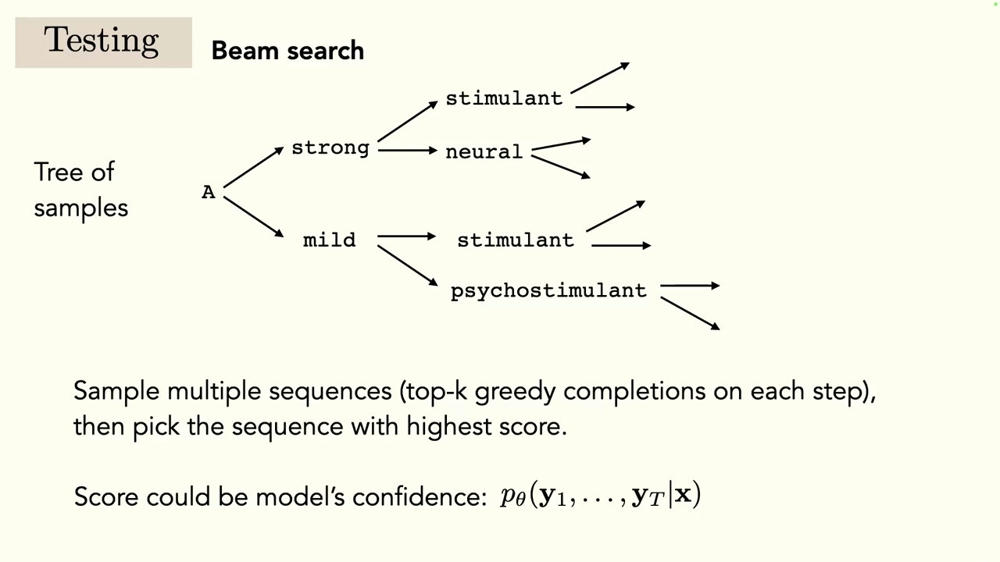
*▲ 강의 슬라이드 [56:12](https://youtu.be/IiHknRHA-Gk?t=3372): 표본 나무에서 매 단계 상위 k개를 이어 가고, 전체 점수가 가장 높은 문장을 고르는 [빔 서치](00_%EB%94%A5%EB%9F%AC%EB%8B%9D_%EC%9A%A9%EC%96%B4%EC%82%AC%EC%A0%84.md#beam-search-%EB%B9%94-%EC%84%9C%EC%B9%98)*

- 이런 "깊은 모델 + [LSTM](00_%EB%94%A5%EB%9F%AC%EB%8B%9D_%EC%9A%A9%EC%96%B4%EC%82%AC%EC%A0%84.md#lstm-long-short-term-memory-%EC%9E%A5%EB%8B%A8%EA%B8%B0-%EB%A9%94%EB%AA%A8%EB%A6%AC)" 조합으로 글을 생성하고 이미지를 설명하거나 VQA를 하는 방식이 2015년 무렵 크게 유행했습니다. 지금은 주로 [트랜스포머](00_%EB%94%A5%EB%9F%AC%EB%8B%9D_%EC%9A%A9%EC%96%B4%EC%82%AC%EC%A0%84.md#transformer-%ED%8A%B8%EB%9E%9C%EC%8A%A4%ED%8F%AC%EB%A8%B8)를 씁니다.

질의응답: 3단어 뒤만 궁금하면 중간을 건너뛰어도 되나? [56:37](https://youtu.be/IiHknRHA-Gk?t=3397)

- 강사의 직관은 "중간 단어에도 신호가 있으니 한 단계씩, 아마 [빔 서치](00_%EB%94%A5%EB%9F%AC%EB%8B%9D_%EC%9A%A9%EC%96%B4%EC%82%AC%EC%A0%84.md#beam-search-%EB%B9%94-%EC%84%9C%EC%B9%98)로 예측하는 편이 낫다"입니다.
- 일주일 뒤 기온 예측이라면? 요즘 많은 기온 모델은 [맥락 창](00_%EB%94%A5%EB%9F%AC%EB%8B%9D_%EC%9A%A9%EC%96%B4%EC%82%AC%EC%A0%84.md#context-window-%EB%A7%A5%EB%9D%BD-%EC%B0%BD)이 아주 큰 [트랜스포머](00_%EB%94%A5%EB%9F%AC%EB%8B%9D_%EC%9A%A9%EC%96%B4%EC%82%AC%EC%A0%84.md#transformer-%ED%8A%B8%EB%9E%9C%EC%8A%A4%ED%8F%AC%EB%A8%B8)여서 모든 날의 정보를 한꺼번에 주고받습니다.

> [!TIP]
> **🆕 2026 업데이트: 대화형 [언어 모델](00_%EB%94%A5%EB%9F%AC%EB%8B%9D_%EC%9A%A9%EC%96%B4%EC%82%AC%EC%A0%84.md#language-model-%EC%96%B8%EC%96%B4-%EB%AA%A8%EB%8D%B8)은 [빔 서치](00_%EB%94%A5%EB%9F%AC%EB%8B%9D_%EC%9A%A9%EC%96%B4%EC%82%AC%EC%A0%84.md#beam-search-%EB%B9%94-%EC%84%9C%EC%B9%98)보다 표본 뽑기**
> - **강의(2024년 가을)**: 한 번의 실수가 이어지는 문제를 [빔 서치](00_%EB%94%A5%EB%9F%AC%EB%8B%9D_%EC%9A%A9%EC%96%B4%EC%82%AC%EC%A0%84.md#beam-search-%EB%B9%94-%EC%84%9C%EC%B9%98)로 다룬다고 설명했습니다.
> - **현재(2026년 10월)**: [빔 서치](00_%EB%94%A5%EB%9F%AC%EB%8B%9D_%EC%9A%A9%EC%96%B4%EC%82%AC%EC%A0%84.md#beam-search-%EB%B9%94-%EC%84%9C%EC%B9%98)는 번역·음성 인식처럼 [정답](00_%EB%94%A5%EB%9F%AC%EB%8B%9D_%EC%9A%A9%EC%96%B4%EC%82%AC%EC%A0%84.md#label-%EC%A0%95%EB%8B%B5)이 거의 하나인 과제에서 여전히 쓰입니다. 하지만 열린 글쓰기에서는 [확률](00_%EB%94%A5%EB%9F%AC%EB%8B%9D_%EC%9A%A9%EC%96%B4%EC%82%AC%EC%A0%84.md#probability-%ED%99%95%EB%A5%A0)이 가장 높은 문장을 찾을수록 오히려 밋밋하고 같은 말이 되풀이되는 문제가 알려져 있습니다(Holtzman 외, 2020). 그래서 오늘날 대화형 [언어 모델](00_%EB%94%A5%EB%9F%AC%EB%8B%9D_%EC%9A%A9%EC%96%B4%EC%82%AC%EC%A0%84.md#language-model-%EC%96%B8%EC%96%B4-%EB%AA%A8%EB%8D%B8)은 온도(temperature)로 분포를 조절하고, 누적 [확률](00_%EB%94%A5%EB%9F%AC%EB%8B%9D_%EC%9A%A9%EC%96%B4%EC%82%AC%EC%A0%84.md#probability-%ED%99%95%EB%A5%A0) 상위 p 안에서만 뽑는 **nucleus(top-p) 표본 뽑기** 같은 방식을 주로 씁니다.
> - **출처**: [The Curious Case of Neural Text Degeneration (Holtzman 외, ICLR, 2020)](https://arxiv.org/abs/1904.09751)

---

## 9. 긴 기억: 옛 기억에 직접 연결하기

▶ 영상 [58:49](https://youtu.be/IiHknRHA-Gk?t=3529)

정보를 시간 순으로 한 칸씩 넘기는 대신, **모든 시점에 기억 단위를 두고 옛 기억을 미래 예측에 직접 연결**할 수도 있습니다. [시간 축 합성곱](00_%EB%94%A5%EB%9F%AC%EB%8B%9D_%EC%9A%A9%EC%96%B4%EC%82%AC%EC%A0%84.md#temporal-convolution-%EC%8B%9C%EA%B0%84-%EC%B6%95-%ED%95%A9%EC%84%B1%EA%B3%B1), [어텐션](00_%EB%94%A5%EB%9F%AC%EB%8B%9D_%EC%9A%A9%EC%96%B4%EC%82%AC%EC%A0%84.md#attention-%EC%96%B4%ED%85%90%EC%85%98)과 [트랜스포머](00_%EB%94%A5%EB%9F%AC%EB%8B%9D_%EC%9A%A9%EC%96%B4%EC%82%AC%EC%A0%84.md#transformer-%ED%8A%B8%EB%9E%9C%EC%8A%A4%ED%8F%AC%EB%A8%B8)(지난 강의), 별도의 기억 저장소를 두고 꺼내 쓰는 **[메모리 네트워크(Memory networks)](00_%EB%94%A5%EB%9F%AC%EB%8B%9D_%EC%9A%A9%EC%96%B4%EC%82%AC%EC%A0%84.md#memory-network-%EB%A9%94%EB%AA%A8%EB%A6%AC-%EB%84%A4%ED%8A%B8%EC%9B%8C%ED%81%AC)**가 그런 방법입니다.

### 9.1 순환, 합성곱, 어텐션

▶ 영상 [59:58](https://youtu.be/IiHknRHA-Gk?t=3598)

| 방법 | 공유하는 것 | 과거를 보는 방식 |
|---|---|---|
| 순환(Recurrence) | 시간에 걸쳐 공유하는 순환 [가중치](00_%EB%94%A5%EB%9F%AC%EB%8B%9D_%EC%9A%A9%EC%96%B4%EC%82%AC%EC%A0%84.md#weight-%EA%B0%80%EC%A4%91%EC%B9%98) | 정보를 한 단계씩 앞으로 넘긴다. [학습](00_%EB%94%A5%EB%9F%AC%EB%8B%9D_%EC%9A%A9%EC%96%B4%EC%82%AC%EC%A0%84.md#training-%ED%95%99%EC%8A%B5) 때는 [역전파](00_%EB%94%A5%EB%9F%AC%EB%8B%9D_%EC%9A%A9%EC%96%B4%EC%82%AC%EC%A0%84.md#backpropagation-%EC%97%AD%EC%A0%84%ED%8C%8C) 창이 있다 |
| [합성곱](00_%EB%94%A5%EB%9F%AC%EB%8B%9D_%EC%9A%A9%EC%96%B4%EC%82%AC%EC%A0%84.md#convolution-%ED%95%A9%EC%84%B1%EA%B3%B1)(Convolution) | 시간에 걸쳐 공유하는 [합성곱](00_%EB%94%A5%EB%9F%AC%EB%8B%9D_%EC%9A%A9%EC%96%B4%EC%82%AC%EC%A0%84.md#convolution-%ED%95%A9%EC%84%B1%EA%B3%B1) [가중치](00_%EB%94%A5%EB%9F%AC%EB%8B%9D_%EC%9A%A9%EC%96%B4%EC%82%AC%EC%A0%84.md#weight-%EA%B0%80%EC%A4%91%EC%B9%98) | 고정된 창 안만 본다. 앞으로 넘기지 않는다 |
| [어텐션](00_%EB%94%A5%EB%9F%AC%EB%8B%9D_%EC%9A%A9%EC%96%B4%EC%82%AC%EC%A0%84.md#attention-%EC%96%B4%ED%85%90%EC%85%98)([Attention](00_%EB%94%A5%EB%9F%AC%EB%8B%9D_%EC%9A%A9%EC%96%B4%EC%82%AC%EC%A0%84.md#attention-%EC%96%B4%ED%85%90%EC%85%98)) | ([가중치](00_%EB%94%A5%EB%9F%AC%EB%8B%9D_%EC%9A%A9%EC%96%B4%EC%82%AC%EC%A0%84.md#weight-%EA%B0%80%EC%A4%91%EC%B9%98)가 **데이터에 따라** 그때그때 정해짐) | [어텐션](00_%EB%94%A5%EB%9F%AC%EB%8B%9D_%EC%9A%A9%EC%96%B4%EC%82%AC%EC%A0%84.md#attention-%EC%96%B4%ED%85%90%EC%85%98) [가중치](00_%EB%94%A5%EB%9F%AC%EB%8B%9D_%EC%9A%A9%EC%96%B4%EC%82%AC%EC%A0%84.md#weight-%EA%B0%80%EC%A4%91%EC%B9%98)를 가진 [합성곱](00_%EB%94%A5%EB%9F%AC%EB%8B%9D_%EC%9A%A9%EC%96%B4%EC%82%AC%EC%A0%84.md#convolution-%ED%95%A9%EC%84%B1%EA%B3%B1) 커널처럼 동작. 무엇을 남길지가 입력에 달려 있어 매우 유연 |

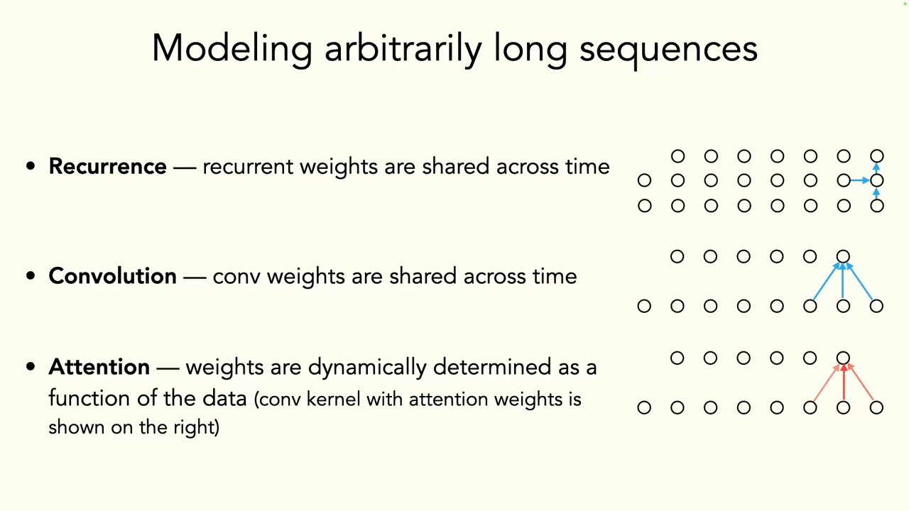
*▲ 강의 슬라이드 [61:32](https://youtu.be/IiHknRHA-Gk?t=3692): 임의 길이 [시퀀스](00_%EB%94%A5%EB%9F%AC%EB%8B%9D_%EC%9A%A9%EC%96%B4%EC%82%AC%EC%A0%84.md#sequence-%EC%8B%9C%ED%80%80%EC%8A%A4)를 다루는 세 방법. 순환, [합성곱](00_%EB%94%A5%EB%9F%AC%EB%8B%9D_%EC%9A%A9%EC%96%B4%EC%82%AC%EC%A0%84.md#convolution-%ED%95%A9%EC%84%B1%EA%B3%B1), [어텐션](00_%EB%94%A5%EB%9F%AC%EB%8B%9D_%EC%9A%A9%EC%96%B4%EC%82%AC%EC%A0%84.md#attention-%EC%96%B4%ED%85%90%EC%85%98)*

### 9.2 계산량 비교

▶ 영상 [61:37](https://youtu.be/IiHknRHA-Gk?t=3697)

강사는 "[Attention](00_%EB%94%A5%EB%9F%AC%EB%8B%9D_%EC%9A%A9%EC%96%B4%EC%82%AC%EC%A0%84.md#attention-%EC%96%B4%ED%85%90%EC%85%98) Is All You Need" 논문의 표를 보여 줍니다. 논문 제목은 "기억(순환)은 필요 없고 [어텐션](00_%EB%94%A5%EB%9F%AC%EB%8B%9D_%EC%9A%A9%EC%96%B4%EC%82%AC%EC%A0%84.md#attention-%EC%96%B4%ED%85%90%EC%85%98)만 있으면 된다"는 주장입니다. $n$은 [시퀀스](00_%EB%94%A5%EB%9F%AC%EB%8B%9D_%EC%9A%A9%EC%96%B4%EC%82%AC%EC%A0%84.md#sequence-%EC%8B%9C%ED%80%80%EC%8A%A4) 길이, $d$는 표현 차원, $k$는 [합성곱](00_%EB%94%A5%EB%9F%AC%EB%8B%9D_%EC%9A%A9%EC%96%B4%EC%82%AC%EC%A0%84.md#convolution-%ED%95%A9%EC%84%B1%EA%B3%B1) 커널 크기입니다.

| [층](00_%EB%94%A5%EB%9F%AC%EB%8B%9D_%EC%9A%A9%EC%96%B4%EC%82%AC%EC%A0%84.md#layer-%EC%B8%B5) 종류 | 층당 계산량 | 순차 연산 수 | 가장 먼 두 위치 사이 경로 길이 |
|---|---|---|---|
| [셀프 어텐션](00_%EB%94%A5%EB%9F%AC%EB%8B%9D_%EC%9A%A9%EC%96%B4%EC%82%AC%EC%A0%84.md#self-attention-%EC%85%80%ED%94%84-%EC%96%B4%ED%85%90%EC%85%98) | $O(n^2 \cdot d)$ | $O(1)$ | $O(1)$ |
| 순환 | $O(n \cdot d^2)$ | $O(n)$ | $O(n)$ |
| [합성곱](00_%EB%94%A5%EB%9F%AC%EB%8B%9D_%EC%9A%A9%EC%96%B4%EC%82%AC%EC%A0%84.md#convolution-%ED%95%A9%EC%84%B1%EA%B3%B1) | $O(k \cdot n \cdot d^2)$ | $O(1)$ | $O(\log_k n)$ |
| [셀프 어텐션](00_%EB%94%A5%EB%9F%AC%EB%8B%9D_%EC%9A%A9%EC%96%B4%EC%82%AC%EC%A0%84.md#self-attention-%EC%85%80%ED%94%84-%EC%96%B4%ED%85%90%EC%85%98) (이웃 r개로 제한) | $O(r \cdot n \cdot d)$ | $O(1)$ | $O(n/r)$ |

- 예: $n = 1000$, $d = 512$이면 [셀프 어텐션](00_%EB%94%A5%EB%9F%AC%EB%8B%9D_%EC%9A%A9%EC%96%B4%EC%82%AC%EC%A0%84.md#self-attention-%EC%85%80%ED%94%84-%EC%96%B4%ED%85%90%EC%85%98)은 $n^2 d = 5.12 \times 10^8$, 순환은 $n d^2 = 2.62 \times 10^8$로 비슷합니다. 하지만 $n = 100{,}000$이면 $n^2 d = 5.12 \times 10^{12}$, $n d^2 = 2.62 \times 10^{10}$으로 [어텐션](00_%EB%94%A5%EB%9F%AC%EB%8B%9D_%EC%9A%A9%EC%96%B4%EC%82%AC%EC%A0%84.md#attention-%EC%96%B4%ED%85%90%EC%85%98)이 약 200배 많습니다. 길이 $n$에 대해 **제곱**으로 늘기 때문입니다.
- [어텐션](00_%EB%94%A5%EB%9F%AC%EB%8B%9D_%EC%9A%A9%EC%96%B4%EC%82%AC%EC%A0%84.md#attention-%EC%96%B4%ED%85%90%EC%85%98)은 [시퀀스](00_%EB%94%A5%EB%9F%AC%EB%8B%9D_%EC%9A%A9%EC%96%B4%EC%82%AC%EC%A0%84.md#sequence-%EC%8B%9C%ED%80%80%EC%8A%A4) 전체와 자기 자신의 유사도를 계산해야 해서 $n \times n$ 행렬을 저장할 메모리도 많이 듭니다.

### 9.3 더 긴 맥락의 트랜스포머

▶ 영상 [62:44](https://youtu.be/IiHknRHA-Gk?t=3764)

📐 **수학 개념**: [랭크(저랭크 근사)](%EC%88%98%ED%95%99%EA%B0%9C%EB%85%90/04_%ED%99%95%EB%A5%A0%EA%B3%BC_%EC%A0%95%EB%B3%B4/MM25_%EB%9E%AD%ED%81%AC%EC%99%80_%EC%9C%A0%ED%9A%A8_%EB%9E%AD%ED%81%AC.md)

제한된 메모리로 [맥락 창](00_%EB%94%A5%EB%9F%AC%EB%8B%9D_%EC%9A%A9%EC%96%B4%EC%82%AC%EC%A0%84.md#context-window-%EB%A7%A5%EB%9D%BD-%EC%B0%BD)을 늘리려는 방법들:

- **희소화·분해로 효율 높이기**: Reformer는 지역 민감 해싱으로 $O(n \log n)$, Performer는 무작위 특징으로 $O(n)$, Linformer는 저[랭크](00_%EB%94%A5%EB%9F%AC%EB%8B%9D_%EC%9A%A9%EC%96%B4%EC%82%AC%EC%A0%84.md#rank-%EB%9E%AD%ED%81%AC) 행렬 근사로 $O(n)$에 가깝게 줄입니다. 다만 성능이 조금 떨어지는 경우가 많아, "성능 대 효율"이라면 그냥 메모리가 더 큰 [GPU](00_%EB%94%A5%EB%9F%AC%EB%8B%9D_%EC%9A%A9%EC%96%B4%EC%82%AC%EC%A0%84.md#device-gpu-%EC%9E%A5%EC%B9%98%EC%99%80-gpu)를 만드는 쪽을 택해 왔다고 강사는 말합니다.
- **지역 + 전역 [어텐션](00_%EB%94%A5%EB%9F%AC%EB%8B%9D_%EC%9A%A9%EC%96%B4%EC%82%AC%EC%A0%84.md#attention-%EC%96%B4%ED%85%90%EC%85%98)**: [Transformer](00_%EB%94%A5%EB%9F%AC%EB%8B%9D_%EC%9A%A9%EC%96%B4%EC%82%AC%EC%A0%84.md#transformer-%ED%8A%B8%EB%9E%9C%EC%8A%A4%ED%8F%AC%EB%A8%B8)-XL은 구간 단위 순환과 정교한 [위치 인코딩](00_%EB%94%A5%EB%9F%AC%EB%8B%9D_%EC%9A%A9%EC%96%B4%EC%82%AC%EC%A0%84.md#positional-encoding-%EC%9C%84%EC%B9%98-%EC%9D%B8%EC%BD%94%EB%94%A9)으로, Longformer는 지역 창(sliding window) [어텐션](00_%EB%94%A5%EB%9F%AC%EB%8B%9D_%EC%9A%A9%EC%96%B4%EC%82%AC%EC%A0%84.md#attention-%EC%96%B4%ED%85%90%EC%85%98)과 몇 개의 전역 [어텐션](00_%EB%94%A5%EB%9F%AC%EB%8B%9D_%EC%9A%A9%EC%96%B4%EC%82%AC%EC%A0%84.md#attention-%EC%96%B4%ED%85%90%EC%85%98)을 섞어 $n \times n$ 계산을 마스크로 희소하게 만듭니다.
- **[검색 증강](00_%EB%94%A5%EB%9F%AC%EB%8B%9D_%EC%9A%A9%EC%96%B4%EC%82%AC%EC%A0%84.md#retrieval-augmented-model-%EA%B2%80%EC%83%89-%EC%A6%9D%EA%B0%95-%EB%AA%A8%EB%8D%B8)**: 세상의 모든 언어와 지식을 함께 모델링하는 거대 [GPT](00_%EB%94%A5%EB%9F%AC%EB%8B%9D_%EC%9A%A9%EC%96%B4%EC%82%AC%EC%A0%84.md#gpt-%EC%83%9D%EC%84%B1%ED%98%95-%EC%82%AC%EC%A0%84%ED%95%99%EC%8A%B5-%ED%8A%B8%EB%9E%9C%EC%8A%A4%ED%8F%AC%EB%A8%B8)를, 가벼운 [언어 모델](00_%EB%94%A5%EB%9F%AC%EB%8B%9D_%EC%9A%A9%EC%96%B4%EC%82%AC%EC%A0%84.md#language-model-%EC%96%B8%EC%96%B4-%EB%AA%A8%EB%8D%B8) + 사실을 찾아보는 데이터베이스로 나눕니다. RETRO는 수조 [토큰](00_%EB%94%A5%EB%9F%AC%EB%8B%9D_%EC%9A%A9%EC%96%B4%EC%82%AC%EC%A0%84.md#token-%ED%86%A0%ED%81%B0) 규모의 데이터베이스를 두고 [언어 모델](00_%EB%94%A5%EB%9F%AC%EB%8B%9D_%EC%9A%A9%EC%96%B4%EC%82%AC%EC%A0%84.md#language-model-%EC%96%B8%EC%96%B4-%EB%AA%A8%EB%8D%B8)이 꺼내 씁니다. 지식 저장소를 따로 두면 사실의 정확성을 강제하기 쉬워 **[환각](00_%EB%94%A5%EB%9F%AC%EB%8B%9D_%EC%9A%A9%EC%96%B4%EC%82%AC%EC%A0%84.md#hallucination-%ED%99%98%EA%B0%81)(hallucination)**을 줄일 수 있습니다.

질의응답: 덜 정확하지만 빠르면, 남는 시간에 더 학습하면 되지 않나? [63:53](https://youtu.be/IiHknRHA-Gk?t=3833)

- 강사는 실제 선택이 그렇게 이뤄지지 않는다고 답합니다. 큰 연구실은 가진 데이터를 모두, 가진 가장 큰 모델로 학습합니다.

> [!TIP]
> **🆕 2026 업데이트: 정확한 [어텐션](00_%EB%94%A5%EB%9F%AC%EB%8B%9D_%EC%9A%A9%EC%96%B4%EC%82%AC%EC%A0%84.md#attention-%EC%96%B4%ED%85%90%EC%85%98)을 빠르게, 그리고 순환의 귀환**
> - **강의(2024년 가을)**: 근사 [어텐션](00_%EB%94%A5%EB%9F%AC%EB%8B%9D_%EC%9A%A9%EC%96%B4%EC%82%AC%EC%A0%84.md#attention-%EC%96%B4%ED%85%90%EC%85%98)(Reformer·Performer·Linformer)은 성능을 조금 잃고, 결국 "메모리 큰 [GPU](00_%EB%94%A5%EB%9F%AC%EB%8B%9D_%EC%9A%A9%EC%96%B4%EC%82%AC%EC%A0%84.md#device-gpu-%EC%9E%A5%EC%B9%98%EC%99%80-gpu)"로 해결해 왔다고 했습니다. "[Attention](00_%EB%94%A5%EB%9F%AC%EB%8B%9D_%EC%9A%A9%EC%96%B4%EC%82%AC%EC%A0%84.md#attention-%EC%96%B4%ED%85%90%EC%85%98) Is All You Need"는 순환이 필요 없다는 주장이라고 소개했습니다.
> - **현재(2026년 10월)**: (1) **FlashAttention**(Dao 외, 2022)은 근사 없이 **정확한** [어텐션](00_%EB%94%A5%EB%9F%AC%EB%8B%9D_%EC%9A%A9%EC%96%B4%EC%82%AC%EC%A0%84.md#attention-%EC%96%B4%ED%85%90%EC%85%98)을 계산하면서, $n \times n$ 행렬을 [GPU](00_%EB%94%A5%EB%9F%AC%EB%8B%9D_%EC%9A%A9%EC%96%B4%EC%82%AC%EC%A0%84.md#device-gpu-%EC%9E%A5%EC%B9%98%EC%99%80-gpu) 메모리에 통째로 만들지 않고 조각조각 계산해 메모리를 길이에 대해 선형으로 줄였습니다. 지금 대부분의 대형 모델이 이런 방식의 [어텐션](00_%EB%94%A5%EB%9F%AC%EB%8B%9D_%EC%9A%A9%EC%96%B4%EC%82%AC%EC%A0%84.md#attention-%EC%96%B4%ED%85%90%EC%85%98) 커널을 씁니다. (2) 순환도 돌아왔습니다. 선택적 [상태 공간 모델](00_%EB%94%A5%EB%9F%AC%EB%8B%9D_%EC%9A%A9%EC%96%B4%EC%82%AC%EC%A0%84.md#state-space-model-%EC%83%81%ED%83%9C-%EA%B3%B5%EA%B0%84-%EB%AA%A8%EB%8D%B8) **Mamba**(Gu & Dao, 2023)는 토큰당 계산과 메모리가 일정한 순환 구조로 [트랜스포머](00_%EB%94%A5%EB%9F%AC%EB%8B%9D_%EC%9A%A9%EC%96%B4%EC%82%AC%EC%A0%84.md#transformer-%ED%8A%B8%EB%9E%9C%EC%8A%A4%ED%8F%AC%EB%A8%B8)에 가까운 성능을 냈고, **xLSTM**(Beck 외, NeurIPS 2024)은 [지수](00_%EB%94%A5%EB%9F%AC%EB%8B%9D_%EC%9A%A9%EC%96%B4%EC%82%AC%EC%A0%84.md#e-exponent-e%EC%99%80-%EC%A7%80%EC%88%98) [게이트](00_%EB%94%A5%EB%9F%AC%EB%8B%9D_%EC%9A%A9%EC%96%B4%EC%82%AC%EC%A0%84.md#gate-%EA%B2%8C%EC%9D%B4%ED%8A%B8)와 행렬 기억으로 [LSTM](00_%EB%94%A5%EB%9F%AC%EB%8B%9D_%EC%9A%A9%EC%96%B4%EC%82%AC%EC%A0%84.md#lstm-long-short-term-memory-%EC%9E%A5%EB%8B%A8%EA%B8%B0-%EB%A9%94%EB%AA%A8%EB%A6%AC)을 수십억 [파라미터](00_%EB%94%A5%EB%9F%AC%EB%8B%9D_%EC%9A%A9%EC%96%B4%EC%82%AC%EC%A0%84.md#parameter-%ED%8C%8C%EB%9D%BC%EB%AF%B8%ED%84%B0)까지 키웠습니다. NVIDIA의 **Nemotron-H**(2025)는 [어텐션](00_%EB%94%A5%EB%9F%AC%EB%8B%9D_%EC%9A%A9%EC%96%B4%EC%82%AC%EC%A0%84.md#attention-%EC%96%B4%ED%85%90%EC%85%98) [층](00_%EB%94%A5%EB%9F%AC%EB%8B%9D_%EC%9A%A9%EC%96%B4%EC%82%AC%EC%A0%84.md#layer-%EC%B8%B5)을 전체의 약 8%만 남기고 나머지를 Mamba-2 [층](00_%EB%94%A5%EB%9F%AC%EB%8B%9D_%EC%9A%A9%EC%96%B4%EC%82%AC%EC%A0%84.md#layer-%EC%B8%B5)으로 바꾼 하이브리드로, 비슷한 크기의 [트랜스포머](00_%EB%94%A5%EB%9F%AC%EB%8B%9D_%EC%9A%A9%EC%96%B4%EC%82%AC%EC%A0%84.md#transformer-%ED%8A%B8%EB%9E%9C%EC%8A%A4%ED%8F%AC%EB%A8%B8)와 비슷하거나 더 나은 [정확도](00_%EB%94%A5%EB%9F%AC%EB%8B%9D_%EC%9A%A9%EC%96%B4%EC%82%AC%EC%A0%84.md#accuracy-%EC%A0%95%ED%99%95%EB%8F%84)에 최대 3배 빠른 추론을 보고했습니다.
> - **출처**: [FlashAttention: Fast and Memory-Efficient Exact Attention with IO-Awareness (Dao 외, NeurIPS, 2022)](https://arxiv.org/abs/2205.14135) · [Mamba: Linear-Time Sequence Modeling with Selective State Spaces (Gu & Dao, 2023)](https://arxiv.org/abs/2312.00752) · [xLSTM: Extended Long Short-Term Memory (Beck 외, NeurIPS, 2024)](https://arxiv.org/abs/2405.04517) · [Nemotron-H: A Family of Accurate and Efficient Hybrid Mamba-Transformer Models (NVIDIA, 2025)](https://arxiv.org/abs/2504.03624)

---

## 10. 맥락은 얼마나 길어야 하나

▶ 영상 [66:42](https://youtu.be/IiHknRHA-Gk?t=4002)

『오만과 편견』의 마지막 장을 읽을 때 첫 장면까지 기억해야 할까요? 강사는 모델의 [맥락 창](00_%EB%94%A5%EB%9F%AC%EB%8B%9D_%EC%9A%A9%EC%96%B4%EC%82%AC%EC%A0%84.md#context-window-%EB%A7%A5%EB%9D%BD-%EC%B0%BD)이 커져 온 과정을 보여 줍니다.

- [BERT](00_%EB%94%A5%EB%9F%AC%EB%8B%9D_%EC%9A%A9%EC%96%B4%EC%82%AC%EC%A0%84.md#bert-%EB%B2%84%ED%8A%B8) 512 [토큰](00_%EB%94%A5%EB%9F%AC%EB%8B%9D_%EC%9A%A9%EC%96%B4%EC%82%AC%EC%A0%84.md#token-%ED%86%A0%ED%81%B0) → [GPT](00_%EB%94%A5%EB%9F%AC%EB%8B%9D_%EC%9A%A9%EC%96%B4%EC%82%AC%EC%A0%84.md#gpt-%EC%83%9D%EC%84%B1%ED%98%95-%EC%82%AC%EC%A0%84%ED%95%99%EC%8A%B5-%ED%8A%B8%EB%9E%9C%EC%8A%A4%ED%8F%AC%EB%A8%B8)-2 1,024 → [GPT](00_%EB%94%A5%EB%9F%AC%EB%8B%9D_%EC%9A%A9%EC%96%B4%EC%82%AC%EC%A0%84.md#gpt-%EC%83%9D%EC%84%B1%ED%98%95-%EC%82%AC%EC%A0%84%ED%95%99%EC%8A%B5-%ED%8A%B8%EB%9E%9C%EC%8A%A4%ED%8F%AC%EB%A8%B8)-3 2,048 → [GPT](00_%EB%94%A5%EB%9F%AC%EB%8B%9D_%EC%9A%A9%EC%96%B4%EC%82%AC%EC%A0%84.md#gpt-%EC%83%9D%EC%84%B1%ED%98%95-%EC%82%AC%EC%A0%84%ED%95%99%EC%8A%B5-%ED%8A%B8%EB%9E%9C%EC%8A%A4%ED%8F%AC%EB%A8%B8)-4 기본 8,000(확장판 32,000) → Anthropic 모델 약 100K(약 7만 5천 단어, 책 두세 권 분량).
- 이만큼 메모리에 넣을 수 있다면 다른 것이 필요할까요? 문제는 **누가 H100 같은 최고급 [GPU](00_%EB%94%A5%EB%9F%AC%EB%8B%9D_%EC%9A%A9%EC%96%B4%EC%82%AC%EC%A0%84.md#device-gpu-%EC%9E%A5%EC%B9%98%EC%99%80-gpu)를 살 수 있느냐**입니다. 긴 맥락은 전력과 에너지를 많이 쓰고 [학습](00_%EB%94%A5%EB%9F%AC%EB%8B%9D_%EC%9A%A9%EC%96%B4%EC%82%AC%EC%A0%84.md#training-%ED%95%99%EC%8A%B5)이 느립니다. 언제 얼마나 긴 맥락이 필요한지 아는 것은 효율과 접근성 면에서 가치가 있습니다.

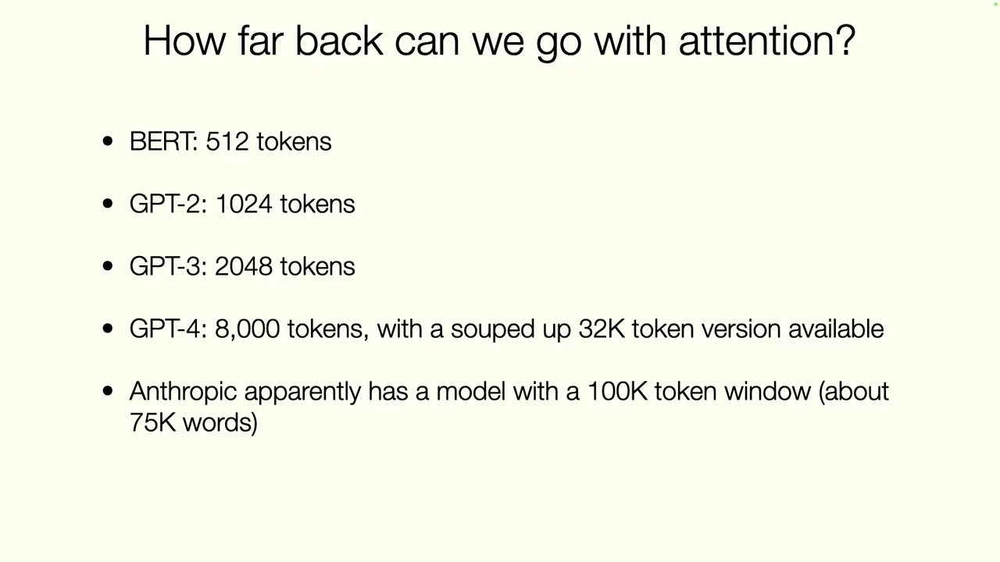
*▲ 강의 슬라이드 [68:12](https://youtu.be/IiHknRHA-Gk?t=4092): 모델별 [맥락 창](00_%EB%94%A5%EB%9F%AC%EB%8B%9D_%EC%9A%A9%EC%96%B4%EC%82%AC%EC%A0%84.md#context-window-%EB%A7%A5%EB%9D%BD-%EC%B0%BD) 길이 (2024년 강의 시점)*

**벤치마크가 진전을 정한다** [68:23](https://youtu.be/IiHknRHA-Gk?t=4103)

Jitendra Malik 연구실의 논문(EgoSchema)은 영상 행동 인식에 정말 긴 맥락이 필요한지 묻습니다. 행동을 정확히 알아보는 데 필요한 최소한의 프레임·짧은 [클립](00_%EB%94%A5%EB%9F%AC%EB%8B%9D_%EC%9A%A9%EC%96%B4%EC%82%AC%EC%A0%84.md#clip-%ED%81%B4%EB%A6%BD) 길이를 **최소 인증 집합(minimum certificate set)**이라 부르고 재 보니, 기존 영상 행동 인식 벤치마크는 대부분 **2초 안팎**의 맥락이면 충분했습니다. 3시간짜리 영화를 다룰 모델이 필요 없었던 것입니다. 그래서 인증 길이가 약 100초인 새 벤치마크 EgoSchema를 만들었습니다.

- 강사가 강조하는 메타 교훈: 우리가 만드는 벤치마크와 개선을 재는 방식이 **무엇에서 진전을 이룰지를 정합니다**. 재지 않는 것은 진전을 측정할 수 없습니다. 맥락을 늘려도 성능이 오르지 않는다면, 벤치마크에 긴 맥락이 필요한 문제가 없기 때문일 수도 있습니다.

> [!TIP]
> **🆕 2026 업데이트: [맥락 창](00_%EB%94%A5%EB%9F%AC%EB%8B%9D_%EC%9A%A9%EC%96%B4%EC%82%AC%EC%A0%84.md#context-window-%EB%A7%A5%EB%9D%BD-%EC%B0%BD)은 100K에서 100만~1,000만 [토큰](00_%EB%94%A5%EB%9F%AC%EB%8B%9D_%EC%9A%A9%EC%96%B4%EC%82%AC%EC%A0%84.md#token-%ED%86%A0%ED%81%B0)으로**
> - **강의(2024년 가을)**: [GPT](00_%EB%94%A5%EB%9F%AC%EB%8B%9D_%EC%9A%A9%EC%96%B4%EC%82%AC%EC%A0%84.md#gpt-%EC%83%9D%EC%84%B1%ED%98%95-%EC%82%AC%EC%A0%84%ED%95%99%EC%8A%B5-%ED%8A%B8%EB%9E%9C%EC%8A%A4%ED%8F%AC%EB%A8%B8)-4가 기본 8K(확장 32K), Anthropic 모델이 약 100K [토큰](00_%EB%94%A5%EB%9F%AC%EB%8B%9D_%EC%9A%A9%EC%96%B4%EC%82%AC%EC%A0%84.md#token-%ED%86%A0%ED%81%B0)이라고 소개했습니다.
> - **현재(2026년 10월)**: 공식 발표 기준으로 Google Gemini 1.5 Pro는 2024년 6월 200만 [토큰](00_%EB%94%A5%EB%9F%AC%EB%8B%9D_%EC%9A%A9%EC%96%B4%EC%82%AC%EC%A0%84.md#token-%ED%86%A0%ED%81%B0) 창을 모든 개발자에게 열었고, OpenAI [GPT](00_%EB%94%A5%EB%9F%AC%EB%8B%9D_%EC%9A%A9%EC%96%B4%EC%82%AC%EC%A0%84.md#gpt-%EC%83%9D%EC%84%B1%ED%98%95-%EC%82%AC%EC%A0%84%ED%95%99%EC%8A%B5-%ED%8A%B8%EB%9E%9C%EC%8A%A4%ED%8F%AC%EB%A8%B8)-4.1(2025년 4월)은 100만 [토큰](00_%EB%94%A5%EB%9F%AC%EB%8B%9D_%EC%9A%A9%EC%96%B4%EC%82%AC%EC%A0%84.md#token-%ED%86%A0%ED%81%B0), Anthropic Claude Sonnet 4는 2025년 8월 100만 [토큰](00_%EB%94%A5%EB%9F%AC%EB%8B%9D_%EC%9A%A9%EC%96%B4%EC%82%AC%EC%A0%84.md#token-%ED%86%A0%ED%81%B0)(이전 20만의 5배)을 지원했습니다. Meta Llama 4 Scout(2025년 4월)는 1,000만 [토큰](00_%EB%94%A5%EB%9F%AC%EB%8B%9D_%EC%9A%A9%EC%96%B4%EC%82%AC%EC%A0%84.md#token-%ED%86%A0%ED%81%B0)을 내세웠습니다. 다만 발표된 최대 길이와 그 길이에서 실제로 정보를 잘 찾아 쓰는 능력은 다르다는 점이 계속 지적되고 있어, 강사의 "벤치마크가 무엇을 재는가" 문제는 여전히 유효합니다.
> - **출처**: [Gemini 1.5 Pro 2M context window, code execution capabilities, and Gemma 2 are available today (Google for Developers, 2024)](https://developers.googleblog.com/en/new-features-for-the-gemini-api-and-google-ai-studio/) · [Introducing GPT-4.1 in the API (OpenAI, 2025)](https://openai.com/index/gpt-4-1/) · [Claude Sonnet 4 now supports 1M tokens of context (Anthropic, 2025)](https://www.anthropic.com/news/1m-context) · [The Llama 4 herd (Meta, 2025)](https://ai.meta.com/blog/llama-4-multimodal-intelligence/)

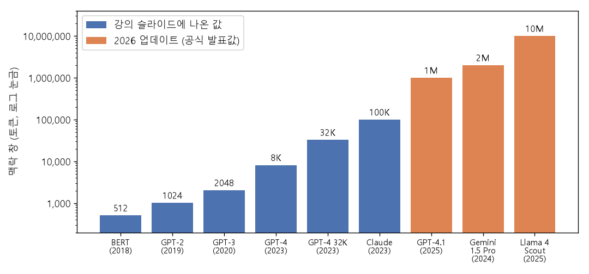
*▲ 직접 그린 그림: [맥락 창](00_%EB%94%A5%EB%9F%AC%EB%8B%9D_%EC%9A%A9%EC%96%B4%EC%82%AC%EC%A0%84.md#context-window-%EB%A7%A5%EB%9D%BD-%EC%B0%BD)의 변화 (세로축 [로그](00_%EB%94%A5%EB%9F%AC%EB%8B%9D_%EC%9A%A9%EC%96%B4%EC%82%AC%EC%A0%84.md#log-ln-%EB%A1%9C%EA%B7%B8) 눈금). 파랑은 강의 슬라이드의 값, 주황은 위 업데이트의 공식 발표값*

---

## 11. 빠른 기억과 느린 기억

▶ 영상 [70:07](https://youtu.be/IiHknRHA-Gk?t=4207)

마지막으로 강사는 "기억"을 다르게 보는 관점을 던집니다.

- **활성값은 빠른 기억**: [학습](00_%EB%94%A5%EB%9F%AC%EB%8B%9D_%EC%9A%A9%EC%96%B4%EC%82%AC%EC%A0%84.md#training-%ED%95%99%EC%8A%B5)이 끝나 고정된 신경망에 데이터 하나를 넣으면, 그 [순전파](00_%EB%94%A5%EB%9F%AC%EB%8B%9D_%EC%9A%A9%EC%96%B4%EC%82%AC%EC%A0%84.md#feed-forward-%EC%88%9C%EC%A0%84%ED%8C%8C) 활성값 $h^{(i)}$는 **그 데이터 점 하나의 통계량**입니다. 데이터가 망을 지나가는 동안의 빠른 기억입니다.
- **[파라미터](00_%EB%94%A5%EB%9F%AC%EB%8B%9D_%EC%9A%A9%EC%96%B4%EC%82%AC%EC%A0%84.md#parameter-%ED%8C%8C%EB%9D%BC%EB%AF%B8%ED%84%B0)는 느린 기억**: 큰 데이터셋으로 학습한 [파라미터](00_%EB%94%A5%EB%9F%AC%EB%8B%9D_%EC%9A%A9%EC%96%B4%EC%82%AC%EC%A0%84.md#parameter-%ED%8C%8C%EB%9D%BC%EB%AF%B8%ED%84%B0) $\theta$는 **[학습 데이터](00_%EB%94%A5%EB%9F%AC%EB%8B%9D_%EC%9A%A9%EC%96%B4%EC%82%AC%EC%A0%84.md#training-data-test-data-%ED%95%99%EC%8A%B5-%EB%8D%B0%EC%9D%B4%ED%84%B0%EC%99%80-%EC%8B%9C%ED%97%98-%EB%8D%B0%EC%9D%B4%ED%84%B0) 전체의 통계량**입니다. 데이터셋 전체에 대한 기억을 천천히 쌓은 것입니다.
- 거꾸로도 생각해 볼 수 있습니다. **[하이퍼네트워크(Hypernets)](00_%EB%94%A5%EB%9F%AC%EB%8B%9D_%EC%9A%A9%EC%96%B4%EC%82%AC%EC%A0%84.md#hypernetwork-%ED%95%98%EC%9D%B4%ED%8D%BC%EB%84%A4%ED%8A%B8%EC%9B%8C%ED%81%AC)**는 다른 망의 [가중치](00_%EB%94%A5%EB%9F%AC%EB%8B%9D_%EC%9A%A9%EC%96%B4%EC%82%AC%EC%A0%84.md#weight-%EA%B0%80%EC%A4%91%EC%B9%98)를 출력하는 망으로, [신경망 구조 탐색](00_%EB%94%A5%EB%9F%AC%EB%8B%9D_%EC%9A%A9%EC%96%B4%EC%82%AC%EC%A0%84.md#neural-architecture-search-%EC%8B%A0%EA%B2%BD%EB%A7%9D-%EA%B5%AC%EC%A1%B0-%ED%83%90%EC%83%89)의 한 방식으로 쓰입니다. 이렇게 나온 [가중치](00_%EB%94%A5%EB%9F%AC%EB%8B%9D_%EC%9A%A9%EC%96%B4%EC%82%AC%EC%A0%84.md#weight-%EA%B0%80%EC%A4%91%EC%B9%98)는 하이퍼넷에 들어온 입력의 **빠른 기억 [가중치](00_%EB%94%A5%EB%9F%AC%EB%8B%9D_%EC%9A%A9%EC%96%B4%EC%82%AC%EC%A0%84.md#weight-%EA%B0%80%EC%A4%91%EC%B9%98)**입니다. 반대로 **[코드북(Codebook)](00_%EB%94%A5%EB%9F%AC%EB%8B%9D_%EC%9A%A9%EC%96%B4%EC%82%AC%EC%A0%84.md#codebook-%EC%BD%94%EB%93%9C%EB%B6%81)**은 학습되는 활성값 [텐서](00_%EB%94%A5%EB%9F%AC%EB%8B%9D_%EC%9A%A9%EC%96%B4%EC%82%AC%EC%A0%84.md#tensor-%ED%85%90%EC%84%9C)로, 활성값 자체까지 역전파합니다. 이 활성값은 학습하는 데이터셋의 **느린 기억 활성값**이라 할 수 있습니다.

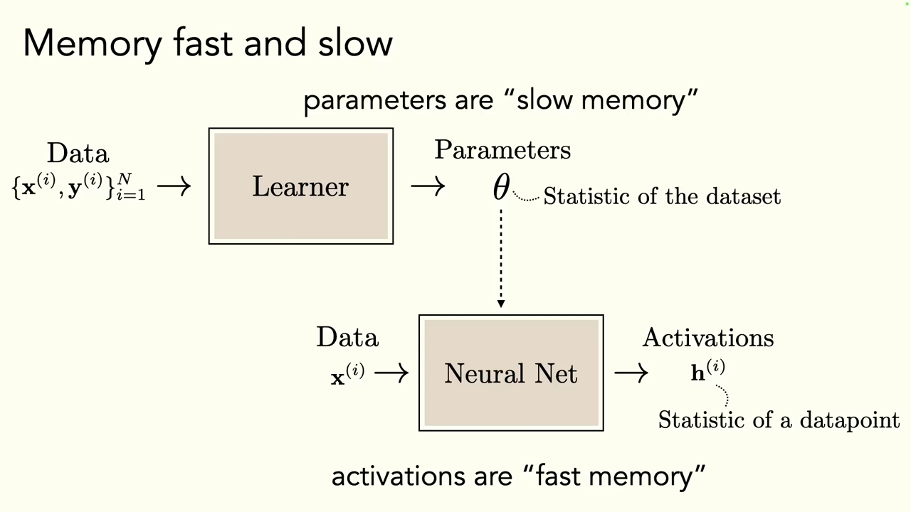
*▲ 강의 슬라이드 [71:32](https://youtu.be/IiHknRHA-Gk?t=4292): [파라미터](00_%EB%94%A5%EB%9F%AC%EB%8B%9D_%EC%9A%A9%EC%96%B4%EC%82%AC%EC%A0%84.md#parameter-%ED%8C%8C%EB%9D%BC%EB%AF%B8%ED%84%B0)는 "느린 기억"(데이터셋의 통계량), 활성값은 "빠른 기억"(데이터 점 하나의 통계량)*

강의는 고양이 Frank의 사진으로 끝납니다. 다음 강의부터는 아키텍처 단원을 마치고 새 주제로 넘어갑니다.

---

## 12. 용어 정리

용어사전에 있는 용어는 위 본문에 링크를 걸었습니다. 아래는 이번 강의에서 새로 나온 용어입니다.

| 용어 | 뜻 |
|---|---|
| [시퀀스](00_%EB%94%A5%EB%9F%AC%EB%8B%9D_%EC%9A%A9%EC%96%B4%EC%82%AC%EC%A0%84.md#sequence-%EC%8B%9C%ED%80%80%EC%8A%A4)([Sequence](00_%EB%94%A5%EB%9F%AC%EB%8B%9D_%EC%9A%A9%EC%96%B4%EC%82%AC%EC%A0%84.md#sequence-%EC%8B%9C%ED%80%80%EC%8A%A4)) | 순서가 의미를 갖는 데이터의 나열 (영상, 문장, 음성) |
| [시간 축 합성곱](00_%EB%94%A5%EB%9F%AC%EB%8B%9D_%EC%9A%A9%EC%96%B4%EC%82%AC%EC%A0%84.md#temporal-convolution-%EC%8B%9C%EA%B0%84-%EC%B6%95-%ED%95%A9%EC%84%B1%EA%B3%B1)(Temporal convolution) | 같은 [가중치](00_%EB%94%A5%EB%9F%AC%EB%8B%9D_%EC%9A%A9%EC%96%B4%EC%82%AC%EC%A0%84.md#weight-%EA%B0%80%EC%A4%91%EC%B9%98) 창을 시간 축을 따라 미는 [합성곱](00_%EB%94%A5%EB%9F%AC%EB%8B%9D_%EC%9A%A9%EC%96%B4%EC%82%AC%EC%A0%84.md#convolution-%ED%95%A9%EC%84%B1%EA%B3%B1) |
| [튜링 완전성](00_%EB%94%A5%EB%9F%AC%EB%8B%9D_%EC%9A%A9%EC%96%B4%EC%82%AC%EC%A0%84.md#turing-completeness-%ED%8A%9C%EB%A7%81-%EC%99%84%EC%A0%84%EC%84%B1)(Turing completeness) | 원리상 어떤 계산이든 흉내 낼 수 있는 성질 |
| [은닉 상태](00_%EB%94%A5%EB%9F%AC%EB%8B%9D_%EC%9A%A9%EC%96%B4%EC%82%AC%EC%A0%84.md#hidden-state-%EC%9D%80%EB%8B%89-%EC%83%81%ED%83%9C)(Hidden state) | [RNN](00_%EB%94%A5%EB%9F%AC%EB%8B%9D_%EC%9A%A9%EC%96%B4%EC%82%AC%EC%A0%84.md#rnn-recurrent-neural-network-%EC%88%9C%ED%99%98-%EC%8B%A0%EA%B2%BD%EB%A7%9D)이 단계마다 다음 단계로 넘기는 요약 기억 |
| [시간 역전파](00_%EB%94%A5%EB%9F%AC%EB%8B%9D_%EC%9A%A9%EC%96%B4%EC%82%AC%EC%A0%84.md#bptt-backpropagation-through-time-%EC%8B%9C%EA%B0%84-%EC%97%AD%EC%A0%84%ED%8C%8C)([BPTT](00_%EB%94%A5%EB%9F%AC%EB%8B%9D_%EC%9A%A9%EC%96%B4%EC%82%AC%EC%A0%84.md#bptt-backpropagation-through-time-%EC%8B%9C%EA%B0%84-%EC%97%AD%EC%A0%84%ED%8C%8C)) | 순환을 정한 창만큼 펼쳐 [DAG](00_%EB%94%A5%EB%9F%AC%EB%8B%9D_%EC%9A%A9%EC%96%B4%EC%82%AC%EC%A0%84.md#dag-directed-acyclic-graph-%EB%B0%A9%ED%96%A5%EC%84%B1-%EB%B9%84%EC%88%9C%ED%99%98-%EA%B7%B8%EB%9E%98%ED%94%84)로 만든 뒤 하는 [역전파](00_%EB%94%A5%EB%9F%AC%EB%8B%9D_%EC%9A%A9%EC%96%B4%EC%82%AC%EC%A0%84.md#backpropagation-%EC%97%AD%EC%A0%84%ED%8C%8C) |
| [마르코프 가정](00_%EB%94%A5%EB%9F%AC%EB%8B%9D_%EC%9A%A9%EC%96%B4%EC%82%AC%EC%A0%84.md#markov-assumption-%EB%A7%88%EB%A5%B4%EC%BD%94%ED%94%84-%EA%B0%80%EC%A0%95)(Markov assumption) | 다음 상태가 바로 앞 상태에만 의존한다는 가정 |
| [장거리 의존성](00_%EB%94%A5%EB%9F%AC%EB%8B%9D_%EC%9A%A9%EC%96%B4%EC%82%AC%EC%A0%84.md#long-range-dependency-%EC%9E%A5%EA%B1%B0%EB%A6%AC-%EC%9D%98%EC%A1%B4%EC%84%B1)(Long-range dependency) | [시퀀스](00_%EB%94%A5%EB%9F%AC%EB%8B%9D_%EC%9A%A9%EC%96%B4%EC%82%AC%EC%A0%84.md#sequence-%EC%8B%9C%ED%80%80%EC%8A%A4)에서 멀리 떨어진 위치 사이의 관계 |
| [스펙트럼 반지름](00_%EB%94%A5%EB%9F%AC%EB%8B%9D_%EC%9A%A9%EC%96%B4%EC%82%AC%EC%A0%84.md#spectral-radius-%EC%8A%A4%ED%8E%99%ED%8A%B8%EB%9F%BC-%EB%B0%98%EC%A7%80%EB%A6%84)(Spectral radius) | 행렬 [고윳값](00_%EB%94%A5%EB%9F%AC%EB%8B%9D_%EC%9A%A9%EC%96%B4%EC%82%AC%EC%A0%84.md#eigenvector-eigenvalue-%EA%B3%A0%EC%9C%A0%EB%B2%A1%ED%84%B0%EC%99%80-%EA%B3%A0%EC%9C%B3%EA%B0%92)의 절댓값 중 가장 큰 값. 거듭제곱의 장기 운명을 정함 |
| [LSTM](00_%EB%94%A5%EB%9F%AC%EB%8B%9D_%EC%9A%A9%EC%96%B4%EC%82%AC%EC%A0%84.md#lstm-long-short-term-memory-%EC%9E%A5%EB%8B%A8%EA%B8%B0-%EB%A9%94%EB%AA%A8%EB%A6%AC)(Long short-term memory) | [셀 상태](00_%EB%94%A5%EB%9F%AC%EB%8B%9D_%EC%9A%A9%EC%96%B4%EC%82%AC%EC%A0%84.md#cell-state-%EC%85%80-%EC%83%81%ED%83%9C)와 [게이트](00_%EB%94%A5%EB%9F%AC%EB%8B%9D_%EC%9A%A9%EC%96%B4%EC%82%AC%EC%A0%84.md#gate-%EA%B2%8C%EC%9D%B4%ED%8A%B8)로 잊지 않기를 기본값으로 둔 [RNN](00_%EB%94%A5%EB%9F%AC%EB%8B%9D_%EC%9A%A9%EC%96%B4%EC%82%AC%EC%A0%84.md#rnn-recurrent-neural-network-%EC%88%9C%ED%99%98-%EC%8B%A0%EA%B2%BD%EB%A7%9D) |
| [셀 상태](00_%EB%94%A5%EB%9F%AC%EB%8B%9D_%EC%9A%A9%EC%96%B4%EC%82%AC%EC%A0%84.md#cell-state-%EC%85%80-%EC%83%81%ED%83%9C)([Cell state](00_%EB%94%A5%EB%9F%AC%EB%8B%9D_%EC%9A%A9%EC%96%B4%EC%82%AC%EC%A0%84.md#cell-state-%EC%85%80-%EC%83%81%ED%83%9C)) | [LSTM](00_%EB%94%A5%EB%9F%AC%EB%8B%9D_%EC%9A%A9%EC%96%B4%EC%82%AC%EC%A0%84.md#lstm-long-short-term-memory-%EC%9E%A5%EB%8B%A8%EA%B8%B0-%EB%A9%94%EB%AA%A8%EB%A6%AC)이 지우기·쓰기를 하며 들고 가는 긴 기억 (튜링 기계의 테이프) |
| [게이트](00_%EB%94%A5%EB%9F%AC%EB%8B%9D_%EC%9A%A9%EC%96%B4%EC%82%AC%EC%A0%84.md#gate-%EA%B2%8C%EC%9D%B4%ED%8A%B8)([Gate](00_%EB%94%A5%EB%9F%AC%EB%8B%9D_%EC%9A%A9%EC%96%B4%EC%82%AC%EC%A0%84.md#gate-%EA%B2%8C%EC%9D%B4%ED%8A%B8)) | [시그모이드](00_%EB%94%A5%EB%9F%AC%EB%8B%9D_%EC%9A%A9%EC%96%B4%EC%82%AC%EC%A0%84.md#sigmoid-%EC%8B%9C%EA%B7%B8%EB%AA%A8%EC%9D%B4%EB%93%9C)로 만든 0~1 벡터를 원소별로 곱해 통과량을 정하는 장치 (망각·입력·출력) |
| [원소별 곱](00_%EB%94%A5%EB%9F%AC%EB%8B%9D_%EC%9A%A9%EC%96%B4%EC%82%AC%EC%A0%84.md#hadamard-product-%EC%9B%90%EC%86%8C%EB%B3%84-%EA%B3%B1)(Hadamard product) | 같은 크기의 두 벡터·행렬을 같은 자리끼리만 곱하는 연산 ⊙ |
| [자기회귀 모델](00_%EB%94%A5%EB%9F%AC%EB%8B%9D_%EC%9A%A9%EC%96%B4%EC%82%AC%EC%A0%84.md#autoregressive-model-%EC%9E%90%EA%B8%B0%ED%9A%8C%EA%B7%80-%EB%AA%A8%EB%8D%B8)(Autoregressive model) | 다음 것을 예측해 입력에 덧붙이기를 되풀이하는 모델 |
| [확률의 연쇄법칙](00_%EB%94%A5%EB%9F%AC%EB%8B%9D_%EC%9A%A9%EC%96%B4%EC%82%AC%EC%A0%84.md#chain-rule-of-probability-%ED%99%95%EB%A5%A0%EC%9D%98-%EC%97%B0%EC%87%84%EB%B2%95%EC%B9%99)(Chain rule of probability) | 결합 [확률](00_%EB%94%A5%EB%9F%AC%EB%8B%9D_%EC%9A%A9%EC%96%B4%EC%82%AC%EC%A0%84.md#probability-%ED%99%95%EB%A5%A0)을 조건부 [확률](00_%EB%94%A5%EB%9F%AC%EB%8B%9D_%EC%9A%A9%EC%96%B4%EC%82%AC%EC%A0%84.md#probability-%ED%99%95%EB%A5%A0)의 곱으로 푸는 식 |
| [토큰](00_%EB%94%A5%EB%9F%AC%EB%8B%9D_%EC%9A%A9%EC%96%B4%EC%82%AC%EC%A0%84.md#token-%ED%86%A0%ED%81%B0)([Token](00_%EB%94%A5%EB%9F%AC%EB%8B%9D_%EC%9A%A9%EC%96%B4%EC%82%AC%EC%A0%84.md#token-%ED%86%A0%ED%81%B0)) | [언어 모델](00_%EB%94%A5%EB%9F%AC%EB%8B%9D_%EC%9A%A9%EC%96%B4%EC%82%AC%EC%A0%84.md#language-model-%EC%96%B8%EC%96%B4-%EB%AA%A8%EB%8D%B8)이 한 번에 예측하는 단위 (단어 조각) |
| [바이트 쌍 인코딩](00_%EB%94%A5%EB%9F%AC%EB%8B%9D_%EC%9A%A9%EC%96%B4%EC%82%AC%EC%A0%84.md#bpe-byte-pair-encoding-%EB%B0%94%EC%9D%B4%ED%8A%B8-%EC%8C%8D-%EC%9D%B8%EC%BD%94%EB%94%A9)([BPE](00_%EB%94%A5%EB%9F%AC%EB%8B%9D_%EC%9A%A9%EC%96%B4%EC%82%AC%EC%A0%84.md#bpe-byte-pair-encoding-%EB%B0%94%EC%9D%B4%ED%8A%B8-%EC%8C%8D-%EC%9D%B8%EC%BD%94%EB%94%A9)) | 자주 붙어 나오는 쌍을 되풀이해 합쳐 [토큰](00_%EB%94%A5%EB%9F%AC%EB%8B%9D_%EC%9A%A9%EC%96%B4%EC%82%AC%EC%A0%84.md#token-%ED%86%A0%ED%81%B0) 어휘를 만드는 방법 |
| [최대 우도](00_%EB%94%A5%EB%9F%AC%EB%8B%9D_%EC%9A%A9%EC%96%B4%EC%82%AC%EC%A0%84.md#maximum-likelihood-%EC%B5%9C%EB%8C%80-%EC%9A%B0%EB%8F%84)(Maximum likelihood) | 관측 데이터의 [확률](00_%EB%94%A5%EB%9F%AC%EB%8B%9D_%EC%9A%A9%EC%96%B4%EC%82%AC%EC%A0%84.md#probability-%ED%99%95%EB%A5%A0)을 가장 크게 만드는 [파라미터](00_%EB%94%A5%EB%9F%AC%EB%8B%9D_%EC%9A%A9%EC%96%B4%EC%82%AC%EC%A0%84.md#parameter-%ED%8C%8C%EB%9D%BC%EB%AF%B8%ED%84%B0)를 고르는 원리 |
| [교사 강요](00_%EB%94%A5%EB%9F%AC%EB%8B%9D_%EC%9A%A9%EC%96%B4%EC%82%AC%EC%A0%84.md#teacher-forcing-%EA%B5%90%EC%82%AC-%EA%B0%95%EC%9A%94)(Teacher forcing) | [학습](00_%EB%94%A5%EB%9F%AC%EB%8B%9D_%EC%9A%A9%EC%96%B4%EC%82%AC%EC%A0%84.md#training-%ED%95%99%EC%8A%B5) 때 모델 예측 대신 [정답](00_%EB%94%A5%EB%9F%AC%EB%8B%9D_%EC%9A%A9%EC%96%B4%EC%82%AC%EC%A0%84.md#label-%EC%A0%95%EB%8B%B5)을 다음 입력으로 넣는 방법 |
| [탐욕 디코딩](00_%EB%94%A5%EB%9F%AC%EB%8B%9D_%EC%9A%A9%EC%96%B4%EC%82%AC%EC%A0%84.md#greedy-decoding-%ED%83%90%EC%9A%95-%EB%94%94%EC%BD%94%EB%94%A9)(Greedy decoding) | 매 단계 [확률](00_%EB%94%A5%EB%9F%AC%EB%8B%9D_%EC%9A%A9%EC%96%B4%EC%82%AC%EC%A0%84.md#probability-%ED%99%95%EB%A5%A0) 1등만 고르는 생성 방식 |
| [빔 서치](00_%EB%94%A5%EB%9F%AC%EB%8B%9D_%EC%9A%A9%EC%96%B4%EC%82%AC%EC%A0%84.md#beam-search-%EB%B9%94-%EC%84%9C%EC%B9%98)([Beam search](00_%EB%94%A5%EB%9F%AC%EB%8B%9D_%EC%9A%A9%EC%96%B4%EC%82%AC%EC%A0%84.md#beam-search-%EB%B9%94-%EC%84%9C%EC%B9%98)) | 매 단계 상위 k개 후보를 들고 가며 전체 점수가 가장 높은 문장을 찾는 방법 |
| [메모리 네트워크](00_%EB%94%A5%EB%9F%AC%EB%8B%9D_%EC%9A%A9%EC%96%B4%EC%82%AC%EC%A0%84.md#memory-network-%EB%A9%94%EB%AA%A8%EB%A6%AC-%EB%84%A4%ED%8A%B8%EC%9B%8C%ED%81%AC)(Memory network) | 별도의 기억 저장소를 두고 읽고 쓰는 신경망 |
| [맥락 창](00_%EB%94%A5%EB%9F%AC%EB%8B%9D_%EC%9A%A9%EC%96%B4%EC%82%AC%EC%A0%84.md#context-window-%EB%A7%A5%EB%9D%BD-%EC%B0%BD)(Context window) | 모델이 한 번에 볼 수 있는 [토큰](00_%EB%94%A5%EB%9F%AC%EB%8B%9D_%EC%9A%A9%EC%96%B4%EC%82%AC%EC%A0%84.md#token-%ED%86%A0%ED%81%B0) 수 |
| [검색 증강 모델](00_%EB%94%A5%EB%9F%AC%EB%8B%9D_%EC%9A%A9%EC%96%B4%EC%82%AC%EC%A0%84.md#retrieval-augmented-model-%EA%B2%80%EC%83%89-%EC%A6%9D%EA%B0%95-%EB%AA%A8%EB%8D%B8)(Retrieval-augmented model) | 외부 데이터베이스에서 찾아온 내용을 함께 써서 예측하는 모델 (RETRO) |
| [상태 공간 모델](00_%EB%94%A5%EB%9F%AC%EB%8B%9D_%EC%9A%A9%EC%96%B4%EC%82%AC%EC%A0%84.md#state-space-model-%EC%83%81%ED%83%9C-%EA%B3%B5%EA%B0%84-%EB%AA%A8%EB%8D%B8)(State space model) | 선형 순환 상태로 [시퀀스](00_%EB%94%A5%EB%9F%AC%EB%8B%9D_%EC%9A%A9%EC%96%B4%EC%82%AC%EC%A0%84.md#sequence-%EC%8B%9C%ED%80%80%EC%8A%A4)를 처리하는 모델 계열 (Mamba) |
| [하이퍼네트워크](00_%EB%94%A5%EB%9F%AC%EB%8B%9D_%EC%9A%A9%EC%96%B4%EC%82%AC%EC%A0%84.md#hypernetwork-%ED%95%98%EC%9D%B4%ED%8D%BC%EB%84%A4%ED%8A%B8%EC%9B%8C%ED%81%AC)([Hypernetwork](00_%EB%94%A5%EB%9F%AC%EB%8B%9D_%EC%9A%A9%EC%96%B4%EC%82%AC%EC%A0%84.md#hypernetwork-%ED%95%98%EC%9D%B4%ED%8D%BC%EB%84%A4%ED%8A%B8%EC%9B%8C%ED%81%AC)) | 다른 망의 [가중치](00_%EB%94%A5%EB%9F%AC%EB%8B%9D_%EC%9A%A9%EC%96%B4%EC%82%AC%EC%A0%84.md#weight-%EA%B0%80%EC%A4%91%EC%B9%98)를 출력하는 망 |
| [코드북](00_%EB%94%A5%EB%9F%AC%EB%8B%9D_%EC%9A%A9%EC%96%B4%EC%82%AC%EC%A0%84.md#codebook-%EC%BD%94%EB%93%9C%EB%B6%81)([Codebook](00_%EB%94%A5%EB%9F%AC%EB%8B%9D_%EC%9A%A9%EC%96%B4%EC%82%AC%EC%A0%84.md#codebook-%EC%BD%94%EB%93%9C%EB%B6%81)) | [역전파](00_%EB%94%A5%EB%9F%AC%EB%8B%9D_%EC%9A%A9%EC%96%B4%EC%82%AC%EC%A0%84.md#backpropagation-%EC%97%AD%EC%A0%84%ED%8C%8C)로 직접 학습하는 활성값(벡터) 모음 |
