# Lec 11. 표현 학습: 재구성 기반 (Representation Learning: Reconstruction-Based)

← 이전: [Lec10_기억과_시퀀스](Lec10_%EA%B8%B0%EC%96%B5%EA%B3%BC_%EC%8B%9C%ED%80%80%EC%8A%A4.md) · [목차](00_MIT%EB%94%A5%EB%9F%AC%EB%8B%9D_%EB%AA%A9%EC%B0%A8.md) · 다음: [Lec12_유사도_기반_표현_학습](Lec12_%EC%9C%A0%EC%82%AC%EB%8F%84_%EA%B8%B0%EB%B0%98_%ED%91%9C%ED%98%84_%ED%95%99%EC%8A%B5.md) →

> [!NOTE]
> **강의 정보**
> - **출처**: MIT OpenCourseWare, [Lec 11. Representation Learning: Reconstruction-Based](https://www.youtube.com/watch?v=QxOzQRtd440) (81분, 2024년 가을 학기)
> - **강사**: Phillip Isola
> - **라이선스**: 원 강의는 CC BY-NC-SA 4.0입니다. 이 노트는 영어 자막을 바탕으로 한국어로 옮겨 정리한 2차 저작물이며, 같은 조건(비영리·출처 표기·동일 조건 공유)을 따릅니다.
> - 각 절 제목 아래의 `▶ 영상` 시간을 누르면 영상의 해당 위치로 갑니다.
> - `📐 수학 개념` 줄은 그 절에 쓰인 수학을 정리한 노트로 연결됩니다. 전체 목록은 [00_MIT딥러닝_목차](00_MIT%EB%94%A5%EB%9F%AC%EB%8B%9D_%EB%AA%A9%EC%B0%A8.md).
> - 슬라이드 캡처는 원 강의(CC BY-NC-SA 4.0)에서 가져왔고, "직접 그린 그림"은 이 노트의 숫자로 새로 그렸습니다.

## 한눈에 보기

| 구분 | 내용 |
|---|---|
| 새 관점 | 깊은 망은 [층](00_%EB%94%A5%EB%9F%AC%EB%8B%9D_%EC%9A%A9%EC%96%B4%EC%82%AC%EC%A0%84.md#layer-%EC%B8%B5)마다 데이터를 다른 **표현**으로 바꾼다. 데이터 → 표현 방향이 [표현 학습](00_%EB%94%A5%EB%9F%AC%EB%8B%9D_%EC%9A%A9%EC%96%B4%EC%82%AC%EC%A0%84.md#representation-learning-%ED%91%9C%ED%98%84-%ED%95%99%EC%8A%B5)(인코딩), 그 반대가 [생성 모델](00_%EB%94%A5%EB%9F%AC%EB%8B%9D_%EC%9A%A9%EC%96%B4%EC%82%AC%EC%A0%84.md#generative-model-%EC%83%9D%EC%84%B1-%EB%AA%A8%EB%8D%B8) |
| 표현의 정의 | 데이터 영역의 표현 = 인코더 함수 $f: \mathcal{X} \to \mathbb{R}^d$ (곧 그 [가중치](00_%EB%94%A5%EB%9F%AC%EB%8B%9D_%EC%9A%A9%EC%96%B4%EC%82%AC%EC%A0%84.md#weight-%EA%B0%80%EC%A4%91%EC%B9%98)), 데이터 한 점의 표현 = 벡터 $\mathbf{z} = f(\mathbf{x})$ |
| 왜 배우나 | **다음 [학습](00_%EB%94%A5%EB%9F%AC%EB%8B%9D_%EC%9A%A9%EC%96%B4%EC%82%AC%EC%A0%84.md#training-%ED%95%99%EC%8A%B5)을 쉽게** 하려고. 큰 데이터로 [사전 학습](00_%EB%94%A5%EB%9F%AC%EB%8B%9D_%EC%9A%A9%EC%96%B4%EC%82%AC%EC%A0%84.md#pre-training-%EC%82%AC%EC%A0%84-%ED%95%99%EC%8A%B5) → 작은 데이터로 선형 탐침이나 [미세 조정](00_%EB%94%A5%EB%9F%AC%EB%8B%9D_%EC%9A%A9%EC%96%B4%EC%82%AC%EC%A0%84.md#fine-tuning-%EB%AF%B8%EC%84%B8-%EC%A1%B0%EC%A0%95) |
| 좋은 표현 | 작고(최소), 설명력 있고(충분), 요인이 분리되고, 해석 가능하고, 이후 문제를 쉽게 만드는 것 |
| 레이블 없이 배우는 두 원리 | **압축**([오토인코더](00_%EB%94%A5%EB%9F%AC%EB%8B%9D_%EC%9A%A9%EC%96%B4%EC%82%AC%EC%A0%84.md#autoencoder-%EC%98%A4%ED%86%A0%EC%9D%B8%EC%BD%94%EB%8D%94), [k-평균](00_%EB%94%A5%EB%9F%AC%EB%8B%9D_%EC%9A%A9%EC%96%B4%EC%82%AC%EC%A0%84.md#k-means-k-%ED%8F%89%EA%B7%A0), [벡터 양자화](00_%EB%94%A5%EB%9F%AC%EB%8B%9D_%EC%9A%A9%EC%96%B4%EC%82%AC%EC%A0%84.md#vector-quantization-%EB%B2%A1%ED%84%B0-%EC%96%91%EC%9E%90%ED%99%94))과 **예측**(가린 예측, 다음 [토큰](00_%EB%94%A5%EB%9F%AC%EB%8B%9D_%EC%9A%A9%EC%96%B4%EC%82%AC%EC%A0%84.md#token-%ED%86%A0%ED%81%B0) 예측) |
| 핵심 등식 | 선형 [오토인코더](00_%EB%94%A5%EB%9F%AC%EB%8B%9D_%EC%9A%A9%EC%96%B4%EC%82%AC%EC%A0%84.md#autoencoder-%EC%98%A4%ED%86%A0%EC%9D%B8%EC%BD%94%EB%8D%94) = [PCA](00_%EB%94%A5%EB%9F%AC%EB%8B%9D_%EC%9A%A9%EC%96%B4%EC%82%AC%EC%A0%84.md#pca-principal-component-analysis-%EC%A3%BC%EC%84%B1%EB%B6%84-%EB%B6%84%EC%84%9D), [k-평균](00_%EB%94%A5%EB%9F%AC%EB%8B%9D_%EC%9A%A9%EC%96%B4%EC%82%AC%EC%A0%84.md#k-means-k-%ED%8F%89%EA%B7%A0) = 정수 [병목](00_%EB%94%A5%EB%9F%AC%EB%8B%9D_%EC%9A%A9%EC%96%B4%EC%82%AC%EC%A0%84.md#bottleneck-%EB%B3%91%EB%AA%A9)을 쓴 L2 [오토인코더](00_%EB%94%A5%EB%9F%AC%EB%8B%9D_%EC%9A%A9%EC%96%B4%EC%82%AC%EC%A0%84.md#autoencoder-%EC%98%A4%ED%86%A0%EC%9D%B8%EC%BD%94%EB%8D%94) |
| 실험 결과 | 표현은 "더 좋아지는" 것이 아니라 "달라진다"(모양↑ 색↓). 가린 예측이 오토인코딩보다 주로 낫지만 이유는 열린 문제 |

---

## 1. 표현 학습이란

▶ 영상 [00:36](https://youtu.be/QxOzQRtd440?t=36)

📐 **수학 개념**: [M01_함수와_일차함수](%EC%88%98%ED%95%99%EA%B0%9C%EB%85%90/01_%EC%88%98%EC%99%80_%ED%95%A8%EC%88%98/M01_%ED%95%A8%EC%88%98%EC%99%80_%EC%9D%BC%EC%B0%A8%ED%95%A8%EC%88%98.md) · [M05_벡터와_행렬](%EC%88%98%ED%95%99%EA%B0%9C%EB%85%90/03_%EC%84%A0%ED%98%95%EB%8C%80%EC%88%98/M05_%EB%B2%A1%ED%84%B0%EC%99%80_%ED%96%89%EB%A0%AC.md)

수업이 근사·[일반화](00_%EB%94%A5%EB%9F%AC%EB%8B%9D_%EC%9A%A9%EC%96%B4%EC%82%AC%EC%A0%84.md#generalization-%EC%9D%BC%EB%B0%98%ED%99%94) 이론과 아키텍처를 지나 세 번째 부분으로 들어섭니다. 이번부터 몇 주 동안 딥러닝을 **[표현 학습](00_%EB%94%A5%EB%9F%AC%EB%8B%9D_%EC%9A%A9%EC%96%B4%EC%82%AC%EC%A0%84.md#representation-learning-%ED%91%9C%ED%98%84-%ED%95%99%EC%8A%B5)(Representation learning)과 [생성 모델](00_%EB%94%A5%EB%9F%AC%EB%8B%9D_%EC%9A%A9%EC%96%B4%EC%82%AC%EC%A0%84.md#generative-model-%EC%83%9D%EC%84%B1-%EB%AA%A8%EB%8D%B8)(Generative model)**이라는 관점으로 봅니다. 이 관점은 신경망이 아닌 모델에도 적용할 수 있지만, 기법 대부분은 깊은 신경망과 함께 발전했습니다.

### 1.1 인코딩과 생성

▶ 영상 [01:50](https://youtu.be/QxOzQRtd440?t=110)

- 데이터 $\mathbf{x}$가 아래에서 들어오면, [층](00_%EB%94%A5%EB%9F%AC%EB%8B%9D_%EC%9A%A9%EC%96%B4%EC%82%AC%EC%A0%84.md#layer-%EC%B8%B5)마다 $f(\mathbf{x})$, $f(f(\mathbf{x}))$처럼 데이터의 **표현이 바뀌고** 꼭대기에서 출력이 나옵니다. 출력을 [임베딩](00_%EB%94%A5%EB%9F%AC%EB%8B%9D_%EC%9A%A9%EC%96%B4%EC%82%AC%EC%A0%84.md#embedding-%EC%9E%84%EB%B2%A0%EB%94%A9)([Embedding](00_%EB%94%A5%EB%9F%AC%EB%8B%9D_%EC%9A%A9%EC%96%B4%EC%82%AC%EC%A0%84.md#embedding-%EC%9E%84%EB%B2%A0%EB%94%A9)) 또는 표현이라 부르지만, 사실 **모든 [층](00_%EB%94%A5%EB%9F%AC%EB%8B%9D_%EC%9A%A9%EC%96%B4%EC%82%AC%EC%A0%84.md#layer-%EC%B8%B5)이 데이터의 한 표현**입니다.
- **순방향 = 인코딩**: 데이터에서 더 단순하고 추상적인 표현으로 가는 방향. [표현 학습](00_%EB%94%A5%EB%9F%AC%EB%8B%9D_%EC%9A%A9%EC%96%B4%EC%82%AC%EC%A0%84.md#representation-learning-%ED%91%9C%ED%98%84-%ED%95%99%EC%8A%B5)이 다루는 방향입니다.
- **역방향 = 생성**: 추상적인 표현([잠재 변수](00_%EB%94%A5%EB%9F%AC%EB%8B%9D_%EC%9A%A9%EC%96%B4%EC%82%AC%EC%A0%84.md#latent-variable-%EC%9E%A0%EC%9E%AC-%EB%B3%80%EC%88%98))에서 데이터로 가는 방향. 여기서 역방향은 [역전파](00_%EB%94%A5%EB%9F%AC%EB%8B%9D_%EC%9A%A9%EC%96%B4%EC%82%AC%EC%A0%84.md#backpropagation-%EC%97%AD%EC%A0%84%ED%8C%8C)가 아니라 순방향의 **역함수**에 가까운 뜻입니다. [생성 모델](00_%EB%94%A5%EB%9F%AC%EB%8B%9D_%EC%9A%A9%EC%96%B4%EC%82%AC%EC%A0%84.md#generative-model-%EC%83%9D%EC%84%B1-%EB%AA%A8%EB%8D%B8)은 몇 주 뒤에 다룹니다.

### 1.2 x2vec

▶ 영상 [02:57](https://youtu.be/QxOzQRtd440?t=177)

- 이 생각을 "x2vec"(데이터를 벡터로)이라고도 부릅니다. 가장 유명한 초기 예가 단어를 벡터로 바꾸는 **word2vec**이고, 이미지·소리·분자 등 어떤 데이터에도 같은 일을 할 수 있습니다.
- 질문에 답하며: x2vec은 **[특징 추출](00_%EB%94%A5%EB%9F%AC%EB%8B%9D_%EC%9A%A9%EC%96%B4%EC%82%AC%EC%A0%84.md#feature-extraction-%ED%8A%B9%EC%A7%95-%EC%B6%94%EC%B6%9C)(Feature extraction)**의 다른 이름입니다. 표현을 입력보다 작은(저차원) 벡터로 만드는 경우가 많지만 꼭 그래야 하는 것은 아닙니다.
- 강사의 그림: 데이터 분포는 복잡하고 위상도 이상한 고차원 덩어리(파란 덩어리)이고, 표현 공간은 **더 단순한 공간**(주황 원)입니다. [임베딩](00_%EB%94%A5%EB%9F%AC%EB%8B%9D_%EC%9A%A9%EC%96%B4%EC%82%AC%EC%A0%84.md#embedding-%EC%9E%84%EB%B2%A0%EB%94%A9)의 분포는 대개 가우스 분포처럼 단순한 모양이 됩니다(고차원 가우스는 "원"처럼 생겼다). 데이터를 표현으로 옮기는 함수를 **인코더(Encoder)**라 합니다.

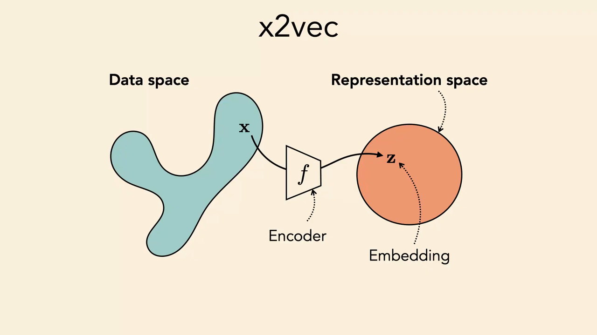
*▲ 강의 슬라이드 [05:30](https://youtu.be/QxOzQRtd440?t=330): x2vec. 복잡한 데이터 공간을 인코더 f가 단순한 표현 공간의 [임베딩](00_%EB%94%A5%EB%9F%AC%EB%8B%9D_%EC%9A%A9%EC%96%B4%EC%82%AC%EC%A0%84.md#embedding-%EC%9E%84%EB%B2%A0%EB%94%A9) z로 옮긴다*

---

## 2. 층을 사상으로 보기

▶ 영상 [06:24](https://youtu.be/QxOzQRtd440?t=384)

📐 **수학 개념**: [MM06_합성함수와_비선형성](%EC%88%98%ED%95%99%EA%B0%9C%EB%85%90/05_%EC%8B%A0%EA%B2%BD%EB%A7%9D%EC%9D%98_%EA%B3%84%EC%82%B0/MM06_%ED%95%A9%EC%84%B1%ED%95%A8%EC%88%98%EC%99%80_%EB%B9%84%EC%84%A0%ED%98%95%EC%84%B1.md) · [MM11_립시츠_연속과_노름](%EC%88%98%ED%95%99%EA%B0%9C%EB%85%90/03_%EC%84%A0%ED%98%95%EB%8C%80%EC%88%98/MM11_%EB%A6%BD%EC%8B%9C%EC%B8%A0_%EC%97%B0%EC%86%8D%EA%B3%BC_%EB%85%B8%EB%A6%84.md) · [MM05_활성화_함수의_미분](%EC%88%98%ED%95%99%EA%B0%9C%EB%85%90/05_%EC%8B%A0%EA%B2%BD%EB%A7%9D%EC%9D%98_%EA%B3%84%EC%82%B0/MM05_%ED%99%9C%EC%84%B1%ED%99%94_%ED%95%A8%EC%88%98%EC%9D%98_%EB%AF%B8%EB%B6%84.md)

### 2.1 함수를 그리는 다른 방법

▶ 영상 [06:24](https://youtu.be/QxOzQRtd440?t=384)

- 학교에서 배운 그래프는 가로축이 입력, 세로축이 출력입니다. 강사는 세로축을 **위로 돌려 세워** 입력 축과 출력 축을 나란히 놓고, 입력 점이 출력의 어느 점으로 가는지를 선으로 잇는 그림을 씁니다. 항등 함수는 곧은 세로선뿐입니다.
- 이 그림의 장점은 1차원→1차원뿐 아니라 **2차원→2차원 함수**도 그릴 수 있다는 것입니다. 함수를 "점들의 분포를 늘이고, 찌그러뜨리고, 옮기는 기하 변환"으로 보게 해 줍니다.
- 폭이 1인 [층](00_%EB%94%A5%EB%9F%AC%EB%8B%9D_%EC%9A%A9%EC%96%B4%EC%82%AC%EC%A0%84.md#layer-%EC%B8%B5)의 예: [가중치](00_%EB%94%A5%EB%9F%AC%EB%8B%9D_%EC%9A%A9%EC%96%B4%EC%82%AC%EC%A0%84.md#weight-%EA%B0%80%EC%A4%91%EC%B9%98) 2인 [선형층](00_%EB%94%A5%EB%9F%AC%EB%8B%9D_%EC%9A%A9%EC%96%B4%EC%82%AC%EC%A0%84.md#linear-layer-%EC%84%A0%ED%98%95%EC%B8%B5)은 데이터를 두 배로 넓게 펼칩니다. [ReLU](00_%EB%94%A5%EB%9F%AC%EB%8B%9D_%EC%9A%A9%EC%96%B4%EC%82%AC%EC%A0%84.md#relu-%EB%A0%90%EB%A3%A8)는 음수 쪽을 모두 0으로 보내 0에 밀도가 몰립니다. [시그모이드](00_%EB%94%A5%EB%9F%AC%EB%8B%9D_%EC%9A%A9%EC%96%B4%EC%82%AC%EC%A0%84.md#sigmoid-%EC%8B%9C%EA%B7%B8%EB%AA%A8%EC%9D%B4%EB%93%9C)는 대부분을 0이나 1 쪽으로 부드럽게 보냅니다.

### 2.2 기본 층이 데이터를 옮기는 모양

▶ 영상 [09:12](https://youtu.be/QxOzQRtd440?t=552)

2차원 가우스 점 구름을 각 [층](00_%EB%94%A5%EB%9F%AC%EB%8B%9D_%EC%9A%A9%EC%96%B4%EC%82%AC%EC%A0%84.md#layer-%EC%B8%B5)에 통과시키면 다음과 같습니다(슬라이드에서 빨강은 활성값, 파랑은 학습하는 [파라미터](00_%EB%94%A5%EB%9F%AC%EB%8B%9D_%EC%9A%A9%EC%96%B4%EC%82%AC%EC%A0%84.md#parameter-%ED%8C%8C%EB%9D%BC%EB%AF%B8%ED%84%B0). 학습하는 것은 [선형층](00_%EB%94%A5%EB%9F%AC%EB%8B%9D_%EC%9A%A9%EC%96%B4%EC%82%AC%EC%A0%84.md#linear-layer-%EC%84%A0%ED%98%95%EC%B8%B5)의 [가중치](00_%EB%94%A5%EB%9F%AC%EB%8B%9D_%EC%9A%A9%EC%96%B4%EC%82%AC%EC%A0%84.md#weight-%EA%B0%80%EC%A4%91%EC%B9%98)와 편향뿐입니다).

| [층](00_%EB%94%A5%EB%9F%AC%EB%8B%9D_%EC%9A%A9%EC%96%B4%EC%82%AC%EC%A0%84.md#layer-%EC%B8%B5) | 하는 일 | 모양 |
|---|---|---|
| 선형 $W\mathbf{x} + \mathbf{b}$ | 아핀 변환 | 회전, 늘이기, 찌그러뜨리기, 옮기기 |
| [ReLU](00_%EB%94%A5%EB%9F%AC%EB%8B%9D_%EC%9A%A9%EC%96%B4%EC%82%AC%EC%A0%84.md#relu-%EB%A0%90%EB%A3%A8) | 음수를 0으로 | 모든 점이 **양의 사분면(orthant)**으로. 한 축만 음수인 점은 축 위로, 둘 다 음수면 원점으로 → **[희소 표현](00_%EB%94%A5%EB%9F%AC%EB%8B%9D_%EC%9A%A9%EC%96%B4%EC%82%AC%EC%A0%84.md#sparse-representation-%ED%9D%AC%EC%86%8C-%ED%91%9C%ED%98%84)(Sparse representation)**. 고차원일수록 더 심하다 |
| L2 [정규화](00_%EB%94%A5%EB%9F%AC%EB%8B%9D_%EC%9A%A9%EC%96%B4%EC%82%AC%EC%A0%84.md#normalization-%EC%A0%95%EA%B7%9C%ED%99%94) ([RMSNorm](00_%EB%94%A5%EB%9F%AC%EB%8B%9D_%EC%9A%A9%EC%96%B4%EC%82%AC%EC%A0%84.md#rmsnorm-rms-%EC%A0%95%EA%B7%9C%ED%99%94), LayerNorm도 비슷) | 길이 1로 나누기 | 모든 점이 **원(고차원에서는 [초구](00_%EB%94%A5%EB%9F%AC%EB%8B%9D_%EC%9A%A9%EC%96%B4%EC%82%AC%EC%A0%84.md#hypersphere-%EC%B4%88%EA%B5%AC)) 위로**. 값이 무한대나 0으로 가지 않아 수치가 안정된다 |
| [소프트맥스](00_%EB%94%A5%EB%9F%AC%EB%8B%9D_%EC%9A%A9%EC%96%B4%EC%82%AC%EC%A0%84.md#softmax-%EC%86%8C%ED%94%84%ED%8A%B8%EB%A7%A5%EC%8A%A4) | 합이 1인 양수로 | 모든 점이 $x_1 + x_2 = 1$인 선분, 곧 **[심플렉스](00_%EB%94%A5%EB%9F%AC%EB%8B%9D_%EC%9A%A9%EC%96%B4%EC%82%AC%EC%A0%84.md#simplex-%EC%8B%AC%ED%94%8C%EB%A0%89%EC%8A%A4)([Simplex](00_%EB%94%A5%EB%9F%AC%EB%8B%9D_%EC%9A%A9%EC%96%B4%EC%82%AC%EC%A0%84.md#simplex-%EC%8B%AC%ED%94%8C%EB%A0%89%EC%8A%A4), 단체)** 위로. 꼭짓점이 [원-핫](00_%EB%94%A5%EB%9F%AC%EB%8B%9D_%EC%9A%A9%EC%96%B4%EC%82%AC%EC%A0%84.md#one-hot-encoding-%EC%9B%90-%ED%95%AB-%EC%9D%B8%EC%BD%94%EB%94%A9) [정답](00_%EB%94%A5%EB%9F%AC%EB%8B%9D_%EC%9A%A9%EC%96%B4%EC%82%AC%EC%A0%84.md#label-%EC%A0%95%EB%8B%B5) |

$$
\text{ReLU}(\mathbf{x})_i = \max(0, x_i), \qquad \text{L2norm}(\mathbf{x}) = \frac{\mathbf{x}}{\|\mathbf{x}\|_2}, \qquad \text{softmax}(\mathbf{x})_i = \frac{e^{x_i}}{\sum_j e^{x_j}}
$$

기호 풀이

| 기호 | 읽는 법 | 뜻 | 예제 값 |
| --- | --- | --- | --- |
| $\mathbf{x}$ | 엑스 | [층](00_%EB%94%A5%EB%9F%AC%EB%8B%9D_%EC%9A%A9%EC%96%B4%EC%82%AC%EC%A0%84.md#layer-%EC%B8%B5)에 들어오는 2차원 활성값 | (3, -4) |
| $x_i$ | 엑스 아이 | i번째 칸 | $x_1 = 3$, $x_2 = -4$ |
| $\max(0, x_i)$ | 맥스 | 0과 비교해 큰 값 ([ReLU](00_%EB%94%A5%EB%9F%AC%EB%8B%9D_%EC%9A%A9%EC%96%B4%EC%82%AC%EC%A0%84.md#relu-%EB%A0%90%EB%A3%A8)) | (3, 0) |
| $\Vert \mathbf{x}\Vert _2$ | 엘투 [노름](00_%EB%94%A5%EB%9F%AC%EB%8B%9D_%EC%9A%A9%EC%96%B4%EC%82%AC%EC%A0%84.md#norm-%EB%85%B8%EB%A6%84) | 벡터 길이 ([노름](%EC%88%98%ED%95%99%EA%B0%9C%EB%85%90/03_%EC%84%A0%ED%98%95%EB%8C%80%EC%88%98/MM11_%EB%A6%BD%EC%8B%9C%EC%B8%A0_%EC%97%B0%EC%86%8D%EA%B3%BC_%EB%85%B8%EB%A6%84.md)) | 5 |
| $\mathbf{x}/\Vert \mathbf{x}\Vert _2$ | [정규화](00_%EB%94%A5%EB%9F%AC%EB%8B%9D_%EC%9A%A9%EC%96%B4%EC%82%AC%EC%A0%84.md#normalization-%EC%A0%95%EA%B7%9C%ED%99%94) | 길이 1로 줄인 벡터 | (0.6, -0.8) |
| $e^{x_i}$ | 이의 엑스 아이 제곱 | [지수](00_%EB%94%A5%EB%9F%AC%EB%8B%9D_%EC%9A%A9%EC%96%B4%EC%82%AC%EC%A0%84.md#e-exponent-e%EC%99%80-%EC%A7%80%EC%88%98) ([지수](%EC%88%98%ED%95%99%EA%B0%9C%EB%85%90/01_%EC%88%98%EC%99%80_%ED%95%A8%EC%88%98/M06_%EC%A7%80%EC%88%98%EC%99%80_e.md)) | 20.0855, 0.0183 |
| $\text{softmax}(\mathbf{x})_i$ | [소프트맥스](00_%EB%94%A5%EB%9F%AC%EB%8B%9D_%EC%9A%A9%EC%96%B4%EC%82%AC%EC%A0%84.md#softmax-%EC%86%8C%ED%94%84%ED%8A%B8%EB%A7%A5%EC%8A%A4) | [지수](00_%EB%94%A5%EB%9F%AC%EB%8B%9D_%EC%9A%A9%EC%96%B4%EC%82%AC%EC%A0%84.md#e-exponent-e%EC%99%80-%EC%A7%80%EC%88%98)를 합 1로 나눈 비율 | (0.9991, 0.0009) |

예제와 풀이

**문제**: [층](00_%EB%94%A5%EB%9F%AC%EB%8B%9D_%EC%9A%A9%EC%96%B4%EC%82%AC%EC%A0%84.md#layer-%EC%B8%B5)에 들어온 2차원 활성값 $\mathbf{x} = (3, -4)$를 [ReLU](00_%EB%94%A5%EB%9F%AC%EB%8B%9D_%EC%9A%A9%EC%96%B4%EC%82%AC%EC%A0%84.md#relu-%EB%A0%90%EB%A3%A8), L2 [정규화](00_%EB%94%A5%EB%9F%AC%EB%8B%9D_%EC%9A%A9%EC%96%B4%EC%82%AC%EC%A0%84.md#normalization-%EC%A0%95%EA%B7%9C%ED%99%94), [소프트맥스](00_%EB%94%A5%EB%9F%AC%EB%8B%9D_%EC%9A%A9%EC%96%B4%EC%82%AC%EC%A0%84.md#softmax-%EC%86%8C%ED%94%84%ED%8A%B8%EB%A7%A5%EC%8A%A4) [층](00_%EB%94%A5%EB%9F%AC%EB%8B%9D_%EC%9A%A9%EC%96%B4%EC%82%AC%EC%A0%84.md#layer-%EC%B8%B5)에 각각 넣으면 무엇이 나오는가?

**주어진 값**:
- $x_1 = 3$ (활성값의 첫째 칸)
- $x_2 = -4$ (활성값의 둘째 칸)

**풀이**
1. [ReLU](00_%EB%94%A5%EB%9F%AC%EB%8B%9D_%EC%9A%A9%EC%96%B4%EC%82%AC%EC%A0%84.md#relu-%EB%A0%90%EB%A3%A8) 식을 그대로 쓴다: $\text{ReLU}(\mathbf{x})_i = \max(0, x_i)$
2. 값을 대입한다: $\text{ReLU}(\mathbf{x}) = (\max(0, 3),\ \max(0, -4))$
3. 칸마다 0과 비교해 큰 값을 고른다: $3 > 0$이므로 3, $-4 < 0$이므로 0 → $(3, 0)$
4. L2 [정규화](00_%EB%94%A5%EB%9F%AC%EB%8B%9D_%EC%9A%A9%EC%96%B4%EC%82%AC%EC%A0%84.md#normalization-%EC%A0%95%EA%B7%9C%ED%99%94) 식을 그대로 쓴다: $\text{L2norm}(\mathbf{x}) = \mathbf{x} / \|\mathbf{x}\|_2$, 길이 $\|\mathbf{x}\|_2 = \sqrt{x_1^2 + x_2^2}$
5. 값을 대입한다: $\|\mathbf{x}\|_2 = \sqrt{3^2 + (-4)^2}$
6. 제곱을 먼저 한다: $3^2 = 9$, $(-4)^2 = 16$ 이므로 $\sqrt{9 + 16}$
7. 더한다: $9 + 16 = 25$ 이므로 $\sqrt{25}$
8. $\sqrt{\ }$(제곱근)는 "제곱해서 그 수가 되는 양수"다. $5 \times 5 = 25$ 이므로 $\sqrt{25} = 5$
9. 칸마다 길이 5로 나눈다: $(3/5,\ -4/5) = (0.6, -0.8)$
10. [소프트맥스](00_%EB%94%A5%EB%9F%AC%EB%8B%9D_%EC%9A%A9%EC%96%B4%EC%82%AC%EC%A0%84.md#softmax-%EC%86%8C%ED%94%84%ED%8A%B8%EB%A7%A5%EC%8A%A4) 식을 그대로 쓴다: $\text{softmax}(\mathbf{x})_i = e^{x_i} / (e^{x_1} + e^{x_2})$
11. 값을 대입한다: $\text{softmax}(\mathbf{x}) = \left(\dfrac{e^{3}}{e^{3} + e^{-4}},\ \dfrac{e^{-4}}{e^{3} + e^{-4}}\right)$
12. $e$는 약 2.71828인 수다. $e^{3}$은 $e$를 세 번 곱한 값, $e^{-4}$는 $1 / e^{4}$이고 계산기로 구한다: $e^{3} = 20.0855$, $e^{-4} = 0.0183$
13. 분모를 더한다: $20.0855 + 0.0183 = 20.1038$
14. 첫째 칸을 나눈다: $20.0855 / 20.1038 = 0.9991$
15. 둘째 칸을 나눈다: $0.0183 / 20.1038 = 0.0009$

**답**: [ReLU](00_%EB%94%A5%EB%9F%AC%EB%8B%9D_%EC%9A%A9%EC%96%B4%EC%82%AC%EC%A0%84.md#relu-%EB%A0%90%EB%A3%A8) **(3, 0)**(축 위), L2 [정규화](00_%EB%94%A5%EB%9F%AC%EB%8B%9D_%EC%9A%A9%EC%96%B4%EC%82%AC%EC%A0%84.md#normalization-%EC%A0%95%EA%B7%9C%ED%99%94) **(0.6, -0.8)**(원 위), [소프트맥스](00_%EB%94%A5%EB%9F%AC%EB%8B%9D_%EC%9A%A9%EC%96%B4%EC%82%AC%EC%A0%84.md#softmax-%EC%86%8C%ED%94%84%ED%8A%B8%EB%A7%A5%EC%8A%A4) **(0.9991, 0.0009)**([심플렉스](00_%EB%94%A5%EB%9F%AC%EB%8B%9D_%EC%9A%A9%EC%96%B4%EC%82%AC%EC%A0%84.md#simplex-%EC%8B%AC%ED%94%8C%EB%A0%89%EC%8A%A4) 위, 첫 꼭짓점 근처).

내 이해

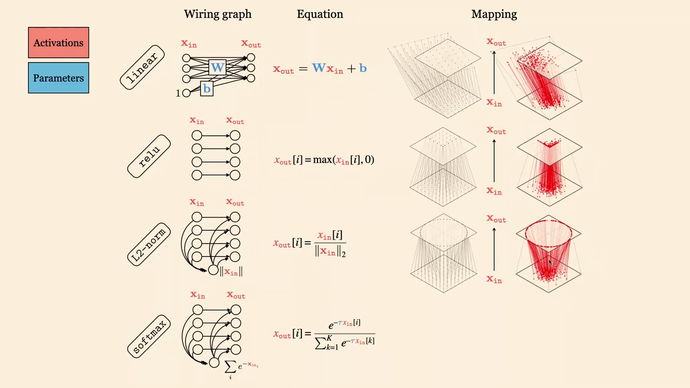
*▲ 강의 슬라이드 [12:00](https://youtu.be/QxOzQRtd440?t=720): 선형·[ReLU](00_%EB%94%A5%EB%9F%AC%EB%8B%9D_%EC%9A%A9%EC%96%B4%EC%82%AC%EC%A0%84.md#relu-%EB%A0%90%EB%A3%A8)·L2 [정규화](00_%EB%94%A5%EB%9F%AC%EB%8B%9D_%EC%9A%A9%EC%96%B4%EC%82%AC%EC%A0%84.md#normalization-%EC%A0%95%EA%B7%9C%ED%99%94)·[소프트맥스](00_%EB%94%A5%EB%9F%AC%EB%8B%9D_%EC%9A%A9%EC%96%B4%EC%82%AC%EC%A0%84.md#softmax-%EC%86%8C%ED%94%84%ED%8A%B8%EB%A7%A5%EC%8A%A4) [층](00_%EB%94%A5%EB%9F%AC%EB%8B%9D_%EC%9A%A9%EC%96%B4%EC%82%AC%EC%A0%84.md#layer-%EC%B8%B5)의 배선도, 식, 사상(2차원 점 구름이 옮겨지는 모양)*

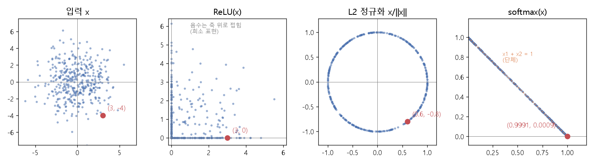
*▲ 직접 그린 그림: 표준편차 2인 가우스 점 400개를 각 [층](00_%EB%94%A5%EB%9F%AC%EB%8B%9D_%EC%9A%A9%EC%96%B4%EC%82%AC%EC%A0%84.md#layer-%EC%B8%B5)에 통과시킨 결과. 빨간 점은 위 예제의 (3, -4)와 그 출력*

- [소프트맥스](00_%EB%94%A5%EB%9F%AC%EB%8B%9D_%EC%9A%A9%EC%96%B4%EC%82%AC%EC%A0%84.md#softmax-%EC%86%8C%ED%94%84%ED%8A%B8%EB%A7%A5%EC%8A%A4) 그림의 선이 무엇이냐는 강사의 질문에 학생이 "$x_1 + x_2 = 1$"이라고 답했습니다. 그 선(1차원 [심플렉스](00_%EB%94%A5%EB%9F%AC%EB%8B%9D_%EC%9A%A9%EC%96%B4%EC%82%AC%EC%A0%84.md#simplex-%EC%8B%AC%ED%94%8C%EB%A0%89%EC%8A%A4))이 [확률](00_%EB%94%A5%EB%9F%AC%EB%8B%9D_%EC%9A%A9%EC%96%B4%EC%82%AC%EC%A0%84.md#probability-%ED%99%95%EB%A5%A0) 분포들의 집합이고, 한쪽 끝에 가까울수록 그 부류의 [확률](00_%EB%94%A5%EB%9F%AC%EB%8B%9D_%EC%9A%A9%EC%96%B4%EC%82%AC%EC%A0%84.md#probability-%ED%99%95%EB%A5%A0)이 높습니다.

### 2.3 MLP의 층별 표현

▶ 영상 [13:12](https://youtu.be/QxOzQRtd440?t=792)

- [선형층](00_%EB%94%A5%EB%9F%AC%EB%8B%9D_%EC%9A%A9%EC%96%B4%EC%82%AC%EC%A0%84.md#linear-layer-%EC%84%A0%ED%98%95%EC%B8%B5) 셋인 3층 MLP, 모든 [층](00_%EB%94%A5%EB%9F%AC%EB%8B%9D_%EC%9A%A9%EC%96%B4%EC%82%AC%EC%A0%84.md#layer-%EC%B8%B5)의 폭이 2입니다. 그래서 [차원 축소](00_%EB%94%A5%EB%9F%AC%EB%8B%9D_%EC%9A%A9%EC%96%B4%EC%82%AC%EC%A0%84.md#dimensionality-reduction-%EC%B0%A8%EC%9B%90-%EC%B6%95%EC%86%8C) 없이 **실제 활성값 그대로** 그릴 수 있습니다. 입력은 원점 근처의 빨간 점 구름과 그것을 둘러싼 반원 모양의 파란 점들입니다. 직선 하나로 나눌 수 없는 [이진 분류](00_%EB%94%A5%EB%9F%AC%EB%8B%9D_%EC%9A%A9%EC%96%B4%EC%82%AC%EC%A0%84.md#binary-classification-%EC%9D%B4%EC%A7%84-%EB%B6%84%EB%A5%98)이고, [소프트맥스](00_%EB%94%A5%EB%9F%AC%EB%8B%9D_%EC%9A%A9%EC%96%B4%EC%82%AC%EC%A0%84.md#softmax-%EC%86%8C%ED%94%84%ED%8A%B8%EB%A7%A5%EC%8A%A4) [교차 엔트로피](00_%EB%94%A5%EB%9F%AC%EB%8B%9D_%EC%9A%A9%EC%96%B4%EC%82%AC%EC%A0%84.md#cross-entropy-%EA%B5%90%EC%B0%A8-%EC%97%94%ED%8A%B8%EB%A1%9C%ED%94%BC)로 학습합니다.
- [학습](00_%EB%94%A5%EB%9F%AC%EB%8B%9D_%EC%9A%A9%EC%96%B4%EC%82%AC%EC%A0%84.md#training-%ED%95%99%EC%8A%B5)이 진행되면 [층](00_%EB%94%A5%EB%9F%AC%EB%8B%9D_%EC%9A%A9%EC%96%B4%EC%82%AC%EC%A0%84.md#layer-%EC%B8%B5)을 지날 때마다 빨강과 파랑이 서로 멀어집니다. [선형층](00_%EB%94%A5%EB%9F%AC%EB%8B%9D_%EC%9A%A9%EC%96%B4%EC%82%AC%EC%A0%84.md#linear-layer-%EC%84%A0%ED%98%95%EC%B8%B5)이 밀고 기울이면 [ReLU](00_%EB%94%A5%EB%9F%AC%EB%8B%9D_%EC%9A%A9%EC%96%B4%EC%82%AC%EC%A0%84.md#relu-%EB%A0%90%EB%A3%A8)가 다시 축으로 접고, 마지막에 한 줄로 펼쳐진 뒤 [소프트맥스](00_%EB%94%A5%EB%9F%AC%EB%8B%9D_%EC%9A%A9%EC%96%B4%EC%82%AC%EC%A0%84.md#softmax-%EC%86%8C%ED%94%84%ED%8A%B8%EB%A7%A5%EC%8A%A4)가 [심플렉스](00_%EB%94%A5%EB%9F%AC%EB%8B%9D_%EC%9A%A9%EC%96%B4%EC%82%AC%EC%A0%84.md#simplex-%EC%8B%AC%ED%94%8C%EB%A0%89%EC%8A%A4) 위로 누릅니다. 빨강은 (1, 0), 파랑은 (0, 1), 곧 [원-핫](00_%EB%94%A5%EB%9F%AC%EB%8B%9D_%EC%9A%A9%EC%96%B4%EC%82%AC%EC%A0%84.md#one-hot-encoding-%EC%9B%90-%ED%95%AB-%EC%9D%B8%EC%BD%94%EB%94%A9) [정답](00_%EB%94%A5%EB%9F%AC%EB%8B%9D_%EC%9A%A9%EC%96%B4%EC%82%AC%EC%A0%84.md#label-%EC%A0%95%EB%8B%B5) 쪽으로 갑니다.
- 재미로, 같은 망을 과제 2에서 유도한 **[스펙트럼 노름](00_%EB%94%A5%EB%9F%AC%EB%8B%9D_%EC%9A%A9%EC%96%B4%EC%82%AC%EC%A0%84.md#spectral-norm-%EC%8A%A4%ED%8E%99%ED%8A%B8%EB%9F%BC-%EB%85%B8%EB%A6%84) 기준 [최급강하법](00_%EB%94%A5%EB%9F%AC%EB%8B%9D_%EC%9A%A9%EC%96%B4%EC%82%AC%EC%A0%84.md#steepest-descent-%EC%B5%9C%EA%B8%89%EA%B0%95%ED%95%98%EB%B2%95)**으로 학습하면 동역학이 다르고 [손실](00_%EB%94%A5%EB%9F%AC%EB%8B%9D_%EC%9A%A9%EC%96%B4%EC%82%AC%EC%A0%84.md#loss-function-%EC%86%90%EC%8B%A4-%ED%95%A8%EC%88%98)이 더 낮아집니다. 다만 [학습률](00_%EB%94%A5%EB%9F%AC%EB%8B%9D_%EC%9A%A9%EC%96%B4%EC%82%AC%EC%A0%84.md#learning-rate-%ED%95%99%EC%8A%B5%EB%A5%A0)에 따라 달라지므로 너무 많이 읽지는 말라고 합니다. 첫 [선형층](00_%EB%94%A5%EB%9F%AC%EB%8B%9D_%EC%9A%A9%EC%96%B4%EC%82%AC%EC%A0%84.md#linear-layer-%EC%84%A0%ED%98%95%EC%B8%B5)이 회전(직교 변환)처럼 보이는 것이 직교화된 갱신과 관련 있을지 모른다는 추측도 덧붙입니다.

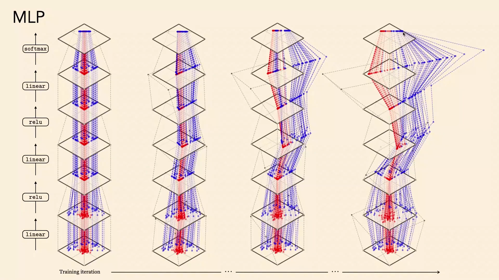
*▲ 강의 슬라이드 [14:40](https://youtu.be/QxOzQRtd440?t=880): 폭 2인 MLP의 층별 표현. 왼쪽에서 오른쪽으로 [학습](00_%EB%94%A5%EB%9F%AC%EB%8B%9D_%EC%9A%A9%EC%96%B4%EC%82%AC%EC%A0%84.md#training-%ED%95%99%EC%8A%B5)이 진행될수록 빨강과 파랑이 갈라진다*

### 2.4 큰 망의 층별 표현: CLIP

▶ 영상 [16:40](https://youtu.be/QxOzQRtd440?t=1000)

- [표현 학습](00_%EB%94%A5%EB%9F%AC%EB%8B%9D_%EC%9A%A9%EC%96%B4%EC%82%AC%EC%A0%84.md#representation-learning-%ED%91%9C%ED%98%84-%ED%95%99%EC%8A%B5)의 힘은 고차원 특징 공간에서 드러납니다. 이미지 특징을 잘 뽑는 컴퓨터 비전 모델 **[CLIP](00_%EB%94%A5%EB%9F%AC%EB%8B%9D_%EC%9A%A9%EC%96%B4%EC%82%AC%EC%A0%84.md#clip-%ED%81%B4%EB%A6%BD)**의 비전 [트랜스포머](00_%EB%94%A5%EB%9F%AC%EB%8B%9D_%EC%9A%A9%EC%96%B4%EC%82%AC%EC%A0%84.md#transformer-%ED%8A%B8%EB%9E%9C%EC%8A%A4%ED%8F%AC%EB%A8%B8) 블록(3개씩 묶음)을 지날 때마다 표현을 [PCA](00_%EB%94%A5%EB%9F%AC%EB%8B%9D_%EC%9A%A9%EC%96%B4%EC%82%AC%EC%A0%84.md#pca-principal-component-analysis-%EC%A3%BC%EC%84%B1%EB%B6%84-%EB%B6%84%EC%84%9D)로 2차원에 투영해 그렸습니다(그래서 진짜 데이터가 아니라 만화에 가깝습니다).
- 색은 이미지의 부류(고양이, 개 등)입니다. [분류](00_%EB%94%A5%EB%9F%AC%EB%8B%9D_%EC%9A%A9%EC%96%B4%EC%82%AC%EC%A0%84.md#regression-classification-%ED%9A%8C%EA%B7%80%EC%99%80-%EB%B6%84%EB%A5%98)로 학습했기 때문에 깊은 [층](00_%EB%94%A5%EB%9F%AC%EB%8B%9D_%EC%9A%A9%EC%96%B4%EC%82%AC%EC%A0%84.md#layer-%EC%B8%B5)으로 갈수록 부류들이 깨끗이 갈라집니다. 마지막에 [소프트맥스](00_%EB%94%A5%EB%9F%AC%EB%8B%9D_%EC%9A%A9%EC%96%B4%EC%82%AC%EC%A0%84.md#softmax-%EC%86%8C%ED%94%84%ED%8A%B8%EB%A7%A5%EC%8A%A4)를 하면 [심플렉스](00_%EB%94%A5%EB%9F%AC%EB%8B%9D_%EC%9A%A9%EC%96%B4%EC%82%AC%EC%A0%84.md#simplex-%EC%8B%AC%ED%94%8C%EB%A0%89%EC%8A%A4)의 꼭짓점([원-핫](00_%EB%94%A5%EB%9F%AC%EB%8B%9D_%EC%9A%A9%EC%96%B4%EC%82%AC%EC%A0%84.md#one-hot-encoding-%EC%9B%90-%ED%95%AB-%EC%9D%B8%EC%BD%94%EB%94%A9) [정답](00_%EB%94%A5%EB%9F%AC%EB%8B%9D_%EC%9A%A9%EC%96%B4%EC%82%AC%EC%A0%84.md#label-%EC%A0%95%EB%8B%B5))으로 갑니다.
- 요점: 입력에서는 얽혀 있던 복잡한 데이터가 층별 기하 변환으로 **조금씩 풀려**, 관심 있는 의미가 깨끗이 갈라진 상태가 됩니다. **출력 공간은 입력 공간보다 단순한 대상**입니다.

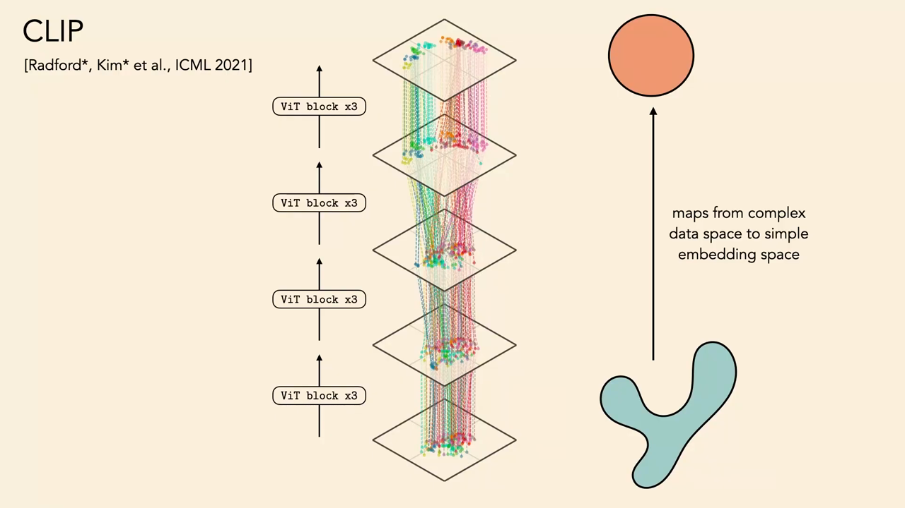
*▲ 강의 슬라이드 [18:44](https://youtu.be/QxOzQRtd440?t=1124): [CLIP](00_%EB%94%A5%EB%9F%AC%EB%8B%9D_%EC%9A%A9%EC%96%B4%EC%82%AC%EC%A0%84.md#clip-%ED%81%B4%EB%A6%BD) [비전 트랜스포머](00_%EB%94%A5%EB%9F%AC%EB%8B%9D_%EC%9A%A9%EC%96%B4%EC%82%AC%EC%A0%84.md#vision-transformer-%EB%B9%84%EC%A0%84-%ED%8A%B8%EB%9E%9C%EC%8A%A4%ED%8F%AC%EB%A8%B8)의 층별 표현([PCA](00_%EB%94%A5%EB%9F%AC%EB%8B%9D_%EC%9A%A9%EC%96%B4%EC%82%AC%EC%A0%84.md#pca-principal-component-analysis-%EC%A3%BC%EC%84%B1%EB%B6%84-%EB%B6%84%EC%84%9D) [투영](00_%EB%94%A5%EB%9F%AC%EB%8B%9D_%EC%9A%A9%EC%96%B4%EC%82%AC%EC%A0%84.md#projection-%ED%88%AC%EC%98%81)). 복잡한 데이터 공간을 단순한 [임베딩](00_%EB%94%A5%EB%9F%AC%EB%8B%9D_%EC%9A%A9%EC%96%B4%EC%82%AC%EC%A0%84.md#embedding-%EC%9E%84%EB%B2%A0%EB%94%A9) 공간으로 옮긴다*

---

## 3. 뇌와 깊은 망의 표현

▶ 영상 [18:56](https://youtu.be/QxOzQRtd440?t=1136)

📐 **수학 개념**: [MM42_최근접_이웃과_탐침](%EC%88%98%ED%95%99%EA%B0%9C%EB%85%90/10_%ED%91%9C%ED%98%84_%ED%95%99%EC%8A%B5/MM42_%EC%B5%9C%EA%B7%BC%EC%A0%91_%EC%9D%B4%EC%9B%83%EA%B3%BC_%ED%83%90%EC%B9%A8.md)

- 사람 뇌의 시각 피질도 [층](00_%EB%94%A5%EB%9F%AC%EB%8B%9D_%EC%9A%A9%EC%96%B4%EC%82%AC%EC%A0%84.md#layer-%EC%B8%B5)(V1/V2 → V4 → IT)을 차례로 거칩니다. 생물학적 세부를 빼면 "선형 → 점별 비선형"의 반복이고, 대여섯 층쯤 됩니다. 첫 [층](00_%EB%94%A5%EB%9F%AC%EB%8B%9D_%EC%9A%A9%EC%96%B4%EC%82%AC%EC%A0%84.md#layer-%EC%B8%B5)은 모서리(edge)를 거르고, 다음 [층](00_%EB%94%A5%EB%9F%AC%EB%8B%9D_%EC%9A%A9%EC%96%B4%EC%82%AC%EC%A0%84.md#layer-%EC%B8%B5)은 모서리들의 조합을 찾고, 마지막 IT [층](00_%EB%94%A5%EB%9F%AC%EB%8B%9D_%EC%9A%A9%EC%96%B4%EC%82%AC%EC%A0%84.md#layer-%EC%B8%B5)에서 물체 인식이 일어난다고 봅니다.
- 깊은 망도 그런지 **신경과학자처럼** 확인합니다. 뉴런에 탐침을 꽂고 어떤 입력에서 켜지는지([ReLU](00_%EB%94%A5%EB%9F%AC%EB%8B%9D_%EC%9A%A9%EC%96%B4%EC%82%AC%EC%A0%84.md#relu-%EB%A0%90%EB%A3%A8)가 0보다 커지는지) 봅니다. 요즘 이름으로는 **해석 가능성(Interpretability)**, 또는 **[기계적 해석 가능성](00_%EB%94%A5%EB%9F%AC%EB%8B%9D_%EC%9A%A9%EC%96%B4%EC%82%AC%EC%A0%84.md#mechanistic-interpretability-%EA%B8%B0%EA%B3%84%EC%A0%81-%ED%95%B4%EC%84%9D-%EA%B0%80%EB%8A%A5%EC%84%B1)(Mechanistic interpretability)** 연구입니다.
- Zeiler와 Fergus(2014)가 다섯~여섯 [층](00_%EB%94%A5%EB%9F%AC%EB%8B%9D_%EC%9A%A9%EC%96%B4%EC%82%AC%EC%A0%84.md#layer-%EC%B8%B5) [CNN](00_%EB%94%A5%EB%9F%AC%EB%8B%9D_%EC%9A%A9%EC%96%B4%EC%82%AC%EC%A0%84.md#cnn-convolutional-neural-network-%ED%95%A9%EC%84%B1%EA%B3%B1-%EC%8B%A0%EA%B2%BD%EB%A7%9D)의 [필터](00_%EB%94%A5%EB%9F%AC%EB%8B%9D_%EC%9A%A9%EC%96%B4%EC%82%AC%EC%A0%84.md#filter-%ED%95%84%ED%84%B0)마다 가장 강하게 켜는 이미지 조각 9개를 모았습니다.

| [층](00_%EB%94%A5%EB%9F%AC%EB%8B%9D_%EC%9A%A9%EC%96%B4%EC%82%AC%EC%A0%84.md#layer-%EC%B8%B5) | 가장 잘 반응하는 것 |
|---|---|
| 1층 | 방향 있는 모서리(밝음→어둠), 초록색 같은 단순한 특징 |
| 2층 | 모서리의 조합(십자 등), 그러데이션, 원 |
| 3층 | 더 복잡한 무늬. 벌써 "사람 얼굴"처럼 보이는 반응(실제로는 밝은 배경 위 둥근 어두운 덩어리 검출기에 가까움) |
| 5층 | 개 얼굴과 사람 얼굴을 구별할 만큼 선택적인 검출기 |

- "[필터](00_%EB%94%A5%EB%9F%AC%EB%8B%9D_%EC%9A%A9%EC%96%B4%EC%82%AC%EC%A0%84.md#filter-%ED%95%84%ED%84%B0)"라는 영어 낱말 그대로, [필터](00_%EB%94%A5%EB%9F%AC%EB%8B%9D_%EC%9A%A9%EC%96%B4%EC%82%AC%EC%A0%84.md#filter-%ED%95%84%ED%84%B0)는 데이터에서 찾는 것만 걸러 내고 나머지를 버립니다.
- 수십~수백 층인 요즘 망에서는 깊은 곳에 아주 구체적인 것을 나타내는 검출기가 생깁니다. [언어 모델](00_%EB%94%A5%EB%9F%AC%EB%8B%9D_%EC%9A%A9%EC%96%B4%EC%82%AC%EC%A0%84.md#language-model-%EC%96%B8%EC%96%B4-%EB%AA%A8%EB%8D%B8)에서도 "감정 뉴런(The Sentiment Neuron)"처럼 글의 감정을 나타내는 뉴런이 발견되었고, 지금은 어디서나 볼 수 있는 현상입니다.
- **뇌와의 차이**: 뇌의 [합성곱](00_%EB%94%A5%EB%9F%AC%EB%8B%9D_%EC%9A%A9%EC%96%B4%EC%82%AC%EC%A0%84.md#convolution-%ED%95%A9%EC%84%B1%EA%B3%B1) [층](00_%EB%94%A5%EB%9F%AC%EB%8B%9D_%EC%9A%A9%EC%96%B4%EC%82%AC%EC%A0%84.md#layer-%EC%B8%B5)은 일곱 개 정도지만 대신 **되먹임(recurrence)**으로 같은 [층](00_%EB%94%A5%EB%9F%AC%EB%8B%9D_%EC%9A%A9%EC%96%B4%EC%82%AC%EC%A0%84.md#layer-%EC%B8%B5)을 반복해 씁니다. 요즘 망은 수백 [층](00_%EB%94%A5%EB%9F%AC%EB%8B%9D_%EC%9A%A9%EC%96%B4%EC%82%AC%EC%A0%84.md#layer-%EC%B8%B5)을 한 번씩 지납니다.

> [!TIP]
> **🆕 2026 업데이트: 뉴런 하나에서 "특징 수천만 개"로**
> - **강의(2024년 가을)**: 뉴런 하나를 찔러 보는 방식(Zeiler·Fergus, 감정 뉴런)으로 해석 가능성 연구를 소개했습니다.
> - **현재(2026년 10월)**: 뉴런 하나가 여러 개념에 섞여 반응하는 문제 때문에, 지금은 활성값을 **[희소 오토인코더](00_%EB%94%A5%EB%9F%AC%EB%8B%9D_%EC%9A%A9%EC%96%B4%EC%82%AC%EC%A0%84.md#sparse-autoencoder-%ED%9D%AC%EC%86%8C-%EC%98%A4%ED%86%A0%EC%9D%B8%EC%BD%94%EB%8D%94)(Sparse autoencoder, SAE)**로 다시 표현해 "특징"을 뽑는 방법이 주류가 되었습니다. 이 강의의 주제인 [오토인코더](00_%EB%94%A5%EB%9F%AC%EB%8B%9D_%EC%9A%A9%EC%96%B4%EC%82%AC%EC%A0%84.md#autoencoder-%EC%98%A4%ED%86%A0%EC%9D%B8%EC%BD%94%EB%8D%94)를, [병목](00_%EB%94%A5%EB%9F%AC%EB%8B%9D_%EC%9A%A9%EC%96%B4%EC%82%AC%EC%A0%84.md#bottleneck-%EB%B3%91%EB%AA%A9)을 작게 하는 대신 코드를 **희소하게** 만드는 제약으로 쓴 것입니다(8.1의 "다른 방식으로 단순함을 강제하는 변형"). Anthropic은 2024년 5월 실제 서비스 모델 Claude 3 Sonnet의 중간 [층](00_%EB%94%A5%EB%9F%AC%EB%8B%9D_%EC%9A%A9%EC%96%B4%EC%82%AC%EC%A0%84.md#layer-%EC%B8%B5)에 최대 **3,400만 개** 특징짜리 SAE를 학습해, 유명인·도시·코드의 타입 같은 개념에 반응하고 그 특징을 키우면 모델 행동이 실제로 바뀌는 특징들을 찾았습니다.
> - **출처**: [Scaling Monosemanticity: Extracting Interpretable Features from Claude 3 Sonnet (Templeton 외, Transformer Circuits, 2024)](https://transformer-circuits.pub/2024/scaling-monosemanticity/)

---

## 4. 표현의 정의

▶ 영상 [26:20](https://youtu.be/QxOzQRtd440?t=1580)

📐 **수학 개념**: [M01_함수와_일차함수](%EC%88%98%ED%95%99%EA%B0%9C%EB%85%90/01_%EC%88%98%EC%99%80_%ED%95%A8%EC%88%98/M01_%ED%95%A8%EC%88%98%EC%99%80_%EC%9D%BC%EC%B0%A8%ED%95%A8%EC%88%98.md) · [M05_벡터와_행렬](%EC%88%98%ED%95%99%EA%B0%9C%EB%85%90/03_%EC%84%A0%ED%98%95%EB%8C%80%EC%88%98/M05_%EB%B2%A1%ED%84%B0%EC%99%80_%ED%96%89%EB%A0%AC.md)

이 수업에서 표현은 주로 **벡터 [임베딩](00_%EB%94%A5%EB%9F%AC%EB%8B%9D_%EC%9A%A9%EC%96%B4%EC%82%AC%EC%A0%84.md#embedding-%EC%9E%84%EB%B2%A0%EB%94%A9)**(더 일반적으로는 [텐서](00_%EB%94%A5%EB%9F%AC%EB%8B%9D_%EC%9A%A9%EC%96%B4%EC%82%AC%EC%A0%84.md#tensor-%ED%85%90%EC%84%9C))으로 한정합니다. "표현"이라는 말은 두 가지로 쓰입니다.

$$
f: \mathcal{X} \to \mathbb{R}^d \quad (\text{데이터 영역의 표현} = \text{인코더}), \qquad \mathbf{z} = f(\mathbf{x}) \in \mathbb{R}^d \quad (\text{데이터 한 점의 표현})
$$

기호 풀이

| 기호 | 읽는 법 | 뜻 | 예제 값 |
| --- | --- | --- | --- |
| $\mathcal{X}$ | 캘리그래픽 엑스 | 데이터 영역 (모든 가능한 입력) | 3칸 벡터 전체 |
| $f$ | 에프 | 인코더. 각 입력에 특징 벡터를 붙이는 함수 | $f(\mathbf{x}) = W\mathbf{x}$ |
| $\mathbb{R}^d$ | 알 디 | d칸 실수 벡터의 공간 | $d = 2$ |
| $\mathbf{x}$ | 엑스 | 데이터 한 점 | (2, 3, 5) |
| $\mathbf{z}$ | 제트 | 그 점의 표현 ([임베딩](00_%EB%94%A5%EB%9F%AC%EB%8B%9D_%EC%9A%A9%EC%96%B4%EC%82%AC%EC%A0%84.md#embedding-%EC%9E%84%EB%B2%A0%EB%94%A9)) | (5, 5) |
| $W$ | 더블유 | 인코더의 [가중치](00_%EB%94%A5%EB%9F%AC%EB%8B%9D_%EC%9A%A9%EC%96%B4%EC%82%AC%EC%A0%84.md#weight-%EA%B0%80%EC%A4%91%EC%B9%98) (영역의 표현을 실제로 정하는 값) | $\begin{pmatrix}1&1&0\\0&0&1\end{pmatrix}$ |

예제와 풀이

**문제**: 인코더 [가중치](00_%EB%94%A5%EB%9F%AC%EB%8B%9D_%EC%9A%A9%EC%96%B4%EC%82%AC%EC%A0%84.md#weight-%EA%B0%80%EC%A4%91%EC%B9%98) $W$가 3칸짜리 입력 $\mathbf{x}$를 표현 $\mathbf{z}$로 바꿀 때, $\mathbf{z}$와 그 칸 수 $d$는?

**주어진 값**:
- $W = \begin{pmatrix}1&1&0\\0&0&1\end{pmatrix}$ (인코더 [가중치](00_%EB%94%A5%EB%9F%AC%EB%8B%9D_%EC%9A%A9%EC%96%B4%EC%82%AC%EC%A0%84.md#weight-%EA%B0%80%EC%A4%91%EC%B9%98), 2행 3열)
- $\mathbf{x} = (2, 3, 5)$ (데이터 한 점)

**풀이**
1. 식을 그대로 쓴다: $\mathbf{z} = f(\mathbf{x}) = W\mathbf{x}$
2. 값을 대입한다: $\mathbf{z} = \begin{pmatrix}1&1&0\\0&0&1\end{pmatrix}\begin{pmatrix}2\\3\\5\end{pmatrix}$
3. [행렬 곱](00_%EB%94%A5%EB%9F%AC%EB%8B%9D_%EC%9A%A9%EC%96%B4%EC%82%AC%EC%A0%84.md#matrix-multiplication-%ED%96%89%EB%A0%AC-%EA%B3%B1)은 $W$의 각 행과 $\mathbf{x}$를 칸끼리 곱해 더한다. 첫째 칸을 펼친다: $1 \times 2 + 1 \times 3 + 0 \times 5$
4. 곱셈을 한다: $2 + 3 + 0$
5. 더한다: $z_1 = 5$
6. 둘째 칸을 펼친다: $0 \times 2 + 0 \times 3 + 1 \times 5$
7. 곱셈을 한다: $0 + 0 + 5$
8. 더한다: $z_2 = 5$
9. 칸 수를 센다: $\mathbf{z}$는 2칸이므로 $d = 2$ (3칸 입력이 2칸으로 줄었다)

**답**: $\mathbf{z} =$ **(5, 5)**, $d =$ **2**. 이 데이터 영역의 표현은 $W$ 자체다.

내 이해

- 신경망에서 $f$를 정하는 것은 [가중치](00_%EB%94%A5%EB%9F%AC%EB%8B%9D_%EC%9A%A9%EC%96%B4%EC%82%AC%EC%A0%84.md#weight-%EA%B0%80%EC%A4%91%EC%B9%98)와 [편향](00_%EB%94%A5%EB%9F%AC%EB%8B%9D_%EC%9A%A9%EC%96%B4%EC%82%AC%EC%A0%84.md#bias-%ED%8E%B8%ED%96%A5)입니다. 그래서 "**학습된 표현**"이라고 하면 보통 점 하나의 벡터가 아니라 데이터에 맞춘 **함수 $f$([가중치](00_%EB%94%A5%EB%9F%AC%EB%8B%9D_%EC%9A%A9%EC%96%B4%EC%82%AC%EC%A0%84.md#weight-%EA%B0%80%EC%A4%91%EC%B9%98)와 [편향](00_%EB%94%A5%EB%9F%AC%EB%8B%9D_%EC%9A%A9%EC%96%B4%EC%82%AC%EC%A0%84.md#bias-%ED%8E%B8%ED%96%A5))**를 가리킵니다.

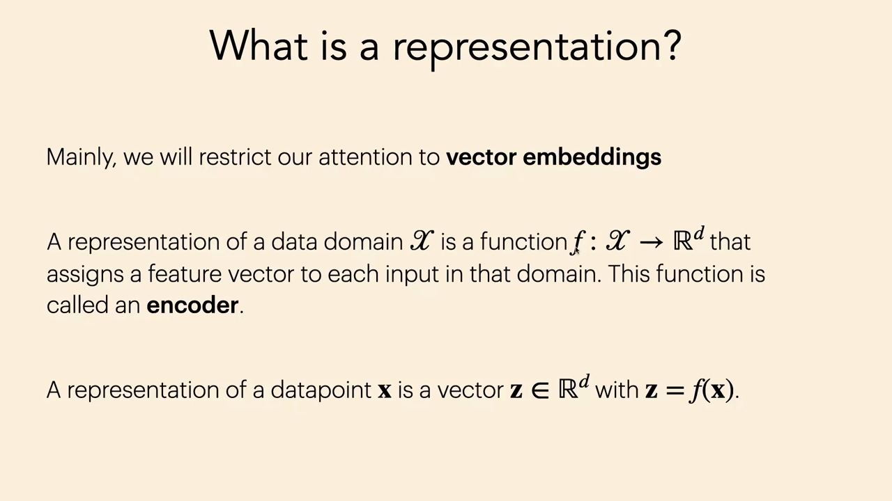
*▲ 강의 슬라이드 [27:56](https://youtu.be/QxOzQRtd440?t=1676): 표현의 두 정의. 데이터 영역의 표현은 함수 f(인코더), 데이터 점의 표현은 벡터 z = f(x)*

---

## 5. 왜 표현을 배우나: 사전 학습과 미세 조정

▶ 영상 [28:08](https://youtu.be/QxOzQRtd440?t=1688)

📐 **수학 개념**: [MM42_최근접_이웃과_탐침](%EC%88%98%ED%95%99%EA%B0%9C%EB%85%90/10_%ED%91%9C%ED%98%84_%ED%95%99%EC%8A%B5/MM42_%EC%B5%9C%EA%B7%BC%EC%A0%91_%EC%9D%B4%EC%9B%83%EA%B3%BC_%ED%83%90%EC%B9%A8.md) · [M05_벡터와_행렬](%EC%88%98%ED%95%99%EA%B0%9C%EB%85%90/03_%EC%84%A0%ED%98%95%EB%8C%80%EC%88%98/M05_%EB%B2%A1%ED%84%B0%EC%99%80_%ED%96%89%EB%A0%AC.md)

- 가장 간단한 답은 "**더 배우려고**"입니다. 조금 순환논리 같지만, 학습한 표현의 주된 쓸모는 **다음 [학습](00_%EB%94%A5%EB%9F%AC%EB%8B%9D_%EC%9A%A9%EC%96%B4%EC%82%AC%EC%A0%84.md#training-%ED%95%99%EC%8A%B5)을 빠르게** 하는 것입니다. 『Deep Learning』(Goodfellow 외, 2016)의 말대로 "좋은 표현은 이후의 [학습](00_%EB%94%A5%EB%9F%AC%EB%8B%9D_%EC%9A%A9%EC%96%B4%EC%82%AC%EC%A0%84.md#training-%ED%95%99%EC%8A%B5) 과제를 쉽게 만드는 표현"입니다.
- 초기 딥러닝의 오해: 깊은 망은 아무것도 모르는 **빈 서판(blank slate)**에서 시작하므로 데이터가 많이 필요하고, 사람은 적은 데이터로 배운다는 비교. 그러나 공정한 비교가 아닙니다. 사람은 수십억 년의 진화와 20년 넘는 "[사전 학습](00_%EB%94%A5%EB%9F%AC%EB%8B%9D_%EC%9A%A9%EC%96%B4%EC%82%AC%EC%A0%84.md#pre-training-%EC%82%AC%EC%A0%84-%ED%95%99%EC%8A%B5)"을 거친 상태로 이 수업에 왔습니다. 요즘은 망도 무작위 초기화가 아니라 **사전 학습된 표현에서 시작**합니다.

### 5.1 인코더와 예측 헤드

▶ 영상 [30:18](https://youtu.be/QxOzQRtd440?t=1818)

- 예: 음악 회사에서 장르 [분류](00_%EB%94%A5%EB%9F%AC%EB%8B%9D_%EC%9A%A9%EC%96%B4%EC%82%AC%EC%A0%84.md#regression-classification-%ED%9A%8C%EA%B7%80%EC%99%80-%EB%B6%84%EB%A5%98) 망을 학습합니다. 망을 인코더 $f$와 그 위의 읽어 내기 연산(예측 헤드, [선형층](00_%EB%94%A5%EB%9F%AC%EB%8B%9D_%EC%9A%A9%EC%96%B4%EC%82%AC%EC%A0%84.md#linear-layer-%EC%84%A0%ED%98%95%EC%B8%B5) $W$)으로 나눕니다. **어느 [층](00_%EB%94%A5%EB%9F%AC%EB%8B%9D_%EC%9A%A9%EC%96%B4%EC%82%AC%EC%A0%84.md#layer-%EC%B8%B5)이든** 표현이라 부를 수 있고, 그 앞은 인코더, 뒤는 읽어 내기입니다.
- 그런데 다음 해에 "사용자가 이 곡을 좋아할지" 예측도 필요해졌다면? 장르 [분류](00_%EB%94%A5%EB%9F%AC%EB%8B%9D_%EC%9A%A9%EC%96%B4%EC%82%AC%EC%A0%84.md#regression-classification-%ED%9A%8C%EA%B7%80%EC%99%80-%EB%B6%84%EB%A5%98)에 10억 달러를 들였는데 새 과제마다 처음부터 학습할 수는 없습니다. **시험 과제는 [학습](00_%EB%94%A5%EB%9F%AC%EB%8B%9D_%EC%9A%A9%EC%96%B4%EC%82%AC%EC%A0%84.md#training-%ED%95%99%EC%8A%B5) 과제와 다른 경우가 많습니다.**

### 5.2 선형 탐침과 미세 조정

▶ 영상 [31:22](https://youtu.be/QxOzQRtd440?t=1882)

| 방법 | 하는 일 |
|---|---|
| **선형 적응·선형 탐침(Linear probe)** | 인코더 $f$를 **얼려** 두고, 새 선형 사상 $W'$만 새 데이터로 [학습](00_%EB%94%A5%EB%9F%AC%EB%8B%9D_%EC%9A%A9%EC%96%B4%EC%82%AC%EC%A0%84.md#training-%ED%95%99%EC%8A%B5). MLP를 얹을 수도 있다 |
| **[미세 조정](00_%EB%94%A5%EB%9F%AC%EB%8B%9D_%EC%9A%A9%EC%96%B4%EC%82%AC%EC%A0%84.md#fine-tuning-%EB%AF%B8%EC%84%B8-%EC%A1%B0%EC%A0%95)([Fine-tuning](00_%EB%94%A5%EB%9F%AC%EB%8B%9D_%EC%9A%A9%EC%96%B4%EC%82%AC%EC%A0%84.md#fine-tuning-%EB%AF%B8%EC%84%B8-%EC%A1%B0%EC%A0%95))** | 새 망 $f'$를 무작위가 아니라 **$f$의 [가중치](00_%EB%94%A5%EB%9F%AC%EB%8B%9D_%EC%9A%A9%EC%96%B4%EC%82%AC%EC%A0%84.md#weight-%EA%B0%80%EC%A4%91%EC%B9%98)로 초기화**한 뒤, [역전파](00_%EB%94%A5%EB%9F%AC%EB%8B%9D_%EC%9A%A9%EC%96%B4%EC%82%AC%EC%A0%84.md#backpropagation-%EC%97%AD%EC%A0%84%ED%8C%8C)로 계속 [학습](00_%EB%94%A5%EB%9F%AC%EB%8B%9D_%EC%9A%A9%EC%96%B4%EC%82%AC%EC%A0%84.md#training-%ED%95%99%EC%8A%B5) |

$$
\hat{\mathbf{y}} = W' f_{\theta_A}(\mathbf{x}) + \mathbf{b}' \quad (\text{선형 탐침}: \theta_A \text{ 고정}), \qquad \theta' \leftarrow \theta_A \text{에서 시작해 } \theta', W', \mathbf{b}' \text{ 함께 학습} \quad (\text{미세 조정})
$$

기호 풀이

| 기호 | 읽는 법 | 뜻 | 예제 값 |
| --- | --- | --- | --- |
| $\theta_A$ | 세타 에이 | 과제 A로 사전 학습한 인코더 [가중치](00_%EB%94%A5%EB%9F%AC%EB%8B%9D_%EC%9A%A9%EC%96%B4%EC%82%AC%EC%A0%84.md#weight-%EA%B0%80%EC%A4%91%EC%B9%98) | 4절 예의 $W$ |
| $f_{\theta_A}(\mathbf{x})$ | 에프 세타 에이 | 얼린 인코더가 낸 표현 $\mathbf{z}$ | (5, 5) |
| $W'$ | 더블유 프라임 | 새로 학습하는 선형 헤드 | (0.2, -0.1) |
| $\mathbf{b}'$ | 비 프라임 | 새 헤드의 [편향](00_%EB%94%A5%EB%9F%AC%EB%8B%9D_%EC%9A%A9%EC%96%B4%EC%82%AC%EC%A0%84.md#bias-%ED%8E%B8%ED%96%A5) | 0 |
| $\hat{\mathbf{y}}$ | 와이 햇 | 새 과제 예측값 | 0.5 |
| $\theta'$ | 세타 프라임 | [미세 조정](00_%EB%94%A5%EB%9F%AC%EB%8B%9D_%EC%9A%A9%EC%96%B4%EC%82%AC%EC%A0%84.md#fine-tuning-%EB%AF%B8%EC%84%B8-%EC%A1%B0%EC%A0%95) 후 [가중치](00_%EB%94%A5%EB%9F%AC%EB%8B%9D_%EC%9A%A9%EC%96%B4%EC%82%AC%EC%A0%84.md#weight-%EA%B0%80%EC%A4%91%EC%B9%98) ($\theta_A$의 작은 변형) | — |

예제와 풀이

**문제**: (1) 얼린 인코더가 낸 표현 $\mathbf{z}$에 선형 탐침을 얹으면 예측값은? (2) 512칸 표현 위에 10부류 선형 탐침을 얹으면 학습할 [파라미터](00_%EB%94%A5%EB%9F%AC%EB%8B%9D_%EC%9A%A9%EC%96%B4%EC%82%AC%EC%A0%84.md#parameter-%ED%8C%8C%EB%9D%BC%EB%AF%B8%ED%84%B0)는 몇 개인가?

**주어진 값**:
- $\mathbf{z} = f_{\theta_A}(\mathbf{x}) = (5, 5)$ (4절 예의 표현, 인코더는 고정)
- $W' = (0.2, -0.1)$ (새로 학습한 헤드 [가중치](00_%EB%94%A5%EB%9F%AC%EB%8B%9D_%EC%9A%A9%EC%96%B4%EC%82%AC%EC%A0%84.md#weight-%EA%B0%80%EC%A4%91%EC%B9%98))
- $\mathbf{b}' = 0$ (헤드 [편향](00_%EB%94%A5%EB%9F%AC%EB%8B%9D_%EC%9A%A9%EC%96%B4%EC%82%AC%EC%A0%84.md#bias-%ED%8E%B8%ED%96%A5))
- $d = 512$ (표현 칸 수), $K = 10$ (부류 수)

**풀이**
1. 식을 그대로 쓴다: $\hat{y} = W' \mathbf{z} + b'$
2. 값을 대입한다: $\hat{y} = (0.2, -0.1) \cdot (5, 5) + 0$
3. 곱을 칸별로 펼친다: $\hat{y} = 0.2 \times 5 + (-0.1) \times 5 + 0$
4. 곱셈을 먼저 한다: $0.2 \times 5 = 1.0$, $(-0.1) \times 5 = -0.5$ 이므로 $\hat{y} = 1.0 - 0.5 + 0$
5. 더한다: $\hat{y} = 0.5$
6. [파라미터](00_%EB%94%A5%EB%9F%AC%EB%8B%9D_%EC%9A%A9%EC%96%B4%EC%82%AC%EC%A0%84.md#parameter-%ED%8C%8C%EB%9D%BC%EB%AF%B8%ED%84%B0) 수 식을 쓴다: ([가중치](00_%EB%94%A5%EB%9F%AC%EB%8B%9D_%EC%9A%A9%EC%96%B4%EC%82%AC%EC%A0%84.md#weight-%EA%B0%80%EC%A4%91%EC%B9%98) $d \times K$개) + ([편향](00_%EB%94%A5%EB%9F%AC%EB%8B%9D_%EC%9A%A9%EC%96%B4%EC%82%AC%EC%A0%84.md#bias-%ED%8E%B8%ED%96%A5) $K$개)
7. 값을 대입한다: $512 \times 10 + 10$
8. 곱셈을 먼저 한다: $512 \times 10 = 5120$ 이므로 $5120 + 10$
9. 더한다: $5130$

**답**: (1) **0.5**, (2) **5130**개. 인코더가 수억 개 파라미터여도 선형 탐침은 이것만 배운다.

내 이해

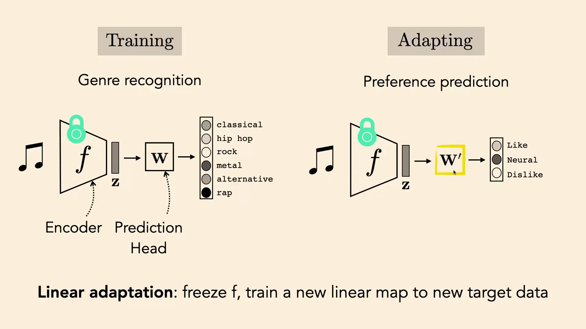
*▲ 강의 슬라이드 [31:45](https://youtu.be/QxOzQRtd440?t=1905): 선형 적응. 장르 [분류](00_%EB%94%A5%EB%9F%AC%EB%8B%9D_%EC%9A%A9%EC%96%B4%EC%82%AC%EC%A0%84.md#regression-classification-%ED%9A%8C%EA%B7%80%EC%99%80-%EB%B6%84%EB%A5%98)로 학습한 인코더 f를 얼리고(자물쇠), 선호 예측용 새 선형 사상 W'만 학습한다*

- 요즘은 두 단계를 **[사전 학습](00_%EB%94%A5%EB%9F%AC%EB%8B%9D_%EC%9A%A9%EC%96%B4%EC%82%AC%EC%A0%84.md#pre-training-%EC%82%AC%EC%A0%84-%ED%95%99%EC%8A%B5)([Pre-training](00_%EB%94%A5%EB%9F%AC%EB%8B%9D_%EC%9A%A9%EC%96%B4%EC%82%AC%EC%A0%84.md#pre-training-%EC%82%AC%EC%A0%84-%ED%95%99%EC%8A%B5))**과 **사후 [학습](00_%EB%94%A5%EB%9F%AC%EB%8B%9D_%EC%9A%A9%EC%96%B4%EC%82%AC%EC%A0%84.md#training-%ED%95%99%EC%8A%B5)(Post-training)**이라고 부릅니다.

### 5.3 적은 데이터로 배우려면 큰 데이터로 사전 학습

▶ 영상 [32:58](https://youtu.be/QxOzQRtd440?t=1978)

- 현실 문제의 표준은 [학습](00_%EB%94%A5%EB%9F%AC%EB%8B%9D_%EC%9A%A9%EC%96%B4%EC%82%AC%EC%A0%84.md#training-%ED%95%99%EC%8A%B5)-시험 두 단계가 아니라 **[사전 학습](00_%EB%94%A5%EB%9F%AC%EB%8B%9D_%EC%9A%A9%EC%96%B4%EC%82%AC%EC%A0%84.md#pre-training-%EC%82%AC%EC%A0%84-%ED%95%99%EC%8A%B5)(많은 데이터) → 적응(적은 데이터) → 시험** 세 단계입니다. [사전 학습](00_%EB%94%A5%EB%9F%AC%EB%8B%9D_%EC%9A%A9%EC%96%B4%EC%82%AC%EC%A0%84.md#pre-training-%EC%82%AC%EC%A0%84-%ED%95%99%EC%8A%B5)은 최종 과제를 몰라도 되므로 데이터를 많이 쓸 수 있습니다. [오토인코더](00_%EB%94%A5%EB%9F%AC%EB%8B%9D_%EC%9A%A9%EC%96%B4%EC%82%AC%EC%A0%84.md#autoencoder-%EC%98%A4%ED%86%A0%EC%9D%B8%EC%BD%94%EB%8D%94)나 [대조 학습](00_%EB%94%A5%EB%9F%AC%EB%8B%9D_%EC%9A%A9%EC%96%B4%EC%82%AC%EC%A0%84.md#contrastive-learning-%EB%8C%80%EC%A1%B0-%ED%95%99%EC%8A%B5)이 이런 [사전 학습](00_%EB%94%A5%EB%9F%AC%EB%8B%9D_%EC%9A%A9%EC%96%B4%EC%82%AC%EC%A0%84.md#pre-training-%EC%82%AC%EC%A0%84-%ED%95%99%EC%8A%B5) 방법입니다.
- [미세 조정](00_%EB%94%A5%EB%9F%AC%EB%8B%9D_%EC%9A%A9%EC%96%B4%EC%82%AC%EC%A0%84.md#fine-tuning-%EB%AF%B8%EC%84%B8-%EC%A1%B0%EC%A0%95) 요리법: ① 과제 A로 망을 학습해 $W$, $\mathbf{b}$를 얻는다. ② 둘째 망을 $W$, $\mathbf{b}$의 일부나 전부로 초기화한다(일부는 새로 초기화하는 "망 수술"도 가능). ③ 과제 B로 학습해 $W'$, $\mathbf{b}'$를 얻는다. 데이터가 적으니 $W'$는 $W$를 조금 바꾼 것이라 "미세" 조정입니다.
- 강사의 주장: 흔히 딥러닝을 "데이터가 많을 때 쓰는 것"으로 알지만, 실은 **적은 데이터로 배우게 해 주는 방법**이다. 다만 그러려면 먼저 큰 데이터로 사전 학습해야 한다. [사전 학습](00_%EB%94%A5%EB%9F%AC%EB%8B%9D_%EC%9A%A9%EC%96%B4%EC%82%AC%EC%A0%84.md#pre-training-%EC%82%AC%EC%A0%84-%ED%95%99%EC%8A%B5) 없이 그냥 [학습](00_%EB%94%A5%EB%9F%AC%EB%8B%9D_%EC%9A%A9%EC%96%B4%EC%82%AC%EC%A0%84.md#training-%ED%95%99%EC%8A%B5)을 잘하는 알고리즘이 있으리라 기대했던 사람들에게는 뜻밖의 결론이었습니다.

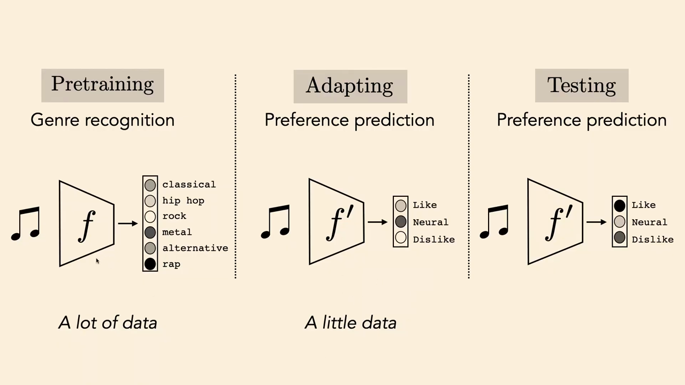
*▲ 강의 슬라이드 [33:40](https://youtu.be/QxOzQRtd440?t=2020): [전이 학습](00_%EB%94%A5%EB%9F%AC%EB%8B%9D_%EC%9A%A9%EC%96%B4%EC%82%AC%EC%A0%84.md#transfer-learning-%EC%A0%84%EC%9D%B4-%ED%95%99%EC%8A%B5)의 세 단계. 많은 데이터로 [사전 학습](00_%EB%94%A5%EB%9F%AC%EB%8B%9D_%EC%9A%A9%EC%96%B4%EC%82%AC%EC%A0%84.md#pre-training-%EC%82%AC%EC%A0%84-%ED%95%99%EC%8A%B5), 적은 데이터로 적응, 그리고 시험*

질의응답 (요약) [35:31](https://youtu.be/QxOzQRtd440?t=2131)

- **"많은 데이터"와 "적은 데이터"는 어느 정도인가?** 해마다 비율이 더 극단적이 된다. [언어 모델](00_%EB%94%A5%EB%9F%AC%EB%8B%9D_%EC%9A%A9%EC%96%B4%EC%82%AC%EC%A0%84.md#language-model-%EC%96%B8%EC%96%B4-%EB%AA%A8%EB%8D%B8)이면 인터넷 텍스트 10조 [토큰](00_%EB%94%A5%EB%9F%AC%EB%8B%9D_%EC%9A%A9%EC%96%B4%EC%82%AC%EC%A0%84.md#token-%ED%86%A0%ED%81%B0) 정도로 사전 학습하고, [미세 조정](00_%EB%94%A5%EB%9F%AC%EB%8B%9D_%EC%9A%A9%EC%96%B4%EC%82%AC%EC%A0%84.md#fine-tuning-%EB%AF%B8%EC%84%B8-%EC%A1%B0%EC%A0%95)은 Colab에서 몇 분~몇 시간, 백만 [토큰](00_%EB%94%A5%EB%9F%AC%EB%8B%9D_%EC%9A%A9%EC%96%B4%EC%82%AC%EC%A0%84.md#token-%ED%86%A0%ED%81%B0) 이하. 몇 자릿수 차이다.
- **[사전 학습](00_%EB%94%A5%EB%9F%AC%EB%8B%9D_%EC%9A%A9%EC%96%B4%EC%82%AC%EC%A0%84.md#pre-training-%EC%82%AC%EC%A0%84-%ED%95%99%EC%8A%B5) 데이터가 없는 과학 분야라면?** 인터넷 텍스트로 학습한 [언어 모델](00_%EB%94%A5%EB%9F%AC%EB%8B%9D_%EC%9A%A9%EC%96%B4%EC%82%AC%EC%A0%84.md#language-model-%EC%96%B8%EC%96%B4-%EB%AA%A8%EB%8D%B8)을 써도 되는가? 경험적으로는 대개 **된다**. 겉보기에 전혀 다른 데이터 사이에도 공유되는 정보가 많다. 차이가 아주 크면 덜 통하지만, 처음부터 학습하는 것보다는 대개 낫다.
- **이론적 보장은?** "과제 A로 학습한 것이 언제, 왜 과제 B에 도움이 되나"는 아직 열린 문제다. Sanjeev Arora의 연구가 이 질문을 다루기 시작했다.

> [!TIP]
> **🆕 2026 업데이트: [사전 학습](00_%EB%94%A5%EB%9F%AC%EB%8B%9D_%EC%9A%A9%EC%96%B4%EC%82%AC%EC%A0%84.md#pre-training-%EC%82%AC%EC%A0%84-%ED%95%99%EC%8A%B5) [토큰](00_%EB%94%A5%EB%9F%AC%EB%8B%9D_%EC%9A%A9%EC%96%B4%EC%82%AC%EC%A0%84.md#token-%ED%86%A0%ED%81%B0) 수**
> - **강의**: [언어 모델](00_%EB%94%A5%EB%9F%AC%EB%8B%9D_%EC%9A%A9%EC%96%B4%EC%82%AC%EC%A0%84.md#language-model-%EC%96%B8%EC%96%B4-%EB%AA%A8%EB%8D%B8)의 [사전 학습](00_%EB%94%A5%EB%9F%AC%EB%8B%9D_%EC%9A%A9%EC%96%B4%EC%82%AC%EC%A0%84.md#pre-training-%EC%82%AC%EC%A0%84-%ED%95%99%EC%8A%B5) 데이터를 "10조 [토큰](00_%EB%94%A5%EB%9F%AC%EB%8B%9D_%EC%9A%A9%EC%96%B4%EC%82%AC%EC%A0%84.md#token-%ED%86%A0%ED%81%B0)"쯤으로 소개했습니다.
> - **현재**: 2025년 5월 공개된 Qwen3 기술 보고서는 약 **36조 [토큰](00_%EB%94%A5%EB%9F%AC%EB%8B%9D_%EC%9A%A9%EC%96%B4%EC%82%AC%EC%A0%84.md#token-%ED%86%A0%ED%81%B0)**(119개 언어와 방언)으로 사전 학습했다고 밝혔습니다. 바로 전 세대 Qwen2.5의 18조 [토큰](00_%EB%94%A5%EB%9F%AC%EB%8B%9D_%EC%9A%A9%EC%96%B4%EC%82%AC%EC%A0%84.md#token-%ED%86%A0%ED%81%B0)에서 두 배가 되었고, PDF에서 글을 뽑아내거나 수학·코드 데이터를 모델로 합성해 양을 늘렸습니다. "[사전 학습](00_%EB%94%A5%EB%9F%AC%EB%8B%9D_%EC%9A%A9%EC%96%B4%EC%82%AC%EC%A0%84.md#pre-training-%EC%82%AC%EC%A0%84-%ED%95%99%EC%8A%B5)과 [미세 조정](00_%EB%94%A5%EB%9F%AC%EB%8B%9D_%EC%9A%A9%EC%96%B4%EC%82%AC%EC%A0%84.md#fine-tuning-%EB%AF%B8%EC%84%B8-%EC%A1%B0%EC%A0%95)의 비율이 해마다 더 극단적이 된다"는 강사의 말 그대로입니다.
> - **출처**: [Qwen3 Technical Report (Qwen Team, arXiv, 2025)](https://arxiv.org/abs/2505.09388)

---

## 6. 좋은 표현의 조건

▶ 영상 [39:11](https://youtu.be/QxOzQRtd440?t=2351)

- **작다(Compact, 최소)**: 메모리를 덜 쓴다. 또 [오컴의 면도날](00_%EB%94%A5%EB%9F%AC%EB%8B%9D_%EC%9A%A9%EC%96%B4%EC%82%AC%EC%A0%84.md#occams-razor-%EC%98%A4%EC%BB%B4%EC%9D%98-%EB%A9%B4%EB%8F%84%EB%82%A0) 식으로, 작은 표현이 더 단순하고 더 잘 [일반화](00_%EB%94%A5%EB%9F%AC%EB%8B%9D_%EC%9A%A9%EC%96%B4%EC%82%AC%EC%A0%84.md#generalization-%EC%9D%BC%EB%B0%98%ED%99%94)하는 추상을 배울 것이라 기대한다.
- **설명력이 있다(Explanatory, 충분)**: 관심 과제를 푸는 데 필요한 정보를 다 담은 **충분 통계량**이어야 한다. 둘을 합쳐 **[최소 충분 표현](00_%EB%94%A5%EB%9F%AC%EB%8B%9D_%EC%9A%A9%EC%96%B4%EC%82%AC%EC%A0%84.md#minimal-sufficient-representation-%EC%B5%9C%EC%86%8C-%EC%B6%A9%EB%B6%84-%ED%91%9C%ED%98%84)(Minimal sufficient representation)**. 슬라이드의 "건물·자동차·도로" 세 상자 그림처럼, 운전에 필요 없는 세세한 광학 정보는 버리고 무엇이 어디 있는지만 남긴다.
- **요인이 분리됨(Disentangled)**: 데이터를 바꾸는 [독립](00_%EB%94%A5%EB%9F%AC%EB%8B%9D_%EC%9A%A9%EC%96%B4%EC%82%AC%EC%A0%84.md#independence-%EB%8F%85%EB%A6%BD) 요인들이 각각 다른 축에 놓인다(축 정렬 표현).
- **해석 가능(Interpretable)**: 사람이 그 표현으로 문제를 풀고 이해할 수 있다. ("설명력"은 기계가 쓰기 좋은 것, "해석 가능"은 사람이 쓰기 좋은 것으로 구분)
- 학생들이 더한 것: 칸마다 [분산](00_%EB%94%A5%EB%9F%AC%EB%8B%9D_%EC%9A%A9%EC%96%B4%EC%82%AC%EC%A0%84.md#variance-%EB%B6%84%EC%82%B0)이 1처럼 **수치적으로 고른 성질**, 맥락을 아는 표현(context aware), 입력에 작은 잡음을 넣어도 크게 흔들리지 않는 **강건함**.
- 근본적으로는 **이후의 문제 풀이를 쉽게 만드는 것**. 고전적인 예가 푸리에 변환입니다. [합성곱](00_%EB%94%A5%EB%9F%AC%EB%8B%9D_%EC%9A%A9%EC%96%B4%EC%82%AC%EC%A0%84.md#convolution-%ED%95%A9%EC%84%B1%EA%B3%B1)을 곱셈으로 바꿔 쉽게 만드는 표현입니다.

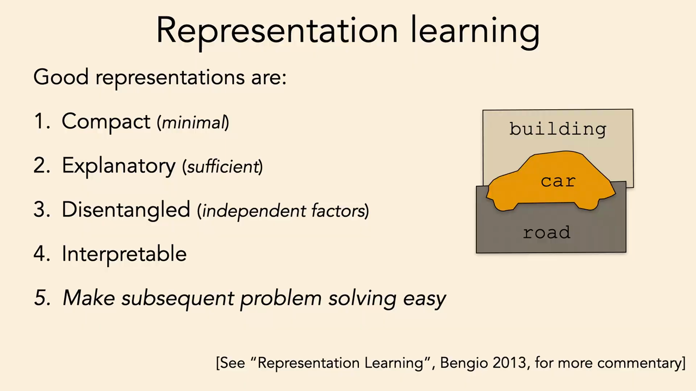
*▲ 강의 슬라이드 [43:35](https://youtu.be/QxOzQRtd440?t=2615): 좋은 표현의 조건 다섯 가지(Bengio 외 2013 참고)*

---

## 7. 레이블 없이 표현 배우기: 압축과 예측

▶ 영상 [43:37](https://youtu.be/QxOzQRtd440?t=2617)

- 원하는 과제(예: 음악 [분류](00_%EB%94%A5%EB%9F%AC%EB%8B%9D_%EC%9A%A9%EC%96%B4%EC%82%AC%EC%A0%84.md#regression-classification-%ED%9A%8C%EA%B7%80%EC%99%80-%EB%B6%84%EB%A5%98))로 [학습](00_%EB%94%A5%EB%9F%AC%EB%8B%9D_%EC%9A%A9%EC%96%B4%EC%82%AC%EC%A0%84.md#training-%ED%95%99%EC%8A%B5)하면서 좋은 표현이 생기기를 바랄 수도 있습니다. 지도 [학습](00_%EB%94%A5%EB%9F%AC%EB%8B%9D_%EC%9A%A9%EC%96%B4%EC%82%AC%EC%A0%84.md#training-%ED%95%99%EC%8A%B5)이고, 때로는 통합니다.
- 이번에는 특정 과제 없이 **$(x, y)$ 쌍이 아니라 $x$만** 가지고 표현을 배우는 방법을 봅니다. 비지도 [학습](00_%EB%94%A5%EB%9F%AC%EB%8B%9D_%EC%9A%A9%EC%96%B4%EC%82%AC%EC%A0%84.md#training-%ED%95%99%EC%8A%B5) 또는 [자기 지도 학습](00_%EB%94%A5%EB%9F%AC%EB%8B%9D_%EC%9A%A9%EC%96%B4%EC%82%AC%EC%A0%84.md#self-supervised-learning-%EC%9E%90%EA%B8%B0-%EC%A7%80%EB%8F%84-%ED%95%99%EC%8A%B5)입니다. 결과물은 임베딩일 수도, 군집일 수도, 거리 척도일 수도 있습니다(거리는 $x_1, x_2$ 두 개를 받는 함수, [임베딩](00_%EB%94%A5%EB%9F%AC%EB%8B%9D_%EC%9A%A9%EC%96%B4%EC%82%AC%EC%A0%84.md#embedding-%EC%9E%84%EB%B2%A0%EB%94%A9)은 $x$ 하나를 받는 함수. 거리는 다음 강의에서).
- 강사의 정리: 명시적 과제 없이 [임베딩](00_%EB%94%A5%EB%9F%AC%EB%8B%9D_%EC%9A%A9%EC%96%B4%EC%82%AC%EC%A0%84.md#embedding-%EC%9E%84%EB%B2%A0%EB%94%A9)을 배우는 원리는 두 가지입니다.

| 방법 | 원리 | 요약 |
|---|---|---|
| 오토인코딩 | 압축 | 중복된 정보를 없앤다 |
| [대조 학습](00_%EB%94%A5%EB%9F%AC%EB%8B%9D_%EC%9A%A9%EC%96%B4%EC%82%AC%EC%A0%84.md#contrastive-learning-%EB%8C%80%EC%A1%B0-%ED%95%99%EC%8A%B5) | 압축 | 보는 방식의 변화에 불변이 되게 한다 |
| [군집화](00_%EB%94%A5%EB%9F%AC%EB%8B%9D_%EC%9A%A9%EC%96%B4%EC%82%AC%EC%A0%84.md#clustering-%EA%B5%B0%EC%A7%91%ED%99%94) | 압축 | 연속 데이터를 이산 범주로 양자화한다 |
| 미래 예측 | 예측 | 미래를 맞힌다 |
| 결측 대체([Imputation](00_%EB%94%A5%EB%9F%AC%EB%8B%9D_%EC%9A%A9%EC%96%B4%EC%82%AC%EC%A0%84.md#masked-prediction-imputation-%EA%B0%80%EB%A6%B0-%EC%98%88%EC%B8%A1%EA%B3%BC-%EA%B2%B0%EC%B8%A1-%EB%8C%80%EC%B2%B4)) | 예측 | 빠진 데이터를 맞힌다 |
| [사전 과제](00_%EB%94%A5%EB%9F%AC%EB%8B%9D_%EC%9A%A9%EC%96%B4%EC%82%AC%EC%A0%84.md#pretext-task-%EC%82%AC%EC%A0%84-%EA%B3%BC%EC%A0%9C)(Pretext task) | 예측 | 데이터의 추상적 성질을 맞힌다 |

- 강사의 질문거리: 압축과 예측은 **정말 다른가?** 근본적으로 같은 것일 수도 있다(11절).

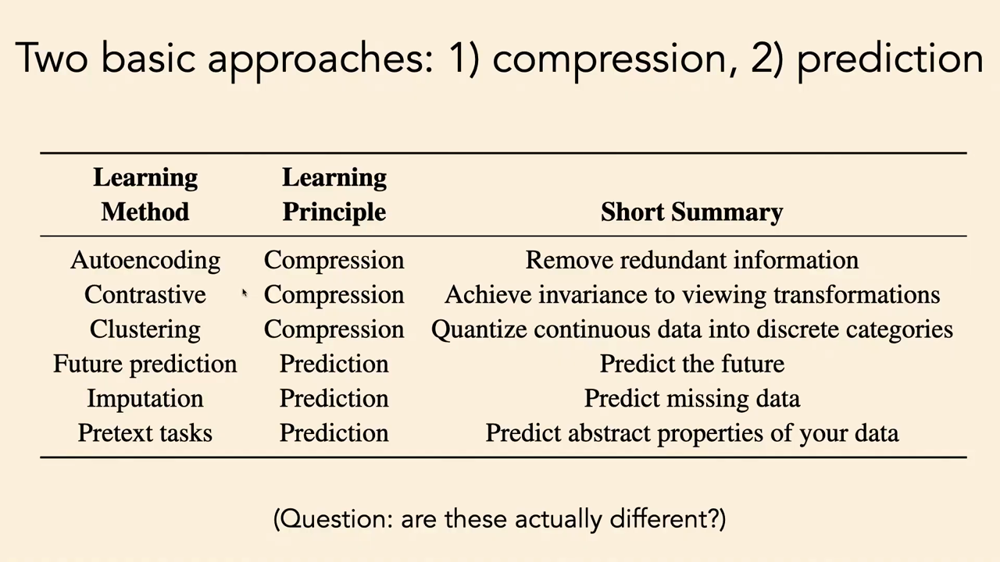
*▲ 강의 슬라이드 [45:30](https://youtu.be/QxOzQRtd440?t=2730): 두 기본 접근, 압축과 예측. "이 둘은 정말 다른가?"*

---

## 8. 압축으로 배우기: 오토인코더

▶ 영상 [45:40](https://youtu.be/QxOzQRtd440?t=2740)

📐 **수학 개념**: [MM40_PCA와_선형_오토인코더](%EC%88%98%ED%95%99%EA%B0%9C%EB%85%90/10_%ED%91%9C%ED%98%84_%ED%95%99%EC%8A%B5/MM40_PCA%EC%99%80_%EC%84%A0%ED%98%95_%EC%98%A4%ED%86%A0%EC%9D%B8%EC%BD%94%EB%8D%94.md) · [MM25_랭크와_유효_랭크](%EC%88%98%ED%95%99%EA%B0%9C%EB%85%90/04_%ED%99%95%EB%A5%A0%EA%B3%BC_%EC%A0%95%EB%B3%B4/MM25_%EB%9E%AD%ED%81%AC%EC%99%80_%EC%9C%A0%ED%9A%A8_%EB%9E%AD%ED%81%AC.md) · [MM42_최근접_이웃과_탐침](%EC%88%98%ED%95%99%EA%B0%9C%EB%85%90/10_%ED%91%9C%ED%98%84_%ED%95%99%EC%8A%B5/MM42_%EC%B5%9C%EA%B7%BC%EC%A0%91_%EC%9D%B4%EC%9B%83%EA%B3%BC_%ED%83%90%EC%B9%A8.md)

### 8.1 오토인코더

▶ 영상 [45:51](https://youtu.be/QxOzQRtd440?t=2751)

- [층](00_%EB%94%A5%EB%9F%AC%EB%8B%9D_%EC%9A%A9%EC%96%B4%EC%82%AC%EC%A0%84.md#layer-%EC%B8%B5)이 깊어질수록 **폭이 줄어드는** 망을 만들면 저차원으로 압축된 표현 $\mathbf{z}$를 얻습니다. 그런데 입력을 전부 0으로 보내면 소용없으니, 압축된 표현에서 **원래 데이터를 되살릴 수 있어야**(충분) 합니다. 이것이 **[오토인코더](00_%EB%94%A5%EB%9F%AC%EB%8B%9D_%EC%9A%A9%EC%96%B4%EC%82%AC%EC%A0%84.md#autoencoder-%EC%98%A4%ED%86%A0%EC%9D%B8%EC%BD%94%EB%8D%94)([Autoencoder](00_%EB%94%A5%EB%9F%AC%EB%8B%9D_%EC%9A%A9%EC%96%B4%EC%82%AC%EC%A0%84.md#autoencoder-%EC%98%A4%ED%86%A0%EC%9D%B8%EC%BD%94%EB%8D%94))**입니다.
- 강사는 [오토인코더](00_%EB%94%A5%EB%9F%AC%EB%8B%9D_%EC%9A%A9%EC%96%B4%EC%82%AC%EC%A0%84.md#autoencoder-%EC%98%A4%ED%86%A0%EC%9D%B8%EC%BD%94%EB%8D%94)를 "[표현 학습](00_%EB%94%A5%EB%9F%AC%EB%8B%9D_%EC%9A%A9%EC%96%B4%EC%82%AC%EC%A0%84.md#representation-learning-%ED%91%9C%ED%98%84-%ED%95%99%EC%8A%B5) 알고리즘 101, 가장 기본이면서 내가 가장 좋아하는, 아마 가장 좋은 방법이고 결국 이길 것"이라고 소개합니다. 수많은 머신러닝 기법이 [오토인코더](00_%EB%94%A5%EB%9F%AC%EB%8B%9D_%EC%9A%A9%EC%96%B4%EC%82%AC%EC%A0%84.md#autoencoder-%EC%98%A4%ED%86%A0%EC%9D%B8%EC%BD%94%EB%8D%94)의 변형으로 볼 수 있습니다. 2024년 노벨 물리학상을 받은 Hinton이 초기 발전을 이끈 사람 중 하나입니다(예: Hinton·Salakhutdinov, Science 2006).
- 수식: 인코더 $f$가 데이터를 저차원 $\mathbf{z}$로 보내고, 디코더 $g$가 다시 데이터 공간으로 되돌립니다. 둘을 합친 $g \circ f$가 **항등 함수**에 가깝도록, 곧 복원 [오차](00_%EB%94%A5%EB%9F%AC%EB%8B%9D_%EC%9A%A9%EC%96%B4%EC%82%AC%EC%A0%84.md#error-%EC%98%A4%EC%B0%A8)를 최소로 학습합니다.

$$
f^*, g^* = \arg\min_{f, g}\ \mathbb{E}_{\mathbf{x}}\, \big\|\mathbf{x} - g(f(\mathbf{x}))\big\|_2^2, \qquad f: \mathbb{R}^N \to \mathbb{R}^M,\ \ g: \mathbb{R}^M \to \mathbb{R}^N,\ \ M < N
$$

기호 풀이

| 기호 | 읽는 법 | 뜻 | 예제 값 |
| --- | --- | --- | --- |
| $f$ | 에프 | 인코더 (N차원 → M차원) | 두 칸의 평균 |
| $g$ | 지 | 디코더 (M차원 → N차원) | $z \mapsto (z, z)$ |
| $\mathbf{x}$ | 엑스 | 데이터 | (2, 2.2) |
| $f(\mathbf{x})$ | 에프 엑스 | 압축된 코드 $\mathbf{z}$ | 2.1 |
| $g(f(\mathbf{x}))$ | 지 에프 엑스 | 복원 $\hat{\mathbf{x}}$ | (2.1, 2.1) |
| $\Vert \cdot\Vert _2^2$ | 엘투 [노름](00_%EB%94%A5%EB%9F%AC%EB%8B%9D_%EC%9A%A9%EC%96%B4%EC%82%AC%EC%A0%84.md#norm-%EB%85%B8%EB%A6%84) 제곱 | 복원 [오차](00_%EB%94%A5%EB%9F%AC%EB%8B%9D_%EC%9A%A9%EC%96%B4%EC%82%AC%EC%A0%84.md#error-%EC%98%A4%EC%B0%A8) | 0.02 |
| $\mathbb{E}_{\mathbf{x}}$ | [기댓값](00_%EB%94%A5%EB%9F%AC%EB%8B%9D_%EC%9A%A9%EC%96%B4%EC%82%AC%EC%A0%84.md#expectation-%EA%B8%B0%EB%8C%93%EA%B0%92) | [학습 데이터](00_%EB%94%A5%EB%9F%AC%EB%8B%9D_%EC%9A%A9%EC%96%B4%EC%82%AC%EC%A0%84.md#training-data-test-data-%ED%95%99%EC%8A%B5-%EB%8D%B0%EC%9D%B4%ED%84%B0%EC%99%80-%EC%8B%9C%ED%97%98-%EB%8D%B0%EC%9D%B4%ED%84%B0) 전체의 평균 ([기댓값](%EC%88%98%ED%95%99%EA%B0%9C%EB%85%90/04_%ED%99%95%EB%A5%A0%EA%B3%BC_%EC%A0%95%EB%B3%B4/MM22_%EA%B8%B0%EB%8C%93%EA%B0%92%EA%B3%BC_%EC%9D%BC%EB%B0%98%ED%99%94_%EA%B0%84%EA%B7%B9.md)) | — |
| $N, M$ | 엔, 엠 | 데이터 차원, [병목](00_%EB%94%A5%EB%9F%AC%EB%8B%9D_%EC%9A%A9%EC%96%B4%EC%82%AC%EC%A0%84.md#bottleneck-%EB%B3%91%EB%AA%A9) 차원 | 2, 1 |
| $\arg\min_{f,g}$ | 아그민 | [오차](00_%EB%94%A5%EB%9F%AC%EB%8B%9D_%EC%9A%A9%EC%96%B4%EC%82%AC%EC%A0%84.md#error-%EC%98%A4%EC%B0%A8)를 가장 작게 하는 $f, g$ ([argmin](%EC%88%98%ED%95%99%EA%B0%9C%EB%85%90/02_%EB%AF%B8%EB%B6%84/MM01_argmin%EA%B3%BC_argmax.md)) | — |

예제와 풀이

**문제**: 두 칸 데이터를 한 숫자로 줄였다가 되살리는 [오토인코더](00_%EB%94%A5%EB%9F%AC%EB%8B%9D_%EC%9A%A9%EC%96%B4%EC%82%AC%EC%A0%84.md#autoencoder-%EC%98%A4%ED%86%A0%EC%9D%B8%EC%BD%94%EB%8D%94)에서 코드, 복원, 복원 [오차](00_%EB%94%A5%EB%9F%AC%EB%8B%9D_%EC%9A%A9%EC%96%B4%EC%82%AC%EC%A0%84.md#error-%EC%98%A4%EC%B0%A8)는?

**주어진 값**:
- $\mathbf{x} = (2, 2.2)$ (데이터, $N = 2$칸)
- $f(\mathbf{x}) = (x_1 + x_2)/2$ (인코더: 두 칸의 평균, $M = 1$칸)
- $g(z) = (z, z)$ (디코더: 한 숫자를 두 칸에 복사)

**풀이**
1. 식을 그대로 쓴다: [오차](00_%EB%94%A5%EB%9F%AC%EB%8B%9D_%EC%9A%A9%EC%96%B4%EC%82%AC%EC%A0%84.md#error-%EC%98%A4%EC%B0%A8) $= \|\mathbf{x} - g(f(\mathbf{x}))\|_2^2$
2. 값을 대입한다: [오차](00_%EB%94%A5%EB%9F%AC%EB%8B%9D_%EC%9A%A9%EC%96%B4%EC%82%AC%EC%A0%84.md#error-%EC%98%A4%EC%B0%A8) $= \|(2, 2.2) - g((2 + 2.2)/2)\|_2^2$
3. 괄호 안 덧셈을 한다: $2 + 2.2 = 4.2$ 이므로 $g(4.2 / 2)$
4. 나눗셈을 한다: $4.2 / 2 = 2.1$ 이므로 코드 $z = 2.1$
5. 디코더를 적용한다: $g(2.1) = (2.1, 2.1)$ 이므로 [오차](00_%EB%94%A5%EB%9F%AC%EB%8B%9D_%EC%9A%A9%EC%96%B4%EC%82%AC%EC%A0%84.md#error-%EC%98%A4%EC%B0%A8) $= \|(2, 2.2) - (2.1, 2.1)\|_2^2$
6. 칸별로 뺀다: $(2 - 2.1,\ 2.2 - 2.1) = (-0.1, 0.1)$
7. [노름](00_%EB%94%A5%EB%9F%AC%EB%8B%9D_%EC%9A%A9%EC%96%B4%EC%82%AC%EC%A0%84.md#norm-%EB%85%B8%EB%A6%84) 제곱은 칸의 제곱을 더한 것이다: $(-0.1)^2 + 0.1^2$
8. 제곱을 한다: $0.01 + 0.01$
9. 더한다: $0.02$

**답**: 코드 **2.1**, 복원 **(2.1, 2.1)**, [오차](00_%EB%94%A5%EB%9F%AC%EB%8B%9D_%EC%9A%A9%EC%96%B4%EC%82%AC%EC%A0%84.md#error-%EC%98%A4%EC%B0%A8) **0.02**. 두 칸이 비슷한 데이터는 한 숫자로도 거의 되살아난다(중복 제거).

내 이해

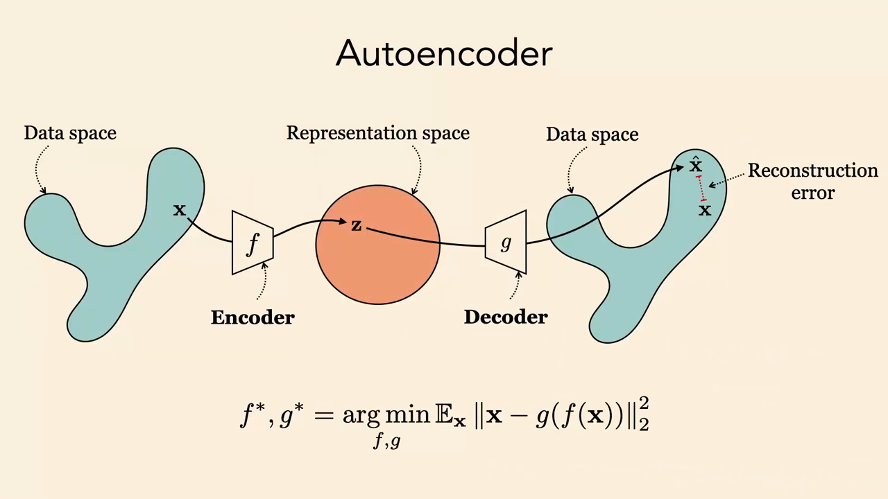
*▲ 강의 슬라이드 [47:50](https://youtu.be/QxOzQRtd440?t=2870): [오토인코더](00_%EB%94%A5%EB%9F%AC%EB%8B%9D_%EC%9A%A9%EC%96%B4%EC%82%AC%EC%A0%84.md#autoencoder-%EC%98%A4%ED%86%A0%EC%9D%B8%EC%BD%94%EB%8D%94). 인코더 f가 데이터를 표현 공간의 z로, 디코더 g가 다시 데이터 공간으로 보낸다. 원본과 복원의 차이가 복원 [오차](00_%EB%94%A5%EB%9F%AC%EB%8B%9D_%EC%9A%A9%EC%96%B4%EC%82%AC%EC%A0%84.md#error-%EC%98%A4%EC%B0%A8)*

- **[오토인코더](00_%EB%94%A5%EB%9F%AC%EB%8B%9D_%EC%9A%A9%EC%96%B4%EC%82%AC%EC%A0%84.md#autoencoder-%EC%98%A4%ED%86%A0%EC%9D%B8%EC%BD%94%EB%8D%94)가 통하는 이유는 목적이 아니라 제약**에 있습니다. 목적만 보면 "아무것도 하지 마라(항등 함수를 배워라)"라는 시시한 과제입니다. [가설 공간](00_%EB%94%A5%EB%9F%AC%EB%8B%9D_%EC%9A%A9%EC%96%B4%EC%82%AC%EC%A0%84.md#hypothesis-space-%EA%B0%80%EC%84%A4-%EA%B3%B5%EA%B0%84)에 제약이 없으면 그냥 복사본을 내놓고 끝입니다. 고차원에서 저차원으로 갔다 오는 **[병목](00_%EB%94%A5%EB%9F%AC%EB%8B%9D_%EC%9A%A9%EC%96%B4%EC%82%AC%EC%A0%84.md#bottleneck-%EB%B3%91%EB%AA%A9)([Bottleneck](00_%EB%94%A5%EB%9F%AC%EB%8B%9D_%EC%9A%A9%EC%96%B4%EC%82%AC%EC%A0%84.md#bottleneck-%EB%B3%91%EB%AA%A9))**, $M < N$이 있어서 쓸모 있는 표현이 생깁니다.
- [병목](00_%EB%94%A5%EB%9F%AC%EB%8B%9D_%EC%9A%A9%EC%96%B4%EC%82%AC%EC%A0%84.md#bottleneck-%EB%B3%91%EB%AA%A9) 없이 다른 방식(예: 코드를 희소하게)으로 [임베딩](00_%EB%94%A5%EB%9F%AC%EB%8B%9D_%EC%9A%A9%EC%96%B4%EC%82%AC%EC%A0%84.md#embedding-%EC%9E%84%EB%B2%A0%EB%94%A9)을 단순하게 만드는 변형도 있습니다. 표현을 진짜 가우스 "원"으로 만드는 것은 나중에 배울 **변분 [오토인코더](00_%EB%94%A5%EB%9F%AC%EB%8B%9D_%EC%9A%A9%EC%96%B4%EC%82%AC%EC%A0%84.md#autoencoder-%EC%98%A4%ED%86%A0%EC%9D%B8%EC%BD%94%EB%8D%94)([VAE](00_%EB%94%A5%EB%9F%AC%EB%8B%9D_%EC%9A%A9%EC%96%B4%EC%82%AC%EC%A0%84.md#variational-autoencoder-vae-%EB%B3%80%EB%B6%84-%EC%98%A4%ED%86%A0%EC%9D%B8%EC%BD%94%EB%8D%94))**입니다.

### 8.2 선형 오토인코더와 PCA

▶ 영상 [50:18](https://youtu.be/QxOzQRtd440?t=3018)

- 강사의 질문: $f$와 $g$가 둘 다 선형이면? 학생들의 답은 "결국 또 하나의 선형 함수"와 "[PCA](00_%EB%94%A5%EB%9F%AC%EB%8B%9D_%EC%9A%A9%EC%96%B4%EC%82%AC%EC%A0%84.md#pca-principal-component-analysis-%EC%A3%BC%EC%84%B1%EB%B6%84-%EB%B6%84%EC%84%9D)와 같다". 둘 다 맞습니다.
- 선형이면 인코더는 행렬 $W_f$, 디코더는 행렬 $W_g$입니다. [PCA](00_%EB%94%A5%EB%9F%AC%EB%8B%9D_%EC%9A%A9%EC%96%B4%EC%82%AC%EC%A0%84.md#pca-principal-component-analysis-%EC%A3%BC%EC%84%B1%EB%B6%84-%EB%B6%84%EC%84%9D)는 인코더와 디코더가 **같은 행렬** $W$([전치](00_%EB%94%A5%EB%9F%AC%EB%8B%9D_%EC%9A%A9%EC%96%B4%EC%82%AC%EC%A0%84.md#transpose-%EC%A0%84%EC%B9%98) 관계)이고 $W$가 **직교**($W^\top W = I$)라는 제약을 더한 변형입니다.

$$
\min_{W_f, W_g} \|X W_f W_g - X\|_F^2 \qquad \text{vs.} \qquad \min_{W^\top W = I} \|X W W^\top - X\|_F^2 = \min_{W^\top W = I} \big(\|X\|_F^2 - \|X W W^\top\|_F^2\big) \;\Leftrightarrow\; \max_{W^\top W = I} \|X W W^\top\|_F^2
$$

기호 풀이

| 기호 | 읽는 법 | 뜻 | 예제 값 |
| --- | --- | --- | --- |
| $X$ | 엑스 | 데이터 행렬 (행 = 데이터 점, 평균 0) | 점 (2,2), (-2,-2), (1,-1), (-1,1) |
| $W_f, W_g$ | 더블유 에프, 지 | 선형 인코더(N×M), 디코더(M×N) | 2×1, 1×2 |
| $W$ | 더블유 | [PCA](00_%EB%94%A5%EB%9F%AC%EB%8B%9D_%EC%9A%A9%EC%96%B4%EC%82%AC%EC%A0%84.md#pca-principal-component-analysis-%EC%A3%BC%EC%84%B1%EB%B6%84-%EB%B6%84%EC%84%9D)의 직교 방향 행렬 (N×M) | $(1, 1)^\top/\sqrt2$ |
| $W^\top W = I$ | 직교 조건 | 방향들이 길이 1이고 서로 수직 | $0.5 + 0.5 = 1$ |
| $XWW^\top$ | 엑스 더블유 더블유 [전치](00_%EB%94%A5%EB%9F%AC%EB%8B%9D_%EC%9A%A9%EC%96%B4%EC%82%AC%EC%A0%84.md#transpose-%EC%A0%84%EC%B9%98) | 방향 위로 투영해 되돌린 복원 | (2,2), (-2,-2), (0,0), (0,0) |
| $\Vert \cdot\Vert _F^2$ | [프로베니우스 노름](00_%EB%94%A5%EB%9F%AC%EB%8B%9D_%EC%9A%A9%EC%96%B4%EC%82%AC%EC%A0%84.md#frobenius-norm-%ED%94%84%EB%A1%9C%EB%B2%A0%EB%8B%88%EC%9A%B0%EC%8A%A4-%EB%85%B8%EB%A6%84) 제곱 | 행렬 모든 칸의 제곱합 | 20 (전체) |

예제와 풀이

**문제**: 점 4개를 방향 하나 $W$로 줄일 때 전체 [분산](00_%EB%94%A5%EB%9F%AC%EB%8B%9D_%EC%9A%A9%EC%96%B4%EC%82%AC%EC%A0%84.md#variance-%EB%B6%84%EC%82%B0), 담은 [분산](00_%EB%94%A5%EB%9F%AC%EB%8B%9D_%EC%9A%A9%EC%96%B4%EC%82%AC%EC%A0%84.md#variance-%EB%B6%84%EC%82%B0), 복원 [오차](00_%EB%94%A5%EB%9F%AC%EB%8B%9D_%EC%9A%A9%EC%96%B4%EC%82%AC%EC%A0%84.md#error-%EC%98%A4%EC%B0%A8)는?

**주어진 값**:
- $X$의 행 = (2, 2), (-2, -2), (1, -1), (-1, 1) (평균이 0인 데이터 점 4개)
- $W = (1, 1)/\sqrt{2}$ (주성분 방향, 길이 1)

**풀이**
1. 식을 그대로 쓴다: 복원 [오차](00_%EB%94%A5%EB%9F%AC%EB%8B%9D_%EC%9A%A9%EC%96%B4%EC%82%AC%EC%A0%84.md#error-%EC%98%A4%EC%B0%A8) $= \|X\|_F^2 - \|XWW^\top\|_F^2$
2. $\sqrt{2}$는 제곱해서 2가 되는 수로 1.4142다. 그래서 $W = (1/1.4142,\ 1/1.4142) = (0.7071, 0.7071)$
3. 전체 [분산](00_%EB%94%A5%EB%9F%AC%EB%8B%9D_%EC%9A%A9%EC%96%B4%EC%82%AC%EC%A0%84.md#variance-%EB%B6%84%EC%82%B0)에 값을 대입한다: $\|X\|_F^2 = (2^2 + 2^2) + ((-2)^2 + (-2)^2) + (1^2 + (-1)^2) + ((-1)^2 + 1^2)$
4. 제곱을 한다: $(4 + 4) + (4 + 4) + (1 + 1) + (1 + 1)$
5. 더한다: $\|X\|_F^2 = 20$
6. [투영](00_%EB%94%A5%EB%9F%AC%EB%8B%9D_%EC%9A%A9%EC%96%B4%EC%82%AC%EC%A0%84.md#projection-%ED%88%AC%EC%98%81) 길이 $XW$를 행마다 펼친다: $2 \times 0.7071 + 2 \times 0.7071$, $-2 \times 0.7071 - 2 \times 0.7071$, $1 \times 0.7071 - 1 \times 0.7071$, $-1 \times 0.7071 + 1 \times 0.7071$
7. 계산한다: $2.8284,\ -2.8284,\ 0,\ 0$
8. 복원 $XWW^\top$은 [투영](00_%EB%94%A5%EB%9F%AC%EB%8B%9D_%EC%9A%A9%EC%96%B4%EC%82%AC%EC%A0%84.md#projection-%ED%88%AC%EC%98%81) 길이 × $W$다: $2.8284 \times (0.7071, 0.7071) = (2, 2)$, 같은 방법으로 $(-2, -2)$, $(0, 0)$, $(0, 0)$
9. 담은 [분산](00_%EB%94%A5%EB%9F%AC%EB%8B%9D_%EC%9A%A9%EC%96%B4%EC%82%AC%EC%A0%84.md#variance-%EB%B6%84%EC%82%B0)은 복원의 제곱합이다: $(4 + 4) + (4 + 4) + 0 + 0 = 16$
10. 식에 넣는다: 복원 [오차](00_%EB%94%A5%EB%9F%AC%EB%8B%9D_%EC%9A%A9%EC%96%B4%EC%82%AC%EC%A0%84.md#error-%EC%98%A4%EC%B0%A8) $= 20 - 16 = 4$

**답**: 전체 **20**, 담은 [분산](00_%EB%94%A5%EB%9F%AC%EB%8B%9D_%EC%9A%A9%EC%96%B4%EC%82%AC%EC%A0%84.md#variance-%EB%B6%84%EC%82%B0) **16**, 복원 [오차](00_%EB%94%A5%EB%9F%AC%EB%8B%9D_%EC%9A%A9%EC%96%B4%EC%82%AC%EC%A0%84.md#error-%EC%98%A4%EC%B0%A8) **4**. [오차](00_%EB%94%A5%EB%9F%AC%EB%8B%9D_%EC%9A%A9%EC%96%B4%EC%82%AC%EC%A0%84.md#error-%EC%98%A4%EC%B0%A8) 최소화와 [분산](00_%EB%94%A5%EB%9F%AC%EB%8B%9D_%EC%9A%A9%EC%96%B4%EC%82%AC%EC%A0%84.md#variance-%EB%B6%84%EC%82%B0) 최대화가 같은 답을 낸다.

내 이해

- 둘째 등호는 피타고라스 정리([투영](00_%EB%94%A5%EB%9F%AC%EB%8B%9D_%EC%9A%A9%EC%96%B4%EC%82%AC%EC%A0%84.md#projection-%ED%88%AC%EC%98%81)과 [오차](00_%EB%94%A5%EB%9F%AC%EB%8B%9D_%EC%9A%A9%EC%96%B4%EC%82%AC%EC%A0%84.md#error-%EC%98%A4%EC%B0%A8)가 직각)이고, $\|X\|^2$은 $W$와 무관하므로 빼면 "투영된 데이터의 [분산](00_%EB%94%A5%EB%9F%AC%EB%8B%9D_%EC%9A%A9%EC%96%B4%EC%82%AC%EC%A0%84.md#variance-%EB%B6%84%EC%82%B0) 최대화", 곧 익숙한 [PCA](00_%EB%94%A5%EB%9F%AC%EB%8B%9D_%EC%9A%A9%EC%96%B4%EC%82%AC%EC%A0%84.md#pca-principal-component-analysis-%EC%A3%BC%EC%84%B1%EB%B6%84-%EB%B6%84%EC%84%9D)가 됩니다. **선형 [오토인코더](00_%EB%94%A5%EB%9F%AC%EB%8B%9D_%EC%9A%A9%EC%96%B4%EC%82%AC%EC%A0%84.md#autoencoder-%EC%98%A4%ED%86%A0%EC%9D%B8%EC%BD%94%EB%8D%94)의 [임베딩](00_%EB%94%A5%EB%9F%AC%EB%8B%9D_%EC%9A%A9%EC%96%B4%EC%82%AC%EC%A0%84.md#embedding-%EC%9E%84%EB%B2%A0%EB%94%A9)은 [PCA](00_%EB%94%A5%EB%9F%AC%EB%8B%9D_%EC%9A%A9%EC%96%B4%EC%82%AC%EC%A0%84.md#pca-principal-component-analysis-%EC%A3%BC%EC%84%B1%EB%B6%84-%EB%B6%84%EC%84%9D)와 같은 M차원 부분공간을 펼칩니다.**
- 그래서 [오토인코더](00_%EB%94%A5%EB%9F%AC%EB%8B%9D_%EC%9A%A9%EC%96%B4%EC%82%AC%EC%A0%84.md#autoencoder-%EC%98%A4%ED%86%A0%EC%9D%B8%EC%BD%94%EB%8D%94)는 **비선형 [PCA](00_%EB%94%A5%EB%9F%AC%EB%8B%9D_%EC%9A%A9%EC%96%B4%EC%82%AC%EC%A0%84.md#pca-principal-component-analysis-%EC%A3%BC%EC%84%B1%EB%B6%84-%EB%B6%84%EC%84%9D)**입니다. 오래된 통계 모델 [PCA](00_%EB%94%A5%EB%9F%AC%EB%8B%9D_%EC%9A%A9%EC%96%B4%EC%82%AC%EC%A0%84.md#pca-principal-component-analysis-%EC%A3%BC%EC%84%B1%EB%B6%84-%EB%B6%84%EC%84%9D)를 비선형 표현으로 일반화한 것이 재구성 기반 [표현 학습](00_%EB%94%A5%EB%9F%AC%EB%8B%9D_%EC%9A%A9%EC%96%B4%EC%82%AC%EC%A0%84.md#representation-learning-%ED%91%9C%ED%98%84-%ED%95%99%EC%8A%B5)의 최고 방법이라는 것이 강사의 관점입니다.
- 여담: 강사는 이 식들을 정리하다 ChatGPT가 [PCA](00_%EB%94%A5%EB%9F%AC%EB%8B%9D_%EC%9A%A9%EC%96%B4%EC%82%AC%EC%A0%84.md#pca-principal-component-analysis-%EC%A3%BC%EC%84%B1%EB%B6%84-%EB%B6%84%EC%84%9D)와 선형 [오토인코더](00_%EB%94%A5%EB%9F%AC%EB%8B%9D_%EC%9A%A9%EC%96%B4%EC%82%AC%EC%A0%84.md#autoencoder-%EC%98%A4%ED%86%A0%EC%9D%B8%EC%BD%94%EB%8D%94)의 관계를 아주 잘 유도해 주는 것을 보았다며, (숙제가 아닌) **개념**이 헷갈리면 [언어 모델](00_%EB%94%A5%EB%9F%AC%EB%8B%9D_%EC%9A%A9%EC%96%B4%EC%82%AC%EC%A0%84.md#language-model-%EC%96%B8%EC%96%B4-%EB%AA%A8%EB%8D%B8)에 물어보라고 권합니다. 물론 틀릴 수 있다는 점은 늘 염두에 두라고 덧붙입니다.

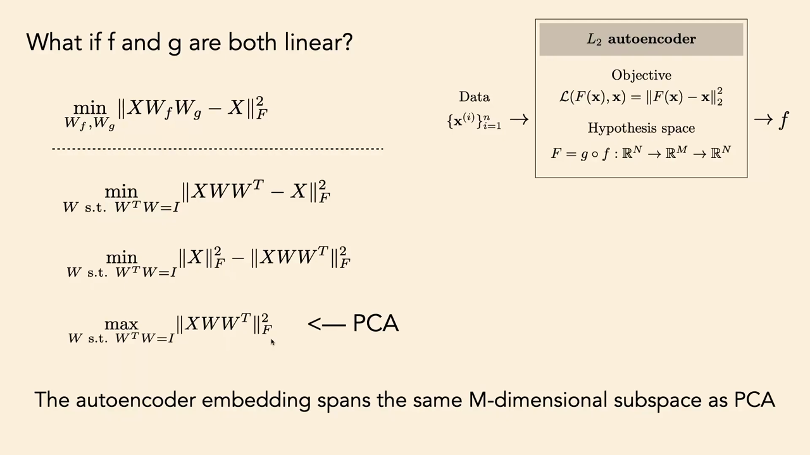
*▲ 강의 슬라이드 [53:15](https://youtu.be/QxOzQRtd440?t=3195): f와 g가 모두 선형이면? 선형 [오토인코더](00_%EB%94%A5%EB%9F%AC%EB%8B%9D_%EC%9A%A9%EC%96%B4%EC%82%AC%EC%A0%84.md#autoencoder-%EC%98%A4%ED%86%A0%EC%9D%B8%EC%BD%94%EB%8D%94) 목적에서 [PCA](00_%EB%94%A5%EB%9F%AC%EB%8B%9D_%EC%9A%A9%EC%96%B4%EC%82%AC%EC%A0%84.md#pca-principal-component-analysis-%EC%A3%BC%EC%84%B1%EB%B6%84-%EB%B6%84%EC%84%9D)([투영](00_%EB%94%A5%EB%9F%AC%EB%8B%9D_%EC%9A%A9%EC%96%B4%EC%82%AC%EC%A0%84.md#projection-%ED%88%AC%EC%98%81) [분산](00_%EB%94%A5%EB%9F%AC%EB%8B%9D_%EC%9A%A9%EC%96%B4%EC%82%AC%EC%A0%84.md#variance-%EB%B6%84%EC%82%B0) 최대화)까지의 전개*

### 8.3 오토인코더는 좋은 표현을 배우나: 색깔 도형 실험

▶ 영상 [54:15](https://youtu.be/QxOzQRtd440?t=3255)

- 저차원으로 압축하면 메모리는 당연히 아낍니다. 그 밖에 **의미 있는 표현**도 얻을까요? 과제 3에서 직접 해 볼 실험입니다.
- 데이터: 세모·동그라미·네모 세 모양 × 아홉 가지쯤의 색. [합성곱](00_%EB%94%A5%EB%9F%AC%EB%8B%9D_%EC%9A%A9%EC%96%B4%EC%82%AC%EC%A0%84.md#convolution-%ED%95%A9%EC%84%B1%EA%B3%B1) [오토인코더](00_%EB%94%A5%EB%9F%AC%EB%8B%9D_%EC%9A%A9%EC%96%B4%EC%82%AC%EC%A0%84.md#autoencoder-%EC%98%A4%ED%86%A0%EC%9D%B8%EC%BD%94%EB%8D%94)로 학습합니다.
- **최근접 이웃 탐침**: 표현 공간 $\mathbf{z}$에서 질문 이미지의 가장 가까운 이웃들을 봅니다. 세모의 이웃은 비슷한 색의 세모들, 네모의 이웃은 파란 네모들. 표현 공간이 사람의 지각과 맞게 데이터를 정리했습니다.
- 정량화: [층](00_%EB%94%A5%EB%9F%AC%EB%8B%9D_%EC%9A%A9%EC%96%B4%EC%82%AC%EC%A0%84.md#layer-%EC%B8%B5)마다 **1-최근접 이웃 분류기**로 "가장 가까운 이웃이 같은 모양인가, 같은 색인가"의 [정확도](00_%EB%94%A5%EB%9F%AC%EB%8B%9D_%EC%9A%A9%EC%96%B4%EC%82%AC%EC%A0%84.md#accuracy-%EC%A0%95%ED%99%95%EB%8F%84)를 잽니다. 결과: 깊을수록 **모양 [정확도](00_%EB%94%A5%EB%9F%AC%EB%8B%9D_%EC%9A%A9%EC%96%B4%EC%82%AC%EC%A0%84.md#accuracy-%EC%A0%95%ED%99%95%EB%8F%84)는 오르고, 색 [정확도](00_%EB%94%A5%EB%9F%AC%EB%8B%9D_%EC%9A%A9%EC%96%B4%EC%82%AC%EC%A0%84.md#accuracy-%EC%A0%95%ED%99%95%EB%8F%84)는 내려갑니다.**
- 왜 색은 나빠졌나(적어도 좋아지지 않았나)? 픽셀 공간도 하나의 표현인데, 거기서는 **색이 겉으로 드러나** 있어 픽셀 L2 거리로 가장 가까운 이미지는 같은 색입니다. 모양은 픽셀 공간에 드러나 있지 않습니다. 픽셀은 색에 좋은 표현, 학습된 [임베딩](00_%EB%94%A5%EB%9F%AC%EB%8B%9D_%EC%9A%A9%EC%96%B4%EC%82%AC%EC%A0%84.md#embedding-%EC%9E%84%EB%B2%A0%EB%94%A9)은 모양에 좋은 표현입니다([MM42_최근접_이웃과_탐침](%EC%88%98%ED%95%99%EA%B0%9C%EB%85%90/10_%ED%91%9C%ED%98%84_%ED%95%99%EC%8A%B5/MM42_%EC%B5%9C%EA%B7%BC%EC%A0%91_%EC%9D%B4%EC%9B%83%EA%B3%BC_%ED%83%90%EC%B9%A8.md)에서 이미지 6장으로 확인).
- 결론: **오토인코딩은 "더 나은" 표현이 아니라 "다른" 표현을 만든다.** 모든 [표현 학습](00_%EB%94%A5%EB%9F%AC%EB%8B%9D_%EC%9A%A9%EC%96%B4%EC%82%AC%EC%A0%84.md#representation-learning-%ED%91%9C%ED%98%84-%ED%95%99%EC%8A%B5)은 어떤 과제(모양 [분류](00_%EB%94%A5%EB%9F%AC%EB%8B%9D_%EC%9A%A9%EC%96%B4%EC%82%AC%EC%A0%84.md#regression-classification-%ED%9A%8C%EA%B7%80%EC%99%80-%EB%B6%84%EB%A5%98))는 쉽게, 다른 과제(색 [분류](00_%EB%94%A5%EB%9F%AC%EB%8B%9D_%EC%9A%A9%EC%96%B4%EC%82%AC%EC%A0%84.md#regression-classification-%ED%9A%8C%EA%B7%80%EC%99%80-%EB%B6%84%EB%A5%98))는 어렵게 하는 맞바꿈입니다.

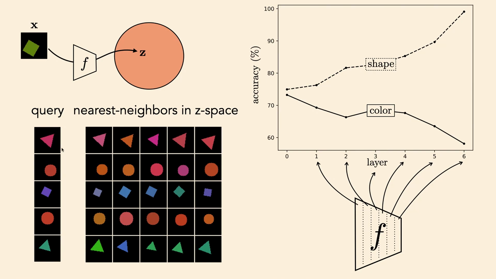
*▲ 강의 슬라이드 [58:12](https://youtu.be/QxOzQRtd440?t=3492): 색깔 도형 데이터의 z 공간 최근접 이웃(왼쪽)과 층별 1-최근접 이웃 [정확도](00_%EB%94%A5%EB%9F%AC%EB%8B%9D_%EC%9A%A9%EC%96%B4%EC%82%AC%EC%A0%84.md#accuracy-%EC%A0%95%ED%99%95%EB%8F%84)(오른쪽). 모양은 오르고 색은 내려간다*

---

## 9. 군집과 벡터 양자화

▶ 영상 [58:50](https://youtu.be/QxOzQRtd440?t=3530)

📐 **수학 개념**: [MM41_k평균과_평균](%EC%88%98%ED%95%99%EA%B0%9C%EB%85%90/10_%ED%91%9C%ED%98%84_%ED%95%99%EC%8A%B5/MM41_k%ED%8F%89%EA%B7%A0%EA%B3%BC_%ED%8F%89%EA%B7%A0.md) · [M02_시그마와_평균](%EC%88%98%ED%95%99%EA%B0%9C%EB%85%90/01_%EC%88%98%EC%99%80_%ED%95%A8%EC%88%98/M02_%EC%8B%9C%EA%B7%B8%EB%A7%88%EC%99%80_%ED%8F%89%EA%B7%A0.md) · [MM01_argmin과_argmax](%EC%88%98%ED%95%99%EA%B0%9C%EB%85%90/02_%EB%AF%B8%EB%B6%84/MM01_argmin%EA%B3%BC_argmax.md)

강사의 주장: [오토인코더](00_%EB%94%A5%EB%9F%AC%EB%8B%9D_%EC%9A%A9%EC%96%B4%EC%82%AC%EC%A0%84.md#autoencoder-%EC%98%A4%ED%86%A0%EC%9D%B8%EC%BD%94%EB%8D%94)가 딥러닝판 [PCA](00_%EB%94%A5%EB%9F%AC%EB%8B%9D_%EC%9A%A9%EC%96%B4%EC%82%AC%EC%A0%84.md#pca-principal-component-analysis-%EC%A3%BC%EC%84%B1%EB%B6%84-%EB%B6%84%EC%84%9D)라면, 딥러닝판 **[k-평균](00_%EB%94%A5%EB%9F%AC%EB%8B%9D_%EC%9A%A9%EC%96%B4%EC%82%AC%EC%A0%84.md#k-means-k-%ED%8F%89%EA%B7%A0)**도 있다. [PCA](00_%EB%94%A5%EB%9F%AC%EB%8B%9D_%EC%9A%A9%EC%96%B4%EC%82%AC%EC%A0%84.md#pca-principal-component-analysis-%EC%A3%BC%EC%84%B1%EB%B6%84-%EB%B6%84%EC%84%9D)와 [k-평균](00_%EB%94%A5%EB%9F%AC%EB%8B%9D_%EC%9A%A9%EC%96%B4%EC%82%AC%EC%A0%84.md#k-means-k-%ED%8F%89%EA%B7%A0)이 가장 중요한 두 모델이고 나머지는 그 [일반화](00_%EB%94%A5%EB%9F%AC%EB%8B%9D_%EC%9A%A9%EC%96%B4%EC%82%AC%EC%A0%84.md#generalization-%EC%9D%BC%EB%B0%98%ED%99%94)다(강사 스스로 "주관적인 말"이라고 단서를 단다).

### 9.1 군집은 정수를 내는 인코더

▶ 영상 [59:10](https://youtu.be/QxOzQRtd440?t=3550)

- **[군집화](00_%EB%94%A5%EB%9F%AC%EB%8B%9D_%EC%9A%A9%EC%96%B4%EC%82%AC%EC%A0%84.md#clustering-%EA%B5%B0%EC%A7%91%ED%99%94)([Clustering](00_%EB%94%A5%EB%9F%AC%EB%8B%9D_%EC%9A%A9%EC%96%B4%EC%82%AC%EC%A0%84.md#clustering-%EA%B5%B0%EC%A7%91%ED%99%94))**는 데이터 점마다 무리 번호를 붙이는 문제입니다. [표현 학습](00_%EB%94%A5%EB%9F%AC%EB%8B%9D_%EC%9A%A9%EC%96%B4%EC%82%AC%EC%A0%84.md#representation-learning-%ED%91%9C%ED%98%84-%ED%95%99%EC%8A%B5) 관점에서는 벡터 대신 **정수를 내는 인코더**를 배우는 것입니다. 정수는 [원-핫](00_%EB%94%A5%EB%9F%AC%EB%8B%9D_%EC%9A%A9%EC%96%B4%EC%82%AC%EC%A0%84.md#one-hot-encoding-%EC%9B%90-%ED%95%AB-%EC%9D%B8%EC%BD%94%EB%94%A9) 벡터로 쓸 수 있으니 역시 벡터 [임베딩](00_%EB%94%A5%EB%9F%AC%EB%8B%9D_%EC%9A%A9%EC%96%B4%EC%82%AC%EC%A0%84.md#embedding-%EC%9E%84%EB%B2%A0%EB%94%A9)의 한 종류입니다.
- 강사의 질문: 사람이 만든 가장 좋은 표현은? 학생의 답 "단어". 강사의 답도 같습니다. 컴퓨터 비전 연구자로서 "신성모독"일지 모르지만 언어가 인류가 찾은 세계의 가장 좋은 표현이고, 단어가 그 원자입니다. 단어는 대략 "어떤 집합을 가리키는 기호"이고, [군집화](00_%EB%94%A5%EB%9F%AC%EB%8B%9D_%EC%9A%A9%EC%96%B4%EC%82%AC%EC%A0%84.md#clustering-%EA%B5%B0%EC%A7%91%ED%99%94)도 그런 일을 합니다. 곧 **[군집화](00_%EB%94%A5%EB%9F%AC%EB%8B%9D_%EC%9A%A9%EC%96%B4%EC%82%AC%EC%A0%84.md#clustering-%EA%B5%B0%EC%A7%91%ED%99%94)는 개념에 새 단어를 지어 주는 문제**입니다.

### 9.2 k-평균은 오토인코더다

▶ 영상 [61:53](https://youtu.be/QxOzQRtd440?t=3713)

- **[k-평균](00_%EB%94%A5%EB%9F%AC%EB%8B%9D_%EC%9A%A9%EC%96%B4%EC%82%AC%EC%A0%84.md#k-means-k-%ED%8F%89%EA%B7%A0)([k-means](00_%EB%94%A5%EB%9F%AC%EB%8B%9D_%EC%9A%A9%EC%96%B4%EC%82%AC%EC%A0%84.md#k-means-k-%ED%8F%89%EA%B7%A0))**: 데이터에서 무리 k개를 찾고, 각 무리를 그 점들의 **평균**으로 대표합니다. 점마다 자기 무리 평균과의 거리가 가능한 한 가깝도록 배정합니다.
- [오토인코더](00_%EB%94%A5%EB%9F%AC%EB%8B%9D_%EC%9A%A9%EC%96%B4%EC%82%AC%EC%A0%84.md#autoencoder-%EC%98%A4%ED%86%A0%EC%9D%B8%EC%BD%94%EB%8D%94)로 보면: 인코더는 [원-핫](00_%EB%94%A5%EB%9F%AC%EB%8B%9D_%EC%9A%A9%EC%96%B4%EC%82%AC%EC%A0%84.md#one-hot-encoding-%EC%9B%90-%ED%95%AB-%EC%9D%B8%EC%BD%94%EB%94%A9) 코드를 내고, 디코더는 [원-핫](00_%EB%94%A5%EB%9F%AC%EB%8B%9D_%EC%9A%A9%EC%96%B4%EC%82%AC%EC%A0%84.md#one-hot-encoding-%EC%9B%90-%ED%95%AB-%EC%9D%B8%EC%BD%94%EB%94%A9) 코드를 받아 벡터 하나를 내는 **조회표**(행렬 $W$에 [원-핫](00_%EB%94%A5%EB%9F%AC%EB%8B%9D_%EC%9A%A9%EC%96%B4%EC%82%AC%EC%A0%84.md#one-hot-encoding-%EC%9B%90-%ED%95%AB-%EC%9D%B8%EC%BD%94%EB%94%A9)을 곱하면 한 줄을 골라냄)입니다. 한 무리의 모든 점이 같은 코드로 가므로 디코더는 무리마다 벡터 하나만 낼 수 있습니다. L2 복원 [오차](00_%EB%94%A5%EB%9F%AC%EB%8B%9D_%EC%9A%A9%EC%96%B4%EC%82%AC%EC%A0%84.md#error-%EC%98%A4%EC%B0%A8)를 최소로 하는 그 벡터는? 학생의 답대로 **평균**입니다.

$$
f(\mathbf{x}) = \mathbf{e}_{k^*}, \quad k^* = \arg\min_k \|\mathbf{x} - \boldsymbol\mu_k\|_2^2, \qquad g(\mathbf{e}_k) = M\mathbf{e}_k = \boldsymbol\mu_k, \qquad \boldsymbol\mu_k = \frac{1}{|C_k|}\sum_{\mathbf{x} \in C_k} \mathbf{x}
$$

기호 풀이

| 기호 | 읽는 법 | 뜻 | 예제 값 |
| --- | --- | --- | --- |
| $\boldsymbol\mu_k$ | 뮤 케이 | k번째 무리의 중심 (평균) | (0,0), (4,4) |
| $k^*$ | 케이 스타 | 가장 가까운 중심 번호 | 2 |
| $\mathbf{e}_{k}$ | 이 케이 | k번째 칸만 1인 [원-핫](00_%EB%94%A5%EB%9F%AC%EB%8B%9D_%EC%9A%A9%EC%96%B4%EC%82%AC%EC%A0%84.md#one-hot-encoding-%EC%9B%90-%ED%95%AB-%EC%9D%B8%EC%BD%94%EB%94%A9) 코드 ([원-핫](00_%EB%94%A5%EB%9F%AC%EB%8B%9D_%EC%9A%A9%EC%96%B4%EC%82%AC%EC%A0%84.md#one-hot-encoding-%EC%9B%90-%ED%95%AB-%EC%9D%B8%EC%BD%94%EB%94%A9)) | $\mathbf{e}_2 = (0, 1)$ |
| $f$ | 에프 | 인코더: 정수([원-핫](00_%EB%94%A5%EB%9F%AC%EB%8B%9D_%EC%9A%A9%EC%96%B4%EC%82%AC%EC%A0%84.md#one-hot-encoding-%EC%9B%90-%ED%95%AB-%EC%9D%B8%EC%BD%94%EB%94%A9))를 낸다 | (0, 1) |
| $g$, $M$ | 지, 엠 | 디코더: 중심을 열로 세운 조회표 | $\begin{pmatrix}0&4\\0&4\end{pmatrix}$ |
| $C_k$ | 씨 케이 | k번 무리에 배정된 점들의 집합 | — |
| $\vert C_k\vert $ | 씨 케이의 크기 | 그 무리의 점 수 | — |

예제와 풀이

**문제**: 무리 중심이 둘 있을 때 새 점 $\mathbf{x}$의 코드(어느 무리인가), 복원, 복원 [오차](00_%EB%94%A5%EB%9F%AC%EB%8B%9D_%EC%9A%A9%EC%96%B4%EC%82%AC%EC%A0%84.md#error-%EC%98%A4%EC%B0%A8)는?

**주어진 값**:
- $\boldsymbol\mu_1 = (0, 0)$ (1번 무리 중심), $\boldsymbol\mu_2 = (4, 4)$ (2번 무리 중심)
- $M = \begin{pmatrix}0&4\\0&4\end{pmatrix}$ (중심을 열로 세운 디코더)
- $\mathbf{x} = (3, 2)$ (새 데이터)

**풀이**
1. 식을 그대로 쓴다: $k^* = \arg\min_k \|\mathbf{x} - \boldsymbol\mu_k\|_2^2$
2. 값을 대입한다: $\|(3, 2) - (0, 0)\|^2$ 과 $\|(3, 2) - (4, 4)\|^2$ 중 작은 쪽
3. 칸별로 뺀다: $(3, 2)$ 와 $(-1, -2)$
4. 제곱합을 펼친다: $3^2 + 2^2$ 와 $(-1)^2 + (-2)^2$
5. 제곱을 한다: $9 + 4$ 와 $1 + 4$
6. 더한다: 13 과 5
7. 작은 쪽을 고른다: 5가 작으므로 $k^* = 2$, 코드 $\mathbf{e}_2 = (0, 1)$
8. 디코더 식을 쓰고 대입한다: $M\mathbf{e}_2 = \begin{pmatrix}0&4\\0&4\end{pmatrix}\begin{pmatrix}0\\1\end{pmatrix}$
9. 행마다 펼친다: $(0 \times 0 + 4 \times 1,\ 0 \times 0 + 4 \times 1) = (4, 4)$
10. 복원 [오차](00_%EB%94%A5%EB%9F%AC%EB%8B%9D_%EC%9A%A9%EC%96%B4%EC%82%AC%EC%A0%84.md#error-%EC%98%A4%EC%B0%A8)는 6단계에서 구한 $\|(3,2) - (4,4)\|^2 = 5$

**답**: 코드 **(0, 1)**, 복원 **(4, 4)**, [오차](00_%EB%94%A5%EB%9F%AC%EB%8B%9D_%EC%9A%A9%EC%96%B4%EC%82%AC%EC%A0%84.md#error-%EC%98%A4%EC%B0%A8) **5**.

내 이해

- 그래서 **[k-평균](00_%EB%94%A5%EB%9F%AC%EB%8B%9D_%EC%9A%A9%EC%96%B4%EC%82%AC%EC%A0%84.md#k-means-k-%ED%8F%89%EA%B7%A0)은 L2 [오토인코더](00_%EB%94%A5%EB%9F%AC%EB%8B%9D_%EC%9A%A9%EC%96%B4%EC%82%AC%EC%A0%84.md#autoencoder-%EC%98%A4%ED%86%A0%EC%9D%B8%EC%BD%94%EB%8D%94)**입니다. 다른 [오토인코더](00_%EB%94%A5%EB%9F%AC%EB%8B%9D_%EC%9A%A9%EC%96%B4%EC%82%AC%EC%A0%84.md#autoencoder-%EC%98%A4%ED%86%A0%EC%9D%B8%EC%BD%94%EB%8D%94)와 다른 점은 [병목](00_%EB%94%A5%EB%9F%AC%EB%8B%9D_%EC%9A%A9%EC%96%B4%EC%82%AC%EC%A0%84.md#bottleneck-%EB%B3%91%EB%AA%A9)이 저차원 벡터가 아니라 **정수**라는 것뿐입니다. 이 [가설 공간](00_%EB%94%A5%EB%9F%AC%EB%8B%9D_%EC%9A%A9%EC%96%B4%EC%82%AC%EC%A0%84.md#hypothesis-space-%EA%B0%80%EC%84%A4-%EA%B3%B5%EA%B0%84)은 미분할 수 없지만 특별한 구조가 있어서 [SGD](00_%EB%94%A5%EB%9F%AC%EB%8B%9D_%EC%9A%A9%EC%96%B4%EC%82%AC%EC%A0%84.md#stochastic-gradient-descent-%ED%99%95%EB%A5%A0%EC%A0%81-%EA%B2%BD%EC%82%AC%ED%95%98%EA%B0%95%EB%B2%95) 대신 배정과 평균 갱신을 번갈아 하는 방법(슬라이드의 블록 좌표 하강, 흔히 EM과 함께 소개)으로 최적화합니다.

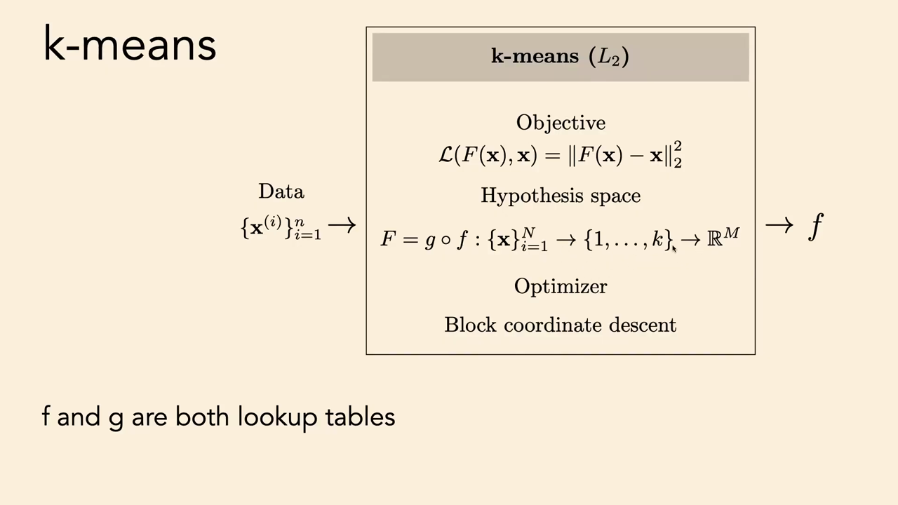
*▲ 강의 슬라이드 [64:10](https://youtu.be/QxOzQRtd440?t=3850): [k-평균](00_%EB%94%A5%EB%9F%AC%EB%8B%9D_%EC%9A%A9%EC%96%B4%EC%82%AC%EC%A0%84.md#k-means-k-%ED%8F%89%EA%B7%A0)을 [오토인코더](00_%EB%94%A5%EB%9F%AC%EB%8B%9D_%EC%9A%A9%EC%96%B4%EC%82%AC%EC%A0%84.md#autoencoder-%EC%98%A4%ED%86%A0%EC%9D%B8%EC%BD%94%EB%8D%94)로 쓴 [학습](00_%EB%94%A5%EB%9F%AC%EB%8B%9D_%EC%9A%A9%EC%96%B4%EC%82%AC%EC%A0%84.md#training-%ED%95%99%EC%8A%B5) 도식. [가설 공간](00_%EB%94%A5%EB%9F%AC%EB%8B%9D_%EC%9A%A9%EC%96%B4%EC%82%AC%EC%A0%84.md#hypothesis-space-%EA%B0%80%EC%84%A4-%EA%B3%B5%EA%B0%84)은 데이터 → 정수 {1, …, k} → 벡터, f와 g는 둘 다 조회표*

### 9.3 벡터 양자화 오토인코더

▶ 영상 [64:13](https://youtu.be/QxOzQRtd440?t=3853)

- $f$와 $g$를 **깊은 망**으로 바꾸면 **[벡터 양자화](00_%EB%94%A5%EB%9F%AC%EB%8B%9D_%EC%9A%A9%EC%96%B4%EC%82%AC%EC%A0%84.md#vector-quantization-%EB%B2%A1%ED%84%B0-%EC%96%91%EC%9E%90%ED%99%94)(Vector quantization, VQ) [오토인코더](00_%EB%94%A5%EB%9F%AC%EB%8B%9D_%EC%9A%A9%EC%96%B4%EC%82%AC%EC%A0%84.md#autoencoder-%EC%98%A4%ED%86%A0%EC%9D%B8%EC%BD%94%EB%8D%94)**입니다. 정수 집합으로 인코딩하고 복원 [오차](00_%EB%94%A5%EB%9F%AC%EB%8B%9D_%EC%9A%A9%EC%96%B4%EC%82%AC%EC%A0%84.md#error-%EC%98%A4%EC%B0%A8)를 최소로 디코딩하는, "깊은 망으로 한 [k-평균](00_%EB%94%A5%EB%9F%AC%EB%8B%9D_%EC%9A%A9%EC%96%B4%EC%82%AC%EC%A0%84.md#k-means-k-%ED%8F%89%EA%B7%A0)"입니다. VQ-VAE(Oord·Vinyals·Kavukcuoglu, 2017), VQGAN 같은 변형이 있습니다. 미분할 수 없는 [양자화](00_%EB%94%A5%EB%9F%AC%EB%8B%9D_%EC%9A%A9%EC%96%B4%EC%82%AC%EC%A0%84.md#quantization-%EC%96%91%EC%9E%90%ED%99%94) 단계 때문에 최적화는 "근사를 곁들인 [역전파](00_%EB%94%A5%EB%9F%AC%EB%8B%9D_%EC%9A%A9%EC%96%B4%EC%82%AC%EC%A0%84.md#backpropagation-%EC%97%AD%EC%A0%84%ED%8C%8C)"로 합니다.
- 질문: [오토인코더](00_%EB%94%A5%EB%9F%AC%EB%8B%9D_%EC%9A%A9%EC%96%B4%EC%82%AC%EC%A0%84.md#autoencoder-%EC%98%A4%ED%86%A0%EC%9D%B8%EC%BD%94%EB%8D%94)가 가장 좋은 k도 찾나? **아니요.** k는 사용자가 정하는 [하이퍼파라미터](00_%EB%94%A5%EB%9F%AC%EB%8B%9D_%EC%9A%A9%EC%96%B4%EC%82%AC%EC%A0%84.md#hyperparameter-%ED%95%98%EC%9D%B4%ED%8D%BC%ED%8C%8C%EB%9D%BC%EB%AF%B8%ED%84%B0)입니다. 자동으로 정하는 방법도 있지만 기본 방법의 범위 밖입니다.

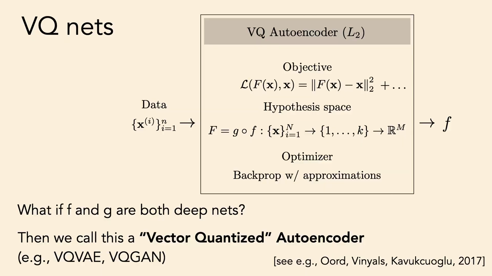
*▲ 강의 슬라이드 [65:36](https://youtu.be/QxOzQRtd440?t=3936): VQ [오토인코더](00_%EB%94%A5%EB%9F%AC%EB%8B%9D_%EC%9A%A9%EC%96%B4%EC%82%AC%EC%A0%84.md#autoencoder-%EC%98%A4%ED%86%A0%EC%9D%B8%EC%BD%94%EB%8D%94). f와 g가 깊은 망인 [k-평균](00_%EB%94%A5%EB%9F%AC%EB%8B%9D_%EC%9A%A9%EC%96%B4%EC%82%AC%EC%A0%84.md#k-means-k-%ED%8F%89%EA%B7%A0)*

---

## 10. 예측으로 배우기: 자기 지도 학습

▶ 영상 [65:50](https://youtu.be/QxOzQRtd440?t=3950)

📐 **수학 개념**: [MM42_최근접_이웃과_탐침](%EC%88%98%ED%95%99%EA%B0%9C%EB%85%90/10_%ED%91%9C%ED%98%84_%ED%95%99%EC%8A%B5/MM42_%EC%B5%9C%EA%B7%BC%EC%A0%91_%EC%9D%B4%EC%9B%83%EA%B3%BC_%ED%83%90%EC%B9%A8.md)

- 압축 대신 **가려 둔 데이터를 예측**해서 표현을 배웁니다. 강의 처음의 음악 [분류](00_%EB%94%A5%EB%9F%AC%EB%8B%9D_%EC%9A%A9%EC%96%B4%EC%82%AC%EC%A0%84.md#regression-classification-%ED%9A%8C%EA%B7%80%EC%99%80-%EB%B6%84%EB%A5%98)도 예측이지만 사람이 단 레이블과 좁은 과제에 묶입니다. 대신 **원 데이터 자체를 예측**하면 주석도, 과제 특정도 필요 없습니다.
- 이것이 [자기 지도 학습](00_%EB%94%A5%EB%9F%AC%EB%8B%9D_%EC%9A%A9%EC%96%B4%EC%82%AC%EC%A0%84.md#self-supervised-learning-%EC%9E%90%EA%B8%B0-%EC%A7%80%EB%8F%84-%ED%95%99%EC%8A%B5)입니다. "$x$로 $y$를 예측"하는 지도 [학습](00_%EB%94%A5%EB%9F%AC%EB%8B%9D_%EC%9A%A9%EC%96%B4%EC%82%AC%EC%A0%84.md#training-%ED%95%99%EC%8A%B5)의 틀을 그대로 쓰되, $y$를 레이블이 아니라 **원 데이터의 일부**로 정합니다. 데이터의 절반으로 나머지 절반을 예측하는 [오토인코더](00_%EB%94%A5%EB%9F%AC%EB%8B%9D_%EC%9A%A9%EC%96%B4%EC%82%AC%EC%A0%84.md#autoencoder-%EC%98%A4%ED%86%A0%EC%9D%B8%EC%BD%94%EB%8D%94)라고 볼 수도 있습니다. 그리고 이 방법이 [오토인코더](00_%EB%94%A5%EB%9F%AC%EB%8B%9D_%EC%9A%A9%EC%96%B4%EC%82%AC%EC%A0%84.md#autoencoder-%EC%98%A4%ED%86%A0%EC%9D%B8%EC%BD%94%EB%8D%94)보다 **훨씬 잘 됩니다**.

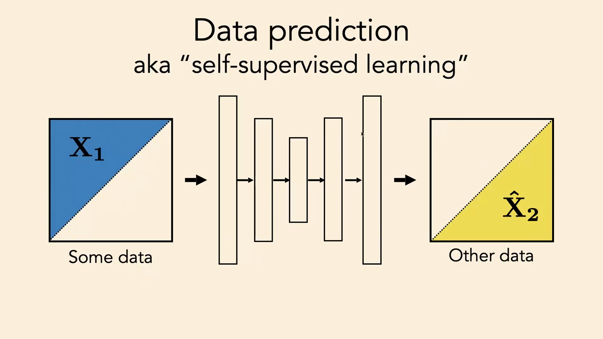
*▲ 강의 슬라이드 [67:00](https://youtu.be/QxOzQRtd440?t=4020): 데이터 예측, 곧 [자기 지도 학습](00_%EB%94%A5%EB%9F%AC%EB%8B%9D_%EC%9A%A9%EC%96%B4%EC%82%AC%EC%A0%84.md#self-supervised-learning-%EC%9E%90%EA%B8%B0-%EC%A7%80%EB%8F%84-%ED%95%99%EC%8A%B5). 데이터의 일부 X1로 나머지 X2를 예측한다*

### 10.1 색칠하기로 배운 표현

▶ 영상 [67:00](https://youtu.be/QxOzQRtd440?t=4020)

- 예: 흑백 이미지에서 색을 예측하는 **색칠(colorization)**. 컬러 사진을 밝기 [채널](00_%EB%94%A5%EB%9F%AC%EB%8B%9D_%EC%9A%A9%EC%96%B4%EC%82%AC%EC%A0%84.md#channel-%EC%B1%84%EB%84%90)과 색 [채널](00_%EB%94%A5%EB%9F%AC%EB%8B%9D_%EC%9A%A9%EC%96%B4%EC%82%AC%EC%A0%84.md#channel-%EC%B1%84%EB%84%90)로 나누기만 하면 되므로 레이블이 공짜이고, 레이블 없는 데이터에 얼마든지 돌릴 수 있습니다(Zhang·Isola·Efros, ECCV 2016).
- 이 망에 3절처럼 탐침을 꽂으면 5층 뉴런은 무엇에 반응할까요? 학생들의 답은 "질감"과 "물체". 물체의 종류를 알면 색을 많이 알 수 있기 때문입니다(딸기면 빨강). 실제로 낮은 [층](00_%EB%94%A5%EB%9F%AC%EB%8B%9D_%EC%9A%A9%EC%96%B4%EC%82%AC%EC%A0%84.md#layer-%EC%B8%B5)은 질감에, 5층의 뉴런들은 **얼굴, 개 얼굴, 꽃** 같은 물체에 반응했습니다.
- 강사의 해석: 부류를 예측하든, 색을 예측하든, 이미지 오른쪽 절반을 채우든 상관없이, 세상을 "**마디에 따라 자르는**" 단위는 결국 물체·의미·사람의 단어가 됩니다. **단어는 임의적이지 않다.** 빠진 데이터를 통계적으로 잘 예측하기 때문에 지금의 단어가 생겼다는 것입니다. 의미 레이블 없이 의미 있는 단어를 발견한 셈이고, 지난 10년간 **지도 [학습](00_%EB%94%A5%EB%9F%AC%EB%8B%9D_%EC%9A%A9%EC%96%B4%EC%82%AC%EC%A0%84.md#training-%ED%95%99%EC%8A%B5) → [자기 지도 학습](00_%EB%94%A5%EB%9F%AC%EB%8B%9D_%EC%9A%A9%EC%96%B4%EC%82%AC%EC%A0%84.md#self-supervised-learning-%EC%9E%90%EA%B8%B0-%EC%A7%80%EB%8F%84-%ED%95%99%EC%8A%B5)**으로 옮겨 간 혁명의 출발점입니다.

### 10.2 사전 과제와 결측 대체

▶ 영상 [70:19](https://youtu.be/QxOzQRtd440?t=4219)

- 비지도 문제를 지도 [학습](00_%EB%94%A5%EB%9F%AC%EB%8B%9D_%EC%9A%A9%EC%96%B4%EC%82%AC%EC%A0%84.md#training-%ED%95%99%EC%8A%B5)의 수학 틀로 바꾸는 요령: 데이터 자체에서 가짜 레이블(예측 목표)을 만들어 냅니다. 이를 **[사전 과제](00_%EB%94%A5%EB%9F%AC%EB%8B%9D_%EC%9A%A9%EC%96%B4%EC%82%AC%EC%A0%84.md#pretext-task-%EC%82%AC%EC%A0%84-%EA%B3%BC%EC%A0%9C)(Pretext task)**라 합니다.
- 예: 부류 레이블 예측(이건 지도 [표현 학습](00_%EB%94%A5%EB%9F%AC%EB%8B%9D_%EC%9A%A9%EC%96%B4%EC%82%AC%EC%A0%84.md#representation-learning-%ED%91%9C%ED%98%84-%ED%95%99%EC%8A%B5)), 영상의 **다음 프레임** 예측, 수열의 **다음 픽셀** 예측. 뒤의 둘은 사람이 목표를 주지 않았으므로 자기 지도입니다. [언어 모델](00_%EB%94%A5%EB%9F%AC%EB%8B%9D_%EC%9A%A9%EC%96%B4%EC%82%AC%EC%A0%84.md#language-model-%EC%96%B8%EC%96%B4-%EB%AA%A8%EB%8D%B8)도 **다음 단어**를 예측하므로 이 계열입니다. 원 데이터가 마침 의미를 담은 단어일 뿐, 감정 같은 레이블을 예측하는 것이 아닙니다.
- 이 [사전 과제](00_%EB%94%A5%EB%9F%AC%EB%8B%9D_%EC%9A%A9%EC%96%B4%EC%82%AC%EC%A0%84.md#pretext-task-%EC%82%AC%EC%A0%84-%EA%B3%BC%EC%A0%9C)들은 모두 **결측 대체([Imputation](00_%EB%94%A5%EB%9F%AC%EB%8B%9D_%EC%9A%A9%EC%96%B4%EC%82%AC%EC%A0%84.md#masked-prediction-imputation-%EA%B0%80%EB%A6%B0-%EC%98%88%EC%B8%A1%EA%B3%BC-%EA%B2%B0%EC%B8%A1-%EB%8C%80%EC%B2%B4))**로 볼 수 있습니다. 데이터(행렬, [텐서](00_%EB%94%A5%EB%9F%AC%EB%8B%9D_%EC%9A%A9%EC%96%B4%EC%82%AC%EC%A0%84.md#tensor-%ED%85%90%EC%84%9C), 영상이면 시간×x×y, 문장이면 시간×단어)의 일부를 **가리고**, 나머지를 인코더에 넣어, 디코더로 가려진 부분을 예측합니다. 공간 결측 대체(다음 픽셀), 시간 결측 대체(다음 프레임), [채널](00_%EB%94%A5%EB%9F%AC%EB%8B%9D_%EC%9A%A9%EC%96%B4%EC%82%AC%EC%A0%84.md#channel-%EC%B1%84%EB%84%90) 결측 대체(흑백 → 색).

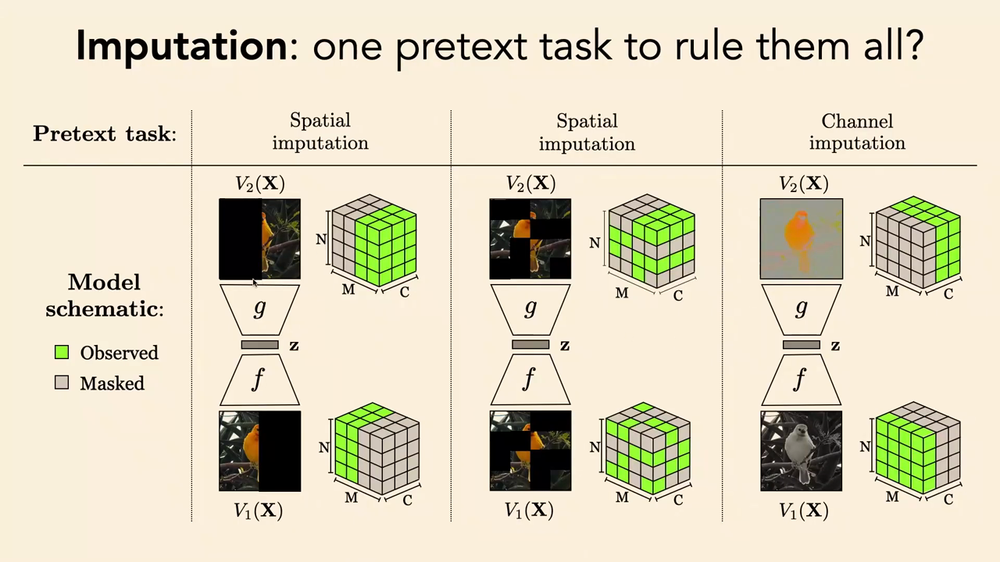
*▲ 강의 슬라이드 [71:58](https://youtu.be/QxOzQRtd440?t=4318): 결측 대체, 모든 [사전 과제](00_%EB%94%A5%EB%9F%AC%EB%8B%9D_%EC%9A%A9%EC%96%B4%EC%82%AC%EC%A0%84.md#pretext-task-%EC%82%AC%EC%A0%84-%EA%B3%BC%EC%A0%9C)를 아우르는 과제? 공간·공간·[채널](00_%EB%94%A5%EB%9F%AC%EB%8B%9D_%EC%9A%A9%EC%96%B4%EC%82%AC%EC%A0%84.md#channel-%EC%B1%84%EB%84%90) 결측 대체의 도식(초록 = 보이는 부분, 회색 = 가린 부분)*

$$
\min_{f, g}\ \mathbb{E}_{\mathbf{x}, \mathbf{m}} \Big\| \mathbf{m} \odot \big( g(f(\mathbf{x} \odot (\mathbf{1} - \mathbf{m}))) - \mathbf{x} \big) \Big\|_2^2
$$

기호 풀이

| 기호 | 읽는 법 | 뜻 | 예제 값 |
| --- | --- | --- | --- |
| $\mathbf{x}$ | 엑스 | 원 데이터 | (1, 2, 3, 4) |
| $\mathbf{m}$ | 엠 | 가림표: 가린 칸 1, 보이는 칸 0 | (0, 1, 0, 1) |
| $\mathbf{1} - \mathbf{m}$ | 일 빼기 엠 | 보이는 칸 표시 | (1, 0, 1, 0) |
| $\odot$ | [원소별 곱](00_%EB%94%A5%EB%9F%AC%EB%8B%9D_%EC%9A%A9%EC%96%B4%EC%82%AC%EC%A0%84.md#hadamard-product-%EC%9B%90%EC%86%8C%EB%B3%84-%EA%B3%B1) | 칸끼리 곱하기 (가리기) | $\mathbf{x} \odot (\mathbf{1}-\mathbf{m}) = (1, 0, 3, 0)$ |
| $f, g$ | 에프, 지 | 인코더, 디코더 (보이는 칸 → 전체 예측) | 이웃 평균으로 채우기 |
| $\mathbf{m} \odot (\cdots)$ | | [오차](00_%EB%94%A5%EB%9F%AC%EB%8B%9D_%EC%9A%A9%EC%96%B4%EC%82%AC%EC%A0%84.md#error-%EC%98%A4%EC%B0%A8)를 **가린 칸에서만** 잰다 | 2번, 4번 칸 |
| $\mathbb{E}_{\mathbf{x}, \mathbf{m}}$ | [기댓값](00_%EB%94%A5%EB%9F%AC%EB%8B%9D_%EC%9A%A9%EC%96%B4%EC%82%AC%EC%A0%84.md#expectation-%EA%B8%B0%EB%8C%93%EA%B0%92) | 데이터와 무작위 가림표에 대한 평균 | — |

예제와 풀이

**문제**: 4칸 데이터의 2번, 4번 칸을 가리고, 예측기가 "양옆 보이는 값의 평균, 끝 칸이면 바로 앞 값"으로 채울 때 [손실](00_%EB%94%A5%EB%9F%AC%EB%8B%9D_%EC%9A%A9%EC%96%B4%EC%82%AC%EC%A0%84.md#loss-function-%EC%86%90%EC%8B%A4-%ED%95%A8%EC%88%98)은?

**주어진 값**:
- $\mathbf{x} = (1, 2, 3, 4)$ (원 데이터)
- $\mathbf{m} = (0, 1, 0, 1)$ (가림표: 1이면 가린 칸)

**풀이**
1. 식을 그대로 쓴다: [손실](00_%EB%94%A5%EB%9F%AC%EB%8B%9D_%EC%9A%A9%EC%96%B4%EC%82%AC%EC%A0%84.md#loss-function-%EC%86%90%EC%8B%A4-%ED%95%A8%EC%88%98) $= \|\mathbf{m} \odot (\hat{\mathbf{x}} - \mathbf{x})\|_2^2$, $\hat{\mathbf{x}} = g(f(\mathbf{x} \odot (\mathbf{1} - \mathbf{m})))$
2. 보이는 입력에 값을 대입한다: $\mathbf{x} \odot (\mathbf{1} - \mathbf{m}) = (1 \times 1,\ 2 \times 0,\ 3 \times 1,\ 4 \times 0)$
3. 칸별로 곱한다: $(1, 0, 3, 0)$, 곧 2번과 4번이 안 보인다
4. 2번 칸을 예측한다(양옆 평균): $(1 + 3)/2 = 4/2 = 2$
5. 4번 칸을 예측한다(바로 앞 값): $3$
6. [손실](00_%EB%94%A5%EB%9F%AC%EB%8B%9D_%EC%9A%A9%EC%96%B4%EC%82%AC%EC%A0%84.md#loss-function-%EC%86%90%EC%8B%A4-%ED%95%A8%EC%88%98) 식에 대입한다: $\|(0, 1, 0, 1) \odot ((\cdot, 2, \cdot, 3) - (1, 2, 3, 4))\|^2$ (가림표가 0인 칸은 곱하면 0)
7. 가린 칸만 뺀다: $2 - 2 = 0$, $3 - 4 = -1$
8. 제곱을 한다: $0^2 = 0$, $(-1)^2 = 1$
9. 더한다: $0 + 1 = 1$

**답**: [손실](00_%EB%94%A5%EB%9F%AC%EB%8B%9D_%EC%9A%A9%EC%96%B4%EC%82%AC%EC%A0%84.md#loss-function-%EC%86%90%EC%8B%A4-%ED%95%A8%EC%88%98) **1**. 끝 칸(4번)처럼 맥락이 한쪽뿐인 곳이 더 어렵다.

내 이해

### 10.3 가린 오토인코더와 BERT

▶ 영상 [71:58](https://youtu.be/QxOzQRtd440?t=4318)

- 결측 대체를 [오토인코더](00_%EB%94%A5%EB%9F%AC%EB%8B%9D_%EC%9A%A9%EC%96%B4%EC%82%AC%EC%A0%84.md#autoencoder-%EC%98%A4%ED%86%A0%EC%9D%B8%EC%BD%94%EB%8D%94) 틀로 쓰면 **[가린 오토인코더](00_%EB%94%A5%EB%9F%AC%EB%8B%9D_%EC%9A%A9%EC%96%B4%EC%82%AC%EC%A0%84.md#masked-autoencoder-%EA%B0%80%EB%A6%B0-%EC%98%A4%ED%86%A0%EC%9D%B8%EC%BD%94%EB%8D%94)(Masked autoencoder, MAE)**입니다(He·Chen·Xie 외, 2021). 이미지에 쓸 때의 요령은 [비전 트랜스포머](00_%EB%94%A5%EB%9F%AC%EB%8B%9D_%EC%9A%A9%EC%96%B4%EC%82%AC%EC%A0%84.md#vision-transformer-%EB%B9%84%EC%A0%84-%ED%8A%B8%EB%9E%9C%EC%8A%A4%ED%8F%AC%EB%A8%B8)입니다. [비전 트랜스포머](00_%EB%94%A5%EB%9F%AC%EB%8B%9D_%EC%9A%A9%EC%96%B4%EC%82%AC%EC%A0%84.md#vision-transformer-%EB%B9%84%EC%A0%84-%ED%8A%B8%EB%9E%9C%EC%8A%A4%ED%8F%AC%EB%A8%B8)는 이미지를 패치로 잘라 [토큰](00_%EB%94%A5%EB%9F%AC%EB%8B%9D_%EC%9A%A9%EC%96%B4%EC%82%AC%EC%A0%84.md#token-%ED%86%A0%ED%81%B0)으로 만드므로, **[토큰](00_%EB%94%A5%EB%9F%AC%EB%8B%9D_%EC%9A%A9%EC%96%B4%EC%82%AC%EC%A0%84.md#token-%ED%86%A0%ED%81%B0) 일부를 지우고** 지운 [토큰](00_%EB%94%A5%EB%9F%AC%EB%8B%9D_%EC%9A%A9%EC%96%B4%EC%82%AC%EC%A0%84.md#token-%ED%86%A0%ED%81%B0)을 예측하면 됩니다.
- [트랜스포머](00_%EB%94%A5%EB%9F%AC%EB%8B%9D_%EC%9A%A9%EC%96%B4%EC%82%AC%EC%A0%84.md#transformer-%ED%8A%B8%EB%9E%9C%EC%8A%A4%ED%8F%AC%EB%A8%B8) 구조 덕분에 가리는 비율을 자유롭게 바꿀 수 있습니다. [어텐션](00_%EB%94%A5%EB%9F%AC%EB%8B%9D_%EC%9A%A9%EC%96%B4%EC%82%AC%EC%A0%84.md#attention-%EC%96%B4%ED%85%90%EC%85%98)은 [토큰](00_%EB%94%A5%EB%9F%AC%EB%8B%9D_%EC%9A%A9%EC%96%B4%EC%82%AC%EC%A0%84.md#token-%ED%86%A0%ED%81%B0) 수에 맞춰 늘거나 줄기 때문입니다([토큰](00_%EB%94%A5%EB%9F%AC%EB%8B%9D_%EC%9A%A9%EC%96%B4%EC%82%AC%EC%A0%84.md#token-%ED%86%A0%ED%81%B0) 4개면 4개끼리, 8개면 8개끼리). 인코더는 **보이는 [토큰](00_%EB%94%A5%EB%9F%AC%EB%8B%9D_%EC%9A%A9%EC%96%B4%EC%82%AC%EC%A0%84.md#token-%ED%86%A0%ED%81%B0)만** 처리하고, 디코더에는 빈 [토큰](00_%EB%94%A5%EB%9F%AC%EB%8B%9D_%EC%9A%A9%EC%96%B4%EC%82%AC%EC%A0%84.md#token-%ED%86%A0%ED%81%B0)을 넣어 빠진 패치의 픽셀을 채우게 학습합니다. (MAE 논문은 패치의 75%를 가린다. 224×224 이미지를 16×16 패치 196개로 자르면 49개만 인코더에 들어간다.)
- **MAE는 [BERT](00_%EB%94%A5%EB%9F%AC%EB%8B%9D_%EC%9A%A9%EC%96%B4%EC%82%AC%EC%A0%84.md#bert-%EB%B2%84%ED%8A%B8)의 새 이름**에 가깝습니다. 언어와 시각의 공학적 차이는 중요하지만 개념은 거의 같습니다. [BERT](00_%EB%94%A5%EB%9F%AC%EB%8B%9D_%EC%9A%A9%EC%96%B4%EC%82%AC%EC%A0%84.md#bert-%EB%B2%84%ED%8A%B8)는 몇 년 전 매우 인기였던 [언어 모델](00_%EB%94%A5%EB%9F%AC%EB%8B%9D_%EC%9A%A9%EC%96%B4%EC%82%AC%EC%A0%84.md#language-model-%EC%96%B8%EC%96%B4-%EB%AA%A8%EB%8D%B8)로, 텍스트를 [토큰](00_%EB%94%A5%EB%9F%AC%EB%8B%9D_%EC%9A%A9%EC%96%B4%EC%82%AC%EC%A0%84.md#token-%ED%86%A0%ED%81%B0)으로 나누고 일부를 가린 뒤 [트랜스포머](00_%EB%94%A5%EB%9F%AC%EB%8B%9D_%EC%9A%A9%EC%96%B4%EC%82%AC%EC%A0%84.md#transformer-%ED%8A%B8%EB%9E%9C%EC%8A%A4%ED%8F%AC%EB%A8%B8)로 모든 [토큰](00_%EB%94%A5%EB%9F%AC%EB%8B%9D_%EC%9A%A9%EC%96%B4%EC%82%AC%EC%A0%84.md#token-%ED%86%A0%ED%81%B0)을 예측합니다.
- **자기회귀 [언어 모델](00_%EB%94%A5%EB%9F%AC%EB%8B%9D_%EC%9A%A9%EC%96%B4%EC%82%AC%EC%A0%84.md#language-model-%EC%96%B8%EC%96%B4-%EB%AA%A8%EB%8D%B8)**(다음 단어 예측)도 같은 것인데, 가운데가 아니라 **마지막 단어만** 가립니다. 그래서 순서대로 문장을 생성할 수 있습니다.

질의응답: BERT는 왜 유행에서 밀렸나 [74:14](https://youtu.be/QxOzQRtd440?t=4454)

- 마지막 [토큰](00_%EB%94%A5%EB%9F%AC%EB%8B%9D_%EC%9A%A9%EC%96%B4%EC%82%AC%EC%A0%84.md#token-%ED%86%A0%ED%81%B0)만 가리면 자연스럽게 자기회귀 생성에 쓸 수 있다. 가운데를 가리면 시간 순서를 벗어나 단어를 만들게 된다. 대화에서 시간은 다른 축과 대칭이 아니다(질문을 들은 뒤에 답해야 한다).
- 과거를 조건으로 미래만 가리는 인과적 가림이 [언어 모델](00_%EB%94%A5%EB%9F%AC%EB%8B%9D_%EC%9A%A9%EC%96%B4%EC%82%AC%EC%A0%84.md#language-model-%EC%96%B8%EC%96%B4-%EB%AA%A8%EB%8D%B8)에 맞아 인기를 얻었고, 그래서 가장 큰 모델들이 모두 그 방식이 되었으며, 가장 크니까 가장 잘 됐다.
- 그래도 **문장 [임베딩](00_%EB%94%A5%EB%9F%AC%EB%8B%9D_%EC%9A%A9%EC%96%B4%EC%82%AC%EC%A0%84.md#embedding-%EC%9E%84%EB%B2%A0%EB%94%A9)**을 배우는 것이 목적이면, 같은 규모로 키운 [BERT](00_%EB%94%A5%EB%9F%AC%EB%8B%9D_%EC%9A%A9%EC%96%B4%EC%82%AC%EC%A0%84.md#bert-%EB%B2%84%ED%8A%B8) 방식이 아마 더 나을 것이라고 강사는 추측한다.

> [!TIP]
> **🆕 2026 업데이트: 가린 예측으로 언어를 생성하기**
> - **강의**: [BERT](00_%EB%94%A5%EB%9F%AC%EB%8B%9D_%EC%9A%A9%EC%96%B4%EC%82%AC%EC%A0%84.md#bert-%EB%B2%84%ED%8A%B8)식 가린 예측은 시간 순서 생성에 맞지 않아 [자기회귀 모델](00_%EB%94%A5%EB%9F%AC%EB%8B%9D_%EC%9A%A9%EC%96%B4%EC%82%AC%EC%A0%84.md#autoregressive-model-%EC%9E%90%EA%B8%B0%ED%9A%8C%EA%B7%80-%EB%AA%A8%EB%8D%B8)에 밀렸다고 설명했습니다.
> - **현재**: 2025년 LLaDA는 **가린 [토큰](00_%EB%94%A5%EB%9F%AC%EB%8B%9D_%EC%9A%A9%EC%96%B4%EC%82%AC%EC%A0%84.md#token-%ED%86%A0%ED%81%B0) 예측만으로** 대형 [언어 모델](00_%EB%94%A5%EB%9F%AC%EB%8B%9D_%EC%9A%A9%EC%96%B4%EC%82%AC%EC%A0%84.md#language-model-%EC%96%B8%EC%96%B4-%EB%AA%A8%EB%8D%B8)을 처음부터 학습했습니다. 무작위 비율로 [토큰](00_%EB%94%A5%EB%9F%AC%EB%8B%9D_%EC%9A%A9%EC%96%B4%EC%82%AC%EC%A0%84.md#token-%ED%86%A0%ED%81%B0)을 가렸다가 [트랜스포머](00_%EB%94%A5%EB%9F%AC%EB%8B%9D_%EC%9A%A9%EC%96%B4%EC%82%AC%EC%A0%84.md#transformer-%ED%8A%B8%EB%9E%9C%EC%8A%A4%ED%8F%AC%EB%A8%B8)가 가린 [토큰](00_%EB%94%A5%EB%9F%AC%EB%8B%9D_%EC%9A%A9%EC%96%B4%EC%82%AC%EC%A0%84.md#token-%ED%86%A0%ED%81%B0)을 한꺼번에 예측하게 하고([손실](00_%EB%94%A5%EB%9F%AC%EB%8B%9D_%EC%9A%A9%EC%96%B4%EC%82%AC%EC%A0%84.md#loss-function-%EC%86%90%EC%8B%A4-%ED%95%A8%EC%88%98)은 가린 자리에서만), 생성할 때는 **전부 가린 문장에서 시작해** 조금씩 가림을 풀어 갑니다(가린 [확산 모델](00_%EB%94%A5%EB%9F%AC%EB%8B%9D_%EC%9A%A9%EC%96%B4%EC%82%AC%EC%A0%84.md#diffusion-model-%ED%99%95%EC%82%B0-%EB%AA%A8%EB%8D%B8)). 2.3조 [토큰](00_%EB%94%A5%EB%9F%AC%EB%8B%9D_%EC%9A%A9%EC%96%B4%EC%82%AC%EC%A0%84.md#token-%ED%86%A0%ED%81%B0)으로 학습한 8B 모델이 같은 크기의 LLaMA3 8B와 견줄 만한 문맥 내 [학습](00_%EB%94%A5%EB%9F%AC%EB%8B%9D_%EC%9A%A9%EC%96%B4%EC%82%AC%EC%A0%84.md#training-%ED%95%99%EC%8A%B5) 성능을 보였다고 보고합니다. "가운데를 가리면 생성에 못 쓴다"는 한계를 생성 순서를 바꿔 넘은 사례입니다.
> - **출처**: [Large Language Diffusion Models (Nie 외, arXiv, 2025)](https://arxiv.org/abs/2502.09992)

### 10.4 가린 예측은 왜 오토인코딩보다 나은가

▶ 영상 [75:22](https://youtu.be/QxOzQRtd440?t=4522)

- 여러 연구에서 반복된 경험적 사실: **가린 예측이 오토인코딩보다 주로 낫습니다.** 색칠 논문에서 [오토인코더](00_%EB%94%A5%EB%9F%AC%EB%8B%9D_%EC%9A%A9%EC%96%B4%EC%82%AC%EC%A0%84.md#autoencoder-%EC%98%A4%ED%86%A0%EC%9D%B8%EC%BD%94%EB%8D%94)와 색칠 망의 [층](00_%EB%94%A5%EB%9F%AC%EB%8B%9D_%EC%9A%A9%EC%96%B4%EC%82%AC%EC%A0%84.md#layer-%EC%B8%B5)마다 **선형 탐침**으로 ImageNet 부류 [정확도](00_%EB%94%A5%EB%9F%AC%EB%8B%9D_%EC%9A%A9%EC%96%B4%EC%82%AC%EC%A0%84.md#accuracy-%EC%A0%95%ED%99%95%EB%8F%84)를 재면, 깊은 [층](00_%EB%94%A5%EB%9F%AC%EB%8B%9D_%EC%9A%A9%EC%96%B4%EC%82%AC%EC%A0%84.md#layer-%EC%B8%B5)에서 색칠(가린 예측)이 30% 넘게, [오토인코더](00_%EB%94%A5%EB%9F%AC%EB%8B%9D_%EC%9A%A9%EC%96%B4%EC%82%AC%EC%A0%84.md#autoencoder-%EC%98%A4%ED%86%A0%EC%9D%B8%EC%BD%94%EB%8D%94)는 20% 안팎에서 오히려 떨어집니다. 가린 예측이 더 **의미적인** 표현을 배웁니다.

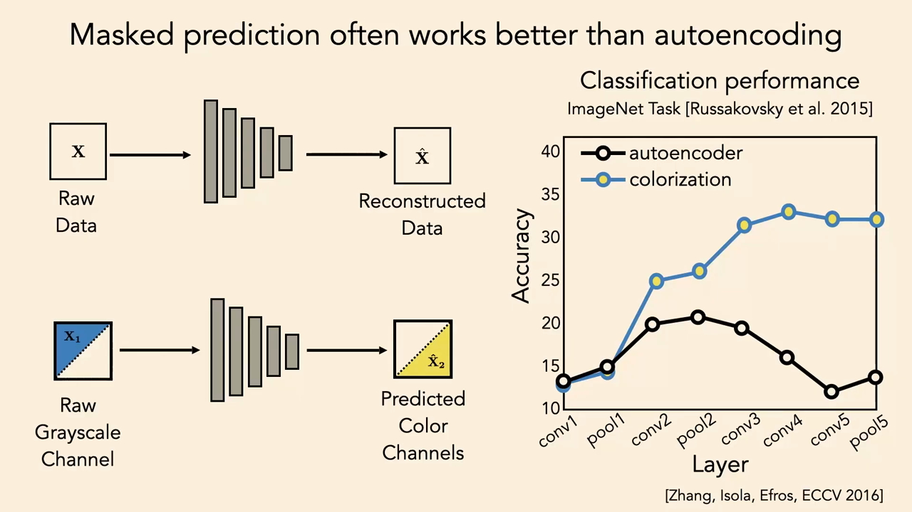
*▲ 강의 슬라이드 [76:34](https://youtu.be/QxOzQRtd440?t=4594): [오토인코더](00_%EB%94%A5%EB%9F%AC%EB%8B%9D_%EC%9A%A9%EC%96%B4%EC%82%AC%EC%A0%84.md#autoencoder-%EC%98%A4%ED%86%A0%EC%9D%B8%EC%BD%94%EB%8D%94)(검정)와 색칠(파랑)의 층별 ImageNet 선형 [분류](00_%EB%94%A5%EB%9F%AC%EB%8B%9D_%EC%9A%A9%EC%96%B4%EC%82%AC%EC%A0%84.md#regression-classification-%ED%9A%8C%EA%B7%80%EC%99%80-%EB%B6%84%EB%A5%98) [정확도](00_%EB%94%A5%EB%9F%AC%EB%8B%9D_%EC%9A%A9%EC%96%B4%EC%82%AC%EC%A0%84.md#accuracy-%EC%A0%95%ED%99%95%EB%8F%84). 깊은 [층](00_%EB%94%A5%EB%9F%AC%EB%8B%9D_%EC%9A%A9%EC%96%B4%EC%82%AC%EC%A0%84.md#layer-%EC%B8%B5)에서 차이가 벌어진다*

강사는 설명이 있다고 생각했다가 없다는 것을 깨달았다며, **진행 중인 과학**(기말 프로젝트 주제 후보)으로 남깁니다. [가설](00_%EB%94%A5%EB%9F%AC%EB%8B%9D_%EC%9A%A9%EC%96%B4%EC%82%AC%EC%A0%84.md#hypothesis-%EA%B0%80%EC%84%A4) 세 가지:

1. **차원 [병목](00_%EB%94%A5%EB%9F%AC%EB%8B%9D_%EC%9A%A9%EC%96%B4%EC%82%AC%EC%A0%84.md#bottleneck-%EB%B3%91%EB%AA%A9)은 다루기 어렵다.** [오토인코더](00_%EB%94%A5%EB%9F%AC%EB%8B%9D_%EC%9A%A9%EC%96%B4%EC%82%AC%EC%A0%84.md#autoencoder-%EC%98%A4%ED%86%A0%EC%9D%B8%EC%BD%94%EB%8D%94)는 압축을 차원 [병목](00_%EB%94%A5%EB%9F%AC%EB%8B%9D_%EC%9A%A9%EC%96%B4%EC%82%AC%EC%A0%84.md#bottleneck-%EB%B3%91%EB%AA%A9)으로 조절하고, 가린 예측은 "예측할 출력과 조건 입력이 겹치지 않음"으로 조절합니다. 출력을 예측하는 데 쓸모 있는 것은 입력과 출력의 **상호 정보**뿐이므로, 입력에만 있는 나머지는 잊게 됩니다. 반면 차원 [병목](00_%EB%94%A5%EB%9F%AC%EB%8B%9D_%EC%9A%A9%EC%96%B4%EC%82%AC%EC%A0%84.md#bottleneck-%EB%B3%91%EB%AA%A9)은 구조를 만지작거려야 하고, 저차원 [임베딩](00_%EB%94%A5%EB%9F%AC%EB%8B%9D_%EC%9A%A9%EC%96%B4%EC%82%AC%EC%A0%84.md#embedding-%EC%9E%84%EB%B2%A0%EB%94%A9)은 최적화·BatchNorm·LayerNorm과 이상하게 얽히는 등 나쁜 성질이 있습니다.
2. **[오토인코더](00_%EB%94%A5%EB%9F%AC%EB%8B%9D_%EC%9A%A9%EC%96%B4%EC%82%AC%EC%A0%84.md#autoencoder-%EC%98%A4%ED%86%A0%EC%9D%B8%EC%BD%94%EB%8D%94)는 지름길을 배운다.** 예: 인코더와 디코더 사이에 [잔차 연결](00_%EB%94%A5%EB%9F%AC%EB%8B%9D_%EC%9A%A9%EC%96%B4%EC%82%AC%EC%A0%84.md#residual-connection-%EC%9E%94%EC%B0%A8-%EC%97%B0%EA%B2%B0)을 넣으면? 학생의 답대로 [병목](00_%EB%94%A5%EB%9F%AC%EB%8B%9D_%EC%9A%A9%EC%96%B4%EC%82%AC%EC%A0%84.md#bottleneck-%EB%B3%91%EB%AA%A9)을 건너뛰어 버립니다. [오토인코더](00_%EB%94%A5%EB%9F%AC%EB%8B%9D_%EC%9A%A9%EC%96%B4%EC%82%AC%EC%A0%84.md#autoencoder-%EC%98%A4%ED%86%A0%EC%9D%B8%EC%BD%94%EB%8D%94)는 이런 식으로 입력의 국소 정보를 복사하는 쉬운 해([지역 최솟값](00_%EB%94%A5%EB%9F%AC%EB%8B%9D_%EC%9A%A9%EC%96%B4%EC%82%AC%EC%A0%84.md#local-minimum-%EC%A7%80%EC%97%AD-%EC%B5%9C%EC%86%9F%EA%B0%92))에 빠지기 쉽습니다. 전역 성질을 담아야 더 좋은 해인데도요.
3. **가린 예측이 실제로 원하는 과제에 더 가깝다.** 우리가 결국 풀려는 문제는 대개 과거로 미래를 맞히는 것 같은 예측입니다.

- MAE 논문 1저자 Kaiming He(현재 MIT 교수)에게 물었더니 "결국 경험주의"라는 답이었다고 합니다. 이론적으로 왜 그런지는 흥미로운 열린 문제입니다.

> [!TIP]
> **🆕 2026 업데이트: 픽셀이 아니라 표현을 예측하기**
> - **강의**: 가린 예측(색칠, MAE)이 오토인코딩보다 낫지만 이유는 열린 문제라며, "입력에만 있는 세부를 잊게 된다"는 [가설](00_%EB%94%A5%EB%9F%AC%EB%8B%9D_%EC%9A%A9%EC%96%B4%EC%82%AC%EC%A0%84.md#hypothesis-%EA%B0%80%EC%84%A4)을 냈습니다.
> - **현재**: 이 방향을 더 밀어붙인 방법들이 나왔습니다. I-JEPA(2023)는 가린 영역의 **픽셀이 아니라 표현([임베딩](00_%EB%94%A5%EB%9F%AC%EB%8B%9D_%EC%9A%A9%EC%96%B4%EC%82%AC%EC%A0%84.md#embedding-%EC%9E%84%EB%B2%A0%EB%94%A9))**을 예측해, 복원할 필요가 없는 세부를 처음부터 목표에서 뺍니다. 저자들은 의미 있는 특징을 얻으려면 가릴 영역이 충분히 크고(의미 단위), 보이는 영역이 이미지 전체에 퍼져 있어야 한다고 보고합니다. 또 2025년 8월 Meta의 DINOv3는 레이블 없이 이미지 **17억 장**으로 **70억 [파라미터](00_%EB%94%A5%EB%9F%AC%EB%8B%9D_%EC%9A%A9%EC%96%B4%EC%82%AC%EC%A0%84.md#parameter-%ED%8C%8C%EB%9D%BC%EB%AF%B8%ED%84%B0)** 모델을 자기 지도 학습해, [미세 조정](00_%EB%94%A5%EB%9F%AC%EB%8B%9D_%EC%9A%A9%EC%96%B4%EC%82%AC%EC%A0%84.md#fine-tuning-%EB%AF%B8%EC%84%B8-%EC%A1%B0%EC%A0%95) 없이 여러 시각 과제에서 전용 최고 모델들을 넘었다고 발표했습니다. 다만 "왜 가린 예측이 낫나"에 대한 이론적 답은 여전히 정리되지 않았습니다.
> - **출처**: [Self-Supervised Learning from Images with a Joint-Embedding Predictive Architecture (Assran 외, CVPR, 2023)](https://arxiv.org/abs/2301.08243) · [DINOv3 (Siméoni 외, arXiv, 2025)](https://arxiv.org/abs/2508.10104)

---

## 11. 맺음: 압축이면 충분한가

▶ 영상 [79:09](https://youtu.be/QxOzQRtd440?t=4749)

- 질문: 처음에 [오토인코더](00_%EB%94%A5%EB%9F%AC%EB%8B%9D_%EC%9A%A9%EC%96%B4%EC%82%AC%EC%A0%84.md#autoencoder-%EC%98%A4%ED%86%A0%EC%9D%B8%EC%BD%94%EB%8D%94)가 "결국 이길 것"이라고 한 이유는? 강사는 증명할 수 없는 **제1원리 논증**이라고 답합니다. [오컴의 면도날](00_%EB%94%A5%EB%9F%AC%EB%8B%9D_%EC%9A%A9%EC%96%B4%EC%82%AC%EC%A0%84.md#occams-razor-%EC%98%A4%EC%BB%B4%EC%9D%98-%EB%A9%B4%EB%8F%84%EB%82%A0)과, 압축이 곧 예측이라는 형식화들을 따르면 **가장 압축된 표현이 미래를 가장 정확히 예측**합니다. [오토인코더](00_%EB%94%A5%EB%9F%AC%EB%8B%9D_%EC%9A%A9%EC%96%B4%EC%82%AC%EC%A0%84.md#autoencoder-%EC%98%A4%ED%86%A0%EC%9D%B8%EC%BD%94%EB%8D%94)는 "데이터를 최대한 압축하고 모든 중복을 없앤다"는 생각의 가장 단순한 구현입니다. "압축이 전부라면 [오토인코더](00_%EB%94%A5%EB%9F%AC%EB%8B%9D_%EC%9A%A9%EC%96%B4%EC%82%AC%EC%A0%84.md#autoencoder-%EC%98%A4%ED%86%A0%EC%9D%B8%EC%BD%94%EB%8D%94)가 전부다." 하지만 아직 열린 질문이라고 덧붙입니다.
- 마무리로 Yann LeCun의 **케이크 비유**를 소개합니다. 케이크의 몸통은 특정 과제에 묶이지 않은 자기 지도(비지도) [표현 학습](00_%EB%94%A5%EB%9F%AC%EB%8B%9D_%EC%9A%A9%EC%96%B4%EC%82%AC%EC%A0%84.md#representation-learning-%ED%91%9C%ED%98%84-%ED%95%99%EC%8A%B5)으로, 많은 데이터와 시간을 들여 "세상을 미래를 잘 예측하는 작은 것으로 압축"하는 일입니다. 아이싱과 체리가 나머지 머신러닝(지도 [학습](00_%EB%94%A5%EB%9F%AC%EB%8B%9D_%EC%9A%A9%EC%96%B4%EC%82%AC%EC%A0%84.md#training-%ED%95%99%EC%8A%B5), 적응, 사후 [학습](00_%EB%94%A5%EB%9F%AC%EB%8B%9D_%EC%9A%A9%EC%96%B4%EC%82%AC%EC%A0%84.md#training-%ED%95%99%EC%8A%B5), 강화 [학습](00_%EB%94%A5%EB%9F%AC%EB%8B%9D_%EC%9A%A9%EC%96%B4%EC%82%AC%EC%A0%84.md#training-%ED%95%99%EC%8A%B5))입니다. [표현 학습](00_%EB%94%A5%EB%9F%AC%EB%8B%9D_%EC%9A%A9%EC%96%B4%EC%82%AC%EC%A0%84.md#representation-learning-%ED%91%9C%ED%98%84-%ED%95%99%EC%8A%B5)이 지능의 대부분이라는 주장에 강사도 동의합니다.
- 자기 지도의 핵심은 레이블이 없다는 것만이 아니라 **좁은 과제에 묶이지 않는다**는 것입니다. 다음 강의는 두 번째 계열인 거리·유사도를 배우는 **[대조 학습](00_%EB%94%A5%EB%9F%AC%EB%8B%9D_%EC%9A%A9%EC%96%B4%EC%82%AC%EC%A0%84.md#contrastive-learning-%EB%8C%80%EC%A1%B0-%ED%95%99%EC%8A%B5)(contrastive learning)**입니다.

---

## 12. 용어 정리

용어사전에 있는 용어는 위 본문에 링크를 걸었습니다. 아래는 이번 강의에서 새로 나온 용어입니다.

| 용어 | 뜻 |
|---|---|
| [오토인코더](00_%EB%94%A5%EB%9F%AC%EB%8B%9D_%EC%9A%A9%EC%96%B4%EC%82%AC%EC%A0%84.md#autoencoder-%EC%98%A4%ED%86%A0%EC%9D%B8%EC%BD%94%EB%8D%94)([Autoencoder](00_%EB%94%A5%EB%9F%AC%EB%8B%9D_%EC%9A%A9%EC%96%B4%EC%82%AC%EC%A0%84.md#autoencoder-%EC%98%A4%ED%86%A0%EC%9D%B8%EC%BD%94%EB%8D%94)) | 데이터를 작은 코드로 압축(인코더)했다가 되살리는(디코더) 망. 복원 [오차](00_%EB%94%A5%EB%9F%AC%EB%8B%9D_%EC%9A%A9%EC%96%B4%EC%82%AC%EC%A0%84.md#error-%EC%98%A4%EC%B0%A8)를 최소로 [학습](00_%EB%94%A5%EB%9F%AC%EB%8B%9D_%EC%9A%A9%EC%96%B4%EC%82%AC%EC%A0%84.md#training-%ED%95%99%EC%8A%B5) |
| [병목](00_%EB%94%A5%EB%9F%AC%EB%8B%9D_%EC%9A%A9%EC%96%B4%EC%82%AC%EC%A0%84.md#bottleneck-%EB%B3%91%EB%AA%A9)([Bottleneck](00_%EB%94%A5%EB%9F%AC%EB%8B%9D_%EC%9A%A9%EC%96%B4%EC%82%AC%EC%A0%84.md#bottleneck-%EB%B3%91%EB%AA%A9)) | [오토인코더](00_%EB%94%A5%EB%9F%AC%EB%8B%9D_%EC%9A%A9%EC%96%B4%EC%82%AC%EC%A0%84.md#autoencoder-%EC%98%A4%ED%86%A0%EC%9D%B8%EC%BD%94%EB%8D%94) 가운데의 좁은 [층](00_%EB%94%A5%EB%9F%AC%EB%8B%9D_%EC%9A%A9%EC%96%B4%EC%82%AC%EC%A0%84.md#layer-%EC%B8%B5). 이 제약 때문에 항등 함수를 그대로 배우지 못하고 쓸모 있는 표현을 배운다 |
| [주성분 분석](00_%EB%94%A5%EB%9F%AC%EB%8B%9D_%EC%9A%A9%EC%96%B4%EC%82%AC%EC%A0%84.md#pca-principal-component-analysis-%EC%A3%BC%EC%84%B1%EB%B6%84-%EB%B6%84%EC%84%9D)([PCA](00_%EB%94%A5%EB%9F%AC%EB%8B%9D_%EC%9A%A9%EC%96%B4%EC%82%AC%EC%A0%84.md#pca-principal-component-analysis-%EC%A3%BC%EC%84%B1%EB%B6%84-%EB%B6%84%EC%84%9D), Principal component analysis) | 데이터의 [분산](00_%EB%94%A5%EB%9F%AC%EB%8B%9D_%EC%9A%A9%EC%96%B4%EC%82%AC%EC%A0%84.md#variance-%EB%B6%84%EC%82%B0)을 가장 많이 담는 직교 방향을 찾는 방법. 선형 [오토인코더](00_%EB%94%A5%EB%9F%AC%EB%8B%9D_%EC%9A%A9%EC%96%B4%EC%82%AC%EC%A0%84.md#autoencoder-%EC%98%A4%ED%86%A0%EC%9D%B8%EC%BD%94%EB%8D%94)와 같은 부분공간 |
| [투영](00_%EB%94%A5%EB%9F%AC%EB%8B%9D_%EC%9A%A9%EC%96%B4%EC%82%AC%EC%A0%84.md#projection-%ED%88%AC%EC%98%81)([Projection](00_%EB%94%A5%EB%9F%AC%EB%8B%9D_%EC%9A%A9%EC%96%B4%EC%82%AC%EC%A0%84.md#projection-%ED%88%AC%EC%98%81)) | 벡터를 어떤 방향(부분공간) 위의 그림자로 옮기는 것 |
| [분산](00_%EB%94%A5%EB%9F%AC%EB%8B%9D_%EC%9A%A9%EC%96%B4%EC%82%AC%EC%A0%84.md#variance-%EB%B6%84%EC%82%B0)([Variance](00_%EB%94%A5%EB%9F%AC%EB%8B%9D_%EC%9A%A9%EC%96%B4%EC%82%AC%EC%A0%84.md#variance-%EB%B6%84%EC%82%B0)) | 값이 평균에서 퍼진 정도. 제곱 편차의 평균 |
| [공분산 행렬](00_%EB%94%A5%EB%9F%AC%EB%8B%9D_%EC%9A%A9%EC%96%B4%EC%82%AC%EC%A0%84.md#covariance-matrix-%EA%B3%B5%EB%B6%84%EC%82%B0-%ED%96%89%EB%A0%AC)(Covariance matrix) | 축들이 함께 변하는 정도를 모은 행렬 |
| [고유벡터](00_%EB%94%A5%EB%9F%AC%EB%8B%9D_%EC%9A%A9%EC%96%B4%EC%82%AC%EC%A0%84.md#eigenvector-eigenvalue-%EA%B3%A0%EC%9C%A0%EB%B2%A1%ED%84%B0%EC%99%80-%EA%B3%A0%EC%9C%B3%EA%B0%92)와 [고윳값](00_%EB%94%A5%EB%9F%AC%EB%8B%9D_%EC%9A%A9%EC%96%B4%EC%82%AC%EC%A0%84.md#eigenvector-eigenvalue-%EA%B3%A0%EC%9C%A0%EB%B2%A1%ED%84%B0%EC%99%80-%EA%B3%A0%EC%9C%B3%EA%B0%92)([Eigenvector](00_%EB%94%A5%EB%9F%AC%EB%8B%9D_%EC%9A%A9%EC%96%B4%EC%82%AC%EC%A0%84.md#eigenvector-eigenvalue-%EA%B3%A0%EC%9C%A0%EB%B2%A1%ED%84%B0%EC%99%80-%EA%B3%A0%EC%9C%B3%EA%B0%92), [Eigenvalue](00_%EB%94%A5%EB%9F%AC%EB%8B%9D_%EC%9A%A9%EC%96%B4%EC%82%AC%EC%A0%84.md#eigenvector-eigenvalue-%EA%B3%A0%EC%9C%A0%EB%B2%A1%ED%84%B0%EC%99%80-%EA%B3%A0%EC%9C%B3%EA%B0%92)) | 행렬을 곱해도 방향이 그대로이고 길이만 λ배 되는 벡터와 그 배율 |
| [군집화](00_%EB%94%A5%EB%9F%AC%EB%8B%9D_%EC%9A%A9%EC%96%B4%EC%82%AC%EC%A0%84.md#clustering-%EA%B5%B0%EC%A7%91%ED%99%94)([Clustering](00_%EB%94%A5%EB%9F%AC%EB%8B%9D_%EC%9A%A9%EC%96%B4%EC%82%AC%EC%A0%84.md#clustering-%EA%B5%B0%EC%A7%91%ED%99%94)) | 데이터 점마다 무리 번호를 붙이는 것. 정수를 내는 인코더 |
| [k-평균](00_%EB%94%A5%EB%9F%AC%EB%8B%9D_%EC%9A%A9%EC%96%B4%EC%82%AC%EC%A0%84.md#k-means-k-%ED%8F%89%EA%B7%A0)([k-means](00_%EB%94%A5%EB%9F%AC%EB%8B%9D_%EC%9A%A9%EC%96%B4%EC%82%AC%EC%A0%84.md#k-means-k-%ED%8F%89%EA%B7%A0)) | 무리 k개의 평균(중심)으로 데이터를 대표하는 [군집화](00_%EB%94%A5%EB%9F%AC%EB%8B%9D_%EC%9A%A9%EC%96%B4%EC%82%AC%EC%A0%84.md#clustering-%EA%B5%B0%EC%A7%91%ED%99%94). 정수 [병목](00_%EB%94%A5%EB%9F%AC%EB%8B%9D_%EC%9A%A9%EC%96%B4%EC%82%AC%EC%A0%84.md#bottleneck-%EB%B3%91%EB%AA%A9)의 L2 [오토인코더](00_%EB%94%A5%EB%9F%AC%EB%8B%9D_%EC%9A%A9%EC%96%B4%EC%82%AC%EC%A0%84.md#autoencoder-%EC%98%A4%ED%86%A0%EC%9D%B8%EC%BD%94%EB%8D%94) |
| [벡터 양자화](00_%EB%94%A5%EB%9F%AC%EB%8B%9D_%EC%9A%A9%EC%96%B4%EC%82%AC%EC%A0%84.md#vector-quantization-%EB%B2%A1%ED%84%B0-%EC%96%91%EC%9E%90%ED%99%94)(Vector quantization) | 연속 벡터를 유한한 [코드북](00_%EB%94%A5%EB%9F%AC%EB%8B%9D_%EC%9A%A9%EC%96%B4%EC%82%AC%EC%A0%84.md#codebook-%EC%BD%94%EB%93%9C%EB%B6%81)의 가장 가까운 벡터로 바꾸는 것. VQ-VAE, VQGAN |
| [사전 학습](00_%EB%94%A5%EB%9F%AC%EB%8B%9D_%EC%9A%A9%EC%96%B4%EC%82%AC%EC%A0%84.md#pre-training-%EC%82%AC%EC%A0%84-%ED%95%99%EC%8A%B5)([Pre-training](00_%EB%94%A5%EB%9F%AC%EB%8B%9D_%EC%9A%A9%EC%96%B4%EC%82%AC%EC%A0%84.md#pre-training-%EC%82%AC%EC%A0%84-%ED%95%99%EC%8A%B5)) | 많은 데이터로 최종 과제와 무관하게 표현을 먼저 배우는 단계 |
| [미세 조정](00_%EB%94%A5%EB%9F%AC%EB%8B%9D_%EC%9A%A9%EC%96%B4%EC%82%AC%EC%A0%84.md#fine-tuning-%EB%AF%B8%EC%84%B8-%EC%A1%B0%EC%A0%95)([Fine-tuning](00_%EB%94%A5%EB%9F%AC%EB%8B%9D_%EC%9A%A9%EC%96%B4%EC%82%AC%EC%A0%84.md#fine-tuning-%EB%AF%B8%EC%84%B8-%EC%A1%B0%EC%A0%95)) | [사전 학습](00_%EB%94%A5%EB%9F%AC%EB%8B%9D_%EC%9A%A9%EC%96%B4%EC%82%AC%EC%A0%84.md#pre-training-%EC%82%AC%EC%A0%84-%ED%95%99%EC%8A%B5) [가중치](00_%EB%94%A5%EB%9F%AC%EB%8B%9D_%EC%9A%A9%EC%96%B4%EC%82%AC%EC%A0%84.md#weight-%EA%B0%80%EC%A4%91%EC%B9%98)로 초기화해 새 과제의 적은 데이터로 계속 학습하는 것 |
| [탐침과 선형 탐침](00_%EB%94%A5%EB%9F%AC%EB%8B%9D_%EC%9A%A9%EC%96%B4%EC%82%AC%EC%A0%84.md#probe-linear-probe-%ED%83%90%EC%B9%A8%EA%B3%BC-%EC%84%A0%ED%98%95-%ED%83%90%EC%B9%A8)([Probe](00_%EB%94%A5%EB%9F%AC%EB%8B%9D_%EC%9A%A9%EC%96%B4%EC%82%AC%EC%A0%84.md#probe-linear-probe-%ED%83%90%EC%B9%A8%EA%B3%BC-%EC%84%A0%ED%98%95-%ED%83%90%EC%B9%A8), Linear probe) | 표현을 얼려 두고 단순한 분류기(최근접 이웃, [선형층](00_%EB%94%A5%EB%9F%AC%EB%8B%9D_%EC%9A%A9%EC%96%B4%EC%82%AC%EC%A0%84.md#linear-layer-%EC%84%A0%ED%98%95%EC%B8%B5))로 정보를 얼마나 쉽게 읽는지 재는 방법 |
| [최근접 이웃 분류기](00_%EB%94%A5%EB%9F%AC%EB%8B%9D_%EC%9A%A9%EC%96%B4%EC%82%AC%EC%A0%84.md#nearest-neighbor-classifier-%EC%B5%9C%EA%B7%BC%EC%A0%91-%EC%9D%B4%EC%9B%83-%EB%B6%84%EB%A5%98%EA%B8%B0)(Nearest neighbor classifier) | 가장 가까운 데이터의 [정답](00_%EB%94%A5%EB%9F%AC%EB%8B%9D_%EC%9A%A9%EC%96%B4%EC%82%AC%EC%A0%84.md#label-%EC%A0%95%EB%8B%B5)을 그대로 답하는 분류기 |
| [사전 과제](00_%EB%94%A5%EB%9F%AC%EB%8B%9D_%EC%9A%A9%EC%96%B4%EC%82%AC%EC%A0%84.md#pretext-task-%EC%82%AC%EC%A0%84-%EA%B3%BC%EC%A0%9C)(Pretext task) | 데이터 자체에서 만든 가짜 레이블을 예측하게 하는 과제 |
| [가린 예측과 결측 대체](00_%EB%94%A5%EB%9F%AC%EB%8B%9D_%EC%9A%A9%EC%96%B4%EC%82%AC%EC%A0%84.md#masked-prediction-imputation-%EA%B0%80%EB%A6%B0-%EC%98%88%EC%B8%A1%EA%B3%BC-%EA%B2%B0%EC%B8%A1-%EB%8C%80%EC%B2%B4)(Masked prediction, [Imputation](00_%EB%94%A5%EB%9F%AC%EB%8B%9D_%EC%9A%A9%EC%96%B4%EC%82%AC%EC%A0%84.md#masked-prediction-imputation-%EA%B0%80%EB%A6%B0-%EC%98%88%EC%B8%A1%EA%B3%BC-%EA%B2%B0%EC%B8%A1-%EB%8C%80%EC%B2%B4)) | 데이터 일부를 가리고 나머지로 가린 부분을 예측하는 [사전 과제](00_%EB%94%A5%EB%9F%AC%EB%8B%9D_%EC%9A%A9%EC%96%B4%EC%82%AC%EC%A0%84.md#pretext-task-%EC%82%AC%EC%A0%84-%EA%B3%BC%EC%A0%9C) |
| [가린 오토인코더](00_%EB%94%A5%EB%9F%AC%EB%8B%9D_%EC%9A%A9%EC%96%B4%EC%82%AC%EC%A0%84.md#masked-autoencoder-%EA%B0%80%EB%A6%B0-%EC%98%A4%ED%86%A0%EC%9D%B8%EC%BD%94%EB%8D%94)(Masked autoencoder) | 이미지 패치 [토큰](00_%EB%94%A5%EB%9F%AC%EB%8B%9D_%EC%9A%A9%EC%96%B4%EC%82%AC%EC%A0%84.md#token-%ED%86%A0%ED%81%B0) 대부분을 가리고 복원하는 [비전 트랜스포머](00_%EB%94%A5%EB%9F%AC%EB%8B%9D_%EC%9A%A9%EC%96%B4%EC%82%AC%EC%A0%84.md#vision-transformer-%EB%B9%84%EC%A0%84-%ED%8A%B8%EB%9E%9C%EC%8A%A4%ED%8F%AC%EB%A8%B8) [오토인코더](00_%EB%94%A5%EB%9F%AC%EB%8B%9D_%EC%9A%A9%EC%96%B4%EC%82%AC%EC%A0%84.md#autoencoder-%EC%98%A4%ED%86%A0%EC%9D%B8%EC%BD%94%EB%8D%94) (MAE) |
| [BERT](00_%EB%94%A5%EB%9F%AC%EB%8B%9D_%EC%9A%A9%EC%96%B4%EC%82%AC%EC%A0%84.md#bert-%EB%B2%84%ED%8A%B8) | 텍스트 [토큰](00_%EB%94%A5%EB%9F%AC%EB%8B%9D_%EC%9A%A9%EC%96%B4%EC%82%AC%EC%A0%84.md#token-%ED%86%A0%ED%81%B0) 일부를 가리고 예측하는 [트랜스포머](00_%EB%94%A5%EB%9F%AC%EB%8B%9D_%EC%9A%A9%EC%96%B4%EC%82%AC%EC%A0%84.md#transformer-%ED%8A%B8%EB%9E%9C%EC%8A%A4%ED%8F%AC%EB%A8%B8) [언어 모델](00_%EB%94%A5%EB%9F%AC%EB%8B%9D_%EC%9A%A9%EC%96%B4%EC%82%AC%EC%A0%84.md#language-model-%EC%96%B8%EC%96%B4-%EB%AA%A8%EB%8D%B8) |
| [희소 표현](00_%EB%94%A5%EB%9F%AC%EB%8B%9D_%EC%9A%A9%EC%96%B4%EC%82%AC%EC%A0%84.md#sparse-representation-%ED%9D%AC%EC%86%8C-%ED%91%9C%ED%98%84)(Sparse representation) | 대부분의 칸이 0인 표현. [ReLU](00_%EB%94%A5%EB%9F%AC%EB%8B%9D_%EC%9A%A9%EC%96%B4%EC%82%AC%EC%A0%84.md#relu-%EB%A0%90%EB%A3%A8)가 만든다 |
| [심플렉스](00_%EB%94%A5%EB%9F%AC%EB%8B%9D_%EC%9A%A9%EC%96%B4%EC%82%AC%EC%A0%84.md#simplex-%EC%8B%AC%ED%94%8C%EB%A0%89%EC%8A%A4)([Simplex](00_%EB%94%A5%EB%9F%AC%EB%8B%9D_%EC%9A%A9%EC%96%B4%EC%82%AC%EC%A0%84.md#simplex-%EC%8B%AC%ED%94%8C%EB%A0%89%EC%8A%A4)) | 칸들이 0 이상이고 합이 1인 점의 집합. [소프트맥스](00_%EB%94%A5%EB%9F%AC%EB%8B%9D_%EC%9A%A9%EC%96%B4%EC%82%AC%EC%A0%84.md#softmax-%EC%86%8C%ED%94%84%ED%8A%B8%EB%A7%A5%EC%8A%A4) 출력이 놓이는 곳 |
| [얽힘 풀린 표현](00_%EB%94%A5%EB%9F%AC%EB%8B%9D_%EC%9A%A9%EC%96%B4%EC%82%AC%EC%A0%84.md#disentangled-representation-%EC%96%BD%ED%9E%98-%ED%92%80%EB%A6%B0-%ED%91%9C%ED%98%84)(Disentangled representation) | 데이터를 바꾸는 [독립](00_%EB%94%A5%EB%9F%AC%EB%8B%9D_%EC%9A%A9%EC%96%B4%EC%82%AC%EC%A0%84.md#independence-%EB%8F%85%EB%A6%BD) 요인이 각각 다른 축에 놓인 표현 |
| [최소 충분 표현](00_%EB%94%A5%EB%9F%AC%EB%8B%9D_%EC%9A%A9%EC%96%B4%EC%82%AC%EC%A0%84.md#minimal-sufficient-representation-%EC%B5%9C%EC%86%8C-%EC%B6%A9%EB%B6%84-%ED%91%9C%ED%98%84)(Minimal sufficient representation) | 과제에 필요한 정보는 다 담고(충분) 나머지는 버린(최소) 표현 |
| [특징 추출](00_%EB%94%A5%EB%9F%AC%EB%8B%9D_%EC%9A%A9%EC%96%B4%EC%82%AC%EC%A0%84.md#feature-extraction-%ED%8A%B9%EC%A7%95-%EC%B6%94%EC%B6%9C)(Feature extraction) | 입력에서 벡터 특징을 뽑는 것. x2vec의 다른 이름 |
| [기계적 해석 가능성](00_%EB%94%A5%EB%9F%AC%EB%8B%9D_%EC%9A%A9%EC%96%B4%EC%82%AC%EC%A0%84.md#mechanistic-interpretability-%EA%B8%B0%EA%B3%84%EC%A0%81-%ED%95%B4%EC%84%9D-%EA%B0%80%EB%8A%A5%EC%84%B1)(Mechanistic interpretability) | 망 내부 뉴런·특징이 무엇을 나타내는지 찾아 망의 동작을 설명하는 연구 |
| [희소 오토인코더](00_%EB%94%A5%EB%9F%AC%EB%8B%9D_%EC%9A%A9%EC%96%B4%EC%82%AC%EC%A0%84.md#sparse-autoencoder-%ED%9D%AC%EC%86%8C-%EC%98%A4%ED%86%A0%EC%9D%B8%EC%BD%94%EB%8D%94)(Sparse autoencoder) | 코드가 희소하도록 제약한 [오토인코더](00_%EB%94%A5%EB%9F%AC%EB%8B%9D_%EC%9A%A9%EC%96%B4%EC%82%AC%EC%A0%84.md#autoencoder-%EC%98%A4%ED%86%A0%EC%9D%B8%EC%BD%94%EB%8D%94). [언어 모델](00_%EB%94%A5%EB%9F%AC%EB%8B%9D_%EC%9A%A9%EC%96%B4%EC%82%AC%EC%A0%84.md#language-model-%EC%96%B8%EC%96%B4-%EB%AA%A8%EB%8D%B8) 활성값에서 해석 가능한 특징을 뽑는 데 쓴다 |
