# Lec 12. 유사도 기반 표현 학습 (Representation Learning: Similarity-Based)

← 이전: [Lec11_표현_학습_재구성](Lec11_%ED%91%9C%ED%98%84_%ED%95%99%EC%8A%B5_%EC%9E%AC%EA%B5%AC%EC%84%B1.md) · [목차](00_MIT%EB%94%A5%EB%9F%AC%EB%8B%9D_%EB%AA%A9%EC%B0%A8.md) · 다음: [Lec13_표현_학습_이론](Lec13_%ED%91%9C%ED%98%84_%ED%95%99%EC%8A%B5_%EC%9D%B4%EB%A1%A0.md) →

> [!NOTE]
> **강의 정보**
> - **출처**: MIT OpenCourseWare, [Lec 12. Representation Learning: Similarity-Based](https://www.youtube.com/watch?v=yUh1fEGGdl4) (76분, 2024년 가을 학기)
> - **강사**: Sara Beery
> - **라이선스**: 원 강의는 CC BY-NC-SA 4.0입니다. 이 노트는 영어 자막을 바탕으로 한국어로 옮겨 정리한 2차 저작물이며, 같은 조건(비영리·출처 표기·동일 조건 공유)을 따릅니다.
> - 각 절 제목 아래의 `▶ 영상` 시간을 누르면 영상의 해당 위치로 갑니다.
> - `📐 수학 개념` 줄은 그 절에 쓰인 수학을 정리한 노트로 연결됩니다. 전체 목록은 [00_MIT딥러닝_목차](00_MIT%EB%94%A5%EB%9F%AC%EB%8B%9D_%EB%AA%A9%EC%B0%A8.md).
> - 슬라이드 캡처는 원 강의(CC BY-NC-SA 4.0)에서 가져왔고, "직접 그린 그림"은 이 노트의 숫자로 새로 그렸습니다.
> - `🆕 2026 업데이트` 칸은 강의(2024년 가을) 이후 바뀐 내용을 덧붙인 것입니다.

## 한눈에 보기

| 구분 | 내용 |
|---|---|
| 핵심 질문 | 좋은 [표현](00_%EB%94%A5%EB%9F%AC%EB%8B%9D_%EC%9A%A9%EC%96%B4%EC%82%AC%EC%A0%84.md#representation-learning-%ED%91%9C%ED%98%84-%ED%95%99%EC%8A%B5)이란 무엇이고, "무엇이 무엇과 비슷한가"라는 신호만으로 그런 표현을 어떻게 배우는가? |
| 좋은 표현의 조건 | 간결함, 설명력, **집중**(같은 반은 가깝게), **분리**(다른 반은 멀게), 무관한 변화에 대한 **강건성** |
| [거리 척도 학습](00_%EB%94%A5%EB%9F%AC%EB%8B%9D_%EC%9A%A9%EC%96%B4%EC%82%AC%EC%A0%84.md#metric-learning-%EA%B1%B0%EB%A6%AC-%EC%B2%99%EB%8F%84-%ED%95%99%EC%8A%B5) | 같은 쌍은 가깝게, 다른 쌍은 멀게 하는 거리 $d_A$(선형) 또는 신경망 $f$(깊은)를 배운다. [마할라노비스 거리](00_%EB%94%A5%EB%9F%AC%EB%8B%9D_%EC%9A%A9%EC%96%B4%EC%82%AC%EC%A0%84.md#mahalanobis-distance-%EB%A7%88%ED%95%A0%EB%9D%BC%EB%85%B8%EB%B9%84%EC%8A%A4-%EA%B1%B0%EB%A6%AC), [삼중항 손실](00_%EB%94%A5%EB%9F%AC%EB%8B%9D_%EC%9A%A9%EC%96%B4%EC%82%AC%EC%A0%84.md#triplet-loss-%EC%82%BC%EC%A4%91%ED%95%AD-%EC%86%90%EC%8B%A4) |
| 자기 [지도 대조 학습](00_%EB%94%A5%EB%9F%AC%EB%8B%9D_%EC%9A%A9%EC%96%B4%EC%82%AC%EC%A0%84.md#supervised-contrastive-learning-%EC%A7%80%EB%8F%84-%EB%8C%80%EC%A1%B0-%ED%95%99%EC%8A%B5) | 라벨 없이, 같은 사진의 두 증강을 양성 쌍으로, 배치의 나머지를 음성으로 쓴다 ([SimCLR](00_%EB%94%A5%EB%9F%AC%EB%8B%9D_%EC%9A%A9%EC%96%B4%EC%82%AC%EC%A0%84.md#simclr-simclr-%EB%8C%80%EC%A1%B0-%ED%95%99%EC%8A%B5), MoCo). [InfoNCE](00_%EB%94%A5%EB%9F%AC%EB%8B%9D_%EC%9A%A9%EC%96%B4%EC%82%AC%EC%A0%84.md#infonce-infonce-%EC%86%90%EC%8B%A4) [손실](00_%EB%94%A5%EB%9F%AC%EB%8B%9D_%EC%9A%A9%EC%96%B4%EC%82%AC%EC%A0%84.md#loss-function-%EC%86%90%EC%8B%A4-%ED%95%A8%EC%88%98) |
| 대조 [손실](00_%EB%94%A5%EB%9F%AC%EB%8B%9D_%EC%9A%A9%EC%96%B4%EC%82%AC%EC%A0%84.md#loss-function-%EC%86%90%EC%8B%A4-%ED%95%A8%EC%88%98)이 하는 일 | [손실](00_%EB%94%A5%EB%9F%AC%EB%8B%9D_%EC%9A%A9%EC%96%B4%EC%82%AC%EC%A0%84.md#loss-function-%EC%86%90%EC%8B%A4-%ED%95%A8%EC%88%98) 자체는 **정렬**과 **균일성**을, 쌍의 선택(증강)은 **불변성**을 가르친다 |
| 교훈 ([iNaturalist](00_%EB%94%A5%EB%9F%AC%EB%8B%9D_%EC%9A%A9%EC%96%B4%EC%82%AC%EC%A0%84.md#inaturalist-%EC%83%9D%EB%AC%BC-%EC%A2%85-%EC%82%AC%EC%A7%84-%EB%8D%B0%EC%9D%B4%ED%84%B0%EC%85%8B)) | [대조 학습](00_%EB%94%A5%EB%9F%AC%EB%8B%9D_%EC%9A%A9%EC%96%B4%EC%82%AC%EC%A0%84.md#contrastive-learning-%EB%8C%80%EC%A1%B0-%ED%95%99%EC%8A%B5)은 "비슷함"의 정의가 과제와 맞아야 잘 된다. 세밀한 종 구분에서는 자기 지도가 지도 [학습](00_%EB%94%A5%EB%9F%AC%EB%8B%9D_%EC%9A%A9%EC%96%B4%EC%82%AC%EC%A0%84.md#training-%ED%95%99%EC%8A%B5)보다 30%p 가까이 뒤졌다 |
| 이전 강의 | Lec11 재구성 기반 [표현 학습](00_%EB%94%A5%EB%9F%AC%EB%8B%9D_%EC%9A%A9%EC%96%B4%EC%82%AC%EC%A0%84.md#representation-learning-%ED%91%9C%ED%98%84-%ED%95%99%EC%8A%B5) |
| 다음 강의 | Lec13 (목요일) |

---

## 1. 왜 표현을 배우나

▶ 영상 [01:46](https://youtu.be/yUh1fEGGdl4?t=106)

강사는 지난 강의에 이어 [표현 학습](00_%EB%94%A5%EB%9F%AC%EB%8B%9D_%EC%9A%A9%EC%96%B4%EC%82%AC%EC%A0%84.md#representation-learning-%ED%91%9C%ED%98%84-%ED%95%99%EC%8A%B5)(Representation learning) 시리즈를 이어 가며, 오늘은 **유사도 기반** 방법을 다룬다고 소개합니다. 이 내용은 강의 전체에서 중요합니다. 요즘 쓰이는 많은 아키텍처가 어떤 형태로든 [대조 학습](00_%EB%94%A5%EB%9F%AC%EB%8B%9D_%EC%9A%A9%EC%96%B4%EC%82%AC%EC%A0%84.md#contrastive-learning-%EB%8C%80%EC%A1%B0-%ED%95%99%EC%8A%B5)과 대조 표현 위에 서 있기 때문입니다.

데이터의 표현을 따로 배우는 이유를 학생들과 함께 꼽습니다.

- **[일반화](00_%EB%94%A5%EB%9F%AC%EB%8B%9D_%EC%9A%A9%EC%96%B4%EC%82%AC%EC%A0%84.md#generalization-%EC%9D%BC%EB%B0%98%ED%99%94)를 높이려고**: 의미 있는 성분을 잡은 표현은 새 데이터에도 잘 통합니다.
- **더 많은 [학습](00_%EB%94%A5%EB%9F%AC%EB%8B%9D_%EC%9A%A9%EC%96%B4%EC%82%AC%EC%A0%84.md#training-%ED%95%99%EC%8A%B5)을 하려고 ([전이 학습](00_%EB%94%A5%EB%9F%AC%EB%8B%9D_%EC%9A%A9%EC%96%B4%EC%82%AC%EC%A0%84.md#transfer-learning-%EC%A0%84%EC%9D%B4-%ED%95%99%EC%8A%B5))**: 한 번 배운 표현을 여러 과제에 미세 조정해 쓰면, 그 단계에 필요한 데이터가 줄어듭니다.
- **기하학적 유사도를 쓰려고**: "이 사람 얼굴을 전에 본 적 있나?"(조명·자세가 달라도 얼굴의 구조는 같아야 함), "이 질의와 비슷한 항목은?"(**[최근접 이웃 검색](00_%EB%94%A5%EB%9F%AC%EB%8B%9D_%EC%9A%A9%EC%96%B4%EC%82%AC%EC%A0%84.md#nearest-neighbor-retrieval-%EC%B5%9C%EA%B7%BC%EC%A0%91-%EC%9D%B4%EC%9B%83-%EA%B2%80%EC%83%89)**)
- **부가 정보로 군집을 나아지게 하려고**: 어떤 쌍이 같고 어떤 쌍이 다른지 같은 정보를 군집에 반영합니다.
- **[차원 축소](00_%EB%94%A5%EB%9F%AC%EB%8B%9D_%EC%9A%A9%EC%96%B4%EC%82%AC%EC%A0%84.md#dimensionality-reduction-%EC%B0%A8%EC%9B%90-%EC%B6%95%EC%86%8C)**: 정보를 더 간결하게 저장합니다. 보통 비지도로 합니다. 다만 표현이 늘 입력보다 작아야 하는 것은 아니고, 입력보다 큰 표현을 만들 수도 있습니다.

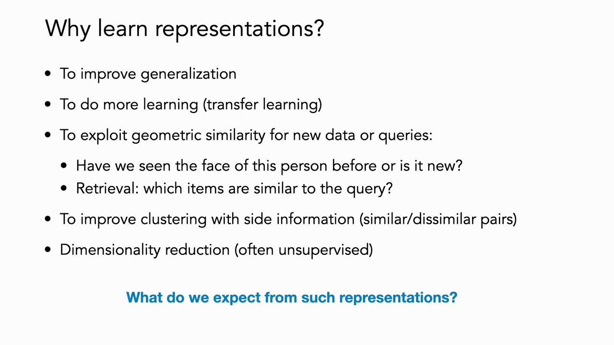
*▲ 강의 슬라이드 [04:27](https://youtu.be/yUh1fEGGdl4?t=267): 표현을 배우는 이유. [일반화](00_%EB%94%A5%EB%9F%AC%EB%8B%9D_%EC%9A%A9%EC%96%B4%EC%82%AC%EC%A0%84.md#generalization-%EC%9D%BC%EB%B0%98%ED%99%94), [전이 학습](00_%EB%94%A5%EB%9F%AC%EB%8B%9D_%EC%9A%A9%EC%96%B4%EC%82%AC%EC%A0%84.md#transfer-learning-%EC%A0%84%EC%9D%B4-%ED%95%99%EC%8A%B5), 기하학적 유사도(얼굴, 검색), 부가 정보를 쓴 군집, [차원 축소](00_%EB%94%A5%EB%9F%AC%EB%8B%9D_%EC%9A%A9%EC%96%B4%EC%82%AC%EC%A0%84.md#dimensionality-reduction-%EC%B0%A8%EC%9B%90-%EC%B6%95%EC%86%8C)*

---

## 2. 좋은 표현의 조건

▶ 영상 [04:00](https://youtu.be/yUh1fEGGdl4?t=240)

- 한 학생은 "의미가 비슷한 물체는 [임베딩](00_%EB%94%A5%EB%9F%AC%EB%8B%9D_%EC%9A%A9%EC%96%B4%EC%82%AC%EC%A0%84.md#embedding-%EC%9E%84%EB%B2%A0%EB%94%A9) 공간에서 가까워야 한다"고 답합니다. 그러면 잡음이나 작은 흔들림에 강해지고, 다음 단계의 함수(예: 분류기)도 쉬워집니다. 같은 것끼리 모이고 다른 것끼리 떨어져 있으면 그 사이에 선만 그으면 되기 때문입니다(선형 분리 가능).
- 굿펠로 등의 교과서(2016)는 "좋은 표현은 그다음 [학습](00_%EB%94%A5%EB%9F%AC%EB%8B%9D_%EC%9A%A9%EC%96%B4%EC%82%AC%EC%A0%84.md#training-%ED%95%99%EC%8A%B5) 과제를 쉽게 만드는 표현"이라고 말합니다.
- 한 가지 틀: 좋은 표현은 **간결하고(compact, 최소한)** 동시에 **설명력이 있어야(explanatory, 충분해야)** 합니다. 필요한 것보다 큰 [용량](00_%EB%94%A5%EB%9F%AC%EB%8B%9D_%EC%9A%A9%EC%96%B4%EC%82%AC%EC%A0%84.md#capacity-%EC%9A%A9%EB%9F%89)은 원하지 않지만, 데이터에서 중요한 차원은 담아야 합니다. 무엇이 "충분한가"는 다음에 쓸 과제에 달려 있습니다. 한 과제에 충분한 표현이 다른 과제에는 부족할 수 있습니다.

### 2.1 일반화를 예측하는 복잡도 척도

▶ 영상 [07:26](https://youtu.be/yUh1fEGGdl4?t=446)

- NeurIPS 2020 대회 "딥러닝의 [일반화](00_%EB%94%A5%EB%9F%AC%EB%8B%9D_%EC%9A%A9%EC%96%B4%EC%82%AC%EC%A0%84.md#generalization-%EC%9D%BC%EB%B0%98%ED%99%94) 예측하기"는, 모형이 얼마나 일반화할지 맞히는 복잡도 척도를 겨뤘습니다. 이긴 전략들은 **표현의 기하**(같은 반이 얼마나 뭉쳤나, 다른 반이 얼마나 떨어졌나)와 **작은 흔들림에 대한 강건성**을 보았습니다.
- CIFAR-10(작은 저해상도 사진 10종 [분류](00_%EB%94%A5%EB%9F%AC%EB%8B%9D_%EC%9A%A9%EC%96%B4%EC%82%AC%EC%A0%84.md#regression-classification-%ED%9A%8C%EA%B7%80%EC%99%80-%EB%B6%84%EB%A5%98))으로 학습한 모형의 [학습 데이터](00_%EB%94%A5%EB%9F%AC%EB%8B%9D_%EC%9A%A9%EC%96%B4%EC%82%AC%EC%A0%84.md#training-data-test-data-%ED%95%99%EC%8A%B5-%EB%8D%B0%EC%9D%B4%ED%84%B0%EC%99%80-%EC%8B%9C%ED%97%98-%EB%8D%B0%EC%9D%B4%ED%84%B0) 표현을 [t-SNE](00_%EB%94%A5%EB%9F%AC%EB%8B%9D_%EC%9A%A9%EC%96%B4%EC%82%AC%EC%A0%84.md#t-sne-t-sne-%EC%8B%9C%EA%B0%81%ED%99%94)로 그려 보면:
  - **진짜 라벨**로 [학습](00_%EB%94%A5%EB%9F%AC%EB%8B%9D_%EC%9A%A9%EC%96%B4%EC%82%AC%EC%A0%84.md#training-%ED%95%99%EC%8A%B5): 같은 색(같은 반)이 촘촘히 모이고 다른 색과 잘 떨어져 있습니다. 공간에 꽤 고르게 퍼져 있기도 합니다(뒤의 균일성).
  - **무작위 라벨**로 [학습](00_%EB%94%A5%EB%9F%AC%EB%8B%9D_%EC%9A%A9%EC%96%B4%EC%82%AC%EC%A0%84.md#training-%ED%95%99%EC%8A%B5): 모형이 외울 수 있어서 무리는 생기지만, 무리가 퍼져 있고 서로 붙어 있습니다. 조금만 움직여도 다른 색으로 넘어가므로 흔들림에 약합니다([Lec06 7.3](Lec06_%EC%9D%BC%EB%B0%98%ED%99%94_%EC%9D%B4%EB%A1%A0.md#73-%EB%AC%B4%EC%9E%91%EC%9C%84-%EB%9D%BC%EB%B2%A8-%EC%8B%A4%ED%97%98)의 무작위 라벨 실험과 같은 이야기).

정리하면 좋은 표현의 조건은 다섯 가지입니다.

| 조건 | 뜻 |
|---|---|
| 간결함 (compact) | 필요 이상으로 크지 않다 |
| 설명력 (explanatory) | 과제에 필요한 차원을 충분히 담는다 |
| 집중 (concentration) | 같은 반의 데이터가 가깝다 |
| 분리 (separation) | 반끼리 잘 떨어져 있다 |
| 강건성 (robustness) | 무관한 변화(예: 사람의 자세)로는 반 경계를 넘지 않는다 |

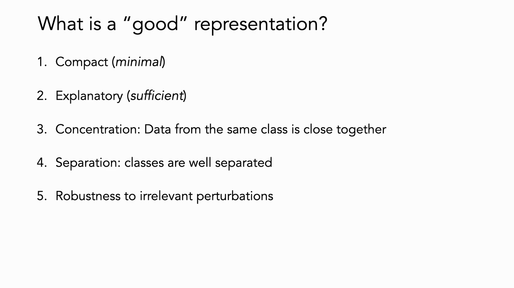
*▲ 강의 슬라이드 [11:32](https://youtu.be/yUh1fEGGdl4?t=692): 좋은 표현의 다섯 조건*

---

## 3. 유사도로 가르치기

▶ 영상 [11:26](https://youtu.be/yUh1fEGGdl4?t=686)

이런 표현을 얻는 핵심 아이디어는 **유사도에 대한 피드백**입니다. 한 번에 한 표본을 보는 대신 두세 개를 함께 보여 주고 "이것과 이것은 같다, 저것은 다르다"를 알려 줍니다.

- **코끼리 비유**: 코끼리를 모르는 사람에게 "크고, 덩치 있고, 귀가 크고, 앞에 긴 것이 달렸다"고 설명하면 그릴 수 있는 것이 무수히 많습니다. 하지만 코뿔소를 아는 사람에게 "코뿔소에서 뿔 대신 긴 코를 달고 귀를 키워라"라고 하면 훨씬 정확히 떠올립니다. **비슷함과 작은 차이(대조)**가 강한 신호라는 것입니다.
- 강사는 생물 종을 다루는 연구자인데, 사람에게 종 구별을 가르칠 때도 거의 늘 대조로 가르친다고 합니다. "이 새는 저 새와 아주 비슷한데, 눈 옆의 점과 다리 색이 다르다."
- 이 신호는 라벨에서 올 수도(지도), 데이터 자체에서 만들 수도(비지도·자기 지도) 있습니다.

---

## 4. 거리 척도 학습

▶ 영상 [14:20](https://youtu.be/yUh1fEGGdl4?t=860)

유사도로 학습하는 최초의 접근이 **[거리 척도 학습](00_%EB%94%A5%EB%9F%AC%EB%8B%9D_%EC%9A%A9%EC%96%B4%EC%82%AC%EC%A0%84.md#metric-learning-%EA%B1%B0%EB%A6%AC-%EC%B2%99%EB%8F%84-%ED%95%99%EC%8A%B5)(Metric learning)**입니다. 입력 공간의 유클리드 거리(예: 두 사진의 모든 픽셀 차이)는 의미 있는 거리가 아닐 수 있으니, 원하는 성질을 지키는 거리를 **배우자**는 것입니다. 목표는 "같이 속하는 점은 가깝게, 다른 점은 멀게"이고, 감독 신호는 유사도 정보입니다. 예를 들어 강사 세 명의 사진에서 필(Phillip Isola)의 사진 두 장은 가깝게, 강사 본인의 사진은 멀게 합니다.

### 4.1 선형 거리 척도와 마할라노비스 거리

▶ 영상 [15:26](https://youtu.be/yUh1fEGGdl4?t=926)

📐 **수학 개념**: [마할라노비스 거리와 양의 준정부호 행렬](%EC%88%98%ED%95%99%EA%B0%9C%EB%85%90/03_%EC%84%A0%ED%98%95%EB%8C%80%EC%88%98/MM43_%EB%A7%88%ED%95%A0%EB%9D%BC%EB%85%B8%EB%B9%84%EC%8A%A4_%EA%B1%B0%EB%A6%AC.md) · [벡터 표기와 전치](%EC%88%98%ED%95%99%EA%B0%9C%EB%85%90/03_%EC%84%A0%ED%98%95%EB%8C%80%EC%88%98/MM03_%EB%B2%A1%ED%84%B0_%ED%91%9C%EA%B8%B0%EC%99%80_%EC%A0%84%EC%B9%98.md) · [벡터와 행렬](%EC%88%98%ED%95%99%EA%B0%9C%EB%85%90/03_%EC%84%A0%ED%98%95%EB%8C%80%EC%88%98/M05_%EB%B2%A1%ED%84%B0%EC%99%80_%ED%96%89%EB%A0%AC.md)

- 데이터 $\mathbf{x}_1, \dots, \mathbf{x}_n$과 **약한 감독**이 있습니다. 쌍 사이 거리가 얼마인지는 모르고, 어떤 쌍이 같은 부류인지(집합 $\mathcal{S}$, similar), 다른 부류인지(집합 $\mathcal{D}$, dissimilar)만 압니다.
- 목표는 이 유사도를 존중하는 선형 변환 $\mathbf{z} = W\mathbf{x}$를 배우는 것입니다.
- 표현 공간에서 유클리드 거리를 재고 풀어 쓰면, 원래 공간에서 행렬 $A = W^\top W$로 잰 거리가 됩니다. $A$는 **[양의 준정부호 행렬](00_%EB%94%A5%EB%9F%AC%EB%8B%9D_%EC%9A%A9%EC%96%B4%EC%82%AC%EC%A0%84.md#positive-semidefinite-matrix-%EC%96%91%EC%9D%98-%EC%A4%80%EC%A0%95%EB%B6%80%ED%98%B8-%ED%96%89%EB%A0%AC)(PSD)**이고, 이 거리를 **[마할라노비스 거리](00_%EB%94%A5%EB%9F%AC%EB%8B%9D_%EC%9A%A9%EC%96%B4%EC%82%AC%EC%A0%84.md#mahalanobis-distance-%EB%A7%88%ED%95%A0%EB%9D%BC%EB%85%B8%EB%B9%84%EC%8A%A4-%EA%B1%B0%EB%A6%AC)(Mahalanobis distance)**라 합니다. PSD 행렬은 수학적으로 다루기 쉬워서 좋습니다. 최적의 $A$(곧 최적의 $W$)를 찾으면 같음과 다름을 가장 잘 보존하는 변환이 됩니다.

$$
\|\mathbf{z}_i - \mathbf{z}_j\|^2 = (\mathbf{x}_i - \mathbf{x}_j)^\top W^\top W (\mathbf{x}_i - \mathbf{x}_j) = \|\mathbf{x}_i - \mathbf{x}_j\|_A^2 = d_A(\mathbf{x}_i, \mathbf{x}_j)^2, \qquad A = W^\top W
$$

기호 풀이

| 기호 | 읽는 법 | 뜻 | 예제 값 |
| --- | --- | --- | --- |
| $\mathbf{x}_i, \mathbf{x}_j$ | 엑스 아이, 엑스 제이 | 원래 공간의 두 데이터 | (1, 2), (3, 1) |
| $W$ | 더블유 | 배우는 선형 변환 | diag(2, 1) |
| $\mathbf{z}_i = W\mathbf{x}_i$ | 제트 아이 | 표현 공간으로 옮긴 데이터 | (2, 2), (6, 1) |
| $\top$ | [전치](00_%EB%94%A5%EB%9F%AC%EB%8B%9D_%EC%9A%A9%EC%96%B4%EC%82%AC%EC%A0%84.md#transpose-%EC%A0%84%EC%B9%98) | 행과 열을 맞바꿈 | |
| $A = W^\top W$ | 에이 | [마할라노비스 거리](00_%EB%94%A5%EB%9F%AC%EB%8B%9D_%EC%9A%A9%EC%96%B4%EC%82%AC%EC%A0%84.md#mahalanobis-distance-%EB%A7%88%ED%95%A0%EB%9D%BC%EB%85%B8%EB%B9%84%EC%8A%A4-%EA%B1%B0%EB%A6%AC)의 행렬 (PSD) | diag(4, 1) |
| $\|\cdot\|_A^2$, $d_A^2$ | 에이 [노름](00_%EB%94%A5%EB%9F%AC%EB%8B%9D_%EC%9A%A9%EC%96%B4%EC%82%AC%EC%A0%84.md#norm-%EB%85%B8%EB%A6%84) 제곱 | $A$로 잰 거리 제곱 | 17 |

예제와 풀이

**문제**: 원래 공간의 두 데이터 $\mathbf{x}_i = (1, 2)$, $\mathbf{x}_j = (3, 1)$을 첫째 칸을 2배로 늘리는 변환 $W$로 옮겼다. 표현 공간의 거리 제곱과 [마할라노비스 거리](00_%EB%94%A5%EB%9F%AC%EB%8B%9D_%EC%9A%A9%EC%96%B4%EC%82%AC%EC%A0%84.md#mahalanobis-distance-%EB%A7%88%ED%95%A0%EB%9D%BC%EB%85%B8%EB%B9%84%EC%8A%A4-%EA%B1%B0%EB%A6%AC) 제곱 $d_A^2$가 같은지 확인하라.

**주어진 값**
- $\mathbf{x}_i = (1, 2)$: 첫째 데이터
- $\mathbf{x}_j = (3, 1)$: 둘째 데이터
- $W = \begin{pmatrix}2&0\\0&1\end{pmatrix}$: 배우는 선형 변환 (첫째 칸 ×2, 둘째 칸 ×1)

**풀이**
1. 식을 그대로 쓴다: $d_A^2 = (\mathbf{x}_i - \mathbf{x}_j)^\top W^\top W (\mathbf{x}_i - \mathbf{x}_j)$
2. 값을 대입한다: $d_A^2 = \big((1,2) - (3,1)\big)^\top \begin{pmatrix}2&0\\0&1\end{pmatrix}^{\!\top} \begin{pmatrix}2&0\\0&1\end{pmatrix} \big((1,2) - (3,1)\big)$
3. 두 데이터를 칸별로 뺀다: $(1 - 3,\ 2 - 1) = (-2, 1)$
4. [전치](00_%EB%94%A5%EB%9F%AC%EB%8B%9D_%EC%9A%A9%EC%96%B4%EC%82%AC%EC%A0%84.md#transpose-%EC%A0%84%EC%B9%98)($\top$, 행과 열을 맞바꿈)를 한다: 대각 행렬이라 $W^\top = \begin{pmatrix}2&0\\0&1\end{pmatrix}$ 그대로다
5. 행렬끼리 곱한다 (행 × 열을 칸별로): $W^\top W = \begin{pmatrix}2\times2 + 0\times0 & 2\times0 + 0\times1\\ 0\times2 + 1\times0 & 0\times0 + 1\times1\end{pmatrix} = \begin{pmatrix}4&0\\0&1\end{pmatrix} = A$
6. 행렬에 차이 벡터를 곱한다: $A(-2, 1) = (4\times(-2) + 0\times1,\ 0\times(-2) + 1\times1) = (-8, 1)$
7. 차이 벡터와 [내적](00_%EB%94%A5%EB%9F%AC%EB%8B%9D_%EC%9A%A9%EC%96%B4%EC%82%AC%EC%A0%84.md#dot-product-%EB%82%B4%EC%A0%81)(칸끼리 곱해 더함)한다: $(-2)\times(-8) + 1\times1 = 16 + 1 = 17$
8. 다른 길로 확인한다. 변환한 차이: $W(-2, 1) = (2\times(-2),\ 1\times1) = (-4, 1)$
9. 칸별로 제곱해 더한다: $(-4)^2 + 1^2 = 16 + 1 = 17$
10. 원래 공간의 유클리드 거리 제곱과 비교한다: $(-2)^2 + 1^2 = 4 + 1 = 5$

**답**: 둘 다 **17**로 같다. 첫째 칸 방향이 4배 비싸져서 원래 거리 제곱 5보다 커졌다.

내 이해

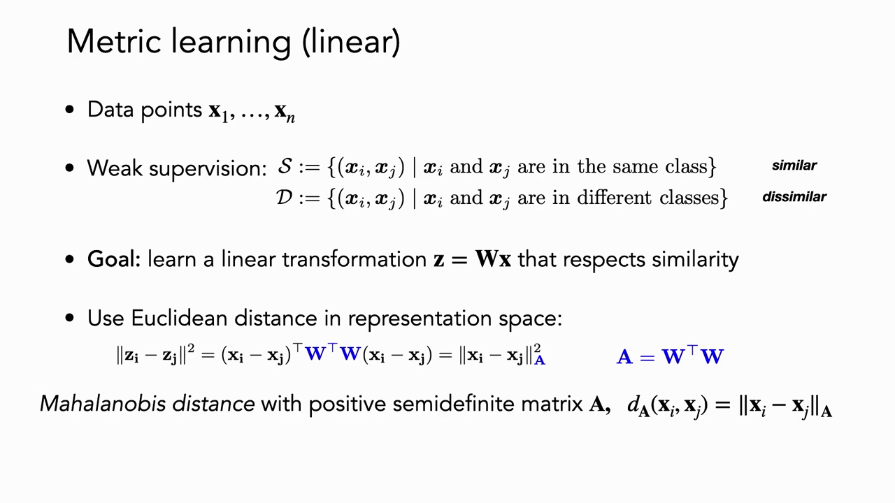
*▲ 강의 슬라이드 [17:32](https://youtu.be/yUh1fEGGdl4?t=1052): 선형 [거리 척도 학습](00_%EB%94%A5%EB%9F%AC%EB%8B%9D_%EC%9A%A9%EC%96%B4%EC%82%AC%EC%A0%84.md#metric-learning-%EA%B1%B0%EB%A6%AC-%EC%B2%99%EB%8F%84-%ED%95%99%EC%8A%B5). 약한 감독 $\mathcal{S}, \mathcal{D}$와 $\mathbf{z} = W\mathbf{x}$, [마할라노비스 거리](00_%EB%94%A5%EB%9F%AC%EB%8B%9D_%EC%9A%A9%EC%96%B4%EC%82%AC%EC%A0%84.md#mahalanobis-distance-%EB%A7%88%ED%95%A0%EB%9D%BC%EB%85%B8%EB%B9%84%EC%8A%A4-%EA%B1%B0%EB%A6%AC) $d_A$*

### 4.2 최적화 문제로 풀기

▶ 영상 [17:51](https://youtu.be/yUh1fEGGdl4?t=1071)

📐 **수학 개념**: [마할라노비스 거리와 양의 준정부호 행렬](%EC%88%98%ED%95%99%EA%B0%9C%EB%85%90/03_%EC%84%A0%ED%98%95%EB%8C%80%EC%88%98/MM43_%EB%A7%88%ED%95%A0%EB%9D%BC%EB%85%B8%EB%B9%84%EC%8A%A4_%EA%B1%B0%EB%A6%AC.md) · [argmin](%EC%88%98%ED%95%99%EA%B0%9C%EB%85%90/02_%EB%AF%B8%EB%B6%84/MM01_argmin%EA%B3%BC_argmax.md) · [시그마와 평균](%EC%88%98%ED%95%99%EA%B0%9C%EB%85%90/01_%EC%88%98%EC%99%80_%ED%95%A8%EC%88%98/M02_%EC%8B%9C%EA%B7%B8%EB%A7%88%EC%99%80_%ED%8F%89%EA%B7%A0.md)

- "[거리 척도 학습](00_%EB%94%A5%EB%9F%AC%EB%8B%9D_%EC%9A%A9%EC%96%B4%EC%82%AC%EC%A0%84.md#metric-learning-%EA%B1%B0%EB%A6%AC-%EC%B2%99%EB%8F%84-%ED%95%99%EC%8A%B5)"이라는 용어와 문제를 처음 정의한 Xing 등(2003)의 방법은 **제약이 있는 최적화 문제**입니다. PSD인 $A$ 가운데, 같은 쌍의 거리 합은 최소로 하면서 다른 쌍의 거리 합은 1(또는 어떤 $\epsilon$) 이상으로 지키는 $A$를 찾습니다. 같은 것은 최대한 당기되, 다른 것과는 일정한 여유(margin)를 강제하는 셈입니다.
- 목적과 제약을 바꿔, 같은 쌍의 거리를 상한 안에 두고 다른 쌍의 거리를 최대화해도 됩니다. 20년 넘게 많은 변형이 나왔고, 직접 풀 수 있는 문제입니다.
- 후속 연구로 정보 이론적 [거리 척도 학습](00_%EB%94%A5%EB%9F%AC%EB%8B%9D_%EC%9A%A9%EC%96%B4%EC%82%AC%EC%A0%84.md#metric-learning-%EA%B1%B0%EB%A6%AC-%EC%B2%99%EB%8F%84-%ED%95%99%EC%8A%B5)(Davis 등 2007)은 위·아래 한계를 제약으로 지키면서 분포 정보(가우스 분포 사이의 상대 [엔트로피](00_%EB%94%A5%EB%9F%AC%EB%8B%9D_%EC%9A%A9%EC%96%B4%EC%82%AC%EC%A0%84.md#entropy-%EC%97%94%ED%8A%B8%EB%A1%9C%ED%94%BC))를 보존합니다.

$$
\min_{A \succeq 0} \sum_{(i,j) \in \mathcal{S}} d_A(\mathbf{x}_i, \mathbf{x}_j)^2 \quad \text{s.t.} \quad \sum_{(k,l) \in \mathcal{D}} d_A(\mathbf{x}_k, \mathbf{x}_l)^2 \ge 1
$$

기호 풀이

| 기호 | 읽는 법 | 뜻 | 예제 값 |
| --- | --- | --- | --- |
| $\min_{A \succeq 0}$ | 에이에 대해 최소화 | PSD 행렬 $A$ 중에서 목적을 가장 작게 | |
| $\mathcal{S}$ | 에스 | 같은 부류인 쌍의 집합 | 차이 (0, 2)인 쌍 하나 |
| $\mathcal{D}$ | 디 | 다른 부류인 쌍의 집합 | 차이 (2, 0)인 쌍 하나 |
| $d_A(\cdot,\cdot)^2$ | 디 에이 제곱 | [마할라노비스 거리](00_%EB%94%A5%EB%9F%AC%EB%8B%9D_%EC%9A%A9%EC%96%B4%EC%82%AC%EC%A0%84.md#mahalanobis-distance-%EB%A7%88%ED%95%A0%EB%9D%BC%EB%85%B8%EB%B9%84%EC%8A%A4-%EA%B1%B0%EB%A6%AC) 제곱 | |
| s.t. | 서브젝트 투 | "다음 조건을 지키면서" | |
| $\ge 1$ | 1 이상 | 다른 쌍을 떨어뜨려 둘 여유 | |

예제와 풀이

**문제**: 같은 부류인 쌍 하나의 차이가 (0, 2), 다른 부류인 쌍 하나의 차이가 (2, 0)이다. 행렬 후보 $A = I$(보통의 거리)와 $A = \text{diag}(0.25, 0)$ 중, 제약(다른 쌍 거리 제곱 ≥ 1)을 지키면서 목적(같은 쌍 거리 제곱)을 더 작게 하는 것은?

**주어진 값**
- $\mathbf{d}_S = (0, 2)$: 같은 쌍의 차이 ($\mathcal{S}$에 쌍이 하나)
- $\mathbf{d}_D = (2, 0)$: 다른 쌍의 차이 ($\mathcal{D}$에 쌍이 하나)
- $A_1 = \text{diag}(1, 1)$: 첫째 후보 (단위행렬)
- $A_2 = \text{diag}(0.25, 0)$: 둘째 후보

**풀이**
1. 식을 그대로 쓴다: 목적 $= \sum_{\mathcal{S}} d_A^2 = \mathbf{d}_S^\top A\, \mathbf{d}_S$, 제약 $= \sum_{\mathcal{D}} d_A^2 = \mathbf{d}_D^\top A\, \mathbf{d}_D \ge 1$ (쌍이 하나씩이라 Σ는 항 하나)
2. 값을 대입한다 ($A_1$): 목적 $= (0, 2)^\top \text{diag}(1, 1)\,(0, 2)$, 제약 $= (2, 0)^\top \text{diag}(1, 1)\,(2, 0)$
3. 대각 행렬 식을 칸별로 푼다: $\mathbf{d}^\top \text{diag}(a_1, a_2)\,\mathbf{d} = a_1 d_1^2 + a_2 d_2^2$
4. $A_1$의 목적을 계산한다: $1\times0^2 + 1\times2^2 = 0 + 4 = 4$
5. $A_1$의 제약을 계산한다: $1\times2^2 + 1\times0^2 = 4 + 0 = 4$ → $4 \ge 1$ 만족
6. 둘째 후보를 대입한다 ($A_2$): 목적 $= (0, 2)^\top \text{diag}(0.25, 0)\,(0, 2)$, 제약 $= (2, 0)^\top \text{diag}(0.25, 0)\,(2, 0)$
7. $A_2$의 목적을 계산한다: $0.25\times0^2 + 0\times2^2 = 0 + 0 = 0$
8. $A_2$의 제약을 계산한다: $0.25\times2^2 + 0\times0^2 = 0.25\times4 + 0 = 1$ → $1 \ge 1$ 만족
9. 두 후보를 비교한다: 둘 다 제약을 지키고, 목적은 4 대 0

**답**: **$A = \text{diag}(0.25, 0)$**. 제약을 지키면서 목적이 4 → 0으로 줄었다. 같은 쌍을 다르게 만들던 둘째 좌표를 통째로 지운 것이다(아래 그림과 같은 원리).

내 이해

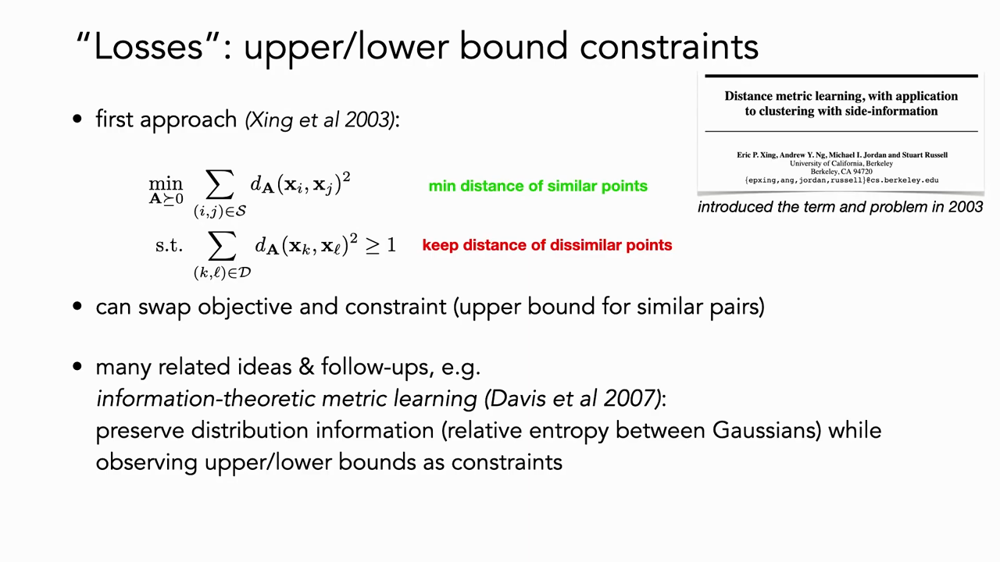
*▲ 강의 슬라이드 [19:46](https://youtu.be/yUh1fEGGdl4?t=1186): Xing 등(2003)의 첫 접근. 같은 점의 거리는 최소로, 다른 점의 거리는 일정 이상으로*

강사가 "아주 직관적"이라고 소개한 예는 이렇습니다. 빨강·파랑 두 부류가 있는데, 각 부류가 위아래 두 봉우리로 나뉘어 있습니다. 가장 단순한 최적 사영은 위아래 방향(한 축)을 지워 모든 점을 한 평면으로 눌러 버리는 것입니다. 그러면 두 부류가 쉽게 나뉩니다.

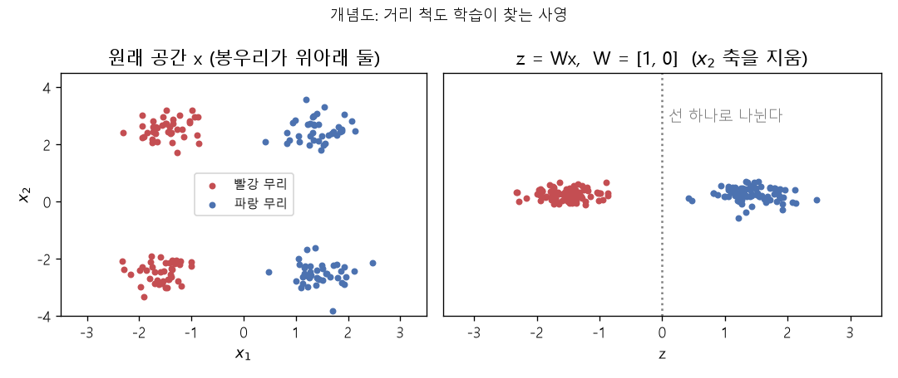
*▲ 직접 그린 그림: 개념도. 같은 부류 안의 차이가 $x_2$ 방향에만 있으면, $W = [1, 0]$으로 그 축을 지운 사영에서 두 부류가 선 하나로 나뉜다*

### 4.3 깊은 거리 척도 학습과 정규화

▶ 영상 [20:41](https://youtu.be/yUh1fEGGdl4?t=1241)

📐 **수학 개념**: [단위 구와 코사인 유사도](%EC%88%98%ED%95%99%EA%B0%9C%EB%85%90/03_%EC%84%A0%ED%98%95%EB%8C%80%EC%88%98/MM44_%EB%8B%A8%EC%9C%84_%EA%B5%AC%EC%99%80_%EC%BD%94%EC%82%AC%EC%9D%B8_%EC%9C%A0%EC%82%AC%EB%8F%84.md) · [노름](%EC%88%98%ED%95%99%EA%B0%9C%EB%85%90/03_%EC%84%A0%ED%98%95%EB%8C%80%EC%88%98/MM11_%EB%A6%BD%EC%8B%9C%EC%B8%A0_%EC%97%B0%EC%86%8D%EA%B3%BC_%EB%85%B8%EB%A6%84.md)

이 위에 쌓인 발전은 세 가지입니다.

1. **비선형 변환**: 커널이나 신경망. **깊은 [거리 척도 학습](00_%EB%94%A5%EB%9F%AC%EB%8B%9D_%EC%9A%A9%EC%96%B4%EC%82%AC%EC%A0%84.md#metric-learning-%EA%B1%B0%EB%A6%AC-%EC%B2%99%EB%8F%84-%ED%95%99%EC%8A%B5)**(deep metric learning)은 선형 $\mathbf{z} = W\mathbf{x}$ 대신 신경망 $\mathbf{z} = f(\mathbf{x})$를 배웁니다. 이제 PSD 행렬 집합이 아니라 신경망 [가중치](00_%EB%94%A5%EB%9F%AC%EB%8B%9D_%EC%9A%A9%EC%96%B4%EC%82%AC%EC%A0%84.md#weight-%EA%B0%80%EC%A4%91%EC%B9%98)에 대해 최적화하므로, [확률적 경사하강법](00_%EB%94%A5%EB%9F%AC%EB%8B%9D_%EC%9A%A9%EC%96%B4%EC%82%AC%EC%A0%84.md#stochastic-gradient-descent-%ED%99%95%EB%A5%A0%EC%A0%81-%EA%B2%BD%EC%82%AC%ED%95%98%EA%B0%95%EB%B2%95)을 쓸 수 있습니다.
2. **대조 [손실](00_%EB%94%A5%EB%9F%AC%EB%8B%9D_%EC%9A%A9%EC%96%B4%EC%82%AC%EC%A0%84.md#loss-function-%EC%86%90%EC%8B%A4-%ED%95%A8%EC%88%98)**: 5절에서 다룹니다.
3. **표현의 [정규화](00_%EB%94%A5%EB%9F%AC%EB%8B%9D_%EC%9A%A9%EC%96%B4%EC%82%AC%EC%A0%84.md#normalization-%EC%A0%95%EA%B7%9C%ED%99%94)**: 모든 표현을 길이 1로 맞춰 **[초구](00_%EB%94%A5%EB%9F%AC%EB%8B%9D_%EC%9A%A9%EC%96%B4%EC%82%AC%EC%A0%84.md#hypersphere-%EC%B4%88%EA%B5%AC)**(hypersphere) 위에 두면, 거리는 사실상 **각도**와 같아집니다. 그러면 유클리드 거리 대신 [내적](00_%EB%94%A5%EB%9F%AC%EB%8B%9D_%EC%9A%A9%EC%96%B4%EC%82%AC%EC%A0%84.md#dot-product-%EB%82%B4%EC%A0%81)으로 유사도를 잴 수 있고, 크기(scale) 때문에 값이 부풀려지는 일이 없어집니다.

$$
\|\mathbf{u} - \mathbf{v}\|^2 = 2 - 2\,\mathbf{u}^\top\mathbf{v} \qquad (\|\mathbf{u}\| = \|\mathbf{v}\| = 1)
$$

기호 풀이

| 기호 | 읽는 법 | 뜻 | 예제 값 |
| --- | --- | --- | --- |
| $\mathbf{u}, \mathbf{v}$ | 유, 브이 | 길이 1로 정규화한 두 표현 | (0.6, 0.8), (1, 0) |
| $\|\mathbf{u} - \mathbf{v}\|^2$ | 거리 제곱 | 구 위 두 점 사이 직선거리의 제곱 | 0.8 |
| $\mathbf{u}^\top\mathbf{v}$ | [내적](00_%EB%94%A5%EB%9F%AC%EB%8B%9D_%EC%9A%A9%EC%96%B4%EC%82%AC%EC%A0%84.md#dot-product-%EB%82%B4%EC%A0%81) | 단위 벡터끼리는 [코사인 유사도](00_%EB%94%A5%EB%9F%AC%EB%8B%9D_%EC%9A%A9%EC%96%B4%EC%82%AC%EC%A0%84.md#cosine-similarity-%EC%BD%94%EC%82%AC%EC%9D%B8-%EC%9C%A0%EC%82%AC%EB%8F%84) | 0.6 |
| $\|\mathbf{u}\| = 1$ | 길이 1 | [초구](00_%EB%94%A5%EB%9F%AC%EB%8B%9D_%EC%9A%A9%EC%96%B4%EC%82%AC%EC%A0%84.md#hypersphere-%EC%B4%88%EA%B5%AC) 위에 있다는 조건 | |

예제와 풀이

**문제**: 길이가 1인 두 표현 $\mathbf{u} = (0.6, 0.8)$, $\mathbf{v} = (1, 0)$의 거리 제곱을 식 $2 - 2\,\mathbf{u}^\top\mathbf{v}$로 구하고, 직접 계산과 비교하라.

**주어진 값**
- $\mathbf{u} = (0.6, 0.8)$: 첫째 표현 (단위 벡터)
- $\mathbf{v} = (1, 0)$: 둘째 표현 (단위 벡터)

**풀이**
1. 식을 그대로 쓴다: $\|\mathbf{u} - \mathbf{v}\|^2 = 2 - 2\,\mathbf{u}^\top\mathbf{v}$
2. 값을 대입한다: $\|\mathbf{u} - \mathbf{v}\|^2 = 2 - 2 \times (0.6, 0.8)^\top(1, 0)$
3. 길이부터 확인한다. [노름](00_%EB%94%A5%EB%9F%AC%EB%8B%9D_%EC%9A%A9%EC%96%B4%EC%82%AC%EC%A0%84.md#norm-%EB%85%B8%EB%A6%84)(길이)은 칸 제곱의 합에 √(제곱하면 그 수가 되는 양수)를 씌운 것: $\|\mathbf{u}\| = \sqrt{0.6^2 + 0.8^2} = \sqrt{0.36 + 0.64} = \sqrt{1} = 1$
4. $\mathbf{v}$도 확인한다: $\|\mathbf{v}\| = \sqrt{1^2 + 0^2} = 1$
5. [내적](00_%EB%94%A5%EB%9F%AC%EB%8B%9D_%EC%9A%A9%EC%96%B4%EC%82%AC%EC%A0%84.md#dot-product-%EB%82%B4%EC%A0%81)을 칸별로 곱한다: $0.6\times1 = 0.6$, $0.8\times0 = 0$
6. 곱을 더한다: $0.6 + 0 = 0.6$
7. 2를 곱한다: $2\times0.6 = 1.2$
8. 2에서 뺀다: $2 - 1.2 = 0.8$
9. 직접 확인한다. 칸별로 뺀다: $\mathbf{u} - \mathbf{v} = (0.6 - 1,\ 0.8 - 0) = (-0.4, 0.8)$
10. 칸별로 제곱한다: $(-0.4)^2 = 0.16$, $0.8^2 = 0.64$
11. 더한다: $0.16 + 0.64 = 0.8$

**답**: **0.8**. 구 위에서는 [내적](00_%EB%94%A5%EB%9F%AC%EB%8B%9D_%EC%9A%A9%EC%96%B4%EC%82%AC%EC%A0%84.md#dot-product-%EB%82%B4%EC%A0%81)을 키우는 것과 거리를 줄이는 것이 같은 일이다.

내 이해

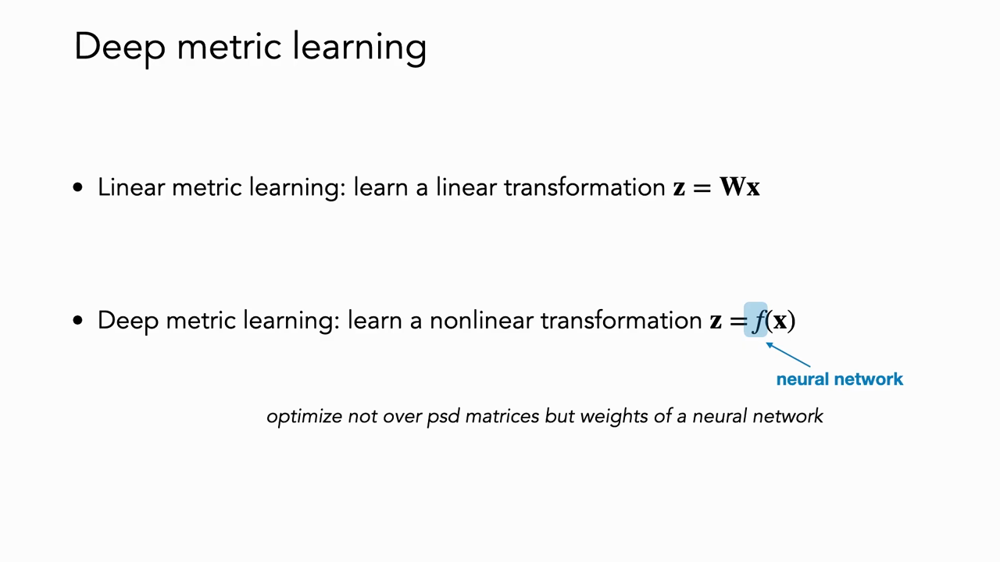
*▲ 강의 슬라이드 [22:02](https://youtu.be/yUh1fEGGdl4?t=1322): 선형 [거리 척도 학습](00_%EB%94%A5%EB%9F%AC%EB%8B%9D_%EC%9A%A9%EC%96%B4%EC%82%AC%EC%A0%84.md#metric-learning-%EA%B1%B0%EB%A6%AC-%EC%B2%99%EB%8F%84-%ED%95%99%EC%8A%B5)($\mathbf{z} = W\mathbf{x}$)과 깊은 [거리 척도 학습](00_%EB%94%A5%EB%9F%AC%EB%8B%9D_%EC%9A%A9%EC%96%B4%EC%82%AC%EC%A0%84.md#metric-learning-%EA%B1%B0%EB%A6%AC-%EC%B2%99%EB%8F%84-%ED%95%99%EC%8A%B5)($\mathbf{z} = f(\mathbf{x})$, $f$는 신경망)*

---

## 5. 대조 손실

▶ 영상 [21:47](https://youtu.be/yUh1fEGGdl4?t=1307)

**나방 비유**: 흰 나방 사진 두 장을 보여 주고 "같은 종류인가?"라고 물으면 답하기 어렵습니다. 범주가 "모든 나방"이면 같고, "흰 나방"이어도 같고, "종(species)"이면 모릅니다. (강사는 나비목 Lepidoptera를 "속(genus)"이라 했지만, 실제로는 **목(order)**이다.) 하지만 세 번째 나방을 보여 주고 "어느 둘이 더 비슷한가"를 물으면 어떤 세밀도를 원하든 쉽게 답할 수 있습니다. 이것을 기계 [학습](00_%EB%94%A5%EB%9F%AC%EB%8B%9D_%EC%9A%A9%EC%96%B4%EC%82%AC%EC%A0%84.md#training-%ED%95%99%EC%8A%B5)으로 옮긴 것이 **[대조 손실](00_%EB%94%A5%EB%9F%AC%EB%8B%9D_%EC%9A%A9%EC%96%B4%EC%82%AC%EC%A0%84.md#contrastive-learning-%EB%8C%80%EC%A1%B0-%ED%95%99%EC%8A%B5)**입니다. "다른 쌍의 거리 ≫ 같은 쌍의 거리"를 요구합니다.

### 5.1 삼중항 손실

▶ 영상 [23:32](https://youtu.be/yUh1fEGGdl4?t=1412)

📐 **수학 개념**: [삼중항 손실과 InfoNCE](%EC%88%98%ED%95%99%EA%B0%9C%EB%85%90/10_%ED%91%9C%ED%98%84_%ED%95%99%EC%8A%B5/MM45_%EC%82%BC%EC%A4%91%ED%95%AD_%EC%86%90%EC%8B%A4%EA%B3%BC_InfoNCE.md)

- **[삼중항 손실](00_%EB%94%A5%EB%9F%AC%EB%8B%9D_%EC%9A%A9%EC%96%B4%EC%82%AC%EC%A0%84.md#triplet-loss-%EC%82%BC%EC%A4%91%ED%95%AD-%EC%86%90%EC%8B%A4)(Triplet loss, Schroff 등 2015)**: 기준인 **앵커** $\mathbf{x}$, 앵커와 같은 **양성** $\mathbf{x}^+$, 앵커와 다른 **음성** $\mathbf{x}^-$ 세 개를 넣습니다([양성 쌍과 음성 쌍](00_%EB%94%A5%EB%9F%AC%EB%8B%9D_%EC%9A%A9%EC%96%B4%EC%82%AC%EC%A0%84.md#positive-pair-negative-pair-%EC%96%91%EC%84%B1-%EC%8C%8D%EA%B3%BC-%EC%9D%8C%EC%84%B1-%EC%8C%8D)). "앵커-음성 거리 > 앵커-양성 거리 + 여유(margin)"를 요구하고, 지켜지지 않으면 벌을 줍니다.
- 예: 처음에 모형이 앵커 말과 원숭이를 다른 말보다 더 가깝게 놓았다면, [경사하강](00_%EB%94%A5%EB%9F%AC%EB%8B%9D_%EC%9A%A9%EC%96%B4%EC%82%AC%EC%A0%84.md#gradient-descent-%EA%B2%BD%EC%82%AC%ED%95%98%EA%B0%95%EB%B2%95) 한 걸음이 말과 원숭이는 밀어내고 말과 말은 당깁니다.
- **삼중항 망(triplet network)**: 세 사진을 **[가중치를 공유하는](00_%EB%94%A5%EB%9F%AC%EB%8B%9D_%EC%9A%A9%EC%96%B4%EC%82%AC%EC%A0%84.md#weight-sharing-%EA%B0%80%EC%A4%91%EC%B9%98-%EA%B3%B5%EC%9C%A0)** 같은 [CNN](00_%EB%94%A5%EB%9F%AC%EB%8B%9D_%EC%9A%A9%EC%96%B4%EC%82%AC%EC%A0%84.md#cnn-convolutional-neural-network-%ED%95%A9%EC%84%B1%EA%B3%B1-%EC%8B%A0%EA%B2%BD%EB%A7%9D)에 통과시켜 [임베딩](00_%EB%94%A5%EB%9F%AC%EB%8B%9D_%EC%9A%A9%EC%96%B4%EC%82%AC%EC%A0%84.md#embedding-%EC%9E%84%EB%B2%A0%EB%94%A9) 세 개를 얻고, [삼중항 손실](00_%EB%94%A5%EB%9F%AC%EB%8B%9D_%EC%9A%A9%EC%96%B4%EC%82%AC%EC%A0%84.md#triplet-loss-%EC%82%BC%EC%A4%91%ED%95%AD-%EC%86%90%EC%8B%A4)을 계산한 뒤 [역전파](00_%EB%94%A5%EB%9F%AC%EB%8B%9D_%EC%9A%A9%EC%96%B4%EC%82%AC%EC%A0%84.md#backpropagation-%EC%97%AD%EC%A0%84%ED%8C%8C)합니다.
- **배치 활용**: 삼중항을 따로따로 넣는 대신 배치 하나를 통째로 불러와 그 안의 가능한 모든 양성·음성 조합으로 [손실](00_%EB%94%A5%EB%9F%AC%EB%8B%9D_%EC%9A%A9%EC%96%B4%EC%82%AC%EC%A0%84.md#loss-function-%EC%86%90%EC%8B%A4-%ED%95%A8%EC%88%98)을 계산하면 [학습](00_%EB%94%A5%EB%9F%AC%EB%8B%9D_%EC%9A%A9%EC%96%B4%EC%82%AC%EC%A0%84.md#training-%ED%95%99%EC%8A%B5) 효율이 좋아집니다(예: 리프티드 구조 [손실](00_%EB%94%A5%EB%9F%AC%EB%8B%9D_%EC%9A%A9%EC%96%B4%EC%82%AC%EC%A0%84.md#loss-function-%EC%86%90%EC%8B%A4-%ED%95%A8%EC%88%98), Song 등).

$$
\mathcal{L}_{\text{triplet}}(\mathbf{x}, \mathbf{x}^+, \mathbf{x}^-) = \max\!\big(0,\ \|f(\mathbf{x}) - f(\mathbf{x}^+)\|_2^2 - \|f(\mathbf{x}) - f(\mathbf{x}^-)\|_2^2 + \epsilon\big)
$$

기호 풀이

| 기호 | 읽는 법 | 뜻 | 예제 값 |
| --- | --- | --- | --- |
| $\mathbf{x}$ | 엑스 | 앵커 | $f(\mathbf{x}) = (1, 0)$ |
| $\mathbf{x}^+$ | 엑스 플러스 | 양성 (앵커와 같은 것) | $f(\mathbf{x}^+) = (0.6, 0.8)$ |
| $\mathbf{x}^-$ | 엑스 마이너스 | 음성 (앵커와 다른 것) | $f(\mathbf{x}^-) = (0.8, 0.6)$ |
| $f$ | 에프 | [임베딩](00_%EB%94%A5%EB%9F%AC%EB%8B%9D_%EC%9A%A9%EC%96%B4%EC%82%AC%EC%A0%84.md#embedding-%EC%9E%84%EB%B2%A0%EB%94%A9)을 만드는 신경망 (세 입력이 공유) | |
| $\|\cdot\|_2^2$ | 거리 제곱 | [임베딩](00_%EB%94%A5%EB%9F%AC%EB%8B%9D_%EC%9A%A9%EC%96%B4%EC%82%AC%EC%A0%84.md#embedding-%EC%9E%84%EB%B2%A0%EB%94%A9) 사이 유클리드 거리의 제곱 | 0.8, 0.4 |
| $\epsilon$ | 엡실론 | 여유(margin) | 0.2 |
| $\max(0, \cdot)$ | 맥스 | 조건을 이미 지키면 0 (힌지) | |

예제와 풀이

**문제**: 앵커의 [임베딩](00_%EB%94%A5%EB%9F%AC%EB%8B%9D_%EC%9A%A9%EC%96%B4%EC%82%AC%EC%A0%84.md#embedding-%EC%9E%84%EB%B2%A0%EB%94%A9)이 (1, 0), 양성이 (0.6, 0.8), 음성이 (0.8, 0.6)이고 여유가 0.2일 때 [삼중항 손실](00_%EB%94%A5%EB%9F%AC%EB%8B%9D_%EC%9A%A9%EC%96%B4%EC%82%AC%EC%A0%84.md#triplet-loss-%EC%82%BC%EC%A4%91%ED%95%AD-%EC%86%90%EC%8B%A4)은?

**주어진 값**
- $f(\mathbf{x}) = (1, 0)$: 앵커의 [임베딩](00_%EB%94%A5%EB%9F%AC%EB%8B%9D_%EC%9A%A9%EC%96%B4%EC%82%AC%EC%A0%84.md#embedding-%EC%9E%84%EB%B2%A0%EB%94%A9)
- $f(\mathbf{x}^+) = (0.6, 0.8)$: 양성의 [임베딩](00_%EB%94%A5%EB%9F%AC%EB%8B%9D_%EC%9A%A9%EC%96%B4%EC%82%AC%EC%A0%84.md#embedding-%EC%9E%84%EB%B2%A0%EB%94%A9)
- $f(\mathbf{x}^-) = (0.8, 0.6)$: 음성의 [임베딩](00_%EB%94%A5%EB%9F%AC%EB%8B%9D_%EC%9A%A9%EC%96%B4%EC%82%AC%EC%A0%84.md#embedding-%EC%9E%84%EB%B2%A0%EB%94%A9)
- $\epsilon = 0.2$: 여유(margin)

**풀이**
1. 식을 그대로 쓴다: $\mathcal{L} = \max\!\big(0,\ \|f(\mathbf{x}) - f(\mathbf{x}^+)\|_2^2 - \|f(\mathbf{x}) - f(\mathbf{x}^-)\|_2^2 + \epsilon\big)$
2. 값을 대입한다: $\mathcal{L} = \max\!\big(0,\ \|(1, 0) - (0.6, 0.8)\|_2^2 - \|(1, 0) - (0.8, 0.6)\|_2^2 + 0.2\big)$
3. 앵커와 양성을 칸별로 뺀다: $(1 - 0.6,\ 0 - 0.8) = (0.4, -0.8)$
4. 칸별로 제곱해 더한다: $0.4^2 + (-0.8)^2 = 0.16 + 0.64 = 0.8$
5. 앵커와 음성을 칸별로 뺀다: $(1 - 0.8,\ 0 - 0.6) = (0.2, -0.6)$
6. 칸별로 제곱해 더한다: $0.2^2 + (-0.6)^2 = 0.04 + 0.36 = 0.4$
7. 양성 거리에서 음성 거리를 뺀다: $0.8 - 0.4 = 0.4$
8. 여유를 더한다: $0.4 + 0.2 = 0.6$
9. max(0, ·)는 둘 중 큰 값을 고른다: $\max(0, 0.6) = 0.6$
10. 비교: 음성이 (0, 1)이었다면 앵커-음성 거리 제곱이 $1^2 + (-1)^2 = 2$ → $0.8 - 2 + 0.2 = -1$ → $\max(0, -1) = 0$

**답**: **0.6**. 음성이 양성보다 가까운 "어려운 음성"이라 큰 신호가 나온다. 멀리 있는 쉬운 음성은 [손실](00_%EB%94%A5%EB%9F%AC%EB%8B%9D_%EC%9A%A9%EC%96%B4%EC%82%AC%EC%A0%84.md#loss-function-%EC%86%90%EC%8B%A4-%ED%95%A8%EC%88%98) 0이다.

내 이해

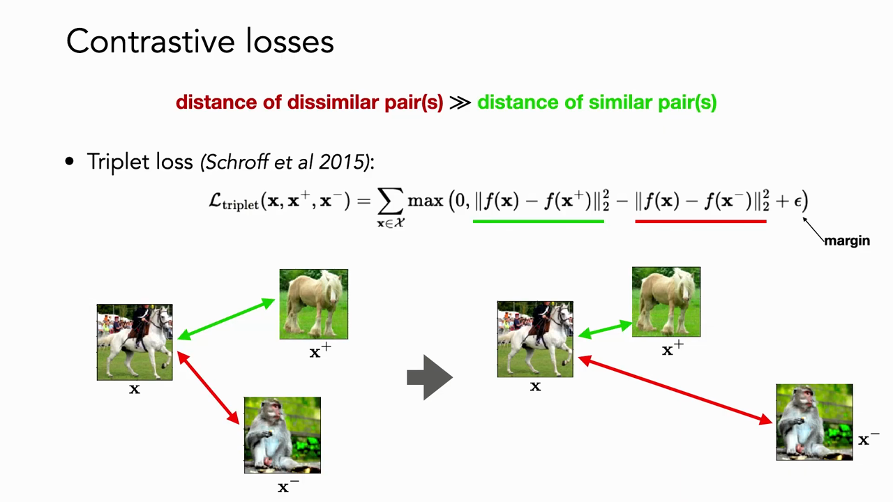
*▲ 강의 슬라이드 [25:17](https://youtu.be/yUh1fEGGdl4?t=1517): [삼중항 손실](00_%EB%94%A5%EB%9F%AC%EB%8B%9D_%EC%9A%A9%EC%96%B4%EC%82%AC%EC%A0%84.md#triplet-loss-%EC%82%BC%EC%A4%91%ED%95%AD-%EC%86%90%EC%8B%A4). [학습](00_%EB%94%A5%EB%9F%AC%EB%8B%9D_%EC%9A%A9%EC%96%B4%EC%82%AC%EC%A0%84.md#training-%ED%95%99%EC%8A%B5) 전에는 말(앵커)과 원숭이(음성)가 가깝지만, [학습](00_%EB%94%A5%EB%9F%AC%EB%8B%9D_%EC%9A%A9%EC%96%B4%EC%82%AC%EC%A0%84.md#training-%ED%95%99%EC%8A%B5) 뒤에는 말끼리 당겨지고 원숭이가 밀려난다*

### 5.2 하드 네거티브 마이닝

▶ 영상 [26:18](https://youtu.be/yUh1fEGGdl4?t=1578)

📐 **수학 개념**: [삼중항 손실과 InfoNCE](%EC%88%98%ED%95%99%EA%B0%9C%EB%85%90/10_%ED%91%9C%ED%98%84_%ED%95%99%EC%8A%B5/MM45_%EC%82%BC%EC%A4%91%ED%95%AD_%EC%86%90%EC%8B%A4%EA%B3%BC_InfoNCE.md)

- 표현이 이미 "양성이 음성보다 여유를 두고 가깝다"를 잘 잡은 삼중항은 [손실](00_%EB%94%A5%EB%9F%AC%EB%8B%9D_%EC%9A%A9%EC%96%B4%EC%82%AC%EC%A0%84.md#loss-function-%EC%86%90%EC%8B%A4-%ED%95%A8%EC%88%98)이 0이라 **신호가 없습니다**. 쉬운 것은 [학습](00_%EB%94%A5%EB%9F%AC%EB%8B%9D_%EC%9A%A9%EC%96%B4%EC%82%AC%EC%A0%84.md#training-%ED%95%99%EC%8A%B5)에 도움이 안 됩니다. 모형이 틀리는 **어려운 예**를 봐야 [기울기](00_%EB%94%A5%EB%9F%AC%EB%8B%9D_%EC%9A%A9%EC%96%B4%EC%82%AC%EC%A0%84.md#gradient-%EA%B8%B0%EC%9A%B8%EA%B8%B0)가 생깁니다.
- [삼중항 손실](00_%EB%94%A5%EB%9F%AC%EB%8B%9D_%EC%9A%A9%EC%96%B4%EC%82%AC%EC%A0%84.md#triplet-loss-%EC%82%BC%EC%A4%91%ED%95%AD-%EC%86%90%EC%8B%A4)로 Caltech-UCSD Birds(CUB) 데이터를 학습한 [임베딩](00_%EB%94%A5%EB%9F%AC%EB%8B%9D_%EC%9A%A9%EC%96%B4%EC%82%AC%EC%A0%84.md#embedding-%EC%9E%84%EB%B2%A0%EB%94%A9)에서는 비슷한 새끼리 모입니다. 그런데 한 무리를 보면 모두 제비갈매기이면서 **파란 하늘을 나는** 새입니다. 종 말고 배경 같은 것도 함께 배웠다는 뜻입니다.
- "두 이미지가 비슷하다"는 무엇일까요? 필(Phillip Isola)이 참여한 연구(Fu 등 2023)는 사람에게 직접 어느 쪽이 더 비슷한지 물었고, 사람은 자세, 시점, 전경 색, 물체 개수, 모양 등 여러 기준으로 판단했습니다. 어떤 비슷함이 쓸모 있는지는 결국 다음 과제가 정합니다.
- **[하드 네거티브 마이닝](00_%EB%94%A5%EB%9F%AC%EB%8B%9D_%EC%9A%A9%EC%96%B4%EC%82%AC%EC%A0%84.md#hard-negative-mining-%ED%95%98%EB%93%9C-%EB%84%A4%EA%B1%B0%ED%8B%B0%EB%B8%8C-%EB%A7%88%EC%9D%B4%EB%8B%9D)(Hard negative mining)**: 양성보다 앵커에 더 가깝게 잘못 놓인 음성을 찾아 [학습](00_%EB%94%A5%EB%9F%AC%EB%8B%9D_%EC%9A%A9%EC%96%B4%EC%82%AC%EC%A0%84.md#training-%ED%95%99%EC%8A%B5)에 씁니다. 어려운 것을 많이 찾을수록 빨리 배웁니다. 예: 자세·배경색이 비슷한 다른 종의 나방(겉모습은 비슷하지만 종이 다름)과 자세가 다른 같은 종의 나방. 자세·배경색은 모형이 무시해야 할 **교란 차원**입니다.
- 다만 이 모든 것은 [정답](00_%EB%94%A5%EB%9F%AC%EB%8B%9D_%EC%9A%A9%EC%96%B4%EC%82%AC%EC%A0%84.md#label-%EC%A0%95%EB%8B%B5)(무엇이 같고 다른지)을 이미 안다고 가정합니다.

---

## 6. 자기 지도 대조 학습

▶ 영상 [30:52](https://youtu.be/yUh1fEGGdl4?t=1852)

**[자기 지도](00_%EB%94%A5%EB%9F%AC%EB%8B%9D_%EC%9A%A9%EC%96%B4%EC%82%AC%EC%A0%84.md#self-supervised-learning-%EC%9E%90%EA%B8%B0-%EC%A7%80%EB%8F%84-%ED%95%99%EC%8A%B5) [대조 표현 학습](00_%EB%94%A5%EB%9F%AC%EB%8B%9D_%EC%9A%A9%EC%96%B4%EC%82%AC%EC%A0%84.md#contrastive-learning-%EB%8C%80%EC%A1%B0-%ED%95%99%EC%8A%B5)**은 [거리 척도 학습](00_%EB%94%A5%EB%9F%AC%EB%8B%9D_%EC%9A%A9%EC%96%B4%EC%82%AC%EC%A0%84.md#metric-learning-%EA%B1%B0%EB%A6%AC-%EC%B2%99%EB%8F%84-%ED%95%99%EC%8A%B5)의 아이디어에 자기 지도를 합쳐, 라벨 없이 좋은 출발점이 되는 표현을 만듭니다. 그리고 어떤 점에서는 라벨로 학습한 것보다 나을 수도 있습니다.

### 6.1 InfoNCE 손실

▶ 영상 [31:27](https://youtu.be/yUh1fEGGdl4?t=1887)

📐 **수학 개념**: [삼중항 손실과 InfoNCE](%EC%88%98%ED%95%99%EA%B0%9C%EB%85%90/10_%ED%91%9C%ED%98%84_%ED%95%99%EC%8A%B5/MM45_%EC%82%BC%EC%A4%91%ED%95%AD_%EC%86%90%EC%8B%A4%EA%B3%BC_InfoNCE.md) · [단위 구와 코사인 유사도](%EC%88%98%ED%95%99%EA%B0%9C%EB%85%90/03_%EC%84%A0%ED%98%95%EB%8C%80%EC%88%98/MM44_%EB%8B%A8%EC%9C%84_%EA%B5%AC%EC%99%80_%EC%BD%94%EC%82%AC%EC%9D%B8_%EC%9C%A0%EC%82%AC%EB%8F%84.md) · [엔트로피](%EC%88%98%ED%95%99%EA%B0%9C%EB%85%90/04_%ED%99%95%EB%A5%A0%EA%B3%BC_%EC%A0%95%EB%B3%B4/M10_%EC%97%94%ED%8A%B8%EB%A1%9C%ED%94%BC.md) · [지수와 e](%EC%88%98%ED%95%99%EA%B0%9C%EB%85%90/01_%EC%88%98%EC%99%80_%ED%95%A8%EC%88%98/M06_%EC%A7%80%EC%88%98%EC%99%80_e.md)

- 흔한 설정: 인코더 $f: \mathcal{X} \to \mathbb{S}^{d-1}$이 데이터를 **[초구](00_%EB%94%A5%EB%9F%AC%EB%8B%9D_%EC%9A%A9%EC%96%B4%EC%82%AC%EC%A0%84.md#hypersphere-%EC%B4%88%EA%B5%AC)** 위로 보냅니다([정규화](00_%EB%94%A5%EB%9F%AC%EB%8B%9D_%EC%9A%A9%EC%96%B4%EC%82%AC%EC%A0%84.md#normalization-%EC%A0%95%EA%B7%9C%ED%99%94)). 그리고 유사도로 정의한 "부류"를 가려내는 [소프트맥스](00_%EB%94%A5%EB%9F%AC%EB%8B%9D_%EC%9A%A9%EC%96%B4%EC%82%AC%EC%A0%84.md#softmax-%EC%86%8C%ED%94%84%ED%8A%B8%EB%A7%A5%EC%8A%A4) 분류기의 [교차 엔트로피](00_%EB%94%A5%EB%9F%AC%EB%8B%9D_%EC%9A%A9%EC%96%B4%EC%82%AC%EC%A0%84.md#cross-entropy-%EA%B5%90%EC%B0%A8-%EC%97%94%ED%8A%B8%EB%A1%9C%ED%94%BC)를 [손실](00_%EB%94%A5%EB%9F%AC%EB%8B%9D_%EC%9A%A9%EC%96%B4%EC%82%AC%EC%A0%84.md#loss-function-%EC%86%90%EC%8B%A4-%ED%95%A8%EC%88%98)로 씁니다.
- 구 위에 있으므로 거리 대신 **[내적](00_%EB%94%A5%EB%9F%AC%EB%8B%9D_%EC%9A%A9%EC%96%B4%EC%82%AC%EC%A0%84.md#dot-product-%EB%82%B4%EC%A0%81)**을 씁니다. 같은 쌍의 [내적](00_%EB%94%A5%EB%9F%AC%EB%8B%9D_%EC%9A%A9%EC%96%B4%EC%82%AC%EC%A0%84.md#dot-product-%EB%82%B4%EC%A0%81)이 1에 가까울수록 구 위에서 가깝습니다. 분자(초록, 양성 쌍)는 크게, 분모의 음성 항들(빨강)은 작게 만들면 [손실](00_%EB%94%A5%EB%9F%AC%EB%8B%9D_%EC%9A%A9%EC%96%B4%EC%82%AC%EC%A0%84.md#loss-function-%EC%86%90%EC%8B%A4-%ED%95%A8%EC%88%98)이 줄어듭니다. 양성 쌍은 **당기고**, 음성 쌍은 **밉니다**.
- 가정 두 가지: **대칭성**(누가 앵커든 양성 쌍의 [확률](00_%EB%94%A5%EB%9F%AC%EB%8B%9D_%EC%9A%A9%EC%96%B4%EC%82%AC%EC%A0%84.md#probability-%ED%99%95%EB%A5%A0)은 같다, $p_{\text{pos}}(\mathbf{x}, \mathbf{x}^+) = p_{\text{pos}}(\mathbf{x}^+, \mathbf{x})$), **주변 분포 일치**(양성 쌍의 한쪽을 적분해 없애면 데이터 분포가 된다).
- 이것이 잡음 대조 추정(noise contrastive estimation) 계열의 **[InfoNCE](00_%EB%94%A5%EB%9F%AC%EB%8B%9D_%EC%9A%A9%EC%96%B4%EC%82%AC%EC%A0%84.md#infonce-infonce-%EC%86%90%EC%8B%A4)** [손실](00_%EB%94%A5%EB%9F%AC%EB%8B%9D_%EC%9A%A9%EC%96%B4%EC%82%AC%EC%A0%84.md#loss-function-%EC%86%90%EC%8B%A4-%ED%95%A8%EC%88%98)입니다. 자기 지도로 쓰면, 데이터 하나를 여러 증강으로 흔든 것들이 "자기 자신과 같다"는 것을 배우게 됩니다. 이 방식은 일부 과제에서 **지도 [사전 학습](00_%EB%94%A5%EB%9F%AC%EB%8B%9D_%EC%9A%A9%EC%96%B4%EC%82%AC%EC%A0%84.md#pre-training-%EC%82%AC%EC%A0%84-%ED%95%99%EC%8A%B5)보다 나은** 결과를 냈습니다(He 등 2020, Misra·van der Maaten 2020).

$$
\mathcal{L}_{\text{cont}}(f) = \mathbb{E}_{\substack{(\mathbf{x}, \mathbf{x}^+) \sim p_{\text{pos}} \\ \{\mathbf{x}_i^-\}_{i=1}^{N} \sim p_{\text{data}}}}\left[ -\log \frac{e^{f(\mathbf{x})^\top f(\mathbf{x}^+)/\tau}}{e^{f(\mathbf{x})^\top f(\mathbf{x}^+)/\tau} + \sum_{i=1}^{N} e^{f(\mathbf{x})^\top f(\mathbf{x}_i^-)/\tau}} \right]
$$

기호 풀이

| 기호 | 읽는 법 | 뜻 | 예제 값 |
| --- | --- | --- | --- |
| $f$ | 에프 | 입력을 [초구](00_%EB%94%A5%EB%9F%AC%EB%8B%9D_%EC%9A%A9%EC%96%B4%EC%82%AC%EC%A0%84.md#hypersphere-%EC%B4%88%EA%B5%AC) $\mathbb{S}^{d-1}$로 보내는 인코더 | |
| $(\mathbf{x}, \mathbf{x}^+) \sim p_{\text{pos}}$ | 양성 쌍 | 같은 것의 두 보기 (예: 두 증강) | |
| $\mathbf{x}_i^- \sim p_{\text{data}}$ | 음성 | 데이터에서 무작위로 뽑은 다른 표본 | 2개 |
| $N$ | 엔 | 음성 개수 | 2 |
| $f(\mathbf{x})^\top f(\mathbf{x}^+)$ | [내적](00_%EB%94%A5%EB%9F%AC%EB%8B%9D_%EC%9A%A9%EC%96%B4%EC%82%AC%EC%A0%84.md#dot-product-%EB%82%B4%EC%A0%81) | 양성 쌍의 [코사인 유사도](00_%EB%94%A5%EB%9F%AC%EB%8B%9D_%EC%9A%A9%EC%96%B4%EC%82%AC%EC%A0%84.md#cosine-similarity-%EC%BD%94%EC%82%AC%EC%9D%B8-%EC%9C%A0%EC%82%AC%EB%8F%84) | 0.8 |
| $f(\mathbf{x})^\top f(\mathbf{x}_i^-)$ | [내적](00_%EB%94%A5%EB%9F%AC%EB%8B%9D_%EC%9A%A9%EC%96%B4%EC%82%AC%EC%A0%84.md#dot-product-%EB%82%B4%EC%A0%81) | 음성과의 유사도 | 0.2, -0.1 |
| $\tau$ | 타우 | 온도. 유사도 차이를 얼마나 부풀릴지 | 0.5 |
| $\mathbb{E}$ | [기댓값](00_%EB%94%A5%EB%9F%AC%EB%8B%9D_%EC%9A%A9%EC%96%B4%EC%82%AC%EC%A0%84.md#expectation-%EA%B8%B0%EB%8C%93%EA%B0%92) | 여러 쌍에 대한 평균 | |
| $\mathcal{L}_{\text{cont}}$ | 대조 [손실](00_%EB%94%A5%EB%9F%AC%EB%8B%9D_%EC%9A%A9%EC%96%B4%EC%82%AC%EC%A0%84.md#loss-function-%EC%86%90%EC%8B%A4-%ED%95%A8%EC%88%98) | 양성 칸 [소프트맥스](00_%EB%94%A5%EB%9F%AC%EB%8B%9D_%EC%9A%A9%EC%96%B4%EC%82%AC%EC%A0%84.md#softmax-%EC%86%8C%ED%94%84%ED%8A%B8%EB%A7%A5%EC%8A%A4) [확률](00_%EB%94%A5%EB%9F%AC%EB%8B%9D_%EC%9A%A9%EC%96%B4%EC%82%AC%EC%A0%84.md#probability-%ED%99%95%EB%A5%A0)의 $-\log$ | 0.3829 |

예제와 풀이

**문제**: 앵커와 양성의 유사도가 0.8, 앵커와 음성 두 개의 유사도가 0.2와 -0.1, 온도가 0.5인 쌍 하나의 [InfoNCE 손실](00_%EB%94%A5%EB%9F%AC%EB%8B%9D_%EC%9A%A9%EC%96%B4%EC%82%AC%EC%A0%84.md#infonce-infonce-%EC%86%90%EC%8B%A4)은?

**주어진 값**
- $f(\mathbf{x})^\top f(\mathbf{x}^+) = 0.8$: 양성과의 유사도 ([내적](00_%EB%94%A5%EB%9F%AC%EB%8B%9D_%EC%9A%A9%EC%96%B4%EC%82%AC%EC%A0%84.md#dot-product-%EB%82%B4%EC%A0%81))
- $f(\mathbf{x})^\top f(\mathbf{x}_1^-) = 0.2$, $f(\mathbf{x})^\top f(\mathbf{x}_2^-) = -0.1$: 음성과의 유사도
- $N = 2$: 음성 개수
- $\tau = 0.5$: 온도

**풀이**
1. 식을 그대로 쓴다: $\mathcal{L} = -\log \dfrac{e^{f(\mathbf{x})^\top f(\mathbf{x}^+)/\tau}}{e^{f(\mathbf{x})^\top f(\mathbf{x}^+)/\tau} + \sum_{i=1}^{N} e^{f(\mathbf{x})^\top f(\mathbf{x}_i^-)/\tau}}$
2. 값을 대입한다: $\mathcal{L} = -\log \dfrac{e^{0.8/0.5}}{e^{0.8/0.5} + \sum_{i=1}^{2} e^{s_i^-/0.5}}$ (단 $s_1^- = 0.2$, $s_2^- = -0.1$)
3. Σ를 풀어 쓴다 (i = 1, 2를 차례로 더함): $\sum_{i=1}^{2} e^{s_i^-/0.5} = e^{0.2/0.5} + e^{-0.1/0.5}$
4. 온도로 나눈다: $0.8/0.5 = 1.6$, $0.2/0.5 = 0.4$, $-0.1/0.5 = -0.2$
5. [지수](00_%EB%94%A5%EB%9F%AC%EB%8B%9D_%EC%9A%A9%EC%96%B4%EC%82%AC%EC%A0%84.md#e-exponent-e%EC%99%80-%EC%A7%80%EC%88%98)를 계산한다. $e^{a}$는 약 2.718인 수 $e$를 $a$제곱한 값: $e^{1.6} = 4.953$, $e^{0.4} = 1.4918$, $e^{-0.2} = 0.8187$
6. 분모를 더한다: $4.953 + 1.4918 + 0.8187 = 7.2636$
7. 분자를 분모로 나눈다: $4.953 / 7.2636 = 0.6819$ (양성 칸의 [소프트맥스](00_%EB%94%A5%EB%9F%AC%EB%8B%9D_%EC%9A%A9%EC%96%B4%EC%82%AC%EC%A0%84.md#softmax-%EC%86%8C%ED%94%84%ED%8A%B8%EB%A7%A5%EC%8A%A4) [확률](00_%EB%94%A5%EB%9F%AC%EB%8B%9D_%EC%9A%A9%EC%96%B4%EC%82%AC%EC%A0%84.md#probability-%ED%99%95%EB%A5%A0))
8. [로그](00_%EB%94%A5%EB%9F%AC%EB%8B%9D_%EC%9A%A9%EC%96%B4%EC%82%AC%EC%A0%84.md#log-ln-%EB%A1%9C%EA%B7%B8)를 계산한다. $\ln y$는 $e$를 몇 제곱해야 $y$가 되는지: $\ln 0.6819 = -0.3829$
9. 부호를 바꾼다: $-(-0.3829) = 0.3829$

**답**: **0.3829**. 양성 유사도를 키우거나 음성 유사도를 줄이면 [확률](00_%EB%94%A5%EB%9F%AC%EB%8B%9D_%EC%9A%A9%EC%96%B4%EC%82%AC%EC%A0%84.md#probability-%ED%99%95%EB%A5%A0)이 1에 가까워지고 [손실](00_%EB%94%A5%EB%9F%AC%EB%8B%9D_%EC%9A%A9%EC%96%B4%EC%82%AC%EC%A0%84.md#loss-function-%EC%86%90%EC%8B%A4-%ED%95%A8%EC%88%98)이 0에 가까워진다.

내 이해

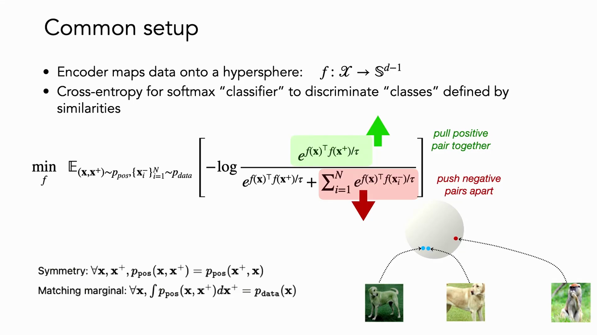
*▲ 강의 슬라이드 [33:52](https://youtu.be/yUh1fEGGdl4?t=2032): 흔한 설정. [초구](00_%EB%94%A5%EB%9F%AC%EB%8B%9D_%EC%9A%A9%EC%96%B4%EC%82%AC%EC%A0%84.md#hypersphere-%EC%B4%88%EA%B5%AC) 위의 인코더와 [소프트맥스](00_%EB%94%A5%EB%9F%AC%EB%8B%9D_%EC%9A%A9%EC%96%B4%EC%82%AC%EC%A0%84.md#softmax-%EC%86%8C%ED%94%84%ED%8A%B8%EB%A7%A5%EC%8A%A4) [교차 엔트로피](00_%EB%94%A5%EB%9F%AC%EB%8B%9D_%EC%9A%A9%EC%96%B4%EC%82%AC%EC%A0%84.md#cross-entropy-%EA%B5%90%EC%B0%A8-%EC%97%94%ED%8A%B8%EB%A1%9C%ED%94%BC). 초록은 양성 쌍 당기기, 빨강은 음성 쌍 밀기. 아래는 대칭성과 주변 분포 일치 가정*

**왜 [초구](00_%EB%94%A5%EB%9F%AC%EB%8B%9D_%EC%9A%A9%EC%96%B4%EC%82%AC%EC%A0%84.md#hypersphere-%EC%B4%88%EA%B5%AC)로 보내나** [35:23](https://youtu.be/yUh1fEGGdl4?t=2123)
- [학습](00_%EB%94%A5%EB%9F%AC%EB%8B%9D_%EC%9A%A9%EC%96%B4%EC%82%AC%EC%A0%84.md#training-%ED%95%99%EC%8A%B5)이 더 안정적입니다. [로지스틱 회귀](00_%EB%94%A5%EB%9F%AC%EB%8B%9D_%EC%9A%A9%EC%96%B4%EC%82%AC%EC%A0%84.md#logistic-regression-%EB%A1%9C%EC%A7%80%EC%8A%A4%ED%8B%B1-%ED%9A%8C%EA%B7%80)가 [규제](00_%EB%94%A5%EB%9F%AC%EB%8B%9D_%EC%9A%A9%EC%96%B4%EC%82%AC%EC%A0%84.md#regularization-%EA%B7%9C%EC%A0%9C)를 필요로 하듯, 크기를 변화의 차원으로 두지 않으면 [규제](00_%EB%94%A5%EB%9F%AC%EB%8B%9D_%EC%9A%A9%EC%96%B4%EC%82%AC%EC%A0%84.md#regularization-%EA%B7%9C%EC%A0%9C) 효과가 있습니다.
- 같은 것끼리 뭉치고 다른 것끼리 떨어지게 구 위에 놓이면, 구를 한 번 자르는 평면(선형 분류기)으로 늘 부류를 떼어 낼 수 있습니다. 즉 [선형 분리](00_%EB%94%A5%EB%9F%AC%EB%8B%9D_%EC%9A%A9%EC%96%B4%EC%82%AC%EC%A0%84.md#decision-boundary-%EA%B2%B0%EC%A0%95-%EA%B2%BD%EA%B3%84)가 가능합니다.

### 6.2 증강으로 양성 쌍 만들기: SimCLR

▶ 영상 [36:29](https://youtu.be/yUh1fEGGdl4?t=2189)

- 라벨 없이 어떻게 같음/다름 신호를 얻을까요? **음성**은 데이터에서 무작위로 고르고, **양성**은 같은 사진을 이상하게 바꿔서 만듭니다. 자르고 크기 바꾸기, 뒤집기, 색 왜곡·떨림·제거, 회전, 일부 지우기(cutout), 가우스 잡음, 가우스 흐림, 소벨 [필터](00_%EB%94%A5%EB%9F%AC%EB%8B%9D_%EC%9A%A9%EC%96%B4%EC%82%AC%EC%A0%84.md#filter-%ED%95%84%ED%84%B0)(윤곽만 남김) 등입니다. 이것이 **[데이터 증강](00_%EB%94%A5%EB%9F%AC%EB%8B%9D_%EC%9A%A9%EC%96%B4%EC%82%AC%EC%A0%84.md#data-augmentation-%EB%8D%B0%EC%9D%B4%ED%84%B0-%EC%A6%9D%EA%B0%95)([Data augmentation](00_%EB%94%A5%EB%9F%AC%EB%8B%9D_%EC%9A%A9%EC%96%B4%EC%82%AC%EC%A0%84.md#data-augmentation-%EB%8D%B0%EC%9D%B4%ED%84%B0-%EC%A6%9D%EA%B0%95))**입니다.
- **[SimCLR](00_%EB%94%A5%EB%9F%AC%EB%8B%9D_%EC%9A%A9%EC%96%B4%EC%82%AC%EC%A0%84.md#simclr-simclr-%EB%8C%80%EC%A1%B0-%ED%95%99%EC%8A%B5)**(Chen 등 2020): 배치의 모든 데이터마다 무작위 증강 두 개를 만들어 양성 쌍으로 씁니다. 크기 $B$인 배치에서 나머지 $2(B-1)$개 증강 표본은 모두 음성입니다. 같은 것을 적당히 흔든 것은 가깝게, 나머지는 멀게 합니다.

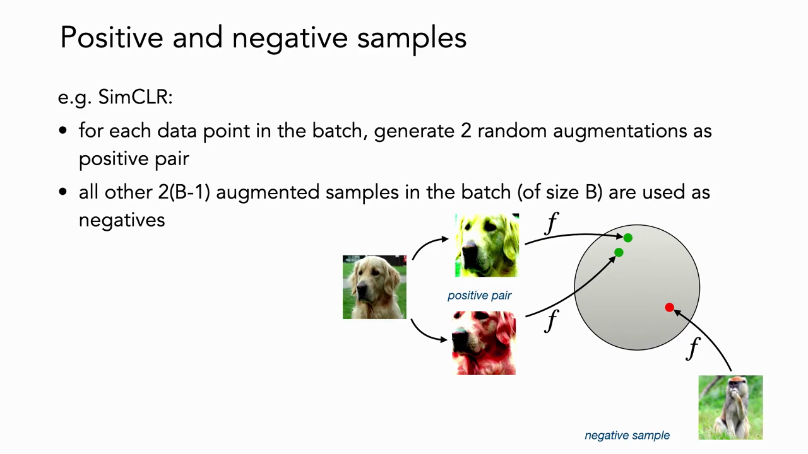
*▲ 강의 슬라이드 [37:42](https://youtu.be/yUh1fEGGdl4?t=2262): [SimCLR](00_%EB%94%A5%EB%9F%AC%EB%8B%9D_%EC%9A%A9%EC%96%B4%EC%82%AC%EC%A0%84.md#simclr-simclr-%EB%8C%80%EC%A1%B0-%ED%95%99%EC%8A%B5). 한 사진의 두 증강이 양성 쌍(초록 점), 배치의 다른 표본이 음성(빨강 점)*

- **증강은 데이터 종류마다 다릅니다**. 이미지의 뒤집기는 "물체는 뒤집어도 같다"는 강한 가정입니다. 왼쪽 신발과 오른쪽 신발을 구별해야 하는 과제에서 뒤집기 증강을 쓰면 구별이 거의 불가능해집니다. 분자 데이터라면 어떤 변형이 같은 분자로 봐도 되는지 분야 지식을 넣어야 합니다. 글, 영상도 마찬가지입니다. 그래서 **증강의 선택이 매우 중요**합니다.

질의응답 정리 [37:39](https://youtu.be/yUh1fEGGdl4?t=2259)

- **데이터에 같은 대상의 사진이 여러 장 있으면?** 실제로 문제가 됩니다. 같은 개의 다른 사진이 음성으로 들어가면 [학습](00_%EB%94%A5%EB%9F%AC%EB%8B%9D_%EC%9A%A9%EC%96%B4%EC%82%AC%EC%A0%84.md#training-%ED%95%99%EC%8A%B5)을 헷갈리게 합니다. 지도 정보 등으로 이런 "음성 아닌 음성"을 빼면 표현이 크게 좋아진다는 연구가 있습니다(8.3절).
- **이미지가 아닌 데이터의 증강은?** 데이터마다 다르며, 무엇에 불변이어야 하는지 분야 지식을 넣어야 합니다(위 본문).
- **이 방식이 다른 골든 리트리버 사진끼리 가까워지게 보장하나?** 한 [학습](00_%EB%94%A5%EB%9F%AC%EB%8B%9D_%EC%9A%A9%EC%96%B4%EC%82%AC%EC%A0%84.md#training-%ED%95%99%EC%8A%B5) 단계만 보면 아무 보장이 없습니다. 하지만 수많은 조합과 무작위 증강을 거치며, 대부분의 경우 "골든 리트리버 두 증강 대 보트"처럼 음성이 진짜 다른 것이므로, 오랜 [학습](00_%EB%94%A5%EB%9F%AC%EB%8B%9D_%EC%9A%A9%EC%96%B4%EC%82%AC%EC%A0%84.md#training-%ED%95%99%EC%8A%B5) 뒤에는 골든 리트리버 같은 것들이 대체로 가까이 모입니다. 잡음이 평균되어 사라지는 셈입니다.

### 6.3 그 밖의 보기(view) 만들기

▶ 영상 [42:11](https://youtu.be/yUh1fEGGdl4?t=2531)

증강 말고도 "같은 장면의 두 보기"를 만드는 영리한 방법이 많습니다.

| 방법 | 양성 쌍 | 배우는 것 |
|---|---|---|
| 교차 [채널](00_%EB%94%A5%EB%9F%AC%EB%8B%9D_%EC%9A%A9%EC%96%B4%EC%82%AC%EC%A0%84.md#channel-%EC%B1%84%EB%84%90) (CMC, Tian·Krishnan·Isola 2020) | 장면의 컬러 이미지와 깊이 이미지 (RGB-D) | 장면 구조 |
| 영상 [표현 학습](00_%EB%94%A5%EB%9F%AC%EB%8B%9D_%EC%9A%A9%EC%96%B4%EC%82%AC%EC%A0%84.md#representation-learning-%ED%91%9C%ED%98%84-%ED%95%99%EC%8A%B5) | 같은 영상에서 무작위로 뽑은 두 프레임 (다른 영상 프레임은 음성) | 시간에 따른 유사도 |
| 시각-언어 ([CLIP](00_%EB%94%A5%EB%9F%AC%EB%8B%9D_%EC%9A%A9%EC%96%B4%EC%82%AC%EC%A0%84.md#clip-%ED%81%B4%EB%A6%BD) 등) | 이미지와 그 설명 글 | 글과 맞는 이미지는 가깝게, 안 맞는 이미지는 멀게 |

요즘 연구의 상당수는 사람이 단 라벨(비싸다) 없이 모형을 감독하는 창의적인 방법을 찾는 일이라고 강사는 말합니다.

---

## 7. 대조 손실은 무엇을 하나

▶ 영상 [43:19](https://youtu.be/yUh1fEGGdl4?t=2599)

이 방법이 잘 되는 데는 두 재료가 있습니다. 하나는 **대조 [손실](00_%EB%94%A5%EB%9F%AC%EB%8B%9D_%EC%9A%A9%EC%96%B4%EC%82%AC%EC%A0%84.md#loss-function-%EC%86%90%EC%8B%A4-%ED%95%A8%EC%88%98)**(어떤 꼴의 [손실](00_%EB%94%A5%EB%9F%AC%EB%8B%9D_%EC%9A%A9%EC%96%B4%EC%82%AC%EC%A0%84.md#loss-function-%EC%86%90%EC%8B%A4-%ED%95%A8%EC%88%98)을 쓰는가), 다른 하나는 **데이터**(어떤 양성·음성 쌍을 보여 주는가)입니다. 먼저 [손실](00_%EB%94%A5%EB%9F%AC%EB%8B%9D_%EC%9A%A9%EC%96%B4%EC%82%AC%EC%A0%84.md#loss-function-%EC%86%90%EC%8B%A4-%ED%95%A8%EC%88%98)을 봅니다.

### 7.1 상호 정보량의 하한

▶ 영상 [43:53](https://youtu.be/yUh1fEGGdl4?t=2633)

📐 **수학 개념**: [삼중항 손실과 InfoNCE](%EC%88%98%ED%95%99%EA%B0%9C%EB%85%90/10_%ED%91%9C%ED%98%84_%ED%95%99%EC%8A%B5/MM45_%EC%82%BC%EC%A4%91%ED%95%AD_%EC%86%90%EC%8B%A4%EA%B3%BC_InfoNCE.md) · [엔트로피](%EC%88%98%ED%95%99%EA%B0%9C%EB%85%90/04_%ED%99%95%EB%A5%A0%EA%B3%BC_%EC%A0%95%EB%B3%B4/M10_%EC%97%94%ED%8A%B8%EB%A1%9C%ED%94%BC.md)

- 대조 [손실](00_%EB%94%A5%EB%9F%AC%EB%8B%9D_%EC%9A%A9%EC%96%B4%EC%82%AC%EC%A0%84.md#loss-function-%EC%86%90%EC%8B%A4-%ED%95%A8%EC%88%98)은 데이터 점들을 가려내는 [교차 엔트로피](00_%EB%94%A5%EB%9F%AC%EB%8B%9D_%EC%9A%A9%EC%96%B4%EC%82%AC%EC%A0%84.md#cross-entropy-%EA%B5%90%EC%B0%A8-%EC%97%94%ED%8A%B8%EB%A1%9C%ED%94%BC)입니다. 수학적으로는 두 보기 $f(\mathbf{x}), f(\mathbf{x}^+)$ 사이의 **[상호 정보량](00_%EB%94%A5%EB%9F%AC%EB%8B%9D_%EC%9A%A9%EC%96%B4%EC%82%AC%EC%A0%84.md#mutual-information-%EC%83%81%ED%98%B8-%EC%A0%95%EB%B3%B4%EB%9F%89)**(mutual information)의 하한 $\text{MI}(f(\mathbf{x}), f(\mathbf{x}^+)) \ge \log N - \mathcal{L}$을 최대화하는 것으로도 해석합니다(Poole 등 2019).
- 그런데 Tschannen 등(2020)은 표준 대조 [손실](00_%EB%94%A5%EB%9F%AC%EB%8B%9D_%EC%9A%A9%EC%96%B4%EC%82%AC%EC%A0%84.md#loss-function-%EC%86%90%EC%8B%A4-%ED%95%A8%EC%88%98) 대신 [상호 정보량](00_%EB%94%A5%EB%9F%AC%EB%8B%9D_%EC%9A%A9%EC%96%B4%EC%82%AC%EC%A0%84.md#mutual-information-%EC%83%81%ED%98%B8-%EC%A0%95%EB%B3%B4%EB%9F%89)만 직접 최대화하면 **다음 과제 성능이 오히려 나빠지고**, 더 느슨한 하한과 더 단순한 [판별기](00_%EB%94%A5%EB%9F%AC%EB%8B%9D_%EC%9A%A9%EC%96%B4%EC%82%AC%EC%A0%84.md#generator-discriminator-%EC%83%9D%EC%84%B1%EA%B8%B0%EC%99%80-%ED%8C%90%EB%B3%84%EA%B8%B0)(critic)가 더 좋은 표현을 준다는 것을 보였습니다. 대조 [손실](00_%EB%94%A5%EB%9F%AC%EB%8B%9D_%EC%9A%A9%EC%96%B4%EC%82%AC%EC%A0%84.md#loss-function-%EC%86%90%EC%8B%A4-%ED%95%A8%EC%88%98)은 [상호 정보량](00_%EB%94%A5%EB%9F%AC%EB%8B%9D_%EC%9A%A9%EC%96%B4%EC%82%AC%EC%A0%84.md#mutual-information-%EC%83%81%ED%98%B8-%EC%A0%95%EB%B3%B4%EB%9F%89) 최대화 말고 **다른 일**도 하고 있다는 뜻입니다.

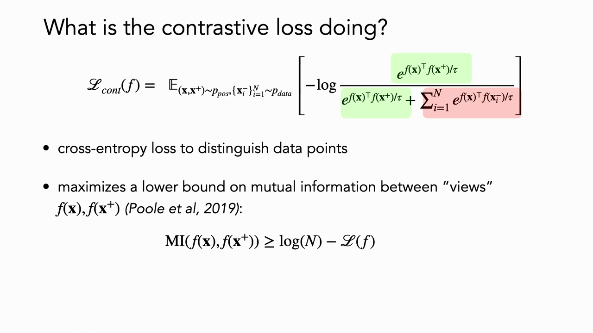
*▲ 강의 슬라이드 [44:37](https://youtu.be/yUh1fEGGdl4?t=2677): 대조 [손실](00_%EB%94%A5%EB%9F%AC%EB%8B%9D_%EC%9A%A9%EC%96%B4%EC%82%AC%EC%A0%84.md#loss-function-%EC%86%90%EC%8B%A4-%ED%95%A8%EC%88%98)은 데이터 점을 가려내는 [교차 엔트로피](00_%EB%94%A5%EB%9F%AC%EB%8B%9D_%EC%9A%A9%EC%96%B4%EC%82%AC%EC%A0%84.md#cross-entropy-%EA%B5%90%EC%B0%A8-%EC%97%94%ED%8A%B8%EB%A1%9C%ED%94%BC)이며, 두 보기 사이 [상호 정보량](00_%EB%94%A5%EB%9F%AC%EB%8B%9D_%EC%9A%A9%EC%96%B4%EC%82%AC%EC%A0%84.md#mutual-information-%EC%83%81%ED%98%B8-%EC%A0%95%EB%B3%B4%EB%9F%89)의 하한을 키운다*

### 7.2 정렬과 균일성

▶ 영상 [45:00](https://youtu.be/yUh1fEGGdl4?t=2700)

📐 **수학 개념**: [정렬과 균일성](%EC%88%98%ED%95%99%EA%B0%9C%EB%85%90/10_%ED%91%9C%ED%98%84_%ED%95%99%EC%8A%B5/MM46_%EC%A0%95%EB%A0%AC%EA%B3%BC_%EA%B7%A0%EC%9D%BC%EC%84%B1.md) · [기댓값](%EC%88%98%ED%95%99%EA%B0%9C%EB%85%90/04_%ED%99%95%EB%A5%A0%EA%B3%BC_%EC%A0%95%EB%B3%B4/MM22_%EA%B8%B0%EB%8C%93%EA%B0%92%EA%B3%BC_%EC%9D%BC%EB%B0%98%ED%99%94_%EA%B0%84%EA%B7%B9.md) · [단위 구와 코사인 유사도](%EC%88%98%ED%95%99%EA%B0%9C%EB%85%90/03_%EC%84%A0%ED%98%95%EB%8C%80%EC%88%98/MM44_%EB%8B%A8%EC%9C%84_%EA%B5%AC%EC%99%80_%EC%BD%94%EC%82%AC%EC%9D%B8_%EC%9C%A0%EC%82%AC%EB%8F%84.md)

2절의 좋은 표현 조건(집중, 분리, 강건성)으로 돌아가면:

- **[정렬](00_%EB%94%A5%EB%9F%AC%EB%8B%9D_%EC%9A%A9%EC%96%B4%EC%82%AC%EC%A0%84.md#alignment-uniformity-%EC%A0%95%EB%A0%AC%EA%B3%BC-%EA%B7%A0%EC%9D%BC%EC%84%B1)(alignment)**: 비슷한 표본은 비슷한 특징을 가진다. "양성 쌍을 당긴다"는 [손실](00_%EB%94%A5%EB%9F%AC%EB%8B%9D_%EC%9A%A9%EC%96%B4%EC%82%AC%EC%A0%84.md#loss-function-%EC%86%90%EC%8B%A4-%ED%95%A8%EC%88%98)의 분자 부분이 처음부터 이것을 강제합니다. **집중**에 해당합니다.
- **[균일성](00_%EB%94%A5%EB%9F%AC%EB%8B%9D_%EC%9A%A9%EC%96%B4%EC%82%AC%EC%A0%84.md#alignment-uniformity-%EC%A0%95%EB%A0%AC%EA%B3%BC-%EA%B7%A0%EC%9D%BC%EC%84%B1)(uniformity)**: 다른 표본을 모두 고르게 밀어냅니다. 구의 일부를 비워 두면 다른 것들을 더 멀리 밀 여지가 남으므로, 최적은 **구 전체를 고르게 덮는 것**입니다. 자기 지도에서는 "이 사진은 증강한 자기 자신과 같다"는 정보만 있으므로 데이터 점 하나하나가 각자 한 부류이고, 이들을 구 위에 고르게 펼칩니다. 정보를 최대한 보존하고 **분리**를 강제하는 방법으로 볼 수 있습니다.

**확인 실험** (필이 만든 슬라이드): CIFAR-10 인코더를 2차원 특징 공간 $\mathbb{S}^1$(원)으로 학습하고 [검증 데이터](00_%EB%94%A5%EB%9F%AC%EB%8B%9D_%EC%9A%A9%EC%96%B4%EC%82%AC%EC%A0%84.md#validation-data-%EA%B2%80%EC%A6%9D-%EB%8D%B0%EC%9D%B4%ED%84%B0)의 특징 분포를 그리면,
- 비지도 [대조 학습](00_%EB%94%A5%EB%9F%AC%EB%8B%9D_%EC%9A%A9%EC%96%B4%EC%82%AC%EC%A0%84.md#contrastive-learning-%EB%8C%80%EC%A1%B0-%ED%95%99%EC%8A%B5): 원 둘레에 **고르게** 퍼집니다.
- 지도 예측 [학습](00_%EB%94%A5%EB%9F%AC%EB%8B%9D_%EC%9A%A9%EC%96%B4%EC%82%AC%EC%A0%84.md#training-%ED%95%99%EC%8A%B5)(음의 [로그](00_%EB%94%A5%EB%9F%AC%EB%8B%9D_%EC%9A%A9%EC%96%B4%EC%82%AC%EC%A0%84.md#log-ln-%EB%A1%9C%EA%B7%B8) [우도](00_%EB%94%A5%EB%9F%AC%EB%8B%9D_%EC%9A%A9%EC%96%B4%EC%82%AC%EC%A0%84.md#likelihood-%EC%9A%B0%EB%8F%84)): 고르지 않습니다.
- 무작위 초기화한 망: 한쪽에 몰려 균일성과 거리가 멉니다.

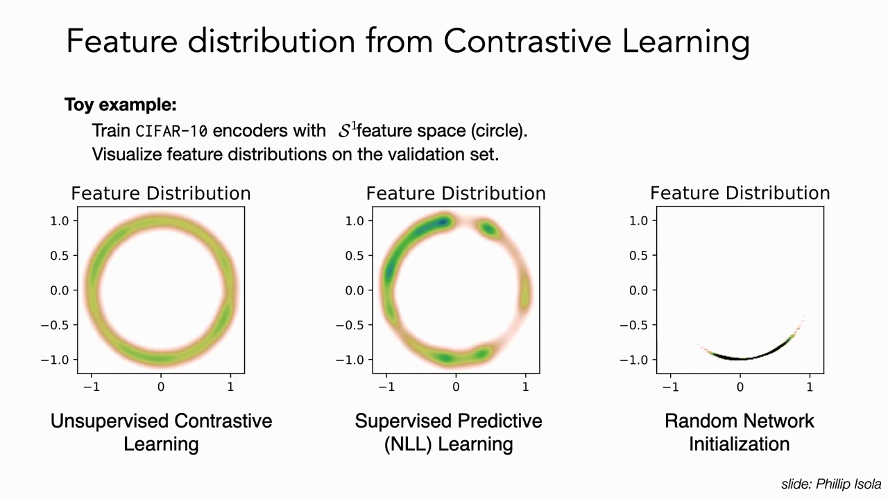
*▲ 강의 슬라이드 [47:33](https://youtu.be/yUh1fEGGdl4?t=2853): CIFAR-10 인코더의 원($\mathbb{S}^1$) 위 특징 분포. 비지도 [대조 학습](00_%EB%94%A5%EB%9F%AC%EB%8B%9D_%EC%9A%A9%EC%96%B4%EC%82%AC%EC%A0%84.md#contrastive-learning-%EB%8C%80%EC%A1%B0-%ED%95%99%EC%8A%B5)만 고르게 퍼진다*

이것을 숫자로 재는 지표가 두 개입니다(Wang·Isola 2020). 정렬은 양성 쌍 특징 거리의 [기댓값](00_%EB%94%A5%EB%9F%AC%EB%8B%9D_%EC%9A%A9%EC%96%B4%EC%82%AC%EC%A0%84.md#expectation-%EA%B8%B0%EB%8C%93%EA%B0%92), 균일성은 아무 두 표본 사이 **가우스 퍼텐셜** $e^{-t\|\cdot\|^2}$ [기댓값](00_%EB%94%A5%EB%9F%AC%EB%8B%9D_%EC%9A%A9%EC%96%B4%EC%82%AC%EC%A0%84.md#expectation-%EA%B8%B0%EB%8C%93%EA%B0%92)의 [로그](00_%EB%94%A5%EB%9F%AC%EB%8B%9D_%EC%9A%A9%EC%96%B4%EC%82%AC%EC%A0%84.md#log-ln-%EB%A1%9C%EA%B7%B8)입니다. 가우스 퍼텐셜은 가장 가까운 쌍에 무게를 더 둡니다. 이 목적은 수학의 여러 분야와 이어져 있으며, 구 위의 **균등 분포가 기대 퍼텐셜을 최소로 하는 유일한 분포**입니다.

$$
\mathcal{L}_{\text{align}}(f; \alpha) = \mathbb{E}_{(x,y)\sim p_{\text{pos}}}\big[\|f(x) - f(y)\|_2^{\alpha}\big], \qquad
\mathcal{L}_{\text{uniform}}(f; t) = \log\, \mathbb{E}_{x,y \overset{\text{i.i.d.}}{\sim} p_{\text{data}}}\big[e^{-t\|f(x) - f(y)\|_2^2}\big]
$$

기호 풀이

| 기호 | 읽는 법 | 뜻 | 예제 값 |
| --- | --- | --- | --- |
| $f$ | 에프 | 입력을 [초구](00_%EB%94%A5%EB%9F%AC%EB%8B%9D_%EC%9A%A9%EC%96%B4%EC%82%AC%EC%A0%84.md#hypersphere-%EC%B4%88%EA%B5%AC)로 보내는 인코더 | |
| $p_{\text{pos}}$ | 피 포스 | 양성 쌍의 분포 | 쌍 2개 |
| $p_{\text{data}}$ | 피 데이터 | 데이터 분포. $x, y$를 따로([i.i.d.](00_%EB%94%A5%EB%9F%AC%EB%8B%9D_%EC%9A%A9%EC%96%B4%EC%82%AC%EC%A0%84.md#iid-independent-and-identically-distributed-%EB%8F%85%EB%A6%BD-%EB%8F%99%EC%9D%BC-%EB%B6%84%ED%8F%AC)) 뽑음 | 점 4개 |
| $\alpha$ | 알파 | 거리의 [지수](00_%EB%94%A5%EB%9F%AC%EB%8B%9D_%EC%9A%A9%EC%96%B4%EC%82%AC%EC%A0%84.md#e-exponent-e%EC%99%80-%EC%A7%80%EC%88%98) ($\alpha > 0$) | 2 |
| $t$ | 티 | 퍼텐셜의 [날카로움](00_%EB%94%A5%EB%9F%AC%EB%8B%9D_%EC%9A%A9%EC%96%B4%EC%82%AC%EC%A0%84.md#sharpness-%EB%82%A0%EC%B9%B4%EB%A1%9C%EC%9B%80) ($t > 0$) | 2 |
| $e^{-t\|\cdot\|^2}$ | 가우스 퍼텐셜 | 가까울수록 1, 멀수록 0 | 0.0183 |
| $\mathcal{L}_{\text{align}}$ | 정렬 [손실](00_%EB%94%A5%EB%9F%AC%EB%8B%9D_%EC%9A%A9%EC%96%B4%EC%82%AC%EC%A0%84.md#loss-function-%EC%86%90%EC%8B%A4-%ED%95%A8%EC%88%98) | 작을수록 양성 쌍이 붙어 있다 | 0.1 |
| $\mathcal{L}_{\text{uniform}}$ | 균일성 [손실](00_%EB%94%A5%EB%9F%AC%EB%8B%9D_%EC%9A%A9%EC%96%B4%EC%82%AC%EC%A0%84.md#loss-function-%EC%86%90%EC%8B%A4-%ED%95%A8%EC%88%98) | 작을수록 고르게 퍼졌다 | -4.3963 |

예제와 풀이

**문제**: 양성 쌍 두 개의 거리 제곱이 0.04와 0.16이고, 데이터 점 4개가 단위 원 위에 90° 간격으로 있다. $\alpha = 2$, $t = 2$일 때 정렬 지표와 균일성 지표는?

**주어진 값**
- 양성 쌍 거리 제곱 0.04, 0.16: 같은 것의 두 보기가 떨어진 정도 (쌍 2개)
- $\alpha = 2$: 거리를 제곱해서 쓴다
- 점 4개 (1, 0), (0, 1), (-1, 0), (0, -1): 0°, 90°, 180°, 270°의 표현
- $t = 2$: 퍼텐셜의 [날카로움](00_%EB%94%A5%EB%9F%AC%EB%8B%9D_%EC%9A%A9%EC%96%B4%EC%82%AC%EC%A0%84.md#sharpness-%EB%82%A0%EC%B9%B4%EB%A1%9C%EC%9B%80)

**풀이**
1. 식을 그대로 쓴다: $\mathcal{L}_{\text{align}} = \mathbb{E}\big[\|f(x) - f(y)\|_2^{\alpha}\big]$, $\mathcal{L}_{\text{uniform}} = \log \mathbb{E}\big[e^{-t\|f(x) - f(y)\|_2^2}\big]$
2. 값을 대입한다: $\mathcal{L}_{\text{align}} = \mathbb{E}\big[\{0.04,\ 0.16\}\big]$, $\mathcal{L}_{\text{uniform}} = \log \mathbb{E}\big[e^{-2\|f(x) - f(y)\|_2^2}\big]$ (서로 다른 점 쌍 6개에 대해)
3. [기댓값](00_%EB%94%A5%EB%9F%AC%EB%8B%9D_%EC%9A%A9%EC%96%B4%EC%82%AC%EC%A0%84.md#expectation-%EA%B8%B0%EB%8C%93%EA%B0%92) $\mathbb{E}$는 평균이다. 정렬의 두 값을 더한다: $0.04 + 0.16 = 0.2$
4. 쌍 개수로 나눈다: $0.2 / 2 = 0.1$
5. 이웃한 쌍의 거리 제곱을 칸별로 구한다. (1, 0)과 (0, 1): $(1 - 0)^2 + (0 - 1)^2 = 1 + 1 = 2$ (이웃한 쌍 4개 모두 같음)
6. 마주 보는 쌍의 거리 제곱: (1, 0)과 (-1, 0): $(1 - (-1))^2 + (0 - 0)^2 = 4 + 0 = 4$ (마주 보는 쌍 2개)
7. $-t$를 곱한다: $-2\times2 = -4$, $-2\times4 = -8$
8. [지수](00_%EB%94%A5%EB%9F%AC%EB%8B%9D_%EC%9A%A9%EC%96%B4%EC%82%AC%EC%A0%84.md#e-exponent-e%EC%99%80-%EC%A7%80%EC%88%98)를 계산한다($e^{a}$는 약 2.718인 $e$의 $a$제곱): $e^{-4} = 0.0183$, $e^{-8} = 0.0003$
9. 여섯 쌍의 값을 더한다: $0.0183 + 0.0183 + 0.0183 + 0.0183 + 0.0003 + 0.0003 = 0.0739$
10. 쌍 개수로 나눈다: $0.0739 / 6 = 0.0123$
11. [로그](00_%EB%94%A5%EB%9F%AC%EB%8B%9D_%EC%9A%A9%EC%96%B4%EC%82%AC%EC%A0%84.md#log-ln-%EB%A1%9C%EA%B7%B8)를 계산한다($\ln y$는 $e$를 몇 제곱해야 $y$가 되는지): $\ln 0.0123 = -4.3963$

**답**: $\mathcal{L}_{\text{align}} = $ **0.1**, $\mathcal{L}_{\text{uniform}} = $ **-4.3963**. 같은 점 4개를 30° 안에 몰아 두면 균일성은 -0.1864로 훨씬 나쁘다([MM46_정렬과_균일성](%EC%88%98%ED%95%99%EA%B0%9C%EB%85%90/10_%ED%91%9C%ED%98%84_%ED%95%99%EC%8A%B5/MM46_%EC%A0%95%EB%A0%AC%EA%B3%BC_%EA%B7%A0%EC%9D%BC%EC%84%B1.md)).

내 이해

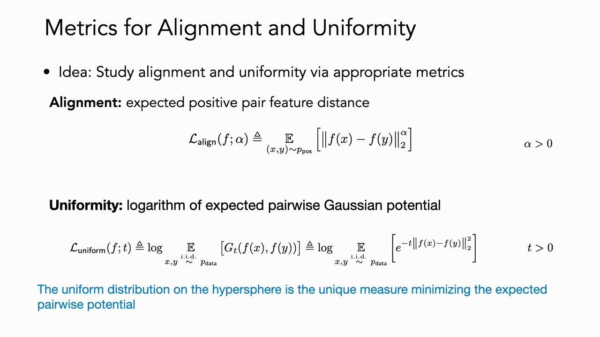
*▲ 강의 슬라이드 [49:09](https://youtu.be/yUh1fEGGdl4?t=2949): 정렬 지표(양성 쌍 특징 거리의 [기댓값](00_%EB%94%A5%EB%9F%AC%EB%8B%9D_%EC%9A%A9%EC%96%B4%EC%82%AC%EC%A0%84.md#expectation-%EA%B8%B0%EB%8C%93%EA%B0%92))와 균일성 지표(가우스 퍼텐셜 [기댓값](00_%EB%94%A5%EB%9F%AC%EB%8B%9D_%EC%9A%A9%EC%96%B4%EC%82%AC%EC%A0%84.md#expectation-%EA%B8%B0%EB%8C%93%EA%B0%92)의 [로그](00_%EB%94%A5%EB%9F%AC%EB%8B%9D_%EC%9A%A9%EC%96%B4%EC%82%AC%EC%A0%84.md#log-ln-%EB%A1%9C%EA%B7%B8))*

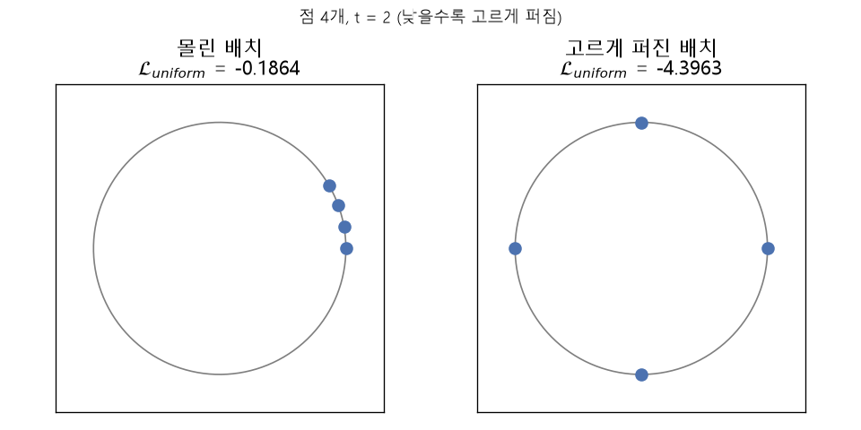
*▲ 직접 그린 그림: 단위 원 위 점 4개의 균일성($t = 2$). 몰린 배치 -0.1864, 고르게 퍼진 배치 -4.3963*

### 7.3 음성 표본이 무한할 때

▶ 영상 [49:30](https://youtu.be/yUh1fEGGdl4?t=2970)

📐 **수학 개념**: [정렬과 균일성](%EC%88%98%ED%95%99%EA%B0%9C%EB%85%90/10_%ED%91%9C%ED%98%84_%ED%95%99%EC%8A%B5/MM46_%EC%A0%95%EB%A0%AC%EA%B3%BC_%EA%B7%A0%EC%9D%BC%EC%84%B1.md) · [로그](%EC%88%98%ED%95%99%EA%B0%9C%EB%85%90/01_%EC%88%98%EC%99%80_%ED%95%A8%EC%88%98/M07_%EB%A1%9C%EA%B7%B8.md)

- 정의가 [기댓값](00_%EB%94%A5%EB%9F%AC%EB%8B%9D_%EC%9A%A9%EC%96%B4%EC%82%AC%EC%A0%84.md#expectation-%EA%B8%B0%EB%8C%93%EA%B0%92)이므로 **점근적 행동**을 봅니다. 음성 개수 $M$을 무한대로 보내면, ($\log M$을 뺀) 대조 [손실](00_%EB%94%A5%EB%9F%AC%EB%8B%9D_%EC%9A%A9%EC%96%B4%EC%82%AC%EC%A0%84.md#loss-function-%EC%86%90%EC%8B%A4-%ED%95%A8%EC%88%98)은 두 [기댓값](00_%EB%94%A5%EB%9F%AC%EB%8B%9D_%EC%9A%A9%EC%96%B4%EC%82%AC%EC%A0%84.md#expectation-%EA%B8%B0%EB%8C%93%EA%B0%92) 항의 합으로 갈라집니다(Wang·Isola 2020 정리 1).
  - **초록 항**: 모든 양성 쌍이 정확히 같은 [임베딩](00_%EB%94%A5%EB%9F%AC%EB%8B%9D_%EC%9A%A9%EC%96%B4%EC%82%AC%EC%A0%84.md#embedding-%EC%9E%84%EB%B2%A0%EB%94%A9)을 가질 때(완벽한 정렬) 최소입니다.
  - **빨강 항**: 완벽하게 균일한 인코더가 있다면 그것이 정확히 최소화합니다(완벽한 균일성, 최대한 멀리 밀기).

$$
\lim_{M \to \infty} \mathcal{L}_{\text{contrastive}}(f; \tau, M) - \log M = -\frac{1}{\tau}\, \mathbb{E}_{(x,y)\sim p_{\text{pos}}}\big[f(x)^\top f(y)\big] + \mathbb{E}_{x \sim p_{\text{data}}}\Big[\log \mathbb{E}_{x^- \sim p_{\text{data}}}\big[e^{f(x^-)^\top f(x)/\tau}\big]\Big]
$$

기호 풀이

| 기호 | 읽는 법 | 뜻 | 예제 값 |
| --- | --- | --- | --- |
| $M$ | 엠 | 음성 표본 개수 | $\to \infty$ |
| $\tau$ | 타우 | 온도 | 1 |
| $\log M$ | [로그](00_%EB%94%A5%EB%9F%AC%EB%8B%9D_%EC%9A%A9%EC%96%B4%EC%82%AC%EC%A0%84.md#log-ln-%EB%A1%9C%EA%B7%B8) 엠 | 음성이 늘며 커지는 몫을 빼 주는 보정 | |
| $-\frac{1}{\tau}\mathbb{E}[f(x)^\top f(y)]$ | 정렬 항 (초록) | 양성 쌍 [내적](00_%EB%94%A5%EB%9F%AC%EB%8B%9D_%EC%9A%A9%EC%96%B4%EC%82%AC%EC%A0%84.md#dot-product-%EB%82%B4%EC%A0%81)의 평균. 완벽한 정렬이면 $-1/\tau$ | -1 |
| $\mathbb{E}_x[\log \mathbb{E}_{x^-}[e^{\cdots}]]$ | 균일성 항 (빨강) | 다른 표본과의 유사도 [지수](00_%EB%94%A5%EB%9F%AC%EB%8B%9D_%EC%9A%A9%EC%96%B4%EC%82%AC%EC%A0%84.md#e-exponent-e%EC%99%80-%EC%A7%80%EC%88%98)의 평균의 [로그](00_%EB%94%A5%EB%9F%AC%EB%8B%9D_%EC%9A%A9%EC%96%B4%EC%82%AC%EC%A0%84.md#log-ln-%EB%A1%9C%EA%B7%B8) | 0.2402 |
| $x^-$ | 엑스 마이너스 | 데이터에서 따로 뽑은 표본 | 점 4개 중 하나 |

예제와 풀이

**문제**: 온도가 1이고, 양성 쌍은 모두 같은 점에 있으며(완벽한 정렬), 데이터 표현은 단위 원 위 90° 간격 점 4개다($x^-$는 이 4개 중 하나를 고르게 뽑음). 극한 [손실](00_%EB%94%A5%EB%9F%AC%EB%8B%9D_%EC%9A%A9%EC%96%B4%EC%82%AC%EC%A0%84.md#loss-function-%EC%86%90%EC%8B%A4-%ED%95%A8%EC%88%98)은? 모든 점이 한 점으로 무너진 경우와 비교하라.

**주어진 값**
- $\tau = 1$: 온도
- $f(x)^\top f(y) = 1$: 양성 쌍의 [내적](00_%EB%94%A5%EB%9F%AC%EB%8B%9D_%EC%9A%A9%EC%96%B4%EC%82%AC%EC%A0%84.md#dot-product-%EB%82%B4%EC%A0%81) (같은 점이라 1)
- 점 4개 (1, 0), (0, 1), (-1, 0), (0, -1): 데이터 표현. $x^-$는 이 중 하나를 같은 [확률](00_%EB%94%A5%EB%9F%AC%EB%8B%9D_%EC%9A%A9%EC%96%B4%EC%82%AC%EC%A0%84.md#probability-%ED%99%95%EB%A5%A0)로 뽑는다

**풀이**
1. 식을 그대로 쓴다: $\text{극한} = -\frac{1}{\tau}\,\mathbb{E}\big[f(x)^\top f(y)\big] + \mathbb{E}_{x}\Big[\log \mathbb{E}_{x^-}\big[e^{f(x^-)^\top f(x)/\tau}\big]\Big]$
2. 값을 대입한다: $\text{극한} = -\frac{1}{1}\,\mathbb{E}\big[1\big] + \mathbb{E}_{x}\Big[\log \mathbb{E}_{x^-}\big[e^{f(x^-)^\top f(x)/1}\big]\Big]$
3. 정렬 항을 계산한다. 늘 1인 값의 평균은 1: $-\frac{1}{1}\times1 = -1$
4. 한 점 $x = (1, 0)$에서 4점과의 [내적](00_%EB%94%A5%EB%9F%AC%EB%8B%9D_%EC%9A%A9%EC%96%B4%EC%82%AC%EC%A0%84.md#dot-product-%EB%82%B4%EC%A0%81)을 칸별로 구한다: $1\times1 + 0\times0 = 1$, $1\times0 + 0\times1 = 0$, $1\times(-1) + 0\times0 = -1$, $1\times0 + 0\times(-1) = 0$
5. [지수](00_%EB%94%A5%EB%9F%AC%EB%8B%9D_%EC%9A%A9%EC%96%B4%EC%82%AC%EC%A0%84.md#e-exponent-e%EC%99%80-%EC%A7%80%EC%88%98)를 계산한다($e^{a}$는 약 2.718인 $e$의 $a$제곱): $e^{1} = 2.7183$, $e^{0} = 1$, $e^{-1} = 0.3679$, $e^{0} = 1$
6. 넷을 더한다: $2.7183 + 1 + 0.3679 + 1 = 5.0862$
7. 4로 나눈다 (안쪽 [기댓값](00_%EB%94%A5%EB%9F%AC%EB%8B%9D_%EC%9A%A9%EC%96%B4%EC%82%AC%EC%A0%84.md#expectation-%EA%B8%B0%EB%8C%93%EA%B0%92) = 평균): $5.0862 / 4 = 1.2715$
8. [로그](00_%EB%94%A5%EB%9F%AC%EB%8B%9D_%EC%9A%A9%EC%96%B4%EC%82%AC%EC%A0%84.md#log-ln-%EB%A1%9C%EA%B7%B8)를 계산한다($\ln y$는 $e$를 몇 제곱해야 $y$가 되는지): $\ln 1.2715 = 0.2402$
9. 바깥 [기댓값](00_%EB%94%A5%EB%9F%AC%EB%8B%9D_%EC%9A%A9%EC%96%B4%EC%82%AC%EC%A0%84.md#expectation-%EA%B8%B0%EB%8C%93%EA%B0%92): 점 4개가 대칭이라 어느 $x$에서나 0.2402 → 평균도 0.2402
10. 두 항을 더한다: $-1 + 0.2402 = -0.7598$
11. 무너진 경우: 모든 [내적](00_%EB%94%A5%EB%9F%AC%EB%8B%9D_%EC%9A%A9%EC%96%B4%EC%82%AC%EC%A0%84.md#dot-product-%EB%82%B4%EC%A0%81)이 1 → $e^{1} = 2.7183$의 평균 2.7183 → $\ln 2.7183 = 1$
12. 무너진 경우의 합: $-1 + 1 = 0$

**답**: 고르게 퍼진 경우 **-0.7598**, 무너진 경우 **0**. 정렬이 똑같이 완벽해도 균일성 항이 퍼진 쪽을 선호한다.

내 이해

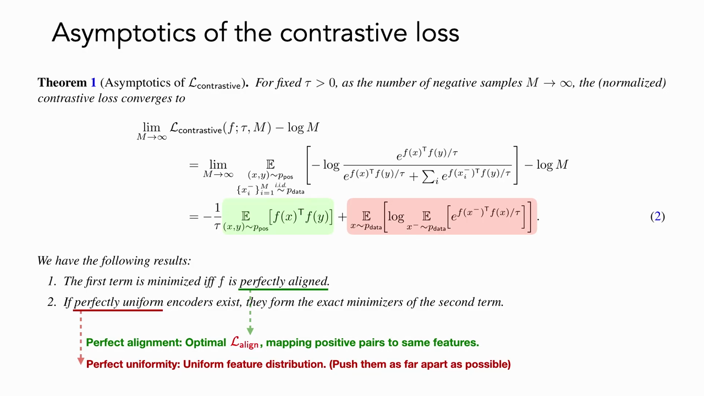
*▲ 강의 슬라이드 [50:52](https://youtu.be/yUh1fEGGdl4?t=3052): 대조 [손실](00_%EB%94%A5%EB%9F%AC%EB%8B%9D_%EC%9A%A9%EC%96%B4%EC%82%AC%EC%A0%84.md#loss-function-%EC%86%90%EC%8B%A4-%ED%95%A8%EC%88%98)의 점근 분해. 초록(정렬) 항은 완벽한 정렬에서, 빨강(균일성) 항은 균등한 특징 분포에서 최소가 된다*

- 이제 두 양은 잴 수 있습니다. 여러 인코더(STL-10으로 학습한 306개)를 정렬(가로)과 균일성(세로)으로 찍고 [검증](00_%EB%94%A5%EB%9F%AC%EB%8B%9D_%EC%9A%A9%EC%96%B4%EC%82%AC%EC%A0%84.md#validation-data-%EA%B2%80%EC%A6%9D-%EB%8D%B0%EC%9D%B4%ED%84%B0) [정확도](00_%EB%94%A5%EB%9F%AC%EB%8B%9D_%EC%9A%A9%EC%96%B4%EC%82%AC%EC%A0%84.md#accuracy-%EC%A0%95%ED%99%95%EB%8F%84)로 색을 칠하면, **두 값이 모두 작은 인코더의 [정확도](00_%EB%94%A5%EB%9F%AC%EB%8B%9D_%EC%9A%A9%EC%96%B4%EC%82%AC%EC%A0%84.md#accuracy-%EC%A0%95%ED%99%95%EB%8F%84)가 가장 높습니다**. [정렬과 균일성](00_%EB%94%A5%EB%9F%AC%EB%8B%9D_%EC%9A%A9%EC%96%B4%EC%82%AC%EC%A0%84.md#alignment-uniformity-%EC%A0%95%EB%A0%AC%EA%B3%BC-%EA%B7%A0%EC%9D%BC%EC%84%B1)이 좋은 표현의 성질이라는 것을 측정으로 보인 셈입니다. 여러 데이터셋에서 같은 경향이 보이지만, 단순한 데이터셋일수록 더 뚜렷합니다.
- 정리: [손실 함수](00_%EB%94%A5%EB%9F%AC%EB%8B%9D_%EC%9A%A9%EC%96%B4%EC%82%AC%EC%A0%84.md#loss-function-%EC%86%90%EC%8B%A4-%ED%95%A8%EC%88%98) 자체는 **정렬(집중)**과 **균일성(분리)**을 부추깁니다.

---

## 8. 쌍의 선택이 가르치는 것: 불변성

▶ 영상 [51:49](https://youtu.be/yUh1fEGGdl4?t=3109)

- 그렇다면 양성·음성 쌍의 선택은 무엇을 부추길까요? "같은 데이터의 증강은 가까워야 한다" → 표현은 **증강이 만드는 변화에 불변**해집니다. 우리가 넣은 증강 집합에 대한 불변성을 **배우는** 것입니다.
- 올바른 불변성을 찾기는 어렵습니다(앞의 분자, 신발 예). [기하학적 딥러닝 강의](Lec05_%EA%B7%B8%EB%9E%98%ED%94%84_%EC%8B%A0%EA%B2%BD%EB%A7%9D.md)처럼 대칭성을 아키텍처에 직접 박아 넣을 수도 있고, 경우에 따라 둘 중 하나를 고릅니다.
- 하지만 장면 속 자세에 대한 불변성, 변형되는 물체의 복잡한 기하처럼 **수학적으로 정의하기 어려운** 불변성도 많습니다. "이걸 이렇게 바꿔도 같은 것"이라고 데이터로 보여 주는 다소 무식한 방법은, 정의하지 못해도 불변성을 넣을 수 있게 해 줍니다.
- 즉 좋은 표현의 셋째 조건인 **강건성은 데이터(쌍의 선택)에서 온다**는 것이 강사의 정리입니다.

### 8.1 잘 되게 만드는 네 가지

▶ 영상 [54:02](https://youtu.be/yUh1fEGGdl4?t=3242)

자기 [지도 대조 학습](00_%EB%94%A5%EB%9F%AC%EB%8B%9D_%EC%9A%A9%EC%96%B4%EC%82%AC%EC%A0%84.md#supervised-contrastive-learning-%EC%A7%80%EB%8F%84-%EB%8C%80%EC%A1%B0-%ED%95%99%EC%8A%B5)을 잘 되게 만드는 재료는 네 가지입니다. 앞의 셋이 [SimCLR](00_%EB%94%A5%EB%9F%AC%EB%8B%9D_%EC%9A%A9%EC%96%B4%EC%82%AC%EC%A0%84.md#simclr-simclr-%EB%8C%80%EC%A1%B0-%ED%95%99%EC%8A%B5) 모형의 요소입니다.

1. **강한 [데이터 증강](00_%EB%94%A5%EB%9F%AC%EB%8B%9D_%EC%9A%A9%EC%96%B4%EC%82%AC%EC%A0%84.md#data-augmentation-%EB%8D%B0%EC%9D%B4%ED%84%B0-%EC%A6%9D%EA%B0%95)**: 단순한 것 말고, 합리적인 범위에서 입력을 아주 이상하게 바꾸는 증강
2. **[프로젝션 헤드](00_%EB%94%A5%EB%9F%AC%EB%8B%9D_%EC%9A%A9%EC%96%B4%EC%82%AC%EC%A0%84.md#projection-head-%ED%94%84%EB%A1%9C%EC%A0%9D%EC%85%98-%ED%97%A4%EB%93%9C)** (8.2)
3. **큰 배치**: 음성이 많아짐 (8.3)
4. **쌍의 선택과 어려운 음성** (8.3)

[SimCLR](00_%EB%94%A5%EB%9F%AC%EB%8B%9D_%EC%9A%A9%EC%96%B4%EC%82%AC%EC%A0%84.md#simclr-simclr-%EB%8C%80%EC%A1%B0-%ED%95%99%EC%8A%B5) 논문의 절제 실험(ablation)에서, 자르기(crop)만 쓰고 자기 지도 표현을 배우면 모든 증강을 쓸 때보다 다음 [분류](00_%EB%94%A5%EB%9F%AC%EB%8B%9D_%EC%9A%A9%EC%96%B4%EC%82%AC%EC%A0%84.md#regression-classification-%ED%9A%8C%EA%B7%80%EC%99%80-%EB%B6%84%EB%A5%98) 성능이 15%p 가까이 낮았습니다.

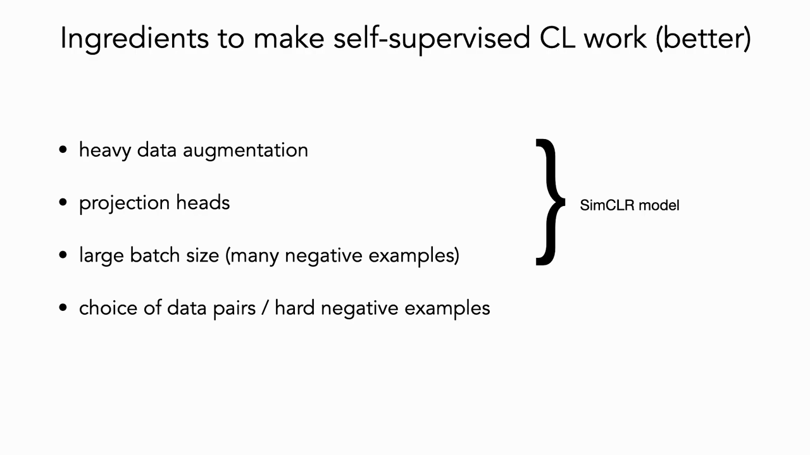
*▲ 강의 슬라이드 [54:42](https://youtu.be/yUh1fEGGdl4?t=3282): 자기 [지도 대조 학습](00_%EB%94%A5%EB%9F%AC%EB%8B%9D_%EC%9A%A9%EC%96%B4%EC%82%AC%EC%A0%84.md#supervised-contrastive-learning-%EC%A7%80%EB%8F%84-%EB%8C%80%EC%A1%B0-%ED%95%99%EC%8A%B5)을 잘 되게 만드는 재료. 강한 증강, [프로젝션 헤드](00_%EB%94%A5%EB%9F%AC%EB%8B%9D_%EC%9A%A9%EC%96%B4%EC%82%AC%EC%A0%84.md#projection-head-%ED%94%84%EB%A1%9C%EC%A0%9D%EC%85%98-%ED%97%A4%EB%93%9C), 큰 배치, 쌍의 선택과 어려운 음성*

### 8.2 프로젝션 헤드

▶ 영상 [55:09](https://youtu.be/yUh1fEGGdl4?t=3309)

- 실험으로 발견한 사실: 다음 과제에 쓸 표현 $\mathbf{h} = f(\mathbf{x})$에 대조 [손실](00_%EB%94%A5%EB%9F%AC%EB%8B%9D_%EC%9A%A9%EC%96%B4%EC%82%AC%EC%A0%84.md#loss-function-%EC%86%90%EC%8B%A4-%ED%95%A8%EC%88%98)을 바로 걸지 말고, 간단한 학습용 사영 $\mathbf{z} = g(\mathbf{h})$를 하나 더 두어 $\mathbf{z}$에서 [손실](00_%EB%94%A5%EB%9F%AC%EB%8B%9D_%EC%9A%A9%EC%96%B4%EC%82%AC%EC%A0%84.md#loss-function-%EC%86%90%EC%8B%A4-%ED%95%A8%EC%88%98)을 계산하면 성능이 좋아집니다. 이 $g$가 **[프로젝션 헤드](00_%EB%94%A5%EB%9F%AC%EB%8B%9D_%EC%9A%A9%EC%96%B4%EC%82%AC%EC%A0%84.md#projection-head-%ED%94%84%EB%A1%9C%EC%A0%9D%EC%85%98-%ED%97%A4%EB%93%9C)([Projection](00_%EB%94%A5%EB%9F%AC%EB%8B%9D_%EC%9A%A9%EC%96%B4%EC%82%AC%EC%A0%84.md#projection-%ED%88%AC%EC%98%81) head)**입니다. $g$는 선형이거나 작은 MLP이고, 다음 과제에는 $\mathbf{z}$가 아니라 $\mathbf{h}$를 씁니다.
- 직관적 설명: 대조 [손실](00_%EB%94%A5%EB%9F%AC%EB%8B%9D_%EC%9A%A9%EC%96%B4%EC%82%AC%EC%A0%84.md#loss-function-%EC%86%90%EC%8B%A4-%ED%95%A8%EC%88%98)은 같은 사진의 증강들을 완전히 한 점으로 밀어붙입니다. $\mathbf{h}$는 [손실](00_%EB%94%A5%EB%9F%AC%EB%8B%9D_%EC%9A%A9%EC%96%B4%EC%82%AC%EC%A0%84.md#loss-function-%EC%86%90%EC%8B%A4-%ED%95%A8%EC%88%98)에서 한 단계 떨어져 있으니 증강으로 생긴 차이 일부(변화의 차원)를 **보존**할 수 있고, 그것이 쓸모 있어 보입니다. 엄밀히 정리된 이론은 아닙니다.
- 강사는 [트랜스포머](00_%EB%94%A5%EB%9F%AC%EB%8B%9D_%EC%9A%A9%EC%96%B4%EC%82%AC%EC%A0%84.md#transformer-%ED%8A%B8%EB%9E%9C%EC%8A%A4%ED%8F%AC%EB%A8%B8)와 닮은 점을 봅니다. [트랜스포머](00_%EB%94%A5%EB%9F%AC%EB%8B%9D_%EC%9A%A9%EC%96%B4%EC%82%AC%EC%A0%84.md#transformer-%ED%8A%B8%EB%9E%9C%EC%8A%A4%ED%8F%AC%EB%A8%B8)에도 유사도를 계산하는 사영(쿼리·키)과 정보를 실어 나르는 사영(값)이 따로 있습니다. "유사도를 재는 표현"과 "정보를 간직하는 표현"을 나누는 것이 쓸모 있다는 공통점입니다.
- 실험 결과, 사영이 없을 때보다 선형·비선형 사영이 낫고(사영 출력 차원과 무관하게) 비선형이 가장 좋았습니다.

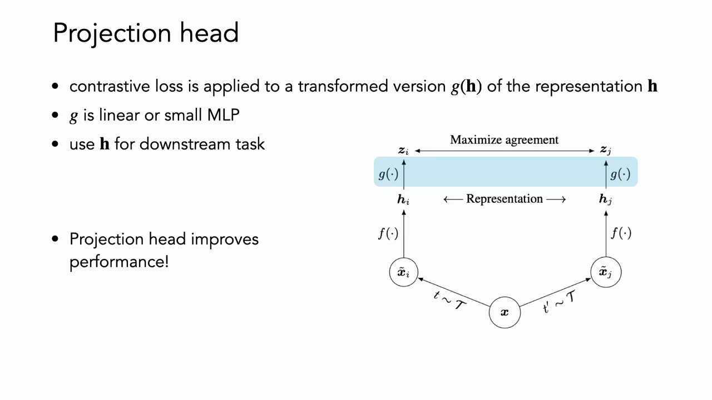
*▲ 강의 슬라이드 [56:22](https://youtu.be/yUh1fEGGdl4?t=3382): [프로젝션 헤드](00_%EB%94%A5%EB%9F%AC%EB%8B%9D_%EC%9A%A9%EC%96%B4%EC%82%AC%EC%A0%84.md#projection-head-%ED%94%84%EB%A1%9C%EC%A0%9D%EC%85%98-%ED%97%A4%EB%93%9C). 대조 [손실](00_%EB%94%A5%EB%9F%AC%EB%8B%9D_%EC%9A%A9%EC%96%B4%EC%82%AC%EC%A0%84.md#loss-function-%EC%86%90%EC%8B%A4-%ED%95%A8%EC%88%98)은 $g(\mathbf{h})$에 걸고, 다음 과제에는 $\mathbf{h}$를 쓴다*

### 8.3 배치 크기와 거짓 음성

▶ 영상 [58:01](https://youtu.be/yUh1fEGGdl4?t=3481)

📐 **수학 개념**: [삼중항 손실과 InfoNCE](%EC%88%98%ED%95%99%EA%B0%9C%EB%85%90/10_%ED%91%9C%ED%98%84_%ED%95%99%EC%8A%B5/MM45_%EC%82%BC%EC%A4%91%ED%95%AD_%EC%86%90%EC%8B%A4%EA%B3%BC_InfoNCE.md)

- **배치 크기**: [SimCLR](00_%EB%94%A5%EB%9F%AC%EB%8B%9D_%EC%9A%A9%EC%96%B4%EC%82%AC%EC%A0%84.md#simclr-simclr-%EB%8C%80%EC%A1%B0-%ED%95%99%EC%8A%B5)는 배치의 모든 점을 음성으로 쓰므로 음성 개수 = 배치 크기입니다. 음성이 많을수록 성능이 크게 오르고, 특히 [학습](00_%EB%94%A5%EB%9F%AC%EB%8B%9D_%EC%9A%A9%EC%96%B4%EC%82%AC%EC%A0%84.md#training-%ED%95%99%EC%8A%B5) 초반에는 배치 256과 8192의 차이가 10%p 가까이 납니다. 그래서 NVIDIA가 메모리가 점점 큰 [GPU](00_%EB%94%A5%EB%9F%AC%EB%8B%9D_%EC%9A%A9%EC%96%B4%EC%82%AC%EC%A0%84.md#device-gpu-%EC%9E%A5%EC%B9%98%EC%99%80-gpu)를 만든다고 강사는 농담합니다. 큰 배치는 계산 비용이 커서 효율화 연구가 많고, **MoCo**(He 등 2020)는 배치 크기 의존을 줄이려는 [SimCLR](00_%EB%94%A5%EB%9F%AC%EB%8B%9D_%EC%9A%A9%EC%96%B4%EC%82%AC%EC%A0%84.md#simclr-simclr-%EB%8C%80%EC%A1%B0-%ED%95%99%EC%8A%B5)의 개선안입니다(실제로는 MoCo가 [SimCLR](00_%EB%94%A5%EB%9F%AC%EB%8B%9D_%EC%9A%A9%EC%96%B4%EC%82%AC%EC%A0%84.md#simclr-simclr-%EB%8C%80%EC%A1%B0-%ED%95%99%EC%8A%B5)보다 조금 먼저 나왔다. 지난 배치의 표현을 큐에 쌓아 두어 큰 배치 없이 음성을 늘린다).
- **거짓 음성**: 음성은 무작위로 뽑으므로, 같은 부류(예: 다른 골든 리트리버)가 음성으로 들어갈 수 있습니다. 그것도 그냥 "조금 멀게"가 아니라 여유 밖으로 **밀어내라**고 가르치게 됩니다. 라벨을 써서 이런 거짓 음성을 빼고 진짜 음성만 쓰면 다음 과제의 top-1 [정확도](00_%EB%94%A5%EB%9F%AC%EB%8B%9D_%EC%9A%A9%EC%96%B4%EC%82%AC%EC%A0%84.md#accuracy-%EC%A0%95%ED%99%95%EB%8F%84)가 훨씬 높아집니다(Chuang 등 2020). 다만 모든 데이터에 라벨이 있고, 그 라벨이 다음 과제와 맞아야 한다는 가정이 필요합니다.
- **[지도·준지도 대조 학습](00_%EB%94%A5%EB%9F%AC%EB%8B%9D_%EC%9A%A9%EC%96%B4%EC%82%AC%EC%A0%84.md#supervised-contrastive-learning-%EC%A7%80%EB%8F%84-%EB%8C%80%EC%A1%B0-%ED%95%99%EC%8A%B5)**(Khosla 등 2020): 대조 신호(삼중항 신호)는 [교차 엔트로피](00_%EB%94%A5%EB%9F%AC%EB%8B%9D_%EC%9A%A9%EC%96%B4%EC%82%AC%EC%A0%84.md#cross-entropy-%EA%B5%90%EC%B0%A8-%EC%97%94%ED%8A%B8%EB%A1%9C%ED%94%BC)만 쓸 때보다 더 기하학적이고 강건한 피드백을 줍니다. 그래서 증강에 더해 **같은 반의 다른 사진도 양성**으로 씁니다(양성이 여러 개). 일부만 라벨이 있으면 그 표본을 앵커로 써서 구조를 더 줍니다.

> [!TIP]
> **🆕 2026 업데이트: 큰 배치가 꼭 필요한가**
> - **강의**: [소프트맥스](00_%EB%94%A5%EB%9F%AC%EB%8B%9D_%EC%9A%A9%EC%96%B4%EC%82%AC%EC%A0%84.md#softmax-%EC%86%8C%ED%94%84%ED%8A%B8%EB%A7%A5%EC%8A%A4) 대조 [손실](00_%EB%94%A5%EB%9F%AC%EB%8B%9D_%EC%9A%A9%EC%96%B4%EC%82%AC%EC%A0%84.md#loss-function-%EC%86%90%EC%8B%A4-%ED%95%A8%EC%88%98)은 음성이 많아야 해서 배치가 아주 커야 하고(256 대 8192에서 약 10%p 차이), 그래서 비싸다.
> - **현재**: 이미지-글 [대조 학습](00_%EB%94%A5%EB%9F%AC%EB%8B%9D_%EC%9A%A9%EC%96%B4%EC%82%AC%EC%A0%84.md#contrastive-learning-%EB%8C%80%EC%A1%B0-%ED%95%99%EC%8A%B5)에서는 [소프트맥스](00_%EB%94%A5%EB%9F%AC%EB%8B%9D_%EC%9A%A9%EC%96%B4%EC%82%AC%EC%A0%84.md#softmax-%EC%86%8C%ED%94%84%ED%8A%B8%EB%A7%A5%EC%8A%A4) 대신 **쌍마다 독립적인 [시그모이드](00_%EB%94%A5%EB%9F%AC%EB%8B%9D_%EC%9A%A9%EC%96%B4%EC%82%AC%EC%A0%84.md#sigmoid-%EC%8B%9C%EA%B7%B8%EB%AA%A8%EC%9D%B4%EB%93%9C)([이진 분류](00_%EB%94%A5%EB%9F%AC%EB%8B%9D_%EC%9A%A9%EC%96%B4%EC%82%AC%EC%A0%84.md#binary-classification-%EC%9D%B4%EC%A7%84-%EB%B6%84%EB%A5%98)) [손실](00_%EB%94%A5%EB%9F%AC%EB%8B%9D_%EC%9A%A9%EC%96%B4%EC%82%AC%EC%A0%84.md#loss-function-%EC%86%90%EC%8B%A4-%ED%95%A8%EC%88%98)**을 쓰는 SigLIP이 널리 퍼졌다. 배치 전체의 유사도로 정규화할 필요가 없어 작은 배치에서도 더 잘 되고, 배치를 백만까지 늘려 보니 이득이 빠르게 줄어 약 32k면 충분했다. 2025년의 SigLIP 2는 이 [손실](00_%EB%94%A5%EB%9F%AC%EB%8B%9D_%EC%9A%A9%EC%96%B4%EC%82%AC%EC%A0%84.md#loss-function-%EC%86%90%EC%8B%A4-%ED%95%A8%EC%88%98)에 캡션 생성, 자기 증류, 가린 예측을 더해 여러 크기(86M~1B)의 시각 인코더로 공개되었고, 비전-언어 모델의 이미지 인코더로 많이 쓰인다. 다만 [SimCLR](00_%EB%94%A5%EB%9F%AC%EB%8B%9D_%EC%9A%A9%EC%96%B4%EC%82%AC%EC%A0%84.md#simclr-simclr-%EB%8C%80%EC%A1%B0-%ED%95%99%EC%8A%B5) 같은 이미지-이미지 자기 지도 설정과는 다른 경우다.
> - **출처**: [Zhai et al., Sigmoid Loss for Language Image Pre-Training (ICCV 2023)](https://arxiv.org/abs/2303.15343) · [Tschannen et al., SigLIP 2 (arXiv 2025)](https://arxiv.org/abs/2502.14786)

---

## 9. 사례 연구: iNaturalist 2021

▶ 영상 [61:27](https://youtu.be/yUh1fEGGdl4?t=3687)

- **[iNaturalist](00_%EB%94%A5%EB%9F%AC%EB%8B%9D_%EC%9A%A9%EC%96%B4%EC%82%AC%EC%A0%84.md#inaturalist-%EC%83%9D%EB%AC%BC-%EC%A2%85-%EC%82%AC%EC%A7%84-%EB%8D%B0%EC%9D%B4%ED%84%B0%EC%85%8B) 2021**: 식물, 동물, 곤충 등 1만 종의 사진입니다. [학습](00_%EB%94%A5%EB%9F%AC%EB%8B%9D_%EC%9A%A9%EC%96%B4%EC%82%AC%EC%A0%84.md#training-%ED%95%99%EC%8A%B5) 약 270만 장, [검증](00_%EB%94%A5%EB%9F%AC%EB%8B%9D_%EC%9A%A9%EC%96%B4%EC%82%AC%EC%A0%84.md#validation-data-%EA%B2%80%EC%A6%9D-%EB%8D%B0%EC%9D%B4%ED%84%B0) 약 5만 장(실제로는 종마다 10장씩 10만 장), 시험 50만 장. 수십억 장 규모는 아니지만 꽤 큽니다.
- 이 데이터에는 뚜렷한 구조가 있습니다. 범주가 생물 종이라 **분류학 계통수**를 따라 세밀도를 정할 수 있습니다. 계(kingdom, 동물계 대 식물계)는 아주 거칠고, 종(species)은 아주 세밀합니다. 같은 속(genus)의 다른 종은 보통 생김새가 아주 비슷합니다(의태 같은 예외는 있음). 앞에서 계속 보여 준 두 나방이 같은 속의 다른 종입니다.
- **실험** (Cole 등, CVPR 2022): 지도 [학습](00_%EB%94%A5%EB%9F%AC%EB%8B%9D_%EC%9A%A9%EC%96%B4%EC%82%AC%EC%A0%84.md#training-%ED%95%99%EC%8A%B5)(이 데이터만으로 처음부터)과 자기 [지도 대조 학습](00_%EB%94%A5%EB%9F%AC%EB%8B%9D_%EC%9A%A9%EC%96%B4%EC%82%AC%EC%A0%84.md#supervised-contrastive-learning-%EC%A7%80%EB%8F%84-%EB%8C%80%EC%A1%B0-%ED%95%99%EC%8A%B5)([SimCLR](00_%EB%94%A5%EB%9F%AC%EB%8B%9D_%EC%9A%A9%EC%96%B4%EC%82%AC%EC%A0%84.md#simclr-simclr-%EB%8C%80%EC%A1%B0-%ED%95%99%EC%8A%B5), MoCo)의 표현을 비교합니다. 자기 지도 표현은 **[선형 탐침](00_%EB%94%A5%EB%9F%AC%EB%8B%9D_%EC%9A%A9%EC%96%B4%EC%82%AC%EC%A0%84.md#probe-linear-probe-%ED%83%90%EC%B9%A8%EA%B3%BC-%EC%84%A0%ED%98%95-%ED%83%90%EC%B9%A8)**(linear probe, 표현은 고정하고 그 위에 선형 분류기만 지도 [학습](00_%EB%94%A5%EB%9F%AC%EB%8B%9D_%EC%9A%A9%EC%96%B4%EC%82%AC%EC%A0%84.md#training-%ED%95%99%EC%8A%B5))으로 평가합니다. 두 방법 모두 가장 세밀한 종 수준에서 학습하고, 위 수준(속, 과, ... 계)은 예측을 계통수를 따라 묶어 올려 평가합니다.
- **결과**: 종 수준에서 지도와 자기 지도의 차이가 **약 30%p**로 큽니다. 같은 실험을 ImageNet에서 하면 약 7%p에 불과합니다. ImageNet은 범주끼리 서로 꽤 다른, 거친 데이터셋이기 때문입니다. iNat21에서도 강·문·계 같은 거친 수준에서는 차이가 작고, 평가가 세밀해질수록 차이가 커집니다.

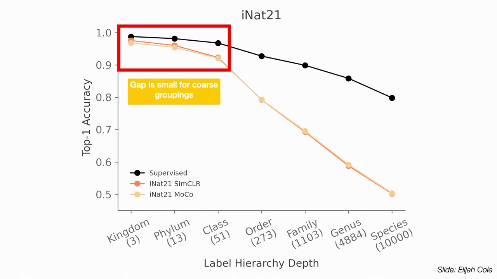
*▲ 강의 슬라이드 [65:22](https://youtu.be/yUh1fEGGdl4?t=3922): iNat21에서 [분류](00_%EB%94%A5%EB%9F%AC%EB%8B%9D_%EC%9A%A9%EC%96%B4%EC%82%AC%EC%A0%84.md#regression-classification-%ED%9A%8C%EA%B7%80%EC%99%80-%EB%B6%84%EB%A5%98) 단계별 top-1 [정확도](00_%EB%94%A5%EB%9F%AC%EB%8B%9D_%EC%9A%A9%EC%96%B4%EC%82%AC%EC%A0%84.md#accuracy-%EC%A0%95%ED%99%95%EB%8F%84). 검정은 지도 [학습](00_%EB%94%A5%EB%9F%AC%EB%8B%9D_%EC%9A%A9%EC%96%B4%EC%82%AC%EC%A0%84.md#training-%ED%95%99%EC%8A%B5), 주황은 [SimCLR](00_%EB%94%A5%EB%9F%AC%EB%8B%9D_%EC%9A%A9%EC%96%B4%EC%82%AC%EC%A0%84.md#simclr-simclr-%EB%8C%80%EC%A1%B0-%ED%95%99%EC%8A%B5)·MoCo + 선형 탐침. 거친 묶음(계·문·강)에서는 차이가 작고, 종으로 갈수록 벌어진다*

- **[최근접 이웃 검색](00_%EB%94%A5%EB%9F%AC%EB%8B%9D_%EC%9A%A9%EC%96%B4%EC%82%AC%EC%A0%84.md#nearest-neighbor-retrieval-%EC%B5%9C%EA%B7%BC%EC%A0%91-%EC%9D%B4%EC%9B%83-%EA%B2%80%EC%83%89)으로 들여다보기**: 새 사진 하나로 전체 데이터에서 가장 가까운 이웃을 찾으면,
  - 지도 모형: 같은 종도 몇 개 있지만 다른 종도 많습니다(지도 [학습](00_%EB%94%A5%EB%9F%AC%EB%8B%9D_%EC%9A%A9%EC%96%B4%EC%82%AC%EC%A0%84.md#training-%ED%95%99%EC%8A%B5)에도 어려운 문제). 다만 대부분 같은 속이나 과입니다.
  - [SimCLR](00_%EB%94%A5%EB%9F%AC%EB%8B%9D_%EC%9A%A9%EC%96%B4%EC%82%AC%EC%A0%84.md#simclr-simclr-%EB%8C%80%EC%A1%B0-%ED%95%99%EC%8A%B5): 같은 종이 **하나도 없습니다**. 대신 모두 **사람 손에 들린 새** 사진입니다. 증강으로 만든 "비슷함"이 종의 비슷함보다 맥락(손에 들림)의 비슷함을 더 많이 가르친 것입니다.
- **교훈**: [대조 학습](00_%EB%94%A5%EB%9F%AC%EB%8B%9D_%EC%9A%A9%EC%96%B4%EC%82%AC%EC%A0%84.md#contrastive-learning-%EB%8C%80%EC%A1%B0-%ED%95%99%EC%8A%B5)이 잘 되려면 **문제에 맞는 유사도 척도**가 필요합니다. 양성 쌍을 고르는 기준이 다음 과제(여기서는 종 식별)와 맞지 않으면, 대조 목적은 균일성은 주지만 원하는 균일성·유사도를 주지 않습니다. ImageNet에서 "라벨 없이도 지도 [학습](00_%EB%94%A5%EB%9F%AC%EB%8B%9D_%EC%9A%A9%EC%96%B4%EC%82%AC%EC%A0%84.md#training-%ED%95%99%EC%8A%B5)만큼"이라는 결론은 과제가 거칠었기 때문일 수 있습니다. 손에 들린 새들은 거친 수준에서는 모두 "새"로 묶여도 괜찮지만, 세밀한 구분에서는 증강이 그 미묘함을 잡아야 합니다. **벤치마크가 "충분히 좋다"는 판단을 좌우한다**는 점을 보여 줍니다([세분 분류](00_%EB%94%A5%EB%9F%AC%EB%8B%9D_%EC%9A%A9%EC%96%B4%EC%82%AC%EC%A0%84.md#fine-grained-classification-%EC%84%B8%EB%B6%84-%EB%B6%84%EB%A5%98)).

질의응답 정리 [66:50](https://youtu.be/yUh1fEGGdl4?t=4010)

- **[대조 학습](00_%EB%94%A5%EB%9F%AC%EB%8B%9D_%EC%9A%A9%EC%96%B4%EC%82%AC%EC%A0%84.md#contrastive-learning-%EB%8C%80%EC%A1%B0-%ED%95%99%EC%8A%B5)은 균일한 공간을 만들어 좋다더니, 균일하지 않은 지도 [학습](00_%EB%94%A5%EB%9F%AC%EB%8B%9D_%EC%9A%A9%EC%96%B4%EC%82%AC%EC%A0%84.md#training-%ED%95%99%EC%8A%B5)이 훨씬 낫다. 균일성이 별로 안 중요한 것 아닌가?** 분리성은 대체로 좋습니다. 하지만 [대조 학습](00_%EB%94%A5%EB%9F%AC%EB%8B%9D_%EC%9A%A9%EC%96%B4%EC%82%AC%EC%A0%84.md#contrastive-learning-%EB%8C%80%EC%A1%B0-%ED%95%99%EC%8A%B5)이 잘 되려면 과제에 맞는 유사도 척도가 있어야 합니다. 여기서는 증강이 종이 아닌 맥락의 비슷함을 가르쳤으므로, 균일하긴 하지만 원하는 균일성이 아닙니다.
- **새만 잘라 내는 등 맥락을 통제하면 지도 [학습](00_%EB%94%A5%EB%9F%AC%EB%8B%9D_%EC%9A%A9%EC%96%B4%EC%82%AC%EC%A0%84.md#training-%ED%95%99%EC%8A%B5)에 가까워질까?** 요점은 자기 지도 신호가 과제를 담지 못하면 좋은 표현이 안 된다는 것입니다. [지도 대조 학습](00_%EB%94%A5%EB%9F%AC%EB%8B%9D_%EC%9A%A9%EC%96%B4%EC%82%AC%EC%A0%84.md#supervised-contrastive-learning-%EC%A7%80%EB%8F%84-%EB%8C%80%EC%A1%B0-%ED%95%99%EC%8A%B5)을 쓰면 지도 [학습](00_%EB%94%A5%EB%9F%AC%EB%8B%9D_%EC%9A%A9%EC%96%B4%EC%82%AC%EC%A0%84.md#training-%ED%95%99%EC%8A%B5)에 훨씬 가까워질 것이라 예상하지만, 이 사례(Elijah Cole이 이끈 연구)에서는 [교차 엔트로피](00_%EB%94%A5%EB%9F%AC%EB%8B%9D_%EC%9A%A9%EC%96%B4%EC%82%AC%EC%A0%84.md#cross-entropy-%EA%B5%90%EC%B0%A8-%EC%97%94%ED%8A%B8%EB%A1%9C%ED%94%BC)와 크게 다르지 않을 것이라고 강사는 봅니다.
- **음성 표본에는 증강을 하지 않는데, 처음 보는 데이터에서는 어떻게 동작하나?** 결과는 [학습](00_%EB%94%A5%EB%9F%AC%EB%8B%9D_%EC%9A%A9%EC%96%B4%EC%82%AC%EC%A0%84.md#training-%ED%95%99%EC%8A%B5)에 쓰지 않은 [시험 데이터](00_%EB%94%A5%EB%9F%AC%EB%8B%9D_%EC%9A%A9%EC%96%B4%EC%82%AC%EC%A0%84.md#training-data-test-data-%ED%95%99%EC%8A%B5-%EB%8D%B0%EC%9D%B4%ED%84%B0%EC%99%80-%EC%8B%9C%ED%97%98-%EB%8D%B0%EC%9D%B4%ED%84%B0)에서 잰 것이고, ImageNet 등에서는 잘 일반화합니다. 다만 양성에만 증강을 하면 모형이 "증강된 이미지 특유의 이상한 통계" 자체를 단서로 삼을 수 있다는 지적은 일리 있습니다. 실제로는 음성에도 증강을 하는 경우가 많습니다.
- **열린 집합(open set) 문제**: 사람(예: CelebA의 유명인) 개체 **[재식별](00_%EB%94%A5%EB%9F%AC%EB%8B%9D_%EC%9A%A9%EC%96%B4%EC%82%AC%EC%A0%84.md#re-identification-%EC%9E%AC%EC%8B%9D%EB%B3%84)**처럼 [학습](00_%EB%94%A5%EB%9F%AC%EB%8B%9D_%EC%9A%A9%EC%96%B4%EC%82%AC%EC%A0%84.md#training-%ED%95%99%EC%8A%B5) 때 본 적 없는 새 개체의 두 사진을 가깝게 놓아야 하는 문제에서는, [삼중항 손실](00_%EB%94%A5%EB%9F%AC%EB%8B%9D_%EC%9A%A9%EC%96%B4%EC%82%AC%EC%A0%84.md#triplet-loss-%EC%82%BC%EC%A4%91%ED%95%AD-%EC%86%90%EC%8B%A4)에서 시작해 더 복잡한 대조 목적으로 이어진 거리 공간 방법들이 거의 모든 최고 성능을 냅니다. 고정된 범주 수의 [교차 엔트로피](00_%EB%94%A5%EB%9F%AC%EB%8B%9D_%EC%9A%A9%EC%96%B4%EC%82%AC%EC%A0%84.md#cross-entropy-%EA%B5%90%EC%B0%A8-%EC%97%94%ED%8A%B8%EB%A1%9C%ED%94%BC)로는 새 범주에서 어떻게 될지 거의 말할 수 없기 때문입니다.

> [!TIP]
> **🆕 2026 업데이트: 자기 지도 표현의 세밀한 종 [분류](00_%EB%94%A5%EB%9F%AC%EB%8B%9D_%EC%9A%A9%EC%96%B4%EC%82%AC%EC%A0%84.md#regression-classification-%ED%9A%8C%EA%B7%80%EC%99%80-%EB%B6%84%EB%A5%98)**
> - **강의**: iNat21만으로 학습한 [SimCLR](00_%EB%94%A5%EB%9F%AC%EB%8B%9D_%EC%9A%A9%EC%96%B4%EC%82%AC%EC%A0%84.md#simclr-simclr-%EB%8C%80%EC%A1%B0-%ED%95%99%EC%8A%B5)·MoCo 표현은 종 수준에서 지도 [학습](00_%EB%94%A5%EB%9F%AC%EB%8B%9D_%EC%9A%A9%EC%96%B4%EC%82%AC%EC%A0%84.md#training-%ED%95%99%EC%8A%B5)보다 약 30%p 낮다.
> - **현재**: Meta의 DINOv3(2025)는 라벨 없이 큐레이션한 웹 이미지 약 16.9억 장(LVD-1689M)으로 70억 [파라미터](00_%EB%94%A5%EB%9F%AC%EB%8B%9D_%EC%9A%A9%EC%96%B4%EC%82%AC%EC%A0%84.md#parameter-%ED%8C%8C%EB%9D%BC%EB%AF%B8%ED%84%B0) ViT를 자기 증류 방식의 자기 지도로 학습했다. 표현을 고정하고 선형 탐침만 붙인 iNat21 [정확도](00_%EB%94%A5%EB%9F%AC%EB%8B%9D_%EC%9A%A9%EC%96%B4%EC%82%AC%EC%A0%84.md#accuracy-%EC%A0%95%ED%99%95%EB%8F%84)가 89.8%로, DINOv2(86.1%)와 이미지-글로 학습한 SigLIP 2(82.7%), PE core(87.0%)보다 높다. 데이터·모형 규모가 강의의 실험과 전혀 달라 직접 비교할 수는 없지만, "자기 지도 표현은 세밀한 [분류](00_%EB%94%A5%EB%9F%AC%EB%8B%9D_%EC%9A%A9%EC%96%B4%EC%82%AC%EC%A0%84.md#regression-classification-%ED%9A%8C%EA%B7%80%EC%99%80-%EB%B6%84%EB%A5%98)에 약하다"는 결론은 충분한 규모와 다른 목적(음성 쌍 없는 자기 증류)에서는 더 이상 성립하지 않는다.
> - **출처**: [Siméoni et al., DINOv3 (arXiv 2025), Table 8](https://arxiv.org/abs/2508.10104)

> [!TIP]
> **🆕 2026 업데이트: 과제에 맞춘 "비슷함"으로 종을 구분하기**
> - **강의**: [대조 학습](00_%EB%94%A5%EB%9F%AC%EB%8B%9D_%EC%9A%A9%EC%96%B4%EC%82%AC%EC%A0%84.md#contrastive-learning-%EB%8C%80%EC%A1%B0-%ED%95%99%EC%8A%B5)이 잘 되려면 양성 쌍을 고르는 유사도가 과제(종 식별)와 맞아야 한다.
> - **현재**: BioCLIP 2(2025)는 약 2억 1400만 장의 생물 사진 데이터셋 TreeOfLife-200M에서, 이미지와 **분류학 계통 이름**(계부터 종까지)을 짝지은 위계적 [대조 학습](00_%EB%94%A5%EB%9F%AC%EB%8B%9D_%EC%9A%A9%EC%96%B4%EC%82%AC%EC%A0%84.md#contrastive-learning-%EB%8C%80%EC%A1%B0-%ED%95%99%EC%8A%B5)으로 ViT-L/14를 학습했다. 종 [분류](00_%EB%94%A5%EB%9F%AC%EB%8B%9D_%EC%9A%A9%EC%96%B4%EC%82%AC%EC%A0%84.md#regression-classification-%ED%9A%8C%EA%B7%80%EC%99%80-%EB%B6%84%EB%A5%98)에서 [CLIP](00_%EB%94%A5%EB%9F%AC%EB%8B%9D_%EC%9A%A9%EC%96%B4%EC%82%AC%EC%A0%84.md#clip-%ED%81%B4%EB%A6%BD), SigLIP, DINOv2 같은 범용 모형과 기존 BioCLIP을 모두 앞섰고, [임베딩](00_%EB%94%A5%EB%9F%AC%EB%8B%9D_%EC%9A%A9%EC%96%B4%EC%82%AC%EC%A0%84.md#embedding-%EC%9E%84%EB%B2%A0%EB%94%A9) 공간에서 종 사이 배치가 부리 크기나 서식지 같은 생태적 의미와 맞아떨어지고, 같은 종 안의 차이(성별, 생애 단계)는 따로 보존되는 성질이 나타났다고 보고한다. 강의의 교훈처럼 "무엇을 같다고 볼지"를 과제에 맞춘 사례다.
> - **출처**: [Gu et al., BioCLIP 2: Emergent Properties from Scaling Hierarchical Contrastive Learning (NeurIPS 2025)](https://arxiv.org/abs/2505.23883)

---

## 10. 정리

▶ 영상 [74:33](https://youtu.be/yUh1fEGGdl4?t=4473)

- 좋은 표현은 **관련 있는 유사도/비유사도 정보**를 담습니다.
- 반이 잘 뭉치고(간결, 집중) 서로 잘 떨어진(분리, 고르게 퍼짐) 표현은 관련 정보를 **보존**하고, 관련 없는 정보는 "잊도록" 올바른 **불변성**을 가르칩니다.
- 무엇이 관련 없는지는 우리가 정합니다. 자기 지도에서는 "이 증강들에 불변하라", 지도 [학습](00_%EB%94%A5%EB%9F%AC%EB%8B%9D_%EC%9A%A9%EC%96%B4%EC%82%AC%EC%A0%84.md#training-%ED%95%99%EC%8A%B5)에서는 "같은 반 두 사진의 차이(예: 손에 들린 맥락)에 불변하라"가 그 정의입니다.
- 지도와 자기 지도의 차이는 결국 **무엇을 같은 쌍으로 정하는가**에 있고, 그래서 다음 과제에 맞춰 무엇이 같고 달라야 하는지에 대한 지식을 시스템에 많이 넣을 수 있습니다.

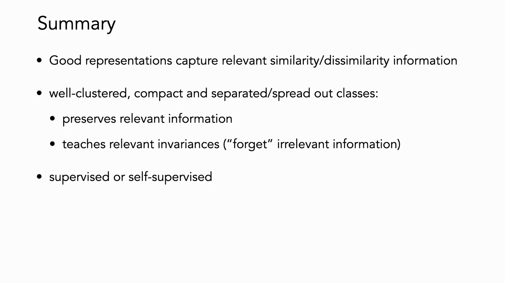
*▲ 강의 슬라이드 [75:52](https://youtu.be/yUh1fEGGdl4?t=4552): 정리. 좋은 표현은 관련 있는 유사도 정보를 담고, 관련 정보를 보존하며 관련 없는 정보에 불변하다. 지도·자기 지도 모두 가능*

---

## 11. 용어 정리

용어사전에 있는 용어는 위 본문에 링크를 걸었습니다. 아래는 이번 강의에서 새로 나온 용어입니다.

| 용어 | 뜻 |
|---|---|
| [거리 척도 학습](00_%EB%94%A5%EB%9F%AC%EB%8B%9D_%EC%9A%A9%EC%96%B4%EC%82%AC%EC%A0%84.md#metric-learning-%EA%B1%B0%EB%A6%AC-%EC%B2%99%EB%8F%84-%ED%95%99%EC%8A%B5)(Metric learning) | 같은 쌍은 가깝게, 다른 쌍은 멀게 하는 거리(또는 [임베딩](00_%EB%94%A5%EB%9F%AC%EB%8B%9D_%EC%9A%A9%EC%96%B4%EC%82%AC%EC%A0%84.md#embedding-%EC%9E%84%EB%B2%A0%EB%94%A9) 함수)를 데이터로 배우는 것 |
| [마할라노비스 거리](00_%EB%94%A5%EB%9F%AC%EB%8B%9D_%EC%9A%A9%EC%96%B4%EC%82%AC%EC%A0%84.md#mahalanobis-distance-%EB%A7%88%ED%95%A0%EB%9D%BC%EB%85%B8%EB%B9%84%EC%8A%A4-%EA%B1%B0%EB%A6%AC)(Mahalanobis distance) | PSD 행렬 $A$로 잰 거리 $\sqrt{(\mathbf{x}-\mathbf{y})^\top A (\mathbf{x}-\mathbf{y})}$ |
| [양의 준정부호 행렬](00_%EB%94%A5%EB%9F%AC%EB%8B%9D_%EC%9A%A9%EC%96%B4%EC%82%AC%EC%A0%84.md#positive-semidefinite-matrix-%EC%96%91%EC%9D%98-%EC%A4%80%EC%A0%95%EB%B6%80%ED%98%B8-%ED%96%89%EB%A0%AC)(Positive semidefinite matrix) | 모든 $\mathbf{v}$에 $\mathbf{v}^\top A \mathbf{v} \ge 0$인 대칭 행렬 |
| [대조 학습](00_%EB%94%A5%EB%9F%AC%EB%8B%9D_%EC%9A%A9%EC%96%B4%EC%82%AC%EC%A0%84.md#contrastive-learning-%EB%8C%80%EC%A1%B0-%ED%95%99%EC%8A%B5)(Contrastive learning) | 양성 쌍은 당기고 음성 쌍은 미는 [손실](00_%EB%94%A5%EB%9F%AC%EB%8B%9D_%EC%9A%A9%EC%96%B4%EC%82%AC%EC%A0%84.md#loss-function-%EC%86%90%EC%8B%A4-%ED%95%A8%EC%88%98)로 표현을 배우는 방법 |
| [양성 쌍과 음성 쌍](00_%EB%94%A5%EB%9F%AC%EB%8B%9D_%EC%9A%A9%EC%96%B4%EC%82%AC%EC%A0%84.md#positive-pair-negative-pair-%EC%96%91%EC%84%B1-%EC%8C%8D%EA%B3%BC-%EC%9D%8C%EC%84%B1-%EC%8C%8D)(Positive pair, Negative pair) | 같다고 정한 쌍과 다르다고 정한 쌍. 잘못 들어간 같은 부류 음성은 거짓 음성 |
| [삼중항 손실](00_%EB%94%A5%EB%9F%AC%EB%8B%9D_%EC%9A%A9%EC%96%B4%EC%82%AC%EC%A0%84.md#triplet-loss-%EC%82%BC%EC%A4%91%ED%95%AD-%EC%86%90%EC%8B%A4)(Triplet loss) | 앵커-음성 거리가 앵커-양성 거리보다 여유 이상 크지 않으면 벌하는 [손실](00_%EB%94%A5%EB%9F%AC%EB%8B%9D_%EC%9A%A9%EC%96%B4%EC%82%AC%EC%A0%84.md#loss-function-%EC%86%90%EC%8B%A4-%ED%95%A8%EC%88%98) |
| [하드 네거티브 마이닝](00_%EB%94%A5%EB%9F%AC%EB%8B%9D_%EC%9A%A9%EC%96%B4%EC%82%AC%EC%A0%84.md#hard-negative-mining-%ED%95%98%EB%93%9C-%EB%84%A4%EA%B1%B0%ED%8B%B0%EB%B8%8C-%EB%A7%88%EC%9D%B4%EB%8B%9D)(Hard negative mining) | 양성보다 가깝게 잘못 놓인 어려운 음성을 골라 학습하는 것 |
| [초구](00_%EB%94%A5%EB%9F%AC%EB%8B%9D_%EC%9A%A9%EC%96%B4%EC%82%AC%EC%A0%84.md#hypersphere-%EC%B4%88%EA%B5%AC)([Hypersphere](00_%EB%94%A5%EB%9F%AC%EB%8B%9D_%EC%9A%A9%EC%96%B4%EC%82%AC%EC%A0%84.md#hypersphere-%EC%B4%88%EA%B5%AC)) | 길이 1인 벡터 전체 $\mathbb{S}^{d-1}$. 정규화한 표현이 놓이는 곳 |
| [코사인 유사도](00_%EB%94%A5%EB%9F%AC%EB%8B%9D_%EC%9A%A9%EC%96%B4%EC%82%AC%EC%A0%84.md#cosine-similarity-%EC%BD%94%EC%82%AC%EC%9D%B8-%EC%9C%A0%EC%82%AC%EB%8F%84)(Cosine similarity) | 두 벡터 사이각의 코사인. 단위 벡터끼리는 [내적](00_%EB%94%A5%EB%9F%AC%EB%8B%9D_%EC%9A%A9%EC%96%B4%EC%82%AC%EC%A0%84.md#dot-product-%EB%82%B4%EC%A0%81) |
| [InfoNCE](00_%EB%94%A5%EB%9F%AC%EB%8B%9D_%EC%9A%A9%EC%96%B4%EC%82%AC%EC%A0%84.md#infonce-infonce-%EC%86%90%EC%8B%A4)([InfoNCE](00_%EB%94%A5%EB%9F%AC%EB%8B%9D_%EC%9A%A9%EC%96%B4%EC%82%AC%EC%A0%84.md#infonce-infonce-%EC%86%90%EC%8B%A4) loss) | 음성 여럿 중 양성을 고르는 [소프트맥스](00_%EB%94%A5%EB%9F%AC%EB%8B%9D_%EC%9A%A9%EC%96%B4%EC%82%AC%EC%A0%84.md#softmax-%EC%86%8C%ED%94%84%ED%8A%B8%EB%A7%A5%EC%8A%A4) [교차 엔트로피](00_%EB%94%A5%EB%9F%AC%EB%8B%9D_%EC%9A%A9%EC%96%B4%EC%82%AC%EC%A0%84.md#cross-entropy-%EA%B5%90%EC%B0%A8-%EC%97%94%ED%8A%B8%EB%A1%9C%ED%94%BC) 형태의 대조 [손실](00_%EB%94%A5%EB%9F%AC%EB%8B%9D_%EC%9A%A9%EC%96%B4%EC%82%AC%EC%A0%84.md#loss-function-%EC%86%90%EC%8B%A4-%ED%95%A8%EC%88%98) |
| [데이터 증강](00_%EB%94%A5%EB%9F%AC%EB%8B%9D_%EC%9A%A9%EC%96%B4%EC%82%AC%EC%A0%84.md#data-augmentation-%EB%8D%B0%EC%9D%B4%ED%84%B0-%EC%A6%9D%EA%B0%95)([Data augmentation](00_%EB%94%A5%EB%9F%AC%EB%8B%9D_%EC%9A%A9%EC%96%B4%EC%82%AC%EC%A0%84.md#data-augmentation-%EB%8D%B0%EC%9D%B4%ED%84%B0-%EC%A6%9D%EA%B0%95)) | 자르기·뒤집기·색 바꾸기 등으로 같은 데이터의 변형을 만드는 것 |
| [SimCLR](00_%EB%94%A5%EB%9F%AC%EB%8B%9D_%EC%9A%A9%EC%96%B4%EC%82%AC%EC%A0%84.md#simclr-simclr-%EB%8C%80%EC%A1%B0-%ED%95%99%EC%8A%B5) | 한 사진의 두 증강을 양성, 배치의 나머지를 음성으로 쓰는 자기 [지도 대조 학습](00_%EB%94%A5%EB%9F%AC%EB%8B%9D_%EC%9A%A9%EC%96%B4%EC%82%AC%EC%A0%84.md#supervised-contrastive-learning-%EC%A7%80%EB%8F%84-%EB%8C%80%EC%A1%B0-%ED%95%99%EC%8A%B5) 틀 |
| [상호 정보량](00_%EB%94%A5%EB%9F%AC%EB%8B%9D_%EC%9A%A9%EC%96%B4%EC%82%AC%EC%A0%84.md#mutual-information-%EC%83%81%ED%98%B8-%EC%A0%95%EB%B3%B4%EB%9F%89)(Mutual information) | 한 변수를 알면 다른 변수의 불확실성이 얼마나 줄어드는지 |
| [정렬과 균일성](00_%EB%94%A5%EB%9F%AC%EB%8B%9D_%EC%9A%A9%EC%96%B4%EC%82%AC%EC%A0%84.md#alignment-uniformity-%EC%A0%95%EB%A0%AC%EA%B3%BC-%EA%B7%A0%EC%9D%BC%EC%84%B1)([Alignment](00_%EB%94%A5%EB%9F%AC%EB%8B%9D_%EC%9A%A9%EC%96%B4%EC%82%AC%EC%A0%84.md#alignment-uniformity-%EC%A0%95%EB%A0%AC%EA%B3%BC-%EA%B7%A0%EC%9D%BC%EC%84%B1), [Uniformity](00_%EB%94%A5%EB%9F%AC%EB%8B%9D_%EC%9A%A9%EC%96%B4%EC%82%AC%EC%A0%84.md#alignment-uniformity-%EC%A0%95%EB%A0%AC%EA%B3%BC-%EA%B7%A0%EC%9D%BC%EC%84%B1)) | 양성 쌍이 붙어 있는 정도와 표현이 구 위에 고르게 퍼진 정도 |
| [프로젝션 헤드](00_%EB%94%A5%EB%9F%AC%EB%8B%9D_%EC%9A%A9%EC%96%B4%EC%82%AC%EC%A0%84.md#projection-head-%ED%94%84%EB%A1%9C%EC%A0%9D%EC%85%98-%ED%97%A4%EB%93%9C)([Projection](00_%EB%94%A5%EB%9F%AC%EB%8B%9D_%EC%9A%A9%EC%96%B4%EC%82%AC%EC%A0%84.md#projection-%ED%88%AC%EC%98%81) head) | 표현 $\mathbf{h}$ 위에 두고 대조 [손실](00_%EB%94%A5%EB%9F%AC%EB%8B%9D_%EC%9A%A9%EC%96%B4%EC%82%AC%EC%A0%84.md#loss-function-%EC%86%90%EC%8B%A4-%ED%95%A8%EC%88%98)을 거는 작은 사영 $g$ |
| [지도 대조 학습](00_%EB%94%A5%EB%9F%AC%EB%8B%9D_%EC%9A%A9%EC%96%B4%EC%82%AC%EC%A0%84.md#supervised-contrastive-learning-%EC%A7%80%EB%8F%84-%EB%8C%80%EC%A1%B0-%ED%95%99%EC%8A%B5)(Supervised contrastive learning) | 같은 라벨의 다른 표본도 양성으로 쓰는 [대조 학습](00_%EB%94%A5%EB%9F%AC%EB%8B%9D_%EC%9A%A9%EC%96%B4%EC%82%AC%EC%A0%84.md#contrastive-learning-%EB%8C%80%EC%A1%B0-%ED%95%99%EC%8A%B5) |
| [선형 탐침](00_%EB%94%A5%EB%9F%AC%EB%8B%9D_%EC%9A%A9%EC%96%B4%EC%82%AC%EC%A0%84.md#probe-linear-probe-%ED%83%90%EC%B9%A8%EA%B3%BC-%EC%84%A0%ED%98%95-%ED%83%90%EC%B9%A8)(Linear probe) | 표현을 고정하고 선형 분류기만 학습해 표현의 질을 재는 방법 |
| [최근접 이웃 검색](00_%EB%94%A5%EB%9F%AC%EB%8B%9D_%EC%9A%A9%EC%96%B4%EC%82%AC%EC%A0%84.md#nearest-neighbor-retrieval-%EC%B5%9C%EA%B7%BC%EC%A0%91-%EC%9D%B4%EC%9B%83-%EA%B2%80%EC%83%89)(Nearest neighbor retrieval) | 표현 공간에서 질의와 가장 가까운 항목을 찾는 것 |
| [세분 분류](00_%EB%94%A5%EB%9F%AC%EB%8B%9D_%EC%9A%A9%EC%96%B4%EC%82%AC%EC%A0%84.md#fine-grained-classification-%EC%84%B8%EB%B6%84-%EB%B6%84%EB%A5%98)(Fine-grained classification) | 같은 속의 다른 종처럼 아주 비슷한 범주를 구별하는 [분류](00_%EB%94%A5%EB%9F%AC%EB%8B%9D_%EC%9A%A9%EC%96%B4%EC%82%AC%EC%A0%84.md#regression-classification-%ED%9A%8C%EA%B7%80%EC%99%80-%EB%B6%84%EB%A5%98) |
| [재식별](00_%EB%94%A5%EB%9F%AC%EB%8B%9D_%EC%9A%A9%EC%96%B4%EC%82%AC%EC%A0%84.md#re-identification-%EC%9E%AC%EC%8B%9D%EB%B3%84)([Re-identification](00_%EB%94%A5%EB%9F%AC%EB%8B%9D_%EC%9A%A9%EC%96%B4%EC%82%AC%EC%A0%84.md#re-identification-%EC%9E%AC%EC%8B%9D%EB%B3%84)) | 처음 보는 개체라도 같은 개체의 다른 사진끼리 묶는 열린 집합 문제 |
| [차원 축소](00_%EB%94%A5%EB%9F%AC%EB%8B%9D_%EC%9A%A9%EC%96%B4%EC%82%AC%EC%A0%84.md#dimensionality-reduction-%EC%B0%A8%EC%9B%90-%EC%B6%95%EC%86%8C)(Dimensionality reduction) | 데이터를 더 적은 차원으로 간결하게 나타내는 것 |
| [t-SNE](00_%EB%94%A5%EB%9F%AC%EB%8B%9D_%EC%9A%A9%EC%96%B4%EC%82%AC%EC%A0%84.md#t-sne-t-sne-%EC%8B%9C%EA%B0%81%ED%99%94) | 고차원 표현을 이웃 관계를 살려 2차원으로 그리는 시각화 방법 |
| [iNaturalist](00_%EB%94%A5%EB%9F%AC%EB%8B%9D_%EC%9A%A9%EC%96%B4%EC%82%AC%EC%A0%84.md#inaturalist-%EC%83%9D%EB%AC%BC-%EC%A2%85-%EC%82%AC%EC%A7%84-%EB%8D%B0%EC%9D%B4%ED%84%B0%EC%85%8B) | 시민 과학 플랫폼에서 모은 [생물 종 사진 데이터셋](00_%EB%94%A5%EB%9F%AC%EB%8B%9D_%EC%9A%A9%EC%96%B4%EC%82%AC%EC%A0%84.md#inaturalist-%EC%83%9D%EB%AC%BC-%EC%A2%85-%EC%82%AC%EC%A7%84-%EB%8D%B0%EC%9D%B4%ED%84%B0%EC%85%8B). 2021판은 1만 종 |
