# Lec 13. 표현 학습: 이론 (Representation Learning: Theory)

← 이전: [Lec12_유사도_기반_표현_학습](Lec12_%EC%9C%A0%EC%82%AC%EB%8F%84_%EA%B8%B0%EB%B0%98_%ED%91%9C%ED%98%84_%ED%95%99%EC%8A%B5.md) · [목차](00_MIT%EB%94%A5%EB%9F%AC%EB%8B%9D_%EB%AA%A9%EC%B0%A8.md) · 다음: [Lec14_생성_모델_기초](Lec14_%EC%83%9D%EC%84%B1_%EB%AA%A8%EB%8D%B8_%EA%B8%B0%EC%B4%88.md) →

> [!NOTE]
> **강의 정보**
> - **출처**: MIT OpenCourseWare, [Lec 13. Representation Learning: Theory](https://www.youtube.com/watch?v=-eC0-5mXHQg) (75분, 2024년 가을 학기)
> - **강사**: Jeremy Bernstein
> - **라이선스**: 원 강의는 CC BY-NC-SA 4.0입니다. 이 노트는 영어 자막을 바탕으로 한국어로 옮겨 정리한 2차 저작물이며, 같은 조건(비영리·출처 표기·동일 조건 공유)을 따릅니다.
> - 각 절 제목 아래의 `▶ 영상` 시간을 누르면 영상의 해당 위치로 갑니다.
> - `📐 수학 개념` 줄은 그 절에 쓰인 수학을 정리한 노트로 연결됩니다. 전체 목록은 [00_MIT딥러닝_목차](00_MIT%EB%94%A5%EB%9F%AC%EB%8B%9D_%EB%AA%A9%EC%B0%A8.md).
> - 슬라이드 캡처는 원 강의(CC BY-NC-SA 4.0)에서 가져왔고, "직접 그린 그림"은 이 노트의 숫자로 새로 그렸습니다.
> - `🆕 2026 업데이트` 칸은 강의(2024년 가을) 이후 바뀐 내용을 덧붙인 것입니다.

## 한눈에 보기

| 구분 | 내용 |
|---|---|
| 핵심 질문 | 학습하기 전의 신경망 아키텍처도 "어떤 데이터가 서로 비슷한가"에 대한 의견을 이미 갖고 있을까? 그 의견을 어떻게 꺼내 볼까? |
| 함수 공간 세 가지 | **[커널 방법](00_%EB%94%A5%EB%9F%AC%EB%8B%9D_%EC%9A%A9%EC%96%B4%EC%82%AC%EC%A0%84.md#kernel-method-%EC%BB%A4%EB%84%90-%EB%B0%A9%EB%B2%95)**(데이터마다 혹 함수를 하나씩 놓고 더한다), **[가우스 과정](00_%EB%94%A5%EB%9F%AC%EB%8B%9D_%EC%9A%A9%EC%96%B4%EC%82%AC%EC%A0%84.md#gaussian-process-%EA%B0%80%EC%9A%B0%EC%8A%A4-%EA%B3%BC%EC%A0%95)**(데이터를 지나는 무작위 함수만 남긴다), **신경망** |
| [가우스 과정](00_%EB%94%A5%EB%9F%AC%EB%8B%9D_%EC%9A%A9%EC%96%B4%EC%82%AC%EC%A0%84.md#gaussian-process-%EA%B0%80%EC%9A%B0%EC%8A%A4-%EA%B3%BC%EC%A0%95) | 무작위 벡터를 좌표마다 찍어 이은 것의 무한 차원판. 아무 유한 개 입력에서 뽑은 값이 늘 [다변량 정규분포](00_%EB%94%A5%EB%9F%AC%EB%8B%9D_%EC%9A%A9%EC%96%B4%EC%82%AC%EC%A0%84.md#multivariate-normal-distribution-%EB%8B%A4%EB%B3%80%EB%9F%89-%EC%A0%95%EA%B7%9C%EB%B6%84%ED%8F%AC)를 따른다. **[공분산 함수](00_%EB%94%A5%EB%9F%AC%EB%8B%9D_%EC%9A%A9%EC%96%B4%EC%82%AC%EC%A0%84.md#covariance-function-%EA%B3%B5%EB%B6%84%EC%82%B0-%ED%95%A8%EC%88%98)** $\Sigma(x, x')$가 "가깝다"의 뜻을 정한다 |
| 예측 | 데이터와 새 입력을 한 정규 벡터로 묶고 조건부 분포를 구하면 평균과 표준편차가 닫힌 식으로 나온다 |
| [신경망-가우스 과정 대응](00_%EB%94%A5%EB%9F%AC%EB%8B%9D_%EC%9A%A9%EC%96%B4%EC%82%AC%EC%A0%84.md#nngp-correspondence-%EC%8B%A0%EA%B2%BD%EB%A7%9D-%EA%B0%80%EC%9A%B0%EC%8A%A4-%EA%B3%BC%EC%A0%95-%EB%8C%80%EC%9D%91) | [가중치](00_%EB%94%A5%EB%9F%AC%EB%8B%9D_%EC%9A%A9%EC%96%B4%EC%82%AC%EC%A0%84.md#weight-%EA%B0%80%EC%A4%91%EC%B9%98)를 무작위로 뽑은 신경망은 너비가 무한히 커지면 [가우스 과정](00_%EB%94%A5%EB%9F%AC%EB%8B%9D_%EC%9A%A9%EC%96%B4%EC%82%AC%EC%A0%84.md#gaussian-process-%EA%B0%80%EC%9A%B0%EC%8A%A4-%EA%B3%BC%EC%A0%95)이 된다(근거는 [중심극한정리](00_%EB%94%A5%EB%9F%AC%EB%8B%9D_%EC%9A%A9%EC%96%B4%EC%82%AC%EC%A0%84.md#central-limit-theorem-%EC%A4%91%EC%8B%AC%EA%B7%B9%ED%95%9C%EC%A0%95%EB%A6%AC)). [공분산 함수](00_%EB%94%A5%EB%9F%AC%EB%8B%9D_%EC%9A%A9%EC%96%B4%EC%82%AC%EC%A0%84.md#covariance-function-%EA%B3%B5%EB%B6%84%EC%82%B0-%ED%95%A8%EC%88%98)는 아키텍처와 [비선형성](00_%EB%94%A5%EB%9F%AC%EB%8B%9D_%EC%9A%A9%EC%96%B4%EC%82%AC%EC%A0%84.md#nonlinearity-%EB%B9%84%EC%84%A0%ED%98%95%EC%84%B1)이 정한다 |
| 예: [ReLU](00_%EB%94%A5%EB%9F%AC%EB%8B%9D_%EC%9A%A9%EC%96%B4%EC%82%AC%EC%A0%84.md#relu-%EB%A0%90%EB%A3%A8) MLP | $\sqrt2\,\mathrm{relu}$, [분산](00_%EB%94%A5%EB%9F%AC%EB%8B%9D_%EC%9A%A9%EC%96%B4%EC%82%AC%EC%A0%84.md#variance-%EB%B6%84%EC%82%B0) $1/\text{fan-in}$ 초기화이면 공분산은 **[아크코사인 커널](00_%EB%94%A5%EB%9F%AC%EB%8B%9D_%EC%9A%A9%EC%96%B4%EC%82%AC%EC%A0%84.md#arc-cosine-kernel-%EC%95%84%ED%81%AC%EC%BD%94%EC%82%AC%EC%9D%B8-%EC%BB%A4%EB%84%90)** $h$를 [층](00_%EB%94%A5%EB%9F%AC%EB%8B%9D_%EC%9A%A9%EC%96%B4%EC%82%AC%EC%A0%84.md#layer-%EC%B8%B5) 수만큼 합성한 것 |
| 한계 | 실무 설계에는 거의 쓰이지 않았다. [커널 방법](00_%EB%94%A5%EB%9F%AC%EB%8B%9D_%EC%9A%A9%EC%96%B4%EC%82%AC%EC%A0%84.md#kernel-method-%EC%BB%A4%EB%84%90-%EB%B0%A9%EB%B2%95)은 데이터 수의 세제곱으로 비싸고, 무한 너비 극한은 [학습](00_%EB%94%A5%EB%9F%AC%EB%8B%9D_%EC%9A%A9%EC%96%B4%EC%82%AC%EC%A0%84.md#training-%ED%95%99%EC%8A%B5) 중 특징이 바뀌는 효과를 놓친다 |
| 이전 강의 | Lec12 유사도 기반 [표현 학습](00_%EB%94%A5%EB%9F%AC%EB%8B%9D_%EC%9A%A9%EC%96%B4%EC%82%AC%EC%A0%84.md#representation-learning-%ED%91%9C%ED%98%84-%ED%95%99%EC%8A%B5) |

---

## 1. 들머리: 스펙트럼 노름 아래의 최급강하법

▶ 영상 [00:00](https://youtu.be/-eC0-5mXHQg?t=0)

📐 **수학 개념**: [노름에 따른 최급강하법](%EC%88%98%ED%95%99%EA%B0%9C%EB%85%90/09_%EC%B5%9C%EC%A0%81%ED%99%94%EC%9D%98_%EA%B8%B0%ED%95%98/MM27_%EB%85%B8%EB%A6%84%EC%97%90_%EB%94%B0%EB%A5%B8_%EC%B5%9C%EA%B8%89%EA%B0%95%ED%95%98%EB%B2%95.md) · [스펙트럼 노름](%EC%88%98%ED%95%99%EA%B0%9C%EB%85%90/09_%EC%B5%9C%EC%A0%81%ED%99%94%EC%9D%98_%EA%B8%B0%ED%95%98/MM28_%EC%8A%A4%ED%8E%99%ED%8A%B8%EB%9F%BC_%EB%85%B8%EB%A6%84%EA%B3%BC_RMS_%EC%97%B0%EC%82%B0%EC%9E%90_%EB%85%B8%EB%A6%84.md) · [벡터와 행렬](%EC%88%98%ED%95%99%EA%B0%9C%EB%85%90/03_%EC%84%A0%ED%98%95%EB%8C%80%EC%88%98/M05_%EB%B2%A1%ED%84%B0%EC%99%80_%ED%96%89%EB%A0%AC.md)

강사는 본론에 앞서 숙제 2의 문제 하나를 다시 꺼냅니다. [기울기](00_%EB%94%A5%EB%9F%AC%EB%8B%9D_%EC%9A%A9%EC%96%B4%EC%82%AC%EC%A0%84.md#gradient-%EA%B8%B0%EC%9A%B8%EA%B8%B0) 행렬 $G$가 있을 때, [기울기](00_%EB%94%A5%EB%9F%AC%EB%8B%9D_%EC%9A%A9%EC%96%B4%EC%82%AC%EC%A0%84.md#gradient-%EA%B8%B0%EC%9A%B8%EA%B8%B0) 방향으로 내려가되 업데이트 크기를 **[스펙트럼 노름](00_%EB%94%A5%EB%9F%AC%EB%8B%9D_%EC%9A%A9%EC%96%B4%EC%82%AC%EC%A0%84.md#spectral-norm-%EC%8A%A4%ED%8E%99%ED%8A%B8%EB%9F%BC-%EB%85%B8%EB%A6%84)**(가장 큰 [특잇값](00_%EB%94%A5%EB%9F%AC%EB%8B%9D_%EC%9A%A9%EC%96%B4%EC%82%AC%EC%A0%84.md#singular-value-decomposition-%ED%8A%B9%EC%9E%87%EA%B0%92-%EB%B6%84%ED%95%B4))으로 재서 벌하는 [최급강하법](00_%EB%94%A5%EB%9F%AC%EB%8B%9D_%EC%9A%A9%EC%96%B4%EC%82%AC%EC%A0%84.md#steepest-descent-%EC%B5%9C%EA%B8%89%EA%B0%95%ED%95%98%EB%B2%95)입니다.

- 답은 $G$의 축소 SVD $G = U\Sigma V^\top$에서 **특잇값을 모두 1로 바꾼 행렬** $UV^\top$ 방향으로 움직이는 것입니다. $UV^\top$는 직사각 행렬이라 직교 행렬은 아니고 **[반직교 행렬](00_%EB%94%A5%EB%9F%AC%EB%8B%9D_%EC%9A%A9%EC%96%B4%EC%82%AC%EC%A0%84.md#semi-orthogonal-matrix-%EB%B0%98%EC%A7%81%EA%B5%90-%ED%96%89%EB%A0%AC)**(semi-orthogonal matrix)이라 부릅니다.
- 강의 몇 주 전, 스스로를 "스피드러너"라 부르는 Keller Jordan(트위터 kellerjordan0)이 이 방법의 변형에 [모멘텀](00_%EB%94%A5%EB%9F%AC%EB%8B%9D_%EC%9A%A9%EC%96%B4%EC%82%AC%EC%A0%84.md#momentum-%EB%AA%A8%EB%A9%98%ED%85%80), 낮은 정밀도, 그리고 SVD 없이 $UV^\top$를 구하는 반복법을 더해, Karpathy의 빠른 C 구현 llm.c보다 훨씬 짧은 시간에 [트랜스포머](00_%EB%94%A5%EB%9F%AC%EB%8B%9D_%EC%9A%A9%EC%96%B4%EC%82%AC%EC%A0%84.md#transformer-%ED%8A%B8%EB%9E%9C%EC%8A%A4%ED%8F%AC%EB%A8%B8)를 학습했습니다. 강사는 그와 함께 연구하고 있다고 밝히고, 최적화의 수학으로 [학습](00_%EB%94%A5%EB%9F%AC%EB%8B%9D_%EC%9A%A9%EC%96%B4%EC%82%AC%EC%A0%84.md#training-%ED%95%99%EC%8A%B5)을 빠르게 만드는 일이 기말 프로젝트 주제로 좋다고 덧붙입니다.

$$
\Delta W^\star = \underset{\Delta W}{\arg\min}\ \Big[\operatorname{tr}(G^\top \Delta W) + \frac{\lambda}{2}\,\|\Delta W\|_{\text{spec}}^2\Big] = -\frac{\operatorname{tr}\Sigma}{\lambda}\, U V^\top, \qquad G = U \Sigma V^\top
$$

기호 풀이

| 기호 | 읽는 법 | 뜻 | 예제 값 |
| --- | --- | --- | --- |
| $G$ | 지 | [가중치](00_%EB%94%A5%EB%9F%AC%EB%8B%9D_%EC%9A%A9%EC%96%B4%EC%82%AC%EC%A0%84.md#weight-%EA%B0%80%EC%A4%91%EC%B9%98) 행렬에 대한 [기울기](00_%EB%94%A5%EB%9F%AC%EB%8B%9D_%EC%9A%A9%EC%96%B4%EC%82%AC%EC%A0%84.md#gradient-%EA%B8%B0%EC%9A%B8%EA%B8%B0) 행렬 | diag(3, 1) |
| $\Delta W$ | 델타 더블유 | [가중치](00_%EB%94%A5%EB%9F%AC%EB%8B%9D_%EC%9A%A9%EC%96%B4%EC%82%AC%EC%A0%84.md#weight-%EA%B0%80%EC%A4%91%EC%B9%98) 업데이트 (찾는 값) | |
| $\Delta W^\star$ | 델타 더블유 스타 | 목적을 가장 작게 만드는 업데이트 | diag(-2, -2) |
| $\operatorname{tr}$ | 트레이스, 대각합 | 정사각 행렬의 대각 성분의 합 | $\operatorname{tr}\Sigma = 4$ |
| $\lambda$ | 람다 | 업데이트 크기에 주는 벌점 세기 | 2 |
| $\|\cdot\|_{\text{spec}}$ | [스펙트럼 노름](00_%EB%94%A5%EB%9F%AC%EB%8B%9D_%EC%9A%A9%EC%96%B4%EC%82%AC%EC%A0%84.md#spectral-norm-%EC%8A%A4%ED%8E%99%ED%8A%B8%EB%9F%BC-%EB%85%B8%EB%A6%84) | 가장 큰 특잇값 (한 방향으로 최대 몇 배 늘이나) | 2 |
| $U, \Sigma, V$ | 유, 시그마, 브이 | 축소 [SVD](00_%EB%94%A5%EB%9F%AC%EB%8B%9D_%EC%9A%A9%EC%96%B4%EC%82%AC%EC%A0%84.md#singular-value-decomposition-%ED%8A%B9%EC%9E%87%EA%B0%92-%EB%B6%84%ED%95%B4). $\Sigma$는 특잇값을 대각에 둔 행렬 | $I$, diag(3, 1), $I$ |
| $UV^\top$ | 유 브이 [전치](00_%EB%94%A5%EB%9F%AC%EB%8B%9D_%EC%9A%A9%EC%96%B4%EC%82%AC%EC%A0%84.md#transpose-%EC%A0%84%EC%B9%98) | 특잇값을 모두 1로 바꾼 [반직교 행렬](00_%EB%94%A5%EB%9F%AC%EB%8B%9D_%EC%9A%A9%EC%96%B4%EC%82%AC%EC%A0%84.md#semi-orthogonal-matrix-%EB%B0%98%EC%A7%81%EA%B5%90-%ED%96%89%EB%A0%AC) | $I$ |

예제와 풀이

**문제**: [기울기](00_%EB%94%A5%EB%9F%AC%EB%8B%9D_%EC%9A%A9%EC%96%B4%EC%82%AC%EC%A0%84.md#gradient-%EA%B8%B0%EC%9A%B8%EA%B8%B0) 행렬이 $G = \mathrm{diag}(3, 1)$(첫째 방향 [기울기](00_%EB%94%A5%EB%9F%AC%EB%8B%9D_%EC%9A%A9%EC%96%B4%EC%82%AC%EC%A0%84.md#gradient-%EA%B8%B0%EC%9A%B8%EA%B8%B0) 3, 둘째 방향 1)이고 벌점 세기가 $\lambda = 2$이다. [스펙트럼 노름](00_%EB%94%A5%EB%9F%AC%EB%8B%9D_%EC%9A%A9%EC%96%B4%EC%82%AC%EC%A0%84.md#spectral-norm-%EC%8A%A4%ED%8E%99%ED%8A%B8%EB%9F%BC-%EB%85%B8%EB%A6%84) 최급강하 업데이트 $\Delta W^\star$와 그때의 목적 값을 구하고, 평범한 경사하강 방향 $-G/\lambda$의 목적 값과 비교하라.

**주어진 값**
- $G = \begin{pmatrix}3&0\\0&1\end{pmatrix}$ ([기울기](00_%EB%94%A5%EB%9F%AC%EB%8B%9D_%EC%9A%A9%EC%96%B4%EC%82%AC%EC%A0%84.md#gradient-%EA%B8%B0%EC%9A%B8%EA%B8%B0) 행렬)
- $\lambda = 2$ (벌점 세기)
- SVD: $U = I$, $\Sigma = \mathrm{diag}(3, 1)$, $V = I$ (대각 성분이 양수인 대각 행렬은 그 자체로 SVD 꼴이다. $I$는 단위 행렬)

**풀이**
1. 식을 그대로 쓴다: $\Delta W^\star = -\dfrac{\operatorname{tr}\Sigma}{\lambda}\, U V^\top$
2. 값을 대입한다: $\Delta W^\star = -\dfrac{\operatorname{tr}\,\mathrm{diag}(3, 1)}{2}\, I\, I^\top$
3. 대각합을 구한다(대각 성분을 더한다): $\operatorname{tr}\,\mathrm{diag}(3, 1) = 3 + 1 = 4$
4. 나눈다: $4 / 2 = 2$
5. 행렬을 곱한다: $I\,I^\top = I$ (단위 행렬끼리 곱하면 그대로)
6. 부호를 붙여 곱한다: $\Delta W^\star = -2\,I = \mathrm{diag}(-2, -2)$
7. 목적의 첫 항을 구한다: $\operatorname{tr}(G^\top \Delta W^\star) = 3\times(-2) + 1\times(-2) = -6 - 2 = -8$
8. 둘째 항을 구한다: $\|\Delta W^\star\|_{\text{spec}} = 2$ 이므로 $\dfrac{2}{2}\times 2^2 = 1 \times 4 = 4$
9. 더한다: $-8 + 4 = -4$
10. 비교: $-G/\lambda = \mathrm{diag}(-1.5, -0.5)$. 첫 항 $3\times(-1.5) + 1\times(-0.5) = -4.5 - 0.5 = -5$
11. 비교의 둘째 항: 가장 큰 특잇값이 1.5 이므로 $1 \times 1.5^2 = 2.25$
12. 비교를 더한다: $-5 + 2.25 = -2.75$

**답**: $\Delta W^\star = \mathrm{diag}(-2, -2)$, 목적 값 **-4**. 평범한 방향(-2.75)보다 더 낮다. [기울기](00_%EB%94%A5%EB%9F%AC%EB%8B%9D_%EC%9A%A9%EC%96%B4%EC%82%AC%EC%A0%84.md#gradient-%EA%B8%B0%EC%9A%B8%EA%B8%B0)가 작은 둘째 방향도 첫째 방향과 **똑같이 2만큼** 움직인다는 점이 특잇값을 1로 맞춘 효과다.

내 이해

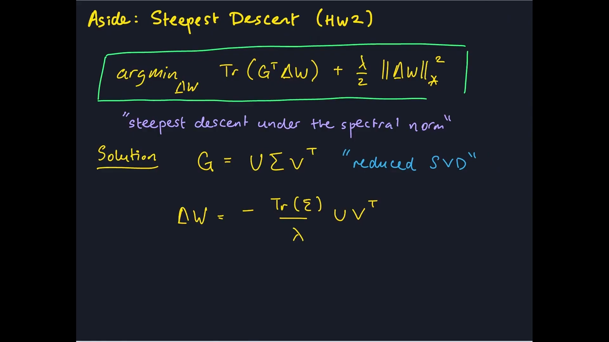
*▲ 강의 슬라이드 [01:50](https://youtu.be/-eC0-5mXHQg?t=110): 숙제 2의 [스펙트럼 노름](00_%EB%94%A5%EB%9F%AC%EB%8B%9D_%EC%9A%A9%EC%96%B4%EC%82%AC%EC%A0%84.md#spectral-norm-%EC%8A%A4%ED%8E%99%ED%8A%B8%EB%9F%BC-%EB%85%B8%EB%A6%84) [최급강하법](00_%EB%94%A5%EB%9F%AC%EB%8B%9D_%EC%9A%A9%EC%96%B4%EC%82%AC%EC%A0%84.md#steepest-descent-%EC%B5%9C%EA%B8%89%EA%B0%95%ED%95%98%EB%B2%95). 해는 축소 SVD $G = U\Sigma V^\top$의 특잇값을 1로 바꾼 $UV^\top$ 방향 (슬라이드는 [노름](00_%EB%94%A5%EB%9F%AC%EB%8B%9D_%EC%9A%A9%EC%96%B4%EC%82%AC%EC%A0%84.md#norm-%EB%85%B8%EB%A6%84)을 $\|\cdot\|_*$로 표기)*

> [!TIP]
> **🆕 2026 업데이트: 스펙트럼 최급강하가 [Muon](00_%EB%94%A5%EB%9F%AC%EB%8B%9D_%EC%9A%A9%EC%96%B4%EC%82%AC%EC%A0%84.md#muon-%EB%AE%A4%EC%98%A8-%EC%98%B5%ED%8B%B0%EB%A7%88%EC%9D%B4%EC%A0%80)이라는 표준 [옵티마이저](00_%EB%94%A5%EB%9F%AC%EB%8B%9D_%EC%9A%A9%EC%96%B4%EC%82%AC%EC%A0%84.md#optimizer-%EC%98%B5%ED%8B%B0%EB%A7%88%EC%9D%B4%EC%A0%80)가 됨**
> - **강의**: "지난 몇 주 사이" Keller Jordan이 이 방법의 변형으로 llm.c보다 훨씬 빨리 [트랜스포머](00_%EB%94%A5%EB%9F%AC%EB%8B%9D_%EC%9A%A9%EC%96%B4%EC%82%AC%EC%A0%84.md#transformer-%ED%8A%B8%EB%9E%9C%EC%8A%A4%ED%8F%AC%EB%A8%B8)를 학습했다고 소개했다.
> - **현재**: 이 방법은 [Muon](00_%EB%94%A5%EB%9F%AC%EB%8B%9D_%EC%9A%A9%EC%96%B4%EC%82%AC%EC%A0%84.md#muon-%EB%AE%A4%EC%98%A8-%EC%98%B5%ED%8B%B0%EB%A7%88%EC%9D%B4%EC%A0%80)이라는 이름으로 자리 잡았다. modded-nanogpt 기록표에서 [GPT](00_%EB%94%A5%EB%9F%AC%EB%8B%9D_%EC%9A%A9%EC%96%B4%EC%82%AC%EC%A0%84.md#gpt-%EC%83%9D%EC%84%B1%ED%98%95-%EC%82%AC%EC%A0%84%ED%95%99%EC%8A%B5-%ED%8A%B8%EB%9E%9C%EC%8A%A4%ED%8F%AC%EB%A8%B8)-2(124M)를 목표 [손실](00_%EB%94%A5%EB%9F%AC%EB%8B%9D_%EC%9A%A9%EC%96%B4%EC%82%AC%EC%A0%84.md#loss-function-%EC%86%90%EC%8B%A4-%ED%95%A8%EC%88%98) 3.28까지 학습하는 시간은 llm.c 기준선 45분(2024년 5월) → 첫 [Muon](00_%EB%94%A5%EB%9F%AC%EB%8B%9D_%EC%9A%A9%EC%96%B4%EC%82%AC%EC%A0%84.md#muon-%EB%AE%A4%EC%98%A8-%EC%98%B5%ED%8B%B0%EB%A7%88%EC%9D%B4%EC%A0%80) 기록 24.9분(2024년 10월 4일) → 2.358분(2025년 10월 4일) → 0.665분(2026년 8월 30일, 92번째 기록)으로 줄었다. 최신 기록은 [Lec23_계량_딥러닝](Lec23_%EA%B3%84%EB%9F%89_%EB%94%A5%EB%9F%AC%EB%8B%9D.md)의 업데이트에도 같은 숫자로 적었다. [PyTorch](00_%EB%94%A5%EB%9F%AC%EB%8B%9D_%EC%9A%A9%EC%96%B4%EC%82%AC%EC%A0%84.md#pytorch-%ED%8C%8C%EC%9D%B4%ED%86%A0%EC%B9%98) 2.9부터는 `torch.optim.Muon`이 기본 [옵티마이저](00_%EB%94%A5%EB%9F%AC%EB%8B%9D_%EC%9A%A9%EC%96%B4%EC%82%AC%EC%A0%84.md#optimizer-%EC%98%B5%ED%8B%B0%EB%A7%88%EC%9D%B4%EC%A0%80)로 들어갔다(2차원 [가중치](00_%EB%94%A5%EB%9F%AC%EB%8B%9D_%EC%9A%A9%EC%96%B4%EC%82%AC%EC%A0%84.md#weight-%EA%B0%80%EC%A4%91%EC%B9%98)에만 쓰고 나머지는 AdamW). 1조 [파라미터](00_%EB%94%A5%EB%9F%AC%EB%8B%9D_%EC%9A%A9%EC%96%B4%EC%82%AC%EC%A0%84.md#parameter-%ED%8C%8C%EB%9D%BC%EB%AF%B8%ED%84%B0) 모델 Kimi K2의 [사전 학습](00_%EB%94%A5%EB%9F%AC%EB%8B%9D_%EC%9A%A9%EC%96%B4%EC%82%AC%EC%A0%84.md#pre-training-%EC%82%AC%EC%A0%84-%ED%95%99%EC%8A%B5) 사례는 [Lec07 8절](Lec07_%EC%B5%9C%EC%A0%81%ED%99%94%EC%9D%98_%EC%8A%A4%EC%BC%80%EC%9D%BC%EB%A7%81_%EA%B7%9C%EC%B9%99.md#8-rms-%EC%97%B0%EC%82%B0%EC%9E%90-%EB%85%B8%EB%A6%84%EA%B3%BC-%EB%84%88%EB%B9%84-%EC%8A%A4%EC%BC%80%EC%9D%BC%EB%A7%81)의 업데이트에 정리했다.
> - **출처**: [Keller Jordan, modded-nanogpt: world record history (GitHub, 2024-2026)](https://github.com/KellerJordan/modded-nanogpt) · [PyTorch 2.9 docs, torch.optim.Muon (2025)](https://docs.pytorch.org/docs/2.9/generated/torch.optim.Muon.html) · [Jordan et al., Muon: An optimizer for hidden layers in neural networks (blog, 2024)](https://kellerjordan.github.io/posts/muon/)

---

## 2. 지난 강의와 오늘의 질문

▶ 영상 [04:37](https://youtu.be/-eC0-5mXHQg?t=277)

📐 **수학 개념**: [단위 구와 코사인 유사도](%EC%88%98%ED%95%99%EA%B0%9C%EB%85%90/03_%EC%84%A0%ED%98%95%EB%8C%80%EC%88%98/MM44_%EB%8B%A8%EC%9C%84_%EA%B5%AC%EC%99%80_%EC%BD%94%EC%82%AC%EC%9D%B8_%EC%9C%A0%EC%82%AC%EB%8F%84.md) · [정렬과 균일성](%EC%88%98%ED%95%99%EA%B0%9C%EB%85%90/10_%ED%91%9C%ED%98%84_%ED%95%99%EC%8A%B5/MM46_%EC%A0%95%EB%A0%AC%EA%B3%BC_%EA%B7%A0%EC%9D%BC%EC%84%B1.md)

- 지난 강의([Lec12](Lec12_%EC%9C%A0%EC%82%AC%EB%8F%84_%EA%B8%B0%EB%B0%98_%ED%91%9C%ED%98%84_%ED%95%99%EC%8A%B5.md))는 **[대조 학습](00_%EB%94%A5%EB%9F%AC%EB%8B%9D_%EC%9A%A9%EC%96%B4%EC%82%AC%EC%A0%84.md#contrastive-learning-%EB%8C%80%EC%A1%B0-%ED%95%99%EC%8A%B5)**을 다뤘습니다. 비슷한 데이터는 가까운 [임베딩](00_%EB%94%A5%EB%9F%AC%EB%8B%9D_%EC%9A%A9%EC%96%B4%EC%82%AC%EC%A0%84.md#embedding-%EC%9E%84%EB%B2%A0%EB%94%A9)으로, 다른 부류의 데이터는 먼 [임베딩](00_%EB%94%A5%EB%9F%AC%EB%8B%9D_%EC%9A%A9%EC%96%B4%EC%82%AC%EC%A0%84.md#embedding-%EC%9E%84%EB%B2%A0%EB%94%A9)으로 보내는 목적 함수로 표현을 배우는 방법이고, 흔히 비지도 [표현 학습](00_%EB%94%A5%EB%9F%AC%EB%8B%9D_%EC%9A%A9%EC%96%B4%EC%82%AC%EC%A0%84.md#representation-learning-%ED%91%9C%ED%98%84-%ED%95%99%EC%8A%B5)으로 봅니다.
- 앞선 강의에서는 신경망 안을 보는 관점으로 뉴런 관점, [텐서](00_%EB%94%A5%EB%9F%AC%EB%8B%9D_%EC%9A%A9%EC%96%B4%EC%82%AC%EC%A0%84.md#tensor-%ED%85%90%EC%84%9C) 관점, 스펙트럼 관점을 소개했습니다. 오늘은 더 추상적으로, 신경망을 **벡터 공간들을 차례로 지나가는 사상**으로 봅니다([Lec11 2절](Lec11_%ED%91%9C%ED%98%84_%ED%95%99%EC%8A%B5_%EC%9E%AC%EA%B5%AC%EC%84%B1.md#2-%EC%B8%B5%EC%9D%84-%EC%82%AC%EC%83%81%EC%9C%BC%EB%A1%9C-%EB%B3%B4%EA%B8%B0)과 같은 그림). 입력 공간에서는 서로 다른 부류가 뒤섞여 있다가, 마지막 [은닉층](00_%EB%94%A5%EB%9F%AC%EB%8B%9D_%EC%9A%A9%EC%96%B4%EC%82%AC%EC%A0%84.md#hidden-layer-%EC%9D%80%EB%8B%89%EC%B8%B5)에서는 의미가 다른 데이터끼리 갈라져 있기를, 예를 들어 선형 분리 가능하기를 바랍니다.

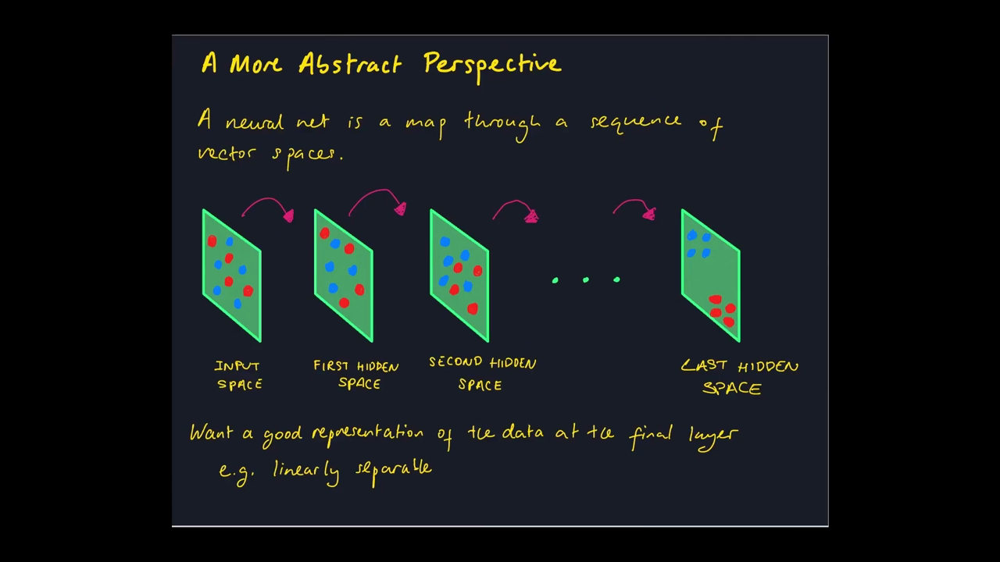
*▲ 강의 슬라이드 [07:10](https://youtu.be/-eC0-5mXHQg?t=430): 신경망은 벡터 공간의 열을 지나는 사상이다. 마지막 [층](00_%EB%94%A5%EB%9F%AC%EB%8B%9D_%EC%9A%A9%EC%96%B4%EC%82%AC%EC%A0%84.md#layer-%EC%B8%B5)에서 데이터가 좋은 표현(예: 선형 분리 가능)이 되기를 바란다*

오늘의 주장은 이것입니다. **아키텍처를 고르는 순간, 그 아키텍처는 [학습](00_%EB%94%A5%EB%9F%AC%EB%8B%9D_%EC%9A%A9%EC%96%B4%EC%82%AC%EC%A0%84.md#training-%ED%95%99%EC%8A%B5) 전부터 이미 "어떤 데이터 점들이 서로 비슷한가"에 대한 의견을 갖고 있다.** [대조 학습](00_%EB%94%A5%EB%9F%AC%EB%8B%9D_%EC%9A%A9%EC%96%B4%EC%82%AC%EC%A0%84.md#contrastive-learning-%EB%8C%80%EC%A1%B0-%ED%95%99%EC%8A%B5)을 하지 않아도 그렇습니다. 오늘은 그 의견을 꺼내 보는 도구를 만듭니다.

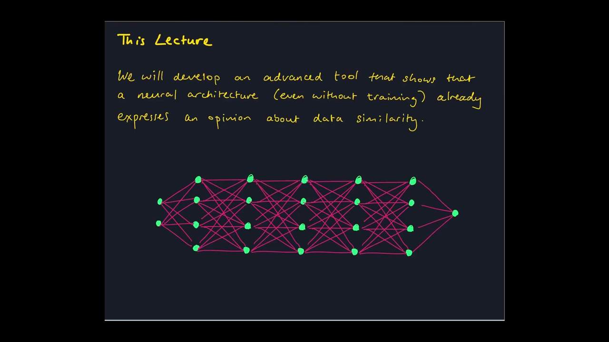
*▲ 강의 슬라이드 [08:06](https://youtu.be/-eC0-5mXHQg?t=486): 이번 강의의 목표. 신경망 아키텍처가 ([학습](00_%EB%94%A5%EB%9F%AC%EB%8B%9D_%EC%9A%A9%EC%96%B4%EC%82%AC%EC%A0%84.md#training-%ED%95%99%EC%8A%B5) 없이도) 데이터 유사도에 대한 의견을 이미 표현한다는 것을 보이는 도구*

---

## 3. 함수 공간을 만드는 세 가지 방법

### 3.1 딥러닝을 모른다면 데이터를 어떻게 맞출까

▶ 영상 [08:41](https://youtu.be/-eC0-5mXHQg?t=521)

강사는 점 몇 개를 칠판에 찍고 "머신러닝을 전혀 모른다고 치고, 처음부터 생각하면 이 데이터를 어떻게 맞추겠느냐"고 묻습니다. 학생들은 점을 직선으로 잇는 선형 [보간](00_%EB%94%A5%EB%9F%AC%EB%8B%9D_%EC%9A%A9%EC%96%B4%EC%82%AC%EC%A0%84.md#interpolation-%EB%B3%B4%EA%B0%84), 이차식 같은 다항식 [보간](00_%EB%94%A5%EB%9F%AC%EB%8B%9D_%EC%9A%A9%EC%96%B4%EC%82%AC%EC%A0%84.md#interpolation-%EB%B3%B4%EA%B0%84)을 답합니다. 함수의 종류(함수 공간)를 하나 정하고 그 안에서 데이터를 맞추는 방법은 얼마든지 만들 수 있고, 거기서 신경망까지 가는 것은 꽤 큰 도약입니다. 신경망 이전에 널리 쓰인 두 가지 고전적 방법을 봅니다.

### 3.2 첫째 방법: 커널 방법

▶ 영상 [10:29](https://youtu.be/-eC0-5mXHQg?t=629)

📐 **수학 개념**: [커널 보간과 RBF 커널](%EC%88%98%ED%95%99%EA%B0%9C%EB%85%90/10_%ED%91%9C%ED%98%84_%ED%95%99%EC%8A%B5/MM47_%EC%BB%A4%EB%84%90_%EB%B3%B4%EA%B0%84.md) · [시그마](%EC%88%98%ED%95%99%EA%B0%9C%EB%85%90/01_%EC%88%98%EC%99%80_%ED%95%A8%EC%88%98/M02_%EC%8B%9C%EA%B7%B8%EB%A7%88%EC%99%80_%ED%8F%89%EA%B7%A0.md) · [지수와 e](%EC%88%98%ED%95%99%EA%B0%9C%EB%85%90/01_%EC%88%98%EC%99%80_%ED%95%A8%EC%88%98/M06_%EC%A7%80%EC%88%98%EC%99%80_e.md)

- **[커널 방법](00_%EB%94%A5%EB%9F%AC%EB%8B%9D_%EC%9A%A9%EC%96%B4%EC%82%AC%EC%A0%84.md#kernel-method-%EC%BB%A4%EB%84%90-%EB%B0%A9%EB%B2%95)**(kernel method)은 **커널**이라 부르는 작은 혹 모양 함수(bump function, 작은 가우스 곡선 같은 것)를 **데이터 점마다 하나씩** 놓습니다. 데이터가 4개면 혹도 4개입니다([Lec03 7.1](Lec03_%EA%B7%BC%EC%82%AC_%EC%9D%B4%EB%A1%A0.md#71-1%EB%8B%A8%EA%B3%84-1%EC%B0%A8%EC%9B%90-%EC%A7%81%EC%82%AC%EA%B0%81%ED%98%95-%EB%A7%89%EB%8C%80)에서 직사각형 막대를 쌓아 함수를 근사한 것과 비슷한 발상).
- 혹마다 높이를 바꾸는 계수 $\alpha_i$를 곱해 더하고, 데이터를 정확히 지나도록 계수를 맞춥니다. 혹 $n$개, 계수 $n$개, 데이터 $n$개라서 자유도가 딱 맞습니다.
- $k(x, x_i)$는 $x_i$를 중심으로 옮겨 놓은 혹입니다. $k(x, 0)$이 원점에 놓인 혹이고, $x_i$가 그 혹을 $x$축을 따라 $i$번째 데이터 위로 옮깁니다.

$$
f(x) = \sum_{i=1}^{n} \alpha_i\, k(x, x_i), \qquad \text{예: } k(x, x') = e^{-(x - x')^2}
$$

기호 풀이

| 기호 | 읽는 법 | 뜻 | 예제 값 |
| --- | --- | --- | --- |
| $f(x)$ | 에프 엑스 | 커널로 만든 함수의 $x$에서의 값 | 2.3679 |
| $n$ | 엔 | 데이터 수 = 혹의 수 | 2 |
| $x_i$ | 엑스 아이 | $i$번째 데이터 입력 (혹의 중심) | 0, 1 |
| $\alpha_i$ | 알파 아이 | $i$번째 혹의 높이([가중치](00_%EB%94%A5%EB%9F%AC%EB%8B%9D_%EC%9A%A9%EC%96%B4%EC%82%AC%EC%A0%84.md#weight-%EA%B0%80%EC%A4%91%EC%B9%98)) | 1, 2 |
| $k(x, x')$ | 케이 | 커널. $x$와 $x'$가 가까울수록 큰 혹 | $e^{-(x - x')^2}$ |
| $\sum_{i=1}^{n}$ | 시그마 | $i = 1$부터 $n$까지 더한다 | |

예제와 풀이

**문제**: 혹 두 개가 $x_1 = 0$과 $x_2 = 1$에 놓여 있고 높이가 $\alpha_1 = 1$, $\alpha_2 = 2$이다. 커널이 $k(x, x') = e^{-(x - x')^2}$일 때 $x = 1$에서 함수 값 $f(1)$은?

**주어진 값**
- $x_1 = 0$, $x_2 = 1$ (혹의 중심)
- $\alpha_1 = 1$, $\alpha_2 = 2$ (혹의 높이)
- $x = 1$ (값을 알고 싶은 입력)
- $n = 2$ (혹의 수)

**풀이**
1. 식을 그대로 쓴다: $f(x) = \sum_{i=1}^{n} \alpha_i\, e^{-(x - x_i)^2}$
2. 값을 대입한다: $f(1) = \sum_{i=1}^{2} \alpha_i\, e^{-(1 - x_i)^2}$ ($\alpha = (1, 2)$, $x_i = (0, 1)$)
3. Σ를 풀어 쓴다: $f(1) = 1 \times e^{-(1 - 0)^2} + 2 \times e^{-(1 - 1)^2}$
4. 첫째 혹의 괄호를 계산한다: $(1 - 0)^2 = 1$ 이므로 $e^{-1}$
5. $e^{-1}$을 계산한다. $e$는 약 2.718인 수이고 $e^{-1}$은 $1/e$이다: $e^{-1} = 0.3679$
6. 둘째 혹의 괄호를 계산한다: $(1 - 1)^2 = 0$ 이므로 $e^{0} = 1$ (어떤 수든 0제곱은 1)
7. 높이를 곱한다: $1 \times 0.3679 = 0.3679$, $2 \times 1 = 2$
8. 더한다: $0.3679 + 2 = 2.3679$

**답**: $f(1) = $ **2.3679**. 자기 위에 놓인 혹(높이 2)이 대부분을 내고, 거리 1 떨어진 혹은 $e^{-1}$ 배로 줄어 0.3679만 보탠다.

내 이해

- 혹의 수를 무한히 늘리고 혹을 놓을 자리도 모든 위치로 넓힌 함수 공간 $\mathcal{F} = \{f \mid f(x) = \sum_{i=1}^{\infty} \alpha_i k(x, x_i)\}$을 **[재생 커널 힐베르트 공간](00_%EB%94%A5%EB%9F%AC%EB%8B%9D_%EC%9A%A9%EC%96%B4%EC%82%AC%EC%A0%84.md#reproducing-kernel-hilbert-space-rkhs-%EC%9E%AC%EC%83%9D-%EC%BB%A4%EB%84%90-%ED%9E%90%EB%B2%A0%EB%A5%B4%ED%8A%B8-%EA%B3%B5%EA%B0%84)**(Reproducing kernel Hilbert space, [RKHS](00_%EB%94%A5%EB%9F%AC%EB%8B%9D_%EC%9A%A9%EC%96%B4%EC%82%AC%EC%A0%84.md#reproducing-kernel-hilbert-space-rkhs-%EC%9E%AC%EC%83%9D-%EC%BB%A4%EB%84%90-%ED%9E%90%EB%B2%A0%EB%A5%B4%ED%8A%B8-%EA%B3%B5%EA%B0%84))이라 합니다.
- 지난 13년쯤의 딥러닝 붐 전에는 이것이 대세였습니다. 아키텍처를 고르는 대신 **데이터의 구조를 잘 잡는 커널(혹)을 고르는 것**이 핵심이었고, 많은 논문이 [커널 방법](00_%EB%94%A5%EB%9F%AC%EB%8B%9D_%EC%9A%A9%EC%96%B4%EC%82%AC%EC%A0%84.md#kernel-method-%EC%BB%A4%EB%84%90-%EB%B0%A9%EB%B2%95)을 다뤘습니다. 그렇다면 왜 지금은 [커널 방법](00_%EB%94%A5%EB%9F%AC%EB%8B%9D_%EC%9A%A9%EC%96%B4%EC%82%AC%EC%A0%84.md#kernel-method-%EC%BB%A4%EB%84%90-%EB%B0%A9%EB%B2%95)이 아니라 신경망을 쓰는가가 자연스러운 질문입니다(5.4절).

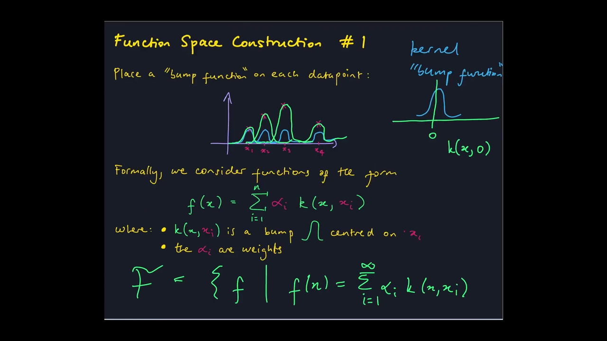
*▲ 강의 슬라이드 [13:52](https://youtu.be/-eC0-5mXHQg?t=832): 함수 공간 만들기 1. 데이터마다 혹 함수 $k(x, x_i)$를 놓고 [가중치](00_%EB%94%A5%EB%9F%AC%EB%8B%9D_%EC%9A%A9%EC%96%B4%EC%82%AC%EC%A0%84.md#weight-%EA%B0%80%EC%A4%91%EC%B9%98) $\alpha_i$로 더한다. 혹을 무한히 허용한 공간이 [재생 커널 힐베르트 공간](00_%EB%94%A5%EB%9F%AC%EB%8B%9D_%EC%9A%A9%EC%96%B4%EC%82%AC%EC%A0%84.md#reproducing-kernel-hilbert-space-rkhs-%EC%9E%AC%EC%83%9D-%EC%BB%A4%EB%84%90-%ED%9E%90%EB%B2%A0%EB%A5%B4%ED%8A%B8-%EA%B3%B5%EA%B0%84)*

### 3.3 둘째 방법: 무작위 함수를 뽑아 데이터에 맞는 것만 남기기

▶ 영상 [14:55](https://youtu.be/-eC0-5mXHQg?t=895)

📐 **수학 개념**: [가우스 과정과 조건부 예측](%EC%88%98%ED%95%99%EA%B0%9C%EB%85%90/10_%ED%91%9C%ED%98%84_%ED%95%99%EC%8A%B5/MM48_%EA%B0%80%EC%9A%B0%EC%8A%A4_%EA%B3%BC%EC%A0%95%EA%B3%BC_%EC%A1%B0%EA%B1%B4%EB%B6%80_%EC%98%88%EC%B8%A1.md) · [조건부 확률](%EC%88%98%ED%95%99%EA%B0%9C%EB%85%90/04_%ED%99%95%EB%A5%A0%EA%B3%BC_%EC%A0%95%EB%B3%B4/MM58_%EC%A1%B0%EA%B1%B4%EB%B6%80_%ED%99%95%EB%A5%A0%EA%B3%BC_%EB%8F%85%EB%A6%BD.md)

- 무작위 함수를 뽑는 어떤 방법(이를 **[확률](00_%EB%94%A5%EB%9F%AC%EB%8B%9D_%EC%9A%A9%EC%96%B4%EC%82%AC%EC%A0%84.md#probability-%ED%99%95%EB%A5%A0) 과정**, stochastic process라 합니다)을 정해 두고, 함수를 계속 뽑아서 데이터를 지나지 않으면 버리고 지나면 남깁니다. 그러면 [학습 데이터](00_%EB%94%A5%EB%9F%AC%EB%8B%9D_%EC%9A%A9%EC%96%B4%EC%82%AC%EC%A0%84.md#training-data-test-data-%ED%95%99%EC%8A%B5-%EB%8D%B0%EC%9D%B4%ED%84%B0%EC%99%80-%EC%8B%9C%ED%97%98-%EB%8D%B0%EC%9D%B4%ED%84%B0)를 지나는 함수들의 분포가 남습니다.
- 실제로 함수를 수없이 뽑아 버리지는 않습니다. 함수 분포를 [학습 데이터](00_%EB%94%A5%EB%9F%AC%EB%8B%9D_%EC%9A%A9%EC%96%B4%EC%82%AC%EC%A0%84.md#training-data-test-data-%ED%95%99%EC%8A%B5-%EB%8D%B0%EC%9D%B4%ED%84%B0%EC%99%80-%EC%8B%9C%ED%97%98-%EB%8D%B0%EC%9D%B4%ED%84%B0)에 **조건부로 걸어(conditioning)** **[사후 분포](00_%EB%94%A5%EB%9F%AC%EB%8B%9D_%EC%9A%A9%EC%96%B4%EC%82%AC%EC%A0%84.md#prior-posterior-%EC%82%AC%EC%A0%84-%EB%B6%84%ED%8F%AC%EC%99%80-%EC%82%AC%ED%9B%84-%EB%B6%84%ED%8F%AC)**(posterior distribution)를 계산합니다. 함수를 만드는 방식을 **가우스**로 하면 이 계산이 모두 쉬워집니다. 이것이 [가우스 과정](00_%EB%94%A5%EB%9F%AC%EB%8B%9D_%EC%9A%A9%EC%96%B4%EC%82%AC%EC%A0%84.md#gaussian-process-%EA%B0%80%EC%9A%B0%EC%8A%A4-%EA%B3%BC%EC%A0%95)입니다.
- 한 학생이 "최적의 것은 [커널 방법](00_%EB%94%A5%EB%9F%AC%EB%8B%9D_%EC%9A%A9%EC%96%B4%EC%82%AC%EC%A0%84.md#kernel-method-%EC%BB%A4%EB%84%90-%EB%B0%A9%EB%B2%95)과 비슷하지 않느냐"고 묻자 강사는 맞다고 답합니다. 데이터와 맞는 무작위 함수들의 **평균**은 하나의 매끈한 함수이고, 이는 ([RKHS](00_%EB%94%A5%EB%9F%AC%EB%8B%9D_%EC%9A%A9%EC%96%B4%EC%82%AC%EC%A0%84.md#reproducing-kernel-hilbert-space-rkhs-%EC%9E%AC%EC%83%9D-%EC%BB%A4%EB%84%90-%ED%9E%90%EB%B2%A0%EB%A5%B4%ED%8A%B8-%EA%B3%B5%EA%B0%84) [노름](00_%EB%94%A5%EB%9F%AC%EB%8B%9D_%EC%9A%A9%EC%96%B4%EC%82%AC%EC%A0%84.md#norm-%EB%85%B8%EB%A6%84)을 알맞게 정의하면) **커널 [노름](00_%EB%94%A5%EB%9F%AC%EB%8B%9D_%EC%9A%A9%EC%96%B4%EC%82%AC%EC%A0%84.md#norm-%EB%85%B8%EB%A6%84)이 가장 작은 커널 [보간](00_%EB%94%A5%EB%9F%AC%EB%8B%9D_%EC%9A%A9%EC%96%B4%EC%82%AC%EC%A0%84.md#interpolation-%EB%B3%B4%EA%B0%84) 함수와 같습니다**. 두 방법이 이렇게 이어집니다([MM48](%EC%88%98%ED%95%99%EA%B0%9C%EB%85%90/10_%ED%91%9C%ED%98%84_%ED%95%99%EC%8A%B5/MM48_%EA%B0%80%EC%9A%B0%EC%8A%A4_%EA%B3%BC%EC%A0%95%EA%B3%BC_%EC%A1%B0%EA%B1%B4%EB%B6%80_%EC%98%88%EC%B8%A1.md)에서 숫자로 확인).

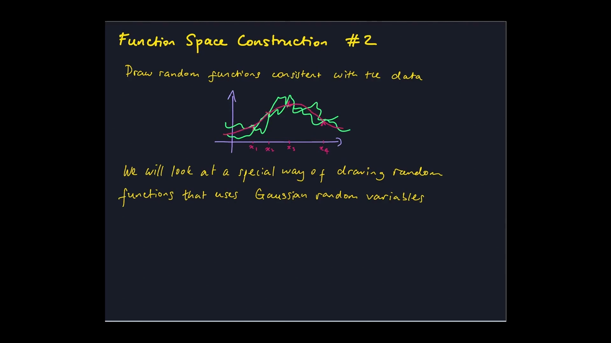
*▲ 강의 슬라이드 [17:52](https://youtu.be/-eC0-5mXHQg?t=1072): 함수 공간 만들기 2. 데이터와 맞는 무작위 함수들을 뽑는다. 가우스 [확률 변수](00_%EB%94%A5%EB%9F%AC%EB%8B%9D_%EC%9A%A9%EC%96%B4%EC%82%AC%EC%A0%84.md#random-variable-%ED%99%95%EB%A5%A0-%EB%B3%80%EC%88%98)를 쓰는 특별한 방식을 볼 것이다*

### 3.4 세 함수 공간의 대응

▶ 영상 [18:28](https://youtu.be/-eC0-5mXHQg?t=1108)

함수 공간을 보는 세 가지 길이 있고, 서로 이어져 있습니다.

| 함수 공간 | 만드는 법 | 연결 |
|---|---|---|
| [가우스 과정](00_%EB%94%A5%EB%9F%AC%EB%8B%9D_%EC%9A%A9%EC%96%B4%EC%82%AC%EC%A0%84.md#gaussian-process-%EA%B0%80%EC%9A%B0%EC%8A%A4-%EA%B3%BC%EC%A0%95) | 무작위 함수 중 데이터와 맞는 것만 남긴다 | 사후 평균 = 최소 [노름](00_%EB%94%A5%EB%9F%AC%EB%8B%9D_%EC%9A%A9%EC%96%B4%EC%82%AC%EC%A0%84.md#norm-%EB%85%B8%EB%A6%84) 커널 [보간](00_%EB%94%A5%EB%9F%AC%EB%8B%9D_%EC%9A%A9%EC%96%B4%EC%82%AC%EC%A0%84.md#interpolation-%EB%B3%B4%EA%B0%84) (양방향으로 이어짐) |
| [커널 방법](00_%EB%94%A5%EB%9F%AC%EB%8B%9D_%EC%9A%A9%EC%96%B4%EC%82%AC%EC%A0%84.md#kernel-method-%EC%BB%A4%EB%84%90-%EB%B0%A9%EB%B2%95) | 좋아하는 혹을 데이터마다 놓아 맞춘다 | [가우스 과정](00_%EB%94%A5%EB%9F%AC%EB%8B%9D_%EC%9A%A9%EC%96%B4%EC%82%AC%EC%A0%84.md#gaussian-process-%EA%B0%80%EC%9A%B0%EC%8A%A4-%EA%B3%BC%EC%A0%95)의 공분산이 곧 커널 |
| 신경망 | 이 수업의 주제 | **너비를 무한히 키우고 [가중치](00_%EB%94%A5%EB%9F%AC%EB%8B%9D_%EC%9A%A9%EC%96%B4%EC%82%AC%EC%A0%84.md#weight-%EA%B0%80%EC%A4%91%EC%B9%98)를 무작위로 뽑으면 [가우스 과정](00_%EB%94%A5%EB%9F%AC%EB%8B%9D_%EC%9A%A9%EC%96%B4%EC%82%AC%EC%A0%84.md#gaussian-process-%EA%B0%80%EC%9A%B0%EC%8A%A4-%EA%B3%BC%EC%A0%95)이 된다** |

이런 대응을 알면 신경망을 사람들이 오래 연구한 고전적 방법과 이어서 이론적으로 다룰 수 있습니다. 다만 그 대응이 실제 상황에서 의미가 있는지는 따로 따져야 합니다.

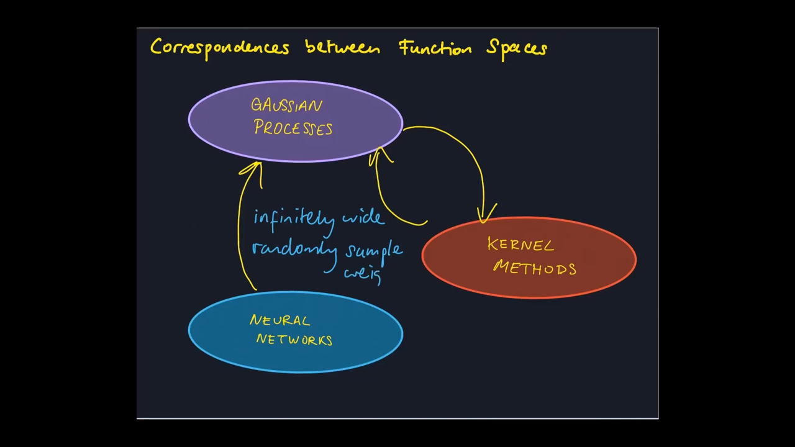
*▲ 강의 슬라이드 [20:12](https://youtu.be/-eC0-5mXHQg?t=1212): 함수 공간 사이의 대응. [가우스 과정](00_%EB%94%A5%EB%9F%AC%EB%8B%9D_%EC%9A%A9%EC%96%B4%EC%82%AC%EC%A0%84.md#gaussian-process-%EA%B0%80%EC%9A%B0%EC%8A%A4-%EA%B3%BC%EC%A0%95)과 [커널 방법](00_%EB%94%A5%EB%9F%AC%EB%8B%9D_%EC%9A%A9%EC%96%B4%EC%82%AC%EC%A0%84.md#kernel-method-%EC%BB%A4%EB%84%90-%EB%B0%A9%EB%B2%95)은 서로 이어지고, 무한히 넓고 [가중치](00_%EB%94%A5%EB%9F%AC%EB%8B%9D_%EC%9A%A9%EC%96%B4%EC%82%AC%EC%A0%84.md#weight-%EA%B0%80%EC%A4%91%EC%B9%98)를 무작위로 뽑은 신경망은 [가우스 과정](00_%EB%94%A5%EB%9F%AC%EB%8B%9D_%EC%9A%A9%EC%96%B4%EC%82%AC%EC%A0%84.md#gaussian-process-%EA%B0%80%EC%9A%B0%EC%8A%A4-%EA%B3%BC%EC%A0%95)이 된다*

질의응답: 어느 쪽이 더 표현력이 큰가 [20:47](https://youtu.be/-eC0-5mXHQg?t=1247)

- 세 함수 공간 중 어느 쪽이 더 [표현력](00_%EB%94%A5%EB%9F%AC%EB%8B%9D_%EC%9A%A9%EC%96%B4%EC%82%AC%EC%A0%84.md#representational-power-%ED%91%9C%ED%98%84%EB%A0%A5)이 큰가? 강사는 "어느 쪽이 더 크다기보다 그냥 다르다"고 답합니다. 예를 들어 커널 공간의 함수는 혹으로 만들어져 꽤 매끈하지만, [가우스 과정](00_%EB%94%A5%EB%9F%AC%EB%8B%9D_%EC%9A%A9%EC%96%B4%EC%82%AC%EC%A0%84.md#gaussian-process-%EA%B0%80%EC%9A%B0%EC%8A%A4-%EA%B3%BC%EC%A0%95)은 공분산 구조에 따라 아주 거친 함수도 나옵니다. 그래도 [가우스 과정](00_%EB%94%A5%EB%9F%AC%EB%8B%9D_%EC%9A%A9%EC%96%B4%EC%82%AC%EC%A0%84.md#gaussian-process-%EA%B0%80%EC%9A%B0%EC%8A%A4-%EA%B3%BC%EC%A0%95) [사후 분포](00_%EB%94%A5%EB%9F%AC%EB%8B%9D_%EC%9A%A9%EC%96%B4%EC%82%AC%EC%A0%84.md#prior-posterior-%EC%82%AC%EC%A0%84-%EB%B6%84%ED%8F%AC%EC%99%80-%EC%82%AC%ED%9B%84-%EB%B6%84%ED%8F%AC)의 평균은 매끈합니다.

---

## 4. 가우스 과정

### 4.1 그림으로 보는 가우스 과정

▶ 영상 [21:54](https://youtu.be/-eC0-5mXHQg?t=1314)

- 데이터가 주어지면 [가우스 과정](00_%EB%94%A5%EB%9F%AC%EB%8B%9D_%EC%9A%A9%EC%96%B4%EC%82%AC%EC%A0%84.md#gaussian-process-%EA%B0%80%EC%9A%B0%EC%8A%A4-%EA%B3%BC%EC%A0%95)은 **데이터를 지나는 무작위 함수들의 분포**를 줍니다. 함수들은 모두 데이터를 지나지만, 데이터에서 멀어지면 제멋대로입니다.
- 그 분포에 대해 두 가지를 물을 수 있습니다. **평균**은 꼬불꼬불한 무작위 함수들보다 훨씬 매끈하고, **표준편차**는 데이터 위에서 0이며 데이터에서 멀어질수록 커집니다.
- [가우스 과정](00_%EB%94%A5%EB%9F%AC%EB%8B%9D_%EC%9A%A9%EC%96%B4%EC%82%AC%EC%A0%84.md#gaussian-process-%EA%B0%80%EC%9A%B0%EC%8A%A4-%EA%B3%BC%EC%A0%95)의 쓸모는 이 평균과 표준편차를 **간단한 선형대수 식**으로 준다는 데 있습니다. $x$축 위의 아무 새 점에서 평균과 표준편차를 계산하고, 그 점을 $x$축을 따라 쓸고 가면 그림 전체가 나옵니다. 그림의 모양은 우리가 고르는 **공분산 구조**가 정합니다.

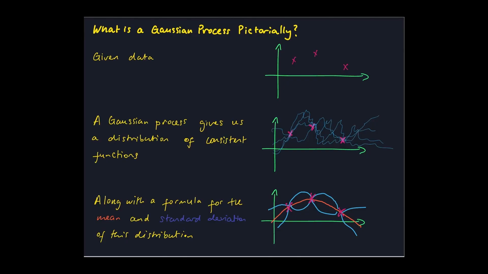
*▲ 강의 슬라이드 [24:32](https://youtu.be/-eC0-5mXHQg?t=1472): 그림으로 보는 [가우스 과정](00_%EB%94%A5%EB%9F%AC%EB%8B%9D_%EC%9A%A9%EC%96%B4%EC%82%AC%EC%A0%84.md#gaussian-process-%EA%B0%80%EC%9A%B0%EC%8A%A4-%EA%B3%BC%EC%A0%95). 데이터를 지나는 함수들의 분포와, 그 평균(빨강)·표준편차(파랑)를 주는 식*

### 4.2 무작위 벡터로 보는 가우스 과정

▶ 영상 [24:51](https://youtu.be/-eC0-5mXHQg?t=1491)

📐 **수학 개념**: [가우스 과정과 조건부 예측](%EC%88%98%ED%95%99%EA%B0%9C%EB%85%90/10_%ED%91%9C%ED%98%84_%ED%95%99%EC%8A%B5/MM48_%EA%B0%80%EC%9A%B0%EC%8A%A4_%EA%B3%BC%EC%A0%95%EA%B3%BC_%EC%A1%B0%EA%B1%B4%EB%B6%80_%EC%98%88%EC%B8%A1.md) · [정규분포](%EC%88%98%ED%95%99%EA%B0%9C%EB%85%90/04_%ED%99%95%EB%A5%A0%EA%B3%BC_%EC%A0%95%EB%B3%B4/MM50_%ED%99%95%EB%A5%A0_%EB%B0%80%EB%8F%84%EC%99%80_%EC%A0%95%EA%B7%9C%EB%B6%84%ED%8F%AC.md) · [공분산 행렬](%EC%88%98%ED%95%99%EA%B0%9C%EB%85%90/10_%ED%91%9C%ED%98%84_%ED%95%99%EC%8A%B5/MM40_PCA%EC%99%80_%EC%84%A0%ED%98%95_%EC%98%A4%ED%86%A0%EC%9D%B8%EC%BD%94%EB%8D%94.md)

강사는 "[확률](00_%EB%94%A5%EB%9F%AC%EB%8B%9D_%EC%9A%A9%EC%96%B4%EC%82%AC%EC%A0%84.md#probability-%ED%99%95%EB%A5%A0) 과정은 몰라도 무작위 벡터는 안다"며 직관적인 정의를 줍니다. 수식을 다 잊어도 이것만 기억하면 된다고 합니다.

1. 평균이 0이고 [공분산 행렬](00_%EB%94%A5%EB%9F%AC%EB%8B%9D_%EC%9A%A9%EC%96%B4%EC%82%AC%EC%A0%84.md#covariance-matrix-%EA%B3%B5%EB%B6%84%EC%82%B0-%ED%96%89%EB%A0%AC)이 $\Sigma$인 **[다변량 정규](00_%EB%94%A5%EB%9F%AC%EB%8B%9D_%EC%9A%A9%EC%96%B4%EC%82%AC%EC%A0%84.md#multivariate-normal-distribution-%EB%8B%A4%EB%B3%80%EB%9F%89-%EC%A0%95%EA%B7%9C%EB%B6%84%ED%8F%AC)** 무작위 벡터를 하나 뽑습니다.
2. $i$번째 좌표 값을 $x$축의 $i$번째 자리에 찍고 점들을 이으면 함수 비슷한 것이 됩니다.
3. 좌표끼리 상관이 없으면(공분산이 단위 행렬이면) 이웃 점이 제각각이라 들쭉날쭉합니다. 보통 좋은 함수는 이웃한 점끼리 값이 비슷하므로, **이웃한 좌표끼리 상관이 크도록** $\Sigma$를 고릅니다. 그러면 점을 이은 그림이 "연속 함수처럼" 보입니다(좌표 순서를 섞으면 이 구조가 깨지므로 섞지 않습니다).
4. 벡터의 차원을 무한히 늘려 점을 촘촘히 채운 극한이 [가우스 과정](00_%EB%94%A5%EB%9F%AC%EB%8B%9D_%EC%9A%A9%EC%96%B4%EC%82%AC%EC%A0%84.md#gaussian-process-%EA%B0%80%EC%9A%B0%EC%8A%A4-%EA%B3%BC%EC%A0%95)입니다.

$$
\mathbf{f} = (f_1, f_2, \dots, f_n) \sim \mathcal{N}(\mathbf{0}, \Sigma), \qquad \Sigma_{ij} = e^{-(i - j)^2}
$$

기호 풀이

| 기호 | 읽는 법 | 뜻 | 예제 값 |
| --- | --- | --- | --- |
| $\mathbf{f}$ | 에프 (굵은) | 뽑은 무작위 벡터. 좌표를 찍어 이으면 함수 그림 | $n = 3$ |
| $f_i$ | 에프 아이 | $i$번째 좌표 = $x$축 $i$번째 자리의 함수 값 | |
| $\sim$ | 따른다 | 왼쪽이 오른쪽 분포에서 뽑혔다 | |
| $\mathcal{N}(\mathbf{0}, \Sigma)$ | 정규 분포 | 평균 0, 공분산 $\Sigma$인 [다변량 정규분포](00_%EB%94%A5%EB%9F%AC%EB%8B%9D_%EC%9A%A9%EC%96%B4%EC%82%AC%EC%A0%84.md#multivariate-normal-distribution-%EB%8B%A4%EB%B3%80%EB%9F%89-%EC%A0%95%EA%B7%9C%EB%B6%84%ED%8F%AC) | |
| $\Sigma_{ij}$ | 시그마 아이 제이 | $f_i$와 $f_j$의 공분산 (얼마나 함께 움직이나) | $\Sigma_{12} = 0.3679$ |
| $e^{-(i-j)^2}$ | 이의 마이너스 (아이 빼기 제이) 제곱 | 좌표 번호가 멀수록 빠르게 0으로 | $\Sigma_{13} = 0.0183$ |

예제와 풀이

**문제**: 좌표가 3개인 무작위 벡터의 공분산을 $\Sigma_{ij} = e^{-(i - j)^2}$로 정했다. [공분산 행렬](00_%EB%94%A5%EB%9F%AC%EB%8B%9D_%EC%9A%A9%EC%96%B4%EC%82%AC%EC%A0%84.md#covariance-matrix-%EA%B3%B5%EB%B6%84%EC%82%B0-%ED%96%89%EB%A0%AC) $\Sigma$를 구하고, 바로 옆 좌표와 두 칸 떨어진 좌표의 공분산을 비교하라.

**주어진 값**
- $n = 3$ (좌표 수, $i, j \in \{1, 2, 3\}$)
- $\Sigma_{ij} = e^{-(i - j)^2}$ (좌표 번호 차이로 정하는 공분산)

**풀이**
1. 식을 그대로 쓴다: $\Sigma_{ij} = e^{-(i - j)^2}$
2. 값을 대입한다(한 칸씩): $\Sigma_{11} = e^{-(1-1)^2}$, $\Sigma_{12} = e^{-(1-2)^2}$, $\Sigma_{13} = e^{-(1-3)^2}$
3. 대각 칸: $(1 - 1)^2 = 0$ 이므로 $e^0 = 1$ (자기 자신과의 공분산 = [분산](00_%EB%94%A5%EB%9F%AC%EB%8B%9D_%EC%9A%A9%EC%96%B4%EC%82%AC%EC%A0%84.md#variance-%EB%B6%84%EC%82%B0) 1)
4. 옆 칸: $(1 - 2)^2 = (-1)^2 = 1$ 이므로 $e^{-1}$. $e$는 약 2.718이고 $e^{-1} = 1/e = 0.3679$
5. 두 칸 떨어진 칸: $(1 - 3)^2 = (-2)^2 = 4$ 이므로 $e^{-4} = 0.0183$
6. 나머지 칸은 차이 $|i - j|$만 보면 같다: $\Sigma_{23} = \Sigma_{12} = 0.3679$, $\Sigma_{22} = \Sigma_{33} = 1$, 대칭이라 $\Sigma_{ji} = \Sigma_{ij}$
7. 행렬로 모은다: $\Sigma = \begin{pmatrix}1 & 0.3679 & 0.0183\\ 0.3679 & 1 & 0.3679\\ 0.0183 & 0.3679 & 1\end{pmatrix}$

**답**: 옆 좌표 공분산 **0.3679**, 두 칸 떨어진 좌표 **0.0183**. 멀어질수록 함께 움직이는 정도가 빠르게 줄어, 이웃끼리만 비슷한 "매끈한" 그림이 된다.

내 이해

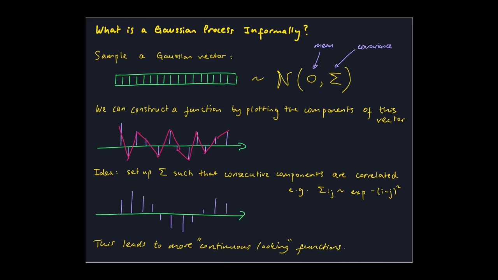
*▲ 강의 슬라이드 [27:12](https://youtu.be/-eC0-5mXHQg?t=1632): 정규 무작위 벡터를 뽑아 좌표를 찍으면 함수가 된다. 이웃 좌표가 상관되게 $\Sigma_{ij} \sim \exp(-(i-j)^2)$로 두면 더 연속처럼 보인다*

### 4.3 정식 정의

▶ 영상 [28:11](https://youtu.be/-eC0-5mXHQg?t=1691)

📐 **수학 개념**: [가우스 과정과 조건부 예측](%EC%88%98%ED%95%99%EA%B0%9C%EB%85%90/10_%ED%91%9C%ED%98%84_%ED%95%99%EC%8A%B5/MM48_%EA%B0%80%EC%9A%B0%EC%8A%A4_%EA%B3%BC%EC%A0%95%EA%B3%BC_%EC%A1%B0%EA%B1%B4%EB%B6%80_%EC%98%88%EC%B8%A1.md) · [정규분포](%EC%88%98%ED%95%99%EA%B0%9C%EB%85%90/04_%ED%99%95%EB%A5%A0%EA%B3%BC_%EC%A0%95%EB%B3%B4/MM50_%ED%99%95%EB%A5%A0_%EB%B0%80%EB%8F%84%EC%99%80_%EC%A0%95%EA%B7%9C%EB%B6%84%ED%8F%AC.md)

- 입력 공간 $X$(앞 그림의 $x$축)를 생각하고, 모든 $x \in X$마다 $f(x)$가 [확률 변수](00_%EB%94%A5%EB%9F%AC%EB%8B%9D_%EC%9A%A9%EC%96%B4%EC%82%AC%EC%A0%84.md#random-variable-%ED%99%95%EB%A5%A0-%EB%B3%80%EC%88%98)라고 합시다. 비공식적으로는 $f$를 "$x$를 좌표 번호로 쓰는 무한 차원 무작위 벡터"로 봅니다.
- 무한 차원 대상은 다루기 어려우니 **유한 개의 입력** $x_1, \dots, x_n$에서만 들여다봅니다. 그때 $(f(x_1), \dots, f(x_n))$은 진짜 무작위 벡터입니다.
- **어떤 유한 개의 입력을 고르든 이 벡터가 늘 [정규분포](00_%EB%94%A5%EB%9F%AC%EB%8B%9D_%EC%9A%A9%EC%96%B4%EC%82%AC%EC%A0%84.md#normal-distribution-%EC%A0%95%EA%B7%9C%EB%B6%84%ED%8F%AC)를 따르면**, $f$를 $X$ 위의 **[가우스 과정](00_%EB%94%A5%EB%9F%AC%EB%8B%9D_%EC%9A%A9%EC%96%B4%EC%82%AC%EC%A0%84.md#gaussian-process-%EA%B0%80%EC%9A%B0%EC%8A%A4-%EA%B3%BC%EC%A0%95)**이라 합니다.

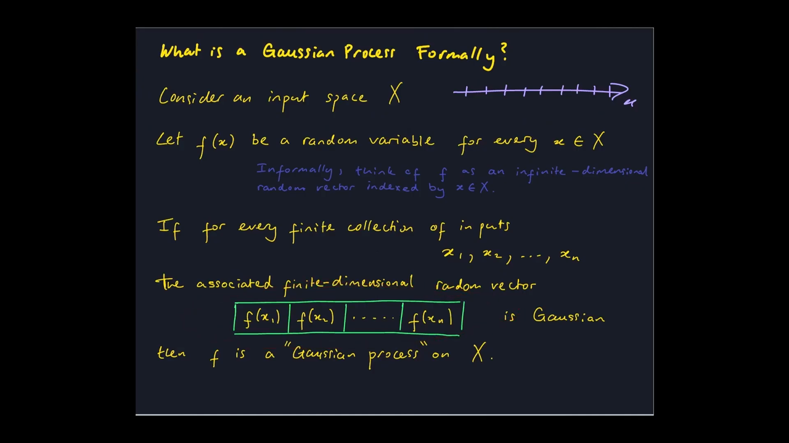
*▲ 강의 슬라이드 [29:52](https://youtu.be/-eC0-5mXHQg?t=1792): [가우스 과정](00_%EB%94%A5%EB%9F%AC%EB%8B%9D_%EC%9A%A9%EC%96%B4%EC%82%AC%EC%A0%84.md#gaussian-process-%EA%B0%80%EC%9A%B0%EC%8A%A4-%EA%B3%BC%EC%A0%95)의 정식 정의. 아무 유한 개 입력에서의 값을 모은 벡터가 늘 [정규분포](00_%EB%94%A5%EB%9F%AC%EB%8B%9D_%EC%9A%A9%EC%96%B4%EC%82%AC%EC%A0%84.md#normal-distribution-%EC%A0%95%EA%B7%9C%EB%B6%84%ED%8F%AC)이면 [가우스 과정](00_%EB%94%A5%EB%9F%AC%EB%8B%9D_%EC%9A%A9%EC%96%B4%EC%82%AC%EC%A0%84.md#gaussian-process-%EA%B0%80%EC%9A%B0%EC%8A%A4-%EA%B3%BC%EC%A0%95)*

질의응답: 가우스인지 어떻게 아나, 가우스 벡터란 무엇인가 [30:26](https://youtu.be/-eC0-5mXHQg?t=1826)

- **정말 가우스인지 어떻게 확인하나?** 실험으로 검정하기보다는, 이 정의를 만족하도록 **해석적으로** 만들어 씁니다.
- 이 정의를 만족하는 대상이 존재하는지조차 당연하지 않은데, 이를 보장하는 것이 콜모고로프 확장 정리(Kolmogorov extension theorem)입니다. [가우스 과정](00_%EB%94%A5%EB%9F%AC%EB%8B%9D_%EC%9A%A9%EC%96%B4%EC%82%AC%EC%A0%84.md#gaussian-process-%EA%B0%80%EC%9A%B0%EC%8A%A4-%EA%B3%BC%EC%A0%95)을 쓰는 대부분의 사람은 몰라도 됩니다.
- **가우스 벡터의 정의**: 가장 단순한 것은 좌표마다 독립인 표준 정규를 뽑은 벡터([i.i.d.](00_%EB%94%A5%EB%9F%AC%EB%8B%9D_%EC%9A%A9%EC%96%B4%EC%82%AC%EC%A0%84.md#iid-independent-and-identically-distributed-%EB%8F%85%EB%A6%BD-%EB%8F%99%EC%9D%BC-%EB%B6%84%ED%8F%AC))입니다. 일반적인 다변량 정규는 [공분산 행렬](00_%EB%94%A5%EB%9F%AC%EB%8B%9D_%EC%9A%A9%EC%96%B4%EC%82%AC%EC%A0%84.md#covariance-matrix-%EA%B3%B5%EB%B6%84%EC%82%B0-%ED%96%89%EB%A0%AC)로 정의하며, [i.i.d.](00_%EB%94%A5%EB%9F%AC%EB%8B%9D_%EC%9A%A9%EC%96%B4%EC%82%AC%EC%A0%84.md#iid-independent-and-identically-distributed-%EB%8F%85%EB%A6%BD-%EB%8F%99%EC%9D%BC-%EB%B6%84%ED%8F%AC) 벡터를 축마다 늘이고 회전한 것과 같습니다.
- "가우스"라고 하면 종 모양 곡선을 떠올리기 쉽지만, 여기서는 **입력 집합을 정했을 때의 값 벡터**가 [정규분포](00_%EB%94%A5%EB%9F%AC%EB%8B%9D_%EC%9A%A9%EC%96%B4%EC%82%AC%EC%A0%84.md#normal-distribution-%EC%A0%95%EA%B7%9C%EB%B6%84%ED%8F%AC)라는 뜻입니다.

### 4.4 공분산 함수

▶ 영상 [34:55](https://youtu.be/-eC0-5mXHQg?t=2095)

📐 **수학 개념**: [커널 보간과 RBF 커널](%EC%88%98%ED%95%99%EA%B0%9C%EB%85%90/10_%ED%91%9C%ED%98%84_%ED%95%99%EC%8A%B5/MM47_%EC%BB%A4%EB%84%90_%EB%B3%B4%EA%B0%84.md) · [내적과 코사인 유사도](%EC%88%98%ED%95%99%EA%B0%9C%EB%85%90/03_%EC%84%A0%ED%98%95%EB%8C%80%EC%88%98/MM44_%EB%8B%A8%EC%9C%84_%EA%B5%AC%EC%99%80_%EC%BD%94%EC%82%AC%EC%9D%B8_%EC%9C%A0%EC%82%AC%EB%8F%84.md) · [지수와 e](%EC%88%98%ED%95%99%EA%B0%9C%EB%85%90/01_%EC%88%98%EC%99%80_%ED%95%A8%EC%88%98/M06_%EC%A7%80%EC%88%98%EC%99%80_e.md)

- 유한 차원 정규 벡터 → 무한 차원 무작위 함수로 넘어가면, 공분산 **행렬** $\Sigma_{ij}$ ($i, j = 1, \dots, n$)는 공분산 **함수** $\Sigma(x, x')$로 바뀝니다. 두 입력에서의 함수 값이 얼마나 함께 움직이는지를 알려 줍니다. 예를 들어 $e^{-(i-j)^2}$는 $e^{-(x - x')^2}$가 됩니다.
- 보통 **가까운** $x, x'$에서는 공분산이 크고 먼 곳에서는 작도록 고릅니다. 무작위 함수를 여러 번 뽑아 $(f(x), f(x'))$를 산점도로 찍으면, 가까운 두 입력은 대각선에 몰리고(강한 상관) 먼 두 입력은 둥글게 퍼집니다(상관 없음).
- 즉 **[공분산 함수](00_%EB%94%A5%EB%9F%AC%EB%8B%9D_%EC%9A%A9%EC%96%B4%EC%82%AC%EC%A0%84.md#covariance-function-%EA%B3%B5%EB%B6%84%EC%82%B0-%ED%95%A8%EC%88%98)를 고르는 것이 "가깝다"의 뜻을 정하는 것**입니다. 흔한 예가 **[제곱 지수 커널](00_%EB%94%A5%EB%9F%AC%EB%8B%9D_%EC%9A%A9%EC%96%B4%EC%82%AC%EC%A0%84.md#squared-exponential-kernel-%EC%A0%9C%EA%B3%B1-%EC%A7%80%EC%88%98-%EC%BB%A4%EB%84%90)** $e^{-(x - x')^2}$와 [내적](00_%EB%94%A5%EB%9F%AC%EB%8B%9D_%EC%9A%A9%EC%96%B4%EC%82%AC%EC%A0%84.md#dot-product-%EB%82%B4%EC%A0%81) $\langle x, x' \rangle$입니다. 공분산 구조는 입력 사이 유사도의 척도이고, 그것으로 서로 다른 입력의 출력이 얼마나 상관될지를 정합니다.

$$
\big(f(x_1), \dots, f(x_n)\big) \sim \mathcal{N}(\mathbf{0}, K), \qquad K_{ij} = \Sigma(x_i, x_j), \qquad \Sigma(x, x') = e^{-(x - x')^2}\ \ \text{또는}\ \ \langle x, x' \rangle
$$

기호 풀이

| 기호 | 읽는 법 | 뜻 | 예제 값 |
| --- | --- | --- | --- |
| $x_1, \dots, x_n$ | 엑스 일 ... 엑스 엔 | 함수를 들여다볼 유한 개의 입력 | 1, 1.2, 3 |
| $K$ | 케이 | 그 입력들의 [공분산 행렬](00_%EB%94%A5%EB%9F%AC%EB%8B%9D_%EC%9A%A9%EC%96%B4%EC%82%AC%EC%A0%84.md#covariance-matrix-%EA%B3%B5%EB%B6%84%EC%82%B0-%ED%96%89%EB%A0%AC) ([커널 행렬](00_%EB%94%A5%EB%9F%AC%EB%8B%9D_%EC%9A%A9%EC%96%B4%EC%82%AC%EC%A0%84.md#kernel-matrix-%EC%BB%A4%EB%84%90-%ED%96%89%EB%A0%AC)) | $3 \times 3$ |
| $K_{ij}$ | 케이 아이 제이 | $f(x_i)$와 $f(x_j)$의 공분산 | |
| $\Sigma(x, x')$ | 시그마 엑스 엑스 프라임 | [공분산 함수](00_%EB%94%A5%EB%9F%AC%EB%8B%9D_%EC%9A%A9%EC%96%B4%EC%82%AC%EC%A0%84.md#covariance-function-%EA%B3%B5%EB%B6%84%EC%82%B0-%ED%95%A8%EC%88%98). 두 입력의 유사도 | 0.9608, 0.0183 |
| $e^{-(x-x')^2}$ | 제곱 [지수](00_%EB%94%A5%EB%9F%AC%EB%8B%9D_%EC%9A%A9%EC%96%B4%EC%82%AC%EC%A0%84.md#e-exponent-e%EC%99%80-%EC%A7%80%EC%88%98) | 거리 제곱이 클수록 0으로 | |
| $\langle x, x' \rangle$ | [내적](00_%EB%94%A5%EB%9F%AC%EB%8B%9D_%EC%9A%A9%EC%96%B4%EC%82%AC%EC%A0%84.md#dot-product-%EB%82%B4%EC%A0%81) | 칸끼리 곱해 더한 값 | 5 |

예제와 풀이

**문제**: 제곱 [지수](00_%EB%94%A5%EB%9F%AC%EB%8B%9D_%EC%9A%A9%EC%96%B4%EC%82%AC%EC%A0%84.md#e-exponent-e%EC%99%80-%EC%A7%80%EC%88%98) [공분산 함수](00_%EB%94%A5%EB%9F%AC%EB%8B%9D_%EC%9A%A9%EC%96%B4%EC%82%AC%EC%A0%84.md#covariance-function-%EA%B3%B5%EB%B6%84%EC%82%B0-%ED%95%A8%EC%88%98)를 쓰는 [가우스 과정](00_%EB%94%A5%EB%9F%AC%EB%8B%9D_%EC%9A%A9%EC%96%B4%EC%82%AC%EC%A0%84.md#gaussian-process-%EA%B0%80%EC%9A%B0%EC%8A%A4-%EA%B3%BC%EC%A0%95)에서, 가까운 두 입력 $x = 1, x' = 1.2$와 먼 두 입력 $x = 1, x' = 3$의 공분산을 비교하라. 덤으로 [내적](00_%EB%94%A5%EB%9F%AC%EB%8B%9D_%EC%9A%A9%EC%96%B4%EC%82%AC%EC%A0%84.md#dot-product-%EB%82%B4%EC%A0%81) 공분산에서 $x = (1, 2)$, $x' = (3, 1)$의 값도 구하라.

**주어진 값**
- $x = 1$, $x' = 1.2$ (가까운 쌍)
- $x = 1$, $x' = 3$ (먼 쌍)
- $\Sigma(x, x') = e^{-(x - x')^2}$ (제곱 [지수](00_%EB%94%A5%EB%9F%AC%EB%8B%9D_%EC%9A%A9%EC%96%B4%EC%82%AC%EC%A0%84.md#e-exponent-e%EC%99%80-%EC%A7%80%EC%88%98) [공분산 함수](00_%EB%94%A5%EB%9F%AC%EB%8B%9D_%EC%9A%A9%EC%96%B4%EC%82%AC%EC%A0%84.md#covariance-function-%EA%B3%B5%EB%B6%84%EC%82%B0-%ED%95%A8%EC%88%98))
- $x = (1, 2)$, $x' = (3, 1)$ ([내적](00_%EB%94%A5%EB%9F%AC%EB%8B%9D_%EC%9A%A9%EC%96%B4%EC%82%AC%EC%A0%84.md#dot-product-%EB%82%B4%EC%A0%81) 공분산용 2차원 입력)

**풀이**
1. 식을 그대로 쓴다: $\Sigma(x, x') = e^{-(x - x')^2}$
2. 값을 대입한다(가까운 쌍): $\Sigma(1, 1.2) = e^{-(1 - 1.2)^2}$
3. 뺄셈을 한다: $1 - 1.2 = -0.2$
4. 제곱한다: $(-0.2)^2 = 0.04$
5. [지수](00_%EB%94%A5%EB%9F%AC%EB%8B%9D_%EC%9A%A9%EC%96%B4%EC%82%AC%EC%A0%84.md#e-exponent-e%EC%99%80-%EC%A7%80%EC%88%98)를 계산한다($e$는 약 2.718, $e^{-a}$는 $e^a$의 역수): $e^{-0.04} = 0.9608$
6. 값을 대입한다(먼 쌍): $\Sigma(1, 3) = e^{-(1 - 3)^2}$
7. 뺄셈을 한다: $1 - 3 = -2$
8. 제곱한다: $(-2)^2 = 4$
9. [지수](00_%EB%94%A5%EB%9F%AC%EB%8B%9D_%EC%9A%A9%EC%96%B4%EC%82%AC%EC%A0%84.md#e-exponent-e%EC%99%80-%EC%A7%80%EC%88%98)를 계산한다: $e^{-4} = 0.0183$
10. [내적](00_%EB%94%A5%EB%9F%AC%EB%8B%9D_%EC%9A%A9%EC%96%B4%EC%82%AC%EC%A0%84.md#dot-product-%EB%82%B4%EC%A0%81) 공분산 식에 대입한다: $\langle (1, 2), (3, 1) \rangle = 1 \times 3 + 2 \times 1$
11. 곱셈을 먼저 한다: $3 + 2$
12. 더한다: $5$

**답**: 가까운 쌍 **0.9608**(거의 함께 움직인다), 먼 쌍 **0.0183**(거의 상관 없음). [내적](00_%EB%94%A5%EB%9F%AC%EB%8B%9D_%EC%9A%A9%EC%96%B4%EC%82%AC%EC%A0%84.md#dot-product-%EB%82%B4%EC%A0%81) 공분산은 **5**. [분산](00_%EB%94%A5%EB%9F%AC%EB%8B%9D_%EC%9A%A9%EC%96%B4%EC%82%AC%EC%A0%84.md#variance-%EB%B6%84%EC%82%B0)이 1인 [제곱 지수 커널](00_%EB%94%A5%EB%9F%AC%EB%8B%9D_%EC%9A%A9%EC%96%B4%EC%82%AC%EC%A0%84.md#squared-exponential-kernel-%EC%A0%9C%EA%B3%B1-%EC%A7%80%EC%88%98-%EC%BB%A4%EB%84%90)에서는 이 값이 곧 상관계수라, 슬라이드의 대각선 산점도와 둥근 산점도에 해당한다.

내 이해

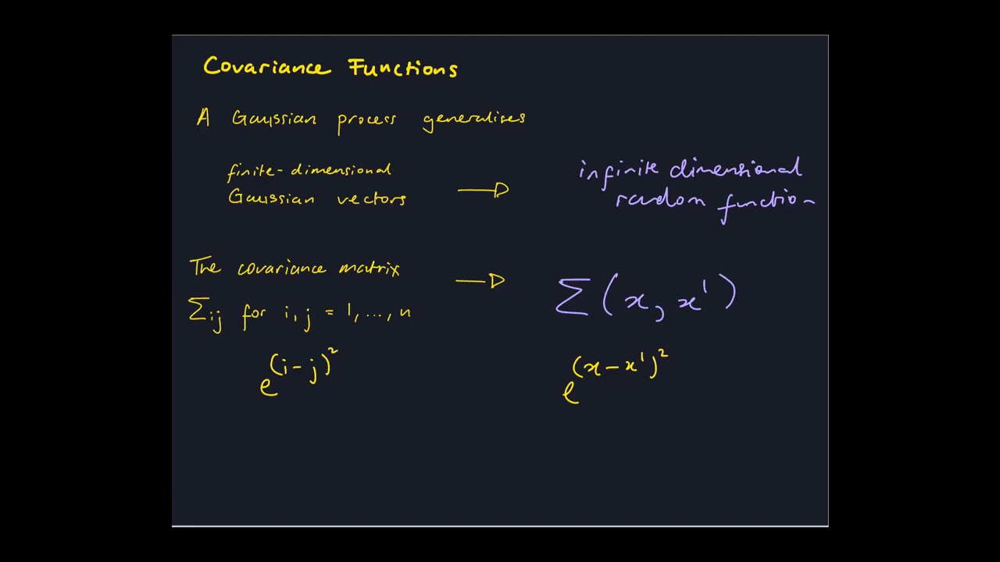
*▲ 강의 슬라이드 [36:16](https://youtu.be/-eC0-5mXHQg?t=2176): [공분산 행렬](00_%EB%94%A5%EB%9F%AC%EB%8B%9D_%EC%9A%A9%EC%96%B4%EC%82%AC%EC%A0%84.md#covariance-matrix-%EA%B3%B5%EB%B6%84%EC%82%B0-%ED%96%89%EB%A0%AC) $\Sigma_{ij}$가 [공분산 함수](00_%EB%94%A5%EB%9F%AC%EB%8B%9D_%EC%9A%A9%EC%96%B4%EC%82%AC%EC%A0%84.md#covariance-function-%EA%B3%B5%EB%B6%84%EC%82%B0-%ED%95%A8%EC%88%98) $\Sigma(x, x')$로 일반화된다 (슬라이드에는 [지수](00_%EB%94%A5%EB%9F%AC%EB%8B%9D_%EC%9A%A9%EC%96%B4%EC%82%AC%EC%A0%84.md#e-exponent-e%EC%99%80-%EC%A7%80%EC%88%98)의 음수 부호가 빠져 있다. 말로는 $e^{-(x-x')^2}$)*

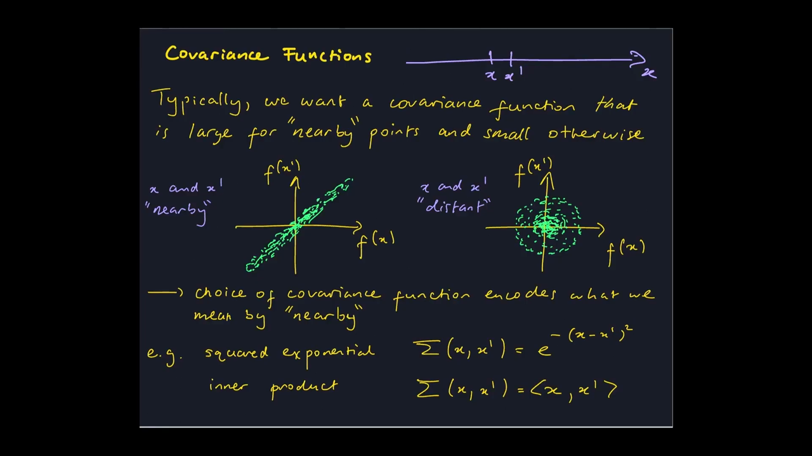
*▲ 강의 슬라이드 [37:12](https://youtu.be/-eC0-5mXHQg?t=2232): 가까운 두 입력은 함수 값이 강하게 상관되고(대각선), 먼 두 입력은 상관이 없다(원). [공분산 함수](00_%EB%94%A5%EB%9F%AC%EB%8B%9D_%EC%9A%A9%EC%96%B4%EC%82%AC%EC%A0%84.md#covariance-function-%EA%B3%B5%EB%B6%84%EC%82%B0-%ED%95%A8%EC%88%98)가 "가깝다"의 뜻을 정한다. 예: 제곱 [지수](00_%EB%94%A5%EB%9F%AC%EB%8B%9D_%EC%9A%A9%EC%96%B4%EC%82%AC%EC%A0%84.md#e-exponent-e%EC%99%80-%EC%A7%80%EC%88%98), [내적](00_%EB%94%A5%EB%9F%AC%EB%8B%9D_%EC%9A%A9%EC%96%B4%EC%82%AC%EC%A0%84.md#dot-product-%EB%82%B4%EC%A0%81)*

질의응답: 언어처럼 연속이 아닌 입력은? [39:15](https://youtu.be/-eC0-5mXHQg?t=2355)

- 단어는 연속이 아닌데 [공분산 함수](00_%EB%94%A5%EB%9F%AC%EB%8B%9D_%EC%9A%A9%EC%96%B4%EC%82%AC%EC%A0%84.md#covariance-function-%EA%B3%B5%EB%B6%84%EC%82%B0-%ED%95%A8%EC%88%98)를 정의할 수 있나? 강사는 입력이 실수 직선이 아니어도 **이상한 입력 공간 위에도 [공분산 함수](00_%EB%94%A5%EB%9F%AC%EB%8B%9D_%EC%9A%A9%EC%96%B4%EC%82%AC%EC%A0%84.md#covariance-function-%EA%B3%B5%EB%B6%84%EC%82%B0-%ED%95%A8%EC%88%98)를 정의할 수 있다**고 답합니다. [커널 방법](00_%EB%94%A5%EB%9F%AC%EB%8B%9D_%EC%9A%A9%EC%96%B4%EC%82%AC%EC%A0%84.md#kernel-method-%EC%BB%A4%EB%84%90-%EB%B0%A9%EB%B2%95)이 인기 있었던 이유도 이것입니다.
- 오히려 신경망은 처음에 언어에 어떻게 적용할지 분명하지 않았습니다. 입력을 임베딩하고 그 [임베딩](00_%EB%94%A5%EB%9F%AC%EB%8B%9D_%EC%9A%A9%EC%96%B4%EC%82%AC%EC%A0%84.md#embedding-%EC%9E%84%EB%B2%A0%EB%94%A9)을 배우는 방법이 통한다는 것이 나중에 밝혀졌을 뿐입니다.

### 4.5 데이터로 조건 걸기: 예측

▶ 영상 [41:27](https://youtu.be/-eC0-5mXHQg?t=2487)

📐 **수학 개념**: [가우스 과정과 조건부 예측](%EC%88%98%ED%95%99%EA%B0%9C%EB%85%90/10_%ED%91%9C%ED%98%84_%ED%95%99%EC%8A%B5/MM48_%EA%B0%80%EC%9A%B0%EC%8A%A4_%EA%B3%BC%EC%A0%95%EA%B3%BC_%EC%A1%B0%EA%B1%B4%EB%B6%80_%EC%98%88%EC%B8%A1.md) · [조건부 확률](%EC%88%98%ED%95%99%EA%B0%9C%EB%85%90/04_%ED%99%95%EB%A5%A0%EA%B3%BC_%EC%A0%95%EB%B3%B4/MM58_%EC%A1%B0%EA%B1%B4%EB%B6%80_%ED%99%95%EB%A5%A0%EA%B3%BC_%EB%8F%85%EB%A6%BD.md)

[가우스 과정](00_%EB%94%A5%EB%9F%AC%EB%8B%9D_%EC%9A%A9%EC%96%B4%EC%82%AC%EC%A0%84.md#gaussian-process-%EA%B0%80%EC%9A%B0%EC%8A%A4-%EA%B3%BC%EC%A0%95)으로 예측(머신러닝 말로는 추론, inference)하는 법입니다.

1. [학습](00_%EB%94%A5%EB%9F%AC%EB%8B%9D_%EC%9A%A9%EC%96%B4%EC%82%AC%EC%A0%84.md#training-%ED%95%99%EC%8A%B5) 입력 $x_1, \dots, x_n$과 함수 값 $f(x_1), \dots, f(x_n)$을 압니다. 새 시험 입력 $x_*$에서 $f(x_*)$를 알고 싶습니다.
2. 아는 값과 모르는 값을 한 벡터 $(f(x_1), \dots, f(x_n), f(x_*))$로 쌓습니다. [가우스 과정](00_%EB%94%A5%EB%9F%AC%EB%8B%9D_%EC%9A%A9%EC%96%B4%EC%82%AC%EC%A0%84.md#gaussian-process-%EA%B0%80%EC%9A%B0%EC%8A%A4-%EA%B3%BC%EC%A0%95)의 정의에 따라 이 벡터는 [다변량 정규분포](00_%EB%94%A5%EB%9F%AC%EB%8B%9D_%EC%9A%A9%EC%96%B4%EC%82%AC%EC%A0%84.md#multivariate-normal-distribution-%EB%8B%A4%EB%B3%80%EB%9F%89-%EC%A0%95%EA%B7%9C%EB%B6%84%ED%8F%AC)를 따릅니다.
3. 정규 벡터에서는 "앞의 $n$개 좌표를 알 때 마지막 좌표의 조건부 분포"를 구하는 표준 공식이 있습니다. 놀랍게도 그 조건부 분포도 **[정규분포](00_%EB%94%A5%EB%9F%AC%EB%8B%9D_%EC%9A%A9%EC%96%B4%EC%82%AC%EC%A0%84.md#normal-distribution-%EC%A0%95%EA%B7%9C%EB%B6%84%ED%8F%AC)** $\mathcal{N}(\mu, \sigma^2)$입니다.
4. 그 평균 $\mu(x_*)$와 표준편차 $\sigma(x_*)$는 [공분산 함수](00_%EB%94%A5%EB%9F%AC%EB%8B%9D_%EC%9A%A9%EC%96%B4%EC%82%AC%EC%A0%84.md#covariance-function-%EA%B3%B5%EB%B6%84%EC%82%B0-%ED%95%A8%EC%88%98)를 입력 점들에서 계산한 행렬만으로 된 **닫힌 식**입니다. $x_*$를 $x$축을 따라 쓸면 4.1절의 그림이 그려집니다.

강사는 공식을 칠판에 쓰지 않고 "찾아보면 된다"고 했습니다. 아래가 그 표준 공식입니다(자세한 유도는 [MM48](%EC%88%98%ED%95%99%EA%B0%9C%EB%85%90/10_%ED%91%9C%ED%98%84_%ED%95%99%EC%8A%B5/MM48_%EA%B0%80%EC%9A%B0%EC%8A%A4_%EA%B3%BC%EC%A0%95%EA%B3%BC_%EC%A1%B0%EA%B1%B4%EB%B6%80_%EC%98%88%EC%B8%A1.md)).

$$
\mu(x_*) = \mathbf{k}_*^\top K^{-1} \mathbf{f}, \qquad \sigma^2(x_*) = \Sigma(x_*, x_*) - \mathbf{k}_*^\top K^{-1} \mathbf{k}_*, \qquad \mathbf{k}_* = \big(\Sigma(x_*, x_1), \dots, \Sigma(x_*, x_n)\big)
$$

기호 풀이

| 기호 | 읽는 법 | 뜻 | 예제 값 |
| --- | --- | --- | --- |
| $x_*$ | 엑스 스타 | 예측하고 싶은 새 입력 | 1 |
| $\mathbf{f}$ | 에프 (굵은) | 아는 함수 값들 $(f(x_1), \dots, f(x_n))$ | (1) |
| $K$ | 케이 | [학습](00_%EB%94%A5%EB%9F%AC%EB%8B%9D_%EC%9A%A9%EC%96%B4%EC%82%AC%EC%A0%84.md#training-%ED%95%99%EC%8A%B5) 입력끼리의 [공분산 행렬](00_%EB%94%A5%EB%9F%AC%EB%8B%9D_%EC%9A%A9%EC%96%B4%EC%82%AC%EC%A0%84.md#covariance-matrix-%EA%B3%B5%EB%B6%84%EC%82%B0-%ED%96%89%EB%A0%AC) $K_{ij} = \Sigma(x_i, x_j)$ | (1) |
| $K^{-1}$ | 케이 역행렬 | $K$를 곱하면 단위 행렬이 되는 행렬 (1×1이면 역수) | (1) |
| $\mathbf{k}_*$ | 케이 스타 | 새 입력과 [학습](00_%EB%94%A5%EB%9F%AC%EB%8B%9D_%EC%9A%A9%EC%96%B4%EC%82%AC%EC%A0%84.md#training-%ED%95%99%EC%8A%B5) 입력들 사이 공분산 | (0.3679) |
| $\mu(x_*)$ | 뮤 | 조건부 평균 = 예측값 | 0.3679 |
| $\sigma^2(x_*)$ | 시그마 제곱 | 조건부 [분산](00_%EB%94%A5%EB%9F%AC%EB%8B%9D_%EC%9A%A9%EC%96%B4%EC%82%AC%EC%A0%84.md#variance-%EB%B6%84%EC%82%B0) = 불확실성 | 0.8647 |

예제와 풀이

**문제**: [공분산 함수](00_%EB%94%A5%EB%9F%AC%EB%8B%9D_%EC%9A%A9%EC%96%B4%EC%82%AC%EC%A0%84.md#covariance-function-%EA%B3%B5%EB%B6%84%EC%82%B0-%ED%95%A8%EC%88%98)가 $\Sigma(x, x') = e^{-(x - x')^2}$인 [가우스 과정](00_%EB%94%A5%EB%9F%AC%EB%8B%9D_%EC%9A%A9%EC%96%B4%EC%82%AC%EC%A0%84.md#gaussian-process-%EA%B0%80%EC%9A%B0%EC%8A%A4-%EA%B3%BC%EC%A0%95)에서 데이터가 하나, $x_1 = 0$에서 $f(0) = 1$이다. 새 입력 $x_* = 1$에서 예측 평균과 표준편차는?

**주어진 값**
- $x_1 = 0$, $\mathbf{f} = (1)$ ([학습 데이터](00_%EB%94%A5%EB%9F%AC%EB%8B%9D_%EC%9A%A9%EC%96%B4%EC%82%AC%EC%A0%84.md#training-data-test-data-%ED%95%99%EC%8A%B5-%EB%8D%B0%EC%9D%B4%ED%84%B0%EC%99%80-%EC%8B%9C%ED%97%98-%EB%8D%B0%EC%9D%B4%ED%84%B0) 하나)
- $x_* = 1$ (예측할 입력)
- $\Sigma(x, x') = e^{-(x - x')^2}$ ([공분산 함수](00_%EB%94%A5%EB%9F%AC%EB%8B%9D_%EC%9A%A9%EC%96%B4%EC%82%AC%EC%A0%84.md#covariance-function-%EA%B3%B5%EB%B6%84%EC%82%B0-%ED%95%A8%EC%88%98))

**풀이**
1. 식을 그대로 쓴다: $\mu(x_*) = \mathbf{k}_*^\top K^{-1} \mathbf{f}$, $\sigma^2(x_*) = \Sigma(x_*, x_*) - \mathbf{k}_*^\top K^{-1} \mathbf{k}_*$
2. 값을 대입한다: $\mu(1) = \Sigma(1, 0)\, \Sigma(0, 0)^{-1}\, 1$, $\sigma^2(1) = \Sigma(1, 1) - \Sigma(1, 0)\, \Sigma(0, 0)^{-1}\, \Sigma(1, 0)$
3. $K$를 구한다: $\Sigma(0, 0) = e^{-0} = 1$ 이므로 $K = (1)$, 역수도 $K^{-1} = 1$
4. $\mathbf{k}_*$를 구한다: $\Sigma(1, 0) = e^{-(1-0)^2} = e^{-1} = 0.3679$
5. $\Sigma(x_*, x_*)$를 구한다: $\Sigma(1, 1) = e^{0} = 1$
6. 평균을 곱한다: $\mu(1) = 0.3679 \times 1 \times 1 = 0.3679$
7. [분산](00_%EB%94%A5%EB%9F%AC%EB%8B%9D_%EC%9A%A9%EC%96%B4%EC%82%AC%EC%A0%84.md#variance-%EB%B6%84%EC%82%B0)의 곱 부분을 계산한다: $0.3679 \times 1 \times 0.3679 = 0.1353$
8. 뺀다: $\sigma^2(1) = 1 - 0.1353 = 0.8647$
9. 제곱근을 구한다($\sqrt{a}$는 제곱해서 $a$가 되는 양수): $\sigma(1) = \sqrt{0.8647} = 0.9299$
10. 확인: $x_* = 0$(데이터 위)이면 $\mathbf{k}_* = e^0 = 1$ → $\mu = 1$, $\sigma^2 = 1 - 1 = 0$

**답**: $\mu(1) = $ **0.3679**, $\sigma(1) = $ **0.9299**. 데이터 위($x_* = 0$)에서는 평균 1, 표준편차 0으로 데이터를 정확히 지나고, 멀어질수록 평균은 0으로, 표준편차는 1로 돌아간다.

내 이해

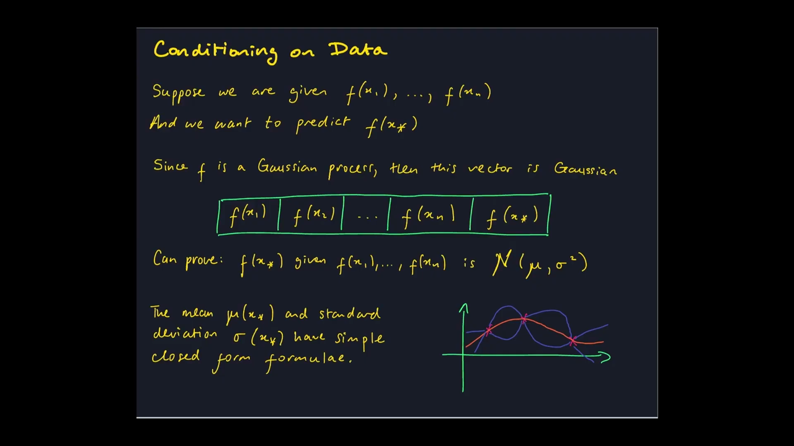
*▲ 강의 슬라이드 [44:32](https://youtu.be/-eC0-5mXHQg?t=2672): 데이터에 조건 걸기. 아는 값과 예측할 값을 한 정규 벡터로 묶으면 $f(x_*)$의 조건부 분포가 $\mathcal{N}(\mu, \sigma^2)$이고, 평균과 표준편차가 닫힌 식으로 나온다*

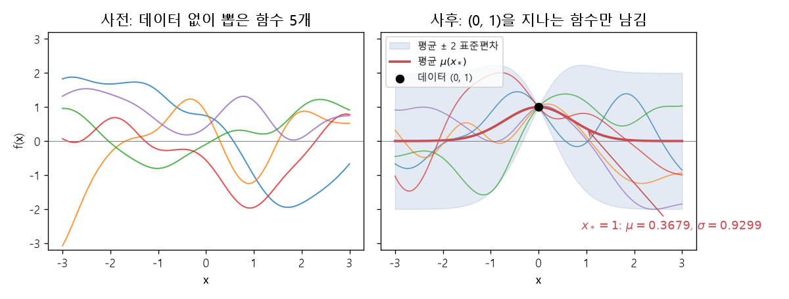
*▲ 직접 그린 그림: 공분산 $e^{-(x-x')^2}$인 [가우스 과정](00_%EB%94%A5%EB%9F%AC%EB%8B%9D_%EC%9A%A9%EC%96%B4%EC%82%AC%EC%A0%84.md#gaussian-process-%EA%B0%80%EC%9A%B0%EC%8A%A4-%EA%B3%BC%EC%A0%95). 왼쪽은 데이터 없이 뽑은 함수 5개, 오른쪽은 데이터 (0, 1)에 조건을 건 뒤 뽑은 함수 5개와 평균 ± 2 표준편차. $x_* = 1$에서 평균 0.3679, 표준편차 0.9299 (위 예제)*

---

## 5. 신경망-가우스 과정 대응

### 5.1 무작위 가중치는 무작위 함수

▶ 영상 [44:59](https://youtu.be/-eC0-5mXHQg?t=2699)

📐 **수학 개념**: [합성함수와 비선형성](%EC%88%98%ED%95%99%EA%B0%9C%EB%85%90/05_%EC%8B%A0%EA%B2%BD%EB%A7%9D%EC%9D%98_%EA%B3%84%EC%82%B0/MM06_%ED%95%A9%EC%84%B1%ED%95%A8%EC%88%98%EC%99%80_%EB%B9%84%EC%84%A0%ED%98%95%EC%84%B1.md)

이제 [가우스 과정](00_%EB%94%A5%EB%9F%AC%EB%8B%9D_%EC%9A%A9%EC%96%B4%EC%82%AC%EC%A0%84.md#gaussian-process-%EA%B0%80%EC%9A%B0%EC%8A%A4-%EA%B3%BC%EC%A0%95)을 잊고 신경망만 생각합니다. 가장 단순한 [다층 퍼셉트론](00_%EB%94%A5%EB%9F%AC%EB%8B%9D_%EC%9A%A9%EC%96%B4%EC%82%AC%EC%A0%84.md#multi-layer-perceptron-%EB%8B%A4%EC%B8%B5-%ED%8D%BC%EC%85%89%ED%8A%B8%EB%A1%A0)의 [가중치](00_%EB%94%A5%EB%9F%AC%EB%8B%9D_%EC%9A%A9%EC%96%B4%EC%82%AC%EC%A0%84.md#weight-%EA%B0%80%EC%A4%91%EC%B9%98) 행렬 $W_1, W_2, \dots, W_L$을 **무작위로 뽑으면** 신경망은 함수 하나를 줍니다. 다시 뽑으면(망을 다시 초기화하면) 다른 함수가 나옵니다. 이를 반복하면 **함수들의 분포**가 생기고, 그 분포가 어떤 성질을 갖는지 물을 수 있습니다.

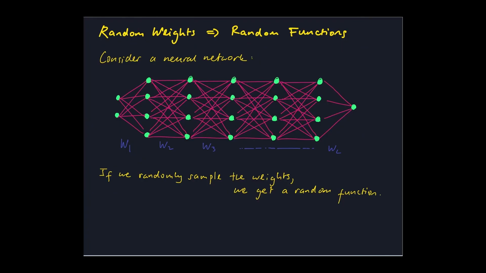
*▲ 강의 슬라이드 [45:25](https://youtu.be/-eC0-5mXHQg?t=2725): 신경망의 [가중치](00_%EB%94%A5%EB%9F%AC%EB%8B%9D_%EC%9A%A9%EC%96%B4%EC%82%AC%EC%A0%84.md#weight-%EA%B0%80%EC%A4%91%EC%B9%98)를 무작위로 뽑으면 무작위 함수를 얻는다*

### 5.2 실험: 너비 1000인 MLP 1000개

▶ 영상 [46:03](https://youtu.be/-eC0-5mXHQg?t=2763)

- 망을 1000번 다시 초기화해 무작위 함수 $f_1, \dots, f_{1000}$을 얻습니다. 입력 두 개 $x, x'$를 고정하고(예: 고양이 사진과 강아지 사진), 출력이 1차원이라 치고 $1000 \times 2$ 표 $[f_k(x), f_k(x')]$를 만들어 산점도로 찍습니다.
- 강사가 2년 전 실제로 해 본 실험: CIFAR-10의 트럭 사진, 3층 MLP, [은닉층](00_%EB%94%A5%EB%9F%AC%EB%8B%9D_%EC%9A%A9%EC%96%B4%EC%82%AC%EC%A0%84.md#hidden-layer-%EC%9D%80%EB%8B%89%EC%B8%B5) 너비 1000.
  - 입력 2는 입력 1(트럭)의 픽셀에 **잡음을 조금** 더한 것, 입력 3은 **잡음을 많이** 더한 것입니다.
  - (입력 1, 입력 2) 쌍의 출력은 거의 한 직선 위에 있고, (입력 1, 입력 3) 쌍은 더 넓게 퍼집니다.
- 관찰: 출력 쌍의 [결합 분포](00_%EB%94%A5%EB%9F%AC%EB%8B%9D_%EC%9A%A9%EC%96%B4%EC%82%AC%EC%A0%84.md#joint-distribution-%EA%B2%B0%ED%95%A9-%EB%B6%84%ED%8F%AC)는 **가우스처럼** 보이고, 그 공분산은 **입력의 유사도**에 달려 있습니다. 앞에서 본 [가우스 과정](00_%EB%94%A5%EB%9F%AC%EB%8B%9D_%EC%9A%A9%EC%96%B4%EC%82%AC%EC%A0%84.md#gaussian-process-%EA%B0%80%EC%9A%B0%EC%8A%A4-%EA%B3%BC%EC%A0%95)의 그림과 똑같습니다. 입력을 5개로 늘려 5차원 산점도를 찍어도 가우스이며, 그 이유가 아래의 대응 정리입니다.

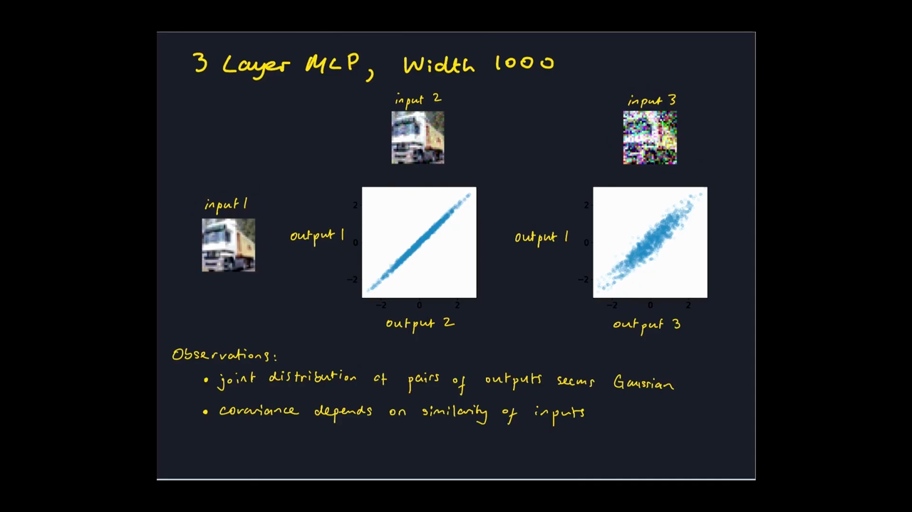
*▲ 강의 슬라이드 [48:12](https://youtu.be/-eC0-5mXHQg?t=2892): 3층 MLP(너비 1000) 1000개의 출력. 비슷한 입력 쌍(1, 2)은 출력이 강하게 상관되고, 덜 비슷한 쌍(1, 3)은 덜 상관된다. [결합 분포](00_%EB%94%A5%EB%9F%AC%EB%8B%9D_%EC%9A%A9%EC%96%B4%EC%82%AC%EC%A0%84.md#joint-distribution-%EA%B2%B0%ED%95%A9-%EB%B6%84%ED%8F%AC)는 가우스처럼 보인다*

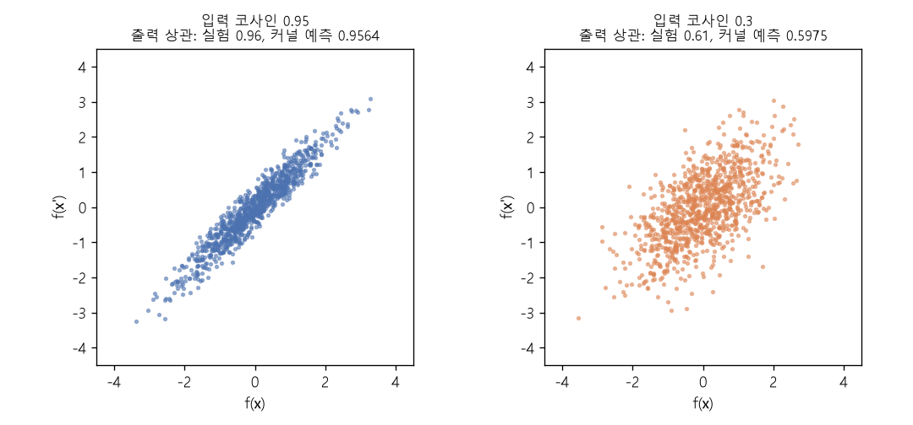
*▲ 직접 그린 그림: 같은 실험을 무작위 입력으로 다시 한 것. 입력 차원 100, 3층 [ReLU](00_%EB%94%A5%EB%9F%AC%EB%8B%9D_%EC%9A%A9%EC%96%B4%EC%82%AC%EC%A0%84.md#relu-%EB%A0%90%EB%A3%A8) MLP(너비 500, $\sqrt2\,\mathrm{relu}$, [분산](00_%EB%94%A5%EB%9F%AC%EB%8B%9D_%EC%9A%A9%EC%96%B4%EC%82%AC%EC%A0%84.md#variance-%EB%B6%84%EC%82%B0) 1/fan-in) 1000개. 입력 코사인이 0.95인 쌍은 출력 상관 0.96, 0.3인 쌍은 0.61로, 7절의 [아크코사인 커널](00_%EB%94%A5%EB%9F%AC%EB%8B%9D_%EC%9A%A9%EC%96%B4%EC%82%AC%EC%A0%84.md#arc-cosine-kernel-%EC%95%84%ED%81%AC%EC%BD%94%EC%82%AC%EC%9D%B8-%EC%BB%A4%EB%84%90) 예측 0.9564, 0.5975와 가깝다*

### 5.3 대응 정리

▶ 영상 [50:08](https://youtu.be/-eC0-5mXHQg?t=3008)

📐 **수학 개념**: [중심극한정리와 아크코사인 커널](%EC%88%98%ED%95%99%EA%B0%9C%EB%85%90/10_%ED%91%9C%ED%98%84_%ED%95%99%EC%8A%B5/MM49_%EC%A4%91%EC%8B%AC%EA%B7%B9%ED%95%9C%EC%A0%95%EB%A6%AC%EC%99%80_%EC%95%84%ED%81%AC%EC%BD%94%EC%82%AC%EC%9D%B8_%EC%BB%A4%EB%84%90.md) · [가우스 과정](%EC%88%98%ED%95%99%EA%B0%9C%EB%85%90/10_%ED%91%9C%ED%98%84_%ED%95%99%EC%8A%B5/MM48_%EA%B0%80%EC%9A%B0%EC%8A%A4_%EA%B3%BC%EC%A0%95%EA%B3%BC_%EC%A1%B0%EA%B1%B4%EB%B6%80_%EC%98%88%EC%B8%A1.md)

> [!NOTE]
> **[신경망-가우스 과정 대응](00_%EB%94%A5%EB%9F%AC%EB%8B%9D_%EC%9A%A9%EC%96%B4%EC%82%AC%EC%A0%84.md#nngp-correspondence-%EC%8B%A0%EA%B2%BD%EB%A7%9D-%EA%B0%80%EC%9A%B0%EC%8A%A4-%EA%B3%BC%EC%A0%95-%EB%8C%80%EC%9D%91) ([NNGP correspondence](00_%EB%94%A5%EB%9F%AC%EB%8B%9D_%EC%9A%A9%EC%96%B4%EC%82%AC%EC%A0%84.md#nngp-correspondence-%EC%8B%A0%EA%B2%BD%EB%A7%9D-%EA%B0%80%EC%9A%B0%EC%8A%A4-%EA%B3%BC%EC%A0%95-%EB%8C%80%EC%9D%91))**
> 신경망의 [가중치](00_%EB%94%A5%EB%9F%AC%EB%8B%9D_%EC%9A%A9%EC%96%B4%EC%82%AC%EC%A0%84.md#weight-%EA%B0%80%EC%A4%91%EC%B9%98)를 [i.i.d.](00_%EB%94%A5%EB%9F%AC%EB%8B%9D_%EC%9A%A9%EC%96%B4%EC%82%AC%EC%A0%84.md#iid-independent-and-identically-distributed-%EB%8F%85%EB%A6%BD-%EB%8F%99%EC%9D%BC-%EB%B6%84%ED%8F%AC)로 뽑고 **너비를 무한대로** 보내면, 아무 유한 개 입력에서의 출력 $(f(x_1), \dots, f(x_n))$의 [결합 분포](00_%EB%94%A5%EB%9F%AC%EB%8B%9D_%EC%9A%A9%EC%96%B4%EC%82%AC%EC%A0%84.md#joint-distribution-%EA%B2%B0%ED%95%A9-%EB%B6%84%ED%8F%AC)가 [정규분포](00_%EB%94%A5%EB%9F%AC%EB%8B%9D_%EC%9A%A9%EC%96%B4%EC%82%AC%EC%A0%84.md#normal-distribution-%EC%A0%95%EA%B7%9C%EB%B6%84%ED%8F%AC)가 된다. 즉 무한히 넓은 무작위 신경망은 [가우스 과정](00_%EB%94%A5%EB%9F%AC%EB%8B%9D_%EC%9A%A9%EC%96%B4%EC%82%AC%EC%A0%84.md#gaussian-process-%EA%B0%80%EC%9A%B0%EC%8A%A4-%EA%B3%BC%EC%A0%95)이다. 그 **[공분산 함수](00_%EB%94%A5%EB%9F%AC%EB%8B%9D_%EC%9A%A9%EC%96%B4%EC%82%AC%EC%A0%84.md#covariance-function-%EA%B3%B5%EB%B6%84%EC%82%B0-%ED%95%A8%EC%88%98)는 아키텍처와 [비선형성](00_%EB%94%A5%EB%9F%AC%EB%8B%9D_%EC%9A%A9%EC%96%B4%EC%82%AC%EC%A0%84.md#nonlinearity-%EB%B9%84%EC%84%A0%ED%98%95%EC%84%B1)이 정한다.**

- 이것이 강의 처음의 주장, "아키텍처는 어떤 데이터가 비슷한지에 대한 의견을 이미 갖고 있다"의 정확한 뜻입니다. 아키텍처를 아주 넓게 만들면 그 의견을 **[공분산 함수](00_%EB%94%A5%EB%9F%AC%EB%8B%9D_%EC%9A%A9%EC%96%B4%EC%82%AC%EC%A0%84.md#covariance-function-%EA%B3%B5%EB%B6%84%EC%82%B0-%ED%95%A8%EC%88%98) $\Sigma(x, x')$**의 꼴로 꺼낼 수 있고, 그 함수는 깊이, [비선형성](00_%EB%94%A5%EB%9F%AC%EB%8B%9D_%EC%9A%A9%EC%96%B4%EC%82%AC%EC%A0%84.md#nonlinearity-%EB%B9%84%EC%84%A0%ED%98%95%EC%84%B1) 등에 따라 달라집니다.

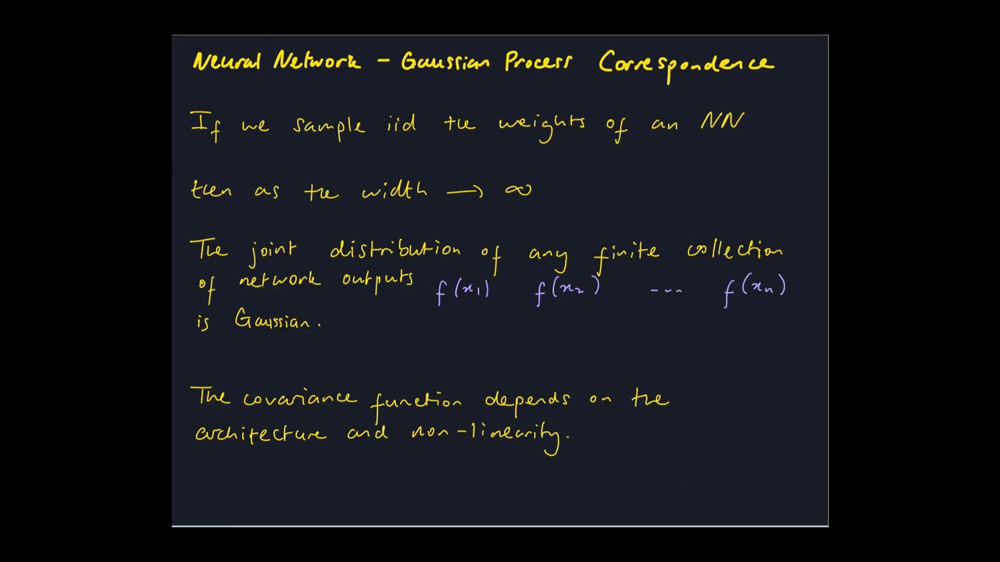
*▲ 강의 슬라이드 [51:12](https://youtu.be/-eC0-5mXHQg?t=3072): [신경망-가우스 과정 대응](00_%EB%94%A5%EB%9F%AC%EB%8B%9D_%EC%9A%A9%EC%96%B4%EC%82%AC%EC%A0%84.md#nngp-correspondence-%EC%8B%A0%EA%B2%BD%EB%A7%9D-%EA%B0%80%EC%9A%B0%EC%8A%A4-%EA%B3%BC%EC%A0%95-%EB%8C%80%EC%9D%91). [가중치](00_%EB%94%A5%EB%9F%AC%EB%8B%9D_%EC%9A%A9%EC%96%B4%EC%82%AC%EC%A0%84.md#weight-%EA%B0%80%EC%A4%91%EC%B9%98)를 [i.i.d.](00_%EB%94%A5%EB%9F%AC%EB%8B%9D_%EC%9A%A9%EC%96%B4%EC%82%AC%EC%A0%84.md#iid-independent-and-identically-distributed-%EB%8F%85%EB%A6%BD-%EB%8F%99%EC%9D%BC-%EB%B6%84%ED%8F%AC)로 뽑고 너비 → ∞이면 유한 개 출력의 [결합 분포](00_%EB%94%A5%EB%9F%AC%EB%8B%9D_%EC%9A%A9%EC%96%B4%EC%82%AC%EC%A0%84.md#joint-distribution-%EA%B2%B0%ED%95%A9-%EB%B6%84%ED%8F%AC)가 가우스이고, [공분산 함수](00_%EB%94%A5%EB%9F%AC%EB%8B%9D_%EC%9A%A9%EC%96%B4%EC%82%AC%EC%A0%84.md#covariance-function-%EA%B3%B5%EB%B6%84%EC%82%B0-%ED%95%A8%EC%88%98)는 아키텍처와 [비선형성](00_%EB%94%A5%EB%9F%AC%EB%8B%9D_%EC%9A%A9%EC%96%B4%EC%82%AC%EC%A0%84.md#nonlinearity-%EB%B9%84%EC%84%A0%ED%98%95%EC%84%B1)에 달려 있다*

### 5.4 넓으면 과적합하지 않나, 왜 커널을 쓰지 않나

▶ 영상 [52:24](https://youtu.be/-eC0-5mXHQg?t=3144)

📐 **수학 개념**: [커널 보간](%EC%88%98%ED%95%99%EA%B0%9C%EB%85%90/10_%ED%91%9C%ED%98%84_%ED%95%99%EC%8A%B5/MM47_%EC%BB%A4%EB%84%90_%EB%B3%B4%EA%B0%84.md) · [최소 노름 해와 이중 하강](%EC%88%98%ED%95%99%EA%B0%9C%EB%85%90/08_%EC%9D%BC%EB%B0%98%ED%99%94/MM23_%EC%B5%9C%EC%86%8C_%EB%85%B8%EB%A6%84_%ED%95%B4%EC%99%80_%EC%9D%B4%EC%A4%91_%ED%95%98%EA%B0%95.md)

이 절은 대부분 질의응답이지만 강의의 핵심 논점이 들어 있어 본문에 정리합니다.

- **너무 넓으면 과적합하지 않나?** [가우스 과정](00_%EB%94%A5%EB%9F%AC%EB%8B%9D_%EC%9A%A9%EC%96%B4%EC%82%AC%EC%A0%84.md#gaussian-process-%EA%B0%80%EC%9A%B0%EC%8A%A4-%EA%B3%BC%EC%A0%95) 그림에서는 데이터를 지나되 크게 요동치는 함수도 뽑힐 수 있지만 그 [확률](00_%EB%94%A5%EB%9F%AC%EB%8B%9D_%EC%9A%A9%EC%96%B4%EC%82%AC%EC%A0%84.md#probability-%ED%99%95%EB%A5%A0)은 아주 작습니다. [정규분포](00_%EB%94%A5%EB%9F%AC%EB%8B%9D_%EC%9A%A9%EC%96%B4%EC%82%AC%EC%A0%84.md#normal-distribution-%EC%A0%95%EA%B7%9C%EB%B6%84%ED%8F%AC)는 평균에서 크게 벗어날 [확률](00_%EB%94%A5%EB%9F%AC%EB%8B%9D_%EC%9A%A9%EC%96%B4%EC%82%AC%EC%A0%84.md#probability-%ED%99%95%EB%A5%A0)이 작기 때문입니다. [분산](00_%EB%94%A5%EB%9F%AC%EB%8B%9D_%EC%9A%A9%EC%96%B4%EC%82%AC%EC%A0%84.md#variance-%EB%B6%84%EC%82%B0)이 크더라도 평균 함수는 매끈하므로 평균을 꺼내 쓰면 됩니다. [가중치](00_%EB%94%A5%EB%9F%AC%EB%8B%9D_%EC%9A%A9%EC%96%B4%EC%82%AC%EC%A0%84.md#weight-%EA%B0%80%EC%A4%91%EC%B9%98)를 뽑는 표준편차를 아주 작게 하면 분포가 평균으로 몰립니다. 또 [Lec06](Lec06_%EC%9D%BC%EB%B0%98%ED%99%94_%EC%9D%B4%EB%A1%A0.md#54-%EC%9D%B4%EC%A4%91-%ED%95%98%EA%B0%95)에서 본 것처럼, [과매개변수화](00_%EB%94%A5%EB%9F%AC%EB%8B%9D_%EC%9A%A9%EC%96%B4%EC%82%AC%EC%A0%84.md#overparameterization-%EA%B3%BC%EB%A7%A4%EA%B0%9C%EB%B3%80%EC%88%98%ED%99%94)된 망은 과적합할 **수 있을** 뿐 반드시 과적합하지는 않습니다. 단순한 함수도 많이 표현할 수 있습니다.
- **왜 너비가 무한해야 하나?** 증명이 너비에 대한 **[중심극한정리](00_%EB%94%A5%EB%9F%AC%EB%8B%9D_%EC%9A%A9%EC%96%B4%EC%82%AC%EC%A0%84.md#central-limit-theorem-%EC%A4%91%EC%8B%AC%EA%B7%B9%ED%95%9C%EC%A0%95%EB%A6%AC)**에 기대기 때문입니다. 무언가가 커야 [정규분포](00_%EB%94%A5%EB%9F%AC%EB%8B%9D_%EC%9A%A9%EC%96%B4%EC%82%AC%EC%A0%84.md#normal-distribution-%EC%A0%95%EA%B7%9C%EB%B6%84%ED%8F%AC)로 수렴하는데, 그것이 너비입니다(6절).
- **대응이 있다면 왜 커널을 뽑아 [가우스 과정](00_%EB%94%A5%EB%9F%AC%EB%8B%9D_%EC%9A%A9%EC%96%B4%EC%82%AC%EC%A0%84.md#gaussian-process-%EA%B0%80%EC%9A%B0%EC%8A%A4-%EA%B3%BC%EC%A0%95) [회귀](00_%EB%94%A5%EB%9F%AC%EB%8B%9D_%EC%9A%A9%EC%96%B4%EC%82%AC%EC%A0%84.md#regression-classification-%ED%9A%8C%EA%B7%80%EC%99%80-%EB%B6%84%EB%A5%98)를 하지 않고 신경망을 학습하나?** 강사가 꼽는 이유:
  - [커널 방법](00_%EB%94%A5%EB%9F%AC%EB%8B%9D_%EC%9A%A9%EC%96%B4%EC%82%AC%EC%A0%84.md#kernel-method-%EC%BB%A4%EB%84%90-%EB%B0%A9%EB%B2%95)도 [하이퍼파라미터](00_%EB%94%A5%EB%9F%AC%EB%8B%9D_%EC%9A%A9%EC%96%B4%EC%82%AC%EC%A0%84.md#hyperparameter-%ED%95%98%EC%9D%B4%ED%8D%BC%ED%8C%8C%EB%9D%BC%EB%AF%B8%ED%84%B0)가 있습니다. 아키텍처가 커널을 바꾸므로 조율이 필요 없는 방법이 아닙니다.
  - **비용**: [커널 방법](00_%EB%94%A5%EB%9F%AC%EB%8B%9D_%EC%9A%A9%EC%96%B4%EC%82%AC%EC%A0%84.md#kernel-method-%EC%BB%A4%EB%84%90-%EB%B0%A9%EB%B2%95)([가우스 과정](00_%EB%94%A5%EB%9F%AC%EB%8B%9D_%EC%9A%A9%EC%96%B4%EC%82%AC%EC%A0%84.md#gaussian-process-%EA%B0%80%EC%9A%B0%EC%8A%A4-%EA%B3%BC%EC%A0%95) [회귀](00_%EB%94%A5%EB%9F%AC%EB%8B%9D_%EC%9A%A9%EC%96%B4%EC%82%AC%EC%A0%84.md#regression-classification-%ED%9A%8C%EA%B7%80%EC%99%80-%EB%B6%84%EB%A5%98))은 [학습 데이터](00_%EB%94%A5%EB%9F%AC%EB%8B%9D_%EC%9A%A9%EC%96%B4%EC%82%AC%EC%A0%84.md#training-data-test-data-%ED%95%99%EC%8A%B5-%EB%8D%B0%EC%9D%B4%ED%84%B0%EC%99%80-%EC%8B%9C%ED%97%98-%EB%8D%B0%EC%9D%B4%ED%84%B0) 수의 **세제곱**으로 비쌉니다. 신경망 [학습](00_%EB%94%A5%EB%9F%AC%EB%8B%9D_%EC%9A%A9%EC%96%B4%EC%82%AC%EC%A0%84.md#training-%ED%95%99%EC%8A%B5) 비용은 [순전파](00_%EB%94%A5%EB%9F%AC%EB%8B%9D_%EC%9A%A9%EC%96%B4%EC%82%AC%EC%A0%84.md#feed-forward-%EC%88%9C%EC%A0%84%ED%8C%8C)·[역전파](00_%EB%94%A5%EB%9F%AC%EB%8B%9D_%EC%9A%A9%EC%96%B4%EC%82%AC%EC%A0%84.md#backpropagation-%EC%97%AD%EC%A0%84%ED%8C%8C) 비용 × 데이터 수, 즉 데이터 수에 **선형**입니다(데이터 1000개면 세제곱은 $10^9$, 10만 개면 $10^{15}$).
  - 왜 사람들이 커널보다 신경망을 쓰는지는 아직 완전히 풀린 문제가 아닐 수 있다고 덧붙입니다.

질의응답: 유한 너비의 오차, 연구에 준 영향, 하이퍼파라미터 수 [59:49](https://youtu.be/-eC0-5mXHQg?t=3589)

- **유한 너비에서 [가우스 과정](00_%EB%94%A5%EB%9F%AC%EB%8B%9D_%EC%9A%A9%EC%96%B4%EC%82%AC%EC%A0%84.md#gaussian-process-%EA%B0%80%EC%9A%B0%EC%8A%A4-%EA%B3%BC%EC%A0%95)과 얼마나 다른가?** 이를 다룬 논문들이 있습니다. 고전적 [중심극한정리](00_%EB%94%A5%EB%9F%AC%EB%8B%9D_%EC%9A%A9%EC%96%B4%EC%82%AC%EC%A0%84.md#central-limit-theorem-%EC%A4%91%EC%8B%AC%EA%B7%B9%ED%95%9C%EC%A0%95%EB%A6%AC)에도 [정규분포](00_%EB%94%A5%EB%9F%AC%EB%8B%9D_%EC%9A%A9%EC%96%B4%EC%82%AC%EC%A0%84.md#normal-distribution-%EC%A0%95%EA%B7%9C%EB%B6%84%ED%8F%AC)에서 얼마나 벗어나는지 알려 주는 베리-에센 정리(Berry-Esseen theorem)가 있어서, 그것을 적용해 볼 수 있습니다.
- **이 결과가 연구 공동체에 준 영향은?** 강사는 "실제로 딥러닝을 하는 방식에는 거의 영향을 주지 못했다"고 솔직히 답합니다. "아키텍처를 쓰고, 극한을 취해 커널을 구하고, 그 성질을 연구한 뒤 학습한다" 같은 세상은 오지 않았고, 그럴듯한 아키텍처를 골라 그냥 해 봅니다. 너무 복잡한 절차는 실제로 일어나는 일을 잘 잡지 못할 가능성이 크다는 교훈도 덧붙입니다. 이 강의는 실무 도구가 아니라, 딥러닝 이론의 한 관점을 소개하는 것입니다.
- **[가우스 과정](00_%EB%94%A5%EB%9F%AC%EB%8B%9D_%EC%9A%A9%EC%96%B4%EC%82%AC%EC%A0%84.md#gaussian-process-%EA%B0%80%EC%9A%B0%EC%8A%A4-%EA%B3%BC%EC%A0%95)의 [하이퍼파라미터](00_%EB%94%A5%EB%9F%AC%EB%8B%9D_%EC%9A%A9%EC%96%B4%EC%82%AC%EC%A0%84.md#hyperparameter-%ED%95%98%EC%9D%B4%ED%8D%BC%ED%8C%8C%EB%9D%BC%EB%AF%B8%ED%84%B0)는 몇 개인가?** 커널을 설계하기 나름입니다. 가장 흔한 [제곱 지수 커널](00_%EB%94%A5%EB%9F%AC%EB%8B%9D_%EC%9A%A9%EC%96%B4%EC%82%AC%EC%A0%84.md#squared-exponential-kernel-%EC%A0%9C%EA%B3%B1-%EC%A7%80%EC%88%98-%EC%BB%A4%EB%84%90) $e^{-(x-x')^2/(2\sigma^2)}$은 상관의 길이 척도 $\sigma$ 하나를 갖습니다. 입력이 다차원이면 좌표마다 $\sigma$를 따로 둘 수도 있고, 다른 커널을 더할 수도 있습니다. "이 구조면 커널 x, 저 구조면 커널 y"라는 표가 있는데, "그림에는 [합성곱 신경망](00_%EB%94%A5%EB%9F%AC%EB%8B%9D_%EC%9A%A9%EC%96%B4%EC%82%AC%EC%A0%84.md#cnn-convolutional-neural-network-%ED%95%A9%EC%84%B1%EA%B3%B1-%EC%8B%A0%EA%B2%BD%EB%A7%9D), 이것에는 [트랜스포머](00_%EB%94%A5%EB%9F%AC%EB%8B%9D_%EC%9A%A9%EC%96%B4%EC%82%AC%EC%A0%84.md#transformer-%ED%8A%B8%EB%9E%9C%EC%8A%A4%ED%8F%AC%EB%A8%B8)"와 같은 모델링 결정입니다.

---

## 6. 증명 스케치: 다변량 중심극한정리

▶ 영상 [64:50](https://youtu.be/-eC0-5mXHQg?t=3890)

📐 **수학 개념**: [중심극한정리와 아크코사인 커널](%EC%88%98%ED%95%99%EA%B0%9C%EB%85%90/10_%ED%91%9C%ED%98%84_%ED%95%99%EC%8A%B5/MM49_%EC%A4%91%EC%8B%AC%EA%B7%B9%ED%95%9C%EC%A0%95%EB%A6%AC%EC%99%80_%EC%95%84%ED%81%AC%EC%BD%94%EC%82%AC%EC%9D%B8_%EC%BB%A4%EB%84%90.md) · [기댓값](%EC%88%98%ED%95%99%EA%B0%9C%EB%85%90/04_%ED%99%95%EB%A5%A0%EA%B3%BC_%EC%A0%95%EB%B3%B4/MM22_%EA%B8%B0%EB%8C%93%EA%B0%92%EA%B3%BC_%EC%9D%BC%EB%B0%98%ED%99%94_%EA%B0%84%EA%B7%B9.md)

주된 도구는 **다변량 [중심극한정리](00_%EB%94%A5%EB%9F%AC%EB%8B%9D_%EC%9A%A9%EC%96%B4%EC%82%AC%EC%A0%84.md#central-limit-theorem-%EC%A4%91%EC%8B%AC%EA%B7%B9%ED%95%9C%EC%A0%95%EB%A6%AC)**입니다. 보통 듣는 [중심극한정리](00_%EB%94%A5%EB%9F%AC%EB%8B%9D_%EC%9A%A9%EC%96%B4%EC%82%AC%EC%A0%84.md#central-limit-theorem-%EC%A4%91%EC%8B%AC%EA%B7%B9%ED%95%9C%EC%A0%95%EB%A6%AC)는 1차원이지만, 벡터로 일반화한 판이 있습니다. 증명은 이 정리를 두 번 쓰고 깊이에 대한 귀납을 하는 것입니다.

1. **1단계**: 입력 하나와 [층](00_%EB%94%A5%EB%9F%AC%EB%8B%9D_%EC%9A%A9%EC%96%B4%EC%82%AC%EC%A0%84.md#layer-%EC%B8%B5) 하나를 고정하면, 그 [층](00_%EB%94%A5%EB%9F%AC%EB%8B%9D_%EC%9A%A9%EC%96%B4%EC%82%AC%EC%A0%84.md#layer-%EC%B8%B5)의 활성값들은 **[i.i.d.](00_%EB%94%A5%EB%9F%AC%EB%8B%9D_%EC%9A%A9%EC%96%B4%EC%82%AC%EC%A0%84.md#iid-independent-and-identically-distributed-%EB%8F%85%EB%A6%BD-%EB%8F%99%EC%9D%BC-%EB%B6%84%ED%8F%AC) [확률 변수](00_%EB%94%A5%EB%9F%AC%EB%8B%9D_%EC%9A%A9%EC%96%B4%EC%82%AC%EC%A0%84.md#random-variable-%ED%99%95%EB%A5%A0-%EB%B3%80%EC%88%98)**입니다. 깊이에 대한 귀납과 다변량 [중심극한정리](00_%EB%94%A5%EB%9F%AC%EB%8B%9D_%EC%9A%A9%EC%96%B4%EC%82%AC%EC%A0%84.md#central-limit-theorem-%EC%A4%91%EC%8B%AC%EA%B7%B9%ED%95%9C%EC%A0%95%EB%A6%AC)로 보입니다.
2. **2단계**: 아무 $k$개 입력 $x_1, \dots, x_k$에 대해 출력 $(f(x_1), \dots, f(x_k))$가 [정규분포](00_%EB%94%A5%EB%9F%AC%EB%8B%9D_%EC%9A%A9%EC%96%B4%EC%82%AC%EC%A0%84.md#normal-distribution-%EC%A0%95%EA%B7%9C%EB%B6%84%ED%8F%AC)입니다. 이 벡터를 끝에서 둘째 [층](00_%EB%94%A5%EB%9F%AC%EB%8B%9D_%EC%9A%A9%EC%96%B4%EC%82%AC%EC%A0%84.md#layer-%EC%B8%B5)의 **[i.i.d.](00_%EB%94%A5%EB%9F%AC%EB%8B%9D_%EC%9A%A9%EC%96%B4%EC%82%AC%EC%A0%84.md#iid-independent-and-identically-distributed-%EB%8F%85%EB%A6%BD-%EB%8F%99%EC%9D%BC-%EB%B6%84%ED%8F%AC) 벡터들의 합**으로 쓰고 다변량 [중심극한정리](00_%EB%94%A5%EB%9F%AC%EB%8B%9D_%EC%9A%A9%EC%96%B4%EC%82%AC%EC%A0%84.md#central-limit-theorem-%EC%A4%91%EC%8B%AC%EA%B7%B9%ED%95%9C%EC%A0%95%EB%A6%AC)를 적용합니다.

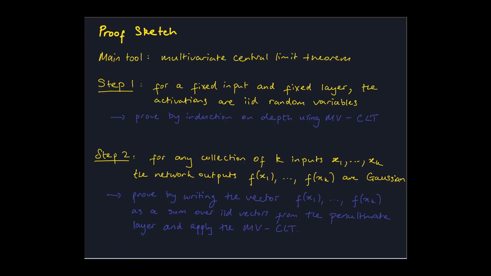
*▲ 강의 슬라이드 [66:32](https://youtu.be/-eC0-5mXHQg?t=3992): 증명 스케치. 1단계는 한 입력에서 [층](00_%EB%94%A5%EB%9F%AC%EB%8B%9D_%EC%9A%A9%EC%96%B4%EC%82%AC%EC%A0%84.md#layer-%EC%B8%B5)의 활성값이 [i.i.d.](00_%EB%94%A5%EB%9F%AC%EB%8B%9D_%EC%9A%A9%EC%96%B4%EC%82%AC%EC%A0%84.md#iid-independent-and-identically-distributed-%EB%8F%85%EB%A6%BD-%EB%8F%99%EC%9D%BC-%EB%B6%84%ED%8F%AC)임을, 2단계는 여러 입력의 출력 벡터가 [i.i.d.](00_%EB%94%A5%EB%9F%AC%EB%8B%9D_%EC%9A%A9%EC%96%B4%EC%82%AC%EC%A0%84.md#iid-independent-and-identically-distributed-%EB%8F%85%EB%A6%BD-%EB%8F%99%EC%9D%BC-%EB%B6%84%ED%8F%AC) 벡터의 합이라 정규임을 다변량 [중심극한정리](00_%EB%94%A5%EB%9F%AC%EB%8B%9D_%EC%9A%A9%EC%96%B4%EC%82%AC%EC%A0%84.md#central-limit-theorem-%EC%A4%91%EC%8B%AC%EA%B7%B9%ED%95%9C%EC%A0%95%EB%A6%AC)로 보인다*

질의응답: 너비를 키울 때 가중치 크기, 독립성 [67:03](https://youtu.be/-eC0-5mXHQg?t=4023)

- **너비를 키우면 [가중치](00_%EB%94%A5%EB%9F%AC%EB%8B%9D_%EC%9A%A9%EC%96%B4%EC%82%AC%EC%A0%84.md#weight-%EA%B0%80%EC%A4%91%EC%B9%98)를 다시 스케일하나?** 그렇습니다. [분산](00_%EB%94%A5%EB%9F%AC%EB%8B%9D_%EC%9A%A9%EC%96%B4%EC%82%AC%EC%A0%84.md#variance-%EB%B6%84%EC%82%B0)을 $1/\text{fan-in}$으로 둡니다(7절).
- **앞 [층](00_%EB%94%A5%EB%9F%AC%EB%8B%9D_%EC%9A%A9%EC%96%B4%EC%82%AC%EC%A0%84.md#layer-%EC%B8%B5)의 복잡한 의존이 있는데 왜 독립인가?** 강사는 "[독립](00_%EB%94%A5%EB%9F%AC%EB%8B%9D_%EC%9A%A9%EC%96%B4%EC%82%AC%EC%A0%84.md#independence-%EB%8F%85%EB%A6%BD)"이라고 말한 것이 너무 쉽게 들렸을 수 있다며, 이는 증명해야 하는 성질이고 **각 [층](00_%EB%94%A5%EB%9F%AC%EB%8B%9D_%EC%9A%A9%EC%96%B4%EC%82%AC%EC%A0%84.md#layer-%EC%B8%B5)이 아주 넓어서 [층](00_%EB%94%A5%EB%9F%AC%EB%8B%9D_%EC%9A%A9%EC%96%B4%EC%82%AC%EC%A0%84.md#layer-%EC%B8%B5)마다 [중심극한정리](00_%EB%94%A5%EB%9F%AC%EB%8B%9D_%EC%9A%A9%EC%96%B4%EC%82%AC%EC%A0%84.md#central-limit-theorem-%EC%A4%91%EC%8B%AC%EA%B7%B9%ED%95%9C%EC%A0%95%EB%A6%AC)가 일어나기 때문에** 성립한다고 답합니다. 자세한 증명은 읽기 자료로 올리겠다고 합니다.

---

## 7. 예: ReLU MLP와 아크코사인 커널

▶ 영상 [68:07](https://youtu.be/-eC0-5mXHQg?t=4087)

📐 **수학 개념**: [중심극한정리와 아크코사인 커널](%EC%88%98%ED%95%99%EA%B0%9C%EB%85%90/10_%ED%91%9C%ED%98%84_%ED%95%99%EC%8A%B5/MM49_%EC%A4%91%EC%8B%AC%EA%B7%B9%ED%95%9C%EC%A0%95%EB%A6%AC%EC%99%80_%EC%95%84%ED%81%AC%EC%BD%94%EC%82%AC%EC%9D%B8_%EC%BB%A4%EB%84%90.md) · [코사인 유사도](%EC%88%98%ED%95%99%EA%B0%9C%EB%85%90/03_%EC%84%A0%ED%98%95%EB%8C%80%EC%88%98/MM44_%EB%8B%A8%EC%9C%84_%EA%B5%AC%EC%99%80_%EC%BD%94%EC%82%AC%EC%9D%B8_%EC%9C%A0%EC%82%AC%EB%8F%84.md) · [활성화 함수](%EC%88%98%ED%95%99%EA%B0%9C%EB%85%90/05_%EC%8B%A0%EA%B2%BD%EB%A7%9D%EC%9D%98_%EA%B3%84%EC%82%B0/MM05_%ED%99%9C%EC%84%B1%ED%99%94_%ED%95%A8%EC%88%98%EC%9D%98_%EB%AF%B8%EB%B6%84.md)

대응을 정확히 계산할 수 있는 예입니다. [비선형성](00_%EB%94%A5%EB%9F%AC%EB%8B%9D_%EC%9A%A9%EC%96%B4%EC%82%AC%EC%A0%84.md#nonlinearity-%EB%B9%84%EC%84%A0%ED%98%95%EC%84%B1)을 $\phi(z) = \sqrt{2}\,\mathrm{relu}(z)$로, [가중치](00_%EB%94%A5%EB%9F%AC%EB%8B%9D_%EC%9A%A9%EC%96%B4%EC%82%AC%EC%A0%84.md#weight-%EA%B0%80%EC%A4%91%EC%B9%98)를 [분산](00_%EB%94%A5%EB%9F%AC%EB%8B%9D_%EC%9A%A9%EC%96%B4%EC%82%AC%EC%A0%84.md#variance-%EB%B6%84%EC%82%B0) $1/\text{fan-in}$인 [정규분포](00_%EB%94%A5%EB%9F%AC%EB%8B%9D_%EC%9A%A9%EC%96%B4%EC%82%AC%EC%A0%84.md#normal-distribution-%EC%A0%95%EA%B7%9C%EB%B6%84%ED%8F%AC)에서 [i.i.d.](00_%EB%94%A5%EB%9F%AC%EB%8B%9D_%EC%9A%A9%EC%96%B4%EC%82%AC%EC%A0%84.md#iid-independent-and-identically-distributed-%EB%8F%85%EB%A6%BD-%EB%8F%99%EC%9D%BC-%EB%B6%84%ED%8F%AC)로 뽑습니다. 이는 [PyTorch](00_%EB%94%A5%EB%9F%AC%EB%8B%9D_%EC%9A%A9%EC%96%B4%EC%82%AC%EC%A0%84.md#pytorch-%ED%8C%8C%EC%9D%B4%ED%86%A0%EC%B9%98)의 "표준 매개변수화"에 해당합니다(강사는 실무에서 최선은 아니라고 봅니다). [출력층](00_%EB%94%A5%EB%9F%AC%EB%8B%9D_%EC%9A%A9%EC%96%B4%EC%82%AC%EC%A0%84.md#output-layer-%EC%B6%9C%EB%A0%A5%EC%B8%B5)에는 [비선형성](00_%EB%94%A5%EB%9F%AC%EB%8B%9D_%EC%9A%A9%EC%96%B4%EC%82%AC%EC%A0%84.md#nonlinearity-%EB%B9%84%EC%84%A0%ED%98%95%EC%84%B1)이 없으므로 출력 평균은 0이고, 출력의 공분산은 **합성 [아크코사인 커널](00_%EB%94%A5%EB%9F%AC%EB%8B%9D_%EC%9A%A9%EC%96%B4%EC%82%AC%EC%A0%84.md#arc-cosine-kernel-%EC%95%84%ED%81%AC%EC%BD%94%EC%82%AC%EC%9D%B8-%EC%BB%A4%EB%84%90)**(compositional arccosine kernel)입니다. 입력의 [내적](00_%EB%94%A5%EB%9F%AC%EB%8B%9D_%EC%9A%A9%EC%96%B4%EC%82%AC%EC%A0%84.md#dot-product-%EB%82%B4%EC%A0%81)에 함수 $h$를 $L - 1$번($L$은 깊이) 거듭 적용합니다.

$$
\phi(z) = \sqrt{2}\,\mathrm{relu}(z),\ \ W_{ij} \sim \mathcal{N}\!\Big(0, \frac{1}{\text{fan-in}}\Big) \ \Rightarrow\ \mathbb{E}[f(x)] = 0,\ \ \mathbb{E}[f(x) f(x')] = \underbrace{h \circ \cdots \circ h}_{L-1\text{번}}\Big(\frac{x^\top x'}{d}\Big),\ \ h(t) = \frac{1}{\pi}\Big[\sqrt{1 - t^2} + t\,(\pi - \arccos t)\Big]
$$

기호 풀이

| 기호 | 읽는 법 | 뜻 | 예제 값 |
| --- | --- | --- | --- |
| $\phi(z)$ | 파이 | [비선형성](00_%EB%94%A5%EB%9F%AC%EB%8B%9D_%EC%9A%A9%EC%96%B4%EC%82%AC%EC%A0%84.md#nonlinearity-%EB%B9%84%EC%84%A0%ED%98%95%EC%84%B1). [ReLU](00_%EB%94%A5%EB%9F%AC%EB%8B%9D_%EC%9A%A9%EC%96%B4%EC%82%AC%EC%A0%84.md#relu-%EB%A0%90%EB%A3%A8)에 $\sqrt2$를 곱해 [분산](00_%EB%94%A5%EB%9F%AC%EB%8B%9D_%EC%9A%A9%EC%96%B4%EC%82%AC%EC%A0%84.md#variance-%EB%B6%84%EC%82%B0)을 1로 지킨다 | |
| $W_{ij}$ | 더블유 아이 제이 | [가중치](00_%EB%94%A5%EB%9F%AC%EB%8B%9D_%EC%9A%A9%EC%96%B4%EC%82%AC%EC%A0%84.md#weight-%EA%B0%80%EC%A4%91%EC%B9%98). 평균 0, [분산](00_%EB%94%A5%EB%9F%AC%EB%8B%9D_%EC%9A%A9%EC%96%B4%EC%82%AC%EC%A0%84.md#variance-%EB%B6%84%EC%82%B0) $1/\text{fan-in}$ | |
| fan-in | 팬인 | 그 [층](00_%EB%94%A5%EB%9F%AC%EB%8B%9D_%EC%9A%A9%EC%96%B4%EC%82%AC%EC%A0%84.md#layer-%EC%B8%B5)으로 들어오는 입력 수 | 첫 [층](00_%EB%94%A5%EB%9F%AC%EB%8B%9D_%EC%9A%A9%EC%96%B4%EC%82%AC%EC%A0%84.md#layer-%EC%B8%B5)은 $d$ |
| $L$ | 엘 | 깊이 ([가중치](00_%EB%94%A5%EB%9F%AC%EB%8B%9D_%EC%9A%A9%EC%96%B4%EC%82%AC%EC%A0%84.md#weight-%EA%B0%80%EC%A4%91%EC%B9%98) 행렬 수) | 2 |
| $x, x' \in \mathbb{R}^d$ | 엑스, 엑스 프라임 | 두 입력. $\|x\|^2 = d$로 맞춰 둔다 | (1,1,1,1), (1,1,-1,1) |
| $x^\top x' / d$ | [내적](00_%EB%94%A5%EB%9F%AC%EB%8B%9D_%EC%9A%A9%EC%96%B4%EC%82%AC%EC%A0%84.md#dot-product-%EB%82%B4%EC%A0%81) 나누기 디 | 입력의 [코사인 유사도](00_%EB%94%A5%EB%9F%AC%EB%8B%9D_%EC%9A%A9%EC%96%B4%EC%82%AC%EC%A0%84.md#cosine-similarity-%EC%BD%94%EC%82%AC%EC%9D%B8-%EC%9C%A0%EC%82%AC%EB%8F%84) | 0.5 |
| $\mathbb{E}[f(x) f(x')]$ | [기댓값](00_%EB%94%A5%EB%9F%AC%EB%8B%9D_%EC%9A%A9%EC%96%B4%EC%82%AC%EC%A0%84.md#expectation-%EA%B8%B0%EB%8C%93%EA%B0%92) | 무작위 망 출력의 공분산 | 0.6090 |
| $h(t)$ | 에이치 | 한 [층](00_%EB%94%A5%EB%9F%AC%EB%8B%9D_%EC%9A%A9%EC%96%B4%EC%82%AC%EC%A0%84.md#layer-%EC%B8%B5)을 지날 때 상관이 바뀌는 규칙 | $h(0.5) = 0.6090$ |
| $h \circ \cdots \circ h$ | 합성 | $h$를 $L-1$번 거듭 적용 | |
| $\arccos t$ | 아크코사인 | 코사인이 $t$인 각도(라디안) | $\arccos 0.5 = 1.0472$ |

예제와 풀이

**문제**: 입력 차원 $d = 4$, 깊이 $L = 2$([은닉층](00_%EB%94%A5%EB%9F%AC%EB%8B%9D_%EC%9A%A9%EC%96%B4%EC%82%AC%EC%A0%84.md#hidden-layer-%EC%9D%80%EB%8B%89%EC%B8%B5) 하나)인 무한히 넓은 [ReLU](00_%EB%94%A5%EB%9F%AC%EB%8B%9D_%EC%9A%A9%EC%96%B4%EC%82%AC%EC%A0%84.md#relu-%EB%A0%90%EB%A3%A8) MLP에 두 입력 $x = (1, 1, 1, 1)$, $x' = (1, 1, -1, 1)$을 넣는다. 무작위 망 출력의 공분산 $\mathbb{E}[f(x) f(x')]$는?

**주어진 값**
- $d = 4$ (입력 차원), $L = 2$ (깊이 → $h$를 $L - 1 = 1$번 적용)
- $x = (1, 1, 1, 1)$, $x' = (1, 1, -1, 1)$ (두 입력. 둘 다 $\|x\|^2 = 4 = d$)

**풀이**
1. 식을 그대로 쓴다: $\mathbb{E}[f(x) f(x')] = h\Big(\dfrac{x^\top x'}{d}\Big)$, $h(t) = \dfrac{1}{\pi}\Big[\sqrt{1 - t^2} + t\,(\pi - \arccos t)\Big]$
2. 값을 대입한다: $\mathbb{E}[f(x) f(x')] = h\Big(\dfrac{(1,1,1,1)^\top (1,1,-1,1)}{4}\Big)$
3. [내적](00_%EB%94%A5%EB%9F%AC%EB%8B%9D_%EC%9A%A9%EC%96%B4%EC%82%AC%EC%A0%84.md#dot-product-%EB%82%B4%EC%A0%81)을 칸별로 펼친다: $1\times1 + 1\times1 + 1\times(-1) + 1\times1 = 1 + 1 - 1 + 1 = 2$
4. $d$로 나눈다: $t = 2 / 4 = 0.5$
5. $t$를 $h$에 대입한다: $h(0.5) = \dfrac{1}{\pi}\Big[\sqrt{1 - 0.5^2} + 0.5\,(\pi - \arccos 0.5)\Big]$
6. 제곱한다: $0.5^2 = 0.25$
7. 뺀다: $1 - 0.25 = 0.75$
8. 제곱근을 구한다($\sqrt{a}$는 제곱해서 $a$가 되는 양수): $\sqrt{0.75} = 0.8660$
9. 아크코사인을 구한다(코사인 값이 0.5인 각도를 라디안으로, 60°): $\arccos 0.5 = 1.0472$
10. $\pi$(약 3.1416)에서 뺀다: $3.1416 - 1.0472 = 2.0944$
11. $t$를 곱한다: $0.5 \times 2.0944 = 1.0472$
12. 대괄호 안을 더한다: $0.8660 + 1.0472 = 1.9132$
13. $\pi$로 나눈다: $1.9132 / 3.1416 = 0.6090$

**답**: **0.6090**. 입력의 코사인 0.5가 출력에서는 상관 0.6090으로 커졌다. 깊이 $L = 3$이면 $h$를 한 번 더 적용해 $h(0.6090) = 0.6839$가 된다.

내 이해

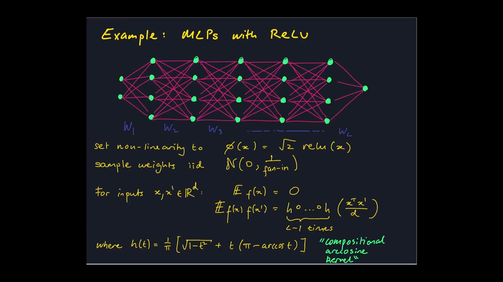
*▲ 강의 슬라이드 [68:12](https://youtu.be/-eC0-5mXHQg?t=4092): 예: [ReLU](00_%EB%94%A5%EB%9F%AC%EB%8B%9D_%EC%9A%A9%EC%96%B4%EC%82%AC%EC%A0%84.md#relu-%EB%A0%90%EB%A3%A8) MLP. $\phi = \sqrt2\,\mathrm{relu}$, [가중치](00_%EB%94%A5%EB%9F%AC%EB%8B%9D_%EC%9A%A9%EC%96%B4%EC%82%AC%EC%A0%84.md#weight-%EA%B0%80%EC%A4%91%EC%B9%98) $\mathcal{N}(0, 1/\text{fan-in})$이면 출력 평균 0, 공분산은 $h$를 $L-1$번 합성한 [아크코사인 커널](00_%EB%94%A5%EB%9F%AC%EB%8B%9D_%EC%9A%A9%EC%96%B4%EC%82%AC%EC%A0%84.md#arc-cosine-kernel-%EC%95%84%ED%81%AC%EC%BD%94%EC%82%AC%EC%9D%B8-%EC%BB%A4%EB%84%90)*

- 한 학생이 "이것은 학습하지 않은 망 이야기냐"고 묻자 강사는 그렇다고 답합니다. 학습한 망에 대한 비슷한 결과로 **[신경 탄젠트 커널](00_%EB%94%A5%EB%9F%AC%EB%8B%9D_%EC%9A%A9%EC%96%B4%EC%82%AC%EC%A0%84.md#neural-tangent-kernel-ntk-%EC%8B%A0%EA%B2%BD-%ED%83%84%EC%A0%A0%ED%8A%B8-%EC%BB%A4%EB%84%90)**(Neural tangent kernel, [NTK](00_%EB%94%A5%EB%9F%AC%EB%8B%9D_%EC%9A%A9%EC%96%B4%EC%82%AC%EC%A0%84.md#neural-tangent-kernel-ntk-%EC%8B%A0%EA%B2%BD-%ED%83%84%EC%A0%A0%ED%8A%B8-%EC%BB%A4%EB%84%90))이 있는데, 그것도 몇 가지 가정 아래에서만 성립하고 요즘은 사람들이 그쪽으로 많이 생각하지 않는다고 덧붙입니다.

---

## 8. 남은 질문과 한계

▶ 영상 [71:08](https://youtu.be/-eC0-5mXHQg?t=4268)

이 대응을 믿고 끝까지 밀고 나간다면 이런 질문이 생깁니다.

- 공분산 $\Sigma(x, x')$는 **아키텍처** 선택과 **[가중치](00_%EB%94%A5%EB%9F%AC%EB%8B%9D_%EC%9A%A9%EC%96%B4%EC%82%AC%EC%A0%84.md#weight-%EA%B0%80%EC%A4%91%EC%B9%98) 분포** 선택에 어떻게 달려 있나?
- 그 지식으로 **아키텍처 설계**와 **[가중치](00_%EB%94%A5%EB%9F%AC%EB%8B%9D_%EC%9A%A9%EC%96%B4%EC%82%AC%EC%A0%84.md#weight-%EA%B0%80%EC%A4%91%EC%B9%98) [규제](00_%EB%94%A5%EB%9F%AC%EB%8B%9D_%EC%9A%A9%EC%96%B4%EC%82%AC%EC%A0%84.md#regularization-%EA%B7%9C%EC%A0%9C) 전략**을 이론적으로 정할 수 있나?

이것이 이런 결과에 건 희망, 즉 형식적이고 해석적인 원리로 딥러닝을 설계하는 길이었습니다. 하지만 실제로는 그렇게 되지 않았고, 그냥 [트랜스포머](00_%EB%94%A5%EB%9F%AC%EB%8B%9D_%EC%9A%A9%EC%96%B4%EC%82%AC%EC%A0%84.md#transformer-%ED%8A%B8%EB%9E%9C%EC%8A%A4%ED%8F%AC%EB%A8%B8)를 쓰거나 아키텍처 목록에서 하나를 고릅니다.

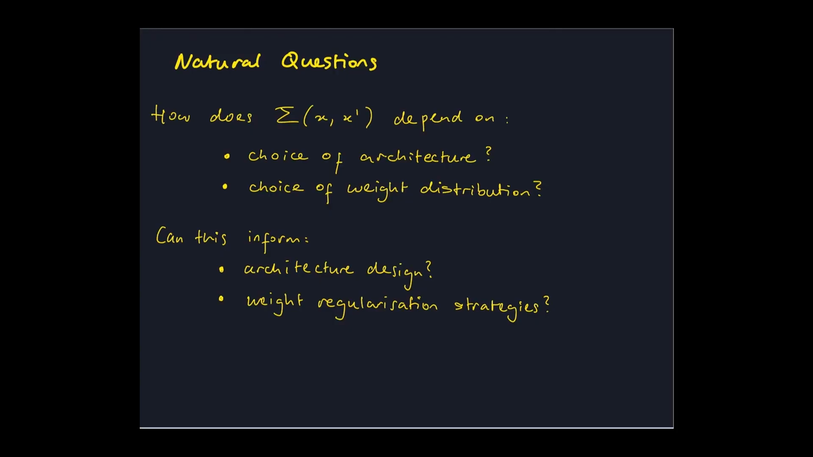
*▲ 강의 슬라이드 [71:15](https://youtu.be/-eC0-5mXHQg?t=4275): 자연스러운 질문. $\Sigma(x, x')$는 아키텍처와 [가중치](00_%EB%94%A5%EB%9F%AC%EB%8B%9D_%EC%9A%A9%EC%96%B4%EC%82%AC%EC%A0%84.md#weight-%EA%B0%80%EC%A4%91%EC%B9%98) 분포에 어떻게 달려 있고, 그것이 아키텍처 설계와 [가중치](00_%EB%94%A5%EB%9F%AC%EB%8B%9D_%EC%9A%A9%EC%96%B4%EC%82%AC%EC%A0%84.md#weight-%EA%B0%80%EC%A4%91%EC%B9%98) [규제](00_%EB%94%A5%EB%9F%AC%EB%8B%9D_%EC%9A%A9%EC%96%B4%EC%82%AC%EC%A0%84.md#regularization-%EA%B7%9C%EC%A0%9C)에 도움이 되는가*

---

## 9. 팬인 초기화와 영공간

▶ 영상 [72:14](https://youtu.be/-eC0-5mXHQg?t=4334)

📐 **수학 개념**: [중심극한정리와 분산 보존](%EC%88%98%ED%95%99%EA%B0%9C%EB%85%90/10_%ED%91%9C%ED%98%84_%ED%95%99%EC%8A%B5/MM49_%EC%A4%91%EC%8B%AC%EA%B7%B9%ED%95%9C%EC%A0%95%EB%A6%AC%EC%99%80_%EC%95%84%ED%81%AC%EC%BD%94%EC%82%AC%EC%9D%B8_%EC%BB%A4%EB%84%90.md) · [스펙트럼 노름과 RMS 연산자 노름](%EC%88%98%ED%95%99%EA%B0%9C%EB%85%90/09_%EC%B5%9C%EC%A0%81%ED%99%94%EC%9D%98_%EA%B8%B0%ED%95%98/MM28_%EC%8A%A4%ED%8E%99%ED%8A%B8%EB%9F%BC_%EB%85%B8%EB%A6%84%EA%B3%BC_RMS_%EC%97%B0%EC%82%B0%EC%9E%90_%EB%85%B8%EB%A6%84.md) · [랭크](%EC%88%98%ED%95%99%EA%B0%9C%EB%85%90/04_%ED%99%95%EB%A5%A0%EA%B3%BC_%EC%A0%95%EB%B3%B4/MM25_%EB%9E%AD%ED%81%AC%EC%99%80_%EC%9C%A0%ED%9A%A8_%EB%9E%AD%ED%81%AC.md)

- 대응 정리는 [분산](00_%EB%94%A5%EB%9F%AC%EB%8B%9D_%EC%9A%A9%EC%96%B4%EC%82%AC%EC%A0%84.md#variance-%EB%B6%84%EC%82%B0) $1/\text{fan-in}$ **[초기화](00_%EB%94%A5%EB%9F%AC%EB%8B%9D_%EC%9A%A9%EC%96%B4%EC%82%AC%EC%A0%84.md#weight-initialization-%EA%B0%80%EC%A4%91%EC%B9%98-%EC%B4%88%EA%B8%B0%ED%99%94)**를 써야 성립합니다. 강사는 이것을 [PyTorch](00_%EB%94%A5%EB%9F%AC%EB%8B%9D_%EC%9A%A9%EC%96%B4%EC%82%AC%EC%A0%84.md#pytorch-%ED%8C%8C%EC%9D%B4%ED%86%A0%EC%B9%98) 표준이며 "Xavier 초기화"라고 부른다고 했습니다([분산](00_%EB%94%A5%EB%9F%AC%EB%8B%9D_%EC%9A%A9%EC%96%B4%EC%82%AC%EC%A0%84.md#variance-%EB%B6%84%EC%82%B0) $1/\text{fan-in}$은 보통 LeCun 초기화라 부르고, Xavier(Glorot) 초기화는 [분산](00_%EB%94%A5%EB%9F%AC%EB%8B%9D_%EC%9A%A9%EC%96%B4%EC%82%AC%EC%A0%84.md#variance-%EB%B6%84%EC%82%B0) $2/(\text{fan-in} + \text{fan-out})$이다. [PyTorch](00_%EB%94%A5%EB%9F%AC%EB%8B%9D_%EC%9A%A9%EC%96%B4%EC%82%AC%EC%A0%84.md#pytorch-%ED%8C%8C%EC%9D%B4%ED%86%A0%EC%B9%98) `nn.Linear`의 기본값은 $\pm 1/\sqrt{\text{fan-in}}$ 사이 균등 분포라 [분산](00_%EB%94%A5%EB%9F%AC%EB%8B%9D_%EC%9A%A9%EC%96%B4%EC%82%AC%EC%A0%84.md#variance-%EB%B6%84%EC%82%B0)이 $1/(3\,\text{fan-in})$이다).
- 이 초기화가 쓰이는 이유는 **초기화 시점에 활성값의 크기를 보존**하기 때문입니다. 대응 정리도 무작위 초기화 시점의 망을 다루므로 같은 초기화를 씁니다.

$$
\mathbf{y} = W\mathbf{x},\ \ W_{ij} \sim \mathcal{N}\!\Big(0, \frac{1}{\text{fan-in}}\Big) \ \Rightarrow\ \mathbb{E}[y_i^2] = \sum_{j=1}^{\text{fan-in}} \mathbb{E}[W_{ij}^2]\, x_j^2 = \frac{\|\mathbf{x}\|^2}{\text{fan-in}}
$$

기호 풀이

| 기호 | 읽는 법 | 뜻 | 예제 값 |
| --- | --- | --- | --- |
| $\mathbf{x}$ | 엑스 | [층](00_%EB%94%A5%EB%9F%AC%EB%8B%9D_%EC%9A%A9%EC%96%B4%EC%82%AC%EC%A0%84.md#layer-%EC%B8%B5)의 입력 벡터 | (1, 2, 0, 2) |
| $W$ | 더블유 | [가중치](00_%EB%94%A5%EB%9F%AC%EB%8B%9D_%EC%9A%A9%EC%96%B4%EC%82%AC%EC%A0%84.md#weight-%EA%B0%80%EC%A4%91%EC%B9%98) 행렬 (fan-out × fan-in) | |
| $\mathbf{y} = W\mathbf{x}$ | 와이 | [층](00_%EB%94%A5%EB%9F%AC%EB%8B%9D_%EC%9A%A9%EC%96%B4%EC%82%AC%EC%A0%84.md#layer-%EC%B8%B5)의 출력 | |
| [fan-in](00_%EB%94%A5%EB%9F%AC%EB%8B%9D_%EC%9A%A9%EC%96%B4%EC%82%AC%EC%A0%84.md#fan-in-fan-out-%ED%8C%AC%EC%9D%B8%EA%B3%BC-%ED%8C%AC%EC%95%84%EC%9B%83) | 팬인 | 입력 수 = $W$의 열 수 | 4 |
| $\mathbb{E}[W_{ij}^2]$ | [기댓값](00_%EB%94%A5%EB%9F%AC%EB%8B%9D_%EC%9A%A9%EC%96%B4%EC%82%AC%EC%A0%84.md#expectation-%EA%B8%B0%EB%8C%93%EA%B0%92) | [가중치](00_%EB%94%A5%EB%9F%AC%EB%8B%9D_%EC%9A%A9%EC%96%B4%EC%82%AC%EC%A0%84.md#weight-%EA%B0%80%EC%A4%91%EC%B9%98) 제곱의 평균 = [분산](00_%EB%94%A5%EB%9F%AC%EB%8B%9D_%EC%9A%A9%EC%96%B4%EC%82%AC%EC%A0%84.md#variance-%EB%B6%84%EC%82%B0) | 1/4 |
| $\mathbb{E}[y_i^2]$ | [기댓값](00_%EB%94%A5%EB%9F%AC%EB%8B%9D_%EC%9A%A9%EC%96%B4%EC%82%AC%EC%A0%84.md#expectation-%EA%B8%B0%EB%8C%93%EA%B0%92) | 출력 한 칸 제곱의 평균 | 2.25 |
| $\|\mathbf{x}\|^2$ | [노름](00_%EB%94%A5%EB%9F%AC%EB%8B%9D_%EC%9A%A9%EC%96%B4%EC%82%AC%EC%A0%84.md#norm-%EB%85%B8%EB%A6%84) 제곱 | 입력 칸들의 제곱합 | 9 |

예제와 풀이

**문제**: fan-in이 4인 [층](00_%EB%94%A5%EB%9F%AC%EB%8B%9D_%EC%9A%A9%EC%96%B4%EC%82%AC%EC%A0%84.md#layer-%EC%B8%B5)에 입력 $\mathbf{x} = (1, 2, 0, 2)$가 들어온다. [가중치](00_%EB%94%A5%EB%9F%AC%EB%8B%9D_%EC%9A%A9%EC%96%B4%EC%82%AC%EC%A0%84.md#weight-%EA%B0%80%EC%A4%91%EC%B9%98)를 [분산](00_%EB%94%A5%EB%9F%AC%EB%8B%9D_%EC%9A%A9%EC%96%B4%EC%82%AC%EC%A0%84.md#variance-%EB%B6%84%EC%82%B0) $1/4$로 뽑으면 출력 한 칸의 제곱 평균 $\mathbb{E}[y_i^2]$는 얼마이고, 입력 칸의 제곱 평균과 비교하면 어떤가?

**주어진 값**
- $\mathbf{x} = (1, 2, 0, 2)$ ([층](00_%EB%94%A5%EB%9F%AC%EB%8B%9D_%EC%9A%A9%EC%96%B4%EC%82%AC%EC%A0%84.md#layer-%EC%B8%B5)의 입력)
- fan-in $= 4$ (입력 수)
- $\mathbb{E}[W_{ij}^2] = 1/4$ ([가중치](00_%EB%94%A5%EB%9F%AC%EB%8B%9D_%EC%9A%A9%EC%96%B4%EC%82%AC%EC%A0%84.md#weight-%EA%B0%80%EC%A4%91%EC%B9%98) [분산](00_%EB%94%A5%EB%9F%AC%EB%8B%9D_%EC%9A%A9%EC%96%B4%EC%82%AC%EC%A0%84.md#variance-%EB%B6%84%EC%82%B0) $1/\text{fan-in}$)

**풀이**
1. 식을 그대로 쓴다: $\mathbb{E}[y_i^2] = \sum_{j=1}^{\text{fan-in}} \mathbb{E}[W_{ij}^2]\, x_j^2$
2. 값을 대입한다: $\mathbb{E}[y_i^2] = \sum_{j=1}^{4} \tfrac{1}{4}\, x_j^2$ ($\mathbf{x} = (1, 2, 0, 2)$)
3. Σ를 풀어 쓴다: $\tfrac14 \times 1^2 + \tfrac14 \times 2^2 + \tfrac14 \times 0^2 + \tfrac14 \times 2^2$
4. 제곱을 계산한다: $\tfrac14 \times 1 + \tfrac14 \times 4 + \tfrac14 \times 0 + \tfrac14 \times 4$
5. 곱한다: $0.25 + 1 + 0 + 1$
6. 더한다: $2.25$
7. 비교: 입력 칸의 제곱 평균은 $(1 + 4 + 0 + 4) / 4 = 9 / 4 = 2.25$

**답**: $\mathbb{E}[y_i^2] = $ **2.25**로 입력 칸의 제곱 평균 2.25와 같다. [분산](00_%EB%94%A5%EB%9F%AC%EB%8B%9D_%EC%9A%A9%EC%96%B4%EC%82%AC%EC%A0%84.md#variance-%EB%B6%84%EC%82%B0) $1/\text{fan-in}$은 [층](00_%EB%94%A5%EB%9F%AC%EB%8B%9D_%EC%9A%A9%EC%96%B4%EC%82%AC%EC%A0%84.md#layer-%EC%B8%B5)을 지나도 칸 하나의 크기가 그대로 유지되게 하는 값이다.

내 이해

**문제점: [영공간](00_%EB%94%A5%EB%9F%AC%EB%8B%9D_%EC%9A%A9%EC%96%B4%EC%82%AC%EC%A0%84.md#null-space-%EC%98%81%EA%B3%B5%EA%B0%84)**. 그런데 이 원리는 선형대수의 한 사실을 무시합니다.

- fan-in이 fan-out보다 훨씬 큰 행렬(입력이 많고 출력이 적은 행렬)은 **큰 [영공간](00_%EB%94%A5%EB%9F%AC%EB%8B%9D_%EC%9A%A9%EC%96%B4%EC%82%AC%EC%A0%84.md#null-space-%EC%98%81%EA%B3%B5%EA%B0%84)**을 가집니다. 많은 입력 방향이 0으로 보내진다는 뜻입니다.
- 초기화 때는 무작위 입력의 대부분이 [영공간](00_%EB%94%A5%EB%9F%AC%EB%8B%9D_%EC%9A%A9%EC%96%B4%EC%82%AC%EC%A0%84.md#null-space-%EC%98%81%EA%B3%B5%EA%B0%84)에 떨어지므로, "크기 보존"을 맞추면 사실상 [영공간](00_%EB%94%A5%EB%9F%AC%EB%8B%9D_%EC%9A%A9%EC%96%B4%EC%82%AC%EC%A0%84.md#null-space-%EC%98%81%EA%B3%B5%EA%B0%84)에 안 걸린 작은 부분을 크게 키우는 셈입니다.
- [학습](00_%EB%94%A5%EB%9F%AC%EB%8B%9D_%EC%9A%A9%EC%96%B4%EC%82%AC%EC%A0%84.md#training-%ED%95%99%EC%8A%B5)이 진행되면 [층](00_%EB%94%A5%EB%9F%AC%EB%8B%9D_%EC%9A%A9%EC%96%B4%EC%82%AC%EC%A0%84.md#layer-%EC%B8%B5)의 입력이 [영공간](00_%EB%94%A5%EB%9F%AC%EB%8B%9D_%EC%9A%A9%EC%96%B4%EC%82%AC%EC%A0%84.md#null-space-%EC%98%81%EA%B3%B5%EA%B0%84)이 **아닌** 방향(행 공간)에 정렬됩니다. 그러면 출력이 너무 커집니다.
- 숫자로 보면(fan-in 4, fan-out 1, $\mathbf{w} = (0.5, -0.5, 0.5, 0.5)$, $\|\mathbf{w}\|^2 = 1$): [영공간](00_%EB%94%A5%EB%9F%AC%EB%8B%9D_%EC%9A%A9%EC%96%B4%EC%82%AC%EC%A0%84.md#null-space-%EC%98%81%EA%B3%B5%EA%B0%84) 방향 입력 $(2, 2, 0, 0)$은 $\mathbf{w}^\top\mathbf{x} = 1 - 1 + 0 + 0 = 0$이 되고, $\mathbf{w}$에 정렬된 입력 $(2, -2, 2, 2)$는 $1 + 1 + 1 + 1 = 4$, 제곱 16이 됩니다. 크기 보존 규칙이 예상한 $\|\mathbf{x}\|^2/\text{fan-in} = 16/4 = 4$의 **4배**(= fan-in / fan-out)입니다.
- 이는 큰 망을 학습할 때 사람들이 많이 신경 쓰는 **[최대 업데이트 매개변수화](00_%EB%94%A5%EB%9F%AC%EB%8B%9D_%EC%9A%A9%EC%96%B4%EC%82%AC%EC%A0%84.md#maximal-update-parameterization-%CE%BCp-%EC%B5%9C%EB%8C%80-%EC%97%85%EB%8D%B0%EC%9D%B4%ED%8A%B8-%EB%A7%A4%EA%B0%9C%EB%B3%80%EC%88%98%ED%99%94)**(maximal update parameterization, μP)와 관련이 있습니다([Lec07 8절](Lec07_%EC%B5%9C%EC%A0%81%ED%99%94%EC%9D%98_%EC%8A%A4%EC%BC%80%EC%9D%BC%EB%A7%81_%EA%B7%9C%EC%B9%99.md#8-rms-%EC%97%B0%EC%82%B0%EC%9E%90-%EB%85%B8%EB%A6%84%EA%B3%BC-%EB%84%88%EB%B9%84-%EC%8A%A4%EC%BC%80%EC%9D%BC%EB%A7%81)).

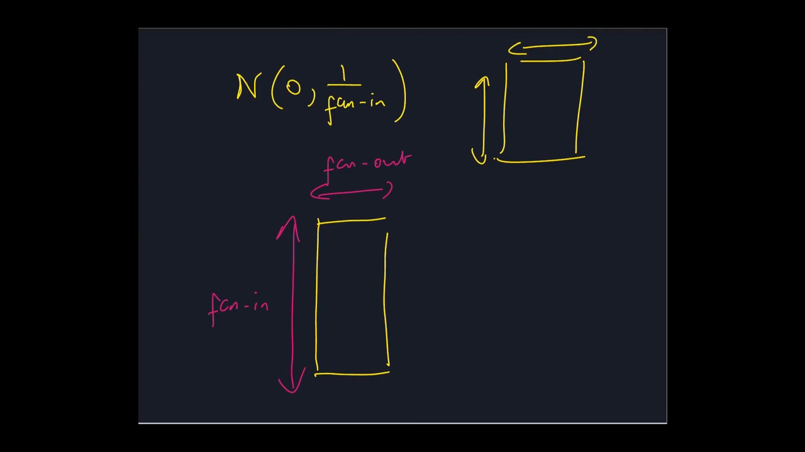
*▲ 강의 슬라이드 [74:30](https://youtu.be/-eC0-5mXHQg?t=4470): 초기화 $\mathcal{N}(0, 1/\text{fan-in})$과, fan-in이 fan-out보다 훨씬 큰 (세로로 긴) 행렬. 큰 [영공간](00_%EB%94%A5%EB%9F%AC%EB%8B%9D_%EC%9A%A9%EC%96%B4%EC%82%AC%EC%A0%84.md#null-space-%EC%98%81%EA%B3%B5%EA%B0%84)을 가진다*

> [!TIP]
> **🆕 2026 업데이트: 초기화와 업데이트를 [스펙트럼 노름](00_%EB%94%A5%EB%9F%AC%EB%8B%9D_%EC%9A%A9%EC%96%B4%EC%82%AC%EC%A0%84.md#spectral-norm-%EC%8A%A4%ED%8E%99%ED%8A%B8%EB%9F%BC-%EB%85%B8%EB%A6%84)으로 맞추기**
> - **강의**: [분산](00_%EB%94%A5%EB%9F%AC%EB%8B%9D_%EC%9A%A9%EC%96%B4%EC%82%AC%EC%A0%84.md#variance-%EB%B6%84%EC%82%B0) $1/\text{fan-in}$ 초기화는 초기에는 크기를 보존하지만, fan-in ≫ fan-out 행렬에서 입력이 [영공간](00_%EB%94%A5%EB%9F%AC%EB%8B%9D_%EC%9A%A9%EC%96%B4%EC%82%AC%EC%A0%84.md#null-space-%EC%98%81%EA%B3%B5%EA%B0%84) 밖으로 정렬되면 너무 커진다. μP와 관련이 있다는 데서 마쳤다.
> - **현재**: 강사가 공저한 논문은 이 문제를 선형대수만으로 정리한다. 각 [가중치](00_%EB%94%A5%EB%9F%AC%EB%8B%9D_%EC%9A%A9%EC%96%B4%EC%82%AC%EC%A0%84.md#weight-%EA%B0%80%EC%A4%91%EC%B9%98) 행렬과 그 업데이트의 **[스펙트럼 노름](00_%EB%94%A5%EB%9F%AC%EB%8B%9D_%EC%9A%A9%EC%96%B4%EC%82%AC%EC%A0%84.md#spectral-norm-%EC%8A%A4%ED%8E%99%ED%8A%B8%EB%9F%BC-%EB%85%B8%EB%A6%84)**(정렬된 입력을 몇 배 늘리는지)을 $\sqrt{\text{fan-out}/\text{fan-in}}$에 비례하게 맞추면, 모든 너비에서 은닉 표현이 의미 있게 학습되고 이것이 μP와 같다. 위 예처럼 원소 크기로 맞춘 규칙([분산](00_%EB%94%A5%EB%9F%AC%EB%8B%9D_%EC%9A%A9%EC%96%B4%EC%82%AC%EC%A0%84.md#variance-%EB%B6%84%EC%82%B0) $1/\text{fan-in}$)은 정렬된 방향을 놓친다. 강사는 2025년 9월 Thinking Machines 블로그에서 한발 더 나아가, [가중치](00_%EB%94%A5%EB%9F%AC%EB%8B%9D_%EC%9A%A9%EC%96%B4%EC%82%AC%EC%A0%84.md#weight-%EA%B0%80%EC%A4%91%EC%B9%98) 행렬을 모든 특잇값이 1인 행렬의 집합(슈티펠 다양체) 위에 묶어 두고 학습하는 "다양체 [Muon](00_%EB%94%A5%EB%9F%AC%EB%8B%9D_%EC%9A%A9%EC%96%B4%EC%82%AC%EC%A0%84.md#muon-%EB%AE%A4%EC%98%A8-%EC%98%B5%ED%8B%B0%EB%A7%88%EC%9D%B4%EC%A0%80)"을 제안했다.
> - **출처**: [Yang, Simon, Bernstein, A Spectral Condition for Feature Learning (arXiv, 2023/2024)](https://arxiv.org/abs/2310.17813) · [Bernstein, Modular Manifolds (Thinking Machines blog, 2025)](https://thinkingmachines.ai/blog/modular-manifolds/)

---

## 10. 정리

▶ 영상 [74:41](https://youtu.be/-eC0-5mXHQg?t=4481)

- 신경망 아키텍처는 [학습](00_%EB%94%A5%EB%9F%AC%EB%8B%9D_%EC%9A%A9%EC%96%B4%EC%82%AC%EC%A0%84.md#training-%ED%95%99%EC%8A%B5) 전부터 "무엇이 무엇과 비슷한가"에 대한 의견을 갖고 있고, 너비를 무한히 키우면 그 의견을 **[공분산 함수](00_%EB%94%A5%EB%9F%AC%EB%8B%9D_%EC%9A%A9%EC%96%B4%EC%82%AC%EC%A0%84.md#covariance-function-%EA%B3%B5%EB%B6%84%EC%82%B0-%ED%95%A8%EC%88%98)**로 꺼낼 수 있습니다.
- 함수 공간을 만드는 세 길([커널 방법](00_%EB%94%A5%EB%9F%AC%EB%8B%9D_%EC%9A%A9%EC%96%B4%EC%82%AC%EC%A0%84.md#kernel-method-%EC%BB%A4%EB%84%90-%EB%B0%A9%EB%B2%95), [가우스 과정](00_%EB%94%A5%EB%9F%AC%EB%8B%9D_%EC%9A%A9%EC%96%B4%EC%82%AC%EC%A0%84.md#gaussian-process-%EA%B0%80%EC%9A%B0%EC%8A%A4-%EA%B3%BC%EC%A0%95), 신경망)은 서로 이어집니다. [가우스 과정](00_%EB%94%A5%EB%9F%AC%EB%8B%9D_%EC%9A%A9%EC%96%B4%EC%82%AC%EC%A0%84.md#gaussian-process-%EA%B0%80%EC%9A%B0%EC%8A%A4-%EA%B3%BC%EC%A0%95)의 사후 평균은 최소 [노름](00_%EB%94%A5%EB%9F%AC%EB%8B%9D_%EC%9A%A9%EC%96%B4%EC%82%AC%EC%A0%84.md#norm-%EB%85%B8%EB%A6%84) 커널 [보간](00_%EB%94%A5%EB%9F%AC%EB%8B%9D_%EC%9A%A9%EC%96%B4%EC%82%AC%EC%A0%84.md#interpolation-%EB%B3%B4%EA%B0%84)이고, 무한히 넓은 무작위 신경망은 [가우스 과정](00_%EB%94%A5%EB%9F%AC%EB%8B%9D_%EC%9A%A9%EC%96%B4%EC%82%AC%EC%A0%84.md#gaussian-process-%EA%B0%80%EC%9A%B0%EC%8A%A4-%EA%B3%BC%EC%A0%95)입니다.
- [가우스 과정](00_%EB%94%A5%EB%9F%AC%EB%8B%9D_%EC%9A%A9%EC%96%B4%EC%82%AC%EC%A0%84.md#gaussian-process-%EA%B0%80%EC%9A%B0%EC%8A%A4-%EA%B3%BC%EC%A0%95)은 "아무 유한 개 입력에서의 값이 정규 벡터"인 무작위 함수이고, 예측은 정규 벡터의 조건부 분포로 닫힌 식이 나옵니다.
- [ReLU](00_%EB%94%A5%EB%9F%AC%EB%8B%9D_%EC%9A%A9%EC%96%B4%EC%82%AC%EC%A0%84.md#relu-%EB%A0%90%EB%A3%A8) MLP에서는 공분산이 [아크코사인 커널](00_%EB%94%A5%EB%9F%AC%EB%8B%9D_%EC%9A%A9%EC%96%B4%EC%82%AC%EC%A0%84.md#arc-cosine-kernel-%EC%95%84%ED%81%AC%EC%BD%94%EC%82%AC%EC%9D%B8-%EC%BB%A4%EB%84%90) $h$를 [층](00_%EB%94%A5%EB%9F%AC%EB%8B%9D_%EC%9A%A9%EC%96%B4%EC%82%AC%EC%A0%84.md#layer-%EC%B8%B5) 수만큼 합성한 것입니다.
- 하지만 이 대응은 실무 설계에 거의 쓰이지 않았습니다. [커널 방법](00_%EB%94%A5%EB%9F%AC%EB%8B%9D_%EC%9A%A9%EC%96%B4%EC%82%AC%EC%A0%84.md#kernel-method-%EC%BB%A4%EB%84%90-%EB%B0%A9%EB%B2%95)은 데이터 수의 세제곱으로 비싸고, 대응이 기대는 $1/\text{fan-in}$ 초기화는 [학습](00_%EB%94%A5%EB%9F%AC%EB%8B%9D_%EC%9A%A9%EC%96%B4%EC%82%AC%EC%A0%84.md#training-%ED%95%99%EC%8A%B5) 중 [영공간](00_%EB%94%A5%EB%9F%AC%EB%8B%9D_%EC%9A%A9%EC%96%B4%EC%82%AC%EC%A0%84.md#null-space-%EC%98%81%EA%B3%B5%EA%B0%84) 문제를 놓칩니다.

---

## 11. 용어 정리

용어사전에 있는 용어는 위 본문에 링크를 걸었습니다. 아래는 이번 강의에서 새로 나온 용어입니다.

| 용어 | 뜻 |
|---|---|
| [커널 방법](00_%EB%94%A5%EB%9F%AC%EB%8B%9D_%EC%9A%A9%EC%96%B4%EC%82%AC%EC%A0%84.md#kernel-method-%EC%BB%A4%EB%84%90-%EB%B0%A9%EB%B2%95)(Kernel method) | 데이터마다 혹 모양 커널 $k(x, x_i)$를 놓고 [가중합](00_%EB%94%A5%EB%9F%AC%EB%8B%9D_%EC%9A%A9%EC%96%B4%EC%82%AC%EC%A0%84.md#weighted-sum-%EA%B0%80%EC%A4%91%ED%95%A9) $\sum \alpha_i k(x, x_i)$으로 데이터를 맞추는 방법 |
| [재생 커널 힐베르트 공간](00_%EB%94%A5%EB%9F%AC%EB%8B%9D_%EC%9A%A9%EC%96%B4%EC%82%AC%EC%A0%84.md#reproducing-kernel-hilbert-space-rkhs-%EC%9E%AC%EC%83%9D-%EC%BB%A4%EB%84%90-%ED%9E%90%EB%B2%A0%EB%A5%B4%ED%8A%B8-%EA%B3%B5%EA%B0%84)(Reproducing kernel Hilbert space, [RKHS](00_%EB%94%A5%EB%9F%AC%EB%8B%9D_%EC%9A%A9%EC%96%B4%EC%82%AC%EC%A0%84.md#reproducing-kernel-hilbert-space-rkhs-%EC%9E%AC%EC%83%9D-%EC%BB%A4%EB%84%90-%ED%9E%90%EB%B2%A0%EB%A5%B4%ED%8A%B8-%EA%B3%B5%EA%B0%84)) | 커널 혹을 무한히 많이, 아무 위치에나 놓아 만든 함수들의 공간 |
| [제곱 지수 커널](00_%EB%94%A5%EB%9F%AC%EB%8B%9D_%EC%9A%A9%EC%96%B4%EC%82%AC%EC%A0%84.md#squared-exponential-kernel-%EC%A0%9C%EA%B3%B1-%EC%A7%80%EC%88%98-%EC%BB%A4%EB%84%90)(Squared exponential kernel) | $e^{-(x-x')^2/(2\sigma^2)}$. 거리가 멀수록 빠르게 0이 되는 가장 흔한 커널 (RBF 커널) |
| [가우스 과정](00_%EB%94%A5%EB%9F%AC%EB%8B%9D_%EC%9A%A9%EC%96%B4%EC%82%AC%EC%A0%84.md#gaussian-process-%EA%B0%80%EC%9A%B0%EC%8A%A4-%EA%B3%BC%EC%A0%95)(Gaussian process) | 아무 유한 개 입력에서의 값이 늘 다변량 정규분포인 무작위 함수 |
| [다변량 정규분포](00_%EB%94%A5%EB%9F%AC%EB%8B%9D_%EC%9A%A9%EC%96%B4%EC%82%AC%EC%A0%84.md#multivariate-normal-distribution-%EB%8B%A4%EB%B3%80%EB%9F%89-%EC%A0%95%EA%B7%9C%EB%B6%84%ED%8F%AC)(Multivariate normal distribution) | 평균 벡터와 [공분산 행렬](00_%EB%94%A5%EB%9F%AC%EB%8B%9D_%EC%9A%A9%EC%96%B4%EC%82%AC%EC%A0%84.md#covariance-matrix-%EA%B3%B5%EB%B6%84%EC%82%B0-%ED%96%89%EB%A0%AC)로 정해지는 여러 변수의 [정규분포](00_%EB%94%A5%EB%9F%AC%EB%8B%9D_%EC%9A%A9%EC%96%B4%EC%82%AC%EC%A0%84.md#normal-distribution-%EC%A0%95%EA%B7%9C%EB%B6%84%ED%8F%AC) $\mathcal{N}(\boldsymbol{\mu}, \Sigma)$ |
| [공분산 함수](00_%EB%94%A5%EB%9F%AC%EB%8B%9D_%EC%9A%A9%EC%96%B4%EC%82%AC%EC%A0%84.md#covariance-function-%EA%B3%B5%EB%B6%84%EC%82%B0-%ED%95%A8%EC%88%98)(Covariance function) | 두 입력에서의 함수 값이 얼마나 함께 움직이는지 $\Sigma(x, x')$. "가깝다"의 뜻을 정한다 |
| [사후 분포](00_%EB%94%A5%EB%9F%AC%EB%8B%9D_%EC%9A%A9%EC%96%B4%EC%82%AC%EC%A0%84.md#prior-posterior-%EC%82%AC%EC%A0%84-%EB%B6%84%ED%8F%AC%EC%99%80-%EC%82%AC%ED%9B%84-%EB%B6%84%ED%8F%AC)([Posterior](00_%EB%94%A5%EB%9F%AC%EB%8B%9D_%EC%9A%A9%EC%96%B4%EC%82%AC%EC%A0%84.md#prior-posterior-%EC%82%AC%EC%A0%84-%EB%B6%84%ED%8F%AC%EC%99%80-%EC%82%AC%ED%9B%84-%EB%B6%84%ED%8F%AC) distribution) | 데이터를 본 뒤 조건부로 얻은 분포. [가우스 과정](00_%EB%94%A5%EB%9F%AC%EB%8B%9D_%EC%9A%A9%EC%96%B4%EC%82%AC%EC%A0%84.md#gaussian-process-%EA%B0%80%EC%9A%B0%EC%8A%A4-%EA%B3%BC%EC%A0%95)에서는 데이터를 지나는 함수들의 분포 |
| [신경망-가우스 과정 대응](00_%EB%94%A5%EB%9F%AC%EB%8B%9D_%EC%9A%A9%EC%96%B4%EC%82%AC%EC%A0%84.md#nngp-correspondence-%EC%8B%A0%EA%B2%BD%EB%A7%9D-%EA%B0%80%EC%9A%B0%EC%8A%A4-%EA%B3%BC%EC%A0%95-%EB%8C%80%EC%9D%91)([NNGP correspondence](00_%EB%94%A5%EB%9F%AC%EB%8B%9D_%EC%9A%A9%EC%96%B4%EC%82%AC%EC%A0%84.md#nngp-correspondence-%EC%8B%A0%EA%B2%BD%EB%A7%9D-%EA%B0%80%EC%9A%B0%EC%8A%A4-%EA%B3%BC%EC%A0%95-%EB%8C%80%EC%9D%91)) | [가중치](00_%EB%94%A5%EB%9F%AC%EB%8B%9D_%EC%9A%A9%EC%96%B4%EC%82%AC%EC%A0%84.md#weight-%EA%B0%80%EC%A4%91%EC%B9%98)를 무작위로 뽑은 신경망은 너비 → ∞에서 [가우스 과정](00_%EB%94%A5%EB%9F%AC%EB%8B%9D_%EC%9A%A9%EC%96%B4%EC%82%AC%EC%A0%84.md#gaussian-process-%EA%B0%80%EC%9A%B0%EC%8A%A4-%EA%B3%BC%EC%A0%95)이 된다는 결과 |
| [중심극한정리](00_%EB%94%A5%EB%9F%AC%EB%8B%9D_%EC%9A%A9%EC%96%B4%EC%82%AC%EC%A0%84.md#central-limit-theorem-%EC%A4%91%EC%8B%AC%EA%B7%B9%ED%95%9C%EC%A0%95%EB%A6%AC)(Central limit theorem) | 독립인 많은 [확률 변수](00_%EB%94%A5%EB%9F%AC%EB%8B%9D_%EC%9A%A9%EC%96%B4%EC%82%AC%EC%A0%84.md#random-variable-%ED%99%95%EB%A5%A0-%EB%B3%80%EC%88%98)의 (정규화한) 합은 [정규분포](00_%EB%94%A5%EB%9F%AC%EB%8B%9D_%EC%9A%A9%EC%96%B4%EC%82%AC%EC%A0%84.md#normal-distribution-%EC%A0%95%EA%B7%9C%EB%B6%84%ED%8F%AC)에 가까워진다 |
| [아크코사인 커널](00_%EB%94%A5%EB%9F%AC%EB%8B%9D_%EC%9A%A9%EC%96%B4%EC%82%AC%EC%A0%84.md#arc-cosine-kernel-%EC%95%84%ED%81%AC%EC%BD%94%EC%82%AC%EC%9D%B8-%EC%BB%A4%EB%84%90)(Arc-cosine kernel) | 무한히 넓은 [ReLU](00_%EB%94%A5%EB%9F%AC%EB%8B%9D_%EC%9A%A9%EC%96%B4%EC%82%AC%EC%A0%84.md#relu-%EB%A0%90%EB%A3%A8) [층](00_%EB%94%A5%EB%9F%AC%EB%8B%9D_%EC%9A%A9%EC%96%B4%EC%82%AC%EC%A0%84.md#layer-%EC%B8%B5)이 입력 상관 $t$를 바꾸는 규칙 $h(t)$와 그 합성 |
| [신경 탄젠트 커널](00_%EB%94%A5%EB%9F%AC%EB%8B%9D_%EC%9A%A9%EC%96%B4%EC%82%AC%EC%A0%84.md#neural-tangent-kernel-ntk-%EC%8B%A0%EA%B2%BD-%ED%83%84%EC%A0%A0%ED%8A%B8-%EC%BB%A4%EB%84%90)(Neural tangent kernel, [NTK](00_%EB%94%A5%EB%9F%AC%EB%8B%9D_%EC%9A%A9%EC%96%B4%EC%82%AC%EC%A0%84.md#neural-tangent-kernel-ntk-%EC%8B%A0%EA%B2%BD-%ED%83%84%EC%A0%A0%ED%8A%B8-%EC%BB%A4%EB%84%90)) | 무한히 넓은 망의 경사하강 [학습](00_%EB%94%A5%EB%9F%AC%EB%8B%9D_%EC%9A%A9%EC%96%B4%EC%82%AC%EC%A0%84.md#training-%ED%95%99%EC%8A%B5)을 커널 [회귀](00_%EB%94%A5%EB%9F%AC%EB%8B%9D_%EC%9A%A9%EC%96%B4%EC%82%AC%EC%A0%84.md#regression-classification-%ED%9A%8C%EA%B7%80%EC%99%80-%EB%B6%84%EB%A5%98)로 설명하는 커널 |
| [가중치 초기화](00_%EB%94%A5%EB%9F%AC%EB%8B%9D_%EC%9A%A9%EC%96%B4%EC%82%AC%EC%A0%84.md#weight-initialization-%EA%B0%80%EC%A4%91%EC%B9%98-%EC%B4%88%EA%B8%B0%ED%99%94)(Weight initialization) | [학습](00_%EB%94%A5%EB%9F%AC%EB%8B%9D_%EC%9A%A9%EC%96%B4%EC%82%AC%EC%A0%84.md#training-%ED%95%99%EC%8A%B5) 전 [가중치](00_%EB%94%A5%EB%9F%AC%EB%8B%9D_%EC%9A%A9%EC%96%B4%EC%82%AC%EC%A0%84.md#weight-%EA%B0%80%EC%A4%91%EC%B9%98)를 뽑는 분포. [분산](00_%EB%94%A5%EB%9F%AC%EB%8B%9D_%EC%9A%A9%EC%96%B4%EC%82%AC%EC%A0%84.md#variance-%EB%B6%84%EC%82%B0) $1/\text{fan-in}$이면 초기 활성값 크기가 보존된다 |
| [팬인과 팬아웃](00_%EB%94%A5%EB%9F%AC%EB%8B%9D_%EC%9A%A9%EC%96%B4%EC%82%AC%EC%A0%84.md#fan-in-fan-out-%ED%8C%AC%EC%9D%B8%EA%B3%BC-%ED%8C%AC%EC%95%84%EC%9B%83)([Fan-in](00_%EB%94%A5%EB%9F%AC%EB%8B%9D_%EC%9A%A9%EC%96%B4%EC%82%AC%EC%A0%84.md#fan-in-fan-out-%ED%8C%AC%EC%9D%B8%EA%B3%BC-%ED%8C%AC%EC%95%84%EC%9B%83), [Fan-out](00_%EB%94%A5%EB%9F%AC%EB%8B%9D_%EC%9A%A9%EC%96%B4%EC%82%AC%EC%A0%84.md#fan-in-fan-out-%ED%8C%AC%EC%9D%B8%EA%B3%BC-%ED%8C%AC%EC%95%84%EC%9B%83)) | 한 [층](00_%EB%94%A5%EB%9F%AC%EB%8B%9D_%EC%9A%A9%EC%96%B4%EC%82%AC%EC%A0%84.md#layer-%EC%B8%B5)으로 들어오는 입력 수와 나가는 출력 수 |
| [영공간](00_%EB%94%A5%EB%9F%AC%EB%8B%9D_%EC%9A%A9%EC%96%B4%EC%82%AC%EC%A0%84.md#null-space-%EC%98%81%EA%B3%B5%EA%B0%84)([Null space](00_%EB%94%A5%EB%9F%AC%EB%8B%9D_%EC%9A%A9%EC%96%B4%EC%82%AC%EC%A0%84.md#null-space-%EC%98%81%EA%B3%B5%EA%B0%84)) | 행렬이 0으로 보내는 입력 벡터들의 집합 |
| [최대 업데이트 매개변수화](00_%EB%94%A5%EB%9F%AC%EB%8B%9D_%EC%9A%A9%EC%96%B4%EC%82%AC%EC%A0%84.md#maximal-update-parameterization-%CE%BCp-%EC%B5%9C%EB%8C%80-%EC%97%85%EB%8D%B0%EC%9D%B4%ED%8A%B8-%EB%A7%A4%EA%B0%9C%EB%B3%80%EC%88%98%ED%99%94)(Maximal update parameterization, μP) | 너비가 커져도 모든 [층](00_%EB%94%A5%EB%9F%AC%EB%8B%9D_%EC%9A%A9%EC%96%B4%EC%82%AC%EC%A0%84.md#layer-%EC%B8%B5)의 특징이 알맞은 크기로 학습되도록 초기화·[학습률](00_%EB%94%A5%EB%9F%AC%EB%8B%9D_%EC%9A%A9%EC%96%B4%EC%82%AC%EC%A0%84.md#learning-rate-%ED%95%99%EC%8A%B5%EB%A5%A0)을 너비에 맞춰 정하는 규칙 |
| [반직교 행렬](00_%EB%94%A5%EB%9F%AC%EB%8B%9D_%EC%9A%A9%EC%96%B4%EC%82%AC%EC%A0%84.md#semi-orthogonal-matrix-%EB%B0%98%EC%A7%81%EA%B5%90-%ED%96%89%EB%A0%AC)(Semi-orthogonal matrix) | 특잇값이 모두 1인 직사각 행렬 $UV^\top$ |
