# Lec 14. 생성 모델 기초 (Generative Models: Basics)

← 이전: [Lec13_표현_학습_이론](Lec13_%ED%91%9C%ED%98%84_%ED%95%99%EC%8A%B5_%EC%9D%B4%EB%A1%A0.md) · [목차](00_MIT%EB%94%A5%EB%9F%AC%EB%8B%9D_%EB%AA%A9%EC%B0%A8.md) · 다음: [Lec15_변분_오토인코더](Lec15_%EB%B3%80%EB%B6%84_%EC%98%A4%ED%86%A0%EC%9D%B8%EC%BD%94%EB%8D%94.md) →

> [!NOTE]
> **강의 정보**
> - **출처**: MIT OpenCourseWare, [Lec 14. Generative Models: Basics](https://www.youtube.com/watch?v=hJlrAHqGOS8) (81분, 2024년 가을 학기)
> - **강사**: Phillip Isola
> - **라이선스**: 원 강의는 CC BY-NC-SA 4.0입니다. 이 노트는 영어 자막을 바탕으로 한국어로 옮겨 정리한 2차 저작물이며, 같은 조건(비영리·출처 표기·동일 조건 공유)을 따릅니다.
> - 각 절 제목 아래의 `▶ 영상` 시간을 누르면 영상의 해당 위치로 갑니다.
> - `📐 수학 개념` 줄은 그 절에 쓰인 수학을 정리한 노트로 연결됩니다. 전체 목록은 [00_MIT딥러닝_목차](00_MIT%EB%94%A5%EB%9F%AC%EB%8B%9D_%EB%AA%A9%EC%B0%A8.md).
> - 슬라이드 캡처는 원 강의(CC BY-NC-SA 4.0)에서 가져왔고, "직접 그린 그림"은 이 노트의 숫자로 새로 그렸습니다.
> - `🆕 2026 업데이트` 칸은 강의(2024년 가을) 이후 바뀐 내용을 덧붙인 것입니다.

## 한눈에 보기

| 구분 | 내용 |
|---|---|
| 핵심 질문 | "데이터처럼 보이는 새 데이터"를 만드는 알고리즘을 어떻게 배우는가? |
| 관점 바꾸기 | 신경망을 "입력 → 답 하나"가 아니라 "입력 → **답들의 분포**"로 본다. [소프트맥스](00_%EB%94%A5%EB%9F%AC%EB%8B%9D_%EC%9A%A9%EC%96%B4%EC%82%AC%EC%A0%84.md#softmax-%EC%86%8C%ED%94%84%ED%8A%B8%EB%A7%A5%EC%8A%A4) [분류](00_%EB%94%A5%EB%9F%AC%EB%8B%9D_%EC%9A%A9%EC%96%B4%EC%82%AC%EC%A0%84.md#regression-classification-%ED%9A%8C%EA%B7%80%EC%99%80-%EB%B6%84%EB%A5%98)도 이미 그렇다 |
| [잠재 변수](00_%EB%94%A5%EB%9F%AC%EB%8B%9D_%EC%9A%A9%EC%96%B4%EC%82%AC%EC%A0%84.md#latent-variable-%EC%9E%A0%EC%9E%AC-%EB%B3%80%EC%88%98) | [생성기](00_%EB%94%A5%EB%9F%AC%EB%8B%9D_%EC%9A%A9%EC%96%B4%EC%82%AC%EC%A0%84.md#generator-discriminator-%EC%83%9D%EC%84%B1%EA%B8%B0%EC%99%80-%ED%8C%90%EB%B3%84%EA%B8%B0)에 넣는 무작위 값(주사위)은 쓸모없는 잡음이 아니라 색, 각도, 크기처럼 **명령이 정하지 않은 모든 것**을 정하는 조절 손잡이다 |
| 두 방식 | **직접 방식**: 잡음 → 데이터 함수 $G: \mathcal{Z} \to \mathcal{X}$를 배운다. **간접 방식**: [점수 함수](00_%EB%94%A5%EB%9F%AC%EB%8B%9D_%EC%9A%A9%EC%96%B4%EC%82%AC%EC%A0%84.md#scoring-function-%EC%A0%90%EC%88%98-%ED%95%A8%EC%88%98)(밀도 $p_\theta$ 또는 에너지 $E_\theta$)를 배우고 거기서 표본을 뽑는다 |
| [학습](00_%EB%94%A5%EB%9F%AC%EB%8B%9D_%EC%9A%A9%EC%96%B4%EC%82%AC%EC%A0%84.md#training-%ED%95%99%EC%8A%B5) 목표 | [KL 발산](00_%EB%94%A5%EB%9F%AC%EB%8B%9D_%EC%9A%A9%EC%96%B4%EC%82%AC%EC%A0%84.md#kl-divergence-kl-%EB%B0%9C%EC%82%B0) $D_{KL}(p_{\text{data}} \,\|\, p_\theta)$를 줄이기 = [학습 데이터](00_%EB%94%A5%EB%9F%AC%EB%8B%9D_%EC%9A%A9%EC%96%B4%EC%82%AC%EC%A0%84.md#training-data-test-data-%ED%95%99%EC%8A%B5-%EB%8D%B0%EC%9D%B4%ED%84%B0%EC%99%80-%EC%8B%9C%ED%97%98-%EB%8D%B0%EC%9D%B4%ED%84%B0)의 평균 [로그](00_%EB%94%A5%EB%9F%AC%EB%8B%9D_%EC%9A%A9%EC%96%B4%EC%82%AC%EC%A0%84.md#log-ln-%EB%A1%9C%EA%B7%B8) [우도](00_%EB%94%A5%EB%9F%AC%EB%8B%9D_%EC%9A%A9%EC%96%B4%EC%82%AC%EC%A0%84.md#likelihood-%EC%9A%B0%EB%8F%84)를 키우기 ([최대 우도](00_%EB%94%A5%EB%9F%AC%EB%8B%9D_%EC%9A%A9%EC%96%B4%EC%82%AC%EC%A0%84.md#maximum-likelihood-%EC%B5%9C%EB%8C%80-%EC%9A%B0%EB%8F%84)). [학습 데이터](00_%EB%94%A5%EB%9F%AC%EB%8B%9D_%EC%9A%A9%EC%96%B4%EC%82%AC%EC%A0%84.md#training-data-test-data-%ED%95%99%EC%8A%B5-%EB%8D%B0%EC%9D%B4%ED%84%B0%EC%99%80-%EC%8B%9C%ED%97%98-%EB%8D%B0%EC%9D%B4%ED%84%B0)만 외우면 [과적합](00_%EB%94%A5%EB%9F%AC%EB%8B%9D_%EC%9A%A9%EC%96%B4%EC%82%AC%EC%A0%84.md#overfitting-%EA%B3%BC%EC%A0%81%ED%95%A9)이므로 시험 [우도](00_%EB%94%A5%EB%9F%AC%EB%8B%9D_%EC%9A%A9%EC%96%B4%EC%82%AC%EC%A0%84.md#likelihood-%EC%9A%B0%EB%8F%84)로 평가한다 |
| 네 모델 | [에너지 기반 모델](00_%EB%94%A5%EB%9F%AC%EB%8B%9D_%EC%9A%A9%EC%96%B4%EC%82%AC%EC%A0%84.md#energy-based-model-%EC%97%90%EB%84%88%EC%A7%80-%EA%B8%B0%EB%B0%98-%EB%AA%A8%EB%8D%B8)([대조 발산](00_%EB%94%A5%EB%9F%AC%EB%8B%9D_%EC%9A%A9%EC%96%B4%EC%82%AC%EC%A0%84.md#contrastive-divergence-%EB%8C%80%EC%A1%B0-%EB%B0%9C%EC%82%B0)), [자기회귀 모델](00_%EB%94%A5%EB%9F%AC%EB%8B%9D_%EC%9A%A9%EC%96%B4%EC%82%AC%EC%A0%84.md#autoregressive-model-%EC%9E%90%EA%B8%B0%ED%9A%8C%EA%B7%80-%EB%AA%A8%EB%8D%B8)(다음 [토큰](00_%EB%94%A5%EB%9F%AC%EB%8B%9D_%EC%9A%A9%EC%96%B4%EC%82%AC%EC%A0%84.md#token-%ED%86%A0%ED%81%B0) [분류](00_%EB%94%A5%EB%9F%AC%EB%8B%9D_%EC%9A%A9%EC%96%B4%EC%82%AC%EC%A0%84.md#regression-classification-%ED%9A%8C%EA%B7%80%EC%99%80-%EB%B6%84%EB%A5%98)), [확산 모델](00_%EB%94%A5%EB%9F%AC%EB%8B%9D_%EC%9A%A9%EC%96%B4%EC%82%AC%EC%A0%84.md#diffusion-model-%ED%99%95%EC%82%B0-%EB%AA%A8%EB%8D%B8)(잡음 제거를 거꾸로), [GAN](00_%EB%94%A5%EB%9F%AC%EB%8B%9D_%EC%9A%A9%EC%96%B4%EC%82%AC%EC%A0%84.md#gan-generative-adversarial-network-%EC%83%9D%EC%84%B1%EC%A0%81-%EC%A0%81%EB%8C%80-%EC%8B%A0%EA%B2%BD%EB%A7%9D)([생성기](00_%EB%94%A5%EB%9F%AC%EB%8B%9D_%EC%9A%A9%EC%96%B4%EC%82%AC%EC%A0%84.md#generator-discriminator-%EC%83%9D%EC%84%B1%EA%B8%B0%EC%99%80-%ED%8C%90%EB%B3%84%EA%B8%B0)와 [판별기](00_%EB%94%A5%EB%9F%AC%EB%8B%9D_%EC%9A%A9%EC%96%B4%EC%82%AC%EC%A0%84.md#generator-discriminator-%EC%83%9D%EC%84%B1%EA%B8%B0%EC%99%80-%ED%8C%90%EB%B3%84%EA%B8%B0)의 게임) |
| 공통 전략 | 어려운 생성 문제를 **쉬운 [지도 학습](00_%EB%94%A5%EB%9F%AC%EB%8B%9D_%EC%9A%A9%EC%96%B4%EC%82%AC%EC%A0%84.md#supervised-learning-%EC%A7%80%EB%8F%84-%ED%95%99%EC%8A%B5) 문제의 연속**으로 바꾼다 (자기회귀: 한 칸씩, 확산: 잡음 한 단계씩) |
| 이전 강의 | Lec11~12 [표현 학습](00_%EB%94%A5%EB%9F%AC%EB%8B%9D_%EC%9A%A9%EC%96%B4%EC%82%AC%EC%A0%84.md#representation-learning-%ED%91%9C%ED%98%84-%ED%95%99%EC%8A%B5) (데이터 → 표현) |
| 다음 강의 | Lec15 [변분 오토인코더](00_%EB%94%A5%EB%9F%AC%EB%8B%9D_%EC%9A%A9%EC%96%B4%EC%82%AC%EC%A0%84.md#variational-autoencoder-vae-%EB%B3%80%EB%B6%84-%EC%98%A4%ED%86%A0%EC%9D%B8%EC%BD%94%EB%8D%94)(표현과 생성을 함께), Lec16 조건부 [생성 모델](00_%EB%94%A5%EB%9F%AC%EB%8B%9D_%EC%9A%A9%EC%96%B4%EC%82%AC%EC%A0%84.md#generative-model-%EC%83%9D%EC%84%B1-%EB%AA%A8%EB%8D%B8)과 응용 |

---

## 1. 생성 모델이란

▶ 영상 [00:00](https://youtu.be/hJlrAHqGOS8?t=0)

강사는 오늘부터 세 번에 걸쳐 [생성 모델](00_%EB%94%A5%EB%9F%AC%EB%8B%9D_%EC%9A%A9%EC%96%B4%EC%82%AC%EC%A0%84.md#generative-model-%EC%83%9D%EC%84%B1-%EB%AA%A8%EB%8D%B8)(Generative model)을 다룬다고 소개합니다. 요즘 이름은 "생성 AI"입니다. 지난 세 강의의 [표현 학습](00_%EB%94%A5%EB%9F%AC%EB%8B%9D_%EC%9A%A9%EC%96%B4%EC%82%AC%EC%A0%84.md#representation-learning-%ED%91%9C%ED%98%84-%ED%95%99%EC%8A%B5)이 **데이터 → 저차원 표현** 방향이었다면, [생성 모델](00_%EB%94%A5%EB%9F%AC%EB%8B%9D_%EC%9A%A9%EC%96%B4%EC%82%AC%EC%A0%84.md#generative-model-%EC%83%9D%EC%84%B1-%EB%AA%A8%EB%8D%B8)은 그 **반대 방향(단순한 표현 → 데이터)**입니다. 강사는 둘이 사실상 같은 주제라고 보고, 다음 강의에서는 두 방향을 함께 하는 모델([변분 오토인코더](00_%EB%94%A5%EB%9F%AC%EB%8B%9D_%EC%9A%A9%EC%96%B4%EC%82%AC%EC%A0%84.md#variational-autoencoder-vae-%EB%B3%80%EB%B6%84-%EC%98%A4%ED%86%A0%EC%9D%B8%EC%BD%94%EB%8D%94))을 봅니다.

- 오늘의 순서: [확률](00_%EB%94%A5%EB%9F%AC%EB%8B%9D_%EC%9A%A9%EC%96%B4%EC%82%AC%EC%A0%84.md#probability-%ED%99%95%EB%A5%A0) 배경 → [생성 모델](00_%EB%94%A5%EB%9F%AC%EB%8B%9D_%EC%9A%A9%EC%96%B4%EC%82%AC%EC%A0%84.md#generative-model-%EC%83%9D%EC%84%B1-%EB%AA%A8%EB%8D%B8)의 정의 → 밀도 함수, 에너지 함수, 샘플러 → 대표 모델 셋(자기회귀, 확산, [GAN](00_%EB%94%A5%EB%9F%AC%EB%8B%9D_%EC%9A%A9%EC%96%B4%EC%82%AC%EC%A0%84.md#gan-generative-adversarial-network-%EC%83%9D%EC%84%B1%EC%A0%81-%EC%A0%81%EB%8C%80-%EC%8B%A0%EA%B2%BD%EB%A7%9D)). 다음 주에 [VAE](00_%EB%94%A5%EB%9F%AC%EB%8B%9D_%EC%9A%A9%EC%96%B4%EC%82%AC%EC%A0%84.md#variational-autoencoder-vae-%EB%B3%80%EB%B6%84-%EC%98%A4%ED%86%A0%EC%9D%B8%EC%BD%94%EB%8D%94), 조건부 모델, Lec16에서 응용을 다룹니다.
- 모든 [생성 모델](00_%EB%94%A5%EB%9F%AC%EB%8B%9D_%EC%9A%A9%EC%96%B4%EC%82%AC%EC%A0%84.md#generative-model-%EC%83%9D%EC%84%B1-%EB%AA%A8%EB%8D%B8)은 같은 원리를 씁니다. [확산 모델](00_%EB%94%A5%EB%9F%AC%EB%8B%9D_%EC%9A%A9%EC%96%B4%EC%82%AC%EC%A0%84.md#diffusion-model-%ED%99%95%EC%82%B0-%EB%AA%A8%EB%8D%B8)은 [VAE](00_%EB%94%A5%EB%9F%AC%EB%8B%9D_%EC%9A%A9%EC%96%B4%EC%82%AC%EC%A0%84.md#variational-autoencoder-vae-%EB%B3%80%EB%B6%84-%EC%98%A4%ED%86%A0%EC%9D%B8%EC%BD%94%EB%8D%94)의 한 종류로, [자기회귀 모델](00_%EB%94%A5%EB%9F%AC%EB%8B%9D_%EC%9A%A9%EC%96%B4%EC%82%AC%EC%A0%84.md#autoregressive-model-%EC%9E%90%EA%B8%B0%ED%9A%8C%EA%B7%80-%EB%AA%A8%EB%8D%B8)은 [확산 모델](00_%EB%94%A5%EB%9F%AC%EB%8B%9D_%EC%9A%A9%EC%96%B4%EC%82%AC%EC%A0%84.md#diffusion-model-%ED%99%95%EC%82%B0-%EB%AA%A8%EB%8D%B8)의 작은 변형으로 볼 수 있을 만큼 서로 이어져 있습니다.

[생성 모델](00_%EB%94%A5%EB%9F%AC%EB%8B%9D_%EC%9A%A9%EC%96%B4%EC%82%AC%EC%A0%84.md#generative-model-%EC%83%9D%EC%84%B1-%EB%AA%A8%EB%8D%B8)의 정의는 두 가지가 있습니다.

1. **데이터를 만들어 내는 알고리즘.** 강사가 중심에 두는 정의입니다. 이미지, 단백질, 글처럼 "데이터"라 부르는 것을 만들어 냅니다.
2. **데이터의 [결합 분포](00_%EB%94%A5%EB%9F%AC%EB%8B%9D_%EC%9A%A9%EC%96%B4%EC%82%AC%EC%A0%84.md#joint-distribution-%EA%B2%B0%ED%95%A9-%EB%B6%84%ED%8F%AC)** $p(x, y, \dots)$**를 나타내는 통계 모델.** 통계학 수업의 더 오래된 정의입니다.

둘은 깊이 이어져 있습니다. 대부분은 분포를 명시적으로든 암묵적으로든 모델링해서 데이터를 만듭니다. 지금까지 본 AI가 데이터를 **분석·[분류](00_%EB%94%A5%EB%9F%AC%EB%8B%9D_%EC%9A%A9%EC%96%B4%EC%82%AC%EC%A0%84.md#regression-classification-%ED%9A%8C%EA%B7%80%EC%99%80-%EB%B6%84%EB%A5%98)·결정**하는 쪽이었다면, [생성 모델](00_%EB%94%A5%EB%9F%AC%EB%8B%9D_%EC%9A%A9%EC%96%B4%EC%82%AC%EC%A0%84.md#generative-model-%EC%83%9D%EC%84%B1-%EB%AA%A8%EB%8D%B8)은 무언가로부터 **데이터를 만드는** 쪽입니다.

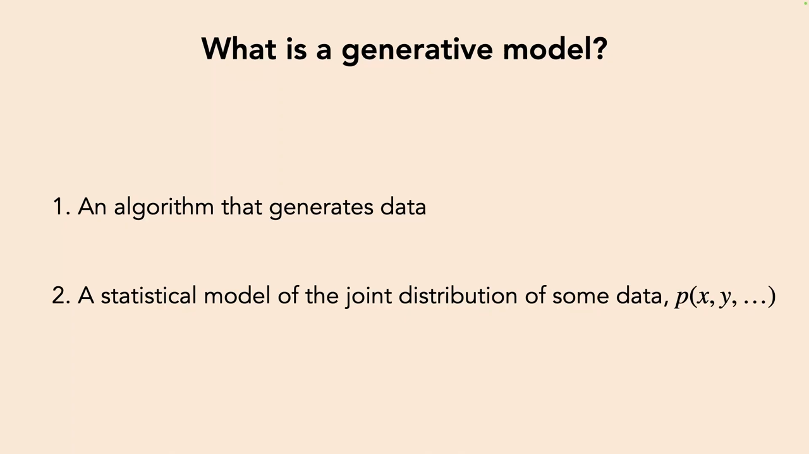
*▲ 강의 슬라이드 [03:55](https://youtu.be/hJlrAHqGOS8?t=235): [생성 모델](00_%EB%94%A5%EB%9F%AC%EB%8B%9D_%EC%9A%A9%EC%96%B4%EC%82%AC%EC%A0%84.md#generative-model-%EC%83%9D%EC%84%B1-%EB%AA%A8%EB%8D%B8)의 두 정의. (1) 데이터를 만드는 알고리즘, (2) 데이터의 [결합 분포](00_%EB%94%A5%EB%9F%AC%EB%8B%9D_%EC%9A%A9%EC%96%B4%EC%82%AC%EC%A0%84.md#joint-distribution-%EA%B2%B0%ED%95%A9-%EB%B6%84%ED%8F%AC) $p(x, y, \dots)$의 통계 모델*

[생성 모델](00_%EB%94%A5%EB%9F%AC%EB%8B%9D_%EC%9A%A9%EC%96%B4%EC%82%AC%EC%A0%84.md#generative-model-%EC%83%9D%EC%84%B1-%EB%AA%A8%EB%8D%B8)은 오락용만이 아닙니다. 강사는 단백질의 결합 부위 구조를 만드는 [확산 모델](00_%EB%94%A5%EB%9F%AC%EB%8B%9D_%EC%9A%A9%EC%96%B4%EC%82%AC%EC%A0%84.md#diffusion-model-%ED%99%95%EC%82%B0-%EB%AA%A8%EB%8D%B8), MRI 영상을 넣으면 "같은 환자를 CT로 찍었다면 어떻게 보였을지"를 만드는 영상-영상 모델을 예로 듭니다.

> [!TIP]
> **🆕 2026 업데이트: 과학 데이터를 만드는 [확산 모델](00_%EB%94%A5%EB%9F%AC%EB%8B%9D_%EC%9A%A9%EC%96%B4%EC%82%AC%EC%A0%84.md#diffusion-model-%ED%99%95%EC%82%B0-%EB%AA%A8%EB%8D%B8)**
> - **강의**: [확산 모델](00_%EB%94%A5%EB%9F%AC%EB%8B%9D_%EC%9A%A9%EC%96%B4%EC%82%AC%EC%A0%84.md#diffusion-model-%ED%99%95%EC%82%B0-%EB%AA%A8%EB%8D%B8)이 단백질의 기하 구조를 만드는 예를 보이며, [생성 모델](00_%EB%94%A5%EB%9F%AC%EB%8B%9D_%EC%9A%A9%EC%96%B4%EC%82%AC%EC%A0%84.md#generative-model-%EC%83%9D%EC%84%B1-%EB%AA%A8%EB%8D%B8)이 과학·공학 데이터에도 쓰인다고 했다.
> - **현재**: 2024년 5월 공개된 AlphaFold 3는 구조 예측 부분을 **확산 기반 아키텍처**로 바꿔, 단백질뿐 아니라 핵산, 작은 분자, 이온이 섞인 복합체의 3차원 구조를 한 모델로 예측한다. 단백질-리간드 결합 예측에서 기존 도킹 도구보다 훨씬 정확했다. 같은 해 노벨 화학상은 단백질 구조 예측(Hassabis, Jumper)과 계산 단백질 설계(Baker)에 돌아갔다.
> - **출처**: [Abramson et al., Accurate structure prediction of biomolecular interactions with AlphaFold 3 (Nature 2024)](https://www.nature.com/articles/s41586-024-07487-w) · [The Nobel Prize in Chemistry 2024 (NobelPrize.org, 2024)](https://www.nobelprize.org/prizes/chemistry/2024/summary/)

---

## 2. 확률 배경

▶ 영상 [06:44](https://youtu.be/hJlrAHqGOS8?t=404)

강사는 [생성 모델](00_%EB%94%A5%EB%9F%AC%EB%8B%9D_%EC%9A%A9%EC%96%B4%EC%82%AC%EC%A0%84.md#generative-model-%EC%83%9D%EC%84%B1-%EB%AA%A8%EB%8D%B8)이 지금까지와 다른 수학, 즉 **[확률](00_%EB%94%A5%EB%9F%AC%EB%8B%9D_%EC%9A%A9%EC%96%B4%EC%82%AC%EC%A0%84.md#probability-%ED%99%95%EB%A5%A0)**을 쓴다고 말합니다. [확률](00_%EB%94%A5%EB%9F%AC%EB%8B%9D_%EC%9A%A9%EC%96%B4%EC%82%AC%EC%A0%84.md#probability-%ED%99%95%EB%A5%A0)·통계 수업에서 배운 내용이니 낯설면 복습하라고 합니다.

### 2.1 신경망 출력을 분포로 보기

▶ 영상 [07:17](https://youtu.be/hJlrAHqGOS8?t=437)

📐 **수학 개념**: [L2 회귀와 범주 분포](%EC%88%98%ED%95%99%EA%B0%9C%EB%85%90/04_%ED%99%95%EB%A5%A0%EA%B3%BC_%EC%A0%95%EB%B3%B4/MM35_L2_%ED%9A%8C%EA%B7%80%EC%99%80_%EB%B2%94%EC%A3%BC_%EB%B6%84%ED%8F%AC.md) · [확률 기초](%EC%88%98%ED%95%99%EA%B0%9C%EB%85%90/04_%ED%99%95%EB%A5%A0%EA%B3%BC_%EC%A0%95%EB%B3%B4/M08_%ED%99%95%EB%A5%A0_%EA%B8%B0%EC%B4%88.md) · [확률 밀도와 정규분포](%EC%88%98%ED%95%99%EA%B0%9C%EB%85%90/04_%ED%99%95%EB%A5%A0%EA%B3%BC_%EC%A0%95%EB%B3%B4/MM50_%ED%99%95%EB%A5%A0_%EB%B0%80%EB%8F%84%EC%99%80_%EC%A0%95%EA%B7%9C%EB%B6%84%ED%8F%AC.md)

지금까지 신경망은 **함수**였습니다. 입력 하나에 출력 하나(다대일 또는 일대일)입니다. 예를 들어 이미지 [분류](00_%EB%94%A5%EB%9F%AC%EB%8B%9D_%EC%9A%A9%EC%96%B4%EC%82%AC%EC%A0%84.md#regression-classification-%ED%9A%8C%EA%B7%80%EC%99%80-%EB%B6%84%EB%A5%98)기는 $N \times M \times C$ [텐서](00_%EB%94%A5%EB%9F%AC%EB%8B%9D_%EC%9A%A9%EC%96%B4%EC%82%AC%EC%A0%84.md#tensor-%ED%85%90%EC%84%9C)를 받아 1부터 $d$까지의 클래스 번호 하나를 냅니다. 그런데 [생성 모델](00_%EB%94%A5%EB%9F%AC%EB%8B%9D_%EC%9A%A9%EC%96%B4%EC%82%AC%EC%A0%84.md#generative-model-%EC%83%9D%EC%84%B1-%EB%AA%A8%EB%8D%B8)은 가능한 결과의 **분포 전체**를 만들어야 하므로 일대다가 필요합니다. 그래서 관점을 바꿉니다.

$$
f_\theta: \mathcal{X} \to \mathcal{P}(\mathcal{Y}), \qquad \text{예: 소프트맥스 회귀 } f_\theta: \mathbb{R}^{N \times M \times C} \to \Delta^{d-1}
$$

기호 풀이

| 기호 | 읽는 법 | 뜻 | 예제 값 |
| --- | --- | --- | --- |
| $f_\theta$ | 에프 세타 | 매개변수 $\theta$인 신경망 | |
| $\mathcal{X}$ | 스크립트 엑스 | 입력이 사는 공간 | 이미지 |
| $\mathcal{Y}$ | 스크립트 와이 | 출력(답)이 사는 공간 | 클래스 3개 |
| $\mathcal{P}(\mathcal{Y})$ | 스크립트 피 | $\mathcal{Y}$ 위의 모든 [확률](00_%EB%94%A5%EB%9F%AC%EB%8B%9D_%EC%9A%A9%EC%96%B4%EC%82%AC%EC%A0%84.md#probability-%ED%99%95%EB%A5%A0) 분포의 공간 | |
| $\mathbb{R}^{N \times M \times C}$ | 알 엔 엠 씨 | 세로 $N$, 가로 $M$, [채널](00_%EB%94%A5%EB%9F%AC%EB%8B%9D_%EC%9A%A9%EC%96%B4%EC%82%AC%EC%A0%84.md#channel-%EC%B1%84%EB%84%90) $C$인 이미지 [텐서](00_%EB%94%A5%EB%9F%AC%EB%8B%9D_%EC%9A%A9%EC%96%B4%EC%82%AC%EC%A0%84.md#tensor-%ED%85%90%EC%84%9C) | |
| $\Delta^{d-1}$ | [심플렉스](00_%EB%94%A5%EB%9F%AC%EB%8B%9D_%EC%9A%A9%EC%96%B4%EC%82%AC%EC%A0%84.md#simplex-%EC%8B%AC%ED%94%8C%EB%A0%89%EC%8A%A4) | $d$개 클래스의 [범주 분포](00_%EB%94%A5%EB%9F%AC%EB%8B%9D_%EC%9A%A9%EC%96%B4%EC%82%AC%EC%A0%84.md#categorical-distribution-%EB%B2%94%EC%A3%BC-%EB%B6%84%ED%8F%AC) 전체 (합이 1인 $d$칸 벡터) | (0.6652, 0.2447, 0.09) |

예제와 풀이

**문제**: 분류기가 고양이, 개, 새 세 클래스에 [로짓](00_%EB%94%A5%EB%9F%AC%EB%8B%9D_%EC%9A%A9%EC%96%B4%EC%82%AC%EC%A0%84.md#logit-%EB%A1%9C%EC%A7%93) (2, 1, 0)을 냈다. [소프트맥스](00_%EB%94%A5%EB%9F%AC%EB%8B%9D_%EC%9A%A9%EC%96%B4%EC%82%AC%EC%A0%84.md#softmax-%EC%86%8C%ED%94%84%ED%8A%B8%EB%A7%A5%EC%8A%A4)를 거친 출력은 $\Delta^{2}$ 위의 어떤 분포인가?

**주어진 값**
- $z = (2, 1, 0)$ (세 클래스의 [로짓](00_%EB%94%A5%EB%9F%AC%EB%8B%9D_%EC%9A%A9%EC%96%B4%EC%82%AC%EC%A0%84.md#logit-%EB%A1%9C%EC%A7%93))
- [소프트맥스](00_%EB%94%A5%EB%9F%AC%EB%8B%9D_%EC%9A%A9%EC%96%B4%EC%82%AC%EC%A0%84.md#softmax-%EC%86%8C%ED%94%84%ED%8A%B8%EB%A7%A5%EC%8A%A4): $p_k = e^{z_k} / \sum_j e^{z_j}$

**풀이**
1. 식을 그대로 쓴다: $p_k = \dfrac{e^{z_k}}{\sum_j e^{z_j}}$
2. 값을 대입한다: $p = \left(\dfrac{e^{2}}{e^{2} + e^{1} + e^{0}},\ \dfrac{e^{1}}{e^{2} + e^{1} + e^{0}},\ \dfrac{e^{0}}{e^{2} + e^{1} + e^{0}}\right)$
3. [지수](00_%EB%94%A5%EB%9F%AC%EB%8B%9D_%EC%9A%A9%EC%96%B4%EC%82%AC%EC%A0%84.md#e-exponent-e%EC%99%80-%EC%A7%80%EC%88%98)를 계산한다. $e$는 약 2.718이고 $e^a$는 그 $a$제곱이다: $e^2 = 7.3891$, $e^1 = 2.7183$, $e^0 = 1$
4. 분모를 더한다: $7.3891 + 2.7183 + 1 = 11.1073$
5. 첫 칸을 나눈다: $7.3891 / 11.1073 = 0.6652$
6. 둘째 칸을 나눈다: $2.7183 / 11.1073 = 0.2447$
7. 셋째 칸을 나눈다: $1 / 11.1073 = 0.09$

**답**: **(0.6652, 0.2447, 0.09)**. 세 칸이 모두 0 이상이고 합이 1이므로 $\Delta^2$(삼각형) 위의 한 점, 곧 하나의 분포다.

내 이해

- **[분류](00_%EB%94%A5%EB%9F%AC%EB%8B%9D_%EC%9A%A9%EC%96%B4%EC%82%AC%EC%A0%84.md#regression-classification-%ED%9A%8C%EA%B7%80%EC%99%80-%EB%B6%84%EB%A5%98)**: [소프트맥스](00_%EB%94%A5%EB%9F%AC%EB%8B%9D_%EC%9A%A9%EC%96%B4%EC%82%AC%EC%A0%84.md#softmax-%EC%86%8C%ED%94%84%ED%8A%B8%EB%A7%A5%EC%8A%A4) [회귀](00_%EB%94%A5%EB%9F%AC%EB%8B%9D_%EC%9A%A9%EC%96%B4%EC%82%AC%EC%A0%84.md#regression-classification-%ED%9A%8C%EA%B7%80%EC%99%80-%EB%B6%84%EB%A5%98)는 이미지를 받아 $d$개 클래스의 [확률](00_%EB%94%A5%EB%9F%AC%EB%8B%9D_%EC%9A%A9%EC%96%B4%EC%82%AC%EC%A0%84.md#probability-%ED%99%95%EB%A5%A0) 벡터를 냅니다. 출력이 사는 곳은 $d-1$차원 [심플렉스](00_%EB%94%A5%EB%9F%AC%EB%8B%9D_%EC%9A%A9%EC%96%B4%EC%82%AC%EC%A0%84.md#simplex-%EC%8B%AC%ED%94%8C%EB%A0%89%EC%8A%A4)입니다. [이진 분류](00_%EB%94%A5%EB%9F%AC%EB%8B%9D_%EC%9A%A9%EC%96%B4%EC%82%AC%EC%A0%84.md#binary-classification-%EC%9D%B4%EC%A7%84-%EB%B6%84%EB%A5%98)면 선분 하나입니다. 우리가 모델링하는 것은 $P(\text{class} \mid X = x)$입니다.
- **[회귀](00_%EB%94%A5%EB%9F%AC%EB%8B%9D_%EC%9A%A9%EC%96%B4%EC%82%AC%EC%A0%84.md#regression-classification-%ED%9A%8C%EA%B7%80%EC%99%80-%EB%B6%84%EB%A5%98)**: 제곱 [오차](00_%EB%94%A5%EB%9F%AC%EB%8B%9D_%EC%9A%A9%EC%96%B4%EC%82%AC%EC%A0%84.md#error-%EC%98%A4%EC%B0%A8)로 하는 [회귀](00_%EB%94%A5%EB%9F%AC%EB%8B%9D_%EC%9A%A9%EC%96%B4%EC%82%AC%EC%A0%84.md#regression-classification-%ED%9A%8C%EA%B7%80%EC%99%80-%EB%B6%84%EB%A5%98)는 "평균이 예측값인 [정규분포](00_%EB%94%A5%EB%9F%AC%EB%8B%9D_%EC%9A%A9%EC%96%B4%EC%82%AC%EC%A0%84.md#normal-distribution-%EC%A0%95%EA%B7%9C%EB%B6%84%ED%8F%AC)를 낸다"로 다시 쓸 수 있습니다.
- **핵심 관점**: 신경망의 출력은 명시적이든 암묵적이든 **분포**입니다.

해커 가이드 강의(Lec09)에서 "더 많은 정보를 조건으로 넣으면 출력의 불확실성이 줄어든다"고 했습니다. 하지만 입력에 정보를 더 넣을 수 없다면, 고양이 50%·개 50% 같은 **복잡한 출력 분포**를 어떻게 모델링할까요? 이것이 [생성 모델](00_%EB%94%A5%EB%9F%AC%EB%8B%9D_%EC%9A%A9%EC%96%B4%EC%82%AC%EC%A0%84.md#generative-model-%EC%83%9D%EC%84%B1-%EB%AA%A8%EB%8D%B8)이 푸는 문제입니다.

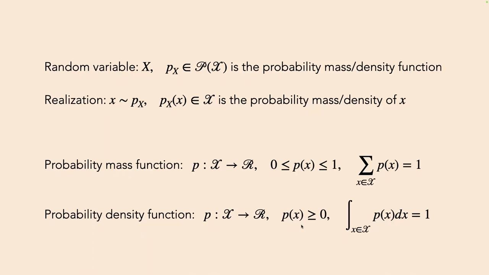
*▲ 강의 슬라이드 [14:00](https://youtu.be/hJlrAHqGOS8?t=840): [확률](00_%EB%94%A5%EB%9F%AC%EB%8B%9D_%EC%9A%A9%EC%96%B4%EC%82%AC%EC%A0%84.md#probability-%ED%99%95%EB%A5%A0) 표기. [확률 변수](00_%EB%94%A5%EB%9F%AC%EB%8B%9D_%EC%9A%A9%EC%96%B4%EC%82%AC%EC%A0%84.md#random-variable-%ED%99%95%EB%A5%A0-%EB%B3%80%EC%88%98) $X$와 분포 $p_X$, 실현값 $x$, 질량 함수와 밀도 함수의 조건*

### 2.2 확률 변수와 질량·밀도 함수

▶ 영상 [11:42](https://youtu.be/hJlrAHqGOS8?t=702)

📐 **수학 개념**: [확률 밀도와 정규분포](%EC%88%98%ED%95%99%EA%B0%9C%EB%85%90/04_%ED%99%95%EB%A5%A0%EA%B3%BC_%EC%A0%95%EB%B3%B4/MM50_%ED%99%95%EB%A5%A0_%EB%B0%80%EB%8F%84%EC%99%80_%EC%A0%95%EA%B7%9C%EB%B6%84%ED%8F%AC.md) · [확률 기초](%EC%88%98%ED%95%99%EA%B0%9C%EB%85%90/04_%ED%99%95%EB%A5%A0%EA%B3%BC_%EC%A0%95%EB%B3%B4/M08_%ED%99%95%EB%A5%A0_%EA%B8%B0%EC%B4%88.md)

- **[확률 변수](00_%EB%94%A5%EB%9F%AC%EB%8B%9D_%EC%9A%A9%EC%96%B4%EC%82%AC%EC%A0%84.md#random-variable-%ED%99%95%EB%A5%A0-%EB%B3%80%EC%88%98)**(random variable)는 분포로 특징지어집니다. 이산이면 **[확률 질량 함수](00_%EB%94%A5%EB%9F%AC%EB%8B%9D_%EC%9A%A9%EC%96%B4%EC%82%AC%EC%A0%84.md#probability-mass-function-%ED%99%95%EB%A5%A0-%EC%A7%88%EB%9F%89-%ED%95%A8%EC%88%98)**(PMF), 연속이면 **[확률 밀도 함수](00_%EB%94%A5%EB%9F%AC%EB%8B%9D_%EC%9A%A9%EC%96%B4%EC%82%AC%EC%A0%84.md#probability-density-function-%ED%99%95%EB%A5%A0-%EB%B0%80%EB%8F%84-%ED%95%A8%EC%88%98)**(PDF)라 부릅니다.
- 이 수업에서 **대문자**($X$)는 [확률 변수](00_%EB%94%A5%EB%9F%AC%EB%8B%9D_%EC%9A%A9%EC%96%B4%EC%82%AC%EC%A0%84.md#random-variable-%ED%99%95%EB%A5%A0-%EB%B3%80%EC%88%98)(분포), **소문자**($x$)는 실현값(분포에서 뽑은 값 하나)입니다. $p(X)$는 분포 전체, $p(x)$는 "$X$가 $x$일 [확률](00_%EB%94%A5%EB%9F%AC%EB%8B%9D_%EC%9A%A9%EC%96%B4%EC%82%AC%EC%A0%84.md#probability-%ED%99%95%EB%A5%A0)(또는 밀도)" 스칼라 하나를 줄여 쓴 것입니다.
- 질량 함수는 데이터를 0~1 사이 스칼라로 보내고, 모든 경우의 합이 1입니다. 그래서 신경망 활성값을 [시그모이드](00_%EB%94%A5%EB%9F%AC%EB%8B%9D_%EC%9A%A9%EC%96%B4%EC%82%AC%EC%A0%84.md#sigmoid-%EC%8B%9C%EA%B7%B8%EB%AA%A8%EC%9D%B4%EB%93%9C)로 0~1에 넣고 합이 1이 되게 나누면, 그 벡터는 수학적으로 질량 함수입니다.
- 밀도 함수는 연속 공간에서 **적분이 1**이고, 값은 음수만 아니면 됩니다(1을 넘어 무한대로 갈 수도 있습니다).

$$
\text{PMF: } p: \mathcal{X} \to \mathbb{R},\ \ 0 \le p(x) \le 1,\ \ \sum_{x \in \mathcal{X}} p(x) = 1 \qquad\qquad \text{PDF: } p: \mathcal{X} \to \mathbb{R},\ \ p(x) \ge 0,\ \ \int_{x \in \mathcal{X}} p(x)\, dx = 1
$$

기호 풀이

| 기호 | 읽는 법 | 뜻 | 예제 값 |
| --- | --- | --- | --- |
| $\mathcal{X}$ | 스크립트 엑스 | [확률 변수](00_%EB%94%A5%EB%9F%AC%EB%8B%9D_%EC%9A%A9%EC%96%B4%EC%82%AC%EC%A0%84.md#random-variable-%ED%99%95%EB%A5%A0-%EB%B3%80%EC%88%98)가 가질 수 있는 값 전체 | [0, 4] |
| $p(x)$ | 피 오브 엑스 | 값 $x$의 [확률](00_%EB%94%A5%EB%9F%AC%EB%8B%9D_%EC%9A%A9%EC%96%B4%EC%82%AC%EC%A0%84.md#probability-%ED%99%95%EB%A5%A0)(PMF) 또는 밀도(PDF) | 0.25 |
| $\sum_{x \in \mathcal{X}}$ | 시그마 | 가능한 모든 값에 대해 더한다 | |
| $\int \cdots dx$ | 적분 | 곡선 아래 넓이 | 1 |

예제와 풀이

**문제**: 0과 4 사이에서 고르게 나오는 값의 밀도가 0.25다. 넓이가 1인지 확인하고, 1~2 사이에 들어갈 [확률](00_%EB%94%A5%EB%9F%AC%EB%8B%9D_%EC%9A%A9%EC%96%B4%EC%82%AC%EC%A0%84.md#probability-%ED%99%95%EB%A5%A0)을 구하라.

**주어진 값**
- $p(x) = 0.25$ (0 ≤ x ≤ 4에서의 밀도)
- 구간 [0, 4] (값의 범위), 구간 [1, 2] ([확률](00_%EB%94%A5%EB%9F%AC%EB%8B%9D_%EC%9A%A9%EC%96%B4%EC%82%AC%EC%A0%84.md#probability-%ED%99%95%EB%A5%A0)을 묻는 범위)

**풀이**
1. 식을 그대로 쓴다: $\int_{x \in \mathcal{X}} p(x)\, dx = 1$
2. 값을 대입한다: $\int_0^4 0.25\, dx = 1$ ?
3. 높이가 일정하면 넓이는 높이 × 폭이다. 폭을 구한다: $4 - 0 = 4$
4. 곱한다: $0.25 \times 4 = 1$ → 조건을 만족한다
5. 1~2 구간의 폭: $2 - 1 = 1$
6. 곱한다: $0.25 \times 1 = 0.25$

**답**: 넓이 **1**, 1~2에 들어갈 [확률](00_%EB%94%A5%EB%9F%AC%EB%8B%9D_%EC%9A%A9%EC%96%B4%EC%82%AC%EC%A0%84.md#probability-%ED%99%95%EB%A5%A0) **0.25**.

내 이해

질의응답 정리 [15:02](https://youtu.be/hJlrAHqGOS8?t=902)

- **연속 변수의 한 점 [확률](00_%EB%94%A5%EB%9F%AC%EB%8B%9D_%EC%9A%A9%EC%96%B4%EC%82%AC%EC%A0%84.md#probability-%ED%99%95%EB%A5%A0)은 0 아닌가?** 맞다. 그래서 [확률](00_%EB%94%A5%EB%9F%AC%EB%8B%9D_%EC%9A%A9%EC%96%B4%EC%82%AC%EC%A0%84.md#probability-%ED%99%95%EB%A5%A0)은 늘 "0과 0.1 사이에 있을 [확률](00_%EB%94%A5%EB%9F%AC%EB%8B%9D_%EC%9A%A9%EC%96%B4%EC%82%AC%EC%A0%84.md#probability-%ED%99%95%EB%A5%A0)"처럼 구간의 적분으로 정의한다. 측도론까지 가지 않고 "그 값을 가질 [확률](00_%EB%94%A5%EB%9F%AC%EB%8B%9D_%EC%9A%A9%EC%96%B4%EC%82%AC%EC%A0%84.md#probability-%ED%99%95%EB%A5%A0)" 정도로 생각하면 된다.
- **신경망이 어떻게 분포를 "암묵적으로" 나타내나?** L2 [손실](00_%EB%94%A5%EB%9F%AC%EB%8B%9D_%EC%9A%A9%EC%96%B4%EC%82%AC%EC%A0%84.md#loss-function-%EC%86%90%EC%8B%A4-%ED%95%A8%EC%88%98)로 회귀하면, 출력을 "평균이 그 출력인 [정규분포](00_%EB%94%A5%EB%9F%AC%EB%8B%9D_%EC%9A%A9%EC%96%B4%EC%82%AC%EC%A0%84.md#normal-distribution-%EC%A0%95%EA%B7%9C%EB%B6%84%ED%8F%AC)"로 해석할 수 있다. 그 [정규분포](00_%EB%94%A5%EB%9F%AC%EB%8B%9D_%EC%9A%A9%EC%96%B4%EC%82%AC%EC%A0%84.md#normal-distribution-%EC%A0%95%EA%B7%9C%EB%B6%84%ED%8F%AC)에서 데이터의 [로그](00_%EB%94%A5%EB%9F%AC%EB%8B%9D_%EC%9A%A9%EC%96%B4%EC%82%AC%EC%A0%84.md#log-ln-%EB%A1%9C%EA%B7%B8) [확률](00_%EB%94%A5%EB%9F%AC%EB%8B%9D_%EC%9A%A9%EC%96%B4%EC%82%AC%EC%A0%84.md#probability-%ED%99%95%EB%A5%A0)이 제곱 [오차](00_%EB%94%A5%EB%9F%AC%EB%8B%9D_%EC%9A%A9%EC%96%B4%EC%82%AC%EC%A0%84.md#error-%EC%98%A4%EC%B0%A8)와 (상수를 빼면) 같기 때문이다([MM50](%EC%88%98%ED%95%99%EA%B0%9C%EB%85%90/04_%ED%99%95%EB%A5%A0%EA%B3%BC_%EC%A0%95%EB%B3%B4/MM50_%ED%99%95%EB%A5%A0_%EB%B0%80%EB%8F%84%EC%99%80_%EC%A0%95%EA%B7%9C%EB%B6%84%ED%8F%AC.md) 3절 (라)).
- **신경망이 분포에서 뽑는 건가, 분포 자체를 내는 건가?** 둘 다 본다. 표본을 내는 신경망도, 분포의 매개변수를 내는 신경망도 있다.

---

## 3. 생성 모델의 직관: 잠재 변수

▶ 영상 [16:46](https://youtu.be/hJlrAHqGOS8?t=1006)

### 3.1 주사위를 입력으로 받는 생성기

▶ 영상 [16:56](https://youtu.be/hJlrAHqGOS8?t=1016)

📐 **수학 개념**: [확률 밀도와 정규분포](%EC%88%98%ED%95%99%EA%B0%9C%EB%85%90/04_%ED%99%95%EB%A5%A0%EA%B3%BC_%EC%A0%95%EB%B3%B4/MM50_%ED%99%95%EB%A5%A0_%EB%B0%80%EB%8F%84%EC%99%80_%EC%A0%95%EA%B7%9C%EB%B6%84%ED%8F%AC.md)

분류기는 데이터(로빈 사진)를 받아 라벨("새")을 냅니다. [생성 모델](00_%EB%94%A5%EB%9F%AC%EB%8B%9D_%EC%9A%A9%EC%96%B4%EC%82%AC%EC%A0%84.md#generative-model-%EC%83%9D%EC%84%B1-%EB%AA%A8%EB%8D%B8)은 그 **반대**입니다. "새를 만들어 줘" 같은 추상적 설명을 받아 데이터를 냅니다. 수학적으로 라벨과 데이터의 구분은 없지만, 출력이 우리가 "데이터"라 부르는 것이면 [생성 모델](00_%EB%94%A5%EB%9F%AC%EB%8B%9D_%EC%9A%A9%EC%96%B4%EC%82%AC%EC%A0%84.md#generative-model-%EC%83%9D%EC%84%B1-%EB%AA%A8%EB%8D%B8)입니다.

문제는 이 방향에 **[정답](00_%EB%94%A5%EB%9F%AC%EB%8B%9D_%EC%9A%A9%EC%96%B4%EC%82%AC%EC%A0%84.md#label-%EC%A0%95%EB%8B%B5)이 여럿**이라는 점입니다. 사진의 [정답](00_%EB%94%A5%EB%9F%AC%EB%8B%9D_%EC%9A%A9%EC%96%B4%EC%82%AC%EC%A0%84.md#label-%EC%A0%95%EB%8B%B5) 라벨은 하나지만, "새"에 맞는 그림은 로빈 말고도 셀 수 없이 많습니다. 그래서 **[생성기](00_%EB%94%A5%EB%9F%AC%EB%8B%9D_%EC%9A%A9%EC%96%B4%EC%82%AC%EC%A0%84.md#generator-discriminator-%EC%83%9D%EC%84%B1%EA%B8%B0%EC%99%80-%ED%8C%90%EB%B3%84%EA%B8%B0)**(generator)라는 결정론적 신경망에 **무작위 변수(주사위)**를 함께 넣습니다. 주사위를 굴릴 때마다 다른 숫자가 들어가고, 다른 새가 나옵니다. 보통 신경망을 표본을 뽑는 기계로 바꾸는 방법입니다.

- 이 주사위를 흔히 **잡음**(noise)이라 부르지만 강사는 오해를 부르는 이름이라고 합니다. 무작위라는 뜻에서만 잡음이지, 무의미하거나 없애야 할 것이 아닙니다.
- 주사위는 **명령이 정하지 않은 모든 것**을 정합니다. "새를 만들어"라고만 했으니 색, 종, 각도, 크기는 주사위가 정합니다. 색 주사위를 다시 굴리면 색이 바뀝니다.
- 그래서 주사위를 **조절 손잡이**로 볼 수도 있습니다. 무작위로 돌리면 무작위 새가 나오고, 원하는 값에 맞추면 원하는 새가 나옵니다. [생성 모델](00_%EB%94%A5%EB%9F%AC%EB%8B%9D_%EC%9A%A9%EC%96%B4%EC%82%AC%EC%A0%84.md#generative-model-%EC%83%9D%EC%84%B1-%EB%AA%A8%EB%8D%B8)의 많은 응용이 이 손잡이([잠재 변수](00_%EB%94%A5%EB%9F%AC%EB%8B%9D_%EC%9A%A9%EC%96%B4%EC%82%AC%EC%A0%84.md#latent-variable-%EC%9E%A0%EC%9E%AC-%EB%B3%80%EC%88%98))를 조절하는 방식입니다.

### 3.2 절차적 그래픽: 강 만들기

▶ 영상 [20:36](https://youtu.be/hJlrAHqGOS8?t=1236)

[생성 모델](00_%EB%94%A5%EB%9F%AC%EB%8B%9D_%EC%9A%A9%EC%96%B4%EC%82%AC%EC%A0%84.md#generative-model-%EC%83%9D%EC%84%B1-%EB%AA%A8%EB%8D%B8)은 통계학에서도 나왔지만 **컴퓨터 그래픽스**에서도 나왔습니다. 그래픽스에서는 이것을 **[절차적 생성](00_%EB%94%A5%EB%9F%AC%EB%8B%9D_%EC%9A%A9%EC%96%B4%EC%82%AC%EC%A0%84.md#procedural-generation-%EC%A0%88%EC%B0%A8%EC%A0%81-%EC%83%9D%EC%84%B1)**(procedural graphics)이라 부릅니다. 게임용 무작위 지도를 만들고 싶으면, 무작위 지도를 만드는 절차를 적으면 됩니다. 그것이 [생성 모델](00_%EB%94%A5%EB%9F%AC%EB%8B%9D_%EC%9A%A9%EC%96%B4%EC%82%AC%EC%A0%84.md#generative-model-%EC%83%9D%EC%84%B1-%EB%AA%A8%EB%8D%B8)입니다.

강사는 수업에서 학생에게 동전을 던지게 해 강을 그립니다. 앞면이면 왼쪽, 뒷면이면 오른쪽으로 꺾습니다. 앞, 앞, 앞, 뒤가 나와 강이 그려졌고, 렌더링 엔진이 두껍게 칠하고 파랗게 다듬으면 "분포에서 무작위로 만든 강"이 됩니다. 프로그램으로 쓰면 동전을 $N$번 던져 매번 진행 방향을 10° 꺾는 것입니다.

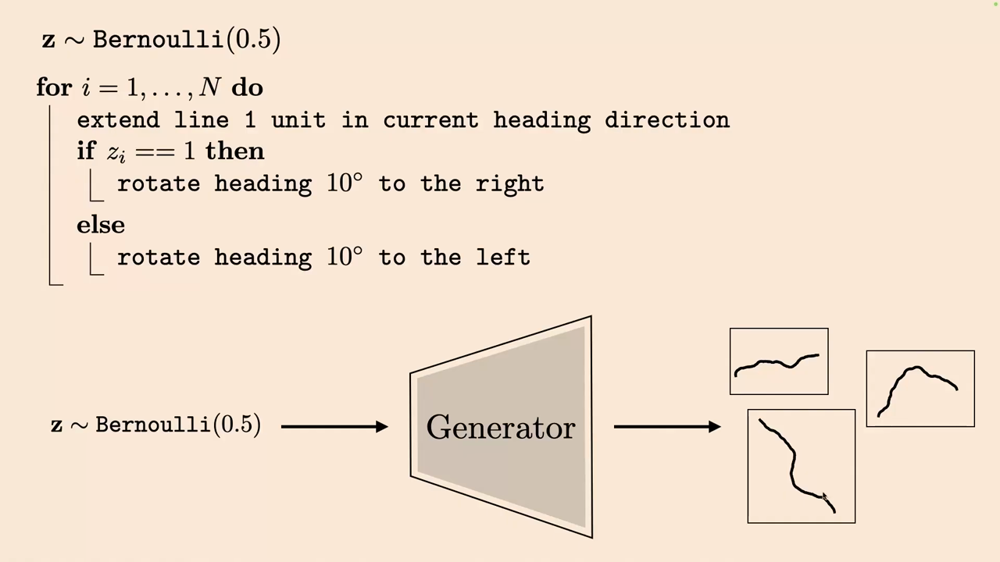
*▲ 강의 슬라이드 [22:40](https://youtu.be/hJlrAHqGOS8?t=1360): 동전 강 [생성기](00_%EB%94%A5%EB%9F%AC%EB%8B%9D_%EC%9A%A9%EC%96%B4%EC%82%AC%EC%A0%84.md#generator-discriminator-%EC%83%9D%EC%84%B1%EA%B8%B0%EC%99%80-%ED%8C%90%EB%B3%84%EA%B8%B0). $z \sim \text{Bernoulli}(0.5)$를 $N$번 뽑아 진행 방향을 10°씩 꺾는다*

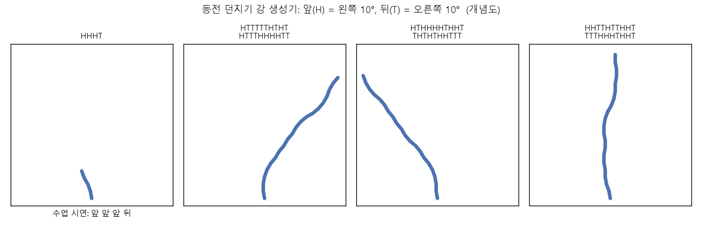
*▲ 직접 그린 그림: 같은 규칙(앞 = 왼쪽 10°, 뒤 = 오른쪽 10°)으로 그린 강. 왼쪽은 수업 시연(앞 앞 앞 뒤), 나머지는 동전 20번씩 던진 결과 (개념도)*

더 복잡한 [생성기](00_%EB%94%A5%EB%9F%AC%EB%8B%9D_%EC%9A%A9%EC%96%B4%EC%82%AC%EC%A0%84.md#generator-discriminator-%EC%83%9D%EC%84%B1%EA%B8%B0%EC%99%80-%ED%8C%90%EB%B3%84%EA%B8%B0)도 같은 원리입니다. 강의 [꺾임](00_%EB%94%A5%EB%9F%AC%EB%8B%9D_%EC%9A%A9%EC%96%B4%EC%82%AC%EC%A0%84.md#kink-%EA%BA%BE%EC%9E%84)은 베르누이 변수 $N$개, 풀 색은 [정규분포](00_%EB%94%A5%EB%9F%AC%EB%8B%9D_%EC%9A%A9%EC%96%B4%EC%82%AC%EC%A0%84.md#normal-distribution-%EC%A0%95%EA%B7%9C%EB%B6%84%ED%8F%AC) 변수, 나무 수는 균등분포 변수로 정합니다. 이처럼 **데이터의 모양을 정하지만 직접 관측되지는 않는 변수**를 **[잠재 변수](00_%EB%94%A5%EB%9F%AC%EB%8B%9D_%EC%9A%A9%EC%96%B4%EC%82%AC%EC%A0%84.md#latent-variable-%EC%9E%A0%EC%9E%AC-%EB%B3%80%EC%88%98)**(latent variable)라고 합니다. 데이터를 만드는 인과 과정의 밑바탕입니다.

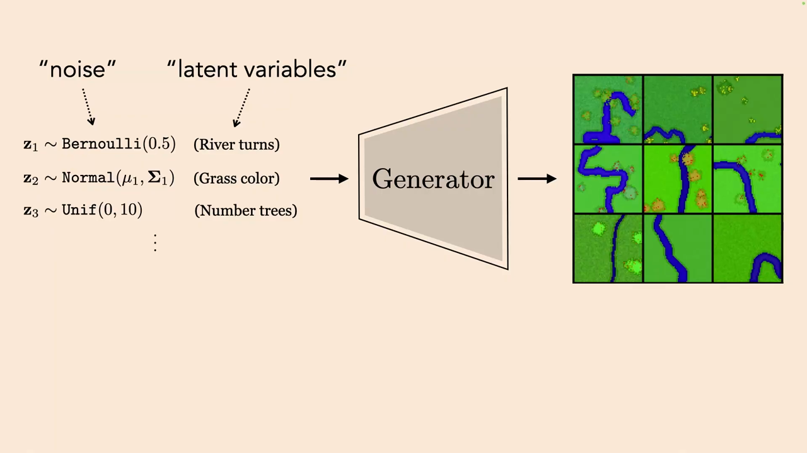
*▲ 강의 슬라이드 [23:40](https://youtu.be/hJlrAHqGOS8?t=1420): "잡음"이라 불리지만 실은 "[잠재 변수](00_%EB%94%A5%EB%9F%AC%EB%8B%9D_%EC%9A%A9%EC%96%B4%EC%82%AC%EC%A0%84.md#latent-variable-%EC%9E%A0%EC%9E%AC-%EB%B3%80%EC%88%98)". 강의 [꺾임](00_%EB%94%A5%EB%9F%AC%EB%8B%9D_%EC%9A%A9%EC%96%B4%EC%82%AC%EC%A0%84.md#kink-%EA%BA%BE%EC%9E%84)(베르누이), 풀 색(정규), 나무 수(균등)가 [생성기](00_%EB%94%A5%EB%9F%AC%EB%8B%9D_%EC%9A%A9%EC%96%B4%EC%82%AC%EC%A0%84.md#generator-discriminator-%EC%83%9D%EC%84%B1%EA%B8%B0%EC%99%80-%ED%8C%90%EB%B3%84%EA%B8%B0)를 거쳐 지도가 된다*

> [!NOTE]
> **개념 #1**
> [생성 모델](00_%EB%94%A5%EB%9F%AC%EB%8B%9D_%EC%9A%A9%EC%96%B4%EC%82%AC%EC%A0%84.md#generative-model-%EC%83%9D%EC%84%B1-%EB%AA%A8%EB%8D%B8)은 잡음을 입력으로 받아 데이터로 바꾼다. 그 잡음은 **[잠재 변수](00_%EB%94%A5%EB%9F%AC%EB%8B%9D_%EC%9A%A9%EC%96%B4%EC%82%AC%EC%A0%84.md#latent-variable-%EC%9E%A0%EC%9E%AC-%EB%B3%80%EC%88%98)**로 생각해야 한다.

---

## 4. 직접 방식과 간접 방식

▶ 영상 [23:55](https://youtu.be/hJlrAHqGOS8?t=1435)

📐 **수학 개념**: [확률 밀도와 정규분포](%EC%88%98%ED%95%99%EA%B0%9C%EB%85%90/04_%ED%99%95%EB%A5%A0%EA%B3%BC_%EC%A0%95%EB%B3%B4/MM50_%ED%99%95%EB%A5%A0_%EB%B0%80%EB%8F%84%EC%99%80_%EC%A0%95%EA%B7%9C%EB%B6%84%ED%8F%AC.md) · [에너지 함수와 볼츠만 분포](%EC%88%98%ED%95%99%EA%B0%9C%EB%85%90/11_%EC%83%9D%EC%84%B1_%EB%AA%A8%EB%8D%B8/MM52_%EC%97%90%EB%84%88%EC%A7%80_%ED%95%A8%EC%88%98%EC%99%80_%EB%B3%BC%EC%B8%A0%EB%A7%8C_%EB%B6%84%ED%8F%AC.md)

손으로 짠 스크립트 대신 그 프로그램을 **데이터로 배워** 신경망으로 나타내려면, 두 가지 길이 있습니다.

1. **직접 방식**(direct approach): [잠재 변수](00_%EB%94%A5%EB%9F%AC%EB%8B%9D_%EC%9A%A9%EC%96%B4%EC%82%AC%EC%A0%84.md#latent-variable-%EC%9E%A0%EC%9E%AC-%EB%B3%80%EC%88%98) $z$(주사위, 동전)에서 데이터로 가는 함수 $G: \mathcal{Z} \to \mathcal{X}$를 직접 배웁니다. [학습](00_%EB%94%A5%EB%9F%AC%EB%8B%9D_%EC%9A%A9%EC%96%B4%EC%82%AC%EC%A0%84.md#training-%ED%95%99%EC%8A%B5)은 보통 기계 [학습](00_%EB%94%A5%EB%9F%AC%EB%8B%9D_%EC%9A%A9%EC%96%B4%EC%82%AC%EC%A0%84.md#training-%ED%95%99%EC%8A%B5)과 같습니다. 예시를 많이 주고 "이런 것을 더 만들라"고 합니다. 시험 단계는 여기서 **[샘플링](00_%EB%94%A5%EB%9F%AC%EB%8B%9D_%EC%9A%A9%EC%96%B4%EC%82%AC%EC%A0%84.md#sampling-%EC%83%98%ED%94%8C%EB%A7%81)**(sampling)이라 부릅니다.
2. **간접 방식**(indirect approach): 데이터에 점수를 매기는 함수 $E: \mathcal{X} \to \mathbb{R}$을 배웁니다. 좋아하는 데이터에는 높은 점수, 아닌 데이터에는 낮은 점수를 줍니다. 가장 기본은 데이터의 [확률](00_%EB%94%A5%EB%9F%AC%EB%8B%9D_%EC%9A%A9%EC%96%B4%EC%82%AC%EC%A0%84.md#probability-%ED%99%95%EB%A5%A0)([우도](00_%EB%94%A5%EB%9F%AC%EB%8B%9D_%EC%9A%A9%EC%96%B4%EC%82%AC%EC%A0%84.md#likelihood-%EC%9A%B0%EB%8F%84))입니다. 그다음 점수가 높은 점을 **찾거나**, 점수가 정하는 분포에서 **표본을 뽑아** 데이터를 만듭니다.

- 직접 방식은 옛 이름으로 **[암묵적 생성 모델](00_%EB%94%A5%EB%9F%AC%EB%8B%9D_%EC%9A%A9%EC%96%B4%EC%82%AC%EC%A0%84.md#implicit-generative-model-%EC%95%94%EB%AC%B5%EC%A0%81-%EC%83%9D%EC%84%B1-%EB%AA%A8%EB%8D%B8)**(implicit generative model)이라고도 합니다. "암묵적"이라 간접처럼 들리지만, [샘플링](00_%EB%94%A5%EB%9F%AC%EB%8B%9D_%EC%9A%A9%EC%96%B4%EC%82%AC%EC%A0%84.md#sampling-%EC%83%98%ED%94%8C%EB%A7%81) 절차가 분포를 **함축(imply)**한다는 뜻입니다. 반대로 [점수 함수](00_%EB%94%A5%EB%9F%AC%EB%8B%9D_%EC%9A%A9%EC%96%B4%EC%82%AC%EC%A0%84.md#scoring-function-%EC%A0%90%EC%88%98-%ED%95%A8%EC%88%98)는 샘플러를 함축합니다.
- 간접 방식에서 점수 함수로부터 표본을 뽑는 알고리즘을 **[샘플링](00_%EB%94%A5%EB%9F%AC%EB%8B%9D_%EC%9A%A9%EC%96%B4%EC%82%AC%EC%A0%84.md#sampling-%EC%83%98%ED%94%8C%EB%A7%81) 알고리즘**이라 합니다. **[마르코프 연쇄 몬테카를로](00_%EB%94%A5%EB%9F%AC%EB%8B%9D_%EC%9A%A9%EC%96%B4%EC%82%AC%EC%A0%84.md#mcmc-markov-chain-monte-carlo-%EB%A7%88%EB%A5%B4%EC%BD%94%ED%94%84-%EC%97%B0%EC%87%84-%EB%AA%AC%ED%85%8C%EC%B9%B4%EB%A5%BC%EB%A1%9C)**([MCMC](00_%EB%94%A5%EB%9F%AC%EB%8B%9D_%EC%9A%A9%EC%96%B4%EC%82%AC%EC%A0%84.md#mcmc-markov-chain-monte-carlo-%EB%A7%88%EB%A5%B4%EC%BD%94%ED%94%84-%EC%97%B0%EC%87%84-%EB%AA%AC%ED%85%8C%EC%B9%B4%EB%A5%BC%EB%A1%9C))가 대표적이고, 무작위 표본을 뽑아 점수에 비례해 받아들이거나 버리는 **[기각 샘플링](00_%EB%94%A5%EB%9F%AC%EB%8B%9D_%EC%9A%A9%EC%96%B4%EC%82%AC%EC%A0%84.md#rejection-sampling-%EA%B8%B0%EA%B0%81-%EC%83%98%ED%94%8C%EB%A7%81)**(rejection sampling)도 있습니다.
- 요즘 더 많이 쓰는 쪽은 직접 방식이고, 간접 방식은 고전적인 설명입니다.

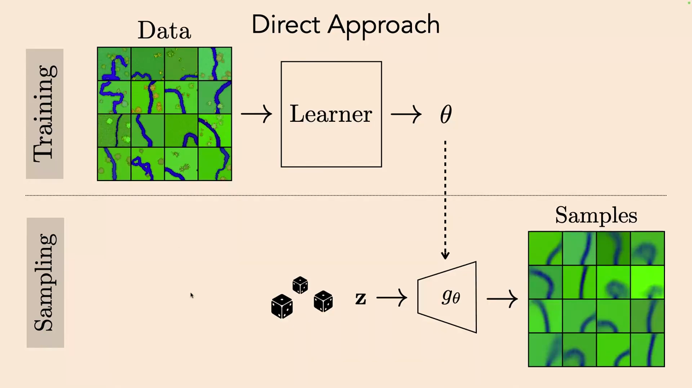
*▲ 강의 슬라이드 [27:30](https://youtu.be/hJlrAHqGOS8?t=1650): 직접 방식. [학습](00_%EB%94%A5%EB%9F%AC%EB%8B%9D_%EC%9A%A9%EC%96%B4%EC%82%AC%EC%A0%84.md#training-%ED%95%99%EC%8A%B5) 단계에서 데이터로 매개변수 $\theta$를 배우고, [샘플링](00_%EB%94%A5%EB%9F%AC%EB%8B%9D_%EC%9A%A9%EC%96%B4%EC%82%AC%EC%A0%84.md#sampling-%EC%83%98%ED%94%8C%EB%A7%81) 단계에서 주사위 $z$를 $g_\theta$에 넣어 새 지도를 만든다*

[생성 모델](00_%EB%94%A5%EB%9F%AC%EB%8B%9D_%EC%9A%A9%EC%96%B4%EC%82%AC%EC%A0%84.md#generative-model-%EC%83%9D%EC%84%B1-%EB%AA%A8%EB%8D%B8)의 목표는 "[학습 데이터](00_%EB%94%A5%EB%9F%AC%EB%8B%9D_%EC%9A%A9%EC%96%B4%EC%82%AC%EC%A0%84.md#training-data-test-data-%ED%95%99%EC%8A%B5-%EB%8D%B0%EC%9D%B4%ED%84%B0%EC%99%80-%EC%8B%9C%ED%97%98-%EB%8D%B0%EC%9D%B4%ED%84%B0)처럼 **보이는**" [합성 데이터](00_%EB%94%A5%EB%9F%AC%EB%8B%9D_%EC%9A%A9%EC%96%B4%EC%82%AC%EC%A0%84.md#synthetic-data-%ED%95%A9%EC%84%B1-%EB%8D%B0%EC%9D%B4%ED%84%B0)를 만드는 것입니다. "처럼 보인다"를 어떻게 정의하느냐에 따라 모델이 갈리는데, 기계 [학습](00_%EB%94%A5%EB%9F%AC%EB%8B%9D_%EC%9A%A9%EC%96%B4%EC%82%AC%EC%A0%84.md#training-%ED%95%99%EC%8A%B5)은 대체로 한 답에 모였습니다. **[학습 데이터](00_%EB%94%A5%EB%9F%AC%EB%8B%9D_%EC%9A%A9%EC%96%B4%EC%82%AC%EC%A0%84.md#training-data-test-data-%ED%95%99%EC%8A%B5-%EB%8D%B0%EC%9D%B4%ED%84%B0%EC%99%80-%EC%8B%9C%ED%97%98-%EB%8D%B0%EC%9D%B4%ED%84%B0)에 맞춘 [밀도 모델](00_%EB%94%A5%EB%9F%AC%EB%8B%9D_%EC%9A%A9%EC%96%B4%EC%82%AC%EC%A0%84.md#density-model-%EB%B0%80%EB%8F%84-%EB%AA%A8%EB%8D%B8)에서 [확률](00_%EB%94%A5%EB%9F%AC%EB%8B%9D_%EC%9A%A9%EC%96%B4%EC%82%AC%EC%A0%84.md#probability-%ED%99%95%EB%A5%A0)이 높은 데이터**를 만들라는 것, 곧 [최대 우도](00_%EB%94%A5%EB%9F%AC%EB%8B%9D_%EC%9A%A9%EC%96%B4%EC%82%AC%EC%A0%84.md#maximum-likelihood-%EC%B5%9C%EB%8C%80-%EC%9A%B0%EB%8F%84) 목적함수입니다.

---

## 5. 밀도 모델과 최대 우도

▶ 영상 [29:34](https://youtu.be/hJlrAHqGOS8?t=1774)

### 5.1 KL 발산에서 최대 우도로

▶ 영상 [30:06](https://youtu.be/hJlrAHqGOS8?t=1806)

📐 **수학 개념**: [KL 발산과 최대 우도](%EC%88%98%ED%95%99%EA%B0%9C%EB%85%90/04_%ED%99%95%EB%A5%A0%EA%B3%BC_%EC%A0%95%EB%B3%B4/MM51_KL_%EB%B0%9C%EC%82%B0%EA%B3%BC_%EC%B5%9C%EB%8C%80_%EC%9A%B0%EB%8F%84.md) · [엔트로피](%EC%88%98%ED%95%99%EA%B0%9C%EB%85%90/04_%ED%99%95%EB%A5%A0%EA%B3%BC_%EC%A0%95%EB%B3%B4/M10_%EC%97%94%ED%8A%B8%EB%A1%9C%ED%94%BC.md) · [기댓값과 일반화 간극](%EC%88%98%ED%95%99%EA%B0%9C%EB%85%90/04_%ED%99%95%EB%A5%A0%EA%B3%BC_%EC%A0%95%EB%B3%B4/MM22_%EA%B8%B0%EB%8C%93%EA%B0%92%EA%B3%BC_%EC%9D%BC%EB%B0%98%ED%99%94_%EA%B0%84%EA%B7%B9.md)

**[밀도 모델](00_%EB%94%A5%EB%9F%AC%EB%8B%9D_%EC%9A%A9%EC%96%B4%EC%82%AC%EC%A0%84.md#density-model-%EB%B0%80%EB%8F%84-%EB%AA%A8%EB%8D%B8)** $p_\theta: \mathcal{X} \to [0, \infty)$는 데이터 공간의 모든 점에 음이 아닌 밀도를 줍니다. $\theta$는 신경망의 [가중치](00_%EB%94%A5%EB%9F%AC%EB%8B%9D_%EC%9A%A9%EC%96%B4%EC%82%AC%EC%A0%84.md#weight-%EA%B0%80%EC%A4%91%EC%B9%98)와 [편향](00_%EB%94%A5%EB%9F%AC%EB%8B%9D_%EC%9A%A9%EC%96%B4%EC%82%AC%EC%A0%84.md#bias-%ED%8E%B8%ED%96%A5)입니다. 신경망은 보통 **매개변수 분포의 매개변수**를 냅니다. 예를 들어 1차원 정규분포라면 평균과 [분산](00_%EB%94%A5%EB%9F%AC%EB%8B%9D_%EC%9A%A9%EC%96%B4%EC%82%AC%EC%A0%84.md#variance-%EB%B6%84%EC%82%B0) 두 수를, 혼합 [정규분포](00_%EB%94%A5%EB%9F%AC%EB%8B%9D_%EC%9A%A9%EC%96%B4%EC%82%AC%EC%A0%84.md#normal-distribution-%EC%A0%95%EA%B7%9C%EB%B6%84%ED%8F%AC)나 스플라인이면 그 모양을 정하는 수들을 냅니다.

[최대 우도](00_%EB%94%A5%EB%9F%AC%EB%8B%9D_%EC%9A%A9%EC%96%B4%EC%82%AC%EC%A0%84.md#maximum-likelihood-%EC%B5%9C%EB%8C%80-%EC%9A%B0%EB%8F%84) [학습](00_%EB%94%A5%EB%9F%AC%EB%8B%9D_%EC%9A%A9%EC%96%B4%EC%82%AC%EC%A0%84.md#training-%ED%95%99%EC%8A%B5)의 그림은 간단합니다. 분포의 넓이는 늘 1(**일정한 질량**)이므로, 데이터가 있는 곳의 밀도를 **밀어 올리면** 데이터가 없는 곳의 밀도는 저절로 **내려갑니다**. 경사 갱신 한 번이 "데이터 자리는 올리고 나머지는 내린다"입니다.

수식으로는 자연이 [학습 데이터](00_%EB%94%A5%EB%9F%AC%EB%8B%9D_%EC%9A%A9%EC%96%B4%EC%82%AC%EC%A0%84.md#training-data-test-data-%ED%95%99%EC%8A%B5-%EB%8D%B0%EC%9D%B4%ED%84%B0%EC%99%80-%EC%8B%9C%ED%97%98-%EB%8D%B0%EC%9D%B4%ED%84%B0)를 만든 미지의 분포 $p_{\text{data}}$와 모델 $p_\theta$의 차이를 **[KL 발산](00_%EB%94%A5%EB%9F%AC%EB%8B%9D_%EC%9A%A9%EC%96%B4%EC%82%AC%EC%A0%84.md#kl-divergence-kl-%EB%B0%9C%EC%82%B0)**으로 재어 줄입니다. [로그](00_%EB%94%A5%EB%9F%AC%EB%8B%9D_%EC%9A%A9%EC%96%B4%EC%82%AC%EC%A0%84.md#log-ln-%EB%A1%9C%EA%B7%B8) 비율을 둘로 나누면, $p_{\text{data}}$의 [로그](00_%EB%94%A5%EB%9F%AC%EB%8B%9D_%EC%9A%A9%EC%96%B4%EC%82%AC%EC%A0%84.md#log-ln-%EB%A1%9C%EA%B7%B8) [확률](00_%EB%94%A5%EB%9F%AC%EB%8B%9D_%EC%9A%A9%EC%96%B4%EC%82%AC%EC%A0%84.md#probability-%ED%99%95%EB%A5%A0) 항은 $\theta$와 무관한 상수라 버릴 수 있습니다. 어차피 계산할 수도 없는 항이라 다행입니다. 남은 [기댓값](00_%EB%94%A5%EB%9F%AC%EB%8B%9D_%EC%9A%A9%EC%96%B4%EC%82%AC%EC%A0%84.md#expectation-%EA%B8%B0%EB%8C%93%EA%B0%92)을 [학습 데이터](00_%EB%94%A5%EB%9F%AC%EB%8B%9D_%EC%9A%A9%EC%96%B4%EC%82%AC%EC%A0%84.md#training-data-test-data-%ED%95%99%EC%8A%B5-%EB%8D%B0%EC%9D%B4%ED%84%B0%EC%99%80-%EC%8B%9C%ED%97%98-%EB%8D%B0%EC%9D%B4%ED%84%B0) 평균으로 바꾸면 [최대 우도](00_%EB%94%A5%EB%9F%AC%EB%8B%9D_%EC%9A%A9%EC%96%B4%EC%82%AC%EC%A0%84.md#maximum-likelihood-%EC%B5%9C%EB%8C%80-%EC%9A%B0%EB%8F%84)가 됩니다.

$$
\begin{aligned}
p_\theta^* &= \arg\min_{p_\theta} \mathrm{KL}(p_{\text{data}}, p_\theta) = \arg\min_{p_\theta} \mathbb{E}_{x \sim p_{\text{data}}}\left[-\log \frac{p_\theta(x)}{p_{\text{data}}(x)}\right] \\
&= \arg\max_{p_\theta} \mathbb{E}_{x \sim p_{\text{data}}}\big[\log p_\theta(x)\big] - \mathbb{E}_{x \sim p_{\text{data}}}\big[\log p_{\text{data}}(x)\big] \\
&= \arg\max_{p_\theta} \mathbb{E}_{x \sim p_{\text{data}}}\big[\log p_\theta(x)\big] \approx \arg\max_{p_\theta} \frac{1}{N}\sum_{i=1}^{N} \log p_\theta(x^{(i)})
\end{aligned}
$$

기호 풀이

| 기호 | 읽는 법 | 뜻 | 예제 값 |
| --- | --- | --- | --- |
| $p_{\text{data}}$ | 피 데이터 | [학습 데이터](00_%EB%94%A5%EB%9F%AC%EB%8B%9D_%EC%9A%A9%EC%96%B4%EC%82%AC%EC%A0%84.md#training-data-test-data-%ED%95%99%EC%8A%B5-%EB%8D%B0%EC%9D%B4%ED%84%B0%EC%99%80-%EC%8B%9C%ED%97%98-%EB%8D%B0%EC%9D%B4%ED%84%B0)를 만든 자연의 분포 (모른다, 표본만 있다) | |
| $p_\theta$, $p_\theta^*$ | 피 세타, 피 세타 스타 | 모델 분포와 가장 좋은 모델 | $\mathcal{N}(3, 1)$ |
| $\mathrm{KL}(p_{\text{data}}, p_\theta)$ | 케이엘 | 두 분포의 차이 ([MM51](%EC%88%98%ED%95%99%EA%B0%9C%EB%85%90/04_%ED%99%95%EB%A5%A0%EA%B3%BC_%EC%A0%95%EB%B3%B4/MM51_KL_%EB%B0%9C%EC%82%B0%EA%B3%BC_%EC%B5%9C%EB%8C%80_%EC%9A%B0%EB%8F%84.md)) | |
| $\mathbb{E}_{x \sim p_{\text{data}}}$ | [기댓값](00_%EB%94%A5%EB%9F%AC%EB%8B%9D_%EC%9A%A9%EC%96%B4%EC%82%AC%EC%A0%84.md#expectation-%EA%B8%B0%EB%8C%93%EA%B0%92) | 자연의 분포에서 뽑은 $x$의 평균 | |
| $\log$ | [로그](00_%EB%94%A5%EB%9F%AC%EB%8B%9D_%EC%9A%A9%EC%96%B4%EC%82%AC%EC%A0%84.md#log-ln-%EB%A1%9C%EA%B7%B8) | 자연로그 | |
| $x^{(i)}$, $N$ | 엑스 아이, 엔 | $i$번째 [학습 데이터](00_%EB%94%A5%EB%9F%AC%EB%8B%9D_%EC%9A%A9%EC%96%B4%EC%82%AC%EC%A0%84.md#training-data-test-data-%ED%95%99%EC%8A%B5-%EB%8D%B0%EC%9D%B4%ED%84%B0%EC%99%80-%EC%8B%9C%ED%97%98-%EB%8D%B0%EC%9D%B4%ED%84%B0), 개수 | 1, 2, 6 / 3 |
| $\frac{1}{N}\sum_i \log p_\theta(x^{(i)})$ | 평균 [로그](00_%EB%94%A5%EB%9F%AC%EB%8B%9D_%EC%9A%A9%EC%96%B4%EC%82%AC%EC%A0%84.md#log-ln-%EB%A1%9C%EA%B7%B8) [우도](00_%EB%94%A5%EB%9F%AC%EB%8B%9D_%EC%9A%A9%EC%96%B4%EC%82%AC%EC%A0%84.md#likelihood-%EC%9A%B0%EB%8F%84) | [최대 우도](00_%EB%94%A5%EB%9F%AC%EB%8B%9D_%EC%9A%A9%EC%96%B4%EC%82%AC%EC%A0%84.md#maximum-likelihood-%EC%B5%9C%EB%8C%80-%EC%9A%B0%EB%8F%84)가 키우는 값 | -3.2523 |

예제와 풀이

**문제**: [학습 데이터](00_%EB%94%A5%EB%9F%AC%EB%8B%9D_%EC%9A%A9%EC%96%B4%EC%82%AC%EC%A0%84.md#training-data-test-data-%ED%95%99%EC%8A%B5-%EB%8D%B0%EC%9D%B4%ED%84%B0%EC%99%80-%EC%8B%9C%ED%97%98-%EB%8D%B0%EC%9D%B4%ED%84%B0) 1, 2, 6에 표준편차 1인 [정규분포](00_%EB%94%A5%EB%9F%AC%EB%8B%9D_%EC%9A%A9%EC%96%B4%EC%82%AC%EC%A0%84.md#normal-distribution-%EC%A0%95%EA%B7%9C%EB%B6%84%ED%8F%AC) $\mathcal{N}(3, 1)$을 모델로 쓴다. 평균 [로그](00_%EB%94%A5%EB%9F%AC%EB%8B%9D_%EC%9A%A9%EC%96%B4%EC%82%AC%EC%A0%84.md#log-ln-%EB%A1%9C%EA%B7%B8) [우도](00_%EB%94%A5%EB%9F%AC%EB%8B%9D_%EC%9A%A9%EC%96%B4%EC%82%AC%EC%A0%84.md#likelihood-%EC%9A%B0%EB%8F%84)를 구하라.

**주어진 값**
- $x^{(1)} = 1, x^{(2)} = 2, x^{(3)} = 6$ ([학습 데이터](00_%EB%94%A5%EB%9F%AC%EB%8B%9D_%EC%9A%A9%EC%96%B4%EC%82%AC%EC%A0%84.md#training-data-test-data-%ED%95%99%EC%8A%B5-%EB%8D%B0%EC%9D%B4%ED%84%B0%EC%99%80-%EC%8B%9C%ED%97%98-%EB%8D%B0%EC%9D%B4%ED%84%B0))
- $N = 3$ (데이터 수)
- $\mu = 3$ (모델 평균, 표준편차 1)
- $\log \mathcal{N}(x; \mu, 1) = -0.9189 - \tfrac{1}{2}(x - \mu)^2$ ([MM50](%EC%88%98%ED%95%99%EA%B0%9C%EB%85%90/04_%ED%99%95%EB%A5%A0%EA%B3%BC_%EC%A0%95%EB%B3%B4/MM50_%ED%99%95%EB%A5%A0_%EB%B0%80%EB%8F%84%EC%99%80_%EC%A0%95%EA%B7%9C%EB%B6%84%ED%8F%AC.md)의 정규 밀도에 [로그](00_%EB%94%A5%EB%9F%AC%EB%8B%9D_%EC%9A%A9%EC%96%B4%EC%82%AC%EC%A0%84.md#log-ln-%EB%A1%9C%EA%B7%B8)를 씌운 것. 0.9189 = $\tfrac12 \ln 2\pi$)

**풀이**
1. 식을 그대로 쓴다: $\dfrac{1}{N}\sum_{i=1}^{N} \log p_\theta(x^{(i)})$
2. 값을 대입한다: $\dfrac{1}{3}\big(\log \mathcal{N}(1; 3, 1) + \log \mathcal{N}(2; 3, 1) + \log \mathcal{N}(6; 3, 1)\big)$ (Σ를 세 항으로 풀어 썼다)
3. 첫 항의 거리 제곱: $(1 - 3)^2 = 4$ → $-0.9189 - 0.5 \times 4 = -2.9189$
4. 둘째 항: $(2 - 3)^2 = 1$ → $-0.9189 - 0.5 = -1.4189$
5. 셋째 항: $(6 - 3)^2 = 9$ → $-0.9189 - 4.5 = -5.4189$
6. 세 항을 더한다: $-2.9189 + (-1.4189) + (-5.4189) = -9.7567$
7. 3으로 나눈다: $-9.7567 / 3 = -3.2522$ (반올림 전 값으로 계산하면 -3.2523)

**답**: **-3.2523**. $\mu = 3$은 데이터의 평균 $(1 + 2 + 6)/3$이라, 표준편차 1인 [정규분포](00_%EB%94%A5%EB%9F%AC%EB%8B%9D_%EC%9A%A9%EC%96%B4%EC%82%AC%EC%A0%84.md#normal-distribution-%EC%A0%95%EA%B7%9C%EB%B6%84%ED%8F%AC) 중에서 이 값이 가장 크다([최대 우도](00_%EB%94%A5%EB%9F%AC%EB%8B%9D_%EC%9A%A9%EC%96%B4%EC%82%AC%EC%A0%84.md#maximum-likelihood-%EC%B5%9C%EB%8C%80-%EC%9A%B0%EB%8F%84) 해).

내 이해

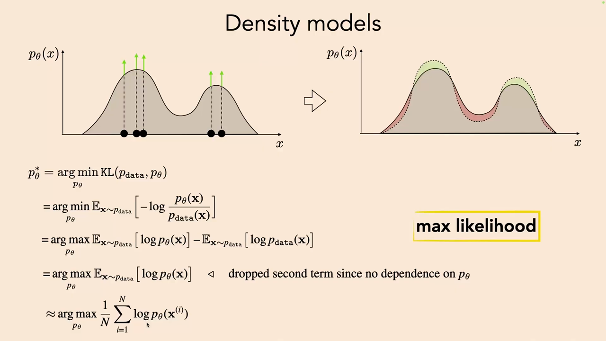
*▲ 강의 슬라이드 [36:36](https://youtu.be/hJlrAHqGOS8?t=2196): [밀도 모델](00_%EB%94%A5%EB%9F%AC%EB%8B%9D_%EC%9A%A9%EC%96%B4%EC%82%AC%EC%A0%84.md#density-model-%EB%B0%80%EB%8F%84-%EB%AA%A8%EB%8D%B8). 데이터 자리의 밀도를 올리면(초록 화살표) 넓이 1 때문에 다른 곳이 내려간다. 아래는 KL 최소화에서 [최대 우도](00_%EB%94%A5%EB%9F%AC%EB%8B%9D_%EC%9A%A9%EC%96%B4%EC%82%AC%EC%A0%84.md#maximum-likelihood-%EC%B5%9C%EB%8C%80-%EC%9A%B0%EB%8F%84)로 가는 유도*

이 형태는 [소프트맥스](00_%EB%94%A5%EB%9F%AC%EB%8B%9D_%EC%9A%A9%EC%96%B4%EC%82%AC%EC%A0%84.md#softmax-%EC%86%8C%ED%94%84%ED%8A%B8%EB%A7%A5%EC%8A%A4) [회귀](00_%EB%94%A5%EB%9F%AC%EB%8B%9D_%EC%9A%A9%EC%96%B4%EC%82%AC%EC%A0%84.md#regression-classification-%ED%9A%8C%EA%B7%80%EC%99%80-%EB%B6%84%EB%A5%98)에서 본 것과 같습니다. 데이터 모델링에서 하는 일은 대개 [최대 우도](00_%EB%94%A5%EB%9F%AC%EB%8B%9D_%EC%9A%A9%EC%96%B4%EC%82%AC%EC%A0%84.md#maximum-likelihood-%EC%B5%9C%EB%8C%80-%EC%9A%B0%EB%8F%84)입니다.

질의응답 정리 [32:19](https://youtu.be/hJlrAHqGOS8?t=1939), [41:09](https://youtu.be/hJlrAHqGOS8?t=2469)

- **밀도가 무한대로 갈 수 있는데 어떻게 합이 1인가?** 밀도는 [확률](00_%EB%94%A5%EB%9F%AC%EB%8B%9D_%EC%9A%A9%EC%96%B4%EC%82%AC%EC%A0%84.md#probability-%ED%99%95%EB%A5%A0)이 아니다. [확률](00_%EB%94%A5%EB%9F%AC%EB%8B%9D_%EC%9A%A9%EC%96%B4%EC%82%AC%EC%A0%84.md#probability-%ED%99%95%EB%A5%A0)은 구간에 대한 밀도의 적분이고, 무한히 좁은 구간에서는 밀도가 무한대로 가도 넓이는 유한하다.
- **$p_\theta$는 실제로 어떻게 매개변수화하나?** 신경망이 분포족의 매개변수를 모두 낸다. 1차원 [정규분포](00_%EB%94%A5%EB%9F%AC%EB%8B%9D_%EC%9A%A9%EC%96%B4%EC%82%AC%EC%A0%84.md#normal-distribution-%EC%A0%95%EA%B7%9C%EB%B6%84%ED%8F%AC)면 평균과 [분산](00_%EB%94%A5%EB%9F%AC%EB%8B%9D_%EC%9A%A9%EC%96%B4%EC%82%AC%EC%A0%84.md#variance-%EB%B6%84%EC%82%B0) 2개, 10차원 [정규분포](00_%EB%94%A5%EB%9F%AC%EB%8B%9D_%EC%9A%A9%EC%96%B4%EC%82%AC%EC%A0%84.md#normal-distribution-%EC%A0%95%EA%B7%9C%EB%B6%84%ED%8F%AC)면 평균 10개 + 공분산 100개, [정규분포](00_%EB%94%A5%EB%9F%AC%EB%8B%9D_%EC%9A%A9%EC%96%B4%EC%82%AC%EC%A0%84.md#normal-distribution-%EC%A0%95%EA%B7%9C%EB%B6%84%ED%8F%AC) 두 개의 혼합이면 그 두 배다.
- **이미지가 "지지직" 잡음처럼 보이지 않게 하는 [귀납 편향](00_%EB%94%A5%EB%9F%AC%EB%8B%9D_%EC%9A%A9%EC%96%B4%EC%82%AC%EC%A0%84.md#inductive-bias-%EA%B7%80%EB%82%A9-%ED%8E%B8%ED%96%A5)을 넣을 수 있나?** 다른 딥러닝 기법을 모두 쓸 수 있다. 공간 국소성이 박힌 [합성곱](00_%EB%94%A5%EB%9F%AC%EB%8B%9D_%EC%9A%A9%EC%96%B4%EC%82%AC%EC%A0%84.md#convolution-%ED%95%A9%EC%84%B1%EA%B3%B1) 아키텍처, [트랜스포머](00_%EB%94%A5%EB%9F%AC%EB%8B%9D_%EC%9A%A9%EC%96%B4%EC%82%AC%EC%A0%84.md#transformer-%ED%8A%B8%EB%9E%9C%EC%8A%A4%ED%8F%AC%EB%A8%B8)의 위치 부호, 각종 [규제](00_%EB%94%A5%EB%9F%AC%EB%8B%9D_%EC%9A%A9%EC%96%B4%EC%82%AC%EC%A0%84.md#regularization-%EA%B7%9C%EC%A0%9C)가 그렇다.
- **[최대 우도](00_%EB%94%A5%EB%9F%AC%EB%8B%9D_%EC%9A%A9%EC%96%B4%EC%82%AC%EC%A0%84.md#maximum-likelihood-%EC%B5%9C%EB%8C%80-%EC%9A%B0%EB%8F%84)와 [경험적 위험](00_%EB%94%A5%EB%9F%AC%EB%8B%9D_%EC%9A%A9%EC%96%B4%EC%82%AC%EC%A0%84.md#empirical-risk-%EA%B2%BD%ED%97%98%EC%A0%81-%EC%9C%84%ED%97%98) 최소화는 관계가 있나?** 학습 데이터에서의 [최대 우도](00_%EB%94%A5%EB%9F%AC%EB%8B%9D_%EC%9A%A9%EC%96%B4%EC%82%AC%EC%A0%84.md#maximum-likelihood-%EC%B5%9C%EB%8C%80-%EC%9A%B0%EB%8F%84)는 "음의 [로그](00_%EB%94%A5%EB%9F%AC%EB%8B%9D_%EC%9A%A9%EC%96%B4%EC%82%AC%EC%A0%84.md#log-ln-%EB%A1%9C%EA%B7%B8) [우도](00_%EB%94%A5%EB%9F%AC%EB%8B%9D_%EC%9A%A9%EC%96%B4%EC%82%AC%EC%A0%84.md#likelihood-%EC%9A%B0%EB%8F%84)"를 위험으로 쓴 [경험적 위험](00_%EB%94%A5%EB%9F%AC%EB%8B%9D_%EC%9A%A9%EC%96%B4%EC%82%AC%EC%A0%84.md#empirical-risk-%EA%B2%BD%ED%97%98%EC%A0%81-%EC%9C%84%ED%97%98) 최소화다. 제곱 [오차](00_%EB%94%A5%EB%9F%AC%EB%8B%9D_%EC%9A%A9%EC%96%B4%EC%82%AC%EC%A0%84.md#error-%EC%98%A4%EC%B0%A8)나 L1 [오차](00_%EB%94%A5%EB%9F%AC%EB%8B%9D_%EC%9A%A9%EC%96%B4%EC%82%AC%EC%A0%84.md#error-%EC%98%A4%EC%B0%A8)처럼 흔한 [손실](00_%EB%94%A5%EB%9F%AC%EB%8B%9D_%EC%9A%A9%EC%96%B4%EC%82%AC%EC%A0%84.md#loss-function-%EC%86%90%EC%8B%A4-%ED%95%A8%EC%88%98)도 대부분 어떤 [우도](00_%EB%94%A5%EB%9F%AC%EB%8B%9D_%EC%9A%A9%EC%96%B4%EC%82%AC%EC%A0%84.md#likelihood-%EC%9A%B0%EB%8F%84)로 해석할 수 있다.

### 5.2 파일 캐비닛: 생성 모델의 과적합

▶ 영상 [36:50](https://youtu.be/hJlrAHqGOS8?t=2210)

📐 **수학 개념**: [KL 발산과 최대 우도](%EC%88%98%ED%95%99%EA%B0%9C%EB%85%90/04_%ED%99%95%EB%A5%A0%EA%B3%BC_%EC%A0%95%EB%B3%B4/MM51_KL_%EB%B0%9C%EC%82%B0%EA%B3%BC_%EC%B5%9C%EB%8C%80_%EC%9A%B0%EB%8F%84.md) · [기댓값과 일반화 간극](%EC%88%98%ED%95%99%EA%B0%9C%EB%85%90/04_%ED%99%95%EB%A5%A0%EA%B3%BC_%EC%A0%95%EB%B3%B4/MM22_%EA%B8%B0%EB%8C%93%EA%B0%92%EA%B3%BC_%EC%9D%BC%EB%B0%98%ED%99%94_%EA%B0%84%EA%B7%B9.md)

학생이 묻습니다. "[규제](00_%EB%94%A5%EB%9F%AC%EB%8B%9D_%EC%9A%A9%EC%96%B4%EC%82%AC%EC%A0%84.md#regularization-%EA%B7%9C%EC%A0%9C)가 없으면 [학습](00_%EB%94%A5%EB%9F%AC%EB%8B%9D_%EC%9A%A9%EC%96%B4%EC%82%AC%EC%A0%84.md#training-%ED%95%99%EC%8A%B5) 점마다 디랙 델타(무한히 좁은 뾰족한 봉우리)가 생기지 않나요?" 강사는 이것이 [생성 모델](00_%EB%94%A5%EB%9F%AC%EB%8B%9D_%EC%9A%A9%EC%96%B4%EC%82%AC%EC%A0%84.md#generative-model-%EC%83%9D%EC%84%B1-%EB%AA%A8%EB%8D%B8)에서 늘 나오는 질문이라며, [일반화](00_%EB%94%A5%EB%9F%AC%EB%8B%9D_%EC%9A%A9%EC%96%B4%EC%82%AC%EC%A0%84.md#generalization-%EC%9D%BC%EB%B0%98%ED%99%94) 강의(Lec06)의 **파일 캐비닛**을 다시 꺼냅니다.

- [학습](00_%EB%94%A5%EB%9F%AC%EB%8B%9D_%EC%9A%A9%EC%96%B4%EC%82%AC%EC%A0%84.md#training-%ED%95%99%EC%8A%B5): 새 [학습 데이터](00_%EB%94%A5%EB%9F%AC%EB%8B%9D_%EC%9A%A9%EC%96%B4%EC%82%AC%EC%A0%84.md#training-data-test-data-%ED%95%99%EC%8A%B5-%EB%8D%B0%EC%9D%B4%ED%84%B0%EC%99%80-%EC%8B%9C%ED%97%98-%EB%8D%B0%EC%9D%B4%ED%84%B0)가 올 때마다 캐비닛 서랍에 넣는다.
- 생성: 서랍 하나를 무작위로 골라 꺼낸다.

이 모델은 [학습 데이터](00_%EB%94%A5%EB%9F%AC%EB%8B%9D_%EC%9A%A9%EC%96%B4%EC%82%AC%EC%A0%84.md#training-data-test-data-%ED%95%99%EC%8A%B5-%EB%8D%B0%EC%9D%B4%ED%84%B0%EC%99%80-%EC%8B%9C%ED%97%98-%EB%8D%B0%EC%9D%B4%ED%84%B0)와 **똑같은** 데이터를 냅니다. 사실 [학습](00_%EB%94%A5%EB%9F%AC%EB%8B%9D_%EC%9A%A9%EC%96%B4%EC%82%AC%EC%A0%84.md#training-%ED%95%99%EC%8A%B5) [우도](00_%EB%94%A5%EB%9F%AC%EB%8B%9D_%EC%9A%A9%EC%96%B4%EC%82%AC%EC%A0%84.md#likelihood-%EC%9A%B0%EB%8F%84)로는 가능한 최고 점수를 받는 [최대 우도](00_%EB%94%A5%EB%9F%AC%EB%8B%9D_%EC%9A%A9%EC%96%B4%EC%82%AC%EC%A0%84.md#maximum-likelihood-%EC%B5%9C%EB%8C%80-%EC%9A%B0%EB%8F%84) 해입니다. 그런데 직관적으로는 아무것도 하지 않았으니 나쁜 해입니다. 학생 말대로 "새것을 만들지 않습니다".

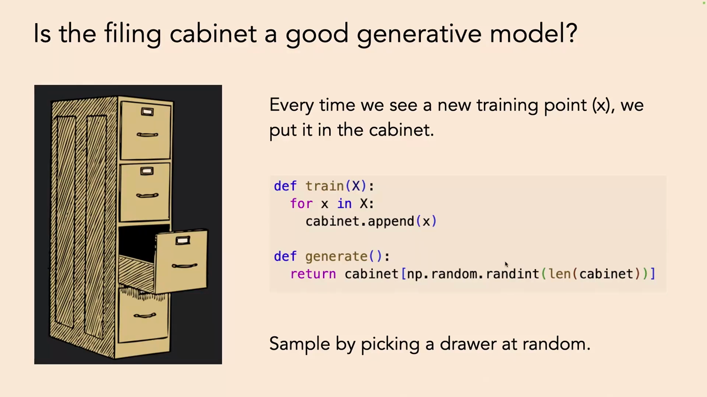
*▲ 강의 슬라이드 [38:10](https://youtu.be/hJlrAHqGOS8?t=2290): 파일 캐비닛은 좋은 생성 모델인가? [학습 데이터](00_%EB%94%A5%EB%9F%AC%EB%8B%9D_%EC%9A%A9%EC%96%B4%EC%82%AC%EC%A0%84.md#training-data-test-data-%ED%95%99%EC%8A%B5-%EB%8D%B0%EC%9D%B4%ED%84%B0%EC%99%80-%EC%8B%9C%ED%97%98-%EB%8D%B0%EC%9D%B4%ED%84%B0)를 서랍에 넣고, 무작위 서랍을 꺼내 표본으로 낸다*

강사는 이것이 고전적 기계 [학습](00_%EB%94%A5%EB%9F%AC%EB%8B%9D_%EC%9A%A9%EC%96%B4%EC%82%AC%EC%A0%84.md#training-%ED%95%99%EC%8A%B5)의 **[과적합](00_%EB%94%A5%EB%9F%AC%EB%8B%9D_%EC%9A%A9%EC%96%B4%EC%82%AC%EC%A0%84.md#overfitting-%EA%B3%BC%EC%A0%81%ED%95%A9)**과 정확히 같다고 설명합니다. [용량](00_%EB%94%A5%EB%9F%AC%EB%8B%9D_%EC%9A%A9%EC%96%B4%EC%82%AC%EC%A0%84.md#capacity-%EC%9A%A9%EB%9F%89)이 무한하면 [최대 우도](00_%EB%94%A5%EB%9F%AC%EB%8B%9D_%EC%9A%A9%EC%96%B4%EC%82%AC%EC%A0%84.md#maximum-likelihood-%EC%B5%9C%EB%8C%80-%EC%9A%B0%EB%8F%84) 해는 [학습](00_%EB%94%A5%EB%9F%AC%EB%8B%9D_%EC%9A%A9%EC%96%B4%EC%82%AC%EC%A0%84.md#training-%ED%95%99%EC%8A%B5) 점마다 델타 함수를 두는 것입니다. 그런데 진짜 데이터 생성 과정은 다른 모양이고, [학습 데이터](00_%EB%94%A5%EB%9F%AC%EB%8B%9D_%EC%9A%A9%EC%96%B4%EC%82%AC%EC%A0%84.md#training-data-test-data-%ED%95%99%EC%8A%B5-%EB%8D%B0%EC%9D%B4%ED%84%B0%EC%99%80-%EC%8B%9C%ED%97%98-%EB%8D%B0%EC%9D%B4%ED%84%B0)는 그 표본일 뿐입니다. 같은 과정에서 새 표본을 뽑으면 다른 곳에 떨어지고, 델타 모델은 거기에 [확률](00_%EB%94%A5%EB%9F%AC%EB%8B%9D_%EC%9A%A9%EC%96%B4%EC%82%AC%EC%A0%84.md#probability-%ED%99%95%EB%A5%A0) 0을 줍니다.

- 중요한 것은 **[시험 데이터](00_%EB%94%A5%EB%9F%AC%EB%8B%9D_%EC%9A%A9%EC%96%B4%EC%82%AC%EC%A0%84.md#training-data-test-data-%ED%95%99%EC%8A%B5-%EB%8D%B0%EC%9D%B4%ED%84%B0%EC%99%80-%EC%8B%9C%ED%97%98-%EB%8D%B0%EC%9D%B4%ED%84%B0)에 주는 [확률](00_%EB%94%A5%EB%9F%AC%EB%8B%9D_%EC%9A%A9%EC%96%B4%EC%82%AC%EC%A0%84.md#probability-%ED%99%95%EB%A5%A0)**입니다. [학습 데이터](00_%EB%94%A5%EB%9F%AC%EB%8B%9D_%EC%9A%A9%EC%96%B4%EC%82%AC%EC%A0%84.md#training-data-test-data-%ED%95%99%EC%8A%B5-%EB%8D%B0%EC%9D%B4%ED%84%B0%EC%99%80-%EC%8B%9C%ED%97%98-%EB%8D%B0%EC%9D%B4%ED%84%B0)에서 [우도](00_%EB%94%A5%EB%9F%AC%EB%8B%9D_%EC%9A%A9%EC%96%B4%EC%82%AC%EC%A0%84.md#likelihood-%EC%9A%B0%EB%8F%84)를 최적화하지만, 진짜 성적은 새 표본의 밀도입니다. 그래서 [용량](00_%EB%94%A5%EB%9F%AC%EB%8B%9D_%EC%9A%A9%EC%96%B4%EC%82%AC%EC%A0%84.md#capacity-%EC%9A%A9%EB%9F%89)을 조절하거나 규제해서 외우기 해를 피해야 합니다.
- [생성 모델](00_%EB%94%A5%EB%9F%AC%EB%8B%9D_%EC%9A%A9%EC%96%B4%EC%82%AC%EC%A0%84.md#generative-model-%EC%83%9D%EC%84%B1-%EB%AA%A8%EB%8D%B8)의 목표는 [학습 데이터](00_%EB%94%A5%EB%9F%AC%EB%8B%9D_%EC%9A%A9%EC%96%B4%EC%82%AC%EC%A0%84.md#training-data-test-data-%ED%95%99%EC%8A%B5-%EB%8D%B0%EC%9D%B4%ED%84%B0%EC%99%80-%EC%8B%9C%ED%97%98-%EB%8D%B0%EC%9D%B4%ED%84%B0)를 그대로 만드는 것이 아니라, 데이터의 중요한 통계와 사실적인 성질을 담으면서 **새로운** 것을 만드는 것입니다.
- [밀도 모델](00_%EB%94%A5%EB%9F%AC%EB%8B%9D_%EC%9A%A9%EC%96%B4%EC%82%AC%EC%A0%84.md#density-model-%EB%B0%80%EB%8F%84-%EB%AA%A8%EB%8D%B8)은 시험 세트를 떼어 두고 거기서 [우도](00_%EB%94%A5%EB%9F%AC%EB%8B%9D_%EC%9A%A9%EC%96%B4%EC%82%AC%EC%A0%84.md#likelihood-%EC%9A%B0%EB%8F%84)를 재면 됩니다([검증](00_%EB%94%A5%EB%9F%AC%EB%8B%9D_%EC%9A%A9%EC%96%B4%EC%82%AC%EC%A0%84.md#validation-data-%EA%B2%80%EC%A6%9D-%EB%8D%B0%EC%9D%B4%ED%84%B0)). 표본만 내고 밀도를 내지 않는 직접 방식 모델은 이 값을 구하기 어려워 평가가 까다롭습니다.

---

## 6. 에너지 기반 모델

▶ 영상 [44:32](https://youtu.be/hJlrAHqGOS8?t=2672)

### 6.1 볼츠만 분포와 에너지 비율

▶ 영상 [44:39](https://youtu.be/hJlrAHqGOS8?t=2679)

📐 **수학 개념**: [에너지 함수와 볼츠만 분포](%EC%88%98%ED%95%99%EA%B0%9C%EB%85%90/11_%EC%83%9D%EC%84%B1_%EB%AA%A8%EB%8D%B8/MM52_%EC%97%90%EB%84%88%EC%A7%80_%ED%95%A8%EC%88%98%EC%99%80_%EB%B3%BC%EC%B8%A0%EB%A7%8C_%EB%B6%84%ED%8F%AC.md) · [지수와 e](%EC%88%98%ED%95%99%EA%B0%9C%EB%85%90/01_%EC%88%98%EC%99%80_%ED%95%A8%EC%88%98/M06_%EC%A7%80%EC%88%98%EC%99%80_e.md)

**[에너지 기반 모델](00_%EB%94%A5%EB%9F%AC%EB%8B%9D_%EC%9A%A9%EC%96%B4%EC%82%AC%EC%A0%84.md#energy-based-model-%EC%97%90%EB%84%88%EC%A7%80-%EA%B8%B0%EB%B0%98-%EB%AA%A8%EB%8D%B8)**(EBM)은 또 다른 간접 방식입니다. 점수가 정규화된 [확률](00_%EB%94%A5%EB%9F%AC%EB%8B%9D_%EC%9A%A9%EC%96%B4%EC%82%AC%EC%A0%84.md#probability-%ED%99%95%EB%A5%A0)이 아니라 **정규화하지 않은 [확률](00_%EB%94%A5%EB%9F%AC%EB%8B%9D_%EC%9A%A9%EC%96%B4%EC%82%AC%EC%A0%84.md#probability-%ED%99%95%EB%A5%A0)**이면 어떨까요? 에너지 함수는 데이터를 $-\infty$에서 $\infty$ 사이 스칼라로 보내는 아무 함수입니다. 이를 [지수](00_%EB%94%A5%EB%9F%AC%EB%8B%9D_%EC%9A%A9%EC%96%B4%EC%82%AC%EC%A0%84.md#e-exponent-e%EC%99%80-%EC%A7%80%EC%88%98)로 바꾸고 전체 합(적분)으로 나누면 [확률](00_%EB%94%A5%EB%9F%AC%EB%8B%9D_%EC%9A%A9%EC%96%B4%EC%82%AC%EC%A0%84.md#probability-%ED%99%95%EB%A5%A0)이 됩니다. 이것이 **[볼츠만 분포](00_%EB%94%A5%EB%9F%AC%EB%8B%9D_%EC%9A%A9%EC%96%B4%EC%82%AC%EC%A0%84.md#boltzmann-distribution-%EB%B3%BC%EC%B8%A0%EB%A7%8C-%EB%B6%84%ED%8F%AC)**이고, 나누는 값 $Z$를 **[분할 함수](00_%EB%94%A5%EB%9F%AC%EB%8B%9D_%EC%9A%A9%EC%96%B4%EC%82%AC%EC%A0%84.md#partition-function-%EB%B6%84%ED%95%A0-%ED%95%A8%EC%88%98)**([정규화](00_%EB%94%A5%EB%9F%AC%EB%8B%9D_%EC%9A%A9%EC%96%B4%EC%82%AC%EC%A0%84.md#normalization-%EC%A0%95%EA%B7%9C%ED%99%94) 상수)라 합니다.

$$
p_\theta(x) = \frac{e^{-E_\theta(x)}}{Z(\theta)}, \qquad Z(\theta) = \int_{x} e^{-E_\theta(x)}\, dx
$$

기호 풀이

| 기호 | 읽는 법 | 뜻 | 예제 값 |
| --- | --- | --- | --- |
| $E_\theta(x)$ | 이 세타 | 에너지 (낮을수록 그럴듯함) | 0, 2 |
| $e^{-E_\theta(x)}$ | 이의 마이너스 이 제곱 | [정규화](00_%EB%94%A5%EB%9F%AC%EB%8B%9D_%EC%9A%A9%EC%96%B4%EC%82%AC%EC%A0%84.md#normalization-%EC%A0%95%EA%B7%9C%ED%99%94) 전 [확률](00_%EB%94%A5%EB%9F%AC%EB%8B%9D_%EC%9A%A9%EC%96%B4%EC%82%AC%EC%A0%84.md#probability-%ED%99%95%EB%A5%A0) | 1, 0.1353 |
| $Z(\theta)$ | 제트 | [분할 함수](00_%EB%94%A5%EB%9F%AC%EB%8B%9D_%EC%9A%A9%EC%96%B4%EC%82%AC%EC%A0%84.md#partition-function-%EB%B6%84%ED%95%A0-%ED%95%A8%EC%88%98). 모든 $x$의 $e^{-E}$ 합(적분) | 1.1353 |
| $p_\theta(x)$ | 피 세타 | 정규화한 [확률](00_%EB%94%A5%EB%9F%AC%EB%8B%9D_%EC%9A%A9%EC%96%B4%EC%82%AC%EC%A0%84.md#probability-%ED%99%95%EB%A5%A0) | 0.8808, 0.1192 |

예제와 풀이

**문제**: 상태가 둘뿐인 모델에서 에너지가 $E = (0, 2)$다. 두 상태의 [확률](00_%EB%94%A5%EB%9F%AC%EB%8B%9D_%EC%9A%A9%EC%96%B4%EC%82%AC%EC%A0%84.md#probability-%ED%99%95%EB%A5%A0)을 구하라(적분 대신 합).

**주어진 값**
- $E(x_1) = 0$, $E(x_2) = 2$ (두 상태의 에너지)

**풀이**
1. 식을 그대로 쓴다: $p(x) = \dfrac{e^{-E(x)}}{Z}$, $Z = \sum_x e^{-E(x)}$
2. 값을 대입한다: $p(x_1) = \dfrac{e^{-0}}{e^{-0} + e^{-2}}$, $p(x_2) = \dfrac{e^{-2}}{e^{-0} + e^{-2}}$
3. [지수](00_%EB%94%A5%EB%9F%AC%EB%8B%9D_%EC%9A%A9%EC%96%B4%EC%82%AC%EC%A0%84.md#e-exponent-e%EC%99%80-%EC%A7%80%EC%88%98)를 계산한다. 0제곱은 1이고, $e^{-2} = 1/e^2 = 1/7.3891$: $e^{0} = 1$, $e^{-2} = 0.1353$
4. 더해서 $Z$를 구한다: $1 + 0.1353 = 1.1353$
5. 첫 상태를 나눈다: $1 / 1.1353 = 0.8808$
6. 둘째 상태를 나눈다: $0.1353 / 1.1353 = 0.1192$

**답**: **(0.8808, 0.1192)**. 에너지가 2 낮은 상태가 훨씬 그럴듯하다.

내 이해

학생이 "[소프트맥스](00_%EB%94%A5%EB%9F%AC%EB%8B%9D_%EC%9A%A9%EC%96%B4%EC%82%AC%EC%A0%84.md#softmax-%EC%86%8C%ED%94%84%ED%8A%B8%EB%A7%A5%EC%8A%A4)에 들어가는 값 같은 것이냐"고 묻자 강사는 그렇다고 답합니다. [소프트맥스](00_%EB%94%A5%EB%9F%AC%EB%8B%9D_%EC%9A%A9%EC%96%B4%EC%82%AC%EC%A0%84.md#softmax-%EC%86%8C%ED%94%84%ED%8A%B8%EB%A7%A5%EC%8A%A4) 분류기의 [로짓](00_%EB%94%A5%EB%9F%AC%EB%8B%9D_%EC%9A%A9%EC%96%B4%EC%82%AC%EC%A0%84.md#logit-%EB%A1%9C%EC%A7%93)이 (마이너스) 에너지이고, [소프트맥스](00_%EB%94%A5%EB%9F%AC%EB%8B%9D_%EC%9A%A9%EC%96%B4%EC%82%AC%EC%A0%84.md#softmax-%EC%86%8C%ED%94%84%ED%8A%B8%EB%A7%A5%EC%8A%A4)는 [지수](00_%EB%94%A5%EB%9F%AC%EB%8B%9D_%EC%9A%A9%EC%96%B4%EC%82%AC%EC%A0%84.md#e-exponent-e%EC%99%80-%EC%A7%80%EC%88%98)를 씌워 정규화하는 것입니다.

**[확률](00_%EB%94%A5%EB%9F%AC%EB%8B%9D_%EC%9A%A9%EC%96%B4%EC%82%AC%EC%A0%84.md#probability-%ED%99%95%EB%A5%A0)이 불편한 이유**: 정규화된 함수만 골라야 해서 찾을 수 있는 함수족이 좁습니다. 신경망이 다항식 곡선이나 스플라인 제어점, 또는 데이터마다 아무 수나 내게 하면, 정규화하려고 모든 데이터에 대해 적분해야 하는데 이는 계산할 수 없습니다.

**에너지로 충분한 이유**: [확률](00_%EB%94%A5%EB%9F%AC%EB%8B%9D_%EC%9A%A9%EC%96%B4%EC%82%AC%EC%A0%84.md#probability-%ED%99%95%EB%A5%A0)의 **비율**은 에너지만으로 정해집니다. [정규화](00_%EB%94%A5%EB%9F%AC%EB%8B%9D_%EC%9A%A9%EC%96%B4%EC%82%AC%EC%A0%84.md#normalization-%EC%A0%95%EA%B7%9C%ED%99%94) 상수가 분자와 분모에서 지워지기 때문입니다. "내일 눈이 올 가능성과 태풍이 올 가능성 중 어느 쪽이 큰가"처럼 상대적 판단은 대개 이것으로 충분합니다. [MCMC](00_%EB%94%A5%EB%9F%AC%EB%8B%9D_%EC%9A%A9%EC%96%B4%EC%82%AC%EC%A0%84.md#mcmc-markov-chain-monte-carlo-%EB%A7%88%EB%A5%B4%EC%BD%94%ED%94%84-%EC%97%B0%EC%87%84-%EB%AA%AC%ED%85%8C%EC%B9%B4%EB%A5%BC%EB%A1%9C) 같은 샘플러도 상대 [확률](00_%EB%94%A5%EB%9F%AC%EB%8B%9D_%EC%9A%A9%EC%96%B4%EC%82%AC%EC%A0%84.md#probability-%ED%99%95%EB%A5%A0)만 필요합니다.

$$
\frac{p_\theta(x_1)}{p_\theta(x_2)} = \frac{e^{-E_\theta(x_1)}/Z(\theta)}{e^{-E_\theta(x_2)}/Z(\theta)} = \frac{e^{-E_\theta(x_1)}}{e^{-E_\theta(x_2)}}
$$

기호 풀이

| 기호 | 읽는 법 | 뜻 | 예제 값 |
| --- | --- | --- | --- |
| $x_1, x_2$ | 엑스 일, 엑스 이 | 비교하는 두 데이터 | 눈, 태풍 |
| $p_\theta(x_1)/p_\theta(x_2)$ | [확률](00_%EB%94%A5%EB%9F%AC%EB%8B%9D_%EC%9A%A9%EC%96%B4%EC%82%AC%EC%A0%84.md#probability-%ED%99%95%EB%A5%A0) 비율 | $x_1$이 몇 배 그럴듯한가 | 20.0855 |
| $E_\theta(x_1), E_\theta(x_2)$ | 에너지 | 두 데이터의 에너지 | 1, 4 |

예제와 풀이

**문제**: 눈의 에너지가 1, 태풍의 에너지가 4다. $Z$를 모를 때 눈이 태풍보다 몇 배 그럴듯한가?

**주어진 값**
- $E(x_1) = 1$ (눈의 에너지)
- $E(x_2) = 4$ (태풍의 에너지)

**풀이**
1. 식을 그대로 쓴다: $\dfrac{p(x_1)}{p(x_2)} = \dfrac{e^{-E(x_1)}}{e^{-E(x_2)}}$
2. 값을 대입한다: $\dfrac{p(x_1)}{p(x_2)} = \dfrac{e^{-1}}{e^{-4}}$
3. 지수끼리 나누면 [지수](00_%EB%94%A5%EB%9F%AC%EB%8B%9D_%EC%9A%A9%EC%96%B4%EC%82%AC%EC%A0%84.md#e-exponent-e%EC%99%80-%EC%A7%80%EC%88%98)를 뺀다($e^a / e^b = e^{a - b}$): $e^{-1 - (-4)}$
4. [지수](00_%EB%94%A5%EB%9F%AC%EB%8B%9D_%EC%9A%A9%EC%96%B4%EC%82%AC%EC%A0%84.md#e-exponent-e%EC%99%80-%EC%A7%80%EC%88%98) 안을 계산한다: $-1 + 4 = 3$
5. [지수](00_%EB%94%A5%EB%9F%AC%EB%8B%9D_%EC%9A%A9%EC%96%B4%EC%82%AC%EC%A0%84.md#e-exponent-e%EC%99%80-%EC%A7%80%EC%88%98)를 계산한다($2.718^3$): $e^{3} = 20.0855$

**답**: 눈이 태풍보다 **20.0855배** 그럴듯하다. [분할 함수](00_%EB%94%A5%EB%9F%AC%EB%8B%9D_%EC%9A%A9%EC%96%B4%EC%82%AC%EC%A0%84.md#partition-function-%EB%B6%84%ED%95%A0-%ED%95%A8%EC%88%98) $Z$는 쓰지 않았다.

내 이해

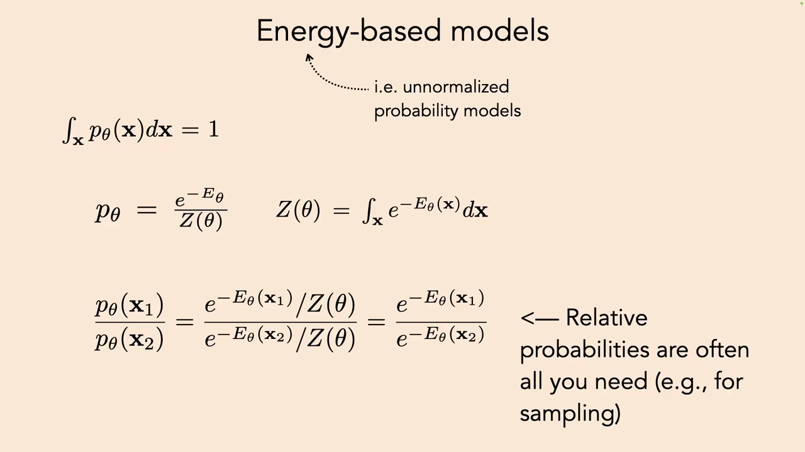
*▲ 강의 슬라이드 [49:00](https://youtu.be/hJlrAHqGOS8?t=2940): [에너지 기반 모델](00_%EB%94%A5%EB%9F%AC%EB%8B%9D_%EC%9A%A9%EC%96%B4%EC%82%AC%EC%A0%84.md#energy-based-model-%EC%97%90%EB%84%88%EC%A7%80-%EA%B8%B0%EB%B0%98-%EB%AA%A8%EB%8D%B8) = 정규화하지 않은 [확률](00_%EB%94%A5%EB%9F%AC%EB%8B%9D_%EC%9A%A9%EC%96%B4%EC%82%AC%EC%A0%84.md#probability-%ED%99%95%EB%A5%A0) 모델. [볼츠만 분포](00_%EB%94%A5%EB%9F%AC%EB%8B%9D_%EC%9A%A9%EC%96%B4%EC%82%AC%EC%A0%84.md#boltzmann-distribution-%EB%B3%BC%EC%B8%A0%EB%A7%8C-%EB%B6%84%ED%8F%AC)와, $Z$가 지워지는 [확률](00_%EB%94%A5%EB%9F%AC%EB%8B%9D_%EC%9A%A9%EC%96%B4%EC%82%AC%EC%A0%84.md#probability-%ED%99%95%EB%A5%A0) 비율*

질의응답 정리 [48:22](https://youtu.be/hJlrAHqGOS8?t=2902)

- **에너지 앞의 마이너스는 왜?** 정의일 뿐이다. 에너지가 낮을수록 [확률](00_%EB%94%A5%EB%9F%AC%EB%8B%9D_%EC%9A%A9%EC%96%B4%EC%82%AC%EC%A0%84.md#probability-%ED%99%95%EB%A5%A0)이 높도록 정했다.
- **그럼 왜 굳이 정규화된 [확률](00_%EB%94%A5%EB%9F%AC%EB%8B%9D_%EC%9A%A9%EC%96%B4%EC%82%AC%EC%A0%84.md#probability-%ED%99%95%EB%A5%A0)을 쓰나?** 학생 답 "다른 개념 사이에서 크기를 맞추려고"에 강사가 동의한다. [확률](00_%EB%94%A5%EB%9F%AC%EB%8B%9D_%EC%9A%A9%EC%96%B4%EC%82%AC%EC%A0%84.md#probability-%ED%99%95%EB%A5%A0)은 모든 문제를 같은 단위에 올려 해석하고 비교하기 쉽다. 병원에서 "암 에너지가 1000만"이라고 하면 아무 쓸모가 없지만 "[확률](00_%EB%94%A5%EB%9F%AC%EB%8B%9D_%EC%9A%A9%EC%96%B4%EC%82%AC%EC%A0%84.md#probability-%ED%99%95%EB%A5%A0) 0.1%"라면 판단할 수 있다.

### 6.2 대조 발산

▶ 영상 [50:37](https://youtu.be/hJlrAHqGOS8?t=3037)

📐 **수학 개념**: [에너지 함수와 볼츠만 분포](%EC%88%98%ED%95%99%EA%B0%9C%EB%85%90/11_%EC%83%9D%EC%84%B1_%EB%AA%A8%EB%8D%B8/MM52_%EC%97%90%EB%84%88%EC%A7%80_%ED%95%A8%EC%88%98%EC%99%80_%EB%B3%BC%EC%B8%A0%EB%A7%8C_%EB%B6%84%ED%8F%AC.md) · [야코비안과 연쇄법칙](%EC%88%98%ED%95%99%EA%B0%9C%EB%85%90/05_%EC%8B%A0%EA%B2%BD%EB%A7%9D%EC%9D%98_%EA%B3%84%EC%82%B0/MM09_%EC%95%BC%EC%BD%94%EB%B9%84%EC%95%88%EA%B3%BC_%EC%97%B0%EC%87%84%EB%B2%95%EC%B9%99.md) · [기댓값과 일반화 간극](%EC%88%98%ED%95%99%EA%B0%9C%EB%85%90/04_%ED%99%95%EB%A5%A0%EA%B3%BC_%EC%A0%95%EB%B3%B4/MM22_%EA%B8%B0%EB%8C%93%EA%B0%92%EA%B3%BC_%EC%9D%BC%EB%B0%98%ED%99%94_%EA%B0%84%EA%B7%B9.md)

EBM을 데이터에 맞추는 방법도 [밀도 모델](00_%EB%94%A5%EB%9F%AC%EB%8B%9D_%EC%9A%A9%EC%96%B4%EC%82%AC%EC%A0%84.md#density-model-%EB%B0%80%EB%8F%84-%EB%AA%A8%EB%8D%B8)과 같습니다. 데이터가 있는 곳의 에너지를 **낮춥니다**(= [확률](00_%EB%94%A5%EB%9F%AC%EB%8B%9D_%EC%9A%A9%EC%96%B4%EC%82%AC%EC%A0%84.md#probability-%ED%99%95%EB%A5%A0)을 올립니다). 그런데 이것만 하면 문제가 생깁니다. 학생 말대로 **질량이 일정하지 않기** 때문입니다. [정규화](00_%EB%94%A5%EB%9F%AC%EB%8B%9D_%EC%9A%A9%EC%96%B4%EC%82%AC%EC%A0%84.md#normalization-%EC%A0%95%EA%B7%9C%ED%99%94)를 강제하지 않으니, 모든 곳의 에너지를 $-\infty$로 내려도 됩니다.

그래서 **데이터가 없는 곳의 에너지를 올리는 항**을 더합니다. 구체적으로는 **모델에서 표본을 뽑아**([MCMC](00_%EB%94%A5%EB%9F%AC%EB%8B%9D_%EC%9A%A9%EC%96%B4%EC%82%AC%EC%A0%84.md#mcmc-markov-chain-monte-carlo-%EB%A7%88%EB%A5%B4%EC%BD%94%ED%94%84-%EC%97%B0%EC%87%84-%EB%AA%AC%ED%85%8C%EC%B9%B4%EB%A5%BC%EB%A1%9C)는 $Z$ 없이도 표본을 뽑을 수 있습니다) 그 자리의 에너지를 올립니다. 모델이 [확률](00_%EB%94%A5%EB%9F%AC%EB%8B%9D_%EC%9A%A9%EC%96%B4%EC%82%AC%EC%A0%84.md#probability-%ED%99%95%EB%A5%A0)을 많이 주는 곳에서 표본이 많이 뽑히므로, "모델이 지금 [확률](00_%EB%94%A5%EB%9F%AC%EB%8B%9D_%EC%9A%A9%EC%96%B4%EC%82%AC%EC%A0%84.md#probability-%ED%99%95%EB%A5%A0)을 몰아 주는 곳"을 누르는 셈입니다. 이를 반복하면 데이터 자리는 내려가고(초록 화살표), 모델 표본 자리는 올라가다가(빨강 화살표), 모델이 정확히 데이터 자리에 [확률](00_%EB%94%A5%EB%9F%AC%EB%8B%9D_%EC%9A%A9%EC%96%B4%EC%82%AC%EC%A0%84.md#probability-%ED%99%95%EB%A5%A0)을 둘 때 두 힘이 **상쇄**되어 멈춥니다. 이 알고리즘이 **[대조 발산](00_%EB%94%A5%EB%9F%AC%EB%8B%9D_%EC%9A%A9%EC%96%B4%EC%82%AC%EC%A0%84.md#contrastive-divergence-%EB%8C%80%EC%A1%B0-%EB%B0%9C%EC%82%B0)**(contrastive divergence)입니다. 이것도 다른 [생성 모델](00_%EB%94%A5%EB%9F%AC%EB%8B%9D_%EC%9A%A9%EC%96%B4%EC%82%AC%EC%A0%84.md#generative-model-%EC%83%9D%EC%84%B1-%EB%AA%A8%EB%8D%B8)처럼 과적합하므로 [조기 종료](00_%EB%94%A5%EB%9F%AC%EB%8B%9D_%EC%9A%A9%EC%96%B4%EC%82%AC%EC%A0%84.md#early-stopping-%EC%A1%B0%EA%B8%B0-%EC%A2%85%EB%A3%8C)나 [규제](00_%EB%94%A5%EB%9F%AC%EB%8B%9D_%EC%9A%A9%EC%96%B4%EC%82%AC%EC%A0%84.md#regularization-%EA%B7%9C%EC%A0%9C)를 씁니다.

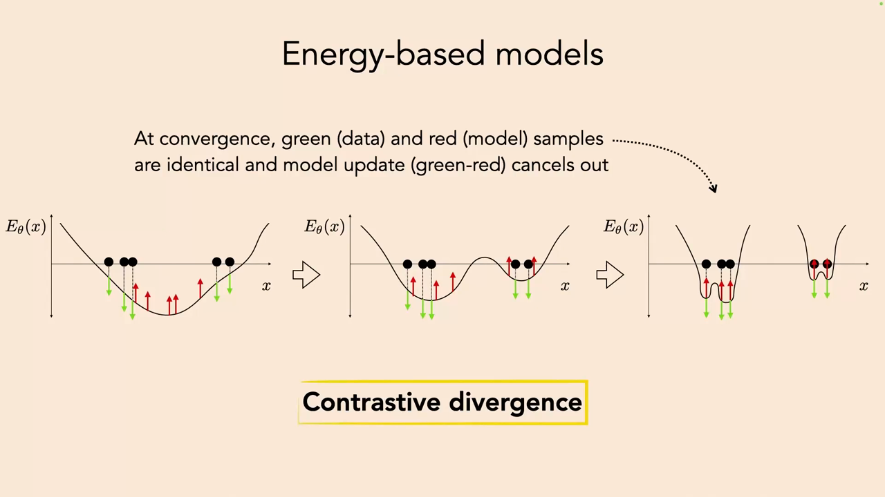
*▲ 강의 슬라이드 [58:32](https://youtu.be/hJlrAHqGOS8?t=3512): [대조 발산](00_%EB%94%A5%EB%9F%AC%EB%8B%9D_%EC%9A%A9%EC%96%B4%EC%82%AC%EC%A0%84.md#contrastive-divergence-%EB%8C%80%EC%A1%B0-%EB%B0%9C%EC%82%B0). 데이터(초록)는 에너지를 내리고 모델 표본(빨강)은 올린다. 수렴하면 둘이 같아져 갱신이 상쇄된다*

수식 유도는 이렇습니다. [로그](00_%EB%94%A5%EB%9F%AC%EB%8B%9D_%EC%9A%A9%EC%96%B4%EC%82%AC%EC%A0%84.md#log-ln-%EB%A1%9C%EA%B7%B8)를 씌우면 $\log p_\theta = -E_\theta - \log Z(\theta)$로 나뉩니다. 앞이 **양의 항**(데이터, 초록), 뒤가 **음의 항**([분할 함수](00_%EB%94%A5%EB%9F%AC%EB%8B%9D_%EC%9A%A9%EC%96%B4%EC%82%AC%EC%A0%84.md#partition-function-%EB%B6%84%ED%95%A0-%ED%95%A8%EC%88%98), 빨강)입니다. 양의 항은 데이터에서 역전파하면 되지만, $\nabla_\theta \log Z$는 어떻게 구할까요? 미적분 항등식 $\nabla \log f = \frac{1}{f}\nabla f$, $Z$의 정의, [연쇄법칙](00_%EB%94%A5%EB%9F%AC%EB%8B%9D_%EC%9A%A9%EC%96%B4%EC%82%AC%EC%A0%84.md#chain-rule-%EC%97%B0%EC%87%84%EB%B2%95%EC%B9%99)($\nabla e^{-E} = -e^{-E}\nabla E$)을 차례로 쓰고 항을 정리하면 $\frac{e^{-E}}{Z} = p_\theta$가 다시 나타나, **모델 분포에 대한 [기댓값](00_%EB%94%A5%EB%9F%AC%EB%8B%9D_%EC%9A%A9%EC%96%B4%EC%82%AC%EC%A0%84.md#expectation-%EA%B8%B0%EB%8C%93%EA%B0%92)**이 됩니다. [기댓값](00_%EB%94%A5%EB%9F%AC%EB%8B%9D_%EC%9A%A9%EC%96%B4%EC%82%AC%EC%A0%84.md#expectation-%EA%B8%B0%EB%8C%93%EA%B0%92)은 표본 평균으로 근사할 수 있습니다.

$$
\begin{aligned}
\nabla_\theta \log Z(\theta) &= \frac{1}{Z(\theta)} \nabla_\theta \int_x e^{-E_\theta(x)} dx = \int_x \frac{e^{-E_\theta(x)}}{Z(\theta)} \big(-\nabla_\theta E_\theta(x)\big) dx = -\mathbb{E}_{x \sim p_\theta}\big[\nabla_\theta E_\theta(x)\big] \\
\nabla_\theta \mathbb{E}_{x \sim p_{\text{data}}}\big[\log p_\theta(x)\big] &= -\mathbb{E}_{x \sim p_{\text{data}}}\big[\nabla_\theta E_\theta(x)\big] + \mathbb{E}_{x \sim p_\theta}\big[\nabla_\theta E_\theta(x)\big] \approx -\frac{1}{N}\sum_{i=1}^{N} \nabla_\theta E_\theta(x^{(i)}) + \frac{1}{N}\sum_{i=1}^{N} \nabla_\theta E_\theta(\hat{x}^{(i)})
\end{aligned}
$$

기호 풀이

| 기호 | 읽는 법 | 뜻 | 예제 값 |
| --- | --- | --- | --- |
| $\nabla_\theta$ | 나블라 세타 | $\theta$에 대한 [기울기](00_%EB%94%A5%EB%9F%AC%EB%8B%9D_%EC%9A%A9%EC%96%B4%EC%82%AC%EC%A0%84.md#gradient-%EA%B8%B0%EC%9A%B8%EA%B8%B0) | |
| $\log Z(\theta)$ | [로그](00_%EB%94%A5%EB%9F%AC%EB%8B%9D_%EC%9A%A9%EC%96%B4%EC%82%AC%EC%A0%84.md#log-ln-%EB%A1%9C%EA%B7%B8) 제트 | [분할 함수](00_%EB%94%A5%EB%9F%AC%EB%8B%9D_%EC%9A%A9%EC%96%B4%EC%82%AC%EC%A0%84.md#partition-function-%EB%B6%84%ED%95%A0-%ED%95%A8%EC%88%98)의 [로그](00_%EB%94%A5%EB%9F%AC%EB%8B%9D_%EC%9A%A9%EC%96%B4%EC%82%AC%EC%A0%84.md#log-ln-%EB%A1%9C%EA%B7%B8). [기울기](00_%EB%94%A5%EB%9F%AC%EB%8B%9D_%EC%9A%A9%EC%96%B4%EC%82%AC%EC%A0%84.md#gradient-%EA%B8%B0%EC%9A%B8%EA%B8%B0)가 음의 항이 된다 | |
| $x^{(i)} \sim p_{\text{data}}$ | 엑스 아이 | [학습 데이터](00_%EB%94%A5%EB%9F%AC%EB%8B%9D_%EC%9A%A9%EC%96%B4%EC%82%AC%EC%A0%84.md#training-data-test-data-%ED%95%99%EC%8A%B5-%EB%8D%B0%EC%9D%B4%ED%84%B0%EC%99%80-%EC%8B%9C%ED%97%98-%EB%8D%B0%EC%9D%B4%ED%84%B0) 표본 (초록) | 1, 3 |
| $\hat{x}^{(i)} \sim p_\theta$ | 엑스 햇 아이 | 지금 모델에서 뽑은 표본 (빨강) | 2, 6 |
| $\mathbb{E}_{x \sim p_\theta}$ | 모델 [기댓값](00_%EB%94%A5%EB%9F%AC%EB%8B%9D_%EC%9A%A9%EC%96%B4%EC%82%AC%EC%A0%84.md#expectation-%EA%B8%B0%EB%8C%93%EA%B0%92) | 모델 분포에 대한 평균 | |
| $\nabla_\theta E_\theta(x)$ | 에너지 [기울기](00_%EB%94%A5%EB%9F%AC%EB%8B%9D_%EC%9A%A9%EC%96%B4%EC%82%AC%EC%A0%84.md#gradient-%EA%B8%B0%EC%9A%B8%EA%B8%B0) | 에너지가 $\theta$에 따라 변하는 정도 | $x$ |

예제와 풀이

**문제**: 에너지가 $E_\theta(x) = \theta x$(그래서 $\nabla_\theta E_\theta(x) = x$)인 모델이 있다. [학습 데이터](00_%EB%94%A5%EB%9F%AC%EB%8B%9D_%EC%9A%A9%EC%96%B4%EC%82%AC%EC%A0%84.md#training-data-test-data-%ED%95%99%EC%8A%B5-%EB%8D%B0%EC%9D%B4%ED%84%B0%EC%99%80-%EC%8B%9C%ED%97%98-%EB%8D%B0%EC%9D%B4%ED%84%B0) 표본은 1, 3이고 지금 모델에서 뽑은 표본은 2, 6이다. 평균 [로그](00_%EB%94%A5%EB%9F%AC%EB%8B%9D_%EC%9A%A9%EC%96%B4%EC%82%AC%EC%A0%84.md#log-ln-%EB%A1%9C%EA%B7%B8) [우도](00_%EB%94%A5%EB%9F%AC%EB%8B%9D_%EC%9A%A9%EC%96%B4%EC%82%AC%EC%A0%84.md#likelihood-%EC%9A%B0%EB%8F%84)의 [기울기](00_%EB%94%A5%EB%9F%AC%EB%8B%9D_%EC%9A%A9%EC%96%B4%EC%82%AC%EC%A0%84.md#gradient-%EA%B8%B0%EC%9A%B8%EA%B8%B0)는?

**주어진 값**
- $x^{(1)} = 1, x^{(2)} = 3$ ([학습 데이터](00_%EB%94%A5%EB%9F%AC%EB%8B%9D_%EC%9A%A9%EC%96%B4%EC%82%AC%EC%A0%84.md#training-data-test-data-%ED%95%99%EC%8A%B5-%EB%8D%B0%EC%9D%B4%ED%84%B0%EC%99%80-%EC%8B%9C%ED%97%98-%EB%8D%B0%EC%9D%B4%ED%84%B0) 표본)
- $\hat{x}^{(1)} = 2, \hat{x}^{(2)} = 6$ (모델 표본)
- $N = 2$ (각 표본 수)
- $\nabla_\theta E_\theta(x) = x$ ($\theta x$를 $\theta$로 미분하면 $x$)

**풀이**
1. 식을 그대로 쓴다: $\nabla_\theta \approx -\dfrac{1}{N}\sum_{i} \nabla_\theta E_\theta(x^{(i)}) + \dfrac{1}{N}\sum_{i} \nabla_\theta E_\theta(\hat{x}^{(i)})$
2. 값을 대입한다: $\nabla_\theta \approx -\dfrac{1}{2}(1 + 3) + \dfrac{1}{2}(2 + 6)$ (Σ를 두 항씩 풀어 썼다)
3. 첫 괄호를 더한다: $1 + 3 = 4$
4. 둘째 괄호를 더한다: $2 + 6 = 8$
5. 첫 항을 계산한다: $-4 / 2 = -2$
6. 둘째 항을 계산한다: $8 / 2 = 4$
7. 더한다: $-2 + 4 = 2$

**답**: [기울기](00_%EB%94%A5%EB%9F%AC%EB%8B%9D_%EC%9A%A9%EC%96%B4%EC%82%AC%EC%A0%84.md#gradient-%EA%B8%B0%EC%9A%B8%EA%B8%B0) **2**. 경사 상승으로 $\theta$가 커지면 큰 $x$의 에너지가 더 많이 올라가, 모델이 큰 값(6 근처)에 주던 [확률](00_%EB%94%A5%EB%9F%AC%EB%8B%9D_%EC%9A%A9%EC%96%B4%EC%82%AC%EC%A0%84.md#probability-%ED%99%95%EB%A5%A0)이 데이터가 있는 작은 값 쪽으로 옮겨 간다.

내 이해

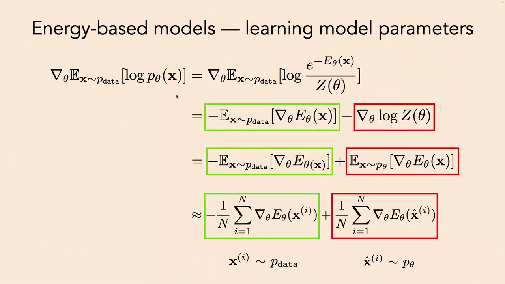
*▲ 강의 슬라이드 [57:50](https://youtu.be/hJlrAHqGOS8?t=3470): EBM의 [최대 우도](00_%EB%94%A5%EB%9F%AC%EB%8B%9D_%EC%9A%A9%EC%96%B4%EC%82%AC%EC%A0%84.md#maximum-likelihood-%EC%B5%9C%EB%8C%80-%EC%9A%B0%EB%8F%84) [기울기](00_%EB%94%A5%EB%9F%AC%EB%8B%9D_%EC%9A%A9%EC%96%B4%EC%82%AC%EC%A0%84.md#gradient-%EA%B8%B0%EC%9A%B8%EA%B8%B0). 초록(데이터 표본 $x^{(i)} \sim p_{\text{data}}$)과 빨강(모델 표본 $\hat{x}^{(i)} \sim p_\theta$) 두 [기댓값](00_%EB%94%A5%EB%9F%AC%EB%8B%9D_%EC%9A%A9%EC%96%B4%EC%82%AC%EC%A0%84.md#expectation-%EA%B8%B0%EB%8C%93%EA%B0%92)을 표본 평균으로 근사한다*

질의응답에서 학생이 유도 중 빼낸 마이너스가 뺄셈이 아니라 $-1$ 곱하기라고 지적하자, 강사는 맞다며 헷갈릴 수 있는 표기라고 인정했습니다. 직관만 기억해도 됩니다. **데이터 자리의 에너지는 내리고, 모델이 지금 [확률](00_%EB%94%A5%EB%9F%AC%EB%8B%9D_%EC%9A%A9%EC%96%B4%EC%82%AC%EC%A0%84.md#probability-%ED%99%95%EB%A5%A0)을 주는 자리의 에너지는 올린다. 둘이 상쇄되면 모델이 데이터에 맞은 것이다.**

여기까지 정리하면, 데이터 생성 과정은 세 가지 중 하나(또는 여럿)로 나타낼 수 있습니다. 정규화된 점수를 주는 **밀도 함수**, 정규화하지 않은 점수를 주는 **에너지 함수**, [잠재 변수](00_%EB%94%A5%EB%9F%AC%EB%8B%9D_%EC%9A%A9%EC%96%B4%EC%82%AC%EC%A0%84.md#latent-variable-%EC%9E%A0%EC%9E%AC-%EB%B3%80%EC%88%98)에서 바로 데이터를 만드는 **[생성기](00_%EB%94%A5%EB%9F%AC%EB%8B%9D_%EC%9A%A9%EC%96%B4%EC%82%AC%EC%A0%84.md#generator-discriminator-%EC%83%9D%EC%84%B1%EA%B8%B0%EC%99%80-%ED%8C%90%EB%B3%84%EA%B8%B0)**입니다. 많은 딥 [생성 모델](00_%EB%94%A5%EB%9F%AC%EB%8B%9D_%EC%9A%A9%EC%96%B4%EC%82%AC%EC%A0%84.md#generative-model-%EC%83%9D%EC%84%B1-%EB%AA%A8%EB%8D%B8)은 이 중 여러 형태를 동시에 가집니다.

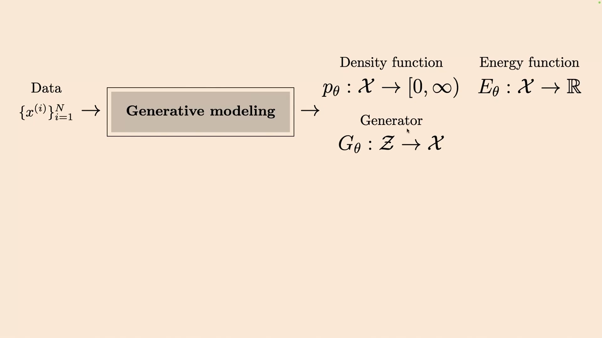
*▲ 강의 슬라이드 [59:00](https://youtu.be/hJlrAHqGOS8?t=3540): [생성 모델](00_%EB%94%A5%EB%9F%AC%EB%8B%9D_%EC%9A%A9%EC%96%B4%EC%82%AC%EC%A0%84.md#generative-model-%EC%83%9D%EC%84%B1-%EB%AA%A8%EB%8D%B8)이 데이터에서 배울 수 있는 세 가지. 밀도 함수 $p_\theta: \mathcal{X} \to [0, \infty)$, 에너지 함수 $E_\theta: \mathcal{X} \to \mathbb{R}$, [생성기](00_%EB%94%A5%EB%9F%AC%EB%8B%9D_%EC%9A%A9%EC%96%B4%EC%82%AC%EC%A0%84.md#generator-discriminator-%EC%83%9D%EC%84%B1%EA%B8%B0%EC%99%80-%ED%8C%90%EB%B3%84%EA%B8%B0) $G_\theta: \mathcal{Z} \to \mathcal{X}$*

---

## 7. 자기회귀 모델

▶ 영상 [59:33](https://youtu.be/hJlrAHqGOS8?t=3573)

📐 **수학 개념**: [확률의 연쇄법칙과 빔 서치](%EC%88%98%ED%95%99%EA%B0%9C%EB%85%90/04_%ED%99%95%EB%A5%A0%EA%B3%BC_%EC%A0%95%EB%B3%B4/MM39_%ED%99%95%EB%A5%A0%EC%9D%98_%EC%97%B0%EC%87%84%EB%B2%95%EC%B9%99%EA%B3%BC_%EB%B9%94_%EC%84%9C%EC%B9%98.md) · [확률 밀도와 정규분포](%EC%88%98%ED%95%99%EA%B0%9C%EB%85%90/04_%ED%99%95%EB%A5%A0%EA%B3%BC_%EC%A0%95%EB%B3%B4/MM50_%ED%99%95%EB%A5%A0_%EB%B0%80%EB%8F%84%EC%99%80_%EC%A0%95%EA%B7%9C%EB%B6%84%ED%8F%AC.md)([범주 분포](00_%EB%94%A5%EB%9F%AC%EB%8B%9D_%EC%9A%A9%EC%96%B4%EC%82%AC%EC%A0%84.md#categorical-distribution-%EB%B2%94%EC%A3%BC-%EB%B6%84%ED%8F%AC) [샘플링](00_%EB%94%A5%EB%9F%AC%EB%8B%9D_%EC%9A%A9%EC%96%B4%EC%82%AC%EC%A0%84.md#sampling-%EC%83%98%ED%94%8C%EB%A7%81)) · [KL 발산과 최대 우도](%EC%88%98%ED%95%99%EA%B0%9C%EB%85%90/04_%ED%99%95%EB%A5%A0%EA%B3%BC_%EC%A0%95%EB%B3%B4/MM51_KL_%EB%B0%9C%EC%82%B0%EA%B3%BC_%EC%B5%9C%EB%8C%80_%EC%9A%B0%EB%8F%84.md) · [엔트로피](%EC%88%98%ED%95%99%EA%B0%9C%EB%85%90/04_%ED%99%95%EB%A5%A0%EA%B3%BC_%EC%A0%95%EB%B3%B4/M10_%EC%97%94%ED%8A%B8%EB%A1%9C%ED%94%BC.md)

이제 이름난 딥 [생성 모델](00_%EB%94%A5%EB%9F%AC%EB%8B%9D_%EC%9A%A9%EC%96%B4%EC%82%AC%EC%A0%84.md#generative-model-%EC%83%9D%EC%84%B1-%EB%AA%A8%EB%8D%B8) 셋을 봅니다. 가장 이해하기 쉬운 것이 **[자기회귀 모델](00_%EB%94%A5%EB%9F%AC%EB%8B%9D_%EC%9A%A9%EC%96%B4%EC%82%AC%EC%A0%84.md#autoregressive-model-%EC%9E%90%EA%B8%B0%ED%9A%8C%EA%B7%80-%EB%AA%A8%EB%8D%B8)**입니다. "once upon"을 보고 다음 단어 "a"를 맞히고, 다시 "time"을 맞히는 다음 단어(다음 데이터 점) 예측기입니다. 시간 순서일 필요는 없고, 그건 하나의 선택일 뿐입니다.

- **[학습](00_%EB%94%A5%EB%9F%AC%EB%8B%9D_%EC%9A%A9%EC%96%B4%EC%82%AC%EC%A0%84.md#training-%ED%95%99%EC%8A%B5)**: 문장 데이터를 "앞부분"과 "다음 단어"로 자르면 [지도 학습](00_%EB%94%A5%EB%9F%AC%EB%8B%9D_%EC%9A%A9%EC%96%B4%EC%82%AC%EC%A0%84.md#supervised-learning-%EC%A7%80%EB%8F%84-%ED%95%99%EC%8A%B5) 문제가 됩니다. 다음 단어를 맞히는 [분류](00_%EB%94%A5%EB%9F%AC%EB%8B%9D_%EC%9A%A9%EC%96%B4%EC%82%AC%EC%A0%84.md#regression-classification-%ED%9A%8C%EA%B7%80%EC%99%80-%EB%B6%84%EB%A5%98)로 풉니다.
- **[샘플링](00_%EB%94%A5%EB%9F%AC%EB%8B%9D_%EC%9A%A9%EC%96%B4%EC%82%AC%EC%A0%84.md#sampling-%EC%83%98%ED%94%8C%EB%A7%81)**: 단어 하나를 고르는 대신 단어마다의 [확률](00_%EB%94%A5%EB%9F%AC%EB%8B%9D_%EC%9A%A9%EC%96%B4%EC%82%AC%EC%A0%84.md#probability-%ED%99%95%EB%A5%A0)(**[범주 분포](00_%EB%94%A5%EB%9F%AC%EB%8B%9D_%EC%9A%A9%EC%96%B4%EC%82%AC%EC%A0%84.md#categorical-distribution-%EB%B2%94%EC%A3%BC-%EB%B6%84%ED%8F%AC)**)을 내고 거기서 뽑습니다. 0~1 균등 난수를 하나 뽑아 [확률](00_%EB%94%A5%EB%9F%AC%EB%8B%9D_%EC%9A%A9%EC%96%B4%EC%82%AC%EC%A0%84.md#probability-%ED%99%95%EB%A5%A0) 칸을 따라 걸어가다 난수가 떨어진 칸을 고르면 됩니다.

이것이 올바른 [확률](00_%EB%94%A5%EB%9F%AC%EB%8B%9D_%EC%9A%A9%EC%96%B4%EC%82%AC%EC%A0%84.md#probability-%ED%99%95%EB%A5%A0) 모델인 이유는 **[확률의 연쇄법칙](00_%EB%94%A5%EB%9F%AC%EB%8B%9D_%EC%9A%A9%EC%96%B4%EC%82%AC%EC%A0%84.md#chain-rule-of-probability-%ED%99%95%EB%A5%A0%EC%9D%98-%EC%97%B0%EC%87%84%EB%B2%95%EC%B9%99)** 때문입니다. 벡터 $\mathbf{x}$의 결합 [확률](00_%EB%94%A5%EB%9F%AC%EB%8B%9D_%EC%9A%A9%EC%96%B4%EC%82%AC%EC%A0%84.md#probability-%ED%99%95%EB%A5%A0)은 "앞의 것들이 주어졌을 때 다음 것의 [조건부 확률](00_%EB%94%A5%EB%9F%AC%EB%8B%9D_%EC%9A%A9%EC%96%B4%EC%82%AC%EC%A0%84.md#conditional-probability-%EC%A1%B0%EA%B1%B4%EB%B6%80-%ED%99%95%EB%A5%A0)"을 모두 곱한 것과 항상 같습니다. 곱은 [로그](00_%EB%94%A5%EB%9F%AC%EB%8B%9D_%EC%9A%A9%EC%96%B4%EC%82%AC%EC%A0%84.md#log-ln-%EB%A1%9C%EA%B7%B8)를 씌우면 합이 되고, [학습](00_%EB%94%A5%EB%9F%AC%EB%8B%9D_%EC%9A%A9%EC%96%B4%EC%82%AC%EC%A0%84.md#training-%ED%95%99%EC%8A%B5)은 이 [로그](00_%EB%94%A5%EB%9F%AC%EB%8B%9D_%EC%9A%A9%EC%96%B4%EC%82%AC%EC%A0%84.md#log-ln-%EB%A1%9C%EA%B7%B8) 합을 최대화([최대 우도](00_%EB%94%A5%EB%9F%AC%EB%8B%9D_%EC%9A%A9%EC%96%B4%EC%82%AC%EC%A0%84.md#maximum-likelihood-%EC%B5%9C%EB%8C%80-%EC%9A%B0%EB%8F%84))합니다.

$$
p(\mathbf{x}) = \prod_{i=1}^{n} p(x_i \mid x_1, \dots, x_{i-1}), \qquad \log p_\theta(\mathbf{x}) = \sum_{i=1}^{n} \log p_\theta(x_i \mid x_1, \dots, x_{i-1})
$$

기호 풀이

| 기호 | 읽는 법 | 뜻 | 예제 값 |
| --- | --- | --- | --- |
| $\mathbf{x} = (x_1, \dots, x_n)$ | 엑스 벡터 | 문장(단어들) 또는 이미지(픽셀들) | 픽셀 3개 |
| $p(x_i \mid x_1, \dots, x_{i-1})$ | [조건부 확률](00_%EB%94%A5%EB%9F%AC%EB%8B%9D_%EC%9A%A9%EC%96%B4%EC%82%AC%EC%A0%84.md#conditional-probability-%EC%A1%B0%EA%B1%B4%EB%B6%80-%ED%99%95%EB%A5%A0) | 앞의 것들을 보고 $i$번째가 그 값일 [확률](00_%EB%94%A5%EB%9F%AC%EB%8B%9D_%EC%9A%A9%EC%96%B4%EC%82%AC%EC%A0%84.md#probability-%ED%99%95%EB%A5%A0) | 0.5, 0.4, 0.8 |
| $\prod_{i=1}^{n}$ | 파이(곱) | 1부터 $n$까지 모두 곱한다 | |
| $\sum_{i=1}^{n}$ | 시그마 | 1부터 $n$까지 모두 더한다 | |
| $\log p_\theta(\mathbf{x})$ | [로그](00_%EB%94%A5%EB%9F%AC%EB%8B%9D_%EC%9A%A9%EC%96%B4%EC%82%AC%EC%A0%84.md#log-ln-%EB%A1%9C%EA%B7%B8) [우도](00_%EB%94%A5%EB%9F%AC%EB%8B%9D_%EC%9A%A9%EC%96%B4%EC%82%AC%EC%A0%84.md#likelihood-%EC%9A%B0%EB%8F%84) | [학습](00_%EB%94%A5%EB%9F%AC%EB%8B%9D_%EC%9A%A9%EC%96%B4%EC%82%AC%EC%A0%84.md#training-%ED%95%99%EC%8A%B5)이 키우는 값 | -1.8326 |

예제와 풀이

**문제**: 픽셀 세 개짜리 그림을 차례로 칠한다. 모델이 [정답](00_%EB%94%A5%EB%9F%AC%EB%8B%9D_%EC%9A%A9%EC%96%B4%EC%82%AC%EC%A0%84.md#label-%EC%A0%95%EB%8B%B5) 색에 준 [확률](00_%EB%94%A5%EB%9F%AC%EB%8B%9D_%EC%9A%A9%EC%96%B4%EC%82%AC%EC%A0%84.md#probability-%ED%99%95%EB%A5%A0)이 첫 픽셀 0.5, (첫 픽셀을 본 뒤) 둘째 0.4, (두 픽셀을 본 뒤) 셋째 0.8이다. 그림 전체의 [확률](00_%EB%94%A5%EB%9F%AC%EB%8B%9D_%EC%9A%A9%EC%96%B4%EC%82%AC%EC%A0%84.md#probability-%ED%99%95%EB%A5%A0)과 [로그](00_%EB%94%A5%EB%9F%AC%EB%8B%9D_%EC%9A%A9%EC%96%B4%EC%82%AC%EC%A0%84.md#log-ln-%EB%A1%9C%EA%B7%B8) [우도](00_%EB%94%A5%EB%9F%AC%EB%8B%9D_%EC%9A%A9%EC%96%B4%EC%82%AC%EC%A0%84.md#likelihood-%EC%9A%B0%EB%8F%84)는?

**주어진 값**
- $p(x_1) = 0.5$ (첫 픽셀이 [정답](00_%EB%94%A5%EB%9F%AC%EB%8B%9D_%EC%9A%A9%EC%96%B4%EC%82%AC%EC%A0%84.md#label-%EC%A0%95%EB%8B%B5) 색일 [확률](00_%EB%94%A5%EB%9F%AC%EB%8B%9D_%EC%9A%A9%EC%96%B4%EC%82%AC%EC%A0%84.md#probability-%ED%99%95%EB%A5%A0))
- $p(x_2 \mid x_1) = 0.4$ (첫 픽셀을 보고 둘째가 정답일 [확률](00_%EB%94%A5%EB%9F%AC%EB%8B%9D_%EC%9A%A9%EC%96%B4%EC%82%AC%EC%A0%84.md#probability-%ED%99%95%EB%A5%A0))
- $p(x_3 \mid x_1, x_2) = 0.8$ (두 픽셀을 보고 셋째가 정답일 [확률](00_%EB%94%A5%EB%9F%AC%EB%8B%9D_%EC%9A%A9%EC%96%B4%EC%82%AC%EC%A0%84.md#probability-%ED%99%95%EB%A5%A0))

**풀이**
1. 식을 그대로 쓴다: $p(\mathbf{x}) = \prod_{i=1}^{n} p(x_i \mid x_1, \dots, x_{i-1})$
2. 값을 대입한다: $p(\mathbf{x}) = 0.5 \times 0.4 \times 0.8$ (곱 기호를 세 항으로 풀어 썼다)
3. 앞의 두 개를 곱한다: $0.5 \times 0.4 = 0.2$
4. 셋째를 곱한다: $0.2 \times 0.8 = 0.16$
5. [로그](00_%EB%94%A5%EB%9F%AC%EB%8B%9D_%EC%9A%A9%EC%96%B4%EC%82%AC%EC%A0%84.md#log-ln-%EB%A1%9C%EA%B7%B8) 식을 그대로 쓴다: $\log p(\mathbf{x}) = \sum_{i=1}^{3} \log p(x_i \mid \cdots)$
6. 값을 대입한다: $\log p(\mathbf{x}) = \ln 0.5 + \ln 0.4 + \ln 0.8$
7. [로그](00_%EB%94%A5%EB%9F%AC%EB%8B%9D_%EC%9A%A9%EC%96%B4%EC%82%AC%EC%A0%84.md#log-ln-%EB%A1%9C%EA%B7%B8)를 구한다. $\ln a$는 $e$(약 2.718)를 몇 제곱하면 $a$가 되는지이고, 1보다 작은 수는 음수다: $\ln 0.5 = -0.6931$, $\ln 0.4 = -0.9163$, $\ln 0.8 = -0.2231$
8. 더한다: $-0.6931 + (-0.9163) + (-0.2231) = -1.8326$
9. 확인한다: $\ln 0.16 = -1.8326$으로 같다

**답**: 그림의 [확률](00_%EB%94%A5%EB%9F%AC%EB%8B%9D_%EC%9A%A9%EC%96%B4%EC%82%AC%EC%A0%84.md#probability-%ED%99%95%EB%A5%A0) **0.16**, [로그](00_%EB%94%A5%EB%9F%AC%EB%8B%9D_%EC%9A%A9%EC%96%B4%EC%82%AC%EC%A0%84.md#log-ln-%EB%A1%9C%EA%B7%B8) [우도](00_%EB%94%A5%EB%9F%AC%EB%8B%9D_%EC%9A%A9%EC%96%B4%EC%82%AC%EC%A0%84.md#likelihood-%EC%9A%B0%EB%8F%84) **-1.8326**. 곱의 [로그](00_%EB%94%A5%EB%9F%AC%EB%8B%9D_%EC%9A%A9%EC%96%B4%EC%82%AC%EC%A0%84.md#log-ln-%EB%A1%9C%EA%B7%B8) = [로그](00_%EB%94%A5%EB%9F%AC%EB%8B%9D_%EC%9A%A9%EC%96%B4%EC%82%AC%EC%A0%84.md#log-ln-%EB%A1%9C%EA%B7%B8)의 합이다.

내 이해

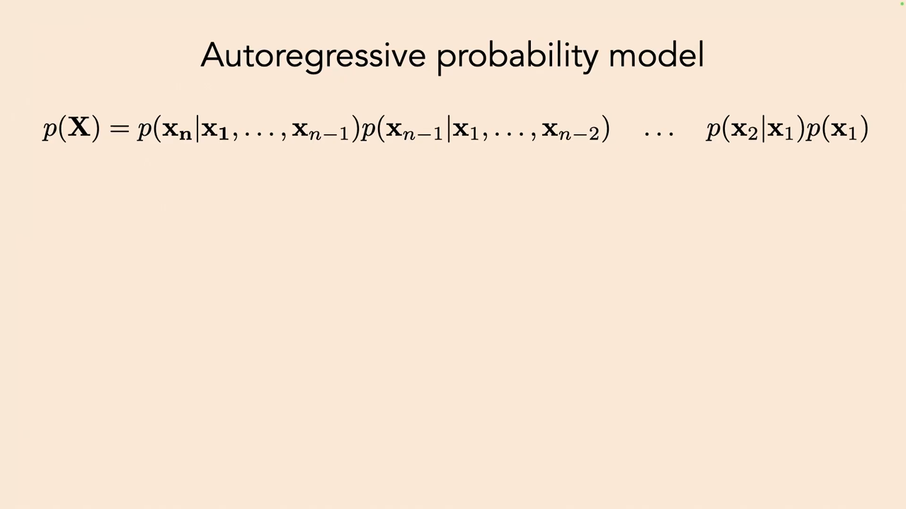
*▲ 강의 슬라이드 [61:40](https://youtu.be/hJlrAHqGOS8?t=3700): 자기회귀 [확률](00_%EB%94%A5%EB%9F%AC%EB%8B%9D_%EC%9A%A9%EC%96%B4%EC%82%AC%EC%A0%84.md#probability-%ED%99%95%EB%A5%A0) 모델. 결합 [확률](00_%EB%94%A5%EB%9F%AC%EB%8B%9D_%EC%9A%A9%EC%96%B4%EC%82%AC%EC%A0%84.md#probability-%ED%99%95%EB%A5%A0)을 다음 원소의 [조건부 확률](00_%EB%94%A5%EB%9F%AC%EB%8B%9D_%EC%9A%A9%EC%96%B4%EC%82%AC%EC%A0%84.md#conditional-probability-%EC%A1%B0%EA%B1%B4%EB%B6%80-%ED%99%95%EB%A5%A0)들의 곱으로 쓴다*

"once upon a time"의 [확률](00_%EB%94%A5%EB%9F%AC%EB%8B%9D_%EC%9A%A9%EC%96%B4%EC%82%AC%EC%A0%84.md#probability-%ED%99%95%EB%A5%A0)은 $p(\text{once}) \times p(\text{upon} \mid \text{once}) \times \cdots$입니다. $p(\text{time} \mid \text{once upon a})$는 어휘 크기만큼의 범주를 가진 다음 단어 분류기로 구합니다.

**이미지에서도** 같습니다. 새를 그리다가 어느 순간이든 앞의 픽셀들로 **다음 픽셀의 색**을 맞힙니다. 색 채우기 강의에서처럼 픽셀 색을 몇 개의 클래스로 양자화하고 [범주 분포](00_%EB%94%A5%EB%9F%AC%EB%8B%9D_%EC%9A%A9%EC%96%B4%EC%82%AC%EC%A0%84.md#categorical-distribution-%EB%B2%94%EC%A3%BC-%EB%B6%84%ED%8F%AC)를 냅니다. [소프트맥스](00_%EB%94%A5%EB%9F%AC%EB%8B%9D_%EC%9A%A9%EC%96%B4%EC%82%AC%EC%A0%84.md#softmax-%EC%86%8C%ED%94%84%ED%8A%B8%EB%A7%A5%EC%8A%A4) [회귀](00_%EB%94%A5%EB%9F%AC%EB%8B%9D_%EC%9A%A9%EC%96%B4%EC%82%AC%EC%A0%84.md#regression-classification-%ED%9A%8C%EA%B7%80%EC%99%80-%EB%B6%84%EB%A5%98) 그대로입니다. 뽑고, 다음 픽셀, 다음 픽셀, ... 아무것도 없는 상태에서 새가 완성됩니다. [손실](00_%EB%94%A5%EB%9F%AC%EB%8B%9D_%EC%9A%A9%EC%96%B4%EC%82%AC%EC%A0%84.md#loss-function-%EC%86%90%EC%8B%A4-%ED%95%A8%EC%88%98)은 모델이 [정답](00_%EB%94%A5%EB%9F%AC%EB%8B%9D_%EC%9A%A9%EC%96%B4%EC%82%AC%EC%A0%84.md#label-%EC%A0%95%EB%8B%B5) 클래스에 준 [확률](00_%EB%94%A5%EB%9F%AC%EB%8B%9D_%EC%9A%A9%EC%96%B4%EC%82%AC%EC%A0%84.md#probability-%ED%99%95%EB%A5%A0)(의 [로그](00_%EB%94%A5%EB%9F%AC%EB%8B%9D_%EC%9A%A9%EC%96%B4%EC%82%AC%EC%A0%84.md#log-ln-%EB%A1%9C%EA%B7%B8))이고, 이를 최대화합니다.

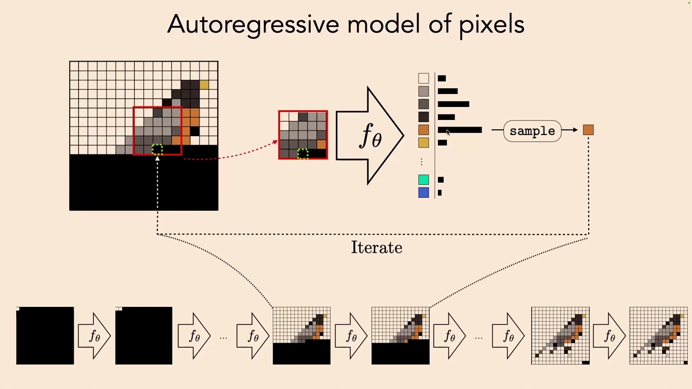
*▲ 강의 슬라이드 [63:50](https://youtu.be/hJlrAHqGOS8?t=3830): 픽셀의 [자기회귀 모델](00_%EB%94%A5%EB%9F%AC%EB%8B%9D_%EC%9A%A9%EC%96%B4%EC%82%AC%EC%A0%84.md#autoregressive-model-%EC%9E%90%EA%B8%B0%ED%9A%8C%EA%B7%80-%EB%AA%A8%EB%8D%B8). 앞의 픽셀로 다음 픽셀 색의 분포를 내고, 거기서 뽑아 채운 뒤 반복한다*

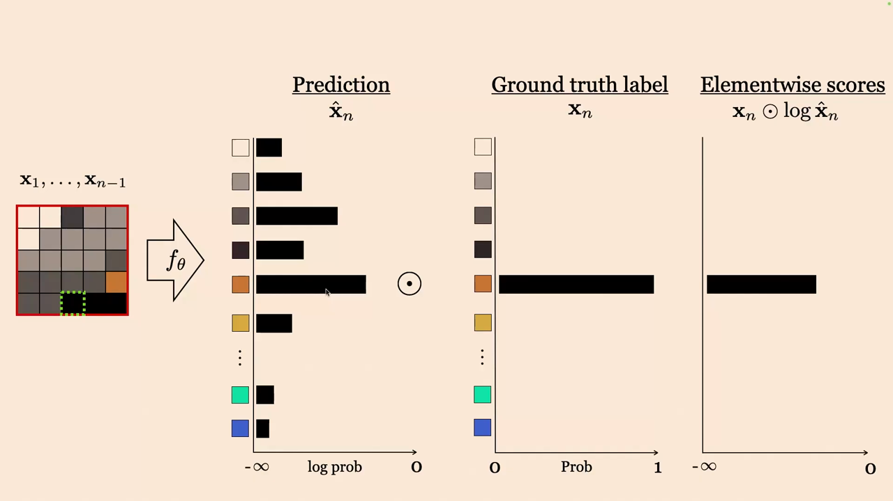
*▲ 강의 슬라이드 [64:30](https://youtu.be/hJlrAHqGOS8?t=3870): 예측 분포 $\hat{\mathbf{x}}_n$과 [원-핫](00_%EB%94%A5%EB%9F%AC%EB%8B%9D_%EC%9A%A9%EC%96%B4%EC%82%AC%EC%A0%84.md#one-hot-encoding-%EC%9B%90-%ED%95%AB-%EC%9D%B8%EC%BD%94%EB%94%A9) [정답](00_%EB%94%A5%EB%9F%AC%EB%8B%9D_%EC%9A%A9%EC%96%B4%EC%82%AC%EC%A0%84.md#label-%EC%A0%95%EB%8B%B5) $\mathbf{x}_n$의 [원소별 곱](00_%EB%94%A5%EB%9F%AC%EB%8B%9D_%EC%9A%A9%EC%96%B4%EC%82%AC%EC%A0%84.md#hadamard-product-%EC%9B%90%EC%86%8C%EB%B3%84-%EA%B3%B1) $\mathbf{x}_n \odot \log \hat{\mathbf{x}}_n$. [정답](00_%EB%94%A5%EB%9F%AC%EB%8B%9D_%EC%9A%A9%EC%96%B4%EC%82%AC%EC%A0%84.md#label-%EC%A0%95%EB%8B%B5) 칸의 [로그](00_%EB%94%A5%EB%9F%AC%EB%8B%9D_%EC%9A%A9%EC%96%B4%EC%82%AC%EC%A0%84.md#log-ln-%EB%A1%9C%EA%B7%B8) [확률](00_%EB%94%A5%EB%9F%AC%EB%8B%9D_%EC%9A%A9%EC%96%B4%EC%82%AC%EC%A0%84.md#probability-%ED%99%95%EB%A5%A0)만 남는다*

시계열(time series)도 흔히 자기회귀로 모델링합니다. 음악·오디오 모델링에서 다음 시점의 소리를 맞히는 WaveNet이 그 예이고, 생김새는 [언어 모델](00_%EB%94%A5%EB%9F%AC%EB%8B%9D_%EC%9A%A9%EC%96%B4%EC%82%AC%EC%A0%84.md#language-model-%EC%96%B8%EC%96%B4-%EB%AA%A8%EB%8D%B8)과 같습니다. 학습할 때는 [시퀀스](00_%EB%94%A5%EB%9F%AC%EB%8B%9D_%EC%9A%A9%EC%96%B4%EC%82%AC%EC%A0%84.md#sequence-%EC%8B%9C%ED%80%80%EC%8A%A4)의 모든 다음 관측에 준 [로그](00_%EB%94%A5%EB%9F%AC%EB%8B%9D_%EC%9A%A9%EC%96%B4%EC%82%AC%EC%A0%84.md#log-ln-%EB%A1%9C%EA%B7%B8) [확률](00_%EB%94%A5%EB%9F%AC%EB%8B%9D_%EC%9A%A9%EC%96%B4%EC%82%AC%EC%A0%84.md#probability-%ED%99%95%EB%A5%A0)을 더해 역전파합니다. 이전 강의의 [RNN](00_%EB%94%A5%EB%9F%AC%EB%8B%9D_%EC%9A%A9%EC%96%B4%EC%82%AC%EC%A0%84.md#rnn-recurrent-neural-network-%EC%88%9C%ED%99%98-%EC%8B%A0%EA%B2%BD%EB%A7%9D)과 같은 방식인데, [확률](00_%EB%94%A5%EB%9F%AC%EB%8B%9D_%EC%9A%A9%EC%96%B4%EC%82%AC%EC%A0%84.md#probability-%ED%99%95%EB%A5%A0)의 언어로 다시 말했을 뿐입니다.

질의응답 정리 [64:56](https://youtu.be/hJlrAHqGOS8?t=3896)

- **[자기회귀 모델](00_%EB%94%A5%EB%9F%AC%EB%8B%9D_%EC%9A%A9%EC%96%B4%EC%82%AC%EC%A0%84.md#autoregressive-model-%EC%9E%90%EA%B8%B0%ED%9A%8C%EA%B7%80-%EB%AA%A8%EB%8D%B8)은 밀도 모델인가, 에너지 모델인가, 샘플러인가?** 손을 들게 했더니 [밀도 모델](00_%EB%94%A5%EB%9F%AC%EB%8B%9D_%EC%9A%A9%EC%96%B4%EC%82%AC%EC%A0%84.md#density-model-%EB%B0%80%EB%8F%84-%EB%AA%A8%EB%8D%B8)이 가장 많았다. 강사도 [밀도 모델](00_%EB%94%A5%EB%9F%AC%EB%8B%9D_%EC%9A%A9%EC%96%B4%EC%82%AC%EC%A0%84.md#density-model-%EB%B0%80%EB%8F%84-%EB%AA%A8%EB%8D%B8)로 본다. 픽셀마다 [조건부 확률](00_%EB%94%A5%EB%9F%AC%EB%8B%9D_%EC%9A%A9%EC%96%B4%EC%82%AC%EC%A0%84.md#conditional-probability-%EC%A1%B0%EA%B1%B4%EB%B6%80-%ED%99%95%EB%A5%A0)을 명시적으로 내고, 이를 모두 곱하면 이미지 전체의 [확률](00_%EB%94%A5%EB%9F%AC%EB%8B%9D_%EC%9A%A9%EC%96%B4%EC%82%AC%EC%A0%84.md#probability-%ED%99%95%EB%A5%A0)(넓이 1인 밀도)이 되기 때문이다. 다만 경계는 흐릿해 [정답](00_%EB%94%A5%EB%9F%AC%EB%8B%9D_%EC%9A%A9%EC%96%B4%EC%82%AC%EC%A0%84.md#label-%EC%A0%95%EB%8B%B5)이 하나라고 하긴 어렵다.

---

## 8. 확산 모델

▶ 영상 [67:57](https://youtu.be/hJlrAHqGOS8?t=4077)

### 8.1 데이터를 잡음으로, 잡음을 데이터로

▶ 영상 [67:57](https://youtu.be/hJlrAHqGOS8?t=4077)

📐 **수학 개념**: [가우시안 확산의 순방향 과정](%EC%88%98%ED%95%99%EA%B0%9C%EB%85%90/11_%EC%83%9D%EC%84%B1_%EB%AA%A8%EB%8D%B8/MM53_%EA%B0%80%EC%9A%B0%EC%8B%9C%EC%95%88_%ED%99%95%EC%82%B0%EC%9D%98_%EC%88%9C%EB%B0%A9%ED%96%A5_%EA%B3%BC%EC%A0%95.md) · [확률 밀도와 정규분포](%EC%88%98%ED%95%99%EA%B0%9C%EB%85%90/04_%ED%99%95%EB%A5%A0%EA%B3%BC_%EC%A0%95%EB%B3%B4/MM50_%ED%99%95%EB%A5%A0_%EB%B0%80%EB%8F%84%EC%99%80_%EC%A0%95%EA%B7%9C%EB%B6%84%ED%8F%AC.md)

**[확산 모델](00_%EB%94%A5%EB%9F%AC%EB%8B%9D_%EC%9A%A9%EC%96%B4%EC%82%AC%EC%A0%84.md#diffusion-model-%ED%99%95%EC%82%B0-%EB%AA%A8%EB%8D%B8)**(diffusion model)은 직접 방식에 가까운 모델로, 무작위 주사위를 바로 표본으로 바꿉니다. 이 모델의 영리한 관찰은 이것입니다. **잡음을 구조 있는 데이터로 바꾸기는 매우 어렵지만, 데이터를 잡음으로 바꾸기는 매우 쉽다.**

- 새가 색 기체로 채운 풍선 동물이라고 상상합니다. 풍선을 터뜨리면 입자가 무작위로 퍼지고 결국 공간에 고르게 흩어집니다. 물리에서는 이것을 확산이라 합니다.
- [확산 모델](00_%EB%94%A5%EB%9F%AC%EB%8B%9D_%EC%9A%A9%EC%96%B4%EC%82%AC%EC%A0%84.md#diffusion-model-%ED%99%95%EC%82%B0-%EB%AA%A8%EB%8D%B8)도 똑같이, 데이터 공간에서 데이터를 조금씩 무작위로 흔들어 단순한 분포(보통 [정규분포](00_%EB%94%A5%EB%9F%AC%EB%8B%9D_%EC%9A%A9%EC%96%B4%EC%82%AC%EC%A0%84.md#normal-distribution-%EC%A0%95%EA%B7%9C%EB%B6%84%ED%8F%AC))가 되게 합니다. 이미지라면 모든 픽셀에 잡음을 조금, 또 조금 더해 완전히 무질서한 상태로 만듭니다. 정규 잡음을 계속 더하면 끝은 **단위 [정규분포](00_%EB%94%A5%EB%9F%AC%EB%8B%9D_%EC%9A%A9%EC%96%B4%EC%82%AC%EC%A0%84.md#normal-distribution-%EC%A0%95%EA%B7%9C%EB%B6%84%ED%8F%AC)**입니다.
- 그다음 이 과정을 **거꾸로 배웁니다**. 잡음에서 데이터로 가는 길을 혼자 찾기는 어렵지만, 우리가 정확한 길을 알려 주니 쉽습니다. "조금 더 시끄러운 것 → 조금 덜 시끄러운 것" 한 단계는 잡음을 살짝 걷어 내는 아주 쉬운 문제입니다.

[학습 데이터](00_%EB%94%A5%EB%9F%AC%EB%8B%9D_%EC%9A%A9%EC%96%B4%EC%82%AC%EC%A0%84.md#training-data-test-data-%ED%95%99%EC%8A%B5-%EB%8D%B0%EC%9D%B4%ED%84%B0%EC%99%80-%EC%8B%9C%ED%97%98-%EB%8D%B0%EC%9D%B4%ED%84%B0)로 이런 시끄러워지는 [시퀀스](00_%EB%94%A5%EB%9F%AC%EB%8B%9D_%EC%9A%A9%EC%96%B4%EC%82%AC%EC%A0%84.md#sequence-%EC%8B%9C%ED%80%80%EC%8A%A4)를 많이 만들고, 뒤집어서 (더 시끄러운 것, 덜 시끄러운 것) 쌍으로 자릅니다. 잡음 수준은 $t$로 나타냅니다($t$가 클수록 시끄럽습니다). 각 쌍은 입력-정답 쌍이라, 평균 제곱 [회귀](00_%EB%94%A5%EB%9F%AC%EB%8B%9D_%EC%9A%A9%EC%96%B4%EC%82%AC%EC%A0%84.md#regression-classification-%ED%9A%8C%EA%B7%80%EC%99%80-%EB%B6%84%EB%A5%98) 같은 [지도 학습](00_%EB%94%A5%EB%9F%AC%EB%8B%9D_%EC%9A%A9%EC%96%B4%EC%82%AC%EC%A0%84.md#supervised-learning-%EC%A7%80%EB%8F%84-%ED%95%99%EC%8A%B5)으로 풉니다. 이렇게 생성 모델링이 **작은 [지도 학습](00_%EB%94%A5%EB%9F%AC%EB%8B%9D_%EC%9A%A9%EC%96%B4%EC%82%AC%EC%A0%84.md#supervised-learning-%EC%A7%80%EB%8F%84-%ED%95%99%EC%8A%B5) 문제 여럿**으로 바뀝니다. 이 되감는 과정을 **역확산**(reverse diffusion)이라 하고, 표본을 만들 때는 잡음 벡터를 하나 뽑아 이 과정에 통과시킵니다.

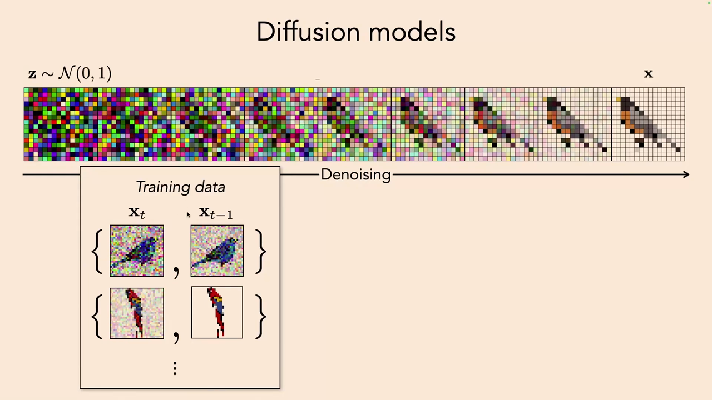
*▲ 강의 슬라이드 [71:00](https://youtu.be/hJlrAHqGOS8?t=4260): [확산 모델](00_%EB%94%A5%EB%9F%AC%EB%8B%9D_%EC%9A%A9%EC%96%B4%EC%82%AC%EC%A0%84.md#diffusion-model-%ED%99%95%EC%82%B0-%EB%AA%A8%EB%8D%B8). $z \sim \mathcal{N}(0, 1)$에서 시작해 잡음을 걷어 내며(denoising) 데이터 $x$로 간다. [학습 데이터](00_%EB%94%A5%EB%9F%AC%EB%8B%9D_%EC%9A%A9%EC%96%B4%EC%82%AC%EC%A0%84.md#training-data-test-data-%ED%95%99%EC%8A%B5-%EB%8D%B0%EC%9D%B4%ED%84%B0%EC%99%80-%EC%8B%9C%ED%97%98-%EB%8D%B0%EC%9D%B4%ED%84%B0)는 (더 시끄러운 $x_t$, 덜 시끄러운 $x_{t-1}$) 쌍이다*

- 단계마다 다른 모델을 쓰나요, 같은 모델을 쓰나요? 둘 다 됩니다. 흔한 선택은 하나의 $f$에 **현재 단계 $t$를 함께 알려 주는** 것입니다.
- [샘플링](00_%EB%94%A5%EB%9F%AC%EB%8B%9D_%EC%9A%A9%EC%96%B4%EC%82%AC%EC%A0%84.md#sampling-%EC%83%98%ED%94%8C%EB%A7%81)은 쉽지만 **느립니다**. 잡음 제거 신경망을 $t$번 돌려야 하기 때문입니다. 처음 나왔을 때는 1000단계쯤이었고, 지금은 단계를 크게 줄이고 1단계까지 내리는 연구도 있습니다.
- 서로 다른 단위 정규 표본은 서로 다른 이미지를 줍니다. 처음 뽑은 잡음이 생성될 데이터의 모든 성질을 정하는 **[잠재 변수](00_%EB%94%A5%EB%9F%AC%EB%8B%9D_%EC%9A%A9%EC%96%B4%EC%82%AC%EC%A0%84.md#latent-variable-%EC%9E%A0%EC%9E%AC-%EB%B3%80%EC%88%98)** 역할을 합니다.

### 8.2 가우시안 확산의 수식

▶ 영상 [73:06](https://youtu.be/hJlrAHqGOS8?t=4386)

📐 **수학 개념**: [가우시안 확산의 순방향 과정](%EC%88%98%ED%95%99%EA%B0%9C%EB%85%90/11_%EC%83%9D%EC%84%B1_%EB%AA%A8%EB%8D%B8/MM53_%EA%B0%80%EC%9A%B0%EC%8B%9C%EC%95%88_%ED%99%95%EC%82%B0%EC%9D%98_%EC%88%9C%EB%B0%A9%ED%96%A5_%EA%B3%BC%EC%A0%95.md) · [확률 밀도와 정규분포](%EC%88%98%ED%95%99%EA%B0%9C%EB%85%90/04_%ED%99%95%EB%A5%A0%EA%B3%BC_%EC%A0%95%EB%B3%B4/MM50_%ED%99%95%EB%A5%A0_%EB%B0%80%EB%8F%84%EC%99%80_%EC%A0%95%EA%B7%9C%EB%B6%84%ED%8F%AC.md)

- **[순방향 과정](00_%EB%94%A5%EB%9F%AC%EB%8B%9D_%EC%9A%A9%EC%96%B4%EC%82%AC%EC%A0%84.md#forward-process-reverse-process-%EC%88%9C%EB%B0%A9%ED%96%A5-%EA%B3%BC%EC%A0%95%EA%B3%BC-%EC%97%AD%EB%B0%A9%ED%96%A5-%EA%B3%BC%EC%A0%95)** $q$: 정규 잡음 $\epsilon_t$를 크기 $\beta_t$로 더하는 정해진 과정입니다(학습할 것 없음). $\beta_t$는 단계마다 바뀔 수 있고(**[잡음 일정](00_%EB%94%A5%EB%9F%AC%EB%8B%9D_%EC%9A%A9%EC%96%B4%EC%82%AC%EC%A0%84.md#noise-schedule-%EC%9E%A1%EC%9D%8C-%EC%9D%BC%EC%A0%95)**), 잘 고르면 $t \to \infty$에서 단위 [정규분포](00_%EB%94%A5%EB%9F%AC%EB%8B%9D_%EC%9A%A9%EC%96%B4%EC%82%AC%EC%A0%84.md#normal-distribution-%EC%A0%95%EA%B7%9C%EB%B6%84%ED%8F%AC)가 됩니다.
- **역방향 과정** $p_\theta$: 각 단계를 **작은 [정규분포](00_%EB%94%A5%EB%9F%AC%EB%8B%9D_%EC%9A%A9%EC%96%B4%EC%82%AC%EC%A0%84.md#normal-distribution-%EC%A0%95%EA%B7%9C%EB%B6%84%ED%8F%AC) [최대 우도](00_%EB%94%A5%EB%9F%AC%EB%8B%9D_%EC%9A%A9%EC%96%B4%EC%82%AC%EC%A0%84.md#maximum-likelihood-%EC%B5%9C%EB%8C%80-%EC%9A%B0%EB%8F%84) 문제**로 봅니다. 신경망 $f_\theta$(**[잡음 제거기](00_%EB%94%A5%EB%9F%AC%EB%8B%9D_%EC%9A%A9%EC%96%B4%EC%82%AC%EC%A0%84.md#denoiser-%EC%9E%A1%EC%9D%8C-%EC%A0%9C%EA%B1%B0%EA%B8%B0)**)는 덜 시끄러운 이미지 자체가 아니라, 덜 시끄러운 이미지가 따르는 **[정규분포](00_%EB%94%A5%EB%9F%AC%EB%8B%9D_%EC%9A%A9%EC%96%B4%EC%82%AC%EC%A0%84.md#normal-distribution-%EC%A0%95%EA%B7%9C%EB%B6%84%ED%8F%AC)의 평균**을 예측합니다. 그 [정규분포](00_%EB%94%A5%EB%9F%AC%EB%8B%9D_%EC%9A%A9%EC%96%B4%EC%82%AC%EC%A0%84.md#normal-distribution-%EC%A0%95%EA%B7%9C%EB%B6%84%ED%8F%AC)에서 뽑은 것이 다음 단계 값입니다. 이렇게 하면 깔끔한 확률적 해석이 생깁니다.
- 한 과정에 $q$, 반대 과정에 $p$를 쓰는 표기는 [변분 추론](00_%EB%94%A5%EB%9F%AC%EB%8B%9D_%EC%9A%A9%EC%96%B4%EC%82%AC%EC%A0%84.md#variational-inference-%EB%B3%80%EB%B6%84-%EC%B6%94%EB%A1%A0)의 관례와 이어집니다(다음 강의).

$$
\text{순방향: } q(\mathbf{x}_t \mid \mathbf{x}_{t-1}) = \mathcal{N}\big(\sqrt{1 - \beta_t}\, \mathbf{x}_{t-1},\ \beta_t\big) \qquad \text{역방향: } p_\theta(\mathbf{x}_{t-1} \mid \mathbf{x}_t) = \mathcal{N}\big(f_\theta(\mathbf{x}_t, t),\ \sigma^2\big)
$$

기호 풀이

| 기호 | 읽는 법 | 뜻 | 예제 값 |
| --- | --- | --- | --- |
| $\mathbf{x}_t$ | 엑스 티 | $t$단계의 (잡음 섞인) 데이터. $\mathbf{x}_0$은 원본, $\mathbf{x}_T$는 거의 순수 잡음 | 1, 1.1 |
| $q(\mathbf{x}_t \mid \mathbf{x}_{t-1})$ | 큐 | 잡음을 더하는 순방향 한 단계의 분포 | |
| $\beta_t$ | 베타 티 | 이번 단계 잡음의 [분산](00_%EB%94%A5%EB%9F%AC%EB%8B%9D_%EC%9A%A9%EC%96%B4%EC%82%AC%EC%A0%84.md#variance-%EB%B6%84%EC%82%B0) | 0.36 |
| $\sqrt{1 - \beta_t}$ | 루트 일 빼기 베타 | 이전 값을 줄이는 배율 | 0.8 |
| $\mathcal{N}(\mu, \sigma^2)$ | [정규분포](00_%EB%94%A5%EB%9F%AC%EB%8B%9D_%EC%9A%A9%EC%96%B4%EC%82%AC%EC%A0%84.md#normal-distribution-%EC%A0%95%EA%B7%9C%EB%B6%84%ED%8F%AC) | 평균 $\mu$, [분산](00_%EB%94%A5%EB%9F%AC%EB%8B%9D_%EC%9A%A9%EC%96%B4%EC%82%AC%EC%A0%84.md#variance-%EB%B6%84%EC%82%B0) $\sigma^2$ ([MM50](%EC%88%98%ED%95%99%EA%B0%9C%EB%85%90/04_%ED%99%95%EB%A5%A0%EA%B3%BC_%EC%A0%95%EB%B3%B4/MM50_%ED%99%95%EB%A5%A0_%EB%B0%80%EB%8F%84%EC%99%80_%EC%A0%95%EA%B7%9C%EB%B6%84%ED%8F%AC.md)) | |
| $p_\theta(\mathbf{x}_{t-1} \mid \mathbf{x}_t)$ | 피 세타 | 배우는 역방향 한 단계의 분포 | |
| $f_\theta(\mathbf{x}_t, t)$ | 에프 세타 | 잡음 제거 신경망. 역방향 [정규분포](00_%EB%94%A5%EB%9F%AC%EB%8B%9D_%EC%9A%A9%EC%96%B4%EC%82%AC%EC%A0%84.md#normal-distribution-%EC%A0%95%EA%B7%9C%EB%B6%84%ED%8F%AC)의 평균을 예측 | 0.9 |
| $\sigma^2$ | 시그마 제곱 | 역방향 [정규분포](00_%EB%94%A5%EB%9F%AC%EB%8B%9D_%EC%9A%A9%EC%96%B4%EC%82%AC%EC%A0%84.md#normal-distribution-%EC%A0%95%EA%B7%9C%EB%B6%84%ED%8F%AC)의 [분산](00_%EB%94%A5%EB%9F%AC%EB%8B%9D_%EC%9A%A9%EC%96%B4%EC%82%AC%EC%A0%84.md#variance-%EB%B6%84%EC%82%B0) | $0.1^2$ |

예제와 풀이

**문제**: (가) 값 $x_{t-1} = 1$에 $\beta_t = 0.36$으로 잡음을 더한다. 뽑힌 표준 정규 잡음이 $\epsilon = 0.5$면 $x_t$는? (나) 되돌릴 때 [잡음 제거기](00_%EB%94%A5%EB%9F%AC%EB%8B%9D_%EC%9A%A9%EC%96%B4%EC%82%AC%EC%A0%84.md#denoiser-%EC%9E%A1%EC%9D%8C-%EC%A0%9C%EA%B1%B0%EA%B8%B0)가 평균 $f_\theta = 0.9$를 냈고 $\sigma = 0.1$이다. 뽑힌 표준 정규 잡음이 $-1$이면 $x_{t-1}$은?

**주어진 값**
- $x_{t-1} = 1$ (한 단계 전 값), $\beta_t = 0.36$ (잡음 [분산](00_%EB%94%A5%EB%9F%AC%EB%8B%9D_%EC%9A%A9%EC%96%B4%EC%82%AC%EC%A0%84.md#variance-%EB%B6%84%EC%82%B0)), $\epsilon = 0.5$ (순방향 잡음)
- $f_\theta(x_t, t) = 0.9$ (예측한 평균), $\sigma = 0.1$ (역방향 표준편차), $\epsilon' = -1$ (역방향 잡음)
- [정규분포](00_%EB%94%A5%EB%9F%AC%EB%8B%9D_%EC%9A%A9%EC%96%B4%EC%82%AC%EC%A0%84.md#normal-distribution-%EC%A0%95%EA%B7%9C%EB%B6%84%ED%8F%AC) $\mathcal{N}(\mu, \sigma^2)$의 표본은 $\mu + \sigma \epsilon$ ([MM50](%EC%88%98%ED%95%99%EA%B0%9C%EB%85%90/04_%ED%99%95%EB%A5%A0%EA%B3%BC_%EC%A0%95%EB%B3%B4/MM50_%ED%99%95%EB%A5%A0_%EB%B0%80%EB%8F%84%EC%99%80_%EC%A0%95%EA%B7%9C%EB%B6%84%ED%8F%AC.md))

**풀이**
1. 식을 그대로 쓴다: $x_t \sim \mathcal{N}(\sqrt{1 - \beta_t}\, x_{t-1}, \beta_t)$ → 표본으로 쓰면 $x_t = \sqrt{1 - \beta_t}\, x_{t-1} + \sqrt{\beta_t}\, \epsilon$
2. 값을 대입한다: $x_t = \sqrt{1 - 0.36} \times 1 + \sqrt{0.36} \times 0.5$
3. 루트 안을 뺀다: $1 - 0.36 = 0.64$
4. 제곱근을 구한다($0.8 \times 0.8 = 0.64$): $\sqrt{0.64} = 0.8$
5. 제곱근을 구한다($0.6 \times 0.6 = 0.36$): $\sqrt{0.36} = 0.6$
6. 곱한다: $0.8 \times 1 = 0.8$, $0.6 \times 0.5 = 0.3$
7. 더한다: $0.8 + 0.3 = 1.1$
8. 역방향 식을 그대로 쓴다: $x_{t-1} \sim \mathcal{N}(f_\theta(x_t, t), \sigma^2)$ → $x_{t-1} = f_\theta + \sigma \epsilon'$
9. 값을 대입한다: $x_{t-1} = 0.9 + 0.1 \times (-1)$
10. 곱한다: $0.1 \times (-1) = -0.1$
11. 더한다: $0.9 + (-0.1) = 0.8$

**답**: (가) $x_t = $ **1.1**, (나) $x_{t-1} = $ **0.8**.

내 이해

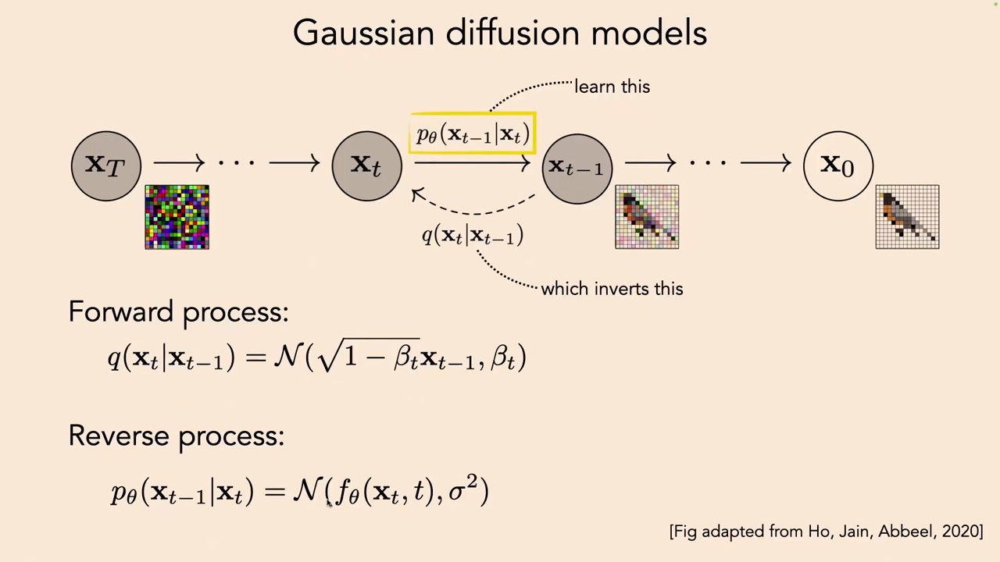
*▲ 강의 슬라이드 [75:40](https://youtu.be/hJlrAHqGOS8?t=4540): 가우시안 [확산 모델](00_%EB%94%A5%EB%9F%AC%EB%8B%9D_%EC%9A%A9%EC%96%B4%EC%82%AC%EC%A0%84.md#diffusion-model-%ED%99%95%EC%82%B0-%EB%AA%A8%EB%8D%B8). 순방향 $q(\mathbf{x}_t \mid \mathbf{x}_{t-1})$를 되돌리는 $p_\theta(\mathbf{x}_{t-1} \mid \mathbf{x}_t)$를 배운다 (그림은 Ho, Jain, Abbeel 2020을 변형)*

강사는 아주 기본적인 [확산 모델](00_%EB%94%A5%EB%9F%AC%EB%8B%9D_%EC%9A%A9%EC%96%B4%EC%82%AC%EC%A0%84.md#diffusion-model-%ED%99%95%EC%82%B0-%EB%AA%A8%EB%8D%B8)을 직접 짠 Colab을 공유했지만, 지금은 더 좋은 구현이 많을 것이라고 덧붙입니다.

> [!TIP]
> **🆕 2026 업데이트: 1000단계에서 1단계로**
> - **강의**: 처음엔 1000단계쯤 돌려야 했고, 단계를 1까지 줄이는 연구가 나오는 중이라고 했다.
> - **현재**: 잡음과 데이터를 **직선**으로 잇는 정류 흐름(rectified flow)·[흐름 정합](00_%EB%94%A5%EB%9F%AC%EB%8B%9D_%EC%9A%A9%EC%96%B4%EC%82%AC%EC%A0%84.md#flow-matching-%ED%9D%90%EB%A6%84-%EC%A0%95%ED%95%A9)(flow matching)이 대형 이미지 모델의 표준 학습법으로 자리 잡았다. Stable Diffusion 3 논문(ICML 2024)은 이 방식을 [트랜스포머](00_%EB%94%A5%EB%9F%AC%EB%8B%9D_%EC%9A%A9%EC%96%B4%EC%82%AC%EC%A0%84.md#transformer-%ED%8A%B8%EB%9E%9C%EC%8A%A4%ED%8F%AC%EB%A8%B8)와 함께 키워, 모델이 클수록 [검증](00_%EB%94%A5%EB%9F%AC%EB%8B%9D_%EC%9A%A9%EC%96%B4%EC%82%AC%EC%A0%84.md#validation-data-%EA%B2%80%EC%A6%9D-%EB%8D%B0%EC%9D%B4%ED%84%B0) [손실](00_%EB%94%A5%EB%9F%AC%EB%8B%9D_%EC%9A%A9%EC%96%B4%EC%82%AC%EC%A0%84.md#loss-function-%EC%86%90%EC%8B%A4-%ED%95%A8%EC%88%98)이 예측 가능하게 내려가고 생성 품질도 오른다고 보였다. 단계 수도 크게 줄었다. MeanFlow(NeurIPS 2025)는 [사전 학습](00_%EB%94%A5%EB%9F%AC%EB%8B%9D_%EC%9A%A9%EC%96%B4%EC%82%AC%EC%A0%84.md#pre-training-%EC%82%AC%EC%A0%84-%ED%95%99%EC%8A%B5)이나 증류 없이 처음부터 학습해 **신경망 한 번 평가(1-NFE)**로 ImageNet 256×256에서 FID 3.43을 냈다.
> - **출처**: [Esser et al., Scaling Rectified Flow Transformers for High-Resolution Image Synthesis (ICML 2024)](https://arxiv.org/abs/2403.03206) · [Geng et al., Mean Flows for One-step Generative Modeling (NeurIPS 2025)](https://arxiv.org/abs/2505.13447)

### 8.3 자기회귀 모델과의 연결

▶ 영상 [75:52](https://youtu.be/hJlrAHqGOS8?t=4552)

📐 **수학 개념**: [가우시안 확산의 순방향 과정](%EC%88%98%ED%95%99%EA%B0%9C%EB%85%90/11_%EC%83%9D%EC%84%B1_%EB%AA%A8%EB%8D%B8/MM53_%EA%B0%80%EC%9A%B0%EC%8B%9C%EC%95%88_%ED%99%95%EC%82%B0%EC%9D%98_%EC%88%9C%EB%B0%A9%ED%96%A5_%EA%B3%BC%EC%A0%95.md) · [확률의 연쇄법칙과 빔 서치](%EC%88%98%ED%95%99%EA%B0%9C%EB%85%90/04_%ED%99%95%EB%A5%A0%EA%B3%BC_%EC%A0%95%EB%B3%B4/MM39_%ED%99%95%EB%A5%A0%EC%9D%98_%EC%97%B0%EC%87%84%EB%B2%95%EC%B9%99%EA%B3%BC_%EB%B9%94_%EC%84%9C%EC%B9%98.md)

두 모델은 거의 같은 요령을 씁니다. **고차원의 구조 있는 대상을 생성하는 문제를 아주 단순한 모델링 문제의 연속으로 바꾸는 것**입니다.

| | [자기회귀 모델](00_%EB%94%A5%EB%9F%AC%EB%8B%9D_%EC%9A%A9%EC%96%B4%EC%82%AC%EC%A0%84.md#autoregressive-model-%EC%9E%90%EA%B8%B0%ED%9A%8C%EA%B7%80-%EB%AA%A8%EB%8D%B8) | [확산 모델](00_%EB%94%A5%EB%9F%AC%EB%8B%9D_%EC%9A%A9%EC%96%B4%EC%82%AC%EC%A0%84.md#diffusion-model-%ED%99%95%EC%82%B0-%EB%AA%A8%EB%8D%B8) |
|---|---|---|
| 데이터를 무너뜨리는 법 | 데이터 점을 **하나씩 지워** 아무것도 없는 상태로 | 모든 점에 **전체적으로 잡음**을 더해 단순한 분포로 |
| 출발점 | 빈 상태. 한 픽셀 색 하나만 뽑으면 된다 (예: 256색 [범주 분포](00_%EB%94%A5%EB%9F%AC%EB%8B%9D_%EC%9A%A9%EC%96%B4%EC%82%AC%EC%A0%84.md#categorical-distribution-%EB%B2%94%EC%A3%BC-%EB%B6%84%ED%8F%AC)) | 정규 잡음. 뽑기 쉽다 |
| 각 단계의 문제 | 다음 픽셀 [분류](00_%EB%94%A5%EB%9F%AC%EB%8B%9D_%EC%9A%A9%EC%96%B4%EC%82%AC%EC%A0%84.md#regression-classification-%ED%9A%8C%EA%B7%80%EC%99%80-%EB%B6%84%EB%A5%98) (범주 밀도 모델링) | 잡음 한 단계 걷어 내기 ([정규분포](00_%EB%94%A5%EB%9F%AC%EB%8B%9D_%EC%9A%A9%EC%96%B4%EC%82%AC%EC%A0%84.md#normal-distribution-%EC%A0%95%EA%B7%9C%EB%B6%84%ED%8F%AC) 평균 [회귀](00_%EB%94%A5%EB%9F%AC%EB%8B%9D_%EC%9A%A9%EC%96%B4%EC%82%AC%EC%A0%84.md#regression-classification-%ED%9A%8C%EA%B7%80%EC%99%80-%EB%B6%84%EB%A5%98)) |
| [학습](00_%EB%94%A5%EB%9F%AC%EB%8B%9D_%EC%9A%A9%EC%96%B4%EC%82%AC%EC%A0%84.md#training-%ED%95%99%EC%8A%B5) 신호 | 무너뜨린 과정을 거꾸로 따라가며 [지도 학습](00_%EB%94%A5%EB%9F%AC%EB%8B%9D_%EC%9A%A9%EC%96%B4%EC%82%AC%EC%A0%84.md#supervised-learning-%EC%A7%80%EB%8F%84-%ED%95%99%EC%8A%B5) | 무너뜨린 과정을 거꾸로 따라가며 [지도 학습](00_%EB%94%A5%EB%9F%AC%EB%8B%9D_%EC%9A%A9%EC%96%B4%EC%82%AC%EC%A0%84.md#supervised-learning-%EC%A7%80%EB%8F%84-%ED%95%99%EC%8A%B5) |

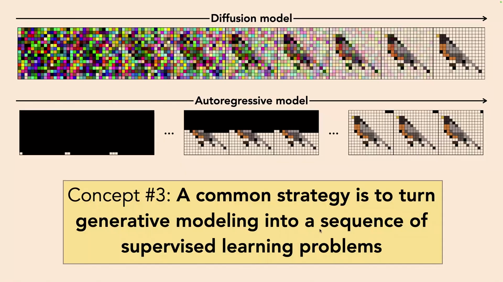
*▲ 강의 슬라이드 [77:35](https://youtu.be/hJlrAHqGOS8?t=4655): [확산 모델](00_%EB%94%A5%EB%9F%AC%EB%8B%9D_%EC%9A%A9%EC%96%B4%EC%82%AC%EC%A0%84.md#diffusion-model-%ED%99%95%EC%82%B0-%EB%AA%A8%EB%8D%B8)과 [자기회귀 모델](00_%EB%94%A5%EB%9F%AC%EB%8B%9D_%EC%9A%A9%EC%96%B4%EC%82%AC%EC%A0%84.md#autoregressive-model-%EC%9E%90%EA%B8%B0%ED%9A%8C%EA%B7%80-%EB%AA%A8%EB%8D%B8). 개념 #3: 흔한 전략은 생성 모델링을 [지도 학습](00_%EB%94%A5%EB%9F%AC%EB%8B%9D_%EC%9A%A9%EC%96%B4%EC%82%AC%EC%A0%84.md#supervised-learning-%EC%A7%80%EB%8F%84-%ED%95%99%EC%8A%B5) 문제의 연속으로 바꾸는 것이다*

> [!TIP]
> **🆕 2026 업데이트: 경계가 더 흐려진 두 모델**
> - **강의**: 자기회귀(한 칸씩)와 확산(잡음 한 단계씩)이 같은 전략의 두 변형이라고 했다. 당시 글은 자기회귀, 이미지는 확산이 주류였다.
> - **현재**: 두 방향 모두에서 경계를 넘는 모델이 나왔다. 이미지에서는 픽셀 순서 대신 "다음 해상도"를 맞히는 [자기회귀 모델](00_%EB%94%A5%EB%9F%AC%EB%8B%9D_%EC%9A%A9%EC%96%B4%EC%82%AC%EC%A0%84.md#autoregressive-model-%EC%9E%90%EA%B8%B0%ED%9A%8C%EA%B7%80-%EB%AA%A8%EB%8D%B8) VAR가 [확산 모델](00_%EB%94%A5%EB%9F%AC%EB%8B%9D_%EC%9A%A9%EC%96%B4%EC%82%AC%EC%A0%84.md#diffusion-model-%ED%99%95%EC%82%B0-%EB%AA%A8%EB%8D%B8)과 겨룰 만한 품질과 더 빠른 속도로 NeurIPS 2024 최우수 논문상을 받았다. 글에서는 [토큰](00_%EB%94%A5%EB%9F%AC%EB%8B%9D_%EC%9A%A9%EC%96%B4%EC%82%AC%EC%A0%84.md#token-%ED%86%A0%ED%81%B0)을 무작위로 가리고(순방향) 가린 [토큰](00_%EB%94%A5%EB%9F%AC%EB%8B%9D_%EC%9A%A9%EC%96%B4%EC%82%AC%EC%A0%84.md#token-%ED%86%A0%ED%81%B0)을 맞히는(역방향) **확산 [언어 모델](00_%EB%94%A5%EB%9F%AC%EB%8B%9D_%EC%9A%A9%EC%96%B4%EC%82%AC%EC%A0%84.md#language-model-%EC%96%B8%EC%96%B4-%EB%AA%A8%EB%8D%B8)** LLaDA 8B가 처음부터 2.3조 [토큰](00_%EB%94%A5%EB%9F%AC%EB%8B%9D_%EC%9A%A9%EC%96%B4%EC%82%AC%EC%A0%84.md#token-%ED%86%A0%ED%81%B0)으로 학습되어, 같은 데이터로 학습한 [자기회귀 모델](00_%EB%94%A5%EB%9F%AC%EB%8B%9D_%EC%9A%A9%EC%96%B4%EC%82%AC%EC%A0%84.md#autoregressive-model-%EC%9E%90%EA%B8%B0%ED%9A%8C%EA%B7%80-%EB%AA%A8%EB%8D%B8)과 비슷한 성능을 냈고 LLaMA3 8B와 겨룰 만했다.
> - **출처**: [Tian et al., Visual Autoregressive Modeling: Scalable Image Generation via Next-Scale Prediction (NeurIPS 2024)](https://arxiv.org/abs/2404.02905) · [NeurIPS 2024 Best Paper Awards (NeurIPS Blog, 2024)](https://blog.neurips.cc/2024/12/10/announcing-the-neurips-2024-best-paper-awards/) · [Nie et al., Large Language Diffusion Models (arXiv 2025)](https://arxiv.org/abs/2502.09992)

---

## 9. GAN

▶ 영상 [77:34](https://youtu.be/hJlrAHqGOS8?t=4654)

📐 **수학 개념**: [KL 발산과 최대 우도](%EC%88%98%ED%95%99%EA%B0%9C%EB%85%90/04_%ED%99%95%EB%A5%A0%EA%B3%BC_%EC%A0%95%EB%B3%B4/MM51_KL_%EB%B0%9C%EC%82%B0%EA%B3%BC_%EC%B5%9C%EB%8C%80_%EC%9A%B0%EB%8F%84.md) · [엔트로피](%EC%88%98%ED%95%99%EA%B0%9C%EB%85%90/04_%ED%99%95%EB%A5%A0%EA%B3%BC_%EC%A0%95%EB%B3%B4/M10_%EC%97%94%ED%8A%B8%EB%A1%9C%ED%94%BC.md)(이진 [교차 엔트로피](00_%EB%94%A5%EB%9F%AC%EB%8B%9D_%EC%9A%A9%EC%96%B4%EC%82%AC%EC%A0%84.md#cross-entropy-%EA%B5%90%EC%B0%A8-%EC%97%94%ED%8A%B8%EB%A1%9C%ED%94%BC)) · [argmin과 argmax](%EC%88%98%ED%95%99%EA%B0%9C%EB%85%90/02_%EB%AF%B8%EB%B6%84/MM01_argmin%EA%B3%BC_argmax.md)

마지막 2분, 강사는 **[GAN](00_%EB%94%A5%EB%9F%AC%EB%8B%9D_%EC%9A%A9%EC%96%B4%EC%82%AC%EC%A0%84.md#gan-generative-adversarial-network-%EC%83%9D%EC%84%B1%EC%A0%81-%EC%A0%81%EB%8C%80-%EC%8B%A0%EA%B2%BD%EB%A7%9D)**(Generative Adversarial Network, [생성적 적대 신경망](00_%EB%94%A5%EB%9F%AC%EB%8B%9D_%EC%9A%A9%EC%96%B4%EC%82%AC%EC%A0%84.md#gan-generative-adversarial-network-%EC%83%9D%EC%84%B1%EC%A0%81-%EC%A0%81%EB%8C%80-%EC%8B%A0%EA%B2%BD%EB%A7%9D))을 짧게 다룹니다. [잠재 변수](00_%EB%94%A5%EB%9F%AC%EB%8B%9D_%EC%9A%A9%EC%96%B4%EC%82%AC%EC%A0%84.md#latent-variable-%EC%9E%A0%EC%9E%AC-%EB%B3%80%EC%88%98)(무작위 수 벡터) $\mathbf{z}$를 **[생성기](00_%EB%94%A5%EB%9F%AC%EB%8B%9D_%EC%9A%A9%EC%96%B4%EC%82%AC%EC%A0%84.md#generator-discriminator-%EC%83%9D%EC%84%B1%EA%B8%B0%EC%99%80-%ED%8C%90%EB%B3%84%EA%B8%B0)** $g_\theta$에 넣어 이미지를 만들고, 또 다른 신경망 **[판별기](00_%EB%94%A5%EB%9F%AC%EB%8B%9D_%EC%9A%A9%EC%96%B4%EC%82%AC%EC%A0%84.md#generator-discriminator-%EC%83%9D%EC%84%B1%EA%B8%B0%EC%99%80-%ED%8C%90%EB%B3%84%EA%B8%B0)** $d_\phi$에게 그 이미지가 진짜 데이터인지 모델이 만든 가짜인지 가리게 합니다.

- **직접인가 간접인가?** 손을 들게 하니 의견이 갈렸습니다. 강사는 무작위 변수를 바로 표본으로 바꾸므로 직접 방식이라 보지만, [판별기](00_%EB%94%A5%EB%9F%AC%EB%8B%9D_%EC%9A%A9%EC%96%B4%EC%82%AC%EC%A0%84.md#generator-discriminator-%EC%83%9D%EC%84%B1%EA%B8%B0%EC%99%80-%ED%8C%90%EB%B3%84%EA%B8%B0) $d$ 때문에 미묘해서 양쪽 해석이 다 가능하다고 합니다.
- $g$는 $d$를 속이는 가짜를 만들려 하고, $d$는 가짜를 가려내려 합니다(슬라이드의 둘째 줄 "g"는 "d"의 오타라고 강사가 바로잡았습니다).
- **왜 되나?** $g$의 출력을 [학습 데이터](00_%EB%94%A5%EB%9F%AC%EB%8B%9D_%EC%9A%A9%EC%96%B4%EC%82%AC%EC%A0%84.md#training-data-test-data-%ED%95%99%EC%8A%B5-%EB%8D%B0%EC%9D%B4%ED%84%B0%EC%99%80-%EC%8B%9C%ED%97%98-%EB%8D%B0%EC%9D%B4%ED%84%B0)와 구별할 수 없다면, 같은 분포에서 나온 것이어야 합니다. 이는 증명할 수 있습니다.
- $d$는 "진짜 사진인가, $g$의 합성인가"를 가리는 이진 [소프트맥스](00_%EB%94%A5%EB%9F%AC%EB%8B%9D_%EC%9A%A9%EC%96%B4%EC%82%AC%EC%A0%84.md#softmax-%EC%86%8C%ED%94%84%ED%8A%B8%EB%A7%A5%EC%8A%A4) 분류기입니다. 진짜에 주는 [확률](00_%EB%94%A5%EB%9F%AC%EB%8B%9D_%EC%9A%A9%EC%96%B4%EC%82%AC%EC%A0%84.md#probability-%ED%99%95%EB%A5%A0)은 높이고 가짜에 주는 [확률](00_%EB%94%A5%EB%9F%AC%EB%8B%9D_%EC%9A%A9%EC%96%B4%EC%82%AC%EC%A0%84.md#probability-%ED%99%95%EB%A5%A0)은 낮춥니다. $g$는 **똑같은 목적함수**를 반대로, 최소화합니다. 그래서 **최소최대 게임**(min-max game)입니다.

$$
\min_\theta \max_\phi\ \ \mathbb{E}_{\mathbf{x} \sim p_{\text{data}}}\big[\log d_\phi(\mathbf{x})\big] + \mathbb{E}_{\mathbf{z} \sim p_{\mathbf{z}}}\big[\log\big(1 - d_\phi(g_\theta(\mathbf{z}))\big)\big]
$$

기호 풀이

| 기호 | 읽는 법 | 뜻 | 예제 값 |
| --- | --- | --- | --- |
| $g_\theta$ | 지 세타 | [생성기](00_%EB%94%A5%EB%9F%AC%EB%8B%9D_%EC%9A%A9%EC%96%B4%EC%82%AC%EC%A0%84.md#generator-discriminator-%EC%83%9D%EC%84%B1%EA%B8%B0%EC%99%80-%ED%8C%90%EB%B3%84%EA%B8%B0). [잠재 변수](00_%EB%94%A5%EB%9F%AC%EB%8B%9D_%EC%9A%A9%EC%96%B4%EC%82%AC%EC%A0%84.md#latent-variable-%EC%9E%A0%EC%9E%AC-%EB%B3%80%EC%88%98) $\mathbf{z}$를 이미지로 | |
| $d_\phi$ | 디 파이 | [판별기](00_%EB%94%A5%EB%9F%AC%EB%8B%9D_%EC%9A%A9%EC%96%B4%EC%82%AC%EC%A0%84.md#generator-discriminator-%EC%83%9D%EC%84%B1%EA%B8%B0%EC%99%80-%ED%8C%90%EB%B3%84%EA%B8%B0). 입력이 **진짜**일 [확률](00_%EB%94%A5%EB%9F%AC%EB%8B%9D_%EC%9A%A9%EC%96%B4%EC%82%AC%EC%A0%84.md#probability-%ED%99%95%EB%A5%A0)(0~1)을 낸다 | 0.9, 0.2 |
| $\mathbf{z} \sim p_{\mathbf{z}}$ | 제트 | 단순한 분포([정규분포](00_%EB%94%A5%EB%9F%AC%EB%8B%9D_%EC%9A%A9%EC%96%B4%EC%82%AC%EC%A0%84.md#normal-distribution-%EC%A0%95%EA%B7%9C%EB%B6%84%ED%8F%AC) 등)에서 뽑은 [잠재 변수](00_%EB%94%A5%EB%9F%AC%EB%8B%9D_%EC%9A%A9%EC%96%B4%EC%82%AC%EC%A0%84.md#latent-variable-%EC%9E%A0%EC%9E%AC-%EB%B3%80%EC%88%98) | |
| $\mathbf{x} \sim p_{\text{data}}$ | 엑스 | 진짜 [학습 데이터](00_%EB%94%A5%EB%9F%AC%EB%8B%9D_%EC%9A%A9%EC%96%B4%EC%82%AC%EC%A0%84.md#training-data-test-data-%ED%95%99%EC%8A%B5-%EB%8D%B0%EC%9D%B4%ED%84%B0%EC%99%80-%EC%8B%9C%ED%97%98-%EB%8D%B0%EC%9D%B4%ED%84%B0) | |
| $\max_\phi$ | 맥스 파이 | [판별기](00_%EB%94%A5%EB%9F%AC%EB%8B%9D_%EC%9A%A9%EC%96%B4%EC%82%AC%EC%A0%84.md#generator-discriminator-%EC%83%9D%EC%84%B1%EA%B8%B0%EC%99%80-%ED%8C%90%EB%B3%84%EA%B8%B0)는 이 값을 키운다 (잘 가린다) | |
| $\min_\theta$ | 민 세타 | [생성기](00_%EB%94%A5%EB%9F%AC%EB%8B%9D_%EC%9A%A9%EC%96%B4%EC%82%AC%EC%A0%84.md#generator-discriminator-%EC%83%9D%EC%84%B1%EA%B8%B0%EC%99%80-%ED%8C%90%EB%B3%84%EA%B8%B0)는 이 값을 줄인다 (잘 속인다) | |
| $\log d_\phi(\mathbf{x})$ | [로그](00_%EB%94%A5%EB%9F%AC%EB%8B%9D_%EC%9A%A9%EC%96%B4%EC%82%AC%EC%A0%84.md#log-ln-%EB%A1%9C%EA%B7%B8) 디 | 진짜를 진짜라 할 [확률](00_%EB%94%A5%EB%9F%AC%EB%8B%9D_%EC%9A%A9%EC%96%B4%EC%82%AC%EC%A0%84.md#probability-%ED%99%95%EB%A5%A0)의 [로그](00_%EB%94%A5%EB%9F%AC%EB%8B%9D_%EC%9A%A9%EC%96%B4%EC%82%AC%EC%A0%84.md#log-ln-%EB%A1%9C%EA%B7%B8) | -0.1054 |
| $\log(1 - d_\phi(g_\theta(\mathbf{z})))$ | [로그](00_%EB%94%A5%EB%9F%AC%EB%8B%9D_%EC%9A%A9%EC%96%B4%EC%82%AC%EC%A0%84.md#log-ln-%EB%A1%9C%EA%B7%B8) 일 빼기 디 | 가짜를 가짜라 할 [확률](00_%EB%94%A5%EB%9F%AC%EB%8B%9D_%EC%9A%A9%EC%96%B4%EC%82%AC%EC%A0%84.md#probability-%ED%99%95%EB%A5%A0)의 [로그](00_%EB%94%A5%EB%9F%AC%EB%8B%9D_%EC%9A%A9%EC%96%B4%EC%82%AC%EC%A0%84.md#log-ln-%EB%A1%9C%EA%B7%B8) | -0.2231 |

예제와 풀이

**문제**: [판별기](00_%EB%94%A5%EB%9F%AC%EB%8B%9D_%EC%9A%A9%EC%96%B4%EC%82%AC%EC%A0%84.md#generator-discriminator-%EC%83%9D%EC%84%B1%EA%B8%B0%EC%99%80-%ED%8C%90%EB%B3%84%EA%B8%B0)가 진짜 사진 한 장에 "진짜일 [확률](00_%EB%94%A5%EB%9F%AC%EB%8B%9D_%EC%9A%A9%EC%96%B4%EC%82%AC%EC%A0%84.md#probability-%ED%99%95%EB%A5%A0)" 0.9를, [생성기](00_%EB%94%A5%EB%9F%AC%EB%8B%9D_%EC%9A%A9%EC%96%B4%EC%82%AC%EC%A0%84.md#generator-discriminator-%EC%83%9D%EC%84%B1%EA%B8%B0%EC%99%80-%ED%8C%90%EB%B3%84%EA%B8%B0)가 만든 가짜 한 장에 0.2를 줬다. 이 두 장으로 계산한 목적함수 값은? [생성기](00_%EB%94%A5%EB%9F%AC%EB%8B%9D_%EC%9A%A9%EC%96%B4%EC%82%AC%EC%A0%84.md#generator-discriminator-%EC%83%9D%EC%84%B1%EA%B8%B0%EC%99%80-%ED%8C%90%EB%B3%84%EA%B8%B0)가 좋아져서 가짜에 0.7을 받게 되면 값은 어떻게 바뀌나?

**주어진 값**
- $d_\phi(\mathbf{x}) = 0.9$ (진짜 사진이 진짜일 [확률](00_%EB%94%A5%EB%9F%AC%EB%8B%9D_%EC%9A%A9%EC%96%B4%EC%82%AC%EC%A0%84.md#probability-%ED%99%95%EB%A5%A0))
- $d_\phi(g_\theta(\mathbf{z})) = 0.2$ (가짜 사진이 진짜일 [확률](00_%EB%94%A5%EB%9F%AC%EB%8B%9D_%EC%9A%A9%EC%96%B4%EC%82%AC%EC%A0%84.md#probability-%ED%99%95%EB%A5%A0)), 나중에 0.7
- [기댓값](00_%EB%94%A5%EB%9F%AC%EB%8B%9D_%EC%9A%A9%EC%96%B4%EC%82%AC%EC%A0%84.md#expectation-%EA%B8%B0%EB%8C%93%EA%B0%92)은 표본 한 장씩으로 근사한다

**풀이**
1. 식을 그대로 쓴다: $V = \log d_\phi(\mathbf{x}) + \log\big(1 - d_\phi(g_\theta(\mathbf{z}))\big)$
2. 값을 대입한다: $V = \ln 0.9 + \ln(1 - 0.2)$
3. 괄호 안을 뺀다: $1 - 0.2 = 0.8$
4. [로그](00_%EB%94%A5%EB%9F%AC%EB%8B%9D_%EC%9A%A9%EC%96%B4%EC%82%AC%EC%A0%84.md#log-ln-%EB%A1%9C%EA%B7%B8)를 구한다($\ln a$는 $e$를 몇 제곱하면 $a$인지, 1보다 작으면 음수): $\ln 0.9 = -0.1054$, $\ln 0.8 = -0.2231$
5. 더한다: $-0.1054 + (-0.2231) = -0.3285$
6. [생성기](00_%EB%94%A5%EB%9F%AC%EB%8B%9D_%EC%9A%A9%EC%96%B4%EC%82%AC%EC%A0%84.md#generator-discriminator-%EC%83%9D%EC%84%B1%EA%B8%B0%EC%99%80-%ED%8C%90%EB%B3%84%EA%B8%B0)가 좋아진 경우를 대입한다: $V = \ln 0.9 + \ln(1 - 0.7)$
7. 괄호 안을 뺀다: $1 - 0.7 = 0.3$
8. [로그](00_%EB%94%A5%EB%9F%AC%EB%8B%9D_%EC%9A%A9%EC%96%B4%EC%82%AC%EC%A0%84.md#log-ln-%EB%A1%9C%EA%B7%B8)를 구한다: $\ln 0.3 = -1.204$
9. 더한다: $-0.1054 + (-1.204) = -1.3094$ (반올림 전 값으로 계산하면 -1.3093)

**답**: 처음 **-0.3285**, [생성기](00_%EB%94%A5%EB%9F%AC%EB%8B%9D_%EC%9A%A9%EC%96%B4%EC%82%AC%EC%A0%84.md#generator-discriminator-%EC%83%9D%EC%84%B1%EA%B8%B0%EC%99%80-%ED%8C%90%EB%B3%84%EA%B8%B0)가 좋아진 뒤 **-1.3093**. [생성기](00_%EB%94%A5%EB%9F%AC%EB%8B%9D_%EC%9A%A9%EC%96%B4%EC%82%AC%EC%A0%84.md#generator-discriminator-%EC%83%9D%EC%84%B1%EA%B8%B0%EC%99%80-%ED%8C%90%EB%B3%84%EA%B8%B0)는 이 값을 낮추는 쪽(min)으로, [판별기](00_%EB%94%A5%EB%9F%AC%EB%8B%9D_%EC%9A%A9%EC%96%B4%EC%82%AC%EC%A0%84.md#generator-discriminator-%EC%83%9D%EC%84%B1%EA%B8%B0%EC%99%80-%ED%8C%90%EB%B3%84%EA%B8%B0)는 다시 높이는 쪽(max)으로 움직인다.

내 이해

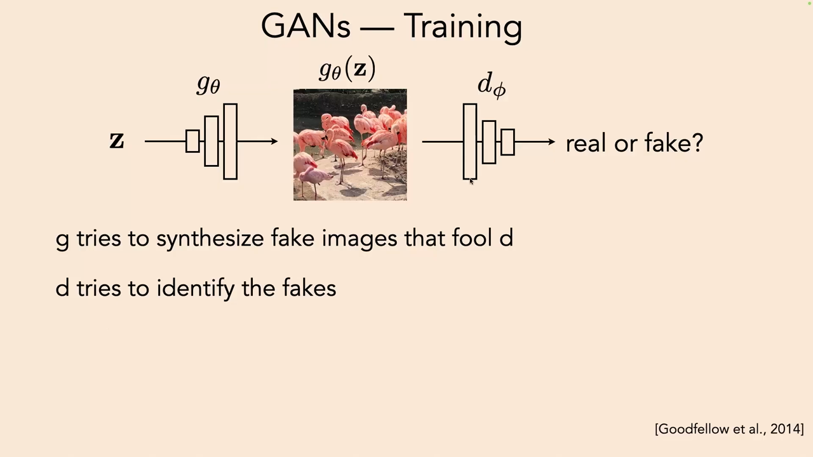
*▲ 강의 슬라이드 [80:58](https://youtu.be/hJlrAHqGOS8?t=4858): [GAN](00_%EB%94%A5%EB%9F%AC%EB%8B%9D_%EC%9A%A9%EC%96%B4%EC%82%AC%EC%A0%84.md#gan-generative-adversarial-network-%EC%83%9D%EC%84%B1%EC%A0%81-%EC%A0%81%EB%8C%80-%EC%8B%A0%EA%B2%BD%EB%A7%9D) [학습](00_%EB%94%A5%EB%9F%AC%EB%8B%9D_%EC%9A%A9%EC%96%B4%EC%82%AC%EC%A0%84.md#training-%ED%95%99%EC%8A%B5). [생성기](00_%EB%94%A5%EB%9F%AC%EB%8B%9D_%EC%9A%A9%EC%96%B4%EC%82%AC%EC%A0%84.md#generator-discriminator-%EC%83%9D%EC%84%B1%EA%B8%B0%EC%99%80-%ED%8C%90%EB%B3%84%EA%B8%B0) $g_\theta$는 [판별기](00_%EB%94%A5%EB%9F%AC%EB%8B%9D_%EC%9A%A9%EC%96%B4%EC%82%AC%EC%A0%84.md#generator-discriminator-%EC%83%9D%EC%84%B1%EA%B8%B0%EC%99%80-%ED%8C%90%EB%B3%84%EA%B8%B0) $d_\phi$를 속이는 가짜를 만들고, $d_\phi$는 가짜를 가려낸다*

강사는 이것을 적대적 게임보다 **학생과 선생님**으로 생각하라고 권합니다. 선생님 $d$가 "사실적인 그림을 그려 와야 하는데 그림자가 틀렸다"고 하면, 학생 $g$는 그림자를 고칩니다. 선생님이 "내가 보기에 진짜 그림과 구별이 안 된다"고 하면 학생은 잘한 것입니다. 다음 주에 [생성 모델](00_%EB%94%A5%EB%9F%AC%EB%8B%9D_%EC%9A%A9%EC%96%B4%EC%82%AC%EC%A0%84.md#generative-model-%EC%83%9D%EC%84%B1-%EB%AA%A8%EB%8D%B8) 두 강의가 이어집니다.

---

## 10. 용어 정리

용어사전에 있는 용어는 위 본문에 링크를 걸었습니다. 아래는 이번 강의에서 새로 나온 용어입니다.

| 용어 | 뜻 |
|---|---|
| [확률 변수](00_%EB%94%A5%EB%9F%AC%EB%8B%9D_%EC%9A%A9%EC%96%B4%EC%82%AC%EC%A0%84.md#random-variable-%ED%99%95%EB%A5%A0-%EB%B3%80%EC%88%98)(Random variable) | 실험할 때마다 값이 달라지는 양. 대문자 $X$는 변수(분포), 소문자 $x$는 실현값 |
| [확률 질량 함수](00_%EB%94%A5%EB%9F%AC%EB%8B%9D_%EC%9A%A9%EC%96%B4%EC%82%AC%EC%A0%84.md#probability-mass-function-%ED%99%95%EB%A5%A0-%EC%A7%88%EB%9F%89-%ED%95%A8%EC%88%98)(Probability mass function) | 이산 값마다 0~1 [확률](00_%EB%94%A5%EB%9F%AC%EB%8B%9D_%EC%9A%A9%EC%96%B4%EC%82%AC%EC%A0%84.md#probability-%ED%99%95%EB%A5%A0)을 주고 합이 1인 함수 |
| [확률 밀도 함수](00_%EB%94%A5%EB%9F%AC%EB%8B%9D_%EC%9A%A9%EC%96%B4%EC%82%AC%EC%A0%84.md#probability-density-function-%ED%99%95%EB%A5%A0-%EB%B0%80%EB%8F%84-%ED%95%A8%EC%88%98)(Probability density function) | 연속 값마다 음이 아닌 밀도를 주고 넓이가 1인 함수. [확률](00_%EB%94%A5%EB%9F%AC%EB%8B%9D_%EC%9A%A9%EC%96%B4%EC%82%AC%EC%A0%84.md#probability-%ED%99%95%EB%A5%A0)은 구간의 넓이 |
| [정규분포](00_%EB%94%A5%EB%9F%AC%EB%8B%9D_%EC%9A%A9%EC%96%B4%EC%82%AC%EC%A0%84.md#normal-distribution-%EC%A0%95%EA%B7%9C%EB%B6%84%ED%8F%AC)(Normal distribution) | 평균 $\mu$, [분산](00_%EB%94%A5%EB%9F%AC%EB%8B%9D_%EC%9A%A9%EC%96%B4%EC%82%AC%EC%A0%84.md#variance-%EB%B6%84%EC%82%B0) $\sigma^2$인 종 모양 분포. 가우스 분포 |
| [범주 분포](00_%EB%94%A5%EB%9F%AC%EB%8B%9D_%EC%9A%A9%EC%96%B4%EC%82%AC%EC%A0%84.md#categorical-distribution-%EB%B2%94%EC%A3%BC-%EB%B6%84%ED%8F%AC)(Categorical distribution) | $K$개 값 각각에 [확률](00_%EB%94%A5%EB%9F%AC%EB%8B%9D_%EC%9A%A9%EC%96%B4%EC%82%AC%EC%A0%84.md#probability-%ED%99%95%EB%A5%A0)을 주는 분포. [소프트맥스](00_%EB%94%A5%EB%9F%AC%EB%8B%9D_%EC%9A%A9%EC%96%B4%EC%82%AC%EC%A0%84.md#softmax-%EC%86%8C%ED%94%84%ED%8A%B8%EB%A7%A5%EC%8A%A4) 출력 |
| [잠재 변수](00_%EB%94%A5%EB%9F%AC%EB%8B%9D_%EC%9A%A9%EC%96%B4%EC%82%AC%EC%A0%84.md#latent-variable-%EC%9E%A0%EC%9E%AC-%EB%B3%80%EC%88%98)(Latent variable) | 데이터의 모양을 정하지만 직접 관측되지 않는 변수. [생성기](00_%EB%94%A5%EB%9F%AC%EB%8B%9D_%EC%9A%A9%EC%96%B4%EC%82%AC%EC%A0%84.md#generator-discriminator-%EC%83%9D%EC%84%B1%EA%B8%B0%EC%99%80-%ED%8C%90%EB%B3%84%EA%B8%B0)의 "잡음" 입력 |
| [절차적 생성](00_%EB%94%A5%EB%9F%AC%EB%8B%9D_%EC%9A%A9%EC%96%B4%EC%82%AC%EC%A0%84.md#procedural-generation-%EC%A0%88%EC%B0%A8%EC%A0%81-%EC%83%9D%EC%84%B1)(Procedural generation) | 무작위 값을 받아 정해진 절차로 콘텐츠를 만드는 그래픽스 기법 |
| [샘플링](00_%EB%94%A5%EB%9F%AC%EB%8B%9D_%EC%9A%A9%EC%96%B4%EC%82%AC%EC%A0%84.md#sampling-%EC%83%98%ED%94%8C%EB%A7%81)([Sampling](00_%EB%94%A5%EB%9F%AC%EB%8B%9D_%EC%9A%A9%EC%96%B4%EC%82%AC%EC%A0%84.md#sampling-%EC%83%98%ED%94%8C%EB%A7%81)) | 분포에서 표본을 뽑는 것. [생성 모델](00_%EB%94%A5%EB%9F%AC%EB%8B%9D_%EC%9A%A9%EC%96%B4%EC%82%AC%EC%A0%84.md#generative-model-%EC%83%9D%EC%84%B1-%EB%AA%A8%EB%8D%B8)의 "시험" 단계 |
| [암묵적 생성 모델](00_%EB%94%A5%EB%9F%AC%EB%8B%9D_%EC%9A%A9%EC%96%B4%EC%82%AC%EC%A0%84.md#implicit-generative-model-%EC%95%94%EB%AC%B5%EC%A0%81-%EC%83%9D%EC%84%B1-%EB%AA%A8%EB%8D%B8)(Implicit generative model) | 밀도를 내지 않고 표본만 직접 만드는 [생성 모델](00_%EB%94%A5%EB%9F%AC%EB%8B%9D_%EC%9A%A9%EC%96%B4%EC%82%AC%EC%A0%84.md#generative-model-%EC%83%9D%EC%84%B1-%EB%AA%A8%EB%8D%B8) |
| [마르코프 연쇄 몬테카를로](00_%EB%94%A5%EB%9F%AC%EB%8B%9D_%EC%9A%A9%EC%96%B4%EC%82%AC%EC%A0%84.md#mcmc-markov-chain-monte-carlo-%EB%A7%88%EB%A5%B4%EC%BD%94%ED%94%84-%EC%97%B0%EC%87%84-%EB%AA%AC%ED%85%8C%EC%B9%B4%EB%A5%BC%EB%A1%9C)([MCMC](00_%EB%94%A5%EB%9F%AC%EB%8B%9D_%EC%9A%A9%EC%96%B4%EC%82%AC%EC%A0%84.md#mcmc-markov-chain-monte-carlo-%EB%A7%88%EB%A5%B4%EC%BD%94%ED%94%84-%EC%97%B0%EC%87%84-%EB%AA%AC%ED%85%8C%EC%B9%B4%EB%A5%BC%EB%A1%9C)) | 상대 확률만으로 분포에서 표본을 뽑는 반복 알고리즘 |
| [기각 샘플링](00_%EB%94%A5%EB%9F%AC%EB%8B%9D_%EC%9A%A9%EC%96%B4%EC%82%AC%EC%A0%84.md#rejection-sampling-%EA%B8%B0%EA%B0%81-%EC%83%98%ED%94%8C%EB%A7%81)(Rejection sampling) | 후보를 뽑아 점수에 비례해 받아들이거나 버리는 [샘플링](00_%EB%94%A5%EB%9F%AC%EB%8B%9D_%EC%9A%A9%EC%96%B4%EC%82%AC%EC%A0%84.md#sampling-%EC%83%98%ED%94%8C%EB%A7%81) |
| [밀도 모델](00_%EB%94%A5%EB%9F%AC%EB%8B%9D_%EC%9A%A9%EC%96%B4%EC%82%AC%EC%A0%84.md#density-model-%EB%B0%80%EB%8F%84-%EB%AA%A8%EB%8D%B8)(Density model) | 데이터 공간의 모든 점에 정규화된 밀도 $p_\theta(x)$를 주는 [생성 모델](00_%EB%94%A5%EB%9F%AC%EB%8B%9D_%EC%9A%A9%EC%96%B4%EC%82%AC%EC%A0%84.md#generative-model-%EC%83%9D%EC%84%B1-%EB%AA%A8%EB%8D%B8) |
| [KL 발산](00_%EB%94%A5%EB%9F%AC%EB%8B%9D_%EC%9A%A9%EC%96%B4%EC%82%AC%EC%A0%84.md#kl-divergence-kl-%EB%B0%9C%EC%82%B0)([KL divergence](00_%EB%94%A5%EB%9F%AC%EB%8B%9D_%EC%9A%A9%EC%96%B4%EC%82%AC%EC%A0%84.md#kl-divergence-kl-%EB%B0%9C%EC%82%B0)) | 진짜 분포 대신 다른 분포를 쓸 때의 평균 손해. 0 이상, 대칭 아님 |
| [우도](00_%EB%94%A5%EB%9F%AC%EB%8B%9D_%EC%9A%A9%EC%96%B4%EC%82%AC%EC%A0%84.md#likelihood-%EC%9A%B0%EB%8F%84)([Likelihood](00_%EB%94%A5%EB%9F%AC%EB%8B%9D_%EC%9A%A9%EC%96%B4%EC%82%AC%EC%A0%84.md#likelihood-%EC%9A%B0%EB%8F%84)) | 모델이 관측된 데이터에 주는 [확률](00_%EB%94%A5%EB%9F%AC%EB%8B%9D_%EC%9A%A9%EC%96%B4%EC%82%AC%EC%A0%84.md#probability-%ED%99%95%EB%A5%A0)(밀도) |
| [에너지 기반 모델](00_%EB%94%A5%EB%9F%AC%EB%8B%9D_%EC%9A%A9%EC%96%B4%EC%82%AC%EC%A0%84.md#energy-based-model-%EC%97%90%EB%84%88%EC%A7%80-%EA%B8%B0%EB%B0%98-%EB%AA%A8%EB%8D%B8)(Energy-based model) | 정규화하지 않은 점수(에너지)를 배우는 [생성 모델](00_%EB%94%A5%EB%9F%AC%EB%8B%9D_%EC%9A%A9%EC%96%B4%EC%82%AC%EC%A0%84.md#generative-model-%EC%83%9D%EC%84%B1-%EB%AA%A8%EB%8D%B8) |
| [볼츠만 분포](00_%EB%94%A5%EB%9F%AC%EB%8B%9D_%EC%9A%A9%EC%96%B4%EC%82%AC%EC%A0%84.md#boltzmann-distribution-%EB%B3%BC%EC%B8%A0%EB%A7%8C-%EB%B6%84%ED%8F%AC)(Boltzmann distribution) | $p(x) = e^{-E(x)}/Z$. 에너지를 [확률](00_%EB%94%A5%EB%9F%AC%EB%8B%9D_%EC%9A%A9%EC%96%B4%EC%82%AC%EC%A0%84.md#probability-%ED%99%95%EB%A5%A0)로 바꾸는 규칙 |
| [분할 함수](00_%EB%94%A5%EB%9F%AC%EB%8B%9D_%EC%9A%A9%EC%96%B4%EC%82%AC%EC%A0%84.md#partition-function-%EB%B6%84%ED%95%A0-%ED%95%A8%EC%88%98)(Partition function) | [볼츠만 분포](00_%EB%94%A5%EB%9F%AC%EB%8B%9D_%EC%9A%A9%EC%96%B4%EC%82%AC%EC%A0%84.md#boltzmann-distribution-%EB%B3%BC%EC%B8%A0%EB%A7%8C-%EB%B6%84%ED%8F%AC)의 [정규화](00_%EB%94%A5%EB%9F%AC%EB%8B%9D_%EC%9A%A9%EC%96%B4%EC%82%AC%EC%A0%84.md#normalization-%EC%A0%95%EA%B7%9C%ED%99%94) 상수 $Z = \int e^{-E}$ |
| [대조 발산](00_%EB%94%A5%EB%9F%AC%EB%8B%9D_%EC%9A%A9%EC%96%B4%EC%82%AC%EC%A0%84.md#contrastive-divergence-%EB%8C%80%EC%A1%B0-%EB%B0%9C%EC%82%B0)(Contrastive divergence) | 데이터의 에너지는 내리고 모델 표본의 에너지는 올리는 EBM 학습법 |
| [확산 모델](00_%EB%94%A5%EB%9F%AC%EB%8B%9D_%EC%9A%A9%EC%96%B4%EC%82%AC%EC%A0%84.md#diffusion-model-%ED%99%95%EC%82%B0-%EB%AA%A8%EB%8D%B8)(Diffusion model) | 데이터에 잡음을 더하는 과정을 거꾸로 배워 잡음에서 데이터를 만드는 모델 |
| [순방향 과정과 역방향 과정](00_%EB%94%A5%EB%9F%AC%EB%8B%9D_%EC%9A%A9%EC%96%B4%EC%82%AC%EC%A0%84.md#forward-process-reverse-process-%EC%88%9C%EB%B0%A9%ED%96%A5-%EA%B3%BC%EC%A0%95%EA%B3%BC-%EC%97%AD%EB%B0%A9%ED%96%A5-%EA%B3%BC%EC%A0%95)(Forward process, Reverse process) | 잡음을 더하는 정해진 과정 $q$와 그것을 되돌리는 [학습](00_%EB%94%A5%EB%9F%AC%EB%8B%9D_%EC%9A%A9%EC%96%B4%EC%82%AC%EC%A0%84.md#training-%ED%95%99%EC%8A%B5) 과정 $p_\theta$ |
| [잡음 일정](00_%EB%94%A5%EB%9F%AC%EB%8B%9D_%EC%9A%A9%EC%96%B4%EC%82%AC%EC%A0%84.md#noise-schedule-%EC%9E%A1%EC%9D%8C-%EC%9D%BC%EC%A0%95)(Noise schedule) | 확산 단계마다 더하는 잡음의 크기 $\beta_t$ |
| [잡음 제거기](00_%EB%94%A5%EB%9F%AC%EB%8B%9D_%EC%9A%A9%EC%96%B4%EC%82%AC%EC%A0%84.md#denoiser-%EC%9E%A1%EC%9D%8C-%EC%A0%9C%EA%B1%B0%EA%B8%B0)([Denoiser](00_%EB%94%A5%EB%9F%AC%EB%8B%9D_%EC%9A%A9%EC%96%B4%EC%82%AC%EC%A0%84.md#denoiser-%EC%9E%A1%EC%9D%8C-%EC%A0%9C%EA%B1%B0%EA%B8%B0)) | 시끄러운 입력과 단계 $t$를 받아 덜 시끄러운 값(의 평균)을 예측하는 신경망 |
| [생성적 적대 신경망](00_%EB%94%A5%EB%9F%AC%EB%8B%9D_%EC%9A%A9%EC%96%B4%EC%82%AC%EC%A0%84.md#gan-generative-adversarial-network-%EC%83%9D%EC%84%B1%EC%A0%81-%EC%A0%81%EB%8C%80-%EC%8B%A0%EA%B2%BD%EB%A7%9D)([GAN](00_%EB%94%A5%EB%9F%AC%EB%8B%9D_%EC%9A%A9%EC%96%B4%EC%82%AC%EC%A0%84.md#gan-generative-adversarial-network-%EC%83%9D%EC%84%B1%EC%A0%81-%EC%A0%81%EB%8C%80-%EC%8B%A0%EA%B2%BD%EB%A7%9D)) | [생성기](00_%EB%94%A5%EB%9F%AC%EB%8B%9D_%EC%9A%A9%EC%96%B4%EC%82%AC%EC%A0%84.md#generator-discriminator-%EC%83%9D%EC%84%B1%EA%B8%B0%EC%99%80-%ED%8C%90%EB%B3%84%EA%B8%B0)와 [판별기](00_%EB%94%A5%EB%9F%AC%EB%8B%9D_%EC%9A%A9%EC%96%B4%EC%82%AC%EC%A0%84.md#generator-discriminator-%EC%83%9D%EC%84%B1%EA%B8%B0%EC%99%80-%ED%8C%90%EB%B3%84%EA%B8%B0)가 최소최대 게임으로 함께 학습하는 [생성 모델](00_%EB%94%A5%EB%9F%AC%EB%8B%9D_%EC%9A%A9%EC%96%B4%EC%82%AC%EC%A0%84.md#generative-model-%EC%83%9D%EC%84%B1-%EB%AA%A8%EB%8D%B8) |
| [생성기와 판별기](00_%EB%94%A5%EB%9F%AC%EB%8B%9D_%EC%9A%A9%EC%96%B4%EC%82%AC%EC%A0%84.md#generator-discriminator-%EC%83%9D%EC%84%B1%EA%B8%B0%EC%99%80-%ED%8C%90%EB%B3%84%EA%B8%B0)([Generator](00_%EB%94%A5%EB%9F%AC%EB%8B%9D_%EC%9A%A9%EC%96%B4%EC%82%AC%EC%A0%84.md#generator-discriminator-%EC%83%9D%EC%84%B1%EA%B8%B0%EC%99%80-%ED%8C%90%EB%B3%84%EA%B8%B0), [Discriminator](00_%EB%94%A5%EB%9F%AC%EB%8B%9D_%EC%9A%A9%EC%96%B4%EC%82%AC%EC%A0%84.md#generator-discriminator-%EC%83%9D%EC%84%B1%EA%B8%B0%EC%99%80-%ED%8C%90%EB%B3%84%EA%B8%B0)) | [잠재 변수](00_%EB%94%A5%EB%9F%AC%EB%8B%9D_%EC%9A%A9%EC%96%B4%EC%82%AC%EC%A0%84.md#latent-variable-%EC%9E%A0%EC%9E%AC-%EB%B3%80%EC%88%98)로 데이터를 만드는 신경망과, 진짜·가짜를 가리는 신경망 |
| [흐름 정합](00_%EB%94%A5%EB%9F%AC%EB%8B%9D_%EC%9A%A9%EC%96%B4%EC%82%AC%EC%A0%84.md#flow-matching-%ED%9D%90%EB%A6%84-%EC%A0%95%ED%95%A9)([Flow matching](00_%EB%94%A5%EB%9F%AC%EB%8B%9D_%EC%9A%A9%EC%96%B4%EC%82%AC%EC%A0%84.md#flow-matching-%ED%9D%90%EB%A6%84-%EC%A0%95%ED%95%A9)) | 잡음과 데이터를 잇는 속도장을 [회귀](00_%EB%94%A5%EB%9F%AC%EB%8B%9D_%EC%9A%A9%EC%96%B4%EC%82%AC%EC%A0%84.md#regression-classification-%ED%9A%8C%EA%B7%80%EC%99%80-%EB%B6%84%EB%A5%98)로 배우는 확산의 변형 (🆕 업데이트) |
