# Lec 15. 변분 오토인코더: 표현 학습과 생성 모델의 만남 (Generative Models: Representation Learning Meets Generative Modeling)

← 이전: [Lec14_생성_모델_기초](Lec14_%EC%83%9D%EC%84%B1_%EB%AA%A8%EB%8D%B8_%EA%B8%B0%EC%B4%88.md) · [목차](00_MIT%EB%94%A5%EB%9F%AC%EB%8B%9D_%EB%AA%A9%EC%B0%A8.md) · 다음: [Lec16_조건부_생성_모델](Lec16_%EC%A1%B0%EA%B1%B4%EB%B6%80_%EC%83%9D%EC%84%B1_%EB%AA%A8%EB%8D%B8.md) →

> [!NOTE]
> **강의 정보**
> - **출처**: MIT OpenCourseWare, [Lec 15. Generative Models: Representation Learning Meets Generative Modeling](https://www.youtube.com/watch?v=8zzfcYIELdo) (81분, 2024년 가을 학기)
> - **강사**: Phillip Isola
> - **라이선스**: 원 강의는 CC BY-NC-SA 4.0입니다. 이 노트는 영어 자막을 바탕으로 한국어로 옮겨 정리한 2차 저작물이며, 같은 조건(비영리·출처 표기·동일 조건 공유)을 따릅니다.
> - 각 절 제목 아래의 `▶ 영상` 시간을 누르면 영상의 해당 위치로 갑니다.
> - `📐 수학 개념` 줄은 그 절에 쓰인 수학을 정리한 노트로 연결됩니다. 전체 목록은 [00_MIT딥러닝_목차](00_MIT%EB%94%A5%EB%9F%AC%EB%8B%9D_%EB%AA%A9%EC%B0%A8.md).
> - 슬라이드 캡처는 원 강의(CC BY-NC-SA 4.0)에서 가져왔고, "직접 그린 그림"은 이 노트의 숫자로 새로 그렸습니다.
> - `🆕 2026 업데이트` 칸은 강의(2024년 가을) 이후 바뀐 내용을 덧붙인 것입니다.

## 한눈에 보기

| 구분 | 내용 |
|---|---|
| 핵심 질문 | [오토인코더](00_%EB%94%A5%EB%9F%AC%EB%8B%9D_%EC%9A%A9%EC%96%B4%EC%82%AC%EC%A0%84.md#autoencoder-%EC%98%A4%ED%86%A0%EC%9D%B8%EC%BD%94%EB%8D%94)의 디코더를 [생성 모델](00_%EB%94%A5%EB%9F%AC%EB%8B%9D_%EC%9A%A9%EC%96%B4%EC%82%AC%EC%A0%84.md#generative-model-%EC%83%9D%EC%84%B1-%EB%AA%A8%EB%8D%B8)로 쓰려면 [잠재 공간](00_%EB%94%A5%EB%9F%AC%EB%8B%9D_%EC%9A%A9%EC%96%B4%EC%82%AC%EC%A0%84.md#latent-space-%EC%9E%A0%EC%9E%AC-%EA%B3%B5%EA%B0%84)이 어떤 모양이어야 하고, 그렇게 만드는 [학습](00_%EB%94%A5%EB%9F%AC%EB%8B%9D_%EC%9A%A9%EC%96%B4%EC%82%AC%EC%A0%84.md#training-%ED%95%99%EC%8A%B5) 목표는 어디서 나오는가? |
| 한 줄 답 | [변분 오토인코더](00_%EB%94%A5%EB%9F%AC%EB%8B%9D_%EC%9A%A9%EC%96%B4%EC%82%AC%EC%A0%84.md#variational-autoencoder-vae-%EB%B3%80%EB%B6%84-%EC%98%A4%ED%86%A0%EC%9D%B8%EC%BD%94%EB%8D%94)([VAE](00_%EB%94%A5%EB%9F%AC%EB%8B%9D_%EC%9A%A9%EC%96%B4%EC%82%AC%EC%A0%84.md#variational-autoencoder-vae-%EB%B3%80%EB%B6%84-%EC%98%A4%ED%86%A0%EC%9D%B8%EC%BD%94%EB%8D%94))는 인코더가 데이터를 **단위 가우스 모양**의 [잠재 공간](00_%EB%94%A5%EB%9F%AC%EB%8B%9D_%EC%9A%A9%EC%96%B4%EC%82%AC%EC%A0%84.md#latent-space-%EC%9E%A0%EC%9E%AC-%EA%B3%B5%EA%B0%84)으로 보내게 만든 [오토인코더](00_%EB%94%A5%EB%9F%AC%EB%8B%9D_%EC%9A%A9%EC%96%B4%EC%82%AC%EC%A0%84.md#autoencoder-%EC%98%A4%ED%86%A0%EC%9D%B8%EC%BD%94%EB%8D%94)다. 그래서 가우스에서 뽑아 디코딩하면 새 샘플이 나온다 |
| [확률](00_%EB%94%A5%EB%9F%AC%EB%8B%9D_%EC%9A%A9%EC%96%B4%EC%82%AC%EC%A0%84.md#probability-%ED%99%95%EB%A5%A0) 모형 | 신경망 $g_\theta$로 매개변수화한 **무한 [가우스 혼합](00_%EB%94%A5%EB%9F%AC%EB%8B%9D_%EC%9A%A9%EC%96%B4%EC%82%AC%EC%A0%84.md#gaussian-mixture-model-%EA%B0%80%EC%9A%B0%EC%8A%A4-%ED%98%BC%ED%95%A9-%EB%AA%A8%EB%8D%B8)**. 목표는 데이터의 [주변 우도](00_%EB%94%A5%EB%9F%AC%EB%8B%9D_%EC%9A%A9%EC%96%B4%EC%82%AC%EC%A0%84.md#marginal-likelihood-%EC%A3%BC%EB%B3%80-%EC%9A%B0%EB%8F%84) $p_\theta(\mathbf{x}) = \int p_\theta(\mathbf{x}\mid\mathbf{z})p(\mathbf{z})d\mathbf{z}$를 키우는 것 |
| 세 가지 요령 | ① 적분을 표본 평균으로 ([몬테카를로](00_%EB%94%A5%EB%9F%AC%EB%8B%9D_%EC%9A%A9%EC%96%B4%EC%82%AC%EC%A0%84.md#monte-carlo-estimation-%EB%AA%AC%ED%85%8C%EC%B9%B4%EB%A5%BC%EB%A1%9C-%EC%B6%94%EC%A0%95)) ② 쓸모 있는 $\mathbf{z}$만 뽑기 ([중요도 샘플링](00_%EB%94%A5%EB%9F%AC%EB%8B%9D_%EC%9A%A9%EC%96%B4%EC%82%AC%EC%A0%84.md#importance-sampling-%EC%A4%91%EC%9A%94%EB%8F%84-%EC%83%98%ED%94%8C%EB%A7%81)) ③ 가장 좋은 표본 분포 $p(\mathbf{z}\mid\mathbf{x})$를 인코더로 예측 |
| [학습](00_%EB%94%A5%EB%9F%AC%EB%8B%9D_%EC%9A%A9%EC%96%B4%EC%82%AC%EC%A0%84.md#training-%ED%95%99%EC%8A%B5) 목표 | [ELBO](00_%EB%94%A5%EB%9F%AC%EB%8B%9D_%EC%9A%A9%EC%96%B4%EC%82%AC%EC%A0%84.md#elbo-evidence-lower-bound-%EC%A6%9D%EA%B1%B0-%ED%95%98%ED%95%9C) = 재구성 항 − KL 항. 재구성 항은 제곱 [오차](00_%EB%94%A5%EB%9F%AC%EB%8B%9D_%EC%9A%A9%EC%96%B4%EC%82%AC%EC%A0%84.md#error-%EC%98%A4%EC%B0%A8), KL 항은 "인코딩을 원점으로 짓눌러라" |
| 표현 | [VAE](00_%EB%94%A5%EB%9F%AC%EB%8B%9D_%EC%9A%A9%EC%96%B4%EC%82%AC%EC%A0%84.md#variational-autoencoder-vae-%EB%B3%80%EB%B6%84-%EC%98%A4%ED%86%A0%EC%9D%B8%EC%BD%94%EB%8D%94)의 잠재 축은 강의자가 데이터를 만든 변수(풀 색)나 더 추상적인 요인(강의 굽이)을 따로 잡는다([얽힘 풀린 표현](00_%EB%94%A5%EB%9F%AC%EB%8B%9D_%EC%9A%A9%EC%96%B4%EC%82%AC%EC%A0%84.md#disentangled-representation-%EC%96%BD%ED%9E%98-%ED%92%80%EB%A6%B0-%ED%91%9C%ED%98%84)). 다만 위상이 다른 모양을 구로 보내므로 이음매가 생긴다 |
| 이전 강의 | Lec14 [생성 모델](00_%EB%94%A5%EB%9F%AC%EB%8B%9D_%EC%9A%A9%EC%96%B4%EC%82%AC%EC%A0%84.md#generative-model-%EC%83%9D%EC%84%B1-%EB%AA%A8%EB%8D%B8) 기초 ([확률](00_%EB%94%A5%EB%9F%AC%EB%8B%9D_%EC%9A%A9%EC%96%B4%EC%82%AC%EC%A0%84.md#probability-%ED%99%95%EB%A5%A0) 밀도, [최대 우도](00_%EB%94%A5%EB%9F%AC%EB%8B%9D_%EC%9A%A9%EC%96%B4%EC%82%AC%EC%A0%84.md#maximum-likelihood-%EC%B5%9C%EB%8C%80-%EC%9A%B0%EB%8F%84), [GAN](00_%EB%94%A5%EB%9F%AC%EB%8B%9D_%EC%9A%A9%EC%96%B4%EC%82%AC%EC%A0%84.md#gan-generative-adversarial-network-%EC%83%9D%EC%84%B1%EC%A0%81-%EC%A0%81%EB%8C%80-%EC%8B%A0%EA%B2%BD%EB%A7%9D), [확산 모델](00_%EB%94%A5%EB%9F%AC%EB%8B%9D_%EC%9A%A9%EC%96%B4%EC%82%AC%EC%A0%84.md#diffusion-model-%ED%99%95%EC%82%B0-%EB%AA%A8%EB%8D%B8)) |

---

## 1. 표현 학습과 생성 모델은 반대 방향

▶ 영상 [01:07](https://youtu.be/8zzfcYIELdo?t=67)

- 이번 주는 [생성 모델](00_%EB%94%A5%EB%9F%AC%EB%8B%9D_%EC%9A%A9%EC%96%B4%EC%82%AC%EC%A0%84.md#generative-model-%EC%83%9D%EC%84%B1-%EB%AA%A8%EB%8D%B8)을 이어 가고, 오늘은 **[변분 오토인코더](00_%EB%94%A5%EB%9F%AC%EB%8B%9D_%EC%9A%A9%EC%96%B4%EC%82%AC%EC%A0%84.md#variational-autoencoder-vae-%EB%B3%80%EB%B6%84-%EC%98%A4%ED%86%A0%EC%9D%B8%EC%BD%94%EB%8D%94)**(Variational autoencoder, [VAE](00_%EB%94%A5%EB%9F%AC%EB%8B%9D_%EC%9A%A9%EC%96%B4%EC%82%AC%EC%A0%84.md#variational-autoencoder-vae-%EB%B3%80%EB%B6%84-%EC%98%A4%ED%86%A0%EC%9D%B8%EC%BD%94%EB%8D%94)) 하나만 깊게 다룹니다. 강사의 관점은 "생성 모델링과 [표현 학습](00_%EB%94%A5%EB%9F%AC%EB%8B%9D_%EC%9A%A9%EC%96%B4%EC%82%AC%EC%A0%84.md#representation-learning-%ED%91%9C%ED%98%84-%ED%95%99%EC%8A%B5)은 단단히 묶여 있다. 하나를 풀면 다른 하나도 풀린다"이고, [VAE](00_%EB%94%A5%EB%9F%AC%EB%8B%9D_%EC%9A%A9%EC%96%B4%EC%82%AC%EC%A0%84.md#variational-autoencoder-vae-%EB%B3%80%EB%B6%84-%EC%98%A4%ED%86%A0%EC%9D%B8%EC%BD%94%EB%8D%94)가 두 문제를 동시에 푸는 모델입니다.
- **[표현 학습](00_%EB%94%A5%EB%9F%AC%EB%8B%9D_%EC%9A%A9%EC%96%B4%EC%82%AC%EC%A0%84.md#representation-learning-%ED%91%9C%ED%98%84-%ED%95%99%EC%8A%B5)**: 날 데이터 $\mathbf{x}$ → 구조가 잡힌 추상적 표현 $\mathbf{z}$. 이 사상을 **인코더** $f$라 부릅니다([Lec11 1.1](Lec11_%ED%91%9C%ED%98%84_%ED%95%99%EC%8A%B5_%EC%9E%AC%EA%B5%AC%EC%84%B1.md#11-%EC%9D%B8%EC%BD%94%EB%94%A9%EA%B3%BC-%EC%83%9D%EC%84%B1)).
- **생성 모델링**: 단순한 추상 표현 $\mathbf{z}$ → 데이터 $\mathbf{x}$. 이 사상을 **[생성기](00_%EB%94%A5%EB%9F%AC%EB%8B%9D_%EC%9A%A9%EC%96%B4%EC%82%AC%EC%A0%84.md#generator-discriminator-%EC%83%9D%EC%84%B1%EA%B8%B0%EC%99%80-%ED%8C%90%EB%B3%84%EA%B8%B0)(generator)** 또는 **디코더** $g$라 부릅니다.
- 두 방향은 일종의 역함수입니다. 다만 데이터 → 표현은 여러 개가 하나로 가고(many-to-one), 표현 → 데이터는 하나가 여러 개로 갈 수 있으므로(확률적) 수학적 역함수라기보다 "확률적 역함수"에 가깝습니다.
- [생성 모델](00_%EB%94%A5%EB%9F%AC%EB%8B%9D_%EC%9A%A9%EC%96%B4%EC%82%AC%EC%A0%84.md#generative-model-%EC%83%9D%EC%84%B1-%EB%AA%A8%EB%8D%B8)은 **한 [확률](00_%EB%94%A5%EB%9F%AC%EB%8B%9D_%EC%9A%A9%EC%96%B4%EC%82%AC%EC%A0%84.md#probability-%ED%99%95%EB%A5%A0) 분포를 다른 분포로 옮기는 변환**으로 볼 수 있습니다. 단순한 **[사전 분포](00_%EB%94%A5%EB%9F%AC%EB%8B%9D_%EC%9A%A9%EC%96%B4%EC%82%AC%EC%A0%84.md#prior-posterior-%EC%82%AC%EC%A0%84-%EB%B6%84%ED%8F%AC%EC%99%80-%EC%82%AC%ED%9B%84-%EB%B6%84%ED%8F%AC)**(prior, 보통 가우스 잡음, 그림에서 동그라미)를 신경망의 [층](00_%EB%94%A5%EB%9F%AC%EB%8B%9D_%EC%9A%A9%EC%96%B4%EC%82%AC%EC%A0%84.md#layer-%EC%B8%B5)들이 밀고 당겨서 복잡한 데이터 분포 모양으로 바꿉니다. (고차원 가우스의 [확률](00_%EB%94%A5%EB%9F%AC%EB%8B%9D_%EC%9A%A9%EC%96%B4%EC%82%AC%EC%A0%84.md#probability-%ED%99%95%EB%A5%A0) 질량은 대부분 [초구](00_%EB%94%A5%EB%9F%AC%EB%8B%9D_%EC%9A%A9%EC%96%B4%EC%82%AC%EC%A0%84.md#hypersphere-%EC%B4%88%EA%B5%AC) 표면 가까이에 있어서 "비눗방울"처럼 생겼다고 강사는 덧붙입니다.)

## 2. 오토인코더의 디코더로 새 샘플을 만들 수 있을까

▶ 영상 [04:30](https://youtu.be/8zzfcYIELdo?t=270)

📐 **수학 개념**: [PCA와 선형 오토인코더](%EC%88%98%ED%95%99%EA%B0%9C%EB%85%90/10_%ED%91%9C%ED%98%84_%ED%95%99%EC%8A%B5/MM40_PCA%EC%99%80_%EC%84%A0%ED%98%95_%EC%98%A4%ED%86%A0%EC%9D%B8%EC%BD%94%EB%8D%94.md) · [확률 밀도와 정규분포](%EC%88%98%ED%95%99%EA%B0%9C%EB%85%90/04_%ED%99%95%EB%A5%A0%EA%B3%BC_%EC%A0%95%EB%B3%B4/MM50_%ED%99%95%EB%A5%A0_%EB%B0%80%EB%8F%84%EC%99%80_%EC%A0%95%EA%B7%9C%EB%B6%84%ED%8F%AC.md)

- 두 방향을 한 모델에 담은 것이 바로 **[오토인코더](00_%EB%94%A5%EB%9F%AC%EB%8B%9D_%EC%9A%A9%EC%96%B4%EC%82%AC%EC%A0%84.md#autoencoder-%EC%98%A4%ED%86%A0%EC%9D%B8%EC%BD%94%EB%8D%94)**입니다([Lec11 8.1](Lec11_%ED%91%9C%ED%98%84_%ED%95%99%EC%8A%B5_%EC%9E%AC%EA%B5%AC%EC%84%B1.md#81-%EC%98%A4%ED%86%A0%EC%9D%B8%EC%BD%94%EB%8D%94)). 인코더가 데이터를 저차원 $\mathbf{z}$로 보내고, 디코더가 $\mathbf{z}$에서 데이터를 되살립니다. 뒤쪽 절반인 디코더는 [생성기](00_%EB%94%A5%EB%9F%AC%EB%8B%9D_%EC%9A%A9%EC%96%B4%EC%82%AC%EC%A0%84.md#generator-discriminator-%EC%83%9D%EC%84%B1%EA%B8%B0%EC%99%80-%ED%8C%90%EB%B3%84%EA%B8%B0)가 하는 일과 똑같습니다.
- 그러면 디코더를 떼어 내 새 사진을 만들 수 있을까요? 그러려면 먼저 새 $\mathbf{z}$를 **뽑아야** 합니다. 문제는 "**어떤 분포에서?**"입니다.
- 보통 [오토인코더](00_%EB%94%A5%EB%9F%AC%EB%8B%9D_%EC%9A%A9%EC%96%B4%EC%82%AC%EC%A0%84.md#autoencoder-%EC%98%A4%ED%86%A0%EC%9D%B8%EC%BD%94%EB%8D%94)의 인코딩 $f(\mathbf{x})$들은 원래 데이터보다 단순하거나 뽑기 쉬운 모양이라는 보장이 없습니다. 구멍투성이의 이상한 분포일 수 있습니다. [학습 데이터](00_%EB%94%A5%EB%9F%AC%EB%8B%9D_%EC%9A%A9%EC%96%B4%EC%82%AC%EC%A0%84.md#training-data-test-data-%ED%95%99%EC%8A%B5-%EB%8D%B0%EC%9D%B4%ED%84%B0%EC%99%80-%EC%8B%9C%ED%97%98-%EB%8D%B0%EC%9D%B4%ED%84%B0)의 인코딩 $f(\mathbf{x})$는 $g(f(\mathbf{x}))$로 잘 되살리지만, 한 번도 본 적 없는 점(구멍)으로 가면 무엇을 디코딩할지 모릅니다.
- [VAE](00_%EB%94%A5%EB%9F%AC%EB%8B%9D_%EC%9A%A9%EC%96%B4%EC%82%AC%EC%A0%84.md#variational-autoencoder-vae-%EB%B3%80%EB%B6%84-%EC%98%A4%ED%86%A0%EC%9D%B8%EC%BD%94%EB%8D%94)의 목적은 이 문제 하나를 고치는 것입니다. **인코딩이 뽑기 쉬운 단순한 분포를 이루게** 만드는 것이고, 이 강의의 수학과 알고리즘은 모두 이것을 위한 것입니다.
- **첫 번째 이해 수준**: [VAE](00_%EB%94%A5%EB%9F%AC%EB%8B%9D_%EC%9A%A9%EC%96%B4%EC%82%AC%EC%A0%84.md#variational-autoencoder-vae-%EB%B3%80%EB%B6%84-%EC%98%A4%ED%86%A0%EC%9D%B8%EC%BD%94%EB%8D%94)는 인코더 $f$가 복잡한 모양 대신 **가우스**로 보내는 [오토인코더](00_%EB%94%A5%EB%9F%AC%EB%8B%9D_%EC%9A%A9%EC%96%B4%EC%82%AC%EC%A0%84.md#autoencoder-%EC%98%A4%ED%86%A0%EC%9D%B8%EC%BD%94%EB%8D%94)입니다. 그러면 가우스에서 무작위 벡터를 뽑아 디코더에 넣기만 하면 새 이미지가 나옵니다.

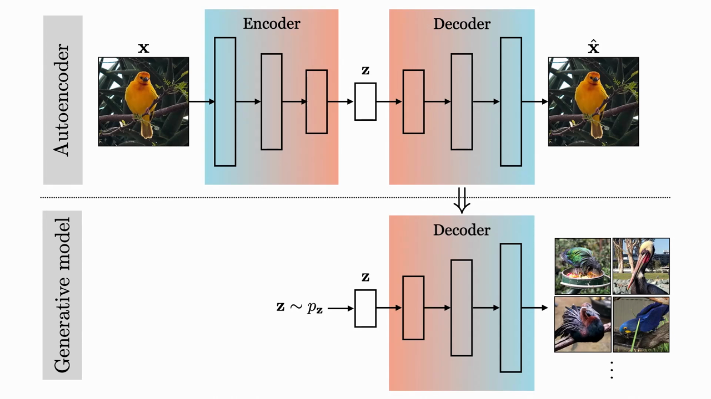
*▲ 강의 슬라이드 [08:32](https://youtu.be/8zzfcYIELdo?t=512): 위는 [오토인코더](00_%EB%94%A5%EB%9F%AC%EB%8B%9D_%EC%9A%A9%EC%96%B4%EC%82%AC%EC%A0%84.md#autoencoder-%EC%98%A4%ED%86%A0%EC%9D%B8%EC%BD%94%EB%8D%94)(인코더 → $\mathbf{z}$ → 디코더), 아래는 디코더만 떼어 낸 [생성 모델](00_%EB%94%A5%EB%9F%AC%EB%8B%9D_%EC%9A%A9%EC%96%B4%EC%82%AC%EC%A0%84.md#generative-model-%EC%83%9D%EC%84%B1-%EB%AA%A8%EB%8D%B8). $\mathbf{z} \sim p_\mathbf{z}$에서 뽑아 디코딩한다*

질의응답 정리 [07:50](https://youtu.be/8zzfcYIELdo?t=470)

- **[잠재 공간](00_%EB%94%A5%EB%9F%AC%EB%8B%9D_%EC%9A%A9%EC%96%B4%EC%82%AC%EC%A0%84.md#latent-space-%EC%9E%A0%EC%9E%AC-%EA%B3%B5%EA%B0%84)을 꼭 가우스로 만드는 이유는 생성 때문인가, 표현이 좋아지기 때문인가?** 지금 단계의 이해는 "가우스면 뽑을 수 있으니 [생성 모델](00_%EB%94%A5%EB%9F%AC%EB%8B%9D_%EC%9A%A9%EC%96%B4%EC%82%AC%EC%A0%84.md#generative-model-%EC%83%9D%EC%84%B1-%EB%AA%A8%EB%8D%B8)이 된다"입니다. 가우스로 보내는 것이 [표현 학습](00_%EB%94%A5%EB%9F%AC%EB%8B%9D_%EC%9A%A9%EC%96%B4%EC%82%AC%EC%A0%84.md#representation-learning-%ED%91%9C%ED%98%84-%ED%95%99%EC%8A%B5)에도 좋다는 것도 맞지만 더 미묘해서 강의 끝에서 다룹니다. [VAE](00_%EB%94%A5%EB%9F%AC%EB%8B%9D_%EC%9A%A9%EC%96%B4%EC%82%AC%EC%A0%84.md#variational-autoencoder-vae-%EB%B3%80%EB%B6%84-%EC%98%A4%ED%86%A0%EC%9D%B8%EC%BD%94%EB%8D%94)는 [표현 학습](00_%EB%94%A5%EB%9F%AC%EB%8B%9D_%EC%9A%A9%EC%96%B4%EC%82%AC%EC%A0%84.md#representation-learning-%ED%91%9C%ED%98%84-%ED%95%99%EC%8A%B5)과 [생성 모델](00_%EB%94%A5%EB%9F%AC%EB%8B%9D_%EC%9A%A9%EC%96%B4%EC%82%AC%EC%A0%84.md#generative-model-%EC%83%9D%EC%84%B1-%EB%AA%A8%EB%8D%B8) 둘 다 잘하고, [확산 모델](00_%EB%94%A5%EB%9F%AC%EB%8B%9D_%EC%9A%A9%EC%96%B4%EC%82%AC%EC%A0%84.md#diffusion-model-%ED%99%95%EC%82%B0-%EB%AA%A8%EB%8D%B8) 등 지금까지 본 많은 모델을 [VAE](00_%EB%94%A5%EB%9F%AC%EB%8B%9D_%EC%9A%A9%EC%96%B4%EC%82%AC%EC%A0%84.md#variational-autoencoder-vae-%EB%B3%80%EB%B6%84-%EC%98%A4%ED%86%A0%EC%9D%B8%EC%BD%94%EB%8D%94)의 특수한(퇴화한) 경우로 볼 수 있어서 "수학적으로는 거의 모든 것을 감싸는 틀"이지만, 실제로는 요즘 [확산 모델](00_%EB%94%A5%EB%9F%AC%EB%8B%9D_%EC%9A%A9%EC%96%B4%EC%82%AC%EC%A0%84.md#diffusion-model-%ED%99%95%EC%82%B0-%EB%AA%A8%EB%8D%B8)만큼 많이 쓰이지는 않는다고 강사는 말합니다.

---

## 3. 가우스 혼합

▶ 영상 [09:26](https://youtu.be/8zzfcYIELdo?t=566)

📐 **수학 개념**: [가우스 혼합과 주변 우도](%EC%88%98%ED%95%99%EA%B0%9C%EB%85%90/11_%EC%83%9D%EC%84%B1_%EB%AA%A8%EB%8D%B8/MM54_%EA%B0%80%EC%9A%B0%EC%8A%A4_%ED%98%BC%ED%95%A9%EA%B3%BC_%EC%A3%BC%EB%B3%80_%EC%9A%B0%EB%8F%84.md) · [확률 밀도와 정규분포](%EC%88%98%ED%95%99%EA%B0%9C%EB%85%90/04_%ED%99%95%EB%A5%A0%EA%B3%BC_%EC%A0%95%EB%B3%B4/MM50_%ED%99%95%EB%A5%A0_%EB%B0%80%EB%8F%84%EC%99%80_%EC%A0%95%EA%B7%9C%EB%B6%84%ED%8F%AC.md) · [시그마와 평균](%EC%88%98%ED%95%99%EA%B0%9C%EB%85%90/01_%EC%88%98%EC%99%80_%ED%95%A8%EC%88%98/M02_%EC%8B%9C%EA%B7%B8%EB%A7%88%EC%99%80_%ED%8F%89%EA%B7%A0.md)

- [VAE](00_%EB%94%A5%EB%9F%AC%EB%8B%9D_%EC%9A%A9%EC%96%B4%EC%82%AC%EC%A0%84.md#variational-autoencoder-vae-%EB%B3%80%EB%B6%84-%EC%98%A4%ED%86%A0%EC%9D%B8%EC%BD%94%EB%8D%94)의 확률적 해석은 "데이터 분포에 **[가우스 혼합](00_%EB%94%A5%EB%9F%AC%EB%8B%9D_%EC%9A%A9%EC%96%B4%EC%82%AC%EC%A0%84.md#gaussian-mixture-model-%EA%B0%80%EC%9A%B0%EC%8A%A4-%ED%98%BC%ED%95%A9-%EB%AA%A8%EB%8D%B8)**(mixture of Gaussians)을 맞춘다"입니다.
- 가우스 하나를 [최대 우도](00_%EB%94%A5%EB%9F%AC%EB%8B%9D_%EC%9A%A9%EC%96%B4%EC%82%AC%EC%A0%84.md#maximum-likelihood-%EC%B5%9C%EB%8C%80-%EC%9A%B0%EB%8F%84)로 맞추면 데이터가 있는 곳의 밀도를 높이도록 평균과 [분산](00_%EB%94%A5%EB%9F%AC%EB%8B%9D_%EC%9A%A9%EC%96%B4%EC%82%AC%EC%A0%84.md#variance-%EB%B6%84%EC%82%B0)이 움직입니다(지난 시간 내용).
- 가우스 모양이 아닌 복잡한 분포는 **가우스 여러 개를 더해서** 나타냅니다. 가우스 하나를 작은 동그라미로 생각하면, 동그라미가 충분히 작고 많을수록 어떤 모양이든 덮을 수 있습니다(강사는 "아마 임의의 밀도를 원하는 만큼 정확히 근사할 수 있을 것"이라고만 말합니다).
- 이 강의는 대부분 **등방(isotropic) 가우스**, 즉 공분산이 단위 행렬(동그라미)이라고 가정합니다. 타원으로 늘리는 것은 언제든 가능합니다.
- 매개변수는 혼합 [가중치](00_%EB%94%A5%EB%9F%AC%EB%8B%9D_%EC%9A%A9%EC%96%B4%EC%82%AC%EC%A0%84.md#weight-%EA%B0%80%EC%A4%91%EC%B9%98) $w_i$, 평균 $\boldsymbol{\mu}_i$($d$차원 벡터), 공분산 $\boldsymbol{\Sigma}_i$($d \times d$ 행렬)입니다. 성분이 $k$개면 매개변수가 대략 $k(1 + d + d^2)$개입니다. (전통적인 모델에서는 [가중치](00_%EB%94%A5%EB%9F%AC%EB%8B%9D_%EC%9A%A9%EC%96%B4%EC%82%AC%EC%A0%84.md#weight-%EA%B0%80%EC%A4%91%EC%B9%98)가 양수이고 합이 1입니다.)

$$
p_\theta(\mathbf{x}) = \sum_{i=1}^{k} w_i\, \mathcal{N}(\mathbf{x};\ \boldsymbol{\mu}_i, \boldsymbol{\Sigma}_i)
$$

기호 풀이

| 기호 | 읽는 법 | 뜻 | 예제 값 |
| --- | --- | --- | --- |
| $p_\theta(\mathbf{x})$ | 피 세타 엑스 | 모델이 점 $\mathbf{x}$에 주는 밀도 | 0.1232 |
| $k$ | 케이 | 성분(가우스) 개수 | 2 |
| $w_i$ | 더블유 아이 | $i$번째 성분의 혼합 [가중치](00_%EB%94%A5%EB%9F%AC%EB%8B%9D_%EC%9A%A9%EC%96%B4%EC%82%AC%EC%A0%84.md#weight-%EA%B0%80%EC%A4%91%EC%B9%98) | 0.5, 0.5 |
| $\mathcal{N}(\mathbf{x}; \boldsymbol{\mu}, \boldsymbol{\Sigma})$ | [정규분포](00_%EB%94%A5%EB%9F%AC%EB%8B%9D_%EC%9A%A9%EC%96%B4%EC%82%AC%EC%A0%84.md#normal-distribution-%EC%A0%95%EA%B7%9C%EB%B6%84%ED%8F%AC) | 평균 $\boldsymbol{\mu}$, 공분산 $\boldsymbol{\Sigma}$인 가우스의 밀도 | |
| $\boldsymbol{\mu}_i$ | 뮤 아이 | $i$번째 성분의 중심 | 0, 4 |
| $\boldsymbol{\Sigma}_i$ | 시그마 아이 | $i$번째 성분의 공분산 (1차원이면 [분산](00_%EB%94%A5%EB%9F%AC%EB%8B%9D_%EC%9A%A9%EC%96%B4%EC%82%AC%EC%A0%84.md#variance-%EB%B6%84%EC%82%B0)) | 1, 1 |
| $\theta$ | 세타 | 모든 매개변수 $\{w_i, \boldsymbol{\mu}_i, \boldsymbol{\Sigma}_i\}$ | |

예제와 풀이

**문제**: 1차원에서 중심이 0과 4이고 [분산](00_%EB%94%A5%EB%9F%AC%EB%8B%9D_%EC%9A%A9%EC%96%B4%EC%82%AC%EC%A0%84.md#variance-%EB%B6%84%EC%82%B0)이 1인 가우스 두 개를 반씩 섞었다. 점 $x = 1$의 밀도는?

**주어진 값**
- $k = 2$ (성분 개수)
- $w_1 = 0.5$, $w_2 = 0.5$ (혼합 [가중치](00_%EB%94%A5%EB%9F%AC%EB%8B%9D_%EC%9A%A9%EC%96%B4%EC%82%AC%EC%A0%84.md#weight-%EA%B0%80%EC%A4%91%EC%B9%98))
- $\mu_1 = 0$, $\mu_2 = 4$ (성분의 중심)
- $\Sigma_1 = \Sigma_2 = 1$ ([분산](00_%EB%94%A5%EB%9F%AC%EB%8B%9D_%EC%9A%A9%EC%96%B4%EC%82%AC%EC%A0%84.md#variance-%EB%B6%84%EC%82%B0))
- $x = 1$ (밀도를 잴 점)

**풀이**
1. 식을 그대로 쓴다: $p(x) = \sum_{i=1}^{k} w_i\, \mathcal{N}(x; \mu_i, \Sigma_i)$
2. 값을 대입한다: $p(1) = \sum_{i=1}^{2} w_i\, \mathcal{N}(1; \mu_i, 1)$
3. Σ를 풀어 쓴다: $p(1) = 0.5\,\mathcal{N}(1; 0, 1) + 0.5\,\mathcal{N}(1; 4, 1)$
4. [정규분포](00_%EB%94%A5%EB%9F%AC%EB%8B%9D_%EC%9A%A9%EC%96%B4%EC%82%AC%EC%A0%84.md#normal-distribution-%EC%A0%95%EA%B7%9C%EB%B6%84%ED%8F%AC) 밀도는 $\mathcal{N}(x; \mu, \sigma^2) = \dfrac{1}{\sqrt{2\pi\sigma^2}} e^{-(x-\mu)^2 / (2\sigma^2)}$이다. $e$는 약 2.718인 수이고 $e^{a}$는 계산기로 구한다. $\sqrt{\ }$는 제곱해서 그 수가 되는 양수다.
5. 첫 성분의 거리 제곱을 구한다: $(1 - 0)^2 = 1$
6. $2\sigma^2 = 2$로 나눈다: $1 / 2 = 0.5$
7. [지수](00_%EB%94%A5%EB%9F%AC%EB%8B%9D_%EC%9A%A9%EC%96%B4%EC%82%AC%EC%A0%84.md#e-exponent-e%EC%99%80-%EC%A7%80%EC%88%98)를 계산한다: $e^{-0.5} = 0.6065$
8. [정규화](00_%EB%94%A5%EB%9F%AC%EB%8B%9D_%EC%9A%A9%EC%96%B4%EC%82%AC%EC%A0%84.md#normalization-%EC%A0%95%EA%B7%9C%ED%99%94) 상수를 구한다: $\sqrt{2\pi \times 1} = 2.5066$
9. 나눈다: $0.6065 / 2.5066 = 0.2420$ 이므로 $\mathcal{N}(1; 0, 1) = 0.2420$
10. 둘째 성분의 거리 제곱을 구한다: $(1 - 4)^2 = 9$
11. 2로 나눈다: $9 / 2 = 4.5$
12. [지수](00_%EB%94%A5%EB%9F%AC%EB%8B%9D_%EC%9A%A9%EC%96%B4%EC%82%AC%EC%A0%84.md#e-exponent-e%EC%99%80-%EC%A7%80%EC%88%98)를 계산한다: $e^{-4.5} = 0.0111$
13. 나눈다: $0.0111 / 2.5066 = 0.0044$ 이므로 $\mathcal{N}(1; 4, 1) = 0.0044$
14. [가중치](00_%EB%94%A5%EB%9F%AC%EB%8B%9D_%EC%9A%A9%EC%96%B4%EC%82%AC%EC%A0%84.md#weight-%EA%B0%80%EC%A4%91%EC%B9%98)를 곱한다: $0.5 \times 0.2420 = 0.1210$, $0.5 \times 0.0044 = 0.0022$
15. 더한다: $0.1210 + 0.0022 = 0.1232$

**답**: $p(1) = $ **0.1232**. 가까운 성분(중심 0)이 밀도의 거의 전부를 낸다.

내 이해

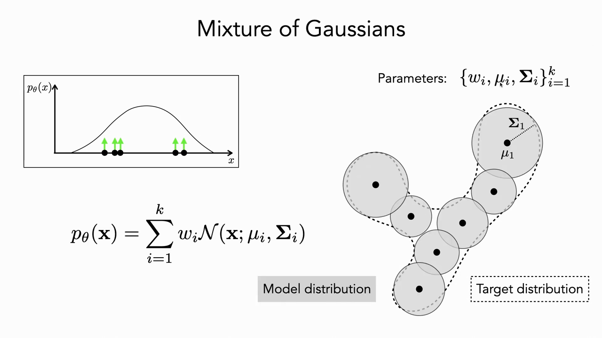
*▲ 강의 슬라이드 [13:00](https://youtu.be/8zzfcYIELdo?t=780): 가우스 혼합. 점선 모양의 목표 분포를 동그라미(등방 가우스) 여러 개로 덮는다. 매개변수는 $\{w_i, \mu_i, \Sigma_i\}_{i=1}^k$*

---

## 4. 무한 가우스 혼합

▶ 영상 [12:43](https://youtu.be/8zzfcYIELdo?t=763)

### 4.1 신경망으로 무한 혼합 만들기

▶ 영상 [13:17](https://youtu.be/8zzfcYIELdo?t=797)

📐 **수학 개념**: [가우스 혼합과 주변 우도](%EC%88%98%ED%95%99%EA%B0%9C%EB%85%90/11_%EC%83%9D%EC%84%B1_%EB%AA%A8%EB%8D%B8/MM54_%EA%B0%80%EC%9A%B0%EC%8A%A4_%ED%98%BC%ED%95%A9%EA%B3%BC_%EC%A3%BC%EB%B3%80_%EC%9A%B0%EB%8F%84.md) · [확률 밀도와 정규분포](%EC%88%98%ED%95%99%EA%B0%9C%EB%85%90/04_%ED%99%95%EB%A5%A0%EA%B3%BC_%EC%A0%95%EB%B3%B4/MM50_%ED%99%95%EB%A5%A0_%EB%B0%80%EB%8F%84%EC%99%80_%EC%A0%95%EA%B7%9C%EB%B6%84%ED%8F%AC.md) · [리만 합](%EC%88%98%ED%95%99%EA%B0%9C%EB%85%90/06_%EA%B7%BC%EC%82%AC_%EC%9D%B4%EB%A1%A0/MM07_%EB%A6%AC%EB%A7%8C_%ED%95%A9%EA%B3%BC_%EB%B3%B4%ED%8E%B8_%EA%B7%BC%EC%82%AC.md)

- [VAE](00_%EB%94%A5%EB%9F%AC%EB%8B%9D_%EC%9A%A9%EC%96%B4%EC%82%AC%EC%A0%84.md#variational-autoencoder-vae-%EB%B3%80%EB%B6%84-%EC%98%A4%ED%86%A0%EC%9D%B8%EC%BD%94%EB%8D%94)는 그냥 혼합이 아니라 **무한 가우스 혼합**입니다. 성분 하나에 매개변수가 $1 + d + d^2$개 필요하므로, 성분을 무한히 두려면 매개변수도 무한히 필요합니다. 직접 매개변수화는 불가능합니다.
- **요령**: 연속인 바탕 분포 $p_\mathbf{z}$(단위 가우스)에서 혼합 성분으로 가는 **함수 $g_\theta$**로 무한 혼합을 나타냅니다. $\mathbf{z}$를 하나 뽑아 $g_\theta$에 넣으면 성분 하나의 평균 $g^\mu_\theta(\mathbf{z})$와 [분산](00_%EB%94%A5%EB%9F%AC%EB%8B%9D_%EC%9A%A9%EC%96%B4%EC%82%AC%EC%A0%84.md#variance-%EB%B6%84%EC%82%B0) $g^\Sigma_\theta(\mathbf{z})$가 나옵니다. $\mathbf{z}$가 연속이므로 성분도 연속으로 무한히 많지만, $g$는 [가중치](00_%EB%94%A5%EB%9F%AC%EB%8B%9D_%EC%9A%A9%EC%96%B4%EC%82%AC%EC%A0%84.md#weight-%EA%B0%80%EC%A4%91%EC%B9%98)와 [편향](00_%EB%94%A5%EB%9F%AC%EB%8B%9D_%EC%9A%A9%EC%96%B4%EC%82%AC%EC%A0%84.md#bias-%ED%8E%B8%ED%96%A5)만 가진 신경망이므로 **유한한 매개변수 $\theta$**로 무한 혼합을 표현합니다.
- (강사: [VAE](00_%EB%94%A5%EB%9F%AC%EB%8B%9D_%EC%9A%A9%EC%96%B4%EC%82%AC%EC%A0%84.md#variational-autoencoder-vae-%EB%B3%80%EB%B6%84-%EC%98%A4%ED%86%A0%EC%9D%B8%EC%BD%94%EB%8D%94)가 꼭 신경망일 필요는 없고 $g$는 어떤 사상이든 되지만, 이 수업과 보통의 문헌에서는 신경망을 씁니다.)
- 이제 성분이 연속이므로 합 대신 **적분**을 씁니다. $p_\mathbf{z}(\mathbf{z})$가 혼합 [가중치](00_%EB%94%A5%EB%9F%AC%EB%8B%9D_%EC%9A%A9%EC%96%B4%EC%82%AC%EC%A0%84.md#weight-%EA%B0%80%EC%A4%91%EC%B9%98) 역할을 하고, 각 $\mathbf{z}$가 밀도 덩어리 하나를 놓습니다.
- 가우스가 아닌 성분(라플라스, 푸아송 등)으로 바꿔도 되지만 보통 가우스를 씁니다.

$$
p_\theta(\mathbf{x}) = \int_{\mathbf{z}} p_{\mathbf{z}}(\mathbf{z})\, \mathcal{N}\big(\mathbf{x};\ g^{\mu}_\theta(\mathbf{z}),\ g^{\Sigma}_\theta(\mathbf{z})\big)\, d\mathbf{z}, \qquad p_{\mathbf{z}} = \mathcal{N}(\mathbf{0}, I)
$$

기호 풀이

| 기호 | 읽는 법 | 뜻 | 예제 값 |
| --- | --- | --- | --- |
| $\mathbf{z}$ | 제트 | [잠재 변수](00_%EB%94%A5%EB%9F%AC%EB%8B%9D_%EC%9A%A9%EC%96%B4%EC%82%AC%EC%A0%84.md#latent-variable-%EC%9E%A0%EC%9E%AC-%EB%B3%80%EC%88%98). 혼합 성분의 "번호"가 연속이 된 것 | |
| $p_{\mathbf{z}}(\mathbf{z})$ | 피 제트 | [사전 분포](00_%EB%94%A5%EB%9F%AC%EB%8B%9D_%EC%9A%A9%EC%96%B4%EC%82%AC%EC%A0%84.md#prior-posterior-%EC%82%AC%EC%A0%84-%EB%B6%84%ED%8F%AC%EC%99%80-%EC%82%AC%ED%9B%84-%EB%B6%84%ED%8F%AC) (단위 가우스). 혼합 [가중치](00_%EB%94%A5%EB%9F%AC%EB%8B%9D_%EC%9A%A9%EC%96%B4%EC%82%AC%EC%A0%84.md#weight-%EA%B0%80%EC%A4%91%EC%B9%98) 역할 | $\mathcal{N}(0, 1)$ |
| $g^{\mu}_\theta(\mathbf{z})$ | 지 뮤 | 신경망이 내는 성분의 평균 | $2z$ |
| $g^{\Sigma}_\theta(\mathbf{z})$ | 지 시그마 | 신경망이 내는 성분의 공분산 | 1 |
| $\int_{\mathbf{z}} \cdots d\mathbf{z}$ | 적분 | 모든 $\mathbf{z}$에 대해 더하기 (연속판 Σ) | |
| $I$ | 아이 | 단위 행렬 | |
| $p_\theta(\mathbf{x})$ | 피 세타 엑스 | 무한 혼합의 밀도 | 0.1614 |

예제와 풀이

**문제**: 1차원 [잠재 변수](00_%EB%94%A5%EB%9F%AC%EB%8B%9D_%EC%9A%A9%EC%96%B4%EC%82%AC%EC%A0%84.md#latent-variable-%EC%9E%A0%EC%9E%AC-%EB%B3%80%EC%88%98) $z \sim \mathcal{N}(0, 1)$, [생성기](00_%EB%94%A5%EB%9F%AC%EB%8B%9D_%EC%9A%A9%EC%96%B4%EC%82%AC%EC%A0%84.md#generator-discriminator-%EC%83%9D%EC%84%B1%EA%B8%B0%EC%99%80-%ED%8C%90%EB%B3%84%EA%B8%B0)가 평균 $g^\mu(z) = 2z$, [분산](00_%EB%94%A5%EB%9F%AC%EB%8B%9D_%EC%9A%A9%EC%96%B4%EC%82%AC%EC%A0%84.md#variance-%EB%B6%84%EC%82%B0) 1을 내는 무한 혼합에서 $x = 1$의 밀도는?

**주어진 값**
- $p_z = \mathcal{N}(0, 1)$ ([사전 분포](00_%EB%94%A5%EB%9F%AC%EB%8B%9D_%EC%9A%A9%EC%96%B4%EC%82%AC%EC%A0%84.md#prior-posterior-%EC%82%AC%EC%A0%84-%EB%B6%84%ED%8F%AC%EC%99%80-%EC%82%AC%ED%9B%84-%EB%B6%84%ED%8F%AC))
- $g^\mu(z) = 2z$ (성분의 평균을 내는 함수)
- $g^\Sigma(z) = 1$ (성분의 [분산](00_%EB%94%A5%EB%9F%AC%EB%8B%9D_%EC%9A%A9%EC%96%B4%EC%82%AC%EC%A0%84.md#variance-%EB%B6%84%EC%82%B0))
- $x = 1$ (밀도를 잴 점)

**풀이**
1. 식을 그대로 쓴다: $p(x) = \int_z p_z(z)\, \mathcal{N}\big(x; g^\mu(z), g^\Sigma(z)\big)\, dz$
2. 값을 대입한다: $p(1) = \int_z \mathcal{N}(z; 0, 1)\, \mathcal{N}(1; 2z, 1)\, dz$
3. $g$가 직선($2z$)이면 이 무한 혼합은 다시 [정규분포](00_%EB%94%A5%EB%9F%AC%EB%8B%9D_%EC%9A%A9%EC%96%B4%EC%82%AC%EC%A0%84.md#normal-distribution-%EC%A0%95%EA%B7%9C%EB%B6%84%ED%8F%AC)가 된다. 평균은 $2 \times 0 = 0$이다.
4. [분산](00_%EB%94%A5%EB%9F%AC%EB%8B%9D_%EC%9A%A9%EC%96%B4%EC%82%AC%EC%A0%84.md#variance-%EB%B6%84%EC%82%B0)은 "$z$의 퍼짐이 2배로 늘어난 몫" $2^2 \times 1$과 "성분 자체의 [분산](00_%EB%94%A5%EB%9F%AC%EB%8B%9D_%EC%9A%A9%EC%96%B4%EC%82%AC%EC%A0%84.md#variance-%EB%B6%84%EC%82%B0)" 1의 합이다: $2^2 \times 1 = 4$
5. 더한다: $4 + 1 = 5$ 이므로 $p(1) = \mathcal{N}(1; 0, 5)$
6. 거리 제곱을 구한다: $(1 - 0)^2 = 1$
7. $2\sigma^2 = 2 \times 5 = 10$으로 나눈다: $1 / 10 = 0.1$
8. [지수](00_%EB%94%A5%EB%9F%AC%EB%8B%9D_%EC%9A%A9%EC%96%B4%EC%82%AC%EC%A0%84.md#e-exponent-e%EC%99%80-%EC%A7%80%EC%88%98)를 계산한다 ($e$는 약 2.718): $e^{-0.1} = 0.9048$
9. [정규화](00_%EB%94%A5%EB%9F%AC%EB%8B%9D_%EC%9A%A9%EC%96%B4%EC%82%AC%EC%A0%84.md#normalization-%EC%A0%95%EA%B7%9C%ED%99%94) 상수를 구한다: $2\pi \times 5 = 31.4159$, $\sqrt{31.4159} = 5.6050$
10. 나눈다: $0.9048 / 5.6050 = 0.1614$
11. 확인: 적분을 $z$ 간격 0.1의 [리만 합](00_%EB%94%A5%EB%9F%AC%EB%8B%9D_%EC%9A%A9%EC%96%B4%EC%82%AC%EC%A0%84.md#riemann-sum-%EB%A6%AC%EB%A7%8C-%ED%95%A9)으로 직접 계산해도 0.1614가 나온다([MM54_가우스_혼합과_주변_우도](%EC%88%98%ED%95%99%EA%B0%9C%EB%85%90/11_%EC%83%9D%EC%84%B1_%EB%AA%A8%EB%8D%B8/MM54_%EA%B0%80%EC%9A%B0%EC%8A%A4_%ED%98%BC%ED%95%A9%EA%B3%BC_%EC%A3%BC%EB%B3%80_%EC%9A%B0%EB%8F%84.md) 코드)

**답**: $p(1) = $ **0.1614**.

내 이해

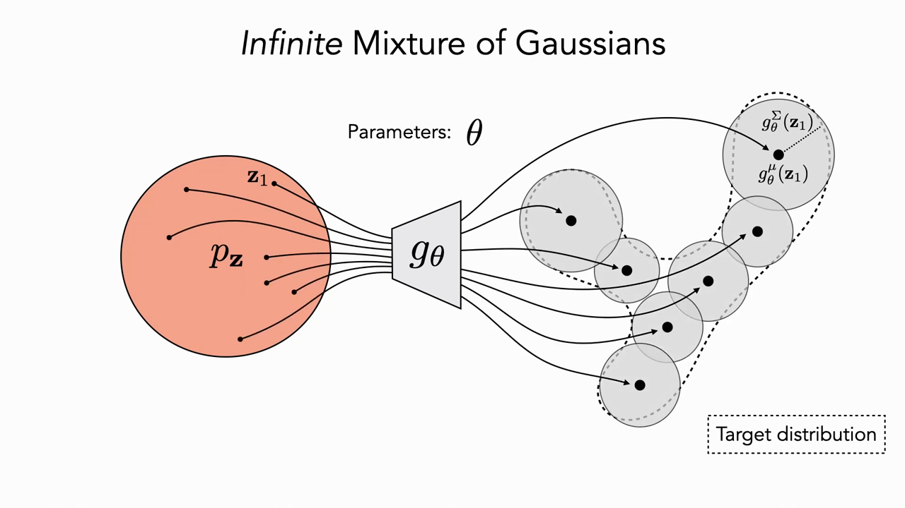
*▲ 강의 슬라이드 [16:40](https://youtu.be/8zzfcYIELdo?t=1000): 무한 가우스 혼합. $p_\mathbf{z}$의 점 하나하나가 $g_\theta$를 거쳐 성분 하나(평균 $g^\mu_\theta(\mathbf{z})$, 공분산 $g^\Sigma_\theta(\mathbf{z})$)가 된다. 매개변수는 $\theta$뿐이다*

질의응답 정리 [17:16](https://youtu.be/8zzfcYIELdo?t=1036)

- **이것은 [합성곱](00_%EB%94%A5%EB%9F%AC%EB%8B%9D_%EC%9A%A9%EC%96%B4%EC%82%AC%EC%A0%84.md#convolution-%ED%95%A9%EC%84%B1%EA%B3%B1)(convolution)인가?** $\mathbf{z}$ 공간에서의 [합성곱](00_%EB%94%A5%EB%9F%AC%EB%8B%9D_%EC%9A%A9%EC%96%B4%EC%82%AC%EC%A0%84.md#convolution-%ED%95%A9%EC%84%B1%EA%B3%B1)으로 볼 수도 있겠지만, [잠재 변수](00_%EB%94%A5%EB%9F%AC%EB%8B%9D_%EC%9A%A9%EC%96%B4%EC%82%AC%EC%A0%84.md#latent-variable-%EC%9E%A0%EC%9E%AC-%EB%B3%80%EC%88%98)를 **주변화(marginalize)**하는 [주변 우도](00_%EB%94%A5%EB%9F%AC%EB%8B%9D_%EC%9A%A9%EC%96%B4%EC%82%AC%EC%A0%84.md#marginal-likelihood-%EC%A3%BC%EB%B3%80-%EC%9A%B0%EB%8F%84)로 보는 편이 더 쓸모 있다고 강사는 답합니다.

### 4.2 잠재 변수 모델과 주변 우도

▶ 영상 [17:50](https://youtu.be/8zzfcYIELdo?t=1070)

📐 **수학 개념**: [가우스 혼합과 주변 우도](%EC%88%98%ED%95%99%EA%B0%9C%EB%85%90/11_%EC%83%9D%EC%84%B1_%EB%AA%A8%EB%8D%B8/MM54_%EA%B0%80%EC%9A%B0%EC%8A%A4_%ED%98%BC%ED%95%A9%EA%B3%BC_%EC%A3%BC%EB%B3%80_%EC%9A%B0%EB%8F%84.md) · [확률 기초](%EC%88%98%ED%95%99%EA%B0%9C%EB%85%90/04_%ED%99%95%EB%A5%A0%EA%B3%BC_%EC%A0%95%EB%B3%B4/M08_%ED%99%95%EB%A5%A0_%EA%B8%B0%EC%B4%88.md)

- $\mathbf{z}$를 생성된 데이터의 모든 속성을 추상적으로 묘사하는 **[잠재 변수](00_%EB%94%A5%EB%9F%AC%EB%8B%9D_%EC%9A%A9%EC%96%B4%EC%82%AC%EC%A0%84.md#latent-variable-%EC%9E%A0%EC%9E%AC-%EB%B3%80%EC%88%98)**(latent variable)로 봅니다. 지난 시간의 예처럼, 파이썬 프로그램이 단순한 분포의 잡음(강의 굽이는 베르누이, 풀 색은 [정규분포](00_%EB%94%A5%EB%9F%AC%EB%8B%9D_%EC%9A%A9%EC%96%B4%EC%82%AC%EC%A0%84.md#normal-distribution-%EC%A0%95%EA%B7%9C%EB%B6%84%ED%8F%AC), 나무 수는 균등분포)을 받아 이미지를 만든다면 그 잡음들이 [잠재 변수](00_%EB%94%A5%EB%9F%AC%EB%8B%9D_%EC%9A%A9%EC%96%B4%EC%82%AC%EC%A0%84.md#latent-variable-%EC%9E%A0%EC%9E%AC-%EB%B3%80%EC%88%98)이고 각각 해석할 수 있습니다.
- 그래프 모형으로 쓰면 $\mathbf{z} \to \mathbf{x}$입니다. $\mathbf{z}$를 뽑고, 그 조건에서 $\mathbf{x}$를 뽑습니다. 관측하는 것은 $\mathbf{x}$뿐이고 $\mathbf{z}$는 보이지 않으므로, 필요하면 $\mathbf{x}$에서 $\mathbf{z}$를 **추론**해야 합니다.
- [생성기](00_%EB%94%A5%EB%9F%AC%EB%8B%9D_%EC%9A%A9%EC%96%B4%EC%82%AC%EC%A0%84.md#generator-discriminator-%EC%83%9D%EC%84%B1%EA%B8%B0%EC%99%80-%ED%8C%90%EB%B3%84%EA%B8%B0)는 조건부 분포 $p_\theta(\mathbf{x}\mid\mathbf{z})$입니다. $p(\mathbf{x}\mid\mathbf{z})p(\mathbf{z}) = p(\mathbf{x}, \mathbf{z})$이고, 이것을 $\mathbf{z}$로 적분하면 $p(\mathbf{x})$가 됩니다([확률](00_%EB%94%A5%EB%9F%AC%EB%8B%9D_%EC%9A%A9%EC%96%B4%EC%82%AC%EC%A0%84.md#probability-%ED%99%95%EB%A5%A0)의 주변화).
- 모델이 데이터에 주는 [확률](00_%EB%94%A5%EB%9F%AC%EB%8B%9D_%EC%9A%A9%EC%96%B4%EC%82%AC%EC%A0%84.md#probability-%ED%99%95%EB%A5%A0)을 **[우도](00_%EB%94%A5%EB%9F%AC%EB%8B%9D_%EC%9A%A9%EC%96%B4%EC%82%AC%EC%A0%84.md#likelihood-%EC%9A%B0%EB%8F%84)**(likelihood)라 하고, [잠재 변수](00_%EB%94%A5%EB%9F%AC%EB%8B%9D_%EC%9A%A9%EC%96%B4%EC%82%AC%EC%A0%84.md#latent-variable-%EC%9E%A0%EC%9E%AC-%EB%B3%80%EC%88%98)를 적분해 없앤 것이라 **[주변 우도](00_%EB%94%A5%EB%9F%AC%EB%8B%9D_%EC%9A%A9%EC%96%B4%EC%82%AC%EC%A0%84.md#marginal-likelihood-%EC%A3%BC%EB%B3%80-%EC%9A%B0%EB%8F%84)**(marginal likelihood)라 부릅니다. 한 데이터 점을 높은 [확률](00_%EB%94%A5%EB%9F%AC%EB%8B%9D_%EC%9A%A9%EC%96%B4%EC%82%AC%EC%A0%84.md#probability-%ED%99%95%EB%A5%A0)로 설명하는 [잠재 변수](00_%EB%94%A5%EB%9F%AC%EB%8B%9D_%EC%9A%A9%EC%96%B4%EC%82%AC%EC%A0%84.md#latent-variable-%EC%9E%A0%EC%9E%AC-%EB%B3%80%EC%88%98) 값이 여러 개일 수 있기 때문에 모두 더합니다.

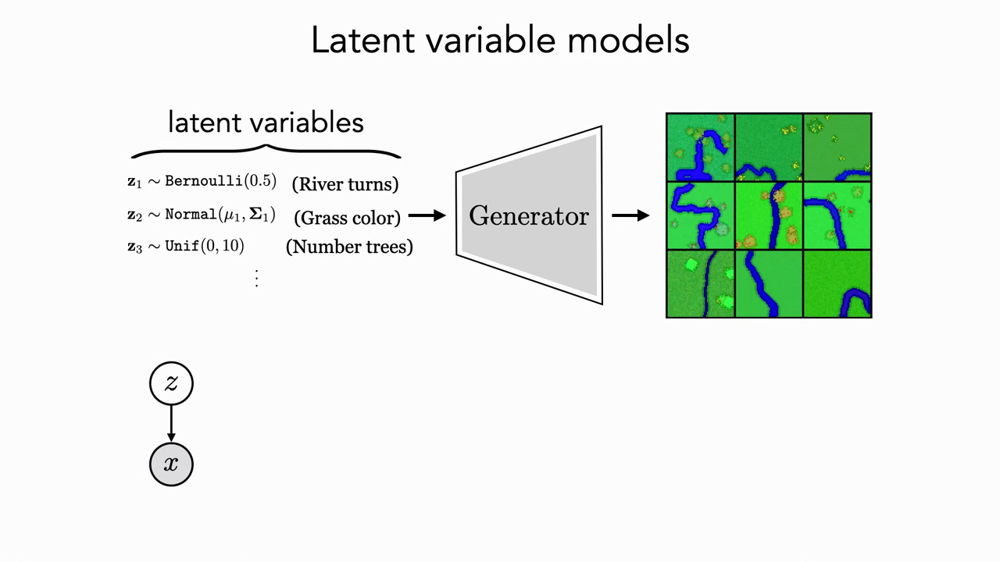
*▲ 강의 슬라이드 [18:30](https://youtu.be/8zzfcYIELdo?t=1110): [잠재 변수](00_%EB%94%A5%EB%9F%AC%EB%8B%9D_%EC%9A%A9%EC%96%B4%EC%82%AC%EC%A0%84.md#latent-variable-%EC%9E%A0%EC%9E%AC-%EB%B3%80%EC%88%98) 모델. 강의 굽이 $z_1 \sim$ Bernoulli(0.5), 풀 색 $z_2 \sim$ Normal, 나무 수 $z_3 \sim$ Unif(0, 10)를 [생성기](00_%EB%94%A5%EB%9F%AC%EB%8B%9D_%EC%9A%A9%EC%96%B4%EC%82%AC%EC%A0%84.md#generator-discriminator-%EC%83%9D%EC%84%B1%EA%B8%B0%EC%99%80-%ED%8C%90%EB%B3%84%EA%B8%B0)에 넣어 강 지도를 만든다. 아래는 그래프 모형 $z \to x$*

### 4.3 VAE 한 장 요약과 표본 뽑기

▶ 영상 [20:10](https://youtu.be/8zzfcYIELdo?t=1210)

📐 **수학 개념**: [확률 밀도와 정규분포](%EC%88%98%ED%95%99%EA%B0%9C%EB%85%90/04_%ED%99%95%EB%A5%A0%EA%B3%BC_%EC%A0%95%EB%B3%B4/MM50_%ED%99%95%EB%A5%A0_%EB%B0%80%EB%8F%84%EC%99%80_%EC%A0%95%EA%B7%9C%EB%B6%84%ED%8F%AC.md) · [가우스 KL과 재매개변수화](%EC%88%98%ED%95%99%EA%B0%9C%EB%85%90/11_%EC%83%9D%EC%84%B1_%EB%AA%A8%EB%8D%B8/MM57_%EA%B0%80%EC%9A%B0%EC%8A%A4_KL%EA%B3%BC_%EC%9E%AC%EB%A7%A4%EA%B0%9C%EB%B3%80%EC%88%98%ED%99%94.md)

- **목표 함수**: 데이터의 [최대 우도](00_%EB%94%A5%EB%9F%AC%EB%8B%9D_%EC%9A%A9%EC%96%B4%EC%82%AC%EC%A0%84.md#maximum-likelihood-%EC%B5%9C%EB%8C%80-%EC%9A%B0%EB%8F%84) $\max_\theta \mathbb{E}_{\mathbf{x}\sim p_{\text{data}}}[\log p_\theta(\mathbf{x})]$.
- **[가설 공간](00_%EB%94%A5%EB%9F%AC%EB%8B%9D_%EC%9A%A9%EC%96%B4%EC%82%AC%EC%A0%84.md#hypothesis-space-%EA%B0%80%EC%84%A4-%EA%B3%B5%EA%B0%84)**: 무한 가우스 혼합. $p(\mathbf{x}\mid\mathbf{z})$는 가우스, [사전 분포](00_%EB%94%A5%EB%9F%AC%EB%8B%9D_%EC%9A%A9%EC%96%B4%EC%82%AC%EC%A0%84.md#prior-posterior-%EC%82%AC%EC%A0%84-%EB%B6%84%ED%8F%AC%EC%99%80-%EC%82%AC%ED%9B%84-%EB%B6%84%ED%8F%AC) $p(\mathbf{z})$는 단위 가우스.
- **결과물 두 가지**: 밀도 함수 $p_\theta: \mathcal{X} \to [0, \infty)$와, 그 밀도에서 표본을 쉽게 뽑는 **샘플러** $g_\theta: \mathcal{Z} \to \mathcal{X}$.
- **표본 뽑기**: 단위 가우스 $\mathbf{z}$를 뽑고, 신경망이 평균과 표준편차를 예측하고, 단위 가우스 잡음 $\boldsymbol{\epsilon}$에 표준편차를 곱해 평균에 더합니다. 그러면 $\mathbf{x}$는 평균 $g^\mu_\theta(\mathbf{z})$, [분산](00_%EB%94%A5%EB%9F%AC%EB%8B%9D_%EC%9A%A9%EC%96%B4%EC%82%AC%EC%A0%84.md#variance-%EB%B6%84%EC%82%B0) $g^\sigma_\theta(\mathbf{z})^2$인 가우스를 따릅니다.
- 이렇게 "단위 가우스 표본을 평균만큼 옮기고 표준편차를 곱해" 원하는 가우스의 표본을 만드는 것을 문헌에서는 **[재매개변수화 트릭](00_%EB%94%A5%EB%9F%AC%EB%8B%9D_%EC%9A%A9%EC%96%B4%EC%82%AC%EC%A0%84.md#reparameterization-trick-%EC%9E%AC%EB%A7%A4%EA%B0%9C%EB%B3%80%EC%88%98%ED%99%94-%ED%8A%B8%EB%A6%AD)**(reparameterization trick)이라 부릅니다. 무작위성은 옆에서 들어오는 $\boldsymbol{\epsilon}$에만 있고, $\mathbf{x}$는 $g$의 결정적 함수가 됩니다.

$$
\mathbf{x} = g^{\mu}_\theta(\mathbf{z}) + g^{\sigma}_\theta(\mathbf{z})\,\boldsymbol{\epsilon}, \qquad \boldsymbol{\epsilon} \sim \mathcal{N}(\mathbf{0}, I)
$$

기호 풀이

| 기호 | 읽는 법 | 뜻 | 예제 값 |
| --- | --- | --- | --- |
| $\mathbf{x}$ | 엑스 | 만들어진 표본 | 0.9 |
| $g^{\mu}_\theta(\mathbf{z})$ | 지 뮤 | 신경망이 예측한 평균 | 1.5 |
| $g^{\sigma}_\theta(\mathbf{z})$ | 지 시그마 | 신경망이 예측한 **표준편차** ([분산](00_%EB%94%A5%EB%9F%AC%EB%8B%9D_%EC%9A%A9%EC%96%B4%EC%82%AC%EC%A0%84.md#variance-%EB%B6%84%EC%82%B0)의 제곱근) | 0.5 |
| $\boldsymbol{\epsilon}$ | 엡실론 | 단위 가우스에서 뽑은 잡음 | -1.2 |
| $\mathcal{N}(\mathbf{0}, I)$ | 단위 가우스 | 평균 0, [분산](00_%EB%94%A5%EB%9F%AC%EB%8B%9D_%EC%9A%A9%EC%96%B4%EC%82%AC%EC%A0%84.md#variance-%EB%B6%84%EC%82%B0) 1인 [정규분포](00_%EB%94%A5%EB%9F%AC%EB%8B%9D_%EC%9A%A9%EC%96%B4%EC%82%AC%EC%A0%84.md#normal-distribution-%EC%A0%95%EA%B7%9C%EB%B6%84%ED%8F%AC) | |

예제와 풀이

**문제**: 어떤 $z$에 대해 [생성기](00_%EB%94%A5%EB%9F%AC%EB%8B%9D_%EC%9A%A9%EC%96%B4%EC%82%AC%EC%A0%84.md#generator-discriminator-%EC%83%9D%EC%84%B1%EA%B8%B0%EC%99%80-%ED%8C%90%EB%B3%84%EA%B8%B0)가 평균 1.5, 표준편차 0.5를 냈고, 단위 가우스에서 $\epsilon = -1.2$를 뽑았다. 만들어지는 표본 $x$는?

**주어진 값**
- $g^\mu(z) = 1.5$ (예측한 평균)
- $g^\sigma(z) = 0.5$ (예측한 표준편차)
- $\epsilon = -1.2$ (단위 가우스 잡음)

**풀이**
1. 식을 그대로 쓴다: $x = g^{\mu}(z) + g^{\sigma}(z)\,\epsilon$
2. 값을 대입한다: $x = 1.5 + 0.5 \times (-1.2)$
3. 곱셈을 먼저 한다: $0.5 \times (-1.2) = -0.6$ 이므로 $x = 1.5 + (-0.6)$
4. 더한다: $1.5 - 0.6 = 0.9$

**답**: $x = $ **0.9**. 평균에서 표준편차의 1.2배만큼 왼쪽으로 간 점이다.

내 이해

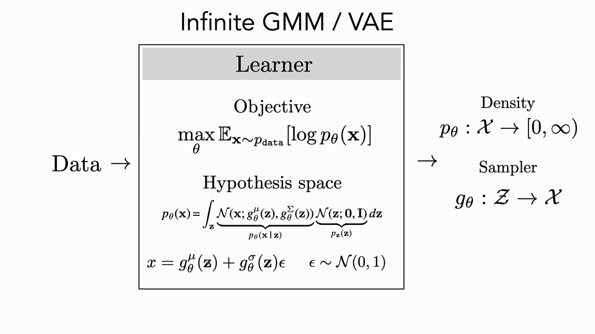
*▲ 강의 슬라이드 [22:00](https://youtu.be/8zzfcYIELdo?t=1320): 무한 GMM / [VAE](00_%EB%94%A5%EB%9F%AC%EB%8B%9D_%EC%9A%A9%EC%96%B4%EC%82%AC%EC%A0%84.md#variational-autoencoder-vae-%EB%B3%80%EB%B6%84-%EC%98%A4%ED%86%A0%EC%9D%B8%EC%BD%94%EB%8D%94)의 학습기. 목표는 [최대 우도](00_%EB%94%A5%EB%9F%AC%EB%8B%9D_%EC%9A%A9%EC%96%B4%EC%82%AC%EC%A0%84.md#maximum-likelihood-%EC%B5%9C%EB%8C%80-%EC%9A%B0%EB%8F%84), [가설 공간](00_%EB%94%A5%EB%9F%AC%EB%8B%9D_%EC%9A%A9%EC%96%B4%EC%82%AC%EC%A0%84.md#hypothesis-space-%EA%B0%80%EC%84%A4-%EA%B3%B5%EA%B0%84)은 무한 가우스 혼합, 결과물은 밀도 $p_\theta$와 샘플러 $g_\theta$*

질의응답 정리 [25:21](https://youtu.be/8zzfcYIELdo?t=1521)

- **$\sigma$를 곱하나, $\sigma^2$을 곱하나?** 강사가 말하면서 [분산](00_%EB%94%A5%EB%9F%AC%EB%8B%9D_%EC%9A%A9%EC%96%B4%EC%82%AC%EC%A0%84.md#variance-%EB%B6%84%EC%82%B0)과 표준편차를 섞어 썼는데, $\sigma$가 표준편차, $\sigma^2$이 [분산](00_%EB%94%A5%EB%9F%AC%EB%8B%9D_%EC%9A%A9%EC%96%B4%EC%82%AC%EC%A0%84.md#variance-%EB%B6%84%EC%82%B0)입니다. 단위 가우스를 원하는 가우스로 바꿀 때는 **표준편차**([분산](00_%EB%94%A5%EB%9F%AC%EB%8B%9D_%EC%9A%A9%EC%96%B4%EC%82%AC%EC%A0%84.md#variance-%EB%B6%84%EC%82%B0)의 제곱근)를 곱하는 것이 맞고, 슬라이드는 오타가 아닙니다.

---

## 5. 목적 함수와 다루기 힘든 적분

▶ 영상 [23:07](https://youtu.be/8zzfcYIELdo?t=1387)

📐 **수학 개념**: [KL 발산과 최대 우도](%EC%88%98%ED%95%99%EA%B0%9C%EB%85%90/04_%ED%99%95%EB%A5%A0%EA%B3%BC_%EC%A0%95%EB%B3%B4/MM51_KL_%EB%B0%9C%EC%82%B0%EA%B3%BC_%EC%B5%9C%EB%8C%80_%EC%9A%B0%EB%8F%84.md) · [argmax](%EC%88%98%ED%95%99%EA%B0%9C%EB%85%90/02_%EB%AF%B8%EB%B6%84/MM01_argmin%EA%B3%BC_argmax.md) · [로그](%EC%88%98%ED%95%99%EA%B0%9C%EB%85%90/01_%EC%88%98%EC%99%80_%ED%95%A8%EC%88%98/M07_%EB%A1%9C%EA%B7%B8.md)

- [학습 데이터](00_%EB%94%A5%EB%9F%AC%EB%8B%9D_%EC%9A%A9%EC%96%B4%EC%82%AC%EC%A0%84.md#training-data-test-data-%ED%95%99%EC%8A%B5-%EB%8D%B0%EC%9D%B4%ED%84%B0%EC%99%80-%EC%8B%9C%ED%97%98-%EB%8D%B0%EC%9D%B4%ED%84%B0) $N$개에 대해 [로그](00_%EB%94%A5%EB%9F%AC%EB%8B%9D_%EC%9A%A9%EC%96%B4%EC%82%AC%EC%A0%84.md#log-ln-%EB%A1%9C%EA%B7%B8) [우도](00_%EB%94%A5%EB%9F%AC%EB%8B%9D_%EC%9A%A9%EC%96%B4%EC%82%AC%EC%A0%84.md#likelihood-%EC%9A%B0%EB%8F%84)의 합을 최대로 하는 $\theta$를 찾습니다. 데이터 점들의 결합 [확률](00_%EB%94%A5%EB%9F%AC%EB%8B%9D_%EC%9A%A9%EC%96%B4%EC%82%AC%EC%A0%84.md#probability-%ED%99%95%EB%A5%A0)을 최대로 하는 것은 [로그](00_%EB%94%A5%EB%9F%AC%EB%8B%9D_%EC%9A%A9%EC%96%B4%EC%82%AC%EC%A0%84.md#log-ln-%EB%A1%9C%EA%B7%B8) [확률](00_%EB%94%A5%EB%9F%AC%EB%8B%9D_%EC%9A%A9%EC%96%B4%EC%82%AC%EC%A0%84.md#probability-%ED%99%95%EB%A5%A0)의 합을 최대로 하는 것과 같습니다.
- 어려운 점은 [우도](00_%EB%94%A5%EB%9F%AC%EB%8B%9D_%EC%9A%A9%EC%96%B4%EC%82%AC%EC%A0%84.md#likelihood-%EC%9A%B0%EB%8F%84)가 **적분**이라는 것입니다. 닫힌 꼴이 없으므로 표본 여러 개로 근사해야 하고, 좋은 근사에는 $\mathbf{z}$ 표본이 많이 필요합니다. 그런데 $g$가 적분 안에 있으므로, 매개변수를 한 번 고칠 때마다 신경망을 **아주 여러 번** 앞으로 돌리고 그것을 모두 역전파해야 합니다. 이 적분이 **다루기 힘든**(intractable) 적분입니다.
- 여기까지가 [VAE](00_%EB%94%A5%EB%9F%AC%EB%8B%9D_%EC%9A%A9%EC%96%B4%EC%82%AC%EC%A0%84.md#variational-autoencoder-vae-%EB%B3%80%EB%B6%84-%EC%98%A4%ED%86%A0%EC%9D%B8%EC%BD%94%EB%8D%94)의 한 [층](00_%EB%94%A5%EB%9F%AC%EB%8B%9D_%EC%9A%A9%EC%96%B4%EC%82%AC%EC%A0%84.md#layer-%EC%B8%B5) 이해입니다. "신경망 $g$로 만든 무한 가우스 혼합을 데이터에 [최대 우도](00_%EB%94%A5%EB%9F%AC%EB%8B%9D_%EC%9A%A9%EC%96%B4%EC%82%AC%EC%A0%84.md#maximum-likelihood-%EC%B5%9C%EB%8C%80-%EC%9A%B0%EB%8F%84)로 맞춘다." 나머지 [VAE](00_%EB%94%A5%EB%9F%AC%EB%8B%9D_%EC%9A%A9%EC%96%B4%EC%82%AC%EC%A0%84.md#variational-autoencoder-vae-%EB%B3%80%EB%B6%84-%EC%98%A4%ED%86%A0%EC%9D%B8%EC%BD%94%EB%8D%94)의 요령은 모두 **이 적분을 효율적으로 계산하는 법**입니다.

$$
\theta^* = \arg\max_\theta \sum_{i=1}^{N} \log \int_{\mathbf{z}} \mathcal{N}\big(\mathbf{x}^{(i)};\ g^{\mu}_\theta(\mathbf{z}), g^{\Sigma}_\theta(\mathbf{z})\big)\, \mathcal{N}(\mathbf{z}; \mathbf{0}, I)\, d\mathbf{z}
$$

기호 풀이

| 기호 | 읽는 법 | 뜻 | 예제 값 |
| --- | --- | --- | --- |
| $\theta^*$ | 세타 스타 | 가장 좋은 매개변수 | |
| $\arg\max_\theta$ | 아그맥스 | 뒤의 값을 가장 크게 만드는 $\theta$ | $\theta_B$ |
| $N$ | 엔 | [학습 데이터](00_%EB%94%A5%EB%9F%AC%EB%8B%9D_%EC%9A%A9%EC%96%B4%EC%82%AC%EC%A0%84.md#training-data-test-data-%ED%95%99%EC%8A%B5-%EB%8D%B0%EC%9D%B4%ED%84%B0%EC%99%80-%EC%8B%9C%ED%97%98-%EB%8D%B0%EC%9D%B4%ED%84%B0) 개수 | 2 |
| $\mathbf{x}^{(i)}$ | 엑스 아이 | $i$번째 [학습 데이터](00_%EB%94%A5%EB%9F%AC%EB%8B%9D_%EC%9A%A9%EC%96%B4%EC%82%AC%EC%A0%84.md#training-data-test-data-%ED%95%99%EC%8A%B5-%EB%8D%B0%EC%9D%B4%ED%84%B0%EC%99%80-%EC%8B%9C%ED%97%98-%EB%8D%B0%EC%9D%B4%ED%84%B0) | |
| $\log \int \cdots d\mathbf{z}$ | [로그](00_%EB%94%A5%EB%9F%AC%EB%8B%9D_%EC%9A%A9%EC%96%B4%EC%82%AC%EC%A0%84.md#log-ln-%EB%A1%9C%EA%B7%B8) 적분 | $i$번째 데이터의 [로그](00_%EB%94%A5%EB%9F%AC%EB%8B%9D_%EC%9A%A9%EC%96%B4%EC%82%AC%EC%A0%84.md#log-ln-%EB%A1%9C%EA%B7%B8) [주변 우도](00_%EB%94%A5%EB%9F%AC%EB%8B%9D_%EC%9A%A9%EC%96%B4%EC%82%AC%EC%A0%84.md#marginal-likelihood-%EC%A3%BC%EB%B3%80-%EC%9A%B0%EB%8F%84) $\log p_\theta(\mathbf{x}^{(i)})$ | $\ln 0.15$ |
| $\mathcal{N}(\mathbf{z}; \mathbf{0}, I)$ | 단위 가우스 | [사전 분포](00_%EB%94%A5%EB%9F%AC%EB%8B%9D_%EC%9A%A9%EC%96%B4%EC%82%AC%EC%A0%84.md#prior-posterior-%EC%82%AC%EC%A0%84-%EB%B6%84%ED%8F%AC%EC%99%80-%EC%82%AC%ED%9B%84-%EB%B6%84%ED%8F%AC) $p_\mathbf{z}(\mathbf{z})$ | |

예제와 풀이

**문제**: 데이터가 두 개다. 매개변수 $\theta_A$는 두 데이터에 밀도 0.2와 0.05를, $\theta_B$는 0.15와 0.1을 준다. 어느 쪽의 [로그](00_%EB%94%A5%EB%9F%AC%EB%8B%9D_%EC%9A%A9%EC%96%B4%EC%82%AC%EC%A0%84.md#log-ln-%EB%A1%9C%EA%B7%B8) [우도](00_%EB%94%A5%EB%9F%AC%EB%8B%9D_%EC%9A%A9%EC%96%B4%EC%82%AC%EC%A0%84.md#likelihood-%EC%9A%B0%EB%8F%84) 합이 더 큰가?

**주어진 값**
- $N = 2$ (데이터 개수)
- $\theta_A$: $p(\mathbf{x}^{(1)}) = 0.2$, $p(\mathbf{x}^{(2)}) = 0.05$ (적분을 이미 계산한 값)
- $\theta_B$: $p(\mathbf{x}^{(1)}) = 0.15$, $p(\mathbf{x}^{(2)}) = 0.1$

**풀이**
1. 식을 그대로 쓴다: $L(\theta) = \sum_{i=1}^{N} \log p_\theta(\mathbf{x}^{(i)})$ (적분 부분을 $p_\theta(\mathbf{x}^{(i)})$로 줄여 씀)
2. 값을 대입한다 ($\theta_A$): $L(\theta_A) = \log 0.2 + \log 0.05$
3. [로그](00_%EB%94%A5%EB%9F%AC%EB%8B%9D_%EC%9A%A9%EC%96%B4%EC%82%AC%EC%A0%84.md#log-ln-%EB%A1%9C%EA%B7%B8)를 계산한다. $\ln a$는 "$e$를 몇 제곱해야 $a$가 되나"이고 계산기로 구한다: $\ln 0.2 = -1.6094$
4. 둘째 [로그](00_%EB%94%A5%EB%9F%AC%EB%8B%9D_%EC%9A%A9%EC%96%B4%EC%82%AC%EC%A0%84.md#log-ln-%EB%A1%9C%EA%B7%B8): $\ln 0.05 = -2.9957$
5. 더한다: $-1.6094 + (-2.9957) = -4.6052$
6. 값을 대입한다 ($\theta_B$): $L(\theta_B) = \log 0.15 + \log 0.1$
7. [로그](00_%EB%94%A5%EB%9F%AC%EB%8B%9D_%EC%9A%A9%EC%96%B4%EC%82%AC%EC%A0%84.md#log-ln-%EB%A1%9C%EA%B7%B8)를 계산한다: $\ln 0.15 = -1.8971$, $\ln 0.1 = -2.3026$
8. 더한다: $-1.8971 + (-2.3026) = -4.1997$
9. 비교한다: $-4.1997 > -4.6052$

**답**: $\theta_B$ ([로그](00_%EB%94%A5%EB%9F%AC%EB%8B%9D_%EC%9A%A9%EC%96%B4%EC%82%AC%EC%A0%84.md#log-ln-%EB%A1%9C%EA%B7%B8) [우도](00_%EB%94%A5%EB%9F%AC%EB%8B%9D_%EC%9A%A9%EC%96%B4%EC%82%AC%EC%A0%84.md#likelihood-%EC%9A%B0%EB%8F%84) 합 **-4.1997**). 한 점만 아주 잘 설명하는 것보다 두 점을 고르게 설명하는 쪽이 이긴다.

내 이해

---

## 6. 요령 1: 몬테카를로 근사

▶ 영상 [28:11](https://youtu.be/8zzfcYIELdo?t=1691)

📐 **수학 개념**: [몬테카를로와 중요도 샘플링](%EC%88%98%ED%95%99%EA%B0%9C%EB%85%90/11_%EC%83%9D%EC%84%B1_%EB%AA%A8%EB%8D%B8/MM55_%EB%AA%AC%ED%85%8C%EC%B9%B4%EB%A5%BC%EB%A1%9C%EC%99%80_%EC%A4%91%EC%9A%94%EB%8F%84_%EC%83%98%ED%94%8C%EB%A7%81.md) · [기댓값](%EC%88%98%ED%95%99%EA%B0%9C%EB%85%90/04_%ED%99%95%EB%A5%A0%EA%B3%BC_%EC%A0%95%EB%B3%B4/MM22_%EA%B8%B0%EB%8C%93%EA%B0%92%EA%B3%BC_%EC%9D%BC%EB%B0%98%ED%99%94_%EA%B0%84%EA%B7%B9.md) · [시그마와 평균](%EC%88%98%ED%95%99%EA%B0%9C%EB%85%90/01_%EC%88%98%EC%99%80_%ED%95%A8%EC%88%98/M02_%EC%8B%9C%EA%B7%B8%EB%A7%88%EC%99%80_%ED%8F%89%EA%B7%A0.md)

- 첫 요령은 가장 흔한 것입니다. [주변 우도](00_%EB%94%A5%EB%9F%AC%EB%8B%9D_%EC%9A%A9%EC%96%B4%EC%82%AC%EC%A0%84.md#marginal-likelihood-%EC%A3%BC%EB%B3%80-%EC%9A%B0%EB%8F%84)는 **[기댓값](00_%EB%94%A5%EB%9F%AC%EB%8B%9D_%EC%9A%A9%EC%96%B4%EC%82%AC%EC%A0%84.md#expectation-%EA%B8%B0%EB%8C%93%EA%B0%92)** 꼴입니다. "[사전 분포](00_%EB%94%A5%EB%9F%AC%EB%8B%9D_%EC%9A%A9%EC%96%B4%EC%82%AC%EC%A0%84.md#prior-posterior-%EC%82%AC%EC%A0%84-%EB%B6%84%ED%8F%AC%EC%99%80-%EC%82%AC%ED%9B%84-%EB%B6%84%ED%8F%AC)에서 뽑은 $\mathbf{z}$마다 $\mathbf{x}$에 주는 밀도"의 평균이죠.
- [기댓값](00_%EB%94%A5%EB%9F%AC%EB%8B%9D_%EC%9A%A9%EC%96%B4%EC%82%AC%EC%A0%84.md#expectation-%EA%B8%B0%EB%8C%93%EA%B0%92)은 **표본 $M$개를 뽑아 평균**하면 근사됩니다(**[몬테카를로 추정](00_%EB%94%A5%EB%9F%AC%EB%8B%9D_%EC%9A%A9%EC%96%B4%EC%82%AC%EC%A0%84.md#monte-carlo-estimation-%EB%AA%AC%ED%85%8C%EC%B9%B4%EB%A5%BC%EB%A1%9C-%EC%B6%94%EC%A0%95)**). 이 추정은 비편향이고 $M \to \infty$이면 정확해집니다.
- 단위 가우스 벡터는 쉽게 뽑을 수 있고, $p_\theta(\mathbf{x}\mid\mathbf{z})$는 신경망이 낸 평균·[분산](00_%EB%94%A5%EB%9F%AC%EB%8B%9D_%EC%9A%A9%EC%96%B4%EC%82%AC%EC%A0%84.md#variance-%EB%B6%84%EC%82%B0)을 넣은 가우스 밀도 공식이므로 바로 계산됩니다. 적분이 사라졌으니 이제 **[파이토치](00_%EB%94%A5%EB%9F%AC%EB%8B%9D_%EC%9A%A9%EC%96%B4%EC%82%AC%EC%A0%84.md#pytorch-%ED%8C%8C%EC%9D%B4%ED%86%A0%EC%B9%98)로 짤 수 있습니다**.
- [학습](00_%EB%94%A5%EB%9F%AC%EB%8B%9D_%EC%9A%A9%EC%96%B4%EC%82%AC%EC%A0%84.md#training-%ED%95%99%EC%8A%B5) 목표는 $\theta^* = \arg\max_\theta \sum_i \log \frac{1}{M}\sum_j \mathcal{N}(\mathbf{x}^{(i)}; g^\mu_\theta(\mathbf{z}^{(j)}), g^\Sigma_\theta(\mathbf{z}^{(j)}))$입니다. (슬라이드에는 $\frac{1}{M}$이 [로그](00_%EB%94%A5%EB%9F%AC%EB%8B%9D_%EC%9A%A9%EC%96%B4%EC%82%AC%EC%A0%84.md#log-ln-%EB%A1%9C%EA%B7%B8) 밖에 있는데, 강사가 강의 중에 "[로그](00_%EB%94%A5%EB%9F%AC%EB%8B%9D_%EC%9A%A9%EC%96%B4%EC%82%AC%EC%A0%84.md#log-ln-%EB%A1%9C%EA%B7%B8) 안에 있어야 한다"고 오타를 바로잡았습니다.)
- 코랩 시연: 2차원 데이터 분포에 이 목표로 SGD를 돌리면, 처음에 원점 근처에 모여 있던 성분들이 $\mathbf{z}$ 공간의 점마다 데이터 분포의 다른 부분으로 퍼져 분포를 덮습니다(시각화에서는 $\mathbf{z}$를 무작위 대신 격자로 뽑았습니다).

$$
p_\theta(\mathbf{x}) = \mathbb{E}_{\mathbf{z}\sim p_{\mathbf{z}}}\big[p_\theta(\mathbf{x}\mid\mathbf{z})\big] \approx \frac{1}{M}\sum_{j=1}^{M} p_\theta(\mathbf{x}\mid\mathbf{z}^{(j)}), \qquad \mathbf{z}^{(j)} \sim p_{\mathbf{z}}
$$

기호 풀이

| 기호 | 읽는 법 | 뜻 | 예제 값 |
| --- | --- | --- | --- |
| $\mathbb{E}_{\mathbf{z}\sim p_{\mathbf{z}}}[\cdot]$ | [기댓값](00_%EB%94%A5%EB%9F%AC%EB%8B%9D_%EC%9A%A9%EC%96%B4%EC%82%AC%EC%A0%84.md#expectation-%EA%B8%B0%EB%8C%93%EA%B0%92) | $\mathbf{z}$를 [사전 분포](00_%EB%94%A5%EB%9F%AC%EB%8B%9D_%EC%9A%A9%EC%96%B4%EC%82%AC%EC%A0%84.md#prior-posterior-%EC%82%AC%EC%A0%84-%EB%B6%84%ED%8F%AC%EC%99%80-%EC%82%AC%ED%9B%84-%EB%B6%84%ED%8F%AC)에서 뽑았을 때의 평균 | |
| $p_\theta(\mathbf{x}\mid\mathbf{z})$ | 피 엑스 바 제트 | $\mathbf{z}$가 만든 성분이 $\mathbf{x}$에 주는 밀도 | $\mathcal{N}(1; 2z, 1)$ |
| $M$ | 엠 | 뽑은 표본 개수 | 4 |
| $\mathbf{z}^{(j)}$ | 제트 제이 | $j$번째로 뽑은 잠재 표본 | -1, 0, 0.5, 1.5 |
| $\approx$ | 근사 | 표본이 유한해서 생기는 [오차](00_%EB%94%A5%EB%9F%AC%EB%8B%9D_%EC%9A%A9%EC%96%B4%EC%82%AC%EC%A0%84.md#error-%EC%98%A4%EC%B0%A8)가 있다 | 0.1748 대 0.1614 |

예제와 풀이

**문제**: 4.1의 모델($z \sim \mathcal{N}(0,1)$, $p(x\mid z) = \mathcal{N}(x; 2z, 1)$)에서 $z$ 표본 4개 $-1, 0, 0.5, 1.5$로 $p(x = 1)$을 몬테카를로 추정하라.

**주어진 값**
- $x = 1$ (밀도를 잴 점)
- $M = 4$ (표본 개수)
- $z^{(1)} = -1$, $z^{(2)} = 0$, $z^{(3)} = 0.5$, $z^{(4)} = 1.5$ ([사전 분포](00_%EB%94%A5%EB%9F%AC%EB%8B%9D_%EC%9A%A9%EC%96%B4%EC%82%AC%EC%A0%84.md#prior-posterior-%EC%82%AC%EC%A0%84-%EB%B6%84%ED%8F%AC%EC%99%80-%EC%82%AC%ED%9B%84-%EB%B6%84%ED%8F%AC)에서 뽑은 표본)
- $p(x\mid z) = \mathcal{N}(x; 2z, 1)$ (성분: 평균 $2z$, [분산](00_%EB%94%A5%EB%9F%AC%EB%8B%9D_%EC%9A%A9%EC%96%B4%EC%82%AC%EC%A0%84.md#variance-%EB%B6%84%EC%82%B0) 1)

**풀이**
1. 식을 그대로 쓴다: $p(x) \approx \dfrac{1}{M}\sum_{j=1}^{M} p(x\mid z^{(j)})$
2. 값을 대입한다: $p(1) \approx \dfrac{1}{4}\sum_{j=1}^{4} \mathcal{N}(1; 2z^{(j)}, 1)$
3. Σ를 풀어 쓴다: $\dfrac{1}{4}\big(\mathcal{N}(1; -2, 1) + \mathcal{N}(1; 0, 1) + \mathcal{N}(1; 1, 1) + \mathcal{N}(1; 3, 1)\big)$
4. 첫 항: 거리 제곱 $(1-(-2))^2 = 9$, 반으로 $4.5$, $e^{-4.5} = 0.0111$, $\sqrt{2\pi} = 2.5066$으로 나눠 $0.0044$
5. 둘째 항: 3절 예제와 같이 $0.2420$
6. 셋째 항: 거리 제곱 $(1-1)^2 = 0$, $e^{0} = 1$, $1 / 2.5066 = 0.3989$
7. 넷째 항: 거리 제곱 $(1-3)^2 = 4$, 반으로 $2$, $e^{-2} = 0.1353$, $0.1353 / 2.5066 = 0.0540$
8. 앞의 두 항을 더한다: $0.0044 + 0.2420 = 0.2464$
9. 셋째 항을 더한다: $0.2464 + 0.3989 = 0.6453$
10. 넷째 항을 더한다: $0.6453 + 0.0540 = 0.6993$
11. $M = 4$로 나눈다: $0.6993 / 4 = 0.1748$
12. 비교: 4.1에서 구한 참값은 0.1614

**답**: 추정값 **0.1748** (참값 0.1614). 표본이 4개뿐이라 [오차](00_%EB%94%A5%EB%9F%AC%EB%8B%9D_%EC%9A%A9%EC%96%B4%EC%82%AC%EC%A0%84.md#error-%EC%98%A4%EC%B0%A8)가 있고, $x=1$ 근처를 설명하지 못하는 $z=-1$ 표본은 거의 0을 보탰다.

내 이해

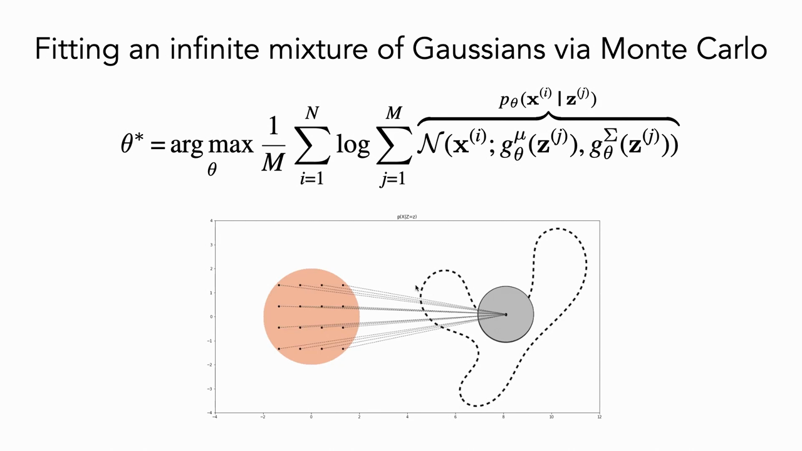
*▲ 강의 슬라이드 [32:30](https://youtu.be/8zzfcYIELdo?t=1950): 몬테카를로로 무한 가우스 혼합 맞추기. 아래는 [학습](00_%EB%94%A5%EB%9F%AC%EB%8B%9D_%EC%9A%A9%EC%96%B4%EC%82%AC%EC%A0%84.md#training-%ED%95%99%EC%8A%B5) 초기: 격자로 뽑은 $\mathbf{z}$(주황 원)가 모두 원점 근처의 성분 하나로 간다. 슬라이드의 $\frac{1}{M}$은 [로그](00_%EB%94%A5%EB%9F%AC%EB%8B%9D_%EC%9A%A9%EC%96%B4%EC%82%AC%EC%A0%84.md#log-ln-%EB%A1%9C%EA%B7%B8) 안에 있어야 한다(강사 정정)*

질의응답 정리 [32:37](https://youtu.be/8zzfcYIELdo?t=1957)

- **왜 $p(\mathbf{z})$를 곱하지 않나?** [기댓값](00_%EB%94%A5%EB%9F%AC%EB%8B%9D_%EC%9A%A9%EC%96%B4%EC%82%AC%EC%A0%84.md#expectation-%EA%B8%B0%EB%8C%93%EA%B0%92)의 정의 때문입니다. $p(\mathbf{z})$는 **뽑는 과정**으로 들어옵니다. [확률](00_%EB%94%A5%EB%9F%AC%EB%8B%9D_%EC%9A%A9%EC%96%B4%EC%82%AC%EC%A0%84.md#probability-%ED%99%95%EB%A5%A0)이 높은 $\mathbf{z}$가 더 자주 뽑혀 합에 더 많이 들어가므로 따로 곱하면 두 번 세는 셈입니다.
- **$p_\theta(\mathbf{x}\mid\mathbf{z})$는 [정규분포](00_%EB%94%A5%EB%9F%AC%EB%8B%9D_%EC%9A%A9%EC%96%B4%EC%82%AC%EC%A0%84.md#normal-distribution-%EC%A0%95%EA%B7%9C%EB%B6%84%ED%8F%AC)에서 표본을 뽑아 계산하나?** 아닙니다. 가우스 밀도는 $\frac{1}{\sqrt{2\pi\sigma^2}}e^{-(x-\mu)^2/(2\sigma^2)}$라는 닫힌 꼴이 있어서 공식에 넣기만 하면 됩니다.
- **근사 [오차](00_%EB%94%A5%EB%9F%AC%EB%8B%9D_%EC%9A%A9%EC%96%B4%EC%82%AC%EC%A0%84.md#error-%EC%98%A4%EC%B0%A8)는 $M$에 따라 어떻게 줄어드나?** 강사는 모른다고 답했고, 한 학생이 "몬테카를로 추정량의 [분산](00_%EB%94%A5%EB%9F%AC%EB%8B%9D_%EC%9A%A9%EC%96%B4%EC%82%AC%EC%A0%84.md#variance-%EB%B6%84%EC%82%B0)은 $1/M$, [오차](00_%EB%94%A5%EB%9F%AC%EB%8B%9D_%EC%9A%A9%EC%96%B4%EC%82%AC%EC%A0%84.md#error-%EC%98%A4%EC%B0%A8)(표준편차)는 $1/\sqrt{M}$에 비례한다"고 보탰습니다.

### 6.1 고차원에서는 표본이 모자란다

▶ 영상 [35:27](https://youtu.be/8zzfcYIELdo?t=2127)

📐 **수학 개념**: [몬테카를로와 중요도 샘플링](%EC%88%98%ED%95%99%EA%B0%9C%EB%85%90/11_%EC%83%9D%EC%84%B1_%EB%AA%A8%EB%8D%B8/MM55_%EB%AA%AC%ED%85%8C%EC%B9%B4%EB%A5%BC%EB%A1%9C%EC%99%80_%EC%A4%91%EC%9A%94%EB%8F%84_%EC%83%98%ED%94%8C%EB%A7%81.md) · [차원의 저주](%EC%88%98%ED%95%99%EA%B0%9C%EB%85%90/06_%EA%B7%BC%EC%82%AC_%EC%9D%B4%EB%A1%A0/MM12_%EC%A7%81%EC%82%AC%EA%B0%81%ED%98%95_%EA%B7%BC%EC%82%AC%EC%99%80_%EC%B0%A8%EC%9B%90%EC%9D%98_%EC%A0%80%EC%A3%BC.md)

- 2차원 예에서는 $M = 100$개 정도로도 잘 맞습니다. 하지만 고차원 데이터를 모델링하려면 [잠재 공간](00_%EB%94%A5%EB%9F%AC%EB%8B%9D_%EC%9A%A9%EC%96%B4%EC%82%AC%EC%A0%84.md#latent-space-%EC%9E%A0%EC%9E%AC-%EA%B3%B5%EA%B0%84)도 수백 차원이 필요합니다. 그때 표본 100개로 100차원 공간의 적분을 근사할 수 있을까요? 학생들은 "아니다"에 손을 들었습니다.
- 강사의 직관은 "$D$차원 공간을 덮으려면 차원마다 일정한 수의 표본이 필요하니 표본이 **차원에 지수적으로** 많이 필요하다"입니다. 실제로 이 방법은 고차원에서 잘 되지 않습니다. (덧붙임: 몬테카를로 [오차](00_%EB%94%A5%EB%9F%AC%EB%8B%9D_%EC%9A%A9%EC%96%B4%EC%82%AC%EC%A0%84.md#error-%EC%98%A4%EC%B0%A8) 자체는 [중심극한정리](00_%EB%94%A5%EB%9F%AC%EB%8B%9D_%EC%9A%A9%EC%96%B4%EC%82%AC%EC%A0%84.md#central-limit-theorem-%EC%A4%91%EC%8B%AC%EA%B7%B9%ED%95%9C%EC%A0%95%EB%A6%AC)에 따라 $\sigma/\sqrt{M}$로 줄어 차원 $D$가 식에 직접 나오지 않습니다. 문제는 그 앞의 $\sigma$, 즉 표본 하나가 내는 값의 퍼짐입니다. 고차원에서는 $\mathbf{x}$를 설명하는 $\mathbf{z}$ 영역이 전체 부피에 비해 지수적으로 작아져서, 거의 모든 표본이 0을 내고 아주 드문 표본만 큰 값을 냅니다. 그래서 $\sigma$가 평균에 비해 지수적으로 커지고, 결과적으로 필요한 $M$이 지수적으로 늘어납니다. 강사도 "더 따져 볼 문제"라고 남겨 두었습니다.)

---

## 7. 요령 2: 중요도 샘플링

▶ 영상 [38:44](https://youtu.be/8zzfcYIELdo?t=2324)

📐 **수학 개념**: [몬테카를로와 중요도 샘플링](%EC%88%98%ED%95%99%EA%B0%9C%EB%85%90/11_%EC%83%9D%EC%84%B1_%EB%AA%A8%EB%8D%B8/MM55_%EB%AA%AC%ED%85%8C%EC%B9%B4%EB%A5%BC%EB%A1%9C%EC%99%80_%EC%A4%91%EC%9A%94%EB%8F%84_%EC%83%98%ED%94%8C%EB%A7%81.md) · [기댓값](%EC%88%98%ED%95%99%EA%B0%9C%EB%85%90/04_%ED%99%95%EB%A5%A0%EA%B3%BC_%EC%A0%95%EB%B3%B4/MM22_%EA%B8%B0%EB%8C%93%EA%B0%92%EA%B3%BC_%EC%9D%BC%EB%B0%98%ED%99%94_%EA%B0%84%EA%B7%B9.md)

- 무작위로 뽑으면 대부분의 $\mathbf{z}$는 데이터 점 $\mathbf{x}$ 근처에 성분을 놓지 않으므로 $p(\mathbf{x}\mid\mathbf{z}) \approx 0$을 냅니다. 강사의 그림에서는 7번 뽑아야 $\mathbf{x}$ 근처 성분이 하나 걸립니다. 합의 거의 모든 항이 0이고 몇 개만 중요합니다.
- 그러면 **중요한 $\mathbf{z}$만 뽑자**는 것이 **[중요도 샘플링](00_%EB%94%A5%EB%9F%AC%EB%8B%9D_%EC%9A%A9%EC%96%B4%EC%82%AC%EC%A0%84.md#importance-sampling-%EC%A4%91%EC%9A%94%EB%8F%84-%EC%83%98%ED%94%8C%EB%A7%81)**(importance sampling)입니다. [기댓값](00_%EB%94%A5%EB%9F%AC%EB%8B%9D_%EC%9A%A9%EC%96%B4%EC%82%AC%EC%A0%84.md#expectation-%EA%B8%B0%EB%8C%93%EA%B0%92) 안에 $\frac{q(\mathbf{z})}{q(\mathbf{z})} = 1$을 곱하면, 같은 값을 "$q$에서 뽑은 $\mathbf{z}$에 무게 $\frac{p(\mathbf{z})}{q(\mathbf{z})}$를 곱한 평균"으로 바꿔 쓸 수 있습니다. ($q$가 필요한 곳에서 0이 아니어야 한다는 기술적 조건이 있습니다.)
- 두 [기댓값](00_%EB%94%A5%EB%9F%AC%EB%8B%9D_%EC%9A%A9%EC%96%B4%EC%82%AC%EC%A0%84.md#expectation-%EA%B8%B0%EB%8C%93%EA%B0%92)은 **정확히 같지만**, $q$가 $p(\mathbf{x}\mid\mathbf{z})$가 큰 $\mathbf{z}$에 밀도를 몰아 두면 [몬테카를로 추정](00_%EB%94%A5%EB%9F%AC%EB%8B%9D_%EC%9A%A9%EC%96%B4%EC%82%AC%EC%A0%84.md#monte-carlo-estimation-%EB%AA%AC%ED%85%8C%EC%B9%B4%EB%A5%BC%EB%A1%9C-%EC%B6%94%EC%A0%95)의 **[분산](00_%EB%94%A5%EB%9F%AC%EB%8B%9D_%EC%9A%A9%EC%96%B4%EC%82%AC%EC%A0%84.md#variance-%EB%B6%84%EC%82%B0)이 훨씬 작아집니다**. 적은 표본으로 같은 [정확도](00_%EB%94%A5%EB%9F%AC%EB%8B%9D_%EC%9A%A9%EC%96%B4%EC%82%AC%EC%A0%84.md#accuracy-%EC%A0%95%ED%99%95%EB%8F%84)를 얻습니다.
- 증명 없이 강사가 말한 사실: 추정량의 [분산](00_%EB%94%A5%EB%9F%AC%EB%8B%9D_%EC%9A%A9%EC%96%B4%EC%82%AC%EC%A0%84.md#variance-%EB%B6%84%EC%82%B0)을 가장 작게 하는 최적의 표본 분포는 **[사후 분포](00_%EB%94%A5%EB%9F%AC%EB%8B%9D_%EC%9A%A9%EC%96%B4%EC%82%AC%EC%A0%84.md#prior-posterior-%EC%82%AC%EC%A0%84-%EB%B6%84%ED%8F%AC%EC%99%80-%EC%82%AC%ED%9B%84-%EB%B6%84%ED%8F%AC)** $p_\theta(\mathbf{z}\mid\mathbf{x})$입니다. "모델이 보기에 $\mathbf{x}$를 높은 [확률](00_%EB%94%A5%EB%9F%AC%EB%8B%9D_%EC%9A%A9%EC%96%B4%EC%82%AC%EC%A0%84.md#probability-%ED%99%95%EB%A5%A0)로 만드는 $\mathbf{z}$들"이죠. 이 영역은 작으므로, 거기서 한 번 뽑는 것이 무작위로 일곱 번 뽑는 것만큼 좋습니다. 고차원에서는 전체 부피가 $D$에 지수적이지만 한 $\mathbf{x}$로 가는 영역은 작으므로 차이가 더 커집니다.

$$
p_\theta(\mathbf{x}) = \mathbb{E}_{\mathbf{z}\sim p_{\mathbf{z}}}\big[p_\theta(\mathbf{x}\mid\mathbf{z})\big] = \mathbb{E}_{\mathbf{z}\sim q(\mathbf{z})}\Big[\frac{p_{\mathbf{z}}(\mathbf{z})}{q(\mathbf{z})}\, p_\theta(\mathbf{x}\mid\mathbf{z})\Big]
$$

기호 풀이

| 기호 | 읽는 법 | 뜻 | 예제 값 |
| --- | --- | --- | --- |
| $q(\mathbf{z})$ | 큐 제트 | 표본을 대신 뽑는 분포 (제안 분포) | $\mathcal{N}(0.4, 0.2)$ |
| $\frac{p_{\mathbf{z}}(\mathbf{z})}{q(\mathbf{z})}$ | 중요도 무게 | 다른 분포에서 뽑은 것을 바로잡는 비율 | 0.4047 |
| $p_{\mathbf{z}}(\mathbf{z})$ | 피 제트 | [사전 분포](00_%EB%94%A5%EB%9F%AC%EB%8B%9D_%EC%9A%A9%EC%96%B4%EC%82%AC%EC%A0%84.md#prior-posterior-%EC%82%AC%EC%A0%84-%EB%B6%84%ED%8F%AC%EC%99%80-%EC%82%AC%ED%9B%84-%EB%B6%84%ED%8F%AC)의 밀도 | 0.3521 |
| $p_\theta(\mathbf{x}\mid\mathbf{z})$ | 피 엑스 바 제트 | 성분이 $\mathbf{x}$에 주는 밀도 | 0.3989 |
| $p_\theta(\mathbf{z}\mid\mathbf{x})$ | [사후 분포](00_%EB%94%A5%EB%9F%AC%EB%8B%9D_%EC%9A%A9%EC%96%B4%EC%82%AC%EC%A0%84.md#prior-posterior-%EC%82%AC%EC%A0%84-%EB%B6%84%ED%8F%AC%EC%99%80-%EC%82%AC%ED%9B%84-%EB%B6%84%ED%8F%AC) | 최적의 $q$ ($\mathbf{x}$를 설명하는 $\mathbf{z}$의 분포) | $\mathcal{N}(0.4, 0.2)$ |

예제와 풀이

**문제**: 6절 모델에서 $x = 1$의 [사후 분포](00_%EB%94%A5%EB%9F%AC%EB%8B%9D_%EC%9A%A9%EC%96%B4%EC%82%AC%EC%A0%84.md#prior-posterior-%EC%82%AC%EC%A0%84-%EB%B6%84%ED%8F%AC%EC%99%80-%EC%82%AC%ED%9B%84-%EB%B6%84%ED%8F%AC)는 $\mathcal{N}(0.4, 0.2)$(평균 0.4, [분산](00_%EB%94%A5%EB%9F%AC%EB%8B%9D_%EC%9A%A9%EC%96%B4%EC%82%AC%EC%A0%84.md#variance-%EB%B6%84%EC%82%B0) 0.2)다. 이것을 $q$로 삼아 $z = 0.5$ 한 개만 뽑았을 때 $p(x = 1)$의 [중요도 샘플링](00_%EB%94%A5%EB%9F%AC%EB%8B%9D_%EC%9A%A9%EC%96%B4%EC%82%AC%EC%A0%84.md#importance-sampling-%EC%A4%91%EC%9A%94%EB%8F%84-%EC%83%98%ED%94%8C%EB%A7%81) 추정값은?

**주어진 값**
- $z = 0.5$ ($q$에서 뽑은 표본 하나)
- $p_z = \mathcal{N}(0, 1)$ ([사전 분포](00_%EB%94%A5%EB%9F%AC%EB%8B%9D_%EC%9A%A9%EC%96%B4%EC%82%AC%EC%A0%84.md#prior-posterior-%EC%82%AC%EC%A0%84-%EB%B6%84%ED%8F%AC%EC%99%80-%EC%82%AC%ED%9B%84-%EB%B6%84%ED%8F%AC))
- $q = \mathcal{N}(0.4, 0.2)$ (제안 분포 = [사후 분포](00_%EB%94%A5%EB%9F%AC%EB%8B%9D_%EC%9A%A9%EC%96%B4%EC%82%AC%EC%A0%84.md#prior-posterior-%EC%82%AC%EC%A0%84-%EB%B6%84%ED%8F%AC%EC%99%80-%EC%82%AC%ED%9B%84-%EB%B6%84%ED%8F%AC))
- $p(x\mid z) = \mathcal{N}(x; 2z, 1)$, $x = 1$

**풀이**
1. 식을 그대로 쓴다: $p(x) \approx \dfrac{p_z(z)}{q(z)}\, p(x\mid z)$ (표본이 하나라 평균이 그 값 하나)
2. 값을 대입한다: $p(1) \approx \dfrac{\mathcal{N}(0.5; 0, 1)}{\mathcal{N}(0.5; 0.4, 0.2)}\, \mathcal{N}(1; 2 \times 0.5, 1)$
3. 사전 밀도: 거리 제곱 $0.5^2 = 0.25$, 반으로 $0.125$, $e^{-0.125} = 0.8825$, $0.8825 / 2.5066 = 0.3521$
4. 성분 밀도: $2 \times 0.5 = 1$이므로 $\mathcal{N}(1; 1, 1)$, 거리 0이라 $1 / 2.5066 = 0.3989$
5. $q$ 밀도의 거리 제곱: $(0.5 - 0.4)^2 = 0.01$
6. $2 \times 0.2 = 0.4$로 나눈다: $0.01 / 0.4 = 0.025$
7. [지수](00_%EB%94%A5%EB%9F%AC%EB%8B%9D_%EC%9A%A9%EC%96%B4%EC%82%AC%EC%A0%84.md#e-exponent-e%EC%99%80-%EC%A7%80%EC%88%98): $e^{-0.025} = 0.9753$
8. [정규화](00_%EB%94%A5%EB%9F%AC%EB%8B%9D_%EC%9A%A9%EC%96%B4%EC%82%AC%EC%A0%84.md#normalization-%EC%A0%95%EA%B7%9C%ED%99%94) 상수: $2\pi \times 0.2 = 1.2566$, $\sqrt{1.2566} = 1.1210$
9. 나눈다: $0.9753 / 1.1210 = 0.8700$
10. 중요도 무게를 구한다: $0.3521 / 0.8700 = 0.4047$
11. 성분 밀도를 곱한다: $0.4047 \times 0.3989 = 0.1614$

**답**: **0.1614**. 표본 하나로 참값(0.1614)이 정확히 나왔다. $q$가 [사후 분포](00_%EB%94%A5%EB%9F%AC%EB%8B%9D_%EC%9A%A9%EC%96%B4%EC%82%AC%EC%A0%84.md#prior-posterior-%EC%82%AC%EC%A0%84-%EB%B6%84%ED%8F%AC%EC%99%80-%EC%82%AC%ED%9B%84-%EB%B6%84%ED%8F%AC)와 똑같으면 어떤 $z$를 뽑아도 같은 값이 나와서 [분산](00_%EB%94%A5%EB%9F%AC%EB%8B%9D_%EC%9A%A9%EC%96%B4%EC%82%AC%EC%A0%84.md#variance-%EB%B6%84%EC%82%B0)이 0이다.

내 이해

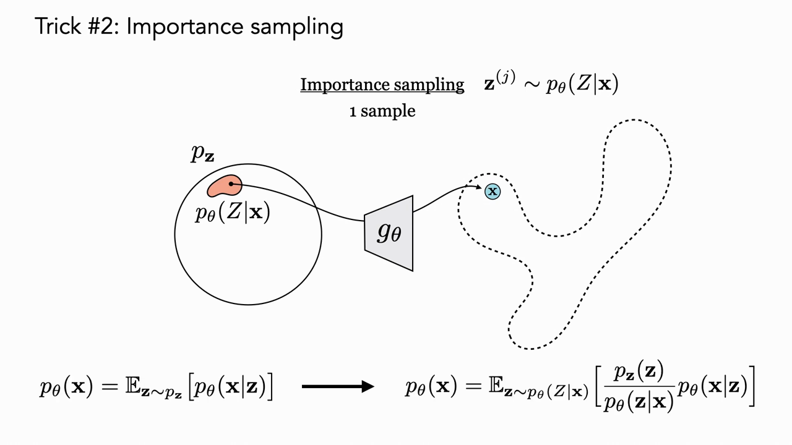
*▲ 강의 슬라이드 [43:00](https://youtu.be/8zzfcYIELdo?t=2580): [중요도 샘플링](00_%EB%94%A5%EB%9F%AC%EB%8B%9D_%EC%9A%A9%EC%96%B4%EC%82%AC%EC%A0%84.md#importance-sampling-%EC%A4%91%EC%9A%94%EB%8F%84-%EC%83%98%ED%94%8C%EB%A7%81). [사전 분포](00_%EB%94%A5%EB%9F%AC%EB%8B%9D_%EC%9A%A9%EC%96%B4%EC%82%AC%EC%A0%84.md#prior-posterior-%EC%82%AC%EC%A0%84-%EB%B6%84%ED%8F%AC%EC%99%80-%EC%82%AC%ED%9B%84-%EB%B6%84%ED%8F%AC) $p_\mathbf{z}$ 안의 작은 영역 $p_\theta(Z\mid\mathbf{x})$에서 한 번만 뽑아도 $\mathbf{x}$(파란 점) 근처의 성분이 걸린다. 아래는 [기댓값](00_%EB%94%A5%EB%9F%AC%EB%8B%9D_%EC%9A%A9%EC%96%B4%EC%82%AC%EC%A0%84.md#expectation-%EA%B8%B0%EB%8C%93%EA%B0%92)을 바꿔 쓴 식*

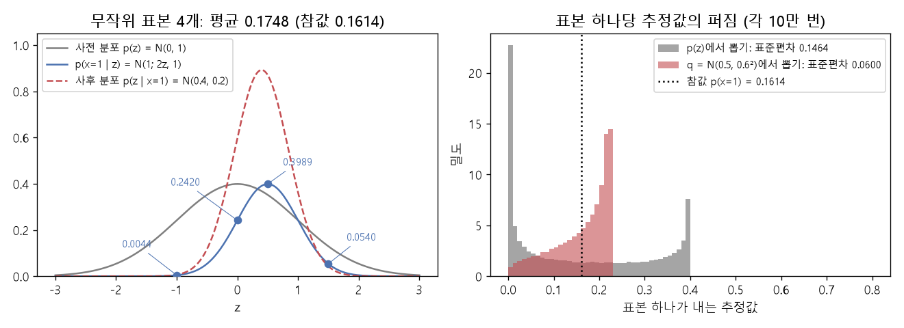
*▲ 직접 그린 그림: 왼쪽은 위 예제의 모델. 회색은 [사전 분포](00_%EB%94%A5%EB%9F%AC%EB%8B%9D_%EC%9A%A9%EC%96%B4%EC%82%AC%EC%A0%84.md#prior-posterior-%EC%82%AC%EC%A0%84-%EB%B6%84%ED%8F%AC%EC%99%80-%EC%82%AC%ED%9B%84-%EB%B6%84%ED%8F%AC), 파랑은 $z$마다 $x=1$에 주는 밀도(6절의 표본 4개 표시), 빨강 점선은 [사후 분포](00_%EB%94%A5%EB%9F%AC%EB%8B%9D_%EC%9A%A9%EC%96%B4%EC%82%AC%EC%A0%84.md#prior-posterior-%EC%82%AC%EC%A0%84-%EB%B6%84%ED%8F%AC%EC%99%80-%EC%82%AC%ED%9B%84-%EB%B6%84%ED%8F%AC). 오른쪽은 표본 하나가 내는 추정값의 분포(10만 번). [사전 분포](00_%EB%94%A5%EB%9F%AC%EB%8B%9D_%EC%9A%A9%EC%96%B4%EC%82%AC%EC%A0%84.md#prior-posterior-%EC%82%AC%EC%A0%84-%EB%B6%84%ED%8F%AC%EC%99%80-%EC%82%AC%ED%9B%84-%EB%B6%84%ED%8F%AC)에서 뽑으면 표준편차 0.1464, [사후 분포](00_%EB%94%A5%EB%9F%AC%EB%8B%9D_%EC%9A%A9%EC%96%B4%EC%82%AC%EC%A0%84.md#prior-posterior-%EC%82%AC%EC%A0%84-%EB%B6%84%ED%8F%AC%EC%99%80-%EC%82%AC%ED%9B%84-%EB%B6%84%ED%8F%AC)와 비슷한 $q = \mathcal{N}(0.5, 0.6^2)$에서 뽑아 무게를 곱하면 0.0600으로 퍼짐이 줄어든다*

---

## 8. 요령 3: 인코더로 최적의 표본 분포 예측하기

▶ 영상 [44:28](https://youtu.be/8zzfcYIELdo?t=2668)

📐 **수학 개념**: [KL 발산](%EC%88%98%ED%95%99%EA%B0%9C%EB%85%90/04_%ED%99%95%EB%A5%A0%EA%B3%BC_%EC%A0%95%EB%B3%B4/MM51_KL_%EB%B0%9C%EC%82%B0%EA%B3%BC_%EC%B5%9C%EB%8C%80_%EC%9A%B0%EB%8F%84.md) · [젠센 부등식과 ELBO](%EC%88%98%ED%95%99%EA%B0%9C%EB%85%90/11_%EC%83%9D%EC%84%B1_%EB%AA%A8%EB%8D%B8/MM56_%EC%A0%A0%EC%84%BC_%EB%B6%80%EB%93%B1%EC%8B%9D%EA%B3%BC_ELBO.md) · [로그](%EC%88%98%ED%95%99%EA%B0%9C%EB%85%90/01_%EC%88%98%EC%99%80_%ED%95%A8%EC%88%98/M07_%EB%A1%9C%EA%B7%B8.md)

- 문제는 $p_\theta(\mathbf{z}\mid\mathbf{x})$를 모른다는 것입니다. 이것도 복잡한 분포일 수 있습니다. 그래서 세 번째 요령은 **$\mathbf{x}$를 받아 $\mathbf{z}$ 위의 분포를 내는 모델을 학습해 [사후 분포](00_%EB%94%A5%EB%9F%AC%EB%8B%9D_%EC%9A%A9%EC%96%B4%EC%82%AC%EC%A0%84.md#prior-posterior-%EC%82%AC%EC%A0%84-%EB%B6%84%ED%8F%AC%EC%99%80-%EC%82%AC%ED%9B%84-%EB%B6%84%ED%8F%AC)를 예측**하는 것입니다.
- 이것이 바로 **인코더**입니다. 여기서 처음으로 [오토인코더](00_%EB%94%A5%EB%9F%AC%EB%8B%9D_%EC%9A%A9%EC%96%B4%EC%82%AC%EC%A0%84.md#autoencoder-%EC%98%A4%ED%86%A0%EC%9D%B8%EC%BD%94%EB%8D%94) 모양이 나타납니다. 이 모델을 $q_\psi(\mathbf{z}\mid\mathbf{x})$라 하고, 단순하게 가우스로 둡니다. 신경망 $f_\psi$가 평균과 [분산](00_%EB%94%A5%EB%9F%AC%EB%8B%9D_%EC%9A%A9%EC%96%B4%EC%82%AC%EC%A0%84.md#variance-%EB%B6%84%EC%82%B0)(원하면 공분산)을 냅니다. $\psi$는 인코더의 새 [가중치](00_%EB%94%A5%EB%9F%AC%EB%8B%9D_%EC%9A%A9%EC%96%B4%EC%82%AC%EC%A0%84.md#weight-%EA%B0%80%EC%A4%91%EC%B9%98)와 [편향](00_%EB%94%A5%EB%9F%AC%EB%8B%9D_%EC%9A%A9%EC%96%B4%EC%82%AC%EC%A0%84.md#bias-%ED%8E%B8%ED%96%A5)입니다.
- **인코더의 [학습](00_%EB%94%A5%EB%9F%AC%EB%8B%9D_%EC%9A%A9%EC%96%B4%EC%82%AC%EC%A0%84.md#training-%ED%95%99%EC%8A%B5) 문제**: $q_\psi(\mathbf{z}\mid\mathbf{x})$를 $p_\theta(\mathbf{z}\mid\mathbf{x})$와 같게 만들도록 두 분포의 [KL 발산](%EC%88%98%ED%95%99%EA%B0%9C%EB%85%90/04_%ED%99%95%EB%A5%A0%EA%B3%BC_%EC%A0%95%EB%B3%B4/MM51_KL_%EB%B0%9C%EC%82%B0%EA%B3%BC_%EC%B5%9C%EB%8C%80_%EC%9A%B0%EB%8F%84.md)을 줄입니다(음의 KL을 키웁니다). KL을 풀어 쓰면 아래 식이 되고, 마지막 항 $\log p_\theta(\mathbf{x})$는 $\psi$와 무관하므로 $\psi$에 대한 최적화에서는 빼도 됩니다. 남은 [기댓값](00_%EB%94%A5%EB%9F%AC%EB%8B%9D_%EC%9A%A9%EC%96%B4%EC%82%AC%EC%A0%84.md#expectation-%EA%B8%B0%EB%8C%93%EA%B0%92)은 다시 표본으로 근사합니다. 이렇게 $\mathbf{x}$를 설명하는 [잠재 변수](00_%EB%94%A5%EB%9F%AC%EB%8B%9D_%EC%9A%A9%EC%96%B4%EC%82%AC%EC%A0%84.md#latent-variable-%EC%9E%A0%EC%9E%AC-%EB%B3%80%EC%88%98)를 추론하는 것을 **추론**(inference)이라 부릅니다.
- **디코더의 [학습](00_%EB%94%A5%EB%9F%AC%EB%8B%9D_%EC%9A%A9%EC%96%B4%EC%82%AC%EC%A0%84.md#training-%ED%95%99%EC%8A%B5) 문제**: 원래 문제 그대로, 이제 표본을 $q$에서 뽑는 [중요도 샘플링](00_%EB%94%A5%EB%9F%AC%EB%8B%9D_%EC%9A%A9%EC%96%B4%EC%82%AC%EC%A0%84.md#importance-sampling-%EC%A4%91%EC%9A%94%EB%8F%84-%EC%83%98%ED%94%8C%EB%A7%81)으로 [우도](00_%EB%94%A5%EB%9F%AC%EB%8B%9D_%EC%9A%A9%EC%96%B4%EC%82%AC%EC%A0%84.md#likelihood-%EC%9A%B0%EB%8F%84)를 추정해 $\theta$를 최대화합니다.

$$
J_q(\mathbf{x}, \psi) = -\mathrm{KL}\big(q_\psi(\mathbf{z}\mid\mathbf{x})\,\|\,p_\theta(\mathbf{z}\mid\mathbf{x})\big) = \mathbb{E}_{\mathbf{z}\sim q_\psi(\mathbf{z}\mid\mathbf{x})}\big[-\log q_\psi(\mathbf{z}\mid\mathbf{x}) + \log p_\theta(\mathbf{x}\mid\mathbf{z}) + \log p_{\mathbf{z}}(\mathbf{z})\big] - \log p_\theta(\mathbf{x})
$$

기호 풀이

| 기호 | 읽는 법 | 뜻 | 예제 값 |
| --- | --- | --- | --- |
| $J_q$ | 제이 큐 | 인코더가 키우려는 목표 | 0 |
| $q_\psi(\mathbf{z}\mid\mathbf{x})$ | 큐 프사이 | 인코더가 예측한 $\mathbf{z}$의 분포 | $\mathcal{N}(0.4, 0.2)$ |
| $\psi$ | 프사이 | 인코더 $f_\psi$의 매개변수 | |
| $p_\theta(\mathbf{z}\mid\mathbf{x})$ | [사후 분포](00_%EB%94%A5%EB%9F%AC%EB%8B%9D_%EC%9A%A9%EC%96%B4%EC%82%AC%EC%A0%84.md#prior-posterior-%EC%82%AC%EC%A0%84-%EB%B6%84%ED%8F%AC%EC%99%80-%EC%82%AC%ED%9B%84-%EB%B6%84%ED%8F%AC) | 인코더가 흉내 내려는 진짜 [사후 분포](00_%EB%94%A5%EB%9F%AC%EB%8B%9D_%EC%9A%A9%EC%96%B4%EC%82%AC%EC%A0%84.md#prior-posterior-%EC%82%AC%EC%A0%84-%EB%B6%84%ED%8F%AC%EC%99%80-%EC%82%AC%ED%9B%84-%EB%B6%84%ED%8F%AC) | $\mathcal{N}(0.4, 0.2)$ |
| $\mathrm{KL}(\cdot\,\|\,\cdot)$ | [KL 발산](00_%EB%94%A5%EB%9F%AC%EB%8B%9D_%EC%9A%A9%EC%96%B4%EC%82%AC%EC%A0%84.md#kl-divergence-kl-%EB%B0%9C%EC%82%B0) | 두 분포가 얼마나 다른가 (0 이상) | 0 |
| $\log p_\theta(\mathbf{x})$ | [로그](00_%EB%94%A5%EB%9F%AC%EB%8B%9D_%EC%9A%A9%EC%96%B4%EC%82%AC%EC%A0%84.md#log-ln-%EB%A1%9C%EA%B7%B8) [우도](00_%EB%94%A5%EB%9F%AC%EB%8B%9D_%EC%9A%A9%EC%96%B4%EC%82%AC%EC%A0%84.md#likelihood-%EC%9A%B0%EB%8F%84) | $\psi$와 무관한 상수 | -1.8237 |

예제와 풀이

**문제**: 7절의 예에서 인코더가 [사후 분포](00_%EB%94%A5%EB%9F%AC%EB%8B%9D_%EC%9A%A9%EC%96%B4%EC%82%AC%EC%A0%84.md#prior-posterior-%EC%82%AC%EC%A0%84-%EB%B6%84%ED%8F%AC%EC%99%80-%EC%82%AC%ED%9B%84-%EB%B6%84%ED%8F%AC)를 정확히 맞혔다($q = \mathcal{N}(0.4, 0.2)$). $z = 0.5$ 한 개로 [기댓값](00_%EB%94%A5%EB%9F%AC%EB%8B%9D_%EC%9A%A9%EC%96%B4%EC%82%AC%EC%A0%84.md#expectation-%EA%B8%B0%EB%8C%93%EA%B0%92)을 근사할 때 $J_q$는?

**주어진 값**
- $q(z = 0.5) = 0.8700$ (인코더 분포의 밀도, 7절 예제)
- $p(x\mid z) = 0.3989$, $p_z(z) = 0.3521$ (7절 예제)
- $p(x) = 0.1614$ (참값, 4.1절)

**풀이**
1. 식을 그대로 쓴다: $J_q \approx -\log q(z\mid x) + \log p(x\mid z) + \log p_z(z) - \log p(x)$
2. 값을 대입한다: $J_q \approx -\log 0.8700 + \log 0.3989 + \log 0.3521 - \log 0.1614$
3. [로그](00_%EB%94%A5%EB%9F%AC%EB%8B%9D_%EC%9A%A9%EC%96%B4%EC%82%AC%EC%A0%84.md#log-ln-%EB%A1%9C%EA%B7%B8)를 계산한다 ($\ln a$는 $e$를 몇 제곱해야 $a$가 되는지): $-\ln 0.8700 = 0.1392$
4. $\ln 0.3989 = -0.9189$
5. $\ln 0.3521 = -1.0439$
6. $\ln 0.1614 = -1.8237$
7. 앞의 두 값을 더한다: $0.1392 + (-0.9189) = -0.7797$
8. 셋째 값을 더한다: $-0.7797 + (-1.0439) = -1.8236$
9. 마지막 값을 뺀다: $-1.8236 - (-1.8237) = 0.0001$ (반올림 [오차](00_%EB%94%A5%EB%9F%AC%EB%8B%9D_%EC%9A%A9%EC%96%B4%EC%82%AC%EC%A0%84.md#error-%EC%98%A4%EC%B0%A8). 반올림 전 값으로 계산하면 정확히 0)

**답**: $J_q = $ **0**, 곧 KL = 0. 인코더가 [사후 분포](00_%EB%94%A5%EB%9F%AC%EB%8B%9D_%EC%9A%A9%EC%96%B4%EC%82%AC%EC%A0%84.md#prior-posterior-%EC%82%AC%EC%A0%84-%EB%B6%84%ED%8F%AC%EC%99%80-%EC%82%AC%ED%9B%84-%EB%B6%84%ED%8F%AC)와 같으면 더 줄일 KL이 없다.

내 이해

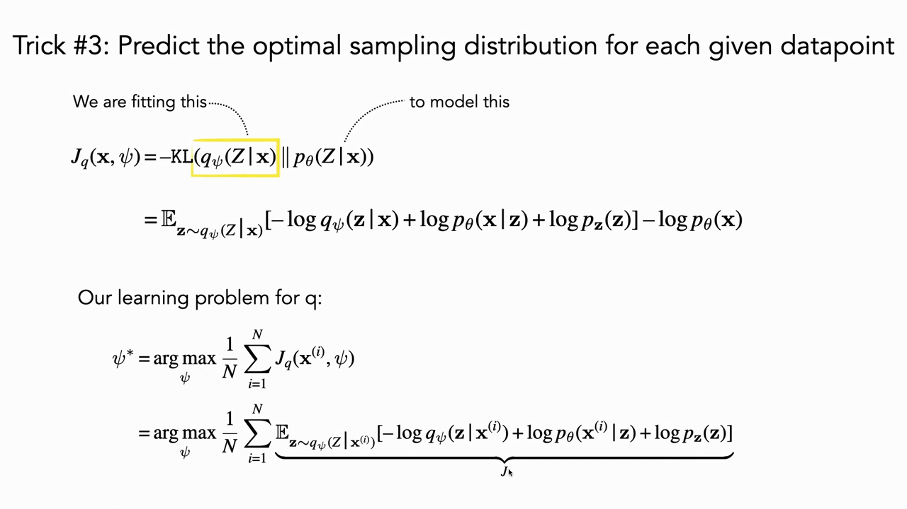
*▲ 강의 슬라이드 [49:00](https://youtu.be/8zzfcYIELdo?t=2940): 요령 3. 인코더 $q_\psi(Z\mid\mathbf{x})$로 [사후 분포](00_%EB%94%A5%EB%9F%AC%EB%8B%9D_%EC%9A%A9%EC%96%B4%EC%82%AC%EC%A0%84.md#prior-posterior-%EC%82%AC%EC%A0%84-%EB%B6%84%ED%8F%AC%EC%99%80-%EC%82%AC%ED%9B%84-%EB%B6%84%ED%8F%AC) $p_\theta(Z\mid\mathbf{x})$를 맞춘다. KL을 풀어 쓰고, $\psi$와 무관한 $\log p_\theta(\mathbf{x})$를 빼면 인코더의 [학습](00_%EB%94%A5%EB%9F%AC%EB%8B%9D_%EC%9A%A9%EC%96%B4%EC%82%AC%EC%A0%84.md#training-%ED%95%99%EC%8A%B5) 문제가 된다*

---

## 9. 모두 합치기: ELBO

▶ 영상 [51:12](https://youtu.be/8zzfcYIELdo?t=3072)

📐 **수학 개념**: [젠센 부등식과 ELBO](%EC%88%98%ED%95%99%EA%B0%9C%EB%85%90/11_%EC%83%9D%EC%84%B1_%EB%AA%A8%EB%8D%B8/MM56_%EC%A0%A0%EC%84%BC_%EB%B6%80%EB%93%B1%EC%8B%9D%EA%B3%BC_ELBO.md) · [가우스 KL과 재매개변수화](%EC%88%98%ED%95%99%EA%B0%9C%EB%85%90/11_%EC%83%9D%EC%84%B1_%EB%AA%A8%EB%8D%B8/MM57_%EA%B0%80%EC%9A%B0%EC%8A%A4_KL%EA%B3%BC_%EC%9E%AC%EB%A7%A4%EA%B0%9C%EB%B3%80%EC%88%98%ED%99%94.md) · [KL 발산](%EC%88%98%ED%95%99%EA%B0%9C%EB%85%90/04_%ED%99%95%EB%A5%A0%EA%B3%BC_%EC%A0%95%EB%B3%B4/MM51_KL_%EB%B0%9C%EC%82%B0%EA%B3%BC_%EC%B5%9C%EB%8C%80_%EC%9A%B0%EB%8F%84.md)

- 마지막 한 걸음: [기댓값](00_%EB%94%A5%EB%9F%AC%EB%8B%9D_%EC%9A%A9%EC%96%B4%EC%82%AC%EC%A0%84.md#expectation-%EA%B8%B0%EB%8C%93%EA%B0%92)의 [몬테카를로 추정](00_%EB%94%A5%EB%9F%AC%EB%8B%9D_%EC%9A%A9%EC%96%B4%EC%82%AC%EC%A0%84.md#monte-carlo-estimation-%EB%AA%AC%ED%85%8C%EC%B9%B4%EB%A5%BC%EB%A1%9C-%EC%B6%94%EC%A0%95)에 [로그](00_%EB%94%A5%EB%9F%AC%EB%8B%9D_%EC%9A%A9%EC%96%B4%EC%82%AC%EC%A0%84.md#log-ln-%EB%A1%9C%EA%B7%B8)를 씌우면 **편향된** 추정이 됩니다($\log$ 밖의 평균과 안의 평균이 다르므로). 표본을 무한히 늘려도 참값이 안 나오는 셈입니다.
- 그래서 **[로그](00_%EB%94%A5%EB%9F%AC%EB%8B%9D_%EC%9A%A9%EC%96%B4%EC%82%AC%EC%A0%84.md#log-ln-%EB%A1%9C%EA%B7%B8)를 [기댓값](00_%EB%94%A5%EB%9F%AC%EB%8B%9D_%EC%9A%A9%EC%96%B4%EC%82%AC%EC%A0%84.md#expectation-%EA%B8%B0%EB%8C%93%EA%B0%92) 안으로** 넣습니다. 그러면 "어떤 함수의 [기댓값](00_%EB%94%A5%EB%9F%AC%EB%8B%9D_%EC%9A%A9%EC%96%B4%EC%82%AC%EC%A0%84.md#expectation-%EA%B8%B0%EB%8C%93%EA%B0%92)"이 되어 [몬테카를로 추정](00_%EB%94%A5%EB%9F%AC%EB%8B%9D_%EC%9A%A9%EC%96%B4%EC%82%AC%EC%A0%84.md#monte-carlo-estimation-%EB%AA%AC%ED%85%8C%EC%B9%B4%EB%A5%BC%EB%A1%9C-%EC%B6%94%EC%A0%95)이 비편향이 됩니다. 이것이 허용되는 근거는 **[젠센 부등식](00_%EB%94%A5%EB%9F%AC%EB%8B%9D_%EC%9A%A9%EC%96%B4%EC%82%AC%EC%A0%84.md#jensen-inequality-%EC%A0%A0%EC%84%BC-%EB%B6%80%EB%93%B1%EC%8B%9D)** $\log \mathbb{E}[Y] \ge \mathbb{E}[\log Y]$이고, 그 대가로 원래 목표의 **하한**을 얻습니다.

$$
\log \mathbb{E}\big[Y\big] \ \ge\ \mathbb{E}\big[\log Y\big]
$$

기호 풀이

| 기호 | 읽는 법 | 뜻 | 예제 값 |
| --- | --- | --- | --- |
| $Y$ | 와이 | 양수인 [확률 변수](00_%EB%94%A5%EB%9F%AC%EB%8B%9D_%EC%9A%A9%EC%96%B4%EC%82%AC%EC%A0%84.md#random-variable-%ED%99%95%EB%A5%A0-%EB%B3%80%EC%88%98) (여기서는 중요도 무게 × 밀도) | 1 또는 4 |
| $\log \mathbb{E}[Y]$ | 평균의 [로그](00_%EB%94%A5%EB%9F%AC%EB%8B%9D_%EC%9A%A9%EC%96%B4%EC%82%AC%EC%A0%84.md#log-ln-%EB%A1%9C%EA%B7%B8) | 먼저 평균하고 [로그](00_%EB%94%A5%EB%9F%AC%EB%8B%9D_%EC%9A%A9%EC%96%B4%EC%82%AC%EC%A0%84.md#log-ln-%EB%A1%9C%EA%B7%B8) | 0.9163 |
| $\mathbb{E}[\log Y]$ | [로그](00_%EB%94%A5%EB%9F%AC%EB%8B%9D_%EC%9A%A9%EC%96%B4%EC%82%AC%EC%A0%84.md#log-ln-%EB%A1%9C%EA%B7%B8)의 평균 | 먼저 로그하고 평균 | 0.6931 |
| $\ge$ | 크거나 같다 | [로그](00_%EB%94%A5%EB%9F%AC%EB%8B%9D_%EC%9A%A9%EC%96%B4%EC%82%AC%EC%A0%84.md#log-ln-%EB%A1%9C%EA%B7%B8)가 위로 볼록(오목)해서 항상 성립 | |

예제와 풀이

**문제**: $Y$가 1과 4를 반반의 [확률](00_%EB%94%A5%EB%9F%AC%EB%8B%9D_%EC%9A%A9%EC%96%B4%EC%82%AC%EC%A0%84.md#probability-%ED%99%95%EB%A5%A0)로 갖는다. 평균의 [로그](00_%EB%94%A5%EB%9F%AC%EB%8B%9D_%EC%9A%A9%EC%96%B4%EC%82%AC%EC%A0%84.md#log-ln-%EB%A1%9C%EA%B7%B8)와 [로그](00_%EB%94%A5%EB%9F%AC%EB%8B%9D_%EC%9A%A9%EC%96%B4%EC%82%AC%EC%A0%84.md#log-ln-%EB%A1%9C%EA%B7%B8)의 평균을 비교하라.

**주어진 값**
- $Y = 1$ ([확률](00_%EB%94%A5%EB%9F%AC%EB%8B%9D_%EC%9A%A9%EC%96%B4%EC%82%AC%EC%A0%84.md#probability-%ED%99%95%EB%A5%A0) 0.5)
- $Y = 4$ ([확률](00_%EB%94%A5%EB%9F%AC%EB%8B%9D_%EC%9A%A9%EC%96%B4%EC%82%AC%EC%A0%84.md#probability-%ED%99%95%EB%A5%A0) 0.5)

**풀이**
1. 식을 그대로 쓴다: $\log \mathbb{E}[Y] \ \ge\ \mathbb{E}[\log Y]$
2. 값을 대입한다: $\log\big(0.5 \times 1 + 0.5 \times 4\big) \ \ge\ 0.5 \log 1 + 0.5 \log 4$
3. 왼쪽 괄호 안의 곱셈: $0.5 \times 1 = 0.5$, $0.5 \times 4 = 2$
4. 더한다: $0.5 + 2 = 2.5$
5. [로그](00_%EB%94%A5%EB%9F%AC%EB%8B%9D_%EC%9A%A9%EC%96%B4%EC%82%AC%EC%A0%84.md#log-ln-%EB%A1%9C%EA%B7%B8)를 계산한다: $\ln 2.5 = 0.9163$
6. 오른쪽 [로그](00_%EB%94%A5%EB%9F%AC%EB%8B%9D_%EC%9A%A9%EC%96%B4%EC%82%AC%EC%A0%84.md#log-ln-%EB%A1%9C%EA%B7%B8): $\ln 1 = 0$, $\ln 4 = 1.3863$
7. [가중치](00_%EB%94%A5%EB%9F%AC%EB%8B%9D_%EC%9A%A9%EC%96%B4%EC%82%AC%EC%A0%84.md#weight-%EA%B0%80%EC%A4%91%EC%B9%98)를 곱한다: $0.5 \times 0 = 0$, $0.5 \times 1.3863 = 0.6931$
8. 더한다: $0 + 0.6931 = 0.6931$
9. 비교한다: $0.9163 \ge 0.6931$

**답**: 평균의 [로그](00_%EB%94%A5%EB%9F%AC%EB%8B%9D_%EC%9A%A9%EC%96%B4%EC%82%AC%EC%A0%84.md#log-ln-%EB%A1%9C%EA%B7%B8) **0.9163**이 [로그](00_%EB%94%A5%EB%9F%AC%EB%8B%9D_%EC%9A%A9%EC%96%B4%EC%82%AC%EC%A0%84.md#log-ln-%EB%A1%9C%EA%B7%B8)의 평균 **0.6931**보다 크다. 차이 0.2232만큼이 하한이 잃는 몫이다.

내 이해

- 정리하면 디코더의 목표 $\log p_\theta(\mathbf{x})$의 하한이 나오고, 이것을 **[증거 하한](00_%EB%94%A5%EB%9F%AC%EB%8B%9D_%EC%9A%A9%EC%96%B4%EC%82%AC%EC%A0%84.md#elbo-evidence-lower-bound-%EC%A6%9D%EA%B1%B0-%ED%95%98%ED%95%9C)**(Evidence Lower BOund, [ELBO](00_%EB%94%A5%EB%9F%AC%EB%8B%9D_%EC%9A%A9%EC%96%B4%EC%82%AC%EC%A0%84.md#elbo-evidence-lower-bound-%EC%A6%9D%EA%B1%B0-%ED%95%98%ED%95%9C))이라 부릅니다. "모델이 데이터에 주는 증거([우도](00_%EB%94%A5%EB%9F%AC%EB%8B%9D_%EC%9A%A9%EC%96%B4%EC%82%AC%EC%A0%84.md#likelihood-%EC%9A%B0%EB%8F%84))의 하한"이라는 이름일 뿐이니 이름은 신경 쓰지 말라고 강사는 말합니다. [변분 추론](00_%EB%94%A5%EB%9F%AC%EB%8B%9D_%EC%9A%A9%EC%96%B4%EC%82%AC%EC%A0%84.md#variational-inference-%EB%B3%80%EB%B6%84-%EC%B6%94%EB%A1%A0)(variational inference)에서 자주 만나는 말입니다.
- **놀라운 점**: 이 식을 다시 정리하면 8절에서 본 **인코더의 목표와 정확히 같은 식**입니다. 그래서 "디코더의 [우도](00_%EB%94%A5%EB%9F%AC%EB%8B%9D_%EC%9A%A9%EC%96%B4%EC%82%AC%EC%A0%84.md#likelihood-%EC%9A%B0%EB%8F%84)를 추정하기에 가장 좋은 중요도 분포를 배우는 것"과 "디코더를 배우는 것"을 따로 할 필요 없이, **[ELBO](00_%EB%94%A5%EB%9F%AC%EB%8B%9D_%EC%9A%A9%EC%96%B4%EC%82%AC%EC%A0%84.md#elbo-evidence-lower-bound-%EC%A6%9D%EA%B1%B0-%ED%95%98%ED%95%9C) 하나를 인코더·디코더 매개변수에 대해 함께 최대화**하면 됩니다.
- [ELBO](00_%EB%94%A5%EB%9F%AC%EB%8B%9D_%EC%9A%A9%EC%96%B4%EC%82%AC%EC%A0%84.md#elbo-evidence-lower-bound-%EC%A6%9D%EA%B1%B0-%ED%95%98%ED%95%9C)의 두 항: ① 모델이 데이터에 주는 [확률](00_%EB%94%A5%EB%9F%AC%EB%8B%9D_%EC%9A%A9%EC%96%B4%EC%82%AC%EC%A0%84.md#probability-%ED%99%95%EB%A5%A0)(재구성) ② $\mathbf{z}$ 공간 전체가 아니라 다른 분포 $q$에서 뽑았으므로 그 차이를 보정하는 항, 곧 $q$와 [사전 분포](00_%EB%94%A5%EB%9F%AC%EB%8B%9D_%EC%9A%A9%EC%96%B4%EC%82%AC%EC%A0%84.md#prior-posterior-%EC%82%AC%EC%A0%84-%EB%B6%84%ED%8F%AC%EC%99%80-%EC%82%AC%ED%9B%84-%EB%B6%84%ED%8F%AC) $p_\mathbf{z}$의 KL. 이 항은 중요도 무게 $\frac{p_\mathbf{z}}{q}$를 곱한 데서 나왔습니다.

$$
\log p_\theta(\mathbf{x}) \ \ge\ J(\mathbf{x}, \theta, \psi) = \mathbb{E}_{\mathbf{z}\sim q_\psi(\mathbf{z}\mid\mathbf{x})}\big[\log p_\theta(\mathbf{x}\mid\mathbf{z})\big] - \mathrm{KL}\big(q_\psi(\mathbf{z}\mid\mathbf{x})\,\|\,p_{\mathbf{z}}\big)
$$

기호 풀이

| 기호 | 읽는 법 | 뜻 | 예제 값 |
| --- | --- | --- | --- |
| $J(\mathbf{x}, \theta, \psi)$ | 제이 | [ELBO](00_%EB%94%A5%EB%9F%AC%EB%8B%9D_%EC%9A%A9%EC%96%B4%EC%82%AC%EC%A0%84.md#elbo-evidence-lower-bound-%EC%A6%9D%EA%B1%B0-%ED%95%98%ED%95%9C). 인코더와 디코더가 함께 키우는 값 | -1.9548 |
| $\mathbb{E}_{q}[\log p_\theta(\mathbf{x}\mid\mathbf{z})]$ | 재구성 항 | 인코딩한 $\mathbf{z}$로 $\mathbf{x}$를 얼마나 잘 되살리나 | -1.6389 |
| $\mathrm{KL}(q_\psi\,\|\,p_{\mathbf{z}})$ | KL 항 | 인코더 분포가 [사전 분포](00_%EB%94%A5%EB%9F%AC%EB%8B%9D_%EC%9A%A9%EC%96%B4%EC%82%AC%EC%A0%84.md#prior-posterior-%EC%82%AC%EC%A0%84-%EB%B6%84%ED%8F%AC%EC%99%80-%EC%82%AC%ED%9B%84-%EB%B6%84%ED%8F%AC)에서 얼마나 먼가 | 0.3158 |
| $\log p_\theta(\mathbf{x})$ | [로그](00_%EB%94%A5%EB%9F%AC%EB%8B%9D_%EC%9A%A9%EC%96%B4%EC%82%AC%EC%A0%84.md#log-ln-%EB%A1%9C%EA%B7%B8) [우도](00_%EB%94%A5%EB%9F%AC%EB%8B%9D_%EC%9A%A9%EC%96%B4%EC%82%AC%EC%A0%84.md#likelihood-%EC%9A%B0%EB%8F%84) | 진짜 목표 ([ELBO](00_%EB%94%A5%EB%9F%AC%EB%8B%9D_%EC%9A%A9%EC%96%B4%EC%82%AC%EC%A0%84.md#elbo-evidence-lower-bound-%EC%A6%9D%EA%B1%B0-%ED%95%98%ED%95%9C)는 이 아래에 있다) | -1.8237 |
| $\theta$, $\psi$ | 세타, 프사이 | 디코더, 인코더 매개변수 | |

예제와 풀이

**문제**: 6절 모델($p(x\mid z) = \mathcal{N}(x; 2z, 1)$, $x = 1$)에서 인코더가 $q = \mathcal{N}(0.5, 0.6^2)$를 냈다. [ELBO](00_%EB%94%A5%EB%9F%AC%EB%8B%9D_%EC%9A%A9%EC%96%B4%EC%82%AC%EC%A0%84.md#elbo-evidence-lower-bound-%EC%A6%9D%EA%B1%B0-%ED%95%98%ED%95%9C)를 구하고 $\log p(x)$와 비교하라.

**주어진 값**
- $x = 1$ (데이터)
- $\mu_z = 0.5$, $\sigma_z = 0.6$ (인코더가 낸 평균과 표준편차, $\sigma_z^2 = 0.36$)
- 디코더 평균 $2z$, [분산](00_%EB%94%A5%EB%9F%AC%EB%8B%9D_%EC%9A%A9%EC%96%B4%EC%82%AC%EC%A0%84.md#variance-%EB%B6%84%EC%82%B0) 1
- $\log p(x) = \ln 0.1614 = -1.8237$ (4.1절의 참값)

**풀이**
1. 식을 그대로 쓴다: $J = \mathbb{E}_q[\log p(x\mid z)] - \mathrm{KL}(q\,\|\,p_z)$
2. 값을 대입한다: $J = \mathbb{E}_{z\sim\mathcal{N}(0.5, 0.36)}\big[\log \mathcal{N}(1; 2z, 1)\big] - \mathrm{KL}\big(\mathcal{N}(0.5, 0.36)\,\|\,\mathcal{N}(0, 1)\big)$
3. 가우스의 [로그](00_%EB%94%A5%EB%9F%AC%EB%8B%9D_%EC%9A%A9%EC%96%B4%EC%82%AC%EC%A0%84.md#log-ln-%EB%A1%9C%EA%B7%B8) 밀도는 $\log \mathcal{N}(1; 2z, 1) = -\tfrac{1}{2}\ln(2\pi) - \tfrac{(1-2z)^2}{2}$이고, $\tfrac{1}{2}\ln(2\pi) = 0.9189$이다
4. $(1-2z)^2$의 평균은 "(평균의 차)² + 퍼짐"이다: $(1 - 2\times0.5)^2 + 2^2 \times 0.36$
5. 앞부분: $1 - 1 = 0$, $0^2 = 0$
6. 뒷부분: $4 \times 0.36 = 1.44$
7. 더한다: $0 + 1.44 = 1.44$
8. 반으로 나눈다: $1.44 / 2 = 0.72$
9. 재구성 항: $-0.9189 - 0.72 = -1.6389$
10. KL 항은 10.1의 닫힌 꼴 $\tfrac{1}{2}(\mu_z^2 + \sigma_z^2 - \ln\sigma_z^2 - 1)$로 구한다: $0.5^2 = 0.25$, $\sigma_z^2 = 0.36$, $\ln 0.36 = -1.0217$
11. 괄호 안을 더하고 뺀다: $0.25 + 0.36 = 0.61$, $0.61 - (-1.0217) = 1.6317$, $1.6317 - 1 = 0.6317$
12. 반으로 나눈다: $0.6317 / 2 = 0.3158$
13. [ELBO](00_%EB%94%A5%EB%9F%AC%EB%8B%9D_%EC%9A%A9%EC%96%B4%EC%82%AC%EC%A0%84.md#elbo-evidence-lower-bound-%EC%A6%9D%EA%B1%B0-%ED%95%98%ED%95%9C)를 구한다: $-1.6389 - 0.3158 = -1.9547$ (반올림 전 값으로는 $-1.9548$)
14. 진짜 목표와 비교한다: $-1.8237 - (-1.9548) = 0.1311$

**답**: [ELBO](00_%EB%94%A5%EB%9F%AC%EB%8B%9D_%EC%9A%A9%EC%96%B4%EC%82%AC%EC%A0%84.md#elbo-evidence-lower-bound-%EC%A6%9D%EA%B1%B0-%ED%95%98%ED%95%9C) = **-1.9548**, $\log p(x) = -1.8237$보다 0.1311 낮다. 이 간극은 $q$와 진짜 [사후 분포](00_%EB%94%A5%EB%9F%AC%EB%8B%9D_%EC%9A%A9%EC%96%B4%EC%82%AC%EC%A0%84.md#prior-posterior-%EC%82%AC%EC%A0%84-%EB%B6%84%ED%8F%AC%EC%99%80-%EC%82%AC%ED%9B%84-%EB%B6%84%ED%8F%AC) $\mathcal{N}(0.4, 0.2)$의 KL과 같고, $q$가 [사후 분포](00_%EB%94%A5%EB%9F%AC%EB%8B%9D_%EC%9A%A9%EC%96%B4%EC%82%AC%EC%A0%84.md#prior-posterior-%EC%82%AC%EC%A0%84-%EB%B6%84%ED%8F%AC%EC%99%80-%EC%82%AC%ED%9B%84-%EB%B6%84%ED%8F%AC)와 같아지면 0이 된다([MM56_젠센_부등식과_ELBO](%EC%88%98%ED%95%99%EA%B0%9C%EB%85%90/11_%EC%83%9D%EC%84%B1_%EB%AA%A8%EB%8D%B8/MM56_%EC%A0%A0%EC%84%BC_%EB%B6%80%EB%93%B1%EC%8B%9D%EA%B3%BC_ELBO.md)).

내 이해

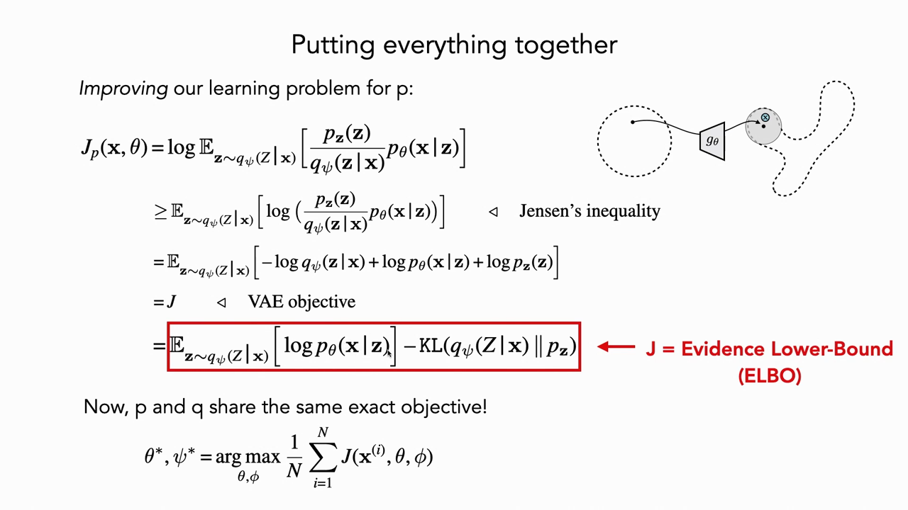
*▲ 강의 슬라이드 [55:00](https://youtu.be/8zzfcYIELdo?t=3300): 모두 합치기. 디코더의 목표에 [젠센 부등식](00_%EB%94%A5%EB%9F%AC%EB%8B%9D_%EC%9A%A9%EC%96%B4%EC%82%AC%EC%A0%84.md#jensen-inequality-%EC%A0%A0%EC%84%BC-%EB%B6%80%EB%93%B1%EC%8B%9D)을 쓰면 [VAE](00_%EB%94%A5%EB%9F%AC%EB%8B%9D_%EC%9A%A9%EC%96%B4%EC%82%AC%EC%A0%84.md#variational-autoencoder-vae-%EB%B3%80%EB%B6%84-%EC%98%A4%ED%86%A0%EC%9D%B8%EC%BD%94%EB%8D%94) 목표 $J$가 되고, 빨간 상자가 [ELBO](00_%EB%94%A5%EB%9F%AC%EB%8B%9D_%EC%9A%A9%EC%96%B4%EC%82%AC%EC%A0%84.md#elbo-evidence-lower-bound-%EC%A6%9D%EA%B1%B0-%ED%95%98%ED%95%9C)(재구성 항 − KL 항)다. $p$와 $q$가 같은 목표를 공유한다*

---

## 10. 결국 오토인코더처럼 생겼다

▶ 영상 [56:20](https://youtu.be/8zzfcYIELdo?t=3380)

📐 **수학 개념**: [가우스 KL과 재매개변수화](%EC%88%98%ED%95%99%EA%B0%9C%EB%85%90/11_%EC%83%9D%EC%84%B1_%EB%AA%A8%EB%8D%B8/MM57_%EA%B0%80%EC%9A%B0%EC%8A%A4_KL%EA%B3%BC_%EC%9E%AC%EB%A7%A4%EA%B0%9C%EB%B3%80%EC%88%98%ED%99%94.md) · [확률 밀도와 정규분포](%EC%88%98%ED%95%99%EA%B0%9C%EB%85%90/04_%ED%99%95%EB%A5%A0%EA%B3%BC_%EC%A0%95%EB%B3%B4/MM50_%ED%99%95%EB%A5%A0_%EB%B0%80%EB%8F%84%EC%99%80_%EC%A0%95%EA%B7%9C%EB%B6%84%ED%8F%AC.md)

- 수학이 많았지만 최종 [VAE](00_%EB%94%A5%EB%9F%AC%EB%8B%9D_%EC%9A%A9%EC%96%B4%EC%82%AC%EC%A0%84.md#variational-autoencoder-vae-%EB%B3%80%EB%B6%84-%EC%98%A4%ED%86%A0%EC%9D%B8%EC%BD%94%EB%8D%94)는 [오토인코더](00_%EB%94%A5%EB%9F%AC%EB%8B%9D_%EC%9A%A9%EC%96%B4%EC%82%AC%EC%A0%84.md#autoencoder-%EC%98%A4%ED%86%A0%EC%9D%B8%EC%BD%94%EB%8D%94)와 거의 같습니다. 데이터 $\mathbf{x}$를 인코딩해 평균 $\boldsymbol{\mu}_z$와 [분산](00_%EB%94%A5%EB%9F%AC%EB%8B%9D_%EC%9A%A9%EC%96%B4%EC%82%AC%EC%A0%84.md#variance-%EB%B6%84%EC%82%B0) $\boldsymbol{\sigma}_z^2$을 얻고, $q(\mathbf{z}\mid\mathbf{x})$에서 표본 하나 $\mathbf{z} = \boldsymbol{\mu}_z + \boldsymbol{\epsilon}\boldsymbol{\sigma}_z$를 뽑고(중요도 표본 하나), 디코딩해서 모델이 그 데이터에 준 [확률](00_%EB%94%A5%EB%9F%AC%EB%8B%9D_%EC%9A%A9%EC%96%B4%EC%82%AC%EC%A0%84.md#probability-%ED%99%95%EB%A5%A0)을 가우스 공식으로 계산합니다.
- 보통 오토인코더와의 차이는 **[잠재 공간](00_%EB%94%A5%EB%9F%AC%EB%8B%9D_%EC%9A%A9%EC%96%B4%EC%82%AC%EC%A0%84.md#latent-space-%EC%9E%A0%EC%9E%AC-%EA%B3%B5%EA%B0%84)에 잡음을 더한다**는 한 단계뿐입니다. [기댓값](00_%EB%94%A5%EB%9F%AC%EB%8B%9D_%EC%9A%A9%EC%96%B4%EC%82%AC%EC%A0%84.md#expectation-%EA%B8%B0%EB%8C%93%EA%B0%92)을 표본으로 근사하는 것이니 필요한 잡음입니다.

### 10.1 두 항의 뜻

▶ 영상 [58:00](https://youtu.be/8zzfcYIELdo?t=3480)

- **재구성 항**: $p_\theta(\mathbf{x}\mid\mathbf{z})$는 디코딩한 $g_\theta(\mathbf{z})$를 평균으로 하는 가우스이므로, [로그](00_%EB%94%A5%EB%9F%AC%EB%8B%9D_%EC%9A%A9%EC%96%B4%EC%82%AC%EC%A0%84.md#log-ln-%EB%A1%9C%EA%B7%B8)를 씌우면 $e^{-\text{거리}^2}$의 [로그](00_%EB%94%A5%EB%9F%AC%EB%8B%9D_%EC%9A%A9%EC%96%B4%EC%82%AC%EC%A0%84.md#log-ln-%EB%A1%9C%EA%B7%B8), 곧 **음의 제곱 [오차](00_%EB%94%A5%EB%9F%AC%EB%8B%9D_%EC%9A%A9%EC%96%B4%EC%82%AC%EC%A0%84.md#error-%EC%98%A4%EC%B0%A8)**가 됩니다. 나머지 항은 가우스의 [정규화](00_%EB%94%A5%EB%9F%AC%EB%8B%9D_%EC%9A%A9%EC%96%B4%EC%82%AC%EC%A0%84.md#normalization-%EC%A0%95%EA%B7%9C%ED%99%94) 상수입니다. 디코더 [분산](00_%EB%94%A5%EB%9F%AC%EB%8B%9D_%EC%9A%A9%EC%96%B4%EC%82%AC%EC%A0%84.md#variance-%EB%B6%84%EC%82%B0)을 1로 고정하는 것도 정당한 모델 선택이고(반지름 1인 동그라미로만 무한 혼합을 맞춤), 그러면 그 항들은 상수가 되어 정확히 **[오토인코더](00_%EB%94%A5%EB%9F%AC%EB%8B%9D_%EC%9A%A9%EC%96%B4%EC%82%AC%EC%A0%84.md#autoencoder-%EC%98%A4%ED%86%A0%EC%9D%B8%EC%BD%94%EB%8D%94)의 [평균 제곱 오차](00_%EB%94%A5%EB%9F%AC%EB%8B%9D_%EC%9A%A9%EC%96%B4%EC%82%AC%EC%A0%84.md#mse-mean-squared-error-%ED%8F%89%EA%B7%A0-%EC%A0%9C%EA%B3%B1-%EC%98%A4%EC%B0%A8)**만 남습니다. 보통 [오토인코더](00_%EB%94%A5%EB%9F%AC%EB%8B%9D_%EC%9A%A9%EC%96%B4%EC%82%AC%EC%A0%84.md#autoencoder-%EC%98%A4%ED%86%A0%EC%9D%B8%EC%BD%94%EB%8D%94)는 [분산](00_%EB%94%A5%EB%9F%AC%EB%8B%9D_%EC%9A%A9%EC%96%B4%EC%82%AC%EC%A0%84.md#variance-%EB%B6%84%EC%82%B0)을 모델링하지 않고 암묵적으로 상수로 둔 셈입니다.
- **KL 항**: 인코더 분포 $q(\mathbf{z}\mid\mathbf{x})$가 단위 가우스 [사전 분포](00_%EB%94%A5%EB%9F%AC%EB%8B%9D_%EC%9A%A9%EC%96%B4%EC%82%AC%EC%A0%84.md#prior-posterior-%EC%82%AC%EC%A0%84-%EB%B6%84%ED%8F%AC%EC%99%80-%EC%82%AC%ED%9B%84-%EB%B6%84%ED%8F%AC)와 가까워야 한다는 항입니다("추론 방향의 [사후 분포](00_%EB%94%A5%EB%9F%AC%EB%8B%9D_%EC%9A%A9%EC%96%B4%EC%82%AC%EC%A0%84.md#prior-posterior-%EC%82%AC%EC%A0%84-%EB%B6%84%ED%8F%AC%EC%99%80-%EC%82%AC%ED%9B%84-%EB%B6%84%ED%8F%AC)가 [사전 분포](00_%EB%94%A5%EB%9F%AC%EB%8B%9D_%EC%9A%A9%EC%96%B4%EC%82%AC%EC%A0%84.md#prior-posterior-%EC%82%AC%EC%A0%84-%EB%B6%84%ED%8F%AC%EC%99%80-%EC%82%AC%ED%9B%84-%EB%B6%84%ED%8F%AC) 근처에 있어라"). 두 가우스의 KL은 **닫힌 꼴**이 있습니다(원 논문 Kingma·Welling 2013의 부록에 유도). [분산](00_%EB%94%A5%EB%9F%AC%EB%8B%9D_%EC%9A%A9%EC%96%B4%EC%82%AC%EC%A0%84.md#variance-%EB%B6%84%EC%82%B0)도 고정하면 남는 것은 $\tfrac{1}{2}\mu_z^2$뿐이므로, KL 항이 하는 일은 **인코딩의 평균을 원점으로 짓누르기**입니다.

$$
\begin{aligned}
\log p_\theta(x\mid z) &= \log\frac{1}{\sigma_x\sqrt{2\pi}} - \frac{(x-\mu_x)^2}{2\sigma_x^2} \\
\mathrm{KL}\big(\mathcal{N}(\mu_z, \sigma_z^2)\,\|\,\mathcal{N}(0, 1)\big) &= \tfrac{1}{2}\big(\mu_z^2 + \sigma_z^2 - \log\sigma_z^2 - 1\big)
\end{aligned}
$$

기호 풀이

| 기호 | 읽는 법 | 뜻 | 예제 값 |
| --- | --- | --- | --- |
| $x$ | 엑스 | 입력 데이터 (1차원) | 1 |
| $\mu_x$, $\sigma_x$ | 뮤 엑스, 시그마 엑스 | 디코더가 낸 평균과 표준편차 | 1.6, 1 |
| $\frac{(x-\mu_x)^2}{2\sigma_x^2}$ | 재구성 [오차](00_%EB%94%A5%EB%9F%AC%EB%8B%9D_%EC%9A%A9%EC%96%B4%EC%82%AC%EC%A0%84.md#error-%EC%98%A4%EC%B0%A8) | 입력과 복원의 제곱 거리 ([분산](00_%EB%94%A5%EB%9F%AC%EB%8B%9D_%EC%9A%A9%EC%96%B4%EC%82%AC%EC%A0%84.md#variance-%EB%B6%84%EC%82%B0)으로 나눔) | 0.18 |
| $\log\frac{1}{\sigma_x\sqrt{2\pi}}$ | [정규화](00_%EB%94%A5%EB%9F%AC%EB%8B%9D_%EC%9A%A9%EC%96%B4%EC%82%AC%EC%A0%84.md#normalization-%EC%A0%95%EA%B7%9C%ED%99%94) 항 | $\sigma_x$를 고정하면 상수 | -0.9189 |
| $\mu_z$, $\sigma_z$ | 뮤 제트, 시그마 제트 | 인코더가 낸 평균과 표준편차 | 0.5, 0.6 |
| $\mathrm{KL}$ | KL 항 | 인코딩을 원점(평균 0, [분산](00_%EB%94%A5%EB%9F%AC%EB%8B%9D_%EC%9A%A9%EC%96%B4%EC%82%AC%EC%A0%84.md#variance-%EB%B6%84%EC%82%B0) 1)으로 당기는 벌점 | 0.3158 |

예제와 풀이

**문제**: 1차원 [VAE](00_%EB%94%A5%EB%9F%AC%EB%8B%9D_%EC%9A%A9%EC%96%B4%EC%82%AC%EC%A0%84.md#variational-autoencoder-vae-%EB%B3%80%EB%B6%84-%EC%98%A4%ED%86%A0%EC%9D%B8%EC%BD%94%EB%8D%94)에서 $x = 1$을 인코딩해 $\mu_z = 0.5$, $\sigma_z = 0.6$을 얻었고, $\epsilon = 0.5$를 뽑아 $z$를 만들었다. 디코더는 평균 $\mu_x = 2z$, 표준편차 $\sigma_x = 1$을 낸다. 이 표본 하나로 계산한 [학습](00_%EB%94%A5%EB%9F%AC%EB%8B%9D_%EC%9A%A9%EC%96%B4%EC%82%AC%EC%A0%84.md#training-%ED%95%99%EC%8A%B5) [손실](00_%EB%94%A5%EB%9F%AC%EB%8B%9D_%EC%9A%A9%EC%96%B4%EC%82%AC%EC%A0%84.md#loss-function-%EC%86%90%EC%8B%A4-%ED%95%A8%EC%88%98)(= −재구성 항 + KL 항)은?

**주어진 값**
- $x = 1$ (입력)
- $\mu_z = 0.5$, $\sigma_z = 0.6$ (인코더 출력)
- $\epsilon = 0.5$ (단위 가우스 잡음)
- $\mu_x = 2z$, $\sigma_x = 1$ (디코더 출력)

**풀이**
1. 식을 그대로 쓴다: $\text{손실} = -\Big(\log\dfrac{1}{\sigma_x\sqrt{2\pi}} - \dfrac{(x-\mu_x)^2}{2\sigma_x^2}\Big) + \tfrac{1}{2}\big(\mu_z^2 + \sigma_z^2 - \log\sigma_z^2 - 1\big)$
2. 먼저 표본을 만든다 (4.3의 재매개변수화): $z = \mu_z + \sigma_z\epsilon = 0.5 + 0.6 \times 0.5$
3. 곱셈: $0.6 \times 0.5 = 0.3$, 덧셈: $0.5 + 0.3 = 0.8$
4. 디코더 평균: $\mu_x = 2 \times 0.8 = 1.6$
5. 값을 대입한다: $\text{손실} = -\Big(\log\dfrac{1}{1 \times \sqrt{2\pi}} - \dfrac{(1-1.6)^2}{2 \times 1}\Big) + \tfrac{1}{2}\big(0.5^2 + 0.36 - \log 0.36 - 1\big)$
6. [정규화](00_%EB%94%A5%EB%9F%AC%EB%8B%9D_%EC%9A%A9%EC%96%B4%EC%82%AC%EC%A0%84.md#normalization-%EC%A0%95%EA%B7%9C%ED%99%94) 항: $\sqrt{2\pi} = 2.5066$, $\ln(1/2.5066) = -0.9189$
7. 재구성 [오차](00_%EB%94%A5%EB%9F%AC%EB%8B%9D_%EC%9A%A9%EC%96%B4%EC%82%AC%EC%A0%84.md#error-%EC%98%A4%EC%B0%A8): $(1 - 1.6)^2 = 0.36$, $0.36 / 2 = 0.18$
8. 재구성 항: $-0.9189 - 0.18 = -1.0989$
9. KL 항은 9절 예제와 같은 값: $0.3158$
10. 재구성 항의 부호를 바꾼다: $-(-1.0989) = 1.0989$
11. 더한다: $1.0989 + 0.3158 = 1.4147$

**답**: [손실](00_%EB%94%A5%EB%9F%AC%EB%8B%9D_%EC%9A%A9%EC%96%B4%EC%82%AC%EC%A0%84.md#loss-function-%EC%86%90%EC%8B%A4-%ED%95%A8%EC%88%98) **1.4147**. 이 값을 $\mu_z, \sigma_z$와 디코더 [가중치](00_%EB%94%A5%EB%9F%AC%EB%8B%9D_%EC%9A%A9%EC%96%B4%EC%82%AC%EC%A0%84.md#weight-%EA%B0%80%EC%A4%91%EC%B9%98)로 역전파한다. $\epsilon$은 옆에서 들어온 상수라 미분할 필요가 없다.

내 이해

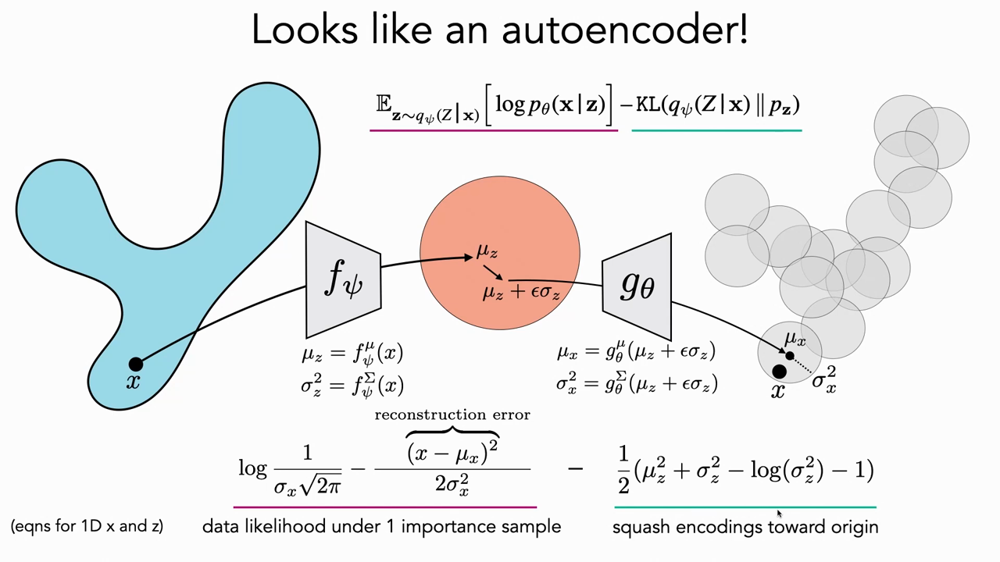
*▲ 강의 슬라이드 [61:30](https://youtu.be/8zzfcYIELdo?t=3690): "[오토인코더](00_%EB%94%A5%EB%9F%AC%EB%8B%9D_%EC%9A%A9%EC%96%B4%EC%82%AC%EC%A0%84.md#autoencoder-%EC%98%A4%ED%86%A0%EC%9D%B8%EC%BD%94%EB%8D%94)처럼 생겼다!" 인코더 $f_\psi$가 $\mu_z, \sigma_z^2$을 내고 $\mu_z + \epsilon\sigma_z$로 표본을 만들어 디코더 $g_\theta$에 넣는다. 아래 왼쪽(분홍)은 표본 하나의 데이터 [우도](00_%EB%94%A5%EB%9F%AC%EB%8B%9D_%EC%9A%A9%EC%96%B4%EC%82%AC%EC%A0%84.md#likelihood-%EC%9A%B0%EB%8F%84)(재구성 [오차](00_%EB%94%A5%EB%9F%AC%EB%8B%9D_%EC%9A%A9%EC%96%B4%EC%82%AC%EC%A0%84.md#error-%EC%98%A4%EC%B0%A8)), 오른쪽(초록)은 "인코딩을 원점으로 짓누르는" KL 항 (1차원 식)*

### 10.2 짓누르기와 복원의 줄다리기

▶ 영상 [62:35](https://youtu.be/8zzfcYIELdo?t=3755)

📐 **수학 개념**: [가우스 KL과 재매개변수화](%EC%88%98%ED%95%99%EA%B0%9C%EB%85%90/11_%EC%83%9D%EC%84%B1_%EB%AA%A8%EB%8D%B8/MM57_%EA%B0%80%EC%9A%B0%EC%8A%A4_KL%EA%B3%BC_%EC%9E%AC%EB%A7%A4%EA%B0%9C%EB%B3%80%EC%88%98%ED%99%94.md) · [선형 오토인코더](%EC%88%98%ED%95%99%EA%B0%9C%EB%85%90/10_%ED%91%9C%ED%98%84_%ED%95%99%EC%8A%B5/MM40_PCA%EC%99%80_%EC%84%A0%ED%98%95_%EC%98%A4%ED%86%A0%EC%9D%B8%EC%BD%94%EB%8D%94.md)

- 보통 [오토인코더](00_%EB%94%A5%EB%9F%AC%EB%8B%9D_%EC%9A%A9%EC%96%B4%EC%82%AC%EC%A0%84.md#autoencoder-%EC%98%A4%ED%86%A0%EC%9D%B8%EC%BD%94%EB%8D%94)는 재구성만 하므로 [잠재 공간](00_%EB%94%A5%EB%9F%AC%EB%8B%9D_%EC%9A%A9%EC%96%B4%EC%82%AC%EC%A0%84.md#latent-space-%EC%9E%A0%EC%9E%AC-%EA%B3%B5%EA%B0%84)이 아무 모양이나 될 수 있습니다. [잠재 공간](00_%EB%94%A5%EB%9F%AC%EB%8B%9D_%EC%9A%A9%EC%96%B4%EC%82%AC%EC%A0%84.md#latent-space-%EC%9E%A0%EC%9E%AC-%EA%B3%B5%EA%B0%84)이 2차원이면 $f$와 $g$가 항등 함수여도 재구성은 완벽하지만, 그건 날 데이터 그대로라 좋은 표현이 아닙니다. 그래서 보통 [오토인코더](00_%EB%94%A5%EB%9F%AC%EB%8B%9D_%EC%9A%A9%EC%96%B4%EC%82%AC%EC%A0%84.md#autoencoder-%EC%98%A4%ED%86%A0%EC%9D%B8%EC%BD%94%EB%8D%94)는 **[병목](00_%EB%94%A5%EB%9F%AC%EB%8B%9D_%EC%9A%A9%EC%96%B4%EC%82%AC%EC%A0%84.md#bottleneck-%EB%B3%91%EB%AA%A9)** 차원을 낮게 둬야 합니다.
- [VAE](00_%EB%94%A5%EB%9F%AC%EB%8B%9D_%EC%9A%A9%EC%96%B4%EC%82%AC%EC%A0%84.md#variational-autoencoder-vae-%EB%B3%80%EB%B6%84-%EC%98%A4%ED%86%A0%EC%9D%B8%EC%BD%94%EB%8D%94)는 "[잠재 공간](00_%EB%94%A5%EB%9F%AC%EB%8B%9D_%EC%9A%A9%EC%96%B4%EC%82%AC%EC%A0%84.md#latent-space-%EC%9E%A0%EC%9E%AC-%EA%B3%B5%EA%B0%84)을 원점 쪽으로 짓눌러라"는 KL 항이 있어서 저차원 [잠재 공간](00_%EB%94%A5%EB%9F%AC%EB%8B%9D_%EC%9A%A9%EC%96%B4%EC%82%AC%EC%A0%84.md#latent-space-%EC%9E%A0%EC%9E%AC-%EA%B3%B5%EA%B0%84)이 덜 중요합니다. [분산](00_%EB%94%A5%EB%9F%AC%EB%8B%9D_%EC%9A%A9%EC%96%B4%EC%82%AC%EC%A0%84.md#variance-%EB%B6%84%EC%82%B0)까지 모델링하면 이 항은 인코딩 분포를 단위 가우스 모양으로 만듭니다.
- **왜 한 점으로 무너지지 않나?** 모두 0으로 보내면 재구성이 불가능합니다(어느 입력에서 왔는지 모름). 정보를 지키려면 퍼져야 합니다. 찰흙을 누르는데 "어디서 왔는지 알아야 한다"는 힘이 블랙홀로 무너지는 것을 막는 셈이고, 이 **긴장**이 [VAE](00_%EB%94%A5%EB%9F%AC%EB%8B%9D_%EC%9A%A9%EC%96%B4%EC%82%AC%EC%A0%84.md#variational-autoencoder-vae-%EB%B3%80%EB%B6%84-%EC%98%A4%ED%86%A0%EC%9D%B8%EC%BD%94%EB%8D%94)의 핵심입니다.
- 시연에서는 처음에 모두 0으로 모였던 인코딩이 튀어나왔다가 다시 짓눌려 단위 가우스를 고르게 채웁니다. 강사는 이것을 **구 채우기**(sphere packing)에 비유합니다. 가우스들이 겹치면 어느 데이터에서 왔는지 모호해지므로 너무 겹치지는 않되, 동시에 원점으로 모입니다. [학습](00_%EB%94%A5%EB%9F%AC%EB%8B%9D_%EC%9A%A9%EC%96%B4%EC%82%AC%EC%A0%84.md#training-%ED%95%99%EC%8A%B5)이 끝나면 데이터 공간의 밀도 열지도는 데이터 모양을 잘 따르고, [잠재 공간](00_%EB%94%A5%EB%9F%AC%EB%8B%9D_%EC%9A%A9%EC%96%B4%EC%82%AC%EC%A0%84.md#latent-space-%EC%9E%A0%EC%9E%AC-%EA%B3%B5%EA%B0%84)의 밀도는 2차원 종 모양이 됩니다.

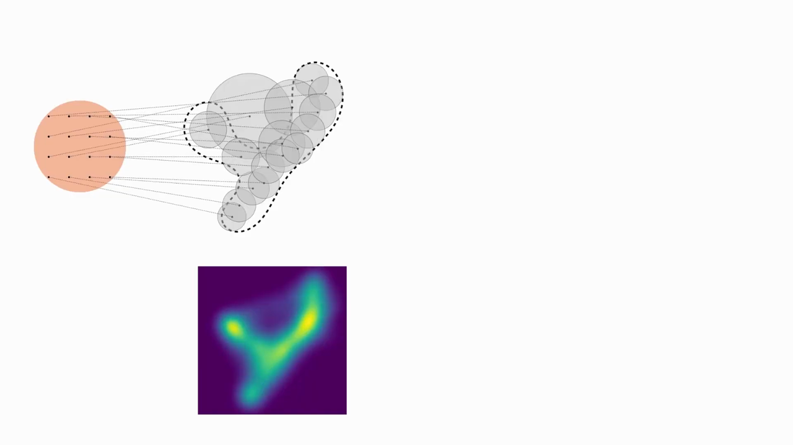
*▲ 강의 슬라이드 [71:20](https://youtu.be/8zzfcYIELdo?t=4280): 학습된 무한 혼합. 위는 격자로 뽑은 $\mathbf{z}$(주황 원)가 데이터 공간(점선 모양)의 성분들로 가는 모습, 아래는 모델 밀도의 열지도*

---

## 11. 세 가지 요령과 학습 단계

▶ 영상 [66:57](https://youtu.be/8zzfcYIELdo?t=4017)

📐 **수학 개념**: [가우스 KL과 재매개변수화](%EC%88%98%ED%95%99%EA%B0%9C%EB%85%90/11_%EC%83%9D%EC%84%B1_%EB%AA%A8%EB%8D%B8/MM57_%EA%B0%80%EC%9A%B0%EC%8A%A4_KL%EA%B3%BC_%EC%9E%AC%EB%A7%A4%EA%B0%9C%EB%B3%80%EC%88%98%ED%99%94.md) · [연쇄법칙](%EC%88%98%ED%95%99%EA%B0%9C%EB%85%90/05_%EC%8B%A0%EA%B2%BD%EB%A7%9D%EC%9D%98_%EA%B3%84%EC%82%B0/MM09_%EC%95%BC%EC%BD%94%EB%B9%84%EC%95%88%EA%B3%BC_%EC%97%B0%EC%87%84%EB%B2%95%EC%B9%99.md)

- **[VAE](00_%EB%94%A5%EB%9F%AC%EB%8B%9D_%EC%9A%A9%EC%96%B4%EC%82%AC%EC%A0%84.md#variational-autoencoder-vae-%EB%B3%80%EB%B6%84-%EC%98%A4%ED%86%A0%EC%9D%B8%EC%BD%94%EB%8D%94) = 세 가지 요령**: ① 무한 혼합을 표본으로 근사 ② [중요도 샘플링](00_%EB%94%A5%EB%9F%AC%EB%8B%9D_%EC%9A%A9%EC%96%B4%EC%82%AC%EC%A0%84.md#importance-sampling-%EC%A4%91%EC%9A%94%EB%8F%84-%EC%83%98%ED%94%8C%EB%A7%81)으로 효율적으로 뽑기 ③ 데이터마다 최적의 표본 분포를 다른 신경망(인코더)으로 예측. 그리고 전체를 함께 최적화하면 [오토인코더](00_%EB%94%A5%EB%9F%AC%EB%8B%9D_%EC%9A%A9%EC%96%B4%EC%82%AC%EC%A0%84.md#autoencoder-%EC%98%A4%ED%86%A0%EC%9D%B8%EC%BD%94%EB%8D%94) 모양이 됩니다.
- **[파이토치](00_%EB%94%A5%EB%9F%AC%EB%8B%9D_%EC%9A%A9%EC%96%B4%EC%82%AC%EC%A0%84.md#pytorch-%ED%8C%8C%EC%9D%B4%ED%86%A0%EC%B9%98)로 쓰면** (아주 단순합니다):
  1. [학습 데이터](00_%EB%94%A5%EB%9F%AC%EB%8B%9D_%EC%9A%A9%EC%96%B4%EC%82%AC%EC%A0%84.md#training-data-test-data-%ED%95%99%EC%8A%B5-%EB%8D%B0%EC%9D%B4%ED%84%B0%EC%99%80-%EC%8B%9C%ED%97%98-%EB%8D%B0%EC%9D%B4%ED%84%B0)에서 $\mathbf{x}$를 하나(또는 배치) 뽑는다.
  2. 인코더 $f_\psi$로 앞으로 통과시킨다.
  3. 데이터마다 인코더가 낸 분포로 잡음 섞인 잠재 코드를 하나 이상 만든다(중요도 표본).
  4. 디코더 $g_\theta$로 디코딩한다.
  5. [손실](00_%EB%94%A5%EB%9F%AC%EB%8B%9D_%EC%9A%A9%EC%96%B4%EC%82%AC%EC%A0%84.md#loss-function-%EC%86%90%EC%8B%A4-%ED%95%A8%EC%88%98)(제곱 [오차](00_%EB%94%A5%EB%9F%AC%EB%8B%9D_%EC%9A%A9%EC%96%B4%EC%82%AC%EC%A0%84.md#error-%EC%98%A4%EC%B0%A8) + KL 항)을 계산해 스칼라 하나를 얻고, $\theta$와 $\psi$로 역전파한다.
- 원래는 중요도 표본을 많이 뽑아야 추정이 좋지만, 실제로는 보통 **하나만** 뽑고 그것으로 충분해 보입니다.

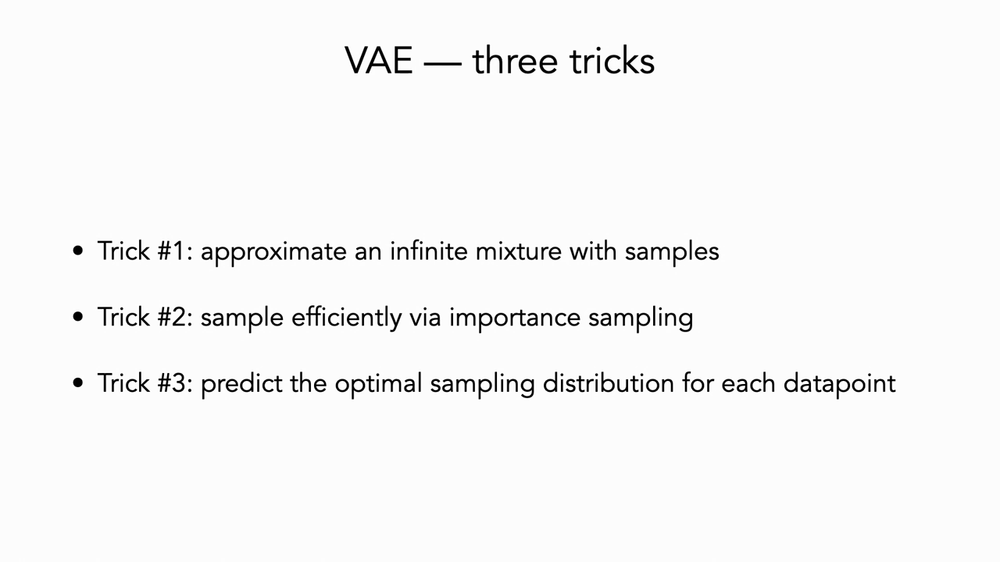
*▲ 강의 슬라이드 [67:10](https://youtu.be/8zzfcYIELdo?t=4030): [VAE](00_%EB%94%A5%EB%9F%AC%EB%8B%9D_%EC%9A%A9%EC%96%B4%EC%82%AC%EC%A0%84.md#variational-autoencoder-vae-%EB%B3%80%EB%B6%84-%EC%98%A4%ED%86%A0%EC%9D%B8%EC%BD%94%EB%8D%94)의 세 가지 요령*

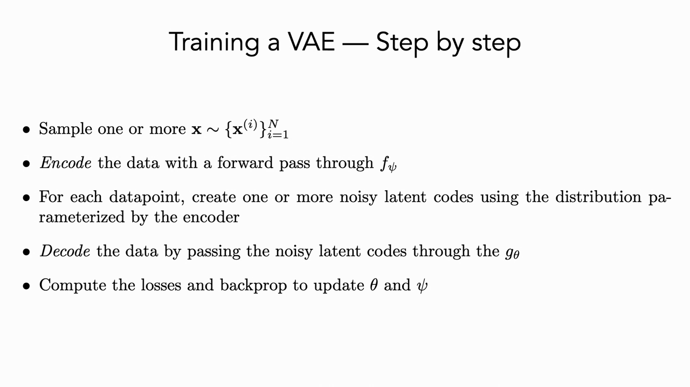
*▲ 강의 슬라이드 [67:25](https://youtu.be/8zzfcYIELdo?t=4045): [VAE](00_%EB%94%A5%EB%9F%AC%EB%8B%9D_%EC%9A%A9%EC%96%B4%EC%82%AC%EC%A0%84.md#variational-autoencoder-vae-%EB%B3%80%EB%B6%84-%EC%98%A4%ED%86%A0%EC%9D%B8%EC%BD%94%EB%8D%94) [학습](00_%EB%94%A5%EB%9F%AC%EB%8B%9D_%EC%9A%A9%EC%96%B4%EC%82%AC%EC%A0%84.md#training-%ED%95%99%EC%8A%B5) 단계. 뽑기 → 인코딩 → 잡음 섞인 잠재 코드 → 디코딩 → [손실](00_%EB%94%A5%EB%9F%AC%EB%8B%9D_%EC%9A%A9%EC%96%B4%EC%82%AC%EC%A0%84.md#loss-function-%EC%86%90%EC%8B%A4-%ED%95%A8%EC%88%98) 계산과 [역전파](00_%EB%94%A5%EB%9F%AC%EB%8B%9D_%EC%9A%A9%EC%96%B4%EC%82%AC%EC%A0%84.md#backpropagation-%EC%97%AD%EC%A0%84%ED%8C%8C)*

질의응답 정리 [68:01](https://youtu.be/8zzfcYIELdo?t=4081)

- **표본 뽑기를 어떻게 역전파하나?** 그래서 [재매개변수화 트릭](00_%EB%94%A5%EB%9F%AC%EB%8B%9D_%EC%9A%A9%EC%96%B4%EC%82%AC%EC%A0%84.md#reparameterization-trick-%EC%9E%AC%EB%A7%A4%EA%B0%9C%EB%B3%80%EC%88%98%ED%99%94-%ED%8A%B8%EB%A6%AD)이 중요합니다. 무작위성은 그래프 옆에서 들어오는 $\boldsymbol{\epsilon}$에만 있으므로, 뽑는 과정 자체를 미분할 필요 없이 평균과 분산으로만 역전파합니다.
- **인코더가 [분산](00_%EB%94%A5%EB%9F%AC%EB%8B%9D_%EC%9A%A9%EC%96%B4%EC%82%AC%EC%A0%84.md#variance-%EB%B6%84%EC%82%B0)을 예측해야 하나, 상수로 둬도 되나?** 그냥 [오토인코더](00_%EB%94%A5%EB%9F%AC%EB%8B%9D_%EC%9A%A9%EC%96%B4%EC%82%AC%EC%A0%84.md#autoencoder-%EC%98%A4%ED%86%A0%EC%9D%B8%EC%BD%94%EB%8D%94)에 [잠재 공간](00_%EB%94%A5%EB%9F%AC%EB%8B%9D_%EC%9A%A9%EC%96%B4%EC%82%AC%EC%A0%84.md#latent-space-%EC%9E%A0%EC%9E%AC-%EA%B3%B5%EA%B0%84) 잡음만 조금 더해도, 또는 "평균이 원점에서 멀면 벌점 + 잡음"만으로도 잘 되는 경우가 많습니다. 결과는 경우마다 다르고, 가우스 대신 더 복잡한 분포를 쓰는 변형도 많지만, 가장 단순한 판이 생각을 다 담습니다. 핵심은 **벌점으로 [잠재 공간](00_%EB%94%A5%EB%9F%AC%EB%8B%9D_%EC%9A%A9%EC%96%B4%EC%82%AC%EC%A0%84.md#latent-space-%EC%9E%A0%EC%9E%AC-%EA%B3%B5%EA%B0%84)을 촘촘하게** 만들고, **잡음으로 매끄럽게** 해서 정보 [용량](00_%EB%94%A5%EB%9F%AC%EB%8B%9D_%EC%9A%A9%EC%96%B4%EC%82%AC%EC%A0%84.md#capacity-%EC%9A%A9%EB%9F%89)을 유한하게 두어 [과적합](00_%EB%94%A5%EB%9F%AC%EB%8B%9D_%EC%9A%A9%EC%96%B4%EC%82%AC%EC%A0%84.md#overfitting-%EA%B3%BC%EC%A0%81%ED%95%A9)이나 너무 복잡한 디코딩을 막는 것입니다.
- **잠재 분포를 0으로 미는 것이 수학 말고 왜 좋은가?** 강사의 직관은 구 채우기입니다. $\mathbf{z}$ 공간의 **어느 점을 뽑아도 올바른 데이터로 디코딩**되게 하려면 빈틈이 없어야 합니다. 평균들이 무한히 멀어지면 겹침이 없어 디코딩은 쉽지만(정보 보존, 가역), 그 사이 빈틈에서 뽑으면 디코더가 본 적 없는 점이라 무엇을 만들지 모릅니다.

---

## 12. 생성 모델이 배우는 표현

▶ 영상 [72:18](https://youtu.be/8zzfcYIELdo?t=4338)

### 12.1 얽힘 풀린 축

▶ 영상 [72:50](https://youtu.be/8zzfcYIELdo?t=4370)

- 4.2의 강 지도 예로 돌아가, 직접 정의하지 않고 학습한 [VAE](00_%EB%94%A5%EB%9F%AC%EB%8B%9D_%EC%9A%A9%EC%96%B4%EC%82%AC%EC%A0%84.md#variational-autoencoder-vae-%EB%B3%80%EB%B6%84-%EC%98%A4%ED%86%A0%EC%9D%B8%EC%BD%94%EB%8D%94)의 [잠재 변수](00_%EB%94%A5%EB%9F%AC%EB%8B%9D_%EC%9A%A9%EC%96%B4%EC%82%AC%EC%A0%84.md#latent-variable-%EC%9E%A0%EC%9E%AC-%EB%B3%80%EC%88%98)가 실제로 데이터를 만든 변수와 관계가 있는지 봅니다. 디코더는 좋은 [생성 모델](00_%EB%94%A5%EB%9F%AC%EB%8B%9D_%EC%9A%A9%EC%96%B4%EC%82%AC%EC%A0%84.md#generative-model-%EC%83%9D%EC%84%B1-%EB%AA%A8%EB%8D%B8)입니다. 그러면 **인코더도 따로 쓸모 있는 표현 학습기일까요?**
- [잠재 공간](00_%EB%94%A5%EB%9F%AC%EB%8B%9D_%EC%9A%A9%EC%96%B4%EC%82%AC%EC%A0%84.md#latent-space-%EC%9E%A0%EC%9E%AC-%EA%B3%B5%EA%B0%84)의 축 방향으로 움직이며 디코딩해 보면, 한 축은 **강의 굽이**를, 다른 축은 **풀 색**을 매끄럽게 바꿉니다.
  - **풀 색**은 데이터를 만든 파이썬 프로그램의 실제 변수([정규분포](00_%EB%94%A5%EB%9F%AC%EB%8B%9D_%EC%9A%A9%EC%96%B4%EC%82%AC%EC%A0%84.md#normal-distribution-%EC%A0%95%EA%B7%9C%EB%B6%84%ED%8F%AC))였고, [VAE](00_%EB%94%A5%EB%9F%AC%EB%8B%9D_%EC%9A%A9%EC%96%B4%EC%82%AC%EC%A0%84.md#variational-autoencoder-vae-%EB%B3%80%EB%B6%84-%EC%98%A4%ED%86%A0%EC%9D%B8%EC%BD%94%EB%8D%94)가 그 **진짜 인과 요인**을 찾아냈습니다.
  - **강의 굽이**는 프로그램에 없는 변수입니다. 강의 모양은 베르누이 동전 던지기를 여러 번 이어서 정했을 뿐 "굽이"라는 가우스 변수는 없었습니다. [VAE](00_%EB%94%A5%EB%9F%AC%EB%8B%9D_%EC%9A%A9%EC%96%B4%EC%82%AC%EC%A0%84.md#variational-autoencoder-vae-%EB%B3%80%EB%B6%84-%EC%98%A4%ED%86%A0%EC%9D%B8%EC%BD%94%EB%8D%94)는 데이터를 잘 설명하는 **더 추상적인 요인**을 스스로 만들어 냈습니다.
- 서로 다른 잠재 차원이 서로 독립적인 변화 요인을 맡는 것(굽이 축을 바꿔도 색이 안 바뀌고 그 반대도 마찬가지)을 **[얽힘 풀린 표현](00_%EB%94%A5%EB%9F%AC%EB%8B%9D_%EC%9A%A9%EC%96%B4%EC%82%AC%EC%A0%84.md#disentangled-representation-%EC%96%BD%ED%9E%98-%ED%92%80%EB%A6%B0-%ED%91%9C%ED%98%84)**(disentanglement)이라 부릅니다([Lec11 6](Lec11_%ED%91%9C%ED%98%84_%ED%95%99%EC%8A%B5_%EC%9E%AC%EA%B5%AC%EC%84%B1.md#6-%EC%A2%8B%EC%9D%80-%ED%91%9C%ED%98%84%EC%9D%98-%EC%A1%B0%EA%B1%B4)). 다만 그 요인들이 세계를 정의한 인과 메커니즘과 꼭 일치하지는 않고, 더 추상화되어 있을 수 있습니다.
- 이런 성질은 [VAE](00_%EB%94%A5%EB%9F%AC%EB%8B%9D_%EC%9A%A9%EC%96%B4%EC%82%AC%EC%A0%84.md#variational-autoencoder-vae-%EB%B3%80%EB%B6%84-%EC%98%A4%ED%86%A0%EC%9D%B8%EC%BD%94%EB%8D%94)만의 것이 아닙니다. 인코더가 없는 [GAN](00_%EB%94%A5%EB%9F%AC%EB%8B%9D_%EC%9A%A9%EC%96%B4%EC%82%AC%EC%A0%84.md#gan-generative-adversarial-network-%EC%83%9D%EC%84%B1%EC%A0%81-%EC%A0%81%EB%8C%80-%EC%8B%A0%EA%B2%BD%EB%A7%9D)도(BigGAN에서 한 방향은 새의 방향, 다른 방향은 배경색), [확산 모델](00_%EB%94%A5%EB%9F%AC%EB%8B%9D_%EC%9A%A9%EC%96%B4%EC%82%AC%EC%A0%84.md#diffusion-model-%ED%99%95%EC%82%B0-%EB%AA%A8%EB%8D%B8)의 잡음이나 디코더 중간 [층](00_%EB%94%A5%EB%9F%AC%EB%8B%9D_%EC%9A%A9%EC%96%B4%EC%82%AC%EC%A0%84.md#layer-%EC%B8%B5)의 활성 공간도 구조화된 표현을 배웁니다. [용량](00_%EB%94%A5%EB%9F%AC%EB%8B%9D_%EC%9A%A9%EC%96%B4%EC%82%AC%EC%A0%84.md#capacity-%EC%9A%A9%EB%9F%89)(차원)이 한정된 모델이 데이터를 간결하게 설명하려면 이런 요인을 배울 수밖에 없다는 것이 강사의 설명입니다. "**생성 모델링은 세계를 설명하도록 강제한다.**"

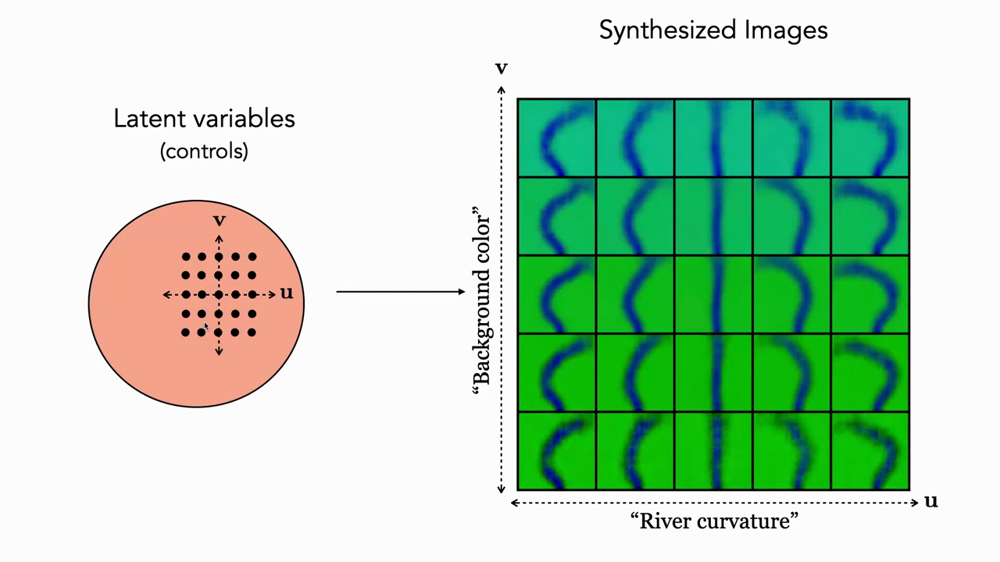
*▲ 강의 슬라이드 [74:05](https://youtu.be/8zzfcYIELdo?t=4445): 학습된 [잠재 공간](00_%EB%94%A5%EB%9F%AC%EB%8B%9D_%EC%9A%A9%EC%96%B4%EC%82%AC%EC%A0%84.md#latent-space-%EC%9E%A0%EC%9E%AC-%EA%B3%B5%EA%B0%84)의 격자를 디코딩한 모습. 가로축 $u$는 "강의 굽이", 세로축 $v$는 "배경(풀) 색"을 바꾼다*

### 12.2 이음매와 덩굴손

▶ 영상 [78:31](https://youtu.be/8zzfcYIELdo?t=4711)

- 입력 점을 좌표에 따라 색칠하고 [학습](00_%EB%94%A5%EB%9F%AC%EB%8B%9D_%EC%9A%A9%EC%96%B4%EC%82%AC%EC%A0%84.md#training-%ED%95%99%EC%8A%B5)을 지켜보면, 점들이 구로 다시 배치되지만 뒤죽박죽이 아니라 **매끄러운 사상**으로 옮겨집니다. 잠재 차원이 입력 공간의 매끄러운 성질에 대응하는 이유를 보여 주는 예입니다.
- 하지만 빈틈이 다 메워지지 않았습니다. 복잡한 위상의 모양을 구로 보내려면 자르고 꿰매야 하니 **이음매(seam)**가 생깁니다. [VAE](00_%EB%94%A5%EB%9F%AC%EB%8B%9D_%EC%9A%A9%EC%96%B4%EC%82%AC%EC%A0%84.md#variational-autoencoder-vae-%EB%B3%80%EB%B6%84-%EC%98%A4%ED%86%A0%EC%9D%B8%EC%BD%94%EB%8D%94) [잠재 공간](00_%EB%94%A5%EB%9F%AC%EB%8B%9D_%EC%9A%A9%EC%96%B4%EC%82%AC%EC%A0%84.md#latent-space-%EC%9E%A0%EC%9E%AC-%EA%B3%B5%EA%B0%84)이나 [확산 모델](00_%EB%94%A5%EB%9F%AC%EB%8B%9D_%EC%9A%A9%EC%96%B4%EC%82%AC%EC%A0%84.md#diffusion-model-%ED%99%95%EC%82%B0-%EB%AA%A8%EB%8D%B8)의 활성 공간을 돌아다니다 보면 매끄럽게 변하다 갑자기 다른 범주로 건너뛰는 지점을 만나는데, 바로 이것입니다. 매끄러운 변환으로는 자를 수 없으니 [확률](00_%EB%94%A5%EB%9F%AC%EB%8B%9D_%EC%9A%A9%EC%96%B4%EC%82%AC%EC%A0%84.md#probability-%ED%99%95%EB%A5%A0)이 가늘게 늘어진 **덩굴손(tendril)**도 생깁니다.

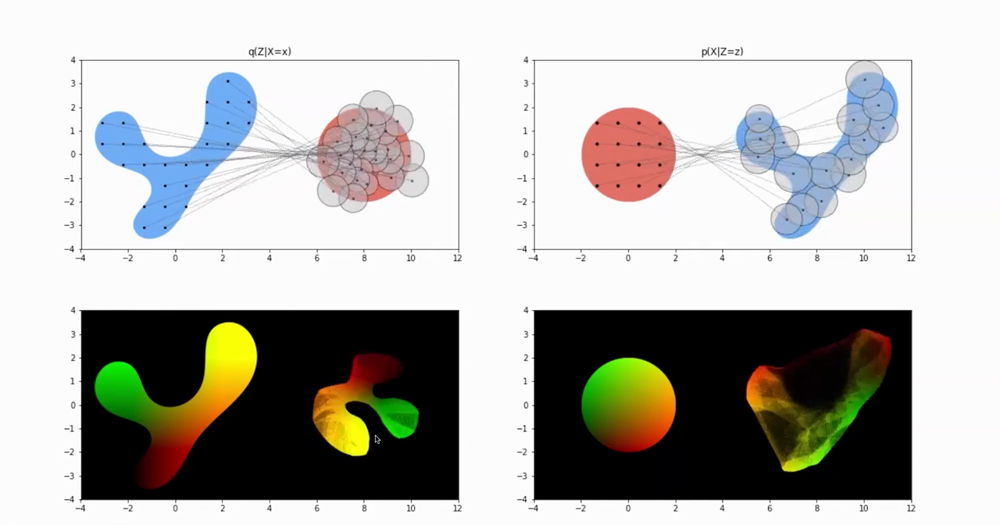
*▲ 강의 슬라이드 [79:45](https://youtu.be/8zzfcYIELdo?t=4785): 왼쪽 위는 인코더 $q(Z\mid X=x)$, 오른쪽 위는 디코더 $p(X\mid Z=z)$. 아래는 좌표로 색칠한 점이 옮겨진 모습. 왼쪽 아래의 [잠재 공간](00_%EB%94%A5%EB%9F%AC%EB%8B%9D_%EC%9A%A9%EC%96%B4%EC%82%AC%EC%A0%84.md#latent-space-%EC%9E%A0%EC%9E%AC-%EA%B3%B5%EA%B0%84)에 메워지지 않은 틈(이음매)이, 오른쪽 아래의 데이터 공간에 가는 덩굴손이 보인다*

---

## 13. 정리: 생성 모델 비교

▶ 영상 [79:41](https://youtu.be/8zzfcYIELdo?t=4781)

- 지난 두 강의에서 본 모델들을 비교하면(기본판 기준의 대략적 [분류](00_%EB%94%A5%EB%9F%AC%EB%8B%9D_%EC%9A%A9%EC%96%B4%EC%82%AC%EC%A0%84.md#regression-classification-%ED%9A%8C%EA%B7%80%EC%99%80-%EB%B6%84%EB%A5%98)), 지금 가장 인기 있는 것은 **[확산 모델](00_%EB%94%A5%EB%9F%AC%EB%8B%9D_%EC%9A%A9%EC%96%B4%EC%82%AC%EC%A0%84.md#diffusion-model-%ED%99%95%EC%82%B0-%EB%AA%A8%EB%8D%B8)**, 모든 것을 감싸는 가장 완전한 그림은 **[VAE](00_%EB%94%A5%EB%9F%AC%EB%8B%9D_%EC%9A%A9%EC%96%B4%EC%82%AC%EC%A0%84.md#variational-autoencoder-vae-%EB%B3%80%EB%B6%84-%EC%98%A4%ED%86%A0%EC%9D%B8%EC%BD%94%EB%8D%94)**, 가장 귀엽고 재미있는 것은 **[GAN](00_%EB%94%A5%EB%9F%AC%EB%8B%9D_%EC%9A%A9%EC%96%B4%EC%82%AC%EC%A0%84.md#gan-generative-adversarial-network-%EC%83%9D%EC%84%B1%EC%A0%81-%EC%A0%81%EB%8C%80-%EC%8B%A0%EA%B2%BD%EB%A7%9D)**, [언어 모델](00_%EB%94%A5%EB%9F%AC%EB%8B%9D_%EC%9A%A9%EC%96%B4%EC%82%AC%EC%A0%84.md#language-model-%EC%96%B8%EC%96%B4-%EB%AA%A8%EB%8D%B8)에서 쓰이는 것은 **[자기회귀 모델](00_%EB%94%A5%EB%9F%AC%EB%8B%9D_%EC%9A%A9%EC%96%B4%EC%82%AC%EC%A0%84.md#autoregressive-model-%EC%9E%90%EA%B8%B0%ED%9A%8C%EA%B7%80-%EB%AA%A8%EB%8D%B8)**이라고 강사는 정리합니다. 각각 [잠재 변수](00_%EB%94%A5%EB%9F%AC%EB%8B%9D_%EC%9A%A9%EC%96%B4%EC%82%AC%EC%A0%84.md#latent-variable-%EC%9E%A0%EC%9E%AC-%EB%B3%80%EC%88%98)가 명시적인지, 밀도(에너지)를 주는지, 효율적으로 표본을 뽑을 수 있는지가 다릅니다.

| 방법 | [잠재 변수](00_%EB%94%A5%EB%9F%AC%EB%8B%9D_%EC%9A%A9%EC%96%B4%EC%82%AC%EC%A0%84.md#latent-variable-%EC%9E%A0%EC%9E%AC-%EB%B3%80%EC%88%98) | 밀도/에너지 | [생성기](00_%EB%94%A5%EB%9F%AC%EB%8B%9D_%EC%9A%A9%EC%96%B4%EC%82%AC%EC%A0%84.md#generator-discriminator-%EC%83%9D%EC%84%B1%EA%B8%B0%EC%99%80-%ED%8C%90%EB%B3%84%EA%B8%B0) |
|---|---|---|---|
| [에너지 기반 모델](00_%EB%94%A5%EB%9F%AC%EB%8B%9D_%EC%9A%A9%EC%96%B4%EC%82%AC%EC%A0%84.md#energy-based-model-%EC%97%90%EB%84%88%EC%A7%80-%EA%B8%B0%EB%B0%98-%EB%AA%A8%EB%8D%B8) | ✗ | ✓ (에너지만) | ✗ |
| 가우스 | ✗ | ✓ | ✗ |
| [자기회귀 모델](00_%EB%94%A5%EB%9F%AC%EB%8B%9D_%EC%9A%A9%EC%96%B4%EC%82%AC%EC%A0%84.md#autoregressive-model-%EC%9E%90%EA%B8%B0%ED%9A%8C%EA%B7%80-%EB%AA%A8%EB%8D%B8) | ✗ | ✓ | ✓ (느림) |
| [확산 모델](00_%EB%94%A5%EB%9F%AC%EB%8B%9D_%EC%9A%A9%EC%96%B4%EC%82%AC%EC%A0%84.md#diffusion-model-%ED%99%95%EC%82%B0-%EB%AA%A8%EB%8D%B8) | ✓ (고차원) | ✗ | ✓ (느림) |
| [GAN](00_%EB%94%A5%EB%9F%AC%EB%8B%9D_%EC%9A%A9%EC%96%B4%EC%82%AC%EC%A0%84.md#gan-generative-adversarial-network-%EC%83%9D%EC%84%B1%EC%A0%81-%EC%A0%81%EB%8C%80-%EC%8B%A0%EA%B2%BD%EB%A7%9D) | ✓ | ✗ | ✓ |
| [VAE](00_%EB%94%A5%EB%9F%AC%EB%8B%9D_%EC%9A%A9%EC%96%B4%EC%82%AC%EC%A0%84.md#variational-autoencoder-vae-%EB%B3%80%EB%B6%84-%EC%98%A4%ED%86%A0%EC%9D%B8%EC%BD%94%EB%8D%94) | ✓ | ✗ | ✓ |

([VAE](00_%EB%94%A5%EB%9F%AC%EB%8B%9D_%EC%9A%A9%EC%96%B4%EC%82%AC%EC%A0%84.md#variational-autoencoder-vae-%EB%B3%80%EB%B6%84-%EC%98%A4%ED%86%A0%EC%9D%B8%EC%BD%94%EB%8D%94) 행의 "밀도 ✗"는 정확한 [우도](00_%EB%94%A5%EB%9F%AC%EB%8B%9D_%EC%9A%A9%EC%96%B4%EC%82%AC%EC%A0%84.md#likelihood-%EC%9A%B0%EB%8F%84)를 바로 주지는 않는다는 뜻입니다. [VAE](00_%EB%94%A5%EB%9F%AC%EB%8B%9D_%EC%9A%A9%EC%96%B4%EC%82%AC%EC%A0%84.md#variational-autoencoder-vae-%EB%B3%80%EB%B6%84-%EC%98%A4%ED%86%A0%EC%9D%B8%EC%BD%94%EB%8D%94)가 주는 것은 하한인 [ELBO](00_%EB%94%A5%EB%9F%AC%EB%8B%9D_%EC%9A%A9%EC%96%B4%EC%82%AC%EC%A0%84.md#elbo-evidence-lower-bound-%EC%A6%9D%EA%B1%B0-%ED%95%98%ED%95%9C)입니다.)

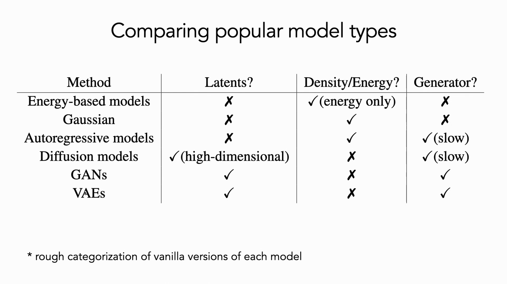
*▲ 강의 슬라이드 [80:10](https://youtu.be/8zzfcYIELdo?t=4810): 인기 있는 [생성 모델](00_%EB%94%A5%EB%9F%AC%EB%8B%9D_%EC%9A%A9%EC%96%B4%EC%82%AC%EC%A0%84.md#generative-model-%EC%83%9D%EC%84%B1-%EB%AA%A8%EB%8D%B8) 비교 (기본판 기준의 대략적 [분류](00_%EB%94%A5%EB%9F%AC%EB%8B%9D_%EC%9A%A9%EC%96%B4%EC%82%AC%EC%A0%84.md#regression-classification-%ED%9A%8C%EA%B7%80%EC%99%80-%EB%B6%84%EB%A5%98))*

> [!TIP]
> **🆕 2026 업데이트: [VAE](00_%EB%94%A5%EB%9F%AC%EB%8B%9D_%EC%9A%A9%EC%96%B4%EC%82%AC%EC%A0%84.md#variational-autoencoder-vae-%EB%B3%80%EB%B6%84-%EC%98%A4%ED%86%A0%EC%9D%B8%EC%BD%94%EB%8D%94)는 잠재 [확산 모델](00_%EB%94%A5%EB%9F%AC%EB%8B%9D_%EC%9A%A9%EC%96%B4%EC%82%AC%EC%A0%84.md#diffusion-model-%ED%99%95%EC%82%B0-%EB%AA%A8%EB%8D%B8)의 "토크나이저"로 살아 있다**
> - **강의**: [VAE](00_%EB%94%A5%EB%9F%AC%EB%8B%9D_%EC%9A%A9%EC%96%B4%EC%82%AC%EC%A0%84.md#variational-autoencoder-vae-%EB%B3%80%EB%B6%84-%EC%98%A4%ED%86%A0%EC%9D%B8%EC%BD%94%EB%8D%94)는 수학적으로 거의 모든 것을 감싸는 틀이지만, 실제로는 [확산 모델](00_%EB%94%A5%EB%9F%AC%EB%8B%9D_%EC%9A%A9%EC%96%B4%EC%82%AC%EC%A0%84.md#diffusion-model-%ED%99%95%EC%82%B0-%EB%AA%A8%EB%8D%B8)만큼 인기가 없다.
> - **현재**: 오늘날 주요 이미지 [생성 모델](00_%EB%94%A5%EB%9F%AC%EB%8B%9D_%EC%9A%A9%EC%96%B4%EC%82%AC%EC%A0%84.md#generative-model-%EC%83%9D%EC%84%B1-%EB%AA%A8%EB%8D%B8)은 대부분 **잠재 확산** 구조라서, 먼저 [VAE](00_%EB%94%A5%EB%9F%AC%EB%8B%9D_%EC%9A%A9%EC%96%B4%EC%82%AC%EC%A0%84.md#variational-autoencoder-vae-%EB%B3%80%EB%B6%84-%EC%98%A4%ED%86%A0%EC%9D%B8%EC%BD%94%EB%8D%94)(KL 항을 단 [오토인코더](00_%EB%94%A5%EB%9F%AC%EB%8B%9D_%EC%9A%A9%EC%96%B4%EC%82%AC%EC%A0%84.md#autoencoder-%EC%98%A4%ED%86%A0%EC%9D%B8%EC%BD%94%EB%8D%94))로 이미지를 작은 [잠재 공간](00_%EB%94%A5%EB%9F%AC%EB%8B%9D_%EC%9A%A9%EC%96%B4%EC%82%AC%EC%A0%84.md#latent-space-%EC%9E%A0%EC%9E%AC-%EA%B3%B5%EA%B0%84)으로 압축한 뒤 그 안에서 확산·흐름 모델을 학습한다. 즉 [VAE](00_%EB%94%A5%EB%9F%AC%EB%8B%9D_%EC%9A%A9%EC%96%B4%EC%82%AC%EC%A0%84.md#variational-autoencoder-vae-%EB%B3%80%EB%B6%84-%EC%98%A4%ED%86%A0%EC%9D%B8%EC%BD%94%EB%8D%94)는 독립된 [생성기](00_%EB%94%A5%EB%9F%AC%EB%8B%9D_%EC%9A%A9%EC%96%B4%EC%82%AC%EC%A0%84.md#generator-discriminator-%EC%83%9D%EC%84%B1%EA%B8%B0%EC%99%80-%ED%8C%90%EB%B3%84%EA%B8%B0)보다 **표현(압축기)**으로 널리 쓰인다. Stable Diffusion 3 논문은 잠재 [채널](00_%EB%94%A5%EB%9F%AC%EB%8B%9D_%EC%9A%A9%EC%96%B4%EC%82%AC%EC%A0%84.md#channel-%EC%B1%84%EB%84%90)을 4 → 8 → 16으로 늘릴수록 재구성 FID가 2.41 → 1.56 → 1.06으로 좋아져 16채널을 택했다. 그런데 2025년 연구들은 "재구성은 좋아지지만 그 잠재 공간에서의 생성은 더 어려워지는" 딜레마를 보고했고, [VAE](00_%EB%94%A5%EB%9F%AC%EB%8B%9D_%EC%9A%A9%EC%96%B4%EC%82%AC%EC%A0%84.md#variational-autoencoder-vae-%EB%B3%80%EB%B6%84-%EC%98%A4%ED%86%A0%EC%9D%B8%EC%BD%94%EB%8D%94) [잠재 공간](00_%EB%94%A5%EB%9F%AC%EB%8B%9D_%EC%9A%A9%EC%96%B4%EC%82%AC%EC%A0%84.md#latent-space-%EC%9E%A0%EC%9E%AC-%EA%B3%B5%EA%B0%84)을 사전 학습된 시각 [기반 모델](00_%EB%94%A5%EB%9F%AC%EB%8B%9D_%EC%9A%A9%EC%96%B4%EC%82%AC%EC%A0%84.md#foundation-model-%EA%B8%B0%EB%B0%98-%EB%AA%A8%EB%8D%B8)의 표현에 **정렬**하면(VA-VAE) 생성이 훨씬 빨리 수렴한다고 했다(ImageNet 256 FID 1.35). REPA-E는 [VAE](00_%EB%94%A5%EB%9F%AC%EB%8B%9D_%EC%9A%A9%EC%96%B4%EC%82%AC%EC%A0%84.md#variational-autoencoder-vae-%EB%B3%80%EB%B6%84-%EC%98%A4%ED%86%A0%EC%9D%B8%EC%BD%94%EB%8D%94)와 [확산 트랜스포머](00_%EB%94%A5%EB%9F%AC%EB%8B%9D_%EC%9A%A9%EC%96%B4%EC%82%AC%EC%A0%84.md#diffusion-transformer-%ED%99%95%EC%82%B0-%ED%8A%B8%EB%9E%9C%EC%8A%A4%ED%8F%AC%EB%A8%B8)를 표현 정렬 [손실](00_%EB%94%A5%EB%9F%AC%EB%8B%9D_%EC%9A%A9%EC%96%B4%EC%82%AC%EC%A0%84.md#loss-function-%EC%86%90%EC%8B%A4-%ED%95%A8%EC%88%98)과 함께 끝까지 같이 학습해 FID 1.12(가이던스 사용)를 보고했다. 이 강의의 주제 "[표현 학습](00_%EB%94%A5%EB%9F%AC%EB%8B%9D_%EC%9A%A9%EC%96%B4%EC%82%AC%EC%A0%84.md#representation-learning-%ED%91%9C%ED%98%84-%ED%95%99%EC%8A%B5)과 [생성 모델](00_%EB%94%A5%EB%9F%AC%EB%8B%9D_%EC%9A%A9%EC%96%B4%EC%82%AC%EC%A0%84.md#generative-model-%EC%83%9D%EC%84%B1-%EB%AA%A8%EB%8D%B8)의 만남"이 그대로 실무의 쟁점이 된 셈이다.
> - **출처**: [Esser et al., Scaling Rectified Flow Transformers for High-Resolution Image Synthesis (ICML 2024)](https://arxiv.org/abs/2403.03206) · [Yao et al., Reconstruction vs. Generation: Taming Optimization Dilemma in Latent Diffusion Models (CVPR 2025)](https://arxiv.org/abs/2501.01423) · [Leng et al., REPA-E: Unlocking VAE for End-to-End Tuning with Latent Diffusion Transformers (arXiv 2025)](https://arxiv.org/abs/2504.10483)

> [!TIP]
> **🆕 2026 업데이트: [생성 모델](00_%EB%94%A5%EB%9F%AC%EB%8B%9D_%EC%9A%A9%EC%96%B4%EC%82%AC%EC%A0%84.md#generative-model-%EC%83%9D%EC%84%B1-%EB%AA%A8%EB%8D%B8)의 지형**
> - **강의**: 지금 가장 인기 있는 것은 [확산 모델](00_%EB%94%A5%EB%9F%AC%EB%8B%9D_%EC%9A%A9%EC%96%B4%EC%82%AC%EC%A0%84.md#diffusion-model-%ED%99%95%EC%82%B0-%EB%AA%A8%EB%8D%B8), [언어 모델](00_%EB%94%A5%EB%9F%AC%EB%8B%9D_%EC%9A%A9%EC%96%B4%EC%82%AC%EC%A0%84.md#language-model-%EC%96%B8%EC%96%B4-%EB%AA%A8%EB%8D%B8)에서 쓰이는 것은 [자기회귀 모델](00_%EB%94%A5%EB%9F%AC%EB%8B%9D_%EC%9A%A9%EC%96%B4%EC%82%AC%EC%A0%84.md#autoregressive-model-%EC%9E%90%EA%B8%B0%ED%9A%8C%EA%B7%80-%EB%AA%A8%EB%8D%B8)이다.
> - **현재**: 경계가 섞이고 있다. 이미지에서는 데이터와 잡음을 직선으로 잇는 **정류 흐름**(rectified flow) 계열이 Stable Diffusion 3 같은 대형 모델의 [학습](00_%EB%94%A5%EB%9F%AC%EB%8B%9D_%EC%9A%A9%EC%96%B4%EC%82%AC%EC%A0%84.md#training-%ED%95%99%EC%8A%B5) 목표가 되었다. 반대로 이미지 생성에서도 자기회귀가 다시 경쟁력을 보였다. VAR은 "다음 [토큰](00_%EB%94%A5%EB%9F%AC%EB%8B%9D_%EC%9A%A9%EC%96%B4%EC%82%AC%EC%A0%84.md#token-%ED%86%A0%ED%81%B0)" 대신 "다음 해상도"를 예측하는 자기회귀로 ImageNet 256 FID를 18.65에서 1.73으로 낮추고 [확산 트랜스포머](00_%EB%94%A5%EB%9F%AC%EB%8B%9D_%EC%9A%A9%EC%96%B4%EC%82%AC%EC%A0%84.md#diffusion-transformer-%ED%99%95%EC%82%B0-%ED%8A%B8%EB%9E%9C%EC%8A%A4%ED%8F%AC%EB%A8%B8)(DiT)를 앞섰다고 보고했다(NeurIPS 2024 최우수 논문). 언어에서도 가린 [토큰](00_%EB%94%A5%EB%9F%AC%EB%8B%9D_%EC%9A%A9%EC%96%B4%EC%82%AC%EC%A0%84.md#token-%ED%86%A0%ED%81%B0)을 되살리는 **확산 [언어 모델](00_%EB%94%A5%EB%9F%AC%EB%8B%9D_%EC%9A%A9%EC%96%B4%EC%82%AC%EC%A0%84.md#language-model-%EC%96%B8%EC%96%B4-%EB%AA%A8%EB%8D%B8)** LLaDA(8B)가 처음부터 학습해 같은 규모의 [자기회귀 모델](00_%EB%94%A5%EB%9F%AC%EB%8B%9D_%EC%9A%A9%EC%96%B4%EC%82%AC%EC%A0%84.md#autoregressive-model-%EC%9E%90%EA%B8%B0%ED%9A%8C%EA%B7%80-%EB%AA%A8%EB%8D%B8)(LLaMA3 8B)과 문맥 내 [학습](00_%EB%94%A5%EB%9F%AC%EB%8B%9D_%EC%9A%A9%EC%96%B4%EC%82%AC%EC%A0%84.md#training-%ED%95%99%EC%8A%B5)에서 견줄 만하다고 보고했다. 표의 "어느 모델이 어디에 쓰인다"는 고정된 구분이 아니다.
> - **출처**: [Esser et al. (ICML 2024)](https://arxiv.org/abs/2403.03206) · [Tian et al., Visual Autoregressive Modeling: Scalable Image Generation via Next-Scale Prediction (NeurIPS 2024)](https://arxiv.org/abs/2404.02905) · [Nie et al., Large Language Diffusion Models (arXiv 2025)](https://arxiv.org/abs/2502.09992)

---

## 14. 용어 정리

용어사전에 있는 용어는 위 본문에 링크를 걸었습니다. 아래는 이번 강의에서 새로 나온 용어입니다.

| 용어 | 뜻 |
|---|---|
| [변분 오토인코더](00_%EB%94%A5%EB%9F%AC%EB%8B%9D_%EC%9A%A9%EC%96%B4%EC%82%AC%EC%A0%84.md#variational-autoencoder-vae-%EB%B3%80%EB%B6%84-%EC%98%A4%ED%86%A0%EC%9D%B8%EC%BD%94%EB%8D%94)(Variational autoencoder, [VAE](00_%EB%94%A5%EB%9F%AC%EB%8B%9D_%EC%9A%A9%EC%96%B4%EC%82%AC%EC%A0%84.md#variational-autoencoder-vae-%EB%B3%80%EB%B6%84-%EC%98%A4%ED%86%A0%EC%9D%B8%EC%BD%94%EB%8D%94)) | 인코딩이 단위 가우스를 이루도록 [ELBO](00_%EB%94%A5%EB%9F%AC%EB%8B%9D_%EC%9A%A9%EC%96%B4%EC%82%AC%EC%A0%84.md#elbo-evidence-lower-bound-%EC%A6%9D%EA%B1%B0-%ED%95%98%ED%95%9C)로 학습한 [오토인코더](00_%EB%94%A5%EB%9F%AC%EB%8B%9D_%EC%9A%A9%EC%96%B4%EC%82%AC%EC%A0%84.md#autoencoder-%EC%98%A4%ED%86%A0%EC%9D%B8%EC%BD%94%EB%8D%94). 가우스에서 뽑아 디코딩하면 [생성 모델](00_%EB%94%A5%EB%9F%AC%EB%8B%9D_%EC%9A%A9%EC%96%B4%EC%82%AC%EC%A0%84.md#generative-model-%EC%83%9D%EC%84%B1-%EB%AA%A8%EB%8D%B8)이 된다 |
| [가우스 혼합 모델](00_%EB%94%A5%EB%9F%AC%EB%8B%9D_%EC%9A%A9%EC%96%B4%EC%82%AC%EC%A0%84.md#gaussian-mixture-model-%EA%B0%80%EC%9A%B0%EC%8A%A4-%ED%98%BC%ED%95%A9-%EB%AA%A8%EB%8D%B8)(Gaussian mixture model) | 가우스 여러 개를 가중합한 [밀도 모델](00_%EB%94%A5%EB%9F%AC%EB%8B%9D_%EC%9A%A9%EC%96%B4%EC%82%AC%EC%A0%84.md#density-model-%EB%B0%80%EB%8F%84-%EB%AA%A8%EB%8D%B8). [VAE](00_%EB%94%A5%EB%9F%AC%EB%8B%9D_%EC%9A%A9%EC%96%B4%EC%82%AC%EC%A0%84.md#variational-autoencoder-vae-%EB%B3%80%EB%B6%84-%EC%98%A4%ED%86%A0%EC%9D%B8%EC%BD%94%EB%8D%94)는 신경망으로 만든 무한 혼합 |
| [잠재 변수](00_%EB%94%A5%EB%9F%AC%EB%8B%9D_%EC%9A%A9%EC%96%B4%EC%82%AC%EC%A0%84.md#latent-variable-%EC%9E%A0%EC%9E%AC-%EB%B3%80%EC%88%98)(Latent variable) | 관측되지 않지만 데이터를 만들어 내는 숨은 변수 $\mathbf{z}$ |
| [주변 우도](00_%EB%94%A5%EB%9F%AC%EB%8B%9D_%EC%9A%A9%EC%96%B4%EC%82%AC%EC%A0%84.md#marginal-likelihood-%EC%A3%BC%EB%B3%80-%EC%9A%B0%EB%8F%84)(Marginal likelihood) | [잠재 변수](00_%EB%94%A5%EB%9F%AC%EB%8B%9D_%EC%9A%A9%EC%96%B4%EC%82%AC%EC%A0%84.md#latent-variable-%EC%9E%A0%EC%9E%AC-%EB%B3%80%EC%88%98)를 적분해 없앤 [우도](00_%EB%94%A5%EB%9F%AC%EB%8B%9D_%EC%9A%A9%EC%96%B4%EC%82%AC%EC%A0%84.md#likelihood-%EC%9A%B0%EB%8F%84) $p(\mathbf{x}) = \int p(\mathbf{x}\mid\mathbf{z})p(\mathbf{z})d\mathbf{z}$ |
| [사전 분포와 사후 분포](00_%EB%94%A5%EB%9F%AC%EB%8B%9D_%EC%9A%A9%EC%96%B4%EC%82%AC%EC%A0%84.md#prior-posterior-%EC%82%AC%EC%A0%84-%EB%B6%84%ED%8F%AC%EC%99%80-%EC%82%AC%ED%9B%84-%EB%B6%84%ED%8F%AC)([Prior](00_%EB%94%A5%EB%9F%AC%EB%8B%9D_%EC%9A%A9%EC%96%B4%EC%82%AC%EC%A0%84.md#prior-posterior-%EC%82%AC%EC%A0%84-%EB%B6%84%ED%8F%AC%EC%99%80-%EC%82%AC%ED%9B%84-%EB%B6%84%ED%8F%AC), [Posterior](00_%EB%94%A5%EB%9F%AC%EB%8B%9D_%EC%9A%A9%EC%96%B4%EC%82%AC%EC%A0%84.md#prior-posterior-%EC%82%AC%EC%A0%84-%EB%B6%84%ED%8F%AC%EC%99%80-%EC%82%AC%ED%9B%84-%EB%B6%84%ED%8F%AC)) | 데이터를 보기 전 $p(\mathbf{z})$와, $\mathbf{x}$를 본 뒤 $p(\mathbf{z}\mid\mathbf{x})$ |
| [몬테카를로 추정](00_%EB%94%A5%EB%9F%AC%EB%8B%9D_%EC%9A%A9%EC%96%B4%EC%82%AC%EC%A0%84.md#monte-carlo-estimation-%EB%AA%AC%ED%85%8C%EC%B9%B4%EB%A5%BC%EB%A1%9C-%EC%B6%94%EC%A0%95)(Monte Carlo estimation) | [기댓값](00_%EB%94%A5%EB%9F%AC%EB%8B%9D_%EC%9A%A9%EC%96%B4%EC%82%AC%EC%A0%84.md#expectation-%EA%B8%B0%EB%8C%93%EA%B0%92)(적분)을 무작위 표본의 평균으로 근사하는 것 |
| [중요도 샘플링](00_%EB%94%A5%EB%9F%AC%EB%8B%9D_%EC%9A%A9%EC%96%B4%EC%82%AC%EC%A0%84.md#importance-sampling-%EC%A4%91%EC%9A%94%EB%8F%84-%EC%83%98%ED%94%8C%EB%A7%81)(Importance sampling) | 다른 분포 $q$에서 뽑고 무게 $p/q$를 곱해 [기댓값](00_%EB%94%A5%EB%9F%AC%EB%8B%9D_%EC%9A%A9%EC%96%B4%EC%82%AC%EC%A0%84.md#expectation-%EA%B8%B0%EB%8C%93%EA%B0%92)을 적은 [분산](00_%EB%94%A5%EB%9F%AC%EB%8B%9D_%EC%9A%A9%EC%96%B4%EC%82%AC%EC%A0%84.md#variance-%EB%B6%84%EC%82%B0)으로 추정하는 것 |
| [젠센 부등식](00_%EB%94%A5%EB%9F%AC%EB%8B%9D_%EC%9A%A9%EC%96%B4%EC%82%AC%EC%A0%84.md#jensen-inequality-%EC%A0%A0%EC%84%BC-%EB%B6%80%EB%93%B1%EC%8B%9D)(Jensen's inequality) | 오목 함수 $\log$에 대해 $\log\mathbb{E}[Y] \ge \mathbb{E}[\log Y]$ |
| [증거 하한](00_%EB%94%A5%EB%9F%AC%EB%8B%9D_%EC%9A%A9%EC%96%B4%EC%82%AC%EC%A0%84.md#elbo-evidence-lower-bound-%EC%A6%9D%EA%B1%B0-%ED%95%98%ED%95%9C)([ELBO](00_%EB%94%A5%EB%9F%AC%EB%8B%9D_%EC%9A%A9%EC%96%B4%EC%82%AC%EC%A0%84.md#elbo-evidence-lower-bound-%EC%A6%9D%EA%B1%B0-%ED%95%98%ED%95%9C)) | [로그](00_%EB%94%A5%EB%9F%AC%EB%8B%9D_%EC%9A%A9%EC%96%B4%EC%82%AC%EC%A0%84.md#log-ln-%EB%A1%9C%EA%B7%B8) [우도](00_%EB%94%A5%EB%9F%AC%EB%8B%9D_%EC%9A%A9%EC%96%B4%EC%82%AC%EC%A0%84.md#likelihood-%EC%9A%B0%EB%8F%84)의 하한 = 재구성 항 − KL 항. [VAE](00_%EB%94%A5%EB%9F%AC%EB%8B%9D_%EC%9A%A9%EC%96%B4%EC%82%AC%EC%A0%84.md#variational-autoencoder-vae-%EB%B3%80%EB%B6%84-%EC%98%A4%ED%86%A0%EC%9D%B8%EC%BD%94%EB%8D%94)의 [학습](00_%EB%94%A5%EB%9F%AC%EB%8B%9D_%EC%9A%A9%EC%96%B4%EC%82%AC%EC%A0%84.md#training-%ED%95%99%EC%8A%B5) 목표 |
| [변분 추론](00_%EB%94%A5%EB%9F%AC%EB%8B%9D_%EC%9A%A9%EC%96%B4%EC%82%AC%EC%A0%84.md#variational-inference-%EB%B3%80%EB%B6%84-%EC%B6%94%EB%A1%A0)(Variational inference) | 다루기 힘든 [사후 분포](00_%EB%94%A5%EB%9F%AC%EB%8B%9D_%EC%9A%A9%EC%96%B4%EC%82%AC%EC%A0%84.md#prior-posterior-%EC%82%AC%EC%A0%84-%EB%B6%84%ED%8F%AC%EC%99%80-%EC%82%AC%ED%9B%84-%EB%B6%84%ED%8F%AC)를 단순한 분포 $q$로 근사하고 [ELBO](00_%EB%94%A5%EB%9F%AC%EB%8B%9D_%EC%9A%A9%EC%96%B4%EC%82%AC%EC%A0%84.md#elbo-evidence-lower-bound-%EC%A6%9D%EA%B1%B0-%ED%95%98%ED%95%9C)를 최대화하는 방법 |
| [재매개변수화 트릭](00_%EB%94%A5%EB%9F%AC%EB%8B%9D_%EC%9A%A9%EC%96%B4%EC%82%AC%EC%A0%84.md#reparameterization-trick-%EC%9E%AC%EB%A7%A4%EA%B0%9C%EB%B3%80%EC%88%98%ED%99%94-%ED%8A%B8%EB%A6%AD)(Reparameterization trick) | $\mathbf{z} = \boldsymbol{\mu} + \boldsymbol{\sigma}\boldsymbol{\epsilon}$으로 뽑아 무작위성을 옆으로 빼고 $\boldsymbol{\mu}, \boldsymbol{\sigma}$로 역전파하는 요령 |
