# Lec 16. 조건부 생성 모델 (Generative Models: Conditional Models)

← 이전: [Lec15_변분_오토인코더](Lec15_%EB%B3%80%EB%B6%84_%EC%98%A4%ED%86%A0%EC%9D%B8%EC%BD%94%EB%8D%94.md) · [목차](00_MIT%EB%94%A5%EB%9F%AC%EB%8B%9D_%EB%AA%A9%EC%B0%A8.md) · 다음: [Lec17_분포_밖_일반화](Lec17_%EB%B6%84%ED%8F%AC_%EB%B0%96_%EC%9D%BC%EB%B0%98%ED%99%94.md) →

> [!NOTE]
> **강의 정보**
> - **출처**: MIT OpenCourseWare, [Lec 16. Generative Models: Conditional Models](https://www.youtube.com/watch?v=zaMcHuJwe1w) (81분, 2024년 가을 학기)
> - **강사**: Phillip Isola
> - **라이선스**: 원 강의는 CC BY-NC-SA 4.0입니다. 이 노트는 영어 자막을 바탕으로 한국어로 옮겨 정리한 2차 저작물이며, 같은 조건(비영리·출처 표기·동일 조건 공유)을 따릅니다.
> - 각 절 제목 아래의 `▶ 영상` 시간을 누르면 영상의 해당 위치로 갑니다.
> - `📐 수학 개념` 줄은 그 절에 쓰인 수학을 정리한 노트로 연결됩니다. 전체 목록은 [00_MIT딥러닝_목차](00_MIT%EB%94%A5%EB%9F%AC%EB%8B%9D_%EB%AA%A9%EC%B0%A8.md).
> - 슬라이드 캡처는 원 강의(CC BY-NC-SA 4.0)에서 가져왔고, "직접 그린 그림"은 이 노트의 숫자로 새로 그렸습니다.
> - `🆕 2026 업데이트` 칸은 강의(2024년 가을) 이후 바뀐 내용을 덧붙인 것입니다.

## 한눈에 보기

| 구분 | 내용 |
|---|---|
| 핵심 질문 | 입력 $\mathbf{x}$가 주어졌을 때 고차원 출력 $\mathbf{y}$(이미지, 문장)를 어떻게 예측하나? 왜 [생성 모델](00_%EB%94%A5%EB%9F%AC%EB%8B%9D_%EC%9A%A9%EC%96%B4%EC%82%AC%EC%A0%84.md#generative-model-%EC%83%9D%EC%84%B1-%EB%AA%A8%EB%8D%B8)이 필요한가? |
| [구조적 예측](00_%EB%94%A5%EB%9F%AC%EB%8B%9D_%EC%9A%A9%EC%96%B4%EC%82%AC%EC%A0%84.md#structured-prediction-%EA%B5%AC%EC%A1%B0%EC%A0%81-%EC%98%88%EC%B8%A1) | 출력 차원들이 서로 엮여 있어 독립인 곱으로 쪼개지지 않는 예측. 거의 모든 실제 문제가 여기에 속한다 |
| 비구조적 예측의 두 실패 | ① [봉우리가 여럿](00_%EB%94%A5%EB%9F%AC%EB%8B%9D_%EC%9A%A9%EC%96%B4%EC%82%AC%EC%A0%84.md#multimodal-distribution-%EB%8B%A4%EB%B4%89-%EB%B6%84%ED%8F%AC)인데 평균을 내면 흐릿하고 칙칙해진다 ② 픽셀마다 따로 고르면 서로 어긋나 얼룩진다 |
| 해결 | 목적 함수가 구조를 보게 한다: [조건부 GAN](00_%EB%94%A5%EB%9F%AC%EB%8B%9D_%EC%9A%A9%EC%96%B4%EC%82%AC%EC%A0%84.md#conditional-gan-%EC%A1%B0%EA%B1%B4%EB%B6%80-gan)(학습된 [손실](00_%EB%94%A5%EB%9F%AC%EB%8B%9D_%EC%9A%A9%EC%96%B4%EC%82%AC%EC%A0%84.md#loss-function-%EC%86%90%EC%8B%A4-%ED%95%A8%EC%88%98), [패치 판별자](00_%EB%94%A5%EB%9F%AC%EB%8B%9D_%EC%9A%A9%EC%96%B4%EC%82%AC%EC%A0%84.md#patchgan-%ED%8C%A8%EC%B9%98-%ED%8C%90%EB%B3%84%EC%9E%90)), [조건부 VAE](00_%EB%94%A5%EB%9F%AC%EB%8B%9D_%EC%9A%A9%EC%96%B4%EC%82%AC%EC%A0%84.md#conditional-vae-%EC%A1%B0%EA%B1%B4%EB%B6%80-vae)([잠재 변수](00_%EB%94%A5%EB%9F%AC%EB%8B%9D_%EC%9A%A9%EC%96%B4%EC%82%AC%EC%A0%84.md#latent-variable-%EC%9E%A0%EC%9E%AC-%EB%B3%80%EC%88%98) $z$가 남은 불확실성을 담음) |
| 텍스트·이미지 | [자기회귀 모델](00_%EB%94%A5%EB%9F%AC%EB%8B%9D_%EC%9A%A9%EC%96%B4%EC%82%AC%EC%A0%84.md#autoregressive-model-%EC%9E%90%EA%B8%B0%ED%9A%8C%EA%B7%80-%EB%AA%A8%EB%8D%B8)은 원래 조건부다(프롬프트). 이미지→텍스트는 ViT + [GPT](00_%EB%94%A5%EB%9F%AC%EB%8B%9D_%EC%9A%A9%EC%96%B4%EC%82%AC%EC%A0%84.md#gpt-%EC%83%9D%EC%84%B1%ED%98%95-%EC%82%AC%EC%A0%84%ED%95%99%EC%8A%B5-%ED%8A%B8%EB%9E%9C%EC%8A%A4%ED%8F%AC%EB%A8%B8) + [교차 어텐션](00_%EB%94%A5%EB%9F%AC%EB%8B%9D_%EC%9A%A9%EC%96%B4%EC%82%AC%EC%A0%84.md#cross-attention-%EA%B5%90%EC%B0%A8-%EC%96%B4%ED%85%90%EC%85%98), 텍스트→이미지는 [조건부 VAE](00_%EB%94%A5%EB%9F%AC%EB%8B%9D_%EC%9A%A9%EC%96%B4%EC%82%AC%EC%A0%84.md#conditional-vae-%EC%A1%B0%EA%B1%B4%EB%B6%80-vae)(DALL-E 1)나 [잡음 제거기](00_%EB%94%A5%EB%9F%AC%EB%8B%9D_%EC%9A%A9%EC%96%B4%EC%82%AC%EC%A0%84.md#denoiser-%EC%9E%A1%EC%9D%8C-%EC%A0%9C%EA%B1%B0%EA%B8%B0)에 글을 넣은 [확산 모델](00_%EB%94%A5%EB%9F%AC%EB%8B%9D_%EC%9A%A9%EC%96%B4%EC%82%AC%EC%A0%84.md#diffusion-model-%ED%99%95%EC%82%B0-%EB%AA%A8%EB%8D%B8) |
| 짝 없는 데이터 | 판별자는 "출력이 그 도메인다운가"만 보고, [순환 일관성](00_%EB%94%A5%EB%9F%AC%EB%8B%9D_%EC%9A%A9%EC%96%B4%EC%82%AC%EC%A0%84.md#cycle-consistency-%EC%88%9C%ED%99%98-%EC%9D%BC%EA%B4%80%EC%84%B1)이 입력과 출력을 잇는다 (CycleGAN) |
| 이전 강의 | Lec15 [변분 오토인코더](00_%EB%94%A5%EB%9F%AC%EB%8B%9D_%EC%9A%A9%EC%96%B4%EC%82%AC%EC%A0%84.md#variational-autoencoder-vae-%EB%B3%80%EB%B6%84-%EC%98%A4%ED%86%A0%EC%9D%B8%EC%BD%94%EB%8D%94) |
| 다음 강의 | Lec17 |

---

## 1. 구조적 예측

▶ 영상 [01:39](https://youtu.be/zaMcHuJwe1w?t=99)

📐 **수학 개념**: [조건부 확률과 독립](%EC%88%98%ED%95%99%EA%B0%9C%EB%85%90/04_%ED%99%95%EB%A5%A0%EA%B3%BC_%EC%A0%95%EB%B3%B4/MM58_%EC%A1%B0%EA%B1%B4%EB%B6%80_%ED%99%95%EB%A5%A0%EA%B3%BC_%EB%8F%85%EB%A6%BD.md) · [확률의 연쇄법칙](%EC%88%98%ED%95%99%EA%B0%9C%EB%85%90/04_%ED%99%95%EB%A5%A0%EA%B3%BC_%EC%A0%95%EB%B3%B4/MM39_%ED%99%95%EB%A5%A0%EC%9D%98_%EC%97%B0%EC%87%84%EB%B2%95%EC%B9%99%EA%B3%BC_%EB%B9%94_%EC%84%9C%EC%B9%98.md) · [확률 기초](%EC%88%98%ED%95%99%EA%B0%9C%EB%85%90/04_%ED%99%95%EB%A5%A0%EA%B3%BC_%EC%A0%95%EB%B3%B4/M08_%ED%99%95%EB%A5%A0_%EA%B8%B0%EC%B4%88.md)

[생성 모델](00_%EB%94%A5%EB%9F%AC%EB%8B%9D_%EC%9A%A9%EC%96%B4%EC%82%AC%EC%A0%84.md#generative-model-%EC%83%9D%EC%84%B1-%EB%AA%A8%EB%8D%B8) 3부작의 세 번째 강의입니다. 강사는 지난 강의가 수식이 많았다면 이번에는 그 수식을 응용해 보는 가벼운 강의라고 소개합니다. 다룰 내용은 [구조적 예측](00_%EB%94%A5%EB%9F%AC%EB%8B%9D_%EC%9A%A9%EC%96%B4%EC%82%AC%EC%A0%84.md#structured-prediction-%EA%B5%AC%EC%A1%B0%EC%A0%81-%EC%98%88%EC%B8%A1)(structured prediction), 이미지↔이미지·텍스트↔텍스트·이미지↔텍스트 변환, 마지막으로 **짝 없는 데이터**로도 변환할 수 있는가입니다.

[생성 모델](00_%EB%94%A5%EB%9F%AC%EB%8B%9D_%EC%9A%A9%EC%96%B4%EC%82%AC%EC%A0%84.md#generative-model-%EC%83%9D%EC%84%B1-%EB%AA%A8%EB%8D%B8)을 처음 만나면 "예쁜 그림 만들기, 재미있는 이야기 쓰기" 같은 오락용으로 보이기 쉽습니다. 하지만 강사는 [생성 모델](00_%EB%94%A5%EB%9F%AC%EB%8B%9D_%EC%9A%A9%EC%96%B4%EC%82%AC%EC%A0%84.md#generative-model-%EC%83%9D%EC%84%B1-%EB%AA%A8%EB%8D%B8)이 **거의 모든 문제의 핵심**이라고 말합니다. 하나의 숫자나 하나의 결정이 아니라 **고차원의 구조를 가진 대상**을 내놓는 문제(데이터 예측 문제)라면 모두 생성 모델링이 맞는 도구라는 것입니다.

- 이미지 → 이미지: 픽셀마다 범주를 붙이는 [의미 분할](00_%EB%94%A5%EB%9F%AC%EB%8B%9D_%EC%9A%A9%EC%96%B4%EC%82%AC%EC%A0%84.md#semantic-segmentation-%EC%9D%98%EB%AF%B8-%EB%B6%84%ED%95%A0)
- 소리 → 문장: 음성 인식
- 글 → 사진: Stable Diffusion, Midjourney, DALL-E 같은 텍스트-이미지 생성
- 단백질 서열 → 3차원 구조: 한 라벨이 아니라 전체 기하 구조를 출력

**정의**: 고차원 대상 $\mathbf{X}$를 모델링하는데, 그 [결합 분포](00_%EB%94%A5%EB%9F%AC%EB%8B%9D_%EC%9A%A9%EC%96%B4%EC%82%AC%EC%A0%84.md#joint-distribution-%EA%B2%B0%ED%95%A9-%EB%B6%84%ED%8F%AC)가 차원별 분포의 곱으로 쪼개지지 않으면 [구조적 예측](00_%EB%94%A5%EB%9F%AC%EB%8B%9D_%EC%9A%A9%EC%96%B4%EC%82%AC%EC%A0%84.md#structured-prediction-%EA%B5%AC%EC%A1%B0%EC%A0%81-%EC%98%88%EC%B8%A1)입니다. 반대로 모든 차원을 통계적으로 [독립](00_%EB%94%A5%EB%9F%AC%EB%8B%9D_%EC%9A%A9%EC%96%B4%EC%82%AC%EC%A0%84.md#independence-%EB%8F%85%EB%A6%BD)이라고 가정해 곱으로 쪼개 버리는 것이 비구조적 예측입니다. 텍스트든, 로봇 팔의 궤적이든, 자율주행차의 경로든 차원이 독립인 경우는 거의 없습니다. "좌회전했다면 다음 결정도 그에 따라 달라진다"처럼 결정끼리 엮여 있습니다. 강사는 "[구조적 예측](00_%EB%94%A5%EB%9F%AC%EB%8B%9D_%EC%9A%A9%EC%96%B4%EC%82%AC%EC%A0%84.md#structured-prediction-%EA%B5%AC%EC%A1%B0%EC%A0%81-%EC%98%88%EC%B8%A1)"이라는 따로 된 이름이 있는 것이 역사적 우연일 뿐, 사실상 **모든 문제**가 [구조적 예측](00_%EB%94%A5%EB%9F%AC%EB%8B%9D_%EC%9A%A9%EC%96%B4%EC%82%AC%EC%A0%84.md#structured-prediction-%EA%B5%AC%EC%A1%B0%EC%A0%81-%EC%98%88%EC%B8%A1)이라고 봅니다.

$$
\text{구조적: } P(\mathbf{X} \mid \mathbf{Y} = \mathbf{y}) \qquad \text{비구조적: } \prod_i p(X_i \mid \mathbf{Y} = \mathbf{y})
$$

기호 풀이

| 기호 | 읽는 법 | 뜻 | 예제 값 |
| --- | --- | --- | --- |
| $\mathbf{X}$ | 큰 엑스 | 예측할 고차원 출력 (예: 셔츠의 픽셀 색들) | 픽셀 2개 |
| $\mathbf{Y} = \mathbf{y}$ | 와이 | 관찰한 입력 (조건) | 흑백 셔츠 사진 |
| $X_i$ | 엑스 아이 | 출력의 $i$번째 차원 | 픽셀 1의 색 |
| $P(\mathbf{X} \mid \mathbf{Y} = \mathbf{y})$ | | 출력 전체의 [결합](00_%EB%94%A5%EB%9F%AC%EB%8B%9D_%EC%9A%A9%EC%96%B4%EC%82%AC%EC%A0%84.md#joint-distribution-%EA%B2%B0%ED%95%A9-%EB%B6%84%ED%8F%AC) [조건부 확률](00_%EB%94%A5%EB%9F%AC%EB%8B%9D_%EC%9A%A9%EC%96%B4%EC%82%AC%EC%A0%84.md#conditional-probability-%EC%A1%B0%EA%B1%B4%EB%B6%80-%ED%99%95%EB%A5%A0) | (청록, 청록) 0.5 |
| $\prod_i$ | 파이, 곱 | 모든 차원을 곱함 ([독립](00_%EB%94%A5%EB%9F%AC%EB%8B%9D_%EC%9A%A9%EC%96%B4%EC%82%AC%EC%A0%84.md#independence-%EB%8F%85%EB%A6%BD) 가정) | $0.5 \times 0.5$ |

예제와 풀이

**문제**: 흑백 셔츠 사진 $\mathbf{y}$를 보고 두 픽셀의 색을 예측한다. 진짜 세상에서는 셔츠 전체가 청록이거나 전체가 분홍이고, 각 [확률](00_%EB%94%A5%EB%9F%AC%EB%8B%9D_%EC%9A%A9%EC%96%B4%EC%82%AC%EC%A0%84.md#probability-%ED%99%95%EB%A5%A0)은 0.5다. 두 픽셀이 모두 청록일 [확률](00_%EB%94%A5%EB%9F%AC%EB%8B%9D_%EC%9A%A9%EC%96%B4%EC%82%AC%EC%A0%84.md#probability-%ED%99%95%EB%A5%A0)을 구조적 모델(진짜 [결합 분포](00_%EB%94%A5%EB%9F%AC%EB%8B%9D_%EC%9A%A9%EC%96%B4%EC%82%AC%EC%A0%84.md#joint-distribution-%EA%B2%B0%ED%95%A9-%EB%B6%84%ED%8F%AC))과 비구조적 모델(픽셀마다 따로 0.5)로 각각 구하라.

**주어진 값**
- $P(\text{청록}, \text{청록} \mid \mathbf{y}) = 0.5$ (진짜 [결합 분포](00_%EB%94%A5%EB%9F%AC%EB%8B%9D_%EC%9A%A9%EC%96%B4%EC%82%AC%EC%A0%84.md#joint-distribution-%EA%B2%B0%ED%95%A9-%EB%B6%84%ED%8F%AC): 셔츠 전체가 청록일 [확률](00_%EB%94%A5%EB%9F%AC%EB%8B%9D_%EC%9A%A9%EC%96%B4%EC%82%AC%EC%A0%84.md#probability-%ED%99%95%EB%A5%A0))
- $p(X_1 = \text{청록} \mid \mathbf{y}) = 0.5$ (픽셀 1만 볼 때 청록일 [확률](00_%EB%94%A5%EB%9F%AC%EB%8B%9D_%EC%9A%A9%EC%96%B4%EC%82%AC%EC%A0%84.md#probability-%ED%99%95%EB%A5%A0))
- $p(X_2 = \text{청록} \mid \mathbf{y}) = 0.5$ (픽셀 2만 볼 때 청록일 [확률](00_%EB%94%A5%EB%9F%AC%EB%8B%9D_%EC%9A%A9%EC%96%B4%EC%82%AC%EC%A0%84.md#probability-%ED%99%95%EB%A5%A0))

**풀이**
1. 식을 그대로 쓴다: 구조적 $P(X_1, X_2 \mid \mathbf{y})$, 비구조적 $\prod_{i=1}^{2} p(X_i \mid \mathbf{y})$
2. 값을 대입한다: 구조적 $P(\text{청록}, \text{청록} \mid \mathbf{y}) = 0.5$, 비구조적 $p(X_1 = \text{청록} \mid \mathbf{y}) \times p(X_2 = \text{청록} \mid \mathbf{y}) = 0.5 \times 0.5$
3. 비구조적 쪽 곱셈을 한다: $0.5 \times 0.5 = 0.25$

**답**: 구조적 **0.5**, 비구조적 **0.25**. 비구조적 모델은 남은 [확률](00_%EB%94%A5%EB%9F%AC%EB%8B%9D_%EC%9A%A9%EC%96%B4%EC%82%AC%EC%A0%84.md#probability-%ED%99%95%EB%A5%A0)을 "위는 청록, 아래는 분홍" 같은 있을 수 없는 셔츠에 나눠 준다.

내 이해

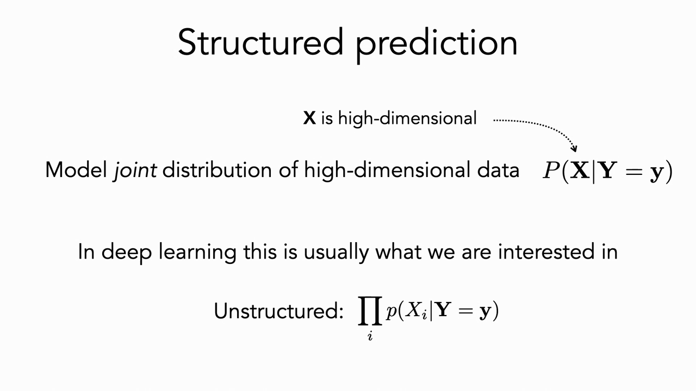
*▲ 강의 슬라이드 [04:10](https://youtu.be/zaMcHuJwe1w?t=250): [구조적 예측](00_%EB%94%A5%EB%9F%AC%EB%8B%9D_%EC%9A%A9%EC%96%B4%EC%82%AC%EC%A0%84.md#structured-prediction-%EA%B5%AC%EC%A1%B0%EC%A0%81-%EC%98%88%EC%B8%A1). 고차원 데이터의 [결합 분포](00_%EB%94%A5%EB%9F%AC%EB%8B%9D_%EC%9A%A9%EC%96%B4%EC%82%AC%EC%A0%84.md#joint-distribution-%EA%B2%B0%ED%95%A9-%EB%B6%84%ED%8F%AC) $P(\mathbf{X} \mid \mathbf{Y} = \mathbf{y})$를 모델링한다. 비구조적 예측은 $\prod_i p(X_i \mid \mathbf{Y} = \mathbf{y})$*

---

## 2. 비구조적 예측의 한계

▶ 영상 [05:05](https://youtu.be/zaMcHuJwe1w?t=305)

강사는 지금 보면 이상해 보여도 단순하고 꽤 쓸 만했던 비구조적 방법부터 살펴봅니다. 예로 드는 문제는 **색칠(colorization)**입니다. 색칠 자체가 중요해서가 아니라, 머신러닝의 핵심 개념이 다 들어 있어서 자주 쓰는 예입니다([Lec09 10](Lec09_%ED%95%B4%EC%BB%A4%EC%9D%98_%EB%94%A5%EB%9F%AC%EB%8B%9D_%EA%B0%80%EC%9D%B4%EB%93%9C.md#10-%ED%92%80%EB%A6%B0-%EB%AC%B8%EC%A0%9C%EB%A1%9C-%EB%B0%94%EA%BE%B8%EA%B8%B0-%EC%83%89%EC%B9%A0%EC%9D%84-%EB%B6%84%EB%A5%98%EB%A1%9C)에서도 나왔습니다).

### 2.1 여러 봉우리와 평균의 함정

▶ 영상 [05:37](https://youtu.be/zaMcHuJwe1w?t=337)

📐 **수학 개념**: [L2 회귀와 범주 분포](%EC%88%98%ED%95%99%EA%B0%9C%EB%85%90/04_%ED%99%95%EB%A5%A0%EA%B3%BC_%EC%A0%95%EB%B3%B4/MM35_L2_%ED%9A%8C%EA%B7%80%EC%99%80_%EB%B2%94%EC%A3%BC_%EB%B6%84%ED%8F%AC.md) · [확률 밀도와 정규분포](%EC%88%98%ED%95%99%EA%B0%9C%EB%85%90/04_%ED%99%95%EB%A5%A0%EA%B3%BC_%EC%A0%95%EB%B3%B4/MM50_%ED%99%95%EB%A5%A0_%EB%B0%80%EB%8F%84%EC%99%80_%EC%A0%95%EA%B7%9C%EB%B6%84%ED%8F%AC.md)

흑백 셔츠 사진이 있습니다. 이 셔츠는 청록과 분홍 두 색으로만 나오고, 두 색이 같은 [확률](00_%EB%94%A5%EB%9F%AC%EB%8B%9D_%EC%9A%A9%EC%96%B4%EC%82%AC%EC%A0%84.md#probability-%ED%99%95%EB%A5%A0)이라고 합시다. 흑백 값(밝기 $l$)이 주어졌을 때 색 $a$의 진짜 분포 $p_{\text{data}}(A = a \mid l)$는 **봉우리가 둘인** [다봉 분포](00_%EB%94%A5%EB%9F%AC%EB%8B%9D_%EC%9A%A9%EC%96%B4%EC%82%AC%EC%A0%84.md#multimodal-distribution-%EB%8B%A4%EB%B4%89-%EB%B6%84%ED%8F%AC)입니다(색을 청록에서 분홍까지 한 축으로 둡니다).

- **(b) 점 예측([회귀](00_%EB%94%A5%EB%9F%AC%EB%8B%9D_%EC%9A%A9%EC%96%B4%EC%82%AC%EC%A0%84.md#regression-classification-%ED%9A%8C%EA%B7%80%EC%99%80-%EB%B6%84%EB%A5%98))**: 숫자 하나를 냅니다. 분포로 보면 한 점에 몰린 델타 함수라 불확실성을 전혀 표현하지 못합니다. 제곱 [오차](00_%EB%94%A5%EB%9F%AC%EB%8B%9D_%EC%9A%A9%EC%96%B4%EC%82%AC%EC%A0%84.md#error-%EC%98%A4%EC%B0%A8)를 최소화하면 답은 두 색의 **평균**, 즉 중간의 회색빛 색입니다. 그런데 이 평균은 진짜 분포에서 **[확률](00_%EB%94%A5%EB%9F%AC%EB%8B%9D_%EC%9A%A9%EC%96%B4%EC%82%AC%EC%A0%84.md#probability-%ED%99%95%EB%A5%A0) 밀도가 0**인 색입니다. 제곱을 하면 크게 틀린 답의 벌점이 커지므로, 둘 중 하나를 고르는 것보다 가운데가 [오차](00_%EB%94%A5%EB%9F%AC%EB%8B%9D_%EC%9A%A9%EC%96%B4%EC%82%AC%EC%A0%84.md#error-%EC%98%A4%EC%B0%A8)는 작습니다. [오차](00_%EB%94%A5%EB%9F%AC%EB%8B%9D_%EC%9A%A9%EC%96%B4%EC%82%AC%EC%A0%84.md#error-%EC%98%A4%EC%B0%A8)는 최소지만 가장 나쁜 답입니다.
- **(d) [정규분포](00_%EB%94%A5%EB%9F%AC%EB%8B%9D_%EC%9A%A9%EC%96%B4%EC%82%AC%EC%A0%84.md#normal-distribution-%EC%A0%95%EA%B7%9C%EB%B6%84%ED%8F%AC) 예측**: [최대 우도](00_%EB%94%A5%EB%9F%AC%EB%8B%9D_%EC%9A%A9%EC%96%B4%EC%82%AC%EC%A0%84.md#maximum-likelihood-%EC%B5%9C%EB%8C%80-%EC%9A%B0%EB%8F%84)로 가우스 분포를 맞추면 [분산](00_%EB%94%A5%EB%9F%AC%EB%8B%9D_%EC%9A%A9%EC%96%B4%EC%82%AC%EC%A0%84.md#variance-%EB%B6%84%EC%82%B0)(불확실성)은 표현합니다. 하지만 봉우리가 하나뿐이라 봉우리 둘인 분포를 맞출 수 없습니다.
- **(c) [범주 분포](00_%EB%94%A5%EB%9F%AC%EB%8B%9D_%EC%9A%A9%EC%96%B4%EC%82%AC%EC%A0%84.md#categorical-distribution-%EB%B2%94%EC%A3%BC-%EB%B6%84%ED%8F%AC)([분류](00_%EB%94%A5%EB%9F%AC%EB%8B%9D_%EC%9A%A9%EC%96%B4%EC%82%AC%EC%A0%84.md#regression-classification-%ED%9A%8C%EA%B7%80%EC%99%80-%EB%B6%84%EB%A5%98))**: 색을 몇 개 칸으로 나누고([양자화](00_%EB%94%A5%EB%9F%AC%EB%8B%9D_%EC%9A%A9%EC%96%B4%EC%82%AC%EC%A0%84.md#quantization-%EC%96%91%EC%9E%90%ED%99%94)) [소프트맥스](00_%EB%94%A5%EB%9F%AC%EB%8B%9D_%EC%9A%A9%EC%96%B4%EC%82%AC%EC%A0%84.md#softmax-%EC%86%8C%ED%94%84%ED%8A%B8%EB%A7%A5%EC%8A%A4)로 칸마다 [확률](00_%EB%94%A5%EB%9F%AC%EB%8B%9D_%EC%9A%A9%EC%96%B4%EC%82%AC%EC%A0%84.md#probability-%ED%99%95%EB%A5%A0)을 냅니다. 합이 1인 숫자 묶음이라 봉우리가 몇 개든 표현할 수 있습니다. [양자화](00_%EB%94%A5%EB%9F%AC%EB%8B%9D_%EC%9A%A9%EC%96%B4%EC%82%AC%EC%A0%84.md#quantization-%EC%96%91%EC%9E%90%ED%99%94) [오차](00_%EB%94%A5%EB%9F%AC%EB%8B%9D_%EC%9A%A9%EC%96%B4%EC%82%AC%EC%A0%84.md#error-%EC%98%A4%EC%B0%A8)를 빼면 이 문제는 완전히 풀립니다. 이것이 해커 가이드 강의의 "양자화해서 [분류](00_%EB%94%A5%EB%9F%AC%EB%8B%9D_%EC%9A%A9%EC%96%B4%EC%82%AC%EC%A0%84.md#regression-classification-%ED%9A%8C%EA%B7%80%EC%99%80-%EB%B6%84%EB%A5%98)로 바꾸기" 요령이 잘 통하는 이유입니다.

$$
\arg\min_{c} \sum_{i=1}^{N} (y_i - c)^2 = \frac{1}{N}\sum_{i=1}^{N} y_i
$$

기호 풀이

| 기호 | 읽는 법 | 뜻 | 예제 값 |
| --- | --- | --- | --- |
| $y_i$ | 와이 아이 | $i$번째 [학습 데이터](00_%EB%94%A5%EB%9F%AC%EB%8B%9D_%EC%9A%A9%EC%96%B4%EC%82%AC%EC%A0%84.md#training-data-test-data-%ED%95%99%EC%8A%B5-%EB%8D%B0%EC%9D%B4%ED%84%B0%EC%99%80-%EC%8B%9C%ED%97%98-%EB%8D%B0%EC%9D%B4%ED%84%B0)의 색 (청록 -1, 분홍 +1) | -1, 1, -1, 1 |
| $N$ | 엔 | 데이터 개수 | 4 |
| $c$ | 씨 | 하나로 내놓을 예측 색 | |
| $\sum_{i=1}^{N}(y_i - c)^2$ | | 제곱 [오차](00_%EB%94%A5%EB%9F%AC%EB%8B%9D_%EC%9A%A9%EC%96%B4%EC%82%AC%EC%A0%84.md#error-%EC%98%A4%EC%B0%A8)의 합 | $c = 0$이면 4 |
| $\arg\min_c$ | 아그민 | 그 합을 가장 작게 만드는 $c$ | 0 |

예제와 풀이

**문제**: [학습 데이터](00_%EB%94%A5%EB%9F%AC%EB%8B%9D_%EC%9A%A9%EC%96%B4%EC%82%AC%EC%A0%84.md#training-data-test-data-%ED%95%99%EC%8A%B5-%EB%8D%B0%EC%9D%B4%ED%84%B0%EC%99%80-%EC%8B%9C%ED%97%98-%EB%8D%B0%EC%9D%B4%ED%84%B0)의 셔츠 색이 청록(-1), 분홍(+1), 청록(-1), 분홍(+1)이다. 제곱 [오차](00_%EB%94%A5%EB%9F%AC%EB%8B%9D_%EC%9A%A9%EC%96%B4%EC%82%AC%EC%A0%84.md#error-%EC%98%A4%EC%B0%A8) 합을 가장 작게 하는 예측 색 $c$는? $c = 0$과 $c = 1$의 [오차](00_%EB%94%A5%EB%9F%AC%EB%8B%9D_%EC%9A%A9%EC%96%B4%EC%82%AC%EC%A0%84.md#error-%EC%98%A4%EC%B0%A8) 합도 비교하라.

**주어진 값**
- $y_1 = -1$, $y_2 = 1$, $y_3 = -1$, $y_4 = 1$ ([학습 데이터](00_%EB%94%A5%EB%9F%AC%EB%8B%9D_%EC%9A%A9%EC%96%B4%EC%82%AC%EC%A0%84.md#training-data-test-data-%ED%95%99%EC%8A%B5-%EB%8D%B0%EC%9D%B4%ED%84%B0%EC%99%80-%EC%8B%9C%ED%97%98-%EB%8D%B0%EC%9D%B4%ED%84%B0)의 색, 청록 -1·분홍 +1)
- $N = 4$ (데이터 개수)

**풀이**
1. 식을 그대로 쓴다: $\arg\min_c \sum_{i=1}^{N}(y_i - c)^2 = \frac{1}{N}\sum_{i=1}^{N} y_i$
2. 값을 대입한다: $\frac{1}{4}\big((-1) + 1 + (-1) + 1\big)$
3. Σ를 풀어 더한다: $(-1) + 1 + (-1) + 1 = 0$
4. 4로 나눈다: $0 \div 4 = 0$ 이므로 최적 예측은 $c = 0$
5. 확인: $c = 0$의 [오차](00_%EB%94%A5%EB%9F%AC%EB%8B%9D_%EC%9A%A9%EC%96%B4%EC%82%AC%EC%A0%84.md#error-%EC%98%A4%EC%B0%A8) 합을 항별로 쓴다: $(-1 - 0)^2 + (1 - 0)^2 + (-1 - 0)^2 + (1 - 0)^2 = 1 + 1 + 1 + 1 = 4$
6. $c = 1$(분홍을 고름)의 [오차](00_%EB%94%A5%EB%9F%AC%EB%8B%9D_%EC%9A%A9%EC%96%B4%EC%82%AC%EC%A0%84.md#error-%EC%98%A4%EC%B0%A8) 합: $(-1 - 1)^2 + (1 - 1)^2 + (-1 - 1)^2 + (1 - 1)^2 = 4 + 0 + 4 + 0 = 8$

**답**: **$c = 0$** ([오차](00_%EB%94%A5%EB%9F%AC%EB%8B%9D_%EC%9A%A9%EC%96%B4%EC%82%AC%EC%A0%84.md#error-%EC%98%A4%EC%B0%A8) 합 4). 분홍을 고르면 8이라 더 나쁘다. 하지만 0은 청록도 분홍도 아닌, 실제로는 한 번도 나오지 않는 색이다.

내 이해

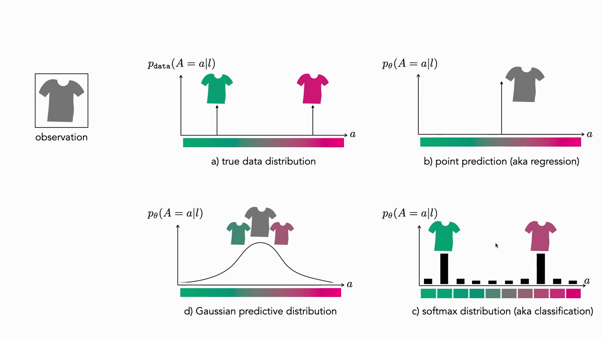
*▲ 강의 슬라이드 [10:40](https://youtu.be/zaMcHuJwe1w?t=640): 흑백 관찰에서 색 예측. (a) 진짜 분포는 봉우리 둘, (b) 점 예측([회귀](00_%EB%94%A5%EB%9F%AC%EB%8B%9D_%EC%9A%A9%EC%96%B4%EC%82%AC%EC%A0%84.md#regression-classification-%ED%9A%8C%EA%B7%80%EC%99%80-%EB%B6%84%EB%A5%98))은 평균 한 점, (d) 가우스 예측은 봉우리 하나, (c) [소프트맥스](00_%EB%94%A5%EB%9F%AC%EB%8B%9D_%EC%9A%A9%EC%96%B4%EC%82%AC%EC%A0%84.md#softmax-%EC%86%8C%ED%94%84%ED%8A%B8%EB%A7%A5%EC%8A%A4)([분류](00_%EB%94%A5%EB%9F%AC%EB%8B%9D_%EC%9A%A9%EC%96%B4%EC%82%AC%EC%A0%84.md#regression-classification-%ED%9A%8C%EA%B7%80%EC%99%80-%EB%B6%84%EB%A5%98))는 봉우리 둘을 표현한다*

### 2.2 픽셀마다 따로 분류하면

▶ 영상 [10:40](https://youtu.be/zaMcHuJwe1w?t=640)

📐 **수학 개념**: [조건부 확률과 독립](%EC%88%98%ED%95%99%EA%B0%9C%EB%85%90/04_%ED%99%95%EB%A5%A0%EA%B3%BC_%EC%A0%95%EB%B3%B4/MM58_%EC%A1%B0%EA%B1%B4%EB%B6%80_%ED%99%95%EB%A5%A0%EA%B3%BC_%EB%8F%85%EB%A6%BD.md) · [argmin과 argmax](%EC%88%98%ED%95%99%EA%B0%9C%EB%85%90/02_%EB%AF%B8%EB%B6%84/MM01_argmin%EA%B3%BC_argmax.md)

[분류](00_%EB%94%A5%EB%9F%AC%EB%8B%9D_%EC%9A%A9%EC%96%B4%EC%82%AC%EC%A0%84.md#regression-classification-%ED%9A%8C%EA%B7%80%EC%99%80-%EB%B6%84%EB%A5%98)로 바꾸면 봉우리 문제는 풀리지만, 셔츠 **전체**를 칠하려면 픽셀마다 색을 골라야 합니다. 출력이 고차원이 되는 순간 [분류](00_%EB%94%A5%EB%9F%AC%EB%8B%9D_%EC%9A%A9%EC%96%B4%EC%82%AC%EC%A0%84.md#regression-classification-%ED%9A%8C%EA%B7%80%EC%99%80-%EB%B6%84%EB%A5%98)도 실패합니다.

- 진짜 [확률](00_%EB%94%A5%EB%9F%AC%EB%8B%9D_%EC%9A%A9%EC%96%B4%EC%82%AC%EC%A0%84.md#probability-%ED%99%95%EB%A5%A0)은 어디서나 청록 0.5, 분홍 0.5지만, 모델의 추정은 픽셀마다 조금씩 흔들립니다. 그늘이 조금 진 곳은 청록 51%, 조명이 조금 밝은 곳은 분홍 51%처럼요.
- 픽셀마다 [argmax](00_%EB%94%A5%EB%9F%AC%EB%8B%9D_%EC%9A%A9%EC%96%B4%EC%82%AC%EC%A0%84.md#argmax-%EC%B5%9C%EB%8C%93%EA%B0%92-%EC%9C%84%EC%B9%98)로 고르면 0.5 경계를 넘나드는 곳마다 색이 바뀌어 셔츠 위쪽과 아래쪽 색이 달라집니다.
- 진짜 [결합 분포](00_%EB%94%A5%EB%9F%AC%EB%8B%9D_%EC%9A%A9%EC%96%B4%EC%82%AC%EC%A0%84.md#joint-distribution-%EA%B2%B0%ED%95%A9-%EB%B6%84%ED%8F%AC)는 "이 픽셀과 저 픽셀은 같은 색"이라고 말하는데, 픽셀마다 [독립](00_%EB%94%A5%EB%9F%AC%EB%8B%9D_%EC%9A%A9%EC%96%B4%EC%82%AC%EC%A0%84.md#independence-%EB%8F%85%EB%A6%BD)으로 고르면 이 **결합 의존성**을 잡지 못합니다.

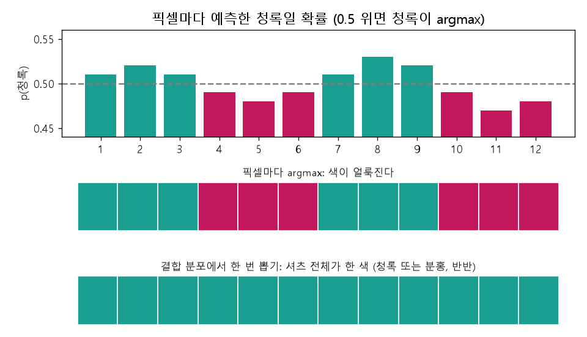
*▲ 직접 그린 그림: 픽셀 12개의 청록 [확률](00_%EB%94%A5%EB%9F%AC%EB%8B%9D_%EC%9A%A9%EC%96%B4%EC%82%AC%EC%A0%84.md#probability-%ED%99%95%EB%A5%A0)이 0.47~0.53 사이에서 흔들릴 때. 픽셀마다 [argmax](00_%EB%94%A5%EB%9F%AC%EB%8B%9D_%EC%9A%A9%EC%96%B4%EC%82%AC%EC%A0%84.md#argmax-%EC%B5%9C%EB%8C%93%EA%B0%92-%EC%9C%84%EC%B9%98)를 하면 색이 얼룩지고(가운데), [결합 분포](00_%EB%94%A5%EB%9F%AC%EB%8B%9D_%EC%9A%A9%EC%96%B4%EC%82%AC%EC%A0%84.md#joint-distribution-%EA%B2%B0%ED%95%A9-%EB%B6%84%ED%8F%AC)에서 한 번 뽑으면 셔츠 전체가 한 색이 된다(아래)*

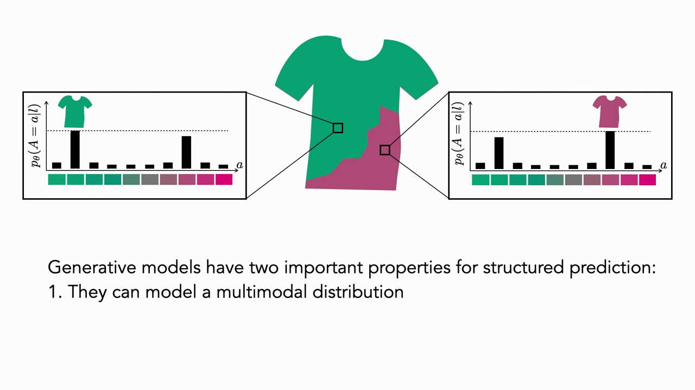
*▲ 강의 슬라이드 [13:20](https://youtu.be/zaMcHuJwe1w?t=800): 픽셀마다 따로 분류하면 두 픽셀의 분포가 거의 같아도 [argmax](00_%EB%94%A5%EB%9F%AC%EB%8B%9D_%EC%9A%A9%EC%96%B4%EC%82%AC%EC%A0%84.md#argmax-%EC%B5%9C%EB%8C%93%EA%B0%92-%EC%9C%84%EC%B9%98)가 갈려 셔츠가 두 색으로 칠해진다*

### 2.3 진짜 사진일까 색칠한 사진일까

▶ 영상 [14:29](https://youtu.be/zaMcHuJwe1w?t=869)

강사는 진짜 컬러 사진과 AI가 색칠한 흑백 사진을 보여 주고 학생들에게 맞혀 보게 합니다.

- **페인트 통 사진**: 한 통 안에서 분홍과 파랑이 번갈아 나타납니다. 위에서 본 대로 픽셀마다 [독립](00_%EB%94%A5%EB%9F%AC%EB%8B%9D_%EC%9A%A9%EC%96%B4%EC%82%AC%EC%A0%84.md#independence-%EB%8F%85%EB%A6%BD)으로 예측하다 [확률](00_%EB%94%A5%EB%9F%AC%EB%8B%9D_%EC%9A%A9%EC%96%B4%EC%82%AC%EC%A0%84.md#probability-%ED%99%95%EB%A5%A0) 경계를 넘어 다른 봉우리로 튄 것입니다. 그림자 쪽의 색 번짐은 [합성곱 신경망](00_%EB%94%A5%EB%9F%AC%EB%8B%9D_%EC%9A%A9%EC%96%B4%EC%82%AC%EC%A0%84.md#cnn-convolutional-neural-network-%ED%95%A9%EC%84%B1%EA%B3%B1-%EC%8B%A0%EA%B2%BD%EB%A7%9D)이 저해상도로 예측해서 생긴 것입니다.
- **1960년대 아폴로 계획의 마거릿 해밀턴 사진**: 색칠한 가짜였습니다. 오른쪽 아래의 워터마크라는 결정적 단서 말고도, 흰 벽과 문이 흰색과 파랑 사이로 얼룩덜룩합니다. 벽의 한쪽이 흰색이면 나머지도 흰색이어야 한다는 결합 의존성을 놓친 것입니다.
- **칙칙함**: 색이 전체적으로 바래 보입니다. 확신이 없을 때 가능한 색들을 평균 쪽으로 모으기 때문입니다. 몇 년 전 AI 생성물이 흐릿하고 채도가 낮아 보이던 것, 생성된 음악이 뭉개져 들리던 것도 모두 **참 분포를 근사할 능력이 없는 분포를 맞추면서 생긴 평균화** 때문입니다.

### 2.4 생성 모델의 두 성질

▶ 영상 [12:48](https://youtu.be/zaMcHuJwe1w?t=768)

[생성 모델](00_%EB%94%A5%EB%9F%AC%EB%8B%9D_%EC%9A%A9%EC%96%B4%EC%82%AC%EC%A0%84.md#generative-model-%EC%83%9D%EC%84%B1-%EB%AA%A8%EB%8D%B8)([VAE](00_%EB%94%A5%EB%9F%AC%EB%8B%9D_%EC%9A%A9%EC%96%B4%EC%82%AC%EC%A0%84.md#variational-autoencoder-vae-%EB%B3%80%EB%B6%84-%EC%98%A4%ED%86%A0%EC%9D%B8%EC%BD%94%EB%8D%94), [GAN](00_%EB%94%A5%EB%9F%AC%EB%8B%9D_%EC%9A%A9%EC%96%B4%EC%82%AC%EC%A0%84.md#gan-generative-adversarial-network-%EC%83%9D%EC%84%B1%EC%A0%81-%EC%A0%81%EB%8C%80-%EC%8B%A0%EA%B2%BD%EB%A7%9D), [확산 모델](00_%EB%94%A5%EB%9F%AC%EB%8B%9D_%EC%9A%A9%EC%96%B4%EC%82%AC%EC%A0%84.md#diffusion-model-%ED%99%95%EC%82%B0-%EB%AA%A8%EB%8D%B8))은 다음 두 성질을 함께 가집니다. 강사는 이것이 사실상 "[생성 모델](00_%EB%94%A5%EB%9F%AC%EB%8B%9D_%EC%9A%A9%EC%96%B4%EC%82%AC%EC%A0%84.md#generative-model-%EC%83%9D%EC%84%B1-%EB%AA%A8%EB%8D%B8)"의 정의라고 말합니다.

1. **[다봉 분포](00_%EB%94%A5%EB%9F%AC%EB%8B%9D_%EC%9A%A9%EC%96%B4%EC%82%AC%EC%A0%84.md#multimodal-distribution-%EB%8B%A4%EB%B4%89-%EB%B6%84%ED%8F%AC)를 표현한다**: 가우스 하나가 아니라 복잡한 [사후 분포](00_%EB%94%A5%EB%9F%AC%EB%8B%9D_%EC%9A%A9%EC%96%B4%EC%82%AC%EC%A0%84.md#prior-posterior-%EC%82%AC%EC%A0%84-%EB%B6%84%ED%8F%AC%EC%99%80-%EC%82%AC%ED%9B%84-%EB%B6%84%ED%8F%AC)를 담습니다.
2. **결합 의존성을 표현한다**: 고차원 출력의 차원들 사이의 의존 관계를 담습니다.

이론으로는 수십 년 동안 생각해 온 것이지만, 두 가지를 실제로 다 해내는 모델이 나온 것은 최근 몇 년의 일입니다.

---

## 3. 구조를 보는 목적 함수

▶ 영상 [18:20](https://youtu.be/zaMcHuJwe1w?t=1100)

### 3.1 2012년의 딥러닝: 가설 공간

▶ 영상 [18:20](https://youtu.be/zaMcHuJwe1w?t=1100)

머신러닝은 늘 **목적 함수**, **[가설 공간](00_%EB%94%A5%EB%9F%AC%EB%8B%9D_%EC%9A%A9%EC%96%B4%EC%82%AC%EC%A0%84.md#hypothesis-space-%EA%B0%80%EC%84%A4-%EA%B3%B5%EA%B0%84)**, 그 공간을 찾는 **최적화**로 이루어집니다. 2012년 무렵 딥러닝의 이야기는 "[용량](00_%EB%94%A5%EB%9F%AC%EB%8B%9D_%EC%9A%A9%EC%96%B4%EC%82%AC%EC%A0%84.md#capacity-%EC%9A%A9%EB%9F%89)이 큰 새 [가설 공간](00_%EB%94%A5%EB%9F%AC%EB%8B%9D_%EC%9A%A9%EC%96%B4%EC%82%AC%EC%A0%84.md#hypothesis-space-%EA%B0%80%EC%84%A4-%EA%B3%B5%EA%B0%84)"이었습니다. 앤드루 응의 유명한 슬라이드는 선형 SVM 같은 예전 방법은 데이터가 늘어도 비선형 구조를 담지 못해 성능이 멈추고, 딥러닝은 계속 오른다는 그림이었습니다.

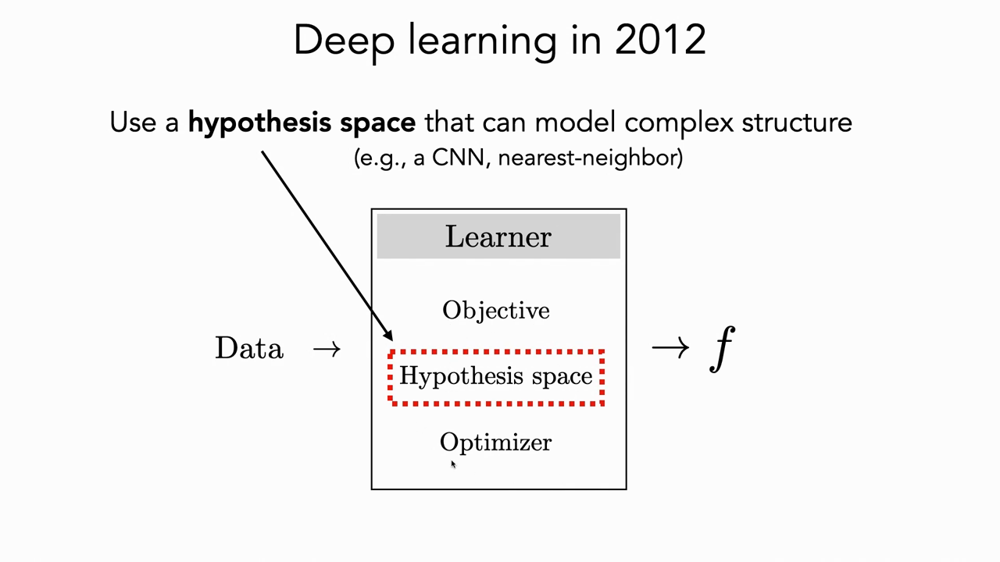
*▲ 강의 슬라이드 [18:50](https://youtu.be/zaMcHuJwe1w?t=1130): 2012년의 딥러닝. 복잡한 구조를 담을 수 있는 [가설 공간](00_%EB%94%A5%EB%9F%AC%EB%8B%9D_%EC%9A%A9%EC%96%B4%EC%82%AC%EC%A0%84.md#hypothesis-space-%EA%B0%80%EC%84%A4-%EA%B3%B5%EA%B0%84)([CNN](00_%EB%94%A5%EB%9F%AC%EB%8B%9D_%EC%9A%A9%EC%96%B4%EC%82%AC%EC%A0%84.md#cnn-convolutional-neural-network-%ED%95%A9%EC%84%B1%EA%B3%B1-%EC%8B%A0%EA%B2%BD%EB%A7%9D) 등)을 쓴다*

강사는 반대로 **목적 함수**에 대해 말하고 싶어 합니다. 픽셀마다 범주를 붙이는 [의미 분할](00_%EB%94%A5%EB%9F%AC%EB%8B%9D_%EC%9A%A9%EC%96%B4%EC%82%AC%EC%A0%84.md#semantic-segmentation-%EC%9D%98%EB%AF%B8-%EB%B6%84%ED%95%A0)도, 지도 그림에서 위성 사진을 예측하는 Sat2Map 문제도 그때는 픽셀별 [손실](00_%EB%94%A5%EB%9F%AC%EB%8B%9D_%EC%9A%A9%EC%96%B4%EC%82%AC%EC%A0%84.md#loss-function-%EC%86%90%EC%8B%A4-%ED%95%A8%EC%88%98)([교차 엔트로피](00_%EB%94%A5%EB%9F%AC%EB%8B%9D_%EC%9A%A9%EC%96%B4%EC%82%AC%EC%A0%84.md#cross-entropy-%EA%B5%90%EC%B0%A8-%EC%97%94%ED%8A%B8%EB%A1%9C%ED%94%BC)나 제곱 [오차](00_%EB%94%A5%EB%9F%AC%EB%8B%9D_%EC%9A%A9%EC%96%B4%EC%82%AC%EC%A0%84.md#error-%EC%98%A4%EC%B0%A8))의 합을 최소화했습니다.

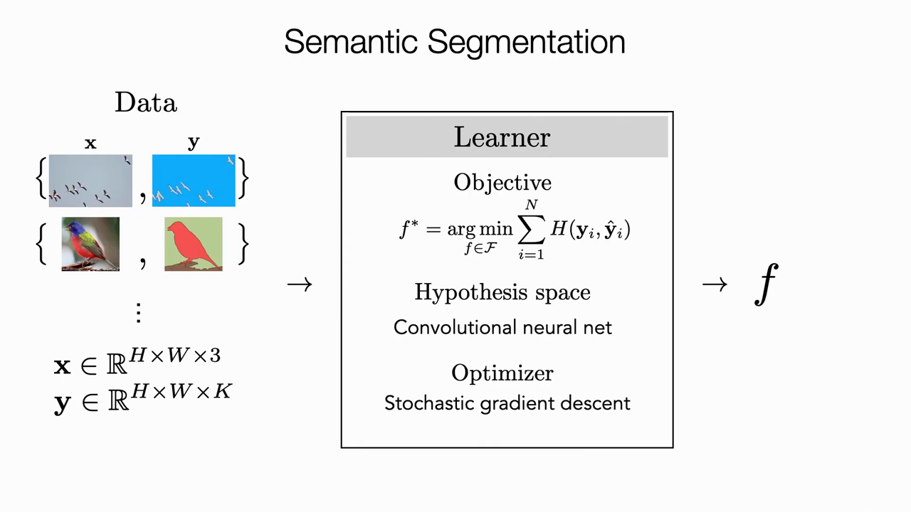
*▲ 강의 슬라이드 [20:00](https://youtu.be/zaMcHuJwe1w?t=1200): [의미 분할](00_%EB%94%A5%EB%9F%AC%EB%8B%9D_%EC%9A%A9%EC%96%B4%EC%82%AC%EC%A0%84.md#semantic-segmentation-%EC%9D%98%EB%AF%B8-%EB%B6%84%ED%95%A0)을 학습기의 세 요소로 쓴 것. 목적은 픽셀별 [손실](00_%EB%94%A5%EB%9F%AC%EB%8B%9D_%EC%9A%A9%EC%96%B4%EC%82%AC%EC%A0%84.md#loss-function-%EC%86%90%EC%8B%A4-%ED%95%A8%EC%88%98) $H$의 합, [가설 공간](00_%EB%94%A5%EB%9F%AC%EB%8B%9D_%EC%9A%A9%EC%96%B4%EC%82%AC%EC%A0%84.md#hypothesis-space-%EA%B0%80%EC%84%A4-%EA%B3%B5%EA%B0%84)은 [합성곱 신경망](00_%EB%94%A5%EB%9F%AC%EB%8B%9D_%EC%9A%A9%EC%96%B4%EC%82%AC%EC%A0%84.md#cnn-convolutional-neural-network-%ED%95%A9%EC%84%B1%EA%B3%B1-%EC%8B%A0%EA%B2%BD%EB%A7%9D), 최적화는 SGD*

### 3.2 제곱 오차는 픽셀이 독립이라고 가정한다

▶ 영상 [20:40](https://youtu.be/zaMcHuJwe1w?t=1240)

📐 **수학 개념**: [조건부 확률과 독립](%EC%88%98%ED%95%99%EA%B0%9C%EB%85%90/04_%ED%99%95%EB%A5%A0%EA%B3%BC_%EC%A0%95%EB%B3%B4/MM58_%EC%A1%B0%EA%B1%B4%EB%B6%80_%ED%99%95%EB%A5%A0%EA%B3%BC_%EB%8F%85%EB%A6%BD.md) · [확률 밀도와 정규분포](%EC%88%98%ED%95%99%EA%B0%9C%EB%85%90/04_%ED%99%95%EB%A5%A0%EA%B3%BC_%EC%A0%95%EB%B3%B4/MM50_%ED%99%95%EB%A5%A0_%EB%B0%80%EB%8F%84%EC%99%80_%EC%A0%95%EA%B7%9C%EB%B6%84%ED%8F%AC.md) · [KL 발산과 최대 우도](%EC%88%98%ED%95%99%EA%B0%9C%EB%85%90/04_%ED%99%95%EB%A5%A0%EA%B3%BC_%EC%A0%95%EB%B3%B4/MM51_KL_%EB%B0%9C%EC%82%B0%EA%B3%BC_%EC%B5%9C%EB%8C%80_%EC%9A%B0%EB%8F%84.md)

Sat2Map에서 출력 이미지를 큰 벡터로 펴서 정답과의 제곱 [오차](00_%EB%94%A5%EB%9F%AC%EB%8B%9D_%EC%9A%A9%EC%96%B4%EC%82%AC%EC%A0%84.md#error-%EC%98%A4%EC%B0%A8)를 재는 것은 고차원 출력의 최소제곱 [회귀](00_%EB%94%A5%EB%9F%AC%EB%8B%9D_%EC%9A%A9%EC%96%B4%EC%82%AC%EC%A0%84.md#regression-classification-%ED%9A%8C%EA%B7%80%EC%99%80-%EB%B6%84%EB%A5%98)입니다. 제곱 [오차](00_%EB%94%A5%EB%9F%AC%EB%8B%9D_%EC%9A%A9%EC%96%B4%EC%82%AC%EC%A0%84.md#error-%EC%98%A4%EC%B0%A8)는 가우스 [확률](00_%EB%94%A5%EB%9F%AC%EB%8B%9D_%EC%9A%A9%EC%96%B4%EC%82%AC%EC%A0%84.md#probability-%ED%99%95%EB%A5%A0) 모델의 음의 [로그](00_%EB%94%A5%EB%9F%AC%EB%8B%9D_%EC%9A%A9%EC%96%B4%EC%82%AC%EC%A0%84.md#log-ln-%EB%A1%9C%EA%B7%B8) [확률](00_%EB%94%A5%EB%9F%AC%EB%8B%9D_%EC%9A%A9%EC%96%B4%EC%82%AC%EC%A0%84.md#probability-%ED%99%95%EB%A5%A0)과 같고, [로그](00_%EB%94%A5%EB%9F%AC%EB%8B%9D_%EC%9A%A9%EC%96%B4%EC%82%AC%EC%A0%84.md#log-ln-%EB%A1%9C%EA%B7%B8)의 합은 [확률](00_%EB%94%A5%EB%9F%AC%EB%8B%9D_%EC%9A%A9%EC%96%B4%EC%82%AC%EC%A0%84.md#probability-%ED%99%95%EB%A5%A0)의 곱입니다. 그러니 **픽셀마다 독립인 가우스**를 가정한 셈입니다.

2012년 최고의 [합성곱 신경망](00_%EB%94%A5%EB%9F%AC%EB%8B%9D_%EC%9A%A9%EC%96%B4%EC%82%AC%EC%A0%84.md#cnn-convolutional-neural-network-%ED%95%A9%EC%84%B1%EA%B3%B1-%EC%8B%A0%EA%B2%BD%EB%A7%9D)을 SGD로 학습시키면 결과는 그럴듯하지만 **흐릿합니다**. 공원에 나무가 있다는 것은 알아도 참나무인지 소나무인지, 정확히 어디에 있는지는 모릅니다. 가능한 모든 나무 배치를 평균 내면 공원 전체가 고른 초록색이 됩니다. 2012~2016년의 딥러닝이 그랬고, 2016~2024년은 **목적 함수를 바꾸는 것**, 곧 생성 AI의 시대였다고 강사는 정리합니다. 픽셀 사이의 결합 구조와 다봉 [사후 분포](00_%EB%94%A5%EB%9F%AC%EB%8B%9D_%EC%9A%A9%EC%96%B4%EC%82%AC%EC%A0%84.md#prior-posterior-%EC%82%AC%EC%A0%84-%EB%B6%84%ED%8F%AC%EC%99%80-%EC%82%AC%ED%9B%84-%EB%B6%84%ED%8F%AC)에서 벗어난 오류를 벌할 수 있는 목적 함수가 필요합니다.

$$
-\log \prod_{i=1}^{n} \mathcal{N}(y_i;\ \hat{y}_i, 1) = \frac{1}{2}\sum_{i=1}^{n} (y_i - \hat{y}_i)^2 + \frac{n}{2}\ln(2\pi)
$$

기호 풀이

| 기호 | 읽는 법 | 뜻 | 예제 값 |
| --- | --- | --- | --- |
| $y_i$ | 와이 아이 | [정답](00_%EB%94%A5%EB%9F%AC%EB%8B%9D_%EC%9A%A9%EC%96%B4%EC%82%AC%EC%A0%84.md#label-%EC%A0%95%EB%8B%B5) 이미지의 $i$번째 픽셀 | 0.6, 0.2 |
| $\hat{y}_i$ | 와이 햇 아이 | 신경망이 예측한 $i$번째 픽셀 | 0.5, 0.5 |
| $n$ | 엔 | 픽셀 수 | 2 |
| $\mathcal{N}(y_i;\ \hat{y}_i, 1)$ | [정규분포](00_%EB%94%A5%EB%9F%AC%EB%8B%9D_%EC%9A%A9%EC%96%B4%EC%82%AC%EC%A0%84.md#normal-distribution-%EC%A0%95%EA%B7%9C%EB%B6%84%ED%8F%AC) | 평균 $\hat{y}_i$, [분산](00_%EB%94%A5%EB%9F%AC%EB%8B%9D_%EC%9A%A9%EC%96%B4%EC%82%AC%EC%A0%84.md#variance-%EB%B6%84%EC%82%B0) 1인 [정규분포](00_%EB%94%A5%EB%9F%AC%EB%8B%9D_%EC%9A%A9%EC%96%B4%EC%82%AC%EC%A0%84.md#normal-distribution-%EC%A0%95%EA%B7%9C%EB%B6%84%ED%8F%AC)에서 $y_i$의 밀도 | 0.397, 0.3814 |
| $\prod_{i}$ | 파이 | 픽셀별 [확률](00_%EB%94%A5%EB%9F%AC%EB%8B%9D_%EC%9A%A9%EC%96%B4%EC%82%AC%EC%A0%84.md#probability-%ED%99%95%EB%A5%A0)의 곱 = [독립](00_%EB%94%A5%EB%9F%AC%EB%8B%9D_%EC%9A%A9%EC%96%B4%EC%82%AC%EC%A0%84.md#independence-%EB%8F%85%EB%A6%BD) 가정 | |
| $\ln(2\pi)$ | 엘엔 이 파이 | 예측과 상관없는 상수 | 1.8379 |

예제와 풀이

**문제**: 픽셀 2개짜리 이미지에서 [정답](00_%EB%94%A5%EB%9F%AC%EB%8B%9D_%EC%9A%A9%EC%96%B4%EC%82%AC%EC%A0%84.md#label-%EC%A0%95%EB%8B%B5)이 $(0.6, 0.2)$, 예측이 $(0.5, 0.5)$다. 픽셀마다 독립인 [분산](00_%EB%94%A5%EB%9F%AC%EB%8B%9D_%EC%9A%A9%EC%96%B4%EC%82%AC%EC%A0%84.md#variance-%EB%B6%84%EC%82%B0) 1의 [정규분포](00_%EB%94%A5%EB%9F%AC%EB%8B%9D_%EC%9A%A9%EC%96%B4%EC%82%AC%EC%A0%84.md#normal-distribution-%EC%A0%95%EA%B7%9C%EB%B6%84%ED%8F%AC)를 가정한 음의 [로그](00_%EB%94%A5%EB%9F%AC%EB%8B%9D_%EC%9A%A9%EC%96%B4%EC%82%AC%EC%A0%84.md#log-ln-%EB%A1%9C%EA%B7%B8) [확률](00_%EB%94%A5%EB%9F%AC%EB%8B%9D_%EC%9A%A9%EC%96%B4%EC%82%AC%EC%A0%84.md#probability-%ED%99%95%EB%A5%A0)은 얼마이고, 그중 제곱 [오차](00_%EB%94%A5%EB%9F%AC%EB%8B%9D_%EC%9A%A9%EC%96%B4%EC%82%AC%EC%A0%84.md#error-%EC%98%A4%EC%B0%A8)에서 온 부분은 얼마인가?

**주어진 값**
- $y_1 = 0.6$, $y_2 = 0.2$ ([정답](00_%EB%94%A5%EB%9F%AC%EB%8B%9D_%EC%9A%A9%EC%96%B4%EC%82%AC%EC%A0%84.md#label-%EC%A0%95%EB%8B%B5) 픽셀 값)
- $\hat{y}_1 = 0.5$, $\hat{y}_2 = 0.5$ (예측 픽셀 값)
- $n = 2$ (픽셀 수)

**풀이**
1. 식을 그대로 쓴다: $-\log \prod_{i=1}^{n} \mathcal{N}(y_i;\ \hat{y}_i, 1) = \frac{1}{2}\sum_{i=1}^{n}(y_i - \hat{y}_i)^2 + \frac{n}{2}\ln(2\pi)$
2. 값을 대입한다: $\frac{1}{2}\big((0.6 - 0.5)^2 + (0.2 - 0.5)^2\big) + \frac{2}{2}\ln(2\pi)$
3. 괄호 안 뺄셈을 한다: $0.6 - 0.5 = 0.1$, $0.2 - 0.5 = -0.3$
4. 제곱한다: $0.1^2 = 0.01$, $(-0.3)^2 = 0.09$
5. Σ를 풀어 더한다: $0.01 + 0.09 = 0.1$
6. $\frac{1}{2}$을 곱한다: $0.1 \times 0.5 = 0.05$ (제곱 [오차](00_%EB%94%A5%EB%9F%AC%EB%8B%9D_%EC%9A%A9%EC%96%B4%EC%82%AC%EC%A0%84.md#error-%EC%98%A4%EC%B0%A8)에서 온 부분)
7. 상수항을 계산한다. $\ln$은 약 2.718인 수 $e$를 몇 제곱해야 그 값이 되는지이고, $2\pi = 6.2832$이므로: $\frac{2}{2}\ln(6.2832) = 1 \times 1.8379 = 1.8379$
8. 두 부분을 더한다: $0.05 + 1.8379 = 1.8879$

**답**: 음의 [로그](00_%EB%94%A5%EB%9F%AC%EB%8B%9D_%EC%9A%A9%EC%96%B4%EC%82%AC%EC%A0%84.md#log-ln-%EB%A1%9C%EA%B7%B8) [확률](00_%EB%94%A5%EB%9F%AC%EB%8B%9D_%EC%9A%A9%EC%96%B4%EC%82%AC%EC%A0%84.md#probability-%ED%99%95%EB%A5%A0) **1.8879**, 그중 제곱 [오차](00_%EB%94%A5%EB%9F%AC%EB%8B%9D_%EC%9A%A9%EC%96%B4%EC%82%AC%EC%A0%84.md#error-%EC%98%A4%EC%B0%A8) 부분 **0.05**. 상수 1.8379는 예측과 무관하므로, 이 [확률](00_%EB%94%A5%EB%9F%AC%EB%8B%9D_%EC%9A%A9%EC%96%B4%EC%82%AC%EC%A0%84.md#probability-%ED%99%95%EB%A5%A0)을 최대화하는 것은 제곱 [오차](00_%EB%94%A5%EB%9F%AC%EB%8B%9D_%EC%9A%A9%EC%96%B4%EC%82%AC%EC%A0%84.md#error-%EC%98%A4%EC%B0%A8)를 최소화하는 것과 같다.

내 이해

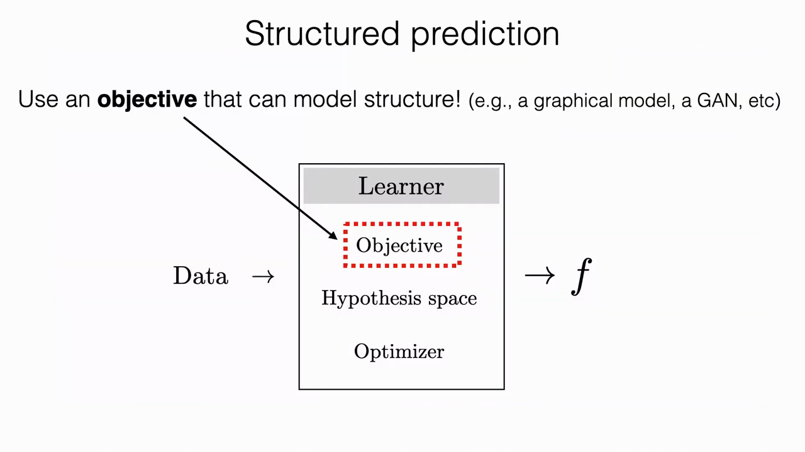
*▲ 강의 슬라이드 [22:32](https://youtu.be/zaMcHuJwe1w?t=1352): [구조적 예측](00_%EB%94%A5%EB%9F%AC%EB%8B%9D_%EC%9A%A9%EC%96%B4%EC%82%AC%EC%A0%84.md#structured-prediction-%EA%B5%AC%EC%A1%B0%EC%A0%81-%EC%98%88%EC%B8%A1). 구조를 담을 수 있는 **목적 함수**(그래프 모형, [GAN](00_%EB%94%A5%EB%9F%AC%EB%8B%9D_%EC%9A%A9%EC%96%B4%EC%82%AC%EC%A0%84.md#gan-generative-adversarial-network-%EC%83%9D%EC%84%B1%EC%A0%81-%EC%A0%81%EB%8C%80-%EC%8B%A0%EA%B2%BD%EB%A7%9D) 등)를 쓴다*

---

## 4. 조건부 GAN

▶ 영상 [23:02](https://youtu.be/zaMcHuJwe1w?t=1382)

### 4.1 생성자와 판별자의 게임

▶ 영상 [23:35](https://youtu.be/zaMcHuJwe1w?t=1415)

📐 **수학 개념**: [조건부 GAN 목적 함수](%EC%88%98%ED%95%99%EA%B0%9C%EB%85%90/11_%EC%83%9D%EC%84%B1_%EB%AA%A8%EB%8D%B8/MM59_%EC%A1%B0%EA%B1%B4%EB%B6%80_GAN_%EB%AA%A9%EC%A0%81_%ED%95%A8%EC%88%98.md) · [로그](%EC%88%98%ED%95%99%EA%B0%9C%EB%85%90/01_%EC%88%98%EC%99%80_%ED%95%A8%EC%88%98/M07_%EB%A1%9C%EA%B7%B8.md)

이미지 → 이미지 문제로 바꿉니다. 입력은 건축 도면(색마다 문, 창문 같은 요소)이고, 출력은 그 건물의 사진입니다. 건축가가 새 건물을 설계할 때 쓸 수 있는 도구입니다. 신경망은 [합성곱 신경망](00_%EB%94%A5%EB%9F%AC%EB%8B%9D_%EC%9A%A9%EC%96%B4%EC%82%AC%EC%A0%84.md#cnn-convolutional-neural-network-%ED%95%A9%EC%84%B1%EA%B3%B1-%EC%8B%A0%EA%B2%BD%EB%A7%9D)이든 요즘의 ViT든 상관없습니다.

[GAN](00_%EB%94%A5%EB%9F%AC%EB%8B%9D_%EC%9A%A9%EC%96%B4%EC%82%AC%EC%A0%84.md#gan-generative-adversarial-network-%EC%83%9D%EC%84%B1%EC%A0%81-%EC%A0%81%EB%8C%80-%EC%8B%A0%EA%B2%BD%EB%A7%9D) 강의에서는 가우스 [잠재 변수](00_%EB%94%A5%EB%9F%AC%EB%8B%9D_%EC%9A%A9%EC%96%B4%EC%82%AC%EC%A0%84.md#latent-variable-%EC%9E%A0%EC%9E%AC-%EB%B3%80%EC%88%98) $z$를 생성자에 넣어 판별자가 진짜와 구별할 수 없는 이미지를 만들었습니다. 여기서는 **잡음 대신 조건 변수 $\mathbf{x}$**를 넣습니다. $z \to \mathbf{x}$ 대신 $\mathbf{x} \to \mathbf{y}$ 매핑이지만 수학은 같습니다.

- **판별자 $d$**: [이진 분류](00_%EB%94%A5%EB%9F%AC%EB%8B%9D_%EC%9A%A9%EC%96%B4%EC%82%AC%EC%A0%84.md#binary-classification-%EC%9D%B4%EC%A7%84-%EB%B6%84%EB%A5%98)기이고 [교차 엔트로피](00_%EB%94%A5%EB%9F%AC%EB%8B%9D_%EC%9A%A9%EC%96%B4%EC%82%AC%EC%A0%84.md#cross-entropy-%EA%B5%90%EC%B0%A8-%EC%97%94%ED%8A%B8%EB%A1%9C%ED%94%BC)로 학습합니다. 강의 슬라이드에서는 "합성(가짜)일 [확률](00_%EB%94%A5%EB%9F%AC%EB%8B%9D_%EC%9A%A9%EC%96%B4%EC%82%AC%EC%A0%84.md#probability-%ED%99%95%EB%A5%A0)"을 내도록 둡니다. 생성자가 만든 데이터에는 높은 [로그](00_%EB%94%A5%EB%9F%AC%EB%8B%9D_%EC%9A%A9%EC%96%B4%EC%82%AC%EC%A0%84.md#log-ln-%EB%A1%9C%EA%B7%B8) [확률](00_%EB%94%A5%EB%9F%AC%EB%8B%9D_%EC%9A%A9%EC%96%B4%EC%82%AC%EC%A0%84.md#probability-%ED%99%95%EB%A5%A0)을, 진짜 데이터 $\mathbf{y}$에는 낮은 [확률](00_%EB%94%A5%EB%9F%AC%EB%8B%9D_%EC%9A%A9%EC%96%B4%EC%82%AC%EC%A0%84.md#probability-%ED%99%95%EB%A5%A0)(즉 $1 - d$의 [로그](00_%EB%94%A5%EB%9F%AC%EB%8B%9D_%EC%9A%A9%EC%96%B4%EC%82%AC%EC%A0%84.md#log-ln-%EB%A1%9C%EA%B7%B8)를 높게)을 주려 합니다.
- **생성자 $g$**: 같은 값을 **최소화**합니다. "내 [합성 데이터](00_%EB%94%A5%EB%9F%AC%EB%8B%9D_%EC%9A%A9%EC%96%B4%EC%82%AC%EC%A0%84.md#synthetic-data-%ED%95%A9%EC%84%B1-%EB%8D%B0%EC%9D%B4%ED%84%B0)가 판별자를 틀리게 하라"는 것입니다. 판별자를 거쳐 생성자의 [파라미터](00_%EB%94%A5%EB%9F%AC%EB%8B%9D_%EC%9A%A9%EC%96%B4%EC%82%AC%EC%A0%84.md#parameter-%ED%8C%8C%EB%9D%BC%EB%AF%B8%ED%84%B0)까지 [역전파](00_%EB%94%A5%EB%9F%AC%EB%8B%9D_%EC%9A%A9%EC%96%B4%EC%82%AC%EC%A0%84.md#backpropagation-%EC%97%AD%EC%A0%84%ED%8C%8C)해 더 진짜 같은 사진을 만들게 합니다.
- 아무 판별자가 아니라 **가장 좋은 판별자**를 속여야 합니다. 판별자는 점점 가짜를 잘 잡고 생성자는 점점 잘 속입니다. 내시 균형에 도달하고 [용량](00_%EB%94%A5%EB%9F%AC%EB%8B%9D_%EC%9A%A9%EC%96%B4%EC%82%AC%EC%A0%84.md#capacity-%EC%9A%A9%EB%9F%89)이 충분하다면 $g$의 표본은 진짜 데이터와 같은 분포를 따른다는 것이 증명되어 있습니다.

$$
\arg\min_\theta \max_\phi\ \mathbb{E}_{\mathbf{x}, \mathbf{y}}\big[\log d_\phi(g_\theta(\mathbf{x})) + \log(1 - d_\phi(\mathbf{y}))\big]
$$

기호 풀이

| 기호 | 읽는 법 | 뜻 | 예제 값 |
| --- | --- | --- | --- |
| $g_\theta$ | 지 세타 | 생성자 (도면 → 사진) | |
| $d_\phi$ | 디 파이 | 판별자, 이미지가 "가짜"일 [확률](00_%EB%94%A5%EB%9F%AC%EB%8B%9D_%EC%9A%A9%EC%96%B4%EC%82%AC%EC%A0%84.md#probability-%ED%99%95%EB%A5%A0)을 냄 | |
| $d_\phi(g_\theta(\mathbf{x}))$ | | 생성한 사진에 준 가짜 [확률](00_%EB%94%A5%EB%9F%AC%EB%8B%9D_%EC%9A%A9%EC%96%B4%EC%82%AC%EC%A0%84.md#probability-%ED%99%95%EB%A5%A0) | 0.9 |
| $d_\phi(\mathbf{y})$ | | 진짜 사진에 준 가짜 [확률](00_%EB%94%A5%EB%9F%AC%EB%8B%9D_%EC%9A%A9%EC%96%B4%EC%82%AC%EC%A0%84.md#probability-%ED%99%95%EB%A5%A0) | 0.2 |
| $\mathbb{E}_{\mathbf{x}, \mathbf{y}}$ | [기댓값](00_%EB%94%A5%EB%9F%AC%EB%8B%9D_%EC%9A%A9%EC%96%B4%EC%82%AC%EC%A0%84.md#expectation-%EA%B8%B0%EB%8C%93%EA%B0%92) | [학습](00_%EB%94%A5%EB%9F%AC%EB%8B%9D_%EC%9A%A9%EC%96%B4%EC%82%AC%EC%A0%84.md#training-%ED%95%99%EC%8A%B5) 쌍에 대한 평균 | |
| $\max_\phi$ / $\min_\theta$ | 맥스 / 민 | 판별자는 키우고, 생성자는 줄인다 | |

예제와 풀이

**문제**: [학습](00_%EB%94%A5%EB%9F%AC%EB%8B%9D_%EC%9A%A9%EC%96%B4%EC%82%AC%EC%A0%84.md#training-%ED%95%99%EC%8A%B5) 초반, 판별자가 생성한 사진에 가짜 [확률](00_%EB%94%A5%EB%9F%AC%EB%8B%9D_%EC%9A%A9%EC%96%B4%EC%82%AC%EC%A0%84.md#probability-%ED%99%95%EB%A5%A0) 0.9를, 진짜 사진에 0.2를 주었다. 이 한 쌍에 대한 대괄호 안의 값은? 판별자와 생성자는 각각 이 값을 어느 쪽으로 움직이고 싶어 하나?

**주어진 값**
- $d_\phi(g_\theta(\mathbf{x})) = 0.9$ (생성한 사진을 가짜라고 볼 [확률](00_%EB%94%A5%EB%9F%AC%EB%8B%9D_%EC%9A%A9%EC%96%B4%EC%82%AC%EC%A0%84.md#probability-%ED%99%95%EB%A5%A0))
- $d_\phi(\mathbf{y}) = 0.2$ (진짜 사진을 가짜라고 볼 [확률](00_%EB%94%A5%EB%9F%AC%EB%8B%9D_%EC%9A%A9%EC%96%B4%EC%82%AC%EC%A0%84.md#probability-%ED%99%95%EB%A5%A0))

**풀이**
1. 식을 그대로 쓴다: $\log d_\phi(g_\theta(\mathbf{x})) + \log(1 - d_\phi(\mathbf{y}))$ (쌍이 하나라 평균은 그 값 자체)
2. 값을 대입한다: $\log 0.9 + \log(1 - 0.2)$
3. 괄호 안 뺄셈을 한다: $1 - 0.2 = 0.8$ 이므로 $\log 0.9 + \log 0.8$
4. [로그](00_%EB%94%A5%EB%9F%AC%EB%8B%9D_%EC%9A%A9%EC%96%B4%EC%82%AC%EC%A0%84.md#log-ln-%EB%A1%9C%EA%B7%B8)를 계산한다. $\ln y$는 약 2.718인 수 $e$를 몇 제곱해야 $y$가 되는지이고, 1보다 작은 수는 음수가 된다: $\ln 0.9 = -0.1054$, $\ln 0.8 = -0.2231$
5. 더한다: $-0.1054 + (-0.2231) = -0.3285$

**답**: **-0.3285**. 최댓값 0에 가까우므로 판별자가 잘 가려내는 상태다. 판별자는 이 값을 0 쪽으로 더 올리려 하고, 생성자는 첫 항($\ln 0.9$)을 낮춰 전체를 끌어내리려 한다.

내 이해

강사가 강조하는 관점은 이것입니다. **생성자 입장에서 판별자는 [손실 함수](00_%EB%94%A5%EB%9F%AC%EB%8B%9D_%EC%9A%A9%EC%96%B4%EC%82%AC%EC%A0%84.md#loss-function-%EC%86%90%EC%8B%A4-%ED%95%A8%EC%88%98)**입니다. 출력을 보고 얼마나 좋은지 나쁜지 점수를 매기고, 그 점수로 역전파해 생성자를 고칩니다. 제곱 [오차](00_%EB%94%A5%EB%9F%AC%EB%8B%9D_%EC%9A%A9%EC%96%B4%EC%82%AC%EC%A0%84.md#error-%EC%98%A4%EC%B0%A8)와 같은 역할이지만 **사람이 정한 것이 아니라 학습된 [손실](00_%EB%94%A5%EB%9F%AC%EB%8B%9D_%EC%9A%A9%EC%96%B4%EC%82%AC%EC%A0%84.md#loss-function-%EC%86%90%EC%8B%A4-%ED%95%A8%EC%88%98)**입니다. 그래서 픽셀 하나하나가 맞았는지만이 아니라 경계가 맞는지, 고차 통계가 맞는지까지 볼 수 있습니다. 이런 [손실](00_%EB%94%A5%EB%9F%AC%EB%8B%9D_%EC%9A%A9%EC%96%B4%EC%82%AC%EC%A0%84.md#loss-function-%EC%86%90%EC%8B%A4-%ED%95%A8%EC%88%98)을 손으로 정의하기는 매우 어렵지만 게임으로는 배울 수 있습니다.

### 4.2 판별자가 입력과 출력을 함께 본다

▶ 영상 [28:38](https://youtu.be/zaMcHuJwe1w?t=1718)

📐 **수학 개념**: [조건부 GAN 목적 함수](%EC%88%98%ED%95%99%EA%B0%9C%EB%85%90/11_%EC%83%9D%EC%84%B1_%EB%AA%A8%EB%8D%B8/MM59_%EC%A1%B0%EA%B1%B4%EB%B6%80_GAN_%EB%AA%A9%EC%A0%81_%ED%95%A8%EC%88%98.md) · [조건부 확률](%EC%88%98%ED%95%99%EA%B0%9C%EB%85%90/04_%ED%99%95%EB%A5%A0%EA%B3%BC_%EC%A0%95%EB%B3%B4/MM58_%EC%A1%B0%EA%B1%B4%EB%B6%80_%ED%99%95%EB%A5%A0%EA%B3%BC_%EB%8F%85%EB%A6%BD.md)

위 식을 조건부 문제에 그대로 쓰면 문제가 있습니다. 생성자가 진짜 건물 사진을 하나 내놓았는데 그것이 **입력 도면과 맞지 않는** 사진이라면, 판별자는 "진짜 사진"이라고 통과시킵니다. 해결은 간단합니다. 판별자가 출력만이 아니라 **입력과 출력의 쌍** $(\mathbf{x}, \mathbf{y})$을 보고, 그것이 데이터 분포 $p_{\text{data}}(\mathbf{x}, \mathbf{y})$에서 나온 진짜 쌍인지 묻게 합니다. 그러면 흐릿함이나 비현실적인 모습뿐 아니라 "건축가가 그린 곳과 다른 곳에 창문이 있다"도 벌할 수 있습니다. 이것이 [조건부 GAN](00_%EB%94%A5%EB%9F%AC%EB%8B%9D_%EC%9A%A9%EC%96%B4%EC%82%AC%EC%A0%84.md#conditional-gan-%EC%A1%B0%EA%B1%B4%EB%B6%80-gan)(cGAN)입니다.

[계산 그래프](00_%EB%94%A5%EB%9F%AC%EB%8B%9D_%EC%9A%A9%EC%96%B4%EC%82%AC%EC%A0%84.md#computational-graph-%EA%B3%84%EC%82%B0-%EA%B7%B8%EB%9E%98%ED%94%84)는 $d(\mathbf{x}, g(\mathbf{x}))$입니다. 입력을 생성자에 넣어 예측을 만들고, 그 예측(과 입력)을 판별자에 넣어 점수를 매긴 뒤 전체를 역전파합니다.

$$
\arg\min_\theta \max_\phi\ \mathbb{E}_{\mathbf{x}, \mathbf{y}}\big[\log d_\phi(\mathbf{x}, g_\theta(\mathbf{x})) + \log(1 - d_\phi(\mathbf{x}, \mathbf{y}))\big]
$$

기호 풀이

| 기호 | 읽는 법 | 뜻 | 예제 값 |
| --- | --- | --- | --- |
| $d_\phi(\mathbf{x}, g_\theta(\mathbf{x}))$ | | (입력, 생성 출력) 쌍에 준 가짜 [확률](00_%EB%94%A5%EB%9F%AC%EB%8B%9D_%EC%9A%A9%EC%96%B4%EC%82%AC%EC%A0%84.md#probability-%ED%99%95%EB%A5%A0) | 0.7 |
| $d_\phi(\mathbf{x}, \mathbf{y})$ | | (입력, 진짜 출력) 쌍에 준 가짜 [확률](00_%EB%94%A5%EB%9F%AC%EB%8B%9D_%EC%9A%A9%EC%96%B4%EC%82%AC%EC%A0%84.md#probability-%ED%99%95%EB%A5%A0) | 0.1 |
| $\mathbf{x}$ | 엑스 | 판별자에게도 주는 입력 (건축 도면) | |
| 나머지 | | 4.1의 식과 같다 | |

예제와 풀이

**문제**: 조건부 판별자가 (도면, 생성 사진) 쌍에 가짜 [확률](00_%EB%94%A5%EB%9F%AC%EB%8B%9D_%EC%9A%A9%EC%96%B4%EC%82%AC%EC%A0%84.md#probability-%ED%99%95%EB%A5%A0) 0.7을, (도면, 진짜 사진) 쌍에 0.1을 주었다. 이 쌍들에 대한 값은?

**주어진 값**
- $d_\phi(\mathbf{x}, g_\theta(\mathbf{x})) = 0.7$ (생성 쌍을 가짜라고 볼 [확률](00_%EB%94%A5%EB%9F%AC%EB%8B%9D_%EC%9A%A9%EC%96%B4%EC%82%AC%EC%A0%84.md#probability-%ED%99%95%EB%A5%A0))
- $d_\phi(\mathbf{x}, \mathbf{y}) = 0.1$ (진짜 쌍을 가짜라고 볼 [확률](00_%EB%94%A5%EB%9F%AC%EB%8B%9D_%EC%9A%A9%EC%96%B4%EC%82%AC%EC%A0%84.md#probability-%ED%99%95%EB%A5%A0))

**풀이**
1. 식을 그대로 쓴다: $\log d_\phi(\mathbf{x}, g_\theta(\mathbf{x})) + \log(1 - d_\phi(\mathbf{x}, \mathbf{y}))$
2. 값을 대입한다: $\log 0.7 + \log(1 - 0.1)$
3. 괄호 안 뺄셈을 한다: $1 - 0.1 = 0.9$
4. [로그](00_%EB%94%A5%EB%9F%AC%EB%8B%9D_%EC%9A%A9%EC%96%B4%EC%82%AC%EC%A0%84.md#log-ln-%EB%A1%9C%EA%B7%B8)를 계산한다: $\ln 0.7 = -0.3567$, $\ln 0.9 = -0.1054$
5. 더한다: $-0.3567 + (-0.1054) = -0.462$ (넷째 자리는 반올림 전 값으로 더함)

**답**: **-0.462**. 판별자는 진짜 쌍은 거의 확신하고(0.1) 생성 쌍은 70% 가짜로 본다.

내 이해

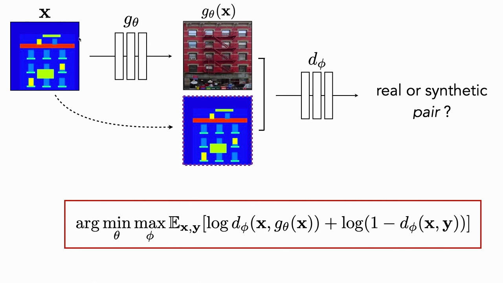
*▲ 강의 슬라이드 [31:00](https://youtu.be/zaMcHuJwe1w?t=1860): [조건부 GAN](00_%EB%94%A5%EB%9F%AC%EB%8B%9D_%EC%9A%A9%EC%96%B4%EC%82%AC%EC%A0%84.md#conditional-gan-%EC%A1%B0%EA%B1%B4%EB%B6%80-gan). 판별자 $d_\phi$가 (입력 도면, 출력 사진) 쌍을 보고 진짜 쌍인지 합성 쌍인지 가린다. 진짜 사진이라도 도면과 맞지 않으면 가짜 쌍이다*

### 4.3 L1 손실 더하기

▶ 영상 [31:27](https://youtu.be/zaMcHuJwe1w?t=1887)

📐 **수학 개념**: [조건부 GAN 목적 함수](%EC%88%98%ED%95%99%EA%B0%9C%EB%85%90/11_%EC%83%9D%EC%84%B1_%EB%AA%A8%EB%8D%B8/MM59_%EC%A1%B0%EA%B1%B4%EB%B6%80_GAN_%EB%AA%A9%EC%A0%81_%ED%95%A8%EC%88%98.md) · [노름](%EC%88%98%ED%95%99%EA%B0%9C%EB%85%90/03_%EC%84%A0%ED%98%95%EB%8C%80%EC%88%98/MM11_%EB%A6%BD%EC%8B%9C%EC%B8%A0_%EC%97%B0%EC%86%8D%EA%B3%BC_%EB%85%B8%EB%A6%84.md)

여기에 보통의 [회귀](00_%EB%94%A5%EB%9F%AC%EB%8B%9D_%EC%9A%A9%EC%96%B4%EC%82%AC%EC%A0%84.md#regression-classification-%ED%9A%8C%EA%B7%80%EC%99%80-%EB%B6%84%EB%A5%98) [손실](00_%EB%94%A5%EB%9F%AC%EB%8B%9D_%EC%9A%A9%EC%96%B4%EC%82%AC%EC%A0%84.md#loss-function-%EC%86%90%EC%8B%A4-%ED%95%A8%EC%88%98)("출력이 [정답](00_%EB%94%A5%EB%9F%AC%EB%8B%9D_%EC%9A%A9%EC%96%B4%EC%82%AC%EC%A0%84.md#label-%EC%A0%95%EB%8B%B5) $\mathbf{y}$에 가까운가")을 더할 수 있습니다. 이 항만 쓰면 픽셀마다 [독립](00_%EB%94%A5%EB%9F%AC%EB%8B%9D_%EC%9A%A9%EC%96%B4%EC%82%AC%EC%A0%84.md#independence-%EB%8F%85%EB%A6%BD)으로 보아 흐릿한 결과가 나오지만, [GAN](00_%EB%94%A5%EB%9F%AC%EB%8B%9D_%EC%9A%A9%EC%96%B4%EC%82%AC%EC%A0%84.md#gan-generative-adversarial-network-%EC%83%9D%EC%84%B1%EC%A0%81-%EC%A0%81%EB%8C%80-%EC%8B%A0%EA%B2%BD%EB%A7%9D) 목적에 더하면 성능이 조금 좋아집니다. [GAN](00_%EB%94%A5%EB%9F%AC%EB%8B%9D_%EC%9A%A9%EC%96%B4%EC%82%AC%EC%A0%84.md#gan-generative-adversarial-network-%EC%83%9D%EC%84%B1%EC%A0%81-%EC%A0%81%EB%8C%80-%EC%8B%A0%EA%B2%BD%EB%A7%9D)이 요즘 덜 쓰이는 가장 큰 이유는 적대적 게임의 최적화가 불안정하고 잘 수렴하지 않는 것인데, [회귀](00_%EB%94%A5%EB%9F%AC%EB%8B%9D_%EC%9A%A9%EC%96%B4%EC%82%AC%EC%A0%84.md#regression-classification-%ED%9A%8C%EA%B7%80%EC%99%80-%EB%B6%84%EB%A5%98) [손실](00_%EB%94%A5%EB%9F%AC%EB%8B%9D_%EC%9A%A9%EC%96%B4%EC%82%AC%EC%A0%84.md#loss-function-%EC%86%90%EC%8B%A4-%ED%95%A8%EC%88%98)이 이 과정을 크게 안정시킵니다. 몇 년 전에는 마법 같았던 결과입니다.

$$
g_\theta^* = \arg\min_\theta \max_\phi\ \mathcal{L}_{\text{cGAN}}(\theta, \phi) + \lambda\,\mathcal{L}_{L1}(\theta), \qquad \mathcal{L}_{L1}(\theta) = \mathbb{E}_{\mathbf{x}, \mathbf{y}}\|\mathbf{y} - g_\theta(\mathbf{x})\|_1
$$

기호 풀이

| 기호 | 읽는 법 | 뜻 | 예제 값 |
| --- | --- | --- | --- |
| $\mathcal{L}_{\text{cGAN}}$ | 엘 씨갠 | 4.2의 [조건부 GAN](00_%EB%94%A5%EB%9F%AC%EB%8B%9D_%EC%9A%A9%EC%96%B4%EC%82%AC%EC%A0%84.md#conditional-gan-%EC%A1%B0%EA%B1%B4%EB%B6%80-gan) 값 | $\ln 0.7 = -0.3567$ |
| $\mathcal{L}_{L1}$ | 엘 엘원 | 출력과 [정답](00_%EB%94%A5%EB%9F%AC%EB%8B%9D_%EC%9A%A9%EC%96%B4%EC%82%AC%EC%A0%84.md#label-%EC%A0%95%EB%8B%B5)의 픽셀별 절댓값 차이 평균 | 0.15 |
| $\lambda$ | 람다 | L1 항의 무게 | 100 |
| $\|\cdot\|_1$ | 엘원 [노름](00_%EB%94%A5%EB%9F%AC%EB%8B%9D_%EC%9A%A9%EC%96%B4%EC%82%AC%EC%A0%84.md#norm-%EB%85%B8%EB%A6%84) | 절댓값 거리 | |
| $g_\theta^*$ | 지 세타 스타 | 찾는 생성자 | |

예제와 풀이

**문제**: 픽셀 2개에서 생성자가 $(0.4, 0.8)$을, [정답](00_%EB%94%A5%EB%9F%AC%EB%8B%9D_%EC%9A%A9%EC%96%B4%EC%82%AC%EC%A0%84.md#label-%EC%A0%95%EB%8B%B5)은 $(0.5, 0.6)$이다. 판별자 항이 $\ln 0.7$이고 $\lambda = 100$일 때 생성자가 줄이려는 값은? (L1은 픽셀 평균)

**주어진 값**
- $g_\theta(\mathbf{x}) = (0.4, 0.8)$ (생성한 픽셀 값)
- $\mathbf{y} = (0.5, 0.6)$ ([정답](00_%EB%94%A5%EB%9F%AC%EB%8B%9D_%EC%9A%A9%EC%96%B4%EC%82%AC%EC%A0%84.md#label-%EC%A0%95%EB%8B%B5) 픽셀 값)
- $\mathcal{L}_{\text{cGAN}} = \ln 0.7$ (생성자가 바꾸는 판별자 항)
- $\lambda = 100$ (L1 항의 무게)

**풀이**
1. 식을 그대로 쓴다: $\mathcal{L}_{\text{cGAN}} + \lambda\,\|\mathbf{y} - g_\theta(\mathbf{x})\|_1$
2. 값을 대입한다: $\ln 0.7 + 100 \times \|(0.5, 0.6) - (0.4, 0.8)\|_1$
3. 칸별로 뺀다: $(0.5 - 0.4,\ 0.6 - 0.8) = (0.1, -0.2)$
4. 절댓값을 취한다: $(0.1, 0.2)$
5. 평균을 낸다: $(0.1 + 0.2) / 2 = 0.15$
6. $\lambda$를 곱한다: $100 \times 0.15 = 15$
7. [로그](00_%EB%94%A5%EB%9F%AC%EB%8B%9D_%EC%9A%A9%EC%96%B4%EC%82%AC%EC%A0%84.md#log-ln-%EB%A1%9C%EA%B7%B8)를 계산한다: $\ln 0.7 = -0.3567$
8. 더한다: $-0.3567 + 15 = 14.6433$

**답**: **14.6433**. 처음에는 L1 항이 커서 생성자가 먼저 [정답](00_%EB%94%A5%EB%9F%AC%EB%8B%9D_%EC%9A%A9%EC%96%B4%EC%82%AC%EC%A0%84.md#label-%EC%A0%95%EB%8B%B5) 근처로 가고, 그 뒤 판별자 항이 선명함을 다듬는다.

내 이해

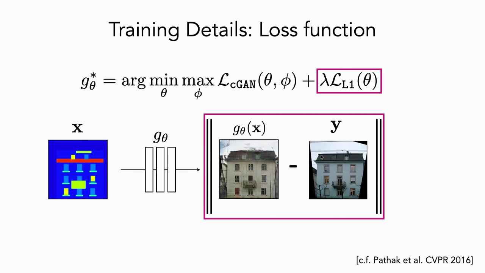
*▲ 강의 슬라이드 [31:40](https://youtu.be/zaMcHuJwe1w?t=1900): [학습](00_%EB%94%A5%EB%9F%AC%EB%8B%9D_%EC%9A%A9%EC%96%B4%EC%82%AC%EC%A0%84.md#training-%ED%95%99%EC%8A%B5) [손실](00_%EB%94%A5%EB%9F%AC%EB%8B%9D_%EC%9A%A9%EC%96%B4%EC%82%AC%EC%A0%84.md#loss-function-%EC%86%90%EC%8B%A4-%ED%95%A8%EC%88%98). [조건부 GAN](00_%EB%94%A5%EB%9F%AC%EB%8B%9D_%EC%9A%A9%EC%96%B4%EC%82%AC%EC%A0%84.md#conditional-gan-%EC%A1%B0%EA%B1%B4%EB%B6%80-gan) 항에 $\lambda\mathcal{L}_{L1}$(생성 사진과 [정답](00_%EB%94%A5%EB%9F%AC%EB%8B%9D_%EC%9A%A9%EC%96%B4%EC%82%AC%EC%A0%84.md#label-%EC%A0%95%EB%8B%B5) 사진의 차이)을 더한다*

### 4.4 패치 판별자

▶ 영상 [32:39](https://youtu.be/zaMcHuJwe1w?t=1959)

📐 **수학 개념**: [수용 영역과 출력 크기](%EC%88%98%ED%95%99%EA%B0%9C%EB%85%90/07_%EA%B5%AC%EC%A1%B0_%EC%95%84%ED%82%A4%ED%85%8D%EC%B2%98/MM16_%EC%88%98%EC%9A%A9_%EC%98%81%EC%97%AD%EA%B3%BC_%EC%B6%9C%EB%A0%A5_%ED%81%AC%EA%B8%B0.md) · [조건부 GAN 목적 함수](%EC%88%98%ED%95%99%EA%B0%9C%EB%85%90/11_%EC%83%9D%EC%84%B1_%EB%AA%A8%EB%8D%B8/MM59_%EC%A1%B0%EA%B1%B4%EB%B6%80_GAN_%EB%AA%A9%EC%A0%81_%ED%95%A8%EC%88%98.md)

판별자로 구조를 벌할 때 중요한 점은 **판별자의 구조가 어떤 오류에 민감한지를 정한다**는 것입니다. 이 프로젝트(pix2pix)에서 잘 통한 것은 **[패치 판별자](00_%EB%94%A5%EB%9F%AC%EB%8B%9D_%EC%9A%A9%EC%96%B4%EC%82%AC%EC%A0%84.md#patchgan-%ED%8C%A8%EC%B9%98-%ED%8C%90%EB%B3%84%EC%9E%90)**([PatchGAN](00_%EB%94%A5%EB%9F%AC%EB%8B%9D_%EC%9A%A9%EC%96%B4%EC%82%AC%EC%A0%84.md#patchgan-%ED%8C%A8%EC%B9%98-%ED%8C%90%EB%B3%84%EC%9E%90))였습니다.

- 사진 전체를 한 번에 보고 진짜/가짜를 말하는 대신, [합성곱](00_%EB%94%A5%EB%9F%AC%EB%8B%9D_%EC%9A%A9%EC%96%B4%EC%82%AC%EC%A0%84.md#convolution-%ED%95%A9%EC%84%B1%EA%B3%B1)으로 이미지를 미끄러지며 **패치마다** 진짜/가짜를 판정합니다.
- 작은 신경망으로 충분하고, 이미지 10장이면 패치는 수백만 개라 판별자의 [학습 데이터](00_%EB%94%A5%EB%9F%AC%EB%8B%9D_%EC%9A%A9%EC%96%B4%EC%82%AC%EC%A0%84.md#training-data-test-data-%ED%95%99%EC%8A%B5-%EB%8D%B0%EC%9D%B4%ED%84%B0%EC%99%80-%EC%8B%9C%ED%97%98-%EB%8D%B0%EC%9D%B4%ED%84%B0)도 훨씬 많아집니다.
- 강사에 따르면 이 구조는 Stable Diffusion 안에도 꽤 오래 들어 있었습니다(최신 버전에서는 빠졌을 수도 있음).

패치 크기([수용 영역](00_%EB%94%A5%EB%9F%AC%EB%8B%9D_%EC%9A%A9%EC%96%B4%EC%82%AC%EC%A0%84.md#receptive-field-%EC%88%98%EC%9A%A9-%EC%98%81%EC%97%AD))에 따라 [손실](00_%EB%94%A5%EB%9F%AC%EB%8B%9D_%EC%9A%A9%EC%96%B4%EC%82%AC%EC%A0%84.md#loss-function-%EC%86%90%EC%8B%A4-%ED%95%A8%EC%88%98)의 성질이 달라집니다.

| 패치 크기 | 판별자가 볼 수 있는 것 |
|---|---|
| 1×1 | 픽셀 하나씩. 오류를 그냥 더하는 것이라 픽셀별 [독립](00_%EB%94%A5%EB%9F%AC%EB%8B%9D_%EC%9A%A9%EC%96%B4%EC%82%AC%EC%A0%84.md#independence-%EB%8F%85%EB%A6%BD) [손실](00_%EB%94%A5%EB%9F%AC%EB%8B%9D_%EC%9A%A9%EC%96%B4%EC%82%AC%EC%A0%84.md#loss-function-%EC%86%90%EC%8B%A4-%ED%95%A8%EC%88%98)(최소제곱)과 거의 같다 |
| 16×16 | 두 픽셀 이상의 관계, 곧 2차 통계. 흐릿함은 픽셀 하나로는 안 보이고 이웃과의 차이로만 보인다 |
| 70×70 | 많은 측정의 결합 배치에 걸친 고차 통계 |
| 286×286 (전체) | 이 시절에는 오히려 나빴다. [학습](00_%EB%94%A5%EB%9F%AC%EB%8B%9D_%EC%9A%A9%EC%96%B4%EC%82%AC%EC%A0%84.md#training-%ED%95%99%EC%8A%B5) 이미지가 400장뿐이라 데이터에 비해 판별자 [파라미터](00_%EB%94%A5%EB%9F%AC%EB%8B%9D_%EC%9A%A9%EC%96%B4%EC%82%AC%EC%A0%84.md#parameter-%ED%8C%8C%EB%9D%BC%EB%AF%B8%ED%84%B0)가 너무 많았다 |

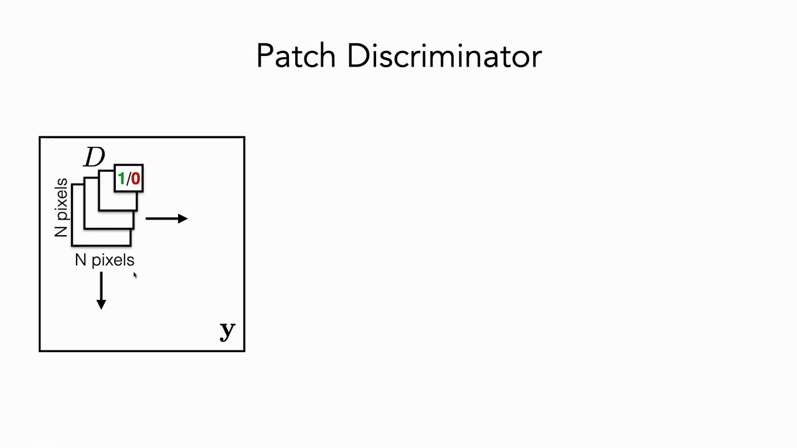
*▲ 강의 슬라이드 [33:00](https://youtu.be/zaMcHuJwe1w?t=1980): [패치 판별자](00_%EB%94%A5%EB%9F%AC%EB%8B%9D_%EC%9A%A9%EC%96%B4%EC%82%AC%EC%A0%84.md#patchgan-%ED%8C%A8%EC%B9%98-%ED%8C%90%EB%B3%84%EC%9E%90). $N \times N$ 패치마다 진짜(1)/가짜(0)를 판정하며 출력 이미지 위를 미끄러진다*

### 4.5 구조적 목적과 환각

▶ 영상 [35:50](https://youtu.be/zaMcHuJwe1w?t=2150)

2012년의 이야기가 "딥러닝은 [용량](00_%EB%94%A5%EB%9F%AC%EB%8B%9D_%EC%9A%A9%EC%96%B4%EC%82%AC%EC%A0%84.md#capacity-%EC%9A%A9%EB%9F%89)이 큰 [가설 공간](00_%EB%94%A5%EB%9F%AC%EB%8B%9D_%EC%9A%A9%EC%96%B4%EC%82%AC%EC%A0%84.md#hypothesis-space-%EA%B0%80%EC%84%A4-%EA%B3%B5%EA%B0%84)"이었다면, 강사가 덧붙이는 것은 **비구조적 목적의 딥러닝도 포화한다**는 점입니다. [가설 공간](00_%EB%94%A5%EB%9F%AC%EB%8B%9D_%EC%9A%A9%EC%96%B4%EC%82%AC%EC%A0%84.md#hypothesis-space-%EA%B0%80%EC%84%A4-%EA%B3%B5%EA%B0%84)에 [정답](00_%EB%94%A5%EB%9F%AC%EB%8B%9D_%EC%9A%A9%EC%96%B4%EC%82%AC%EC%A0%84.md#label-%EC%A0%95%EB%8B%B5)이 있어도(보편 근사기), 목적 함수가 "차원별 분포만 맞추면 충분하다"고 하면 결합 의존성을 배울 동기가 없습니다. 결합 의존성을 보는 목적 함수(모든 [생성 모델](00_%EB%94%A5%EB%9F%AC%EB%8B%9D_%EC%9A%A9%EC%96%B4%EC%82%AC%EC%A0%84.md#generative-model-%EC%83%9D%EC%84%B1-%EB%AA%A8%EB%8D%B8)이 가진 것)를 쓰면 성능이 더 오릅니다. [용량](00_%EB%94%A5%EB%9F%AC%EB%8B%9D_%EC%9A%A9%EC%96%B4%EC%82%AC%EC%A0%84.md#capacity-%EC%9A%A9%EB%9F%89)이 크면 데이터도 더 필요해서, 데이터가 적을 때는 단순한 모델이 나을 수 있다는 점도 그림의 교차로 표현했습니다.

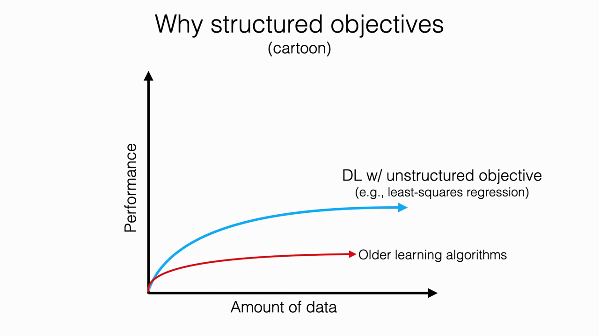
*▲ 강의 슬라이드 [36:15](https://youtu.be/zaMcHuJwe1w?t=2175): 구조적 목적이 필요한 이유(만화). 비구조적 목적(최소제곱 [회귀](00_%EB%94%A5%EB%9F%AC%EB%8B%9D_%EC%9A%A9%EC%96%B4%EC%82%AC%EC%A0%84.md#regression-classification-%ED%9A%8C%EA%B7%80%EC%99%80-%EB%B6%84%EB%A5%98))의 딥러닝도 데이터가 늘면 결국 평평해진다*

Sat2Map 결과를 비교하면, 픽셀별 L1 [손실](00_%EB%94%A5%EB%9F%AC%EB%8B%9D_%EC%9A%A9%EC%96%B4%EC%82%AC%EC%A0%84.md#loss-function-%EC%86%90%EC%8B%A4-%ED%95%A8%EC%88%98)은 흐릿하고, [패치 판별자](00_%EB%94%A5%EB%9F%AC%EB%8B%9D_%EC%9A%A9%EC%96%B4%EC%82%AC%EC%A0%84.md#patchgan-%ED%8C%A8%EC%B9%98-%ED%8C%90%EB%B3%84%EC%9E%90)를 쓴 [조건부 GAN](00_%EB%94%A5%EB%9F%AC%EB%8B%9D_%EC%9A%A9%EC%96%B4%EC%82%AC%EC%A0%84.md#conditional-gan-%EC%A1%B0%EA%B1%B4%EB%B6%80-gan)은 "흐릿해서 가짜 같다, 나무를 넣어야겠다"며 선명한 나무를 그립니다. 그런데 이것은 **[환각](00_%EB%94%A5%EB%9F%AC%EB%8B%9D_%EC%9A%A9%EC%96%B4%EC%82%AC%EC%A0%84.md#hallucination-%ED%99%98%EA%B0%81)**(hallucination)의 영역입니다. 그 나무들은 실제 그 자리에 있는 나무가 아니라, 나무가 있을 법한 분포에서 뽑은 **한 표본**입니다.

질의응답 정리 [37:40](https://youtu.be/zaMcHuJwe1w?t=2260)

- **공분산이 있는 가우스(픽셀 사이 구조를 넣은 L2)를 쓰면?** 이 결과보다는 나아지겠지만 극적이지는 않을 것이라고 봅니다. 그래도 가우스 구조밖에 표현하지 못하기 때문입니다.
- **L1 예측이 지도를 더 충실히 따르고, [GAN](00_%EB%94%A5%EB%9F%AC%EB%8B%9D_%EC%9A%A9%EC%96%B4%EC%82%AC%EC%A0%84.md#gan-generative-adversarial-network-%EC%83%9D%EC%84%B1%EC%A0%81-%EC%A0%81%EB%8C%80-%EC%8B%A0%EA%B2%BD%EB%A7%9D)은 길 일부를 지운 것 같은데 흔한 일인가?** 흔한 맞바꿈입니다. L1 예측은 평균이라 보수적이고, 모든 봉우리가 공유하는 길은 평균에도 남습니다. [GAN](00_%EB%94%A5%EB%9F%AC%EB%8B%9D_%EC%9A%A9%EC%96%B4%EC%82%AC%EC%A0%84.md#gan-generative-adversarial-network-%EC%83%9D%EC%84%B1%EC%A0%81-%EC%A0%81%EB%8C%80-%EC%8B%A0%EA%B2%BD%EB%A7%9D)은 봉우리 하나를 고르는데, 그 표본의 모든 부분이 [확률](00_%EB%94%A5%EB%9F%AC%EB%8B%9D_%EC%9A%A9%EC%96%B4%EC%82%AC%EC%A0%84.md#probability-%ED%99%95%EB%A5%A0) 높은 것은 아닐 수 있습니다. [앙상블](00_%EB%94%A5%EB%9F%AC%EB%8B%9D_%EC%9A%A9%EC%96%B4%EC%82%AC%EC%A0%84.md#ensemble-%EC%95%99%EC%83%81%EB%B8%94)이 한 봉우리보다 진실에 더 강건한 것과 비슷합니다. 생성 AI의 [환각](00_%EB%94%A5%EB%9F%AC%EB%8B%9D_%EC%9A%A9%EC%96%B4%EC%82%AC%EC%A0%84.md#hallucination-%ED%99%98%EA%B0%81)은 "그럴 수 있는 모습"의 표본이지만 그 모든 측면이 [확률](00_%EB%94%A5%EB%9F%AC%EB%8B%9D_%EC%9A%A9%EC%96%B4%EC%82%AC%EC%A0%84.md#probability-%ED%99%95%EB%A5%A0) 높은 것은 아니라는 데서 옵니다.

---

## 5. 조건부 VAE

▶ 영상 [39:53](https://youtu.be/zaMcHuJwe1w?t=2393)

### 5.1 여러 출력이 가능한 문제

▶ 영상 [40:26](https://youtu.be/zaMcHuJwe1w?t=2426)

모든 [생성 모델](00_%EB%94%A5%EB%9F%AC%EB%8B%9D_%EC%9A%A9%EC%96%B4%EC%82%AC%EC%A0%84.md#generative-model-%EC%83%9D%EC%84%B1-%EB%AA%A8%EB%8D%B8)은 조건부로 만들 수 있고, 대개 쉽습니다. [GAN](00_%EB%94%A5%EB%9F%AC%EB%8B%9D_%EC%9A%A9%EC%96%B4%EC%82%AC%EC%A0%84.md#gan-generative-adversarial-network-%EC%83%9D%EC%84%B1%EC%A0%81-%EC%A0%81%EB%8C%80-%EC%8B%A0%EA%B2%BD%EB%A7%9D)의 생성자는 **[모드 붕괴](00_%EB%94%A5%EB%9F%AC%EB%8B%9D_%EC%9A%A9%EC%96%B4%EC%82%AC%EC%A0%84.md#mode-collapse-%EB%AA%A8%EB%93%9C-%EB%B6%95%EA%B4%B4)**(mode collapse)를 보이는 경향이 있습니다. 진짜 같은 봉우리 하나는 내놓지만 다른 봉우리들을 놓칩니다. 같은 도면이 벽돌 건물일 수도, 다른 재료의 건물일 수도 있는데(도면은 창문과 문 위치만 알려 줌) 하나만 그리는 것입니다. [조건부 VAE](00_%EB%94%A5%EB%9F%AC%EB%8B%9D_%EC%9A%A9%EC%96%B4%EC%82%AC%EC%A0%84.md#conditional-vae-%EC%A1%B0%EA%B1%B4%EB%B6%80-vae)는 [사후 분포](00_%EB%94%A5%EB%9F%AC%EB%8B%9D_%EC%9A%A9%EC%96%B4%EC%82%AC%EC%A0%84.md#prior-posterior-%EC%82%AC%EC%A0%84-%EB%B6%84%ED%8F%AC%EC%99%80-%EC%82%AC%ED%9B%84-%EB%B6%84%ED%8F%AC)의 여러 봉우리를 조금 더 잘 잡습니다.

방법은 [VAE](00_%EB%94%A5%EB%9F%AC%EB%8B%9D_%EC%9A%A9%EC%96%B4%EC%82%AC%EC%A0%84.md#variational-autoencoder-vae-%EB%B3%80%EB%B6%84-%EC%98%A4%ED%86%A0%EC%9D%B8%EC%BD%94%EB%8D%94)의 요령 그대로입니다. [잠재 변수](00_%EB%94%A5%EB%9F%AC%EB%8B%9D_%EC%9A%A9%EC%96%B4%EC%82%AC%EC%A0%84.md#latent-variable-%EC%9E%A0%EC%9E%AC-%EB%B3%80%EC%88%98) $z$를 신경망에 넣어, 예측의 **가능한 모든 변이(불확실성)**를 $z$가 담게 합니다.

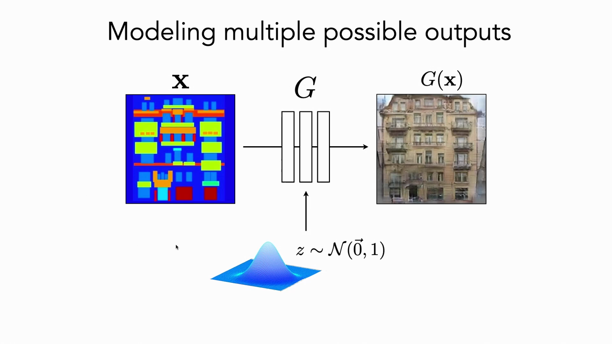
*▲ 강의 슬라이드 [41:03](https://youtu.be/zaMcHuJwe1w?t=2463): 여러 가능한 출력 모델링. 생성자 $G$가 입력 $\mathbf{x}$와 함께 $z \sim \mathcal{N}(\vec{0}, 1)$을 받는다*

### 5.2 움직이는 사각형

▶ 영상 [41:01](https://youtu.be/zaMcHuJwe1w?t=2461)

📐 **수학 개념**: [L2 회귀와 범주 분포](%EC%88%98%ED%95%99%EA%B0%9C%EB%85%90/04_%ED%99%95%EB%A5%A0%EA%B3%BC_%EC%A0%95%EB%B3%B4/MM35_L2_%ED%9A%8C%EA%B7%80%EC%99%80_%EB%B2%94%EC%A3%BC_%EB%B6%84%ED%8F%AC.md) · [정규분포](%EC%88%98%ED%95%99%EA%B0%9C%EB%85%90/04_%ED%99%95%EB%A5%A0%EA%B3%BC_%EC%A0%95%EB%B3%B4/MM50_%ED%99%95%EB%A5%A0_%EB%B0%80%EB%8F%84%EC%99%80_%EC%A0%95%EA%B7%9C%EB%B6%84%ED%8F%AC.md)

분홍 사각형이 움직이는 영상에서 지금 프레임을 보고 다음 프레임을 예측합니다. 이 데모에서 사각형이 갈 수 있는 방향은 8가지입니다. 최소제곱으로 예측하면 8개 봉우리의 **평균**, 곧 8곳에 흐릿하게 퍼진 그림이 나옵니다. 데이터 분포에서 [확률](00_%EB%94%A5%EB%9F%AC%EB%8B%9D_%EC%9A%A9%EC%96%B4%EC%82%AC%EC%A0%84.md#probability-%ED%99%95%EB%A5%A0)이 0인 아주 나쁜 예측입니다.

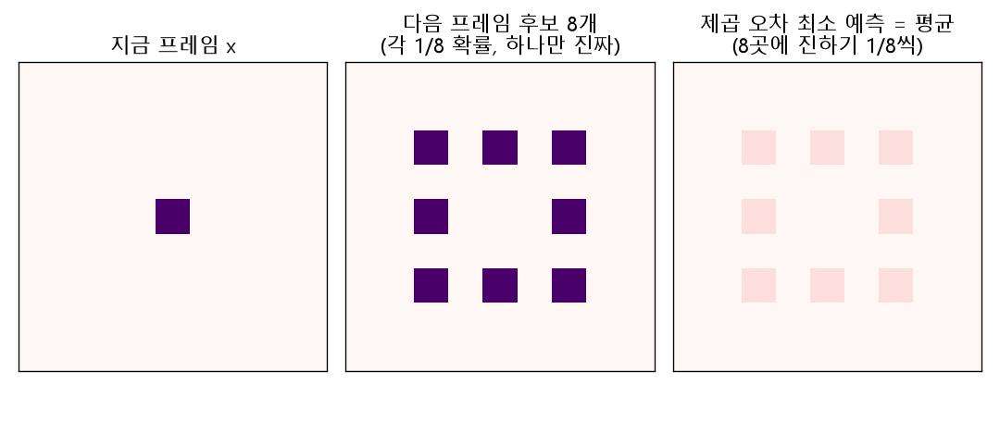
*▲ 직접 그린 그림: 다음 프레임 후보 8개(각 1/8 [확률](00_%EB%94%A5%EB%9F%AC%EB%8B%9D_%EC%9A%A9%EC%96%B4%EC%82%AC%EC%A0%84.md#probability-%ED%99%95%EB%A5%A0))와 제곱 [오차](00_%EB%94%A5%EB%9F%AC%EB%8B%9D_%EC%9A%A9%EC%96%B4%EC%82%AC%EC%A0%84.md#error-%EC%98%A4%EC%B0%A8)를 최소화하는 예측. 평균은 8곳에 진하기 1/8씩 흐릿하게 퍼진, 실제로는 나올 수 없는 그림이다*

[조건부 VAE](00_%EB%94%A5%EB%9F%AC%EB%8B%9D_%EC%9A%A9%EC%96%B4%EC%82%AC%EC%A0%84.md#conditional-vae-%EC%A1%B0%EA%B1%B4%EB%B6%80-vae)를 단계별로 쌓습니다.

1. **[VAE](00_%EB%94%A5%EB%9F%AC%EB%8B%9D_%EC%9A%A9%EC%96%B4%EC%82%AC%EC%A0%84.md#variational-autoencoder-vae-%EB%B3%80%EB%B6%84-%EC%98%A4%ED%86%A0%EC%9D%B8%EC%BD%94%EB%8D%94)**: 목표 $\mathbf{y}$(다음 프레임)를 가우스 [잠재 변수](00_%EB%94%A5%EB%9F%AC%EB%8B%9D_%EC%9A%A9%EC%96%B4%EC%82%AC%EC%A0%84.md#latent-variable-%EC%9E%A0%EC%9E%AC-%EB%B3%80%EC%88%98) $z$라는 [병목](00_%EB%94%A5%EB%9F%AC%EB%8B%9D_%EC%9A%A9%EC%96%B4%EC%82%AC%EC%A0%84.md#bottleneck-%EB%B3%91%EB%AA%A9)으로 압축했다가 복원합니다.
2. **조건 추가**: 복원 신경망(디코더)이 관찰 $\mathbf{x}$(지금 프레임)도 보게 합니다. [정답](00_%EB%94%A5%EB%9F%AC%EB%8B%9D_%EC%9A%A9%EC%96%B4%EC%82%AC%EC%A0%84.md#label-%EC%A0%95%EB%8B%B5) $\mathbf{y}$를 알려 주긴 하지만, **정보 [병목](00_%EB%94%A5%EB%9F%AC%EB%8B%9D_%EC%9A%A9%EC%96%B4%EC%82%AC%EC%A0%84.md#bottleneck-%EB%B3%91%EB%AA%A9)** $z$를 거쳐야만 하게 만드는 것입니다.
3. **무엇이 $z$에 들어가나**: $z$는 단위 가우스에 가까워지도록 정보를 줄이려 합니다. 색은 $\mathbf{x}$에서 바로 얻을 수 있고 그 통로의 [용량](00_%EB%94%A5%EB%9F%AC%EB%8B%9D_%EC%9A%A9%EC%96%B4%EC%82%AC%EC%A0%84.md#capacity-%EC%9A%A9%EB%9F%89)이 더 크므로 $z$에 넣을 필요가 없습니다. 그래서 $z$는 관찰에 없는 정보, 곧 **움직임 방향만** 담게 됩니다.
4. **[샘플링](00_%EB%94%A5%EB%9F%AC%EB%8B%9D_%EC%9A%A9%EC%96%B4%EC%82%AC%EC%A0%84.md#sampling-%EC%83%98%ED%94%8C%EB%A7%81)**: 추론 때는 목표에서 $z$를 구하는 대신 단위 가우스에서 $z$를 뽑습니다. "아래" $z$를 뽑으면 아래로, "위" $z$를 뽑으면 위로 가는 예측이 나옵니다.

비조건 [VAE](00_%EB%94%A5%EB%9F%AC%EB%8B%9D_%EC%9A%A9%EC%96%B4%EC%82%AC%EC%A0%84.md#variational-autoencoder-vae-%EB%B3%80%EB%B6%84-%EC%98%A4%ED%86%A0%EC%9D%B8%EC%BD%94%EB%8D%94)에서 $z$는 데이터의 모든 것을 담아야 했지만, [조건부 VAE](00_%EB%94%A5%EB%9F%AC%EB%8B%9D_%EC%9A%A9%EC%96%B4%EC%82%AC%EC%A0%84.md#conditional-vae-%EC%A1%B0%EA%B1%B4%EB%B6%80-vae)에서 $z$는 **조건 $\mathbf{x}$에 없는 정보만** 담습니다.

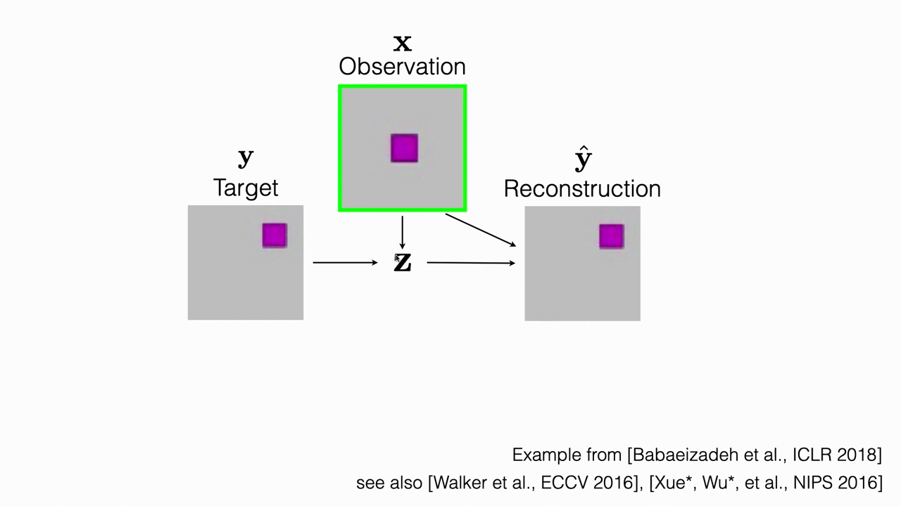
*▲ 강의 슬라이드 [43:40](https://youtu.be/zaMcHuJwe1w?t=2620): [조건부 VAE](00_%EB%94%A5%EB%9F%AC%EB%8B%9D_%EC%9A%A9%EC%96%B4%EC%82%AC%EC%A0%84.md#conditional-vae-%EC%A1%B0%EA%B1%B4%EB%B6%80-vae). 목표 $\mathbf{y}$를 $z$로 압축하고, 디코더는 $z$와 관찰 $\mathbf{x}$로 $\hat{\mathbf{y}}$를 복원한다. $z$는 관찰에 없는 움직임 방향만 담는다*

### 5.3 조건과 잠재 변수

▶ 영상 [45:00](https://youtu.be/zaMcHuJwe1w?t=2700)

이제 [생성 모델](00_%EB%94%A5%EB%9F%AC%EB%8B%9D_%EC%9A%A9%EC%96%B4%EC%82%AC%EC%A0%84.md#generative-model-%EC%83%9D%EC%84%B1-%EB%AA%A8%EB%8D%B8)의 출력을 조절하는 손잡이가 두 가지입니다.

- **[잠재 변수](00_%EB%94%A5%EB%9F%AC%EB%8B%9D_%EC%9A%A9%EC%96%B4%EC%82%AC%EC%A0%84.md#latent-variable-%EC%9E%A0%EC%9E%AC-%EB%B3%80%EC%88%98) $z$**: 앞 강의들에서 본, 조명·재질 같은 속성을 정하는 손잡이
- **조건 변수 $\mathbf{x}$**: 명시적으로 주는 입력

요즘 [생성 모델](00_%EB%94%A5%EB%9F%AC%EB%8B%9D_%EC%9A%A9%EC%96%B4%EC%82%AC%EC%A0%84.md#generative-model-%EC%83%9D%EC%84%B1-%EB%AA%A8%EB%8D%B8)에서는 조건이 점점 많아져서 [잠재 변수](00_%EB%94%A5%EB%9F%AC%EB%8B%9D_%EC%9A%A9%EC%96%B4%EC%82%AC%EC%A0%84.md#latent-variable-%EC%9E%A0%EC%9E%AC-%EB%B3%80%EC%88%98)의 역할이 아주 작아지기도 합니다. 텍스트-이미지 모델에 긴 문장을 주면 보게 될 이미지가 거의 정해지므로 [잠재 변수](00_%EB%94%A5%EB%9F%AC%EB%8B%9D_%EC%9A%A9%EC%96%B4%EC%82%AC%EC%A0%84.md#latent-variable-%EC%9E%A0%EC%9E%AC-%EB%B3%80%EC%88%98)가 많이 필요 없습니다.

---

## 6. 텍스트에서 텍스트로

▶ 영상 [46:08](https://youtu.be/zaMcHuJwe1w?t=2768)

📐 **수학 개념**: [확률의 연쇄법칙과 빔 서치](%EC%88%98%ED%95%99%EA%B0%9C%EB%85%90/04_%ED%99%95%EB%A5%A0%EA%B3%BC_%EC%A0%95%EB%B3%B4/MM39_%ED%99%95%EB%A5%A0%EC%9D%98_%EC%97%B0%EC%87%84%EB%B2%95%EC%B9%99%EA%B3%BC_%EB%B9%94_%EC%84%9C%EC%B9%98.md) · [조건부 확률](%EC%88%98%ED%95%99%EA%B0%9C%EB%85%90/04_%ED%99%95%EB%A5%A0%EA%B3%BC_%EC%A0%95%EB%B3%B4/MM58_%EC%A1%B0%EA%B1%B4%EB%B6%80_%ED%99%95%EB%A5%A0%EA%B3%BC_%EB%8F%85%EB%A6%BD.md)

텍스트 → 텍스트는 새로울 것이 거의 없습니다. [언어 모델](00_%EB%94%A5%EB%9F%AC%EB%8B%9D_%EC%9A%A9%EC%96%B4%EC%82%AC%EC%A0%84.md#language-model-%EC%96%B8%EC%96%B4-%EB%AA%A8%EB%8D%B8)은 보통 [자기회귀 모델](00_%EB%94%A5%EB%9F%AC%EB%8B%9D_%EC%9A%A9%EC%96%B4%EC%82%AC%EC%A0%84.md#autoregressive-model-%EC%9E%90%EA%B8%B0%ED%9A%8C%EA%B7%80-%EB%AA%A8%EB%8D%B8)이고, [자기회귀 모델](00_%EB%94%A5%EB%9F%AC%EB%8B%9D_%EC%9A%A9%EC%96%B4%EC%82%AC%EC%A0%84.md#autoregressive-model-%EC%9E%90%EA%B8%B0%ED%9A%8C%EA%B7%80-%EB%AA%A8%EB%8D%B8)은 **처음부터 조건부 [생성 모델](00_%EB%94%A5%EB%9F%AC%EB%8B%9D_%EC%9A%A9%EC%96%B4%EC%82%AC%EC%A0%84.md#generative-model-%EC%83%9D%EC%84%B1-%EB%AA%A8%EB%8D%B8)**입니다. 데이터를 조건부 예측의 연쇄 $p(x_2 \mid x_1)$, $p(x_3 \mid x_1, x_2)$, ...의 곱으로 모델링하기 때문입니다([Lec08 8.1](Lec08_%ED%8A%B8%EB%9E%9C%EC%8A%A4%ED%8F%AC%EB%A8%B8.md#81-%EC%9E%90%EA%B8%B0%ED%9A%8C%EA%B7%80-%EB%AA%A8%EB%8D%B8), [Lec10 7.1](Lec10_%EA%B8%B0%EC%96%B5%EA%B3%BC_%EC%8B%9C%ED%80%80%EC%8A%A4.md#71-%EB%8B%A4%EC%9D%8C%EC%9D%84-%EC%98%88%EC%B8%A1%ED%95%98%EA%B3%A0-%EB%8D%A7%EB%B6%99%EC%9D%B4%EA%B8%B0)).

- **[학습](00_%EB%94%A5%EB%9F%AC%EB%8B%9D_%EC%9A%A9%EC%96%B4%EC%82%AC%EC%A0%84.md#training-%ED%95%99%EC%8A%B5)**: 늘 하던 대로 다음 단어 예측입니다. "Colorless green ideas sleep" 다음은 "furiously".
- **조건부 예측**: 원하는 입력을 앞에 붙여 주기만 하면 됩니다. 그 입력이 조건 변수 $\mathbf{x}$입니다. 명시적 [잠재 변수](00_%EB%94%A5%EB%9F%AC%EB%8B%9D_%EC%9A%A9%EC%96%B4%EC%82%AC%EC%A0%84.md#latent-variable-%EC%9E%A0%EC%9E%AC-%EB%B3%80%EC%88%98)는 없지만 다음 단어를 [범주 분포](00_%EB%94%A5%EB%9F%AC%EB%8B%9D_%EC%9A%A9%EC%96%B4%EC%82%AC%EC%A0%84.md#categorical-distribution-%EB%B2%94%EC%A3%BC-%EB%B6%84%ED%8F%AC)에서 뽑으므로 여전히 확률적입니다. 이렇게 쓰는 것을 **[프롬프팅](00_%EB%94%A5%EB%9F%AC%EB%8B%9D_%EC%9A%A9%EC%96%B4%EC%82%AC%EC%A0%84.md#prompting-%ED%94%84%EB%A1%AC%ED%94%84%ED%8C%85)**(prompting)이라 하고, Claude나 ChatGPT와 대화할 때 하는 일이 바로 이것입니다.
- **예: 감성 [분류](00_%EB%94%A5%EB%9F%AC%EB%8B%9D_%EC%9A%A9%EC%96%B4%EC%82%AC%EC%A0%84.md#regression-classification-%ED%9A%8C%EA%B7%80%EC%99%80-%EB%B6%84%EB%A5%98)**: 상품 후기 $\mathbf{x}$를 앞에 붙이고 "이 후기의 감성은 ___"이라고 쓰면, 다음 단어 예측이 $p(y \mid \mathbf{x})$가 됩니다. [GPT](00_%EB%94%A5%EB%9F%AC%EB%8B%9D_%EC%9A%A9%EC%96%B4%EC%82%AC%EC%A0%84.md#gpt-%EC%83%9D%EC%84%B1%ED%98%95-%EC%82%AC%EC%A0%84%ED%95%99%EC%8A%B5-%ED%8A%B8%EB%9E%9C%EC%8A%A4%ED%8F%AC%EB%A8%B8)-3에 넣으면 "negative"가 나옵니다.

[언어 모델](00_%EB%94%A5%EB%9F%AC%EB%8B%9D_%EC%9A%A9%EC%96%B4%EC%82%AC%EC%A0%84.md#language-model-%EC%96%B8%EC%96%B4-%EB%AA%A8%EB%8D%B8)이 처음부터 이야기를 쓰는 것보다 **지시·프롬프트·질문이 주어진 조건부 예측**에서 가장 강력하다는 것이 분명해진 것은 [GPT](00_%EB%94%A5%EB%9F%AC%EB%8B%9D_%EC%9A%A9%EC%96%B4%EC%82%AC%EC%A0%84.md#gpt-%EC%83%9D%EC%84%B1%ED%98%95-%EC%82%AC%EC%A0%84%ED%95%99%EC%8A%B5-%ED%8A%B8%EB%9E%9C%EC%8A%A4%ED%8F%AC%EB%A8%B8)-3 무렵이었다고 강사는 말합니다.

$$
p(\mathbf{y} \mid \mathbf{x}) = \prod_{t=1}^{T} p(y_t \mid \mathbf{x}, y_1, \dots, y_{t-1})
$$

기호 풀이

| 기호 | 읽는 법 | 뜻 | 예제 값 |
| --- | --- | --- | --- |
| $\mathbf{x}$ | 엑스 | 조건 (프롬프트: 후기 + "감성은") | |
| $\mathbf{y} = (y_1, \dots, y_T)$ | 와이 | 이어서 생성할 [토큰](00_%EB%94%A5%EB%9F%AC%EB%8B%9D_%EC%9A%A9%EC%96%B4%EC%82%AC%EC%A0%84.md#token-%ED%86%A0%ED%81%B0)들 | ("very", "negative") |
| $T$ | 티 | 생성할 [토큰](00_%EB%94%A5%EB%9F%AC%EB%8B%9D_%EC%9A%A9%EC%96%B4%EC%82%AC%EC%A0%84.md#token-%ED%86%A0%ED%81%B0) 수 | 2 |
| $p(y_t \mid \mathbf{x}, y_{<t})$ | | 프롬프트와 앞 [토큰](00_%EB%94%A5%EB%9F%AC%EB%8B%9D_%EC%9A%A9%EC%96%B4%EC%82%AC%EC%A0%84.md#token-%ED%86%A0%ED%81%B0)들이 주어졌을 때 $t$번째 [토큰](00_%EB%94%A5%EB%9F%AC%EB%8B%9D_%EC%9A%A9%EC%96%B4%EC%82%AC%EC%A0%84.md#token-%ED%86%A0%ED%81%B0)의 [확률](00_%EB%94%A5%EB%9F%AC%EB%8B%9D_%EC%9A%A9%EC%96%B4%EC%82%AC%EC%A0%84.md#probability-%ED%99%95%EB%A5%A0) | 0.6, 0.9 |
| $\prod_{t=1}^{T}$ | 파이 | 모든 단계의 [확률](00_%EB%94%A5%EB%9F%AC%EB%8B%9D_%EC%9A%A9%EC%96%B4%EC%82%AC%EC%A0%84.md#probability-%ED%99%95%EB%A5%A0)을 곱함 ([확률의 연쇄법칙](00_%EB%94%A5%EB%9F%AC%EB%8B%9D_%EC%9A%A9%EC%96%B4%EC%82%AC%EC%A0%84.md#chain-rule-of-probability-%ED%99%95%EB%A5%A0%EC%9D%98-%EC%97%B0%EC%87%84%EB%B2%95%EC%B9%99)) | |

예제와 풀이

**문제**: 후기를 프롬프트로 넣었더니 [언어 모델](00_%EB%94%A5%EB%9F%AC%EB%8B%9D_%EC%9A%A9%EC%96%B4%EC%82%AC%EC%A0%84.md#language-model-%EC%96%B8%EC%96%B4-%EB%AA%A8%EB%8D%B8)이 첫 [토큰](00_%EB%94%A5%EB%9F%AC%EB%8B%9D_%EC%9A%A9%EC%96%B4%EC%82%AC%EC%A0%84.md#token-%ED%86%A0%ED%81%B0) "very"에 [확률](00_%EB%94%A5%EB%9F%AC%EB%8B%9D_%EC%9A%A9%EC%96%B4%EC%82%AC%EC%A0%84.md#probability-%ED%99%95%EB%A5%A0) 0.6을, "very" 다음 [토큰](00_%EB%94%A5%EB%9F%AC%EB%8B%9D_%EC%9A%A9%EC%96%B4%EC%82%AC%EC%A0%84.md#token-%ED%86%A0%ED%81%B0) "negative"에 [확률](00_%EB%94%A5%EB%9F%AC%EB%8B%9D_%EC%9A%A9%EC%96%B4%EC%82%AC%EC%A0%84.md#probability-%ED%99%95%EB%A5%A0) 0.9를 주었다. 답 "very negative" 전체의 [조건부 확률](00_%EB%94%A5%EB%9F%AC%EB%8B%9D_%EC%9A%A9%EC%96%B4%EC%82%AC%EC%A0%84.md#conditional-probability-%EC%A1%B0%EA%B1%B4%EB%B6%80-%ED%99%95%EB%A5%A0)은?

**주어진 값**
- $p(y_1 = \text{very} \mid \mathbf{x}) = 0.6$ (프롬프트만 보고 첫 [토큰](00_%EB%94%A5%EB%9F%AC%EB%8B%9D_%EC%9A%A9%EC%96%B4%EC%82%AC%EC%A0%84.md#token-%ED%86%A0%ED%81%B0)이 "very"일 [확률](00_%EB%94%A5%EB%9F%AC%EB%8B%9D_%EC%9A%A9%EC%96%B4%EC%82%AC%EC%A0%84.md#probability-%ED%99%95%EB%A5%A0))
- $p(y_2 = \text{negative} \mid \mathbf{x}, \text{very}) = 0.9$ (프롬프트와 "very" 다음에 "negative"일 [확률](00_%EB%94%A5%EB%9F%AC%EB%8B%9D_%EC%9A%A9%EC%96%B4%EC%82%AC%EC%A0%84.md#probability-%ED%99%95%EB%A5%A0))
- $T = 2$ (생성한 [토큰](00_%EB%94%A5%EB%9F%AC%EB%8B%9D_%EC%9A%A9%EC%96%B4%EC%82%AC%EC%A0%84.md#token-%ED%86%A0%ED%81%B0) 수)

**풀이**
1. 식을 그대로 쓴다: $p(\mathbf{y} \mid \mathbf{x}) = \prod_{t=1}^{T} p(y_t \mid \mathbf{x}, y_1, \dots, y_{t-1})$
2. 값을 대입한다: $p(\text{very negative} \mid \mathbf{x}) = \prod_{t=1}^{2} p(y_t \mid \mathbf{x}, y_{<t})$
3. ∏를 풀어 쓴다 ($t = 1, 2$): $p(\text{very} \mid \mathbf{x}) \times p(\text{negative} \mid \mathbf{x}, \text{very}) = 0.6 \times 0.9$
4. 곱셈을 한다: $0.6 \times 0.9 = 0.54$

**답**: **0.54**. 프롬프트 $\mathbf{x}$는 모든 단계의 조건에 들어 있다. 모델을 고치지 않고 입력만 바꿔 조건부 모델로 쓰는 이유다.

내 이해

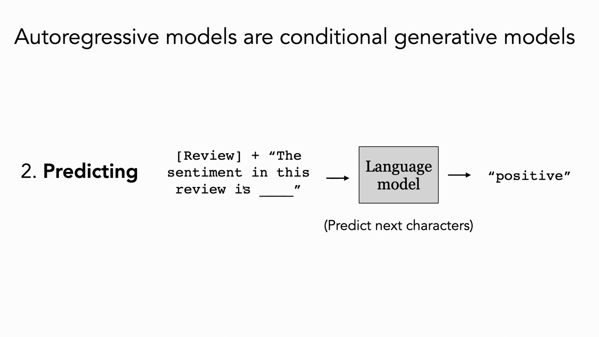
*▲ 강의 슬라이드 [47:40](https://youtu.be/zaMcHuJwe1w?t=2860): [자기회귀 모델](00_%EB%94%A5%EB%9F%AC%EB%8B%9D_%EC%9A%A9%EC%96%B4%EC%82%AC%EC%A0%84.md#autoregressive-model-%EC%9E%90%EA%B8%B0%ED%9A%8C%EA%B7%80-%EB%AA%A8%EB%8D%B8)은 조건부 [생성 모델](00_%EB%94%A5%EB%9F%AC%EB%8B%9D_%EC%9A%A9%EC%96%B4%EC%82%AC%EC%A0%84.md#generative-model-%EC%83%9D%EC%84%B1-%EB%AA%A8%EB%8D%B8)이다. [후기] + "이 후기의 감성은 ___"을 [언어 모델](00_%EB%94%A5%EB%9F%AC%EB%8B%9D_%EC%9A%A9%EC%96%B4%EC%82%AC%EC%A0%84.md#language-model-%EC%96%B8%EC%96%B4-%EB%AA%A8%EB%8D%B8)에 넣으면 다음 단어로 "positive"를 예측한다*

질의응답 정리 [49:59](https://youtu.be/zaMcHuJwe1w?t=2999)

- **검색 증강 생성(RAG)과 같은 것인가?** 관련은 있지만 여기에는 명시적인 검색이 없으니 지금은 별개 개념으로 생각하라고 답합니다.
- **이런 조건부 예측은 어떻게 학습하나?** 두 가지입니다. 인터넷 전체 같은 거대한 말뭉치로 [언어 모델](00_%EB%94%A5%EB%9F%AC%EB%8B%9D_%EC%9A%A9%EC%96%B4%EC%82%AC%EC%A0%84.md#language-model-%EC%96%B8%EC%96%B4-%EB%AA%A8%EB%8D%B8)을 학습하면 "후기 다음의 감성" 같은 조건부 분포가 데이터 안에 있는 한 저절로 배웁니다. 원하는 조건부 분포가 데이터에 암묵적으로 없으면, 후기와 감성 라벨 데이터셋을 모아 [미세 조정](00_%EB%94%A5%EB%9F%AC%EB%8B%9D_%EC%9A%A9%EC%96%B4%EC%82%AC%EC%A0%84.md#fine-tuning-%EB%AF%B8%EC%84%B8-%EC%A1%B0%EC%A0%95)합니다. [언어 모델](00_%EB%94%A5%EB%9F%AC%EB%8B%9D_%EC%9A%A9%EC%96%B4%EC%82%AC%EC%A0%84.md#language-model-%EC%96%B8%EC%96%B4-%EB%AA%A8%EB%8D%B8)을 프롬프트하고 조정하는 방법은 뒤 강의에서 더 다룹니다.

---

## 7. 이미지에서 텍스트로

▶ 영상 [51:40](https://youtu.be/zaMcHuJwe1w?t=3100)

### 7.1 교차 어텐션으로 잇기

▶ 영상 [51:40](https://youtu.be/zaMcHuJwe1w?t=3100)

📐 **수학 개념**: [스케일드 내적 어텐션](%EC%88%98%ED%95%99%EA%B0%9C%EB%85%90/07_%EA%B5%AC%EC%A1%B0_%EC%95%84%ED%82%A4%ED%85%8D%EC%B2%98/MM30_%EC%8A%A4%EC%BC%80%EC%9D%BC%EB%93%9C_%EB%82%B4%EC%A0%81_%EC%96%B4%ED%85%90%EC%85%98.md) · [인과 마스크](%EC%88%98%ED%95%99%EA%B0%9C%EB%85%90/07_%EA%B5%AC%EC%A1%B0_%EC%95%84%ED%82%A4%ED%85%8D%EC%B2%98/MM31_%EC%88%9C%EC%97%B4_%EB%93%B1%EB%B3%80%EC%84%B1%EA%B3%BC_%EC%9D%B8%EA%B3%BC_%EB%A7%88%EC%8A%A4%ED%81%AC.md)

서로 다른 두 데이터 유형을 잇는 열쇠는 [트랜스포머](00_%EB%94%A5%EB%9F%AC%EB%8B%9D_%EC%9A%A9%EC%96%B4%EC%82%AC%EC%A0%84.md#transformer-%ED%8A%B8%EB%9E%9C%EC%8A%A4%ED%8F%AC%EB%A8%B8)입니다. 모든 데이터를 [토큰](00_%EB%94%A5%EB%9F%AC%EB%8B%9D_%EC%9A%A9%EC%96%B4%EC%82%AC%EC%A0%84.md#token-%ED%86%A0%ED%81%B0)([임베딩](00_%EB%94%A5%EB%9F%AC%EB%8B%9D_%EC%9A%A9%EC%96%B4%EC%82%AC%EC%A0%84.md#embedding-%EC%9E%84%EB%B2%A0%EB%94%A9) 벡터가 붙은 작은 정보 묶음)으로 바꾸면 [토큰](00_%EB%94%A5%EB%9F%AC%EB%8B%9D_%EC%9A%A9%EC%96%B4%EC%82%AC%EC%A0%84.md#token-%ED%86%A0%ED%81%B0) → [토큰](00_%EB%94%A5%EB%9F%AC%EB%8B%9D_%EC%9A%A9%EC%96%B4%EC%82%AC%EC%A0%84.md#token-%ED%86%A0%ED%81%B0) 매핑만 하면 됩니다. 분자든 금융 데이터든 스프레드시트든 [토큰](00_%EB%94%A5%EB%9F%AC%EB%8B%9D_%EC%9A%A9%EC%96%B4%EC%82%AC%EC%A0%84.md#token-%ED%86%A0%ED%81%B0)으로 바꿀 수 있으면 같은 기술을 쓸 수 있습니다.

이미지 → 문장은 **[이미지 캡셔닝](00_%EB%94%A5%EB%9F%AC%EB%8B%9D_%EC%9A%A9%EC%96%B4%EC%82%AC%EC%A0%84.md#image-captioning-%EC%9D%B4%EB%AF%B8%EC%A7%80-%EC%BA%A1%EC%85%94%EB%8B%9D)**(image captioning)이라고도 합니다. 웹에서 이미지 아래 달린 캡션이나 대체 텍스트를 맞히도록 학습합니다([Lec08 9](Lec08_%ED%8A%B8%EB%9E%9C%EC%8A%A4%ED%8F%AC%EB%A8%B8.md#9-%EA%B5%90%EC%B0%A8-%EC%96%B4%ED%85%90%EC%85%98-%EC%9D%B4%EB%AF%B8%EC%A7%80-%EC%BA%A1%EC%85%98)).

- **이미지 인코더**: [비전 트랜스포머](00_%EB%94%A5%EB%9F%AC%EB%8B%9D_%EC%9A%A9%EC%96%B4%EC%82%AC%EC%A0%84.md#vision-transformer-%EB%B9%84%EC%A0%84-%ED%8A%B8%EB%9E%9C%EC%8A%A4%ED%8F%AC%EB%A8%B8)(ViT)가 이미지를 패치로 잘라 각각 벡터로 임베딩하고, [트랜스포머](00_%EB%94%A5%EB%9F%AC%EB%8B%9D_%EC%9A%A9%EC%96%B4%EC%82%AC%EC%A0%84.md#transformer-%ED%8A%B8%EB%9E%9C%EC%8A%A4%ED%8F%AC%EB%A8%B8)를 돌려 이미지의 추상적 표현 [토큰](00_%EB%94%A5%EB%9F%AC%EB%8B%9D_%EC%9A%A9%EC%96%B4%EC%82%AC%EC%A0%84.md#token-%ED%86%A0%ED%81%B0)들을 냅니다.
- **텍스트 디코더**: [GPT](00_%EB%94%A5%EB%9F%AC%EB%8B%9D_%EC%9A%A9%EC%96%B4%EC%82%AC%EC%A0%84.md#gpt-%EC%83%9D%EC%84%B1%ED%98%95-%EC%82%AC%EC%A0%84%ED%95%99%EC%8A%B5-%ED%8A%B8%EB%9E%9C%EC%8A%A4%ED%8F%AC%EB%A8%B8) 같은 자기회귀 [언어 모델](00_%EB%94%A5%EB%9F%AC%EB%8B%9D_%EC%9A%A9%EC%96%B4%EC%82%AC%EC%A0%84.md#language-model-%EC%96%B8%EC%96%B4-%EB%AA%A8%EB%8D%B8)입니다. [인과 어텐션](00_%EB%94%A5%EB%9F%AC%EB%8B%9D_%EC%9A%A9%EC%96%B4%EC%82%AC%EC%A0%84.md#causal-attention-%EC%9D%B8%EA%B3%BC-%EC%96%B4%ED%85%90%EC%85%98)으로 "sitting"은 앞의 것들에만 의존하고, "bird"는 "sitting"에 의존하지 않습니다.
- **잇기**: 둘 다 [토큰](00_%EB%94%A5%EB%9F%AC%EB%8B%9D_%EC%9A%A9%EC%96%B4%EC%82%AC%EC%A0%84.md#token-%ED%86%A0%ED%81%B0) 공간에 있으니 언어 [토큰](00_%EB%94%A5%EB%9F%AC%EB%8B%9D_%EC%9A%A9%EC%96%B4%EC%82%AC%EC%A0%84.md#token-%ED%86%A0%ED%81%B0) 앞에 이미지 [토큰](00_%EB%94%A5%EB%9F%AC%EB%8B%9D_%EC%9A%A9%EC%96%B4%EC%82%AC%EC%A0%84.md#token-%ED%86%A0%ED%81%B0)을 붙이면 됩니다. 간단한 방법이 **[교차 어텐션](00_%EB%94%A5%EB%9F%AC%EB%8B%9D_%EC%9A%A9%EC%96%B4%EC%82%AC%EC%A0%84.md#cross-attention-%EA%B5%90%EC%B0%A8-%EC%96%B4%ED%85%90%EC%85%98)**입니다. 언어 [토큰](00_%EB%94%A5%EB%9F%AC%EB%8B%9D_%EC%9A%A9%EC%96%B4%EC%82%AC%EC%A0%84.md#token-%ED%86%A0%ED%81%B0)(예: "yellow")이 쿼리를 내고, 이미지 [토큰](00_%EB%94%A5%EB%9F%AC%EB%8B%9D_%EC%9A%A9%EC%96%B4%EC%82%AC%EC%A0%84.md#token-%ED%86%A0%ED%81%B0)이 키와 값을 냅니다. "yellow"의 쿼리는 노란 새 부분의 키와 맞아 그 값을 가져오고, 그 [층](00_%EB%94%A5%EB%9F%AC%EB%8B%9D_%EC%9A%A9%EC%96%B4%EC%82%AC%EC%A0%84.md#layer-%EC%B8%B5)의 표현은 단어와 이미지를 함께 담은 멀티모달 표현이 됩니다. [교차 어텐션](00_%EB%94%A5%EB%9F%AC%EB%8B%9D_%EC%9A%A9%EC%96%B4%EC%82%AC%EC%A0%84.md#cross-attention-%EA%B5%90%EC%B0%A8-%EC%96%B4%ED%85%90%EC%85%98)은 "쿼리는 한 집합에서, 키와 값은 다른 집합에서 가져오는 [어텐션](00_%EB%94%A5%EB%9F%AC%EB%8B%9D_%EC%9A%A9%EC%96%B4%EC%82%AC%EC%A0%84.md#attention-%EC%96%B4%ED%85%90%EC%85%98)"일 뿐입니다.

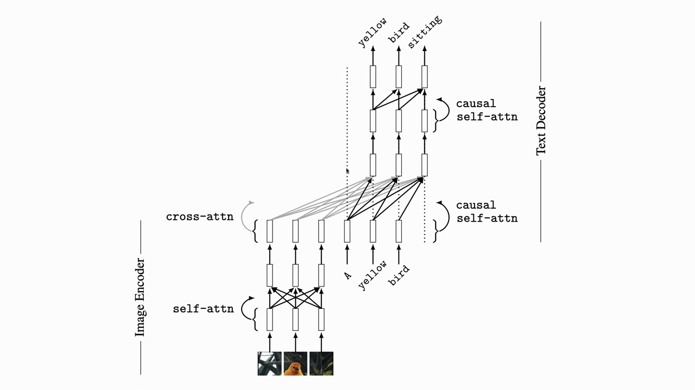
*▲ 강의 슬라이드 [53:20](https://youtu.be/zaMcHuJwe1w?t=3200): 이미지 → 텍스트. 아래는 [셀프 어텐션](00_%EB%94%A5%EB%9F%AC%EB%8B%9D_%EC%9A%A9%EC%96%B4%EC%82%AC%EC%A0%84.md#self-attention-%EC%85%80%ED%94%84-%EC%96%B4%ED%85%90%EC%85%98)의 이미지 인코더, 위는 인과 [셀프 어텐션](00_%EB%94%A5%EB%9F%AC%EB%8B%9D_%EC%9A%A9%EC%96%B4%EC%82%AC%EC%A0%84.md#self-attention-%EC%85%80%ED%94%84-%EC%96%B4%ED%85%90%EC%85%98)의 텍스트 디코더이고, 둘을 [교차 어텐션](00_%EB%94%A5%EB%9F%AC%EB%8B%9D_%EC%9A%A9%EC%96%B4%EC%82%AC%EC%A0%84.md#cross-attention-%EA%B5%90%EC%B0%A8-%EC%96%B4%ED%85%90%EC%85%98)으로 잇는다*

질의응답 정리 [55:06](https://youtu.be/zaMcHuJwe1w?t=3306)

- **텍스트 "a yellow bird"는 언제 주어지나?** [학습 데이터](00_%EB%94%A5%EB%9F%AC%EB%8B%9D_%EC%9A%A9%EC%96%B4%EC%82%AC%EC%A0%84.md#training-data-test-data-%ED%95%99%EC%8A%B5-%EB%8D%B0%EC%9D%B4%ED%84%B0%EC%99%80-%EC%8B%9C%ED%97%98-%EB%8D%B0%EC%9D%B4%ED%84%B0)는 $(\mathbf{x}, \mathbf{y})$ 쌍이고 $\mathbf{x}$는 이미지, $\mathbf{y}$는 캡션입니다. 그림은 자기회귀 세 단계째의 모습입니다. 추론 때는 단어를 하나씩 차례로 만들지만, [학습](00_%EB%94%A5%EB%9F%AC%EB%8B%9D_%EC%9A%A9%EC%96%B4%EC%82%AC%EC%A0%84.md#training-%ED%95%99%EC%8A%B5) 때는 모든 위치를 병렬로 계산합니다.
- **텍스트 [토큰](00_%EB%94%A5%EB%9F%AC%EB%8B%9D_%EC%9A%A9%EC%96%B4%EC%82%AC%EC%A0%84.md#token-%ED%86%A0%ED%81%B0) 대신 학습된 [임베딩](00_%EB%94%A5%EB%9F%AC%EB%8B%9D_%EC%9A%A9%EC%96%B4%EC%82%AC%EC%A0%84.md#embedding-%EC%9E%84%EB%B2%A0%EB%94%A9)을 쿼리로 쓰면 더 빨리 배우나?** 정보를 합치는 전략은 아주 다양합니다. 보통 텍스트와 시각 데이터에 각자의 쿼리 행렬을 두고, 두 모달리티 모두에서 키·값·쿼리를 낼 수 있습니다.

### 7.2 멀티모달 챗봇

▶ 영상 [56:48](https://youtu.be/zaMcHuJwe1w?t=3408)

올해(2024년)의 산업계 유행은 **멀티모달 챗봇**입니다. [언어 모델](00_%EB%94%A5%EB%9F%AC%EB%8B%9D_%EC%9A%A9%EC%96%B4%EC%82%AC%EC%A0%84.md#language-model-%EC%96%B8%EC%96%B4-%EB%AA%A8%EB%8D%B8)이 이미지를, 일부는 영상까지 입력으로 받습니다. 강사는 이 강의 슬라이드를 캡처해 ChatGPT에게 "이 슬라이드가 무엇이고 너의 동작과 어떤 관계인가"를 물어봅니다. 이미지 인코더, [교차 어텐션](00_%EB%94%A5%EB%9F%AC%EB%8B%9D_%EC%9A%A9%EC%96%B4%EC%82%AC%EC%A0%84.md#cross-attention-%EA%B5%90%EC%B0%A8-%EC%96%B4%ED%85%90%EC%85%98) [층](00_%EB%94%A5%EB%9F%AC%EB%8B%9D_%EC%9A%A9%EC%96%B4%EC%82%AC%EC%A0%84.md#layer-%EC%B8%B5) 같은 설명은 꽤 정확했지만, "나는 언어 모델일 뿐이라 시각 데이터를 처리하지 않는다"고 답했습니다. 슬라이드를 보고 맞게 설명했으니 시각 데이터를 본 것이 분명하므로 이 답은 틀렸습니다. 모델은 **자기 자신이 어떻게 동작하는지 모른다**는 예입니다.

> [!TIP]
> **🆕 2026 업데이트: 멀티모달 모델의 내부**
> - **강의**: 이미지와 텍스트를 입출력하는 챗봇이 한 모델인지 두 모델을 엮은 것인지는 회사들이 공개하지 않아 모른다. Llama 3.2가 논문으로 공개된 예지만 정보를 어떻게 합치는지는 기억나지 않는다.
> - **현재**: Llama 3.2의 11B·90B 비전 모델은 강의 7.1의 방식 그대로, 미리 학습한 이미지 인코더를 **[교차 어텐션](00_%EB%94%A5%EB%9F%AC%EB%8B%9D_%EC%9A%A9%EC%96%B4%EC%82%AC%EC%A0%84.md#cross-attention-%EA%B5%90%EC%B0%A8-%EC%96%B4%ED%85%90%EC%85%98) [층](00_%EB%94%A5%EB%9F%AC%EB%8B%9D_%EC%9A%A9%EC%96%B4%EC%82%AC%EC%A0%84.md#layer-%EC%B8%B5)으로 된 어댑터**로 [언어 모델](00_%EB%94%A5%EB%9F%AC%EB%8B%9D_%EC%9A%A9%EC%96%B4%EC%82%AC%EC%A0%84.md#language-model-%EC%96%B8%EC%96%B4-%EB%AA%A8%EB%8D%B8)에 연결했고, 어댑터 [학습](00_%EB%94%A5%EB%9F%AC%EB%8B%9D_%EC%9A%A9%EC%96%B4%EC%82%AC%EC%A0%84.md#training-%ED%95%99%EC%8A%B5) 중에는 [언어 모델](00_%EB%94%A5%EB%9F%AC%EB%8B%9D_%EC%9A%A9%EC%96%B4%EC%82%AC%EC%A0%84.md#language-model-%EC%96%B8%EC%96%B4-%EB%AA%A8%EB%8D%B8) [파라미터](00_%EB%94%A5%EB%9F%AC%EB%8B%9D_%EC%9A%A9%EC%96%B4%EC%82%AC%EC%A0%84.md#parameter-%ED%8C%8C%EB%9D%BC%EB%AF%B8%ED%84%B0)를 고정해 텍스트 성능을 지켰다(2024년 9월). 2025년 4월의 Llama 4는 텍스트와 비전 [토큰](00_%EB%94%A5%EB%9F%AC%EB%8B%9D_%EC%9A%A9%EC%96%B4%EC%82%AC%EC%A0%84.md#token-%ED%86%A0%ED%81%B0)을 처음부터 하나의 백본에 넣는 **조기 융합**(early fusion)의 "네이티브 멀티모달" 구조로 바뀌어, 텍스트·이미지·영상을 함께 사전 학습한다. 이미지 **출력** 쪽에서도 OpenAI는 2025년 3월 이미지 생성을 별도의 DALL·E가 아니라 [GPT](00_%EB%94%A5%EB%9F%AC%EB%8B%9D_%EC%9A%A9%EC%96%B4%EC%82%AC%EC%A0%84.md#gpt-%EC%83%9D%EC%84%B1%ED%98%95-%EC%82%AC%EC%A0%84%ED%95%99%EC%8A%B5-%ED%8A%B8%EB%9E%9C%EC%8A%A4%ED%8F%AC%EB%A8%B8)-4o 모델 안에 네이티브로 넣었다고 밝혔다. 다만 [GPT](00_%EB%94%A5%EB%9F%AC%EB%8B%9D_%EC%9A%A9%EC%96%B4%EC%82%AC%EC%A0%84.md#gpt-%EC%83%9D%EC%84%B1%ED%98%95-%EC%82%AC%EC%A0%84%ED%95%99%EC%8A%B5-%ED%8A%B8%EB%9E%9C%EC%8A%A4%ED%8F%AC%EB%A8%B8)-4o의 구체적인 구조는 공개되지 않았다.
> - **출처**: [Meta, Llama 3.2: Revolutionizing edge AI and vision with open, customizable models (2024)](https://ai.meta.com/blog/llama-3-2-connect-2024-vision-edge-mobile-devices/) · [Meta, The Llama 4 herd (2025)](https://ai.meta.com/blog/llama-4-multimodal-intelligence/) · [OpenAI, Addendum to GPT-4o System Card: 4o image generation (2025)](https://openai.com/index/gpt-4o-image-generation-system-card-addendum/)

---

## 8. 텍스트에서 이미지로

▶ 영상 [57:54](https://youtu.be/zaMcHuJwe1w?t=3474)

요즘(또는 한 세대 전)의 텍스트-이미지 모델은 사람들이 "[확산 모델](00_%EB%94%A5%EB%9F%AC%EB%8B%9D_%EC%9A%A9%EC%96%B4%EC%82%AC%EC%A0%84.md#diffusion-model-%ED%99%95%EC%82%B0-%EB%AA%A8%EB%8D%B8)"이라고 부르지만, 사실 **[GAN](00_%EB%94%A5%EB%9F%AC%EB%8B%9D_%EC%9A%A9%EC%96%B4%EC%82%AC%EC%A0%84.md#gan-generative-adversarial-network-%EC%83%9D%EC%84%B1%EC%A0%81-%EC%A0%81%EB%8C%80-%EC%8B%A0%EA%B2%BD%EB%A7%9D), [VAE](00_%EB%94%A5%EB%9F%AC%EB%8B%9D_%EC%9A%A9%EC%96%B4%EC%82%AC%EC%A0%84.md#variational-autoencoder-vae-%EB%B3%80%EB%B6%84-%EC%98%A4%ED%86%A0%EC%9D%B8%EC%BD%94%EB%8D%94), [확산 모델](00_%EB%94%A5%EB%9F%AC%EB%8B%9D_%EC%9A%A9%EC%96%B4%EC%82%AC%EC%A0%84.md#diffusion-model-%ED%99%95%EC%82%B0-%EB%AA%A8%EB%8D%B8) 세 가지를 모두** 섞은 것입니다.

### 8.1 도메인 변환의 일반 틀

▶ 영상 [58:25](https://youtu.be/zaMcHuJwe1w?t=3505)

두 모달리티(도메인) 사이의 변환은 일반적인 조건부 예측입니다. 데이터 $\mathcal{X}$를 인코더 $f$로 [잠재 공간](00_%EB%94%A5%EB%9F%AC%EB%8B%9D_%EC%9A%A9%EC%96%B4%EC%82%AC%EC%A0%84.md#latent-space-%EC%9E%A0%EC%9E%AC-%EA%B3%B5%EA%B0%84) $\mathcal{Z}$에 보내고, 디코더 $g$로 자기 자신([오토인코더](00_%EB%94%A5%EB%9F%AC%EB%8B%9D_%EC%9A%A9%EC%96%B4%EC%82%AC%EC%A0%84.md#autoencoder-%EC%98%A4%ED%86%A0%EC%9D%B8%EC%BD%94%EB%8D%94))이 아니라 **다른 도메인** $\mathcal{Y}$로 복원한 뒤, 예측과 [정답](00_%EB%94%A5%EB%9F%AC%EB%8B%9D_%EC%9A%A9%EC%96%B4%EC%82%AC%EC%A0%84.md#label-%EC%A0%95%EB%8B%B5) $\mathbf{y}$의 차이를 벌합니다. 이미지 → 텍스트라면 이미지 공간 → [잠재 공간](00_%EB%94%A5%EB%9F%AC%EB%8B%9D_%EC%9A%A9%EC%96%B4%EC%82%AC%EC%A0%84.md#latent-space-%EC%9E%A0%EC%9E%AC-%EA%B3%B5%EA%B0%84) → 텍스트 공간입니다(앞의 자기회귀 방식은 명시적 [잠재 변수](00_%EB%94%A5%EB%9F%AC%EB%8B%9D_%EC%9A%A9%EC%96%B4%EC%82%AC%EC%A0%84.md#latent-variable-%EC%9E%A0%EC%9E%AC-%EB%B3%80%EC%88%98)가 없어서 [잠재 공간](00_%EB%94%A5%EB%9F%AC%EB%8B%9D_%EC%9A%A9%EC%96%B4%EC%82%AC%EC%A0%84.md#latent-space-%EC%9E%A0%EC%9E%AC-%EA%B3%B5%EA%B0%84)이 어디인지는 뚜렷하지 않습니다).

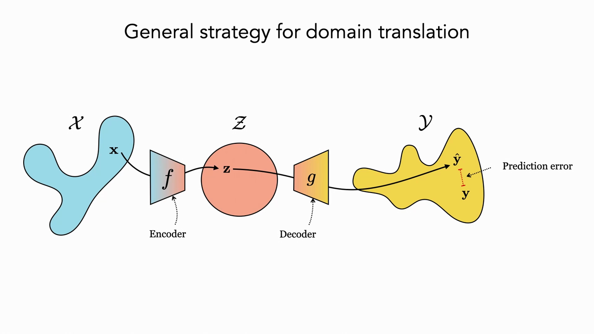
*▲ 강의 슬라이드 [58:30](https://youtu.be/zaMcHuJwe1w?t=3510): 도메인 변환의 일반 전략. 인코더 $f$로 $\mathcal{X}$를 [잠재 공간](00_%EB%94%A5%EB%9F%AC%EB%8B%9D_%EC%9A%A9%EC%96%B4%EC%82%AC%EC%A0%84.md#latent-space-%EC%9E%A0%EC%9E%AC-%EA%B3%B5%EA%B0%84) $\mathcal{Z}$로 보내고, 디코더 $g$로 다른 도메인 $\mathcal{Y}$에 예측 $\hat{\mathbf{y}}$를 내어 [정답](00_%EB%94%A5%EB%9F%AC%EB%8B%9D_%EC%9A%A9%EC%96%B4%EC%82%AC%EC%A0%84.md#label-%EC%A0%95%EB%8B%B5) $\mathbf{y}$와의 예측 [오차](00_%EB%94%A5%EB%9F%AC%EB%8B%9D_%EC%9A%A9%EC%96%B4%EC%82%AC%EC%A0%84.md#error-%EC%98%A4%EC%B0%A8)를 잰다*

### 8.2 조건부 VAE: DALL-E 1

▶ 영상 [59:32](https://youtu.be/zaMcHuJwe1w?t=3572)

"횃대에 앉은 진홍마코앵무"라는 글을 조건으로 하는 [조건부 VAE](00_%EB%94%A5%EB%9F%AC%EB%8B%9D_%EC%9A%A9%EC%96%B4%EC%82%AC%EC%A0%84.md#conditional-vae-%EC%A1%B0%EA%B1%B4%EB%B6%80-vae)를 학습합니다.

- 디코더 $g$는 관찰(글)과 [잠재 변수](00_%EB%94%A5%EB%9F%AC%EB%8B%9D_%EC%9A%A9%EC%96%B4%EC%82%AC%EC%A0%84.md#latent-variable-%EC%9E%A0%EC%9E%AC-%EB%B3%80%EC%88%98) $z$를 받습니다. 디코더가 결정적이므로, 입력이 정하지 않은 모든 무작위 요인을 $z$가 담아야 합니다. 글에 "왼쪽을 향한"이 없으면 앵무새가 왼쪽을 향한다는 정보는 $z$가 담습니다.
- $z$는 목표 이미지에서 추론해 학습합니다([VAE](00_%EB%94%A5%EB%9F%AC%EB%8B%9D_%EC%9A%A9%EC%96%B4%EC%82%AC%EC%A0%84.md#variational-autoencoder-vae-%EB%B3%80%EB%B6%84-%EC%98%A4%ED%86%A0%EC%9D%B8%EC%BD%94%EB%8D%94)에 조건을 붙인 것, 5절과 같은 생각).
- 새로운 점은 글을 [토큰](00_%EB%94%A5%EB%9F%AC%EB%8B%9D_%EC%9A%A9%EC%96%B4%EC%82%AC%EC%A0%84.md#token-%ED%86%A0%ED%81%B0)으로 바꾸는 [언어 모델](00_%EB%94%A5%EB%9F%AC%EB%8B%9D_%EC%9A%A9%EC%96%B4%EC%82%AC%EC%A0%84.md#language-model-%EC%96%B8%EC%96%B4-%EB%AA%A8%EB%8D%B8) $f$와, [토큰](00_%EB%94%A5%EB%9F%AC%EB%8B%9D_%EC%9A%A9%EC%96%B4%EC%82%AC%EC%A0%84.md#token-%ED%86%A0%ED%81%B0) 집합을 받는 [트랜스포머](00_%EB%94%A5%EB%9F%AC%EB%8B%9D_%EC%9A%A9%EC%96%B4%EC%82%AC%EC%A0%84.md#transformer-%ED%8A%B8%EB%9E%9C%EC%8A%A4%ED%8F%AC%EB%A8%B8) 디코더(ViT일 수 있음)뿐입니다. [잠재 변수](00_%EB%94%A5%EB%9F%AC%EB%8B%9D_%EC%9A%A9%EC%96%B4%EC%82%AC%EC%A0%84.md#latent-variable-%EC%9E%A0%EC%9E%AC-%EB%B3%80%EC%88%98)도 토큰일 수 있습니다.
- 추론 때는 단위 가우스에서 $z$를 뽑습니다. [VAE](00_%EB%94%A5%EB%9F%AC%EB%8B%9D_%EC%9A%A9%EC%96%B4%EC%82%AC%EC%A0%84.md#variational-autoencoder-vae-%EB%B3%80%EB%B6%84-%EC%98%A4%ED%86%A0%EC%9D%B8%EC%BD%94%EB%8D%94)가 잠재 분포를 빽빽하고 촘촘하게 만들도록 학습되어 있으므로, 뽑은 표본은 모두 [학습](00_%EB%94%A5%EB%9F%AC%EB%8B%9D_%EC%9A%A9%EC%96%B4%EC%82%AC%EC%A0%84.md#training-%ED%95%99%EC%8A%B5) 분포 안의 올바른 예측으로 이어집니다.

대략 이것이 DALL-E 1의 방식입니다. DALL-E 1은 아마 처음으로 큰 반향을 일으킨 텍스트-이미지 모델이고, 그 뒤 Stable Diffusion, DALL-E 2, Midjourney 등은 [확산 모델](00_%EB%94%A5%EB%9F%AC%EB%8B%9D_%EC%9A%A9%EC%96%B4%EC%82%AC%EC%A0%84.md#diffusion-model-%ED%99%95%EC%82%B0-%EB%AA%A8%EB%8D%B8)로 넘어갔습니다.

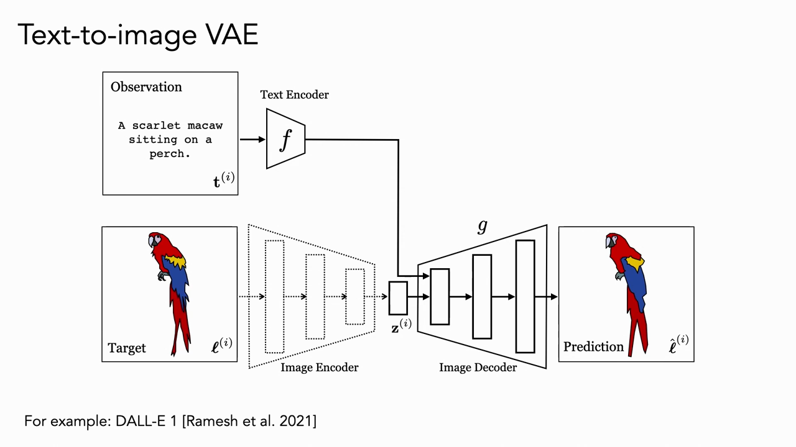
*▲ 강의 슬라이드 [61:40](https://youtu.be/zaMcHuJwe1w?t=3700): 텍스트-이미지 [VAE](00_%EB%94%A5%EB%9F%AC%EB%8B%9D_%EC%9A%A9%EC%96%B4%EC%82%AC%EC%A0%84.md#variational-autoencoder-vae-%EB%B3%80%EB%B6%84-%EC%98%A4%ED%86%A0%EC%9D%B8%EC%BD%94%EB%8D%94). 글 $\mathbf{t}$를 텍스트 인코더 $f$로, 목표 이미지를 이미지 인코더로 $z$에 압축하고, 이미지 디코더 $g$가 둘을 받아 이미지를 예측한다 (예: DALL-E 1)*

질의응답 정리 [61:13](https://youtu.be/zaMcHuJwe1w?t=3673)

- **두 정보(글 [임베딩](00_%EB%94%A5%EB%9F%AC%EB%8B%9D_%EC%9A%A9%EC%96%B4%EC%82%AC%EC%A0%84.md#embedding-%EC%9E%84%EB%B2%A0%EB%94%A9)과 $z$)를 합치는 최선의 방법은? 더하기, [이어 붙이기](00_%EB%94%A5%EB%9F%AC%EB%8B%9D_%EC%9A%A9%EC%96%B4%EC%82%AC%EC%A0%84.md#concatenate-stack-%EC%9D%B4%EC%96%B4-%EB%B6%99%EC%9D%B4%EA%B8%B0%EC%99%80-%EC%8C%93%EA%B8%B0) 후 MLP?** 지금 가장 흔한 기본은 **[이어 붙이기](00_%EB%94%A5%EB%9F%AC%EB%8B%9D_%EC%9A%A9%EC%96%B4%EC%82%AC%EC%A0%84.md#concatenate-stack-%EC%9D%B4%EC%96%B4-%EB%B6%99%EC%9D%B4%EA%B8%B0%EC%99%80-%EC%8C%93%EA%B8%B0)**입니다. 모두 [토큰](00_%EB%94%A5%EB%9F%AC%EB%8B%9D_%EC%9A%A9%EC%96%B4%EC%82%AC%EC%A0%84.md#token-%ED%86%A0%ED%81%B0)([임베딩](00_%EB%94%A5%EB%9F%AC%EB%8B%9D_%EC%9A%A9%EC%96%B4%EC%82%AC%EC%A0%84.md#embedding-%EC%9E%84%EB%B2%A0%EB%94%A9) 벡터) 집합으로 바꿔 이어 붙이고, 그 사이에 [교차 어텐션](00_%EB%94%A5%EB%9F%AC%EB%8B%9D_%EC%9A%A9%EC%96%B4%EC%82%AC%EC%A0%84.md#cross-attention-%EA%B5%90%EC%B0%A8-%EC%96%B4%ED%85%90%EC%85%98)을 거듭합니다. 더하기, 평균, 곱하기 등 다른 방법도 있고, [트랜스포머](00_%EB%94%A5%EB%9F%AC%EB%8B%9D_%EC%9A%A9%EC%96%B4%EC%82%AC%EC%A0%84.md#transformer-%ED%8A%B8%EB%9E%9C%EC%8A%A4%ED%8F%AC%EB%A8%B8)에서 서로 다른 흐름을 더 똑똑하게 합치는 방법은 활발한 연구 주제입니다(좋은 기말 프로젝트 주제라고 덧붙입니다).

### 8.3 조건부 확산 모델

▶ 영상 [62:55](https://youtu.be/zaMcHuJwe1w?t=3775)

📐 **수학 개념**: [조건부 확률과 베이즈 정리](%EC%88%98%ED%95%99%EA%B0%9C%EB%85%90/04_%ED%99%95%EB%A5%A0%EA%B3%BC_%EC%A0%95%EB%B3%B4/MM58_%EC%A1%B0%EA%B1%B4%EB%B6%80_%ED%99%95%EB%A5%A0%EA%B3%BC_%EB%8F%85%EB%A6%BD.md) · [분류기 없는 가이던스](%EC%88%98%ED%95%99%EA%B0%9C%EB%85%90/11_%EC%83%9D%EC%84%B1_%EB%AA%A8%EB%8D%B8/MM61_%EB%B6%84%EB%A5%98%EA%B8%B0_%EC%97%86%EB%8A%94_%EA%B0%80%EC%9D%B4%EB%8D%98%EC%8A%A4.md) · [가우시안 확산의 순방향 과정](%EC%88%98%ED%95%99%EA%B0%9C%EB%85%90/11_%EC%83%9D%EC%84%B1_%EB%AA%A8%EB%8D%B8/MM53_%EA%B0%80%EC%9A%B0%EC%8B%9C%EC%95%88_%ED%99%95%EC%82%B0%EC%9D%98_%EC%88%9C%EB%B0%A9%ED%96%A5_%EA%B3%BC%EC%A0%95.md)

[확산 모델](00_%EB%94%A5%EB%9F%AC%EB%8B%9D_%EC%9A%A9%EC%96%B4%EC%82%AC%EC%A0%84.md#diffusion-model-%ED%99%95%EC%82%B0-%EB%AA%A8%EB%8D%B8)은 단위 가우스 잡음에서 출발해 한 단계씩 잡음을 걷어 냅니다. [학습](00_%EB%94%A5%EB%9F%AC%EB%8B%9D_%EC%9A%A9%EC%96%B4%EC%82%AC%EC%A0%84.md#training-%ED%95%99%EC%8A%B5)은 반대 방향으로 감독합니다. 데이터에 잡음을 더해 두고, 각 단계에서 "더 잡음 낀 이미지를 보고 덜 잡음 낀 이미지를 예측"하는 지도 [학습](00_%EB%94%A5%EB%9F%AC%EB%8B%9D_%EC%9A%A9%EC%96%B4%EC%82%AC%EC%A0%84.md#training-%ED%95%99%EC%8A%B5) 문제를 풉니다.

**조건부로 만드는 법은 [잡음 제거기](00_%EB%94%A5%EB%9F%AC%EB%8B%9D_%EC%9A%A9%EC%96%B4%EC%82%AC%EC%A0%84.md#denoiser-%EC%9E%A1%EC%9D%8C-%EC%A0%9C%EA%B1%B0%EA%B8%B0)가 글을 보게 하는 것뿐입니다.** 왜 될까요? 글이 원래 이미지에 대한 정보를 주기 때문입니다. "노란 배경의 울새"라고 하면, 잡음 낀 이미지에서 배경이 노랑인지 흰색인지 분홍인지 애매할 때 글이 그 모호함을 풀어 줍니다. [학습 데이터](00_%EB%94%A5%EB%9F%AC%EB%8B%9D_%EC%9A%A9%EC%96%B4%EC%82%AC%EC%A0%84.md#training-data-test-data-%ED%95%99%EC%8A%B5-%EB%8D%B0%EC%9D%B4%ED%84%B0%EC%99%80-%EC%8B%9C%ED%97%98-%EB%8D%B0%EC%9D%B4%ED%84%B0)에서 글과 이미지 사이에 의존성이 있는 만큼, 글은 더 정확한 예측을 돕습니다. 그래서 [잡음 제거기](00_%EB%94%A5%EB%9F%AC%EB%8B%9D_%EC%9A%A9%EC%96%B4%EC%82%AC%EC%A0%84.md#denoiser-%EC%9E%A1%EC%9D%8C-%EC%A0%9C%EA%B1%B0%EA%B8%B0) $f$는 글을 쓰는 법을 배우고, 글이 이끄는 방향으로 잡음을 걷어 냅니다. 글이 "분홍 배경의 울새"라면 분홍 쪽으로 갑니다. 이것은 [베이즈 정리](%EC%88%98%ED%95%99%EA%B0%9C%EB%85%90/04_%ED%99%95%EB%A5%A0%EA%B3%BC_%EC%A0%95%EB%B3%B4/MM58_%EC%A1%B0%EA%B1%B4%EB%B6%80_%ED%99%95%EB%A5%A0%EA%B3%BC_%EB%8F%85%EB%A6%BD.md)로 보면 사전 믿음(잡음 낀 이미지만 볼 때)이 글이라는 증거로 갱신되는 것입니다.

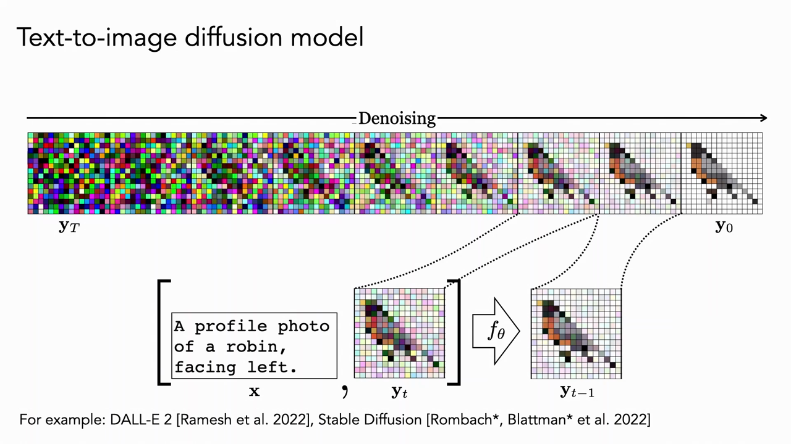
*▲ 강의 슬라이드 [64:50](https://youtu.be/zaMcHuJwe1w?t=3890): 텍스트-이미지 [확산 모델](00_%EB%94%A5%EB%9F%AC%EB%8B%9D_%EC%9A%A9%EC%96%B4%EC%82%AC%EC%A0%84.md#diffusion-model-%ED%99%95%EC%82%B0-%EB%AA%A8%EB%8D%B8). [잡음 제거기](00_%EB%94%A5%EB%9F%AC%EB%8B%9D_%EC%9A%A9%EC%96%B4%EC%82%AC%EC%A0%84.md#denoiser-%EC%9E%A1%EC%9D%8C-%EC%A0%9C%EA%B1%B0%EA%B8%B0) $f_\theta$가 글 $\mathbf{x}$("왼쪽을 향한 울새의 옆모습")와 잡음 낀 이미지 $\mathbf{y}_t$를 받아 $\mathbf{y}_{t-1}$을 예측한다 (예: DALL-E 2, Stable Diffusion)*

정리하면 [생성 모델](00_%EB%94%A5%EB%9F%AC%EB%8B%9D_%EC%9A%A9%EC%96%B4%EC%82%AC%EC%A0%84.md#generative-model-%EC%83%9D%EC%84%B1-%EB%AA%A8%EB%8D%B8) 네 가지를 조건부로 만드는 법은 이렇습니다.

| 모델 | 조건부로 만드는 법 | 난이도 |
|---|---|---|
| [확산 모델](00_%EB%94%A5%EB%9F%AC%EB%8B%9D_%EC%9A%A9%EC%96%B4%EC%82%AC%EC%A0%84.md#diffusion-model-%ED%99%95%EC%82%B0-%EB%AA%A8%EB%8D%B8) | [잡음 제거기](00_%EB%94%A5%EB%9F%AC%EB%8B%9D_%EC%9A%A9%EC%96%B4%EC%82%AC%EC%A0%84.md#denoiser-%EC%9E%A1%EC%9D%8C-%EC%A0%9C%EA%B1%B0%EA%B8%B0)가 글(조건)을 입력으로 받는다 | 아주 쉬움 |
| [GAN](00_%EB%94%A5%EB%9F%AC%EB%8B%9D_%EC%9A%A9%EC%96%B4%EC%82%AC%EC%A0%84.md#gan-generative-adversarial-network-%EC%83%9D%EC%84%B1%EC%A0%81-%EC%A0%81%EB%8C%80-%EC%8B%A0%EA%B2%BD%EB%A7%9D) | 판별자(와 생성자)가 조건을 입력으로 받는다 | 아주 쉬움 |
| [자기회귀 모델](00_%EB%94%A5%EB%9F%AC%EB%8B%9D_%EC%9A%A9%EC%96%B4%EC%82%AC%EC%A0%84.md#autoregressive-model-%EC%9E%90%EA%B8%B0%ED%9A%8C%EA%B7%80-%EB%AA%A8%EB%8D%B8) | 이미 조건부다. 조건을 앞에 붙인다 | 할 일 없음 |
| [VAE](00_%EB%94%A5%EB%9F%AC%EB%8B%9D_%EC%9A%A9%EC%96%B4%EC%82%AC%EC%A0%84.md#variational-autoencoder-vae-%EB%B3%80%EB%B6%84-%EC%98%A4%ED%86%A0%EC%9D%B8%EC%BD%94%EB%8D%94) | 디코더가 조건을 받고, $z$는 조건에 없는 정보만 담게 한다 | 조금 까다로움 |

몇 년 전 Stable Diffusion의 한 버전에서는 매 잡음 제거 단계의 신경망이 [U-Net](00_%EB%94%A5%EB%9F%AC%EB%8B%9D_%EC%9A%A9%EC%96%B4%EC%82%AC%EC%A0%84.md#u-net-%EC%9C%A0%EB%84%B7)([스킵 연결](00_%EB%94%A5%EB%9F%AC%EB%8B%9D_%EC%9A%A9%EC%96%B4%EC%82%AC%EC%A0%84.md#skip-connection-%EC%8A%A4%ED%82%B5-%EC%97%B0%EA%B2%B0)이 있는 [합성곱 신경망](00_%EB%94%A5%EB%9F%AC%EB%8B%9D_%EC%9A%A9%EC%96%B4%EC%82%AC%EC%A0%84.md#cnn-convolutional-neural-network-%ED%95%A9%EC%84%B1%EA%B3%B1-%EC%8B%A0%EA%B2%BD%EB%A7%9D), [Lec04 7.2](Lec04_%EA%B2%A9%EC%9E%90_%EC%95%84%ED%82%A4%ED%85%8D%EC%B2%98.md#72-u-net))이었습니다. [토큰](00_%EB%94%A5%EB%9F%AC%EB%8B%9D_%EC%9A%A9%EC%96%B4%EC%82%AC%EC%A0%84.md#token-%ED%86%A0%ED%81%B0) 구조가 아니어서 글 정보는 [토큰](00_%EB%94%A5%EB%9F%AC%EB%8B%9D_%EC%9A%A9%EC%96%B4%EC%82%AC%EC%A0%84.md#token-%ED%86%A0%ED%81%B0)을 이어 붙이는 대신 글 인코더의 벡터로 활성값의 크기를 조절하는([정규화](00_%EB%94%A5%EB%9F%AC%EB%8B%9D_%EC%9A%A9%EC%96%B4%EC%82%AC%EC%A0%84.md#normalization-%EC%A0%95%EA%B7%9C%ED%99%94) [층](00_%EB%94%A5%EB%9F%AC%EB%8B%9D_%EC%9A%A9%EC%96%B4%EC%82%AC%EC%A0%84.md#layer-%EC%B8%B5)을 변조하는 것 같은) 방식으로 들어갔다고 강사는 기억합니다. 지금은 이 자리에 [트랜스포머](00_%EB%94%A5%EB%9F%AC%EB%8B%9D_%EC%9A%A9%EC%96%B4%EC%82%AC%EC%A0%84.md#transformer-%ED%8A%B8%EB%9E%9C%EC%8A%A4%ED%8F%AC%EB%A8%B8)를 쓰는 **[확산 트랜스포머](00_%EB%94%A5%EB%9F%AC%EB%8B%9D_%EC%9A%A9%EC%96%B4%EC%82%AC%EC%A0%84.md#diffusion-transformer-%ED%99%95%EC%82%B0-%ED%8A%B8%EB%9E%9C%EC%8A%A4%ED%8F%AC%EB%A8%B8)**가 쓰입니다.

> [!TIP]
> **🆕 2026 업데이트: 글을 더 세게 따르게 하는 가이던스**
> - **강의**: [잡음 제거기](00_%EB%94%A5%EB%9F%AC%EB%8B%9D_%EC%9A%A9%EC%96%B4%EC%82%AC%EC%A0%84.md#denoiser-%EC%9E%A1%EC%9D%8C-%EC%A0%9C%EA%B1%B0%EA%B8%B0)가 글을 입력으로 보기만 하면 조건부 [확산 모델](00_%EB%94%A5%EB%9F%AC%EB%8B%9D_%EC%9A%A9%EC%96%B4%EC%82%AC%EC%A0%84.md#diffusion-model-%ED%99%95%EC%82%B0-%EB%AA%A8%EB%8D%B8)이 된다.
> - **현재**: 실제 텍스트-이미지 모델은 여기에 거의 항상 **[분류기 없는 가이던스](00_%EB%94%A5%EB%9F%AC%EB%8B%9D_%EC%9A%A9%EC%96%B4%EC%82%AC%EC%A0%84.md#classifier-free-guidance-%EB%B6%84%EB%A5%98%EA%B8%B0-%EC%97%86%EB%8A%94-%EA%B0%80%EC%9D%B4%EB%8D%98%EC%8A%A4)**(classifier-free guidance)를 더한다. [학습](00_%EB%94%A5%EB%9F%AC%EB%8B%9D_%EC%9A%A9%EC%96%B4%EC%82%AC%EC%A0%84.md#training-%ED%95%99%EC%8A%B5) 때 일정 비율로 글을 빈 조건으로 바꿔 한 신경망이 조건부·비조건부 예측을 둘 다 배우게 하고, [샘플링](00_%EB%94%A5%EB%9F%AC%EB%8B%9D_%EC%9A%A9%EC%96%B4%EC%82%AC%EC%A0%84.md#sampling-%EC%83%98%ED%94%8C%EB%A7%81) 때 두 예측의 차이를 $s$배로 키워 섞는다. $s$를 키우면 그림이 글을 더 충실히 따르지만 다양성은 줄어든다. 따로 분류기를 학습할 필요가 없어 표준이 되었다. 계산은 [분류기 없는 가이던스](%EC%88%98%ED%95%99%EA%B0%9C%EB%85%90/11_%EC%83%9D%EC%84%B1_%EB%AA%A8%EB%8D%B8/MM61_%EB%B6%84%EB%A5%98%EA%B8%B0_%EC%97%86%EB%8A%94_%EA%B0%80%EC%9D%B4%EB%8D%98%EC%8A%A4.md) 노트에 있다.
> - **출처**: [Ho & Salimans, Classifier-Free Diffusion Guidance (NeurIPS 2021 Workshop, arXiv 2022)](https://arxiv.org/abs/2207.12598)

> [!TIP]
> **🆕 2026 업데이트: [U-Net](00_%EB%94%A5%EB%9F%AC%EB%8B%9D_%EC%9A%A9%EC%96%B4%EC%82%AC%EC%A0%84.md#u-net-%EC%9C%A0%EB%84%B7)에서 [확산 트랜스포머](00_%EB%94%A5%EB%9F%AC%EB%8B%9D_%EC%9A%A9%EC%96%B4%EC%82%AC%EC%A0%84.md#diffusion-transformer-%ED%99%95%EC%82%B0-%ED%8A%B8%EB%9E%9C%EC%8A%A4%ED%8F%AC%EB%A8%B8)와 정류 흐름으로**
> - **강의**: Stable Diffusion은 몇 년 전 [U-Net](00_%EB%94%A5%EB%9F%AC%EB%8B%9D_%EC%9A%A9%EC%96%B4%EC%82%AC%EC%A0%84.md#u-net-%EC%9C%A0%EB%84%B7)이었고 지금은 [확산 트랜스포머](00_%EB%94%A5%EB%9F%AC%EB%8B%9D_%EC%9A%A9%EC%96%B4%EC%82%AC%EC%A0%84.md#diffusion-transformer-%ED%99%95%EC%82%B0-%ED%8A%B8%EB%9E%9C%EC%8A%A4%ED%8F%AC%EB%A8%B8)를 쓴다. 최근에는 흐름 [기반 모델](00_%EB%94%A5%EB%9F%AC%EB%8B%9D_%EC%9A%A9%EC%96%B4%EC%82%AC%EC%A0%84.md#foundation-model-%EA%B8%B0%EB%B0%98-%EB%AA%A8%EB%8D%B8)로 가고 있을 수도 있다.
> - **현재**: [확산 트랜스포머](00_%EB%94%A5%EB%9F%AC%EB%8B%9D_%EC%9A%A9%EC%96%B4%EC%82%AC%EC%A0%84.md#diffusion-transformer-%ED%99%95%EC%82%B0-%ED%8A%B8%EB%9E%9C%EC%8A%A4%ED%8F%AC%EB%A8%B8)(DiT)는 [잠재 공간](00_%EB%94%A5%EB%9F%AC%EB%8B%9D_%EC%9A%A9%EC%96%B4%EC%82%AC%EC%A0%84.md#latent-space-%EC%9E%A0%EC%9E%AC-%EA%B3%B5%EA%B0%84)의 패치를 [토큰](00_%EB%94%A5%EB%9F%AC%EB%8B%9D_%EC%9A%A9%EC%96%B4%EC%82%AC%EC%A0%84.md#token-%ED%86%A0%ED%81%B0)으로 삼아 [U-Net](00_%EB%94%A5%EB%9F%AC%EB%8B%9D_%EC%9A%A9%EC%96%B4%EC%82%AC%EC%A0%84.md#u-net-%EC%9C%A0%EB%84%B7) 대신 [트랜스포머](00_%EB%94%A5%EB%9F%AC%EB%8B%9D_%EC%9A%A9%EC%96%B4%EC%82%AC%EC%A0%84.md#transformer-%ED%8A%B8%EB%9E%9C%EC%8A%A4%ED%8F%AC%EB%A8%B8)로 잡음을 예측하고, 모델이 클수록 품질이 좋아지는 규모 확장성을 보였다(2023). Stable Diffusion 3(2024)는 이를 이어, 글 [토큰](00_%EB%94%A5%EB%9F%AC%EB%8B%9D_%EC%9A%A9%EC%96%B4%EC%82%AC%EC%A0%84.md#token-%ED%86%A0%ED%81%B0)과 이미지 [토큰](00_%EB%94%A5%EB%9F%AC%EB%8B%9D_%EC%9A%A9%EC%96%B4%EC%82%AC%EC%A0%84.md#token-%ED%86%A0%ED%81%B0)에 **각각 다른 [가중치](00_%EB%94%A5%EB%9F%AC%EB%8B%9D_%EC%9A%A9%EC%96%B4%EC%82%AC%EC%A0%84.md#weight-%EA%B0%80%EC%A4%91%EC%B9%98)**를 두되 [어텐션](00_%EB%94%A5%EB%9F%AC%EB%8B%9D_%EC%9A%A9%EC%96%B4%EC%82%AC%EC%A0%84.md#attention-%EC%96%B4%ED%85%90%EC%85%98)으로 정보가 **양방향**으로 오가게 한 [트랜스포머](00_%EB%94%A5%EB%9F%AC%EB%8B%9D_%EC%9A%A9%EC%96%B4%EC%82%AC%EC%A0%84.md#transformer-%ED%8A%B8%EB%9E%9C%EC%8A%A4%ED%8F%AC%EB%A8%B8)를 쓰고, 데이터와 잡음을 직선으로 잇는 **정류 흐름**(rectified flow)으로 학습한다. 저자들은 이 구조가 글 이해와 이미지 속 글자 표현을 개선한다고 보고한다. 강의 8.2의 질문(두 흐름을 어떻게 합치나)에 대한 당시 대표 답이 "[토큰](00_%EB%94%A5%EB%9F%AC%EB%8B%9D_%EC%9A%A9%EC%96%B4%EC%82%AC%EC%A0%84.md#token-%ED%86%A0%ED%81%B0)으로 이어 붙여 함께 어텐션하기"였던 셈이다.
> - **출처**: [Peebles & Xie, Scalable Diffusion Models with Transformers (ICCV 2023)](https://arxiv.org/abs/2212.09748) · [Esser et al., Scaling Rectified Flow Transformers for High-Resolution Image Synthesis (arXiv 2024)](https://arxiv.org/abs/2403.03206)

### 8.4 여러 생성 모델을 섞기

▶ 영상 [66:19](https://youtu.be/zaMcHuJwe1w?t=3979)

모달리티를 잇고 일반적인 조건부 예측을 풀 수 있게 되면 응용은 아주 넓습니다.

- **[시각 질의응답](00_%EB%94%A5%EB%9F%AC%EB%8B%9D_%EC%9A%A9%EC%96%B4%EC%82%AC%EC%A0%84.md#visual-question-answering-%EC%8B%9C%EA%B0%81-%EC%A7%88%EC%9D%98%EC%9D%91%EB%8B%B5)**(VQA): 글 인코더가 질문을, 이미지 인코더가 이미지를 [토큰](00_%EB%94%A5%EB%9F%AC%EB%8B%9D_%EC%9A%A9%EC%96%B4%EC%82%AC%EC%A0%84.md#token-%ED%86%A0%ED%81%B0)으로 바꾸고, 디코더가 답을 예측합니다. (질문, 이미지, 답) 묶음으로 학습하면 $p(\text{답} \mid \text{질문}, \text{이미지})$를 최대화하게 되고, 이것이 범용 이미지 이해입니다. 요즘 많이 쓰는 LLaVA도 이미지 인코더 [토큰](00_%EB%94%A5%EB%9F%AC%EB%8B%9D_%EC%9A%A9%EC%96%B4%EC%82%AC%EC%A0%84.md#token-%ED%86%A0%ED%81%B0)과 지시(instruction) [토큰](00_%EB%94%A5%EB%9F%AC%EB%8B%9D_%EC%9A%A9%EC%96%B4%EC%82%AC%EC%A0%84.md#token-%ED%86%A0%ED%81%B0)을 [언어 모델](00_%EB%94%A5%EB%9F%AC%EB%8B%9D_%EC%9A%A9%EC%96%B4%EC%82%AC%EC%A0%84.md#language-model-%EC%96%B8%EC%96%B4-%EB%AA%A8%EB%8D%B8)에 넣어 답을 내는 단순한 구조입니다.
- **VQGAN + [트랜스포머](00_%EB%94%A5%EB%9F%AC%EB%8B%9D_%EC%9A%A9%EC%96%B4%EC%82%AC%EC%A0%84.md#transformer-%ED%8A%B8%EB%9E%9C%EC%8A%A4%ED%8F%AC%EB%A8%B8)**: Stable Diffusion 계열의 핵심이었던 모델(적어도 2023년까지)입니다. 먼저 **VQGAN**을 학습합니다. 패치 [GAN](00_%EB%94%A5%EB%9F%AC%EB%8B%9D_%EC%9A%A9%EC%96%B4%EC%82%AC%EC%A0%84.md#gan-generative-adversarial-network-%EC%83%9D%EC%84%B1%EC%A0%81-%EC%A0%81%EB%8C%80-%EC%8B%A0%EA%B2%BD%EB%A7%9D) 판별자로 출력을 선명하게 만드는 [VAE](00_%EB%94%A5%EB%9F%AC%EB%8B%9D_%EC%9A%A9%EC%96%B4%EC%82%AC%EC%A0%84.md#variational-autoencoder-vae-%EB%B3%80%EB%B6%84-%EC%98%A4%ED%86%A0%EC%9D%B8%EC%BD%94%EB%8D%94)이니, [VAE](00_%EB%94%A5%EB%9F%AC%EB%8B%9D_%EC%9A%A9%EC%96%B4%EC%82%AC%EC%A0%84.md#variational-autoencoder-vae-%EB%B3%80%EB%B6%84-%EC%98%A4%ED%86%A0%EC%9D%B8%EC%BD%94%EB%8D%94)와 [GAN](00_%EB%94%A5%EB%9F%AC%EB%8B%9D_%EC%9A%A9%EC%96%B4%EC%82%AC%EC%A0%84.md#gan-generative-adversarial-network-%EC%83%9D%EC%84%B1%EC%A0%81-%EC%A0%81%EB%8C%80-%EC%8B%A0%EA%B2%BD%EB%A7%9D)의 결합입니다. 그 [잠재 공간](00_%EB%94%A5%EB%9F%AC%EB%8B%9D_%EC%9A%A9%EC%96%B4%EC%82%AC%EC%A0%84.md#latent-space-%EC%9E%A0%EC%9E%AC-%EA%B3%B5%EA%B0%84) 위에 [확산 모델](00_%EB%94%A5%EB%9F%AC%EB%8B%9D_%EC%9A%A9%EC%96%B4%EC%82%AC%EC%A0%84.md#diffusion-model-%ED%99%95%EC%82%B0-%EB%AA%A8%EB%8D%B8)이나(여기서는) [자기회귀 모델](00_%EB%94%A5%EB%9F%AC%EB%8B%9D_%EC%9A%A9%EC%96%B4%EC%82%AC%EC%A0%84.md#autoregressive-model-%EC%9E%90%EA%B8%B0%ED%9A%8C%EA%B7%80-%EB%AA%A8%EB%8D%B8)을 둡니다. 이렇게 모두 섞으면 더 좋은 결과가 나오기도 합니다. 모델들은 서로 아주 가깝고, 요령들이 자주 섞여 쓰입니다.

질의응답 정리 [68:32](https://youtu.be/zaMcHuJwe1w?t=4112)

- **이렇게 복잡한 시스템은 어떻게 학습하나?** 전체를 한꺼번에 역전파할 수도 있고, 부분을 따로 사전 학습할 수도 있습니다. 글이 붙은 이미지와 글 없는 이미지가 따로 있으면, 이미지만으로 VQGAN을 먼저 학습하고 짝 데이터로만 언어 모델과의 연결 부분을 학습하는 식입니다. 이 모델은 [잠재 공간](00_%EB%94%A5%EB%9F%AC%EB%8B%9D_%EC%9A%A9%EC%96%B4%EC%82%AC%EC%A0%84.md#latent-space-%EC%9E%A0%EC%9E%AC-%EA%B3%B5%EA%B0%84)에 [벡터 양자화](00_%EB%94%A5%EB%9F%AC%EB%8B%9D_%EC%9A%A9%EC%96%B4%EC%82%AC%EC%A0%84.md#vector-quantization-%EB%B2%A1%ED%84%B0-%EC%96%91%EC%9E%90%ED%99%94)가 있어 [역전파](00_%EB%94%A5%EB%9F%AC%EB%8B%9D_%EC%9A%A9%EC%96%B4%EC%82%AC%EC%A0%84.md#backpropagation-%EC%97%AD%EC%A0%84%ED%8C%8C)가 어려운데, 그 처리는 이번에 다루지 않습니다.
- **챗봇이 글을 받아 이미지와 글을 함께 내놓을 때, 한 모델인가 두 모델을 엮은 것인가?** 요즘 챗봇은 대개 이미지와 글을 받고 이미지와 글을 내며, 일부는 소리도 다룹니다. 언젠가 모든 모달리티를 입출력할 것입니다. 회사들이 공개하지 않아 정확히는 모르고, Llama 3.2가 이미지와 글(아마 소리도)을 받는 모델로 논문이 있으니 참고하라고 합니다(7.2의 🆕 업데이트 참고).
- **모달리티가 늘면 데이터가 더 필요해지나?** 양쪽 다 가능합니다. 이미지에서 소리와 글을 함께 내는 함수는 더 복잡해서 데이터가 더 필요할 수 있습니다. 반대로 모달리티끼리 정보를 공유하므로, 글만으로 학습한 [언어 모델](00_%EB%94%A5%EB%9F%AC%EB%8B%9D_%EC%9A%A9%EC%96%B4%EC%82%AC%EC%A0%84.md#language-model-%EC%96%B8%EC%96%B4-%EB%AA%A8%EB%8D%B8)보다 글과 영상으로 학습한 [언어 모델](00_%EB%94%A5%EB%9F%AC%EB%8B%9D_%EC%9A%A9%EC%96%B4%EC%82%AC%EC%A0%84.md#language-model-%EC%96%B8%EC%96%B4-%EB%AA%A8%EB%8D%B8)이 언어 모델링 자체를 더 잘할 수도 있습니다. 여러 모달리티를 모델링해서 얻는 통계적 이득입니다.

---

## 9. 짝 없는 변환

▶ 영상 [71:59](https://youtu.be/zaMcHuJwe1w?t=4319)

### 9.1 짝 있는 데이터와 짝 없는 데이터

▶ 영상 [71:59](https://youtu.be/zaMcHuJwe1w?t=4319)

지금까지는 임의의 고차원 $\mathbf{x}$, $\mathbf{y}$에 대한 $p(\mathbf{y} \mid \mathbf{x})$를 다루며, 데이터가 **짝으로** 주어진다고 은근히 가정했습니다. $p_{\text{data}}$가 $(\mathbf{x}, \mathbf{y})$ 쌍 위의 분포여서 쌍을 뽑아 조건부를 모델링한 것입니다. 그런데 $\mathbf{x}$ 데이터와 $\mathbf{y}$ 데이터만 따로 있고 짝지어진 예가 하나도 없다면? 놀랍게도 조건부 모델링이 가능할 때가 많습니다. 이것을 **[짝 없는 변환](00_%EB%94%A5%EB%9F%AC%EB%8B%9D_%EC%9A%A9%EC%96%B4%EC%82%AC%EC%A0%84.md#unpaired-translation-%EC%A7%9D-%EC%97%86%EB%8A%94-%EB%B3%80%ED%99%98)**(unpaired translation)이라고 합니다.

- **짝 데이터가 쉬운 경우**: 색칠은 컬러 사진에서 색을 빼면 흑백-컬러 짝이 공짜로 생깁니다.
- **짝 데이터가 없는 경우**: "세잔이 이 강가에 서 있었다면 무엇을 그렸을까?" 세잔에게 강 백만 개를 그려 달라고 할 수 없고, 그가 그린 집의 사진도 없습니다.

짝 데이터는 $\mathbf{x}$와 $\mathbf{y}$ 둘 다에 더해 **둘 사이의 대응**까지 있어야 하는 큰 제약입니다. 짝 없는 데이터가 훨씬 흔합니다. 사람은 세잔 그림 묶음과 사진 묶음을 보고 화풍의 차이를 이해해, 나란히 놓인 예를 본 적 없이도 사진마다 세잔풍 그림을 상상할 수 있습니다.

### 9.2 판별자가 출력만 보게 하기

▶ 영상 [74:16](https://youtu.be/zaMcHuJwe1w?t=4456)

📐 **수학 개념**: [조건부 GAN 목적 함수](%EC%88%98%ED%95%99%EA%B0%9C%EB%85%90/11_%EC%83%9D%EC%84%B1_%EB%AA%A8%EB%8D%B8/MM59_%EC%A1%B0%EA%B1%B4%EB%B6%80_GAN_%EB%AA%A9%EC%A0%81_%ED%95%A8%EC%88%98.md)

[GAN](00_%EB%94%A5%EB%9F%AC%EB%8B%9D_%EC%9A%A9%EC%96%B4%EC%82%AC%EC%A0%84.md#gan-generative-adversarial-network-%EC%83%9D%EC%84%B1%EC%A0%81-%EC%A0%81%EB%8C%80-%EC%8B%A0%EA%B2%BD%EB%A7%9D)이 지금도 멋진 이유가 여기 있습니다. [조건부 GAN](00_%EB%94%A5%EB%9F%AC%EB%8B%9D_%EC%9A%A9%EC%96%B4%EC%82%AC%EC%A0%84.md#conditional-gan-%EC%A1%B0%EA%B1%B4%EB%B6%80-gan)에서 입력과 출력의 짝은 **판별자를 통해서만** 들어옵니다(판별자가 "출력이 입력과 맞는가"를 봄). 그 의존성을 빼고 판별자가 **출력만** 보며 "세잔 그림 같은가"를 묻게 하면, 이것은 원래의 비조건 [GAN](00_%EB%94%A5%EB%9F%AC%EB%8B%9D_%EC%9A%A9%EC%96%B4%EC%82%AC%EC%A0%84.md#gan-generative-adversarial-network-%EC%83%9D%EC%84%B1%EC%A0%81-%EC%A0%81%EB%8C%80-%EC%8B%A0%EA%B2%BD%EB%A7%9D) 목적입니다. [GAN](00_%EB%94%A5%EB%9F%AC%EB%8B%9D_%EC%9A%A9%EC%96%B4%EC%82%AC%EC%A0%84.md#gan-generative-adversarial-network-%EC%83%9D%EC%84%B1%EC%A0%81-%EC%A0%81%EB%8C%80-%EC%8B%A0%EA%B2%BD%EB%A7%9D) [손실](00_%EB%94%A5%EB%9F%AC%EB%8B%9D_%EC%9A%A9%EC%96%B4%EC%82%AC%EC%A0%84.md#loss-function-%EC%86%90%EC%8B%A4-%ED%95%A8%EC%88%98)은 "출력이 좋은 답들의 집합에 속하는가"만 보고 "출력이 입력과 맞는가"는 보지 않으므로 짝 없는 [학습](00_%EB%94%A5%EB%9F%AC%EB%8B%9D_%EC%9A%A9%EC%96%B4%EC%82%AC%EC%A0%84.md#training-%ED%95%99%EC%8A%B5)에 맞습니다.

문제는 남습니다. 입력과 맞는 세잔 그림도, 입력과 전혀 상관없는 세잔 그림도 판별자에게는 똑같이 "진짜"입니다.

### 9.3 순환 일관성

▶ 영상 [76:31](https://youtu.be/zaMcHuJwe1w?t=4591)

📐 **수학 개념**: [순환 일관성 손실](%EC%88%98%ED%95%99%EA%B0%9C%EB%85%90/11_%EC%83%9D%EC%84%B1_%EB%AA%A8%EB%8D%B8/MM60_%EC%88%9C%ED%99%98_%EC%9D%BC%EA%B4%80%EC%84%B1_%EC%86%90%EC%8B%A4.md) · [합성함수](%EC%88%98%ED%95%99%EA%B0%9C%EB%85%90/05_%EC%8B%A0%EA%B2%BD%EB%A7%9D%EC%9D%98_%EA%B3%84%EC%82%B0/MM06_%ED%95%A9%EC%84%B1%ED%95%A8%EC%88%98%EC%99%80_%EB%B9%84%EC%84%A0%ED%98%95%EC%84%B1.md)

해결책은 **[순환 일관성](00_%EB%94%A5%EB%9F%AC%EB%8B%9D_%EC%9A%A9%EC%96%B4%EC%82%AC%EC%A0%84.md#cycle-consistency-%EC%88%9C%ED%99%98-%EC%9D%BC%EA%B4%80%EC%84%B1)**(cycle consistency)입니다. $X \to Y$ 매핑이 $Y \to X$ 역방향 매핑과 맞아야 한다고, 즉 두 도메인 사이에 일종의 전단사(bijection)가 있다고 강제합니다.

- 사진 → 세잔 그림 신경망을 학습하고, 판별자가 "세잔 그림 같은가"를 봅니다.
- 세잔 그림 → 사진 신경망도 학습하고, 다른 판별자가 "사진 같은가"를 봅니다.
- 두 신경망이 **순환 일관적**이어야 합니다. $X$에서 $Y$로 갔다가 돌아오면 출발점에 와야 하고, $Y$에서 $X$로 갔다가 돌아와도 그래야 합니다.

언어에도 같은 생각이 있습니다. 마크 트웨인의 옛 이야기에는 영어를 프랑스어로 옮긴 뒤 다시 영어로 옮겨, 출발점으로 돌아오는지로 번역이 일관적인지 확인하는 장면이 있습니다(**[역번역](00_%EB%94%A5%EB%9F%AC%EB%8B%9D_%EC%9A%A9%EC%96%B4%EC%82%AC%EC%A0%84.md#back-translation-%EC%97%AD%EB%B2%88%EC%97%AD)**, back translation). 자연어끼리는 대략 단어마다 직접 대응하는 번역이 있으니(완벽하지는 않지만) 만족해야 할 성질입니다. 이렇게 짝 데이터 없이 사진을 세잔풍 그림으로 바꿀 수 있습니다.

$$
\mathcal{L}_{\text{cyc}}(G, F) = \mathbb{E}_{x}\,\|F(G(x)) - x\|_1 + \mathbb{E}_{y}\,\|G(F(y)) - y\|_1
$$

기호 풀이

| 기호 | 읽는 법 | 뜻 | 예제 값 |
| --- | --- | --- | --- |
| $x$, $y$ | 엑스, 와이 | 도메인 $X$(사진)와 $Y$(세잔 그림)의 데이터. 짝이 없다 | $\{1, 3\}$, $\{2, 4\}$ |
| $G$ | 지 | 사진 → 그림 변환 | $x + 1$ |
| $F$ | 에프 | 그림 → 사진 변환 | $y - 2$ |
| $F(G(x))$ | | 사진을 그림으로 바꿨다가 되돌린 것 | 0, 2 |
| $G(F(y))$ | | 그림을 사진으로 바꿨다가 되돌린 것 | 1, 3 |
| $\|\cdot\|_1$ | 엘원 [노름](00_%EB%94%A5%EB%9F%AC%EB%8B%9D_%EC%9A%A9%EC%96%B4%EC%82%AC%EC%A0%84.md#norm-%EB%85%B8%EB%A6%84) | 절댓값 거리 | |
| $\mathcal{L}_{\text{cyc}}$ | 엘 사이클 | [순환 일관성](00_%EB%94%A5%EB%9F%AC%EB%8B%9D_%EC%9A%A9%EC%96%B4%EC%82%AC%EC%A0%84.md#cycle-consistency-%EC%88%9C%ED%99%98-%EC%9D%BC%EA%B4%80%EC%84%B1) [손실](00_%EB%94%A5%EB%9F%AC%EB%8B%9D_%EC%9A%A9%EC%96%B4%EC%82%AC%EC%A0%84.md#loss-function-%EC%86%90%EC%8B%A4-%ED%95%A8%EC%88%98) | 2 |

예제와 풀이

**문제**: 사진 도메인 값이 $\{1, 3\}$, 그림 도메인 값이 $\{2, 4\}$다. $G(x) = x + 1$, $F(y) = y - 2$일 때 [순환 일관성](00_%EB%94%A5%EB%9F%AC%EB%8B%9D_%EC%9A%A9%EC%96%B4%EC%82%AC%EC%A0%84.md#cycle-consistency-%EC%88%9C%ED%99%98-%EC%9D%BC%EA%B4%80%EC%84%B1) [손실](00_%EB%94%A5%EB%9F%AC%EB%8B%9D_%EC%9A%A9%EC%96%B4%EC%82%AC%EC%A0%84.md#loss-function-%EC%86%90%EC%8B%A4-%ED%95%A8%EC%88%98)은?

**주어진 값**
- $x \in \{1, 3\}$ (사진 도메인 데이터)
- $y \in \{2, 4\}$ (그림 도메인 데이터)
- $G(x) = x + 1$ (사진 → 그림)
- $F(y) = y - 2$ (그림 → 사진)

**풀이**
1. 식을 그대로 쓴다: $\mathcal{L}_{\text{cyc}} = \mathbb{E}_x |F(G(x)) - x| + \mathbb{E}_y |G(F(y)) - y|$
2. 값을 대입한다: $\mathcal{L}_{\text{cyc}} = \frac{1}{2}\sum_{x \in \{1, 3\}} |(x + 1) - 2 - x| + \frac{1}{2}\sum_{y \in \{2, 4\}} |(y - 2) + 1 - y|$
3. 정방향 $x = 1$: $G(1) = 1 + 1 = 2$, $F(2) = 2 - 2 = 0$, [오차](00_%EB%94%A5%EB%9F%AC%EB%8B%9D_%EC%9A%A9%EC%96%B4%EC%82%AC%EC%A0%84.md#error-%EC%98%A4%EC%B0%A8) $|0 - 1| = 1$
4. 정방향 $x = 3$: $G(3) = 4$, $F(4) = 2$, [오차](00_%EB%94%A5%EB%9F%AC%EB%8B%9D_%EC%9A%A9%EC%96%B4%EC%82%AC%EC%A0%84.md#error-%EC%98%A4%EC%B0%A8) $|2 - 3| = 1$
5. 정방향 평균 (Σ를 풀어 더하고 2로 나눔): $(1 + 1) / 2 = 1$
6. 역방향 $y = 2$: $F(2) = 0$, $G(0) = 1$, [오차](00_%EB%94%A5%EB%9F%AC%EB%8B%9D_%EC%9A%A9%EC%96%B4%EC%82%AC%EC%A0%84.md#error-%EC%98%A4%EC%B0%A8) $|1 - 2| = 1$
7. 역방향 $y = 4$: $F(4) = 2$, $G(2) = 3$, [오차](00_%EB%94%A5%EB%9F%AC%EB%8B%9D_%EC%9A%A9%EC%96%B4%EC%82%AC%EC%A0%84.md#error-%EC%98%A4%EC%B0%A8) $|3 - 4| = 1$
8. 역방향 평균: $(1 + 1) / 2 = 1$
9. 두 방향을 더한다: $1 + 1 = 2$

**답**: **2**. $G$는 1을 더하고 $F$는 2를 빼서 왕복할 때마다 1씩 어긋난다. $F(y) = y - 1$로 고치면 0이 된다.

내 이해

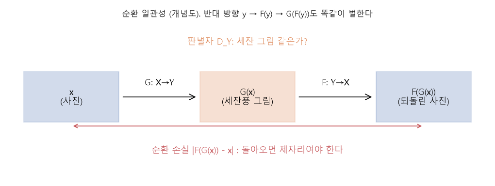
*▲ 직접 그린 그림: [순환 일관성](00_%EB%94%A5%EB%9F%AC%EB%8B%9D_%EC%9A%A9%EC%96%B4%EC%82%AC%EC%A0%84.md#cycle-consistency-%EC%88%9C%ED%99%98-%EC%9D%BC%EA%B4%80%EC%84%B1)(개념도). 판별자는 $G(x)$가 세잔 그림답게 보이는지를, 순환 [손실](00_%EB%94%A5%EB%9F%AC%EB%8B%9D_%EC%9A%A9%EC%96%B4%EC%82%AC%EC%A0%84.md#loss-function-%EC%86%90%EC%8B%A4-%ED%95%A8%EC%88%98)은 되돌린 $F(G(x))$가 원래 사진 $x$와 같은지를 본다*

### 9.4 왜 엉뚱한 대응을 찾지 않나

▶ 영상 [78:11](https://youtu.be/zaMcHuJwe1w?t=4691)

📐 **수학 개념**: [순환 일관성 손실](%EC%88%98%ED%95%99%EA%B0%9C%EB%85%90/11_%EC%83%9D%EC%84%B1_%EB%AA%A8%EB%8D%B8/MM60_%EC%88%9C%ED%99%98_%EC%9D%BC%EA%B4%80%EC%84%B1_%EC%86%90%EC%8B%A4.md) · [ReLU 망이 만드는 함수](%EC%88%98%ED%95%99%EA%B0%9C%EB%85%90/06_%EA%B7%BC%EC%82%AC_%EC%9D%B4%EB%A1%A0/MM14_%EA%BA%BE%EC%9E%84_%EC%88%98%EC%99%80_%EA%B9%8A%EC%9D%B4_%EB%B6%84%EB%A6%AC.md)

두 이미지 집합 사이의 순환 일관적인 대응은 무수히 많습니다. 그런데도 그럴듯한 것을 찾는 이유에 대한 이론이 있습니다(Galanti, Wolf, Benaim, ICLR 2018). **특정 신경망 구조와 최적화의 제약 아래에서는 가능한 대응 중 일부만 찾아진다**는 것입니다. 신경망은 단순한 매핑을 찾는 경향이 있습니다([Lec06 8.2](Lec06_%EC%9D%BC%EB%B0%98%ED%99%94_%EC%9D%B4%EB%A1%A0.md#82-%ED%8C%8C%EB%9D%BC%EB%AF%B8%ED%84%B0-%ED%95%A8%EC%88%98-%EC%82%AC%EC%83%81%EC%9D%98-%EB%8B%A8%EC%88%9C%EC%84%B1-%ED%8E%B8%ED%96%A5)).

- 예: [은닉 상태](00_%EB%94%A5%EB%9F%AC%EB%8B%9D_%EC%9A%A9%EC%96%B4%EC%82%AC%EC%A0%84.md#hidden-state-%EC%9D%80%EB%8B%89-%EC%83%81%ED%83%9C) 2차원의 [ReLU](00_%EB%94%A5%EB%9F%AC%EB%8B%9D_%EC%9A%A9%EC%96%B4%EC%82%AC%EC%A0%84.md#relu-%EB%A0%90%EB%A3%A8) 망으로 선분 A를 선분 B로 보냅니다. 가능한 매핑은 무한하지만, [경사하강법](00_%EB%94%A5%EB%9F%AC%EB%8B%9D_%EC%9A%A9%EC%96%B4%EC%82%AC%EC%A0%84.md#gradient-descent-%EA%B2%BD%EC%82%AC%ED%95%98%EA%B0%95%EB%B2%95)으로 학습하면 **두 가지**만 찾습니다. 하나는 항등 매핑, 다른 하나는 선분을 뒤집는 매핑(음의 항등)입니다.
- A의 모든 점을 B의 무작위 점으로 보내는 복잡한 매핑도 있지만, 우리가 쓰는 구조와 최적화로는 찾기 매우 어렵습니다.
- 그래서 단순한 매핑이라는 제약 아래에서는 "초록은 초록으로" 보내는 쪽이 배우기 쉬운 매핑이 되고, 이것이 초록을 파랑으로 보내는 대응과의 모호함을 풀어 줍니다.

### 9.5 분포 맞추기와 그라운딩

▶ 영상 [79:52](https://youtu.be/zaMcHuJwe1w?t=4792)

이 생각은 짝 없는 언어 번역에서도 쓰입니다. 한 언어에서 다른 언어로 갔다 돌아오는 [역번역](00_%EB%94%A5%EB%9F%AC%EB%8B%9D_%EC%9A%A9%EC%96%B4%EC%82%AC%EC%A0%84.md#back-translation-%EC%97%AD%EB%B2%88%EC%97%AD)([순환 일관성](00_%EB%94%A5%EB%9F%AC%EB%8B%9D_%EC%9A%A9%EC%96%B4%EC%82%AC%EC%A0%84.md#cycle-consistency-%EC%88%9C%ED%99%98-%EC%9D%BC%EA%B4%80%EC%84%B1)) 외에도 여러 요령이 있습니다. 일반적인 생각은 두 모달리티의 **데이터 분포의 모양을 맞추는 것**입니다. 빨강 모달리티의 분포와 파랑 모달리티의 분포가 같은 모양(등거리 변환까지)이어야 한다고 보고, 강체 변환 문제처럼 둘을 정렬합니다(Lample 등 2018, 자연어 처리의 분포 정렬 연구).

강사가 마지막으로 남기는 생각은 **조건부 예측에 늘 짝 데이터가 필요한 것은 아니라는 것**입니다. 짝짓기의 다른 이름은 **[그라운딩](00_%EB%94%A5%EB%9F%AC%EB%8B%9D_%EC%9A%A9%EC%96%B4%EC%82%AC%EC%A0%84.md#grounding-%EA%B7%B8%EB%9D%BC%EC%9A%B4%EB%94%A9)**(grounding), 곧 한 모달리티를 다른 모달리티에 붙들어 매는 것입니다. 그렇다면 어떤 단어가 물리 세계에서 무엇에 해당하는지 짝지은 예를 한 번도 보지 않고도 그 단어의 뜻을 알아낼 수 있을지도 모릅니다. 이 이야기는 뒤 강의에서 이어집니다.

---

## 10. 정리

- 고차원 대상을 예측하는 **[구조적 예측](00_%EB%94%A5%EB%9F%AC%EB%8B%9D_%EC%9A%A9%EC%96%B4%EC%82%AC%EC%A0%84.md#structured-prediction-%EA%B5%AC%EC%A1%B0%EC%A0%81-%EC%98%88%EC%B8%A1)**은 사실상 모든 문제이고, [생성 모델](00_%EB%94%A5%EB%9F%AC%EB%8B%9D_%EC%9A%A9%EC%96%B4%EC%82%AC%EC%A0%84.md#generative-model-%EC%83%9D%EC%84%B1-%EB%AA%A8%EB%8D%B8)은 **[다봉 분포](00_%EB%94%A5%EB%9F%AC%EB%8B%9D_%EC%9A%A9%EC%96%B4%EC%82%AC%EC%A0%84.md#multimodal-distribution-%EB%8B%A4%EB%B4%89-%EB%B6%84%ED%8F%AC)**와 **결합 의존성**을 함께 다루므로 이 문제에 맞는 도구입니다.
- 비구조적 목적(픽셀별 제곱 [오차](00_%EB%94%A5%EB%9F%AC%EB%8B%9D_%EC%9A%A9%EC%96%B4%EC%82%AC%EC%A0%84.md#error-%EC%98%A4%EC%B0%A8), 픽셀별 [분류](00_%EB%94%A5%EB%9F%AC%EB%8B%9D_%EC%9A%A9%EC%96%B4%EC%82%AC%EC%A0%84.md#regression-classification-%ED%9A%8C%EA%B7%80%EC%99%80-%EB%B6%84%EB%A5%98))은 평균을 내서 흐릿하고 칙칙해지거나, 픽셀마다 따로 골라 얼룩집니다. [가설 공간](00_%EB%94%A5%EB%9F%AC%EB%8B%9D_%EC%9A%A9%EC%96%B4%EC%82%AC%EC%A0%84.md#hypothesis-space-%EA%B0%80%EC%84%A4-%EA%B3%B5%EA%B0%84)을 키워도 목적 함수가 구조를 보지 않으면 성능이 포화합니다.
- **[조건부 GAN](00_%EB%94%A5%EB%9F%AC%EB%8B%9D_%EC%9A%A9%EC%96%B4%EC%82%AC%EC%A0%84.md#conditional-gan-%EC%A1%B0%EA%B1%B4%EB%B6%80-gan)**은 판별자를 학습된 [손실](00_%EB%94%A5%EB%9F%AC%EB%8B%9D_%EC%9A%A9%EC%96%B4%EC%82%AC%EC%A0%84.md#loss-function-%EC%86%90%EC%8B%A4-%ED%95%A8%EC%88%98)로 쓰고, 판별자가 (입력, 출력) 쌍을 보게 합니다. 패치 크기가 [손실](00_%EB%94%A5%EB%9F%AC%EB%8B%9D_%EC%9A%A9%EC%96%B4%EC%82%AC%EC%A0%84.md#loss-function-%EC%86%90%EC%8B%A4-%ED%95%A8%EC%88%98)이 보는 구조의 범위를 정합니다. 선명해지는 대가로 [환각](00_%EB%94%A5%EB%9F%AC%EB%8B%9D_%EC%9A%A9%EC%96%B4%EC%82%AC%EC%A0%84.md#hallucination-%ED%99%98%EA%B0%81)이 생깁니다.
- **[조건부 VAE](00_%EB%94%A5%EB%9F%AC%EB%8B%9D_%EC%9A%A9%EC%96%B4%EC%82%AC%EC%A0%84.md#conditional-vae-%EC%A1%B0%EA%B1%B4%EB%B6%80-vae)**는 [잠재 변수](00_%EB%94%A5%EB%9F%AC%EB%8B%9D_%EC%9A%A9%EC%96%B4%EC%82%AC%EC%A0%84.md#latent-variable-%EC%9E%A0%EC%9E%AC-%EB%B3%80%EC%88%98) $z$가 조건에 없는 정보만 담게 해 여러 출력을 표본으로 뽑습니다. 출력을 조절하는 손잡이는 조건 $\mathbf{x}$와 [잠재 변수](00_%EB%94%A5%EB%9F%AC%EB%8B%9D_%EC%9A%A9%EC%96%B4%EC%82%AC%EC%A0%84.md#latent-variable-%EC%9E%A0%EC%9E%AC-%EB%B3%80%EC%88%98) $z$ 두 가지입니다.
- **[자기회귀 모델](00_%EB%94%A5%EB%9F%AC%EB%8B%9D_%EC%9A%A9%EC%96%B4%EC%82%AC%EC%A0%84.md#autoregressive-model-%EC%9E%90%EA%B8%B0%ED%9A%8C%EA%B7%80-%EB%AA%A8%EB%8D%B8)**은 원래 조건부이고([프롬프팅](00_%EB%94%A5%EB%9F%AC%EB%8B%9D_%EC%9A%A9%EC%96%B4%EC%82%AC%EC%A0%84.md#prompting-%ED%94%84%EB%A1%AC%ED%94%84%ED%8C%85)), 이미지 → 텍스트는 [토큰](00_%EB%94%A5%EB%9F%AC%EB%8B%9D_%EC%9A%A9%EC%96%B4%EC%82%AC%EC%A0%84.md#token-%ED%86%A0%ED%81%B0)과 [교차 어텐션](00_%EB%94%A5%EB%9F%AC%EB%8B%9D_%EC%9A%A9%EC%96%B4%EC%82%AC%EC%A0%84.md#cross-attention-%EA%B5%90%EC%B0%A8-%EC%96%B4%ED%85%90%EC%85%98)으로, 텍스트 → 이미지는 [조건부 VAE](00_%EB%94%A5%EB%9F%AC%EB%8B%9D_%EC%9A%A9%EC%96%B4%EC%82%AC%EC%A0%84.md#conditional-vae-%EC%A1%B0%EA%B1%B4%EB%B6%80-vae)나 [잡음 제거기](00_%EB%94%A5%EB%9F%AC%EB%8B%9D_%EC%9A%A9%EC%96%B4%EC%82%AC%EC%A0%84.md#denoiser-%EC%9E%A1%EC%9D%8C-%EC%A0%9C%EA%B1%B0%EA%B8%B0)에 글을 넣은 [확산 모델](00_%EB%94%A5%EB%9F%AC%EB%8B%9D_%EC%9A%A9%EC%96%B4%EC%82%AC%EC%A0%84.md#diffusion-model-%ED%99%95%EC%82%B0-%EB%AA%A8%EB%8D%B8)로 풉니다. 실제 모델은 [GAN](00_%EB%94%A5%EB%9F%AC%EB%8B%9D_%EC%9A%A9%EC%96%B4%EC%82%AC%EC%A0%84.md#gan-generative-adversarial-network-%EC%83%9D%EC%84%B1%EC%A0%81-%EC%A0%81%EB%8C%80-%EC%8B%A0%EA%B2%BD%EB%A7%9D), [VAE](00_%EB%94%A5%EB%9F%AC%EB%8B%9D_%EC%9A%A9%EC%96%B4%EC%82%AC%EC%A0%84.md#variational-autoencoder-vae-%EB%B3%80%EB%B6%84-%EC%98%A4%ED%86%A0%EC%9D%B8%EC%BD%94%EB%8D%94), 확산, 자기회귀를 섞습니다.
- **짝 없는 데이터**에서도 판별자(도메인다운가)와 [순환 일관성](00_%EB%94%A5%EB%9F%AC%EB%8B%9D_%EC%9A%A9%EC%96%B4%EC%82%AC%EC%A0%84.md#cycle-consistency-%EC%88%9C%ED%99%98-%EC%9D%BC%EA%B4%80%EC%84%B1)(되돌릴 수 있는가), 그리고 신경망의 [단순성 편향](00_%EB%94%A5%EB%9F%AC%EB%8B%9D_%EC%9A%A9%EC%96%B4%EC%82%AC%EC%A0%84.md#simplicity-bias-%EB%8B%A8%EC%88%9C%EC%84%B1-%ED%8E%B8%ED%96%A5)으로 조건부 변환을 배울 수 있습니다.

---

## 11. 용어 정리

용어사전에 있는 용어는 위 본문에 링크를 걸었습니다. 아래는 이번 강의에서 새로 나온 용어입니다.

| 용어 | 뜻 |
|---|---|
| [구조적 예측](00_%EB%94%A5%EB%9F%AC%EB%8B%9D_%EC%9A%A9%EC%96%B4%EC%82%AC%EC%A0%84.md#structured-prediction-%EA%B5%AC%EC%A1%B0%EC%A0%81-%EC%98%88%EC%B8%A1)(Structured prediction) | 차원끼리 엮여 독립인 곱으로 쪼개지지 않는 고차원 출력을 예측하는 것 |
| [결합 분포](00_%EB%94%A5%EB%9F%AC%EB%8B%9D_%EC%9A%A9%EC%96%B4%EC%82%AC%EC%A0%84.md#joint-distribution-%EA%B2%B0%ED%95%A9-%EB%B6%84%ED%8F%AC)(Joint distribution) | 여러 값이 동시에 그렇게 나올 [확률](00_%EB%94%A5%EB%9F%AC%EB%8B%9D_%EC%9A%A9%EC%96%B4%EC%82%AC%EC%A0%84.md#probability-%ED%99%95%EB%A5%A0) |
| [조건부 확률](00_%EB%94%A5%EB%9F%AC%EB%8B%9D_%EC%9A%A9%EC%96%B4%EC%82%AC%EC%A0%84.md#conditional-probability-%EC%A1%B0%EA%B1%B4%EB%B6%80-%ED%99%95%EB%A5%A0)(Conditional probability) | 어떤 값을 알 때 다른 값의 [확률](00_%EB%94%A5%EB%9F%AC%EB%8B%9D_%EC%9A%A9%EC%96%B4%EC%82%AC%EC%A0%84.md#probability-%ED%99%95%EB%A5%A0) $p(y \mid x) = p(x, y)/p(x)$ |
| [독립](00_%EB%94%A5%EB%9F%AC%EB%8B%9D_%EC%9A%A9%EC%96%B4%EC%82%AC%EC%A0%84.md#independence-%EB%8F%85%EB%A6%BD)([Independence](00_%EB%94%A5%EB%9F%AC%EB%8B%9D_%EC%9A%A9%EC%96%B4%EC%82%AC%EC%A0%84.md#independence-%EB%8F%85%EB%A6%BD)) | 한 값을 알아도 다른 값의 [확률](00_%EB%94%A5%EB%9F%AC%EB%8B%9D_%EC%9A%A9%EC%96%B4%EC%82%AC%EC%A0%84.md#probability-%ED%99%95%EB%A5%A0)이 바뀌지 않음. [결합 분포](00_%EB%94%A5%EB%9F%AC%EB%8B%9D_%EC%9A%A9%EC%96%B4%EC%82%AC%EC%A0%84.md#joint-distribution-%EA%B2%B0%ED%95%A9-%EB%B6%84%ED%8F%AC)가 곱으로 쪼개짐 |
| [베이즈 정리](00_%EB%94%A5%EB%9F%AC%EB%8B%9D_%EC%9A%A9%EC%96%B4%EC%82%AC%EC%A0%84.md#bayes-rule-%EB%B2%A0%EC%9D%B4%EC%A6%88-%EC%A0%95%EB%A6%AC)([Bayes' rule](00_%EB%94%A5%EB%9F%AC%EB%8B%9D_%EC%9A%A9%EC%96%B4%EC%82%AC%EC%A0%84.md#bayes-rule-%EB%B2%A0%EC%9D%B4%EC%A6%88-%EC%A0%95%EB%A6%AC)) | $p(x \mid c) = p(c \mid x)\,p(x)/p(c)$. 증거로 믿음을 갱신 |
| [다봉 분포](00_%EB%94%A5%EB%9F%AC%EB%8B%9D_%EC%9A%A9%EC%96%B4%EC%82%AC%EC%A0%84.md#multimodal-distribution-%EB%8B%A4%EB%B4%89-%EB%B6%84%ED%8F%AC)(Multimodal distribution) | 봉우리(가능성 높은 값)가 여럿인 분포. 평균이 오히려 [확률](00_%EB%94%A5%EB%9F%AC%EB%8B%9D_%EC%9A%A9%EC%96%B4%EC%82%AC%EC%A0%84.md#probability-%ED%99%95%EB%A5%A0) 낮은 값일 수 있음 |
| [조건부 GAN](00_%EB%94%A5%EB%9F%AC%EB%8B%9D_%EC%9A%A9%EC%96%B4%EC%82%AC%EC%A0%84.md#conditional-gan-%EC%A1%B0%EA%B1%B4%EB%B6%80-gan)([Conditional GAN](00_%EB%94%A5%EB%9F%AC%EB%8B%9D_%EC%9A%A9%EC%96%B4%EC%82%AC%EC%A0%84.md#conditional-gan-%EC%A1%B0%EA%B1%B4%EB%B6%80-gan)) | 생성자와 판별자가 조건(입력)을 함께 받는 [GAN](00_%EB%94%A5%EB%9F%AC%EB%8B%9D_%EC%9A%A9%EC%96%B4%EC%82%AC%EC%A0%84.md#gan-generative-adversarial-network-%EC%83%9D%EC%84%B1%EC%A0%81-%EC%A0%81%EB%8C%80-%EC%8B%A0%EA%B2%BD%EB%A7%9D) |
| [패치 판별자](00_%EB%94%A5%EB%9F%AC%EB%8B%9D_%EC%9A%A9%EC%96%B4%EC%82%AC%EC%A0%84.md#patchgan-%ED%8C%A8%EC%B9%98-%ED%8C%90%EB%B3%84%EC%9E%90)([PatchGAN](00_%EB%94%A5%EB%9F%AC%EB%8B%9D_%EC%9A%A9%EC%96%B4%EC%82%AC%EC%A0%84.md#patchgan-%ED%8C%A8%EC%B9%98-%ED%8C%90%EB%B3%84%EC%9E%90)) | 이미지의 패치마다 진짜/가짜를 판정하는 [합성곱](00_%EB%94%A5%EB%9F%AC%EB%8B%9D_%EC%9A%A9%EC%96%B4%EC%82%AC%EC%A0%84.md#convolution-%ED%95%A9%EC%84%B1%EA%B3%B1) 판별자 |
| [환각](00_%EB%94%A5%EB%9F%AC%EB%8B%9D_%EC%9A%A9%EC%96%B4%EC%82%AC%EC%A0%84.md#hallucination-%ED%99%98%EA%B0%81)([Hallucination](00_%EB%94%A5%EB%9F%AC%EB%8B%9D_%EC%9A%A9%EC%96%B4%EC%82%AC%EC%A0%84.md#hallucination-%ED%99%98%EA%B0%81)) | 그럴듯하지만 실제와 다른 내용을 생성하는 것 |
| [모드 붕괴](00_%EB%94%A5%EB%9F%AC%EB%8B%9D_%EC%9A%A9%EC%96%B4%EC%82%AC%EC%A0%84.md#mode-collapse-%EB%AA%A8%EB%93%9C-%EB%B6%95%EA%B4%B4)([Mode collapse](00_%EB%94%A5%EB%9F%AC%EB%8B%9D_%EC%9A%A9%EC%96%B4%EC%82%AC%EC%A0%84.md#mode-collapse-%EB%AA%A8%EB%93%9C-%EB%B6%95%EA%B4%B4)) | 생성자가 분포의 일부 봉우리만 내놓고 나머지를 놓치는 현상 |
| [조건부 VAE](00_%EB%94%A5%EB%9F%AC%EB%8B%9D_%EC%9A%A9%EC%96%B4%EC%82%AC%EC%A0%84.md#conditional-vae-%EC%A1%B0%EA%B1%B4%EB%B6%80-vae)([Conditional VAE](00_%EB%94%A5%EB%9F%AC%EB%8B%9D_%EC%9A%A9%EC%96%B4%EC%82%AC%EC%A0%84.md#conditional-vae-%EC%A1%B0%EA%B1%B4%EB%B6%80-vae)) | 디코더가 조건을 받고 [잠재 변수](00_%EB%94%A5%EB%9F%AC%EB%8B%9D_%EC%9A%A9%EC%96%B4%EC%82%AC%EC%A0%84.md#latent-variable-%EC%9E%A0%EC%9E%AC-%EB%B3%80%EC%88%98)가 조건에 없는 정보만 담는 [VAE](00_%EB%94%A5%EB%9F%AC%EB%8B%9D_%EC%9A%A9%EC%96%B4%EC%82%AC%EC%A0%84.md#variational-autoencoder-vae-%EB%B3%80%EB%B6%84-%EC%98%A4%ED%86%A0%EC%9D%B8%EC%BD%94%EB%8D%94) |
| [프롬프팅](00_%EB%94%A5%EB%9F%AC%EB%8B%9D_%EC%9A%A9%EC%96%B4%EC%82%AC%EC%A0%84.md#prompting-%ED%94%84%EB%A1%AC%ED%94%84%ED%8C%85)([Prompting](00_%EB%94%A5%EB%9F%AC%EB%8B%9D_%EC%9A%A9%EC%96%B4%EC%82%AC%EC%A0%84.md#prompting-%ED%94%84%EB%A1%AC%ED%94%84%ED%8C%85)) | 조건이 되는 입력을 앞에 붙여 [언어 모델](00_%EB%94%A5%EB%9F%AC%EB%8B%9D_%EC%9A%A9%EC%96%B4%EC%82%AC%EC%A0%84.md#language-model-%EC%96%B8%EC%96%B4-%EB%AA%A8%EB%8D%B8)을 조건부 예측에 쓰는 것 |
| [이미지 캡셔닝](00_%EB%94%A5%EB%9F%AC%EB%8B%9D_%EC%9A%A9%EC%96%B4%EC%82%AC%EC%A0%84.md#image-captioning-%EC%9D%B4%EB%AF%B8%EC%A7%80-%EC%BA%A1%EC%85%94%EB%8B%9D)(Image captioning) | 이미지를 보고 설명 문장을 생성하는 과제 |
| [시각 질의응답](00_%EB%94%A5%EB%9F%AC%EB%8B%9D_%EC%9A%A9%EC%96%B4%EC%82%AC%EC%A0%84.md#visual-question-answering-%EC%8B%9C%EA%B0%81-%EC%A7%88%EC%9D%98%EC%9D%91%EB%8B%B5)(Visual question answering) | 이미지와 질문을 받아 답을 생성하는 과제 |
| [확산 트랜스포머](00_%EB%94%A5%EB%9F%AC%EB%8B%9D_%EC%9A%A9%EC%96%B4%EC%82%AC%EC%A0%84.md#diffusion-transformer-%ED%99%95%EC%82%B0-%ED%8A%B8%EB%9E%9C%EC%8A%A4%ED%8F%AC%EB%A8%B8)(Diffusion transformer) | [확산 모델](00_%EB%94%A5%EB%9F%AC%EB%8B%9D_%EC%9A%A9%EC%96%B4%EC%82%AC%EC%A0%84.md#diffusion-model-%ED%99%95%EC%82%B0-%EB%AA%A8%EB%8D%B8)의 잡음 예측 신경망으로 [U-Net](00_%EB%94%A5%EB%9F%AC%EB%8B%9D_%EC%9A%A9%EC%96%B4%EC%82%AC%EC%A0%84.md#u-net-%EC%9C%A0%EB%84%B7) 대신 [트랜스포머](00_%EB%94%A5%EB%9F%AC%EB%8B%9D_%EC%9A%A9%EC%96%B4%EC%82%AC%EC%A0%84.md#transformer-%ED%8A%B8%EB%9E%9C%EC%8A%A4%ED%8F%AC%EB%A8%B8)를 쓰는 구조 |
| [분류기 없는 가이던스](00_%EB%94%A5%EB%9F%AC%EB%8B%9D_%EC%9A%A9%EC%96%B4%EC%82%AC%EC%A0%84.md#classifier-free-guidance-%EB%B6%84%EB%A5%98%EA%B8%B0-%EC%97%86%EB%8A%94-%EA%B0%80%EC%9D%B4%EB%8D%98%EC%8A%A4)(Classifier-free guidance) | 조건부·비조건부 예측의 차이를 키워 조건을 더 세게 따르게 하는 [샘플링](00_%EB%94%A5%EB%9F%AC%EB%8B%9D_%EC%9A%A9%EC%96%B4%EC%82%AC%EC%A0%84.md#sampling-%EC%83%98%ED%94%8C%EB%A7%81) 방법 |
| [짝 없는 변환](00_%EB%94%A5%EB%9F%AC%EB%8B%9D_%EC%9A%A9%EC%96%B4%EC%82%AC%EC%A0%84.md#unpaired-translation-%EC%A7%9D-%EC%97%86%EB%8A%94-%EB%B3%80%ED%99%98)(Unpaired translation) | 짝지어진 예 없이 두 도메인 사이의 변환을 배우는 것 |
| [순환 일관성](00_%EB%94%A5%EB%9F%AC%EB%8B%9D_%EC%9A%A9%EC%96%B4%EC%82%AC%EC%A0%84.md#cycle-consistency-%EC%88%9C%ED%99%98-%EC%9D%BC%EA%B4%80%EC%84%B1)(Cycle consistency) | 갔다가 돌아오면 제자리여야 한다는 제약 |
| [역번역](00_%EB%94%A5%EB%9F%AC%EB%8B%9D_%EC%9A%A9%EC%96%B4%EC%82%AC%EC%A0%84.md#back-translation-%EC%97%AD%EB%B2%88%EC%97%AD)([Back translation](00_%EB%94%A5%EB%9F%AC%EB%8B%9D_%EC%9A%A9%EC%96%B4%EC%82%AC%EC%A0%84.md#back-translation-%EC%97%AD%EB%B2%88%EC%97%AD)) | 번역한 문장을 다시 원래 언어로 번역해 일관성을 확인하는 것 |
| [그라운딩](00_%EB%94%A5%EB%9F%AC%EB%8B%9D_%EC%9A%A9%EC%96%B4%EC%82%AC%EC%A0%84.md#grounding-%EA%B7%B8%EB%9D%BC%EC%9A%B4%EB%94%A9)([Grounding](00_%EB%94%A5%EB%9F%AC%EB%8B%9D_%EC%9A%A9%EC%96%B4%EC%82%AC%EC%A0%84.md#grounding-%EA%B7%B8%EB%9D%BC%EC%9A%B4%EB%94%A9)) | 한 모달리티(예: 단어)를 다른 모달리티(예: 물리 세계)에 대응시키는 것 |
