# Lec 17. 분포 밖 일반화 (Generalization: Out-of-Distribution)

← 이전: [Lec16_조건부_생성_모델](Lec16_%EC%A1%B0%EA%B1%B4%EB%B6%80_%EC%83%9D%EC%84%B1_%EB%AA%A8%EB%8D%B8.md) · [목차](00_MIT%EB%94%A5%EB%9F%AC%EB%8B%9D_%EB%AA%A9%EC%B0%A8.md) · 다음: [Lec18_전이_학습_모델](Lec18_%EC%A0%84%EC%9D%B4_%ED%95%99%EC%8A%B5_%EB%AA%A8%EB%8D%B8.md) →

> [!NOTE]
> **강의 정보**
> - **출처**: MIT OpenCourseWare, [Lec 17. Generalization: Out-of-Distribution (OOD)](https://www.youtube.com/watch?v=tjD9LIzIIek) (64분, 2024년 가을 학기)
> - **강사**: Sara Beery
> - **라이선스**: 원 강의는 CC BY-NC-SA 4.0입니다. 이 노트는 영어 자막을 바탕으로 한국어로 옮겨 정리한 2차 저작물이며, 같은 조건(비영리·출처 표기·동일 조건 공유)을 따릅니다.
> - 각 절 제목 아래의 `▶ 영상` 시간을 누르면 영상의 해당 위치로 갑니다.
> - `📐 수학 개념` 줄은 그 절에 쓰인 수학을 정리한 노트로 연결됩니다. 전체 목록은 [00_MIT딥러닝_목차](00_MIT%EB%94%A5%EB%9F%AC%EB%8B%9D_%EB%AA%A9%EC%B0%A8.md).
> - 슬라이드 캡처는 원 강의(CC BY-NC-SA 4.0)에서 가져왔고, "직접 그린 그림"은 이 노트의 숫자로 새로 그렸습니다.
> - `🆕 2026 업데이트` 칸은 강의(2024년 가을) 이후 바뀐 내용을 덧붙인 것입니다.

## 한눈에 보기

| 구분 | 내용 |
|---|---|
| 핵심 질문 | [학습 데이터](00_%EB%94%A5%EB%9F%AC%EB%8B%9D_%EC%9A%A9%EC%96%B4%EC%82%AC%EC%A0%84.md#training-data-test-data-%ED%95%99%EC%8A%B5-%EB%8D%B0%EC%9D%B4%ED%84%B0%EC%99%80-%EC%8B%9C%ED%97%98-%EB%8D%B0%EC%9D%B4%ED%84%B0)가 다루지 않은 데이터에서도 모형이 잘 작동하게 할 수 있는가? ([분포 밖 일반화](00_%EB%94%A5%EB%9F%AC%EB%8B%9D_%EC%9A%A9%EC%96%B4%EC%82%AC%EC%A0%84.md#out-of-distribution-generalization-%EB%B6%84%ED%8F%AC-%EB%B0%96-%EC%9D%BC%EB%B0%98%ED%99%94)) |
| 표준 가정과 현실 | 이론과 실무는 [학습](00_%EB%94%A5%EB%9F%AC%EB%8B%9D_%EC%9A%A9%EC%96%B4%EC%82%AC%EC%A0%84.md#training-%ED%95%99%EC%8A%B5) 분포 = 시험 분포([i.i.d.](00_%EB%94%A5%EB%9F%AC%EB%8B%9D_%EC%9A%A9%EC%96%B4%EC%82%AC%EC%A0%84.md#iid-independent-and-identically-distributed-%EB%8F%85%EB%A6%BD-%EB%8F%99%EC%9D%BC-%EB%B6%84%ED%8F%AC))를 가정하지만, 세상은 계속 바뀌므로 현실에서는 **한 번도 참이 아니다** |
| 두 갈래 | **[적대적 예제](00_%EB%94%A5%EB%9F%AC%EB%8B%9D_%EC%9A%A9%EC%96%B4%EC%82%AC%EC%A0%84.md#adversarial-example-%EC%A0%81%EB%8C%80%EC%A0%81-%EC%98%88%EC%A0%9C)**: 데이터 한 점을 아주 조금 흔들기 / **[분포 이동](00_%EB%94%A5%EB%9F%AC%EB%8B%9D_%EC%9A%A9%EC%96%B4%EC%82%AC%EC%A0%84.md#distribution-shift-%EB%B6%84%ED%8F%AC-%EC%9D%B4%EB%8F%99)**: 분포 전체가 바뀌기 |
| [적대적 예제](00_%EB%94%A5%EB%9F%AC%EB%8B%9D_%EC%9A%A9%EC%96%B4%EC%82%AC%EC%A0%84.md#adversarial-example-%EC%A0%81%EB%8C%80%EC%A0%81-%EC%98%88%EC%A0%9C) | 사람 눈엔 같은 그림인데 예측이 바뀐다. $L_\infty$ 공 안에서 [투영 경사 상승](00_%EB%94%A5%EB%9F%AC%EB%8B%9D_%EC%9A%A9%EC%96%B4%EC%82%AC%EC%A0%84.md#projected-gradient-ascent-%ED%88%AC%EC%98%81-%EA%B2%BD%EC%82%AC-%EC%83%81%EC%8A%B9)으로 찾고, min-max [적대적 학습](00_%EB%94%A5%EB%9F%AC%EB%8B%9D_%EC%9A%A9%EC%96%B4%EC%82%AC%EC%A0%84.md#adversarial-training-%EC%A0%81%EB%8C%80%EC%A0%81-%ED%95%99%EC%8A%B5)으로 막는다 |
| 원인 | 모형은 [정답](00_%EB%94%A5%EB%9F%AC%EB%8B%9D_%EC%9A%A9%EC%96%B4%EC%82%AC%EC%A0%84.md#label-%EC%A0%95%EB%8B%B5)과 상관된 모든 신호, 특히 가장 쉬운 신호를 쓴다: [비강건한 특징](00_%EB%94%A5%EB%9F%AC%EB%8B%9D_%EC%9A%A9%EC%96%B4%EC%82%AC%EC%A0%84.md#robust-and-non-robust-features-%EA%B0%95%EA%B1%B4%ED%95%9C-%ED%8A%B9%EC%A7%95%EA%B3%BC-%EB%B9%84%EA%B0%95%EA%B1%B4%ED%95%9C-%ED%8A%B9%EC%A7%95), [지름길](00_%EB%94%A5%EB%9F%AC%EB%8B%9D_%EC%9A%A9%EC%96%B4%EC%82%AC%EC%A0%84.md#shortcut-learning-%EC%A7%80%EB%A6%84%EA%B8%B8-%ED%95%99%EC%8A%B5). 상관은 데이터에서 온다 |
| [분포 이동](00_%EB%94%A5%EB%9F%AC%EB%8B%9D_%EC%9A%A9%EC%96%B4%EC%82%AC%EC%A0%84.md#distribution-shift-%EB%B6%84%ED%8F%AC-%EC%9D%B4%EB%8F%99) 대처 | [DRO](00_%EB%94%A5%EB%9F%AC%EB%8B%9D_%EC%9A%A9%EC%96%B4%EC%82%AC%EC%A0%84.md#distributionally-robust-optimization-%EB%B6%84%ED%8F%AC%EC%A0%81%EC%9C%BC%EB%A1%9C-%EA%B0%95%EA%B1%B4%ED%95%9C-%EC%B5%9C%EC%A0%81%ED%99%94)(최악의 분포에 대비), 하위 집단 [사전 확률](00_%EB%94%A5%EB%9F%AC%EB%8B%9D_%EC%9A%A9%EC%96%B4%EC%82%AC%EC%A0%84.md#bayes-rule-%EB%B2%A0%EC%9D%B4%EC%A6%88-%EC%A0%95%EB%A6%AC), [도메인 적응](00_%EB%94%A5%EB%9F%AC%EB%8B%9D_%EC%9A%A9%EC%96%B4%EC%82%AC%EC%A0%84.md#domain-adaptation-%EB%8F%84%EB%A9%94%EC%9D%B8-%EC%A0%81%EC%9D%91), 실패 진단. 그러나 가장 잘 듣는 처방은 **배포 환경을 대표하는 데이터** |
| 이전 강의 | [Lec06 일반화 이론](Lec06_%EC%9D%BC%EB%B0%98%ED%99%94_%EC%9D%B4%EB%A1%A0.md) (분포 안 [일반화](00_%EB%94%A5%EB%9F%AC%EB%8B%9D_%EC%9A%A9%EC%96%B4%EC%82%AC%EC%A0%84.md#generalization-%EC%9D%BC%EB%B0%98%ED%99%94)의 이론), [Lec16 조건부 생성 모델](Lec16_%EC%A1%B0%EA%B1%B4%EB%B6%80_%EC%83%9D%EC%84%B1_%EB%AA%A8%EB%8D%B8.md) |
| 다음 강의 | Lec18 ([도메인 적응](00_%EB%94%A5%EB%9F%AC%EB%8B%9D_%EC%9A%A9%EC%96%B4%EC%82%AC%EC%A0%84.md#domain-adaptation-%EB%8F%84%EB%A9%94%EC%9D%B8-%EC%A0%81%EC%9D%91) 등 계속) |

---

## 1. 왜 분포 밖 일반화인가

▶ 영상 [00:00](https://youtu.be/tjD9LIzIIek?t=0)

강사는 생성 모형에서 넘어와 오늘부터 **[분포 밖 일반화](00_%EB%94%A5%EB%9F%AC%EB%8B%9D_%EC%9A%A9%EC%96%B4%EC%82%AC%EC%A0%84.md#out-of-distribution-generalization-%EB%B6%84%ED%8F%AC-%EB%B0%96-%EC%9D%BC%EB%B0%98%ED%99%94)(Out-of-distribution generalization)**를 다룬다고 소개합니다. [학습](00_%EB%94%A5%EB%9F%AC%EB%8B%9D_%EC%9A%A9%EC%96%B4%EC%82%AC%EC%A0%84.md#training-%ED%95%99%EC%8A%B5) 분포가 명시적으로 덮지 않는 데이터에 일반화하는 능력은 현대 기계 [학습](00_%EB%94%A5%EB%9F%AC%EB%8B%9D_%EC%9A%A9%EC%96%B4%EC%82%AC%EC%A0%84.md#training-%ED%95%99%EC%8A%B5)에서 가장 큰 미해결 과제 가운데 하나라고 봅니다.

- **성공담**: ImageNet 같은 데이터의 단순한 범주 [분류](00_%EB%94%A5%EB%9F%AC%EB%8B%9D_%EC%9A%A9%EC%96%B4%EC%82%AC%EC%A0%84.md#regression-classification-%ED%9A%8C%EA%B7%80%EC%99%80-%EB%B6%84%EB%A5%98)는 (애매하거나 잘못 라벨링된 몇몇 경우를 빼면) 사실상 풀렸습니다. 이미지 생성, 전략 게임, 기계 번역, 로봇 조작에서도 성공이 나옵니다.
- **아직 안 되는 곳**: 자율 주행차가 한 예입니다. Waymo처럼 여러 지역에 차량을 배치하기 시작했지만, 대규모로 퍼지지 못하는 큰 이유는 ([규제](00_%EB%94%A5%EB%9F%AC%EB%8B%9D_%EC%9A%A9%EC%96%B4%EC%82%AC%EC%A0%84.md#regularization-%EA%B7%9C%EC%A0%9C)와 함께) 모형의 **강건성을 보장할 방법이 없다**는 것입니다. 해로운 실수를 하지 않는다고 장담할 수 없습니다.
- **배포되는 AI와 안 되는 AI의 차이는 위험(risk)**: 지금 널리 쓰이는 AI는 대부분 강사의 말로 **"정밀도 높은 사람 [검증](00_%EB%94%A5%EB%9F%AC%EB%8B%9D_%EC%9A%A9%EC%96%B4%EC%82%AC%EC%A0%84.md#validation-data-%EA%B2%80%EC%A6%9D-%EB%8D%B0%EC%9D%B4%ED%84%B0) 시스템"**입니다. 모형은 대부분 쓸모 있을 만큼 좋으면 되고, 사람이 고리 안에서 결과를 고칩니다([사람 개입 검증](00_%EB%94%A5%EB%9F%AC%EB%8B%9D_%EC%9A%A9%EC%96%B4%EC%82%AC%EC%A0%84.md#human-in-the-loop-%EC%82%AC%EB%9E%8C-%EA%B0%9C%EC%9E%85-%EA%B2%80%EC%A6%9D), human-in-the-loop). ChatGPT가 대표적입니다. 결과가 엉망이면 웃고 넘기고 다른 질문을 하면 됩니다. 사람이 고치는 한 [환각](00_%EB%94%A5%EB%9F%AC%EB%8B%9D_%EC%9A%A9%EC%96%B4%EC%82%AC%EC%A0%84.md#hallucination-%ED%99%98%EA%B0%81)(hallucination)도 큰 문제가 아닙니다. 문제는 사람 [검증](00_%EB%94%A5%EB%9F%AC%EB%8B%9D_%EC%9A%A9%EC%96%B4%EC%82%AC%EC%A0%84.md#validation-data-%EA%B2%80%EC%A6%9D-%EB%8D%B0%EC%9D%B4%ED%84%B0) 없이 모형을 믿기 시작할 때 생깁니다.
- **의료의 의사 결정 지원 도구**: 영상의학과 의사가 참고하는 도구로, 최종 판단과 책임은 의사에게 있습니다. 환자 결과를 좋게 한다는 연구와, 의사가 도구에 기대 주의를 덜 기울여 분포의 긴 꼬리(드물지만 중요한 사례)를 놓쳐 오히려 해롭다는 연구가 함께 있어 결론이 나지 않았습니다. 강사는 병원 배포에 필요한 요건이 놀랄 만큼 약하다고 말합니다(작은 집단, 대략 100~1,000명 수준의 [정확도](00_%EB%94%A5%EB%9F%AC%EB%8B%9D_%EC%9A%A9%EC%96%B4%EC%82%AC%EC%A0%84.md#accuracy-%EC%A0%95%ED%99%95%EB%8F%84) 입증, 임상 시험 불필요. 강사도 세부는 정확하지 않을 수 있다고 덧붙임).

> [!TIP]
> **🆕 2026 업데이트: 자율 주행차는 얼마나 퍼졌나**
> - **강의**: Waymo가 여러 지역에 차량을 배치하기 시작했지만, 강건성을 보장할 수 없어 대규모 보급은 아직이다.
> - **현재**: Waymo는 2025년 한 해 운행을 세 배 넘게 늘려 1,500만 회를 기록했고, 2026년 2월 기준 미국 6개 대도시권에서 **주당 40만 회 이상**을 운행하며 누적 2,000만 회를 넘겼다. 같은 달 댈러스·휴스턴·샌안토니오·올랜도에서 운전석이 빈 서비스를 시작했고, 2026년 말까지 주당 100만 회를 목표로 한다고 밝혔다. 2026년 8월에는 독일 뮌헨 진출도 발표했다. 강건성을 수학적으로 보장하는 방법은 여전히 없고, 확장은 지역별 운행 데이터를 쌓아 가며 이루어지고 있다(아래 12.3절의 "대표성 있는 데이터" 처방과 같은 방향).
> - **출처**: [Waymo, Accelerating our global growth: Waymo raises $16 billion investment round (2026)](https://waymo.com/blog/2026/02/waymo-raises-usd16-billion-investment-round/) · [Waymo, Ready to Ride: Dallas, Houston, San Antonio, and Orlando (2026)](https://waymo.com/blog/2026/02/dallas-houston-san-antonio-orlando/) · [Waymo, Servus München: Waymo is Coming to Germany (2026)](https://waymo.com/blog/2026/08/waymo-in-munich/)

> [!TIP]
> **🆕 2026 업데이트: 의료 AI 기기 허가**
> - **강의**: 병원의 의사 결정 지원 도구는 비교적 적은 환자 수의 [정확도](00_%EB%94%A5%EB%9F%AC%EB%8B%9D_%EC%9A%A9%EC%96%B4%EC%82%AC%EC%A0%84.md#accuracy-%EC%A0%95%ED%99%95%EB%8F%84) 입증만으로 배포되고, 효과에 대한 연구 결과도 엇갈린다.
> - **현재**: 미국 FDA는 2025년 7월, 2024년 9월 이후 멈춰 있던 "AI 기반 의료기기 목록"을 갱신했다. 이 갱신 기준 허가된 기기는 1,247개이고, 그중 956개(77%)가 영상의학 분야다. FDA는 이 목록이 모든 AI 기기를 망라하지는 않는다고 밝힌다. 대부분이 기존 기기와의 실질적 동등성을 보이는 510(k) 경로로 허가되므로, 강사가 말한 "가벼운 입증 요건" 문제는 여전하다.
> - **출처**: [FDA, Artificial Intelligence-Enabled Medical Devices (2025)](https://www.fda.gov/medical-devices/software-medical-device-samd/artificial-intelligence-enabled-medical-devices) · [FDA Law Blog, FDA's Latest Lists for Digital Health Technologies (2025)](https://www.thefdalawblog.com/2025/07/fdas-latest-lists-for-digital-health-technologies/)

---

## 2. 표준 가정: 독립 동일 분포

▶ 영상 [06:05](https://youtu.be/tjD9LIzIIek?t=365)

📐 **수학 개념**: [기댓값과 일반화 간극](%EC%88%98%ED%95%99%EA%B0%9C%EB%85%90/04_%ED%99%95%EB%A5%A0%EA%B3%BC_%EC%A0%95%EB%B3%B4/MM22_%EA%B8%B0%EB%8C%93%EA%B0%92%EA%B3%BC_%EC%9D%BC%EB%B0%98%ED%99%94_%EA%B0%84%EA%B7%B9.md) · [확률 기초](%EC%88%98%ED%95%99%EA%B0%9C%EB%85%90/04_%ED%99%95%EB%A5%A0%EA%B3%BC_%EC%A0%95%EB%B3%B4/M08_%ED%99%95%EB%A5%A0_%EA%B8%B0%EC%B4%88.md)

사람 [검증](00_%EB%94%A5%EB%9F%AC%EB%8B%9D_%EC%9A%A9%EC%96%B4%EC%82%AC%EC%A0%84.md#validation-data-%EA%B2%80%EC%A6%9D-%EB%8D%B0%EC%9D%B4%ED%84%B0)이 있는 경우가 바로 기계 [학습](00_%EB%94%A5%EB%9F%AC%EB%8B%9D_%EC%9A%A9%EC%96%B4%EC%82%AC%EC%A0%84.md#training-%ED%95%99%EC%8A%B5)의 표준 설정이고, 이론이 깔고 있는 가정과도 맞습니다. 모형을 학습시키는 데이터와 모형을 쓸 데이터가 **[독립 동일 분포](00_%EB%94%A5%EB%9F%AC%EB%8B%9D_%EC%9A%A9%EC%96%B4%EC%82%AC%EC%A0%84.md#iid-independent-and-identically-distributed-%EB%8F%85%EB%A6%BD-%EB%8F%99%EC%9D%BC-%EB%B6%84%ED%8F%AC)([i.i.d.](00_%EB%94%A5%EB%9F%AC%EB%8B%9D_%EC%9A%A9%EC%96%B4%EC%82%AC%EC%A0%84.md#iid-independent-and-identically-distributed-%EB%8F%85%EB%A6%BD-%EB%8F%99%EC%9D%BC-%EB%B6%84%ED%8F%AC), Independent and Identically Distributed)**라는 가정입니다. 관심 범주와 각 범주 안의 시각적 특징에 대한 분포가 하나 있고, 거기서 무작위로 뽑아 학습하고 나머지에 추론합니다. **[학습](00_%EB%94%A5%EB%9F%AC%EB%8B%9D_%EC%9A%A9%EC%96%B4%EC%82%AC%EC%A0%84.md#training-%ED%95%99%EC%8A%B5) 분포 = 시험 분포**입니다. [Lec06 1절](Lec06_%EC%9D%BC%EB%B0%98%ED%99%94_%EC%9D%B4%EB%A1%A0.md#1-%EA%B7%BC%EC%82%AC-%EC%B5%9C%EC%A0%81%ED%99%94-%EC%9D%BC%EB%B0%98%ED%99%94)의 [일반화 간극](00_%EB%94%A5%EB%9F%AC%EB%8B%9D_%EC%9A%A9%EC%96%B4%EC%82%AC%EC%A0%84.md#generalization-gap-%EC%9D%BC%EB%B0%98%ED%99%94-%EA%B0%84%EA%B7%B9)과 [VC 한계](Lec06_%EC%9D%BC%EB%B0%98%ED%99%94_%EC%9D%B4%EB%A1%A0.md#7-vc-%EC%9D%B4%EB%A1%A0%EA%B3%BC-%EA%B7%B8-%ED%95%9C%EA%B3%84)도 모두 이 가정 위에 서 있습니다.

> 강사: "이것은 현실 세계에서 **한 번도 참이었던 적이 없습니다**."

- 모든 현실을 대표하는 데이터셋은 존재한 적이 없습니다. 수십억 장의 이미지를 모은 거대 데이터셋은 "가진 데이터를 다 쓰면 대표성에 가까워지겠지"라는 순수 규모 전략입니다.
- 그래도 안 되는 이유는 **세상이 바뀌기 때문**입니다. 오늘 데이터를 다 모아도 한 주, 한 달 뒤를 대표하지 못합니다.

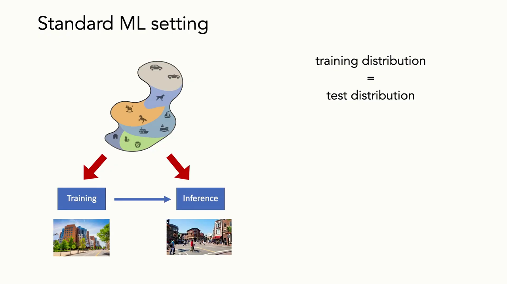
*▲ 강의 슬라이드 [06:20](https://youtu.be/tjD9LIzIIek?t=380): 표준 ML 설정. 하나의 분포에서 학습용과 추론용을 뽑으므로 [학습](00_%EB%94%A5%EB%9F%AC%EB%8B%9D_%EC%9A%A9%EC%96%B4%EC%82%AC%EC%A0%84.md#training-%ED%95%99%EC%8A%B5) 분포 = 시험 분포*

---

## 3. 분포는 어떻게 바뀌나

▶ 영상 [07:21](https://youtu.be/tjD9LIzIIek?t=441)

배포 환경으로 가면 [학습](00_%EB%94%A5%EB%9F%AC%EB%8B%9D_%EC%9A%A9%EC%96%B4%EC%82%AC%EC%A0%84.md#training-%ED%95%99%EC%8A%B5) 분포와 시험 분포 사이에 근본적인 차이가 생깁니다. 예를 들어 케임브리지(MIT 주변) 거리 사진으로 학습한 모형을 다른 계절에 쓰면, 바닥에 눈이 쌓여 있어 실패하기 시작합니다. 바뀌는 방식은 여러 가지입니다.

| 이동의 종류 | 예 |
|---|---|
| 데이터 자체가 흔들림 | 적대적 교란(4절), 또는 구글 스트리트뷰 카메라 제조사가 시스템을 바꿔 센서 통계가 달라짐 |
| [정답](00_%EB%94%A5%EB%9F%AC%EB%8B%9D_%EC%9A%A9%EC%96%B4%EC%82%AC%EC%A0%84.md#label-%EC%A0%95%EB%8B%B5) 분포가 바뀜 | 드물던 범주가 흔해지거나, 어떤 범주가 아예 사라짐 |
| 그 밖의 이동 | [시퀀스](00_%EB%94%A5%EB%9F%AC%EB%8B%9D_%EC%9A%A9%EC%96%B4%EC%82%AC%EC%A0%84.md#sequence-%EC%8B%9C%ED%80%80%EC%8A%A4)나 그래프의 크기, 날씨, 나라·도시가 다른 지리적 이동, 측정 장비(센서)의 차이 |

### 3.1 예상한 이동과 예상 못 한 이동

▶ 영상 [08:56](https://youtu.be/tjD9LIzIIek?t=536)

- **룸바와 개똥**: hardmaru의 트윗에 따르면 로봇 청소기 룸바가 개똥을 밟고 집 안에 퍼뜨리는 실패가 있었습니다. 회사는 이를 막으려고 크고 다양한 개똥 데이터셋을 모았습니다. 예상한 [분포 이동](00_%EB%94%A5%EB%9F%AC%EB%8B%9D_%EC%9A%A9%EC%96%B4%EC%82%AC%EC%A0%84.md#distribution-shift-%EB%B6%84%ED%8F%AC-%EC%9D%B4%EB%8F%99)에 맞춰 데이터를 모은 것입니다.
- 그러자 Dmitry라는 사용자가 답했습니다. "러그 데이터셋도 다양하게 모았으면 좋겠다. 검은 줄무늬를 낭떠러지로 착각하지 않게. 그래야 집 전체를 청소할 수 있을 텐데." 그의 룸바는 러그의 작은 칸 하나만 백만 번 청소합니다.
- 교훈: **예상한 이동에는 데이터를 모을 수 있지만, 예상 못 한 이동은 늘 있습니다.** 세상이 바뀔 모든 방식을 미리 특정할 수 없으므로, "배포 환경과 [i.i.d.](00_%EB%94%A5%EB%9F%AC%EB%8B%9D_%EC%9A%A9%EC%96%B4%EC%82%AC%EC%A0%84.md#iid-independent-and-identically-distributed-%EB%8F%85%EB%A6%BD-%EB%8F%99%EC%9D%BC-%EB%B6%84%ED%8F%AC)인 충분한 대표 데이터를 모은다"는 전략은 매우 어렵습니다.

### 3.2 평가가 배포를 닮아야 한다

▶ 영상 [10:41](https://youtu.be/tjD9LIzIIek?t=641)

- 이 문제는 의료나 자율 주행 같은 고위험 영역의 **AI 안전**에서 구체적인 문제로 나타납니다. "AI 안전의 구체적인 문제들"(Amodei 등 2016)은 **분포 변화에 대한 강건성**을 가장 큰 문제 중 하나로 꼽았습니다.
- **ML 기반 과학의 재현성 위기**: 2022년 프린스턴 워크숍은 여러 과학 분야의 약 1,000편 논문을 살펴, 재현성과 [일반화](00_%EB%94%A5%EB%9F%AC%EB%8B%9D_%EC%9A%A9%EC%96%B4%EC%82%AC%EC%A0%84.md#generalization-%EC%9D%BC%EB%B0%98%ED%99%94)가 안 되는 원인을 진단했습니다. 가장 큰 실패 원인으로 강사는 "data poisoning"이라고 말했는데, 평가를 짜는 방식이 현실과 달리 인위적으로 [i.i.d.](00_%EB%94%A5%EB%9F%AC%EB%8B%9D_%EC%9A%A9%EC%96%B4%EC%82%AC%EC%A0%84.md#iid-independent-and-identically-distributed-%EB%8F%85%EB%A6%BD-%EB%8F%99%EC%9D%BC-%EB%B6%84%ED%8F%AC)였다는 뜻입니다. (원 논문 Kapoor·Narayanan(Patterns 2023)의 용어는 **[데이터 누출](00_%EB%94%A5%EB%9F%AC%EB%8B%9D_%EC%9A%A9%EC%96%B4%EC%82%AC%EC%A0%84.md#data-leakage-%EB%8D%B0%EC%9D%B4%ED%84%B0-%EB%88%84%EC%B6%9C)(data leakage)**이고, 17개 분야 294편이 영향을 받았다고 보고한다. "data poisoning"은 보통 [학습 데이터](00_%EB%94%A5%EB%9F%AC%EB%8B%9D_%EC%9A%A9%EC%96%B4%EC%82%AC%EC%A0%84.md#training-data-test-data-%ED%95%99%EC%8A%B5-%EB%8D%B0%EC%9D%B4%ED%84%B0%EC%99%80-%EC%8B%9C%ED%97%98-%EB%8D%B0%EC%9D%B4%ED%84%B0)를 고의로 오염시키는 공격을 뜻한다.)
- 강사가 생태학·환경 과학 논문을 심사하며 자주 보는 문제도 같습니다. **데이터가 제한된 것은 괜찮지만, 그 데이터로 주장할 수 있는 범위를 알아야** 합니다. 한 국립공원의 원숭이(마카크) 개체를 모두 식별하는 시스템을 만들었다면, 시간에 따른 변화까지 평가했을 때에만 "앞으로 이 공원의 마카크를 모니터링할 수 있다"고 말할 수 있습니다.
- Roboflow 같은 기성 도구는 **무작위 분할**이 괜찮다고 자동으로 가정합니다. 그러면 [학습](00_%EB%94%A5%EB%9F%AC%EB%8B%9D_%EC%9A%A9%EC%96%B4%EC%82%AC%EC%A0%84.md#training-%ED%95%99%EC%8A%B5)·[시험 데이터](00_%EB%94%A5%EB%9F%AC%EB%8B%9D_%EC%9A%A9%EC%96%B4%EC%82%AC%EC%A0%84.md#training-data-test-data-%ED%95%99%EC%8A%B5-%EB%8D%B0%EC%9D%B4%ED%84%B0%EC%99%80-%EC%8B%9C%ED%97%98-%EB%8D%B0%EC%9D%B4%ED%84%B0) 사이의 공간적·시간적·맥락적 상관(같은 카메라, 같은 날, 같은 개체) 때문에 성능 기대치가 크게 부풀려집니다. 평가 체계를 설계하는 일은 결코 간단하지 않습니다.

> [!NOTE]
> **무작위 분할이 속이는 방식**
> 카메라 트랩 한 대가 1분 동안 같은 사슴을 30장 찍었다고 합시다. 사진을 무작위로 나누면 거의 같은 사진이 [학습](00_%EB%94%A5%EB%9F%AC%EB%8B%9D_%EC%9A%A9%EC%96%B4%EC%82%AC%EC%A0%84.md#training-%ED%95%99%EC%8A%B5)과 시험 양쪽에 들어가, 모형은 "이 배경의 이 사슴"을 외우기만 해도 시험을 통과합니다. 새 카메라에서는 무너집니다. 카메라(장소)나 날짜 단위로 나누어야 배포 상황을 닮은 평가가 됩니다(10.2절 [WILDS](00_%EB%94%A5%EB%9F%AC%EB%8B%9D_%EC%9A%A9%EC%96%B4%EC%82%AC%EC%A0%84.md#wilds-%EB%B6%84%ED%8F%AC-%EC%9D%B4%EB%8F%99-%EB%B2%A4%EC%B9%98%EB%A7%88%ED%81%AC)가 이렇게 나눈다).

오늘은 두 갈래를 다룹니다. 먼저 **[적대적 예제](00_%EB%94%A5%EB%9F%AC%EB%8B%9D_%EC%9A%A9%EC%96%B4%EC%82%AC%EC%A0%84.md#adversarial-example-%EC%A0%81%EB%8C%80%EC%A0%81-%EC%98%88%EC%A0%9C)**(데이터 한 점 수준의 작은 교란)와 그에 맞선 [학습](00_%EB%94%A5%EB%9F%AC%EB%8B%9D_%EC%9A%A9%EC%96%B4%EC%82%AC%EC%A0%84.md#training-%ED%95%99%EC%8A%B5), 다음으로 **[분포 이동](00_%EB%94%A5%EB%9F%AC%EB%8B%9D_%EC%9A%A9%EC%96%B4%EC%82%AC%EC%A0%84.md#distribution-shift-%EB%B6%84%ED%8F%AC-%EC%9D%B4%EB%8F%99)**(분포 전체의 큰 이동)과 간단한 대처법입니다. 강사는 둘 다 활발한 연구 분야라서 "진전은 말할 수 있지만 해법은 없다"고 강조합니다.

---

## 4. 적대적 예제

▶ 영상 [13:35](https://youtu.be/tjD9LIzIIek?t=815)

### 4.1 사람 눈엔 같은 그림

▶ 영상 [14:09](https://youtu.be/tjD9LIzIIek?t=849)

- **돼지 → 여객기**: 단순한 분류기가 돼지 사진을 91% 확신으로 "돼지"라고 합니다. 여기에 무작위처럼 보이는 잡음을 0.005배 더하면, 사람 눈에는 두 그림의 차이가 전혀 안 보이는데 모형은 "여객기(airliner)"라고 예측합니다. 처음보다 더 높은 확신일 수도 있습니다. 이 잡음은 무작위가 아니라 **최대한 적대적이도록 최적화한 것**입니다.
- 이는 모형의 **취약성(brittleness)**을 보여 줍니다. 대부분 정확하지만, 사람 시각계는 전혀 흔들리지 않는 것에 크게 흔들립니다. 자율 주행차에서 이런 공격으로 도로 표지판 판단을 바꿀 수 있다면 큰 문제입니다.
- **물리 세계에서도 된다**:
  - **적대적 스티커**: 바나나 옆에 진짜 토스터를 놓아도 예측은 바나나로 남는데, 특수하게 만든 스티커를 놓으면 "토스터"라고 확신합니다. 진짜 토스터라면 크기도 비슷하니 토스터라 해도 이해가 가지만, 스티커는 사람 눈에 전혀 토스터 같지 않습니다. 높은 수준의 이미지 특징 때문이 아니라는 뜻입니다.
  - **3D 프린팅 거북이**(Athalye 등 2018): 질감만 바꾼 거북이 모형을 대부분의 분류기가 "소총(rifle)"으로 확신합니다. 이리저리 돌려도 예측이 소총(가끔 다른 것)으로 남고, 거북이로는 한 번도 분류되지 않습니다.
  - **음성**: 들어서도, 파형으로 봐도 거의 차이가 없는 표적 잡음을 더하면 음성 인식 결과가 완전히 다른 문장으로 바뀝니다(Carlini·Wagner 2018).
- 그럼 모형은 쓸모없는가? 왜 이렇게 취약한가? 막을 수 있는가? 이 질문을 따라갑니다.

### 4.2 짧은 역사

▶ 영상 [18:11](https://youtu.be/tjD9LIzIIek?t=1091)

- 첫 연구는 2004년경, 단순한 선형 분류기에 대한 적대적 예제였습니다. 원래 동기는 **스팸 [필터](00_%EB%94%A5%EB%9F%AC%EB%8B%9D_%EC%9A%A9%EC%96%B4%EC%82%AC%EC%A0%84.md#filter-%ED%95%84%ED%84%B0)**였습니다. 레드 팀과 블루 팀처럼, [필터](00_%EB%94%A5%EB%9F%AC%EB%8B%9D_%EC%9A%A9%EC%96%B4%EC%82%AC%EC%A0%84.md#filter-%ED%95%84%ED%84%B0)를 통과하도록 메일을 일부러 만들 수 있는가를 물었습니다.
- 그 뒤로 많은 연구가 이어졌습니다(2018년 리뷰: Biggio·Roli, "Wild patterns"). 강의 날이 미국 선거일이라 강사는 **허위 정보 [필터](00_%EB%94%A5%EB%9F%AC%EB%8B%9D_%EC%9A%A9%EC%96%B4%EC%82%AC%EC%A0%84.md#filter-%ED%95%84%ED%84%B0)와 딥페이크 탐지**를 예로 듭니다. 탐지기를 만드는 쪽과 탐지되지 않는 딥페이크를 만드는 쪽이 계속 맞섭니다. 중요하고도 어려운 문제입니다.

> [!TIP]
> **🆕 2026 업데이트: 언어 모형에 대한 [적대적 예제](00_%EB%94%A5%EB%9F%AC%EB%8B%9D_%EC%9A%A9%EC%96%B4%EC%82%AC%EC%A0%84.md#adversarial-example-%EC%A0%81%EB%8C%80%EC%A0%81-%EC%98%88%EC%A0%9C)**
> - **강의**: [적대적 예제](00_%EB%94%A5%EB%9F%AC%EB%8B%9D_%EC%9A%A9%EC%96%B4%EC%82%AC%EC%A0%84.md#adversarial-example-%EC%A0%81%EB%8C%80%EC%A0%81-%EC%98%88%EC%A0%9C)는 이미지·음성 분류기, 스팸·허위 정보 [필터](00_%EB%94%A5%EB%9F%AC%EB%8B%9D_%EC%9A%A9%EC%96%B4%EC%82%AC%EC%A0%84.md#filter-%ED%95%84%ED%84%B0)의 문제로 소개된다.
> - **현재**: 같은 원리가 대형 언어 모형의 안전장치에도 통한다. Zou 등(2023)은 [기울기](00_%EB%94%A5%EB%9F%AC%EB%8B%9D_%EC%9A%A9%EC%96%B4%EC%82%AC%EC%A0%84.md#gradient-%EA%B8%B0%EC%9A%B8%EA%B8%B0)와 탐욕 탐색을 섞어, 질문 뒤에 붙이면 거절해야 할 답을 끌어내는 **적대적 접미사**를 자동으로 찾았다. 공개 모형(Vicuna)에서 찾은 접미사가 ChatGPT, Bard, Claude의 공개 인터페이스에도 **전이**되었다(7절의 "같은 데이터로 학습한 모형끼리 [적대적 예제](00_%EB%94%A5%EB%9F%AC%EB%8B%9D_%EC%9A%A9%EC%96%B4%EC%82%AC%EC%A0%84.md#adversarial-example-%EC%A0%81%EB%8C%80%EC%A0%81-%EC%98%88%EC%A0%9C)가 전이된다"와 같은 현상). 방어 쪽에서는 Anthropic의 헌법 분류기(Constitutional Classifiers, 2025)가 3,000시간 넘는 레드 팀 공격에서 범용 탈옥을 허용하지 않았다고 보고했다. 대가는 실제 트래픽 거절률 0.38%p 증가와 추론 비용 23.7% 증가로, 강의의 "방어는 비싸다"는 결론과 맞는다.
> - **출처**: [Zou et al., Universal and Transferable Adversarial Attacks on Aligned Language Models (arXiv 2023)](https://arxiv.org/abs/2307.15043) · [Sharma et al., Constitutional Classifiers: Defending against Universal Jailbreaks across Thousands of Hours of Red Teaming (arXiv 2025)](https://arxiv.org/abs/2501.18837)

---

## 5. 적대적 예제 만들기

▶ 영상 [19:45](https://youtu.be/tjD9LIzIIek?t=1185)

### 5.1 최적화 문제로 쓰기

▶ 영상 [19:55](https://youtu.be/tjD9LIzIIek?t=1195)

📐 **수학 개념**: [적대적 예제와 PGD](%EC%88%98%ED%95%99%EA%B0%9C%EB%85%90/12_%EA%B0%95%EA%B1%B4%EC%84%B1%EA%B3%BC_%EC%A0%84%EC%9D%B4/MM62_%EC%A0%81%EB%8C%80%EC%A0%81_%EC%98%88%EC%A0%9C%EC%99%80_PGD.md) · [노름](%EC%88%98%ED%95%99%EA%B0%9C%EB%85%90/03_%EC%84%A0%ED%98%95%EB%8C%80%EC%88%98/MM11_%EB%A6%BD%EC%8B%9C%EC%B8%A0_%EC%97%B0%EC%86%8D%EA%B3%BC_%EB%85%B8%EB%A6%84.md) · [argmax](%EC%88%98%ED%95%99%EA%B0%9C%EB%85%90/02_%EB%AF%B8%EB%B6%84/MM01_argmin%EA%B3%BC_argmax.md) · [지수와 e](%EC%88%98%ED%95%99%EA%B0%9C%EB%85%90/01_%EC%88%98%EC%99%80_%ED%95%A8%EC%88%98/M06_%EC%A7%80%EC%88%98%EC%99%80_e.md)

- 지금은 **모형이 고정**되어 있다고 가정합니다. 이번에는 [가중치](00_%EB%94%A5%EB%9F%AC%EB%8B%9D_%EC%9A%A9%EC%96%B4%EC%82%AC%EC%A0%84.md#weight-%EA%B0%80%EC%A4%91%EC%B9%98)가 아니라 **데이터에 대해 최적화**합니다.
- 원하는 것: 사람에게는 의미를 바꾸지 않지만 모형에게는 의미를 바꾸는 작은 교란 $\delta$.
- 모형은 [파라미터](00_%EB%94%A5%EB%9F%AC%EB%8B%9D_%EC%9A%A9%EC%96%B4%EC%82%AC%EC%A0%84.md#parameter-%ED%8C%8C%EB%9D%BC%EB%AF%B8%ED%84%B0) $\theta$([가중치](00_%EB%94%A5%EB%9F%AC%EB%8B%9D_%EC%9A%A9%EC%96%B4%EC%82%AC%EC%A0%84.md#weight-%EA%B0%80%EC%A4%91%EC%B9%98)와 구조)로 범주 [확률](00_%EB%94%A5%EB%9F%AC%EB%8B%9D_%EC%9A%A9%EC%96%B4%EC%82%AC%EC%A0%84.md#probability-%ED%99%95%EB%A5%A0) $P_\theta(y \mid \mathbf{x})$를 냅니다([소프트맥스](00_%EB%94%A5%EB%9F%AC%EB%8B%9D_%EC%9A%A9%EC%96%B4%EC%82%AC%EC%A0%84.md#softmax-%EC%86%8C%ED%94%84%ED%8A%B8%EB%A7%A5%EC%8A%A4)).
- [적대적 예제](00_%EB%94%A5%EB%9F%AC%EB%8B%9D_%EC%9A%A9%EC%96%B4%EC%82%AC%EC%A0%84.md#adversarial-example-%EC%A0%81%EB%8C%80%EC%A0%81-%EC%98%88%EC%A0%9C)는, 허용된 작은 교란 가운데 **원래가 아닌 목표 범주**(예: "여객기")의 [확률](00_%EB%94%A5%EB%9F%AC%EB%8B%9D_%EC%9A%A9%EC%96%B4%EC%82%AC%EC%A0%84.md#probability-%ED%99%95%EB%A5%A0)을 가장 크게 만드는 $\delta$입니다. 목표는 아무 범주나 됩니다. 돼지를 여객기처럼 보이게 하는 잡음도, "친구 Bob"처럼 보이게 하는 잡음도 찾을 수 있습니다.
- **허용된 교란의 집합**으로 흔히 [무한대 노름](00_%EB%94%A5%EB%9F%AC%EB%8B%9D_%EC%9A%A9%EC%96%B4%EC%82%AC%EC%A0%84.md#norm-%EB%85%B8%EB%A6%84)($L_\infty$) 공을 씁니다. 이미지 전체 차이의 합이 아니라, **어느 한 픽셀의 변화도 $\epsilon$을 넘지 않게** 제한합니다. 이렇게 하면 사람이 알아채기 어려운 교란이 나옵니다.

$$
\max_{\delta \in \Delta}\ P_\theta(y_{\text{target}} \mid \mathbf{x} + \delta), \qquad \Delta = \{\delta \in \mathbb{R}^d : \lVert \delta \rVert_\infty \le \epsilon\}
$$

기호 풀이

| 기호 | 읽는 법 | 뜻 | 예제 값 |
| --- | --- | --- | --- |
| $\mathbf{x}$ | 엑스 | 원래 입력 이미지 (픽셀 값 벡터) | (0.6, 0.4) |
| $\delta$ | 델타 | 입력에 더하는 교란 | (-0.15, 0.15) |
| $d$ | 디 | 픽셀 개수 (입력 차원) | 2 |
| $\theta$ | 세타 | 고정된 모형의 [파라미터](00_%EB%94%A5%EB%9F%AC%EB%8B%9D_%EC%9A%A9%EC%96%B4%EC%82%AC%EC%A0%84.md#parameter-%ED%8C%8C%EB%9D%BC%EB%AF%B8%ED%84%B0) | $w = (3, -2)$, $b = -0.5$ |
| $y_{\text{target}}$ | 와이 타깃 | 일부러 노리는 틀린 범주 | "여객기" |
| $P_\theta(y \mid \mathbf{x} + \delta)$ | 피 세타 | 교란한 입력에서 모형이 주는 범주 [확률](00_%EB%94%A5%EB%9F%AC%EB%8B%9D_%EC%9A%A9%EC%96%B4%EC%82%AC%EC%A0%84.md#probability-%ED%99%95%EB%A5%A0) | 0.3775 → 0.5622 |
| $\lVert \delta \rVert_\infty$ | 델타의 무한대 [노름](00_%EB%94%A5%EB%9F%AC%EB%8B%9D_%EC%9A%A9%EC%96%B4%EC%82%AC%EC%A0%84.md#norm-%EB%85%B8%EB%A6%84) | 칸별 절댓값 중 가장 큰 값 | 0.15 |
| $\epsilon$ | 엡실론 | 한 픽셀이 바뀔 수 있는 최대 크기 | 0.15 |
| $\Delta$ | 대문자 델타 | 허용된 교란의 집합 ($L_\infty$ 공) | 한 변 0.3인 정사각형 |
| $\max_{\delta \in \Delta}$ | 델타에 대해 최대화 | $\Delta$ 안에서 목표 [확률](00_%EB%94%A5%EB%9F%AC%EB%8B%9D_%EC%9A%A9%EC%96%B4%EC%82%AC%EC%A0%84.md#probability-%ED%99%95%EB%A5%A0)이 가장 큰 $\delta$를 찾는다 | |

예제와 풀이

**문제**: 픽셀 2개짜리 "돼지" 사진 $\mathbf{x} = (0.6, 0.4)$가 있다. 모형은 점수 $s = 3x_1 - 2x_2 - 0.5$를 [시그모이드](00_%EB%94%A5%EB%9F%AC%EB%8B%9D_%EC%9A%A9%EC%96%B4%EC%82%AC%EC%A0%84.md#sigmoid-%EC%8B%9C%EA%B7%B8%EB%AA%A8%EC%9D%B4%EB%93%9C) $\sigma(s) = 1/(1 + e^{-s})$에 넣어 P(돼지)를 내고, P(여객기) = 1 − P(돼지)다. 교란 $\delta = (-0.15, 0.15)$가 허용 집합($\epsilon = 0.15$) 안에 있는지 확인하고, 교란 전후의 P(여객기)를 구하라.

**주어진 값**
- $\mathbf{x} = (0.6, 0.4)$ (원래 사진의 두 픽셀 값)
- $w = (3, -2)$, $b = -0.5$ (고정된 모형의 [가중치](00_%EB%94%A5%EB%9F%AC%EB%8B%9D_%EC%9A%A9%EC%96%B4%EC%82%AC%EC%A0%84.md#weight-%EA%B0%80%EC%A4%91%EC%B9%98)와 [편향](00_%EB%94%A5%EB%9F%AC%EB%8B%9D_%EC%9A%A9%EC%96%B4%EC%82%AC%EC%A0%84.md#bias-%ED%8E%B8%ED%96%A5))
- $\delta = (-0.15, 0.15)$ (더할 교란)
- $\epsilon = 0.15$ (한 픽셀이 바뀔 수 있는 최대 크기)

**풀이**
1. 식을 그대로 쓴다: $P_\theta(y_{\text{target}} \mid \mathbf{x} + \delta) = 1 - \sigma\big(w_1(x_1 + \delta_1) + w_2(x_2 + \delta_2) + b\big)$, 조건 $\lVert \delta \rVert_\infty \le \epsilon$
2. 값을 대입한다: $P = 1 - \sigma\big(3 \times (0.6 + (-0.15)) + (-2) \times (0.4 + 0.15) + (-0.5)\big)$, 조건 $\max(\lvert -0.15 \rvert, \lvert 0.15 \rvert) \le 0.15$
3. 조건부터 본다. 절댓값을 구한다: $\lvert -0.15 \rvert = 0.15$, $\lvert 0.15 \rvert = 0.15$
4. 큰 값을 고른다: $\max(0.15, 0.15) = 0.15 \le 0.15$ 이므로 $\delta$는 $\Delta$ 안에 있다
5. 괄호 안 덧셈을 한다: $0.6 + (-0.15) = 0.45$, $0.4 + 0.15 = 0.55$
6. 곱셈을 한다: $3 \times 0.45 = 1.35$, $(-2) \times 0.55 = -1.1$
7. 더한다: $1.35 + (-1.1) + (-0.5) = -0.25$ 이므로 점수 $s = -0.25$
8. [시그모이드](00_%EB%94%A5%EB%9F%AC%EB%8B%9D_%EC%9A%A9%EC%96%B4%EC%82%AC%EC%A0%84.md#sigmoid-%EC%8B%9C%EA%B7%B8%EB%AA%A8%EC%9D%B4%EB%93%9C)를 계산한다. $e$는 약 2.718인 수이고 $e^{a}$는 그 수의 $a$제곱이다(계산기·코드로 구한다): $e^{-(-0.25)} = e^{0.25} = 1.2840$
9. 분모를 더한다: $1 + 1.2840 = 2.2840$
10. 나눈다: $\sigma(-0.25) = 1 / 2.2840 = 0.4378$ (P(돼지))
11. 1에서 뺀다: P(여객기) $= 1 - 0.4378 = 0.5622$
12. 교란 전과 비교한다. 원래 점수: $3 \times 0.6 + (-2) \times 0.4 + (-0.5) = 1.8 - 0.8 - 0.5 = 0.5$
13. 원래 [시그모이드](00_%EB%94%A5%EB%9F%AC%EB%8B%9D_%EC%9A%A9%EC%96%B4%EC%82%AC%EC%A0%84.md#sigmoid-%EC%8B%9C%EA%B7%B8%EB%AA%A8%EC%9D%B4%EB%93%9C): $e^{-0.5} = 0.6065$, $1 / (1 + 0.6065) = 1 / 1.6065 = 0.6225$ (P(돼지))
14. 원래 P(여객기): $1 - 0.6225 = 0.3775$

**답**: $\delta$는 허용 집합 안에 있고(각 픽셀 변화 0.15 이하), P(여객기)는 **0.3775 → 0.5622**로 바뀌어 예측이 돼지에서 여객기로 뒤집힌다.

내 이해

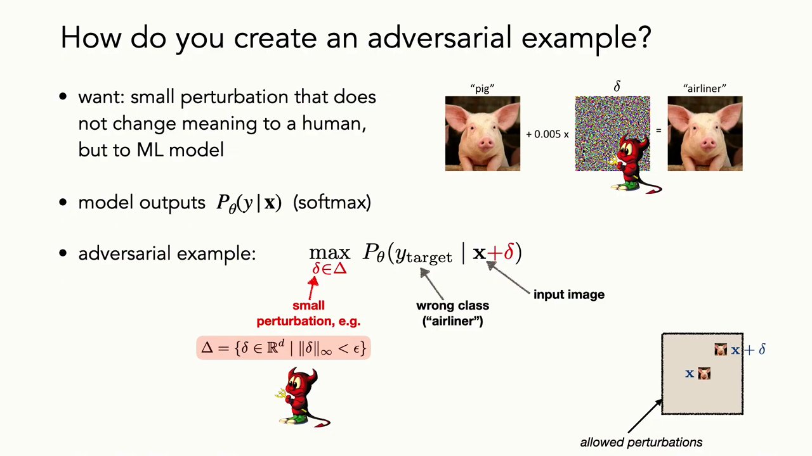
*▲ 강의 슬라이드 [21:50](https://youtu.be/tjD9LIzIIek?t=1310): [적대적 예제](00_%EB%94%A5%EB%9F%AC%EB%8B%9D_%EC%9A%A9%EC%96%B4%EC%82%AC%EC%A0%84.md#adversarial-example-%EC%A0%81%EB%8C%80%EC%A0%81-%EC%98%88%EC%A0%9C) 만들기. 고정된 모형 $P_\theta$에서 목표 범주("여객기")의 [확률](00_%EB%94%A5%EB%9F%AC%EB%8B%9D_%EC%9A%A9%EC%96%B4%EC%82%AC%EC%A0%84.md#probability-%ED%99%95%EB%A5%A0)을 최대로 하는 작은 교란 $\delta$를 찾는다. 허용 집합은 $\Delta = \{\delta : \lVert\delta\rVert_\infty < \epsilon\}$*

### 5.2 투영 경사 상승

▶ 영상 [22:11](https://youtu.be/tjD9LIzIIek?t=1331)

📐 **수학 개념**: [적대적 예제와 PGD](%EC%88%98%ED%95%99%EA%B0%9C%EB%85%90/12_%EA%B0%95%EA%B1%B4%EC%84%B1%EA%B3%BC_%EC%A0%84%EC%9D%B4/MM62_%EC%A0%81%EB%8C%80%EC%A0%81_%EC%98%88%EC%A0%9C%EC%99%80_PGD.md) · [그래디언트 벡터](%EC%88%98%ED%95%99%EA%B0%9C%EB%85%90/02_%EB%AF%B8%EB%B6%84/MM02_%EA%B7%B8%EB%9E%98%EB%94%94%EC%96%B8%ED%8A%B8_%EB%B2%A1%ED%84%B0.md) · [노름에 따른 최급강하법](%EC%88%98%ED%95%99%EA%B0%9C%EB%85%90/09_%EC%B5%9C%EC%A0%81%ED%99%94%EC%9D%98_%EA%B8%B0%ED%95%98/MM27_%EB%85%B8%EB%A6%84%EC%97%90_%EB%94%B0%EB%A5%B8_%EC%B5%9C%EA%B8%89%EA%B0%95%ED%95%98%EB%B2%95.md)

최댓값을 정확히 풀 필요는 없습니다. [SGD](00_%EB%94%A5%EB%9F%AC%EB%8B%9D_%EC%9A%A9%EC%96%B4%EC%82%AC%EC%A0%84.md#stochastic-gradient-descent-%ED%99%95%EB%A5%A0%EC%A0%81-%EA%B2%BD%EC%82%AC%ED%95%98%EA%B0%95%EB%B2%95)를 뒤집으면 됩니다. **[투영 경사 상승](00_%EB%94%A5%EB%9F%AC%EB%8B%9D_%EC%9A%A9%EC%96%B4%EC%82%AC%EC%A0%84.md#projected-gradient-ascent-%ED%88%AC%EC%98%81-%EA%B2%BD%EC%82%AC-%EC%83%81%EC%8A%B9)(Projected gradient ascent)**은 [가중치](00_%EB%94%A5%EB%9F%AC%EB%8B%9D_%EC%9A%A9%EC%96%B4%EC%82%AC%EC%A0%84.md#weight-%EA%B0%80%EC%A4%91%EC%B9%98)가 아니라 **데이터 교란 $\delta$를 갱신**합니다.

1. [기울기](00_%EB%94%A5%EB%9F%AC%EB%8B%9D_%EC%9A%A9%EC%96%B4%EC%82%AC%EC%A0%84.md#gradient-%EA%B8%B0%EC%9A%B8%EA%B8%B0) 방향으로 한 걸음 간다.
2. 결과를 허용 집합 $\Delta$로 **[투영](00_%EB%94%A5%EB%9F%AC%EB%8B%9D_%EC%9A%A9%EC%96%B4%EC%82%AC%EC%A0%84.md#projection-%ED%88%AC%EC%98%81)**(되돌려 놓기)한다. $\delta$가 너무 커지지 않게 설계로 제한하는 것입니다.
3. 1과 2를 되풀이한다.

단순하지만 잘 작동합니다.

$$
\delta^{(t+1)} = \Pi_\Delta\Big(\delta^{(t)} + \eta \cdot \nabla_\delta P_\theta\big(y_{\text{target}} \mid \mathbf{x} + \delta^{(t)}\big)\Big)
$$

기호 풀이

| 기호 | 읽는 법 | 뜻 | 예제 값 |
| --- | --- | --- | --- |
| $\delta^{(t)}$ | 델타 티 | $t$번째 걸음의 교란 | (0, 0) |
| $\eta$ | 에타 | 걸음 크기 ([학습률](00_%EB%94%A5%EB%9F%AC%EB%8B%9D_%EC%9A%A9%EC%96%B4%EC%82%AC%EC%A0%84.md#learning-rate-%ED%95%99%EC%8A%B5%EB%A5%A0)과 같은 역할) | 0.5 |
| $\nabla_\delta P_\theta$ | 델타에 대한 [기울기](00_%EB%94%A5%EB%9F%AC%EB%8B%9D_%EC%9A%A9%EC%96%B4%EC%82%AC%EC%A0%84.md#gradient-%EA%B8%B0%EC%9A%B8%EA%B8%B0) | 목표 [확률](00_%EB%94%A5%EB%9F%AC%EB%8B%9D_%EC%9A%A9%EC%96%B4%EC%82%AC%EC%A0%84.md#probability-%ED%99%95%EB%A5%A0)이 가장 빨리 커지는 교란 방향 | (-0.705, 0.47) |
| $\Pi_\Delta(\cdot)$ | 파이 델타 | 허용 집합 $\Delta$로 [투영](00_%EB%94%A5%EB%9F%AC%EB%8B%9D_%EC%9A%A9%EC%96%B4%EC%82%AC%EC%A0%84.md#projection-%ED%88%AC%EC%98%81). $L_\infty$ 공이면 칸마다 $[-\epsilon, \epsilon]$으로 자르기 | |
| $\epsilon$ | 엡실론 | $L_\infty$ 공의 반지름 | 0.15 |
| $\delta^{(t+1)}$ | 델타 티 플러스 원 | 다음 걸음의 교란 | (-0.15, 0.15) |

예제와 풀이

**문제**: 5.1절의 모형에서 교란 없이($\delta^{(0)} = (0, 0)$) 출발한다. 이 점에서 P(여객기)의 [기울기](00_%EB%94%A5%EB%9F%AC%EB%8B%9D_%EC%9A%A9%EC%96%B4%EC%82%AC%EC%A0%84.md#gradient-%EA%B8%B0%EC%9A%B8%EA%B8%B0)는 코드로 구하면 $(-0.705, 0.47)$이다. 걸음 크기 $\eta = 0.5$, $\epsilon = 0.15$로 [투영 경사 상승](00_%EB%94%A5%EB%9F%AC%EB%8B%9D_%EC%9A%A9%EC%96%B4%EC%82%AC%EC%A0%84.md#projected-gradient-ascent-%ED%88%AC%EC%98%81-%EA%B2%BD%EC%82%AC-%EC%83%81%EC%8A%B9)을 한 번 하면 $\delta^{(1)}$은?

**주어진 값**
- $\delta^{(0)} = (0, 0)$ (출발 교란)
- $\nabla_\delta P = (-0.705, 0.47)$ (목표 [확률](00_%EB%94%A5%EB%9F%AC%EB%8B%9D_%EC%9A%A9%EC%96%B4%EC%82%AC%EC%A0%84.md#probability-%ED%99%95%EB%A5%A0)의 [기울기](00_%EB%94%A5%EB%9F%AC%EB%8B%9D_%EC%9A%A9%EC%96%B4%EC%82%AC%EC%A0%84.md#gradient-%EA%B8%B0%EC%9A%B8%EA%B8%B0): 1번 픽셀은 줄이고 2번 픽셀은 늘리면 여객기 [확률](00_%EB%94%A5%EB%9F%AC%EB%8B%9D_%EC%9A%A9%EC%96%B4%EC%82%AC%EC%A0%84.md#probability-%ED%99%95%EB%A5%A0)이 오른다)
- $\eta = 0.5$ (걸음 크기)
- $\epsilon = 0.15$ (허용 집합: 칸마다 -0.15 ~ 0.15)

**풀이**
1. 식을 그대로 쓴다: $\delta^{(1)} = \Pi_\Delta\big(\delta^{(0)} + \eta \cdot \nabla_\delta P\big)$
2. 값을 대입한다: $\delta^{(1)} = \Pi_\Delta\big((0, 0) + 0.5 \times (-0.705, 0.47)\big)$
3. 걸음 크기를 칸마다 곱한다: $0.5 \times (-0.705) = -0.3525$, $0.5 \times 0.47 = 0.235$
4. 출발점에 더한다: $(0 + (-0.3525),\ 0 + 0.235) = (-0.3525, 0.235)$
5. 투영한다. 첫째 칸 $-0.3525$는 $-0.15$보다 작으므로 $-0.15$로 자른다
6. 둘째 칸 $0.235$는 $0.15$보다 크므로 $0.15$로 자른다

**답**: $\delta^{(1)} = $ **(-0.15, 0.15)**. 한 걸음에 $L_\infty$ 공의 모서리에 닿았고, 이것이 5.1절에서 P(여객기)를 0.5622로 올린 교란이다.

내 이해

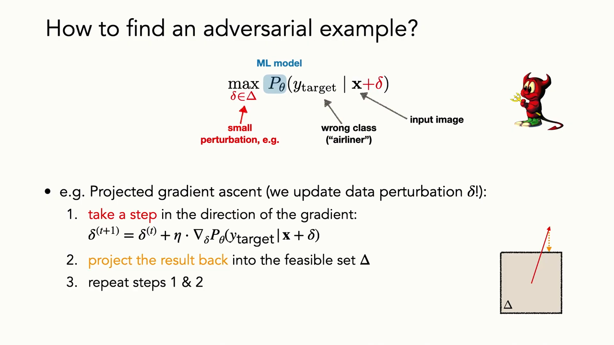
*▲ 강의 슬라이드 [22:55](https://youtu.be/tjD9LIzIIek?t=1375): [투영 경사 상승](00_%EB%94%A5%EB%9F%AC%EB%8B%9D_%EC%9A%A9%EC%96%B4%EC%82%AC%EC%A0%84.md#projected-gradient-ascent-%ED%88%AC%EC%98%81-%EA%B2%BD%EC%82%AC-%EC%83%81%EC%8A%B9). ① [기울기](00_%EB%94%A5%EB%9F%AC%EB%8B%9D_%EC%9A%A9%EC%96%B4%EC%82%AC%EC%A0%84.md#gradient-%EA%B8%B0%EC%9A%B8%EA%B8%B0) 방향으로 한 걸음 ② 허용 집합 $\Delta$로 되돌려 [투영](00_%EB%94%A5%EB%9F%AC%EB%8B%9D_%EC%9A%A9%EC%96%B4%EC%82%AC%EC%A0%84.md#projection-%ED%88%AC%EC%98%81) ③ 반복*

질의응답: 기울기가 꼭 있어야 하나 [23:12](https://youtu.be/tjD9LIzIIek?t=1392)

- **델타를 찾으려면 원래 모형의 [기울기](00_%EB%94%A5%EB%9F%AC%EB%8B%9D_%EC%9A%A9%EC%96%B4%EC%82%AC%EC%A0%84.md#gradient-%EA%B8%B0%EC%9A%B8%EA%B8%B0)에 접근해야 하나?** [투영 경사 상승](00_%EB%94%A5%EB%9F%AC%EB%8B%9D_%EC%9A%A9%EC%96%B4%EC%82%AC%EC%A0%84.md#projected-gradient-ascent-%ED%88%AC%EC%98%81-%EA%B2%BD%EC%82%AC-%EC%83%81%EC%8A%B9)은 모형의 [가중치](00_%EB%94%A5%EB%9F%AC%EB%8B%9D_%EC%9A%A9%EC%96%B4%EC%82%AC%EC%A0%84.md#weight-%EA%B0%80%EC%A4%91%EC%B9%98)와 구조를 알아 [기울기](00_%EB%94%A5%EB%9F%AC%EB%8B%9D_%EC%9A%A9%EC%96%B4%EC%82%AC%EC%A0%84.md#gradient-%EA%B8%B0%EC%9A%B8%EA%B8%B0)를 계산할 수 있다고 가정합니다(화이트박스).
- **[기울기](00_%EB%94%A5%EB%9F%AC%EB%8B%9D_%EC%9A%A9%EC%96%B4%EC%82%AC%EC%A0%84.md#gradient-%EA%B8%B0%EC%9A%B8%EA%B8%B0)가 필요 없는 방법은?** 무식하게 여러 교란을 시도해 결과가 가장 나쁜 것을 탐욕적으로 고를 수도 있습니다. 더 비쌀 뿐입니다. [기울기](00_%EB%94%A5%EB%9F%AC%EB%8B%9D_%EC%9A%A9%EC%96%B4%EC%82%AC%EC%A0%84.md#gradient-%EA%B8%B0%EC%9A%B8%EA%B8%B0)는 더 효율적으로 찾는 방법이고, 다른 방식의 방법들도 있습니다.

---

## 6. 적대적 학습

▶ 영상 [23:49](https://youtu.be/tjD9LIzIIek?t=1429)

📐 **수학 개념**: [최악의 경우 최적화와 그룹 DRO](%EC%88%98%ED%95%99%EA%B0%9C%EB%85%90/12_%EA%B0%95%EA%B1%B4%EC%84%B1%EA%B3%BC_%EC%A0%84%EC%9D%B4/MM63_%EC%B5%9C%EC%95%85%EC%9D%98_%EA%B2%BD%EC%9A%B0_%EC%B5%9C%EC%A0%81%ED%99%94%EC%99%80_%EA%B7%B8%EB%A3%B9_DRO.md) · [경험적 위험](%EC%88%98%ED%95%99%EA%B0%9C%EB%85%90/04_%ED%99%95%EB%A5%A0%EA%B3%BC_%EC%A0%95%EB%B3%B4/MM22_%EA%B8%B0%EB%8C%93%EA%B0%92%EA%B3%BC_%EC%9D%BC%EB%B0%98%ED%99%94_%EA%B0%84%EA%B7%B9.md) · [시그마와 평균](%EC%88%98%ED%95%99%EA%B0%9C%EB%85%90/01_%EC%88%98%EC%99%80_%ED%95%A8%EC%88%98/M02_%EC%8B%9C%EA%B7%B8%EB%A7%88%EC%99%80_%ED%8F%89%EA%B7%A0.md)

- [적대적 예제](00_%EB%94%A5%EB%9F%AC%EB%8B%9D_%EC%9A%A9%EC%96%B4%EC%82%AC%EC%A0%84.md#adversarial-example-%EC%A0%81%EB%8C%80%EC%A0%81-%EC%98%88%EC%A0%9C)를 다르게 볼 수도 있습니다. 특정 범주의 [확률](00_%EB%94%A5%EB%9F%AC%EB%8B%9D_%EC%9A%A9%EC%96%B4%EC%82%AC%EC%A0%84.md#probability-%ED%99%95%EB%A5%A0)을 올리는 대신, [정답](00_%EB%94%A5%EB%9F%AC%EB%8B%9D_%EC%9A%A9%EC%96%B4%EC%82%AC%EC%A0%84.md#label-%EC%A0%95%EB%8B%B5) $y$에 대한 [손실](00_%EB%94%A5%EB%9F%AC%EB%8B%9D_%EC%9A%A9%EC%96%B4%EC%82%AC%EC%A0%84.md#loss-function-%EC%86%90%EC%8B%A4-%ED%95%A8%EC%88%98)을 **최대화**하는 $\delta$를 찾는 것입니다. "이 예를 가장 틀리게 만드는 잡음은?"이라는 질문입니다. 표준 [학습](00_%EB%94%A5%EB%9F%AC%EB%8B%9D_%EC%9A%A9%EC%96%B4%EC%82%AC%EC%A0%84.md#training-%ED%95%99%EC%8A%B5)은 반대로 $\theta$에 대해 [손실](00_%EB%94%A5%EB%9F%AC%EB%8B%9D_%EC%9A%A9%EC%96%B4%EC%82%AC%EC%A0%84.md#loss-function-%EC%86%90%EC%8B%A4-%ED%95%A8%EC%88%98)을 **최소화**합니다.
- **[적대적 학습](00_%EB%94%A5%EB%9F%AC%EB%8B%9D_%EC%9A%A9%EC%96%B4%EC%82%AC%EC%A0%84.md#adversarial-training-%EC%A0%81%EB%8C%80%EC%A0%81-%ED%95%99%EC%8A%B5)(Adversarial training, 강건 최적화)**: 둘을 겹쳐 놓은 **이중 루프(중첩 최적화)**입니다. 데이터셋의 모든 이미지에 대해, **최악의 교란에서도 [손실](00_%EB%94%A5%EB%9F%AC%EB%8B%9D_%EC%9A%A9%EC%96%B4%EC%82%AC%EC%A0%84.md#loss-function-%EC%86%90%EC%8B%A4-%ED%95%A8%EC%88%98)이 크지 않은** 모형을 찾습니다. [학습](00_%EB%94%A5%EB%9F%AC%EB%8B%9D_%EC%9A%A9%EC%96%B4%EC%82%AC%EC%A0%84.md#training-%ED%95%99%EC%8A%B5) 중에 최악의 교란을 찾고, 그 최악의 경우에도 가능한 한 좋은 모형을 고릅니다.
- 이는 **적응형 [데이터 증강](00_%EB%94%A5%EB%9F%AC%EB%8B%9D_%EC%9A%A9%EC%96%B4%EC%82%AC%EC%A0%84.md#data-augmentation-%EB%8D%B0%EC%9D%B4%ED%84%B0-%EC%A6%9D%EA%B0%95)**(adaptive data augmentation)이라고도 부릅니다. 예전에 배운 [어려운 예 찾기](00_%EB%94%A5%EB%9F%AC%EB%8B%9D_%EC%9A%A9%EC%96%B4%EC%82%AC%EC%A0%84.md#hard-negative-mining-%ED%95%98%EB%93%9C-%EB%84%A4%EA%B1%B0%ED%8B%B0%EB%B8%8C-%EB%A7%88%EC%9D%B4%EB%8B%9D)(hard example mining)처럼, 모형이 어려워할 예를 일부러 보여 주는 것입니다.

$$
\begin{aligned}
\text{표준 학습:}\quad & \min_\theta\ \frac{1}{n}\sum_{i=1}^{n} \text{Loss}\big(f_\theta(\mathbf{x}^{(i)}),\ y^{(i)}\big) \\
\text{적대적 학습:}\quad & \min_\theta\ \frac{1}{n}\sum_{i=1}^{n}\ \max_{\delta \in \Delta}\ \text{Loss}\big(f_\theta(\mathbf{x}^{(i)} + \delta),\ y^{(i)}\big)
\end{aligned}
$$

기호 풀이

| 기호 | 읽는 법 | 뜻 | 예제 값 |
| --- | --- | --- | --- |
| $n$ | 엔 | [학습 데이터](00_%EB%94%A5%EB%9F%AC%EB%8B%9D_%EC%9A%A9%EC%96%B4%EC%82%AC%EC%A0%84.md#training-data-test-data-%ED%95%99%EC%8A%B5-%EB%8D%B0%EC%9D%B4%ED%84%B0%EC%99%80-%EC%8B%9C%ED%97%98-%EB%8D%B0%EC%9D%B4%ED%84%B0) 개수 | 2 |
| $\mathbf{x}^{(i)}, y^{(i)}$ | 엑스 아이, 와이 아이 | $i$번째 입력과 [정답](00_%EB%94%A5%EB%9F%AC%EB%8B%9D_%EC%9A%A9%EC%96%B4%EC%82%AC%EC%A0%84.md#label-%EC%A0%95%EB%8B%B5) | (0.6, 0.4)와 +1(돼지), (0.2, 0.5)와 -1(여객기) |
| $f_\theta$ | 에프 세타 | 신경망(여기서는 점수 $s = 3x_1 - 2x_2 - 0.5$) | 0.5, -0.9 |
| $\text{Loss}$ | [손실](00_%EB%94%A5%EB%9F%AC%EB%8B%9D_%EC%9A%A9%EC%96%B4%EC%82%AC%EC%A0%84.md#loss-function-%EC%86%90%EC%8B%A4-%ED%95%A8%EC%88%98) | 예측이 얼마나 틀렸나. 예제는 [힌지 손실](00_%EB%94%A5%EB%9F%AC%EB%8B%9D_%EC%9A%A9%EC%96%B4%EC%82%AC%EC%A0%84.md#hinge-loss-%ED%9E%8C%EC%A7%80-%EC%86%90%EC%8B%A4) $\max(0, 1 - y \cdot s)$ | 0.5, 0.1 |
| $\max_{\delta \in \Delta}$ | 안쪽 최대화 | 각 데이터마다 [손실](00_%EB%94%A5%EB%9F%AC%EB%8B%9D_%EC%9A%A9%EC%96%B4%EC%82%AC%EC%A0%84.md#loss-function-%EC%86%90%EC%8B%A4-%ED%95%A8%EC%88%98)을 가장 키우는 교란 (적) | 점수를 ±0.75 이동 |
| $\min_\theta$ | 바깥쪽 최소화 | 그 최악의 [손실](00_%EB%94%A5%EB%9F%AC%EB%8B%9D_%EC%9A%A9%EC%96%B4%EC%82%AC%EC%A0%84.md#loss-function-%EC%86%90%EC%8B%A4-%ED%95%A8%EC%88%98) 평균을 줄이는 모형 ([학습](00_%EB%94%A5%EB%9F%AC%EB%8B%9D_%EC%9A%A9%EC%96%B4%EC%82%AC%EC%A0%84.md#training-%ED%95%99%EC%8A%B5)) | |
| $\Delta$ | 대문자 델타 | 허용된 교란 ($\lVert\delta\rVert_\infty \le 0.15$) | |

예제와 풀이

**문제**: 모형 $s = 3x_1 - 2x_2 - 0.5$를 고정하고, 데이터 두 개에서 표준 [학습](00_%EB%94%A5%EB%9F%AC%EB%8B%9D_%EC%9A%A9%EC%96%B4%EC%82%AC%EC%A0%84.md#training-%ED%95%99%EC%8A%B5)의 목적값과 [적대적 학습](00_%EB%94%A5%EB%9F%AC%EB%8B%9D_%EC%9A%A9%EC%96%B4%EC%82%AC%EC%A0%84.md#adversarial-training-%EC%A0%81%EB%8C%80%EC%A0%81-%ED%95%99%EC%8A%B5)의 목적값($\epsilon = 0.15$)을 비교하라. [손실](00_%EB%94%A5%EB%9F%AC%EB%8B%9D_%EC%9A%A9%EC%96%B4%EC%82%AC%EC%A0%84.md#loss-function-%EC%86%90%EC%8B%A4-%ED%95%A8%EC%88%98)은 [힌지 손실](00_%EB%94%A5%EB%9F%AC%EB%8B%9D_%EC%9A%A9%EC%96%B4%EC%82%AC%EC%A0%84.md#hinge-loss-%ED%9E%8C%EC%A7%80-%EC%86%90%EC%8B%A4) $\max(0, 1 - y \cdot s)$([정답](00_%EB%94%A5%EB%9F%AC%EB%8B%9D_%EC%9A%A9%EC%96%B4%EC%82%AC%EC%A0%84.md#label-%EC%A0%95%EB%8B%B5) 쪽으로 여유 1 이상 맞히지 못하면 벌)이다. 선형 모형에서 $L_\infty$ 공 안의 최악 교란은 점수를 틀린 쪽으로 $\epsilon \times (\lvert 3 \rvert + \lvert -2 \rvert)$만큼 옮긴다(MM62 참고).

**주어진 값**
- $\mathbf{x}^{(1)} = (0.6, 0.4)$, $y^{(1)} = +1$ (돼지)
- $\mathbf{x}^{(2)} = (0.2, 0.5)$, $y^{(2)} = -1$ (여객기)
- $w = (3, -2)$, $b = -0.5$ (고정된 모형)
- $\epsilon = 0.15$ (허용 교란 크기), $n = 2$ (데이터 개수)

**풀이**
1. 식을 그대로 쓴다: 표준 $= \dfrac{1}{n}\sum_{i=1}^{n} \max(0, 1 - y^{(i)} s^{(i)})$, 적대적 $= \dfrac{1}{n}\sum_{i=1}^{n} \max_{\delta} \max(0, 1 - y^{(i)} s^{(i)}_\delta)$
2. 값을 대입한다 (Σ를 두 항으로 펼침): 표준 $= \dfrac{1}{2}\big(\max(0, 1 - (+1) s^{(1)}) + \max(0, 1 - (-1) s^{(2)})\big)$
3. 첫째 점수를 구한다: $s^{(1)} = 3 \times 0.6 + (-2) \times 0.4 - 0.5 = 1.8 - 0.8 - 0.5 = 0.5$
4. 둘째 점수를 구한다: $s^{(2)} = 3 \times 0.2 + (-2) \times 0.5 - 0.5 = 0.6 - 1.0 - 0.5 = -0.9$
5. 첫째 [손실](00_%EB%94%A5%EB%9F%AC%EB%8B%9D_%EC%9A%A9%EC%96%B4%EC%82%AC%EC%A0%84.md#loss-function-%EC%86%90%EC%8B%A4-%ED%95%A8%EC%88%98): $\max(0, 1 - 1 \times 0.5) = \max(0, 0.5) = 0.5$
6. 둘째 [손실](00_%EB%94%A5%EB%9F%AC%EB%8B%9D_%EC%9A%A9%EC%96%B4%EC%82%AC%EC%A0%84.md#loss-function-%EC%86%90%EC%8B%A4-%ED%95%A8%EC%88%98): $(-1) \times (-0.9) = 0.9$ 이므로 $\max(0, 1 - 0.9) = 0.1$
7. 표준 목적값을 평균한다: $(0.5 + 0.1) / 2 = 0.6 / 2 = 0.3$
8. 최악 교란이 옮기는 점수 크기: $0.15 \times (3 + 2) = 0.15 \times 5 = 0.75$
9. 첫째([정답](00_%EB%94%A5%EB%9F%AC%EB%8B%9D_%EC%9A%A9%EC%96%B4%EC%82%AC%EC%A0%84.md#label-%EC%A0%95%EB%8B%B5) +1)는 점수를 내린다: $0.5 - 0.75 = -0.25$ → [손실](00_%EB%94%A5%EB%9F%AC%EB%8B%9D_%EC%9A%A9%EC%96%B4%EC%82%AC%EC%A0%84.md#loss-function-%EC%86%90%EC%8B%A4-%ED%95%A8%EC%88%98) $\max(0, 1 - (-0.25)) = 1.25$
10. 둘째([정답](00_%EB%94%A5%EB%9F%AC%EB%8B%9D_%EC%9A%A9%EC%96%B4%EC%82%AC%EC%A0%84.md#label-%EC%A0%95%EB%8B%B5) -1)는 점수를 올린다: $-0.9 + 0.75 = -0.15$ → $(-1) \times (-0.15) = 0.15$ → [손실](00_%EB%94%A5%EB%9F%AC%EB%8B%9D_%EC%9A%A9%EC%96%B4%EC%82%AC%EC%A0%84.md#loss-function-%EC%86%90%EC%8B%A4-%ED%95%A8%EC%88%98) $\max(0, 1 - 0.15) = 0.85$
11. 적대적 목적값을 평균한다: $(1.25 + 0.85) / 2 = 2.1 / 2 = 1.05$

**답**: 같은 모형인데 표준 목적값은 **0.3**, 적대적 목적값은 **1.05**다. [적대적 학습](00_%EB%94%A5%EB%9F%AC%EB%8B%9D_%EC%9A%A9%EC%96%B4%EC%82%AC%EC%A0%84.md#adversarial-training-%EC%A0%81%EB%8C%80%EC%A0%81-%ED%95%99%EC%8A%B5)은 이 1.05를 줄이는 $\theta$를 찾는다. 즉 점수가 0.75 흔들려도 [정답](00_%EB%94%A5%EB%9F%AC%EB%8B%9D_%EC%9A%A9%EC%96%B4%EC%82%AC%EC%A0%84.md#label-%EC%A0%95%EB%8B%B5) 쪽에 머무는, 여유가 큰 경계를 배우게 한다.

내 이해

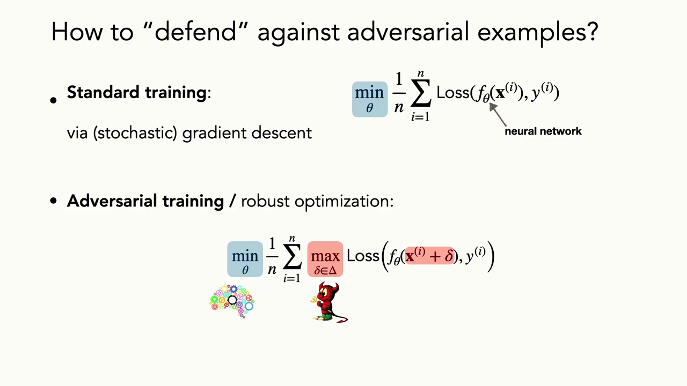
*▲ 강의 슬라이드 [26:00](https://youtu.be/tjD9LIzIIek?t=1560): 표준 [학습](00_%EB%94%A5%EB%9F%AC%EB%8B%9D_%EC%9A%A9%EC%96%B4%EC%82%AC%EC%A0%84.md#training-%ED%95%99%EC%8A%B5)(SGD로 평균 [손실](00_%EB%94%A5%EB%9F%AC%EB%8B%9D_%EC%9A%A9%EC%96%B4%EC%82%AC%EC%A0%84.md#loss-function-%EC%86%90%EC%8B%A4-%ED%95%A8%EC%88%98) 최소화)과 [적대적 학습](00_%EB%94%A5%EB%9F%AC%EB%8B%9D_%EC%9A%A9%EC%96%B4%EC%82%AC%EC%A0%84.md#adversarial-training-%EC%A0%81%EB%8C%80%EC%A0%81-%ED%95%99%EC%8A%B5)(강건 최적화: 데이터마다 최악의 교란에서의 [손실](00_%EB%94%A5%EB%9F%AC%EB%8B%9D_%EC%9A%A9%EC%96%B4%EC%82%AC%EC%A0%84.md#loss-function-%EC%86%90%EC%8B%A4-%ED%95%A8%EC%88%98)을 최소화)*

질의응답: 예상 못 한 교란과 수렴 [26:31](https://youtu.be/tjD9LIzIIek?t=1591)

- **비슷하게 어려운 예가 두 종류면?** (예: 거북이가 소총 말고 사과로도 쉽게 바뀐다면) 강사는 이를 "데이터가 예상 못 한 방식으로 바뀌면?"이라는 질문으로 정리합니다. [적대적 학습](00_%EB%94%A5%EB%9F%AC%EB%8B%9D_%EC%9A%A9%EC%96%B4%EC%82%AC%EC%A0%84.md#adversarial-training-%EC%A0%81%EB%8C%80%EC%A0%81-%ED%95%99%EC%8A%B5)은 **우리가 정의한 허용 교란 집합**에만 강건해집니다. 현실의 교란은 대부분 이런 정적인 잡음 구조가 아니고, 예컨대 스티커 공격에는 잘 안 통할 것입니다.
- **횡단보도의 보행자는 수학적 교란이 아니지 않나?** [데이터 증강](00_%EB%94%A5%EB%9F%AC%EB%8B%9D_%EC%9A%A9%EC%96%B4%EC%82%AC%EC%A0%84.md#data-augmentation-%EB%8D%B0%EC%9D%B4%ED%84%B0-%EC%A6%9D%EA%B0%95)으로 어느 정도 다룰 수는 있지만, 트럭 짐칸에 실린 정지 표지판 더미를 보고 자율 주행차가 어쩔 줄 모르는 사례처럼 세상이 바뀌는 모든 방식을 예상하기는 어렵습니다. 바뀌는 방식을 알면 표준 [학습](00_%EB%94%A5%EB%9F%AC%EB%8B%9D_%EC%9A%A9%EC%96%B4%EC%82%AC%EC%A0%84.md#training-%ED%95%99%EC%8A%B5)([경험적 위험](00_%EB%94%A5%EB%9F%AC%EB%8B%9D_%EC%9A%A9%EC%96%B4%EC%82%AC%EC%A0%84.md#empirical-risk-%EA%B2%BD%ED%97%98%EC%A0%81-%EC%9C%84%ED%97%98) 최소화)이나 그 방식에 맞춘 강건 [학습](00_%EB%94%A5%EB%9F%AC%EB%8B%9D_%EC%9A%A9%EC%96%B4%EC%82%AC%EC%A0%84.md#training-%ED%95%99%EC%8A%B5)을 할 수 있지만, 적대적 강건성 연구의 가정은 현실에서 대부분 깨집니다.
- **최소화와 최대화를 끝없이 번갈아 하면? 결국 더는 못 속이는 모형이 되나?** 적당한 교란 집합과 여러 [하이퍼파라미터](00_%EB%94%A5%EB%9F%AC%EB%8B%9D_%EC%9A%A9%EC%96%B4%EC%82%AC%EC%A0%84.md#hyperparameter-%ED%95%98%EC%9D%B4%ED%8D%BC%ED%8C%8C%EB%9D%BC%EB%AF%B8%ED%84%B0) 시도로 보통 수렴시킬 수 있지만, 서로 충돌하는 두 목적이라 [학습](00_%EB%94%A5%EB%9F%AC%EB%8B%9D_%EC%9A%A9%EC%96%B4%EC%82%AC%EC%A0%84.md#training-%ED%95%99%EC%8A%B5)이 까다롭습니다.

### 6.1 SGD로 적대적 학습하기

▶ 영상 [30:00](https://youtu.be/tjD9LIzIIek?t=1800)

수렴할 때까지 다음을 되풀이합니다.

1. 데이터 한 점 $(\mathbf{x}, y)$를 뽑는다.
2. 최적의 적대적 교란 $\delta^*$를 (근사적으로) 계산한다. 5.2절의 [투영 경사 상승](00_%EB%94%A5%EB%9F%AC%EB%8B%9D_%EC%9A%A9%EC%96%B4%EC%82%AC%EC%A0%84.md#projected-gradient-ascent-%ED%88%AC%EC%98%81-%EA%B2%BD%EC%82%AC-%EC%83%81%EC%8A%B9)을 쓴다.
3. 그 교란에서의 [기울기](00_%EB%94%A5%EB%9F%AC%EB%8B%9D_%EC%9A%A9%EC%96%B4%EC%82%AC%EC%A0%84.md#gradient-%EA%B8%B0%EC%9A%B8%EA%B8%B0) $g = \nabla_\theta \text{Loss}(f_\theta(\mathbf{x} + \delta^*), y)$를 계산한다.
4. $g$로 $\theta$를 갱신한다.

데이터 한 점마다 안쪽에서 또 하나의 최적화를 돌리는 셈이라 **계산 비용이 큽니다**. 다음 강의에서 다룰 **메타 [학습](00_%EB%94%A5%EB%9F%AC%EB%8B%9D_%EC%9A%A9%EC%96%B4%EC%82%AC%EC%A0%84.md#training-%ED%95%99%EC%8A%B5)**도 바깥 [학습](00_%EB%94%A5%EB%9F%AC%EB%8B%9D_%EC%9A%A9%EC%96%B4%EC%82%AC%EC%A0%84.md#training-%ED%95%99%EC%8A%B5) 루프 안에 데이터마다 안쪽 [학습](00_%EB%94%A5%EB%9F%AC%EB%8B%9D_%EC%9A%A9%EC%96%B4%EC%82%AC%EC%A0%84.md#training-%ED%95%99%EC%8A%B5) 루프가 있다는 점에서 비슷합니다.

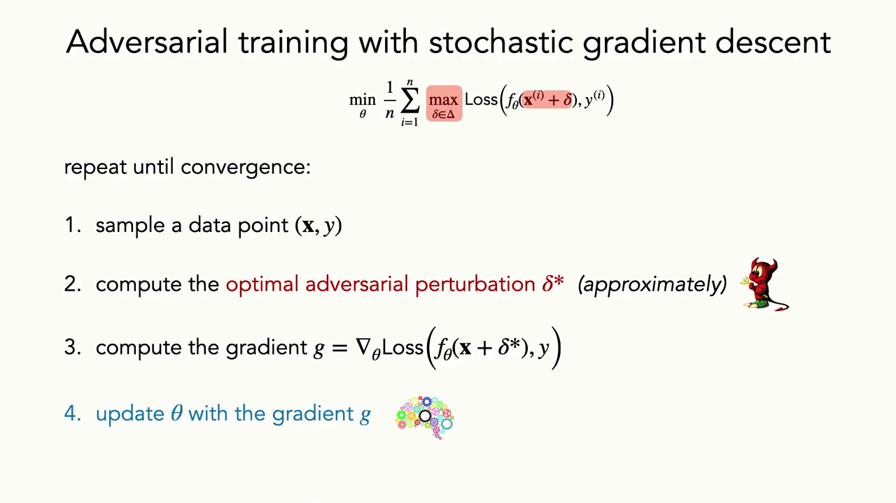
*▲ 강의 슬라이드 [30:48](https://youtu.be/tjD9LIzIIek?t=1848): SGD로 하는 [적대적 학습](00_%EB%94%A5%EB%9F%AC%EB%8B%9D_%EC%9A%A9%EC%96%B4%EC%82%AC%EC%A0%84.md#adversarial-training-%EC%A0%81%EB%8C%80%EC%A0%81-%ED%95%99%EC%8A%B5). 점 뽑기 → 최적 교란 $\delta^*$ 근사 → [기울기](00_%EB%94%A5%EB%9F%AC%EB%8B%9D_%EC%9A%A9%EC%96%B4%EC%82%AC%EC%A0%84.md#gradient-%EA%B8%B0%EC%9A%B8%EA%B8%B0) $g$ → $\theta$ 갱신*

---

## 7. 적대적 예제가 말해 주는 것

▶ 영상 [31:06](https://youtu.be/tjD9LIzIIek?t=1866)

### 7.1 4와 9를 가르는 한 픽셀

▶ 영상 [31:06](https://youtu.be/tjD9LIzIIek?t=1866)

[적대적 예제](00_%EB%94%A5%EB%9F%AC%EB%8B%9D_%EC%9A%A9%EC%96%B4%EC%82%AC%EC%A0%84.md#adversarial-example-%EC%A0%81%EB%8C%80%EC%A0%81-%EC%98%88%EC%A0%9C)는 모형의 결정에 결정적인 입력 **특징**(feature), 즉 [학습 데이터](00_%EB%94%A5%EB%9F%AC%EB%8B%9D_%EC%9A%A9%EC%96%B4%EC%82%AC%EC%A0%84.md#training-data-test-data-%ED%95%99%EC%8A%B5-%EB%8D%B0%EC%9D%B4%ED%84%B0%EC%99%80-%EC%8B%9C%ED%97%98-%EB%8D%B0%EC%9D%B4%ED%84%B0)의 구조와 통계적 성질에 대해 알려 줍니다.

- [MNIST](00_%EB%94%A5%EB%9F%AC%EB%8B%9D_%EC%9A%A9%EC%96%B4%EC%82%AC%EC%A0%84.md#mnist-%EC%86%90%EA%B8%80%EC%94%A8-%EC%88%AB%EC%9E%90-%EB%8D%B0%EC%9D%B4%ED%84%B0%EC%85%8B)에서 4와 9를 가르는 과제에, 아주 작은 **허위 상관**(spurious correlation)을 넣습니다. 모든 4에는 왼쪽 위 구석에 흰 픽셀 하나, 모든 9에는 그 바로 옆에 흰 픽셀 하나를 찍습니다.
- 그러면 표적 교란으로 **그 픽셀의 위치만 옮겨도** 예측이 정반대가 됩니다.
- 모형은 거기 있는 신호는 무엇이든, 되도록 **가장 쉽게 잡히는 신호**를 배웁니다([단순성 편향](00_%EB%94%A5%EB%9F%AC%EB%8B%9D_%EC%9A%A9%EC%96%B4%EC%82%AC%EC%A0%84.md#simplicity-bias-%EB%8B%A8%EC%88%9C%EC%84%B1-%ED%8E%B8%ED%96%A5)). 이 상관이 늘 있으면 문제는 픽셀 하나짜리 [이진 분류](00_%EB%94%A5%EB%9F%AC%EB%8B%9D_%EC%9A%A9%EC%96%B4%EC%82%AC%EC%A0%84.md#binary-classification-%EC%9D%B4%EC%A7%84-%EB%B6%84%EB%A5%98)가 되고, 모형은 이미지의 나머지를 무시합니다. 그 픽셀만 보면 완벽한 분류기이기 때문입니다.

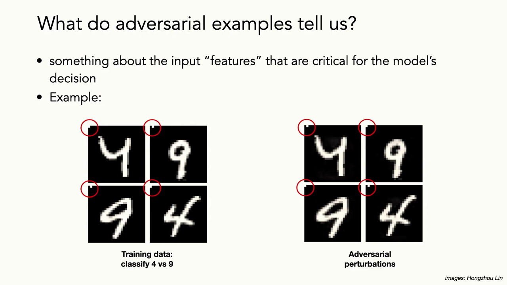
*▲ 강의 슬라이드 [32:05](https://youtu.be/tjD9LIzIIek?t=1925): 4 대 9 [학습 데이터](00_%EB%94%A5%EB%9F%AC%EB%8B%9D_%EC%9A%A9%EC%96%B4%EC%82%AC%EC%A0%84.md#training-data-test-data-%ED%95%99%EC%8A%B5-%EB%8D%B0%EC%9D%B4%ED%84%B0%EC%99%80-%EC%8B%9C%ED%97%98-%EB%8D%B0%EC%9D%B4%ED%84%B0)에 넣은 구석 픽셀(빨간 원). 적대적 교란은 그 픽셀 위치만 옮긴다*

### 7.2 쓸모없는, 강건한, 비강건한 특징

▶ 영상 [32:15](https://youtu.be/tjD9LIzIIek?t=1935)

어떤 모형이 잡은 특징은 세 부류로 나눌 수 있습니다([강건한 특징과 비강건한 특징](00_%EB%94%A5%EB%9F%AC%EB%8B%9D_%EC%9A%A9%EC%96%B4%EC%82%AC%EC%A0%84.md#robust-and-non-robust-features-%EA%B0%95%EA%B1%B4%ED%95%9C-%ED%8A%B9%EC%A7%95%EA%B3%BC-%EB%B9%84%EA%B0%95%EA%B1%B4%ED%95%9C-%ED%8A%B9%EC%A7%95), Ilyas 등 2019 그림을 Aleksander Madry가 정리).

| 부류 | 뜻 | 예 |
|---|---|---|
| 쓸모없는 특징 | [정답](00_%EB%94%A5%EB%9F%AC%EB%8B%9D_%EC%9A%A9%EC%96%B4%EC%82%AC%EC%A0%84.md#label-%EC%A0%95%EB%8B%B5)과 상관이 없다 | |
| **강건한 특징** | 교란해도 [정답](00_%EB%94%A5%EB%9F%AC%EB%8B%9D_%EC%9A%A9%EC%96%B4%EC%82%AC%EC%A0%84.md#label-%EC%A0%95%EB%8B%B5)과 상관이 남는다 | 고양이 귀, 개 코, 동물의 형태 같은 의미 있는 특징 |
| **비강건한 특징** | [학습 데이터](00_%EB%94%A5%EB%9F%AC%EB%8B%9D_%EC%9A%A9%EC%96%B4%EC%82%AC%EC%A0%84.md#training-data-test-data-%ED%95%99%EC%8A%B5-%EB%8D%B0%EC%9D%B4%ED%84%B0%EC%99%80-%EC%8B%9C%ED%97%98-%EB%8D%B0%EC%9D%B4%ED%84%B0)에서 [정답](00_%EB%94%A5%EB%9F%AC%EB%8B%9D_%EC%9A%A9%EC%96%B4%EC%82%AC%EC%A0%84.md#label-%EC%A0%95%EB%8B%B5)과 상관있지만, 교란으로 뒤집힐 수 있다 | 사람이 쓰지 않는 미세한 무늬 |

- 많은 특징이 [정답](00_%EB%94%A5%EB%9F%AC%EB%8B%9D_%EC%9A%A9%EC%96%B4%EC%82%AC%EC%A0%84.md#label-%EC%A0%95%EB%8B%B5)과 상관있어서 예측력이 있고, [시험 데이터](00_%EB%94%A5%EB%9F%AC%EB%8B%9D_%EC%9A%A9%EC%96%B4%EC%82%AC%EC%A0%84.md#training-data-test-data-%ED%95%99%EC%8A%B5-%EB%8D%B0%EC%9D%B4%ED%84%B0%EC%99%80-%EC%8B%9C%ED%97%98-%EB%8D%B0%EC%9D%B4%ED%84%B0)에서도 상관이 남으면 [정확도](00_%EB%94%A5%EB%9F%AC%EB%8B%9D_%EC%9A%A9%EC%96%B4%EC%82%AC%EC%A0%84.md#accuracy-%EC%A0%95%ED%99%95%EB%8F%84)도 올려 줍니다. 하지만 **사람이 쓰는 것 이상의** 특징입니다.
- 때로는 우리가 고정관념으로 쓰기도 하지만, 합리적으로 생각하면 쓰고 싶지 않은 특징일 수 있습니다. 초기 확산 모형에게 "의사"를 그리라 하면 백인 남성만, "주부"를 그리라 하면 여성만 나왔습니다. 사회와 상관이 있더라도 윤리적으로는 모형이 이런 것으로 결정하길 원하지 않습니다. 이것이 기계 [학습](00_%EB%94%A5%EB%9F%AC%EB%8B%9D_%EC%9A%A9%EC%96%B4%EC%82%AC%EC%A0%84.md#training-%ED%95%99%EC%8A%B5)의 **[공정성](00_%EB%94%A5%EB%9F%AC%EB%8B%9D_%EC%9A%A9%EC%96%B4%EC%82%AC%EC%A0%84.md#fairness-%EA%B3%B5%EC%A0%95%EC%84%B1)(fairness)** 연구이고, 모형은 사회적 [편향](00_%EB%94%A5%EB%9F%AC%EB%8B%9D_%EC%9A%A9%EC%96%B4%EC%82%AC%EC%A0%84.md#bias-%ED%8E%B8%ED%96%A5)을 **증폭**하는 경향이 있습니다.
- 정리하면 상관된 예측 특징은 **강건성을 해치고 [편향](00_%EB%94%A5%EB%9F%AC%EB%8B%9D_%EC%9A%A9%EC%96%B4%EC%82%AC%EC%A0%84.md#bias-%ED%8E%B8%ED%96%A5)을 키울 수 있어서** 늘 원하는 것은 아닙니다.

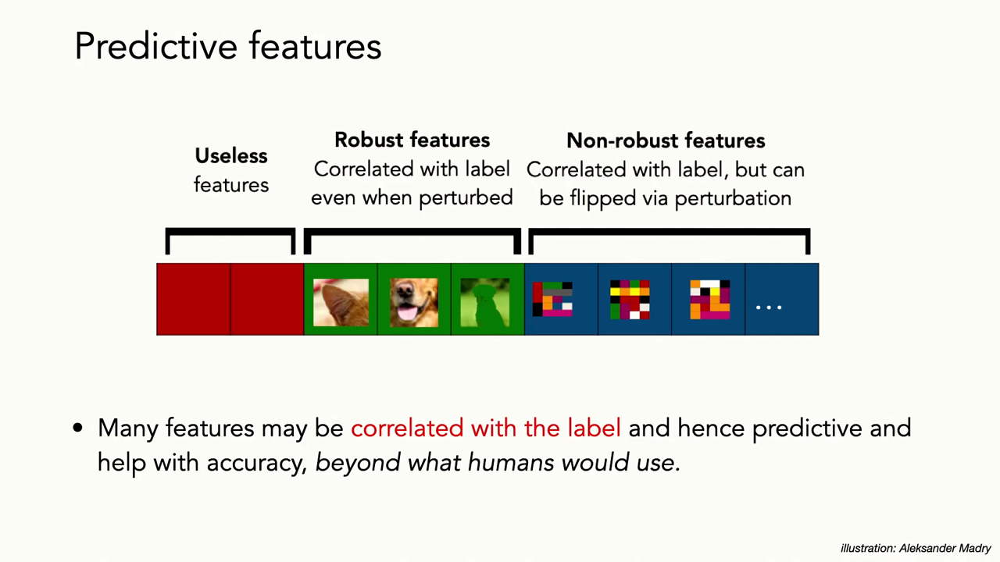
*▲ 강의 슬라이드 [32:40](https://youtu.be/tjD9LIzIIek?t=1960): 예측 특징의 세 부류. 쓸모없는 특징, 강건한 특징(교란해도 [정답](00_%EB%94%A5%EB%9F%AC%EB%8B%9D_%EC%9A%A9%EC%96%B4%EC%82%AC%EC%A0%84.md#label-%EC%A0%95%EB%8B%B5)과 상관), 비강건한 특징([정답](00_%EB%94%A5%EB%9F%AC%EB%8B%9D_%EC%9A%A9%EC%96%B4%EC%82%AC%EC%A0%84.md#label-%EC%A0%95%EB%8B%B5)과 상관있지만 교란으로 뒤집힘)*

### 7.3 상관은 데이터에서 온다

▶ 영상 [34:38](https://youtu.be/tjD9LIzIIek?t=2078)

- **나비넥타이 개**: 개에게 나비넥타이를 매면 모형이 고양이라고 합니다. 사람들이 고양이에게 나비넥타이를 더 자주 매기 때문입니다.
- **물고기**: ImageNet [학습 데이터](00_%EB%94%A5%EB%9F%AC%EB%8B%9D_%EC%9A%A9%EC%96%B4%EC%82%AC%EC%A0%84.md#training-data-test-data-%ED%95%99%EC%8A%B5-%EB%8D%B0%EC%9D%B4%ED%84%B0%EC%99%80-%EC%8B%9C%ED%97%98-%EB%8D%B0%EC%9D%B4%ED%84%B0)의 "물고기" 사진을 보면 선글라스 낀 (아주 행복한) 아저씨들이 잔뜩 나옵니다. 낚시 사진입니다. 모형은 물고기가 아니라 "사람 손에 든 물고기"를 배웁니다.
- 뿌리는 **데이터셋을 만드는 방식**입니다. 이상적으로는 관심 있는 모든 것을 대표하는 실제 이미지 → 전문가의 완벽한 주석 → 의미 있는 벤치마크가 있어야 합니다. 현실에서는 인터넷에서 긁은 이미지 → 자동 또는 크라우드 라벨 → 잡음 많고 편향된 주석이 나오고, **최적화하기 쉬운 벤치마크는 되지만 현실에 뿌리내리지는 않습니다**.

---

## 8. 지름길

▶ 영상 [36:14](https://youtu.be/tjD9LIzIIek?t=2174)

한 가지 주장은 이 모형들이 배우는 것이 모두 **[지름길](00_%EB%94%A5%EB%9F%AC%EB%8B%9D_%EC%9A%A9%EC%96%B4%EC%82%AC%EC%A0%84.md#shortcut-learning-%EC%A7%80%EB%A6%84%EA%B8%B8-%ED%95%99%EC%8A%B5)(shortcut)**이라는 것입니다. 모든 것이 다른 종류의 패턴 맞추기입니다.

- **지름길**: [학습 데이터](00_%EB%94%A5%EB%9F%AC%EB%8B%9D_%EC%9A%A9%EC%96%B4%EC%82%AC%EC%A0%84.md#training-data-test-data-%ED%95%99%EC%8A%B5-%EB%8D%B0%EC%9D%B4%ED%84%B0%EC%99%80-%EC%8B%9C%ED%97%98-%EB%8D%B0%EC%9D%B4%ED%84%B0)에서는 [정답](00_%EB%94%A5%EB%9F%AC%EB%8B%9D_%EC%9A%A9%EC%96%B4%EC%82%AC%EC%A0%84.md#label-%EC%A0%95%EB%8B%B5)과 상관있지만, 현실적인 [분포 이동](00_%EB%94%A5%EB%9F%AC%EB%8B%9D_%EC%9A%A9%EC%96%B4%EC%82%AC%EC%A0%84.md#distribution-shift-%EB%B6%84%ED%8F%AC-%EC%9D%B4%EB%8F%99) 아래에서는 상관이 사라지는 특징. 모형은 지름길을 쓰고, 그 특징의 상관이 사라지면 일반화하지 못합니다([Lec09 2.2](Lec09_%ED%95%B4%EC%BB%A4%EC%9D%98_%EB%94%A5%EB%9F%AC%EB%8B%9D_%EA%B0%80%EC%9D%B4%EB%93%9C.md#22-%EC%A7%80%EB%A6%84%EA%B8%B8%EC%9D%84-%EC%B0%BE%EB%8A%94-%EB%AA%A8%EB%8D%B8)에서도 본 개념).
- **불균형도 한몫**: 강사는 고정 카메라로 종을 식별하는데, 야행성 동물에 **낮·밤 [편향](00_%EB%94%A5%EB%9F%AC%EB%8B%9D_%EC%9A%A9%EC%96%B4%EC%82%AC%EC%A0%84.md#bias-%ED%8E%B8%ED%96%A5)**이 있습니다. 너구리는 [학습 데이터](00_%EB%94%A5%EB%9F%AC%EB%8B%9D_%EC%9A%A9%EC%96%B4%EC%82%AC%EC%A0%84.md#training-data-test-data-%ED%95%99%EC%8A%B5-%EB%8D%B0%EC%9D%B4%ED%84%B0%EC%99%80-%EC%8B%9C%ED%97%98-%EB%8D%B0%EC%9D%B4%ED%84%B0)에 낮 사진도 있지만 대부분 밤입니다. 모형은 "밤, 뚱뚱한 고양이 같은 덩어리 → 너구리"를 배우고, 낮 너구리 사진은 [학습](00_%EB%94%A5%EB%9F%AC%EB%8B%9D_%EC%9A%A9%EC%96%B4%EC%82%AC%EC%A0%84.md#training-%ED%95%99%EC%8A%B5) 때 봤어도 성능이 훨씬 나쁩니다. 상관된 예측 요인(밤)이 없기 때문입니다. 우리는 모형을 **가능도**(likelihood)로 학습시키므로, 지름길이 있으면 모형은 그것을 씁니다.
- **데이터의 문제다**: 그래서 같은 데이터셋으로 학습한 모형끼리는 **[적대적 예제](00_%EB%94%A5%EB%9F%AC%EB%8B%9D_%EC%9A%A9%EC%96%B4%EC%82%AC%EC%A0%84.md#adversarial-example-%EC%A0%81%EB%8C%80%EC%A0%81-%EC%98%88%EC%A0%9C)가 전이**됩니다. 구조가 달라도 같은 데이터에서 같은 지름길을 배우기 때문입니다.

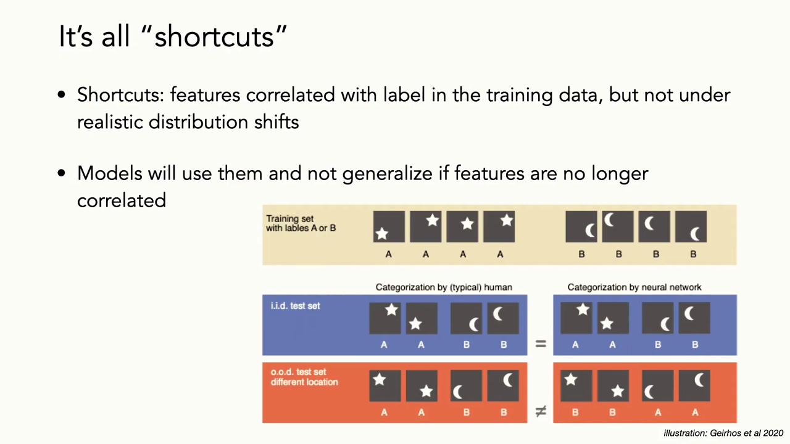
*▲ 강의 슬라이드 [36:40](https://youtu.be/tjD9LIzIIek?t=2200): "모두 지름길이다". [학습 데이터](00_%EB%94%A5%EB%9F%AC%EB%8B%9D_%EC%9A%A9%EC%96%B4%EC%82%AC%EC%A0%84.md#training-data-test-data-%ED%95%99%EC%8A%B5-%EB%8D%B0%EC%9D%B4%ED%84%B0%EC%99%80-%EC%8B%9C%ED%97%98-%EB%8D%B0%EC%9D%B4%ED%84%B0)(별 = A, 달 = B, 위치 상관 있음)에서 사람과 신경망은 [i.i.d.](00_%EB%94%A5%EB%9F%AC%EB%8B%9D_%EC%9A%A9%EC%96%B4%EC%82%AC%EC%A0%84.md#iid-independent-and-identically-distributed-%EB%8F%85%EB%A6%BD-%EB%8F%99%EC%9D%BC-%EB%B6%84%ED%8F%AC) 시험에서 같은 답을 내지만, 위치가 바뀐 o.o.d. 시험에서는 신경망만 틀린다(그림: Geirhos 등 2020)*

### 8.1 지름길의 예

▶ 영상 [37:56](https://youtu.be/tjD9LIzIIek?t=2276)

- **풀밭의 양**: 푸른 언덕 사진에 캡션 모형이 "언덕에서 풀을 뜯는 양 떼"라고 쓰지만, 양은 한 마리도 없습니다. 나무 위의 염소(지중해의 나무 타는 염소)를 "하늘을 나는 새 떼"라고 하고, 사람이 안은 염소를 개라고 합니다. 사람이 개를 안은 사진은 많이 봤지만 염소를 안은 사진은 드물었기 때문입니다.
- **엑스선과 병원**: 엑스선으로 진단을 잘한다던 초기 연구에 대해, 모형이 실은 **어느 병원에서 찍었는지**를 알아내고 그 병원의 질병 분포에 맞춰 예측을 보정한다는 반박 연구가 나왔습니다(Zech 등 2018). 쓸모는 있지만 원치 않는 상관입니다.
- **자(ruler)와 악성 종양**: 사진에 자가 있으면 알고리즘이 종양을 악성이라 할 가능성이 커집니다. 의사가 이미 의심해서 자로 재는 경우였기 때문입니다. 그러면 의사가 아직 의심하지 않은 사례, 즉 정말 잡아야 할 사례를 놓치기 쉽습니다. **예측력 있는 패턴이 모두 바람직한 것은 아닙니다.**

### 8.2 i.i.d.에서 o.o.d.로

▶ 영상 [39:38](https://youtu.be/tjD9LIzIIek?t=2378)

- 도메인 이동, [적대적 예제](00_%EB%94%A5%EB%9F%AC%EB%8B%9D_%EC%9A%A9%EC%96%B4%EC%82%AC%EC%A0%84.md#adversarial-example-%EC%A0%81%EB%8C%80%EC%A0%81-%EC%98%88%EC%A0%9C), 왜곡, 자세 비틀기, 질감 변화, 배경 변화: 사람은 모두 같은 범주라고 하지만 모형은 다르게 예측합니다. 일반화하길 바라는데 못 하는 경우입니다.
- 반대도 있습니다. 사람은 다른 범주라고 보는데 모형은 같은 범주라고 확신하는 경우입니다.
- [트랜스포머](00_%EB%94%A5%EB%9F%AC%EB%8B%9D_%EC%9A%A9%EC%96%B4%EC%82%AC%EC%A0%84.md#transformer-%ED%8A%B8%EB%9E%9C%EC%8A%A4%ED%8F%AC%EB%A8%B8)도 마찬가지입니다. 추론 과제로 학습한 [트랜스포머](00_%EB%94%A5%EB%9F%AC%EB%8B%9D_%EC%9A%A9%EC%96%B4%EC%82%AC%EC%A0%84.md#transformer-%ED%8A%B8%EB%9E%9C%EC%8A%A4%ED%8F%AC%EB%A8%B8)가 **[학습](00_%EB%94%A5%EB%9F%AC%EB%8B%9D_%EC%9A%A9%EC%96%B4%EC%82%AC%EC%A0%84.md#training-%ED%95%99%EC%8A%B5) 때 본 [시퀀스](00_%EB%94%A5%EB%9F%AC%EB%8B%9D_%EC%9A%A9%EC%96%B4%EC%82%AC%EC%A0%84.md#sequence-%EC%8B%9C%ED%80%80%EC%8A%A4) 길이 분포 밖으로는 일반화하지 못한** 사례가 있습니다(Transformers learn shortcuts to automata, Liu 등 2023).

---

## 9. 적대적 학습이 주는 것

▶ 영상 [40:52](https://youtu.be/tjD9LIzIIek?t=2452)

- [적대적 학습](00_%EB%94%A5%EB%9F%AC%EB%8B%9D_%EC%9A%A9%EC%96%B4%EC%82%AC%EC%A0%84.md#adversarial-training-%EC%A0%81%EB%8C%80%EC%A0%81-%ED%95%99%EC%8A%B5)은 비강건한 특징에 대한 **불변성**을 가르쳐, 교란에도 출력이 안정된 모형을 만듭니다. 물론 강건성의 차원을 우리가 안다고 가정한 것이고, 단순한 잡음 추가가 데이터가 흔들리는 모든 방식을 대표하지도 않습니다.
- **사람에게 직관적인 특징**: 훨씬 비싸지만, 적대적으로 학습하면 사람이 이해하기 쉬운 특징이 나온다는 연구가 있습니다(Tsipras 등 2019). 입력 픽셀에 대한 [손실](00_%EB%94%A5%EB%9F%AC%EB%8B%9D_%EC%9A%A9%EC%96%B4%EC%82%AC%EC%A0%84.md#loss-function-%EC%86%90%EC%8B%A4-%ED%95%A8%EC%88%98)의 [기울기](00_%EB%94%A5%EB%9F%AC%EB%8B%9D_%EC%9A%A9%EC%96%B4%EC%82%AC%EC%A0%84.md#gradient-%EA%B8%B0%EC%9A%B8%EA%B8%B0)를 그려 보면, $L_\infty$나 $L_2$로 적대적 학습한 모형은 영장류 사진에서 물체 모양을 더 닮은 [기울기](00_%EB%94%A5%EB%9F%AC%EB%8B%9D_%EC%9A%A9%EC%96%B4%EC%82%AC%EC%A0%84.md#gradient-%EA%B8%B0%EC%9A%B8%EA%B8%B0)를 보입니다. (강사는 이런 활성화 열지도를 모형의 설명으로 쓰는 데에는 조심스럽다고 덧붙입니다.)
- **더 그럴듯한 [적대적 예제](00_%EB%94%A5%EB%9F%AC%EB%8B%9D_%EC%9A%A9%EC%96%B4%EC%82%AC%EC%A0%84.md#adversarial-example-%EC%A0%81%EB%8C%80%EC%A0%81-%EC%98%88%EC%A0%9C)**: 강건하게 학습한 모형을 속이려면 [적대적 예제](00_%EB%94%A5%EB%9F%AC%EB%8B%9D_%EC%9A%A9%EC%96%B4%EC%82%AC%EC%A0%84.md#adversarial-example-%EC%A0%81%EB%8C%80%EC%A0%81-%EC%98%88%EC%A0%9C)가 목표 범주를 정말 닮아야 합니다. 비둘기를 개로 보이게 만들면 정말 개처럼 보이고 더는 비둘기 같지 않습니다. 사람이 받아들일 만한 실수입니다.
- **[전이 학습](00_%EB%94%A5%EB%9F%AC%EB%8B%9D_%EC%9A%A9%EC%96%B4%EC%82%AC%EC%A0%84.md#transfer-learning-%EC%A0%84%EC%9D%B4-%ED%95%99%EC%8A%B5)**: 적대적으로 학습한 모형의 표현이 다른 데이터셋으로 더 잘 [전이](00_%EB%94%A5%EB%9F%AC%EB%8B%9D_%EC%9A%A9%EC%96%B4%EC%82%AC%EC%A0%84.md#transfer-learning-%EC%A0%84%EC%9D%B4-%ED%95%99%EC%8A%B5)된다는 연구도 있습니다(Salman 등 2020, 일부 데이터셋에서).
- 정리하면 [적대적 학습](00_%EB%94%A5%EB%9F%AC%EB%8B%9D_%EC%9A%A9%EC%96%B4%EC%82%AC%EC%A0%84.md#adversarial-training-%EC%A0%81%EB%8C%80%EC%A0%81-%ED%95%99%EC%8A%B5)은 특정한 교란에 강건하게 만드는 아주 표적화된 [규제](00_%EB%94%A5%EB%9F%AC%EB%8B%9D_%EC%9A%A9%EC%96%B4%EC%82%AC%EC%A0%84.md#regularization-%EA%B7%9C%EC%A0%9C), 또는 [도메인 적응](00_%EB%94%A5%EB%9F%AC%EB%8B%9D_%EC%9A%A9%EC%96%B4%EC%82%AC%EC%A0%84.md#domain-adaptation-%EB%8F%84%EB%A9%94%EC%9D%B8-%EC%A0%81%EC%9D%91)의 한 형태로 볼 수 있습니다.

> [!TIP]
> **🆕 2026 업데이트: 적대적 강건성은 어디까지 왔나**
> - **강의**: [적대적 학습](00_%EB%94%A5%EB%9F%AC%EB%8B%9D_%EC%9A%A9%EC%96%B4%EC%82%AC%EC%A0%84.md#adversarial-training-%EC%A0%81%EB%8C%80%EC%A0%81-%ED%95%99%EC%8A%B5)은 비싸고, 정의한 교란 집합에만 강건하다.
> - **현재**: CIFAR-10 $L_\infty$($\epsilon = 8/255$) 기준으로 가장 강한 공격 묶음(AutoAttack)에서 버티는 강건 [정확도](00_%EB%94%A5%EB%9F%AC%EB%8B%9D_%EC%9A%A9%EC%96%B4%EC%82%AC%EC%A0%84.md#accuracy-%EC%A0%95%ED%99%95%EB%8F%84)는 Bartoldson 등(ICML 2024)이 생성 데이터와 큰 모형으로 **약 74%**까지 올렸다(이전 최고보다 약 3%p). 이들의 [스케일링 법칙](00_%EB%94%A5%EB%9F%AC%EB%8B%9D_%EC%9A%A9%EC%96%B4%EC%82%AC%EC%A0%84.md#scaling-laws-%EC%8A%A4%EC%BC%80%EC%9D%BC%EB%A7%81-%EB%B2%95%EC%B9%99)은 이 방식의 강건성이 **약 90%에서 [포화](00_%EB%94%A5%EB%9F%AC%EB%8B%9D_%EC%9A%A9%EC%96%B4%EC%82%AC%EC%A0%84.md#saturation-%ED%8F%AC%ED%99%94)**한다고 예측하고, 그 수준에 가려면 비현실적인 계산량이 필요하다고 본다. 사람에게 같은 [적대적 예제](00_%EB%94%A5%EB%9F%AC%EB%8B%9D_%EC%9A%A9%EC%96%B4%EC%82%AC%EC%A0%84.md#adversarial-example-%EC%A0%81%EB%8C%80%EC%A0%81-%EC%98%88%EC%A0%9C)를 보여 주니 사람 [정확도](00_%EB%94%A5%EB%9F%AC%EB%8B%9D_%EC%9A%A9%EC%96%B4%EC%82%AC%EC%A0%84.md#accuracy-%EC%A0%95%ED%99%95%EB%8F%84)도 약 90%에 머물렀는데, $L_\infty$ 교란이 일부 이미지를 실제로 다른 범주처럼 보이게 만들기 때문이라고 분석한다. 9절의 "강건한 모형을 속이는 예제는 목표 범주를 정말 닮는다"와 같은 관찰이다.
> - **출처**: [Bartoldson et al., Adversarial Robustness Limits via Scaling-Law and Human-Alignment Studies (ICML 2024)](https://arxiv.org/abs/2404.09349)

---

## 10. 분포 이동

▶ 영상 [43:40](https://youtu.be/tjD9LIzIIek?t=2620)

### 10.1 데이터가 있는 곳과 생물이 있는 곳

▶ 영상 [43:40](https://youtu.be/tjD9LIzIIek?t=2620)

이제 데이터 한 점이 아니라 **분포 전체의 이동**을 봅니다. [학습](00_%EB%94%A5%EB%9F%AC%EB%8B%9D_%EC%9A%A9%EC%96%B4%EC%82%AC%EC%A0%84.md#training-%ED%95%99%EC%8A%B5)과 추론의 분포가 꽤 다릅니다. 강사는 "이것이 내가 사는 세계"라며 지도 두 장을 보여 줍니다.

- 왼쪽: 전 세계 **알파 다양성**(한 곳에 사는 고유 종의 수) 추정 지도.
- 오른쪽: 지구 생물다양성 정보 기구(GBIF)의 **약 30억 건** 종 출현 기록의 열지도.
- 둘은 잘 맞지 않고 거의 **반대로 상관**되어 있습니다. 기록이 많은 곳(유럽, 북미)과 종이 많은 곳(열대)이 다릅니다. 기록을 [학습](00_%EB%94%A5%EB%9F%AC%EB%8B%9D_%EC%9A%A9%EC%96%B4%EC%82%AC%EC%A0%84.md#training-%ED%95%99%EC%8A%B5) 분포로, 생물이 실제 있는 곳을 쓸 곳으로 보면 큰 [분포 이동](00_%EB%94%A5%EB%9F%AC%EB%8B%9D_%EC%9A%A9%EC%96%B4%EC%82%AC%EC%A0%84.md#distribution-shift-%EB%B6%84%ED%8F%AC-%EC%9D%B4%EB%8F%99)이고, 그 위에 모든 것이 계속 바뀝니다.

### 10.2 WILDS 벤치마크

▶ 영상 [44:47](https://youtu.be/tjD9LIzIIek?t=2687)

- 기존 [분포 이동](00_%EB%94%A5%EB%9F%AC%EB%8B%9D_%EC%9A%A9%EC%96%B4%EC%82%AC%EC%A0%84.md#distribution-shift-%EB%B6%84%ED%8F%AC-%EC%9D%B4%EB%8F%99) 연구는 잡음 추가, [MNIST](00_%EB%94%A5%EB%9F%AC%EB%8B%9D_%EC%9A%A9%EC%96%B4%EC%82%AC%EC%A0%84.md#mnist-%EC%86%90%EA%B8%80%EC%94%A8-%EC%88%AB%EC%9E%90-%EB%8D%B0%EC%9D%B4%ED%84%B0%EC%85%8B) 45도 회전, 색 바꾸기처럼 **비현실적인 이동**이 많았습니다. 실제 데이터로 만든 waterbirds(물새를 [학습](00_%EB%94%A5%EB%9F%AC%EB%8B%9D_%EC%9A%A9%EC%96%B4%EC%82%AC%EC%A0%84.md#training-%ED%95%99%EC%8A%B5)에서는 물 밖, 시험에서는 물속 배경에 둠)도 범주 균형을 맞추고 이동을 한 차원(배경)으로 제한해 인위적입니다.
- 강사가 동료들과 만든 **[WILDS](00_%EB%94%A5%EB%9F%AC%EB%8B%9D_%EC%9A%A9%EC%96%B4%EC%82%AC%EC%A0%84.md#wilds-%EB%B6%84%ED%8F%AC-%EC%9D%B4%EB%8F%99-%EB%B2%A4%EC%B9%98%EB%A7%88%ED%81%AC)**(Koh 등 2021)는 병원 간 조직 검사 사진, 지역 간 종 [분류](00_%EB%94%A5%EB%9F%AC%EB%8B%9D_%EC%9A%A9%EC%96%B4%EC%82%AC%EC%A0%84.md#regression-classification-%ED%9A%8C%EA%B7%80%EC%99%80-%EB%B6%84%EB%A5%98), 나라 간 빈곤 지도, 인구 집단 간 댓글 등 **현실 영역의 다양한 이동**을 모았습니다. 결론은 현실적으로 분포 밖으로 가면 성능이 **크게 떨어진다**는 것입니다.

| 이동 | 분포 안 (ID) | 분포 밖 (OOD) | 차이 |
|---|---|---|---|
| 병원 간 조직 검사 사진 | [정확도](00_%EB%94%A5%EB%9F%AC%EB%8B%9D_%EC%9A%A9%EC%96%B4%EC%82%AC%EC%A0%84.md#accuracy-%EC%A0%95%ED%99%95%EB%8F%84) 93.2% | 70.3% | -22.9%p |
| 시간에 따른 위성 사진 | [정확도](00_%EB%94%A5%EB%9F%AC%EB%8B%9D_%EC%9A%A9%EC%96%B4%EC%82%AC%EC%A0%84.md#accuracy-%EC%A0%95%ED%99%95%EB%8F%84) 48.6% | 32.3% | -16.3%p |
| 지역 간 밀 이삭 검출 | [정확도](00_%EB%94%A5%EB%9F%AC%EB%8B%9D_%EC%9A%A9%EC%96%B4%EC%82%AC%EC%A0%84.md#accuracy-%EC%A0%95%ED%99%95%EB%8F%84) 63.3% | 49.6% | -13.7%p |
| 분자 골격 간 생물 검정 예측 | AP 34.4% | 27.2% | -7.2%p |
| 카메라 트랩 간 종 [분류](00_%EB%94%A5%EB%9F%AC%EB%8B%9D_%EC%9A%A9%EC%96%B4%EC%82%AC%EC%A0%84.md#regression-classification-%ED%9A%8C%EA%B7%80%EC%99%80-%EB%B6%84%EB%A5%98) (iWildCam) | [매크로 F1](00_%EB%94%A5%EB%9F%AC%EB%8B%9D_%EC%9A%A9%EC%96%B4%EC%82%AC%EC%A0%84.md#macro-f1-%EB%A7%A4%ED%81%AC%EB%A1%9C-f1) 47.0% | 31.0% | -16.0%p |

- **측정법**: 분포 안 대조군([학습](00_%EB%94%A5%EB%9F%AC%EB%8B%9D_%EC%9A%A9%EC%96%B4%EC%82%AC%EC%A0%84.md#training-%ED%95%99%EC%8A%B5)에 쓴 카메라 위치에서 무작위로 뽑은 [시험 데이터](00_%EB%94%A5%EB%9F%AC%EB%8B%9D_%EC%9A%A9%EC%96%B4%EC%82%AC%EC%A0%84.md#training-data-test-data-%ED%95%99%EC%8A%B5-%EB%8D%B0%EC%9D%B4%ED%84%B0%EC%99%80-%EC%8B%9C%ED%97%98-%EB%8D%B0%EC%9D%B4%ED%84%B0). [학습 데이터](00_%EB%94%A5%EB%9F%AC%EB%8B%9D_%EC%9A%A9%EC%96%B4%EC%82%AC%EC%A0%84.md#training-data-test-data-%ED%95%99%EC%8A%B5-%EB%8D%B0%EC%9D%B4%ED%84%B0%EC%99%80-%EC%8B%9C%ED%97%98-%EB%8D%B0%EC%9D%B4%ED%84%B0)와 똑같지는 않음)과, [학습](00_%EB%94%A5%EB%9F%AC%EB%8B%9D_%EC%9A%A9%EC%96%B4%EC%82%AC%EC%A0%84.md#training-%ED%95%99%EC%8A%B5)에서 뺀 **새 카메라**(분포 밖)를 비교합니다. iWildCam에서 [매크로 F1](00_%EB%94%A5%EB%9F%AC%EB%8B%9D_%EC%9A%A9%EC%96%B4%EC%82%AC%EC%A0%84.md#macro-f1-%EB%A7%A4%ED%81%AC%EB%A1%9C-f1)(범주마다 F1을 구해 평균, 드문 종도 같은 무게)이 47.0에서 31.0으로 떨어집니다. (강사는 "16%"라고 했는데, 비율이 아니라 16%포인트 차이다.)
- **원인이 여럿**: 배경, 카메라 자세(어떤 카메라는 수평, 어떤 카메라는 높이 달려 동물을 내려다봄), 밤에 적외선 흑백 사진인지 컬러인지 등. 현실의 이동 차원은 복잡합니다.

### 10.3 하위 집단 이동

▶ 영상 [47:06](https://youtu.be/tjD9LIzIIek?t=2826)

📐 **수학 개념**: [베이즈 규칙과 사전 확률 보정](%EC%88%98%ED%95%99%EA%B0%9C%EB%85%90/04_%ED%99%95%EB%A5%A0%EA%B3%BC_%EC%A0%95%EB%B3%B4/MM64_%EB%B2%A0%EC%9D%B4%EC%A6%88_%EA%B7%9C%EC%B9%99%EA%B3%BC_%EC%82%AC%EC%A0%84_%ED%99%95%EB%A5%A0_%EB%B3%B4%EC%A0%95.md)

- 겉모습의 이동만이 아닙니다. **[하위 집단 이동](00_%EB%94%A5%EB%9F%AC%EB%8B%9D_%EC%9A%A9%EC%96%B4%EC%82%AC%EC%A0%84.md#subpopulation-shift-%ED%95%98%EC%9C%84-%EC%A7%91%EB%8B%A8-%EC%9D%B4%EB%8F%99)(subpopulation shift)**도 있습니다. 카메라(장소)마다 관심 범주의 분포가 다릅니다. 카메라가 놓인 미세 서식지에 사는 종이 다르니 당연합니다. 강사는 자신이 다룬 모든 생태 문제에서 이것이 참이었다고 말합니다.
- 다른 예: 미국 국립 생태 관측망(NEON)의 항공 사진 나무 검출(나무 모양과 밀도가 다름), 태평양 북서부 강들의 물고기 검출·계수, 북미 도시별 가로수 [분류](00_%EB%94%A5%EB%9F%AC%EB%8B%9D_%EC%9A%A9%EC%96%B4%EC%82%AC%EC%A0%84.md#regression-classification-%ED%9A%8C%EA%B7%80%EC%99%80-%EB%B6%84%EB%A5%98)(20개 흔한 속의 비율이 도시마다 다름, Auto Arborist).
- **성능은 하위 집단 분포의 유사도와 강하게 상관**됩니다. 한 도시로 학습하고 다른 도시에서 시험하면, [학습](00_%EB%94%A5%EB%9F%AC%EB%8B%9D_%EC%9A%A9%EC%96%B4%EC%82%AC%EC%A0%84.md#training-%ED%95%99%EC%8A%B5) 분포가 비슷한 도시끼리 블록 구조로 더 잘 일반화합니다. 모형은 가능도로 학습하므로 [학습 데이터](00_%EB%94%A5%EB%9F%AC%EB%8B%9D_%EC%9A%A9%EC%96%B4%EC%82%AC%EC%A0%84.md#training-data-test-data-%ED%95%99%EC%8A%B5-%EB%8D%B0%EC%9D%B4%ED%84%B0%EC%99%80-%EC%8B%9C%ED%97%98-%EB%8D%B0%EC%9D%B4%ED%84%B0)의 범주 비율을 사실상 **사전 [확률](00_%EB%94%A5%EB%9F%AC%EB%8B%9D_%EC%9A%A9%EC%96%B4%EC%82%AC%EC%A0%84.md#probability-%ED%99%95%EB%A5%A0)**(prior)로 품고 있고, 그 비율이 맞을수록 잘 맞힙니다.
- 그래서 [시험 데이터](00_%EB%94%A5%EB%9F%AC%EB%8B%9D_%EC%9A%A9%EC%96%B4%EC%82%AC%EC%A0%84.md#training-data-test-data-%ED%95%99%EC%8A%B5-%EB%8D%B0%EC%9D%B4%ED%84%B0%EC%99%80-%EC%8B%9C%ED%97%98-%EB%8D%B0%EC%9D%B4%ED%84%B0)의 [범주 분포](00_%EB%94%A5%EB%9F%AC%EB%8B%9D_%EC%9A%A9%EC%96%B4%EC%82%AC%EC%A0%84.md#categorical-distribution-%EB%B2%94%EC%A3%BC-%EB%B6%84%ED%8F%AC)를 예상할 수 있다면, **추가 [학습](00_%EB%94%A5%EB%9F%AC%EB%8B%9D_%EC%9A%A9%EC%96%B4%EC%82%AC%EC%A0%84.md#training-%ED%95%99%EC%8A%B5) 없이** 예측 [확률](00_%EB%94%A5%EB%9F%AC%EB%8B%9D_%EC%9A%A9%EC%96%B4%EC%82%AC%EC%A0%84.md#probability-%ED%99%95%EB%A5%A0)을 그 사전 [확률](00_%EB%94%A5%EB%9F%AC%EB%8B%9D_%EC%9A%A9%EC%96%B4%EC%82%AC%EC%A0%84.md#probability-%ED%99%95%EB%A5%A0)로 다시 매기는 간단한 [베이즈 재보정](00_%EB%94%A5%EB%9F%AC%EB%8B%9D_%EC%9A%A9%EC%96%B4%EC%82%AC%EC%A0%84.md#bayes-rule-%EB%B2%A0%EC%9D%B4%EC%A6%88-%EC%A0%95%EB%A6%AC)이 통합니다(12.1절).

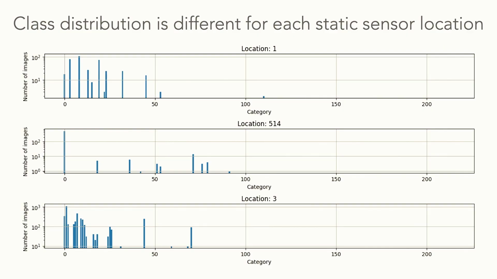
*▲ 강의 슬라이드 [47:30](https://youtu.be/tjD9LIzIIek?t=2850): 고정 카메라 위치마다 [범주 분포](00_%EB%94%A5%EB%9F%AC%EB%8B%9D_%EC%9A%A9%EC%96%B4%EC%82%AC%EC%A0%84.md#categorical-distribution-%EB%B2%94%EC%A3%BC-%EB%B6%84%ED%8F%AC)가 다르다. 세 위치(1, 514, 3)의 범주별 사진 수([로그](00_%EB%94%A5%EB%9F%AC%EB%8B%9D_%EC%9A%A9%EC%96%B4%EC%82%AC%EC%A0%84.md#log-ln-%EB%A1%9C%EA%B7%B8) 눈금)*

---

## 11. 분포적으로 강건한 최적화

▶ 영상 [49:21](https://youtu.be/tjD9LIzIIek?t=2961)

### 11.1 분포 전체를 흔들기

▶ 영상 [49:56](https://youtu.be/tjD9LIzIIek?t=2996)

📐 **수학 개념**: [최악의 경우 최적화와 그룹 DRO](%EC%88%98%ED%95%99%EA%B0%9C%EB%85%90/12_%EA%B0%95%EA%B1%B4%EC%84%B1%EA%B3%BC_%EC%A0%84%EC%9D%B4/MM63_%EC%B5%9C%EC%95%85%EC%9D%98_%EA%B2%BD%EC%9A%B0_%EC%B5%9C%EC%A0%81%ED%99%94%EC%99%80_%EA%B7%B8%EB%A3%B9_DRO.md) · [기댓값](%EC%88%98%ED%95%99%EA%B0%9C%EB%85%90/04_%ED%99%95%EB%A5%A0%EA%B3%BC_%EC%A0%95%EB%B3%B4/MM22_%EA%B8%B0%EB%8C%93%EA%B0%92%EA%B3%BC_%EC%9D%BC%EB%B0%98%ED%99%94_%EA%B0%84%EA%B7%B9.md)

- [적대적 예제](00_%EB%94%A5%EB%9F%AC%EB%8B%9D_%EC%9A%A9%EC%96%B4%EC%82%AC%EC%A0%84.md#adversarial-example-%EC%A0%81%EB%8C%80%EC%A0%81-%EC%98%88%EC%A0%9C)와 아주 비슷한 접근이 **[분포적으로 강건한 최적화](00_%EB%94%A5%EB%9F%AC%EB%8B%9D_%EC%9A%A9%EC%96%B4%EC%82%AC%EC%A0%84.md#distributionally-robust-optimization-%EB%B6%84%ED%8F%AC%EC%A0%81%EC%9C%BC%EB%A1%9C-%EA%B0%95%EA%B1%B4%ED%95%9C-%EC%B5%9C%EC%A0%81%ED%99%94)(DRO, Distributionally robust optimization)**입니다. 지금까지는 데이터 **한 점씩** 정해진 만큼 흔들었다면, 이번에는 **[학습](00_%EB%94%A5%EB%9F%AC%EB%8B%9D_%EC%9A%A9%EC%96%B4%EC%82%AC%EC%A0%84.md#training-%ED%95%99%EC%8A%B5) 분포 전체**를 함께 흔듭니다.
- 표준 [학습](00_%EB%94%A5%EB%9F%AC%EB%8B%9D_%EC%9A%A9%EC%96%B4%EC%82%AC%EC%A0%84.md#training-%ED%95%99%EC%8A%B5)의 평균 [손실](00_%EB%94%A5%EB%9F%AC%EB%8B%9D_%EC%9A%A9%EC%96%B4%EC%82%AC%EC%A0%84.md#loss-function-%EC%86%90%EC%8B%A4-%ED%95%A8%EC%88%98)은 사실 [경험 분포](00_%EB%94%A5%EB%9F%AC%EB%8B%9D_%EC%9A%A9%EC%96%B4%EC%82%AC%EC%A0%84.md#empirical-risk-%EA%B2%BD%ED%97%98%EC%A0%81-%EC%9C%84%ED%97%98) $\hat{P}_n$([학습](00_%EB%94%A5%EB%9F%AC%EB%8B%9D_%EC%9A%A9%EC%96%B4%EC%82%AC%EC%A0%84.md#training-%ED%95%99%EC%8A%B5) 표본의 이산 분포)에 대한 [기댓값](00_%EB%94%A5%EB%9F%AC%EB%8B%9D_%EC%9A%A9%EC%96%B4%EC%82%AC%EC%A0%84.md#expectation-%EA%B8%B0%EB%8C%93%EA%B0%92)입니다. DRO는 **최악의 [분포 이동](00_%EB%94%A5%EB%9F%AC%EB%8B%9D_%EC%9A%A9%EC%96%B4%EC%82%AC%EC%A0%84.md#distribution-shift-%EB%B6%84%ED%8F%AC-%EC%9D%B4%EB%8F%99)이 일어날 수 있다**고 보고, 그 분포를 조금 바꾼 $Q$(표본의 밀도를 바꾸거나, 일부 데이터를 빼거나, 무게를 다시 매기거나)들 가운데 가장 나쁜 것에서도 [손실](00_%EB%94%A5%EB%9F%AC%EB%8B%9D_%EC%9A%A9%EC%96%B4%EC%82%AC%EC%A0%84.md#loss-function-%EC%86%90%EC%8B%A4-%ED%95%A8%EC%88%98)이 작은 모형을 찾습니다.
- 다만 분포를 **일정 거리까지만** 움직일 수 있다고 가정합니다. 픽셀 차이를 재는 것과 달리 **[확률](00_%EB%94%A5%EB%9F%AC%EB%8B%9D_%EC%9A%A9%EC%96%B4%EC%82%AC%EC%A0%84.md#probability-%ED%99%95%EB%A5%A0) 분포 사이 거리**를 재기는 복잡합니다. 카이제곱 거리, [바서슈타인 거리](00_%EB%94%A5%EB%9F%AC%EB%8B%9D_%EC%9A%A9%EC%96%B4%EC%82%AC%EC%A0%84.md#wasserstein-distance-%EB%B0%94%EC%84%9C%EC%8A%88%ED%83%80%EC%9D%B8-%EA%B1%B0%EB%A6%AC), 최대 평균 불일치(MMD) 등을 쓰는데, 1차원의 간단한 분포라면 몰라도 백만 장짜리 이미지 데이터셋 두 개 사이 거리는 훨씬 어렵습니다. 흔히 학습된 표현 공간에서 군집 등으로 유사도를 재는데, 실제로 썩 잘 되지는 않습니다.

$$
\min_\theta\ \max_{Q:\ D(Q, \hat{P}_n) < \epsilon}\ \mathbb{E}_{(\mathbf{x}, y) \sim Q}\big[\text{Loss}(f_\theta(\mathbf{x}), y)\big]
$$

기호 풀이

| 기호 | 읽는 법 | 뜻 | 예제 값 |
| --- | --- | --- | --- |
| $\hat{P}_n$ | 피 햇 엔 | 경험 분포: [학습](00_%EB%94%A5%EB%9F%AC%EB%8B%9D_%EC%9A%A9%EC%96%B4%EC%82%AC%EC%A0%84.md#training-%ED%95%99%EC%8A%B5) 표본 $n$개에 같은 무게 $1/n$ | (0.5, 0.5) |
| $Q$ | 큐 | [학습](00_%EB%94%A5%EB%9F%AC%EB%8B%9D_%EC%9A%A9%EC%96%B4%EC%82%AC%EC%A0%84.md#training-%ED%95%99%EC%8A%B5) 분포를 조금 바꾼 후보 분포 (표본 무게를 다시 매김) | (0.3, 0.7) |
| $D(Q, \hat{P}_n)$ | 디 | 두 분포 사이 거리. 예제는 옮긴 무게의 양(총변동 거리) | 0.2 |
| $\epsilon$ | 엡실론 | 분포를 움직일 수 있는 최대 거리 | 0.2 |
| $\mathbb{E}_{(\mathbf{x}, y) \sim Q}$ | $Q$에 대한 [기댓값](00_%EB%94%A5%EB%9F%AC%EB%8B%9D_%EC%9A%A9%EC%96%B4%EC%82%AC%EC%A0%84.md#expectation-%EA%B8%B0%EB%8C%93%EA%B0%92) | $Q$의 무게로 매긴 [손실](00_%EB%94%A5%EB%9F%AC%EB%8B%9D_%EC%9A%A9%EC%96%B4%EC%82%AC%EC%A0%84.md#loss-function-%EC%86%90%EC%8B%A4-%ED%95%A8%EC%88%98) 평균 | 0.76 |
| $\max_Q$ | 안쪽 최대화 | 허용 범위에서 가장 나쁜 분포 | |
| $\min_\theta$ | 바깥쪽 최소화 | 그 최악의 분포에서 [손실](00_%EB%94%A5%EB%9F%AC%EB%8B%9D_%EC%9A%A9%EC%96%B4%EC%82%AC%EC%A0%84.md#loss-function-%EC%86%90%EC%8B%A4-%ED%95%A8%EC%88%98)이 작은 모형 | |

예제와 풀이

**문제**: [학습](00_%EB%94%A5%EB%9F%AC%EB%8B%9D_%EC%9A%A9%EC%96%B4%EC%82%AC%EC%A0%84.md#training-%ED%95%99%EC%8A%B5) 표본 두 개의 [손실](00_%EB%94%A5%EB%9F%AC%EB%8B%9D_%EC%9A%A9%EC%96%B4%EC%82%AC%EC%A0%84.md#loss-function-%EC%86%90%EC%8B%A4-%ED%95%A8%EC%88%98)이 0.2와 1.0이다. 경험 분포는 두 표본에 무게 0.5씩을 준다. 무게를 최대 0.2까지 옮길 수 있을 때(예제에서는 경계 0.2도 포함한다고 본다) 최악의 분포 $Q$에서의 기대 [손실](00_%EB%94%A5%EB%9F%AC%EB%8B%9D_%EC%9A%A9%EC%96%B4%EC%82%AC%EC%A0%84.md#loss-function-%EC%86%90%EC%8B%A4-%ED%95%A8%EC%88%98)을 구하고, 경험 분포에서의 값과 비교하라.

**주어진 값**
- [손실](00_%EB%94%A5%EB%9F%AC%EB%8B%9D_%EC%9A%A9%EC%96%B4%EC%82%AC%EC%A0%84.md#loss-function-%EC%86%90%EC%8B%A4-%ED%95%A8%EC%88%98) $(\ell_1, \ell_2) = (0.2, 1.0)$ (표본 1은 쉬움, 표본 2는 어려움)
- $\hat{P}_n = (0.5, 0.5)$ (원래 무게)
- $\epsilon = 0.2$ (옮길 수 있는 무게)

**풀이**
1. 식을 그대로 쓴다: $\max_{Q} \mathbb{E}_Q[\text{Loss}] = \max_Q \big(q_1 \ell_1 + q_2 \ell_2\big)$, 조건 $D(Q, \hat{P}_n) \le \epsilon$
2. 값을 대입한다: $\max_Q \big(q_1 \times 0.2 + q_2 \times 1.0\big)$, 조건 옮긴 무게 $\le 0.2$
3. 먼저 경험 분포 값을 구한다. 곱셈: $0.5 \times 0.2 = 0.1$, $0.5 \times 1.0 = 0.5$
4. 더한다: $0.1 + 0.5 = 0.6$
5. 최악의 분포는 [손실](00_%EB%94%A5%EB%9F%AC%EB%8B%9D_%EC%9A%A9%EC%96%B4%EC%82%AC%EC%A0%84.md#loss-function-%EC%86%90%EC%8B%A4-%ED%95%A8%EC%88%98)이 큰 표본 쪽으로 무게를 최대한 옮긴다: $q_1 = 0.5 - 0.2 = 0.3$, $q_2 = 0.5 + 0.2 = 0.7$
6. 곱셈을 한다: $0.3 \times 0.2 = 0.06$, $0.7 \times 1.0 = 0.7$
7. 더한다: $0.06 + 0.7 = 0.76$

**답**: 경험 분포에서 **0.6**, 최악의 분포에서 **0.76**. DRO는 0.76 쪽을 줄이도록 학습하므로, 어려운 표본에 더 신경 쓰게 된다.

내 이해

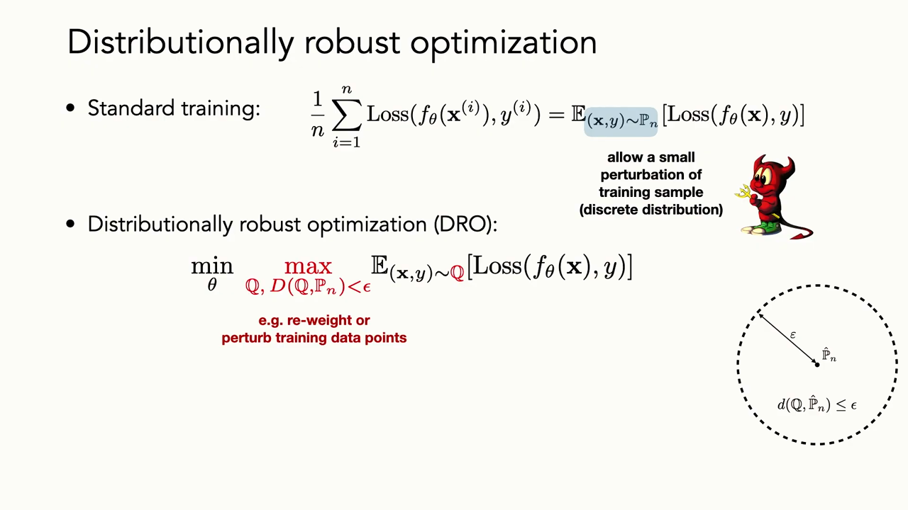
*▲ 강의 슬라이드 [51:40](https://youtu.be/tjD9LIzIIek?t=3100): 표준 [학습](00_%EB%94%A5%EB%9F%AC%EB%8B%9D_%EC%9A%A9%EC%96%B4%EC%82%AC%EC%A0%84.md#training-%ED%95%99%EC%8A%B5)은 경험 분포 $\hat{P}_n$에 대한 [기댓값](00_%EB%94%A5%EB%9F%AC%EB%8B%9D_%EC%9A%A9%EC%96%B4%EC%82%AC%EC%A0%84.md#expectation-%EA%B8%B0%EB%8C%93%EA%B0%92), DRO는 $\hat{P}_n$에서 거리 $\epsilon$ 안의 분포 $Q$ 중 최악에 대한 [기댓값](00_%EB%94%A5%EB%9F%AC%EB%8B%9D_%EC%9A%A9%EC%96%B4%EC%82%AC%EC%A0%84.md#expectation-%EA%B8%B0%EB%8C%93%EA%B0%92)을 줄인다(예: [학습 데이터](00_%EB%94%A5%EB%9F%AC%EB%8B%9D_%EC%9A%A9%EC%96%B4%EC%82%AC%EC%A0%84.md#training-data-test-data-%ED%95%99%EC%8A%B5-%EB%8D%B0%EC%9D%B4%ED%84%B0%EC%99%80-%EC%8B%9C%ED%97%98-%EB%8D%B0%EC%9D%B4%ED%84%B0)에 무게를 다시 매기거나 교란)*

- **일반화와의 관계**: 실제 데이터 분포를 $P$, [학습 데이터](00_%EB%94%A5%EB%9F%AC%EB%8B%9D_%EC%9A%A9%EC%96%B4%EC%82%AC%EC%A0%84.md#training-data-test-data-%ED%95%99%EC%8A%B5-%EB%8D%B0%EC%9D%B4%ED%84%B0%EC%99%80-%EC%8B%9C%ED%97%98-%EB%8D%B0%EC%9D%B4%ED%84%B0)를 $\hat{P}_n$이라 합시다. 거리를 정해 두고 $D(P, \hat{P}_n) < \epsilon$이면, DRO로 잘 작동하는 모형은 $P$에서도 잘 작동한다고 **보장**됩니다. 곧 일반화합니다.
- 한계는 분명합니다. 분포 사이 거리를 잴 수 있어야 하고, 가상의 분포를 현실적으로 뽑을 수 있어야 합니다. 데이터 구조가 복잡할수록 어려워집니다.

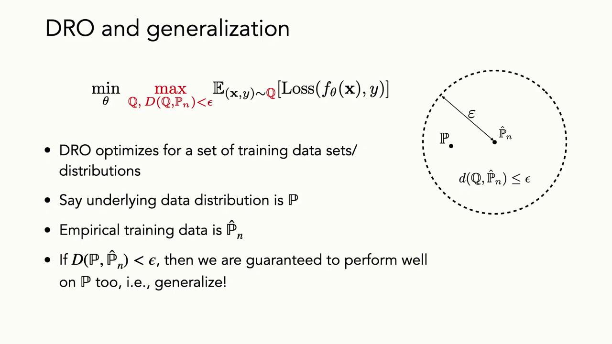
*▲ 강의 슬라이드 [52:40](https://youtu.be/tjD9LIzIIek?t=3160): DRO와 [일반화](00_%EB%94%A5%EB%9F%AC%EB%8B%9D_%EC%9A%A9%EC%96%B4%EC%82%AC%EC%A0%84.md#generalization-%EC%9D%BC%EB%B0%98%ED%99%94). 실제 분포 $\mathbb{P}$가 $\hat{\mathbb{P}}_n$에서 $\epsilon$ 안에 있으면 $\mathbb{P}$에서도 잘 작동함이 보장된다*

### 11.2 소수 그룹과 클래스 불균형

▶ 영상 [52:43](https://youtu.be/tjD9LIzIIek?t=3163)

📐 **수학 개념**: [최악의 경우 최적화와 그룹 DRO](%EC%88%98%ED%95%99%EA%B0%9C%EB%85%90/12_%EA%B0%95%EA%B1%B4%EC%84%B1%EA%B3%BC_%EC%A0%84%EC%9D%B4/MM63_%EC%B5%9C%EC%95%85%EC%9D%98_%EA%B2%BD%EC%9A%B0_%EC%B5%9C%EC%A0%81%ED%99%94%EC%99%80_%EA%B7%B8%EB%A3%B9_DRO.md) · [우연 수준과 기준선](%EC%88%98%ED%95%99%EA%B0%9C%EB%85%90/04_%ED%99%95%EB%A5%A0%EA%B3%BC_%EC%A0%95%EB%B3%B4/MM34_%EC%9A%B0%EC%97%B0_%EC%88%98%EC%A4%80_%EC%86%90%EC%8B%A4%EA%B3%BC_%EA%B8%B0%EC%A4%80%EC%84%A0.md)

- DRO는 [클래스 불균형](00_%EB%94%A5%EB%9F%AC%EB%8B%9D_%EC%9A%A9%EC%96%B4%EC%82%AC%EC%A0%84.md#class-imbalance-%ED%81%B4%EB%9E%98%EC%8A%A4-%EB%B6%88%EA%B7%A0%ED%98%95) 문제에 꽤 효과적으로 쓰였습니다. 집단이 $K$개의 하위 그룹으로 나뉜다고 합시다. 예를 들어 너구리 범주 안의 밤 사진과 낮 사진($K = 2$). 카메라에 시계가 있으니 그룹 라벨도 압니다.
- 보통은 [경험적 위험](00_%EB%94%A5%EB%9F%AC%EB%8B%9D_%EC%9A%A9%EC%96%B4%EC%82%AC%EC%A0%84.md#empirical-risk-%EA%B2%BD%ED%97%98%EC%A0%81-%EC%9C%84%ED%97%98), 즉 그룹을 가리지 않은 [평균 오차](00_%EB%94%A5%EB%9F%AC%EB%8B%9D_%EC%9A%A9%EC%96%B4%EC%82%AC%EC%A0%84.md#average-error-%ED%8F%89%EA%B7%A0-%EC%98%A4%EC%B0%A8)를 줄입니다. 그런데 소수 그룹(20%)에서 [오차](00_%EB%94%A5%EB%9F%AC%EB%8B%9D_%EC%9A%A9%EC%96%B4%EC%82%AC%EC%A0%84.md#error-%EC%98%A4%EC%B0%A8)가 50%여도 전체 [오차](00_%EB%94%A5%EB%9F%AC%EB%8B%9D_%EC%9A%A9%EC%96%B4%EC%82%AC%EC%A0%84.md#error-%EC%98%A4%EC%B0%A8)는 10%뿐입니다. 효율적인 모형이라면 **소수 그룹을 무시하는 법**을 배울 수 있고, 그래도 [손실](00_%EB%94%A5%EB%9F%AC%EB%8B%9D_%EC%9A%A9%EC%96%B4%EC%82%AC%EC%A0%84.md#loss-function-%EC%86%90%EC%8B%A4-%ED%95%A8%EC%88%98)은 괜찮아 보입니다. 게다가 소수 그룹의 통계적 패턴이 다를 수도 있습니다.

$$
\min_\theta\ \frac{1}{n}\Big(\sum_{i \in \text{그룹 1}} \text{Loss}(x_i; \theta) + \sum_{j \in \text{그룹 2}} \text{Loss}(x_j; \theta)\Big)
$$

기호 풀이

| 기호 | 읽는 법 | 뜻 | 예제 값 |
| --- | --- | --- | --- |
| $n$ | 엔 | 전체 데이터 개수 | 10 |
| 그룹 1 | 다수 그룹 | 데이터의 80% (예: 밤 너구리) | 8개 |
| 그룹 2 | 소수 그룹 | 데이터의 20% (예: 낮 너구리) | 2개 |
| $\text{Loss}(x_i; \theta)$ | [손실](00_%EB%94%A5%EB%9F%AC%EB%8B%9D_%EC%9A%A9%EC%96%B4%EC%82%AC%EC%A0%84.md#loss-function-%EC%86%90%EC%8B%A4-%ED%95%A8%EC%88%98) | 예제는 0-1 [손실](00_%EB%94%A5%EB%9F%AC%EB%8B%9D_%EC%9A%A9%EC%96%B4%EC%82%AC%EC%A0%84.md#loss-function-%EC%86%90%EC%8B%A4-%ED%95%A8%EC%88%98) (틀리면 1, 맞으면 0) | 0 또는 1 |
| $\sum_{i \in \text{그룹 1}}$ | 그룹 1에 대한 합 | 그룹 1의 [손실](00_%EB%94%A5%EB%9F%AC%EB%8B%9D_%EC%9A%A9%EC%96%B4%EC%82%AC%EC%A0%84.md#loss-function-%EC%86%90%EC%8B%A4-%ED%95%A8%EC%88%98)을 모두 더함 | 0 |
| $\frac{1}{n}(\cdots)$ | 평균 | 그룹을 가리지 않은 [평균 오차](00_%EB%94%A5%EB%9F%AC%EB%8B%9D_%EC%9A%A9%EC%96%B4%EC%82%AC%EC%A0%84.md#average-error-%ED%8F%89%EA%B7%A0-%EC%98%A4%EC%B0%A8) (ERM) | 0.1 |

예제와 풀이

**문제**: 너구리 사진 10장 중 8장은 밤(그룹 1), 2장은 낮(그룹 2)이다. 모형이 밤 사진은 모두 맞히고, 낮 사진은 2장 중 1장을 틀린다. 0-1 [손실](00_%EB%94%A5%EB%9F%AC%EB%8B%9D_%EC%9A%A9%EC%96%B4%EC%82%AC%EC%A0%84.md#loss-function-%EC%86%90%EC%8B%A4-%ED%95%A8%EC%88%98)로 [평균 오차](00_%EB%94%A5%EB%9F%AC%EB%8B%9D_%EC%9A%A9%EC%96%B4%EC%82%AC%EC%A0%84.md#average-error-%ED%8F%89%EA%B7%A0-%EC%98%A4%EC%B0%A8)(ERM이 보는 값)와 소수 그룹의 [오차](00_%EB%94%A5%EB%9F%AC%EB%8B%9D_%EC%9A%A9%EC%96%B4%EC%82%AC%EC%A0%84.md#error-%EC%98%A4%EC%B0%A8)를 구하라.

**주어진 값**
- $n = 10$ (전체 사진 수)
- 그룹 1: 8장, [손실](00_%EB%94%A5%EB%9F%AC%EB%8B%9D_%EC%9A%A9%EC%96%B4%EC%82%AC%EC%A0%84.md#loss-function-%EC%86%90%EC%8B%A4-%ED%95%A8%EC%88%98) 모두 0 (밤, 다 맞힘)
- 그룹 2: 2장, [손실](00_%EB%94%A5%EB%9F%AC%EB%8B%9D_%EC%9A%A9%EC%96%B4%EC%82%AC%EC%A0%84.md#loss-function-%EC%86%90%EC%8B%A4-%ED%95%A8%EC%88%98) 1과 0 (낮, 하나 틀림)

**풀이**
1. 식을 그대로 쓴다: [평균 오차](00_%EB%94%A5%EB%9F%AC%EB%8B%9D_%EC%9A%A9%EC%96%B4%EC%82%AC%EC%A0%84.md#average-error-%ED%8F%89%EA%B7%A0-%EC%98%A4%EC%B0%A8) $= \dfrac{1}{n}\Big(\sum_{i \in \text{그룹 1}} \text{Loss}_i + \sum_{j \in \text{그룹 2}} \text{Loss}_j\Big)$
2. 값을 대입한다 (Σ를 항마다 펼침): $\dfrac{1}{10}\big((0 + 0 + 0 + 0 + 0 + 0 + 0 + 0) + (1 + 0)\big)$
3. 그룹 1을 더한다: $0 + 0 + 0 + 0 + 0 + 0 + 0 + 0 = 0$
4. 그룹 2를 더한다: $1 + 0 = 1$
5. 두 합을 더한다: $0 + 1 = 1$
6. $n$으로 나눈다: $1 / 10 = 0.1$
7. 소수 그룹만 따로 본다: 그룹 2의 합 1을 그룹 크기 2로 나눈다: $1 / 2 = 0.5$

**답**: [평균 오차](00_%EB%94%A5%EB%9F%AC%EB%8B%9D_%EC%9A%A9%EC%96%B4%EC%82%AC%EC%A0%84.md#average-error-%ED%8F%89%EA%B7%A0-%EC%98%A4%EC%B0%A8) **0.1(10%)**, 소수 그룹 [오차](00_%EB%94%A5%EB%9F%AC%EB%8B%9D_%EC%9A%A9%EC%96%B4%EC%82%AC%EC%A0%84.md#error-%EC%98%A4%EC%B0%A8) **0.5(50%)**. 평균만 보면 괜찮은 모형이 낮 너구리는 절반을 틀린다.

내 이해

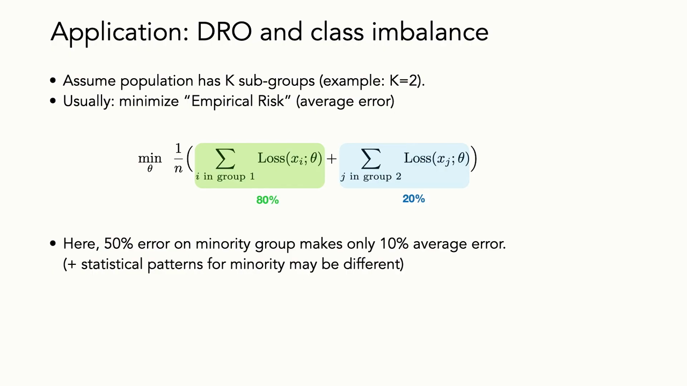
*▲ 강의 슬라이드 [53:45](https://youtu.be/tjD9LIzIIek?t=3225): DRO와 [클래스 불균형](00_%EB%94%A5%EB%9F%AC%EB%8B%9D_%EC%9A%A9%EC%96%B4%EC%82%AC%EC%A0%84.md#class-imbalance-%ED%81%B4%EB%9E%98%EC%8A%A4-%EB%B6%88%EA%B7%A0%ED%98%95). 그룹 1(80%)과 그룹 2(20%)의 [손실](00_%EB%94%A5%EB%9F%AC%EB%8B%9D_%EC%9A%A9%EC%96%B4%EC%82%AC%EC%A0%84.md#loss-function-%EC%86%90%EC%8B%A4-%ED%95%A8%EC%88%98)을 섞은 [평균 오차](00_%EB%94%A5%EB%9F%AC%EB%8B%9D_%EC%9A%A9%EC%96%B4%EC%82%AC%EC%A0%84.md#average-error-%ED%8F%89%EA%B7%A0-%EC%98%A4%EC%B0%A8)를 줄이면, 소수 그룹 [오차](00_%EB%94%A5%EB%9F%AC%EB%8B%9D_%EC%9A%A9%EC%96%B4%EC%82%AC%EC%A0%84.md#error-%EC%98%A4%EC%B0%A8) 50%가 [평균 오차](00_%EB%94%A5%EB%9F%AC%EB%8B%9D_%EC%9A%A9%EC%96%B4%EC%82%AC%EC%A0%84.md#average-error-%ED%8F%89%EA%B7%A0-%EC%98%A4%EC%B0%A8) 10%로만 나타난다*

- **아이디어**: DRO로 데이터 무게를 **자동으로 다시 매겨** 소수 그룹에 더 주의를 기울이게 합니다(Hashimoto 등 2018). 최악의 분포는 소수 그룹 쪽으로 무게를 옮긴 분포이기 때문입니다. 경험적으로는 잡음 같은 특징보다 쓸모 있는 예측 특징에 무게를 두게 하고, 그룹들의 분포가 더 잘 분리되게 바꾸는 것으로 보입니다.
- 하위 그룹이 무엇인지, 몇 개인지 **몰라도** 되는 DRO 변형도 있습니다. 그래서 [공정성](00_%EB%94%A5%EB%9F%AC%EB%8B%9D_%EC%9A%A9%EC%96%B4%EC%82%AC%EC%A0%84.md#fairness-%EA%B3%B5%EC%A0%95%EC%84%B1) 문제에 많이 씁니다. [학습 데이터](00_%EB%94%A5%EB%9F%AC%EB%8B%9D_%EC%9A%A9%EC%96%B4%EC%82%AC%EC%A0%84.md#training-data-test-data-%ED%95%99%EC%8A%B5-%EB%8D%B0%EC%9D%B4%ED%84%B0%EC%99%80-%EC%8B%9C%ED%97%98-%EB%8D%B0%EC%9D%B4%ED%84%B0)가 여성 의사나 흑인 의사에 대해 편향되어 있어도, 의사를 인식하는 모형이 그들에게 편향되지 않길 원합니다. 최악의 분포 이동이라면 소수 그룹만 뽑힐 수도 있고, 거기에 강건하지 않으면 성능이 크게 떨어집니다.

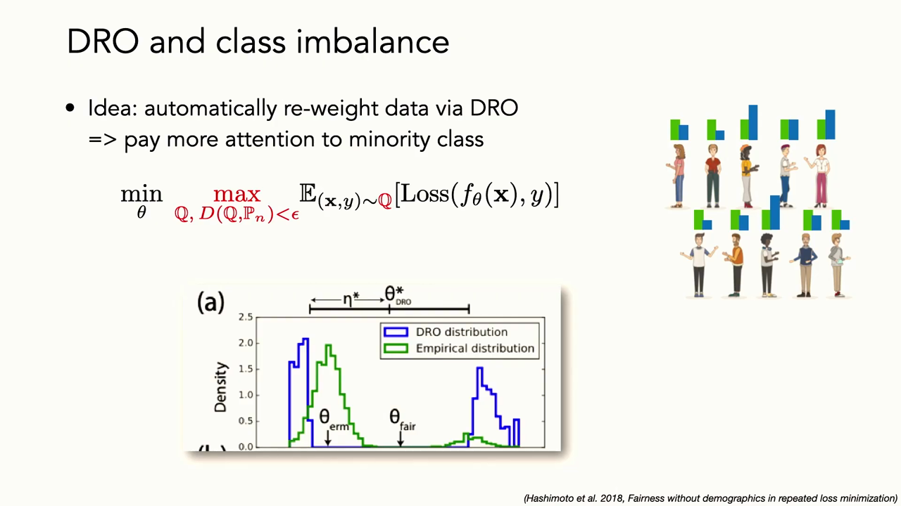
*▲ 강의 슬라이드 [54:25](https://youtu.be/tjD9LIzIIek?t=3265): DRO로 데이터 무게를 자동으로 다시 매겨 소수 그룹에 더 주의를 기울인다. 초록은 경험 분포, 파랑은 DRO가 고른 분포(소수 쪽 무게가 커짐). 그림: Hashimoto 등 2018*

*▲ 직접 그린 그림: 다수 80%·소수 20%인 두 모형. [평균 오차](00_%EB%94%A5%EB%9F%AC%EB%8B%9D_%EC%9A%A9%EC%96%B4%EC%82%AC%EC%A0%84.md#average-error-%ED%8F%89%EA%B7%A0-%EC%98%A4%EC%B0%A8)로 고르면 소수 그룹 [오차](00_%EB%94%A5%EB%9F%AC%EB%8B%9D_%EC%9A%A9%EC%96%B4%EC%82%AC%EC%A0%84.md#error-%EC%98%A4%EC%B0%A8) 0.50인 모형 A(평균 0.10)를, 최악 그룹 [오차](00_%EB%94%A5%EB%9F%AC%EB%8B%9D_%EC%9A%A9%EC%96%B4%EC%82%AC%EC%A0%84.md#error-%EC%98%A4%EC%B0%A8)로 고르면 모형 B(최악 0.15)를 고른다*

---

## 12. 그 밖의 대처법

▶ 영상 [54:58](https://youtu.be/tjD9LIzIIek?t=3298)

DRO와 그 확장처럼 알고리즘으로 모형을 더 강건하게(또는 더 공정하게) 만드는 방법 말고도 여러 길이 있습니다.

### 12.1 하위 집단 이동에 사전 확률 쓰기

▶ 영상 [55:34](https://youtu.be/tjD9LIzIIek?t=3334)

📐 **수학 개념**: [베이즈 규칙과 사전 확률 보정](%EC%88%98%ED%95%99%EA%B0%9C%EB%85%90/04_%ED%99%95%EB%A5%A0%EA%B3%BC_%EC%A0%95%EB%B3%B4/MM64_%EB%B2%A0%EC%9D%B4%EC%A6%88_%EA%B7%9C%EC%B9%99%EA%B3%BC_%EC%82%AC%EC%A0%84_%ED%99%95%EB%A5%A0_%EB%B3%B4%EC%A0%95.md) · [확률 기초](%EC%88%98%ED%95%99%EA%B0%9C%EB%85%90/04_%ED%99%95%EB%A5%A0%EA%B3%BC_%EC%A0%95%EB%B3%B4/M08_%ED%99%95%EB%A5%A0_%EA%B8%B0%EC%B4%88.md)

- [분포 이동](00_%EB%94%A5%EB%9F%AC%EB%8B%9D_%EC%9A%A9%EC%96%B4%EC%82%AC%EC%A0%84.md#distribution-shift-%EB%B6%84%ED%8F%AC-%EC%9D%B4%EB%8F%99)에 대한 사전 [확률](00_%EB%94%A5%EB%9F%AC%EB%8B%9D_%EC%9A%A9%EC%96%B4%EC%82%AC%EC%A0%84.md#probability-%ED%99%95%EB%A5%A0)을 **명시적으로 배울** 수 있습니다. Mac Aodha 등(2019)은 종 식별에서, 사진 분류기와 따로 **장소·시간의 사전 [확률](00_%EB%94%A5%EB%9F%AC%EB%8B%9D_%EC%9A%A9%EC%96%B4%EC%82%AC%EC%A0%84.md#probability-%ED%99%95%EB%A5%A0)**(모듈식 시공간 사전) 모형을 배웠습니다. 입력은 $\mathbf{x}$ = (경도, 위도, 날짜)입니다. 두 결과를 곱해 사진이 찍힌 곳에 맞춰 각 종의 [확률](00_%EB%94%A5%EB%9F%AC%EB%8B%9D_%EC%9A%A9%EC%96%B4%EC%82%AC%EC%A0%84.md#probability-%ED%99%95%EB%A5%A0)을 다시 매깁니다.
- 생태학자가 하는 일과 같습니다. 아주 비슷하게 생긴 종은 언제 어디서 찍혔는지 모르면 전문가도 구분하기 어렵지만, 그 정보가 있으면 쉽게 가립니다. 영역의 구조(공간·시간 분포)에 대한 지식을 모형에 직접 넣는 방법입니다.
- 이런 모형은 [iNaturalist](00_%EB%94%A5%EB%9F%AC%EB%8B%9D_%EC%9A%A9%EC%96%B4%EC%82%AC%EC%A0%84.md#inaturalist-%EC%83%9D%EB%AC%BC-%EC%A2%85-%EC%82%AC%EC%A7%84-%EB%8D%B0%EC%9D%B4%ED%84%B0%EC%85%8B)에서 종 [정확도](00_%EB%94%A5%EB%9F%AC%EB%8B%9D_%EC%9A%A9%EC%96%B4%EC%82%AC%EC%A0%84.md#accuracy-%EC%A0%95%ED%99%95%EB%8F%84)를 약 10% 올렸습니다.

$$
P(y \mid I, \mathbf{x}) \propto P(y \mid I)\, P(y \mid \mathbf{x})
$$

기호 풀이

| 기호 | 읽는 법 | 뜻 | 예제 값 |
| --- | --- | --- | --- |
| $y$ | 와이 | 종 (범주) | 종 1, 2, 3 |
| $I$ | 아이 | 사진 (image) | |
| $\mathbf{x}$ | 엑스 | 촬영 장소와 시간 (경도, 위도, 날짜) | |
| $P(y \mid I)$ | 피 와이 기븐 아이 | 사진만 본 분류기의 종 [확률](00_%EB%94%A5%EB%9F%AC%EB%8B%9D_%EC%9A%A9%EC%96%B4%EC%82%AC%EC%A0%84.md#probability-%ED%99%95%EB%A5%A0) | (0.5, 0.3, 0.2) |
| $P(y \mid \mathbf{x})$ | 피 와이 기븐 엑스 | 장소·시간만 본 사전 [확률](00_%EB%94%A5%EB%9F%AC%EB%8B%9D_%EC%9A%A9%EC%96%B4%EC%82%AC%EC%A0%84.md#probability-%ED%99%95%EB%A5%A0) | (0.1, 0.6, 0.3) |
| $\propto$ | 비례 | 오른쪽에 비례한다. 곱한 뒤 합이 1이 되게 나눈다 | 합 0.29로 나눔 |
| $P(y \mid I, \mathbf{x})$ | 피 와이 기븐 아이, 엑스 | 둘을 합친 최종 [확률](00_%EB%94%A5%EB%9F%AC%EB%8B%9D_%EC%9A%A9%EC%96%B4%EC%82%AC%EC%A0%84.md#probability-%ED%99%95%EB%A5%A0) | (0.1724, 0.6207, 0.2069) |

예제와 풀이

**문제**: 개구리 사진 한 장에 사진 분류기는 종 1~3에 [확률](00_%EB%94%A5%EB%9F%AC%EB%8B%9D_%EC%9A%A9%EC%96%B4%EC%82%AC%EC%A0%84.md#probability-%ED%99%95%EB%A5%A0) (0.5, 0.3, 0.2)를 준다. 그 장소·날짜에서 세 종이 관찰될 사전 [확률](00_%EB%94%A5%EB%9F%AC%EB%8B%9D_%EC%9A%A9%EC%96%B4%EC%82%AC%EC%A0%84.md#probability-%ED%99%95%EB%A5%A0)은 (0.1, 0.6, 0.3)이다. 둘을 합친 최종 [확률](00_%EB%94%A5%EB%9F%AC%EB%8B%9D_%EC%9A%A9%EC%96%B4%EC%82%AC%EC%A0%84.md#probability-%ED%99%95%EB%A5%A0)과 예측 종은?

**주어진 값**
- $P(y \mid I) = (0.5, 0.3, 0.2)$ (사진만 본 [확률](00_%EB%94%A5%EB%9F%AC%EB%8B%9D_%EC%9A%A9%EC%96%B4%EC%82%AC%EC%A0%84.md#probability-%ED%99%95%EB%A5%A0))
- $P(y \mid \mathbf{x}) = (0.1, 0.6, 0.3)$ (장소·시간만 본 [확률](00_%EB%94%A5%EB%9F%AC%EB%8B%9D_%EC%9A%A9%EC%96%B4%EC%82%AC%EC%A0%84.md#probability-%ED%99%95%EB%A5%A0))

**풀이**
1. 식을 그대로 쓴다: $P(y \mid I, \mathbf{x}) \propto P(y \mid I)\, P(y \mid \mathbf{x})$
2. 값을 대입한다: $P(y \mid I, \mathbf{x}) \propto (0.5, 0.3, 0.2) \times (0.1, 0.6, 0.3)$ (종마다 곱함)
3. 종 1을 곱한다: $0.5 \times 0.1 = 0.05$
4. 종 2를 곱한다: $0.3 \times 0.6 = 0.18$
5. 종 3을 곱한다: $0.2 \times 0.3 = 0.06$
6. 합이 1이 되게 하려고 먼저 더한다: $0.05 + 0.18 + 0.06 = 0.29$
7. 종 1을 나눈다: $0.05 / 0.29 = 0.1724$
8. 종 2를 나눈다: $0.18 / 0.29 = 0.6207$
9. 종 3을 나눈다: $0.06 / 0.29 = 0.2069$

**답**: 최종 [확률](00_%EB%94%A5%EB%9F%AC%EB%8B%9D_%EC%9A%A9%EC%96%B4%EC%82%AC%EC%A0%84.md#probability-%ED%99%95%EB%A5%A0) **(0.1724, 0.6207, 0.2069)**. 사진만 보면 종 1(0.5)이었지만, 그곳에서 흔한 종 2로 예측이 바뀐다.

내 이해

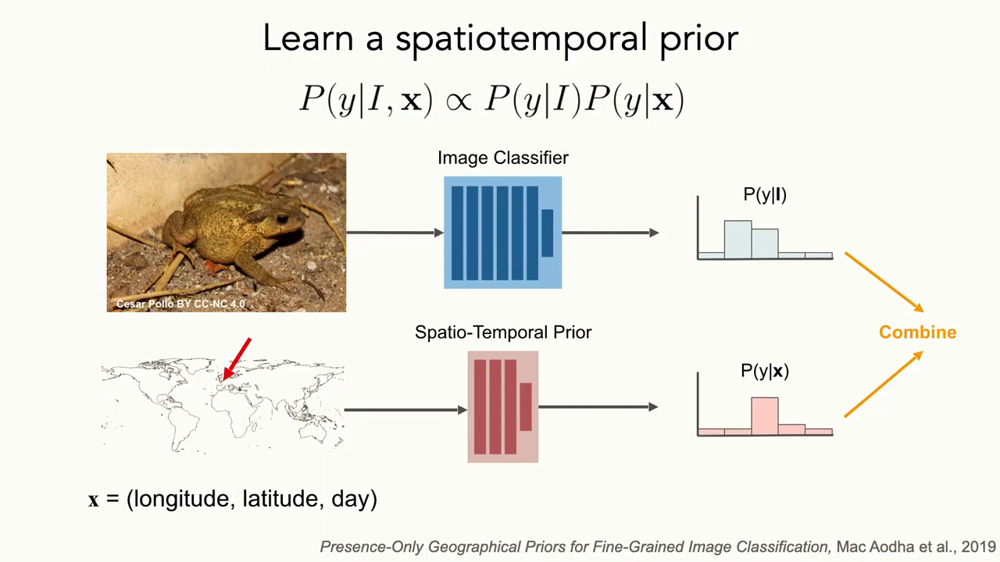
*▲ 강의 슬라이드 [56:00](https://youtu.be/tjD9LIzIIek?t=3360): 시공간 사전 [확률](00_%EB%94%A5%EB%9F%AC%EB%8B%9D_%EC%9A%A9%EC%96%B4%EC%82%AC%EC%A0%84.md#probability-%ED%99%95%EB%A5%A0) 배우기. 사진 분류기의 $P(y \mid I)$와 (경도, 위도, 날짜)로 배운 $P(y \mid \mathbf{x})$를 곱해 합친다(Mac Aodha 등 2019)*

### 12.2 도메인 적응과 실패 진단

▶ 영상 [56:46](https://youtu.be/tjD9LIzIIek?t=3406)

- **[도메인 적응](00_%EB%94%A5%EB%9F%AC%EB%8B%9D_%EC%9A%A9%EC%96%B4%EC%82%AC%EC%A0%84.md#domain-adaptation-%EB%8F%84%EB%A9%94%EC%9D%B8-%EC%A0%81%EC%9D%91)(Domain adaptation)**: 원천 도메인(라벨 있음)과 목표 도메인(라벨이 없거나 적음)이 있을 때, [학습](00_%EB%94%A5%EB%9F%AC%EB%8B%9D_%EC%9A%A9%EC%96%B4%EC%82%AC%EC%A0%84.md#training-%ED%95%99%EC%8A%B5) 중에 두 도메인의 표현을 **정렬**해 새 목표 도메인으로 [일반화](00_%EB%94%A5%EB%9F%AC%EB%8B%9D_%EC%9A%A9%EC%96%B4%EC%82%AC%EC%A0%84.md#generalization-%EC%9D%BC%EB%B0%98%ED%99%94)·적응하게 하는 모형들입니다. 다음 강의에서 더 다룹니다.
- **실패 진단**: 모형의 실패 방식을 창의적으로 진단하면, 대개 모형보다 **처음 [학습 데이터](00_%EB%94%A5%EB%9F%AC%EB%8B%9D_%EC%9A%A9%EC%96%B4%EC%82%AC%EC%A0%84.md#training-data-test-data-%ED%95%99%EC%8A%B5-%EB%8D%B0%EC%9D%B4%ED%84%B0%EC%99%80-%EC%8B%9C%ED%97%98-%EB%8D%B0%EC%9D%B4%ED%84%B0)의 [편향](00_%EB%94%A5%EB%9F%AC%EB%8B%9D_%EC%9A%A9%EC%96%B4%EC%82%AC%EC%A0%84.md#bias-%ED%8E%B8%ED%96%A5)**에 대해 더 많이 배웁니다.
  - **층별 평가**: 범주별로, 또 밤과 낮이나 참가자 성별 같은 차원별로(그 라벨이 있다면) 평가를 쪼개 범주 사이의 상대적인 "[공정성](00_%EB%94%A5%EB%9F%AC%EB%8B%9D_%EC%9A%A9%EC%96%B4%EC%82%AC%EC%A0%84.md#fairness-%EA%B3%B5%EC%A0%95%EC%84%B1)"을 봅니다.
  - **생성 모형으로 반사실 만들기**: Aleksander Madry 연구실은 최신 생성 모형으로 가상의 반사실 이미지를 만들어 실패 방식을 진단했습니다(Vendrow 등 2023). 그렇게 찾은 예가 실제 데이터에서도 확인되었는데, 모형은 **음식이 담긴 접시**는 잘 알아보지만 **빈 접시**는 쟁반이나 양동이로 분류했습니다.
  - 진단은 그 실패에 강건해지도록 데이터를 더 모으는 데 쓸 수도 있고, 배포에서 모형을 어떻게, 어디까지 믿을지 판단하는 데도 씁니다.

### 12.3 결국은 대표성 있는 데이터

▶ 영상 [58:30](https://youtu.be/tjD9LIzIIek?t=3510)

- 강사의 실무 결론: 어느 경우든 가장 좋은 처방은 **시험 도메인을 대표하는 [학습 데이터](00_%EB%94%A5%EB%9F%AC%EB%8B%9D_%EC%9A%A9%EC%96%B4%EC%82%AC%EC%A0%84.md#training-data-test-data-%ED%95%99%EC%8A%B5-%EB%8D%B0%EC%9D%B4%ED%84%B0%EC%99%80-%EC%8B%9C%ED%97%98-%EB%8D%B0%EC%9D%B4%ED%84%B0)를 얻는 것**입니다. 강건하게 만드는 창의적인 알고리즘들은 보통 대표 데이터를 더 모으는 것보다 **훨씬 못합니다**.
- 그런 데이터를 도저히 못 얻는다면(종이 극히 희귀하거나, 아무것도 착륙해 본 적 없는 행성이거나, 북극 얼음 밑이나 심해처럼 대규모로 모을 수 없는 곳) 아마 여전히 사람이 데이터를 많이 봐야 할 것입니다.
- 실제로 잘 되는 곳은 대개 분포 안 [학습 데이터](00_%EB%94%A5%EB%9F%AC%EB%8B%9D_%EC%9A%A9%EC%96%B4%EC%82%AC%EC%A0%84.md#training-data-test-data-%ED%95%99%EC%8A%B5-%EB%8D%B0%EC%9D%B4%ED%84%B0%EC%99%80-%EC%8B%9C%ED%97%98-%EB%8D%B0%EC%9D%B4%ED%84%B0)가 있는 곳입니다. 자기 과학 문제에 딥러닝을 쓰려는 사람은 이 문헌을 살펴보되, 시간과 노력이 한정되어 있다면 **라벨을 더 다는 것이 나을 때가 많다**고 강사는 말합니다.

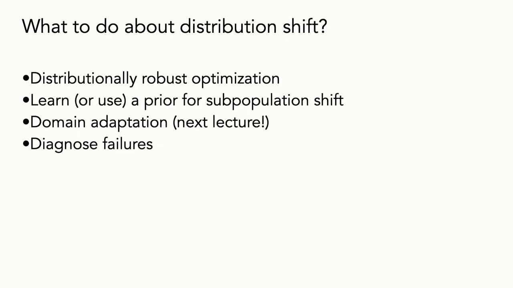
*▲ 강의 슬라이드 [58:40](https://youtu.be/tjD9LIzIIek?t=3520): [분포 이동](00_%EB%94%A5%EB%9F%AC%EB%8B%9D_%EC%9A%A9%EC%96%B4%EC%82%AC%EC%A0%84.md#distribution-shift-%EB%B6%84%ED%8F%AC-%EC%9D%B4%EB%8F%99)에 대한 대처. DRO, [하위 집단 이동](00_%EB%94%A5%EB%9F%AC%EB%8B%9D_%EC%9A%A9%EC%96%B4%EC%82%AC%EC%A0%84.md#subpopulation-shift-%ED%95%98%EC%9C%84-%EC%A7%91%EB%8B%A8-%EC%9D%B4%EB%8F%99)에 대한 사전 [확률](00_%EB%94%A5%EB%9F%AC%EB%8B%9D_%EC%9A%A9%EC%96%B4%EC%82%AC%EC%A0%84.md#probability-%ED%99%95%EB%A5%A0) 배우기(또는 쓰기), [도메인 적응](00_%EB%94%A5%EB%9F%AC%EB%8B%9D_%EC%9A%A9%EC%96%B4%EC%82%AC%EC%A0%84.md#domain-adaptation-%EB%8F%84%EB%A9%94%EC%9D%B8-%EC%A0%81%EC%9D%91)(다음 강의), 실패 진단*

---

## 13. 정리

▶ 영상 [60:14](https://youtu.be/tjD9LIzIIek?t=3614)

- **[분포 밖 일반화](00_%EB%94%A5%EB%9F%AC%EB%8B%9D_%EC%9A%A9%EC%96%B4%EC%82%AC%EC%A0%84.md#out-of-distribution-generalization-%EB%B6%84%ED%8F%AC-%EB%B0%96-%EC%9D%BC%EB%B0%98%ED%99%94)는 여전히 큰 과제**입니다. 그러나 파고들수록 신경망이 무엇을 배우는지, 그리고 **[학습 데이터](00_%EB%94%A5%EB%9F%AC%EB%8B%9D_%EC%9A%A9%EC%96%B4%EC%82%AC%EC%A0%84.md#training-data-test-data-%ED%95%99%EC%8A%B5-%EB%8D%B0%EC%9D%B4%ED%84%B0%EC%99%80-%EC%8B%9C%ED%97%98-%EB%8D%B0%EC%9D%B4%ED%84%B0)와 모형을 효과적으로 쓸 수 있는 곳** 사이의 촘촘하고 복잡한 관계를 이해하게 됩니다.
- 오늘은 **[적대적 예제](00_%EB%94%A5%EB%9F%AC%EB%8B%9D_%EC%9A%A9%EC%96%B4%EC%82%AC%EC%A0%84.md#adversarial-example-%EC%A0%81%EB%8C%80%EC%A0%81-%EC%98%88%EC%A0%9C)와 [적대적 학습](00_%EB%94%A5%EB%9F%AC%EB%8B%9D_%EC%9A%A9%EC%96%B4%EC%82%AC%EC%A0%84.md#adversarial-training-%EC%A0%81%EB%8C%80%EC%A0%81-%ED%95%99%EC%8A%B5)**(데이터 한 점의 작은 교란, min-max [학습](00_%EB%94%A5%EB%9F%AC%EB%8B%9D_%EC%9A%A9%EC%96%B4%EC%82%AC%EC%A0%84.md#training-%ED%95%99%EC%8A%B5)), **[분포 이동](00_%EB%94%A5%EB%9F%AC%EB%8B%9D_%EC%9A%A9%EC%96%B4%EC%82%AC%EC%A0%84.md#distribution-shift-%EB%B6%84%ED%8F%AC-%EC%9D%B4%EB%8F%99)**(분포 전체의 이동, DRO·사전 [확률](00_%EB%94%A5%EB%9F%AC%EB%8B%9D_%EC%9A%A9%EC%96%B4%EC%82%AC%EC%A0%84.md#probability-%ED%99%95%EB%A5%A0)·[도메인 적응](00_%EB%94%A5%EB%9F%AC%EB%8B%9D_%EC%9A%A9%EC%96%B4%EC%82%AC%EC%A0%84.md#domain-adaptation-%EB%8F%84%EB%A9%94%EC%9D%B8-%EC%A0%81%EC%9D%91)·진단)을 다루었습니다.

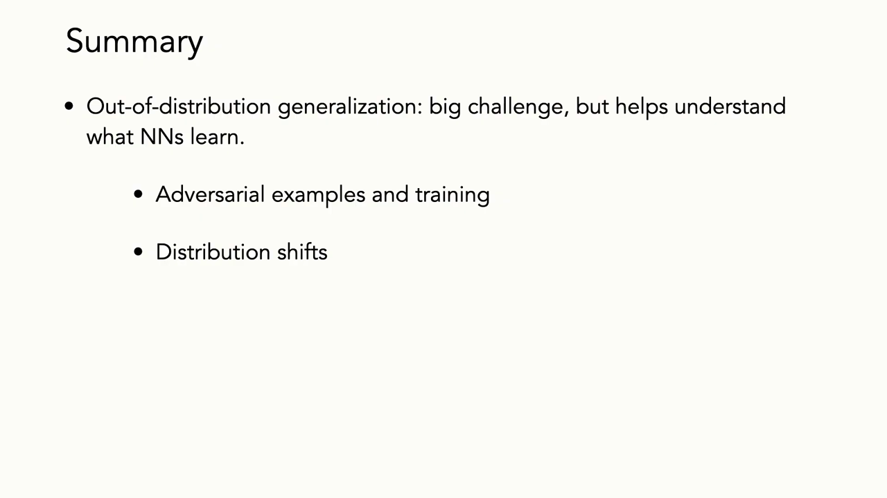
*▲ 강의 슬라이드 [60:40](https://youtu.be/tjD9LIzIIek?t=3640): 정리. [분포 밖 일반화](00_%EB%94%A5%EB%9F%AC%EB%8B%9D_%EC%9A%A9%EC%96%B4%EC%82%AC%EC%A0%84.md#out-of-distribution-generalization-%EB%B6%84%ED%8F%AC-%EB%B0%96-%EC%9D%BC%EB%B0%98%ED%99%94)는 큰 과제지만 신경망이 무엇을 배우는지 이해하게 한다. [적대적 예제](00_%EB%94%A5%EB%9F%AC%EB%8B%9D_%EC%9A%A9%EC%96%B4%EC%82%AC%EC%A0%84.md#adversarial-example-%EC%A0%81%EB%8C%80%EC%A0%81-%EC%98%88%EC%A0%9C)와 [학습](00_%EB%94%A5%EB%9F%AC%EB%8B%9D_%EC%9A%A9%EC%96%B4%EC%82%AC%EC%A0%84.md#training-%ED%95%99%EC%8A%B5), [분포 이동](00_%EB%94%A5%EB%9F%AC%EB%8B%9D_%EC%9A%A9%EC%96%B4%EC%82%AC%EC%A0%84.md#distribution-shift-%EB%B6%84%ED%8F%AC-%EC%9D%B4%EB%8F%99)*

질의응답 정리 [60:47](https://youtu.be/tjD9LIzIIek?t=3647)

- **[활성화 함수](00_%EB%94%A5%EB%9F%AC%EB%8B%9D_%EC%9A%A9%EC%96%B4%EC%82%AC%EC%A0%84.md#activation-function-%ED%99%9C%EC%84%B1%ED%99%94-%ED%95%A8%EC%88%98)([ReLU](00_%EB%94%A5%EB%9F%AC%EB%8B%9D_%EC%9A%A9%EC%96%B4%EC%82%AC%EC%A0%84.md#relu-%EB%A0%90%EB%A3%A8), [GELU](00_%EB%94%A5%EB%9F%AC%EB%8B%9D_%EC%9A%A9%EC%96%B4%EC%82%AC%EC%A0%84.md#gelu-%EA%B2%94%EB%A3%A8) 등)의 선택이 속이기 쉬움이나 강건성에 영향을 주나?** 강사는 관련 문헌을 모르지만, 직관적으로는 큰 영향이 없을 것 같다고 답합니다. [MNIST](00_%EB%94%A5%EB%9F%AC%EB%8B%9D_%EC%9A%A9%EC%96%B4%EC%82%AC%EC%A0%84.md#mnist-%EC%86%90%EA%B8%80%EC%94%A8-%EC%88%AB%EC%9E%90-%EB%8D%B0%EC%9D%B4%ED%84%B0%EC%85%8B)나 CIFAR 같은 단순한 데이터에서는 영향이 있다는 논문이 있을 수 있어도, 모형과 구조가 성능에 미치는 다른 복잡한 요인들에 비하면 일반화되지 않을 수 있다고 봅니다(본인의 추측이라고 밝힘).
- **가상의 교란에 하나하나 강건하게 학습하는 대신, 사람 피드백이나 강화 [학습](00_%EB%94%A5%EB%9F%AC%EB%8B%9D_%EC%9A%A9%EC%96%B4%EC%82%AC%EC%A0%84.md#training-%ED%95%99%EC%8A%B5)(예: [DPO](00_%EB%94%A5%EB%9F%AC%EB%8B%9D_%EC%9A%A9%EC%96%B4%EC%82%AC%EC%A0%84.md#dpo-direct-preference-optimization-%EC%A7%81%EC%A0%91-%EC%84%A0%ED%98%B8-%EC%B5%9C%EC%A0%81%ED%99%94), [직접 선호 최적화](00_%EB%94%A5%EB%9F%AC%EB%8B%9D_%EC%9A%A9%EC%96%B4%EC%82%AC%EC%A0%84.md#dpo-direct-preference-optimization-%EC%A7%81%EC%A0%91-%EC%84%A0%ED%98%B8-%EC%B5%9C%EC%A0%81%ED%99%94))으로 라벨을 다는 편이 싸지 않나?** 실제로 많이 그렇게 합니다. **특정 목표 데이터셋**이 있다면 훨씬 효율적일 수 있습니다. [도메인 적응](00_%EB%94%A5%EB%9F%AC%EB%8B%9D_%EC%9A%A9%EC%96%B4%EC%82%AC%EC%A0%84.md#domain-adaptation-%EB%8F%84%EB%A9%94%EC%9D%B8-%EC%A0%81%EC%9D%91), (라벨이 있다면) 지도 [미세 조정](00_%EB%94%A5%EB%9F%AC%EB%8B%9D_%EC%9A%A9%EC%96%B4%EC%82%AC%EC%A0%84.md#fine-tuning-%EB%AF%B8%EC%84%B8-%EC%A1%B0%EC%A0%95), 라벨을 더 효율적으로 모으는 방법 등이 모두 활발한 연구 분야입니다. 오늘 다룬 연구는 **상상할 수 있는 어떤 변화에도** 강건해지는 것이 목표였고, 한계는 데이터가 어떻게 바뀔지 모른다는 것입니다. 어떻게 바뀔지 알면 거기에 효율적으로 맞추면 됩니다. 곧 **[분포 이동](00_%EB%94%A5%EB%9F%AC%EB%8B%9D_%EC%9A%A9%EC%96%B4%EC%82%AC%EC%A0%84.md#distribution-shift-%EB%B6%84%ED%8F%AC-%EC%9D%B4%EB%8F%99)에 강건해지기**와 **특정 [분포 이동](00_%EB%94%A5%EB%9F%AC%EB%8B%9D_%EC%9A%A9%EC%96%B4%EC%82%AC%EC%A0%84.md#distribution-shift-%EB%B6%84%ED%8F%AC-%EC%9D%B4%EB%8F%99)에 적응·특화하기**의 차이입니다.
- 강의는 선거일이라 일찍 끝내며 "남은 시간에 투표하러 가라"는 말로 마칩니다.

---

## 14. 용어 정리

용어사전에 있는 용어는 위 본문에 링크를 걸었습니다. 아래는 이번 강의에서 새로 나왔거나 새로 다룬 용어입니다.

| 용어 | 뜻 |
|---|---|
| [분포 밖 일반화](00_%EB%94%A5%EB%9F%AC%EB%8B%9D_%EC%9A%A9%EC%96%B4%EC%82%AC%EC%A0%84.md#out-of-distribution-generalization-%EB%B6%84%ED%8F%AC-%EB%B0%96-%EC%9D%BC%EB%B0%98%ED%99%94)(Out-of-distribution generalization) | [학습](00_%EB%94%A5%EB%9F%AC%EB%8B%9D_%EC%9A%A9%EC%96%B4%EC%82%AC%EC%A0%84.md#training-%ED%95%99%EC%8A%B5) 분포와 체계적으로 다른 입력에서도 잘 작동하는 것 |
| [독립 동일 분포](00_%EB%94%A5%EB%9F%AC%EB%8B%9D_%EC%9A%A9%EC%96%B4%EC%82%AC%EC%A0%84.md#iid-independent-and-identically-distributed-%EB%8F%85%EB%A6%BD-%EB%8F%99%EC%9D%BC-%EB%B6%84%ED%8F%AC)([i.i.d.](00_%EB%94%A5%EB%9F%AC%EB%8B%9D_%EC%9A%A9%EC%96%B4%EC%82%AC%EC%A0%84.md#iid-independent-and-identically-distributed-%EB%8F%85%EB%A6%BD-%EB%8F%99%EC%9D%BC-%EB%B6%84%ED%8F%AC)) | [학습](00_%EB%94%A5%EB%9F%AC%EB%8B%9D_%EC%9A%A9%EC%96%B4%EC%82%AC%EC%A0%84.md#training-%ED%95%99%EC%8A%B5)·[시험 데이터](00_%EB%94%A5%EB%9F%AC%EB%8B%9D_%EC%9A%A9%EC%96%B4%EC%82%AC%EC%A0%84.md#training-data-test-data-%ED%95%99%EC%8A%B5-%EB%8D%B0%EC%9D%B4%ED%84%B0%EC%99%80-%EC%8B%9C%ED%97%98-%EB%8D%B0%EC%9D%B4%ED%84%B0)가 같은 분포에서 서로 독립적으로 뽑혔다는 표준 가정 |
| [분포 이동](00_%EB%94%A5%EB%9F%AC%EB%8B%9D_%EC%9A%A9%EC%96%B4%EC%82%AC%EC%A0%84.md#distribution-shift-%EB%B6%84%ED%8F%AC-%EC%9D%B4%EB%8F%99)(Distribution shift) | 배포 환경의 데이터 분포가 [학습](00_%EB%94%A5%EB%9F%AC%EB%8B%9D_%EC%9A%A9%EC%96%B4%EC%82%AC%EC%A0%84.md#training-%ED%95%99%EC%8A%B5) 분포와 달라지는 것 |
| [하위 집단 이동](00_%EB%94%A5%EB%9F%AC%EB%8B%9D_%EC%9A%A9%EC%96%B4%EC%82%AC%EC%A0%84.md#subpopulation-shift-%ED%95%98%EC%9C%84-%EC%A7%91%EB%8B%A8-%EC%9D%B4%EB%8F%99)(Subpopulation shift) | 겉모습은 같아도 범주(또는 하위 그룹)의 비율이 장소·시간마다 달라지는 이동 |
| [데이터 누출](00_%EB%94%A5%EB%9F%AC%EB%8B%9D_%EC%9A%A9%EC%96%B4%EC%82%AC%EC%A0%84.md#data-leakage-%EB%8D%B0%EC%9D%B4%ED%84%B0-%EB%88%84%EC%B6%9C)([Data leakage](00_%EB%94%A5%EB%9F%AC%EB%8B%9D_%EC%9A%A9%EC%96%B4%EC%82%AC%EC%A0%84.md#data-leakage-%EB%8D%B0%EC%9D%B4%ED%84%B0-%EB%88%84%EC%B6%9C)) | [시험 데이터](00_%EB%94%A5%EB%9F%AC%EB%8B%9D_%EC%9A%A9%EC%96%B4%EC%82%AC%EC%A0%84.md#training-data-test-data-%ED%95%99%EC%8A%B5-%EB%8D%B0%EC%9D%B4%ED%84%B0%EC%99%80-%EC%8B%9C%ED%97%98-%EB%8D%B0%EC%9D%B4%ED%84%B0)의 정보가 [학습](00_%EB%94%A5%EB%9F%AC%EB%8B%9D_%EC%9A%A9%EC%96%B4%EC%82%AC%EC%A0%84.md#training-%ED%95%99%EC%8A%B5)에 새어 들어가 성능이 부풀려지는 평가 오류 |
| [사람 개입 검증](00_%EB%94%A5%EB%9F%AC%EB%8B%9D_%EC%9A%A9%EC%96%B4%EC%82%AC%EC%A0%84.md#human-in-the-loop-%EC%82%AC%EB%9E%8C-%EA%B0%9C%EC%9E%85-%EA%B2%80%EC%A6%9D)([Human-in-the-loop](00_%EB%94%A5%EB%9F%AC%EB%8B%9D_%EC%9A%A9%EC%96%B4%EC%82%AC%EC%A0%84.md#human-in-the-loop-%EC%82%AC%EB%9E%8C-%EA%B0%9C%EC%9E%85-%EA%B2%80%EC%A6%9D)) | 사람이 모형 출력을 확인하고 고치는 고리를 둔 시스템 |
| [적대적 예제](00_%EB%94%A5%EB%9F%AC%EB%8B%9D_%EC%9A%A9%EC%96%B4%EC%82%AC%EC%A0%84.md#adversarial-example-%EC%A0%81%EB%8C%80%EC%A0%81-%EC%98%88%EC%A0%9C)(Adversarial example) | 사람에게는 같아 보이지만 모형의 예측을 바꾸도록 최적화한 작은 교란을 더한 입력 |
| [투영 경사 상승](00_%EB%94%A5%EB%9F%AC%EB%8B%9D_%EC%9A%A9%EC%96%B4%EC%82%AC%EC%A0%84.md#projected-gradient-ascent-%ED%88%AC%EC%98%81-%EA%B2%BD%EC%82%AC-%EC%83%81%EC%8A%B9)(Projected gradient ascent) | [기울기](00_%EB%94%A5%EB%9F%AC%EB%8B%9D_%EC%9A%A9%EC%96%B4%EC%82%AC%EC%A0%84.md#gradient-%EA%B8%B0%EC%9A%B8%EA%B8%B0) 방향으로 한 걸음 간 뒤 허용 집합으로 되돌리기를 반복해 적대적 교란을 찾는 방법 |
| [적대적 학습](00_%EB%94%A5%EB%9F%AC%EB%8B%9D_%EC%9A%A9%EC%96%B4%EC%82%AC%EC%A0%84.md#adversarial-training-%EC%A0%81%EB%8C%80%EC%A0%81-%ED%95%99%EC%8A%B5)(Adversarial training) | 데이터마다 최악의 교란에서의 [손실](00_%EB%94%A5%EB%9F%AC%EB%8B%9D_%EC%9A%A9%EC%96%B4%EC%82%AC%EC%A0%84.md#loss-function-%EC%86%90%EC%8B%A4-%ED%95%A8%EC%88%98)을 줄이는 min-max [학습](00_%EB%94%A5%EB%9F%AC%EB%8B%9D_%EC%9A%A9%EC%96%B4%EC%82%AC%EC%A0%84.md#training-%ED%95%99%EC%8A%B5) |
| [힌지 손실](00_%EB%94%A5%EB%9F%AC%EB%8B%9D_%EC%9A%A9%EC%96%B4%EC%82%AC%EC%A0%84.md#hinge-loss-%ED%9E%8C%EC%A7%80-%EC%86%90%EC%8B%A4)(Hinge loss) | [정답](00_%EB%94%A5%EB%9F%AC%EB%8B%9D_%EC%9A%A9%EC%96%B4%EC%82%AC%EC%A0%84.md#label-%EC%A0%95%EB%8B%B5) 쪽 여유가 1보다 작을 때만 벌하는 [손실](00_%EB%94%A5%EB%9F%AC%EB%8B%9D_%EC%9A%A9%EC%96%B4%EC%82%AC%EC%A0%84.md#loss-function-%EC%86%90%EC%8B%A4-%ED%95%A8%EC%88%98) $\max(0, 1 - y s)$ |
| [강건한 특징과 비강건한 특징](00_%EB%94%A5%EB%9F%AC%EB%8B%9D_%EC%9A%A9%EC%96%B4%EC%82%AC%EC%A0%84.md#robust-and-non-robust-features-%EA%B0%95%EA%B1%B4%ED%95%9C-%ED%8A%B9%EC%A7%95%EA%B3%BC-%EB%B9%84%EA%B0%95%EA%B1%B4%ED%95%9C-%ED%8A%B9%EC%A7%95)(Robust and non-robust features) | 교란해도 [정답](00_%EB%94%A5%EB%9F%AC%EB%8B%9D_%EC%9A%A9%EC%96%B4%EC%82%AC%EC%A0%84.md#label-%EC%A0%95%EB%8B%B5)과 상관이 남는 특징과, 상관은 있지만 교란으로 뒤집히는 특징 |
| [지름길 학습](00_%EB%94%A5%EB%9F%AC%EB%8B%9D_%EC%9A%A9%EC%96%B4%EC%82%AC%EC%A0%84.md#shortcut-learning-%EC%A7%80%EB%A6%84%EA%B8%B8-%ED%95%99%EC%8A%B5)(Shortcut learning) | 학습 데이터에만 있는 허위 상관으로 답을 맞히는 [학습](00_%EB%94%A5%EB%9F%AC%EB%8B%9D_%EC%9A%A9%EC%96%B4%EC%82%AC%EC%A0%84.md#training-%ED%95%99%EC%8A%B5) |
| [공정성](00_%EB%94%A5%EB%9F%AC%EB%8B%9D_%EC%9A%A9%EC%96%B4%EC%82%AC%EC%A0%84.md#fairness-%EA%B3%B5%EC%A0%95%EC%84%B1)([Fairness](00_%EB%94%A5%EB%9F%AC%EB%8B%9D_%EC%9A%A9%EC%96%B4%EC%82%AC%EC%A0%84.md#fairness-%EA%B3%B5%EC%A0%95%EC%84%B1)) | 모형이 집단에 따라 부당하게 다른 결과를 내지 않는 성질 |
| [WILDS](00_%EB%94%A5%EB%9F%AC%EB%8B%9D_%EC%9A%A9%EC%96%B4%EC%82%AC%EC%A0%84.md#wilds-%EB%B6%84%ED%8F%AC-%EC%9D%B4%EB%8F%99-%EB%B2%A4%EC%B9%98%EB%A7%88%ED%81%AC) | 병원·지역·시간·카메라 등 현실의 [분포 이동](00_%EB%94%A5%EB%9F%AC%EB%8B%9D_%EC%9A%A9%EC%96%B4%EC%82%AC%EC%A0%84.md#distribution-shift-%EB%B6%84%ED%8F%AC-%EC%9D%B4%EB%8F%99)을 모은 벤치마크 |
| [매크로 F1](00_%EB%94%A5%EB%9F%AC%EB%8B%9D_%EC%9A%A9%EC%96%B4%EC%82%AC%EC%A0%84.md#macro-f1-%EB%A7%A4%ED%81%AC%EB%A1%9C-f1)([Macro F1](00_%EB%94%A5%EB%9F%AC%EB%8B%9D_%EC%9A%A9%EC%96%B4%EC%82%AC%EC%A0%84.md#macro-f1-%EB%A7%A4%ED%81%AC%EB%A1%9C-f1)) | 범주마다 F1을 구해 단순 평균한 지표. 드문 범주도 같은 무게 |
| [분포적으로 강건한 최적화](00_%EB%94%A5%EB%9F%AC%EB%8B%9D_%EC%9A%A9%EC%96%B4%EC%82%AC%EC%A0%84.md#distributionally-robust-optimization-%EB%B6%84%ED%8F%AC%EC%A0%81%EC%9C%BC%EB%A1%9C-%EA%B0%95%EA%B1%B4%ED%95%9C-%EC%B5%9C%EC%A0%81%ED%99%94)(DRO) | [학습](00_%EB%94%A5%EB%9F%AC%EB%8B%9D_%EC%9A%A9%EC%96%B4%EC%82%AC%EC%A0%84.md#training-%ED%95%99%EC%8A%B5) 분포 근처의 최악 분포에서 [손실](00_%EB%94%A5%EB%9F%AC%EB%8B%9D_%EC%9A%A9%EC%96%B4%EC%82%AC%EC%A0%84.md#loss-function-%EC%86%90%EC%8B%A4-%ED%95%A8%EC%88%98)을 줄이는 [학습](00_%EB%94%A5%EB%9F%AC%EB%8B%9D_%EC%9A%A9%EC%96%B4%EC%82%AC%EC%A0%84.md#training-%ED%95%99%EC%8A%B5) |
| [바서슈타인 거리](00_%EB%94%A5%EB%9F%AC%EB%8B%9D_%EC%9A%A9%EC%96%B4%EC%82%AC%EC%A0%84.md#wasserstein-distance-%EB%B0%94%EC%84%9C%EC%8A%88%ED%83%80%EC%9D%B8-%EA%B1%B0%EB%A6%AC)(Wasserstein distance) | 한 분포를 다른 분포로 옮기는 데 드는 최소 "흙 옮기기" 비용으로 잰 거리 |
| [베이즈 규칙과 사전 확률](00_%EB%94%A5%EB%9F%AC%EB%8B%9D_%EC%9A%A9%EC%96%B4%EC%82%AC%EC%A0%84.md#bayes-rule-%EB%B2%A0%EC%9D%B4%EC%A6%88-%EC%A0%95%EB%A6%AC)([Bayes' rule](00_%EB%94%A5%EB%9F%AC%EB%8B%9D_%EC%9A%A9%EC%96%B4%EC%82%AC%EC%A0%84.md#bayes-rule-%EB%B2%A0%EC%9D%B4%EC%A6%88-%EC%A0%95%EB%A6%AC), [Prior](00_%EB%94%A5%EB%9F%AC%EB%8B%9D_%EC%9A%A9%EC%96%B4%EC%82%AC%EC%A0%84.md#prior-posterior-%EC%82%AC%EC%A0%84-%EB%B6%84%ED%8F%AC%EC%99%80-%EC%82%AC%ED%9B%84-%EB%B6%84%ED%8F%AC)) | 관찰 전 믿음(사전 [확률](00_%EB%94%A5%EB%9F%AC%EB%8B%9D_%EC%9A%A9%EC%96%B4%EC%82%AC%EC%A0%84.md#probability-%ED%99%95%EB%A5%A0))에 증거를 곱해 사후 [확률](00_%EB%94%A5%EB%9F%AC%EB%8B%9D_%EC%9A%A9%EC%96%B4%EC%82%AC%EC%A0%84.md#probability-%ED%99%95%EB%A5%A0)을 얻는 규칙 |
| [도메인 적응](00_%EB%94%A5%EB%9F%AC%EB%8B%9D_%EC%9A%A9%EC%96%B4%EC%82%AC%EC%A0%84.md#domain-adaptation-%EB%8F%84%EB%A9%94%EC%9D%B8-%EC%A0%81%EC%9D%91)(Domain adaptation) | 라벨 있는 원천 도메인에서 라벨이 적은 목표 도메인으로 모형을 옮기는 방법 |
